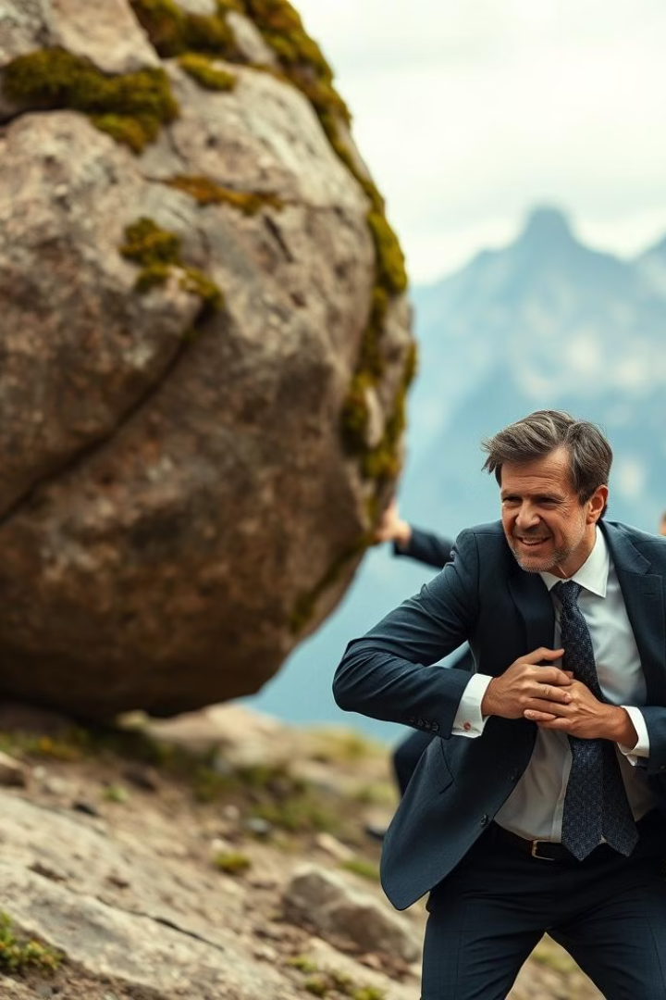
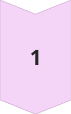
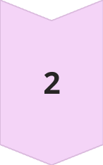
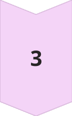
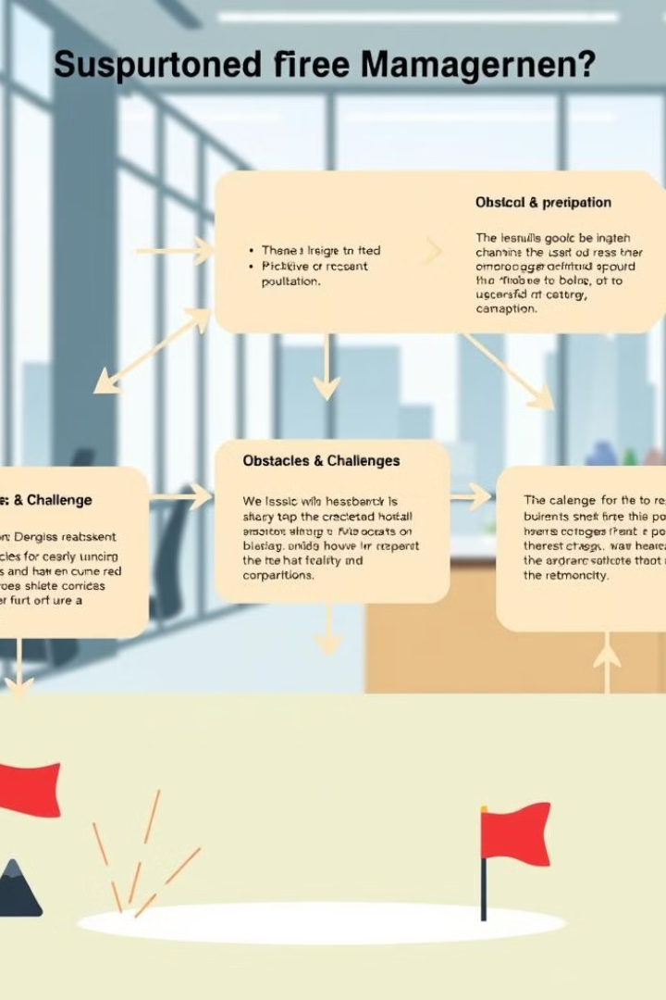
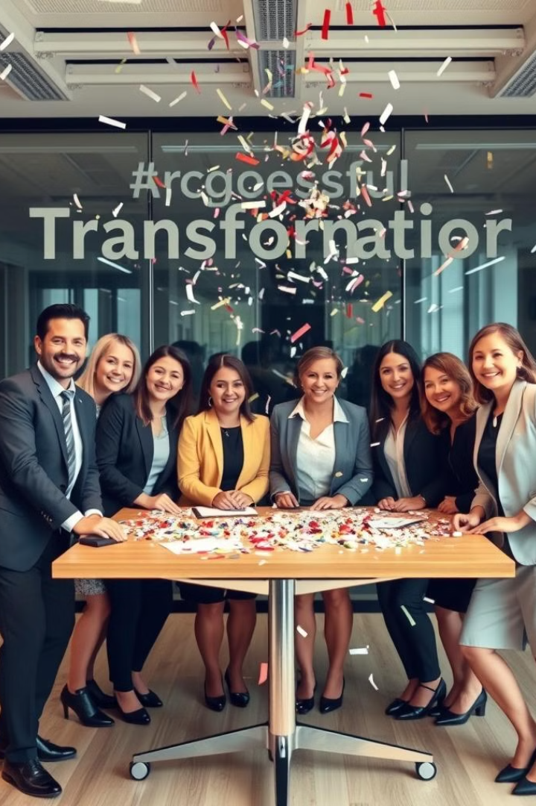
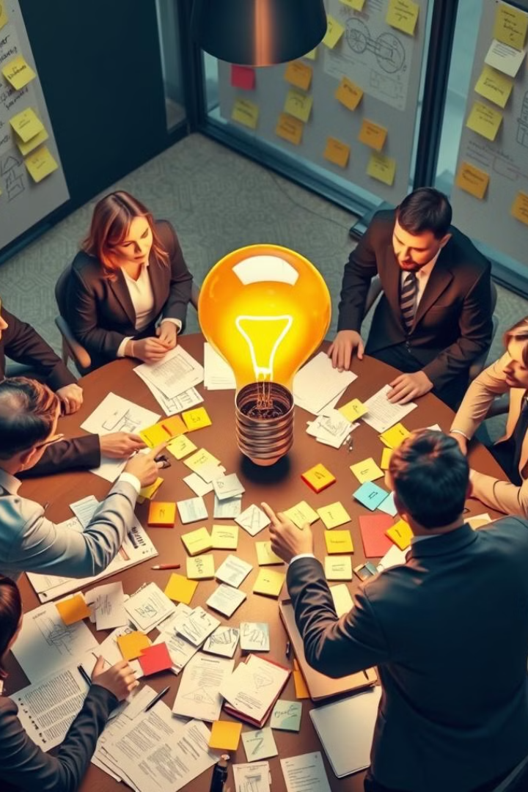

# GESTION DEL CAMBIO 1

## Slide 1

Programa:  Admón. de Empresas

Fecha de inicio:  Lunes 5 de octubre Fecha final: viernes 27 de noviembre. 

Materia :  GESTION DEL CAMBIO EN LAS ORGANIZACIONES

Metodología:  Virtual. 

Duración:  2 MESES  

Docente:  Peterson Peña casas 

wppenac@escolme.edu.co

## Slide 2

Objetivo:

Reconocer el contexto organizacional para la gestión de cambio. 

Analizar el cambio organizacional en ese contexto con sus necesidades y posibilidades de gestión. 

Definir el plan de gestión de cambio que se adapte al contexto. 

## Slide 3

Unidades :

Cambio Organizacional ( del 13 al 26 de abril del 2026 )

Gestión y Fases del cambio ( del 27 de abril  al  10  de mayo del 2026 )

Comunicación para el cambio organizacional ( del 11 al  24  de mayo del 2026 )

Comunicación en las Fases del cambio organizacional ( del  25 de mayo  al  5  de  junio del 2026 ) 

## Slide 4

| 1   | Actividad 1 | 30%   | 13 de abril 2025 | 26 de abril 2026 |
|-----|-------------|-------|------------------|------------------|
| 2   | Actividad 2 | 30%   | 27 de abril 2026 | 10 mayo 2026     |
| 3   | Actividad 3 | 40%   | 11 de mayo 2026  | 24 mayo 2026     |
|  4  | FINAL       |  100% | 25 de mayo 2026  | 04 junio 2025    |

## Slide 5

ENCUENTRO #1  SABADO  18 DE ABRIL  10:00  AM

 

ENCUENTRO # 2   SABADO  2 DE MAYO 10:00 AM

 

ENCUENTRO #3  SABADO  16 DE MAYO 10:00 AM

 

ENCUENTRO #4 SABADO 30 DE  MAYO    10:00 AM

 

## Slide 6

> **Descripción de la imagen** — Se trata de un gráfico o banner digital con un fondo oscuro y vibrante, dominado por tonos azules y púrpuras que sugieren tecnología o datos.
>
> En el centro de la imagen, en letras grandes y blancas, se lee el título: "EMPRESAS QUE NO INNOVARON".
>
> El fondo presenta líneas abstractas y una gráfica de onda (waveform) ascendente y descendente en colores brillantes (azul y magenta).
>
> Hay varios logotipos superpuestos:
> 1.  En la esquina superior izquierda, un logo rectangular azul con el texto "BLOCKBUSTER".
> 2.  En la esquina superior derecha, un ícono de sobre morado con el texto "Yahoo!".
> 3.  En la esquina inferior derecha, un recuadro amarillo/naranja que contiene el nombre "Kodak".
>
> El diseño general es dinámico y futurista, utilizando luces y efectos digitales para resaltar el tema central.

## Slide 7

“Las especies que sobreviven no son las más fuertes, ni las más rápidas, ni las más inteligentes; sino aquellas que se adaptan mejor al cambio.”

## Slide 8

> **Descripción de la imagen** — La imagen muestra una escena de reunión o estudio en un entorno de oficina moderno y luminoso. En el fondo se observa una gran ventana que da a un paisaje urbano con varios rascacielos.
>
> En primer plano, hay tres personas: dos mujeres de pie frente a una pizarra blanca y una persona sentada en una mesa. Las dos mujeres están interactuando con el diagrama dibujado en la pizarra; una señala un punto mientras la otra observa.
>
> El contenido principal es un diagrama conceptual o mapa mental dibujado en la pizarra blanca. El diagrama se centra en un círculo central del cual emanan varias líneas que conectan nodos y burbujas de texto. Estos nodos están etiquetados con términos (como "Power," "Testing," "Risk," etc.) y están dispuestos alrededor del centro, sugiriendo una estructura jerárquica o de relaciones entre conceptos.
>
> En la mesa frente a las personas sentadas hay varios elementos de trabajo: dos computadoras portátiles abiertas, tazas de café blancas, papeles y notas de colores (naranjas y rojos), y algunos marcadores pequeños esparcidos sobre la superficie.

Cambio Organizational:  Liderando  la  Transformación

El Cambio  organizacional  es un  proceso  crucial para que las  empresas  se  adapten  y  prosperen   en  un  entorno   en   constante   evolución .  Requiere   liderazgo   estratégico  y  una   visión   clara  para  guiar  a la  organización  a  través  de la  transformación .

## Slide 9

> **Descripción de la imagen** — La imagen es una ilustración abstracta y detallada compuesta por una densa colección de engranajes mecánicos de diversos tamaños, formas y colores. Los engranajes están dispuestos de manera superpuesta y entrelazada, creando una composición compleja que sugiere un sistema mecánico o la interconexión de múltiples procesos.
>
> Los colores varían entre tonos metálicos: grises plateados, dorados (bronce), y naranjas/marrones rojizos (que sugieren óxido o metal envejecido). La iluminación resalta las texturas metálicas de los dientes y los ejes. El fondo es completamente negro, lo que hace que los engranajes destaquen fuertemente.

¿ Qué  es  el  Cambio  Organizacional ?

1

Adaptación  al Cambio

El  cambio   organizacional   implica   ajustar  la  estructura ,  procesos  y  cultura  de  una   empresa  para responder a las  demandas  del mercado y  el   entorno .

2

Mejora Continua

Es un proceso iterativo que busca optimizar el desempeño y la eficiencia de la organización a lo largo del tiempo.

3

Innovación

El  cambio   organizacional   fomenta  la  creatividad  y la  implementación  de  nuevas  ideas,  productos  y  servicios .

## Slide 10

Tipos  de  Cambios   Organizacionales

Estratégico

Cambios en la misión, visión, objetivos y planes a largo plazo de la organización.

Estructural

Modificaciones en la jerarquía, departamentos, roles y responsabilidades.

Tecnológico

Adopción de nuevas herramientas, sistemas y procesos digitales.

## Slide 11

> **Descripción de la imagen** — Es una fotografía de un hombre de mediana edad, vestido con un traje oscuro (saco y pantalón), camisa blanca y corbata estampada oscura. El hombre está de pie en un entorno exterior montañoso o rocoso, apoyando su cuerpo sobre una enorme roca grande y texturizada que cubre gran parte del primer plano. El hombre mira hacia la derecha con una expresión sonriente. En el fondo se aprecian montañas distantes bajo un cielo claro. La roca en primer plano está cubierta de musgo verde.

Fuerzas   Impulsoras  y Resistencia al Cambio

1

Fuerzas Impulsoras

Necesidad de mejorar la competitividad, implementar innovación, adaptarse a regulaciones, etc.

2

Resistencia

Temor al cambio, falta de motivación, desconocimiento de los beneficios, etc.

3

Estrategias de Gestión

Comunicación efectiva, capacitación, incentivos, y liderazgo visionario.

## Slide 12

> **Descripción de la imagen** — La imagen es una fotografía de un entorno de clase o conferencia donde un hombre vestido con traje está de pie frente a una pizarra blanca, señalando el contenido escrito. Varias personas, presumiblemente estudiantes, están mirando la pizarra.
>
> En la pizarra se observan notas escritas a mano en diferentes secciones:
>
> 1.  **Columna izquierda:** Una lista con viñetas y casillas de verificación (checkboxes), incluyendo frases como "Ease levels", "little trips", "less his warmers" y "remember".
> 2.  **Parte superior central:** Texto escrito que incluye frases como "Ultra instable wicks" y "Retine making!".
> 3.  **Centro:** Un dibujo de una bombilla o idea junto a un texto manuscrito: "leth your realy loy the force".
> 4.  **Parte inferior:** Una sección etiquetada como "Wisnins Atwaties" seguida de líneas y términos escritos como "Eneret" y "Lontr tring".
> 5.  **Columna derecha:** Una flecha horizontal que apunta hacia la derecha con texto escrito, incluyendo fragmentos como "Wat alt th i found the - crust".

Papel  del  Liderazgo   en   el   Cambio

Visión   Estratégica

Los  líderes   deben   definir   una   dirección   clara  y  comunicarla   efectivamente .

Motivación

Inspirar  y  empoderar  al  equipo  para que  abracen   el   cambio  con  entusiasmo .

Gestión  del Cambio

Planificar ,  implementar  y  monitorear   el   proceso  de  transformación   organizacional .

Desarrollo de  Talento

Brindar   capacitación  y  oportunidades  de  crecimiento  a  los   colaboradores .

## Slide 13

> **Descripción de la imagen** — La imagen es una fotografía de un entorno de clase o taller donde dos personas interactúan frente a una pizarra blanca.
>
> En el centro y fondo, se observa una pizarra llena de notas adhesivas (post-its) de varios colores (amarillo, rosa y azul), organizadas en columnas. En la parte superior central de la pizarra hay una indicación escrita con flechas que dice "Services → Dartint". A la izquierda de la pizarra, hay una lista vertical de nombres. A la derecha, hay una lista numerada con puntos correspondientes a notas adhesivas.
>
> En primer plano, se ven las figuras de dos personas: una mujer a la izquierda, sonriendo y señalando hacia la pizarra con el dedo índice, vestida con un blazer gris sobre una blusa estampada. A la derecha, se ve la espalda de un hombre, vestido con una camisa de color naranja o marrón, mirando hacia la pizarra. La escena sugiere una sesión de enseñanza o discusión grupal.

Estrategias  de  Comunicación   Efectiva

> **Descripción de la imagen** — Es una ilustración o un icono estilizado de un megáfono o altavoz. El objeto tiene la forma clásica de un megáfono, con una campana ancha en el extremo y un tubo que se extiende hacia afuera. La figura está delineada en un color magenta o púrpura brillante.

Transparencia

Compartir información de manera abierta y honesta.

> **Descripción de la imagen** — La imagen es una ilustración de un bocadillo de diálogo o burbuja de pensamiento. La forma es redondeada y está delineada con un contorno grueso de color magenta o púrpura brillante. No contiene texto ni elementos internos dentro del bocadillo.

Diálogo

Escuchar y responder a las inquietudes del equipo.

> **Descripción de la imagen** — Es un diagrama geométrico compuesto por cuatro triángulos de color magenta o púrpura brillante, dispuestos simétricamente alrededor de un punto central. Los cuatro triángulos se extienden hacia afuera desde el centro, formando una estructura que se asemeja a una cruz o una forma de 'X'. Todos los vértices de los triángulos convergen en el punto central.

Definir  Metas

Establecer   objetivos  claros y  comunicar   el   progreso .

> **Descripción de la imagen** — Es un ícono o ilustración de una burbuja de diálogo (speech bubble) o cuadro de chat. La forma es rectangular con esquinas redondeadas y tiene una punta hacia abajo en el centro inferior. El color predominante es magenta o púrpura brillante. Dentro de la burbuja se observan tres líneas horizontales paralelas, que representan texto o mensajes.

Retroalimentación

Solicitar  y  proporcionar   comentarios   constructivos .

## Slide 14

> **Descripción de la imagen** — Es una fotografía de un espacio interior moderno y luminoso, que parece ser una sala de estudio o un espacio de trabajo colaborativo.
>
> En el centro de la imagen se encuentra un grupo de jóvenes adultos sentados en mesas de trabajo, concentrados en el uso de computadoras portátiles. Varias personas están interactuando con sus dispositivos, lo que sugiere una sesión de estudio o trabajo en equipo.
>
> En primer plano, una mujer con cabello castaño oscuro está sentada frente a una computadora portátil blanca, mirando la pantalla. Sobre su mesa hay una planta pequeña en una maceta rosa y un cuaderno verde con un bolígrafo.
>
> El fondo muestra el ambiente del espacio: techos altos con vigas expuestas y grandes ventanales que permiten la entrada de luz natural. Hay varias lámparas colgantes de estilo industrial y plantas dispersas por el área, lo que contribuye a una atmósfera abierta y contemporánea. Se pueden observar otras personas trabajando en mesas adyacentes en el fondo.

Administrando la Cultura Organizacional

> **Descripción de la imagen** — La imagen es un elemento gráfico simple que funciona como marcador o indicador de sección. Consiste en una forma poligonal grande, de color lila pálido o rosa claro, con bordes inclinados que apuntan hacia abajo y se abren hacia los lados (similar a un chevron invertido). Dentro de esta forma, centrado, se encuentra el número "1" escrito en negrita y de color negro.

Establecer Valores

Definir e inculcar los principios y creencias clave.

> **Descripción de la imagen** — La imagen es un elemento gráfico simple utilizado como marcador o sección. Consiste en una forma de color lila claro con puntas hacia abajo, similar a un chevron invertido. En el centro de esta forma se encuentra el número "2" escrito en una fuente grande y oscura. Hay un pequeño símbolo o carácter apenas visible en la esquina inferior derecha.

Fomentar   el   Compromiso

Involucrar  a  los   colaboradores  y  generar  un  sentido  de  pertenencia .

> **Descripción de la imagen** — La imagen es un elemento gráfico simple de color lila claro. Presenta una forma con la parte superior en forma de punta o chevron que apunta hacia arriba. En el centro de esta forma, se encuentra el número "3" escrito en una fuente oscura (gris o negra).

Modelar el Cambio

Demostrar   el  nuevo  comportamiento   deseado  a  través  del  liderazgo .

## Slide 15

> **Descripción de la imagen** — La imagen es un diagrama conceptual o un mapa de flujo que estructura ideas relacionadas con el tema central "Susputoned fire Mamagernen?".
>
> El diagrama está compuesto por tres bloques principales conectados por flechas, representando diferentes fases o categorías:
>
> 1.  **Obstical & preparation:** Este bloque contiene una lista de puntos (viñetas) y está conectado a otros elementos mediante flechas.
> 2.  **Obstacles & Challenges:** Este bloque es el centro del diagrama y describe dificultades, conectándose con los bloques anteriores y posteriores.
> 3.  **Bloque de texto lateral derecho:** Una sección de texto que se conecta al flujo principal, describiendo desafíos específicos.
>
> En la parte inferior del diagrama, hay una ilustración separada que muestra elementos gráficos: varias formas o piezas de color rojo dispersas y un asta con una bandera roja en el extremo derecho.

Gestión  del Cambio:  Etapas  y  Desafíos

1

Preparación

Evaluación del estado actual, definición de objetivos y plan de acción.

2

Implementación

Ejecución de los cambios, seguimiento de avances y ajustes necesarios.

3

Consolidación

Integración de los cambios en la cultura y estructuras organizacionales.

## Slide 16

> **Descripción de la imagen** — Es una fotografía de grupo que muestra a siete adultos posando alrededor de una mesa de madera en lo que parece ser un entorno de oficina moderno, con grandes ventanales y puertas de vidrio al fondo.
>
> Los siete individuos están vestidos con ropa de negocios formal. El grupo incluye un hombre y seis mujeres, todos sonriendo y mirando hacia la cámara. Están sentados o parados alrededor de una mesa rectangular que está cubierta parcialmente con confeti de colores (rojo, blanco y rosa).
>
> El ambiente es alegre y profesional, y hay pequeños trozos de confeti cayendo en el aire alrededor del grupo. En la parte superior de la imagen se observa un texto superpuesto que dice "#rcogoesstuff Transformation".

Casos de Éxito de Cambio Organizacional

Empresa

Cambio Implementado

Resultados Clave

Netflix

Transición  de  servicio  de DVD a  plataforma  de streaming

Liderazgo en el mercado, crecimiento exponencial de suscriptores

Kodak

Falta de adaptación al cambio tecnológico

Quiebra y pérdida de participación de mercado

Lego

Diversificación hacia productos y experiencias digitales

Recuperación  de la  rentabilidad  y  reconexión  con  los   clientes

## Slide 17

> **Descripción de la imagen** — La imagen es una fotografía que muestra a un grupo de seis personas reunidas alrededor de una mesa redonda en lo que parece ser un entorno de estudio o reunión.
>
> En el centro de la mesa hay una bombilla grande y brillante, que sirve como punto focal. Alrededor de la mesa, hay numerosos papeles, cuadernos y notas adhesivas de varios colores (amarillo, rosa, etc.) esparcidos, indicando una sesión de trabajo colaborativo o lluvia de ideas.
>
> Las personas están interactuando activamente:
> *   Cuatro individuos están sentados alrededor de la mesa, inclinándose sobre los materiales.
> *   Dos personas están de pie detrás de la mesa, observando la actividad.
>
> El ambiente general sugiere un proceso intelectual o de planificación grupal. El fondo muestra paredes cubiertas con notas adhesivas y documentos, reforzando el contexto académico o de estudio.

Conclusiones y Recomendaciones

1

Impacto Estratégico

El cambio organizacional es fundamental para mantener la competitividad y adaptarse a un entorno en constante evolución.

2

Liderazgo Transformador

El rol de los líderes es crucial para guiar, inspirar y gestionar efectivamente el proceso de transformación.

3

Gestión Integral

Es necesario abordar el cambio de manera holística, considerando aspectos estratégicos, estructurales, culturales y tecnológicos.

## Slide 18

ACTIVIDAD #1  VALOR 30%  Gestión del Cambio en las Organizaciones

Grupos de 4 estudiantes. 

Plazo máximo de entrega:  26 de abril 11:59 de la noche. 

Caso de análisis: Netflix, 

Tipo de cambio: estratégico, estructural,  tecnológico.z

Fuerzas impulsoras y resistencias: ¿qué fuerzas promovieron el cambio y cuáles generaron resistencia?

Papel del liderazgo: ¿cómo se manejó el liderazgo durante el proceso de cambio?

Estrategias de gestión: ¿qué estrategias se usaron para implementar el cambio (comunicación, capacitación, incentivos)?

Resultados: ¿el cambio fue exitoso o fracasó? ¿por qué?

