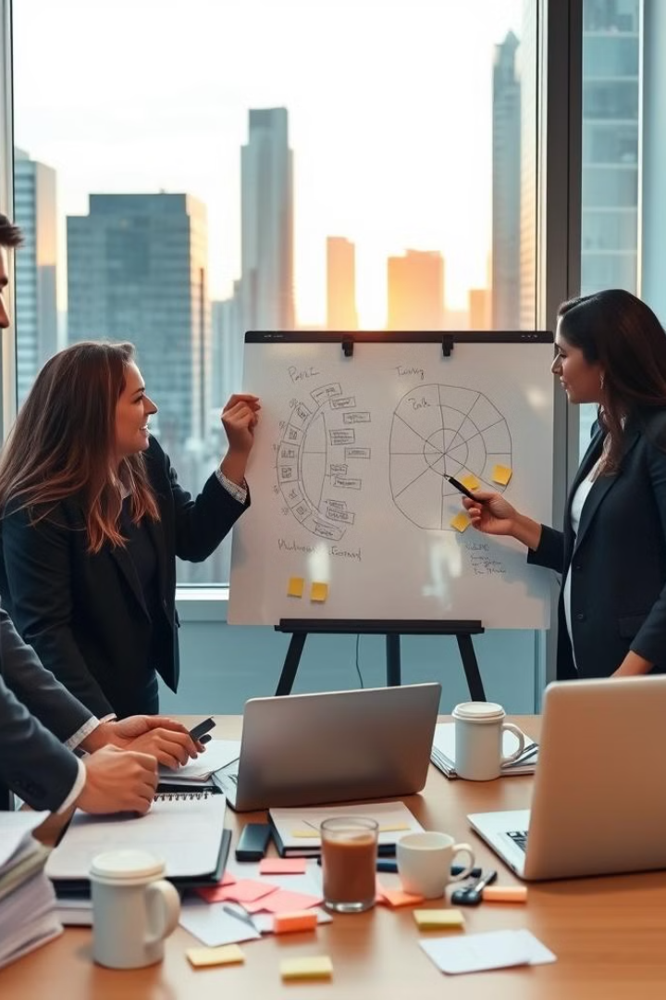
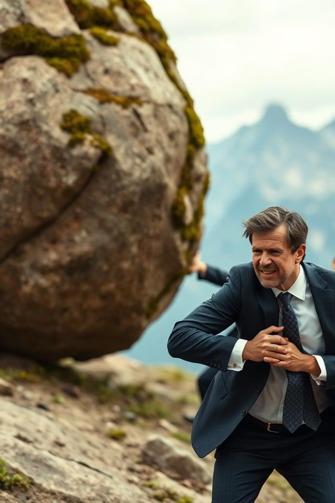
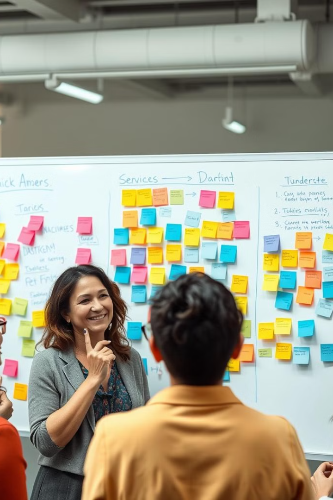
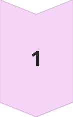
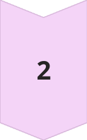
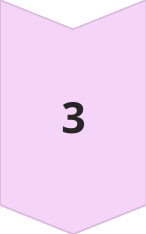
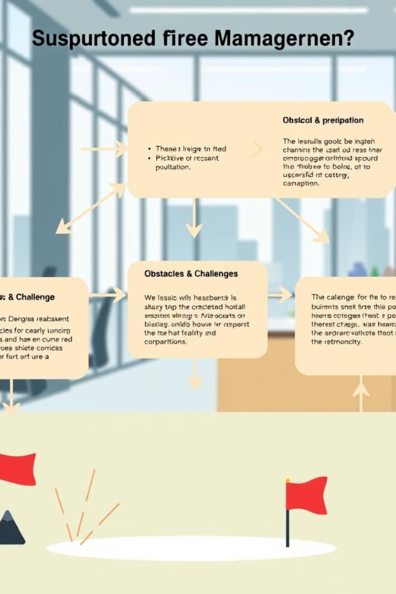
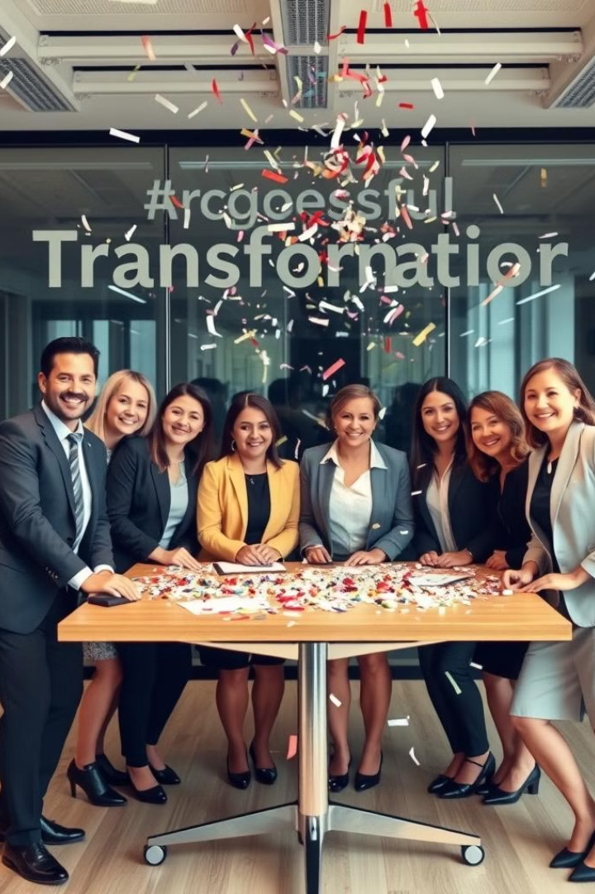
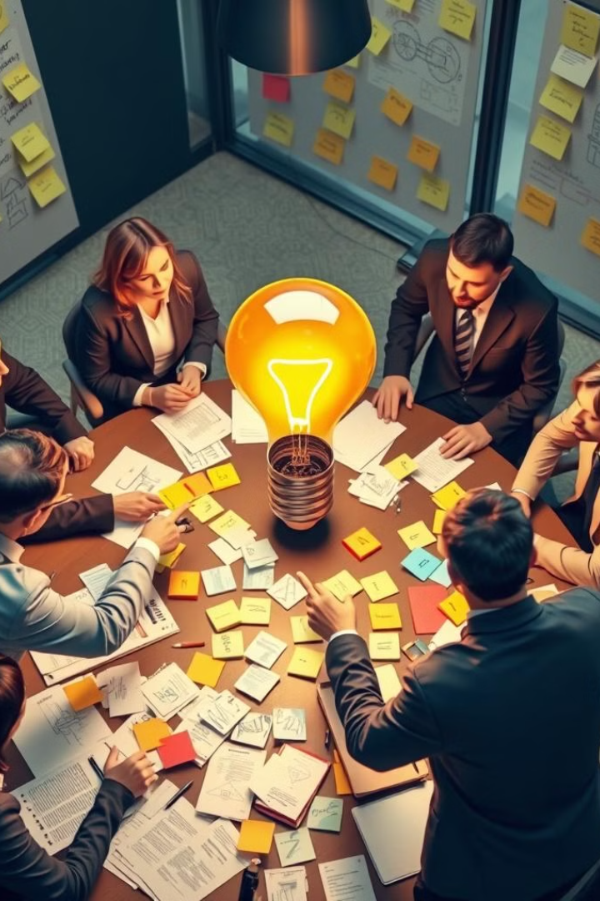

# GESTION DEL CAMBIO UNIDAD #2

## Slide 1

Programa:  Admón. de Empresas

Fecha de inicio :

Materia :  GESTION DEL CAMBIO EN LAS ORGANIZACIONES

Metodología:  Virtual. 

Duración:  2 MESES  

Docente:  Peterson Peña casas 

wppenac@escolme.edu.co

## Slide 2

Objetivo:

Reconocer el contexto organizacional para la gestión de cambio. 

Analizar el cambio organizacional en ese contexto con sus necesidades y posibilidades de gestión. 

Definir el plan de gestión de cambio que se adapte al contexto. 

## Slide 3

> **Descripción de la imagen** — La imagen es una pantalla con un fondo oscuro y tonos azules y morados, con efectos de luz y líneas digitales que sugieren tecnología. En el centro de la imagen se encuentra un texto grande y blanco que dice: "EMPRESAS QUE NO INNOVARON".
>
> Alrededor del texto principal, se observan varios logotipos o nombres destacados:
> 1.  En la esquina superior izquierda, el logotipo de "BLOCKBUSTER".
> 2.  En la parte superior derecha, el logotipo de "YouTube".
> 3.  En la parte inferior derecha, el logotipo de "Kodak".
>
> El diseño general es dinámico y futurista, con líneas brillantes que atraviesan el fondo azul oscuro.

## Slide 4

“Las especies que sobreviven no son las más fuertes, ni las más rápidas, ni las más inteligentes; sino aquellas que se adaptan mejor al cambio.”

## Slide 5

> **Descripción de la imagen** — Es una fotografía de un entorno de oficina o reunión. Muestra a tres mujeres interactuando frente a una pizarra blanca grande.
>
> En el centro, una mujer está señalando y escribiendo en la pizarra, que contiene diagramas circulares y texto escrito a mano (parece ser una sesión de lluvia de ideas o planificación). Otra mujer se encuentra a su derecha, mirando la pizarra y sosteniendo un dispositivo móvil mientras participa en la conversación. Una tercera mujer se encuentra en el lado izquierdo, interactuando con los materiales sobre la mesa.
>
> En primer plano, hay una mesa de madera donde se encuentran varios elementos de trabajo: dos computadoras portátiles abiertas, cuadernos, tazas de café blancas y notas adhesivas de colores (amarillo y rosa) esparcidas sobre la superficie. El fondo muestra una gran ventana que ofrece una vista panorámica de un paisaje urbano con numerosos rascacielos bajo una luz cálida del atardecer o amanecer.

Cambio Organizational:  Liderando  la  Transformación

El Cambio  organizacional  es un  proceso  crucial para que las  empresas  se  adapten  y  prosperen   en  un  entorno   en   constante   evolución .  Requiere   liderazgo   estratégico  y  una   visión   clara  para  guiar  a la  organización  a  través  de la  transformación .

## Slide 6

> **Descripción de la imagen** — La imagen es una ilustración o composición gráfica que muestra un conjunto denso y variado de engranajes mecánicos. Los engranajes están dispuestos de manera superpuesta y entrelazada sobre un fondo oscuro, creando una sensación de complejidad mecánica.
>
> Los elementos visuales incluyen:
> 1.  **Variedad de tamaños:** Hay engranajes de diferentes dimensiones, desde pequeños hasta grandes.
> 2.  **Diversidad de colores y texturas:** Los engranajes presentan tonos metálicos variados, incluyendo grises plateados, bronce, cobre (tonos anaranjados), y dorado/amarillo brillante.
> 3.  **Composición:** Los engranajes están fuertemente conectados entre sí, mostrando cómo interactúan y se engranan para formar un sistema complejo. Algunos engranajes tienen detalles visibles de sus dientes y ejes centrales.
>
> En resumen, la imagen es una representación visual de mecanismos, sistemas interconectados o ingeniería mecánica, destacando la diversidad de componentes y su funcionamiento conjunto.

¿ Qué  es  el  Cambio  Organizacional ?

1

Adaptación  al Cambio

El  cambio   organizacional   implica   ajustar  la  estructura ,  procesos  y  cultura  de  una   empresa  para responder a las  demandas  del mercado y  el   entorno .

2

Mejora Continua

Es un proceso iterativo que busca optimizar el desempeño y la eficiencia de la organización a lo largo del tiempo.

3

Innovación

El  cambio   organizacional   fomenta  la  creatividad  y la  implementación  de  nuevas  ideas,  productos  y  servicios .

## Slide 7

Tipos  de  Cambios   Organizacionales

Estratégico

Cambios en la misión, visión, objetivos y planes a largo plazo de la organización.

Estructural

Modificaciones  en  la  jerarquía ,  departamentos , roles y  responsabilidades .

Tecnológico

Adopción de  nuevas   herramientas ,  sistemas  y  procesos   digitales .

## Slide 8

> **Descripción de la imagen** — Es una fotografía tomada al aire libre que muestra a un hombre de mediana edad, vestido con un traje oscuro (saco y pantalón), camisa blanca y corbata oscura estampada. El hombre tiene el cabello gris y está mirando hacia adelante con una expresión sonriente.
>
> Está apoyado en un gran y redondeado peñasco o roca cubierta de musgo y líquenes, que ocupa la mayor parte del lado izquierdo de la imagen.
>
> El fondo es un paisaje montañoso extenso bajo un cielo claro. Se aprecian picos de montañas distantes en tonos azules y grises, lo que sugiere una ubicación en un entorno natural y rocoso. La composición sitúa al hombre en primer plano junto a la roca, con el paisaje montañoso como telón de fondo.

Fuerzas   Impulsoras  y Resistencia al Cambio

1

Fuerzas Impulsoras

Necesidad de mejorar la competitividad, implementar innovación, adaptarse a regulaciones, etc.

2

Resistencia

Temor al cambio, falta de motivación, desconocimiento de los beneficios, etc.

3

Estrategias de Gestión

Comunicación efectiva, capacitación, incentivos, y liderazgo visionario.

## Slide 9

> **Descripción de la imagen** — La imagen muestra una escena de clase o reunión donde varias personas están reunidas alrededor de una pizarra blanca cubierta con notas escritas a mano.
>
> En la pizarra se observan varios elementos escritos, organizados en listas y secciones:
>
> 1.  **Columna Izquierda:** Una lista con viñetas que incluye frases como "Easy levels," "little trips," "lives his roommates," "& remembers," "consider from topics," y "¿copyright?".
> 2.  **Sección Central Superior:** Notas escritas incluyendo frases como "Ultra instable weeks" y "Retine making!".
> 3.  **Sección Derecha (Diagrama/Flujo):** Una línea horizontal con una flecha que apunta hacia la derecha. Encima de la línea hay texto parcial ("What alt th..."). Debajo de la línea, hay notas más pequeñas o puntos, incluyendo frases como "leth your neant" y "loy the force".
> 4.  **Sección Inferior:** Una sección titulada "Wiswins Attributes" seguida de una estructura de lista con líneas en blanco, y elementos como "Energy" y "Limit drag".
>
> En primer plano se ven las cabezas y hombros de varias personas (hombres y mujeres) mirando la pizarra.

Papel  del  Liderazgo   en   el   Cambio

Visión   Estratégica

Los  líderes   deben   definir   una   dirección   clara  y  comunicarla   efectivamente .

Motivación

Inspirar  y  empoderar  al  equipo  para que  abracen   el   cambio  con  entusiasmo .

Gestión  del Cambio

Planificar ,  implementar  y  monitorear   el   proceso  de  transformación   organizacional .

Desarrollo de  Talento

Brindar   capacitación  y  oportunidades  de  crecimiento  a  los   colaboradores .

## Slide 10

> **Descripción de la imagen** — La imagen es una fotografía tomada en un entorno de aula o reunión, centrada en una pizarra blanca cubierta con notas adhesivas de colores que representan un mapa conceptual o una lluvia de ideas.
>
> En el centro de la escena, se observa a una mujer sonriendo y señalando la pizarra con el dedo índice. Detrás de ella, se ve la espalda de otra persona (vestida con una camisa de color naranja/marrón) mirando hacia la pizarra.
>
> El contenido visual principal en la pizarra está organizado mediante categorías y conexiones:
>
> 1.  **Estructura Principal:** Se identifican al menos dos grandes secciones o conceptos conectados por una flecha: "Services" conectado a "Dartint".
> 2.  **Notas Adhesivas:** El resto del contenido se compone de múltiples notas adhesivas de colores (amarillo, rosa y azul) dispuestas alrededor de estas categorías, sugiriendo una relación jerárquica o de asociación entre los diferentes elementos.
> 3.  **Organización:** La disposición de las notas indica un proceso de mapeo o planificación de conceptos dentro del contexto académico o profesional.

Estrategias  de  Comunicación   Efectiva

> **Descripción de la imagen** — La imagen es un ícono o ilustración estilizada de un megáfono o altavoz. El objeto tiene forma de cono ancho que se proyecta hacia afuera, conectado a una tubería o asa en el extremo opuesto. La figura está representada en un color magenta o púrpura brillante.

Transparencia

Compartir información de manera abierta y honesta.

> **Descripción de la imagen** — La imagen es un gráfico simple que representa una burbuja de diálogo o pensamiento. La forma es grande, redondeada y tiene un contorno grueso de color magenta o púrpura brillante. El interior de la burbuja es completamente negro.

Diálogo

Escuchar y responder a las inquietudes del equipo.

> **Descripción de la imagen** — Es un diagrama geométrico o un icono compuesto por cuatro triángulos de color magenta brillante, dispuestos simétricamente alrededor de un punto central.
>
> Los elementos son:
> 1. Un triángulo apuntando hacia abajo en la parte superior.
> 2. Un triángulo apuntando hacia la derecha a la izquierda.
> 3. Un triángulo apuntando hacia la izquierda a la derecha.
> 4. Un triángulo apuntando hacia arriba en la parte inferior.
>
> Los cuatro triángulos están conectados en sus vértices para formar una figura de cruz o intersección, donde el punto central es el punto de encuentro de los cuatro lados.

Definir  Metas

Establecer   objetivos  claros y  comunicar   el   progreso .

> **Descripción de la imagen** — Es un ícono o gráfico que representa una burbuja de diálogo o mensaje. La forma principal es un rectángulo redondeado con una punta inferior que se estrecha, similar a una burbuja de chat. El color del ícono es magenta o púrpura brillante. Dentro de la burbuja se observan tres líneas horizontales de diferente longitud, dispuestas verticalmente, sugiriendo texto o mensajes dentro del cuadro de diálogo.

Retroalimentación

Solicitar  y  proporcionar   comentarios   constructivos .

## Slide 11

> **Descripción de la imagen** — Es una fotografía que muestra un ambiente de trabajo o estudio moderno en un espacio de oficina abierto.
>
> **Descripción visual:**
> La imagen captura a un grupo de jóvenes adultos sentados en mesas de trabajo, concentrados en sus laptops. El entorno es luminoso y contemporáneo, caracterizado por techos altos con conductos expuestos y grandes ventanales que permiten la entrada de luz natural. Se observan lámparas colgantes de estilo industrial.
>
> En el primer plano, se ve una mesa blanca con una laptop abierta y una planta en maceta de color rosa. Varias personas están sentadas alrededor de mesas compartidas; algunas mujeres y hombres están interactuando o trabajando individualmente en sus dispositivos. El ambiente general es colaborativo y profesional.

Administrando la Cultura Organizacional

> **Descripción de la imagen** — La imagen es un recuadro o forma geométrica de color lila claro o rosa pálido, con los extremos apuntando hacia la derecha (forma de flecha o chevron). Dentro de este recuadro, centrado y en color negro, se encuentra el número "1".

Establecer Valores

Definir e inculcar los principios y creencias clave.

> **Descripción de la imagen** — Es un gráfico minimalista con un fondo de color lila claro o rosa pálido. El elemento principal es una forma que simula una flecha o un chevron apuntando hacia la derecha. En el centro de esta forma se encuentra el número "2" escrito en una fuente grande y oscura.

Fomentar   el   Compromiso

Involucrar  a  los   colaboradores  y  generar  un  sentido  de  pertenencia .

> **Descripción de la imagen** — La imagen es un bloque de color lila claro o malva, con forma de paralelogramo o flecha apuntando hacia el centro. En el centro de este bloque se encuentra el número "3" escrito en una fuente oscura (negra o gris oscuro).

Modelar el Cambio

Demostrar   el  nuevo  comportamiento   deseado  a  través  del  liderazgo .

## Slide 12

> **Descripción de la imagen** — La imagen es un diagrama de flujo o esquema conceptual que estructura una pregunta central ("Suspurtoned fire Mamagernen?") en tres secciones principales conectadas por flechas.
>
> 1.  **Sección Superior Izquierda (Obstical & preparation):** Una caja contiene texto explicativo y dos puntos clave enumerados: "Thenes trsire to fted" y "Picktive or recent pultation."
> 2.  **Sección Central (Obstacles & Challenges):** Una caja central describe los desafíos, con texto que menciona la dificultad de negociar emociones y la representación de la realidad y las corporaciones. Esta sección está conectada a otras dos cajas mediante flechas.
> 3.  **Sección Superior Derecha:** Una caja

Gestión  del Cambio:  Etapas  y  Desafíos

1

Preparación

Evaluación del  estado  actual,  definición  de  objetivos  y plan de  acción .

2

Implementación

Ejecución de los cambios, seguimiento de avances y ajustes necesarios.

3

Consolidación

Integración de los cambios en la cultura y estructuras organizacionales.

## Slide 13

> **Descripción de la imagen** — La imagen es una fotografía de grupo que muestra a siete personas (seis mujeres y un hombre) posando juntas alrededor de una mesa de madera clara en lo que parece ser un entorno de oficina moderno con paredes de vidrio al fondo.
>
> Las personas están vestidas con ropa profesional o de negocios. Están de pie detrás y alrededor de la mesa, mirando hacia la cámara y sonriendo. La mesa está decorada con una gran cantidad de confeti o pétalos de colores (rojo, blanco y rosa) esparcidos sobre su superficie.
>
> El fondo muestra un espacio interior luminoso con estructuras modernas y paneles de vidrio que reflejan la luz. En la parte superior de la imagen hay elementos visuales de confeti cayendo.

Casos de Éxito de Cambio Organizacional

Empresa

Cambio Implementado

Resultados Clave

Netflix

Transición  de  servicio  de DVD a  plataforma  de streaming

Liderazgo en el mercado, crecimiento exponencial de suscriptores

Kodak

Falta de adaptación al cambio tecnológico

Quiebra y pérdida de participación de mercado

Lego

Diversificación hacia productos y experiencias digitales

Recuperación  de la  rentabilidad  y  reconexión  con  los   clientes

## Slide 14

> **Descripción de la imagen** — La imagen es una fotografía que muestra a un grupo de personas reunidas alrededor de una mesa grande en lo que parece ser un entorno de oficina o estudio. Varias personas, tanto hombres como mujeres, están sentadas y activamente involucradas en una sesión de trabajo colaborativo.
>
> En el centro de la mesa hay una bombilla grande e iluminada (símbolo de idea) que sirve como punto focal. La mesa está cubierta con numerosos papeles, notas adhesivas de varios colores (amarillo, rosa, etc.) y cuadernos, lo que sugiere una sesión de lluvia de ideas o planificación.
>
> Las personas están inclinadas sobre los documentos, interactuando entre sí y revisando materiales. En el fondo se aprecian ventanas con notas adhesivas pegadas en ellas. La atmósfera general es de colaboración e intensa actividad intelectual.

Conclusiones y Recomendaciones

1

Impacto Estratégico

El cambio organizacional es fundamental para mantener la competitividad y adaptarse a un entorno en constante evolución.

2

Liderazgo Transformador

El rol de los líderes es crucial para guiar, inspirar y gestionar efectivamente el proceso de transformación.

3

Gestión Integral

Es necesario abordar el cambio de manera holística, considerando aspectos estratégicos, estructurales, culturales y tecnológicos.

## Slide 15

ANALIZAR EN GRUPOS. 

Caso de análisis: Netflix, 

Tipo de cambio: estratégico, estructural,  tecnológico.z

Fuerzas impulsoras y resistencias: ¿qué fuerzas promovieron el cambio y cuáles generaron resistencia?

Papel del liderazgo: ¿cómo se manejó el liderazgo durante el proceso de cambio?

Estrategias de gestión: ¿qué estrategias se usaron para implementar el cambio (comunicación, capacitación, incentivos)?

Resultados: ¿el cambio fue exitoso o fracasó? ¿por qué?

## Slide 16

En grupos los estudiantes deben : 

        1.  Selección de una empresa:

Identificar una empresa de cualquier sector productivo que haya atravesado o esté atravesando un proceso de cambio significativo (introducción de nuevas tecnologías, reorganización, expansión de operaciones, etc.)

2. Entrevista con los actores clave :    (este punto tiene doble valoración)   

Realizar una entrevista con al menos dos personas que hayan estado involucradas directamente en ese proceso de cambio (gerentes, jefes de área, empleados clave).

Durante la entrevista, deben obtener información sobre:

- El tipo de cambio implementado (estratégico, estructural, cultural, tecnológico o de procesos).
- Los elementos del cambio (agentes de cambio,  stakeholders , resistencia, recursos).
- El cronograma del cambio, abarcando desde la planificación hasta la consolidación.

Agregar en este punto la información obtenida en la entrevista, ya sea en texto, audio o video(en caso de ser audio o video compartir el link de acceso a la herramienta en cuestión)

## Slide 17

           1.  Análisis y documentación:

Basándose en la información obtenida desarrollar un informe escrito en el que:

Identifiquen el cambio y sus derivados (tipos, elementos y tiempos), explicando cómo afectaron a diferentes áreas de la empresa.

Determinen las responsabilidades y actividades que fueron asignadas en el proceso, especificando cómo se gestionaron las tareas y el cronograma.

Mapeen los riesgos involucrados, identificando los principales desafíos enfrentados durante el cambio y las medidas tomadas para gestionarlos.

2. Desarrollo de una propuesta de mejora:

Proponer mejoras para el manejo del cambio. Esto incluirá:

- Sugerencias para mejorar la gestión de los  stakeholders  clave.
- Estrategias más eficientes para asignar responsabilidades y gestionar actividades.
- Medidas adicionales para mitigar riesgos en el futuro.

 

 

## Slide 18

UNIDAD #2 GESTIÓN Y FASES DEL CAMBIO

La gestión del cambio organizacional es un proceso estratégico que busca guiar y controlar los cambios en una empresa, desde la planificación hasta la implementación y el seguimiento. Este proceso se divide en fases que facilitan la transición y reducen la resistencia de los empleados. Las fases comunes incluyen  planificación ,  implementación  y  mantenimiento

 

## Slide 19

UNIDAD #2 GESTIÓN Y FASES DEL CAMBIO

¿Qué implicaciones tiene cambiar? 

¿Qué significa para mi organización no gestionar el cambio? 

¿Estamos listos para cambiar? 

 

## Slide 20

UNIDAD #2 GESTIÓN Y FASES DEL CAMBIO

Motivaciones 

Necesidades

Entorno

Tendencias 

 

## Slide 21

UNIDAD #2 GESTIÓN Y FASES DEL CAMBIO

Modelos organizacionales:

Modelo de Lewin

Este modelo es uno de los  más antiguos y clásicos  en el campo del cambio organizacional. Fue propuesto por Kurt Lewin en 1947 y se basa en la idea de que la transformación pasa por tres etapas:

- Descongelamiento:  consiste en crear conciencia de la necesidad de cambiar y reducir las fuerzas que mantienen el status quo. 

- Movimiento:  radica en implementar las acciones que conducen al cambio deseado y desarrollar las nuevas habilidades, conocimientos y actitudes requeridas. 

- Recongelamiento :  Se basa en consolidar y estabilizar el nuevo estado alcanzado y reforzar las nuevas conductas.

 

## Slide 22

UNIDAD #2 GESTIÓN Y FASES DEL CAMBIO

Modelo ADKAR

Fue desarrollado por Jeff Hiatt en 2003 y se enfoca en el aspecto humano del cambio organizacional. Su nombre proviene de las iniciales de las cinco fases que componen el modelo:

- 
- Awareness  (Conciencia) : Se refiere a la comprensión de la razón y el propósito del cambio, así como de los beneficios y riesgos que implica. 

- Desire  (Deseo) : Consiste en la voluntad y el compromiso de participar e impulsar el cambio. 

- Knowledge  (Conocimiento) : Se trata de la información y la capacitación necesarias para realizar el cambio. 

- Ability  (Habilidad) : Es la capacidad de poner en práctica el conocimiento adquirido y realizar las nuevas tareas o funciones. 

- Reinforcement  (Refuerzo) : Se basa en la consolidación y el mantenimiento del cambio logrado. 

## Slide 23

UNIDAD #2 GESTIÓN Y FASES DEL CAMBIO

Modelo del empujón

El modelo del empujón ( nudge ) fue popularizado por Richard  Thaler  y Cass Sunstein en 2008. Este se basa en la aplicación de  principios de economía conductual  para influir en las decisiones y comportamientos de las personas. 

Un empujón es una intervención sutil que altera el contexto o el diseño de las opciones disponibles para favorecer una determinada elección. En este modelo no se limita la libertad ni se imponen incentivos o castigos.

Así bien, se puede aplicar al cambio organizacional para facilitar la adopción de nuevas conductas por parte de los empleados, clientes o proveedores. Algunos ejemplos de empujones son:

- Simplificar:  reducir la complejidad o la cantidad de opciones para facilitar la toma de decisiones.

- Predeterminar:  establecer una opción por defecto que sea la más conveniente o deseable para el cambio.

- Informar:  proporcionar información relevante, clara y oportuna que ayude a evaluar las opciones y sus consecuencias.

## Slide 24

UNIDAD #2 GESTIÓN Y FASES DEL CAMBIO

Modelo de transición de Bridges

El modelo de Bridges fue creado por William Bridges en 1991 y se centra en el aspecto emocional del cambio organizacional.

Básicamente sostiene que el cambio implica una transición psicológica que pasa por tres etapas:

- Finalización:  Es la etapa en la que se produce la pérdida o el abandono del estado anterior. 

- Zona neutral:  Es en donde se origina la incertidumbre y el desajuste entre el estado anterior y el nuevo. 

- Nuevo comienzo:  De aquí se causa la adaptación y la integración al nuevo estado.

## Slide 25

UNIDAD #2 GESTIÓN Y FASES DEL CAMBIO

Modelo de Kotter

Por último, este modelo fue propuesto por John Kotter en 1996 y consiste en su  experiencia como consultor e investigador del cambio organizacional.

Este modelo se enfoca en ocho pasos que deben seguirse secuencialmente para lograr un cambio exitoso:

- Crear un sentido de urgencia:  Se trata de generar conciencia sobre la necesidad y la importancia del cambio, así como también sobre las oportunidades y amenazas que implica. 

- Formar una coalición poderosa:  Consiste en reunir a un grupo de personas influyentes y comprometidas con el cambio, que puedan liderarlo y apoyarlo. 

## Slide 26

UNIDAD #2 GESTIÓN Y FASES DEL CAMBIO

Modelo de Kotter

- Desarrollar una visión y una estrategia:  Se basa en definir el propósito, los valores, los principios y las metas del cambio, al igual que el plan para alcanzarlos.

- Comunicar la visión del cambio:  Se refiere a difundir y transmitir la visión y la estrategia del cambio a todos los niveles de la organización, utilizando diferentes medios y canales. 

- Empoderar a los empleados para actuar sobre el cambio:  Busca eliminar los obstáculos y las barreras que impiden o dificultan el cambio. Del mismo modo, facilita los recursos y las condiciones necesarias para su implementación.

## Slide 27

UNIDAD #2 GESTIÓN Y FASES DEL CAMBIO

Fases del cambio:

INICIO 

PLANIFICACIÓN 

ADQUISICIÓN

EJECUCIÓN

FINALIZACIÓN

ESTABILIZACIÓN  

## Slide 28

UNIDAD #2 GESTIÓN Y FASES DEL CAMBIO

Fases del cambio:

1. INICIO 

Cuando se identifica la  necesidad de adaptarse  a un entorno cambiante,  mejorar el rendimiento ,  resolver problemas  o  aprovechar oportunidades .

## Slide 29

UNIDAD #2 GESTIÓN Y FASES DEL CAMBIO

Fases del cambio:

2.  PLANIFICACIÓN 

- Generar una planificación estratégica y seguirla de forma ajustada y precisa. Trabajar con un presupuesto general de empresa, detectar las desviaciones y corregirlas.

- Control de Gestión en la empresa en el corto plazo y el Control de Riesgos en el largo plazo.

- Definir una estrategia de diferenciación respecto de la competencia que convierta a la organización en el estándar indiscutible.

## Slide 30

UNIDAD #2 GESTIÓN Y FASES DEL CAMBIO

Fases del cambio:

PLANIFICACIÓN 

- Definir objetivos estratégicos específicos, medibles, factibles, realistas, programados en el tiempo, formulados en positivo, tácitos, pertinentes, éticos, retadores, legales, ecológicos, acordados y por escrito.

- Elaborar un plan de tesorería realista, una previsión de ingresos y de pagos y determinar las necesidades de fondos.

- Establecer los indicadores apropiados a cada objetivo para realizar el seguimiento de los objetivos estratégicos.

## Slide 31

UNIDAD #2 GESTIÓN Y FASES DEL CAMBIO

Fases del cambio:

PLANIFICACIÓN 

- Establecer una previsión de ventas, con objetivos de ventas asignados, y hacer seguimiento y corrección de las desviaciones.

- Si se considera necesario, estudiar el portfolio y los márgenes brutos por artículo para eliminar los productos con pocas ventas y/o con poco margen y sustituirlos por productos más rentables.

- Implantar un sistema de control contable de la empresa control del gasto y del presupuesto. 

- Establecer procedimientos que permitan conocer en profundidad el proceso de compra de los clientes.

- Establecer procedimientos para evaluar los mercados potenciales y las ventas en los mismos.

## Slide 32

UNIDAD #2 GESTIÓN Y FASES DEL CAMBIO

Fases del cambio:

3.  ADQUISICIÓN. Dejar y empezar, un extenso momento.

En esta etapa se deben recibir los elementos del cambio, ( tecnología, materiales, procesos, infraestructura etc.) 

 

## Slide 33

UNIDAD #2 GESTIÓN Y FASES DEL CAMBIO

Fases del cambio:

3.  ADQUISICIÓN.

Una vez que damos con las claves de la gestión del cambio, pasamos a implementar las modificaciones que hay que realizar. Para ello, es importante que nos pongamos en contacto con el equipo y promover una comunicación efectiva. Adaptando la gestión a cada miembro, los resultados no tardarán en llegar.  

 

## Slide 34

UNIDAD #2 GESTIÓN Y FASES DEL CAMBIO

Fases del cambio:

4.  EJECUCIÓN 

- Cambiar: Llevar a cabo los cambios planificados, como cambios en procesos, tecnología o estructura. 

- Capacitación: Proporcionar a los empleados las habilidades y conocimientos necesarios para adaptarse al nuevo estado. 

- Apoyo: Brindar apoyo emocional y práctico a los empleados durante la transición. 

 

## Slide 35

UNIDAD #2 GESTIÓN Y FASES DEL CAMBIO

Fases del cambio:

4.  EJECUCIÓN 

- Ejecución: Se llevan a cabo las acciones planificadas, involucrando a los empleados en el proceso. 

- Formación y desarrollo: Se proporciona a los empleados la capacitación y las herramientas necesarias para adaptarse al cambio. 
- 
- Gestión de la resistencia: Se manejan las posibles resistencias al cambio, buscando la participación y el compromiso de los empleados. 

## Slide 36

UNIDAD #2 GESTIÓN Y FASES DEL CAMBIO

Fases del cambio:

5.  Finalización.

S e enfoca en asegurar que el cambio implementado se consolide y se mantenga a largo plazo. 

En esta fase, se realiza un seguimiento y evaluación del proceso de cambio para verificar si se han logrado los resultados esperados y si el cambio se ha integrado en la organización. También se incluye la documentación del proceso, el cierre formal de la gestión del cambio y la preparación de la organización para asumir la propiedad y sostenibilidad de los resultados. 

## Slide 37

UNIDAD #2 GESTIÓN Y FASES DEL CAMBIO

Fases del cambio:

5.  Finalización.

El proceso de finalización incluye:

- Evaluación:   Se evalúa el éxito del cambio, verificando si se han alcanzado los objetivos planteados y si se han producido los resultados esperados. 

- Seguimiento:  Se monitorea el proceso de cambio para identificar cualquier problema o desafío que pueda surgir y tomar medidas correctivas. 

- Documentación:   Se documenta el proceso de cambio, incluyendo los resultados, los problemas identificados y las lecciones aprendidas, para futuras referencias. 

- Cierre formal:   Se cierra formalmente la gestión del cambio, marcando el fin del proyecto y la transición hacia el nuevo estado de la organización. 

- Asunción de responsabilidad:   Se asegura que la organización asuma la propiedad y la responsabilidad de mantener el cambio a largo plazo. 

## Slide 38

UNIDAD #2 GESTIÓN Y FASES DEL CAMBIO

Fases del cambio:

6.  Estabilización.

T ambién conocida como consolidación o refuerzo, se centra en asegurar que los cambios implementados se integren plenamente en la organización y se mantengan a largo plazo. En esta etapa, se refuerzan los nuevos comportamientos y prácticas, se evalúan los resultados y se realizan ajustes cuando sea necesario para garantizar la sostenibilidad del cambio. 

## Slide 39

UNIDAD #2 GESTIÓN Y FASES DEL CAMBIO

Fases del cambio:

6.  Estabilización.

- S e hace un esquema de los resultados esperados y se continúa con la estrategia para avanzar por la senda del crecimiento. 
- Se establecen indicadores a corto, mediano y largo plazo.
- Se realiza seguimiento y análisis de efectividad, eficiencia y eficacia.  
- Se verifican los estándares anteriores y se establecen nuevos parámetros de medición.

- 

## Slide 40

UNIDAD #2 GESTIÓN Y FASES DEL CAMBIO

Fases del cambio:

6.  Estabilización.

- Asegurar la integración del cambio en la cultura y operaciones de la organización. 
- Reforzar los nuevos comportamientos y prácticas. 
- Evaluar los resultados y realizar ajustes. 
- Celebrar los éxitos y aprender de los desafíos. 
- Garantizar que el cambio sea sostenible y no sea una solución temporal o superficial. 

## Slide 41

UNIDAD #2 GESTIÓN Y FASES DEL CAMBIO

Fases del cambio:

6.  Estabilización.

- Capacitación continua de los empleados. 
- Revisión de políticas y procedimientos. 
- Comunicación efectiva de los resultados y los próximos pasos. 
- Fomento de una cultura de aprendizaje y mejora continua. 

## Slide 42

UNIDAD #2 GESTIÓN Y FASES DEL CAMBIO

Fases del cambio:

> **Descripción de la imagen** — Es una fotografía de un hombre de mediana edad, con cabello oscuro y una expresión entusiasta, vestido con un suéter de color verde claro o menta sobre una camisa abotonada. El hombre está en el centro del encuadre y gesticula con su mano derecha, como si estuviera presentando o hablando.
>
> El fondo es liso y oscuro (azul grisáceo). En la parte superior derecha hay un recuadro blanco que contiene texto. Debajo de este recuadro se observan logotipos y referencias: el logo de Pixar, la indicación "Via Pixar, YouTube" y una inicial "U" en la esquina superior izquierda. El contenido visual sugiere una escena de presentación o un fragmento de video relacionado con estudios de animación.

## Slide 43

UNIDAD #2 GESTIÓN Y FASES DEL CAMBIO

Fases del cambio:

¿Y será que nos devolvemos? (Post implementación y sostenibilidad)

Es mejor hoy que antes. (Estabilización)

## Slide 44

UNIDAD #2 GESTIÓN Y FASES DEL CAMBIO

Fases del cambio:

Porque cambiar?

Todas las empresas están obligadas a cambiar?

## Slide 45

UNIDAD #2 GESTIÓN Y FASES DEL CAMBIO

Fases del cambio:

Cambio: Es la transición de un estado actual hacia otro deseado, con el fin de adaptarse a nuevas condiciones, oportunidades o amenazas.

## Slide 46

UNIDAD #2 GESTIÓN Y FASES DEL CAMBIO

Elementos clave del cambio

Algunos de los elementos esenciales que debemos identificar al abordar un cambio:

- Motivación / necesidad del cambio : ¿Por qué cambiar? Qué impulsa la necesidad del cambio.
- Visión o estado deseado : ¿Hacia dónde vamos? Definir el objetivo o meta del cambio.
- Ámbito / alcance : ¿Qué partes de la organización serán afectadas (procesos, personas, tecnología, estructura)?

## Slide 47

UNIDAD #2 GESTIÓN Y FASES DEL CAMBIO

Elementos claves  del cambio:

- Actores /  stakeholders : Quienes participan, quienes se ven afectados, quién lidera el cambio.
- Recursos y capacidades : Las habilidades, los sistemas y recursos que permitirán el cambio.
- Comunicación y resistencia : Cómo se va a comunicar el cambio y cómo se gestionará la resistencia.
- Sostenibilidad : Cómo asegurar que el cambio se mantenga en el tiempo (refuerzo, cultura). Estos elementos se reflejan con claridad en el enfoque de gestión del cambio.

## Slide 48

UNIDAD #2 GESTIÓN Y FASES DEL CAMBIO

Tipos de cambio organizacional

Una clasificación académica de tipos de cambio:

- Cambio anticipatorio (proactivo) : La organización actúa ante señales futuras o esperadas para adaptarse antes de que ocurra la presión del entorno.

- Cambio Reactivo :  Coresponde  a un evento que ya ha ocurrido o una crisis que obliga al cambio. 

- Cambio incremental : Alteraciones graduales, de pequeña escala, que se suman con el tiempo. 

- Cambio transformacional : Modificaciones profundas que afectan la estructura, el modelo de negocio, o la cultura de la organización. 

## Slide 49

UNIDAD #2 GESTIÓN Y FASES DEL CAMBIO

Tipos de cambio organizacional

Una clasificación académica de tipos de cambio:

- Cambio anticipatorio (proactivo) : La organización actúa ante señales futuras o esperadas para adaptarse antes de que ocurra la presión del entorno.

- Cambio Reactivo :  Coresponde  a un evento que ya ha ocurrido o una crisis que obliga al cambio. 

- Cambio incremental : Alteraciones graduales, de pequeña escala, que se suman con el tiempo. 

- Cambio transformacional : Modificaciones profundas que afectan la estructura, el modelo de negocio, o la cultura de la organización. 

## Slide 50

UNIDAD #2 GESTIÓN Y FASES DEL CAMBIO

Tipos de cambio organizacional Complementando la anterior, otras estrategias de cambio reconocidas son:

- Cambio de desarrollo ( developmental ) : Mejora de los procesos, capacidades o sistemas existentes sin cambiar radicalmente la forma de operar.

 

- Cambio transicional ( transitional ) : Pasar de un estado operativo a otro distinto (por ejemplo, migración de tecnología, reorganización) mediante una estructura de transición. 
- 
- Cambio centrado en las personas ( people-centric   change ) : Pone énfasis en la cultura, el compromiso y las competencias humanas para que el cambio sea efectivo. 

## Slide 51

UNIDAD #2 GESTIÓN Y FASES DEL CAMBIO

CONSIDERACIONES PARA EL ÉXITO EN LA IDENTIFICACIÓN Y GESTIÓN DEL CAMBIO

Para que la identificación del cambio y sus derivados sea eficaz, se sugiere:

- Garantizar una comunicación clara, coherente y bidireccional. 
- Involucrar a los  stakeholders  relevantes desde el inicio.
- Evaluar la “capacidad de cambio” de la organización: cultura, recursos, resistencia.
- Definir métricas y  KPIs  que permitan medir el progreso del cambio y sus derivados.
- Planificar no solo el cambio inicial, sino también cómo gestionar los efectos secundarios y el seguimiento continuo.
- Asegurar que el cambio quede anclado en la organización (estructuras, procesos, cultura) para evitar retrocesos.

## Slide 52

UNIDAD #3 COMUNICACIÓN PARA EL CAMBIO ORGANIZACIONAL 

¿Entendemos todo lo mismo? 

¿Sabe toda la organización las razones del cambio? 

¿Cómo aporta la comunicación al logro de los objetivos de la gestión de cambio? 

## Slide 53

UNIDAD #3 COMUNICACIÓN PARA EL CAMBIO ORGANIZACIONAL 

“la comunicación es  el fundamento de toda relación humana”

## Slide 54

UNIDAD #3 COMUNICACIÓN PARA EL CAMBIO ORGANIZACIONAL 

“ evitar que rumorología se extienda en la empresa”

## Slide 55

UNIDAD #3 COMUNICACIÓN PARA EL CAMBIO ORGANIZACIONAL 

Modelos de comunicación para la gestión del cambio.

Es el proceso de intercambio de información, ideas y mensajes dentro de una empresa o institución, con el objetivo de fortalecer los vínculos, transmitir la cultura corporativa, fortalecer la imagen y asegurar la fluidez de la comunicación interna y externa.

## Slide 56

UNIDAD #3 COMUNICACIÓN PARA EL CAMBIO ORGANIZACIONAL 

Modelos de comunicación para la gestión del cambio.

La comunicación organizacional es la transmisión de mensajes entre individuos que comparten un entorno institucional, como una empresa, un ente gubernamental o una asociación sin fines de lucro, tanto de manera interna (dirigida a cada una de sus áreas y sus integrantes) como de manera externa (dirigida a personas ajenas a la institución).

## Slide 57

UNIDAD #3 COMUNICACIÓN PARA EL CAMBIO ORGANIZACIONAL 

Modelos de comunicación para la gestión del cambio.

La comunicación organizacional es el conjunto de acciones, procedimientos y tareas que se llevan a cabo para transmitir o recibir información a través de diversos medios, métodos y técnicas de comunicación interna y externa con la finalidad de alcanzar los objetivos de la empresa u organización.

## Slide 58

UNIDAD #3 COMUNICACIÓN PARA EL CAMBIO ORGANIZACIONAL 

Modelos de comunicación

- Modelo lineal.
- Modelo interaccional. 
- Modelo transaccional. 
- Interna
- Externa
- Formal
- Informal

## Slide 59

UNIDAD #3 COMUNICACIÓN PARA EL CAMBIO ORGANIZACIONAL 

Modelos de comunicación

- Modelo lineal.

El modelo lineal de comunicación describe la comunicación como un proceso unidireccional, donde un emisor transmite un mensaje a un receptor. 

## Slide 60

UNIDAD #3 COMUNICACIÓN PARA EL CAMBIO ORGANIZACIONAL 

Modelos de comunicación

- Modelo Interaccional .
- 

Describe el proceso comunicativo como una interacción dinámica y bidireccional, donde los participantes alternan roles entre emisor y receptor. 

## Slide 61

UNIDAD #3 COMUNICACIÓN PARA EL CAMBIO ORGANIZACIONAL 

Modelos de comunicación

- Modelo Transaccional .
- 

Un modelo transaccional de comunicación considera la comunicación como un proceso dinámico, continuo y recíproco en el que todos los participantes son simultáneamente emisores y receptores.

## Slide 62

UNIDAD #3 COMUNICACIÓN PARA EL CAMBIO ORGANIZACIONAL 

Modelos de comunicación

- Interna.

La comunicación interna podemos definirla como los canales, mecanismos y herramientas de información que existen dentro de una organización determinada, y cuyo destino son los empleados de la misma, en sus diversos departamentos o áreas organizativas. 

## Slide 63

UNIDAD #3 COMUNICACIÓN PARA EL CAMBIO ORGANIZACIONAL 

Modelos de comunicación

Objetivos.

- Mejora la comunicación entre los profesionales : La comunicación interna promueve la participación interna estableciendo espacios para el intercambio de ideas, el debate y el contacto social. Así, la capacidad de innovación retornará en una mejora continua de procesos beneficiosa para los profesionales y la organización.

## Slide 64

UNIDAD #3 COMUNICACIÓN PARA EL CAMBIO ORGANIZACIONAL 

Modelos de comunicación

Objetivos.

- Contribuye a construir la identidad corporativa.  La comunicación dentro de una empresa debe dirigirse, y tal vez este sea el objetivo más importante, a conseguir que los empleados conozcan la cultura de la empresa y se identifiquen con ella. De esta forma,  aumentará el deseo de pertenencia a la misma y las ganas de continuar su trabajo en un ambiente más amable y humano.

## Slide 65

UNIDAD #3 COMUNICACIÓN PARA EL CAMBIO ORGANIZACIONAL 

Modelos de comunicación

Objetivos.

- Promueve el conocimiento de la gerencia y de los empleados.  Fomenta un ambiente de información y contacto, que permite a los empleados saber quiénes son los diferentes responsables de las diferentes áreas o proyectos. Además, el responsable sabrá a quién se está dirigiendo, cuáles son sus puntos fuertes y débiles, y conocerlos de esta manera en profundidad.

## Slide 66

UNIDAD #3 COMUNICACIÓN PARA EL CAMBIO ORGANIZACIONAL 

Modelos de comunicación

Objetivos.

- Impide el bloqueo interdepartamental . La comunicación interna mejorará el intercambio de información entre áreas, lo que impide que las diferentes áreas operen de forma aislada.

## Slide 67

UNIDAD #3 COMUNICACIÓN PARA EL CAMBIO ORGANIZACIONAL 

Modelos de comunicación

- Externa.

La comunicación externa es uno de los  canales de comunicación empresarial  que se refiere a todas las actividades y procesos de intercambio de información que una organización realiza hacia el exterior, es decir, con personas, entidades o grupos fuera de la misma. Esto incluye a  clientes , proveedores, medios de comunicación, la comunidad, inversores, socios, y en general,  cualquier parte interesada externa .

## Slide 68

UNIDAD #3 COMUNICACIÓN PARA EL CAMBIO ORGANIZACIONAL 

Modelos de comunicación

- Formal.

La comunicación formal es la manera jerárquica de trasmisión de la información, entre jefes y subordinados, manteniendo la autoridad de los superiores. Se hace uso del lenguaje formal para la difusión de tareas por hacer o algún comunicado de relevancia, en estos casos se da lo que sería la comunicación descendente cuando es de los superiores a subordinados y comunicación ascendente, cuando los empleados envían un comunicado a sus superiores.

## Slide 69

UNIDAD #3 COMUNICACIÓN PARA EL CAMBIO ORGANIZACIONAL 

Modelos de comunicación

- Informal.

L a comunicación informal es toda aquella información que sobrepasa la estructura organizativa y jerárquica formal. Esto supone que discurre de una forma más espontánea y natural entre las personas y engloba todas las conversaciones NO planificadas por la empresa.

## Slide 70

UNIDAD #3 COMUNICACIÓN PARA EL CAMBIO ORGANIZACIONAL 

Canales de comunicación

Electrónicas:  espacio informativo electrónico, boletín interno, comunidades virtuales de profesionalización, la pregunta del mes, buzón de sugerencias

Escritas:  boletín interno, protocolos de choque, manual de acogida

Presenciales:  sesiones informativas presenciales; tablón de  anuncios

## Slide 71

UNIDAD #3 COMUNICACIÓN PARA EL CAMBIO ORGANIZACIONAL 

Elementos que debe tener la comunicación

LA FUENTE

EL MENSAJE

EL CANAL

EL RECEPTOR

## Slide 72

UNIDAD #3 COMUNICACIÓN PARA EL CAMBIO ORGANIZACIONAL 

GRACIAS 

## Slide 73

Cultura organizacional 

La cultura organizacional de una empresa se refiere al conjunto de valores, creencias, normas y comportamientos compartidos por los miembros de una organización. Es la forma en que la empresa se percibe a sí misma y cómo interactúa con el mundo exterior. 

 

## Slide 74

Clima organizacional 

El clima organizacional de una empresa se refiere al ambiente psicológico y emocional que prevalece dentro de la organización, influenciado por las percepciones y sentimientos de los empleados sobre diversos aspectos del entorno laboral. Es el resultado de la interacción entre la cultura organizacional, las políticas, los estilos de liderazgo, las relaciones interpersonales y otros factores que impactan en la experiencia de los empleados. 

 

## Slide 75

Cultura organizacional / Clima Organizacional Referente al Cambio

La diferencia clave entre cultura y clima organizacional reside en que la cultura representa la identidad y los valores fundamentales de una organización, mientras que el clima refleja las percepciones y experiencias inmediatas de los empleados en su entorno laboral. 

 

## Slide 76

UNIDAD #3 COMUNICACIÓN PARA EL CAMBIO ORGANIZACIONAL 

LOS CAMBIOS ESTABLECIDOS EN LAS ORGANIZACIONES PUEDE INCIDIR EN LA CULTURA ORGANIZACIONAL Y EL CLIMA LABORAL. 

## Slide 77

UNIDAD #3 COMUNICACIÓN PARA EL CAMBIO ORGANIZACIONAL 

CULTURA, LENGUAJE Y ESCALA DE CREENCIAS EN LA EMPRESA 

- Es el conjunto de valores, creencias, normas y comportamientos compartidos por los miembros de una organización, que definen su identidad y cómo interactúan entre sí. 
- 
- La cultura organizacional es un sistema de valores, creencias y suposiciones sobre una organización que configuran el modo en que las personas deben comportarse e interactuar, cómo deben tomarse las decisiones y cómo deben llevarse a cabo las actividades laborales.

## Slide 78

UNIDAD #3 COMUNICACIÓN PARA EL CAMBIO ORGANIZACIONAL 

CULTURA, LENGUAJE Y ESCALA DE CREENCIAS EN LA EMPRESA 

AirBnB

ZOOM

## Slide 79

UNIDAD #4 COMUNICACIONES EN LAS FASES DEL CAMBIO ORGANIZACIONAL

¿DE QUÉ MANERA PUEDO SOSTENER EL CAMBIO DESPUÉS DE IMPLEMENTADO? 

¿QUÉ DEBEMOS HACER PARA FACILITAR EL CAMBIO EN LA ORGANIZACIÓN? 

## Slide 80

UNIDAD #4 COMUNICACIONES EN LAS FASES DEL CAMBIO ORGANIZACIONAL

¿Por qué cambiar? (Inicio) 

¿Y cómo lo haremos? (Planificación)

¿Qué va a suceder con todo? (Adquisición) 

¿Y cómo puedo ayudar a hacerlo realidad? (Ejecución) 

 ¡Lo estoy haciendo bien! (Implementación) 

¿Qué aprendimos de todo esto? (Finalización) 

¿Por qué persistir? (Post implementación y sostenibilidad) 

Hoy todo se hace así. (Estabilización) 

## Slide 81

UNIDAD #4 COMUNICACIONES EN LAS FASES DEL CAMBIO ORGANIZACIONAL

¿Por qué cambiar? (Inicio) 

El cambio en las organizaciones es crucial para su  supervivencia  y  crecimiento , permitiéndoles  adaptarse  a las nuevas realidades, mejorar la  eficiencia  y la  efectividad , y fomentar la  innovación. 

Es un proceso esencial para mantener la competitividad, aprovechar el talento humano y asegurar el éxito a largo plazo. 

## Slide 82

UNIDAD #4 COMUNICACIONES EN LAS FASES DEL CAMBIO ORGANIZACIONAL

¿Qué va a suceder con todo? (Adquisición) 

E l cambio no es un evento único, sino un proceso dinámico que involucra a toda la organización. Aquí se describen los aspectos clave que se pueden esperar:

- IMPACTO EN LAS PERSONAS :  Salida de la zona de confort  –  Adaptación – Clima organizacional
- 
- REVISIÓN Y AJUSTE DE PROCESOS :  Flujos de trabajo  –  Procedimientos  –  Responsabilidades  -  R edefinición de roles .  
- 
- COMUNICACIÓN:   Transparente  –  Oportuna  –  Canales de escucha. 
- 
- CAPACITACIÓN Y DESARROLLO :   Habilidades  –  Conocimientos  -  Herramientas

## Slide 83

UNIDAD #4 COMUNICACIONES EN LAS FASES DEL CAMBIO ORGANIZACIONAL

¿Qué va a suceder con todo? (Adquisición) 

E l cambio no es un evento único, sino un proceso dinámico que involucra a toda la organización. Aquí se describen los aspectos clave que se pueden esperar:

- MONITOREO :  Seguimiento – Medición – Indicadores.
- 
- 
- BENEFICIOS :    Adaptabilidad  –  Eficiencia  -  Productividad 
- 

ES UN PROCESO INTENCIONAL Y ESTRUCTURADO QUE BUSCA TRANSFORMAR A LA ORGANIZACIÓN DE UN ESTADO ACTUAL A UNO FUTURO DESEADO

- 
- 

## Slide 84

UNIDAD #4 COMUNICACIONES EN LAS FASES DEL CAMBIO ORGANIZACIONAL

¿Y cómo puedo ayudar a hacerlo realidad? (Ejecución) 

El proceso de cambio se materializan y se ponen en marcha.

¿Y cómo puedo ayudar a hacerlo realidad?

Socializar e l "porqué":

Explicar  la necesidad: 

Idealizar el escenario futuro

Comunicación Asertiva: 

Participación activa

## Slide 85

UNIDAD #4 COMUNICACIONES EN LAS FASES DEL CAMBIO ORGANIZACIONAL

¡Lo estoy haciendo bien! (Implementación) 

VERIFICACIÓN DE RESULTADOS

SEGUIMIENTO 

COMPARATIVO DE KPI

SOPORTE Y RECURSOS

HITOS Y RECONOCIMIENTO

DOCUMENTAR EL PROCESO 

## Slide 86

UNIDAD #4 COMUNICACIONES EN LAS FASES DEL CAMBIO ORGANIZACIONAL

¿Qué aprendimos de todo esto? (Finalización) 

- OPORTUNIDADES DE MEJORA
- COMO HACERLO SOSTENIBLE
- VERIFICACIÓN DE RESULTADOS VS INDICADORES
- APORTES AL CLIMA Y LA CULTURA ORGANIZACIONAL 
- EXPERIENCIA DE CARA AL FUTURO 

## Slide 87

UNIDAD #4 COMUNICACIONES EN LAS FASES DEL CAMBIO ORGANIZACIONAL

¿Por qué persistir? (Post implementación y sostenibilidad)

- BUSCA DE LA MEJORA CONTINUA
- 
- NUEVAS OPORTUNIDADES
- 
- INCREMENTO DE LOS BENEFICIOS
- 
- PREVENIR LA REGRESIÓN 
- 
- POR LA EFICACIA Y LA EFICIENCIA DE LA INVERSIÓN 

## Slide 88

UNIDAD #4 COMUNICACIONES EN LAS FASES DEL CAMBIO ORGANIZACIONAL

POR QUE FRACASAN LOS INTENTOS DE CAMBIO O TRANSFORMACIÓN?

La mejor de las intenciones... ¿y luego qué?

- Muchas iniciativas de cambio y transformación nacen con una visión clara y objetivos ambiciosos.
- Se invierten tiempo, recursos y energía significativos.

Sin embargo, las estadísticas muestran que un alto porcentaje no logra sus resultados esperados o fracasa por completo.

## Slide 89

UNIDAD #4 COMUNICACIONES EN LAS FASES DEL CAMBIO ORGANIZACIONAL

POR QUE FRACASAN LOS INTENTOS DE CAMBIO O TRANSFORMACIÓN?

Razón #1  El Liderazgo Ausente o Inconsistente

- No hay un "porqué" claro:  Los líderes no comunican convincentemente la necesidad y los beneficios del cambio.
- 
- Falta de compromiso visible:  La alta dirección no demuestra con acciones su apoyo y participación activa.

- Mensajes contradictorios:  Los líderes dicen una cosa y hacen otra, generando desconfianza y confusión.

- Líderes no capacitados:  Los gerentes y supervisores no tienen las herramientas para guiar a sus equipos.

## Slide 90

UNIDAD #4 COMUNICACIONES EN LAS FASES DEL CAMBIO ORGANIZACIONAL

POR QUE FRACASAN LOS INTENTOS DE CAMBIO O TRANSFORMACIÓN?

Razón #2  Comunicación Ineficaz

- Comunicación insuficiente:  Los empleados no saben qué está pasando, por qué o cómo les afecta.

- Falta de transparencia:  Se oculta información, generando rumores y desconfianza.

- Comunicación unidireccional:  No hay espacio para preguntas, dudas o retroalimentación de los empleados. Mensajes genéricos: La comunicación no es relevante para los diferentes grupos de la organización.

## Slide 91

UNIDAD #4 COMUNICACIONES EN LAS FASES DEL CAMBIO ORGANIZACIONAL

POR QUE FRACASAN LOS INTENTOS DE CAMBIO O TRANSFORMACIÓN?

Razón #3  Resistencia no Gestionada

Ignorar la Naturaleza Humana

- Miedo a lo desconocido:  La incertidumbre sobre el futuro y la pérdida de lo familiar genera ansiedad.

- Pérdida de control o estatus:  El cambio puede amenazar roles, responsabilidades o poder.

- Ausencia de participación:  Los empleados no se sienten escuchados ni involucrados en el proceso.

- Falta de beneficios claros:  Si no ven cómo el cambio les beneficia, ¿por qué habrían de apoyarlo?

## Slide 92

UNIDAD #4 COMUNICACIONES EN LAS FASES DEL CAMBIO ORGANIZACIONAL

POR QUE FRACASAN LOS INTENTOS DE CAMBIO O TRANSFORMACIÓN?

Razón #4  Planificación Deficiente y Recursos Insuficientes

Dejar Demasiado al Azar

- Visión vaga o ambigua:  Los objetivos del cambio no son SMART (Específicos, Medibles, Alcanzables, Relevantes, con Plazo).

- No se asignan los recursos necesarios:  Falta de presupuesto, tiempo, personal capacitado o tecnología.

- Planificación rígida:  El plan no contempla la flexibilidad para adaptarse a los desafíos inesperados.

- Falta de medición:  No se definen métricas claras para seguir el progreso y el éxito del cambio.

## Slide 93

UNIDAD #4 COMUNICACIONES EN LAS FASES DEL CAMBIO ORGANIZACIONAL

POR QUE FRACASAN LOS INTENTOS DE CAMBIO O TRANSFORMACIÓN?

Razón #5  Cultura Organizacional y Falta de Habilidades

El "ADN" de la Organización y la Brecha de Habilidades

- Cultura resistente al cambio:  Una cultura arraigada en la tradición, la aversión al riesgo o la falta de agilidad.

- No hay capacitación adecuada:  Los empleados no adquieren las nuevas habilidades y conocimientos necesarios.

- Sistemas de recompensas desalineados:  Los incentivos no apoyan los nuevos comportamientos deseados.

- Sobrecarga de trabajo:  Los empleados ya están saturados y el cambio se percibe como una carga adicional.

## Slide 94

UNIDAD #4 COMUNICACIONES EN LAS FASES DEL CAMBIO ORGANIZACIONAL

POR QUE FRACASAN LOS INTENTOS DE CAMBIO O TRANSFORMACIÓN?

Recomendaciones. 

El Camino Hacia el Éxito

El fracaso no es inevitable. Es una señal de que ciertos elementos críticos no se abordaron adecuadamente.

El éxito de la transformación reside en una  gestión holística  que: 

- Priorice a las personas.
- Involucre un liderazgo fuerte y visible.
- Comunique de forma constante y efectiva.
- Planifique con rigurosidad y flexibilidad.
- Asegure los recursos y la capacitación adecuados.

## Slide 95

GRACIAS 

