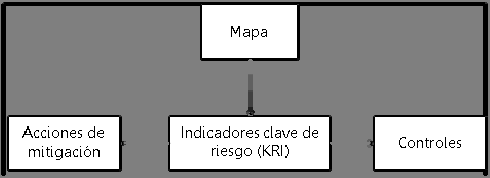
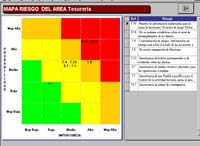
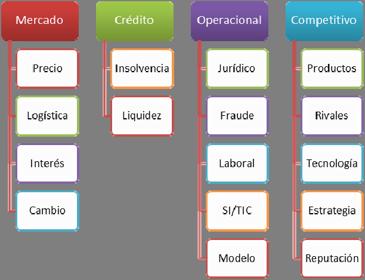

# Rodríguez et al. (2013). Mapa de Riesgos. Identificación y Gestión de Riesgos

<!-- página 1 -->
Atlantic Review of Economics – 2nd Volume - 2013
### Mapa de Riesgos: Identificación y Gestión
### de Riesgos

Manuel Rodríguez López

marod@udc.es
Carlos Piñeiro Sánchez

carpi@udc.es
Pablo de Llano Monelos

pdellano@udc.es
Finanzas y Sistemas de Información para la Gestión (FYSIG).
Facultad Economía y Empresa
Universidad de A Coruña

Revista Atlántica de Economía  – Volumen 2 - 2013

---

<!-- página 2 -->
Atlantic Review of Economics – 2nd Volume - 2013
Resumen

Un mapa de riesgos es una herramienta, basada en los distintos sistemas de información, que
pretende identificar las actividades o procesos sujetos a riesgo, cuantificar la probabilidad de
estos eventos y medir el daño potencial asociado a su ocurrencia. Un mapa de esta naturaleza
proporciona tres valiosas contribuciones a un gestor: proporciona información integrada sobre
la exposición global de la empresa, sintetiza el valor económico total de los riesgos asumidos
en cada momento, y facilita la exploración de esas fuentes de riesgo. El mapa se instrumenta
en un panel gráfico interactivo, a modo de cuadro de mando, que enfatiza las anomalías o
desviaciones y permite que el usuario navegue a lo largo de los indicadores en diferentes
niveles de desagregación (drill-down). En lo que respecta a la problemática financiera de una
empresa, el mapa ayuda a realizar un seguimiento de las vulnerabilidades clave – tales como
aumentos en los niveles de morosidad o en la exposición a una categoría concreta de clientes
– y, en este sentido, puede facilitar el desarrollo de estrategias concretas para prevenir el
fracaso financiero. Partiendo de los antecedentes y la experiencia acumulados en el sector
financiero, este trabajo propone un metamodelo de las fuentes del riesgo en empresas no
financieras, y un mapa diseñado específicamente para supervisar los procesos clave que
conducen a los eventos de insolvencia y fracaso financiero.

Abstract

A risk map is a tool, based on various information systems, that aims to identify the
activities or processes at risk, quantify the probability of these events and measure the
potential damage associated with their occurrence. This kind of map provides three
valuable contributions to a Manager: integrated information about company global
exposure, summaries of the total economic value of the risks assumed at any given
time, and tools to explore these sources of risk. The risk map is implemented in a
graphic interactive dashboard, similar to a scorecard, able to emphasize abnormalities
or deviations; it also allows the user to navigate trough all available data at different
levels of disaggregation (drill-down). Concerning the company’s financial problems, the
map helps keep track of the key vulnerabilities - such as increases in the levels of non-
performing loans or exposure to a particular category of customers - and, in this sense,
it can support the development of concrete strategies aimed to prevent financial failure.
This paper extends previous evidences from banking and offers a metamodel of risk in

Revista Atlántica de Economía  – Volumen 2 - 2013

---

<!-- página 3 -->
Atlantic Review of Economics – 2nd Volume - 2013
non-financial firms, and a map specifically designed to monitor the key processes that
lead to the events to insolvency and financial failure.

Palabras clave: Mapa de riesgos, Riesgo financiero, Sistemas de información, Gestión del
riesgo, Fallo financiero, Risk map, financial risk, information systems, risk management,
financial failure.

Códigos Jel: G30, G33.

Revista Atlántica de Economía  – Volumen 2 - 2013

---

<!-- página 4 -->
Atlantic Review of Economics – 2nd Volume - 2013
### 1 Introducción

La correcta identificación y evaluación de los riesgos (Alexander 2003, 2005) se está
convirtiendo en un elemento crucial en la gestión de las empresas. En un entorno cada vez
más globalizado y sofisticado, anticiparse a situaciones potencialmente adversas supone una
ventaja competitiva que contribuye de forma sustancial a lograr los objetivos estratégicos
marcados en la empresa.

El riesgo es un elemento consustancial a la propia actividad de la empresa y, aún más,
en sus diferentes manifestaciones está presente en cualquier tipo de actividad; en la mayor
parte de los casos no es posible establecer mecanismos para su completa eliminación, por lo
que se hace absolutamente imprescindible gestionarlo de forma adecuada. Sin embargo, la
naturaleza de estas indeterminaciones ha cambiado sustancialmente a lo largo de las dos
últimas décadas (Beck et al 2008), y actualmente las empresas afrontan elementos de
incertidumbre variados y remotos, capaces de causar daños irreversibles después de períodos
de latencia relativamente prolongados (Beck y Kropp, 2007). El fracaso empresarial es un claro
ejemplo de ello: los eventos de fallo y la propia extinción no son fenómenos súbitos e
imprevistos, sino procesos causados por desequilibrios y anomalías financieras latentes que se
van a gravando e intensificado hasta conducir a la empresa a un estado de deterioro sin
retorno.

En este contexto las empresas deben establecer los mecanismos que les permitan
identificar las indeterminaciones que afectan a sus diferentes actividades y procesos, analizar
los controles existentes para minorar la posibilidad de que un riesgo potencial se materialice en
una pérdida cierta, y adoptar medidas para reducir o controlar el riesgo en aquellas áreas
donde se observe que está por encima de los límites tolerables para la empresa.

La importancia creciente y el protagonismo (Toft 2004, Chapelle 2004) que se está
dando a la gestión de los riesgos vienen impulsados por dos procesos, en gran medida
relacionados: por una parte, la evolución del contexto socioeconómico hace que la empresa se
vea sometida a factores de riesgo cada vez más lejanos a su entorno próximo, con frecuencia
atípicos o singulares, y cuyo tratamiento requiere no ya decisiones rápidas, sino estrategias
preventivas ad hoc; por otra, la posibilidad de inferir catálogos de buenas prácticas a partir de
la experiencia y del marco regulatorio propios de la gestión de riesgos en entidades financieras.
Los Acuerdos de Capitales de Basilea1, en sus versiones I, II y III, se asientan sobre la

convicción de que se pueden obtener importantes beneficios de interés público mediante la
mejora del marco de suficiencia de capital en torno a dos dimensiones importantes. Por
supuesto, el esquema regulatorio de Basilea no es directamente aplicable a una empresa no

1 BCBS 2001a, 2001b, 2004, 2009, 2010.

Revista Atlántica de Economía  – Volumen 2 - 2013

---

<!-- página 5 -->
Atlantic Review of Economics – 2nd Volume - 2013
financiera; sin embargo sí lo es su filosofía general: el desarrollo de mecanismos de control
interno basados fundamentalmente en los sistemas de información, la implantación de
estrategias destinadas a identificar los factores de riesgo y el valor económico de la exposición,
y el diseño de políticas encaminadas a mitigar esos riesgos pueden contribuir progreso
socioeconómico mejorando la calidad y confiabilidad de los procesos internos, e incrementando
las oportunidades de supervivencia de las empresas. Su planteamiento proporciona un
esquema muy concreto de los factores de exposición que afectan a cualquier organización –
riesgos de liquidez, de cambio, de precio de mercado, etc. –; enfatiza la necesidad de integrar
la gestión del valor y el riesgo, el desarrollo de sistemas de información sofisticados orientados
al control y la toma de decisiones, y la búsqueda de mejoras continuas en los procedimientos
internos; finalmente, pero no por ello menos importante, proporciona un nexo conceptual entre
la exposición al riesgo y la noción de suficiencia de capital, que en el contexto de una empresa
no financiera aparece claramente conectada con el fracaso financiero.

Nuestro trabajo examina el fracaso financiero desde la perspectiva interna de sus
gestores, discutiendo las oportunidades que se derivan de una gestión proactiva del riesgo
financiero en general, y de los mapas como una herramienta de diagnóstico y de control
interno. El trabajo se organiza de la siguiente forma. Profundiza en el estudio de los modelos
para la gestión del riesgo en empresas no financieras, con especial referencia a los factores de
riesgo operativo. Incardina los modelos de gestión del riesgo en el planteamiento general de un
cuadro de mando. Propone un catálogo concreto de factores de riesgo aplicables. Plantea una
metodología sistemática para la medición integrada de la exposición a estos factores de riesgo.
El análisis de riesgos en general, y el mapa de riesgos en particular, pueden examinarse desde
la óptica de una estrategia de gestión encaminada a minimizar la verosimilitud de que la
empresa incurra un evento de fallo.
### 2 El riesgo y su expresión en forma de mapa

El objetivo del Mapa de Riesgos es sintetizar la información relativa a las
indeterminaciones que afronta la empresa y colaborar en las estrategias destinadas a mitigar la
exposición y los daños potenciales (García 1994). Empleamos la noción de indeterminación
para referirnos a las circunstancias que condicionan el valor o el resultado de una transacción u
operación, y que no están completamente bajo el control de la organización. Este
planteamiento se corresponde con la noción clásica de riesgo: una indeterminación que puede
ser medida en términos de probabilidad (Knight, 1921) y que implica una pérdida potencial con
impacto financiero relevante.

Las características del riesgo, como elemento de la gestión empresarial, se han
modificado sustancialmente a lo largo de las últimas dos décadas. En este nuevo entorno las
empresas afrontan un escenario en el que los riesgos tienen naturaleza heterogénea y

Revista Atlántica de Economía  – Volumen 2 - 2013

---

<!-- página 6 -->
Atlantic Review of Economics – 2nd Volume - 2013
multidimensional, están presentes en múltiples procesos interrelacionados, y poseen un
alcance potencialmente ilimitado (Beck y Kropp, 2011):
-
Los límites organizacionales no actúan ya como cortafuegos de la transmisión de los
riesgos; la creciente interdependencia de los procesos organizacionales y la
introducción de mecanismos alternativos a la provisión interna – en concreto, la
externalización – han creado no solo nuevas fuentes de exposición, sino también una
maraña de canales de contagio que hacen que los riesgos puedan propagarse con
rapidez a lo largo de los vínculos técnicos y financieros.
-
A pesar del empleo de sistemas de información sofisticados, el nivel de incertidumbre
se ha intensificado debido a la naturaleza remota y desestructurada de las fuentes de
riesgo.
-
Con frecuencia, la exposición no causa efectos sino tras períodos de latencia
relativamente prolongados, a lo largo de los cuales los desequilibrios financieros van
intensificándose y afectando a más elementos de la estructura empresarial. El uso de
técnicas capaces de proporcionar señales tempranas de alerta es una necesidad
ineludible.
-
Como consecuencia de lo anterior, las acciones preventivas en materia de riesgos son
mucho más efectivas y económicas que las correcciones adoptadas a posteriori,
cuando los daños han empezado a manifestarse.
-
La imperfección informacional hace que la identificación y medida de los riesgos no
puedan abordarse de forma puramente cuantitativa: se precisa el concurso de
elementos cualitativos y subjetivos para matizar e interpretar los signos derivados de
los modelos numéricos.
-
La estrategia habitual en el análisis de riesgos consiste en diseccionar y modelizar
separadamente las diferentes formas de exposición: solvencia, precios, operación de
los sistemas de información, etc. Sin embargo los factores de indeterminación no son
independientes; esto crea el contexto adecuado para que se produzcan efectos
colaterales inesperados, incluso para una agregación explosiva del riesgo que podría
tener implicaciones sobre la supervivencia de la empresa. Se precisa una visión
integradora y comprensiva de las diferentes formas de riesgo a las que está expuesta
la empresa.

La asociación con pérdidas potenciales ha conferido a la noción de riesgo evidentes
connotaciones negativas; sin embargo es la existencia de indeterminaciones la que da lugar a
oportunidades para la innovación y el crecimiento, para el aprendizaje, y para la especulación
en torno a valores futuros que subyace en la actividad empresarial y que determina la
generación de rendimientos para los inversores; por tanto cabe concluir que el objetivo de la
gestión empresarial debe ser no tanto eliminar el riesgo, como gestionarlo y mantener un
equilibrio satisfactorio entre la exposición y las expectativas de generación de rentas.

Revista Atlántica de Economía  – Volumen 2 - 2013

---

<!-- página 7 -->
Atlantic Review of Economics – 2nd Volume - 2013
El mapa contribuye al objetivo general de supervivencia de la empresa aportando la
información precisa para medir y controlar esa exposición, y poner en práctica un modelo de
gestión proactiva del riesgo. La finalidad del mapa es identificar y medir los riesgos a los que
está expuesta la organización, proporcionar una visión analítica de las relaciones de causalidad
subyacentes (¿cuáles son los procesos o actividades que causan esta exposición?), y aportar
una visión amplia de la exposición global de la organización. El mapa cartografía los lugares en
los que radica el riesgo, y las vías a lo largo de las cuales este riesgo puede manifestarse o
contagiarse: vincula los procesos de negocios con sus correspondientes riesgos, permite trazar
las causas de un evento en concreto, por ejemplo el impago de un cliente, y ayuda a evaluar su
impacto a lo largo de la organización.

El mapa es, en sí mismo, un verdadero sistema de información especializado en las
evidencias que tienen trascendencia desde el punto de vista de las incertidumbres que afectan
al negocio. En concreto, puede interpretarse como un cuadro de mando que podría estar
integrado en el EIS (Executive Information System) empleado por la dirección de la empresa.
Esto le confiere algunas de las propiedades características de los cuadros de mando, entre
ellas la capacidad de expresar el riesgo con diferentes niveles de agregación, atendiendo a su
tipología o a las áreas de gestión implicadas.

Al margen de ello, el desarrollo y mantenimiento de los mapas puede servir a otros
fines instrumentales:

Reflexionar de forma sistemática sobre los riesgos que está asumiendo la empresa, su
justificación en términos de creación de valor, y las políticas aplicadas para mitigar sus
consecuencias. Es importante concebir la gestión de riesgos en general, y el desarrollo
de mapas en particular, como un proceso retroalimentado, de mejora continua, que
implica la reasignación dinámica de recursos de control a lo largo de la organización:
se trata de acumular datos cuantitativos (o cuantificables) sobre los eventos para
comprobar si su prevalencia ha aumentado anormalmente, evaluar si los indicadores
empleados han proporcionado alertas tempranas de estas anomalías, y enjuiciar la
eficacia de los procedimientos de control y mitigación (Scandizzo 2005, citando a
Finlay 2004, Vinella 2004). Proporcionar una visión analítica de las interrelaciones
existentes entre los distintos procesos y actividades de la empresa (COSO 2004),
construida desde la óptica de los riesgos que implican: decisiones que atañen a estos
riesgos, actores implicados en ellas, datos históricos, etc. La contribución clave del
mapa en este sentido es el hecho de no imponer ex ante una estructura de análisis e
información: el usuario puede abordar el problema de acuerdo con su propia estrategia
de razonamiento, y explorar sus relaciones con el resto de la organización.

Promover la comprensión de los riesgos del negocio por parte de todos los miembros
de la organización, la adopción de la prudencia como un criterio básico en la actividad

Revista Atlántica de Economía  – Volumen 2 - 2013

---

<!-- página 8 -->
Atlantic Review of Economics – 2nd Volume - 2013
diaria, y la asunción de responsabilidades en cuanto a los planes de mitigación de
daños.

Implicar a la organización en la estrategia de gestión de riesgos. El desarrollo del mapa
requiere que todos los niveles de dirección en la empresa estén involucrados en la
gestión de los riesgos, y que los miembros de la organización se hagan
corresponsables de esta problemática. En este sentido el mapa se configura como una
herramienta clave para la estrategia de Gobierno de Riesgos de la organización (IRGC,
2005).

Aumentar la cantidad y calidad de la información disponible sobre la forma en que se
están realizado los procesos de negocios y la situación actual de los riesgos
correspondientes.

Proporcionar evidencias relevantes para diagnosticar y en su caso perfeccionar el
sistema de control interno, y aumentar su confiabilidad de cara a los procesos de
revisión a posteriori, como la auditoría externa; desvelar conocimiento relevante para
aprender de los errores cometidos en el pasado en lo que respecta a la detección de
las fuentes de indeterminación y el diseño de políticas de prevención.

Ayudar a la compañía a conseguir sus objetivos de rentabilidad y rendimiento y a
prevenir la pérdida de recursos

Reducir el gap informacional – la diferencia entre la información disponible, y aquella
que se precisaría para evaluar correctamente el problema –, y los prejuicios erróneos
en cuanto a los factores de riesgo relevantes en cada caso (Morgan et al., 1990; Ellith
et al., 2002).

Reducir los costes derivados de la supervisión de los riesgos más relevantes para la
entidad, implantando protocolos que eviten procesos recurrentes de revisión ad hoc, y
minimizar las necesidades de recurrir a coberturas o seguros para cubrir determinados
eventos.

2.1 El proceso de desarrollo del mapa

A pesar de su simplicidad conceptual, el desarrollo de un mapa de riesgos es una tarea
desafiante. El objetivo es sintetizar la información relativa a las indeterminaciones que se
derivan de las actividades de la empresa; sin embargo muy pocas personas en la organización
conocen en detalle todos y cada uno de sus procesos, y la forma en que se relacionan. Por otra
parte, desde el punto de vista del control, se precisa identificar un pequeño número de medidas
o indicadores que reflejen el estado de cada uno de estos procesos (KRI, o key risk indicators)
y relacionarlos con procedimientos de control acciones y con las acciones de mitigación que se
aplicarán cuando estos indicadores revelen desviaciones o anomalías (Scandizzo, 2005).

Este planteamiento supera el enfoque clásico en materia de gestión de riesgos, que
consiste en combinar una medida de la importancia relativa de la exposición (gravedad,

Revista Atlántica de Economía  – Volumen 2 - 2013

---

<!-- página 9 -->
Atlantic Review of Economics – 2nd Volume - 2013
severity) y una estimación de la verosimilitud de que ese evento ocurra (frecuencia). Se precisa
una herramienta que detecte precozmente los signos de alarma, que señale los procesos o
actividades que están causando esos resultados anómalos e identifique los resortes sobre los
que debe actuar la dirección para ejecutar las acciones correctoras. El mapa debe proporcionar
respuestas a cuestiones como ¿qué puede fallar en la actividad? ¿Qué variables o indicadores
deberían controlarse, para detectar precozmente estas anomalías? ¿Con qué frecuencia cabe
esperar que se produzcan esos eventos? ¿Qué procesos de negocios están implicados, y
quiénes son los responsables de su gestión? ¿Qué consecuencias pueden tener sobre la
actividad, el equilibrio financiero, la rentabilidad, etc.? ¿Cómo pueden mitigarse estos efectos?

> **Descripción de la imagen** — Se trata de un diagrama conceptual que ilustra la relación entre varios elementos clave en un proceso de gestión de riesgos o mitigación. El diagrama está compuesto por cuatro cajas principales conectadas mediante flechas:
>
> 1.  **Acciones de mitigación:** Una caja inicial que se conecta con el elemento central del mapa.
> 2.  **Mapa:** Ubicado en el centro, actúa como punto de conexión entre las acciones y los indicadores.
> 3.  **Indicadores clave de riesgo (KRI):** Una caja intermedia que recibe una conexión del mapa y se conecta con los controles.
> 4.  **Controles:** La caja final, que recibe una conexión de los indicadores clave de riesgo (KRI).
>
> La estructura sugiere un flujo o relación donde las acciones de mitigación interactúan a través de un mapa central para influir en los indicadores clave de riesgo, los cuales a su vez determinan o se relacionan con los controles implementados.

> **Descripción de la imagen** — La imagen proporcionada no contiene contenido visible o es completamente oscura, por lo que no puedo describirla. Por favor, asegúrese de adjuntar la imagen correctamente.

ILUSTRACIÓN 1. INDICADORES, CONTROLES Y ACCIONES DE MITIGACIÓN

El desarrollo del mapa se inicia, por tanto, con una reflexión acerca de la organización
y su negocio, y con la identificación de sus tareas y procesos críticos. El objetivo es incardinar
cada actividad en el entramado de flujos técnicos y financieros de la empresa para, una vez
establecidas las correspondientes dependencias, identificar las vulnerabilidades potenciales y
sus posibles consecuencias a lo largo de la organización. A continuación, cada uno de estos
factores debe ser evaluado, es decir, debe ser asociado con medidas expresivas de la
verosimilitud de los eventos descritos, de su impacto económico, y de las anomalías que
pueden inducir en otros procesos. Es importante comprender que esta evaluación no debe
restringirse a la experiencia histórica, ya que muchos de los eventos relevantes pueden tener
frecuencias reducidas, o incluso no haberse presentado nunca con anterioridad.

La evaluación debe ir acompañada de un análisis crítico de los controles establecidos
para mitigar los riesgos, con el objeto de conocer la verdadera exposición de la empresa. Es
importante observar que la evaluación puede comprender tanto probabilidades objetivas (que
se derivan de la lógica matemática, o de distribuciones empíricas de frecuencias) como
probabilidades subjetivas, entendidas como la verosimilitud que los individuos atribuyen a
ciertos eventos, en definitiva su interpretación personal de la indeterminación (Keynes, 1921).
Las probabilidades subjetivas son con frecuencia una necesidad inevitable en el tratamiento de
problemas que implican eventos de escasa frecuencia o para los que no existen series
históricas suficientemente amplias (Fenton y Neil 2011), y este es el caso de muchos factores
de exposición al riesgo, tanto financiero como operacional.

Revista Atlántica de Economía  – Volumen 2 - 2013

---

<!-- página 10 -->
Atlantic Review of Economics – 2nd Volume - 2013
La estimación de las pérdidas potenciales puede basarse en datos históricos, en las
áreas en que existan series temporales suficientemente amplias y exhaustivas; sin embargo el
empleo de estrategias de experimentación artificial, juicios expertos y técnicas de decisión de
grupo, parecen inevitables.

El núcleo del mapa son los indicadores de riesgo (KRI): un conjunto de variables que,
de acuerdo con la teoría financiera y/o con la experiencia, están relacionadas causalmente con
factores de riesgo, permiten evaluar la verosimilitud de eventos inciertos, o proporcionan
evidencias útiles para cuantificar las consecuencias de éstos. La noción de KRI, originalmente
definida por Scandizzo (2005) como instrumento para la evaluación de los riesgos
operacionales, puede ser fácilmente generalizada a cualquier otro tipo de indeterminación,
incluyendo las propiamente financieras.

En lo que respecta a las fuentes de riesgo financiero, el diseño del mapa descansa
fundamentalmente en la teoría financiera. Disponemos de técnicas y modelos para evaluar
eventuales impagos por parte de clientes y deudores (riesgo de crédito), y para anticipar
posibles pérdidas derivadas de oscilaciones en los tipos de interés y divisa, y de la cotización
de acciones y otras inversiones financieras (riesgo de mercado); estos modelos proporcionan
indicaciones claras para identificar los KRI relevantes y relacionarlos con los procesos de
negocios. Por ejemplo, si la empresa ha colocado una punta de tesorería en deuda pública, el
mapa permitiría controlar el comportamiento de esta posición, y trazar las indeterminaciones
que se derivan para el ciclo de tesorería y la solvencia.

Sin embargo, la identificación de los KRI es especialmente útil en aquellas áreas en las
que los factores de riesgo presentan características que dificultan el uso de herramientas
convencionales
de
modelización
matemática:
por
ejemplo,
eventos
singulares
o
extraordinarios, situados en las colas de la distribución de frecuencias, o que deban ser
descritos empleando medidas cualitativas o juicios subjetivos; también, cuando las fuentes de
la exposición son internamente complejas y se precisa un esfuerzo analítico para diagnosticar
el problema. Un caso típico de ello son los factores de riesgo operacional, en particular los
relacionados con el diseño de las estructuras de gestión y control, y con los sistemas de
información.

A la vista de ello, la elección de los indicadores adecuados se configura como una
tarea especialmente comprometida. Estas son algunas de sus propiedades deseables
(Scandizzo, 2005):
-
Relevancia, entendida como la existencia de vínculos causales definidos entre el índice
y los procesos objeto de análisis, empíricos o (especialmente) teóricos. Por ejemplo, el
índice de morosidad podría ser empleado como un indicador del riesgo de crédito
asumido por la empresa en su política de ventas.

Revista Atlántica de Economía  – Volumen 2 - 2013

---

<!-- página 11 -->
Atlantic Review of Economics – 2nd Volume - 2013
-
Simplicidad: cada índice debe ayudar a diagnosticar una actividad o proceso en
concreto, de forma sencilla y comprensible.
-
Mensurabilidad: el KRI debe ser cuantificable. En nuestra opinión, esto no implica una
restricción a variables originariamente numéricas – como ratios financieras o tiempos -,
sino el empleo de indicadores susceptibles de cuantificación, incluyendo por ejemplo
expresiones opináticas.
-
Verificabilidad: en estrecha relación con la propiedad anterior, el KRI debería estar
definido de forma que su cálculo pueda ser trazado y verificado.
-
Robustez: en nuestra opinión, es imprescindible que el indicador elegido no sea
susceptible de manipulación; nos referimos no solo a acciones destinadas a alterar
directamente su valor, sino también a las conductas que puedan desvirtuarlo y hacer
que las anomalías pasen inadvertidas (lo que con frecuencia se denomina “trabajar
para el índice”).

Este planteamiento de trabajo se corresponde con un enfoque bottom-up, en el que los
procesos son analizados al mayor nivel de detalle posible y posteriormente agregados, de
manera progresiva, para evaluar sus interacciones hasta establecer una descripción de la
posición conjunta de la empresa en términos de riesgos. Esta estrategia plantea un problema
de índole fundamentalmente económica: la necesidad de disponer de flujogramas detallando
las tareas y procedimientos de control existentes para cada uno de los procesos, y sus vínculos
con el resto de la organización.

En una amplia mayoría de los casos la construcción de un sistema de información
como este puede abordarse aplicando estrategias alternativas, como combinaciones de
cuestionarios de autoevaluación, entrevistas con los directivos y miembros de la base de
operaciones, y la observación directa (Ilustración 2). El primer resultado es un esbozo general
de la posición de riesgos de la organización, que puede detallarse en aquellas áreas que se
consideren más sensibles o vulnerables; esta estrategia puede ser empleada para desarrollar
mapas con granularidad adaptativa, es decir, con diferente nivel de detalle en función de la
complejidad o la vulnerabilidad específica de cada proceso o actividad. Las consecuencias más
inmediatas son una reducción en el volumen de información y el tiempo de desarrollo, y el
diseño de una herramienta que tiende a concentrar el esfuerzo del decisor en aquellas áreas
que requieren mayor atención. Nuestro trabajo asume la aplicación de este enfoque top-down,
que es sin duda más práctico y operativo no solo para las pymes, sino también para una buena
parte de las empresas de dimensión intermedia y grande.

Revista Atlántica de Economía  – Volumen 2 - 2013

---

<!-- página 12 -->
Atlantic Review of Economics – 2nd Volume - 2013
DEFINICIÓN
DEFINICION
AREAS DE
TIPOS
NEGOCIO
DE RIESGO

> **Descripción de la imagen** — Se trata de un mapa de riesgo o matriz de evaluación visual, titulado "MAPA RIESGO DEL AREA Tesorería".
>
> La imagen es una cuadrícula (matriz) dividida en celdas que están codificadas por colores para representar diferentes niveles de riesgo. La escala de color va del verde al amarillo y finalmente al rojo.
>
> La matriz está organizada en filas y columnas, presumiblemente representando diferentes categorías de factores de riesgo o impacto. Dentro de las celdas se observan valores numéricos específicos (por ejemplo, 3.4, 2.35, 5.6, 0.1), que indican la magnitud del riesgo asociado a esa intersección.
>
> Se pueden observar áreas con colores verdes (riesgo bajo o moderado), zonas amarillas (riesgo medio) y celdas rojas (riesgo alto). La distribución de los colores muestra una concentración de riesgos en las filas inferiores y hacia el lado derecho de la matriz.

ELABORACION
IDENTIFICAR
CUESTIONARIOS
OPORTUNIDADES
EVALUACIÓN
MEJORA
EVALUACION

ENTREVISTAS
CUALITATIVA
RESPONSABLE
RIESGOS Y
AREAS
CONTROLES

ILUSTRACIÓN 2. ESTRATEGIA TOP-DOWN PARA EL DESARROLLO DE UN MAPA DE
RIESGOS
### 3 Áreas de riesgo

Cada empresa tiene su propia estructura organizativa, que determina la
responsabilidad sobre las distintas actividades desarrolladas. El ámbito y la distribución del
análisis de los riesgos que se realice es importante vincularlo a esta estructura organizativa,
con el fin de que existan responsabilidades claras para asignar la gestión de los riesgos y la
ejecución de las distintas medidas que se puedan establecer para mitigarlos (áreas, líneas de
negocio, áreas de soporte, etc.).

Siguiendo el criterio anterior, para poder diseñar el modelo de evaluación de riesgos se
puede segregar a la empresa en diversas áreas de riesgo, teniendo en cuenta el organigrama
vigente e intentando mantener una homogeneidad en el tipo de actividad que desarrollan.

El proceso de identificación y evaluación de los riesgos debe abarcar a toda la
organización, por lo que supone un proyecto ambicioso y laborioso. Puede realizarse un
análisis previo para determinar unos criterios de priorización de las áreas que se consideran
más sensibles al riesgo (por volumen de operaciones, activos, aportación a los márgenes de la
entidad, presupuesto de gasto, plantilla, etc.) con las que iniciar el trabajo y progresivamente
extender el análisis al resto de la entidad.

La clasificación que se realice tendrá naturaleza para cada empresa; sin embargo,
puede ser conveniente planificar el trabajo tomando como referencia alguna estructura a priori
para los tipos y causas de riesgo. Aunque este esquema deba ser adaptado, su aplicación
reduce las posibilidades de que alguna fuente relevante de indeterminación pueda pasar
desapercibida, y proporciona además una guía general en cuanto a los modelos de evaluación
y los procedimientos de mitigación que podrían ser aplicables en cada caso.

Revista Atlántica de Economía  – Volumen 2 - 2013

---

<!-- página 13 -->
Atlantic Review of Economics – 2nd Volume - 2013
3.1 Clasificación de los riesgos

Como hemos anticipado, la clasificación de los riesgos que se vaya a utilizar en el
análisis dependerá de las características individuales de cada empresa, y de la naturaleza y la
organización de sus actividades de negocios. En este trabajo proponemos un esquema general
basado en el modelo establecido por los Acuerdos de Basilea para las entidades de crédito,
debidamente adaptado a las necesidades de una empresa no financiera (Ilustración 3).

> **Descripción de la imagen** — Es un diagrama conceptual simple compuesto por tres formas geométricas dispuestas horizontalmente.
>
> 1.  **Elemento Izquierdo:** Un rectángulo de color marrón rojizo o borgoña.
> 2.  **Elemento Central:** Un triángulo de color rosa pálido que se sitúa en la parte superior, conectando visualmente el rectángulo izquierdo y el rectángulo derecho.
> 3.  **Elemento Derecho:** Un rectángulo de color verde oliva o verde claro.
>
> Los tres elementos están alineados horizontalmente, con el triángulo central actuando como un punto de conexión o jerarquía entre las dos formas rectangulares laterales.

> **Descripción de la imagen** — La imagen es un diseño dividido verticalmente en dos secciones distintas para comparar o diferenciar dos conceptos.
>
> 1.  **Sección Izquierda:** Presenta un fondo de color rojo oscuro o granate. En esta sección se encuentra el texto "Riesgo de mercado" escrito en color blanco.
> 2.  **Sección Derecha:** Presenta un fondo de color verde oliva o verde musgo. En esta sección se encuentra el texto "Riesgo de crédito" escrito en color blanco.
>
> El diseño utiliza colores contrastantes para separar visualmente los dos tipos de riesgo.

> **Descripción de la imagen** — Es un diagrama esquemático o flujo que consta de cuatro segmentos horizontales dispuestos en una cuadrícula de dos filas y dos columnas.
>
> Los segmentos son de colores distintos:
> 1.  **Arriba a la izquierda:** Un segmento de color rojo oscuro o granate.
> 2.  **Arriba a la derecha:** Un segmento de color verde oliva o verde claro.
> 3.  **Abajo a la izquierda:** Un segmento de color morado o violeta.
> 4.  **Abajo a la derecha:** Un segmento de color azul turquesa o cian.
>
> Los cuatro segmentos están conectados visualmente, formando una estructura que sugiere un camino o proceso secuencial, con líneas verticales que unen los elementos en el centro.

> **Descripción de la imagen** — La imagen es un diseño conceptual dividido en dos secciones rectangulares adyacentes, cada una con un color de fondo diferente:
>
> 1.  **Sección Izquierda:** Fondo de color morado o violeta. Contiene el texto "Riesgo operacional".
> 2.  **Sección Derecha:** Fondo de color azul verdoso (teal). Contiene el texto "Riesgo competitivo".
>
> La imagen presenta una comparación visual entre dos tipos de riesgo: el riesgo operacional y el riesgo competitivo.

> **Descripción de la imagen** — Es un diagrama esquemático que muestra la relación o conexión entre dos elementos principales.
>
> El diagrama está compuesto por:
> 1.  Una barra horizontal de color morado/lila ubicada en el lado izquierdo.
> 2.  Una barra horizontal de color azul turquesa (teal) ubicada en el lado derecho.
> 3.  Un triángulo invertido o rombo de color rosa pálido que se sitúa en el centro inferior, conectando visualmente las bases de ambas barras horizontales.
>
> El fondo del diagrama es de color gris sólido.

ILUSTRACIÓN 3. CATEGORÍAS PRINCIPALES DE RIESGO

El epígrafe de riesgos de mercado comprende la influencia de múltiples factores
externos relacionados con el comportamiento de los precios de venta, los costes y la
disponibilidad de los recursos; también cabría considerar la influencia que ciertas variables
generales de naturaleza macroeconómica, como los tipos de interés o los tipos de cambio,
puedan ejercer sobre las variables financieras y de explotación de la empresa. A diferencia de
lo que ocurre en una entidad financiera, el valor de los activos y de los pasivos de una empresa
convencional no suele depender directamente del comportamiento de los tipos de interés; sin
embargo estas tasas sí ejercen una influencia sobre la rentabilidad mínima exigida por los
accionistas, el coste de capital y el umbral mínimo de rentabilidad económica. De la misma
forma, el tipo de cambio es relevante para las empresas que realizan operaciones de
explotación o financieras en más de un área económica.

Aunque puedan entregar préstamos ocasionalmente, las empresas no financieras no
incluyen estas actividades entre sus objetos de negocio. Pudiera derivarse de ello que el
riesgo de crédito tiene en ellas una importancia menor; sin embargo las dificultades para
realizar puntualmente los cobros por operaciones de tráfico tienen una trascendencia inmediata
sobre el ciclo de tesorería, sobre la estabilidad financiera, y sobre la capacidad de la empresa
para mantener la continuidad de las operaciones, en definitiva sobre su supervivencia (de Llano
et al 2012). En nuestro modelo, el riesgo de crédito comprende dos eventualidades principales:
retrasos o morosidades en las cuentas a cobrar, y la posibilidad de que las posiciones en

Revista Atlántica de Economía  – Volumen 2 - 2013

---

<!-- página 14 -->
Atlantic Review of Economics – 2nd Volume - 2013
activos e instrumentos financieros (por ejemplo, inversiones en renta fija para colocar
excedentes puntuales de tesorería) no puedan ser liquidadas sin quebrantos ni demoras
significativas. La evolución reciente del entorno económico ha puesto de relieve la importancia
del riesgo país, y concretamente del riesgo de transferencia – la posibilidad de que los
movimientos de tesorería previstos por la empresa se vean condicionados por la imposición de
restricciones extraordinarias a los movimientos de capitales -.

Los riesgos de mercado y crédito comprenden las principales eventualidades de
causadas por fenómenos o variables de naturaleza propiamente financiera; sin embargo, la
creciente complejidad de la organización y de sus relaciones con el entorno ha creado nuevos
factores de exposición. El riesgo operacional abarca una heterogénea variedad eventos, que
comparten la característica común de originarse en la forma en que la organización ejecuta sus
procesos de negocios y sus tareas de gestión: fraudes internos y externos, fallos o caídas en
los sistemas informáticos transaccionales o de gestión, conflictividad laboral, disfunciones en la
estructura o errores cometidos en los procesos de decisión; aquí se incluye también el riesgo
de modelo, es decir, la posibilidad de sufrir pérdidas como consecuencia de la aplicación de
modelos defectuosos (o la aplicación incorrecta de modelos válidos) en el análisis de
problemas o la evaluación de decisiones. La empresa asume un riesgo de modelo cuando
utiliza técnicas econométricas basadas en datos históricos para programar su producción, o
para evaluar la calidad crediticia de un cliente. El riesgo operacional en general, y el de modelo
en particular, pueden establecer sinergias con la exposición a otros factores de riesgo y
amplificar sus efectos.

Finalmente, el apartado de riesgos competitivos incluye eventualidades de naturaleza
estratégica, vinculadas con la posibilidad de que el posicionamiento de la empresa se vea
comprometido por la emergencia de nuevos rivales, productos alternativos o nuevas
tecnologías. También, las consecuencias que se derivarían de errores en el esfuerzo
estratégico, o del deterioro de los activos intangibles que se hallan en el núcleo de la capacidad
competitiva de la empresa: reputación, notoriedad, prestigio, lealtad de empleados y clientes,
etc.

Revista Atlántica de Economía  – Volumen 2 - 2013

---

<!-- página 15 -->
Atlantic Review of Economics – 2nd Volume - 2013

> **Descripción de la imagen** — Se trata de un diagrama conceptual o un mapa estructurado dividido en cuatro columnas principales, que representan diferentes áreas temáticas: Mercado, Crédito, Operacional y Competitivo.
>
> Cada columna contiene una serie de factores o elementos específicos relacionados con su categoría principal.
>
> **Estructura del Diagrama:**
>
> 1.  **Columna 1: Mercado**
>     *   Contiene los siguientes elementos: Precio, Logística, Interés, Cambio.
>
> 2.  **Columna 2: Crédito**
>     *   Contiene los siguientes elementos: Insolvencia, Liquidez.
>
> 3.  **Columna 3: Operacional**
>     *   Contiene los siguientes elementos: Jurídico, Fraude, Laboral, SI/TIC, Modelo.
>
> 4.  **Columna 4: Competitivo**
>     *   Contiene los siguientes elementos: Productos, Rivales, Tecnología, Estrategia, Reputación.

> **Descripción de la imagen** — La imagen es una barra horizontal sólida de color rojo oscuro o marrón rojizo (borgoña). No contiene texto, gráficos ni elementos visuales complejos; es simplemente un bloque de color uniforme.

ILUSTRACIÓN 4. FUENTES DE RIESGO, POR CATEGORÍAS
### 4 Cuestionarios de evaluación

Asumiendo que el mapa se va a desarrollar adoptando un enfoque top-down, la
descripción de los procedimientos y la identificación de los riesgos se realizarán a partir de la
información recopilada  a través de cuestionarios y entrevistas personales. Los objetivos en
esta fase son identificar los factores de riesgo y los controles actualmente establecidos para
mitigarlos.

En cada área objeto de análisis es necesario realizar un trabajo de investigación previo
para recabar evidencias acerca de las actividades que se realizan y los principales riesgos que
se derivan de ellas. Sin ánimo de exhaustividad, cabe señalar las siguientes fuentes de
información:

Documentos internos, como procedimientos escritos, presupuestos, planes de
actividad, etc.

Informes de auditores internos y/o externos.

Procedimientos de control interno.

Revisiones de políticas y procedimientos.

Análisis de nuevos productos.

Sistemas de información.

Es preciso insistir en que el diseño y la circularización de los cuestionarios son solo una
parte del proceso de recogida de información: los responsables de las distintas áreas, así como
los miembros de las respectivas bases de operaciones, tienen un conocimiento directo de los
procesos y de sus posibles riesgos, de ahí que los cuestionarios deban completarse con
entrevistas para obtener detalles acerca de:

Los procesos o actividades que se realizan en cada área

Revista Atlántica de Economía  – Volumen 2 - 2013

---

<!-- página 16 -->
Atlantic Review of Economics – 2nd Volume - 2013

Las actividades sensibles, y las fuentes de riesgo a las que está expuesta el área.

La naturaleza y la eficacia de los mecanismos de control interno existentes para mitigar
los riesgos.

Oportunidades de mejora de los procesos y/o del control interno.

Resulta difícil establecer pautas sobre cómo llevar a cabo las entrevistas, porque éstas
van a depender tanto de factores organizativos como individuales; conviene, sin embargo,
desvincular este análisis de cualquier intento por evaluar la calidad de la gestión del área y
hacer hincapié en sus ventajas potenciales, por ejemplo servir como argumento para apoyar
las peticiones de mejora que hayan efectuado. En el transcurso de las entrevistas deberemos
recabar la mayor información posible y apoyarla con la documentación existente:

Identificación y descripción de las principales tareas (procesos) realizadas.

Existencia de manuales, normativa, procedimientos escritos, así como tratar de
identificar sus carencias.

Información manejada (datos, cifras, ratios, interna o externa).

Errores y fallos más frecuentes.

Motivos de pérdidas.

Posibles indicadores de riesgo.

Oportunidades de mejora.

Estadísticas
utilizadas,
tanto
de
trabajos
efectuados
como
de
problemas
(transacciones, errores, reclamaciones, pérdidas, coberturas, objetivos, tiempos por
tarea o actividad, etc.).

Coberturas de seguro.
### 5
### Valoración

Una vez identificados los riesgos asociados a los distintos procesos, es necesario
establecer una metodología para medirlos y priorizarlos. A lo largo de este proceso se examina
también la eficacia del control interno, identificando la parte del riesgo total que no está
sometida a medidas eficaces de mitigación. Se trata por tanto de delimitar, dentro del riego
inherente – la indeterminación intrínseca de la actividad, sin considerar la existencia de los
controles existentes o que se puedan implantar para mitigarlo -, el riesgo residual, la
variabilidad remanente que está asumiendo la empresa en una actividad y momento concretos,
a pesar de los controles que en su caso se hayan establecido a tal efecto.

El procedimiento concreto de medición se selecciona en función de las características de la
exposición. En el caso de las eventualidades propiamente financieras cabe recurrir a los
modelos proporcionados por la teoría financiera, no obstante, en ocasiones, la riqueza de las

Revista Atlántica de Economía  – Volumen 2 - 2013

---

<!-- página 17 -->
Atlantic Review of Economics – 2nd Volume - 2013
evidencias históricas disponibles no permite desarrollar herramientas con una calidad predictiva
adecuada; esto hace necesario el concurso de juicios subjetivos y estrategias de análisis
cualitativo.

5.1 prioridad

La prioridad es una medida de la repercusión potencial de cada factor de riesgo; esta
relevancia se evalúa a través de dos indicadores: su importancia, y la probabilidad de
ocurrencia de los eventos.

La importancia es una calificación de la trascendencia de cada factor de riesgo en
relación con el conjunto de riesgos del área al que pertenece, y de acuerdo con la pérdida
máxima que, se estima, se podría llegar a producir sin considerar los controles establecidos
(estos últimos se evalúan posteriormente, y en ese momento se les asignará un grado de
cobertura del riesgo).

Los elementos a manejar para la evaluación de la importancia son:

1. La trascendencia con respecto al conjunto de riesgos del área: sería necesario hacer
una reflexión sobre cuál de los riesgos que afectan al área es el más significativo, al
que daríamos la importancia más alta, y partiendo de este máximo clasificar el resto
(ordenación de mayor a menor).
2. Magnitud de la posible pérdida: hay que tratar de proyectar el mayor quebranto que
presumiblemente podría llegar a producirse, sin tener en cuenta los controles
existentes, es decir, asumiendo que no existe gestión alguna del riesgo. Esta
evaluación no debería basarse exclusivamente en las cifras de pérdidas ya realizadas
o históricas (contabilizadas), ni en las estimadas a partir de las anteriores.

En la Tabla 1 presentamos una escala básica para la medición de la importancia;
conviene señalar que resulta imposible establecer una escala con unos parámetros
cuantitativos generalizables a todas las áreas, y habrá que realizar adaptaciones en función de
los dos rasgos descritos en los párrafos anteriores.

Revista Atlántica de Economía  – Volumen 2 - 2013

---

<!-- página 18 -->
Atlantic Review of Economics – 2nd Volume - 2013
Escala
Nivel
(quebranto
Ejemplo de descripción
Importancia
en millones
de €)
Puede afectar a todos los procesos / productos desarrollados

Muy Alta
> 30
o gestionados en el área. Pérdida económica muy grave
Puede afectar a un nº elevado de los procesos / productos

Alta
desarrollados o gestionados en el área. Pérdida económica
10 - 30
sustancial
Puede
afectar
a
algunos
los
procesos
/
productos

Media
desarrollados o gestionados en el área. Pérdida económica
2 - 10
significativa
Puede afectar a un nº reducido de procesos / productos
desarrollados o gestionados en el área. Pérdida económica

Baja
0,1 - 2
moderada
Muy leve efecto en algún proceso o producto desarrollado /
< 0,1

Muy Baja
gestionado en el área. Sin perjuicios, baja pérdida económica

TABLA 1: ESCALA BÁSICA DE MEDICIÓN DEL RIESGO.

5.2 probabilidad

Es una medida de la verosimilitud estimada de que el riesgo se materialice en un
quebranto. Aquí hemos de considerar la frecuencia con la que teóricamente podrían llegar a
producirse pérdidas de no existir controles que mitiguen los riesgos, en función de las
evidencias históricas que puedan existir y de juicios expertos.
Con las salvedades efectuadas en el apartado anterior, respecto a la realización de una escala
común a todas las áreas, una posible clasificación es la mostrada en la Tabla 2:
Escala

Nivel
Ejemplo de descripción
(Frecuencia)
Probabilidad
Se espera que ocurra en la mayoría de las
1 o más veces a la

Muy Alta
circunstancias.
semana
Probablemente ocurrirá en la mayoría de las

Alta
1 vez al mes
circunstancias.

Media
Puede ocurrir en algún momento.
1 vez al trimestre
Baja
Podría ocurrir en pocas circunstancias
1 vez al semestre
Muy Baja
Puede ocurrir solo en ocasiones excepcionales
1 vez al año
TABLA 2: JERARQUIZACIÓN DEL RIESGO.

Revista Atlántica de Economía  – Volumen 2 - 2013

---

<!-- página 19 -->
Atlantic Review of Economics – 2nd Volume - 2013
5.3 valoración ajustada al control interno

La aplicación de los criterios anteriores proporciona una calificación inicial para cada
riesgo inherente, al margen de los mecanismos de control interno. Plausiblemente, estos
procedimientos existirán, de manera que la evaluación inicial debe ajustarse en función de la
efectividad y grado de cobertura que ofrecen dichos mecanismos, medidos en una escala
cualitativa:

TOTAL: los controles establecidos eliminan prácticamente la probabilidad de
ocurrencia y/o impacto del riesgo inherente reduciéndose a Muy Bajo.

ALTA: los controles establecidos limitan significativamente la probabilidad de
ocurrencia y/o impacto del riesgo inherente reduciéndose a Bajo.

MEDIA: los controles establecidos limitan, pero no drásticamente, la probabilidad de
ocurrencia y/o impacto del riesgo inherente reduciéndose a Bajo.

BAJA: los controles establecidos muestran debilidades significativas que impiden que
sean efectivos en un elevado número de ocasiones, por lo que se mantiene la
calificación inicial del riesgo inherente.

MUY BAJA: prácticamente se produce una inexistencia de controles o bien los
existentes no son en absoluto efectivos, por lo que se mantiene la calificación inicial del
riesgo inherente.

El esquema de dicha valoración se representa en la Ilustración 5:
Importancia
Importancia
Importancia
Importancia
Importancia
Importancia
Nivel
Nivel
ajustada con
ajustada con
ajustada con
ajustada con
cobertura
cobertura
la cobertura
la cobertura
del riesgo
del riesgo
la cobertura
la cobertura
### x
### =
### x
### =
Muy Alta
Muy Alta
de los
de los

Factores
Factores
Alta
Alta
Controles
Controles
Media
Media
de Riesgo
de Riesgo
Baja
Baja
Probabilidad
Probabilidad

Probabilidad

Probabilidad
Muy Baja
Muy Baja
Total
Total
ajustada con
ajustada con
ajustada con
ajustada con
Alta
Alta
la cobertura
la cobertura
la cobertura
la cobertura
Media
Media

Probabilidad

Probabilidad
Baja
Baja
Nula
Nula

ILUSTRACIÓN 5: VALORACIÓN DEL RIESGO.

Toda la información recopilada, con los procedimientos descritos hasta ahora es
conveniente registrarla y estructurarla en una base de datos para permitir su posterior
explotación.

En este momento la empresa debería estar en disposición de elaborar, para cada una
de las áreas analizadas, una ficha / informe con la información recogida en la Ilustración 6.

Revista Atlántica de Economía  – Volumen 2 - 2013

---

<!-- página 20 -->
Atlantic Review of Economics – 2nd Volume - 2013
Riesgo
Riesgo
Residua
Inherente
l
I
Riesgo
Descripción del Riesgo
Descripción Controles
P
I
P

ILUSTRACIÓN 6: FICHA PARA TODA DE DATOS POR ÁREA.

La combinación de valores de importancia, probabilidad y cobertura de los controles
asignados a cada factor de riesgo de la forma que se ha descrito anteriormente, determina su
clasificación en uno de los niveles de riesgo definidos en el Mapa de Riesgos y que se
identifican mediante un color diferente:
-
Riesgo Alto
Rojo
-
Riesgo Medio - Alto Naranja
-
Riesgo Medio
Amarillo
-
Riesgo Bajo
Verde

Esta información puede sintetizarse en un mapa semántico,
construido con la combinación de un gráfico tabular con un código de color basado en la
importancia relativa (Neil 2012) y la probabilidad de ocurrencia de los eventos (Ilustración 7);
naturalmente, la elección del formato gráfico tabular es únicamente una convención a efectos
expositivos, que puede y debe adaptarse a la conveniencia de cada caso. En los cuadrantes
del mapa situaremos los correspondientes riesgos u otra información que se considere
relevante – por ejemplo el número de factores en cada categoría -, de manera que el decisor
pueda acceder a detalles sobre la exposición a través de una estrategia de drill-down.

Revista Atlántica de Economía  – Volumen 2 - 2013

---

<!-- página 21 -->
Atlantic Review of Economics – 2nd Volume - 2013
Muy
alta

Alta
PROBABILIDAD

Media

Baja

Muy
baja

Muy
Muy
Baja
Media
Alta
baja
Alta

IMPORTANCIA
ILUSTRACIÓN 7: MAPA SEMÁNTICO DE PROBABILIDAD / IMPORTANCIA.

Efectuada la evaluación cualitativa de cada uno de los factores de riesgo hay que
agrupar los resultados según la tipología de riesgos que hemos definido en el apartado 3 de
este trabajo, para determinar la exposición a cada uno de esos factores. Sin perjuicio de que
existan otras técnicas más complejas y precisas, y manteniendo el mismo criterio de
simplicidad que se ha utilizado hasta ahora, sugerimos que la agregación de los resultados
para determinar la exposición al riesgo se realice por intervalos y en función del número de
factores de riesgo que se han calificado en cada uno de los niveles, con respecto al total de
factores de riesgo evaluados.

Cada intervalo viene definido por el cumplimiento de la condición numérica establecida
y la asignación de los resultados entre los distintos intervalos se va realizando en cascada, en
orden de mayor a menor nivel de riesgo. Los umbrales para evaluar cada intervalo se pueden
fijar de la siguiente forma:

1º. Si un 25% de los factores de riesgo se ha evaluado como riesgo alto el tipo de riesgo
analizado se evalúa en conjunto como de riesgo alto; si no se cumple esta
condición se evalúa en el siguiente intervalo.
2º. Si los factores de riesgo evaluados como de riesgo alto o medio-alto son más del
25% el tipo de riesgo analizado se evalúa en conjunto como de riesgo medio-alto;
si no se cumple esta condición se evalúa en el siguiente intervalo
3º. Si los factores de riesgo evaluados como de riesgo alto, medio alto o medio son más
del 50% el tipo de riesgo analizado se evalúa en conjunto como de riesgo medio

Revista Atlántica de Economía  – Volumen 2 - 2013

---

<!-- página 22 -->
Atlantic Review of Economics – 2nd Volume - 2013
4º. Si no se han cumplido ninguna de las condiciones anteriores el tipo de riesgo
analizado se evalúa en conjunto como de riesgo bajo.

Finalizado este proceso habremos obtenido la exposición al riesgo para cada una de
las áreas y tipos de riesgo que, manteniendo el formato tabular, podría representarse
gráficamente de la forma que se muestra en la Ilustración 8:
Riesgos
Área
Crédito
Mercado
Liquidez
Operativo
Legal
Estratégico
Reputacional

Área 1

Área 2

Área 3

...

Área n
Riesgo
Riesgo
Riesgo

Riesgo Alto
Medio Alto
Medio
Bajo
### ILUSTRACIÓN 8: EXPOSICIÓN AL RIESGO POR ÁREA.

Una vez determinada la exposición al riesgo, se presentaría a los responsables de cada área
para su discusión y aceptación.
### 6
### Diseño de un plan de acción

Es importante comprender que el diseño de un mapa de riesgos no es una tarea
puntual, sino un proceso continuo y retroalimentado cuya finalidad es contribuir al desarrollo de
una estrategia de mejora continua de los procesos y de los flujos de información y control
existentes en la empresa.

Concluida la identificación de los factores de riesgo que afectan a cada una de las
áreas y de los controles implantados para mitigarlos, y realizada la evaluación, es necesario
analizar los resultados obtenidos con el objeto de identificar posibilidades de mejoras en el
control interno de la empresa. Esto es particularmente relevante en el caso de todo riesgo
residual calificado que figure en las categorías Alto o Medio–Alto, que debería ser analizado en
detalle para verificar los elementos de mitigación.

Toda opción de tratamiento que se considere debe ser evaluada atendiendo a la
necesidad de recursos y su eficiencia comparativa. Cuando el coste de implantación o mejora

Revista Atlántica de Economía  – Volumen 2 - 2013

---

<!-- página 23 -->
Atlantic Review of Economics – 2nd Volume - 2013
de los controles es relativamente bajo en relación a la minoración del riesgo, es necesario
definir un plan de acción que permita reducir la probabilidad y/o el impacto de una potencial
pérdida.

En esta tarea es imprescindible la implicación de los responsables de cada una de
las áreas, a quienes incumbe plantear propuestas de mejora y elaborar un plan de acción
especificando:
-
Prioridad en la implantación de los controles, en función de su importancia por el riesgo a
cubrir y de la dificultad para su realización.
-
Área responsable de su puesta en marcha.
-
Las áreas afectadas por el riesgo, o por las acciones de control y mitigación propuestas.
-
Fechas estimadas de inicio y finalización, en función de las dificultades para su
implantación.
-
Objetivos a conseguir con su realización.

Puede ocurrir que el análisis previo de estas acciones ponga de manifiesto la
imposibilidad de realizarlas en condiciones económicas asumibles; de ser así, la empresa
puede optar por transferir el riesgo, empleando alguna forma contractual que permita segregar
la actividad de sus indeterminaciones: el abanico de posibilidades comprende tanto los seguros
convencionales como los instrumentos financieros derivados, así como estrategias basadas en
contratos de externalización. Sin embargo, en el caso de actividades críticas o sensibles, la
internalización es inevitable; en este caso será necesario definir planes de contingencia para
afrontar los eventos de alto impacto y baja frecuencia.
### 7
### Prioridad de los planes de acción

Como ya hemos comentado, el análisis y medición del riesgo conlleva en mayor o
menor grado la aplicación de un cierto grado de subjetividad, puesto que no solo está sometido
a reglas cuantificables, sino que va a depender de la percepción que se tenga en la empresa, o
incluso más del individuo que está realizando el análisis.

En un contexto de estas características si la percepción de una determinada situación
puede ser incongruente con la realidad las decisiones que se tomen en consecuencia pueden
no ser las más adecuadas. A pesar de estas dificultades, es necesario tomar las decisiones
pertinentes y asignar los recursos que sean necesarios para abordar los planes de acción que
se consideren más necesarios y convenientes para mitigar el riesgo. Hasta ahora las dos
variables que se han considerado son la importancia (consecuencia del suceso) y la
probabilidad de ocurrencia de un determinado riesgo, corregidos por los controles existentes

Revista Atlántica de Economía  – Volumen 2 - 2013

---

<!-- página 24 -->
Atlantic Review of Economics – 2nd Volume - 2013
para mitigarlo. Con esta relación hemos obtenido un mapa de los principales riesgos que puede
servir de base a la empresa para ordenar las amenazas en función del grado de riesgo que
suponen.

Para determinar cuáles son los planes de acción más necesarios y convenientes, hay
que establecer unos criterios de priorización que nos ayuden a tomar las decisiones más
adecuadas. Como ayuda para establecer las prioridades comentadas podemos tratar de
establecer valores numéricos a las dos variables consideradas:

Asignar a la probabilidad valores ampliamente aceptados que represente cada una de
las categorías utilizadas. Cuando la probabilidad se ha establecido como Alta el
equivalente numérico puede ser menos de una vez entre mil (<10-3), cuando sea
Media-Alta más de una vez entre mil (>10-3), Media una entre diez mil (10-4), Baja una
entre cien mil (10-5) y Muy Baja de una entre un millón (10-6).

Estos valores asignados a la probabilidad no son tanto el reflejo de la posibilidad real
de ocurrencia, como de lo aceptable o tolerable que es un riesgo para la empresa o
para el analista que está realizando el ejercicio de análisis del riesgo.


De la misma forma que se ha comentado en el apartado anterior hay que hacer un
ejercicio sobre el posible importe potencial de la pérdida en el caso de materializarse el
riesgo. En este caso la dificultad de establecer una cantidad es obvia, por lo que es
importante definir unas referencias contando con la ayuda de los expertos de las áreas
analizadas, sobre el volumen de operaciones, sobre el margen de la actividad,
objetivos o presupuesto, etc., o bien contar con métodos de estimación más robustos,
siempre que sea posible, como pueden ser un VaR cuantitativo o cualitativo.

Adicionalmente hay que considerar dos nuevas variables, que conjuntamente con las
anteriores son las que nos van a ayudar a establecer las prioridades:

Como siguiente etapa habrá que hacer el análisis de cuál será el previsible ahorro que
podemos tener en el importe potencial de la pérdida en caso de materialización del
riesgo, aplicando los planes de acción posibles. En este caso y dado que no podemos
probar la efectividad de los controles que aun no han sido implantados, la mejor opción
para simplificar el procedimiento es delimitar el mencionado ahorro en porcentajes
sobre el riesgo potencial.

Efectuar la estimación del coste de implantación de los planes de acción considerados.

Con el manejo de las variables comentadas queda definido un proceso lógico para la
obtención de una ratio de coste/beneficio que nos ayude a establecer un ranking de las
actuaciones a desarrollar (Tabla 3):

Revista Atlántica de Economía  – Volumen 2 - 2013

---

<!-- página 25 -->
Atlantic Review of Economics – 2nd Volume - 2013
Importancia x Probabilidad = Riesgo Potencial

Riesgo Potencial x % Ahorro con Planes acción = Ahorro Potencial

Ahorro Potencial / Coste implantación = Ratio Coste Beneficio

TABLA 3: RANKING DE ACCIONES A DESARROLLAR.

Evidentemente el procedimiento descrito no pretende obtener resultados con una base teórica
sólida ni matemáticamente óptimos, pero sí un procedimiento heurístico que pueda servir de
gran ayuda para la toma de decisiones sobre la asignación de recursos en la implantación de
los planes de acción posibles para reducir los riesgos que se han identificado con el Mapa de
Riesgos de la empresa.
### 8
### Conclusiones

En una perspectiva amplia, la noción convencional de solvencia no es sino una de las
varias condiciones que deben darse para asegurar la supervivencia de la empresa cuando se
producen eventos asociados a la exposición a riesgos financieros, operacionales y de otro tipo.
En este sentido, el desarrollo de instrumentos que permitan medir y evaluar la exposición al
riesgo, y prever acciones de mitigación, se configuran como ingredientes esenciales de
cualquier estrategia de prevención del fracaso.

El mapa de riesgos responde a este objetivo, proporcionando un cuadro de mando
integral que sintetiza la información relativa a la exposición de la empresa en un momento
dado, su distribución por tipología o unidades organizativas, los mecanismos de control
existentes, y las personas o unidades de decisión responsables. La elaboración de un mapa
puede resultar crucial en aspectos como la identificación de las incertidumbres críticas para el
negocio, su evaluación en términos de frecuencia y relevancia, la verificación y mejora continua
de los mecanismos de control interno, y la adopción de una cultura organizativa de
responsabilidad ante los riesgos que afectan a la empresa.

Dado que la erradicación de la mayor parte de los riesgos resulta no solo inviable sino
indeseable - el riesgo es consustancial a la actividad empresarial, y la contrapartida necesaria a
la expectativa de utilidades-, la política de gestión de riesgos debe considerar las ventajas
relativas de reducir la exposición manteniendo al mismo tiempo las oportunidades de

Revista Atlántica de Economía  – Volumen 2 - 2013

---

<!-- página 26 -->
Atlantic Review of Economics – 2nd Volume - 2013
crecimiento, innovación, etc. que determinan las expectativas de creación de riqueza y el valor
de la empresa. El proceso de creación de valor se produce fundamentalmente, a través de la
mitigación de pérdidas y la optimización de los recursos de capital, aspectos en los que incide
directamente el mapa de riesgos.

Revista Atlántica de Economía  – Volumen 2 - 2013

---

<!-- página 27 -->
Atlantic Review of Economics – 2nd Volume - 2013
### Bibliografía


Alexander, C. (2003) “Operational Risk: Regulation Analysis and Management”.
Prentice Hall.


Alexander, C. (2005): “The Present and Future of Financial Risk Management”. Journal
of Financial Econometrics, V3, nº1, pp 3-25.


Arránz Álamo, J. P.; Rodríguez López, M. (2009): “El Mapa de Riesgos: Herramienta de
Identificación y Gestión de Riesgos”. Capítulo 11.Libro: La Gestión del Riesgo
Operacional. De la Teoría a su Aplicación. Editorial: LIMUSA.México DF. México.


Banco de España (2001): “Nuevo Acuerdo de Capital del Comité de Supervisión
Bancaria de Basilea”. Estabilidad Financiera, Número 1. Septiembre.


Basel Committee on Banking Supervision (2001a): “Sound Practices for the
Management and Supervision of Operational Risk”. December


Basel Committee on Banking Supervision (2001b): “Working Paper on the Regulatory
Treatment of Operational Risk”. September


Basel Committee on Banking Supervision (2004): “International Convergence of Capital
Measurement and Capital Standards. A Revised Framework”. June.


Basel
Committee
on
Banking
Supervision
(2009):
“Consultative
Document:
Strengthening the resilience of the banking sector”. December.


Basel Committee on Banking Supervision (2010). “Report to the G 20 on response to
the financial crisis released by the Basel Committee”. October.


Beck, G., Böschen, St., Engel, A., Erlemann, M., Kropp, C., Meissner, S., Soentgen, J.
(2008): Risk Mapping for Better Equipping Reflexive Risk Governance in the face of
Systemic Risks. Forthcoming in GAIA.

Beck, G., Kropp, C. (2007): Environmental Risks and Public Perceptions. In: Pretty, J./
Ball, AS./ Benton, T./ Guivant, J./ Lee, D./ Orr, D./ Pfeffer, M. and H. Ward (Eds): Sage
Handbook on Environment and Society. Los Angeles/ London: Sage. S.601-612.

Beck, G.; Kropp, C. (2011): “Infrastructures of risk: a mapping approach towards
controversies on risks”. Journal of Risk Research Vol. 14, nº 1, Enero: 1 – 16.

Chapelle, A., Crama, Y., Hubner, G., Peters J.P. (2004): “Basel II and Operational Risk:
Implications for Risk Measurement and Management in the Financial Sector”. National
Bank of Belgium, Working Paper nº 51.

Revista Atlántica de Economía  – Volumen 2 - 2013

---

<!-- página 28 -->
Atlantic Review of Economics – 2nd Volume - 2013

Comité de Supervisión Bancaria de Basilea (2004): “Aplicación de Basilea II: aspectos
prácticos”. Julio.


Committee of Sponsoring Organizations of the Treadway Commission (2004):
“Enterprise
Risk
Management
Framework”.
http://www.coso.org/documents/coso_erm_executivesummary.pdf


Cruz M. (2005): “Modelling, Measuring and Hedging Operational Risk”. John Willey &
Sons, LTD Inc. New York.

de Llano Monelos, P.; Piñeiro Sánchez, C.; Rodríguez López, M. (2012): “DEA As a
Business Failure Prediction Tool. Application to the Case of Galician SMEs”. Revista
Contaduría y Administración, Universidad Nacional Autónoma de México.

Dickson, J. (2010): “On measures for illustrating Credit Risk Assessments: The case of
heat maps, risk matrices, and cubes”. Financial Stability Department, Sveriges
Riksbank, SE 103 37 Stockholm, Sweden.

DoldánTíe, F.R. (2009): “Riesgos financieros” (FinancialRisks). A Coruña: Gestbiblo
S.L.

Elith J, Burgman MA, Regan HM. Mapping epistemic uncertainties and vague concepts
in predictions of species distribution. Ecological Modelling, 2002; 157:313–329

Fenton, N., Neil, M. (2011): “The use of Bayes and causal modelling in decision making,
uncertainty
and
risk”.
http://www.agenarisk.com/resources/white_papers/fenton_neil_white_paper2011.pdf

García Gómez, Mª M. (1994): “Los mapas de riesgos. Concepto y metodología para su
elaboración”. Instituto Nacional de Seguridad e Higiene en el Trabajo (INSHT), Madrid.

Hoffman, D. (2002): “Managing Operational Risk”. John Willey & Sons, LTD Inc. New
York.

IRGC (International Risk Governance Council) (2005): White paper on Risk
Governance.

Irving Fisher Committee (2011) "Proceedings of the IFC Conference on "Initiatives to
address data gaps revealed by the financial crisis", Basel, 25-26 August 2010," IFC
Bulletins, Bank for International Settlements,vol 34, pp 365-372.

Keynes, J. M. (1921). A Treatise on Probability. London: Macmillan

Knight, F. H. (1921). Risk, Uncertainty, and Profit. New York: Hart, Schaffner, and Marx

Kolmogorov, A. (1960). Foundations of the Theory of Probability. New York: Chelsea
Publishing.

Kropp, C., Beck, G. (2007): Mapping Risk Controversies to Dig Out Risk Infrastructures.
Paper to be presented at the ESA 8th Conference, Glasgow

Morgan MG, Henrion M. Uncertainty: A Guide to Dealing with Uncertainty in
Quantitative Risk and Policy Analysis. New York: Cambridge University Press, 1990.

Revista Atlántica de Economía  – Volumen 2 - 2013

---

<!-- página 29 -->
Atlantic Review of Economics – 2nd Volume - 2013

Neil, M. (2012): Using “Risk Maps” to visually model & communicate risk. Agena Ltd &
Risk Assessment and Decision Analysis Research Group, Department of Computer
Science, Queen Mary, University of London London, UK. www.agenarisk.com

Rodríguez López, M. (2006):  “El Mapa de Riesgos: Una herramienta para la
identificación y gestión de riesgos”. Revista: Asociación Española de Contabilidad y
Admón. de Empresas (AECA). Núm. 77. Págs. 32-36.


Rosés, F. (2002): “Risk Management. Una nueva forma de asegurar el éxito
empresarial”. ACV Ediciones. Barcelona.

Scandizzo, S. (2005) “Risk mapping and key risk indicators in operational risk
management”, Review of Banking, finance and Monetary Economics, V34, i 2, pp 231-
256.


The Australian & New Zealand Standard AS/NZS 4360 (1999).


Toft, B.; (2004): “Managing Risk: a cost Benefit Metodology”. Strategic Risk, Southern
Magazines.


von Mises, R. (1957). Probability, Statistics and Truth. New York: Macmillan.

Revista Atlántica de Economía  – Volumen 2 - 2013

