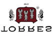

# Charles-Antoine Roger. (2008). Comunicación en procesos de cambio

<!-- página 1 -->

Unidad de Conocimiento – Comunicación en procesos de cambio

Julio 2008

> **Descripción de la imagen** — La imagen es un diseño gráfico o logotipo con texto en mayúsculas y símbolos.
>
> En la parte superior, se lee el texto "RECURSOS HUMANOS".
>
> Debajo de este texto, se encuentra un símbolo grande y prominente compuesto por las letras "BH" en una tipografía gruesa y negrita. La letra "H" está estilizada con un acento o un elemento gráfico azul.
>
> Debajo del símbolo principal "BH", hay un texto más pequeño que dice "APLICACIÓN".

factorhuma.org
-1-
Fundació per a la motivació dels recursos humans

UNIDAD DE CONOCIMIENTO
## Comunicación en procesos de
## cambio

"Cuando la gente no sabe qué está pasando comienzan a surgir

las especulaciones: se imaginan lo peor "

Charles-Antoine Roger

Sumario
¿Qué es?___________________________________________ 1
Herramientas_______________________________________ 2
El dato_____________________________________________ 3
Guía de Trabajo_____________________________________ 3
La experiencia _______________________________________ 4
Materiales _________________________________________ 6

Bibliografía básica________________________________________ 6

Materiales en línea _______________________________________ 7
### ¿Qué es?

ü
La comunicación en procesos de cambio es una parte muy
importante de la comunicación interna que se ocupa de determinar la mejor
manera de canalizar el conjunto de mensajes que se intercambian los
diferentes agentes colectivos o individuales que forman parte de la misma
organización en un entorno cambiante, con alta incertidumbre y
proliferación de canales informales.

ü
Es muy difícil comunicar una realidad en tránsito, por ejemplo la
resultante de un proceso de fusión, adquisición o reestructuración. La
comunicación en procesos de cambio se ocupa de cómo comunicar el
acompañamiento del proceso.

ü
En una situación de cambio es muy importante tener en cuenta estas
directrices comunicativas:

---

<!-- página 2 -->

Unidad de Conocimiento – Comunicación en procesos de cambio

Julio 2008

> **Descripción de la imagen** — La imagen es un diseño gráfico o logotipo con texto en mayúsculas y símbolos.
>
> En la parte superior, se lee el texto "RECURSOS HUMANOS".
>
> Debajo de este texto, se encuentra un símbolo grande y prominente compuesto por las letras "BH" en una tipografía gruesa y negrita. La letra "H" está estilizada con un acento o un elemento gráfico azul.
>
> Debajo del símbolo principal "BH", hay un texto más pequeño que dice "APLICACIÓN".

factorhuma.org
-2-
Fundació per a la motivació dels recursos humans

§
Consolidar espacios de comunicación y comunicar al 100% de los
trabajadores

§
Ayudar a la comprensión sin alimentar las expectativas secretas y
no generar expectativas que no podremos cumplir

§
Comunicar también las dificultades

§
No reconsiderar constantemente las decisiones ni enviar mensajes
cruzados en sentido contrario: comunica poca convicción y
determinación

§
Convertir la amenaza, angustia o negación en compromiso,
serenidad, ilusión y determinación

§
Comunicar no es sólo informar; hay que asegurarse de que la
información se entiende y se asimila

ü
Conseguir todo esto implica crear sólidos espacios de conversación
donde crear vínculos, espacios de seguridad y donde los integrantes de la
organización puedan ir comprendiendo el proceso de cambio.
### Herramientas

Hay muchas herramientas que sirven a la comunicación interna como las
intranets, revistas, boletines periódicos, etc. En esta unidad nos centraremos en
recursos específicos para procesos de cambio importantes:

ü
Espacios de conversación: espacios donde conducir sesiones pautadas
de comunicación con personas representativas de los diversos grupos de la
organización, de manera que puedan recogerse sus impresiones y puedan
acompañar el proceso de cambio. Los espacios de conversación crean las
condiciones para que se hable abiertamente sobre la necesidad de que la
organización cambie y generan corresponsabilidad. Mucha gente ve por
primera vez datos reales sobre la situación de la organización y se
desmontan "mitos" de larga duración del estilo "somos líderes del sector" o
"los beneficios no paran de crecer". A menudo, por su importancia
simbólica, se celebran en una sala emblemática de la organización.

ü
Trabajo sobre resistencias: en las sesiones de comunicación se
precisan materiales que inviten a la participación. Son importantes los map
minds, los diagramas y las preguntas abiertas donde la gente pueda
trasladar las conversaciones de café al papel y formalizarlas. Los materiales
deben estar construidos de manera que la gente vea reflejadas las
resistencias que tienen habitualmente. Por ejemplo, una de las opciones de
respuesta puede ser "la empresa hace eso por pura propaganda". La gente
se extraña al ver estas respuestas pero es importante porque, una vez
escritas las resistencias, reciben un aire de normalidad y de previsión. Es

---

<!-- página 3 -->

Unidad de Conocimiento – Comunicación en procesos de cambio

Julio 2008

> **Descripción de la imagen** — La imagen es un diseño gráfico o logotipo con texto en mayúsculas y símbolos.
>
> En la parte superior, se lee el texto "RECURSOS HUMANOS".
>
> Debajo de este texto, se encuentra un símbolo grande y prominente compuesto por las letras "BH" en una tipografía gruesa y negrita. La letra "H" está estilizada con un acento o un elemento gráfico azul.
>
> Debajo del símbolo principal "BH", hay un texto más pequeño que dice "APLICACIÓN".

factorhuma.org
-3-
Fundació per a la motivació dels recursos humans

importante facilitar la prueba piloto de los materiales a los sindicatos y
### perfilar los materiales con sus aportaciones.

ü
### Canales de acompañamiento: mecanismos donde canalizar las
incertidumbres del proceso de cambio. Por ejemplo, estableciendo teléfonos
de información especiales durante toda la jornada o buzones para
### preguntas.

ü
### Anticipación: hay que tener preparado el plan de comunicación interna
antes de encontrarnos en pleno proceso de cambio. Por ejemplo, en la
compra de Winterthur por parte de Axa, se contaba con un plan general de
### integración donde tenía un gran peso la comunicación interna.
### El dato

Según un estudio de Randstad sobre comunicación en las organizaciones, en el
caso de circunstancias extraordinarias, los trabajadores prefieren que se
organicen encuentros personales para explicarlas y desconfían de los
comunicados genéricos.

Un estudio de la consultora Krauthammer señala que los trabajadores
consideran que estar informados de la visión y la estrategia de la empresa es el
tercer factor que más influye en su confianza en la organización, por detrás del
cumplimiento de las leyes y de su prestigio social.
### Guía de Trabajo

FASE DE IMPACTO

La primera reacción ante las noticias de
cambios es una fase de impacto. Esta fase
causa
confusión,
bloqueo,
sentimiento
de
pérdida, reacciones de boicot. Hace falta:

•
Concreción y rapidez de información

•
Comunicar con transparencia

•
Mensajes de futuro y fortaleza

•
No convertir las resistencias, que en esta
fase son una reacción natural, en alarma y
excepcionalidad

---

<!-- página 4 -->

Unidad de Conocimiento – Comunicación en procesos de cambio

Julio 2008

> **Descripción de la imagen** — La imagen es un diseño gráfico o logotipo con texto en mayúsculas y símbolos.
>
> En la parte superior, se lee el texto "RECURSOS HUMANOS".
>
> Debajo de este texto, se encuentra un símbolo grande y prominente compuesto por las letras "BH" en una tipografía gruesa y negrita. La letra "H" está estilizada con un acento o un elemento gráfico azul.
>
> Debajo del símbolo principal "BH", hay un texto más pequeño que dice "APLICACIÓN".

> **Descripción de la imagen** — La imagen es un logotipo o emblema estilizado. En el centro se encuentra una forma decorativa, similar a un escudo o estandarte, de color rojo oscuro o granate. Dentro de esta forma central hay tres figuras verticales simétricas y ornamentadas.
>
> Encima del elemento central, en la parte superior, aparece el número "1810".
>
> Debajo del emblema principal, se encuentra el nombre "TOBBES" escrito en una fuente grande y estilizada. Debajo de este texto principal, hay algunos caracteres o símbolos más pequeños. El diseño general es formal y tiene un estilo heráldico o clásico.

factorhuma.org
-4-
Fundació per a la motivació dels recursos humans
### La experiencia

ü
Los orígenes de la familia Torres en el Penedès datan del siglo XVII.
Miguel Torres, la principal empresa del grupo, fue fundada en 1870 y desde
entonces ha ido pasando de generación en generación hasta la actual.

ü
Su proyecto comunicativo Integra consistió en acompañar los cambios
organizativos y la introducción de un ERP (sistema informático de
administración empresarial), el SAP (www.sap.com/spain), para conseguir
una mayor orientación al cliente de toda la empresa. Hacía falta la

FASE DE ELABORACIÓN

En esta fase, el cambio empieza a perfilarse y
deja de ser una posibilidad. Aparecen entre los
trabajadores las racionalizaciones y las dudas.
Hace falta una comunicación enfocada hacia:

•
Señalar las prácticas que aportarán nuevas
creencias y valores

•
Aclarar dudas, crear espacios de aprendizaje
y de conversación

FASE DE ADAPTACIÓN

Después del momento crítico del proceso de
cambio,
comienza
un
lento
periodo
de
adaptación a la nueva realidad. Hace falta:

•
Subrayar la satisfacción por los resultados
de la transición

•
Convertir la incertidumbre sobre el futuro en
una vivencia de oportunidad

---

<!-- página 5 -->

Unidad de Conocimiento – Comunicación en procesos de cambio

Julio 2008

> **Descripción de la imagen** — La imagen es un diseño gráfico o logotipo con texto en mayúsculas y símbolos.
>
> En la parte superior, se lee el texto "RECURSOS HUMANOS".
>
> Debajo de este texto, se encuentra un símbolo grande y prominente compuesto por las letras "BH" en una tipografía gruesa y negrita. La letra "H" está estilizada con un acento o un elemento gráfico azul.
>
> Debajo del símbolo principal "BH", hay un texto más pequeño que dice "APLICACIÓN".

> **Descripción de la imagen** — Es un diseño gráfico o logotipo con fondo azul oscuro. En el lado izquierdo, hay un símbolo geométrico en blanco que consiste en formas entrelazadas y superpuestas, incluyendo una estructura central de forma de diamante o rombo con líneas internas, y varios puntos o cuadrados más pequeños agrupados en la parte inferior. A la derecha del símbolo, se encuentra texto en color blanco escrito en una fuente estilizada y moderna.

factorhuma.org
-5-
Fundació per a la motivació dels recursos humans

cooperación de la gente y que se ilusionaran. Se tenía que vencer la
resistencia del "toda la vida lo he hecho así y hasta ahora ha funcionado".

ü
Para desarrollar estos cambios de manera efectiva, se entendió que era
necesaria la participación de todos los implicados, hecho por el cual se
crearon diferentes espacios de conversación, con personas representativas
de los diversos grupos. Al mismo tiempo, se dinamizaron diversos canales
de comunicación, para hacer partícipes a todos de los resultados y
evoluciones del proyecto.

ü
Entre otros, se puede destacar que se publicaban noticias diarias dentro
de
la
intranet.
Se
emprendió
un
programa
de
formación
y
de
acompañamiento conformado por unos mínimos de conocimientos comunes,
homologables y una especialización según la sección. También se
impulsaron unas jornadas llamadas "Hablamos sobre el SAP ", que eran
espacios de conversación sobre el proyecto, donde se recibía feedback de los
usuarios. A menudo, se formaba también a personas que no estaban en
contacto directo y permanente con el SAP, lo cual permitía familiarizar a
toda la organización con la nueva estructura organizativa y con la nueva
herramienta de gestión tecnológica de la empresa.

ü
La valoración global ha sido muy positiva, dado que los cambios
realizados han hecho posible afrontar los retos presentes y de futuro que
tiene la empresa.

ü
Un ayuntamiento está sometido a procesos de cambio frecuentes. Las
elecciones y los nuevos organigramas que suponen requieren una
adecuación al cambio mediante una buena comunicación. El Plan de
Comunicación Interna del Ajuntament de Mataró fue diseñado en el año
2001 de acuerdo con los siguientes objetivos estratégicos:

§
Implicar a la organización y el personal en general en el desarrollo
del proyecto y de la estrategia de la corporación, en especial en
relación al cambio que supone el nuevo modelo de gestión. Las
personas tienen que saber cómo contribuyen en la consecución de
los objetivos

§
Fomentar la colaboración dentro de la organización compartiendo
todo aquello que contribuya a aumentar el sentimiento de
pertenencia de las personas que trabajan y favorecer la proyección
de una imagen corporativa positiva y común

§
Equilibrar la comunicación descendente, ascendente y horizontal,
es decir, de retroalimentación, para que haya coherencia y
cohesión en los contenidos

---

<!-- página 6 -->

Unidad de Conocimiento – Comunicación en procesos de cambio

Julio 2008

> **Descripción de la imagen** — La imagen es un diseño gráfico o logotipo con texto en mayúsculas y símbolos.
>
> En la parte superior, se lee el texto "RECURSOS HUMANOS".
>
> Debajo de este texto, se encuentra un símbolo grande y prominente compuesto por las letras "BH" en una tipografía gruesa y negrita. La letra "H" está estilizada con un acento o un elemento gráfico azul.
>
> Debajo del símbolo principal "BH", hay un texto más pequeño que dice "APLICACIÓN".

factorhuma.org
-6-
Fundació per a la motivació dels recursos humans

§
Generar canales de información seguros que permitan, además,
segmentar y personalizar la comunicación, aumentar la fluidez y la
rapidez de la información, conseguir claridad y simplicidad

§
Favorecer la adecuación a los cambios del entorno y disminuir la
territorialidad de la información y la comunicación internas

ü
Se definieron los canales que se utilizarían para dar forma al plan:
electrónicos, escritos y presenciales. Las herramientas enfocadas al
desarrollo de la interacción, la participación y la puesta en común de los
proyectos corporativos fueron:

§
Electrónicas: espacio informativo electrónico, boletín interno,
comunidades virtuales de profesionalización, la pregunta del mes,
buzón de sugerencias

§
Escritas: boletín interno, protocolos de choque, manual de acogida

§
Presenciales:
sesiones
informativas
presenciales;
tablón
de
anuncios

ü
Para cada una de estas herramientas se realizó una descripción que
definía los siguientes aspectos: objetivos, calendario, periodicidad, actores,
destinatarios, acciones, responsable, recursos e indicadores.

ü
También se tuvo en cuenta el estilo lingüístico del mensaje y se apostó
por la síntesis y la visualidad, ya que presentar la información de manera
sencilla, gráfica, clara y concisa, además de útil, sirve para aumentar su
comprensión por parte del receptor.

ü
Los resultados del plan han sido satisfactorios ya que se han generado
nuevos canales y se han fortalecido los existentes. Además, los canales que
la organización identifica como propios de comunicación interna y que
reconoce como seguros han permitido segmentar y personalizar la
comunicación, aumentar la fluidez y la rapidez de la información y conseguir
claridad y simplicidad en los procesos de cambio.
### Materiales

Bibliografía básica

Gil-Casares, María; de Machis, Giorgio; Lanzas, Francisco Javier. Organización y
psicología en la comunicación interna. Madrid: Fragua Editorial, 2007

---

<!-- página 7 -->

Unidad de Conocimiento – Comunicación en procesos de cambio

Julio 2008

> **Descripción de la imagen** — La imagen es un diseño gráfico o logotipo con texto en mayúsculas y símbolos.
>
> En la parte superior, se lee el texto "RECURSOS HUMANOS".
>
> Debajo de este texto, se encuentra un símbolo grande y prominente compuesto por las letras "BH" en una tipografía gruesa y negrita. La letra "H" está estilizada con un acento o un elemento gráfico azul.
>
> Debajo del símbolo principal "BH", hay un texto más pequeño que dice "APLICACIÓN".

factorhuma.org
-7-
Fundació per a la motivació dels recursos humans

Materiales en línea

Del conocimiento al compromiso en un proceso de transformación. Fundació per
a la Motivació dels Recursos Humans, 07/11/2007.

Encuentro anual de Comunicación Interna de la FMRH en el cual tuvo lugar un
seminario dirigido y conducido por Joan Quintana y Chistophe Launay donde
pudimos conocer las experiencias de Groupe SEB Ibérica, Grup Codorniu y
Torres.

http://www.factorhuma.org/ficha.php?id_ficha=6302

Peláez, Nuria. “Sobrevivir a una fusión empresarial”. La Vanguardia,
27/04/2008.

Cada año miles de empresas se venden o emprenden una fusión. Para sus
empleados se abre un proceso de incertidumbre con dos posibles finales:
perder el puesto de trabajo o empezar una etapa con nuevos jefes y
compañeros y nuevas condiciones laborales.

http://www.factorhuma.org/ficha.php?id_ficha=6880

Arrieta, Elena. “Empleados al día”. Expansión, 23/10/2007.

Para evitar que rumorología se extienda en la empresa y decaiga la
productividad, nada mejor que informar en el trabajador a todas horas de las
novedades de que se producen, para lo cual la tecnología se ha convertido en el
mejor aliado.

http://www.factorhuma.org/ficha.php?id_ficha=6351

Salvador, Rosa. “Bajo el peso de la desinformación”. La Vanguardia,
23/03/2008.

Ver que no renuevan a un compañero o que despiden en otro y que nadie
explica nada dispara los rumores y hunde la confianza en la compañía. El
trabajador a menudo es el último al enterarse de aquello que pasa en su propia
empresa.

http://www.factorhuma.org/ficha.php?id_ficha=6771

