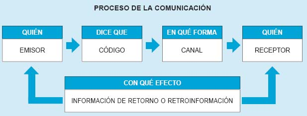
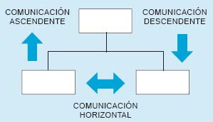

# Llacuna-Morera, Jaime y Pujol-Franco, Laura . (2013). La comunicación en las organizaciones

<!-- página 1 -->

> **Descripción de la imagen** — Es un banner o encabezado institucional dividido en dos secciones horizontales:
>
> 1.  **Sección Izquierda (Fondo amarillo):** Contiene el nombre de una entidad gubernamental. En la parte superior se encuentra un escudo o corona real, y debajo aparece el texto "MINISTERIO DE TRABAJO Y ASUNTOS SOCIALES ESPAÑA".
> 2.  **Sección Derecha (Fondo blanco):** Muestra el logotipo del "INSTITUTO NACIONAL DE SEGURIDAD E HIGIENE EN EL TRABAJO", que consiste en un círculo verde con un símbolo estilizado dentro.

## NTP  685: La comunicación en las organizaciones

La communication dans les organisations
Communication in the organisations

Redactores:

Jaime Llacuna Morera
Doctor en Filosofía y Letras
Jefe del Área de Información y Documentación Técnica

Laura Pujol Franco
Licenciada en Psicología

CENTRO NACIONAL DE CONDICIONES DE TRABAJO

> **Descripción de la imagen** — La imagen es un diagrama esquemático que representa una interacción o red molecular. Muestra varias estructuras de formas irregulares y colores distintos (amarillo pálido/beige, azul y rojo) que están interconectadas en el centro. Las estructuras parecen irradiar desde un punto focal central, sugiriendo un proceso o una señalización compleja donde los componentes interactúan entre sí.

La comunicación se ha entendido frecuentemente en la empresa como una mera "transmisión de información" de los directivos a los
trabajadores,. Sin embargo la comunicación debe ser una labor tenida en cuenta en toda una política de empresa.
### Introducción

Las relaciones que se dan entre los miembros de una organización se establecen gracias a la comunicación; en esos procesos de
intercambio se asignan y se delegan funciones, se establecen compromisos, y se le encuentra sentido a ser parte de ella.

Toda institución debe priorizar dentro de su estructura organizacional un sistema de comunicaciones e información que dinamice los
procesos a nivel interno para que se promueva la participación, la integración y la convivencia en el marco de la cultura organizacional,
en donde cobra sentido el ejercicio de funciones y el reconocimiento de las capacidades individuales y grupales.
### Definición del concepto de comunicación

La comunicación es un proceso por el que los individuos interaccionan entre sí, mediante símbolos que representan información, ideas,
actitudes y emociones con el fin de influirse mutuamente.

Hoy está teóricamente asumido que la comunicación es una actividad consustancial a la vida de la organización, es "la red que se teje
entre los elementos de una organización y que brinda su característica esencial: la de ser un sistema" (Katz y Khan,1986), "el cemento
que mantiene unidas las unidades de la organización" (Lucas Marin, 1997), pero la comunicación no hay que entenderla únicamente
como el soporte que sustenta las distintas actividades de la organización sino que es un recurso, un activo que hay que gestionar.

Sea como sea, el mensaje o los mensajes se transmiten siempre de la misma manera, basándose en los mismos elementos del
proceso los cuales son (Ver fig. 1):

G     El emisor: Elemento que genera la información y dirige todo su proceso.

G     El canal: por donde discurre la información.

G     El código usado para la transmisión: palabras o expresiones corporales comprendidas inicialmente de la misma manera por

todos los usuarios.

G     El receptor: Elemento que recibe la información e intenta comprender su significado.

Figura 1

Las NTP son guías de buenas prácticas. Sus indicaciones no son obligatorias salvo que estén recogidas en una disposición
normativa vigente. A efectos de valorar la pertinencia de las recomendaciones contenidas en una NTP concreta es conveniente
tener en cuenta su fecha de edición.
### Año: 2003

---

<!-- página 2 -->

> **Descripción de la imagen** — Se trata de un diagrama de flujo que ilustra el proceso de la comunicación. El diagrama es lineal y se compone de los siguientes elementos conectados por flechas:
>
> 1.  **EMISOR:** Es el punto de partida del proceso.
> 2.  Una flecha conecta al EMISOR con la acción **"DICE QUE"**.
> 3.  **DICE QUE:** Se conecta a **"EN QUÉ FORMA"**.
> 4.  **EN QUÉ FORMA:** Se conecta a **"CANAL"**, que representa el medio de transmisión.
> 5.  **CANAL:** Se conecta al **RECEPTOR**.
> 6.  El RECEPTOR se conecta con la etapa **"CON QUÉ EFECTO"**.
> 7.  Finalmente, el proceso culmina en un recuadro inferior que indica la **"INFORMACIÓN DE RETORNO O RETROINFORMACIÓN"**.
>
> En resumen, el diagrama muestra cómo el Emisor codifica un mensaje, lo transmite a través de un canal al Receptor, y el resultado final es el efecto o la retroinformación.

### Comunicación efectiva

Se puede considerar que una comunicación es efectiva cuando existe coherencia entre el lenguaje corporal y el verbal escogiendo el
momento, las palabras y la actitud apropiada.

El mensaje que se desea comunicar ha de llegar a la persona o grupos considerados apropiados para recibirlos y seguidamente se
produzca el cambio de conducta esperado en el receptor.

La comunicación facilita la especialización, diferenciación y maduración del individuo y este usa su sistema comunicativo para:

G     Recibir y transmitir mensajes y obtener información.

G     Operar con la información existente a fin de deducir nuevas conclusiones que no habían sido directamente percibidas, y para

reconstruir y anticipar hechos futuros.

G     Iniciar y modificar procesos fisiológicos dentro de su cuerpo.

G     Influir y dirigir a otras personas y acontecimientos externos.

Los principales requisitos de la comunicación efectiva son los siguientes:

G     Claridad: La comunicación debe ser clara, para ello el lenguaje en que se exprese y la manera de transmitirla, deben ser

accesibles para quien va dirigida.

G     Integridad: La comunicación debe servir como lazo integrador entre los miembros de la empresa, para lograr el mantenimiento

de la cooperación necesaria para la realización de objetivos.

G     Aprovechamiento de la organización informal: La comunicación es más efectiva cuando la administración utiliza la organización

informal para suplir canales de información formal.

G     Equilibrio: Todo plan de acción administrativo debe acompañarse del plan de comunicación para quienes resulten afectados.

G     Moderación: La comunicación ha de ser la estrictamente necesaria y lo más concisa posible, ya que el exceso de información

puede ocasionar burocracia e ineficiencia.

G     Difusión: Preferentemente toda la comunicación formal de la empresa debe efectuarse por escrito y pasar solo a través de los

canales estrictamente necesarios, evitando papeleo innecesario.

G     Evaluación: Los sistemas y canales de comunicación deben revisarse y perfeccionarse periódicamente.
### Barreras de la comunicación

La comunicación en ocasiones resulta algo dificultosa que se lleve a cabo , debido a que existen inconvenientes que hacen que esta no
llegue a ser totalmente eficaz, la principales barreras son las siguientes:

G     Psicológicas:

H     Emociones.

H     Valores.

H     Hábitos de conducta.

H     Percepciones.

G     Físicas:

H     Ruidos.

G     Semántica:

H     Símbolos (palabras, imágenes, acciones) con distintos significados.

G     Otros:

H     Interrumpir.

H     Cambiar de tema.

---

<!-- página 3 -->

H     Tangencializaciones.

H     No escuchar.

H     Interpretaciones.

H     Responder a una pregunta con otra pregunta.

H     Rotulaciones.
### Clasificación general

Existen varias clasificaciones de la comunicación, las cuales se citan posteriormente.

La comunicación se clasifica en directa o indirecta, interpersonal o colectiva.

G     Es directa cuando se efectúa sin intermediario de un emisor a un receptor, un dialogo, un conferencista en el auditorio, etc.

G     Es indirecta cuando se dan contactos inmediatos entre emisor y receptor y se interpone un intermediario; un documento, un

escrito, un casete, etc.

En la comunicación humana distinguimos varias modalidades en función de la cantidad de personas que intervienen en el acto
comunicacional. Así hablaremos de:

G     Comunicación intrapersonal: cuando se trata de una comunicación del hombre con sí mismo.

G     Comunicación interpersonal: Cuando nos referimos a una comunicación dentro de un grupo.

G     Comunicación intergrupal: cuando se establece entre dos o más grupos.

Existen diferentes razones por las que podemos clasificar los diversos tipos de comunicación, estos son los siguientes:

G     Por razón de los canales que sigue la comunicación y su contenido se puede dividir en:

H     Formal: Se origina en la estructura formal de la organización y fluye a través de los canales organizacionales. Lleva un

contenido querido y ordenado por la empresa. (correspondencia, instructivos, manuales, etc.).

H     Informal: Surge de los grupos informales de la organización y no sigue los canales formales aunque se puede referir a la

organización, este tipo de organización es de gran importancia, ya que por su característica puede llegar a influir más
que la comunicación formal. (comentarios, chismes, rumores, opiniones, etc.)

G     Por razón del receptor pueden ser:

H     Individual: Cuando va dirigida a una persona en concreto.

H     Genérica: Cuando va dirigida a un grupo sin precisar nombres de personas.

G     Por razón de la obligatoriedad que se espera en la respuesta:

H     Imperativa: Exige una respuesta precisa.

H     Exhortativa: Espera una acción sin imponerla obligatoriamente.

H     Informativa: Simplemente comunica algo, sin señalar nada que se espere, al menos en un plazo inmediato.

G     Por razón de su forma de ser:

H     Oral

H     Escrita

H     Gráfica

G     Por su sentido:

H     Vertical: Cuando fluye de un nivel administrativo superior a uno inferior: "ordenes o instrucciones" o viceversa "quejas,

reportes, sugerencias".

H     Horizontal: Se da en niveles jerárquicos semejantes: "memoranda, circulares, juntas, etc."
### Comunicación organizacional interna

La comunicación organizacional es aquella que instauran las instituciones y forman parte de su cultura o de sus normas. En las
empresas existe la comunicación formal e informal.
### Comunicación organizacional formal

La acción coordinada y el trabajo en equipo contribuirán a lograr los objetivos estratégicos.

Los procesos de comunicación permiten a al organización mantener la coordinación entre sus distintas partes y alcanzar así su
característica esencial: la de ser un sistema (Katz y Khan, 1986).

La comunicación es además un instrumento de cambio ya que permite la introducción, difusión, aceptación e interiorización de los

---

<!-- página 4 -->

nuevos valores y pautas de gestión que acompañan el desarrollo organizacional.. Los trabajadores a su vez necesitan estar informados
para sentirse parte activa de la organización y que la participación reciba el adecuado reconocimiento, de este modo la comunicación al
incrementar la posibilidad de participación, favorecer las iniciativas y movilizar la creatividad se convierte en un factor de integración,
motivación y desarrollo personal.

Todo ello contribuirá a una mejora de la calidad de vida laboral y a la calidad del producto ofrecido en la organización, así que en la
búsqueda de la Calidad Total aparece como elemento fundamental de partida: la comunicación. La buena gestión de una comunicación
interna debe alcanzar un objetivo básico: cubrir las necesidades de comunicación que presentan los individuos o grupos que
conforman la organización.

La comunicación efectiva entre los empleados es fundamental para el buen funcionamiento de cualquier organización, la comunicación
debe fluir en todos los sentidos (figura 2):

Figura 2

> **Descripción de la imagen** — Es un diagrama conceptual que ilustra tres tipos de flujos de comunicación.
>
> El diagrama presenta dos conceptos principales en la parte superior, uno a la izquierda y otro a la derecha: "Comunicación Ascendente" y "Comunicación Descendente".
>
> Debajo de estos dos conceptos se encuentra un tercer concepto central: "Comunicación Horizontal".
>
> Las conexiones visuales son las siguientes:
> 1.  Una flecha ascendente conecta el flujo general con la Comunicación Ascendente.
> 2.  Una flecha descendente conecta el flujo general con la Comunicación Descendente.
> 3.  Una doble flecha (bidireccional) horizontal conecta la Comunicación Horizontal, indicando un intercambio entre los flujos verticalmente opuestos.

G     Comunicación descendente (De la dirección o gerencia hacia el personal): los gerentes y supervisores deben asegurarse que

los empleados que les reportan cuenten con la información necesaria para hacer su trabajo de forma efectiva. Los mensajes
que circulan de arriba a bajo se refieren casi siempre a pedidos de información de rutina, también puede tratarse de ordenes
instrucciones o decisiones especificas relativas a acciones a encarar, medidas de organización o medidas personales La
comunicación descendente se caracteriza por poseer un contenido demasiado específico, transmite mensajes
predominantemente relacionados con la ejecución y valoración de la tarea, ordenes y especificaciones de trabajo relacionadas
con las funciones a realizar, los objetivos a alcanzar, las líneas de acción que conviene respetar, el nivel de cumplimiento de la
tarea. Esta comunicación da prioridad a los intereses de la organización y descuida muchas veces el nivel socio-¡ ntegrativo,
otros problemas que suelen aparecer en las comunicaciones descendentes son la ambigüedad, imprecisión y vaguedad de los
mensajes o la contradicción de las ordenes emitidas.

G     Comunicación ascendente (Del personal hacia la dirección, gerencia presidencia de la empresa): Los gerentes deben

asegurarse que los empleados cuenten con los mecanismos y se vean obligados a mantenerlos informados acerca de los
asuntos organizacionales y de negocios. Los mensajes que circulan de abajo a arriba se refieren a las informaciones de rutina
necesarias para el trabajo en los diferentes niveles de la empresa. Este tipo de comunicación es de vital importancia en las
organizaciones basadas en la información. Muchas de las deficiencias o puntos débiles de este tipo de comunicación podrían
evitarse recurriendo al feed-back. La comunicación ascendente se convierte en una herramienta que proporciona una
retroalimentación importante sobre la efectividad de las comunicaciones descendentes y sobre los problemas de la
organización. Permite a los trabajadores plantear sugerencias para la solución de problemas o propuestas de mejora. Para
generar información útil desde abajo principalmente requieres hacer dos cosas: Los gerentes deben facilitar la comunicación
ascendente y deben motivar a sus empleados a proporcionar informaciones válidas. Su buen funcionamiento hace que los
empleados perciban un real interés de los superiores hacia ellos, disminuyendo las presiones de trabajo y la tensión de las
relaciones interpersonales.

G     Comunicación horizontal (Entre personal de igual jerarquía): Este tipo de comunicación fluye entre los miembros de la

organización que se encuentran en el mismo nivel de jerarquía. La comunicación entre compañeros tiende a basarse en el
entendimiento mutuo y debido a que una comunicaciones continuadas forman la solidaridad del grupo, los grupos de trabajo
dan una respuesta colectiva a los problemas. La comunicación horizontal tiene diversas funciones importantes: permite
compartir información, coordinar y resolver problemas entre las unidades, ayuda a resolver conflictos, permite la relación entre
iguales, proporciona apoyo social y emocional en las personas y todos estos factores contribuyen a la moral y la eficacia.

Dentro de las técnicas para mejorar la comunicación horizontal y la integración se encuentran: El contacto directo entre la gente, roles
integradores, fuerzas de tarea, equipos de proyectos, comunicación formal e informal, ausencia de frontera.
### Comunicación informal

Este estilo de relaciones está basada en la espontaneidad, no en la jerarquía, surge de la interacción social entre los miembros y el
desarrollo del afecto o amistad entre las personas.

La comunicación informal puede beneficiar o perjudicar a las empresas, según como se emplee.

De forma positiva, ayuda a la cohesión del grupo y a dar retroinformación sobre diferentes aspectos del trabajo realizado. Este tipo de
comunicación aporta incuestionables beneficios a las personas implicadas en ellas y son útiles a la organización. Pensemos en la
comunicación que se desarrolla en el contexto de grupos informales en términos de refuerzo de la cohesión grupa¡, o para generar y
fortalecer la cultura de la organización, o como medio para aclarar comunicaciones formales ambiguas o deficientes.

De forma negativa, el rumor o chisme, es un distorsionador de la productividad y no ayuda, solo demora y perjudica a las personas y a
la organización. Allport y Postman lo definen como enunciado ligado a los acontecimientos cotidianos, destinado a ser creído,

---

<!-- página 5 -->

transmitido de una persona a la otra, sin que existan datos concretos que permitan establecer su exactitud. Las disfunciones se
producen cuando la cohesión se desarrolla en torno a las normas contrarias a las pautas establecidas o cuando estas comunicaciones
se traducen en rumorología y dan lugar a un conocimiento generalizado y erróneo sobre temas que afectan a la organización o sobre
incidencias personales de sus miembros. Estos rumores se hacen especialmente peligrosos a causa de: los procesos de distorsión a
que están expuestos, a la extrema rapidez con que circulan y el gran tamaño de la audiencia y su capacidad de convencimiento y
credibilidad.
### Diferencia entre comunicación e información

La comunicación consiste en participar una idea o entendimiento común a otras personas. Abarca todo tipo de comportamiento que
implique un intercambio. El proceso de comunicación es el que propicia las relaciones entre los integrantes de la organización, a través
del mismo se emite y recibe información, modelos de conducta, formas de pensar y necesidades de los integrantes. La primera idea
que se tiene de la comunicación es la verbal, pero esta es más amplia: los gestos, las conductas, el tono de voz, las miradas, etc.
incluso el silencio. La comunicación es percepción, crea expectativas y plantea exigencias.

Mientras que la información es la adquisición de conocimientos que permiten ampliar o precisar lo que se poseen en una materia
determinada. La información aumenta el conocimiento, comunica novedades, etc.

De esta manera podemos decir que la información complementa la comunicación ya que lo que se comunica es información en los
mensajes, con lo que la comunicación da un paso más en las relaciones entre los empleados ya que provoca comportamientos
mediante la creación de expectativas, entre otros.

De modo general la diferencia fundamental entre estos dos términos reside en la respuesta del interlocutor (feed-back), mientras que la
información no precisa feed-back, la comunicación para poder seguir estableciéndose sí.
### Niveles de comunicación

Existen diversos niveles de comunicación dependiendo del sentido de esta y su grado de manifestarse directamente:

G     Nivel uno: La comunicación más directa y más eficaz, se produce en situaciones en las que las personas se encuentran cara a

cara en una comunicación de doble sentido. Aquí los símbolos verbales y no verbales son claros para ambas partes y posibilita
la retroinformación instantánea.

G     Nivel dos: Aquí la comunicación es de doble sentido pero no es cara a cara. Aunque es posible la retroinformación las señales

no verbales no son aparentes.

G     Nivel tres: Resulta el nivel menos eficaz de comunicación. Es en un solo sentido, y en empresas se desarrolla por escrito, no

existe retroinformación ni las señales verbales.
### Implantación para una buena comunicación

En toda organización sería interesante y efectivo a la vez, implantar las siguientes ideas básicas para promover las comunicaciones
fuertes:

G     Material formal de la empresa: Asegúrese que cada empleado reciba y lea : el plan de la empresa, el manual del empleado, los

objetivos de la organización, descripción detallada de su cargo...

G     Evaluación anual: Todo empleado debe ser evaluado almenos una vez al año. En dicha evaluación se deberá dejar claros los

objetivos para el nuevo año, la actualización de la descripción del cargo, los logros y los fallos, necesidades de mejora y los
planes futuros para asumir los nuevos objetivos.

G     Reporte semanal: haga que los empleados escriban y entreguen a sus supervisores un reporte de estatuas semanal, que

incluya las tareas realizadas, las planificadas para la semana siguiente y cualquier asunto pendiente. El reporte debe tener la
fecha de elaboración, y debe ser guardado por el supervisor y por el empleado a los cuales les servirá para efectos de
planificación, evaluación y reflexión.

G     Reunión mensual con todos los empleados: Sería conveniente reunir a todos los empleados una vez al mes para revisar la

condición general de la empresa, comentar y celebrar los éxitos recientes, comentar y decidir acciones respecto a los fracasos
o fallos y principalmente para crear un ambiente que estimule las relaciones entre empleados y el trabajo en equipo.

G     Reunión semanal o quincenal: Se deberían reunir los componentes de una organización regularmente aunque no hayan temas

específicos por tratar de esta forma se elimina la mala costumbre de reunirse solamente cuando existen algún tipo de problema.

G     Reuniones uno a uno: Es interesante que los supervisores se reúnan cara a cara con el empleado para revisar la situación

laboral general de este, hacer y solicitar el feed-back, planificar su carrera...

G     Feed-back: Estimule a los empleados y gerentes a criticar en forma constructiva asegurándose que todo lo que se comunique

es tomado en cuenta y que los problemas son corregidos y mejorados.

G     Otras formas de comunicar: No solo se trataran los asuntos en formas de reuniones ya que existen otros mecanismos como:

carteleras, correo electrónico, audio, videoconferencia...
### Bibliografía

1.  CALDERON NEYRA, Ernesto
Sistema de comunicación interna.
http://www.monografias.com [consulta: 19 de 07 del 2004]

2.  PUYAL, E.
La comunicación interna y externa en la empresa.

---

<!-- página 6 -->

http://www.5campus.com [consulta: 19 de 07 del 2004]
3.  VALDEZ, Rosa
Desarrollo y comunicación organizacionales.
http://www.GestioPolis.com [consulta: 28 de 07 del 2004].

4.  FUENMAYOR, Katiuska
La comunicación organizacional. Rumbo al liderazgo.
http://ww.GestioPolis.com [consulta: 28 de 07 del 2004]
5.  PRESS, Eduardo
La comunicación, herramienta de la empresa.
http://www.epconsultores.com [ consulta: 28 de 07 del 2004].
6.  MARTÍNEZ, Jonny
El arte de la comunicación.
http://www.liderazgoymercadeo.com [consulta: 19 de 08 del 2004].

7.  GIRARD, G.
Trabajo, motivación y valores sociales.
Ediciones de la Revista de Trabajo, 1975.
8.  DAVIS y NEWSTROM
El comportamiento humano en el trabajo: Comportamiento Organizacional.
Mc Graw Hill 1988

© INSHT

