# Reyes-Washington R. et al. (2017). Comunicación organizacional.

<!-- página 1 -->

> **Descripción de la imagen** — La imagen es una ilustración de estilo plano que representa una reunión o sesión de trabajo colaborativa en un entorno de oficina.
>
> En el centro, cinco personas están sentadas alrededor de una mesa, interactuando y discutiendo. Hay cuatro mujeres y un hombre. Algunas figuras están activamente involucradas en la conversación, mientras que otras parecen estar revisando documentos o dispositivos.
>
> Elementos visuales adicionales incluyen varios iconos flotantes que simbolizan conceptos relacionados con el trabajo y la comunicación:
> *   Burbujas de diálogo (indicando comunicación).
> *   Un signo de interrogación dentro de un círculo (sugiriendo preguntas o investigación).
> *   Un gráfico de barras ascendente (representando crecimiento o éxito).
> *   Un icono de candado (posiblemente relacionado con seguridad o acceso a información).
>
> La ilustración transmite una atmósfera de colaboración profesional y discusión de ideas.

## s

Grupo de capacitación e investigación pedagógica

RAMOS REYES WASHINGTON DAVID

PAREDES SANDOVAL MAURICIO
TERAN ANDRADE PAULINA ELIZABETH

LEMA LLIGUICOTA  LUIS  FERNANDO
### COMUNICACIÓN ORGANIZACIONAL

> **Descripción de la imagen** — La imagen es un logotipo o emblema circular.
>
> El diseño central consiste en un círculo azul oscuro con un triángulo rojo apuntando hacia arriba en su interior. Alrededor de este círculo central, hay flechas rojas gruesas que forman un ciclo continuo o una trayectoria circular.
>
> Este conjunto está rodeado por un anillo exterior que contiene el texto "INSTITUTO SUPERIOR TECNOLÓGICO CORPORATIVO" escrito en mayúsculas y siguiendo la curva del círculo.
>
> En la parte inferior de la imagen, se encuentra la marca "EDWARDS DEMING®" en letras azules oscuras, y debajo, una frase en color rojo que dice "saber qué hacer y cómo hacerlo".

---

<!-- página 2 -->

Primera edición: noviembre 2017
© Ediciones Grupo Compás 2017

ISBN:  978-9942-33-262-2
Diseño de portada y diagramación: Grupo Compás

Este texto ha sido sometido a un proceso de
evaluación por pares externos con base en la
normativa de la editorial.

Quedan
rigurosamente
prohibidas,
bajo
las
sanciones
en
las
leyes,
la
producción
o
almacenamiento total o parcial de la presente
publicación, incluyendo el diseño de la portada, así
como la transmisión de la misma por cualquiera de
sus medios, tanto si es electrónico, como químico,
mecánico, óptico, de grabación o bien de
fotocopia, sin la autorización de los titulares del
copyright.

Guayaquil-Ecuador 2017

---

<!-- página 3 -->

Autores

RAMOS REYES WASHINGTON DAVID

PAREDES SANDOVAL MAURICIO
TERAN ANDRADE PAULINA ELIZABETH

LEMA LLIGUICOTA  LUIS  FERNANDO
### COMUNICACIÓN ORGANIZACIONAL

---

<!-- página 4 -->

COMUNICACIÓN ORGANIZACIONAL
Autor.

RAMOS REYES WASHINGTON DAVID
PAREDES SANDOVAL MAURICIO
TERAN ANDRADE PAULINA ELIZABETH
LEMA LLIGUICOTA  LUIS  FERNANDO
## s

Grupo de capacitación e investigación pedagógica

Este libro fue elaborado en el contexto de
desarrollo de la educación por el Instituto Superior

Tecnológico Corporativo Edwards Deming, sus
contenidos son una estructura básica para lograr

un proceso de aprendizaje ideal.

El documento mantien una revisión de doble par

ciego  lo que permite considerarse como una
obra que contribuye con la formación profesional,
consiguiendo el aval de universidades en América

como la Universidad de Oriente y UO University.

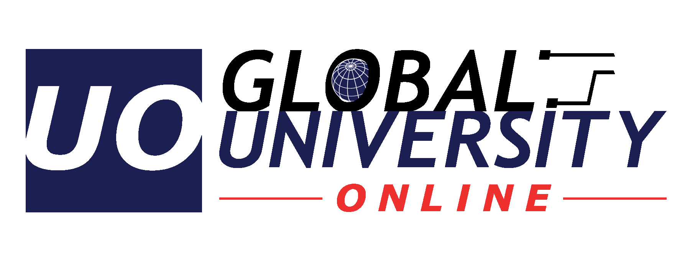

> **Descripción de la imagen** — La imagen es un logotipo que combina texto y elementos gráficos.
>
> A la izquierda, hay un bloque cuadrado de color azul oscuro con las letras blancas "UO".
>
> A la derecha, el texto principal está dispuesto en varias líneas:
> 1. La palabra "GLOBAL" en mayúsculas grandes y oscuras.
> 2. Un icono de globo terráqueo (azul y blanco) ubicado entre "GLOBAL" y "UNIVERSITY".
> 3. La palabra "UNIVERSITY" en mayúsculas grandes y oscuras.
> 4. Debajo, la palabra "ONLINE" en color rojo, subrayada por una línea horizontal roja.

Experiencia académica:
Docentes del Instituto Superior  Tecnológico
Corporativo Edwards Deming.

> **Descripción de la imagen** — La imagen es un logotipo institucional compuesto por texto y un símbolo gráfico. El diseño utiliza colores azul oscuro y blanco. A la izquierda, hay un elemento gráfico que consiste en una forma cuadrada o rectangular de color azul oscuro con un círculo blanco grande dentro. A la derecha del símbolo gráfico, se encuentra el nombre de la institución escrito en letras mayúsculas de color azul oscuro: "UNIVERSIDAD DE ORIENTE".

---

<!-- página 5 -->

1

Contenidos

Introducción........................................................................................ 4

CAPÍTULO I ........................................................................................... 5

COMUNICACIÓN Y ORGANIZACIÓN ................................................ 5

La comunicación organizacional, disciplina particular .................. 6

La Comunicación Humana ............................................................... 6

Visión de la comunicación ................................................................ 8

La práctica de la comunicación .................................................... 10

El comunicador organizacional ...................................................... 12

Las grandes responsabilidades ....................................................... 13

Las tareas .......................................................................................... 14

El futuro .............................................................................................. 17

CAPÍTULO II ........................................................................................ 20

COMUNICACIÓN INTERNA .............................................................. 20

Concepto.......................................................................................... 20

Relación con el AO (APRENDIZAJE ORGANIZACIONAL)............... 23

Redes de comunicación en las organizaciones ........................... 24

Redes Formales ................................................................................. 26

COMUNICACIÓN VERTICAL ............................................................. 27

Comunicación Descendente ......................................................... 27

Relación con el AO (APRENDIZAJE ORGANIZACIONAL)............... 28

Comunicación Ascendente ............................................................ 29

Relación con el AO (APRENDIZAJE ORGANIZACIONAL)............... 30

Comunicación horizontal ................................................................ 31

Relación con el AO (APRENDIZAJE ORGANIZACIONAL)............... 32

Redes Informales .............................................................................. 34

Relación con el AO (APRENDIZAJE ORGANIZACIONAL)............... 37

---

<!-- página 6 -->

2

CAPÍTULO III ....................................................................................... 39

COMUNICACIÓN EXTERNA .............................................................. 39

Definición .......................................................................................... 39

Relaciones publicas ......................................................................... 40

Identidad organizacional ................................................................ 41

Orígenes psicológicos de la identidad organizacional ................ 43

Publicidad ......................................................................................... 45

Publicidad institucional .................................................................... 46

Relación con el AO .......................................................................... 46

Cultura organizacional .................................................................... 47

¿Qup es la cultura organizacional?................................................ 47

Perspectivas ...................................................................................... 49

¿Qup busca la cultura organizacional? ......................................... 50

Clasificación de la cultura organizacional .................................... 51

¿Cuáles son sus componentes? ...................................................... 52

¿Cómo se aprende y manifiesta la cultura organizacional? ....... 53

Análisis comparativo entre comunicación, cultura y aprendizaje
organizacional .................................................................................. 55

CAPÍTULO IV ...................................................................................... 60

DIRECCIÓN DE COMUNICACIONES ................................................ 60

LA COMUNICACIÓN POLÍTICA: El ser percibe y es percibido ...... 60

¿Qué es la comunicación política? ............................................... 61

¿Cuál es su objetivo? ....................................................................... 61

El ser percibe y es percibido............................................................ 61

Identidad, imagen y reputación: una tríada exitosa .................... 62

Identidad........................................................................................... 63

La imagen corporativa .................................................................... 64

Reputación y RSE .............................................................................. 65

---

<!-- página 7 -->

3

COMUNICACIÓN DE CRISIS ............................................................. 66

¿Qué es la crisis? .............................................................................. 67

¿Qué es la comunicación de crisis? ............................................... 67

Características de la crisis ............................................................... 67

Pre-crisis ............................................................................................. 68

Planificación de crisis ....................................................................... 69

Estrategias de la Crisis ...................................................................... 69

Transferencia de responsabilidades ............................................... 70

Ventajas de tener un Plan ............................................................... 70

Formación de portavoces ............................................................... 71

Selección del público para portavoces ........................................ 71

Características de los medios de comunicación .......................... 71

Elaboración del mensaje ................................................................. 72

Comité de crisis................................................................................. 72

¿Quiénes lo integran? ...................................................................... 72

¿Qué hace?...................................................................................... 72

Los/as miembros del comité deben ............................................... 73

Recomendaciones ........................................................................... 73

Glosario ............................................................................................. 75

Referencias bibliográficas ............................................................... 80

---

<!-- página 8 -->

4

Introducción

La comunicación organizacional es el conjunto de acciones,
procedimientos y tareas que se llevan a cabo para transmitir o
recibir información a través de diversos medios, métodos y
técnicas de comunicación interna y externa con la finalidad de
alcanzar los objetivos de la empresa u organización.

A través de la comunicación organizacional se establecen
estrategias de desarrollo, productividad y relaciones internas y
externas a fin de obtener un mejor desempeño por parte del
recurso humano, por lo que su finalidad se relaciona con los logros,
éxitos o fracasos de una empresa u organización.

A su vez, la comunicación organizacional permite que los
procesos internos de trabajo se desarrollen correctamente, exista
un óptimo clima de trabajo y se alcancen los objetivos propuestos.
Para establecer la gestión eficaz y eficiente de una empresa u
organización, la comunicación es una herramienta de vital
importancia. Es un medio que permite conocer los logros, los
alcances o solucionar las dificultades de las personas que
trabajan en los diferentes departamentos de una empresa.

---

<!-- página 9 -->

> **Descripción de la imagen** — Es una fotografía que muestra a cuatro personas interactuando en un entorno interior, probablemente un aula o espacio de estudio.
>
> En el centro de la imagen se encuentra un hombre joven, vestido con una camisa de botones azul claro, quien está gesticulando con las manos mientras habla. A su alrededor, tres mujeres están sentadas y escuchándolo atentamente.
>
> La composición sugiere una discusión o sesión de estudio grupal. En primer plano, sobre una mesa de madera, se observa un portátil abierto (laptop) y varios libros o papeles esparcidos. La iluminación es brillante, y el fondo muestra grandes ventanales con marcos que dividen la luz.

> **Descripción de la imagen** — Es una fotografía en blanco y negro de un hombre de mediana edad o mayor. El hombre tiene cabello oscuro y lleva gafas. Está mirando directamente a la cámara con una expresión amable y una ligera sonrisa. Viste un traje formal oscuro (saco y corbata) sobre una camisa clara. La iluminación es uniforme, enfocando al sujeto en el centro del encuadre.

> **Descripción de la imagen** — Es una fotografía de plano medio o primer plano de un hombre adulto. El hombre tiene el cabello oscuro, corto y algo calvo en la parte superior, y lleva barba y bigote bien definidos. Está mirando directamente a la cámara con una expresión amable y una ligera sonrisa. Viste un traje oscuro (saco o blazer) sobre una camisa de color claro (gris o azul pálido). El fondo está ligeramente desenfocado, sugiriendo un entorno exterior o bien iluminado con tonos verdes suaves.

5

CAPÍTULO I

COMUNICACIÓN Y ORGANIZACIÓN

Fuente:(Concepto.de, 2016)

La comunicación organizacional consiste en el proceso de
emisión y recepción de mensajes dentro de una organización
compleja. Dicho proceso puede ser interno, es decir, basado en
relaciones dentro de la organización, o externo (por ejemplo,
entre organizaciones).

Goldhaber,
Gerald
M.
(1986):
3La
comunicación
organizacional consiste en el proceso de emisión y recepción
de mensajes dentro de una organización compleja. Dicho
proceso puede ser interno, es decir, basado en relaciones
dentro de la organi]aciyn, o externo ́.

Gary, Kreps. (1995): la comunicación organizacional "es el
proceso por
medio del cual los
miembros recolectan
información pertinente acerca de su organización y los
cambios que ocurren dentro de ella". Para autores como
Carlos Ramón Padilla la comunicación organizacional es " la
esencia, el corazón mismo, el alma y la fuerza dominante
dentro de una organización".

---

<!-- página 10 -->

6

En definitiva, el estudio de la comunicación organizacional está
cada vez más en auge y la experiencia afirman que las
organizaciones que la llevan a cabo presentan un mayor
crecimiento pues se tiene en cuenta complejos factores
especialmente humanos que se miden entre los comportamientos
y objetivos, políticas y metas de la organización para que de esta
manera existan lineamientos que permitan el correspondiente
crecimiento de la organización.
La comunicación organizacional es una herramienta de trabajo
que
permite
el
movimiento
de
la
información
en
las
organizaciones para relacionar las necesidades e intereses de
ésta, con los de su personal y con la sociedad, nos permite
conocer al recurso humano y evaluar su desempeño y
productividad, a través de entrevistas y recorridos por las diversas
áreas de trabajo.
En efecto, la comunicación en las organizaciones es fundamental
para el cumplimiento eficaz de sus objetivos. Es un medio que, en
conjunto, permite el desarrollo de sus integrantes para enfrentar
los retos y necesidades del mundo cambiante. El estudio de la
comunicación organizacional está cada vez más en auge y la
experiencia afirman que las organizaciones que la llevan a cabo
presentan un mayor crecimiento pues se tiene en cuenta
complejos factores especialmente humanos que se miden entre
los comportamientos y objetivos, políticas y metas de la
organización para que de esta manera existan lineamientos que
permitan el correspondiente crecimiento de la organización.

La comunicación organizacional, disciplina particular

La Comunicación Humana

La comunicación humana conlleva cuatro dimensiones o
propiedades fundamentales. Ellas se entrecruzan, se conjugan y
actúan a la vez en proporciones variables.
La primera de esas dimensiones es inherente a la misma
naturaleza relacional de la comunicación:

x La comunicación es un bien común. Es el impulso natural

que hace del ser biológico un ser social. Sin comunicación
no hay comunidad ni sociedad, cultura, política, ni
economía.

---

<!-- página 11 -->

7

La segunda dimensión corresponde a su propiedad física:

x La comunicación es una fuerza vectorial. Ella crea realidad

y sentido, contiene información a la que da forma
inteligible, la conduce y la transfiere de una mente a otras
mentes.
Distintas de las anteriores son las dos dimensiones siguientes.
Ambas conciernen al socio dinámica de la comunicación en
tanto que herramienta de la interacción humana:

x La comunicación es energía expresiva y realizadora del

pensamiento. Es una fuerza influyente y transformadora
mediante el Lenguaje y la Acción - el lenguaje mismo como
acción y la acción como lenguaje. La comunicación
humana participa del fenymeno  ́pequexas causas,
grandes efectosμ. Ella es acciyn de dpbil energta, pero tiene
una gran capacidad desencadenante de reacciones de
fuerte energía y muy amplias consecuencias.
x Si esta poderosa energía causal que es la comunicación, es

instrumentalizada para fines espurios, entonces deviene un
medio que se justifica por su propio fin. Y no sólo se habrá
traicionado su condición fundamental de bien común: se
habrá dañado a personas concretas.
Ahora bien, la comunicación implica sus reglas de juego. Y en la
medida que ella está ligada a la conducta individual y colectiva,
plantea la cuestión decisiva de los campos de libertad, y de los
usos que de ellos se haga.
El primero de los campos de libertad a considerar concuerda con
el punto 1 comentado más arriba. Su uso es discrecional y
depende de esta actitud llamada Ética, que en el ámbito social
global es sancionada por la Declaración Universal de los Derechos
Humanos. En esta línea de ideas, añadimos a las cuatro
dimensiones anteriores los siguientes comentarios:

x Toda persona es libre de decidir qué hacer y qué decir

acerca de lo que piensa y lo que hace. Recíprocamente,
toda persona es libre de aceptar o de rechazar cualquier
apelación, información, mensaje o relación que no desee.
El siguiente campo de libertad es negativo y concuerda con las
propiedades psicofísicas de la comunicación comentadas en el
punto 2:

---

<!-- página 12 -->

> **Descripción de la imagen** — Es un ícono o símbolo de diseño gráfico en color azul claro. El elemento principal es una combinación de un ojo estilizado y una lupa. El ojo se encuentra a la izquierda, representado por una forma curva que sugiere el iris y la pupila. A la derecha, hay una lupa con un círculo grande y un mango, que está posicionada como si estuviera examinando o enfocando el ojo. Ambos elementos están conectados visualmente, simbolizando la observación, la búsqueda o el análisis detallado.

8

x La información es irreversible. Nadie puede revertir la

información que ha comunicado a otros, tanto si lo ha
hecho voluntaria como involuntariamente. Es como si
viertes tinta en un vaso de agua: jamás podrás separar ya
la una de la otra ni volverlas a su estado anterior.
El campo de libertad que sigue es necesariamente negativo; se
corresponde con el punto 3 y afecta a la incomunicación:

x Es imposible comunicar lo inefable, lo que sobrepasa los

límites
de
las
palabras:
lo
que
ha
sido
sentido
profundamente, lo que pertenece a la sensibilidad
individual, las impresiones, las emociones, las experiencias y
las vivencias íntimas.
El último campo de libertad enlaza con el punto 4, y es la clave
crítica de la comunicación humana:

x La libertad de pensar, actuar y comunicar no puede ser

instrumentalizada -no debería serlo- en beneficio propio y
en perjuicio de otros mediante la obstrucción, el engaño, la
explotación o cualquier otra forma de violencia.

Visión de la comunicación

La Comunicación es investida de un sentido de misión. Es un modo
de búsqueda, de descubrimiento y de aprendizaje compartido.
Una forma de solucionar problemas, de reducir la complejidad de
los procesos y de las relaciones, y una fuerza transformadora del
entorno social. Una manera de aportar ideas útiles e innovadoras;
de explicarlas y aplicarlas eficazmente con sencillez y claridad.

La Comunicación es un fenómeno social a la escala de la
sociedad global. En su génesis y en su desarrollo en tanto que
acción, la Comunicación es la expresión de un proceso que

---

<!-- página 13 -->

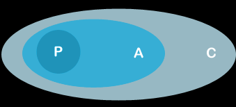

> **Descripción de la imagen** — Es un diagrama conceptual que utiliza tres elipses o círculos superpuestos para mostrar la intersección entre tres elementos.
>
> Los tres círculos están coloreados en tonos de azul y gris. Cada círculo contiene una letra mayúscula:
> 1.  El primer círculo contiene la letra "P".
> 2.  El segundo círculo contiene la letra "A".
> 3.  El tercer círculo contiene la letra "C".
>
> Los tres círculos se superponen significativamente, creando áreas de intersección entre ellos en el centro del diagrama.

9

articula el Pensamiento libre y creador con la Acción ejecutiva y
comunicativa.
En esta secuencia no debe haber contradicciones ni fisuras:

x El Pensamiento creador y transformador, pero también

crítico y autocrítico, concibe y dirige la acción y la
comunicación;
x La Acción construye realidad, produce hechos concretos y

tangibles y genera valor;
x La Comunicación manifiesta lo que ha sido pensado y

explicita el sentido de lo realizado: lo humaniza y lo
transmite más allá del espacio inmediato y del tiempo
presente.

C es parte de A que es parte de P

P. Acción
mental

YO/NOSOTROS

A. Acción
factual

MUNDO

C. Acción

simbólica

SOCIEDAD

Desde este paradigma, Joan Costa Institute asume que todo
desarrollo contemporáneo reposa esencialmente sobre una
doctrina de base, relativamente reciente, nacida de los trabajos
teóricos de las comunicaciones, en especial de Wiener, Weaver y
Shannon.
Sobre estas bases, nosotros entendemos la Comunicación en
tanto que ciencia y praxis, como surgida de la fusión de dos
doctrinas:

x La que podemos llamar originaria (punto 1 del capítulo

precedente), de la cual Joan Costa Institute actualiza y
reivindica su enraizamiento en las ciencias humanas y
sociales, herederas de la filosofía humanista nacida con la
cultura en Occidente.
x La que proviene del genio tecno científico, de la teoría

matemática de la información y de la sistémica, y que

---

<!-- página 14 -->

10

cristaliza en las nuevas tecnologías en la estela del espíritu
cibernético, es decir, de la eficacia.
Así, el Pensamiento, la Acción y la Comunicación es un todo
dinámico
que
se
asienta
sobre
las
dos
vertientes
- sociológica y tecnológica- de la ciencia de la Comunicación o
de la Información.

La práctica de la comunicación

La comunicación es una ley primordial del Universo, de la
Naturaleza y de la Vida. Siendo así una ley general, concierne a
los grupos y organizaciones humanas. Pero era preciso llevarla de
su práctica empírica a determinados usos sociales, es decir,
adaptarla a partir de su fuente académica a la dinámica de las
organizaciones. Así, de la teoría general de la comunicación
surgió la Comunicología.
Este trabajo de reinterpretación supuso recodificar unos principios
conceptuales formulados en el espacio abstracto de la teoría, y
́traducirlosμ en tprminos de aplicaciyn práctica a las necesidades
concretas de las organizaciones. Y, al mismo tiempo, implicó
cuestionar los modelos empíricos de la teoría fragmentaria de la
organización que eran el producto de un pasado obsoleto, para
actualizarlos e integrarlos a esta reinterpretación adaptativa del
marco teórico al práctico, desde la óptica socio tecnológica y no
solo económica.
La
Comunicología
reconoce
el
fundamento
humano
(emprendedor, creativo, cooperador, etc.) de toda organización,
ligado a su identidad y a sus propios objetivos (económicos,
científicos, humanitarios, cívicos, etc.). Ello constituyó un cambio
radical del viejo modelo capitalista-productivista con el declive
de los productos industriales de consumo. Lo cual dio paso al
resurgir renovado de los servicios en la era de la comunicación y
de la información. Este fue también el paso de la cultura material
y cuantitativa a nuestra cultura de los intangibles y los valores.
La Comunicología fue intérprete y herramienta, al mismo tiempo,
de este cambio cultural. A principios de los años 70, ya Joan Costa
había iniciado en este sentido la adaptación de las teorías de la
comunicaciyn, mucho antes de que la palabra  ́comunicologtaμ
se hubiera inventado. Para el procedimiento de recodificación

---

<!-- página 15 -->

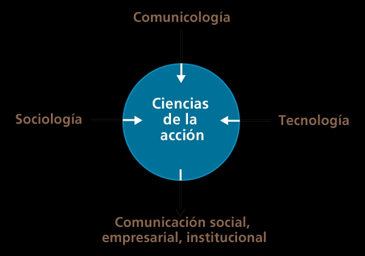

> **Descripción de la imagen** — Se trata de un diagrama conceptual que ilustra las relaciones entre diferentes campos de estudio en torno a un concepto central.
>
> El elemento central es el círculo azul etiquetado como "Ciencias de la acción".
>
> Este círculo está conectado por flechas a cinco conceptos externos:
> 1.  **Comunicología:** Conectada desde la parte superior.
> 2.  **Tecnología:** Conectada desde la derecha.
> 3.  **Sociología:** Conectada desde la izquierda.
> 4.  **Comunicación social, empresarial, institucional:** Conectada desde la parte inferior.
>
> El diagrama muestra que las "Ciencias de la acción" son el núcleo que interactúa o se relaciona con estos cuatro campos.

11

del material teórico a modelos operacionales, Costa se inspiró en
la sociometría a principios del siglo pasado; los mismos con que
fueron formuladas la cibernética, la teoría de la información, la
teoría de sistemas y la teoría de modelos. Todas estas disciplinas
tenían una cosa en común: querían representar el mundo de los
fenómenos humanos y sociales con sus estructuras de relaciones,
y medir la intensidad de los intercambios más o menos complejos
entre los individuos. Para ello, los precursores (científicos,
matemáticos, sociólogos, etc.), desarrollaron conjuntos de grafos,
esquemas, diagramas y modelos que no sólo explicaban esos
fenómenos, sino que los hacían visibles y manejables, es decir,
aplicables a diversos desarrollos y, por supuesto, medibles. Éste es
el principio de la Comunicología: la comunicación aplicada al
mundo de las organizaciones.
En 1977, Joan Costa publicó en su libro La imagen de empresa.
Métodos de comunicación integral, una serie de 16 esquemas y
modelos que constituyen la metodología básica de la estrategia
y la gestión de las comunicaciones. Así, Costa fue el precursor de
la Comunicología. Más tarde, y a partir de los trabajos de
Habermas y Kotarbinski, Costa da un paso más, e introduce a la
Comunicología, la Praxeología o ciencia de la acción práctica,
con el fin de reforzar el carácter de la Comunicación como un
modo de Acción.
Con la fusión de estas dos disciplinas, la Comunicación no sólo
está vinculada a las relaciones, el arte, la técnica y la ingeniería,
sino que ya forma parte de las Ciencias de la Acción. Lo que
Costa ha rubricado con este axioma: comunicar es actuar y
actuar es comunicar.

---

<!-- página 16 -->

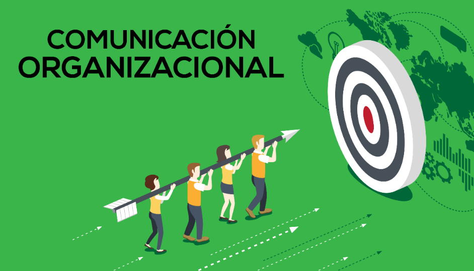

> **Descripción de la imagen** — Es una ilustración conceptual que representa la comunicación y el logro de objetivos.
>
> En el centro de la imagen, se observa un grupo de tres personas (dos hombres y una mujer) de pie, todas apuntando con un arco y una flecha hacia un objetivo circular grande ubicado a la derecha. Una de las figuras está en el acto de disparar la flecha directamente hacia el centro del blanco.
>
> El fondo es de color verde brillante. Alrededor del objetivo principal, se aprecian líneas punteadas que sugieren trayectorias o movimiento. En la esquina superior derecha, hay un gran blanco circular con anillos concéntricos (un blanco de tiro). También se observan elementos gráficos abstractos como engranajes y barras de gráfico en el fondo.
>
> La imagen simboliza la acción coordinada y dirigida necesaria para alcanzar una meta específica.

12

Para terminar, y volviendo al campo ya mencionado de la
energía comunicativa débil, pero poderosa en sus efectos; y al
ámbito de la gestión estratégica de los intangibles y de los valores
en el espíritu humanístico, reencontramos la secuencia del
Pensamiento en Acción y en Comunicación.

El comunicador organizacional

Fuente: (Blogger, 2017)

El factor omnipresente
Resulta evidente que la comunicación es un elemento esencial
para
la
vida
de
las
organizaciones.
Como
dice
Andrade (1991:30) "...si la comunicación es consustancial a
cualquier forma de relación humana, también será consustancial
a la organización. No es posible imaginar una organización sin
comunicación". Los procesos organizativos requieren, siempre, de
procesos comunicativos paralelos. Por eso puede afirmarse que
todos los miembros de una organización tienen responsabilidades
de comunicación en tanto que, para el desempeño de cualquier
función, es necesario algún tipo de procedimiento para recopilar,
procesar
y
emitir
mensajes,
así
como
para
almacenar
información.
Que la comunicación resulte adecuada para el logro de los
objetivos de una organización determinada es, entonces, una
responsabilidad compartida por todos sus integrantes. O, visto
desde
otra
perspectiva,
"dado
que
los
problemas
de
comunicación pueden ser creados por casi cualquiera de los

---

<!-- página 17 -->

13

miembros de la organización, todos deben participar de la
responsabilidad
de
evitar
o
limitar
ese
tipo
de
problemas" (Farace et al.,1977:248).
No obstante, lo anterior; resultaría ingenuo esperar que todas las
necesidades
de
comunicación
de
una
organización,
especialmente si es grande y compleja, pudieran satisfacerse
solamente con la colaboración de personas que normalmente
están muy ocupadas haciendo su trabajo, cumpliendo con
responsabilidades de otra índole. De ahí la necesidad de contar
con profesionales cuyo quehacer primordial consista en asegurar
que los procesos de comunicación sean los apropiados en
relación con los objetivos de la organización.
De hecho, la aportación de los
comunicadores a las
organizaciones se percibe como relevante, a juzgar por datos
recabados
en
una
investigación
llevada
a
cabo
muy
recientemente por CINCO para la Asociación Mexicana de
Comunicación Organizacional entre sus asociados. Como puede
apreciarse en la tabla 1, la importancia que se asigna al puesto
de comunicación, tanto en sí mismo como en comparación con
otras áreas, es alta.

IMPORTANCIA DEL PUESTO DE COMUNICACIÓN

Asignada por la organización

Muy importante
69%

Importante
25%

Poco importante
6%

En comparación con otras áreas

Más importante
22%

Igualmente, importante
67%

Menos importante
11%

Fuente: (Consultores en Investigación y Comunicación, 1996)

Las grandes responsabilidades

Ya dijimos que a cada organización corresponde una función de
comunicación particular y por tanto diferenciada. Sin embargo,

---

<!-- página 18 -->

14

es necesario establecer ciertos parámetros como punto de
partida para evaluar la actuación de los comunicadores. ¿Qué
sería razonable esperar, aunque sea en términos generales, de los
profesionales de la comunicación en las organizaciones? Un
camino aceptablemente seguro para llegar a una descripción de
la práctica de la comunicación organizacional -vista como el
conjunto
de
actividades
cuyo
propósito
es
facilitar
las
interacciones entre la organización y sus miembros, entre la
organización y su medio, y entre sus integrantes- es el que parte
de la identificación de las tareas mínimas obligatorias, comunes a
la mayor parte de las organizaciones, que deben llevar a cabo los
responsables de la función.
Dado que todas las personas que forman parte de la organización
se comunican al realizar su trabajo, el cometido principal del
encargado de la comunicación en la organización es ayudar a
que los demás cumplan con sus responsabilidades de comunicar.
Para ello, "debe estar localizado en el centro mismo del flujo de
mensajes
de
la
organización.
Esto
significa
que
tiene
conocimiento de todos los tipos de flujo relevantes (aunque la
cantidad de control directo que puede ejercer sobre esos flujos
dependa de la disposición de la dirección para delegar la
autoridad necesaria). Operando en el centro del flujo de
mensajes de la organización (o cerca de él), el administrador de
la comunicación puede servir como un enlace entre el resto de
las unidades de trabajo y, por tanto, influir directamente en las
características de los mensajes que esas unidades envían o
reciben, tales como cantidad, calidad, oportunidad y forma"
(Farace et al.,1977:252).

Las tareas

Desde una perspectiva algo más específica, el objetivo general
para la función de comunicación en las organizaciones podría
ser: desarrollar e implantar estrategias de comunicación que
respalden a la organización en el logro de sus objetivos,
ofreciendo recursos efectivos de coordinación, apoyando los
procesos de cambio y reforzando la integración del personal.
Entre las actividades más relevantes que tiene que desempeñar

---

<!-- página 19 -->

15

el comunicador para lograr este objetivo se encuentran las
siguientes:
Desarrollar estrategias, planes y políticas de comunicación. Se
trata de tareas cruciales que en primera instancia permiten
determinar el alcance de la función en la organización. Las
estrategias de comunicación organizacional por lo común
obedecen a propósitos generales como los siguientes:
Colaborar en el logro de los objetivos de la organización,
favoreciendo su integración interna y su adaptación externa, a
través de la sistematización y optimización de los flujos de
mensajes que se dan entre la organización y sus integrantes, entre
ellos y entre la organización y su ambiente.
Dar orden y sentido a lo que de cualquier forma existe en toda
organización: el intercambio de mensajes.
Desarrollar una serie de significados compartidos que den sentido
a la realidad y favorezcan la coordinación entre los miembros de
la organización.
Cada estrategia responderá, además, a objetivos específicos que
a su vez se derivan de necesidades de comunicación detectadas
en la organización. Los planes y políticas estarán subordinados a
las estrategias, y los tres deberán supeditarse a las estrategias,
planes y políticas organizacionales.
A pesar de su más que evidente importancia para las actividades
de comunicación, pocos comunicadores organizacionales
trabajan con base en estrategias, como puede verse en la
investigación que realizó CINCO para la AMCO, según la cual
únicamente 21 por ciento de los encuestados incluye el desarrollo
de estrategias entre sus responsabilidades principales.
Participar en la planeación y producción de programas de
comunicación. Esto abarca una amplia variedad de actividades,
que van desde la edición de las tradicionales revistas internas
hasta la producción de publicidad externa, pasando por la
distribución masiva de circulares, la administración de tableros de
avisos, la producción de material audiovisual, la preparación de
discursos para ejecutivos, la organización de fiestas y eventos
especiales, la elaboración de materiales didácticos, etcétera.
Concebir y desarrollar programas de comunicación desde y/o
para otras áreas de la organización. "El profesional de la

---

<!-- página 20 -->
### 16
### comunicación debe tener la capacidad para examinar los
### procesos de trabajo, identificar los elementos de conocimiento
### que el personal necesita para cumplir con su trabajo y desarrollar
### sistemas para proporcionarle esos elementos de conocimiento"
### (Farace et al, 1977:255).
### La revisión, aunque sea superficial, de los temas que interesan a
### los integrantes de la organización da una idea clara de la
### diversidad de fuentes y destinos que debe tomar en cuenta el
### comunicador en su trabajo.

TEMAS DE INTERÉS EN COMUNICACIÓN ORGANIZACIONAL

PRIORIDAD

Muy interesados en

obtener más

información

1
LOS PLANES FUTUROS DE LA EMPRESA
79.8%

2
OPORTUNIDADES DE CARRERA EN LA EMPRESA
72.5%

3
INFORMACIÓN RELACIONADA CON EL PUESTO
68.0%

4
MEJORAS EN LA PRODUCTIVIDAD
63.0%

5
POLÍTICAS Y PRÁCTICAS DE PERSONAL
62.8%

6
POSICIÓN COMPETITIVA DE LA EMPRESA
62.7%

7
CÓMO ENCAJA MI PUESTO DENTRO DE LA EMPRESA
62.1%

8
IMPACTO DE LOS EVENTOS EXTERNOS EN MI PUESTO
52.9%

9
CÓMO EMPLEA LA EMPRESA SUS UTILIDADES
48.6%

10
RESULTADOS FINANCIEROS
44.1%

11
PLANES DE PUBLICIDAD Y PROMOCIÓN
43.4%

12
NOTICIAS SOBRE OTROS DEPARTAMENTOS Y DIVISIONES
43.3%

13
POSICIÓN DE LA EMPRESA
RESPECTO A CUESTIONES DE

ACTUALIDAD
42.7%

14
CAMBIOS/PROMOCIONES EN EL PERSONAL
41.1%

15
COMPROMISOS DE LA EMPRESA CON LA COMUNIDAD
39.3%

16
HISTORIAS DE INTERÉS HUMANO SOBRE OTROS EMPLEADOS
21.6%

17
NOTICIAS
SOBRE
EL
PERSONAL
(CUMPLEAÑOS,

NACIMIENTOS, ETC.).

16.0%

---

<!-- página 21 -->

17

No siempre es fácil distinguir entre la comunicación a nivel
corporativo y aquella que tiene como finalidad influir en el
desempeño de un área en particular. Normalmente la diferencia
básica entre una y otra es de alcance, de tamaño del grupo de
receptores, más que de contenido o de medios. En realidad, la
distinción no es relevante desde el punto de vista del fenómeno
comunicativo en sí, aunque prestar un servicio especializado a
distintas áreas de la organización tiene por lo menos dos
implicaciones importantes para el desempeño del comunicador:

x El
tratamiento
adecuado
de
temas
diversos
para
confeccionar mensajes dirigidos a personas con cierto
grado de especialización requiere del desarrollo de
habilidades
de
recolección
y
organización
de
la
información que van más allá de las normalmente
requeridas en el trabajo de comunicación corporativa.
x Trabajar con distintas áreas ofrece al comunicador una

oportunidad única para aprender y relacionarse con otros.
Esto puede traer como consecuencia la posibilidad de
aumentar la influencia, tanto a nivel de función como
personal, en los procesos organizativos.
Colaborar en la preparación de manuales de políticas y
procedimientos. Así, además de familiarizarse con el marco
normativo de la organización, el comunicador tiene una
interesante posibilidad de influir en la formalización de distintos
aspectos del desempeño, en general, y de los procesos
comunicativos, en particular.
Desarrollar y llevar a la práctica programas de entrenamiento en
comunicación. Cada vez es más común que se pida al
comunicador
que
prepare
e
imparta
programas
de
entrenamiento que generalmente tienen que ver con habilidades
de comunicación escrita y oral, o de relaciones interpersonales.
Lo anterior demanda del comunicador conocimiento en materia
de capacitación y desarrollo de personal.

El futuro

En la actualidad es posible identificar con mucha claridad dos
grandes
tendencias
en
el
trabajo
del
comunicador
organizacional:

---

<!-- página 22 -->

> **Descripción de la imagen** — Es una ilustración o pintura que representa una escena interior con varias personas reunidas en un ambiente luminoso.
>
> En el primer plano, a la izquierda, se ve a un hombre sentado, vestido con ropa oscura, mirando hacia abajo, posiblemente leyendo o escribiendo algo sobre su regazo.
>
> En el centro de la imagen, hay un grupo de personas sentadas alrededor de una mesa. Varias figuras están interactuando en este espacio. Detrás del grupo y al fondo, se aprecian grandes ventanas o puertas que dan a un exterior frondoso, lleno de vegetación verde brillante. La iluminación sugiere luz natural entrando por estas aberturas.
>
> La composición general muestra un ambiente social o de estudio dentro de una habitación con mucha luz natural.

18

x Cada vez más, la actividad comunicativa se orienta a

apoyar procesos de cambio en la organización. Programas
dirigidos a mejorar la calidad o el servicio, de reingeniería,
de redimensionamiento, cambio cultural y otros esfuerzos
de transformación de las organizaciones requieren de
respaldos comunicativos muy especializados, normalmente
fuera del alcance de los responsables de esos procesos.
x La evolución que parte de ser experto en publicaciones

impresas para convertirse en experto en medios de
comunicación, con especial interés por los de muy reciente
aparición en el contexto organizacional, como son el
correo
electrónico
e
Internet.
La
comunicación
organizacional está empezando a superar el estrecho
marco de la publicación interna.

Fuente: (Mafisse, s.f.)
En la relativamente corta historia de la función en nuestro medio
el comunicador organizacional ha sido visto sobre todo como un
productor de medios, básicamente impresos, dirigidos al personal
de la propia empresa. En otras palabras, se le ha confinado al
ejercicio de la comunicación interna escrita.
Por otra parte, es fácil constatar el hecho de que la posición que
comúnmente ocupa el especialista en comunicación en la
jerarquía de la organización es lo suficientemente baja como
para mantenerlo alejado de la toma de decisiones a nivel
estratégico. Quizás esto se deba a que en muchas empresas la

---

<!-- página 23 -->

19

comunicación profesionalmente manejada se percibe, a pesar
de su importancia, como un lujo prescindible. Esta afirmación
puede apoyarse en el hecho, palpable para quien conoce el
medio, de que en muchas organizaciones se han recortado los
presupuestos para las áreas de comunicación, e incluso se ha
llegado a despedir a parte o a la totalidad del personal, como
consecuencia de la crisis económica.
El campo de acción de la comunicación organizacional, no
obstante, sigue sin definirse lo que, desde cierta perspectiva,
puede considerarse como una ventaja porque significa áreas de
oportunidad para el comunicador con iniciativa. Entre ellas es
factible identificar las siguientes:

x Comunicación organizacional integral, que supone la

posibilidad de tomar parte en la formulación de estrategias
y en la implantación de las actividades de comunicación
de la empresa como un todo, evitando la división entre
comunicación interna, relaciones públicas y publicidad.
x Desarrollo organizacional. Este es un campo que ofrece al

comunicador una gran riqueza de oportunidades porque,
como se dijo hace poco, el respaldo a procesos de cambio
se está volviendo una responsabilidad clave para el
comunicador.
x Comportamiento. En esta línea se ubica lo relacionado con

los procesos humanos en la organización: manejo de
conflictos, toma de decisiones, liderazgo, desarrollo de
equipos efectivos, etcétera.
x Capacitación y entrenamiento. No sólo como diseñador e

instructor de cursos para entrenamiento en habilidades de
comunicación interpersonal, sino como un elemento clave
en todo el proceso de capacitación, que en primera
instancia es una forma de comunicación.
x Informática y sistemas. La nueva tecnología tiene que ver,

ante todo, con el procesamiento y distribución de la
información. Debe ser, entonces, una responsabilidad
fundamental del comunicador contribuir al máximo
aprovechamiento de esa tecnología.

---

<!-- página 24 -->

> **Descripción de la imagen** — La imagen es una ilustración conceptual que representa un proceso de pensamiento colaborativo o planificación, dibujado en un pizarrón negro con tiza.
>
> El elemento central es un complejo diagrama formado por múltiples flechas de diferentes colores (azul, turquesa, amarillo y rojo) que se cruzan y forman caminos interconectados y bucles. Estas flechas indican flujos o relaciones entre diferentes ideas o pasos.
>
> Varias manos y brazos de personas están posicionadas alrededor del diagrama, interactuando con él: algunas señalan las flechas, otras sostienen tizas o papeles, lo que sugiere participación activa en la discusión o el desarrollo del proceso representado por el flujo. La composición general transmite una atmósfera de lluvia de ideas o resolución de problemas grupal.

20

CAPÍTULO II

COMUNICACIÓN INTERNA

Fuente: (Conexión ESAN, 2015)

Concepto

Si nos referimos a los procesos comunicativos que se llevan a cabo
dentro de la organización, estamos hablando de la comunicación
interna. Es decir, aquella que busca el logro de los objetivos
organizacionales a través de mensajes que fluyan de manera
eficiente en el interior, de relaciones satisfactorias entre sus
miembros, un ambiente de trabajo agradable, entre otras cosas.
Así, los  ́subsistemasμ (llámese así a los empleados, sea cual sea su
puesto), a través de la comunicación se sienten identificados y
motivados para realizar su labor y de esta manera obtener los
resultados que el  ́sistemaμ (entiéndase como la organización en
total) requiere.
De manera que el lector comprenda lo que la línea de
investigación de esta tesis plantea, se presentan dos definiciones
que
complementan
la
idea
anteriormente
expuesta:
la
comunicación interna es el conjunto de actividades efectuadas
por cualquier organización para crear y mantener buenas
relaciones con y entre sus miembros; utilizando diferentes medios
de comunicación que los mantengan informados, integrados y

---

<!-- página 25 -->

21

motivados para contribuir con su trabajo al logro de los objetivos
organizacionales. (HERNÁNDEZ, 2002)
Por su parte, De Marchis la define como  ́el conjunto de acciones
que engloban todos los procesos comunicativos que se
establecen entre la empresa y sus empleados, y el resto del
público interno de la instituciónμ. Aclarando que los últimos se
refieren tanto a los empleados como a los propietarios,
representantes de trabajadores y familiares de los mismos. El
catedrático menciona de manera puntual los objetivos,
responsabilidades y funciones de la comunicación interna:
Responsabilidades:

x Establecer objetivos y estrategias comunicativas.
x Establecer prioridades comunicativas.
x Establecer un sistema de acceso a la información,

determinando los flujos de la comunicación.
x Establecer
los
elementos
de
la
comunicación,
estableciendo cómo funcionará el sistema.
Objetivos:

x Informar: proporcionar
la
información
adecuada
y
necesaria para el desempeño del puesto de trabajo y sobre
la organización, su misión, su filosofía, sus valores, estrategia,
etc. (Dimensión de Gestión).
x Participación: facilitar el diálogo, el feedback de abajo

hacia arriba, es fundamental para que las propuestas y las
ideas circulen y se puedan tener siempre en cuenta.
Escuchar a los equipos es fundamental para toda
organización (Dimensión social).
x Potenciar el sentimiento de pertenencia. El equipo humano

aumentará su eficacia y su eficiencia en la medida que se
sienta parte del proyecto y su papel en la organización sea
valorado positivamente. También para que cumplan
adecuadamente con su papel como transmisores externos
de la imagen de la entidad. (Dimensión cultural)
x Implicar y motivar: involucrar, que todos se sientan

partícipes del proyecto común y tengan espacio para
hacer
aportaciones
y
tomar
decisiones.
También,
reconocer sus méritos y darles el reconocimiento que
merecen. (Dimensión humana).

---

<!-- página 26 -->

22

x Hacer BRANDING
INTERNO (comunicación
de
marca):
hacer partícipes a las personas de los logros conseguidos,
de los valores diferenciales y de la buena marcha de la
organización aumentará su satisfacción y su implicación, ya
que sentirán que el éxito es también suyo (un matiz de la
dimensión cultural).
Funciones:

x Investigar, con la finalidad de elaborar una política de

escucha del clima social de la empresa que ayude después
a la toma de decisiones apropiadas.
x Orientar, logrando una capacidad de escuchar y

sensibilizar sobre los distintos aspectos de la empresa.
Aplicándolo en principio a los mandos altos y gerenciales.
x Informar.
x Animar y coordinar, es decir, después de conocer lo que

sucede en la empresa y con el fin de que la información
fluya de mejor manera, debe crearse una red de
corresponsales que informen a los empleados. ¿Cómo?,
pues tomando los puntos de referencia en la empresa que
pueden distribuir y recoger la información de mejor manera
que otros. Logrando con todo ello coordinar los flujos de
comunicación e integrar a los empleados en esta red que
además les brindará sentido de pertenencia a la misma.
x Organizar campañas, como soluciones de los problemas

internos a fin de involucrar a los empleados. Éstas tienen una
visión de corto, mediano o largo plazo, dependiendo de las
acciones que quieran realizarse dentro de la empresa.
x Formar:
Capacitación
determinada
de
actividades
específicas,
incluyendo
de
manera
especial
la
capacitación en comunicación, que busca que los
empleados sepan cómo utilizar las herramientas que
mejoren la comunicación dentro de la organización. (DE
MARCHIS, 2003)
Podemos decir que la comunicación interna tiene efecto en
cuatro grandes elementos que conforman la relación de las
organizaciones con sus personas internas:

---

<!-- página 27 -->

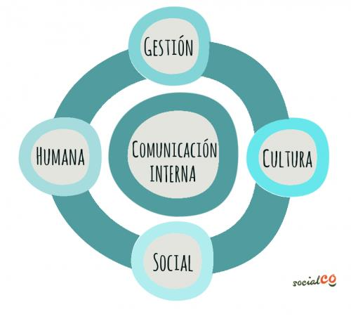

> **Descripción de la imagen** — Se trata de un diagrama conceptual circular que representa cinco elementos interconectados en un ciclo continuo.
>
> Los elementos son:
> 1. **GESTIÓN**
> 2. **HUMANA**
> 3. **COMUNICACIÓN INTERNA**
> 4. **CULTURA**
> 5. **SOCIAL**
>
> Estos cinco conceptos están dispuestos en un círculo, y las flechas o arcos que los unen indican una relación cíclica e interdependiente entre ellos, sugiriendo un modelo holístico o de flujo continuo.

> **Descripción de la imagen** — La imagen es muy minimalista y muestra un único carácter o símbolo, que parece ser la letra "Өрө" (o una combinación de caracteres similares), presentado en color claro sobre un fondo completamente negro.

23

Fuente: (Moraleda, 2016)
Gestión: Ayuda a las personas a desarrollar su cometido, su
función, a saber; cuáles son los procedimientos y qué funciones y
tareas realizan las otras personas de la organización.
Humana: ayudar a las personas a sentir que se les tiene en cuenta
y que son importantes.
Cultural: traslada los valores y la promesa de marca de la entidad
hacia el interior, fomentando el sentimiento de pertenencia y la
implicación en el proyecto común.
Social: Una parte del clima laboral depende del buen
funcionamiento de la comunicación interna, que debe ayudar a
que las personas dispongan de espacios y contenidos para
relacionarse con otras personas de diferentes maneras.

Relación con el AO (APRENDIZAJE ORGANIZACIONAL)

Si los flujos de comunicación internos están bien establecidos, es
decir, cuando la comunicación es efectiva dentro de la
organización, es posible tomarla como apoyo o herramienta para
difundir el conocimiento e información que se desee que ésta
tenga. ¿Cómo?, pues a través de las herramientas con las que
cuenta este tipo de comunicación: manuales escritos, reuniones
de trabajo, medios de comunicación internos, grupos de trabajo,
de integración, etc. Además, dará la pauta a su evaluación, pues
a través de la retroalimentación que de esto den sus empleados,
se determinará qué tan lejos ha llegado el proceso de aprendizaje
en la empresa.

---

<!-- página 28 -->

24

El interior es el reflejo del exterior y viceversa, así que los procesos
internos de comunicación además de mostrar cómo funciona la
empresa y cómo interactúan sus trabajadores consigo mismos,
con otros, con su entorno y con la tecnología, también es la base
de un diagnóstico de necesidades de información, capacitación
y como consecuencia, de modelos y técnicas de aprendizaje
convenientes para la organización.
Y también, será la base de su evaluación, donde se comprobará
si se lograron los objetivos del aprendizaje, qué faltó, cómo se
ocupará, cuál fue la interpretación, etc.
Contenidos de la comunicación interna en las ONG ́S
En base a los objetivos definidos en el apartado anterior, se suele
clasificar la comunicación que circula en base a la función que
cumple dentro de la organización: laboral, relacionada con las
condiciones laborales o relación legal con la persona.
Operativa, relacionada con lo que la persona necesita conocer
para el desempeño de su puesto de trabajo. También, si es
bidireccional, con lo que la persona puede Aportar sobre la
operativa o el desarrollo de su trabajo. Corporativa, relacionada
con la entidad en su conjunto, su actividad, sus valores y sus
resultados; motivacional y dinamizadora.

Redes de comunicación en las organizaciones

Como hemos aclarado ya, tanto en la comunicación en su
ámbito general como en el organizacional, se transmiten
mensajes que siguen determinados caminos para llegar a su
receptor. A estas direcciones que toman los mensajes, las
llamamos  ́redes de comunicaciónμ, cuyo origen puede ser
formal o informal.
Un portaaviones había estado de maniobras en el mar con
tempestad durante varios días. Poco después de que oscureciera,
el vigía que estaba en el extremo del puente informó:

x  ́Luz a estriborμ.
x  ́¢Rumbo directo o se desvta hacia popa?μ, grity el capitán.
x El vigta respondiy  ́Directo, capitánμ, lo que significaba que

nuestro propio curso nos estaba conduciendo a una colisión
con aquel buque.

---

<!-- página 29 -->

> **Descripción de la imagen** — La imagen es predominantemente negra y está casi completamente vacía. En la esquina inferior derecha se observa una pequeña marca o símbolo indistinto de color claro. No hay elementos estructurales, datos, diagramas ni ilustraciones visibles.

> **Descripción de la imagen** — No se ha proporcionado ninguna imagen para describir. Por favor, adjunte la imagen para que pueda realizar la descripción solicitada.

25

x El capitán llamy al encargado de emitir sexales.  ́Envta este

men-saje: Estamos a punto de chocar; aconsejamos
cambiar 15 grados su rumbo.μ
x Llegy otra sexal de respuesta:  ́Aconsejamos que ustedes

cambien 15 grados su rumboμ.
x El capitán dijo:  ́Contpstele: Soy capitán; cambie su rumbo

15 gra­dosμ.
x  ́Soy marinero de segunda clase 3nos respondieron3.

Mejor cambie su rumbo 15 grados.μ
x El capitán ya estaba hecho una furia. Espety:  ́Conteste:

Soy un portaaviones. Cambie su rumbo 15 gradosμ.
x La linterna del interlocutor enviy su ~ltimo mensaje:  ́Yo soy

un faroμ.

Fuente: (Blog, 2017)
En la actualidad en el mundo corporativo surgen preguntas entre
empleados y directivos cuando se aborda el tema de la
comunicación a través de las redes informales, algunas de estas
preguntas son, por ejemplo, ¿qué efectos genera el rumor en las
organizaciones? ¿Por qué es necesario combatir dicho rumor? Las
principales causas de la rumorología dentro de una organización
empresarial provienen cuando existe una falta de dirección clara,
este hecho generalmente sucede cuando hay vaivenes en la
estrategia, en los modelos de negocio o en los resultados
económicos. Cuando esto sucede, los directivos deberían facilitar

---

<!-- página 30 -->

26

una información precisa y concisa de lo que está sucediendo
para disipar y anticipar los efectos de dicha comunicación, sin
embargo, esto no siempre se produce.

Esta situación hace que la información que debería llegar al
conjunto de las personas que integran las compañías se quede
estancada y no avance a lo largo de la estructura jerárquica,
facilitando que aparezca el rumor. Esta situación es importante
resaltarla ya que dependiendo del trato que se le dé, puede
socavar o reforzar la confianza, uno de los elementos más
complicados de conseguir en una organización.
Por esa razón se vuelve necesario responder con rapidez ante
cualquiera de estas habladurías, si un rumor ofrece una
información positiva pero luego no se cumple, genera unas falsas
expectativas que acarrean consecuencias negativas. Si por el
contrario el cotilleo supone repercusiones negativas y es falso,
aunque finalmente no culmine, si no se ha desmentido cuanto
antes, generará un estrés y miedo innecesario con consecuencias
muy negativas hacia los intangibles que atesoran las personas que
integran la compañía, como por ejemplo; Clima Laboral,
compromiso, etc.

Redes Formales

Martínez y Nosnik coinciden con Goldhaber en que cuando los
mensajes fluyen siguiendo los caminos oficiales dictados por la
jerarquía o su función laboral especificadas en el organigrama de
la empresa, las redes de comunicación son formales. Y según nos
dice Fuentes, su objetivo es coordinar de manera eficiente todas
las actividades distribuidas en la estructura de la organización.
(FUENTES, 2003, 32)

En las redes formales, los mensajes circulan de manera
descendente, ascendente u horizontal. Goldhaber apunta que los
mensajes que fluyen de manera descendente o ascendente
cuando se emplea el principio escalar de autoridad o jerarquía, y
a través de la organización cuando se aplica el principio funcional
de la clasificaciyn del trabajo.  ́Por consiguiente, la direcciyn del
mensaje indica el tipo de red seguidoμ (GOLDHABER, 1984: 131)

---

<!-- página 31 -->

> **Descripción de la imagen** — La imagen es predominantemente un fondo negro. En la esquina inferior derecha se observan unos caracteres pequeños e indistintos, de color claro, que parecen ser letras o símbolos aislados.

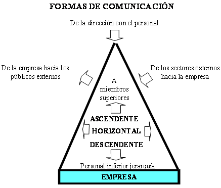

> **Descripción de la imagen** — Se trata de un diagrama jerárquico que ilustra las formas de comunicación dentro de una estructura organizacional, centrada en la entidad denominada "EMPRESA".
>
> El diagrama se organiza alrededor del concepto central de **EMPRESA**, del cual emanan tres tipos principales de flujos comunicacionales:
>
> 1.  **ASCENDENTE:** Representa la comunicación que va desde la dirección hacia el personal.
> 2.  **HORIZONTAL:** Representa la comunicación que fluye desde la empresa hacia los públicos externos.
> 3.  **DESCENDENTE:** Representa la comunicación que proviene de los sectores externos y se dirige hacia la empresa.
>
> Los tres flujos (Ascendente, Horizontal y Descendente) están conectados a la EMPRESA mediante flechas que indican la dirección del movimiento comunicacional.

27

Fuente: (Blog, 2017)

COMUNICACIÓN VERTICAL

Comunicación Descendente

Es aquella en la que los mensajes fluyen de los superiores a sus
subordinados. Así lo afirman Daniels y Spiker, citados por Valdés, la
comunicación descendente es la que se lleva a cabo cuando los
supervisores juegan el rol de emisores y los subordinados son los
receptores, asumiendo que los mensajes son concernientes a las
responsabilidades, funciones y a la producción que se lleva a
cabo dentro de la organización. (VALDÉS, 2003, 12)
Al respecto Martínez y Nosnik mencionan que este tipo de
comunicación no debe entenderse exclusivamente como
aquella que surge en la gerencia y se dirige a los empleados, sino
también la que se origina en los altos mandos y fluye hacia la
gerencia, pues  ́sin ésta última, la primera no tendría ningún
sentidoμ. (MARTíNEZ Y NOSNIK, 1988: 27-28)
De acuerdo a Smith y otros, citados por Goldhaber,  ́los estudios
de comunicación descendente responden a la pregunta ¿hasta
qué punto los mensajes descendentes obtienen los tipos de
respuesta deseados por el directivo que envía el mensaje. Las
comunicaciones descendentes marcan el ritmo y establecen el
medio ambiente necesario para que las comunicaciones
ascendentes sean eficacesμ. (GOLDHABER, 1984: 131)

---

<!-- página 32 -->

28

Katz y Kahn citados por Goldhaber (1984) y Valdés (2003),
identifican los mensajes que frecuentemente se transmiten en la
comunicación descendente:

1.
Instrucciones laborales, en la que se explica cómo
deben realizarse tareas específicas, obteniendo en el futuro
un referente del desempeño del empleado
2.
Exposición razonada de los trabajos, donde se explica el
propósito de actividades determinadas y cómo se
relacionan con otras y con los objetivos de la organización
3.
Procedimientos y prácticas, que son los mensajes que
buscan familiarizar a los subordinados con las políticas,
regulaciones,
costumbres,
beneficios,
etc.,
de
la
organización
4.
Retroalimentación, información dada a los empleados
con el fin de comunicar su desempeño laboral
5.
Adoctrinamiento de objetivos, mensajes diseñados para
motivar a los trabajadores dándoles a conocer la misión,
visión y demás elementos de la cultura organizacional.

Relación con el AO (APRENDIZAJE ORGANIZACIONAL)

En general podemos decir que la comunicación descendiente en
relación con nuestro tema central, es una de las herramientas que
se utilizarían para introducir el AO en la empresa. Es decir, tras el
análisis y precedente reconocimiento de los directivos sobre la
necesidad de que la organización debe ser aprendiente, éstos
mismos decidirían crear, en conjunto con el departamento de
comunicación, una estrategia que busque cumplir dicho objetivo.
Haciendo uso de estas redes, se comunicará lo que se quiere
implementar en la empresa, además de enviar la información
necesaria que ayude a la motivación y confianza que los
trabajadores necesitan para apoyar la causa empresarial. Lo
anterior sin olvidarse de la información externa que también debe
darse a conocer a los empleados, pero de manera suficiente y
prudente para evitar la sobrecarga o exceso de la misma y
contribuir a mayores dificultades en el aprendizaje. Todo ello
depende de la credibilidad que tengan los jefes ante los
trabajadores, por lo que otro elemento que debe promoverse
para mejorar la comunicación descendente es el fomento de

---

<!-- página 33 -->

29

liderazgo. Es decir, que los jefes sean vistos como líderes ante sus
subordinados permitiendo así la rapidez y eficacia del flujo de
mensajes, pues ellos confían en que la información es verídica.
Entonces, la red descendiente comunicará a los empleados lo
que se pretende hacer, cómo se quiere lograr y a través de qué
medios; además informará de manera confiable y precisa lo
necesario para que el trabajador pueda adaptarse a los cambios
internos y externos, sintiéndose capaz de realizar su trabajo como
la empresa lo requiere, de superar retos, de manejar crisis y de, en
determinadas situaciones, tomar decisiones adecuadas. Todo ello
aunado al hecho de que así se incrementará el sentido de
pertenencia al ser tomado en cuenta, y logrará sentirse libre de
proponer ideas, de desarrollar su creatividad y, en nuestro caso,
tener el conocimiento necesario para afrontar circunstancias no
previstas y crear conocimiento nuevo o complementario ante
dichas situaciones. Lo que ayudará a incrementar el aprendizaje
en la organización.

Comunicación Ascendente

Es la que se da de subordinados a superiores. Goldhaber la define
como  ́aquellos mensajes que fluyen de empleados hasta los
superiores, normalmente con el propósito de formular preguntas,
proporcionar
retroalimentación
y
hacer
sugerenciasμ
(GOLDHABER, 1984: 134)
En palabras de Katz y Kahn citados por Martínez y Nosnik, la
comunicación ascendente puede constituirse en un termómetro
de lo que sucede con la gente a nuestro mando y, por lo tanto,
su utilidad está en que dependiendo del nivel de detalle que
tengamos, podamos diagnosticar y pronosticar sucesos para
poderlos manejar de una manera más eficiente. (MARTÍNEZ Y
NOSNIK: 1988: 41-42)
Así, ésta puede reducirse a lo que la persona dice de sí misma, su
desempeño y sus problemas; acerca de otras personas sus
problemas;
acerca
de
los
usos,
prácticas
y
políticas
organizacionales; y acerca de lo que es necesario hacer y cómo
puede ser hecho.
Planty y Machaver citados por Goldhaber, afirman que la
comunicación ascendente debe valorarse porque:

---

<!-- página 34 -->

30

1. Indica la receptibilidad del medio ambiente para la
comunicación descendente.
2. Facilita la aceptación de las decisiones tomadas alentando
a los empleados a
3. que participen en el proceso de la toma de decisiones.
4. Proporcionan la retroalimentación en la comprensión, por
parte de los
5. empleados, de la comunicación descendente.
6. Anima a la presentación de ideas valiosas (GOLDHABER,
1984: 134)
Por su parte, Martínez y Nosnik subrayan la importancia de este
tipo de comunicación pues ésta:

COMUNICACIÓN

ASCENDENTE

Proporciona retroalimentación sobre cómo se

recibieron
y
entendieron
los
mensajes

descendentes.

Ayuda a medir el clima organizacional.

Promueve la participación del empleado en

la toma de decisiones.

Permite
el
diagnóstico
de
malas

interpretaciones.

Incrementa la aceptación de decisiones

ejecutivas.

Mejora el conocimiento de los subordinados

Fundamenta la toma de decisiones.

Fuente: (Nosnik, 1988)

Relación con el AO (APRENDIZAJE ORGANIZACIONAL)

Entonces, la comunicación ascendente tomada en nuestro
́sistemaμ como la base para la toma de decisiones, es también
una parte esencial para el AO. ¿Por qué?, porque a través de ella,
se busca el incremento de la creatividad, de eliminar el miedo a
los superiores y sentirse seguros de sus capacidades y de su
trabajo, asé como de ser libre de expresar o proponer ideas sobre
lo que hace falta a la empresa, formando asé, nuevo
conocimiento para la misma que puede ser utilizado por los

---

<!-- página 35 -->

> **Descripción de la imagen** — La imagen es un diagrama conceptual que representa una estructura de conexión o colaboración.
>
> El diagrama consiste en cinco figuras humanas estilizadas (siluetas) de diferentes colores, dispuestas alrededor de un punto central. Cada figura está conectada al centro mediante líneas radiales, formando una estructura similar a una estrella o un sistema de nodos.
>
> Los elementos visuales son:
> 1.  **Centro:** Un punto central que actúa como núcleo de la conexión.
> 2.  **Nodos (Figuras):** Cinco figuras individuales, cada una representada por un color distinto (verde, azul verdoso/turquesa, azul claro, azul oscuro y marrón rojizo).
> 3.  **Conexiones:** Líneas que irradian desde el centro hasta cada una de las cinco figuras, indicando una relación o interacción entre ellas y el núcleo.

31

demás empleados en determinadas situaciones. Además,
permite saber si los empleados conocen los elementos de la
cultura organizacional, así como si han entendido bien los
mensajes descendientes, si están satisfechos con su área,
herramientas y compañeros de trabajo, entre otras cosas.
Por lo tanto, la debida valoración y aplicación de técnicas para
el desarrollo de la comunicación ascendente en la empresa, son
factores esenciales en la lucha del empleado contra sus modelos
mentales, para que logren compartir una visión, tengan confianza
en sí mismos y laboren de manera adecuada consiguiendo
mejorar su desempeño individual y el de la organización.

Comunicación horizontal

Es la que se da entre personas
pertenecientes al mismo nivel
jerárquico. Así la define Massie
citado
por
Goldhaber
́la
comunicación
horizontal
consiste
en
el
intercambio
lateral
de
mensajes
entre
personas que se encuentran en
el mismo nivel de autoridad
dentro de la organizaciónμ.
(GOLDHABER, 1984: 137).

Esta comunicación es directa entre los empleados, y está
vinculada con la formación de grupos. Ya que ciertas actividades
que tienen que hacerse en la organización implican la
participación de varios trabajadores. Entonces, para lograr las
metas y objetivos propuestos, se requiere cierta convivencia por
lo que debe preverse una buena comunicación, integración y
coordinación entre ellos. (MARTÍNEZ Y NOSNIK, 1988: 56)
Los grupos que se crean pueden ser formales, los que se dedican
al trabajo, resolución de problemas o toma de decisiones. Estos se
dividen en funcionales, es decir, que sus funciones grupales están
establecidas por su jerarquía y/o de proyecto, los que se unen por
un objetivo en particular y se disuelven al lograrlo. Y también

Fuente: (Spark, s.f.)

---

<!-- página 36 -->

32

pueden ser informales, creados en base a la amistad o cierto
interés en común. (HERNÁNDEZ, 2002)
La comunicación horizontal puede darse entre:

x Miembros del mismo grupo,
x Miembros de distintos grupos,
x Miembros de distintos departamentos, y
x Entre la línea y el staff. Entiéndase al segundo como grupos

de asesores especialistas externos a la organización:
outsourcing y consultorías.
Su propósito principal es proveer un canal de coordinación y
solución de problemas (evitando tener que llegar a consultar a un
superior común, con la lentitud que ello acarrearía) además de
que brinda la alternativa de relacionarse con personas similares
en la organización, lo que se hace muy importante para la
satisfacción en el trabajo. (MARTÍNEZ Y NOSNIK, 1988: 56)
Distintos autores citados por Goldhaber concluyeron que los
objetivos de esta comunicación son la coordinación de tareas,
resolución de problemas, participación de la información y la
resolución de conflictos.

Relación con el AO (APRENDIZAJE ORGANIZACIONAL)

La comunicación horizontal como vimos, depende de mayores
elementos subjetivos del individuo, pues en los otros dos tipos,
existe cierta distancia o  ́respetoμ ante alguien con mayor rango,
que influye (aunque la comunicación interna lucha porque no sea
así) en la forma en la que se relacionan o emiten información. Pero
en el caso de la comunicación horizontal, comenzamos con
elementos más personalizados de cada  ́subsistemaμ. Esta
comunicación toma en cuenta la forma de pensar de los
individuos, los sentimientos o preconceptos que tienen de sus
compañeros, la valoración de las capacidades del otro, y se
complica más cuando uno de los miembros del grupo se siente
amenazado por el otro debido a un ambiente con excesiva
competitividad, que lo orilla a ocultar información tal vez vital
para el grupo con el fin de que él sea más reconocido que el otro,
etc. Y también por la especialización de personas, pues debido a
la misma competitividad muchos empleados buscan su propia

---

<!-- página 37 -->

33

superación sin tomar en cuenta las necesidades que de su trabajo
requiere la organización.

Entonces, la comunicación horizontal está estrechamente ligada
con el aprendizaje en equipo, la cuarta disciplina que propone
Senge para el AO. Pues los grupos dependen de los individuos,
que como vimos anteriormente son el factor esencial dentro de la
organización, quienes cuentan también con modelos mentales y
una lucha para lograr un dominio personal, que brinde confianza
a sus capacidades para unirse con las de los demás en una visión
compartida.

Pero el hecho de que las personas se unan para trabajar por un
objetivo común no significa que logren hacerlo, ¿por qué?, pues
porque la mayoría de las personas no saben laborar en equipo, y
es ahí donde surgen los problemas debido a la competencia
desleal (rivalidad) y a la especialización.

Por lo tanto, el aprendizaje en equipo, debiera convertirse en una
disciplina a la que se le diera mayor importancia, pues aprender
a trabajar juntos no es fácil, aunque todos tengan dominio y
confianza de sus aptitudes y capacidades, aunque hayan roto
con sus modelos mentales y sean capaz de comunicarlos, pero
sólo lo hacen para beneficios individuales, y aunque tengan una
visión compartida.

Ya que lograr romper con el sentido de superación sólo individual
por miedo a que alguien más nos gane, es complicado, sobre
todo si en la empresa no se ha promovido la idea de que los
resultados del trabajo en equipo son más rápidos, eficientes y
satisfactorios para cada uno de los integrantes y así, de la
empresa en conjunto.

Entonces es aquí donde encontramos todas las disciplinas de
Senge, pues el hecho de que cada empleado logre ver a su
equipo de trabajo y a la organización como un todo, como algo
interdependiente, es dar inicio al aprendizaje mismo.

---

<!-- página 38 -->

> **Descripción de la imagen** — La imagen es una ilustración de estilo plano que representa a un hombre sentado frente a una pantalla de dispositivo (posiblemente una laptop o tableta). El hombre, vestido con una camisa amarilla, está mirando hacia abajo y sosteniendo un teléfono móvil en sus manos.
>
> Sobre la cabeza del hombre, flotan varios íconos y métricas que representan actividades digitales o redes sociales: se observan un sobre con una 'X', un ícono de descarga, un corazón con el número '2k', un símbolo de Wi-Fi, un globo de diálogo, una campana de notificación y un signo de porcentaje (%). También aparece un ícono de bolsa de compras.
>
> El fondo es de color azul claro con nubes estilizadas y siluetas de árboles, creando un ambiente limpio y digital.

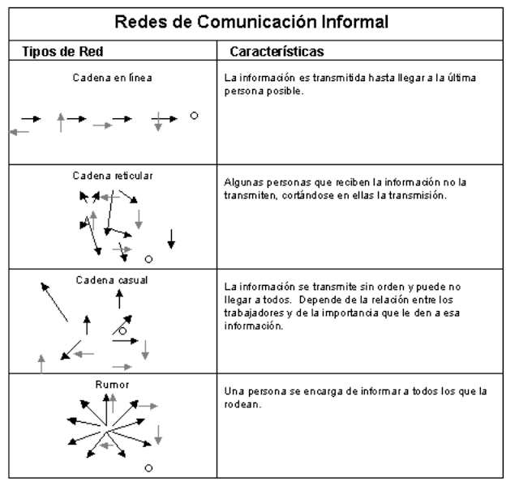

> **Descripción de la imagen** — La imagen es una tabla comparativa titulada "Redes de Comunicación Informal", que clasifica y describe diferentes tipos de redes de comunicación informal. La tabla está dividida en dos columnas: "Tipos de Red" y "Características".
>
> Los tipos de red descritos son:
>
> 1.  **Cadena en línea:** Se caracteriza por la transmisión de información hasta alcanzar a la última persona posible.
> 2.  **Cadena reticular:** Implica que algunas personas que reciben la información no la transmiten, interrumpiendo el flujo de la comunicación.
> 3.  **Cadena casual:** La información se transmite sin un orden definido y puede no llegar a todos los destinatarios, dependiendo de las relaciones entre los trabajadores y la relevancia que le otorguen a la información.
> 4.  **Rumor:** Se define como una situación en la que una persona es responsable de informar a todas las personas que la rodean.

34

Redes Informales

Vimos ya los mensajes que
circulan a través de las
líneas funcionales de la
organización, a las que
llamamos: redes formales,
ahora es el turno a las que
operan
de
manera
contraria, es decir, las que
NO fluyen siguiendo los
canales formales de comunicación.

Según afirman Martínez y Nosnik, la comunicación informal es:

x El intercambio de información que se establece entre las

personas en una organización, independientemente de los
puestos que ocupan en ella.

Fuente: (Blogspot, 2017)

Fuente: (Hancock, 2016)

---

<!-- página 39 -->

35

x La que no sigue canales ni procedimientos establecidos

formalmente.
x La que toca elementos de trabajo, sin tener la legitimidad

de
las
autoridades
correspondientes
en
esa área.
(MARTÍNEZ Y NOSNIK, 1988: 58)
El impacto que genera en el Clima Laboral esta comunicación
informal cuando es negativa, es que logra favorecer la
fabricación de un clima tóxico en las empresas. Este hecho viene
motivado por el malestar e incomodidad que se genera en la
persona que recibe la información al no disponer de ninguna
fuente
donde
contrastar
la
misma.
Esto
generalmente
desemboca en que la persona busque obtener otras versiones de
dicha noticia a través de su propia comunicación informal, siendo
esta acción un acelerante en la propagación de dicho rumor. El
resultado final es que esta situación termina muchas veces
impactando en la motivación y compromiso de los empleados
con su compañía. Evidentemente estas redes informales hacen
disminuir la productividad y la eficiencia de las personas que
integran la compañía, ya que disminuye la confianza que los
empleados tienen en sus empresas y en el equipo directivo. Pero
si existe un peligro con serias consecuencias para una compañía,
es aquel que se genera no sólo a nivel interno, sino a nivel externo
sobre la marca, ya que esta acción puede influir en el
comportamiento de los empleados en la interacción con el
cliente. Las consecuencias de dicha situación es que puede llegar
a tener efectos en la cuenta de resultados de la compañía, ya
que el crecimiento de dicho rumor hace que se propague a
diferentes
áreas
de
influencia
dentro
de
la compañía,
impactando en sus diferentes stakeholders, como, por ejemplo;
empleados, clientes, proveedores, etc.
La típica rumorología o comunicación de boca en boca tiene tres
características principales:

ƒ No es algo que controle el management o gestión de los

directivos en la compañía.
ƒ La mayoría de los empleados lo percibe a veces como algo

más creíble que las comunicaciones formales de la alta
dirección en dicha compañía.

---

<!-- página 40 -->

> **Descripción de la imagen** — La imagen es predominantemente negra, con muy poco contenido visual discernible. En la esquina inferior derecha se aprecian algunos trazos o caracteres muy tenues y borrosos.

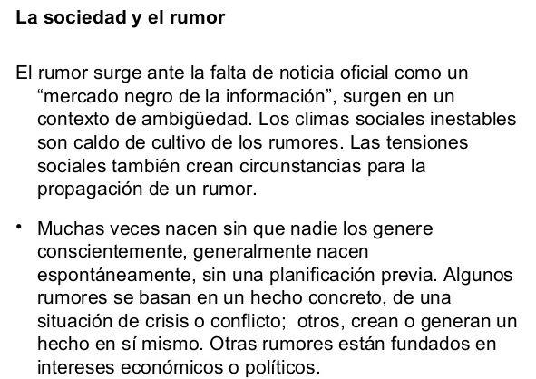

> **Descripción de la imagen** — No se ha adjuntado ninguna imagen para describir. Por favor, proporcione la imagen para que pueda realizar la descripción solicitada.

36

ƒ Es ampliamente utilizada por diferentes públicos internos

(empleados, secretarias, mandos intermedios, etc.), para
diversos fines.

Es la comunicación que no está establecida, pero que aun así se
lleva
a
cabo.
Pues
básicamente
se
compone
de
las
conversaciones que tienen los empleados sobre algún tema, sea
o no relacionado con el trabajo. Esta red surge en la mayoría de
los casos por la necesidad de socializar de las personas, de
establecer contactos dentro y fuera de nuestro equipo de trabajo,
así como en otros departamentos. Además, también lo hacen
porque tienen algún interés personal o emocional en una
situación o porque les llega información reciente que  ́deben
diseminarμ.
Las
redes
informales
regularmente
transmiten
noticias
y
comentarios. Pero también, en muchas ocasiones, arrastra el
rumor.
El rumor es conocido como la parte que daña esta red de
comunicación, pues  ́en general es ambigua, carece de
fundamentos y en su difusión las personas que los transmiten filtran
y seleccionan aquellos sucesos que mayor impacto les causan,
distorsionando el sentido del mensaje originalμ. Entre sus causas
encontramos: el interés que se tiene por una situación, la
ambigüedad, lo confuso, la falta de información oficial alrededor
de la situación.

---

<!-- página 41 -->

37

Aun cuando puede ser peligrosa para la empresa, la
comunicación informal cuenta también con características que
la benefician:

ƒ Brinda retroalimentación sobre el desempeño
ƒ Traduce órdenes formales a un lenguaje más accesible
ƒ Hace saber extraoficialmente mensajes de relevancia
ƒ Es más rápida y flexible
Pero:
‡ Es incompleta, lo que puede acarrear malos entendidos
Por ello, la gerencia debe responder de manera rápida y efectiva,
a través de las siguientes acciones:

A. Si el propósito es evitarla, habrá que difundir información

oficial de manera completa, clara y oportuna.
B. Si se quiere aprovechar, debe preocuparse por estar al

tanto de lo que ésta difunde para saber qué es lo que tiene
inquieto al personal, y para conocer los  ́vacíosμ de
información existentes y que se quieren llenar con este tipo
de comunicación.
La creación de grupos informales dentro de la organización es
algo que no puede erradicarse, pues es la propia naturaleza
humana la que incita a tener relación con algunos otros
empleados. Por ello, aunque no guste a la gerencia, debe tener
cuidado en lo que de esta red surge, pues de cierta forma, es el
sentir de los trabajadores. Ya que casi siempre, hablan mucho
más, de manera más abierta y con mayor confianza con sus
compañeros que con sus jefes. Esto también da la pauta a los jefes
de que busquen agilizar y mejorar las relaciones que tienen con
los
empleados.
Lo
que
significa,
mejorar
las
redes
de
comunicación formales. Recordando rápidamente que debe
ponerse empeño en el fomento del liderazgo en la organización,
ya que, si los trabajadores perciben a su jefe como un líder, le
tendrán respeto, confianza, pero no miedo. Esto conllevará a flujos
más eficientes y rápidos en la comunicación, a mayor motivación
para el trabajo, compañerismo, etc.

Relación con el AO (APRENDIZAJE ORGANIZACIONAL)

La estructura y comunicación en los grupos informales son de
suma importancia para el AO, pues son ellos quienes deben
aprender a trabajar en equipo, a quienes se les motivará para

---

<!-- página 42 -->

38

comprometerse más con la visión de la empresa, que, al haber
mayor confianza entre ellos, será compartida: una en la que él
haya participado y que esté dispuesto a seguir, pues no interfiere
en su visón personal. Además, en estos grupos informales es donde
corre gran cantidad de información, por lo que, si se da de
manera correcta, podría ser una herramienta para difundir las
estrategias de aprendizaje que se quieran llevar a cabo en la
empresa, así como los elementos culturales, y las razones por las
que se ha decidido tal o cual cosa.

---

<!-- página 43 -->

> **Descripción de la imagen** — Se trata de una ilustración de diseño plano (flat design) con un fondo de color turquesa. El elemento central es un megáfono grande de color blanco y gris, orientado hacia la derecha.
>
> Alrededor del megáfono, hay varios íconos flotantes que representan conceptos relacionados con comunicación, marketing y negocios:
>
> 1.  **Comunicación/Ideas:** Una burbuja de diálogo con una pequeña bandera roja (o avión de papel) se encuentra cerca del megáfono.
> 2.  **Finanzas y Audiencia:** En la parte superior izquierda hay un signo de dólar ($) y un ícono de persona.
> 3.  **Medios Digitales:** Hacia la derecha, se encuentran varios símbolos: un ícono de video (play), un sobre o carta (correo electrónico), y el símbolo "@" (correo/redes sociales).
> 4.  **Métricas y Procesos:** En la parte superior derecha hay un signo de porcentaje (%), y debajo de él, un ícono de engranaje (engranaje) que simboliza proceso o mecanismo.
> 5.  **Interacción y Compra:** En la parte inferior derecha se observan un ícono de ojo (observación/visualización) y un carrito de compras.
>
> La composición general sugiere un flujo de difusión o promoción, donde el megáfono es el punto de origen de ideas que se distribuyen a través de diversos canales digitales y comerciales.

39

CAPÍTULO III

COMUNICACIÓN EXTERNA

Fuente: (Mx, s.f.)

Definición

Si la comunicación interna se compone de las redes y mensajes
que fluyen dentro de la organización y que por tanto buscan un
cambio en su interior, entonces la comunicación externa es
aquella en la que estos mismos elementos se dirigen hacia afuera
de la empresa.
Definiendo, Hernández nos dice que este tipo de comunicación
́es el conjunto de mensajes emitidos por cualquier organización
hacia sus diferentes públicos externos, encaminados a mantener
o mejorar sus relaciones con ellos; a proyectar una imagen
favorable o a promover sus productos o serviciosμ. (HERNÁNDEZ,
2002)
Desde el punto de vista de la mercadotecnia, Eyssauter afirma
que la comunicación de mercadotecnia va de la mano con la
organización, pues ésta se comunica mediante sus productos y/o
servicios, para lograr crear, modificar o mantener la imagen
deseada. (CASTAÑEDA, 2003: 78)
Los dos autores y De Marchis coinciden al clasificar los tipos de
dicha comunicación: relaciones públicas, publicidad y dentro de
ella, la publicidad institucional. Aunque el último autor, en su tercer
modelo de estructura del gabinete de Comunicación, ubica a la
mercadotecnia como parte de la comunicación y no al revés,
como lo afirma Eyssauter. (DE MARCHIS, 2002)

---

<!-- página 44 -->

> **Descripción de la imagen** — Es una ilustración gráfica que representa a varias manos sosteniendo equipos de grabación y transmisión. Varias manos están levantadas en el centro, sosteniendo micrófonos y una cámara fotográfica. Uno de los micrófonos visibles tiene un indicador o etiqueta que dice "LIVE". El fondo es de color azul claro y presenta un gran círculo abstracto o un efecto de lente. La composición sugiere un tema relacionado con la cobertura mediática, la transmisión en vivo o el periodismo.

40

Relaciones publicas

Fuente: (Americas, s.f.)
Schewe citado por Castañeda distingue a las también conocidas
como RR PP, como un medio de comunicación de la
mercadotecnia tan importante como la publicidad. Y dice que su
fin  ́es crear una imagen favorable hacia la empresa entre sus
propios productos, empleados, accionistas y el público en
generalμ. Además, comenta, su labor es permanecer en
constante comunicación con el público,  ́creando una actitud
positiva del consumidor y una buena predisposición hacia la
empresaμ (CASTAÑEDA, 2003: 79)
En la misma línea, De Marchis afirma que las Relaciones Públicas
son las encargadas de  ́romper las barreras en el entorno de las
empresasμ, pues refuerzan el prestigio de los servicios y productos,
además de que se encargan de lidiar con las relaciones de su
espacio: clientes, sociedad en general, clientes potenciales, etc.
Además de ser la herramienta mediante la cual se llega a la
competencia para que conozcan  ́nuestro lugar en el ambiente
empresarialμ. (DE MARCHIS, 2002)
Por otro lado, el catedrático afirma que dentro de las RR PP
también encontramos las relaciones con los medios de
comunicación, cuyo objetivo es  ́que los medios se acostumbren
a contar con la información que les damos y que la soliciten
cuando la necesiten, es decir, que nos vean como una fuente

---

<!-- página 45 -->

> **Descripción de la imagen** — La imagen es una ilustración de estilo plano que representa a un grupo de personas estudiando o colaborando en torno a un círculo central.
>
> En el centro, varias figuras están reunidas y dispersas por el área circular. Las personas están interactuando con materiales de estudio: algunos sostienen libros abiertos, otros escriben en laptops, y varios miran dispositivos electrónicos como teléfonos inteligentes o tabletas.
>
> Los elementos visuales incluyen:
> *   Varias personas sentadas o inclinadas alrededor del círculo.
> *   Libros, cuadernos y papeles esparcidos sobre el suelo y las superficies.
> *   Laptops y dispositivos móviles utilizados por los participantes.
>
> La composición general sugiere una escena de estudio grupal o colaboración académica.

41

veraz y fiableμ. Así,  ́podremos transmitir los mensajes que
queramos hacer llegar a nuestros públicos externosμ.
El autor asegura que estas relaciones deben ser:

ƒ Humanas,
pues
requieren
un
contacto
directo,
personalizado y periódico.
ƒ Cordiales,
consecuencia
de
la
periodicidad
y
la
interdependencia entre ambos.
ƒ Profesionales, pues ellos saben lo que tienen que hacer y el

departamento de comunicación también.
ƒ Permanentes, en otras palabras, constantes y no sólo

cuando nos interesa o nos conviene.

Identidad organizacional

En general se define identidad
organizacional
como
la
base
inconsciente
de
la
cultura
organizacional. Específicamente
es la totalidad de los patrones
repetitivos del comportamiento
individual
y
de
relaciones
interpersonales, que todos juntos
reflejan
el
significado
no
reconocido
de
la
vida
organizacional.
Si
bien
la
identidad
organizacional
está
influenciada por el pensamiento consciente: la forma en que se
relacionan los individuos en el trabajo está en principio motivada
por pensamientos y sentimientos inconscientes. Su nacimiento
depende de la transferencia de emociones que se da bajo la
estructura organizacional.

La identidad organizacional difiere, bruscamente de la cultura
organizacional
por
el
papel
importante
del
identidad-
organizacional fenómeno de transferencia. La naturaleza de las
conexiones o desconexiones emocionales es el equilibrio de la
vida organizacional y la esencia de la identidad organizacional.
Lo central de esta subestructura emocional es especialmente
crucial cuando hay una demanda de cambio y desarrollo
organizacional. El cambio depende de la buena voluntad de los

---

<!-- página 46 -->

42

miembros de la organización para asumir la responsabilidad por
sus acciones y para abandonar el status quo.
Pero esta buena voluntad es el resultado de un entendimiento
mutuo
de
emociones
compartidas
entre
superiores
y
subordinados,
y
más
comúnmente
entre
pares
en
las
organizaciones y es el resultado del reconocimiento que estos
hacen de sus expectativas y deseos inconscientes. Ayudar a los
miembros de una organización a ser conscientes de la estructura
de la identidad organizacional y su lugar en ella, es una buena
medida para liberarlos del estrés del cambio organizacional, lo
que es estratégicamente sano y productivo. Bajo situaciones de
estrés podemos tener un pantallazo sobre en qué consiste la
identidad organizacional. A menudo la disposición de la
identidad organizacional se revela a través de los actos del
management,
mediante
intimidaciones,
denostaciones
y
conflictos interpersonales e intergrupales, anulación de los
problemas organizacionales y responsabilidades personales.
Pudiendo acceder a la experiencia organizacional de los
individuos nos ayudará a entender mejor las motivaciones
colectivas e individuales que gobiernan el comportamiento y nos
permite distinguir de otra manera organizaciones similares, unas
de otras. La identidad organizacional define quienes somos en un
grupo y quien o que podemos llegar a ser como miembros de
grupos (identidad dentro de un rol determinado).
La identidad organizacional puede ser encontrada en la
dificultad
para
observar
interacciones
dentro
de
las
organizaciones -en la estructura intersubjetiva de lo que Heinz
Kohut llama auto-objeto de las relaciones interpersonales.
Descubriendo esto, observaremos como es la experiencia de la
gente con su prójimo, y observaremos cómo se manejan a sí
mismos y a los demás bajo circunstancias estresantes. Esto no
significa que la gente en las organizaciones comparta la misma
idea acerca de la organización. Esto implica que la cultura
organizacional y las estrategias para gestionar asuntos internos y
externos son resultado de las experiencias y personalidad de los
individuos que dan forma a las experiencias y significados
organizacionales.

---

<!-- página 47 -->

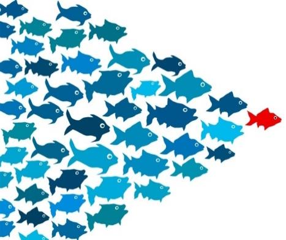

> **Descripción de la imagen** — La imagen es una ilustración o un patrón compuesto por múltiples peces estilizados de color azul brillante. Los peces son pequeños y tienen un diseño simple y redondeado. Están dispuestos de manera densa, superponiéndose ligeramente en varias áreas, creando una composición abstracta y vibrante.

43

El concepto de identidad organizacional no es completamente
nuevo.
Los
teóricos
y
consultores
de
la
psicoanalítica
organizacional no tienen siempre la misma concepción sobre la
identidad organizacional aun cuando estudien el mismo
fenómeno.
La identidad organizacional representa el medio por el cual los
grupos de trabajo se orientan a sí mismos hacia la organización y
mediante la cual los individuos adquieren su propio sentido de
seguridad e identidad como miembros.

Orígenes psicológicos de la identidad organizacional

Acerca de la identidad individual,
Erik
Erikson
relaciona
psiquis,
cultura e historia con el destino
individual:
́El problema de la identidad es,
(tal como el término connota) la
capacidad del ego de sostener la
identidad y la continuidad ante un
destino cambiante.

Pero el destino siempre se entrelaza con cambios y condiciones
inherentes que son el resultado de las etapas de la vida y cambios
del entorno, lo que ocurre todo el tiempo. La identidad connota
una determinada elasticidad para poder mantener patrones
esenciales durante el proceso de cambio. Así, extraño como
parezca se requiere de una identidad muy bien constituida para
tolerar un cambio radical, la identidad bien constituida se ha
organizado a sí misma entorno a valores básicos que todas las
culturas tienen en común. (1964: 97-96)μ.
La
cultura
organizacional
descansa
sobre
la
identidad
organizacional, así como la conciencia descansa sobre los
reclamos
conflictivos
del
inconsciente.
La
identidad
organizacional es la formación de un compromiso teniendo en
cuenta los objetivos contradictorios de los miembros de la
organización.
Es un producto de la cultura organizacional, de su historia, de la
psicología de sus miembros y de la psicología de los líderes

Fuente: (Mind, s.f.)

---

<!-- página 48 -->

44

actuales, los pasados y los que vendrán. Consiste en estructuras
repetitivas de la intersubjetividad que se encuentra en las
relaciones interpersonales entre superiores y subordinados, que
son en principio dirigidas por estimaciones y expectativas
inconscientes
que
influencian
las
decisiones
y
acciones
organizacionales. Cuando algo funciona mal entre las personas
de las organizaciones, puede ser a causa de las obligaciones y
tensiones psicológicas entre ellos.
Adentrarse en las dimensiones psicológicas inconscientes de la
identidad organizacional en conflicto, es esencial para restaurar
completamente la eficacia.
Los sentimientos individuales sobre la participación en una
organización tienen sus raíces en la infancia. Winnicott (1965)
habla del ¶entorno de contenciyn· (holding environment) en
referencia a la relación inicial entre madre y niño.
Kohut de modo similar ofrece una explicación acerca de las
relaciones interpersonales que tiene un adulto, pero con orígenes
en la primera infancia y la niñez. (1977:1984); que afirma que en
esta relación nace una base narcisista o de transferencias de
auto-objeto.
En síntesis, la identidad organizacional es un marco para
interpretar los sentimientos y experiencias organizacionales
basadas en relaciones propias y de otros. Es una teoría que guía
el accionar de los miembros de una organización que desean
indagar en las relaciones propias y de los demás en el análisis
sobre las organizaciones.
Su premisa principal es que el modelo para entender las acciones
inconscientes de los adultos en las organizaciones puede hallarse
en las dinámicas propias y de los demás en la infancia.
De forma similar al rol de los padres para crear un ambiente seguro
y en lo que Winnicot denomina un buen y suficiente entorno de
contención para el desarrollo de la noción de sí mismos de los
bebés, el ambiente organizacional del adulto puede ayudar o
dañar la autoestima y en consecuencia satisfacer o frustrar las
necesidades normales de narcisismo de los miembros de dicha
organización. Los dilemas psicológicos de los miembros de una
organización, pueden así revivir ansiedades de la infancia.

---

<!-- página 49 -->

> **Descripción de la imagen** — La imagen es una ilustración de estilo plano y colorido que representa la interacción humana con dispositivos móviles y diversas actividades digitales. Muestra varias manos sosteniendo teléfonos inteligentes, cada uno mostrando una función diferente:
>
> 1.  **Parte superior izquierda:** Una mano sostiene un teléfono que muestra un ícono de un pájaro o ave.
> 2.  **Centro superior:** Otra mano sostiene un teléfono con un ícono de cámara.
> 3.  **Fondo derecho:** Se observa parcialmente el globo terráqueo.
> 4.  **Centro:** Una mano sostiene un teléfono que muestra un ícono de cubiertos (tenedor y cuchillo).
> 5.  **Derecha central:** Otra mano sostiene un teléfono que muestra notas musicales.
> 6.  **Parte inferior izquierda:** Una mano sostiene un teléfono que muestra un ícono de una tienda o carrito de compras.
> 7.  **Parte inferior derecha:** Una mano sostiene un teléfono con un ícono de menú (tres puntos).
>
> La composición general utiliza diferentes tonos de color y formas geométricas para destacar la variedad de usos y aplicaciones de la tecnología móvil.

45

Publicidad

Fuente: (Web, s.f.)

Según Pride citado por Arista Garza,  ́es una forma pagada de
comunicación impersonal sobre una organización, sus productos,
o ambas cosas, que se transmite a una audiencia seleccionada
como meta mediante un medio masivoμ. (ARISTA, 1998: 33)
El segundo autor, plantea que las personas y las organizaciones
usan la publicidad para la promoción de servicios, mercancías,
ideas, temas y hasta personas. Además, propone a la publicidad
como un  ́método promocional sumamente flexibleμ pues brinda
a la compañía la oportunidad de llegar a mayores audiencias
metas.
La desventaja de la publicidad es que su costo por persona a la
que llega puede ser bajo, contrario a lo que se invierte en ella. Así,
frecuentemente la publicidad  ́no brinda una retroalimentación
rápida. Es difícil medir sus resultados. Además, en comparación
con las ventas personales, la publicidad no tiene un efecto
persuasivo tan grande sobre los consumidoresμ.
De su lado, Schultz plantea a la publicidad como  ́un mecanismo
para transmitir informaciónμ. Y la distingue como un subconjunto
de la mercadotecnia que se basa en  ́la evolución y coordinación
de la estrategia centrada en el producto y el consumidorμ. Así
menciona sus objetivos: presentar un producto a una porción del
mercado y animar a los compradores a aceptarlos, así como

---

<!-- página 50 -->

46

tratar de posicionar la marca, informando y persuadiendo al
mercado meta con sus beneficios. (CASTAÑEDA, 2003: 79)

Publicidad institucional

Schultz citado por Castañeda, la concibe como una clase de
publicidad: del producto e institucional. Y nos dice que se dirige a
promover la imagen de la organización, así como su reputación o
ideas, a diferencia de la otra, que se basa en el producto en sí.
Además de buscar el desarrollo o mejora de las relaciones con los
clientes, otras organizaciones, miembros actuales, empleados o
público en general.

Relación con el AO

La comunicación externa entonces es el vínculo existente entre el
exterior de la empresa y ella misma. Por lo tanto, es la herramienta
o vehículo que trae información y conocimiento del ambiente
que rodea a la organización. Es decir, a través de la
comunicación externa, además de que la empresa se
promocione, busque una mejor imagen ante los demás, etc.,
también se consigue una retroalimentación del exterior hacia
adentro, en el que si la empresa está implementando el AO, se
dará cuenta que ésta trae información y conocimientos
necesarios para estar al tanto de lo que rodea a la empresa, y
proponer el empleo de estrategias que le ayuden a adaptarse a
los continuos cambios. Es así, como la comunicación externa
complementa la concepción de la empresa como sistema
abierto dependiente tanto de sus partes internas como de las
exteriores.
La información del ambiente proviene también de los propios
empleados que escucharán algo fuera y lo comentarán dentro,
de algún cliente que llame diciendo algo, reclamando, de
comunicados de prensa, notas, etc. Por lo tanto, el empleado
debe estar preparado para distinguir la información que será útil
o perjudicial a la empresa (a través de la previa capacitación y
transmisión de información implementadas por el AO) y llevarla
consigo al trabajo no para crear rumores, sino para compartirla
con los demás y buscar herramientas para mejorarla o en su caso,
mantenerla. Es decir, el entorno de la empresa, y sobre todo, el de
los propios empleados, llevará a su interior, información y

---

<!-- página 51 -->

> **Descripción de la imagen** — La imagen es una ilustración densa y texturizada que representa la forma de un brazo musculoso, específicamente el bíceps y el hombro.
>
> El cuerpo principal está compuesto por una multitud muy grande de figuras humanas diminutas, de diversos colores, que están agrupadas para formar la silueta muscular. La densidad de las figuras es extrema, creando un efecto visual sólido y texturizado.
>
> La composición muestra claramente los contornos musculares del brazo, con las figuras concentrándose en definir la forma del músculo. El estilo general es el de una imagen colectiva o de masa, donde la suma de las partes individuales crea una forma macro.

47

conocimientos que pueden o no beneficiarle, pero de saber qué
es lo que pasa afuera, dependerá también cómo se funcione
dentro. Debe tenerse muy en cuenta, que el entorno muchas
veces no puede controlarse, pero lo que pasa al interior sí, y por
eso en este trabajo de investigación se propone al AO como una
alternativa que logrará lo anteriormente dicho.

Cultura organizacional

Fuente: (Espinoza, s.f.)

¿Qup es la cultura organizacional?

Robbins citado por Alvarado y Estrada, afirma que hace diez años,
las organizaciones eran consideradas simplemente como un
medio racional con el cual coordinar y controlar un grupo de
personas. Pero poco a poco los teóricos de la organización han
comenzado en los últimos años, a reconocer y admitir la
importante función que la cultura desempeña en los miembros de
una organización. Pues al igual que cada individuo que
pertenece a ella, la organización también tiene su propia
personalidad. (ALVARADO Y ESTRADA, 2002: 23-24)
Según Goffe y Jones, la cultura en una empresa  ́está compuesta
por
símbolos,
comportamientos
y
asunciones
que
son
ampliamente compartidos en el seno de una organización. Así,

---

<!-- página 52 -->

48

definen a la cultura corporativa como  ́la forma de actuar en una
organizaciónμ, lo que hace única a cada empresa.
Entonces, cuando se logra tener esa forma común de pensar, se
obtiene una forma de acción común en el lugar de trabajo. Así lo
afirma Shockley citada por Valdés,  ́la cultura en una
organización se entiende como la manera en que se realizan las
cosas y la forma de comunicarse para la realización de las
actividadesμ.
Tom D. Daniels y Barry K. Spiker complementan lo anterior
apuntando que la cultura existe en una empresa cuando los
individuos de un grupo social tienen una referencia común de
interpretación y acción, referencia que incluye los valores,
creencias y experiencias, que se traducen en costumbres,
tradiciones e inclusive procesos de comunicación. (VALDÉS, 2003:
30)
Robbins presenta una definición que engloba los aspectos
anteriormente citados:  ́es un sistema de significados compartidos
por parte de los miembros de una organización y que distingue a
una organización de otrasμ. (ROBBINS, 1993: 620) El mismo autor
identifica las características primarias que de manera general
engloban la esencia de la cultura:

ƒ La identidad de los miembros: el grado en que los

empleados
se
encuentran
identificados
con
la
organización como un todo y no sólo con su tipo de trabajo
o campo de conocimientos profesionales.
ƒ Énfasis en el grupo: el grado en que las actividades

laborales se organizan en torno a grupos y no a personas.
ƒ El enfoque hacia las personas: el grado en que las

decisiones de la administración toman en cuenta las
repercusiones que los resultados tendrán en los miembros
de la organización.
ƒ La integración en unidades: el grado en que se fomenta

que las unidades de la empresa funcionen coordinada e
interdependientemente.
ƒ El control: el grado en que se emplean las reglas,

reglamentos y supervisión directa para vigilar y controla la
conducta de los trabajadores.

---

<!-- página 53 -->

49

ƒ Tolerancia y riesgo: el grado en que se fomenta la

agresividad, innovación y capacidad de riesgo en los
empleados.
ƒ Los criterios por compensar: grado en que se distribuyen las

recompensas, como los aumentos de sueldo y los ascensos,
de acuerdo con el rendimiento del empleado y no con su
antigüedad,
favoritismo
y
otros
factores
ajenos
al
rendimiento.
ƒ Tolerancia al conflicto: grado en que se fomenta que los

empleados traten abiertamente sus conflictos y críticas.
ƒ El perfil hacia los fines o los medios: grado en que la

administración se perfila hacia los resultados o metas y no
hacia las técnicas o procesos usados para alcanzarlos.
ƒ El enfoque hacia un sistema abierto: grado en que la

organización controla y responde a los cambios del entorno
externo, observándose como un  ́todoμ.
Por su parte Denison habla de cultura al referirse a los valores, las
creencias y los principios fundamentales que constituyen los
cimientos del sistema gerencial de una organización, así como
también al conjunto de procedimientos y conductas gerenciales
que sirven de ejemplo y refuerzan esos principios básicos. Éstos
perduran porque tienen un significado para los miembros de la
organización. (DENISON,1991: 2)

Perspectivas

La cultura organizacional es un término descriptivo que se refiere
a la forma en la que los trabajadores perciben las características
anteriores, y no si les agradan o no están de acuerdo con ellas. Es
decir, no es un concepto evaluativo, a diferencia del de
satisfacción laboral. Además, la cultura que expresa los valores
centrales compartidos por la mayoría de los integrantes de la
organización, se denomina la cultura dominante. Pero la
existencia de una cultura general, no evita que dentro de la
misma organización se desarrollen subculturas, entendidas como
mini
culturas
que
suelen
definirse
de
acuerdo
con
la
denominación de departamentos y la división geográfica. Así, los
valores centrales de la cultura organizacional, los que son

---

<!-- página 54 -->

50

aceptados en toda la empresa, prevalecen aunados a otros
específicos de cada subcultura. (ROBBINS, 1993:623-624)
Daniels y Spiker señalan dos perspectivas de la cultura dentro de
la organización: la funcionalista y la interpretativista.
La primera plantea como metas al desarrollo y cambio de la
cultura en la organización con el objetivo de lograr la eficiencia
necesaria en la empresa, definiendo a la cultura como  ́el
conjunto de instrumentos de la vida organizacional, tales como los
mitos, historias, leyendas y ritualesμ que deben promoverse
realizando una serie de actividades en el que se encuentre el
control del instrumento cultural mediante el manejo eficaz y viable
de los símbolos. Por otro lado, la segunda perspectiva establece
una meta que consiste en la descripción y la crítica de la cultura
organizacional tomando como referencia al significado que de
ésta tienen los miembros de la empresa. Y define a la cultura
como  ́una referencia que permite la interpretación comúnμ, que
propone
la
realización
de
estudios
de
los
significados
representados en cada miembro de la organización, y
posteriormente realizar un discurso en el que se realcen los
símbolos más importantes. (VALDÉS, 2003: 30-31)

¿Qup busca la cultura organizacional?

Como ya mencionamos, la cultura organizacional permite la
cohesión de las conductas individuales y la unificación de la visión
empresarial para lograr los objetivos organizacionales. ¿Pero
cuáles son sus funciones específicas?, de acuerdo a Robbins son:

ƒ Desempeñar un papel que defina límites, es decir, que

señale diferencias entre nuestra organización y las demás.
ƒ Conferir a la empresa un sentido de identidad.
ƒ Facilitar la generación del compromiso con algo superior al

interés personal de cada empleado.
ƒ Reforzar la estabilidad del sistema social. (ROBBINS, 1993:

626)
De acuerdo a lo anterior, la cultura está orientada al logro de las
metas de la empresa. Denison, plantea que dentro de estos
objetivos tocados por la cultura se encuentran la efectividad de
las acciones realizadas y el rendimiento de sus empleados. Pues,
las estrategias utilizadas, la estructura de la organización  ́tienen

---

<!-- página 55 -->
### 51
### su origen en las convicciones y en los valores de la mismaμ.
### (DENISON, 1991: 159) Así, plantea una relación directa sobre estos
### dos factores, que desembocan necesariamente en mayor
### productividad.
### Clasificación de la cultura organizacional
### Existen varios modelos, nosotros en este caso incluiremos una tabla
### en la que se recogerán dos polos opuestos: la cultura
### organizacional débil, la cual debe mejorar en aquellos puntos
### donde falla, y la fuerte, donde se considera el punto ideal para
### una organización:

CARACTERÍSTICAS
C.O. DÉBIL
C.O. FUERTE

AUTONOMIA

Supervisión
estrecha.
Los
trabajadores
tienen
poca
liberta en su puesto

Supervisión
general.
Todos
tienen libertad para resolver los
problemas de su puesto

ESTRUCTURA

Puesto
de
trabajo
estandarizado.
Reglas
y
procedimientos formalizados

Puestos de trabajo flexibles.
Reglas y procedimientos no
formalizados

APOYO

La dirección se centra en la
producción y muestra escaso
interés por su plantilla

La
dirección
muestra
gran
interés y apoyo a la plantilla.

PREMIO

Se aprecian y premia la
fidelidad,
el
esfuerzo,
la
cooperación.
Se
desconocen
los
niveles
productivos del personal

Las compensaciones y ascensos
que se otorgan al personal están
basados
en
su
nivel
de
productividad.

CONFLICTOS

La gerencia mantiene un
nivel mínimo de conflicto
constructivo, debido a la
presencia
de
conflictos
disfuncionales o destructivos

La gerencia intencionalmente
aumenta
la
intensidad
del
conflicto
funcional
o
constructivo, lo suficiente para
que
siga
siendo
viable,
autocrítico y creativo.

RIESGOS

No se estimula al trabajador
a ser innovador y creativo

Se alienta y utiliza el talento
creativo
e
innovador
del
trabajador
### Fuente: (Emprendices, s.f.)

---

<!-- página 56 -->

52

¿Cuáles son sus componentes?

Para que la empresa tenga el éxito esperado, es necesario que
los empleados se sientan identificados con ella, por lo que deben
fomentarse los elementos de la cultura organizacional, logrando
que todos compartan la visión propuesta por la propia empresa.
De acuerdo a Báez e Ibarra, los elementos de la cultura
organizacional son:
Misión: definida como la razón de existir y ser de una empresa. La
cual responde a cuatro cuestiones fundamentales: ¿quiénes
somos?, ¿qué hacemos?, ¿para quién lo hacemos?, y ¿por qué lo
hacemos? Teniendo las respuestas a dichas interrogantes se
contemplará que la misión sea o esté:

ƒ Enfocada al cliente
ƒ Positiva y motivadora
ƒ Entendible para todo el personal
ƒ Difundida,
entendida
y
aprendida
por
todos
los
trabajadores de la organización. Así mismo, la misión debe
ser concreta, objetiva y flexible, pero sin dejar los valores
establecidos, que cumpliendo en su totalidad los objetivos
impulsará el cambio. De esta forma, las acciones se
encontrarán guiadas y orientadas al propósito de las
mismas.
Visión: es una herramienta administrativa que permite, con base
en acontecimientos presentes, proyectar el futuro de la
organización. En otras palabras, es proyectar a futuro la misión
empresarial. Ésta debe cumplir las siguientes características:

ƒ Definir claramente el futuro deseado
ƒ Tener un enfoque definido
ƒ Representar para la organización un reto alcanzable
ƒ Ser altamente motivadora para todos los integrantes
ƒ Ser redactada en un lenguaje entendible y de ser posible,

tener la particularidad de que sean memorizables los
elementos básicos de la misma.
Filosofía: es la piedra angular necesaria para construir una base
sólida que permita orientar la organización hacia el éxito de forma
planeada,
haciéndola
más
ágil,
dinámica
y
flexible
proporcionando facilidades para el desarrollo del liderazgo con
un sentido de dirección adecuado y bien definido.

---

<!-- página 57 -->

53

Valores: son la base para formar una cultura de trabajo, la cual
constituye la disciplina esencial para guiar al éxito a cualquier
organización. Los autorespresentan los valores más comunes
dentro de la empresa:

ƒ Enfoque al cliente
ƒ Calidad
ƒ Mejora continua
ƒ Trabajo en equipo
ƒ Seguridad, ante todo
ƒ Ética y honradez
ƒ Respeto a la dignidad humana
ƒ Comunicación abierta (ALVARADO Y ESTRADA, 2002: 26-29)
Estos elementos en conjunto, cubrirán la necesidad primaria de
cualquier organización, creando una actitud de mejora en los
métodos de producción, en las habilidades y conocimientos
técnicos y de procesos, así como las actitudes de disciplina y
adopción de los hábitos de conducta general.

¿Cómo se aprende y manifiesta la cultura organizacional?

Robbins puntualiza que la cultura original se deriva de la filosofía
de los fundadores, y lo que los primeros miembros a quienes los
primeros miembros contrataron aprenden con su propia
experiencia. Es decir,  ́los actos de la alta dirección establecen el
clima general de la conducta aceptable y de la no aceptableμ,
dependiendo también de que los empleados socialicen si la
integración de los elementos de la cultura es exitosa.
Siguiendo esta línea, Denison afirma que  ́la naturaleza de una
determinada cultura es un reflejo de las estrategias originales de
los fundadores de una empresa, así como también las cosas que
se han aprendido y conservado con el tiempoμ. (DENISON, 1991:
159)
Stephen Robbins, afirma también que la cultura se transmite a los
trabajadores de diversas formas, en las que encontramos los
relatos de casos, los rituales, los símbolos materiales y el lenguaje.
De este modo, al crear una identificación de dichos aspectos, se
creará un código interno que será aceptado por los empleados y
que utilizarán día a día convirtiéndose en algo  ́naturalμ en su

---

<!-- página 58 -->

54

funcionamiento y desempeño laboral. (ALVARADO Y ESTRADA,
2002: 26)
Fernández de Collado citado por Valdés, nos presenta las
manifestaciones de la cultura organizacional:
Conceptual simbólico: forma en las que se puede explicar o
representar objetiva o subjetivamente al hombre, al mundo, lo
suprasensible y a la relación entre ellos. Ejemplos de esta
manifestación son: la filosofía organizacional, la misión, sus
estrategias, objetivos y programas. Además de los mitos y
creencias de la organización.
Conductuales: pautas de comportamiento e interacción entre los
miembros del sistema cultural. Comprenden desde el lenguaje, el
comportamiento no verbal, el ritual y las diferentes formas de
interacción dentro de la empresa.
Estructurales: pautas de comportamiento directa, que pretenden
asegurar el cumplimiento de los objetivos del sistema. Incluyen el
marco normativo, las relaciones de producción, la estructura del
poder, las formas de operación y la estructura social.
Materiales: recursos económicos, físicos y tecnológicos necesarios
para la productividad, que propician el bienestar del sistema
cultural. Es decir, los recursos tecnológicos, la instalaciones,
mobiliario y demás equipo con el que cuenta la organización.
(VALDÉS, 2003: 31 y HERNÁNDEZ 2002)
De
manera
resumida
podemos
decir
que
la
cultura
organizacional es algo que existe aún si no se estudia, al igual que
la comunicación. Son procesos y conceptos inherentes a la
empresa, pues está conformada por seres humanos. Los dos
buscan el logro de los objetivos organizacionales a través de sus
propias técnicas, herramientas y fomento de sus características y
elementos. Así, la cultura busca que los empleados sepan qué
hacer, cómo hacer y cuál es la importancia de sus acciones, lo
que puede fomentarse a través de la comunicación que se tenga
dentro de la misma. Pero no se debe olvidar que la cultura es la
́herenciaμ de lo que los fundadores y directivos han dejado a la
empresa mientras han pasado por ella, por lo que sería
conveniente evaluarla cuando se presenten o prevean cambios,
para adaptarla de manera adecuada al tiempo y espacio
presente.

---

<!-- página 59 -->

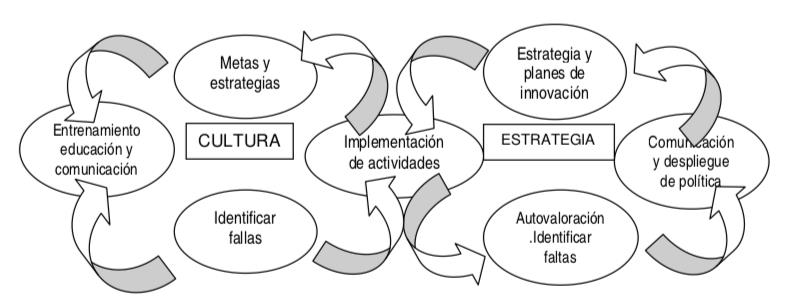

> **Descripción de la imagen** — Se trata de un diagrama de flujo o ciclo que ilustra un proceso continuo. El diagrama está compuesto por siete conceptos principales conectados por flechas curvas, formando un ciclo.
>
> Los elementos y su conexión son los siguientes:
>
> 1.  **CULTURA:** Es el punto central del ciclo.
> 2.  Desde **CULTURA**, se desprenden caminos hacia:
>     *   Metas y estrategias.
>     *   Entrenamiento, educación y comunicación.
> 3.  El flujo continúa hacia la derecha, donde se encuentran:
>     *   Estrategia y planes de innovación.
> 4.  A continuación, el proceso pasa por:
>     *   Implementación de actividades.
> 5.  Desde la Implementación, el ciclo se dirige a:
>     *   Estrategia.
> 6.  La Estrategia se conecta con:
>     *   Identificar fallas.
> 7.  Finalmente, después de identificar fallas, el proceso regresa para incluir:
>     *   Autovaloración e Identificar faltas.
>
> El diagrama muestra un ciclo continuo que relaciona la cultura, la planificación estratégica, la implementación, la evaluación y la autoevaluación.

55

Además, tomando las ideas de José Guadalupe Vargas, en el
afán de conseguir organizaciones aprendientes, se
está
observando la generación de una cultura y una dinámica
dirigidas al fomento de la capacidad de aprendizaje en las
organizaciones, es decir,  ́un aprendizaje continuoμ de acuerdo
con el ritmo actual, donde  ́el cambio es la regla y la estabilidad
la excepciónμ. Por lo tanto, en la organización aprendiente que
comparte y usa el conocimiento de tal forma que sus miembros
unifiquen sus esfuerzos a los de la empresa que lucha por
responder a los desafíos y cambios de su entorno, la estrategia y
la cultura están estrechamente ligados, pues  ́el ser una
organización aprendiente constituye una actitud y un estilo de
vidaμ. Así Vargas expone la idea de que  ́existe una vinculación
entre la visión, la estrategia general de organización y la
estrategia de innovación que tienen lugar en una cultura
organizacionalμ. (VARGAS, 2001:2).

Fuente: (Vargas, s.f.)

Análisis comparativo entre comunicación, cultura y aprendizaje

organizacional

Ya que hemos brindado toda la información necesaria para que
el lector conozca tanto al aprendizaje como a la comunicación y
cultura organizacionales, toca el turno al primer análisis de este
trabajo de investigación. A continuación, se presentan los puntos
principales obtenidos de la comparación de las tres áreas,
cumpliendo así nuestro primer objetivo específico: analizar al AO
desde el punto de vista de la comunicación.

---

<!-- página 60 -->

56

‡ La comunicación organizacional es el envío de mensajes a

través de canales, en los que se busca comunicar  ́algoμ
(sea los objetivos, metas, noticias, evaluaciones, logros, etc.)
a quienes pertenecen a la organización. Pero no sólo es
enviar información por enviarla, sino mandarla con la
finalidad de crear conocimiento sobre la organización en
sus integrantes, y para lograr tomar las decisiones
adecuadas. Por lo tanto, la comunicación organizacional
es un sistema, que  ́permite dinamizar y animar las acciones
individuales y colectivas para generar la integración de
esfuerzos y el fortalecimiento y desarrollo de la instituciónμ
‡ El AO busca que la empresa (entiéndase un conjunto)

cuente con el conocimiento necesario para afrontar los
cambios que se den tanto en su interior como en su exterior.
El conocimiento también puede crearse a través de
situaciones que son nuevas, y a las que se dieron soluciones
nuevas
también,
que
quedan
establecidas
como
conocimiento nuevo para los empleados, como un registro
de lo que se hizo, para en determinada ocasión revisarla y
ver si puede adaptarse a la situación que se presente en ese
momento.
‡ Este nuevo conocimiento o el existente, debe hacerse llegar

a los demás, y ¿cómo? Hablando desde el punto de vista
de un comunicólogo, sería a través de herramientas y
medios de comunicación. Es decir, cuando se tiene un
conocimiento que debe diseminarse en la organización de
manera segura y veraz, para que todos lo sepan, debería
hacerse a través de los medios de comunicación de la
empresa, además de las múltiples herramientas de
comunicación interna y externa que lo acompañan. Aquí
se plantea una relación entre las formas de crear
conocimiento vistas en el capítulo anterior, pues el
conocimiento tácito, el que no está formalizado, debe a
través de la comunicación, volverse explícito, algo que sea
conocido por los demás miembros de la organización, y
pueda ser utilizado por ellos, sin quedarse sólo en unos
grupos, pues esto sería perjudicial a la empresa y crearía

---

<!-- página 61 -->

57

barreras
de
comunicación
y
dañaría
el
ambiente
organizacional.
‡ La cultura organizacional compuesta por la misión, visión,

valores, filosofía, etc., busca que la forma de pensar de
todos los empleados vaya hacia el mismo lugar. Es decir,
guía las conductas de los demás hacia un lugar común. Es
así como el AO también lo busca, que cada individuo se
sienta identificado y orgulloso de su empresa, que se sienta
capaz y motivado de hacer su trabajo, teniendo el
conocimiento necesario que le brinde esta condición. Y
como lo dijimos, la cultura es inerte a las personas, siendo
éstas la esencia de la organización. Por lo tanto, cuando la
empresa conozca a sus empleados, lo que les molesta, lo
que les agrada, cuando sabe lo suficiente sobre cada uno
de ellos, sus aspiraciones, motivaciones, etc., podrá tomar
las mejores decisiones acerca de cómo establecer
estrategias que les brinden el conocimiento necesario sobre
su organización, sus propias funciones, y que logre sentirse
tan capaz como cualquier otro, y sobre todo que sepa
también que en determinado momento podrá tomar
decisiones adecuadas sin tener miedo de fracasar o sentirse
incompetente a causa de sus propios complejos o
problemas. La cultura entonces también busca la creación
de una visión compartida, que los empleados sigan.
‡ La comunicación organizacional, aunada a la cultura

buscan también que exista un clima laboral agradable,
satisfactorio dentro y fuera de la organización. Que los
empleados tengan mejores relaciones entre ellos mismos,
así como con sus superiores o altos mandos. Para que el
llegar a laborar no sea una obligación sino un gusto,
además de que así el empleado aceptará complacido las
labores a desarrollar dentro de un equipo, en el que todos
se conozcan y se lleven  ́bienμ. De manera en que el
aprendizaje en grupo se convierta progresivamente en algo
́naturalμ y que cada uno trabaje individual como
grupalmente, siguiendo la visión de la empresa que los
dirigirá a cumplir sus objetivos tanto personales como
organizacionales.

---

<!-- página 62 -->

58

‡ Quien comunica algo siempre espera o busca una

reacción, un efecto en su receptor, que regularmente son
cambios. Y que como dijimos pueden ser de tres tipos.
Tomando estos como referencia, veremos que el AO lo
busca también. Desea que los empleados logren modificar
su manera de aprender, y ¿cómo? A través de las disciplinas
propuestas por Senge, dentro de las cuales se busca que el
individuo deje de ser su propio obstáculo para su
crecimiento, es decir que tenga un dominio personal.
Además, que él mismo, logre diseminar los modelos
mentales, que finalmente causan conflictos en su persona
que logran que no se sienta capaz de comunicar a quienes
lo rodean, las ideas que tiene en su cabeza, sea por su
propio miedo o estructura de la vida, o por lo que puedan
decir de él. Lo que impide también el desarrollo de su
creatividad y su confianza con los demás. Aunado a que la
mayor parte de la gente no está acostumbrada a trabajar
en equipo, lo que dificulta lograr de manera rápida y eficaz
los objetivos de la empresa, por lo que se busca que la
empresa tome como esencial el aprendizaje grupal. Y con
todo ello, tanto el individuo como su grupo, y la
organización en general, serán tomados como elementos
interdependientes en un sistema encaminado a lograr lo
que éste se ha planteado y a superar las situaciones no
previstas si se diera el caso.
‡ A través de una cultura bien adoptada por los empleados,

es posible que el conocimiento que se genere y el existente,
vaya convirtiéndose en parte de ésta. Es decir, los resultados
del aprendizaje en la organización pueden  ́registrarseμ en
la cultura, pues el conocimiento se integrará en los
elementos que de ésta tiene la empresa, y logrará que
poco a poco éstos sean adoptados por los empleados,
quienes finalmente tomarán este conocimiento como algo
natural. Por lo tanto, el proceso de aprendizaje apoyado
por la comunicación y concentrado en la cultura, no será
un programa que deba implementarse continuamente, sino
sólo una vez, pero constantemente evaluado. Los resultados
de esta evaluación ayudarán en la creación de estrategias

---

<!-- página 63 -->

59

que busquen modificar lo que salió mal y que persistan en
lo que funcionó. Todo esto, debe apoyarse con una
adecuada gerencia del conocimiento que guarde lo
favorable para la empresa, y también las situaciones que
fracasaron, para poder prevenir, adaptar y solucionar
problemas causados por los cambios constantes que
afectan a la organización.
‡ La función de los líderes (sobre todo los gerentes), en la

implementación del AO es vital. Pues son ellos los
encargados de detectar a través de diagnósticos las
necesidades de la empresa, además de que son ellos
quienes consultarán a los directivos los problemas que se
han suscitado y propondrán, junto con los especialistas,
soluciones para los mismos. Entonces, el gerente es quien
estará a cargo de la implementación de sistemas como el
AO. Por ello, el fomento del liderazgo gerencial, y el de los
otros líderes formales e informales es esencial. Así, no sólo a
través de capacitación y cursos, sino de experiencias
vividas dentro de la organización, de la educación en
comunicación con los empleados, entre otros aspectos, son
en los que debe formarse el gerente y los demás líderes de
la empresa.
‡ Como se estudió, en el capítulo anterior, el reto más

importante de la organización que aprende es el de lograr
la capacidad de gestionar tanto la creación, desarrollo y
difusión del conocimiento. En términos generales, y en base
a lo ya analizado, podemos decir que la creación del
conocimiento organizacional puede ser a partir de la
experiencia propia, de la de los demás, de lo que está
establecido, de la influencia externa, de las crisis, problemas
y cambios.

---

<!-- página 64 -->

> **Descripción de la imagen** — La imagen es una ilustración gráfica que representa un apretón de manos simbolizando cooperación o asociación.
>
> El diseño muestra dos manos entrelazándose en el centro. Cada mano está compuesta por varias piezas de rompecabezas de diferentes colores, las cuales encajan perfectamente para formar la silueta de las palmas y los dedos.
>
> Los colores utilizados incluyen tonos azules, naranjas, verdes y marrones oscuros, creando un contraste visual entre las secciones de cada mano. La composición general es dinámica y sugiere la unión o el ensamblaje de diferentes partes para formar un todo cohesivo.

60

CAPÍTULO IV

DIRECCIÓN DE COMUNICACIONES

Que significa planificar las comunicaciones: significa que el
director del Proyecto tiene que determinar un plan para gestionar
las comunicaciones, con un enfoque adecuado para cubrir las
necesidades y requisitos de información entre todos los actores
interesados.
Qué es el plan de gestión de las comunicaciones: el director del
Proyecto desarrollará el plan de gestión de las comunicaciones.
Este plan es un plan subsidiario del plan de dirección del Proyecto
y describe la forma en que se planificarán + estructurarán +
monitorearán + controlarán las comunicaciones. Los resultados se
plasman en el plan de gestión de las comunicaciones del
Proyecto.
Cuáles son los términos relacionados con las comunicaciones en
el Proyecto: Codificación (traducción de pensamientos o ideas
hecha por el emisor) + mensaje (la salida de la codificación) +
retroalimentación (feedback) + medio (método utilizado para
transmitir el mensaje) + ruido (todo lo que interfiere con la
transmisión y comprensión del mensaje emitido) + decodificación
+ emisor (emisión efectiva) + receptor (escucha activa) + uso
adecuado de los cuatro tipos de comunicación: formal escrito,
formal hablado, informal escrito e informal hablado. Para el
examen PMP hay que familiarizarse con términos tales como,
bloqueadores de la comunicación, reglas de reuniones,
comunicación de lecciones aprendidas y la importancia de la
codificación no verbal.

LA COMUNICACIÓN POLÍTICA: El ser percibe y es percibido

Fuente: (Cela, s.f.)

---

<!-- página 65 -->

61

¿Qué es la comunicación política?

La comunicación política es toda actividad organizada, dirigida
a transmitir un mensaje que permita llegar a los electores con el fin
de influir sobre ellos buscando persuadirlos, orientarlos, educarlos
e informarlos.

¿Cuál es su objetivo?

El objetivo central de toda campaña política electoral es ganar
las elecciones. Este objetivo debe ser claramente establecido
pues, en el estallido de una campaña, el candidato presidencial,
el jefe de campaña, los voceros y los candidatos al Congreso
suelen olvidarse de él, perdiendo valiosísimo tiempo en
actividades secundarias.
En una campaña política democrática la comunicación estará
siempre presidida por una estrategia que busca captar los votos
necesarios para ganar la elección. La campaña política se puede
sintetizar en la idea de comunicar un mensaje para ganar votos.

El ser percibe y es percibido

Este concepto es fundamental porque, para el elector, su
percepción es la realidad. Parecerá paradójico que, en la
discusión filosófica, la apariencia ha sido siempre rechazada por
ser un solo un reflejo de la realidad. Sin embargo, en la
comunicación política, la percepción es el punto de partida y de
llegada. Uno puede tener una imagen de sí mismo, pero si la
gente me percibe de manera distinta, esa percepción que el
ciudadano tiene de mí, es la que prima, pues es la que decide el
voto.
Por ejemplo, si un candidato se presenta a sí mismo como honrado
y comprometido pero la gente lo percibe como mentiroso y
corrupto, lo que finalmente prima es la percepción ciudadana. En
este sentido, en términos de comunicación política, lo que
importa es saber cómo las personas están percibiendo la realidad.
En general, todo gobierno, institución o personaje público debería
hacer un seguimiento permanente de su imagen para saber
cómo es percibido.
Ejemplos

ƒ Un inteligente discurso pronunciado por una persona de

hombros caídos, voz apagada y mirada errática, no

---

<!-- página 66 -->

> **Descripción de la imagen** — Es un diagrama conceptual que ilustra un sistema de evaluación o retroalimentación.
>
> El diagrama está estructurado horizontalmente y presenta cuatro elementos centrales conectados por rayos o líneas de energía estilizadas que emanan de dos megáfonos ubicados a los extremos.
>
> Los elementos centrales son:
> 1.  Un pulgar hacia abajo (Thumbs down), de color rojo oscuro.
> 2.  Un pulgar hacia arriba (Thumbs up), de color verde.
> 3.  Una marca de verificación (Checkmark) dentro de un círculo, de color verde.
> 4.  Una 'X' dentro de un círculo, de color rojo.
>
> Los rayos de energía conectan los megáfonos con cada uno de estos cuatro símbolos, sugiriendo una interacción o proceso de análisis entre las entradas y las salidas.

62

convencerá. El mensaje no verbal que ese hombre nos
transmite nos alerta, en niveles profundos de nuestra
conciencia, que  ́algoμ no funciona, no convence, que no
vale la pena prestar atención, despierta nuestra intuición,
nuestro sexto sentido, es decir, nuestros códigos de
comunicación más antiguos. De hecho, en muchos
debates, la energía y la convicción interior de los
candidatos, pesan más que los argumentos.
ƒ En el caso peruano, la comunicación no verbal, al jugar un

rol decisivo dentro de una campaña electoral, toma
importancia si consideramos que la sociedad peruana no
es plenamente moderna, o no es predominantemente
moderna.
Modernidad
significa
libertad,
autonomía,
capacidad crítica, racionalidad y, por lo tanto, consensos
razonables
entre
partidos,
instituciones,
medios
y
ciudadanos. Pero en el mundo y, sobre todo en países no
modernos, el voto es, ante todo, emocional, es decir la
emoción, el gesto, la actitud, los símbolos y las imágenes
que se recrean en el inconsciente del elector son decisivos.
De hecho, en las últimas décadas, los electores han estado
a la espera 3y han votado3 por un  ́salvadorμ, un
́mestasμ, un  ́outsiderμ, candidatos con propuestas más
bien pobres pero que lograron tocar las fibras emocionales.

Identidad, imagen y reputación: una tríada exitosa

Fuente: (Internauta, 2015)

---

<!-- página 67 -->

63

Identidad

De acuerdo con Marín (2008:79), el modelo de organización
actual basado en la RSE, debe orientar sus objetivos al
cumplimiento de  ́resultados econymicos positivos, acometer
proyectos sociales que repercutan favorablemente en la
sociedad en la que se desarrollan sus actividades y contribuir a la
protecciyn del medio ambienteμ.

En este marco, la organización actual asume y vive sus valores,
establece normas que marcan su comportamiento y orientan su
negocio en búsqueda de la licencia de operación, a través de su
adaptación a las exigencias sociales.

Esto la lleva a establecer una identidad corporativa propia y
perfectamente diferenciada de las otras organizaciones, que le
permita responder, de forma veraz y coherente, a los stakeholders
con los que se relaciona.

Villafaxe (2004:17) afirma que la identidad corporativa es el  ́serμ
de la empresa. Agrega que solo se le puede entender desde una
concepción dinámica, ya que posee atributos permanentes y
otros que son cambiantes. Se basa en la gestión de tres ejes:

a) Historia de la organización, proyecto empresarial que la

organización ha emprendido para alcanzar sus metas y su
cultura corporativa, expresada por sus  ́comportamientos
expresosμ (todo lo observable y que denota la forma de
hacer las cosas);
b) Los valores compartidos, pautas que orientan la acción y las

costumbres; y
c) Las presunciones básicas, que se entienden como las

convicciones profundas sobre la realidad, el entorno y hasta
su sentido humano, reflejado en sus comportamientos.

---

<!-- página 68 -->

> **Descripción de la imagen** — La imagen es una ilustración o fotografía de estilo de vida que representa la colaboración y el estudio en un entorno académico. Muestra a varias personas interactuando alrededor de una mesa cubierta con diversos materiales de estudio y tecnología.
>
> **Elementos clave:**
>
> 1.  **Personas y Acción:** Se observan múltiples manos y brazos de diferentes personas, indicando una sesión de trabajo grupal o estudio. Algunas personas están manipulando documentos, apuntes y dispositivos electrónicos.
> 2.  **Materiales de Estudio:** La mesa está repleta de elementos relacionados con el aprendizaje:
>     *   Libretas y papeles.
>     *   Documentos impresos (que parecen ser textos académicos o gráficos).
>     *   Una tableta grande de color verde brillante, que muestra una interfaz digital.
>     *   Un portátil abierto.
> 3.  **Herramientas y Objetos:** Hay varios objetos dispersos sobre la mesa, incluyendo:
>     *   Una carpeta roja y una carpeta amarilla.
>     *   Un disco de vinilo.
>     *   Gafas.
>     *   Una lupa.
>     *   Gráficos y diagramas (incluyendo gráficos de barras y circulares).
>     *   Tarjetas o muestras de color.
>
> **Contexto Visual:** La composición general es vibrante, con una paleta de colores que incluye tonos verdes, azules turquesa y rojos, transmitiendo una atmósfera dinámica y enfocada en el trabajo intelectual.

64

La imagen corporativa

Fuente: (Esan, 2016)

Para Villafañe (2004: 30-32), la imagen corporativa es  ́la
integración en la mente de sus públicos de todos los inputs
emitidos por una empresa en su relaciyn ordinaria con ellosμ. La
imagen se forma en la mente de sus públicos, lo que le da el
mayor control a estos, más que a la empresa misma.
El comportamiento corporativo comprende las actuaciones de la
empresa en el plano funcional y operativo de sus procesos
productivos. Es el resultado de sus políticas funcionales (financiera,
de producción, comercial). La personalidad corporativa es, según
Villafañe, el conjunto de manifestaciones voluntarias que la
empresa emite con el fin de proyectar una imagen intencional
entre sus públicos. En suma, con lo propuesto por el mencionado
autor, la imagen es el resultado de la síntesis entre el
comportamiento corporativo, la cultura corporativa y la
personalidad corporativa. Para Van Riel, citando a Dowling (1997:
77), la imagen es el  ́conjunto de significados por los que llegamos
a conocer un objeto, y a través del cual las personas lo describen,
recuerdan y relacionan. Es el resultado de la interacción de
creencias, ideas, sentimientos e impresiones que sobre un objeto
tiene una personaμ. La imagen corporativa es un tema que ha
sido tratado por muchos autores, debido a la importancia que ha
tenido desde sus inicios, sobre todo en el área del mercadeo. Es
considerado un incentivo para las ventas, atrayendo el mejor

---

<!-- página 69 -->

65

capital humano como empleados de la empresa, creando un
valor emocional por sobre sus competidores y atrayendo al mayor
número de aliados para lograr el éxito empresarial. Cuando
mencionamos la  ́imagen intencionalμ, la RSE adquiere un puesto
preponderante como atributo de imagen, ya que una de las
manifestaciones de esa responsabilidad es la voluntariedad, lo
que influye positivamente en la percepción de los stakeholders
(Marín: 84). No basta con comunicar los beneficios y valores
funcionales, como la calidad de los productos y servicios, los altos
estándares de servicio al cliente o su comportamiento en los
negocios: se debe añadir la comunicación de los valores sociales
(ética y RSE). La comunicación de esos valores funcionales y
sociales genera valores emocionales que son la reacción a las
señales que envía aquella, con el objetivo de presentar una
imagen positiva lo más próxima posible a su identidad
corporativa. Resulta importante señalar que la RSE no sólo debe
ser vista como un input para la generación de imagen positiva y
reputación favorable, sino como un elemento sinérgico que
agregar valor a toda la organización en su relación con sus multi-
stakeholders y el entorno en general, logrando bienestar mutuo a
todos sus asociados.

Reputación y RSE

Una frase socrática reza ast:  ́el modo de obtener una buena
reputaciyn es procurar ser lo que se desea parecerμ. La
reputación es la consecuencia de nuestro comportamiento, de la
representaciyn de lo que  ́se esμ, lo que  ́se quiere aparentarμ y
lo que  ́se debe serμ. Para Gupdez (2008: 259) la reputaciyn es la
consecuencia simultánea de:

ƒ Ser lo que se es ( ́transparenciaμ).
ƒ Ser lo que se quiere aparentar ( ́proactividadμ).
ƒ Ser lo que se debe ser ( ́excelenciaμ).
La reputación exige transparencia porque es imposible alcanzarla
disimulando lo que se es o simulando lo que no se es.
Por un lado, la proactividad se entiende como el actuar afirmativo
frente a un estímulo y decidir anticipadamente según lo que se
quiere compartir. Por otro, la excelencia se presenta como el

---

<!-- página 70 -->

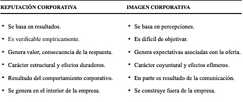

> **Descripción de la imagen** — La imagen es una tabla de dos columnas que compara las características de la "Reputación Corporativa" con las de la "Imagen Corporativa".
>
> **Columna Izquierda (Reputación Corporativa):**
> Enumera los siguientes aspectos:
> 1. Se basa en resultados.
> 2. Es verificable empíricamente.
> 3. Genera valor, consecuencia de la respuesta.
> 4. Carácter estructural y efectos duraderos.
> 5. Resultado del comportamiento corporativo.
>
> **Columna Derecha (Imagen Corporativa):**
> Enumera los siguientes aspectos:
> 1. Se basa en percepciones.
> 2. Es difícil de objetivar.
> 3. Genera expectativas asociadas con la oferta.
> 4. Carácter coyuntural y efectos efímeros.
> 5. En parte es resultado de la comunicación.

> **Descripción de la imagen** — Es una ilustración de estilo caricatura con un fondo amarillo brillante. En el centro se encuentra un hombre vestido con un traje oscuro, que está de pie y tiene una expresión alegre y abierta, con la boca sonriendo y los brazos levantados en un gesto expresivo.
>
> Alrededor del hombre, hay seis manos que rodean su figura, representando interacción o feedback:
> *   Cuatro de las manos están levantadas haciendo un pulgar hacia arriba (aprobación).
> *   Dos de las manos están levantadas haciendo un pulgar hacia abajo (desaprobación).
>
> Sobre la cabeza del hombre hay una burbuja de diálogo blanca, indicando que está hablando o expresando una reacción. La imagen sugiere un tema de comunicación, opinión o evaluación.

66

esfuerzo continuo y creciente, que no se agota en ninguno de sus
logros parciales.
Costa (2009: 76) sostiene que la reputación es parte de la imagen
y la considera como una moneda de dos caras: una la relaciona
con la  ́notoriedadμ (dimensiyn cuantitativa, entendida como la
recordaciyn) y la  ́notabilidadμ (entendida como el prestigio y la
valoración, siendo de carácter más cualitativo). Las dos
dimensiones son interdependientes.
Olcese (2008: 178) nos presenta de forma esquemática las
diferencias entre  ́imagenμ y  ́reputaciynμ corporativa:

Fuente: (Ramos, 2016)

COMUNICACIÓN DE CRISIS

Fuente: (Comunicación, s.f.)

---

<!-- página 71 -->

67

¿Qué es la crisis?

Una crisis responde a un cambio repentino entre dos situaciones,
cambio que pode en peligro la imagen y el equilibrio natural de
una organización, institución o empresa.
La crisis se caracteriza, por consiguiente, por una ruptura de
equilibrio: es un fenómeno grave, pero sin embargo normal, ligado
al funcionamiento cotidiano de toda organización.

¿Qué es la comunicación de crisis?

Conjunto de técnicas de comunicación destinadas a gestionar
situaciones de crisis.
Riesgo que se corre ante una crisis:
Descrédito generalizado hacia la empresa (por parte de los
medios de comunicación, líderes de opinión, consumidores,
clientes, distribuidores, etc.)
Objetivo:
La comunicación de crisis busca, por un lado, frenar la crisis y por
otro, que la perdida de crédito y de capital en imagen que la crisis
ocasiona sea mínima.

Características de la crisis

La crisis es por naturaleza un fenómeno difícil de ser abarcado,
puesto que la percepción del acontecimiento es compleja en el
entorno social de cualquier organización. Sin embargo, todas las
crisis comparten ciertas características comunes:

ƒ La sorpresa: no existe crisis que pueda ser totalmente

anticipada, puesto que si fuese tomada íntegramente en
cuenta en los planes de comunicación no sería una crisis
ƒ Es única: raramente dos crisis tienen las mismas causas, y

llegado el caso, las mismas causas jamás producirán los
mismos efectos
ƒ Provoca una situación de urgencia: caracterizada por las

complejas dificultades que hay que afrontar y por la
afluencia de informaciones negativas a atajar. Hay que
reaccionar rápidamente, ya que los medios disponen del
poder de tratar la información en tiempo real (radio y TV).
Hay que ganar tiempo.
ƒ Desestabilización: Las relaciones de la empresa se alteran.

Los modos habituales de procedimiento se revelan
inoperantes ante la súbita rapidez y violencia generadas
por una crisis. En términos de comunicación, las relaciones

---

<!-- página 72 -->

68

de
la
empresa
con
su
entorno
resultan
también
modificadas, en lugar de relaciones cordiales con los
periodistas perfectamente conocidos y bien informados a
los que uno está acostumbrado, el servicio de prensa debe
hacerse frente a una multitud de periodistas, y a menudo
menos especializados y poco disponibles.
ƒ Descenso de la calidad de la información: La calidad de los

mensajes se deteriora en estado de emergencia. La
irrupción de nuevos interlocutores, el traumatismo interno
causado por la crisis, etc. todos estos fenómenos se suman
para deteriorar la calidad de los mensajes emitidos por la
empresa: ésta no controla su discurso y se ve obligada a
reaccionar antes que a tomas la iniciativa.
En este contexto, el rumor se convierte rápidamente en
información.

Pre-crisis

Auditoría de riesgos interna y externa: Se trata de realizar una
auditoría de riesgos que pesan sobre la empresa, objetivos y de
opinión. Para efectuarla se deberá:

A nivel interno:

ƒ Analizar crisis anteriores (extraer riesgos posibles, soluciones,

fallos, etc.)
ƒ Reuniones
con
directivos
y
aquellas
personas
con
información o puestos claves dentro de la empresa.
ƒ Elaborar un fichero de crisis donde guardar todas estas

informaciones y clasificadas de acuerdo a la gravedad del
acontecimiento o a su probabilidad. Esto nos facilitará el
trabajo a la hora de hacer un análisis preventivo.
ƒ Preparación de las informaciones necesarias para el

momento de crisis (la presentación de la organización,
historia, actividades, productos, servicios, etc.; datos
estadísticos sobre los/as profesionales que en ella trabajan,
nombre y funciones de los portavoces y expertos
encargados de las explicaciones; informaciones precisas
sobre el hecho que genera la crisis, etc.)
ƒ Revisar planes existentes
ƒ Visitar los lugares que pueden ser escenario de posibles

crisis.

---

<!-- página 73 -->

69

A nivel externo:

ƒ Relevamiento de la agenda setting (identificar temas de

interés y seguimiento de los MC), tendencias de los medios
con relación a estos temas.
ƒ Relevamiento de opiniones (encuestas, reuniones con

líderes de opinión).
ƒ Identificación de problemas y percepciones
ƒ Identificar públicos prioritarios, grupos de interés, MC,

competencia.
ƒ Prever relaciones ante la crisis (contacto con la prensa)
ƒ Analizar los medios de comunicación claves para la crisis

(MC: radio, tv, prensa)

Planificación de crisis

ƒ Establecer objetivo: Evitar la crisis o moderar su impacto.
ƒ Desarrollar un plan de crisis (general y específico)
Teniendo en cuenta:

x Definición de situaciones de crisis
x Establecimiento del comité de crisis. Funciones
x Procedimientos a seguir (por parte de los empleados)
x Acciones de comunicación externa
x Modelos de comunicación (instrumentos de comunicación:

gacetillas, notas, circulares, entrevistas, etc.)
x Identificar a periodistas y líderes de opinión claves.
x Posibles preguntas y respuestas

Estrategias de la Crisis

Silencio: no se reacciona ante acusaciones. La comunicación se
reduce a lo mínimo. Se puede conseguir que la crisis cese por falta
de contrincante, no hay polémica. La organización se mantiene
al margen de los comentarios y solo emite los mensajes que cree
conveniente. Los inconvenientes: es mal visto, es como una huida,
no asunciyn de responsabilidades. El  ́silencio otorgaμ y puede
denotar culpabilidad. Los periodistas buscan otras fuentes de
información que pueden ser poco apropiadas para
la
organización. Recomendación: Puede ser usada un una crisis
poco grave y breve.
Negación: la institución niega en bloque el incidente y rechaza
cualquier interés que se le preste. Si la acusación es infundada.

---

<!-- página 74 -->

70

Esta técnica puede frenar la evolución de la crisis. No debe
utilizarse cuando la acusación es justificada, cuando la verdad se
hace patente ya que dañara irremediablemente la credibilidad.
No puede ser utilizada muchas veces ya que se corre el riesgo de
que se piense que la empresa  ́nunca hace nada maloμ y  ́No
hay humo sin que haya fuegoμ. Recomendaciyn: solo para falsas
acusaciones.

Transferencia de responsabilidades

x Un tercero asume la responsabilidad para proteger a la

empresa.
x  ́Cambio de fusiblesμ si es de adentro
x  ́Matar al mensajeroμ si es de afuera.
1. Es de corto plazo debido a que al tercero rápidamente le
toca justificarse. Mientras, la empresa puede prepararse y
afilar sus argumentos. Inconveniente: no es recomendable
porque es interpretado como una negativa de la empresa
a asumir sus responsabilidades. Esta estrategia solo puede
ser utilizada cuando la empresa es 100% inocente, ni
cuando el reparto de responsabilidades no está claro, no se
deberá utilizar más que en último extremo.
2. Confesión: se trata de reconocer las responsabilidades y de
colaborar plenamente con los medios de comunicación.
Esta estrategia sería suicida si no fuese inmediatamente
acompaxada de explicaciones. ( ́somos responsables,
pero vamos a actuar, reaccionarμ o  ́somos responsables,
pero no los ~nicosμ). Ventaja: la estrategia de la verdad
siempre da valor a la empresa, muestra su responsabilidad,
su calidad, y la empresa puede irse desentendiendo, al
menos
parcialmente,
mientras
desarrolla
una
argumentación complementaria.
3. Desventajas: el público honra la sinceridad, pero deplora las
faltas cometidas, la imagen es amenazada.

Ventajas de tener un Plan

A nivel interno permite abordar de modo neutro y constructivo las
eventualidades que, en su propio contexto, serán vidas de
manera negativa. Prepara a los/as miembros de la empresa para
mantener la  ́cabeza frtaμ. Gracias a la anticipaciyn se puede
esperar un buen comportamiento ante la crisis.

---

<!-- página 75 -->

71

Permite ganar tiempo cuando estalle la crisis, que será un tiempo
precioso, útil para la regulación de la crisis y para poderlo dedicar
a la reflexión. Así puede avisarse rápidamente a las personas que
integraran el comité de crisis.
Otorga la posibilidad de que esté ya establecido un sistema de
comunicación alrededor de la crisis.

Formación de portavoces

La clave: un solo mensaje y que todos/as lo sepan.
No es importante el número de portavoces, sino que el mensaje
sea único.

Selección del público para portavoces

ƒ El personal: la comunicación en tiempo de crisis debe ser

idéntica para todo/as, aún si la forma varía, a fin de crear
un sentimiento de cohesión.
ƒ Los medios de comunicación: prioridad. Puesto que tienen

un papel fundamental en el momento de estallar una crisis,
son los que informan al público de que ha ocurrido un
accidente y los que le orientan mediante sus propios análisis.
ƒ Sectores en relación con la empresa: clientes, distribuidores,

proveedores, etc. que pueden jugar un papel de
importancia.
ƒ El público: individuos que nada tienen que ver con la

empresa, cuya atención será atraída por la crisis (lo
negativo) y que hará que la organización tenga que pensar
en este grupo de personas (gacetillas de informaciones
básicas)

Características de los medios de comunicación

ƒ El/a portavoz deberá distinguir los recursos necesarios de

cada medio (radio, TV, prensa, revistas, etc.) para que el
mensaje sea transmitido varias veces y con la mayor
fidelidad.
ƒ Ejemplo: en radio el mensaje será instantáneo, no se podrá

corregir nada, será escuchado por una gran audiencia,
pueden poderle al aire con otras personas, etc.

---

<!-- página 76 -->

72

ƒ En TV sus mensajes deben durar menos de 2 minutos y debe

repetir siempre el mismo mensaje, una y otra vez (si se
quiere, con palabras diferentes).
ƒ En prensa escrita, se puede tomar el tiempo para reflexionar

y explicar al detalle la situación, ya que no hay apuro, y
debe además dejarse claro desde el principio el mensaje
de la organización.

Elaboración del mensaje

ƒ El mensaje debe ser elaborado por el comité de gestión de

crisis, debe ser sencillo, fácil de entender. Debe estar
previamente pensado de acuerdo al plan de crisis
específica.
Presentación
de
los/as
portavoces
ante
los
medios
de
comunicación, los empleados, acreedores, asociados, etc.

Comité de crisis

Una sola persona no puede responder ante una crisis (portavoz,
presidente), pero un equipo sí.
Está compuesto por expertos y responsables de todos los niveles,
conducen el conjunto de acciones y reacciones de la crisis. No
solamente tiene el papel de impulsar y coordinar, sino que asume
también la gestión cotidiana de la crisis.

¿Quiénes lo integran?

ƒ El/la director/a de comunicación
ƒ El/la responsable de prensa
ƒ El/la responsable de las relaciones externas (RR.PP.)
ƒ El/la responsable de la comunicación interna
ƒ El/ la presidente/a
ƒ Expertos/as y jefes/as de servicio directamente tocados por

la crisis
ƒ Asociados/as
externos
(colegas
de
comunicación
institucional)
ƒ Agencias consultoras de comunicación (si hubiera)

¿Qué hace?

El Comité de crisis permite aislar el tratamiento de la crisis de las
otras funciones de la empresa, centraliza y se ocupa en
exclusividad de la crisis.

---

<!-- página 77 -->

73

Se
deben
repartir
las
responsabilidades,
designar
un
coordinador/a que coordine la organización de las actividades,
separa las instancias de decisión de las de consulta.

Los/as miembros del comité deben

ƒ Intercambiarse información para asegurar la riqueza del

análisis.
ƒ Facilitar el trabajo de los expertos exponiendo con claridad

las necesidades, protegiéndoles de la exposición a los MC,
de los funcionarios/as
ƒ Asegurar una infraestructura eficaz hasta en los mentores

detalles (teléfonos, lugar de reuniones, alimentación,
transporte, etc.).
El manual de comunicación de crisis se escribe de acuerdo a
todos los aspectos vistos antes, poniéndolo por escrito e
imaginando posibles amenazas que puedan desembocar en una
crisis.

Recomendaciones

ƒ Retomar la iniciativa: debe controlarse los temas a ser

abordados, adoptarse una política de transparencia.
ƒ No dar preferencia a la comunicación: sino encontrar la

salida a la crisis
ƒ Atención a la coherencia de los mensajes en el tiempo: No

avanzar la salida de la crisis (adelantar que en 24 hs, se
solucionarán los problemas) hasta que los problemas estén
resueltos. Organizar los balances de información en cada
etapa de la crisis.
ƒ Hacer que evolucione la comunicación desde la óptica del

fin de la crisis: es necesario anticipar y explotar cualquier
disminución de intensidad en la notoriedad de la crisis.
Ejemplo: resultados de un estudio favorable a la empresa tal
vez no conviene darse a conocer hasta que la crisis haya
acabado.
ƒ Ahorrase enemigos y buscarse amigos: usar la diplomacia,

evitar conceder favores a un periodistas sino se enfadan los
demás; comprensión, desarrollar al máximo la comprensión
con la parte contraria para evitar humillarla; maquiavelismo,

---

<!-- página 78 -->

74

buscar apoyos estratégicos y morales por parte de actores
diferentes y de interlocutores diversos de la organización.
ƒ Conceder prioridad a los de casa: mantener al personal

informado para evitar que ellos/as mismos constituyan un
nuevo problema, prevenir al familiar de las víctimas antes
de informar al público; asegurar un seguimiento de la
información dentro de casa (comunicación interna).

---

<!-- página 79 -->

75

Glosario

Comunicación organizacional:

ƒ o comunicación corporativa al envío y recepción de

información entre individuos interrelacionados o que forman
parte de algún tipo de organización (una empresa, una
institución, etc.) con el objetivo de alcanzar un objetivo
determinado.

Pensamiento:

ƒ El pensamiento es la operación intelectual de carácter

individual que se produce a partir de procesos de la razón.
Los pensamientos son productos que elabora la mente,
voluntariamente a partir de una orden racional, o
involuntariamente a través de un estímulo externo. Todo tipo
de obra, artística o científica, se forma a partir de un
pensamiento madre que se comienza a desarrollar y
complementar con otros.
Comunicación:

ƒ La comunicación hace referencia a la interacción social, es

decir, a la acción y al resultado de comunicarse. Es una
acción social necesaria, ya que, si esta no existiese, nadie
sería capaz de conocer a fondo el mundo que nos rodea y
mucho menos compartir las experiencias propias de
cada ser humano con los demás.
Ciencia de la Acción:

ƒ Es una estrategia para diseñar las situaciones que fomentan

efectividad en cualquier tipo de la organización y se asienta
principalmente en los aportes.
Factor Omnipresente:

ƒ Que está presente a la vez en todas partes.
Políticas de Comunicación:

ƒ Es un conjunto de lineamientos que han de servir de

referencia a las decisiones y actuaciones de los miembros
de una organización en cuanto a los procesos de
comunicación se refiere.
Comunicación corporativa:

ƒ La comunicación corporativa es un proceso que establece

una organización y consiste en transmitir información y

---

<!-- página 80 -->

76

conocer la respuesta de la audiencia receptora del
mensaje. Para eso, desarrolla acciones que permiten
conectar a la organización con las personas que la integran
(comunicación
interna)
o
con
un
público
externo
(comunicación externa) con el objetivo de mejorar la
relación entre ellos.
Comunicación organizacional integral:

ƒ Es cuando existen medios de comunicación con diferentes

propósitos y son utilizados en ámbitos internos o externos y
ésta fluya de manera formal o informal, pues sus medios,
ámbitos o tipos de comunicación deben ser vistos como
complementos de algo global, asimismo incorpora diversos
elementos que la hacen posible como son la estructura,
organización jerárquica, cultura de sus miembros y sus
comportamientos.
Desarrollo organizacional:

ƒ Es el proceso de conocer y cambiar la salud, la cultura y el

desempeño de la organización. Del avance vertiginoso del
mercado laboral y la evolución tecnológica surgió la
necesidad de adaptación de las empresas a una nueva
realidad
organizacional que
tomase
en
cuenta
las
necesidades
tanto
de
la
empresa
como
de
los
colaboradores.
Branding interno:

ƒ Se centra en comunicar al empleado la cultura de marca,

la experiencia de pertenecer a nuestra empresa. Cada
compañía posee una identidad propia, una cultura que la
forma y la constituyen como marca.
Aprendizaje Organizacional:

ƒ Se presenta como una alternativa que transforma la

información en conocimiento y lo explota para mejorar las
ratios de productividad y dinamismo que una compañía
requiere
Redes Formales:

ƒ La comunicación formal define las reglas de comunicación

establecen la organización.

---

<!-- página 81 -->

77

Comunicación Vertical

ƒ La comunicación vertical en una empresa sigue el cauce

determinado por los niveles jerárquicos que existen en la
organización, fluyendo desde los más altos hasta los más
bajos o viceversa, por lo que tiene un carácter asimétrico.
Comunicación Ascendente:

ƒ Parte de los niveles superiores de la cadena de mando,

como, por ejemplo, del director general al jefe de
departamento y sus subordinados.
Comunicación Descendente:

ƒ Parte de los niveles inferiores hasta llegar a los directivos. Es

esencial para integrar a los empleados en la toma de
decisiones y aumentar su compromiso con la empresa pues
da voz a todos los niveles jerárquicos de la organización.
Comunicación Horizontal:

ƒ También conocida como comunicación lateral, fluye

entre trabajadores del mismo nivel jerárquico, aunque no
pertenezcan al mismo departamento, por lo que tiene un
carácter simétrico. Este tipo de comunicación se produce
entre colaboradores, generalmente para coordinar las
tareas del día a día e intercambiar información relevante
que les permita desempeñar mejor sus funciones.
Redes informales:

ƒ Surgen en el interior de las organizaciones sin planificación y

al margen de los conductos oficiales. Estas redes transmiten
la información de forma rápida y flexible.
Comunicación Interna:

ƒ Es una herramienta estratégica clave en las empresas,

puesto que mediante un buen empleo de la información
corporativa podemos transmitir correctamente a los
empleados los objetivos y valores estratégicos que
promueve la organización.
Comunicación Externa:

ƒ Se
define
como
el
conjunto
de
operaciones
de
comunicación destinadas a los públicos externos de una
empresa o institución, es decir, tanto al gran público,
directamente o a través de los periodistas, como a sus
proveedores, accionistas, a los poderes públicos y

---

<!-- página 82 -->

78

administraciones locales y regionales, a organizaciones
internacionales, etc.
Relaciones Públicas:

ƒ Actividad profesional que se ocupa de promover o

prestigiar la imagen pública de una empresa o de una
persona mediante el trato personal con diferentes personas
o entidades. Persona que se dedica a esta actividad o
profesión.
Identidad Organizacional:

ƒ Es la base inconsciente de la cultura organizacional.

Específicamente es la totalidad de los patrones repetitivos
del
comportamiento
individual
y
de
relaciones
interpersonales, que todos juntos reflejan el significado no
reconocido de la vida organizacional.
Publicidad:

ƒ Es un medio
de
divulgación en
el
cual
diversos
organismos, empresas,
individuos, ONG,
entre
otros,
intentan hacerse conocer, anunciar o simplemente aludir
ciertos bienes, servicios, para poder interesar a potenciales
compradores, usuarios, etc.
Cultura Organizacional:

ƒ Es la unión de normas, hábitos y valores que de una forma u

otra, son compartidos por las personas y/o grupos que dan
forma a una institución, y que a su vez son capaces de
controlar la forma en la que interactúan con el propio
entorno y entre ellos mismos. Es decir, el comportamiento de
la empresa dependerá de la forma en la que se apliquen
unas normas u otras por parte de sus integrantes.
Comunicación Política:

ƒ Es todo tipo de comunicación destinado a influir en ese

proceso, desde la búsqueda de la obtención del puesto de
autoridad o comunicación electoral hasta la de convencer
desde la autoridad sobre la importancia.
Imagen Corporativa:

ƒ Es la imagen que el público tiene de esa entidad. Por un

lado, son las ideas, sensaciones y prejuicios que tenemos
antes de conocer los servicios o productos de una marca.

---

<!-- página 83 -->

79

Por otro: las experiencias y juicios que adquirimos después
de conocerlos.
Identidad Corporativa:

ƒ Es el conjunto de valores que conforman la visión de mundo

de
una
empresa.
Sus
principios,
sus acciones
de
endomarketing, la postura que adopta en diferentes
situaciones y la imagen que la empresa quiere cultivar de sí
misma.
Reputación Corporativa:

ƒ Es el conjunto de percepciones que tienen sobre la empresa

los diversos grupos de interés con los que se relaciona, tanto
internos
como
externos,
como
resultado
del
comportamiento desarrollado por la empresa a lo largo del
tiempo y de su capacidad para distribuir valor a los
mencionados grupos.
Comunicación de Crisis:

ƒ Conjunto de metodologías, técnicas y acciones de

comunicación destinadas a gestionar situaciones de crisis
con impacto potencial en la Comunicación e Imagen de
las
Organizaciones,
resulta
indispensable
para
el
management contemporáneo.

---

<!-- página 84 -->

80

Referencias bibliográficas

Agency,
S.
(s.f.).
Cultura
Organizacional.
Obtenido
de
https://stratumagency.com/cultura-organizacional-empleados-
motivados-hacen-crecer-empresas/
Americas, P. C. (s.f.). Relaciones Públicas. Obtenido de
http://prconsultingamericas.com/es/5-servicios-que-ofrecemos-
las-agencias-de-relaciones-publicas/
Blog. (16 de Febrero de 2016). Modelo Innovador de Gestión.
Obtenido
de
http://climalaboralycomunicacion.blogspot.com/2016/02/redes-
informales-en-la-empresa.html
Blogger. (8 de Marzo de 2016). Comunicación Organizacional.
Obtenido
de
http://procesosdecomunicacion2016.blogspot.com/2016/03/co
municacion-organizacional.html
Blogspot. (2016). Redes de Comunicación Informal. Obtenido de
http://climalaboralycomunicacion.blogspot.com/2016/02/redes-
informales-en-la-empresa.html
Cela, U. C. (s.f.). La Comunicación Política . Obtenido de
https://master-comunicacion.es/blogmastercomunicacion/la-
negociacion-como-estrategia-en-la-comunicacion-politica/
Comunicación, N. 3. (s.f.). Comunicación de Crisis. Obtenido de
https://www.nal3.com/es/central-de-contenidos/pasos-para-la-
gestion-comunicacion-de-crisis-online
Concepto.de.
(17
de
Julio
de
2016).
Comunicación
Organizacional.
Obtenido
de
https://concepto.de/comunicacion-organizacional/
Conexión ESAN. (28 de Octubre de 2015). Ocho ventajas de la
comunicación
interna
para
las
empresas.
Obtenido
de
https://www.esan.edu.pe/apuntes-empresariales/2015/10/ocho-
ventajas-comunicacion-interna-para-empresas/
Consultores en Investigación y Comunicación, S. (1996). Perfil y
expectativas del asociado real y potencial de la asociación
mexicana de comunicación .
Emprendices,
J.
D.
(s.f.).
Características
de
la
Cultura
Organizacional. Obtenido de https://www.emprendices.co/que-
es-la-cultura-organizacional-de-una-empresa/
Esan,
C.
(2016).
Identidad
Corporativa.
Obtenido
de
https://www.esan.edu.pe/apuntes-
empresariales/2016/06/configuracion-de-la-identidad-
corporativa-el-manual-corporativo/

---

<!-- página 85 -->

81

Espinoza, S. 2D. (s.f.). Cultura Organizacional. Obtenido de
https://steemit.com/spanish/@djota/cultura-organizacional-
como-elemento-esencial-del-exito
Goldhaber. (1984). Redes de comunicación en las organizaciones.
Hancock, J. R. (2016). Internet ha cambiado la lengua, pero no
para
mal.
Obtenido
de
https://verne.elpais.com/verne/2016/07/30/articulo/1564497553_
454443.html
Internauta, O. d. (2015). Sistemas de Reputación. Obtenido de
https://www.osi.es/es/actualidad/blog/2015/08/10/que-son-los-
sistemas-de-reputacion
Jackson, P. C. (1993). Comunicación corporativa para ejecutivos.
México.
Mafisse, H. (s.f.). Publicaciones impresas.
Mind, B. O. (s.f.). Orígenes psicológicos de la identidad
organizacional.
Obtenido
de
https://www.bbvaopenmind.com/articulos/genero-liderazgo-y-
organizacion/
Moraleda, V. (12 de Julio de 2016). ¿Dónde están sus límites?
Obtenido
de
https://www.socialco.es/como-gestionar-la-
comunicacion-interna-de-tu-ong/
Mx,
D.
N.
(s.f.).
Comunicación
Externa.
Obtenido
de
https://destinonegocio.com/mx/emprendimiento-mx/como-
lograr-un-plan-exitoso-de-comunicacion-externa/
Nosnik, M. y. (1988). Importancia de la comunicación ascendente.
Ramos, W. D. (2016). Reputación y RSE.
Spark, A. (s.f.). La naturaleza de la comunicación horizontal.
Obtenido de https://spark.adobe.com/page/tBtUdMoqvIarM/
Vargas. (s.f.). Integración de la Estrategia y la Cultura
Organizacional en las Organizaciones Aprendientes.
Web,
A.
(s.f.).
Publicidad.
Obtenido
de
https://altamiraweb.net/ventajas-de-la-publicidad-nativa/

---

<!-- página 86 -->

Raúl Díaz Ocampo

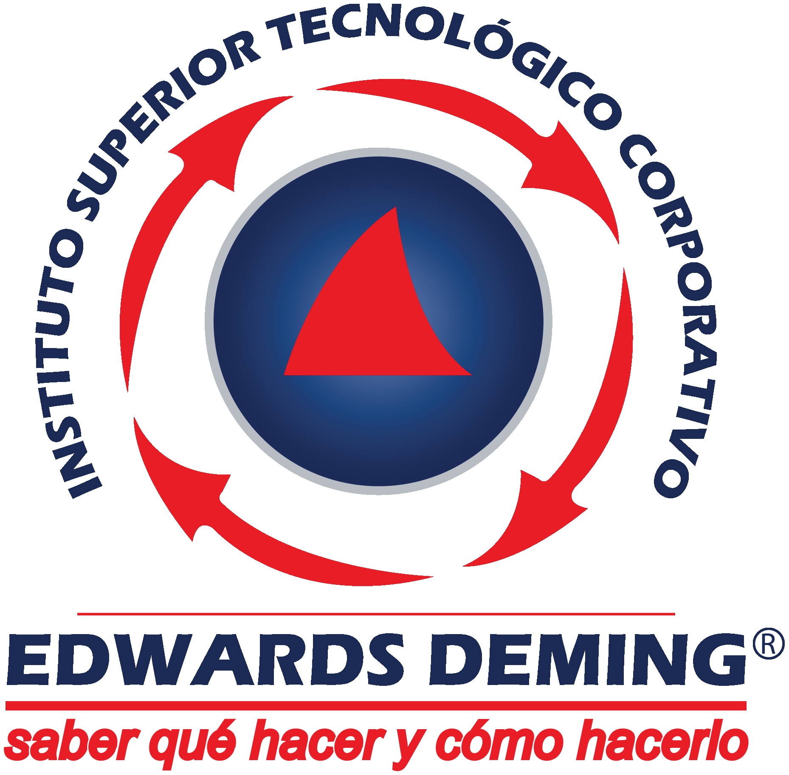

> **Descripción de la imagen** — La imagen es un logotipo o emblema circular.
>
> El diseño central consiste en un círculo azul oscuro con un triángulo rojo apuntando hacia arriba en su interior. Alrededor de este círculo central, hay flechas rojas gruesas que forman un ciclo continuo o una trayectoria circular.
>
> Este conjunto está rodeado por un anillo exterior que contiene el texto "INSTITUTO SUPERIOR TECNOLÓGICO CORPORATIVO" escrito en mayúsculas y siguiendo la curva del círculo.
>
> En la parte inferior de la imagen, se encuentra la marca "EDWARDS DEMING®" en letras azules oscuras, y debajo, una frase en color rojo que dice "saber qué hacer y cómo hacerlo".

## s

Grupo de capacitación e investigación pedagógica

> **Descripción de la imagen** — La imagen es un código de barras vertical compuesto por líneas negras y espacios blancos. Este código representa el número ISBN: 978-9942-33-262-2.

