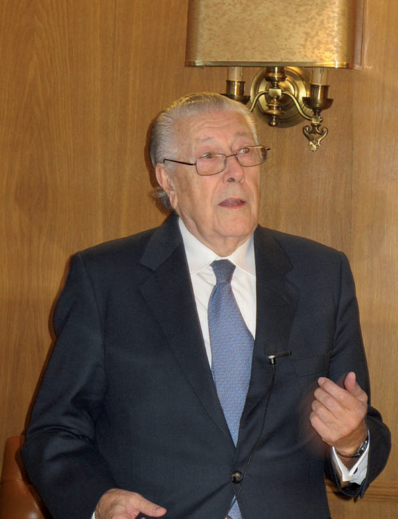
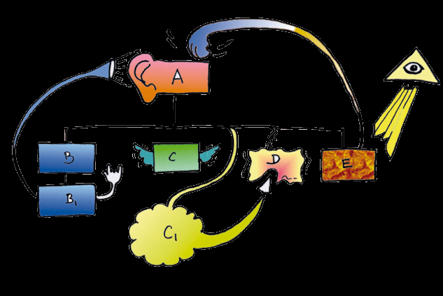

# EL-ARTE-DE-NEGOCIAR

<!-- página 1 -->

> **Descripción de la imagen** — La imagen es una fotografía de un interior moderno y minimalista, que muestra una zona de reunión o estudio. En el centro se encuentra una mesa redonda de superficie blanca o gris claro. Alrededor de la mesa hay sillas de diseño contemporáneo, con asientos blancos y estructuras metálicas cromadas.
>
> Una de las sillas tiene un abrigo o chaqueta de color gris oscuro colgado sobre ella. Sobre la mesa, hay un folder o cuaderno de color rojo y un bolígrafo negro. El suelo está cubierto por una alfombra de color gris. El fondo es una pared lisa de color blanco o gris muy claro, con iluminación suave que proyecta sombras en el suelo.

El negociador a tiempo completo
### El arte de NEGOCIAR

Enrique de las Alas-Pumariño Miranda

---

<!-- página 2 -->
## El arte de NEGOCIAR
### El negociador a tiempo completo
## El arte de NEGOCIAR
### Enrique
### de las Alas-Pumariño
### Miranda

> **Descripción de la imagen** — Es una fotografía de un hombre mayor, con cabello gris y gafas, vestido formalmente. Lleva un traje oscuro (saco) sobre una camisa blanca y una corbata azul estampada. El hombre está de pie en un interior, con un fondo de paneles de madera. Sobre su cabeza se observa una lámpara o aplique decorativo de metal dorado. El hombre está mirando ligeramente hacia la derecha y parece estar hablando o dando una presentación.

Dr. Ingeniero Industrial por la Escuela de Madrid. Ha desarrollado su vida
profesional durante más de treinta años en el sector químico, ocupando
puestos directivos en la industria petroquímica del Grupo Repsol; entre ellos
el de Director de Paular S.A., compañía Italo-Española, fabricante de Poli-
propileno y Acrilonitrilo.

Desempeñó, en la Federación Empresarial de la Industria Química Española,
sucesivamente los cargos de Director de Asuntos Técnicos y Relaciones Institu-
cionales, Director de Comunicación y Director de I+D+i, siendo miembro de
la Comisión Nacional del Riesgo Químico de las Comisiones de Medio Am-
biente, Seguridad y Comunicación del Consejo Europeo de la Industria Quí-
mica (CEFIC), miembro asesor de la Comisión Interministerial de Transporte
de Mercancías Peligrosas y asesor de la Organización Mundial de la Salud para
la redacción de normas de seguridad, para el caso de accidentes químicos.

Por motivos profesionales ha visitado 30 países. Es autor de diversas pu-
blicaciones y artículos sobre medio ambiente, seguridad, comunicación  y
transporte.

---

<!-- página 3 -->

La Junta Directiva de la Asociación en esta convocatoria, del premio del
Libro del Ingeniero, ha decidido otorgar el mismo a nuestro compañero
Enrique de las Alas-Pumariño Miranda por su obra titulada “El Arte de Ne­
gociar”.

Este libro es, sin duda, útil para cualquier persona que lo lea pues trata
sobre la mejora de habilidades, más concretamente sobre como planear
una negociación, en la vida hay que negociar siempre, aunque hay gente
que tiene cualidades innatas, es muy práctico y ayuda a resolver conflictos
el conocer las técnicas de la negociación.

Pero el premio no se otorga solo por que pueda ser útil, se valora la cohe­
rencia del trabajo, la forma expositiva, la originalidad, la calidad literaria. Se
busca el mejor libro escrito por un ingeniero industrial durante el año que
coincide con el objetivo fijado en la convocatoria del premio.

En esta ocasión el libro que se edita y que ha obtenido el premio, cumple
sobradamente con los requisitos que nos habíamos fijado y además su autor,
nos obsequia con la novedad de introducir en las ilustraciones un código
“QR”, que permite a todos aquellos que quieran profundizar más, en alguno
de los temas tratados, disponga de la dirección de la “web”, donde se en­
cuentran conferencias y exposiciones que aclaran y desarrollan los puntos
tratados en el libro. Creo que esta aportación será bien recibida por todos
los lectores.

Para los que no estén familiarizados con este tipo de código, les animo
a que los utilicen pues es de una enorme sencillez y proporcionan mu­
cha información, son similares a los códigos de barras, pero con puntos
de diversas formas, dentro de un cuadrado. Para su lectura se enfoca la
cámara del teléfono, en el programa de identificación de códigos “QR” y
a continuación obtiene la dirección de internet que da acceso a la infor­
mación complementaria recomendada por el autor.

Desde esta introducción me gustaría animar a todos los compañeros
que tienen un libro inédito ya escrito, que lo estén escribiendo o que
les gustara escribirlo, a que lo hagan y que lo presenten a las próximas
convocatorias del “Libro del Ingeniero”. Nuestra labor es fomentar que
nuestros compañeros escriban y que sean divulgados sus trabajos.

Agradezco  a los compañeros que han presentado sus trabajos y no han
sido premiados su participación y espero que perseveren volviendo a pre­
sentarse, sin duda los trabajos eran de gran valor. Doy la enhorabuena al
autor premiado Enrique de las Alas-Pumariño, por su trabajo.

Espero que a los lectores el libro que se edita sea de su agrado e interés.

En nombre del Colegio y de la Asociación de Ingenieros Industriales de
Madrid, en estas fechas navideñas les deseamos Paz y Felicidad para el
próximo 2015.

Miguel Ángel Martínez Lucio

Presidente de la A.I.I.M.

---

<!-- página 4 -->

Querido amigo:

Sin ánimo de retornar dos mil años, te recuerdo lo que el evangelista
San Lucas aconseja:

¡Negocia, haz posible un acuerdo con él, aun cuando vais camino
del juez, no sea que el juez te entregue al guardia y este te meta
en la cárcel!

Nuestro Ortega y Gasset, hombre que poco se equivocaba nos dice:

La forma de vivir; que es siempre tremebunda, consiste en saber convivir,
porque la vida es convivencia. ¡Negociación!

Otro de los nuestros, Don Diego Saavedra Fajardo, casi cinco siglos
antes de la «Crisis de los Misiles, en Cuba» ya sentenciaba:

Si algún negocio se perdió, no fue porque fuese malo, sino porque
no se supo explicar que fuera bueno.

Pero sobre todo, nunca olvides, a la hora de negociar lo que D. Quijote
aconseja:

Negocia diciendo la verdad, así no pecas y si no la dices, procura
que parezca verdadera y posible.

Así, digo yo, no perderemos las plumas y mucho menos se nos verá
el plumero.

Tienes en tus manos un buen libro, léelo y mucha suerte.

---

<!-- página 5 -->

EL ARTE
DE NEGOCIAR

El negociador a tiempo completo

---

<!-- página 6 -->

Edita:

AIIM (Asociación de Ingenieros Industriales de Madrid)

Diseño de cubierta e interiores:

Seshat Producción gráfica y visual
www.seshat-online.com

Maquetación, infografía e impresión:

Seshat Producción gráfica y visual
www.seshat-online.com

Fotografia:

photononstop

Dep. Leg.: M-33495-2014

---

<!-- página 7 -->

Advertencia del autor
El autor se considera obligado a informar al lector que

este es un libro poco convencional.

Segunda advertencia del autor
En justicia debe también advertirle que

se trata de un libro muy practico.

---

<!-- página 8 -->
## Índice

Introducción.............................................................................................................................13

Objeto del libro y explicación de su título.......................................................................13

Oportunidad y actualidad del tema...................................................................................17

Problemas y dificultades para el estudio de las negociaciones.................................25

Enfoque y alcance de este ensayo......................................................................................27

Información útil sobre cómo se ha escrito este libro...................................................31

Quién debe leer este libro.....................................................................................................35

El arte de negociar.................................................................................................................37

Qué es negociar .......................................................................................................................37

Quiénes son los que negocian .............................................................................................44

Los nuevos príncipes...............................................................................................................45
Los españoles............................................................................................................................53
Los demás.................................................................................................................................60
Qué debe saber para negociar ............................................................................................68

Cómo negociar, el planteamiento estratégico......................................................73

Principios básicos de negociación......................................................................................73

Separar a las personas de los problemas............................................................................74
Concentrarse en los intereses y no en las posiciones.........................................................76
Inventar opciones de mutuo beneficio..................................................................................77
Utilizar criterios objetivos......................................................................................................78
Análisis de la situación..........................................................................................................78

Qué es lo que negociamos......................................................................................................79
Cartografía del conflicto.........................................................................................................80
Estudio de la mejor alternativa posible a un acuerdo negociado (MAPAN).................83
Análisis de los riesgos.............................................................................................................85
El análisis de la situación y los cuatro principios de negociación..................................85

---

<!-- página 9 -->

Planificación..............................................................................................................................86

Obtener información...............................................................................................................86
Poder negociador.....................................................................................................................93
Formación del equipo negociador propio ...........................................................................96
Definir estrategias ..................................................................................................................99

Cómo negociar, el desarrollo táctico....................................................................... 103

Cómo comunicarse.............................................................................................................. 103

Qué es la comunicación....................................................................................................... 103
Escucha activa....................................................................................................................... 108

El lenguaje del cuerpo.......................................................................................................... 111
El arte de preguntar............................................................................................................. 116
El arte de responder............................................................................................................. 122
La mentira y el error............................................................................................................ 124
Cómo gestionar las relaciones con los demás............................................................. 132

Conceptos de “status” y “rol” – análisis transaccional................................................... 133
Actividades dirigidas a transmitir información.............................................................. 140
Actividades encaminadas a obtener información.......................................................... 142
Actividades destinadas a cambiar actitudes, comportamientos y creencias ............ 145
Actividades destinadas a modificar el estado emocional de otras personas.............. 150
Actividades destinadas a conseguir autodominio – la mesa y el balcón.................... 151
Trabajos cooperativos.......................................................................................................... 153
Trabajos de supervisión y coordinación interna del equipo......................................... 153
Las negociaciones cara a cara........................................................................................... 154
Técnicas de persuasión........................................................................................................ 157

Influencia del narcisismo.................................................................................................... 159
Deseo de seguridad emocional........................................................................................... 160
Absolución de los sentimientos culpables......................................................................... 161
Gratificación del ego............................................................................................................ 162
Interés por las actividades creativas................................................................................. 163
Deseo de poder...................................................................................................................... 163
Deseo de inmortalidad......................................................................................................... 164
La argumentación................................................................................................................. 164

Del “Argumentum ad Crumenan” al “Argumentum Baculinum”................................. 168
El poder de los relatos......................................................................................................... 169

Principios de creatividad.................................................................................................... 172

Estratagemas.......................................................................................................................... 175

El Señuelo de la Cabra Maloliente..................................................................................... 176
La Treta de las Caperuzas de Paño................................................................................... 177
El Enredo de las Cerezas..................................................................................................... 179
La Metamorfosis en la Gallina de los Huevos de Oro.................................................... 181
El Ardid del Arquitecto........................................................................................................ 183
La Estratagema de la Batalla de Fontenoy...................................................................... 185
El Subterfugio de la Tortuga Huidiza................................................................................ 187
La Artimaña del Caballo de Troya.................................................................................... 189
El Procedimiento del Coqueteo Negociador..................................................................... 191
El Cambio de las Reglas del Juego..................................................................................... 193

---

<!-- página 10 -->

La Farsa del Halcón y la Paloma....................................................................................... 195
Maniobras con el Tiempo.................................................................................................... 197

El cierre.....................................................................................................................................201

Epilogo.......................................................................................................................................203

---

<!-- página 11 -->

13
## Introducción
## Objeto del libro y explicación de su título

El título de este libro se explica por si solo y tiene por objeto dirigir la atención,
rápidamente, hacia los riesgos más obvios y naturales de la actividad que de­
seamos desarrollar –en este caso, establecer un acuerdo– del mismo modo que
harían con sus temas respectivos otros libros posibles que se titulasen “Cómo ser
rico sin que se entere la gente”, o “Cómo ir al cielo sin pasarlo mal”.

Su finalidad es por lo tanto aclarar al lector o lectora, de una manera inme­
diata e intuitiva, cual es el propósito del libro que tiene entre sus manos, aún a
riesgo de incurrir en su desconfianza al marcar una meta tan difícil como la de
aprender ruso en diez días. Creo que bien merece la pena hacer un esfuerzo para
conseguir los mejores resultados posibles en este peligroso campo de activida­
des, a pesar de la dificultad del objetivo propuesto, por dos razones principales:

Establecer acuerdos –es decir, negociar– constituye un quehacer ineludible,
que implica a todos y cada uno de los seres humanos, y la importancia de los
intereses en juego es prácticamente inconmensurable, si se tiene en cuenta
que afecta a casi todas nuestras actividades. Ciertamente “Aparte del sexo, las
negociaciones constituyen la implicación más común y problemática de una
persona con otra, y las dos actividades no son independientes”, tal como dijo el
famoso economista Kenneth Galbraight: “Vivir es ocuparse, vivir es hacer, vivir
es practicar, la vida es una ocupación con las cosas, es decir, un manejo de las
cosas, un quitar y poner cosas, un andar entre cosas, un hacer con las cosas esto
o lo otro1...” y “el hombre es una cosa entre las cosas, un pedazo de mundo. Por
ello nuestro vivir es convivir2”. Hasta tal punto es la convivencia la que marca
la esencia del ser humano que éste ha sido considerado desde la antigüedad

1 Fundamentos de Filosofía e Historia de los sistemas filosóficos. Manuel García Morente
y Juan Zaragüeta Bengoechea. ESPAÑA-CALPE 1.960.
2 Ortega y Gasset - “El hombre y la gente”.

---

<!-- página 12 -->

14

El arte  de negociar

como “zôon politikon” (animal social o político), tanto o más que como “homo
sapiens”, idea que está declinando a favor de la de “mamífero vertical”, “homo fa­
ber” (el artífice de Franklin) u “homo ludens” (el hombre jugador de Huizinga).
Los hombres para atender sus necesidades de todo orden mantienen relaciones
con los demás y durante ellas intentan algo. Ese algo puede ser conseguir cual­
quier cosa: ayuda, aprecio, amor, esfuerzo, dinero, poder, conocimientos, obje­
tos... El precio a pagar puede ser también cualquier cosa, pero se caracteriza por
una condición, la de ser el mínimo posible. Por ello la moneda de pago muchas
veces no es dinero, sino palabras, servicios, promesas o halagos. Si no se consi­
gue satisfacer al otro con algo intangible, y a veces tan importante, sólo entonces
se da algo más material y concreto, y en general procurando exagerar su valor.
La realidad de estos hechos es la causa de que cuando se encuentran por prime­
ra vez dos personas mantengan una actitud reservada y discreta, y conduzcan
su conversación hacia temas tan poco comprometidos como el tiempo y las di­
ficultades del tráfico. Estas conversaciones, de apariencia insulsa, esconden pro­
pósitos perfectamente concretos, cuya revelación puede sorprender a quienes
practicando esta costumbre la siguen por pura intuición, de forma automática,
sin haberse detenido nunca a analizar su conducta.

El primer objetivo es mantenerse en una posición de tanteo y exploración,
procurando descubrir las mercancías ocultas del otro y cuales son sus defen­
sas, o contra cuales de nuestras propiedades –materiales o inmateriales– podría
actuar, de qué modo lo haría o cual es su posicionamiento político, moral o
sexual. En segundo lugar se trata de no proporcionar pistas prematuras acer­
ca de lo que el otro podría obtener de nosotros, ni cuales pueden ser nuestras
intenciones, ofensivas o defensivas. Poco a poco, a lo largo de conversaciones
sucesivas, cada uno irá abriendo su guardia o planteando su estrategia y se de­
sarrollará “un ciclo potencialmente infinito de ocultación, descubrimiento, falsa
información y redescubrimiento” 3. En general nos mantendremos confiados en
aquellas áreas en las que no existen intereses conflictivos, dirigiendo más tarde
a otras zonas de mayor entidad nuestras primeras conversaciones meteorológi­
cas. Por el contrario seremos aún más cautelosos que al principio al tratar sobre
aquellos temas en los que hayamos vislumbrado una posibilidad de ganancia
o de pérdidas y se irán sondeando las expectativas de obtener un beneficio a
cambio de algo que esté en nuestra posesión (o parezca estarlo), sea del interés
del otro (o se lo hagamos creer) y que le daremos en la menor cantidad posible,
(aunque la abultaremos). A lo largo de estas interacciones, se irán tanteando
las diversas posibilidades, expondremos con cautela el escaparate de nuestros
géneros, comenzando por los menos valiosos, y extenderemos nuestros señue­
los para intentar conseguir finalmente un intercambio ventajoso, bien sea en el
ámbito de los negocios o en el de las relaciones afectivas o sentimentales. Así se
conseguirá una transacción de la mutua complacencia, aunque las mercancías
intercambiadas sean heterogéneas, pues son los intereses, las posibilidades y las
necesidades de cada cual los encargados de la enrevesada alquimia que decide
cuanto dinero vale el aire puro, cuantas molestias una palabra de afecto, o cuan­

3 Erving Goffman The Presentation of the self in the every day life. Penguins Books Ltd.

---

<!-- página 13 -->

15

Introducción

tos sacrificios conseguir un poco de silencio en el campo. A veces, la “mutua
complacencia” a que nos referimos es puramente teórica, pues puede darse el
caso de que una de las partes se encuentre en una situación de dominio tal, que
la otra no tenga más remedio que ceder.

Vistas así las cosas puede parecer que las relaciones personales son excesiva­
mente interesadas y materialistas, pero la realidad es que son exactamente como
se han descrito, y nuestro juicio puede parecer menos riguroso si consideramos
que en estos intercambios muchas veces se desea solo ser simpático, obtener
popularidad, dar una satisfacción a nuestro “ego”, obtener amor, convencer a
alguien para que adelgace o contribuir a la salvación de un alma. Debemos de­
tener también nuestra atención por un instante sobre la forma en que se desa­
rrollan estos contactos. Intencionadamente hemos utilizado el término “interac­
ción” para significar un concepto amplio, que no limite las relaciones personales
al mero uso de la palabra oral o escrita. En el trato con los demás, y en el juego
de la persuasión, desempeñan también un gran papel los gestos, los ademanes,
las actitudes, el tono de voz y la mirada. Todas estas formas de comunicación,
superpuestas a la escueta transmisión oral, constituyen un lenguaje superior
que refuerza, debilita o incluso modifica por completo el sentido de las palabras,
pudiendo hacerlas también innecesarias, sin que el intercambio comunicativo
pierda su carácter de convenio. Así la sonrisa, o el silencio, de una mujer, puede
ser interpretada por un hombre, en un momento dado como: “¡Bésame tonto!”
y resultar que estaba equivocado.

Aunque la trama de nuestra vida está constituida por esta clase de convenios
y todas nuestras actividades sociales pueden clasificarse de alguna manera bajo
el común denominador de “negociaciones”, los acuerdos verbales, y aún más
aquellos en los que interviene la mímica, se prestan a funestos errores de inter­
pretación, y también a retractaciones e incumplimientos, siendo muy posible
recibir alguna bofetada que otra. Por esta razón, y ante la fugacidad de los soni­
dos y de los gestos, el hombre ha preferido dejar constancia de algunos de sus
acuerdos más importantes, modificando su entorno físico mediante la opera­
ción mnemónica que es la escritura. Sin embargo la escritura –que es como una
compleja serie de nudos en el pañuelo para recordar algo– no ha sido empleada
por el hombre, para estos menesteres, hasta una época relativamente reciente
de su historia. A pesar de la aparición tardía de los contratos escritos debemos
advertir que no le habían faltado al hombre ocasiones señaladas para aprender
la importancia de los acuerdos.

El primer pacto conocido tuvo lugar entre Dios y Noé y no necesitó más texto
que el símbolo espectacular, etéreo y fugaz del Arco Iris... aunque quizás por ese
mismo carácter tan etéreo resulte que a veces llueve demasiado. Después las co­
sas se torcieron y la primera alianza de que se tiene noticia fue establecida entre
el Señor y su pueblo y, finalmente, recogida en las tablas entregadas a Moisés...
pero todo esto ocurrió antes de los acontecimientos de la Torre de Babel, cuando
“No tenía la tierra más que un solo lenguaje y unos mismos vocablos”. Y ya que
estamos con la Biblia, conviene recordar que la historia de la persuasión –her­
mana gemela de la negociación– comienza con las calamitosas conversaciones
de Adán y Eva con la serpiente y la promesa que ésta les hace diciéndoles: “si

---

<!-- página 14 -->

16

El arte  de negociar

coméis del fruto del árbol del bien y del mal seréis como dioses”, con el desastro­
so resultado conocido.

Otro episodio digno de tener en cuenta es la ardua negociación que tuvo lu­
gar entre Abraham y el Señor para salvar Sodoma de la destrucción. Abraham
comenzó con una propuesta alta y preguntó “¿Vas a destruir a los justos junto
con los pecadores? Si hubiese cincuenta justos en la ciudad ¿la destruirías a
pesar de esos cincuenta justos?” Como es sabido el Señor cedió y Abraham en­
valentonado –utilizando la vieja estratagema negociadora del “disco rayado”
–siguió preguntando “¿Y si hubiese sólo cuarenta...”, “¿Y si hubiese sólo trein­
ta...?” hasta hacer descender el número de los justos necesarios para salvar
la ciudad hasta diez. De todos es conocido que Sodoma quedó destruida, por
haberse quedado corto Abraham a pesar de toda su buena voluntad.

Estas dos historias nos enseñan, respectivamente, los peligros de entrar im­
prudentemente en ciertas negociaciones y cómo una negociación puede re­
sultar fallida en sus resultados, a pesar de que se desarrolle brillantemente,
por falta de suficiente determinación.

Para que los contratos se cumplan no ha bastado con registrarlos por escrito.
El derecho ha acotado un sector de aquellas relaciones cuyo objeto reviste un
interés jurídico, en forma tal que un contrato sea “un acuerdo entre dos o más
partes, que obliga legalmente, y por el cual una o más de las partes se compro­
meten a hacer o no hacer una cierta cosa, a cambio de una compensación”. La
aparición del derecho en relación con los contratos tiene un objeto principal­
mente compulsivo y las leyes sirven para que, cumpliéndose determinados
requisitos, los contratos sean válidos y, por lo tanto, obliguen a las partes. Es
ahí donde termina su alcance y parafraseando a Clemenceau, cuando hablaba
de las guerras y los generales, podemos decir que los contratos, los acuerdos y
las negociaciones correspondientes son un asunto demasiado serio para dejar­
lo en manos de los abogados. La persona, o entidad, más directamente afecta­
da por un acuerdo debe ser quien marque los objetivos y plantee la estrategia
y las tácticas a desarrollar, entre otras cosas porque ya hemos visto que vivir
es negociar, y no puede ir uno a todas partes con un abogado. Sólo en casos
realmente excepcionales se debe recurrir al concurso de los especialistas.

Cada movimiento durante las negociaciones y cada cláusula de un contrato
deben tener un propósito y pueden encerrar una trampa o un artilugio defen­
sivo, que el concurso de la ley se encargará de hacer efectivo en el momento
oportuno. Este enfoque es el que presidirá el presente ensayo, en el que nos
ocuparemos de los aspectos más vivos, dinámicos, creativos y desconocidos
del desarrollo de una negociación, sin adentrarnos en el terreno legal, que
queda fuera de los límites que nos hemos fijado y que constituye en sí una
especialidad profesional distinta de la practicada por el autor.

Un punto importante a señalar sobre este libro es informar que se ha recu­
rrido al uso de Códigos “QR” (Quick Response Code) con lo que se facilita al
lector el paso inmediato de lo “analógico” (el libro) a lo “digital” (Internet) y
así conseguimos de una manera, hasta ahora original, pasar de la lectura a la
contemplación y audición de vídeos relacionados con el tema correspondien­

---

<!-- página 15 -->

17

Introducción

te a cada código. Dichos vídeos se encuentran habitualmente en YouTube o las
páginas de la organización TED (Technology, Entertainment, Design) organi­
zadora de conferencias de gran alto nivel en todo el mundo.

Para ello es necesario disponer de un lector de códigos QR descargado en
una tableta o un teléfono, ambos con cámara fotográfica y posibilidad de co­
nexión a internet.
## Oportunidad y actualidad del tema

Podemos resumir lo expuesto diciendo que la vida es un conflicto y por la
misma razón, una sucesión de convenios, por lo que, le guste o no le guste,
usted no tiene más remedio que negociar y su éxito en la vida social, profesio­
nal o familiar va a depender de cómo lo haga. Si además tenemos en cuenta
que los demás también negocian y que a veces nos quieren engañar, conside­
ramos que el tema es de interés general y que el conocimiento y el dominio
de las técnicas de negociación son de provecho común y de aplicación en la
vida cotidiana. Pero esto no debe preocuparle mucho, puesto que usted se ha
pasado la vida negociando, quizás sin saberlo, de la misma manera en que
Monsieur Jourdain –personaje de Molière en el Burgués Gentilhombre– se
enteraba por su maestro de que siempre había hablado en prosa. Asombrado
pregunta: “Entonces, cuando llamo a Nadine y le digo: tráeme las zapatillas y
el gorro de dormir ¿estoy hablando en prosa?”

Del mismo modo, cuando un marido le dice a su mujer “...hace mucho tiem­
po que no tomamos aquellas patatas tan ricas, con picadillo de jamón, que le
salían tan bien a tu madre...” o una mujer le dice a su marido, sin darle im­
portancia: “Hoy he visto en una tiendita del barrio de Salamanca un abriguito
rojo, igual que aquel que llevaba Jennifer López...” no están haciendo más que
iniciar un proceso negociador. Sin embargo unas frases tan simples y tan cor­
tas encierran una multitud de mensajes. “aquellas patatas tan ricas” (elogio a
lo que se hacía), “picadillo de jamón” (sublimación de la receta, si bien en éste
caso absolutamente inútil al dirigirse a una mujer inapetente), “que le salían
tan bien a tu madre” (tierna lisonja sentimental), “barrio de Salamanca” (dis­
tinción y buena calidad, pero al mismo tiempo un ligero aviso para preparar
el terreno). Además existe una ambigüedad calculada. ¿Cuál era la calle?, ¿Po­
dría ser la calle de Serrano de Madrid?, La “tiendita” ¿sería Loewe?), “abrigui­
to” (una nadería, perfectamente aceptable) “Jennifer López” (golpe, más bien
bajo, dada la morbosa debilidad del marido por la actriz... y además también
inútil en este caso como imagen tentadora, pues no es lo mismo 90-60-30 que
60-60-60) La referencia a las patatas puede desencadenar todo un repertorio
de respuestas como: “hay muchas cosas que no hacemos desde hace mucho
tiempo, no son sólo las patatas” (inicio agresivo que conduce al marido a un
terreno pantanoso), “esa receta depende mucho de la calidad de las patatas”
(maniobra claramente dilatoria), “esas patatas son muy entretenidas y le lle­
van a una todo el día” (intento de aumentar el valor de la concesión si se lleva

---

<!-- página 16 -->

18

El arte  de negociar

a cabo), o “esas patatas sólo salen bien con cocina de carbón” (con lo que se
elude –al menos aparentemente– cualquier ulterior posibilidad de negocia­
ción) También puede ocurrir que, sorprendentemente, la esposa responda con
dulzura: “Tienes razón cariño, buscaré mi libro de recetas” –después, un corto
silencio– y a continuación “... hoy he visto en una tiendita un abriguito rojo...”

Las cosas no tienen por qué terminar ahí. Desde luego el marido se está
enterando que las dichosas patatas le van a salir caras y puede responder,
al menos, por dos caminos divergentes: “bien mirado esas patatas engordan
mucho y además creo recordar que me producían ardor de estómago”, o –si su
gula es insuperable y está dispuesto a afrontar el tema del abriguito– decir “...
ya que vas a buscar el libro de recetas, mira también la brandada de bacalao y
los rollitos de carne rellenos” Como puede verse– de la forma más tonta –se ha
iniciado el “ciclo potencialmente infinito de ocultación, descubrimiento, falsa
información y redescubrimiento” al que antes nos referíamos.

Ahora bien, creo importante resaltar, que de la misma manera en que se
puede hablar bien en prosa, o rematadamente mal –como es lo más corrien­
te– también se puede negociar bien, o de forma desastrosa, como es lo más
frecuente. La diferencia entre ambos casos es que hablar mal en prosa no tie­
ne por lo general más inconvenientes que denotar un bajo nivel educativo,
mientras que negociar mal puede dejar una estela de fracasos, objetivos inal­
canzados y producir discordias, rivalidades, separaciones, traumas sicológicos
e incluso guerras y muy posiblemente no probar “aquellas patatas tan ricas...”
y quedarse sin “abriguito”. Si consideramos ahora el campo contractual, no ya
bajo el aspecto de las simples interacciones personales, sino bajo una perspec­
tiva más formal, incluido el ámbito de los negocios, su importancia es mani­
fiesta y adquiere mayor relieve cada día por las siguientes razones principa­
les– de apariencia asombrosa –que se analizan más adelante:
### · La explosión del conocimiento.
### · La globalización y el aumento de las comunicaciones.
### · El aumento del nivel de vida.
### · Los movimientos comerciales y políticos de asociación.
### · La democratización de las organizaciones.
### · La emancipación de la mujer.
### · El desarrollo de las técnicas de guerra.

El crecimiento explosivo del conocimiento ha impuesto un ritmo vertigi­
noso en las relaciones contractuales. La técnica todo lo domina. “No se puede
encender una cerilla, ni apretar un botón sin quedar en deuda con un hombre
de negocios” 4. Los productos nacen y mueren con rapidez, desplazados por otros
nuevos. Las técnicas de producción y comercialización sufren el mismo fenóme­
no de rápido envejecimiento y al mismo tiempo la complejidad de los procesos
dificulta su dominio integral y obliga al uso de técnicas especializadas, materias
primas, componentes y servicios suministrados por terceros. Esto hace, de una

4 E. W. Howe.

---

<!-- página 17 -->

19

Introducción

> **Descripción de la imagen** — Es una fotografía de estudio que muestra a dos niños pequeños sentados uno al lado del otro contra un fondo blanco.
>
> A la izquierda, hay una niña con cabello oscuro y una sonrisa amplia. Viste una blusa de color azul turquesa brillante. Su postura es relajada, con ambas manos apoyadas cerca de su barbilla o boca.
>
> A la derecha, hay un niño con cabello oscuro que también está sonriendo. Viste una camiseta roja y pantalones vaqueros azules. Sus manos están colocadas sobre su barbilla o mejillas.
>
> Ambos niños miran directamente a la cámara. La iluminación es brillante y uniforme, típica de una fotografía de estudio.

> **Descripción de la imagen** — La imagen es un código QR (Quick Response code). Se presenta como una matriz cuadrada compuesta por pequeños cuadrados negros sobre un fondo blanco. Este patrón de puntos y cuadrados forma una estructura compleja que contiene información codificada.

parte, que las actividades de las diversas sociedades estén muy entrelazadas en­
tre sí, dependiendo unas de otras más de cuanto lo fueron en el pasado. Por otro
lado estas relaciones no sólo han crecido en cantidad, al aumentar la superficie
de contacto de unas sociedades con otras, sino también en velocidad por un
imperativo de la rapidez del progreso. Los diferentes enlaces entre las socieda­
des, los vasos comunicantes que las ligan, deben estar regulados por acuerdos
de compra y venta, de arrendamiento, de prestación de servicios, de cesión de
licencias, o de transmisión de conocimientos. Y la necesidad de conseguir un
equilibrio perfecto entre las diversas variables que afectan a la vida de un nego­
cio hace que los acuerdos, que recogen los contratos, sean a menudo muy com­
plicados. Se venden y compran cosas que aún no existen, cuyo precio se desco­
noce, con un dinero que aún no se tiene y para ser entregadas en fábricas que
todavía no se han montado. Sin embargo deben respetarse los plazos de entrega
y las especificaciones, o en caso contrario se desencadena un doloroso sistema
de penalidades. Los precios deben mantenerse estables o, en su defecto, estar
regulados por una fórmula de revisión, especie de bola de cristal, en la que se
pretende introducir todas las variables que podrían afectar a los costos. Y final­
mente, en un intento de protegerse contra acontecimientos externos, se recurre
a cláusulas de fuerza mayor en las que se “prevén” los imprevistos, que puedan
justificar el incumplimiento del contrato, por el expeditivo procedimiento de re­
lacionarlos todos, desde los terremotos y las pestes hasta un “etcétera” no menos
siniestro, que a veces se resume bajo el piadoso nombre de “Acts of God”.

Aprendamos de los más grandes negociadores del mundo –Conferencia TED

http://goo.gl/NEZl4j

---

<!-- página 18 -->

20

El arte  de negociar

La globalización y el aumento de las comunicaciones son otras de las cau­
sas del incremento de las relaciones contractuales y de su complejidad. Primi­
tivamente había pocos Marco Polo que pudiesen comprar especias y sedas en
Cathay. Hoy el hombre es omnipresente, cruza los océanos y los continentes
como un relámpago. Actualmente viajan en avión unos 3.000 millones de per­
sonas en el mundo y lo hacen para: comprar, vender, divertirse, relacionarse...
arrendaron casas o se hospedaron en hoteles, utilizaron automóviles de alquiler,
aplicaron fórmulas de “leasing”, “renting”, “factoring” y “confirming”, conocieron
a millones de personas de otras culturas y razas y no dejaron ni un minuto de
negociar en el más amplio sentido de la palabra. Además ahora con el fax, el
teléfono móvil, el correo electrónico y eBay se negocia a cualquier distancia y
no le queda a uno ni siquiera el viejo recurso de “no estar disponible” ni el de
poder “consultar con la almohada”; es preciso estar preparado en todo momen­
to.. El progreso de los medios de transporte y de comunicación ha permitido una
enorme extensión de los intercambios técnicos, comerciales y culturales. Los
inventos, los nuevos artículos y los nuevos procesos se extienden con rapidez
por el mundo, en busca de mercados cada vez más amplios, y esta actividad se
refleja en un aumento de las relaciones contractuales, tanto en cantidad como
en complejidad. Al ponerse en contacto personas de nacionalidades y razas di­
versas, aparecen además nuevos problemas sicológicos, culturales y legales. Es
preciso sujetarse a los requisitos de leyes internacionales y también a los de
leyes nacionales, autonómicas, federales o municipales –poco conocidas– a las
implicaciones de los intercambios comerciales y monetarios entre los diversos
países y a la intervención, más o menos previsible, de los gobiernos.

La elevación del nivel de vida también ha influido en el aumento de las
transacciones, pues se ha multiplicado el número de personas y de grupos que
pueden hacer intercambios de todo género: se compran y venden más pisos
y automóviles que nunca, se establecen hipotecas, se contratan seguros y pó­
lizas de jubilación, se ha puesto al alcance de muchos la segunda vivienda, el
segundo (o tercer, o cuarto...) automóvil creciendo también el volumen de las
transacciones y su complicación, todo lo cual reclama una mayor exigencia y
regularidad en su cumplimiento.

Los movimientos comerciales y políticos de asociación internacional
han introducido una nueva dimensión en las relaciones. Concretamente la
creación de la Unión Europea ha producido y está produciendo en numerosos
países, y en diferentes sectores de actividades, profundas modificaciones, mu­
chas de ellas convulsivas. La apertura de las fronteras, el desarme arancelario
y la unificación de algunas monedas platea un enfrentamiento ineludible con
sociedades más poderosas, más experimentadas, más preparadas y de mayo­
res conocimientos.

La democratización de las organizaciones, públicas y privadas –incluidas
las empresas– han supuesto un enorme cambio organizativo. En ellas ha dis­
minuido el grado de control en aras de proporcionar al individuo una mayor
autonomía y darle mayor capacidad de decisión. Los organigramas ya no son
unos rígidos corsés en las empresas y sus miembros ya no tienen un jefe único,
sino que dependen de varias personas, según la función que desarrollen en cada

---

<!-- página 19 -->

21

Introducción

momento, y que a veces viven en países distintos. Por otra parte la globaliza­
ción hace que las empresas dispongan de plantillas multiculturales que deben
trabajar en equipo. Todo esto hace que las negociaciones interpersonales e ínter
departamentales hayan adquirido la importancia que ahora tienen, pues se ha
producido una descentralización del mando y las empresas fomentan –dentro
del orden, que da la negociación– la disparidad de criterios, más que la homoge­
neidad para estimular el pensamiento creativo.

No se trata de que las cosas simplemente se hagan cada vez mejor, puesto
que ello conlleva la semilla del fracaso al tener que investigar continuamente.
Ahora el juego es hacerlas de forma drásticamente distinta antes de que otro se
adelante y “nos coma el queso”.

La emancipación de la mujer ha supuesto también un crecimiento explo­
sivo de las negociaciones. Que nadie se engañe, no es que la mujer antes no
negociase. Negociaba, y mucho, pero tenía que hacerlo por lo general de forma
encubierta y de manera que no se notase demasiado, con armas más propias
de la guerra fría, aunque la referencia a la baja temperatura aquí seguramente
sea inadecuada. Las mujeres durante mucho tiempo a lo largo de la historia, y
todavía en los países menos desarrollados, han tenido una vida “resignada”. No
han tenido las mismas oportunidades que los hombres y ahora pueden nego­
ciar abiertamente. Sus armas poderosas se han visto potenciadas por sus títulos
universitarios, han sacado sus cerebros del armario, luchan a pecho descubierto,
no tienen por qué depender de nadie ni preocuparse del qué dirán, y el hombre
está empezando a enterarse de lo que vale un peine. Y, aunque esto pueda no ser
cierto en algunos casos, lo que sí es seguro es que el hombre ha dejado de hacer
muchas tonterías gracias a sus mujeres, sin darse ni siquiera cuenta de ello y
creyendo que los listos eran ellos. Las mujeres ahora son ingenieros, médicos,
jueces, ministras, militares, policías, astronautas, jefas de gobierno y son amas
de casa en un papel de igualdad con los hombres. No tienen por qué callarse ni
por qué aceptar decisiones que no estén correctamente argumentadas y pueden
imponer sus criterios y alcanzar acuerdos positivos para las dos partes... o sólo
para ellas. Esta nueva situación aún no está siendo suficientemente reconocida,
y los libros sobre negociaciones que contienen capítulos sobre la negociación
transcultural, explican cómo debe negociarse con un chino, con un coreano,
con un alemán..., pero –con muy pocas excepciones– se olvidan de las mujeres,
que además están mucho más cerca... y que –para acabar de complicarlo –tam­
bién puede resultar que sean chinas, coreanas o alemanas.

Esto ha supuesto que el número de protagonistas se haya duplicado prácti­
camente respecto a tiempos pasados y las mujeres compran, venden, alquilan,
permutan, presiden en todas partes y en toda clase de foros, por altos que estos
sean. Y en su vida personal –tanto en la paz de la armonía de pareja como en los
momentos de conflicto– negocia con sabiduría y determinación.

La guerra de los sexos continúa en nuevos escenarios y con nuevas armas y
además lo que antes generalmente era una cosa entre “chico y chica” y sucedía
con cierta parsimonia ahora va mucho más deprisa y consiente otras combi­
naciones. Además, el aumento de las comunicaciones al que antes aludíamos

---

<!-- página 20 -->

22

El arte  de negociar

ha introducido también aquí el aspecto multicultural y las parejas que antes
estaban formadas generalmente por compatriotas ahora incluyen toda clase de
combinaciones internacionales.

Y ya que hablamos de la mujer quiero aclarar que habitualmente no seré gra­
maticalmente hipersensible al empleo del género y procuraré no hablar de cosas
como “el hombre o la mujer de Cromagnon”, “los contrincantes y las contrin­
cantes”” ni emplearé expresiones delirantes como las que a veces se pueden leer
del estilo de: “el/la negociador/a deberá acercarse como un/a prudentísimo/a
zorro/a al gallinero de la parte contraria”. Confío plenamente en la inteligencia
de los lectores de cualquier género y no deseo ni ofenderles ni producirles un
ataque de nervios.

Por último nos referiremos a la repercusión que están teniendo las últimas
técnicas de guerra en el campo de los negocios, por estimar que son de mucha
importancia y que aportan una luz nueva y decisiva al tema. El mariscal pru­
siano Carl von Clausewitz ya advirtió que la guerra no es más que una conti­
nuación de la política por otros medios y la definió como “un acto de violencia
realizado con el propósito de obligar a nuestro oponente a obedecer nuestros
deseos”. 5 Lenin se ha pronunciado de forma semejante, recalcando que “la polí­
tica es la razón y la guerra la herramienta”.

En cualquier caso, las guerras y todos los horrores que en ellas se cometen, no
tienen otro objeto que el de intentar imponer la voluntad de un grupo, cuando
por otros medios esto no ha sido posible. Se trata pues de la búsqueda del poder
y su deseo es tan ardiente que en la historia de la humanidad no se han escati­
mado los medios para alcanzarlo, desde el hacha de sílex hasta la bomba atómi­
ca, pasando por el fuego griego, las flechas envenenadas, los bombardeos aéreos,
los submarinos, los cohetes, las bombas de fósforo o de napalm, los kamikazes
y los terroristas suicidas. En todas las épocas y latitudes han existido campos de
concentración, esclavos, exterminios en masa y toda clase de atrocidades. ¿El
motivo? Siempre el mismo: la búsqueda del poder.

Pues bien, en el momento actual el juego es demasiado peligroso y difícilmen­
te controlable y el hombre se pregunta si la guerra sigue siendo una herramien­
ta política o se ha convertido en algo puramente irracional 6, concluyéndose que
la guerra no puede ser más que la continuación de la locura.

Las nuevas armas, su potencia destructiva, y algunas de sus características,
como la radioactividad de las armas atómicas y el difícil control de las armas
bacteriológicas, hacen posible un holocausto de la humanidad, bien sea por el
intermedio de una escalada en las respuestas de los antagonistas como por un
desarrollo imprevisto de los acontecimientos.

Bajo tales condiciones, en las que la guerra se ha convertido en la rama más
peligrosa de la ciencia, existen las siguientes posibilidades de conflictos 7: Gue­
rras generalizadas, guerras localizadas, guerras frías y, paradójicamente, guerras

5 Carl von Clausewitz - Von Kriege - Ferd. Dümmlers Verlag-Bonn 1.966.
6 General Diez Alegría, Manuel. Ejército y Sociedad. Alianza Editorial 1.972.
7 General Diez Alegría, Manuel. Op. Cit.

---

<!-- página 21 -->

23

Introducción

santas. Las guerras generalizadas derivarían fatalmente hacia la hecatombe nu­
clear o biológica, por lo que pueden considerarse improbables (al menos teó­
ricamente, pues existen muchos chiflados en el mundo) y desde luego siendo
un tipo de guerra que no favorece a nadie, se hará toda clase de esfuerzos para
evitarla. Las guerras localizadas entre potencias de segundo orden (incluidas las
guerras irregulares o de guerrillas y las guerras civiles) presentan el riesgo de
llegar a convertirse en guerras generalizadas, pues inevitablemente enfrentan
a las grandes potencias. En cualquier caso, también en estas guerras los medios
militares son de tal potencia destructiva que pueden causar terribles daños a
los dos contendientes; muy probablemente superiores a los beneficios que se
deseen alcanzar. Por tal razón, este tipo de conflicto tendrá lugar principalmente
en aquellas situaciones en las que los motivos de enfrentamiento tengan un
matiz marcadamente pasional y la razón quede postergada, como resulta en el
caso de las luchas tribales y las luchas religiosas. Los inconvenientes de estas dos
clases de guerra han dado origen a un nuevo tipo de enfrentamientos, que no
exige necesariamente el empleo de la violencia armada.

Se trata de la “guerra fría” que “maneja preferentemente toda una amplia
gama de recursos de tipo político, psicológico y de propaganda, sociales y eco­
nómicos” 8.

Generalmente, el concepto de guerra fría se ha asociado con acciones tales
como la del Muro de Berlín, las maniobras militares, los experimentos nuclea­
res o el lanzamiento de satélites y cohetes interplanetarios. Esta clase de guerra
tiene sin embargo un grave inconveniente, no permite por sí sola alcanzar la
finalidad de toda guerra que es “desarmar al enemigo” –“den Feind wehrlos zu
machen” 9.

El procedimiento principal que utilizan los estados para esta lucha en la paz,
es la guerra económica, al margen de la llamada guerra fría. Su objetivo sigue
siendo el poder. Su encarnizamiento y la determinación para obtenerlo es el
mismo que en la guerra. Sus medios: el control de todas las riquezas disponibles,
tangibles e intangibles, como las materias primas, el dinero, o el conocimiento.
Sus maniobras: toda clase de estratagema militar, la amenaza, las alianzas, la
persuasión, el chantaje, la sorpresa, el engaño, el boicot... Las armas: el manejo
de las ideologías, los procedimientos burocráticos, las leyes... Ante las desventa­
jas de los diversos tipos de lucha analizados, se puede asegurar que la política
ha heredado la crueldad de la guerra e invertir los términos del pensamiento
de Clausewitz, diciendo que “la paz es la continuación de la lucha por otros
medios” 10.

Los resultados son aparentemente menos dramáticos, no se ve la destrucción,
ni las ruinas, ni los muertos, ni la sangre, o al menos no se establece tan cla­
ramente la relación entre la causa y los efectos como cuando se produce un
bombardeo. Pero el foso que separa a las naciones ricas de las pobres aumenta.

8 General Diez Alegría - Op. Cit.
9 Clausewitz - Op. Cit.
10 Shaposnikov B.M. Mozg Armii (El cerebro del ejército, citado en la introducción de Anatol
Rapoport al libro “On War” (“De la Guerra”) de Clausewitz - Edición Pelican.

---

<!-- página 22 -->

24

El arte  de negociar

Los ricos son cada vez más ricos y los pobres cada vez más pobres o más cons­
cientes de su pobreza y el mundo se va convirtiendo en aquel que anunció
Josué de Castro, cuando dijo que pronto no habría más que dos clases de
pueblos: los que no comen y los que no duermen. Los que no comen por falta
de alimentos y los que no duermen, por miedo a lo que vayan a hacer los que
no comen 11.

Nosotros añadiremos aún otro tipo de guerra que se superpone y comple­
menta con las que desarrollan los estados. Se trata de una clase de guerra
económica que podríamos llamar feudal y es la lucha que sostienen entre sí
las diversas sociedades industriales –los feudos del siglo XXI- y a su frente los
nuevos príncipes y caballeros que son sus ejecutivos.

También en este caso la lucha es sin cuartel y bajo la apariencia de un trato
de guante blanco la violencia ejercida es máxima, habiendo substituido el
infarto de miocardio y el “karoshi”12 a la muerte por golpe de maza. Esta vi­
sión del mundo económico proporciona una perspectiva nueva al tema que
estamos considerando. La negociación de un contrato no es más que un duelo
entre antagonistas. Constituye un combate dentro de la batalla general y por
lo tanto, debe formar parte de una estrategia, desarrollarse con una determi­
nada táctica y tener por objetivo las mayores ventajas con los mínimos daños
e inconvenientes. Además la acción de las empresas de un país debería con­
certarse, para una actuación a escala internacional, con la acción del estado y
no limitarse al uso desnudo de sus propias fuerzas. En las páginas sucesivas
retornaremos frecuentemente a los conceptos últimamente expuestos, ya que
una parte importante de lo que sigue está enfocada bajo el prisma de la dureza
de los negocios y de las negociaciones, y de la imagen de éstos como sucesores
y sustitutos de las guerras. Esta misma dureza servirá de justificación general
para los argumentos que desarrollaremos, pues los negocios, como la guerra,
no son un pasatiempo, ni una nueva pasión por aventurarse y ganar, ni un
trabajo de libre entusiasmo, sino un medio serio para un objeto serio 13.

Contra las amenazas y los retos que todo lo anterior supone solo existen dos
soluciones en este mundo Darwiniano: ser más aptos o desaparecer.

Como para la segunda conclusión no hace falta dar consejos ni hacer nada
de particular, consideraremos solamente la primera alternativa, que consiste en
prepararse para la hora de la verdad y desarrollar capacidades que nos permitan
negociar mejor en lo personal y ser más felices y establecer negocios rentables,
incluso a escala internacional, y en competencia con los demás.

Este objetivo, tan sencillo de enunciar, puede requerir cambios de la propia
personalidad en el ámbito de las relaciones cotidianas y la adopción de un sin
fin de decisiones en el campo de los negocios que, a título meramente indicati­
vo, comprenden: el cese de algunas actividades y la iniciación de otras nuevas,
la despedida y admisión de personal, fusiones y absorciones de empresas, in­

11 Josué de Castro, citado por Salvador Paniker en “Los signos y las cosas”
12 Denominación japonesa de la muerte por exceso de trabajo.
13 Clausewitz - Von Kriege.

---

<!-- página 23 -->

25

Introducción

vestigación, acuerdos con nuevos socios, adquisición de tecnología, compra de
maquinaria, expropiaciones, obtención de capital y créditos y fuera del ámbito
empresarial: matrimonios, divorcios, compra y alquiler de viviendas, adquisi­
ción de automóviles... en definitiva, multitud de negociaciones y convenios.
## Problemas y dificultades para el estudio
## de las negociaciones

La sociología es el estudio de lo que sucede cuando dos personas se en­
cuentran en la posición de poder influir una sobre otra. Esta definición parece
hecha a la medida para el tema que nos ocupa y demuestra cómo el problema
de las negociaciones entra de lleno en el campo de tal ciencia.

Efectivamente una de las divisiones más clásicas y eficaces que puede ha­
cerse del tipo de relaciones sociales es la que distingue entre relaciones de
conflicto, competencia y cooperación y precisamente el concepto de “negocia­
ción” resulta afectado por las tres clases de relaciones, ya que presenta durante
su desarrollo un punto de partida de conflicto y competencia par acabar en
una relación de cooperación. La idea de la cooperación en un mundo com­
petitivo es lo que los anglosajones han comenzado a llamar “coopetition”, y
contiene lo que podríamos llamar “solución conjunta de problemas”, tema
sobre el que volveremos.

Pues bien, la sociología nos pone en guardia contra uno de los errores más
graves que se podrían cometer al estudiar el tema de las negociaciones, y que
es común al de otros análisis sociológicos. Durkheim recomendó que se trata­
sen todos los hechos sociales “como cosas” y Max Weber formuló con claridad
la aspiración a la neutralidad ética o liberación de los juicios de valor 14.

Esta advertencia resulta especialmente indicada para el estudio de nuestro
sujeto sobre el que, hasta muy recientemente –últimas décadas del Siglo XX
–no existían prácticamente escritos que tratasen de esta cuestión de forma es­
pecífica y completa, ni tampoco se impartían cursos de negociación. Los textos
que más se aproximaban a nuestra materia, y de los cuales pueden obtenerse
algunas enseñanzas dispersas son: algunos escritos militares, como “El Arte
de la Guerra” de Sung Tzu o “Sobre la Guerra” del Mariscal Clausewitz, y cier­
tos tratados políticos, como “El Príncipe” de Maquiavelo, “Idea de un Príncipe
político-cristiano, representada en cien empresas” de Saavedra Fajardo o “El
Político” y “El arte de la prudencia” de Baltasar Gracián. Es cierto, sin embar­
go, que también podían ser fuente de inspiración algunos acontecimientos
históricos y algunos autores clásicos. Casi todo el mundo desconfía ahora de
una caballo de madera regalado por un griego, pero salvo en el caso de algu­
nos episodios especialmente llamativos, obtener enseñanzas de fuentes tan
diversas y extensas requiere mucho tiempo de lectura y estudio. Las razo­

14 Giner, Salvador - Sociología - Ediciones Península - (Ediciones de Bolsillo).

---

<!-- página 24 -->

26

El arte  de negociar

nes de esta parquedad en el asunto parecen claras. De un lado la hipocresía
convencional no permite, con facilidad y sin bochorno, recopilar, aconsejar y
proponer públicamente técnicas para el engaño, la mentira, la ocultación y el
disimulo, que se pueden hacer presentes en toda negociación dada la índole
de la naturaleza humana. De hecho las obras actuales existentes sobre estos
temas generalmente pretenden justificarse adoptando la posición de que “el
malo” es el otro. En cierto modo podríamos decir que en este campo de acti­
vidades ha ocurrido lo mismo que en el ámbito de la educación sexual, tema
prohibido del que no se podía hablar, y hasta hace muy poco en el terreno de
las negociaciones “los niños venían de Paris”. En segundo lugar quien conoce
y domina tales técnicas obtiene más beneficios ocultándolas y manteniendo
a los demás en la ignorancia que divulgando sus artes, pues si hiciese esto
último no sólo embotaría sus propias armas, sino que fortalecería el brazo de
su enemigo. Estas dos causas han hecho que no se haya explorado el tema de
forma sistemática y exhaustiva, y cada hombre y cada mujer, en cada gene­
ración, ha tenido que comenzar de nuevo y apoyarse sólo en su intuición y
en su propia experiencia, desarrollada a fuerza de errores, al no existir otros
maestros.

Bajo tales condiciones se ha perdido en este campo la característica prin­
cipal que distingue al hombre de los demás animales, que es su capacidad
de acumular y transferir conocimientos. Por esta razón somos todos bastante
asnos en el duelo de las negociaciones; cada vez partimos de cero y repetimos
continuamente los mismos errores, de los que la historia es notario implaca­
ble, anotándolos puntualmente, pero sin extraer bastantes enseñanzas. Al de­
sarrollar el presente ensayo, y con el enfoque prometido, no desconozco que
me adentro en un terreno difícil, en el que puedo quedar sometido al fuego
cruzado de la moralidad clásica, por manchar sus velos virginales, y el de la
inmoralidad conservadora por dar publicidad a sus prácticas deshonestas. De
todas maneras, estoy dispuesto realmente a tratar el tema “comme des choses”,
a considerar las cosas como son, y a mantener una “neutralidad ética” para
intentar hacer una clasificación sistemática de las tretas más habituales que
se practican.

Los motivos que me impulsan a la aventura de escribir un libro sobre ésta
materia son la patética necesidad que se observa en todo el mundo de que
se negocie y se negocie mejor y el deseo de contribuir, aunque sea de forma
mínima, a que esto se lleve a cabo, pensando con Pascal que “el nivel del mar
sube por una sola piedra que se arroje en él”.

Basta con oír la radio, leer los periódicos, ver la televisión o hablar con la
gente para advertir que vivimos en una continua tragedia. Malos tratos, gue­
rras, revoluciones, terrorismo, enemistades y odios por todas partes. Y esto lo
mismo si atendemos a las noticias internacionales que si consideramos las
locales o las que nos llegan de nuestro entorno personal. Lo estadounidenses
han acuñado la idea-fuerza: “Keep it simple, stupid!”, que no es un insulto,
sino una llamada de atención para que cualquier cosa se haga de la forma más
simple posible.

---

<!-- página 25 -->

27

Introducción

Clinton debió una parte importante de su triunfo electoral al aplicar la idea:
“It is the economy, stupid!”, para poner el énfasis en lo que a su partido le pa­
recía el aspecto fundamental de la campaña.

En el ámbito que nos ocupa, y con el mismo espíritu de instigador me atrevo
a aconsejar al lector –con todo respeto y cariño– que en muchas ocasiones de
la vida, se ordene a sí mismo con energía: “¡Negocia, estúpido!”, antes de em­
pezar a organizar un embrollo de consecuencias imprevisibles o por el contra­
rio quedar paralizado por el temor. Para conseguir este propósito recurriré a
cinco fuentes y medios principales: A la propia experiencia, a las enseñanzas
dispersas en la historia y en los textos de nuestros clásicos más o menos re­
motos –desde Cervantes hasta D. Ramón del Valle Inclán, que tampoco era
manco– el auxilio de las ciencias conexas con nuestro asunto –como la so­
ciología y la psicología– a las últimas experiencias en esta especialidad y a la
razón, que con tales elementos intentará levantar una estructura lo más prác­
tica, estimulante y airosa que sea posible. A lo largo de la exposición podrá
comprobarse, consoladoramente, cómo el hombre ya ha tropezado durante
su historia en todos los escollos posibles. Las estratagemas que pueden practi­
carse constituyen un número limitado y las parábolas de nuestro tiempo son
las mismas parábolas de todos los tiempos, pasados y futuros. Por lo tanto el
trabajo efectuado ha consistido principalmente en recoger las piezas dispersas
de un rompecabezas, analizarlas y bautizarlas para su mejor identificación y
combinarlas entre sí para obtener una imagen lo más completa posible del
tema que nos ocupa, formando un nuevo cuerpo de doctrina y desarrollando
algunos métodos, puesto que, como dijo Nietzsche, son la más preciosa de las
riquezas. En este caso el sistematismo y la metodología adquieren una impor­
tancia especial, pues no hay razón para que el bien (que debe ser lo nuestro)
no pueda triunfar con tanta frecuencia como el mal. El triunfo de algo es cues­
tión de organización. “Si existen lo que se llaman ángeles, espero que estén
organizados siguiendo los métodos de la “Mafia”” 15. Esto lo dijo un personaje
imaginario que se perdió en un “infundíbulo cronosinclastico”, pero ni el ser
imaginario, ni el haberse perdido en tal sitio resta un ápice a la agudeza de su
observación.
## Enfoque y alcance de este ensayo

Después de los anteriores comentarios debo hacer algunas aclaraciones en
aras a la honradez, aún a costa de producir cierta desilusión.

Una es que la mejor manera y quizás la única de conservar la pluma estilo­
gráfica, y las demás plumas que uno pudiera tener, consiste en pedírsela pres­
tada al notario o, todavía más difícil, a la parte contraria. Esta realidad ha sido
experimentada por mí en diversas ocasiones, pero aunque esta confesión no
demuestra mucho éxito, me califica como experto para hablar sobre un tema

15 Kurt Vonnegut Jr. Las Sirenas de Titán.

---

<!-- página 26 -->

28

El arte  de negociar

que conozco por experiencia propia, pues mejor puede hablar de la fuerza de
la gravedad quien se haya caído desde un quinto piso, si logra sobrevivir, que
no un físico teórico que ni siquiera haya resbalado sobre una piel de plátano.
Basta fijarse en que fue una manzana quien enseñó a Newton que los cuerpos
se atraen y, resumiendo, puedo decir, con Goethe, “que soy cuerdo porque en
aquella época estuve loco”. Se dice además que al pavo real las plumas no le
permiten contemplar el paisaje. En mi caso el horizonte está bastante despe­
jado y, aunque unas veces tengo más plumas que otras, puedo verlo bastante
bien, y me mantengo en forma ya que estoy sometido –como todo el mundo,
pero de manera consciente– a defenderme de los intentos desplumadores de
los demás, entre los que –dicho con todo cariño, respeto y agradecimiento– se
encuentra mi esposa, que hace un uso legítimo del contrato matrimonial (que
es uno de los ejemplos más claros e ilustrativos de lo que puede llegar a ser un
contrato) lo que permite al que escribe mantener todos sus reflejos negocia­
dores en perfectas condiciones.

De todas formas, no quiero parecer excesivamente vanidoso y adjudicar­
me todos los méritos pues debo reconocer que mi “desplumado ocasional”
no lo he conseguido siempre yo sólo, sino que más bien ha sido un trabajo
de equipo bien conjuntado y he contado con valiosos y eficaces colabora­
dores que me han ayudado muy bien a equivocarme, con independencia
de los propios esfuerzos de la parte contraria. También quiero precisar que,
además de tratar de las negociaciones de una manera general, prestaré una
especial atención a las negociaciones entre partes de fuerza desigual, co­
locándome del lado de David. Esta orientación afecta especialmente a los
contratos entre una parte extranjera, generalmente más desarrollada que
nosotros, y una parte española.

Desde el punto de vista nacional ésta es la situación que más puede inte­
resarnos, pues en el caso de la firma de un contrato entre dos españoles el
parque nacional de plumas permanecerá inalterado, se las quede quién se las
quede, y estadísticamente no se derivará ningún daño para el país, aunque –
como veremos– hay situaciones, que ayudaremos a evitar, en las que pueden
perder las dos partes. No ocurre así cuando el contrato se concierta con un
extranjero y se verifica la consiguiente fuga de plumas y la pérdida de otros
bienes del patrimonio nacional, debiendo decirse de pasada que las señales de
alerta de la pérdida de plumas suenan casi continuamente. Como consecuen­
cia implícita de todo lo anterior, se supone que, por lo general, es el extranjero
quien vende, que es lo que le mantiene desarrollado, y el español el que com­
pra, lo que produce el efecto contrario, aunque lo hace con la esperanza de
llegar a vender algo alguna vez, teniendo presente en su ánimo que todo roble
fue antes bellota. Este punto de vista es de la mayor importancia, pues los es­
pañoles hemos descubierto recientemente nuestra vocación de europeos y al
parecer de algunos después de haber perdido el tiempo colonizando América,
escribiendo “El Quijote”, teniendo emperadores primeros de España y quintos
de Alemania, y pintando majas, incluso desnudas, nos hemos enterado que
ser europeo es algo diferente. La geografía no cuenta. Para que un español sea
europeo tuvo que hacer lo que dijeron primero que ellos eran europeos. Hay

---

<!-- página 27 -->

29

Introducción

que comprar y vender en determinadas tiendas, producir determinadas cosas
y no otras, no exagerar con las naranjas y que el país tenga un gobierno que dé
mayor libertad; que permita que los estudiantes no estudien, los empresarios
no emprendan, los trabajadores no trabajen y que pueda retratarse y aparecer
desnudo en el periódico el que quiera.

Si uno hace todo esto puede ser europeo aunque sea israelita o turco.

Pero este no es un asunto que merezca discutirse. Ya estamos en la Unión
Europea pues “Hay que estar dentro porque no se puede estar fuera”.

La tarea emprendida por los españoles para ser europeos e integrarse plena­
mente en la Unión es de enormes proporciones y se está haciendo muy bien,
como muestran los más diversos índices socio-económicos. En primer lugar
iba contra nuestra vocación secular y las características de la raza, que nunca
ha sido muy comerciante. Ninguno de nuestros ilustres antepasados ha dado
ni un solo real de vellón para entrar en un mercado, como no fuese tapándose
la nariz y por el tiempo estrictamente necesario para comprar una pescadi­
lla o una ristra de ajos. Por otra parte, existe un verdadero contrasentido en
nuestras relaciones con la Unión Europea, en cuyo mercado ha sido tan difícil
entrar, pues si alguien debería haber tenido la entrada expedita son los pes­
caderos, fruteros y verduleros, como siempre ha sido, y nosotros los españoles
somos los segundos pescaderos de Europa y los octavos del mundo, siendo
también bastante verduleros y fruteros.

Sin embargo, habíamos quedado en no discutir este tema. Tenemos que re­
conocer que los tiempos han cambiado una barbaridad y que es preciso adap­
tarse a las nuevas condiciones de vida que nos impone el mundo, o morir. Esta
visión del cambio de los tiempos la tuvieron ya las mujeres españolas, antes
que muchos hombres de negocios, y al verse atacadas en su propio terreno
por mujeres foráneas, con grave peligro para sus mercados naturales, y darse
cuenta de que en el ombligo de las suecas nunca se ponía al sol, cambiaron
patriótica y rápidamente sus tácticas arcaicas y modernizaron su armamento,
poniéndose el “bikini”, quitándoselo en parte y utilizando el tanga, aunque
para ello tuvieron que luchar valerosamente –aunque ahora parezca men­
tira– contra instituciones tan sólidas como la Iglesia y la Guardia Civil. Con­
trariamente, algunos ejecutivos más conservadores y temerosos del cambio,
siguieron pensando que el buen ombligo en el arca se vende y, salvo honradas
excepciones, lo escondieron cautelosamente y tardaron en ponerse a la altura
de las circunstancias colocándose el “bikini” mental del ejecutivo. El cambio
de espíritu que preconizamos es de la mayor importancia, pues la entrada en
la Unión Europea nos hizo saltar de un mercado interno de 40 millones de
habitantes a otro, rápidamente creciente, de más de 350. Entrar en la UE era
tanto como entrar en el mundo ... y dejar que el mundo entrase aquí con lo
que ha aumentado nuestra superficie de fricción y con ello han crecido en
proporción geométrica las probabilidades y los riesgos de entablar numerosas
negociaciones y de concertar importantes contratos, más o menos buenos.
A pesar del enfoque que hemos dado a este ensayo hacia el exterior, por las
razones más arriba apuntadas, los principios que expondremos son válidos

---

<!-- página 28 -->

30

El arte  de negociar

en cualquier circunstancia, tanto en la vida privada como en los negocios,
y pueden aplicarse no solo defensivamente, frente a los más poderosos, sino
ante otros compatriotas o ciudadanos de países menos desarrollados que el
nuestro, pues cada pobre tiene su pobre. Por último debo decir unas palabras
sobre el estilo que aplicaré en mi exposición.

Tratándose de un tema tan serio que llega a ser trágico y debiendo dar
algunos consejos que no están totalmente en línea con los de la moralidad
convencional, he elegido, con todo propósito, el empleo de la exageración
en algunas ocasiones para ir directamente al grano (“¡Negocia, estúpido!”);
y al tono festivo, en un intento por aliviar al lector experimentado del dolor
de sus viejas cicatrices, nuevamente abiertas por el recuerdo y para no ago­
biar excesivamente a los neófitos que van a lanzarse, pluma en ristre, a un
campo de batalla que comparten Venus, Mercurio y Marte. Además “por el
humor se sabe dónde está el fuego” 16 y no debemos renunciar a este último
y poderoso resorte que es la risa. Con su efecto catártico puede evitar que se
nos fundan los plomos (o salten los diferenciales) cuando la situación nos
parezca demasiado incómoda, imitando a la hiena que, como es sabido, se
ríe –y seguramente por eso sobrevive– a pesar de que come carroña, vive en
lugares fríos e inhóspitos y se une a la hembra una sola vez al año. Procura­
ré también conseguir que el lector desarrolle una segunda naturaleza, que
internalice las enseñanzas que aquí se den, que se percate de cuando está
negociando, y que agudice la vista, el oído y el intelecto. Adquirir esta na­
turaleza es fundamental pues en las negociaciones lo que más importa –en
unas circunstancias dadas– son los propios negociadores, su preparación,
sus habilidades y sus destrezas.

Intentaré que experimente y ensaye sus capacidades negociadoras en cues­
tiones de poca monta para que se encuentre preparado cuando las cosas va­
yan a mayores y le contaré historias, anécdotas y citas– rescatando la práctica
de los contadores de cuentos –que le ayuden a recordar y para que la lectura
del libro constituya una vivencia que le sirva para adquirir tanto el conoci­
miento expreso –que es el de los procedimientos y recomendaciones– como
el conocimiento tácito, que no se puede describir sino que hay que vivirlo, y
es el que hace que un cocinero sea mejor que otro con las mismas recetas. Los
cuentos, además de ayudar a recordar y a comprender mejor las cosas, son un
excelente medio para atraer y mantener la atención, y si no lo cree haga la
siguiente prueba: al entrar en un ascensor diga: “¡Érase una vez... ! ” y comien­
ce a contar una historia. Verá como todos suben hasta su piso. Por otro lado,
practicar el arte de contar historias –ejercitar el “storytelling”– es un procedi­
miento, recientemente recuperado en el mundo de las relaciones sociales, que
sirve para acercar a las partes y ayuda a que el otro –oyendo nuestra historia–
nos comprenda mejor y sea más capaz de entender cómo nos sentimos ante
el conflicto que estamos negociando. Sin embargo, y a pesar de este enfoque
quizás poco ortodoxo, no dejaré de aplicar un pensamiento metódico y segui­
ré la línea que apunta Kipling en uno de sus poemas:

16 Nacional II Perich.

---

<!-- página 29 -->

31

Introducción

Seis fieles servidores tomé

Que me enseñaron todo cuanto sé

Qué, Quién, Cómo

Donde, Cuando y Por Qué

Que en ocasiones completaré con la sabia pregunta de su primo catalán
“¿...y cuánto cuesta?”

Con todo ello confío que usted:
### · Controle la forma en que los demás le perciben.
### · Escuche mejor.
### · Derribe las berreras de la comunicación.
### · Cuente historias persuasivas.
### · Modifique el comportamiento y el estado de ánimo de la otra parte.
### · Se domine mejor.
### · Ejerza un mejor liderazgo.
### · Evite concesiones prematuras o inaceptables.
### · Consiga acuerdos mejores, de forma más rápida y efectiva.
### · Descubra rápidamente las mentiras.
### · Trate mejor con gente difícil en situaciones difíciles.
### · Sea aceptado y evite el rechazo.
### · Venda más y mejor.
### · Establezca relaciones de negocios duraderas.
### · Se lleve mejor con su pareja, hijos, amigos, compañeros y colaboradores y
en definitiva sea más feliz.

¿Por qué no empieza con una prueba del estilo de: “hace mucho que no
tomamos aquellas patatas...” o “... he visto un abriguito (perlita, jerseycito,
automovilito, viaje en crucerito por el Caribe...”? Quizás comience usted
pronto a obtener resultados.
## Información útil sobre
## cómo se ha escrito este libro

En el estudio de un monumento como la Pirámide de Keops, o la Catedral
de Burgos, sin ir más lejos, es de lo más aleccionador conocer los motivos
de su construcción, los materiales y las técnicas empleadas, y los cambios
ocurridos durante su edificación, tanto por motivos tecnológicos como so­
ciales, organizativos o ideológicos. Aunque la comparación sea exagerada lo
mismo ocurre con este libro. Cuando empecé a tomar notas y a recoger las
experiencias que iba obteniendo, para intentar racionalizarlas, apenas exis­
tían libros sobre negociaciones y, como ya se ha dicho, tuve que recurrir a

---

<!-- página 30 -->

32

El arte  de negociar

inventariar episodios históricos y relatos que me fuesen de utilidad. Aún no
se había iniciado, por ejemplo, el Proyecto de Negociación, de la Universidad
de Harvard y por lo tanto no se habían publicado los diversos libros escritos
por sus forjadores, Ury, Fisher y Patton, que han servido de fuente de inspi­
ración a otros autores. Tampoco se impartían cursos de negociación, como
ahora hacen tan sólo contadas escuelas de negocios. El panorama me pare­
ció desolador, sobre todo al irme dando cuenta de la absoluta necesidad de
dominar el arte de negociar. Es cierto que como todo ser humano había ne­
gociado desde mi más tierna infancia. En la cuna llorando estrepitosamente
para que me dieran de comer (“puedo callarme, pero a cambio tenéis que
darme el biberón ahora”, ese era el mensaje oculto). Cuando aprendí a hablar
empecé a decir, alargando la mano,: “yo quiero esto”, “¿y yo...?” , “¿y a mí...”,
“yo estaba primero...”o “si no me lo dais, no como... (cosa que solía ser bas­
tante efectiva) y mis padres, sin saberlo, me instruían sobre las negociaciones
diciéndome “si eres bueno te daremos...”, “si cuidas a tu hermanito...” En las
sucesivas edades del hombre fui cambiando los objetivos y mejorando los
procedimientos, para llegar tarde a casa, bailar con la más guapa, convencer
a mis amigos para ver una determinada película, persuadir a los profesores
para que el viaje de fin de carrera fuese a París en lugar de ir a Manchester,
donde no se nos había perdido nada...y, según pude observar, a ellos tampo­
co. Ciertamente había negociado –había estado hablando en prosa– pero no
había tenido la menor idea de ello y no disponía de ningún sistema racional
para hacerlo. Sin embargo, al poco tiempo de estar trabajando como ingenie­
ro en una gran empresa, me di cuenta de que no estaba aplicando ni la física,
ni la química, ni la termodinámica, ni el cálculo de estructuras...¿qué estaba
haciendo entonces si no paraba en todo el día? Me dediqué durante algún
tiempo a averiguarlo y descubrí, para mi sorpresa, que estaba negociando:
sobre horarios con el personal, sobre plazos de ejecución con montadores,
sobre precios con suministradores y clientes, sobre sueldos y vacaciones con
mis jefes, sobre patentes y royalties con compañías multinacionales, sobre
megavatios con compañías eléctricas, sobre permisos con alcaldes... y todo
ello sin una formación específica, basándome –más o menos– en los mismos
procedimientos que utilizaba en mi vida anterior.

Además aquellos colectivos con los que negociaba procedían de culturas
con las que anteriormente no había tenido apenas contacto alguno: mecáni­
cos, electricistas, científicos, funcionarios de pueblo o compradores, que ade­
más, en algunos casos, eran alemanes, franceses, austriacos, daneses, italianos,
iraquíes, argelinos, japoneses...e incluso mujeres.

Se dice que visto un león están vistos todos, pero desde luego visto un hom­
bre no se ha visto nada, pues la diferencia entre un chino, por ejemplo, y un
libanés es abismal y los asuntos no pueden tratarse con cada uno de igual
manera. Y aunque se pueden establecer algunos perfiles para negociar con
personas de diferentes nacionalidades –y más tarde lo intentaré– puede ocu­
rrir que el chino sea ingeniero por el MIT y que el libanés haya estudiado en la
Universidad de Heidelberg, con lo que toda nuestra preparación teórica para
negociaciones interculturales sea poco menos que inútil.

---

<!-- página 31 -->

33

Introducción

Con todo ello aumentó mi escándalo y la sensación de que me habían esta­
fado a lo largo de mi instrucción, pues nadie me había preparado para una ac­
tividad que me parecía ser el común denominador que condicionaba el éxito
en todas las demás, personales o profesionales, y aumentó, si cabe, mi interés
y determinación por establecer algún cuerpo de doctrina sobre las negociacio­
nes, que en el momento parecía inexistente.

Se dice que el hombre tiene seis sentidos: la vista, el oído, el gusto, el olfato,
el tacto y el dinero, sentido sin el cual no se puede hacer nada con los otros
cinco. Lo mismo pasa con la capacidad de negociación. Se puede ser fontane­
ro, estudiante, ingeniero, médico, abogado del estado, ministro o ama de casa,
pero si no se sabe negociar los resultados que se obtengan pueden ser muy
mediocres.

Siguiendo un sistema de “intento y error”, observando y analizando los
resultados que obtenía escribí la mayor parte de éste libro, que tiene pues un
substrato autodidacta. Llegó a estar terminado y presentado en el Registro
de Autores, pero entonces caí en la misma tentación que en otra parte de­
nuncio. Si uno se encuentra en activo y tiene que negociar ¿por qué contar
cómo se hace?

Yo todavía estaba negociando –no era un aséptico profesor de una universi­
dad– y me parecía una temible aberración negociar con alguien que pudiese
haber leído mi libro y pudiese interrumpirme diciendo, por ejemplo: “Quite
usted de este borrador “la Cláusula de la Cabra Maloliente”, por que es muy
burda y tenga en cuenta que no queremos negociar con una tortuga como
usted, sino con Aquiles. Por otro lado su pretensión de hacernos creer que
usted es “la Gallina de los Huevos de Oro” es completamente pretenciosa” Habría
sido completamente demoledor, por lo que, prudentemente, me abstuve de
intentar su publicación, sacrificando la vanidad de verme en los escaparates a
la razón práctica de poder seguir aplicando mis procedimientos, evitando ser
mi propio adversario. Debo reconocer que me costó un gran trabajo dicha abs­
tención, pero mi interés por la cuestión no decayó en absoluto, y aproveché el
tiempo para aplicar y depurar mis propias conclusiones, estudiar el trascurso
de los acontecimientos sociales, políticos y bélicos para obtener otras nuevas
y estudiar las publicaciones que sobre el tema habían empezado a aparecer.
Así que el libro durmió en un cajón largos años –durante los que seguí aten­
diendo el tema– y cuando pasado mi frenesí negociador lo saqué de nuevo
a la luz las cosas habían cambiado. Ya existía un número discreto de libros
sobre negociaciones y en algunas escuelas de negocios se habían comenzado
a impartir cursos, así que lleno de curiosidad me dediqué a estudiar el nuevo
contexto para analizar las últimas aportaciones y validar o corregir mis pro­
pios hallazgos. Una cosa que pude observar en diversos tratados, es que están
escritos, frecuentemente, por profesores y estudiosos que han realizado traba­
jos teóricos, efectuado encuestas y entrevistado a los verdaderos negociadores
que en el mundo empresarial son los máximos ejecutivos de las compañías.
Muchos autores no han negociado ellos mismos nunca y seguramente los
ejecutivos no les han contado todo lo que sabían y pensaban, por las razones
que respecto a mí mismo he expuesto anteriormente.

---

<!-- página 32 -->

34

El arte  de negociar

Una consecuencia de esta “tesis beatífica” es que en muchos de dichos li­
bros no se profundiza suficientemente en las malas artes que se aplican en
las negociaciones, ni siquiera se hace un inventario de ellas, y cuando se hace
se emplea un lenguaje lleno de eufemismos, como muestra, por ejemplo, el
hecho de que existan libros sobre “como detectar mentiras” que con su título
disfrazan la intención del autor de enseñarnos a mentir o a que mintamos
mejor, presentando como mentirosos a los demás. De acuerdo con los citados
libros las negociaciones son la panacea universal y da la impresión de que
bastaría regalar una colección de tratados a los palestinos y a los judíos para
que se pongan de acuerdo.

Con su lectura pude comprobar varias cosas:
### · La mayoría de los libros están escritos por teóricos de las negociaciones que de
forma sagaz y estudiando una serie de casos tomados de la industria y sobre
todo de negociaciones políticas de alcance histórico han establecido una se­
rie de principios de empleo universal y recogido multitud de consejos útiles.
El hecho de que sus autores sean unos “teóricos” tiene la ventaja de que
sus escritos son por lo general perfectamente racionales y están bien es­
tructurados, pero a mi parecer, por la misma razón, adolecen de falta de
experiencias personales y sus autores no han estado bajo el efecto de la
euforia del éxito ni la depresión del fracaso, no han experimentado las
zozobras de la toma de decisiones ni tampoco el vértigo del análisis de las
propias actuaciones. Tampoco se han enfrentado con antagonistas reales.
“La Otra Parte” (LOP de ahora en adelante) es una figura abstracta, plana,
una especie de oficinista falto de carácter y no –como puede ocurrir– un
ser que puede ser complejo, retorcido y desaprensivo, con complejos ra­
ciales o sexistas, que se juega mucho en el resultado de las negociaciones
y está sometido a fuertes pasiones.
### · El enfoque de las negociaciones se hace desde un punto de vista excesiva­
mente bondadoso, racional y posiblemente exagerado en sus buenas in­
tenciones. Se arguye que las buenas negociaciones son las “Win-Win” en
las que ambas partes ganan. Encuentran desaconsejable las negociaciones
de ”suma cero”, en las que una parte gana lo que la otra pierde, y conside­
ran esencial el establecimiento de unas buenas relaciones finales entre las
dos partes negociadoras. Nadie debe engañar a nadie, deben ganar las dos
partes, debemos hacer amigos negociando...Pero muchas veces las cosas
no son así. Nos quieren engañar, y...no nos engañemos, queremos enga­
ñar. A las partes negociadoras muchas veces no les importan las ganancias
de la otra parte y no les importa hacer amigos o no. Mucho puede depen­
der de las personalidades de cada negociador y de las circunstancias. No
es lo mismo ser un vendedor interesado en repetir las ventas al mismo
cliente, al que debe fidelizar, que hacer una venta puntual a “un chino
que pasaba por allí” (¡cuidado! que el “chino” puede ser usted) o establecer
un pacto que puede tener por objeto conseguir sólo una dilación o impe­
dir una alianza de LOP con un tercero.
### · Todo ello es sin duda loable, pero desgraciadamente en este mundo hay
negociaciones bajo el síndrome del “VAI” (“¡Vete Al Infierno!) o dicho

---

<!-- página 33 -->

35

Introducción

en inglés, que puede resultar más airoso, “GTH”,(“Go To Hell!”), aunque
los anglosajones no hayan aún acuñado la expresión ni el acrónimo. Un
ejemplo típico es el de algunas negociaciones de separaciones matrimo­
niales en las que “los dos” quieren “quedarse con la casa”, quitarle los hijos
a quien más le duela o confiárselos a quien esto resulte más molesto.
### · Tampoco se suele considerar la “fuerza de la fuerza”. Está mal visto, pero la
historia y la vida nos demuestran su poder decisivo en muchas ocasiones.

Con harta frecuencia se da el espectáculo de que una huelga en un ae­
ropuerto de una ciudad turística produce efectos negativos para todos y
se produce una situación “lose-lose”, en la que no sólo pierden las partes
negociadoras, sino los turistas y la población en general.
### · No parece tenerse suficientemente en cuenta que una negociación no es
más que un medio –entre otros– para conseguir un objetivo y que estar
negociando no protege a nuestra parte (NUP de ahora en adelante) de
otras acciones de LOP, como podría ser el empleo de la fuerza. Sin em­
bargo en todo momento deberíamos estar vigilantes de lo que ocurra en
el entorno de las negociaciones emprendidas, pues puede incluso ocurrir
que constituyan una maniobra de distracción.
### · En ocasiones, dichos libros parecen refugiarse en actitudes moralizadoras
de apariencia algo hipócrita. El “malo” implícitamente es siempre el otro y
es la otra parte quien puede querer engañarnos empleando trucos sucios.
### · Sin embargo debe decirse que dichos libros, en determinados aspectos,
suponen preciosas aportaciones a un tema sobre el que se ha guardado
silencio a lo largo de la historia por las razones antes mencionadas.

Con estas nuevas perspectivas y enseñanzas procedí a retocar mi libro re­
ordenando algunas de sus partes y reestructurándolo parcialmente y desde
luego conservando y potenciando todo aquello que tenía de original, en el
fondo y la forma, como consecuencia de mis propias experiencias y reflexio­
nes. El mundo es sin embargo diferente y ahora que negocio menos se han
roto, por innecesarias, las ataduras que antes me sujetaban y puedo publicar.
¡Aprovéchese de ello!
## Quién debe leer este libro

¡Usted!

Sea cual sea su sexo, su edad, su profesión o su condición, está condenado
a negociar de la misma manera que está forzado a vivir, pues como ya se ha
dicho “vivir es negociar”. Los políticos negocian con sus electores, los médicos
con los enfermos, los enfermos con los médicos y las enfermeras, los padres
con sus hijos, los hijos con sus padres, las mujeres con los hombres y vicever­
sa, los empresarios con otros empresarios, los trabajadores y los banqueros... y
así podríamos seguir indefinidamente hasta encontrar su caso específico por
raro que éste sea.

---

<!-- página 34 -->

36

El arte  de negociar

Sin embargo esto no es necesario, pues usted conoce con toda seguridad cual
es su situación y por poco que reflexione se dará cuenta de que negocia por los
cuatro costados, día y noche, y comprenderá rápidamente los enormes benefi­
cios que va a tener por hacerlo mejor y de forma más consciente. Ciertamente
puede ocurrir que unos capítulos le parezcan más interesantes que otros se­
gún sus particulares circunstancias, pero de cualquiera de ellos seguramente
podrá sacar enseñanzas prácticas y útiles ya que son aplicable en situaciones
muy variadas. Así, por ejemplo, lo que se diga sobre los monopolios no tiene
por qué limitarse a grandes grupos petroleros, sino que puede ser aplicado al
caso de su suegra, empleador, casero, marido, esposa o suministrador.

Pretendo además que usted llegue a ser un negociador –o negociadora– “a
tiempo completo”, pues no es posible ser negociador “a tiempo parcial”. No exis­
te un interruptor mental y emocional que permita pasar de la posición “no ne­
gociador” a la posición “negociador”. Se sabe o no se sabe, igual que ocurre con
montar en bicicleta o nadar. Negociar debe ser para usted como una segunda
naturaleza que tenga expresión en su vida diaria con naturalidad. Sólo de esa
forma, cuando negocie “profesional” o “formalmente”, será capaz de tener el
instinto agudizado y los reflejos suficientes para hacerlo con éxito.

Si no fuese así puede ocurrirle lo que le sucedió a un ciempiés, que se cayó
al suelo cuando una hormiga le preguntó si movía alternativamente los pies
de la izquierda y luego los de la derecha o lo hacía por parejas. Al negociar se
armará usted un lío si tuviese que esforzarse en recordar qué palabras debe
utilizar, cuando parpadear con asombro, qué estratagemas aplicar, cómo in­
terpretar los gestos de la otra parte o cómo desarrollar un argumento.

Como resumen final de este punto le recomendamos que lea sin complejos.
No es preciso leerlo todo y cada uno debería ajustar su lectura a sus circuns­
tancias (ejecutivo, padre o madre de familia, hijo, empleado...) saltándose lo
que no le interese, obviando los gráficos que no le sean de utilidad y haciendo
lo mismo con los QR.

Llegados aquí se me ocurre una reflexión. Es más fácil entender un libro de
Platón, por ejemplo, si se conoce a Platón, o de Maquiavelo si se conoce a Ma­
quiavelo...pues de esa manera serán mejor interpretados sabiendo de sus
aciertos y equivocaciones y de las circunstancias de sus vidas, lo que nos pro­
porcionará un excelente contexto para su lectura.

> **Descripción de la imagen** — La imagen es un emblema o logotipo diseñado en blanco sobre un fondo de color púrpura intenso.
>
> El diseño central consiste en un símbolo estilizado que se encuentra en el centro, coronado por una corona. Este símbolo principal está formado por líneas y formas abstractas entrelazadas.
>
> Este elemento central está rodeado por una corona circular compuesta por hojas o ramas, creando un marco decorativo alrededor del emblema principal. El conjunto tiene una apariencia formal y simétrica.

> **Descripción de la imagen** — La imagen es un código QR (Quick Response code). Se presenta como un patrón cuadrado compuesto por módulos negros sobre un fondo blanco. El código está estructurado con símbolos de localización en las esquinas y una matriz de puntos que codifica información digital.

Sin establecer ningún paralelismo, por supuesto, en mi caso ocurre lo mis­
mo. Por ello me he permitido añadir un enlace a una conferencia con la que
podrán conocerme un poco, saber de mis vicisitudes y entenderme mejor.

http://goo.gl/bp7pCh

Conferencia: “Cosas esenciales
que no me enseñaron y tuve que
apreder por mi cuenta”.

---

<!-- página 35 -->

37
## El arte de negociar
## Qué es negociar

Confucio dijo: “Si yo fuera Emperador de la China, comenzaría por determinar el
significado de las palabras” Siguiendo tan sabio consejo podemos consultar el
Diccionario de la Real Academia de la Lengua e informarnos del significado
que tienen las palabras que vamos a utilizar con mayor frecuencia:

Negociar:
### · Tratar y comerciar, comprando y vendiendo o cambiando géneros, mer­
cancías o valores para aumentar el caudal.
### · Tratar asuntos públicos o privados procurando su mejor logro.
### · Tratar por la vía diplomática, de potencia a potencia, un asunto, como un
tratado de alianza, de comercio, etc.

Negociación:
### · Acción y efecto de negociar.
### · Tratos dirigidos a la conclusión de un convenio o pacto.

Contrato:
### · Pacto o convenio, oral o escrito, entre partes que se obligan sobre materia o
cosa determinada, y a cuyo cumplimiento pueden ser compelidas.
### · Documento que recoge las condiciones de este convenio.

Acuerdo:
### · Resolución que se toma en los tribunales, sociedades, comunidades u ór­
ganos colegiados.
### · Resolución premeditada de una sola persona o de varias.
### · Convenio entre dos o más partes.

Seguramente la recomendación de Confucio no se refería a consultar los
diccionarios de la época, ni tampoco los de épocas posteriores, pues, como se

---

<!-- página 36 -->

38

El arte  de negociar

puede observar las anteriores definiciones, que quizás sean buenas para em­
pezar, parecen de la Edad Media, son totalmente frías y no permiten barruntar
la excitación, el drama, la emoción, la intriga o las pérdidas y ganancias –ma­
teriales e inmateriales– ni la sangre, sudor y lágrimas que se esconden tras las
palabras definidas. Ni se huele la pólvora ni se oyen los cascos de los caballos.
Tampoco creo que sirva de ningún consuelo que el diccionario amplíe nues­
tros conocimientos informándonos que los acuerdos, por ejemplo, puedan
ser: enfitéuticos, de retrovendendo, comodatos o sinalagmáticos.

Ahora bien, el culpable no es el diccionario, sea el que sea, sino el mero
hecho de definir, puesto que definir es un proceso limitativo y reduccionista,
y su consecuencia es que aísla el elemento definido del contexto y de la mis­
ma vida. Si para ilustrar lo anterior buscamos en el diccionario una palabra
menos conceptual que las que hemos considerado, como por ejemplo “árbol”,
encontramos: “Planta perenne, de tronco leñoso y elevado, que se ramifica a
cierta altura del suelo.”

Como puede verse esta definición no nos dice nada de los árboles concretos
que conocemos: olmos, abetos, acacias, sequoias, bonsais...ni de sus hojas, ni
de sus ocres y verdores, ni de los bosques, ni de sus copas mecidas por el vien­
to, y desde luego no explica lo que un árbol es para un leñador, un carpintero,
un ahorcado, un perro, un pájaro o una termita, aunque es alentador saber
que se ramifican a cierta altura del suelo, por si queremos subirnos a él –su­
pongo– aunque nos quedemos sin saber cuál es esa altura. Hace falta otra cosa
y por ello estableceremos un cerco en torno a las palabras implicadas, introdu­
ciéndonos en un laberinto de espejos, para obtener de ellas un concepto más
vivo que el pálido significado que proporcionan los diccionarios.

Después de revisar y analizar las más variadas definiciones y considerarlas
desde diferentes puntos de vista he preparado el siguiente enunciado que po­
dría ser un buen punto de partida:

“La Negociación es un medio no violento

para resolver conflictos entre entidades y/o personas

basado en un proceso de comunicación e intercambio”

Dada la anemia de las definiciones, anteriormente denunciada, tampoco
ahora se huele la pólvora, por lo que es conveniente analizar la definición
desde diversos ángulos, pudiendo destacar lo siguiente:

La Negociación como un medio: Con cierta frecuencia se olvida que las nego­
ciaciones son solamente un medio para lograr un fin, que es la resolución de un
conflicto. Realmente lo que nos interesa es resolver el conflicto y no dedicarnos
precisamente a negociar. Este olvido puede ser funesto, ya que puede ocurrir que
para resolver un conflicto nos obstinemos en negociar –o pensemos que nuestro
adversario no tiene otra forma de actuar–cuando realmente existen otros medios
para conseguirlo. Renunciar a ellos, o ignorar su valor en manos de nuestro con­
trincante, puede impedir la aplicación de fórmulas muy simples, prácticas y poco
costosas o ser motivo de ulteriores complicaciones o desagradables sorpresas y
estrepitosas derrotas. Entre las posibles alternativas se encuentran las siguientes:

---

<!-- página 37 -->

39

El arte de negociar
### · Evitar el conflicto o ignorarle: La alternativa más simple, y a veces la más
ventajosa, es evitar el conflicto o no darse por enterado de su existencia.
“Cuando uno quiere, dos no riñen” nos dice la sabiduría popular. Por ello
lo primero que debemos preguntarnos ante un conflicto es si debemos o
no debemos negociar, si el conflicto es de los que se solucionan por sí mis­
mos con el tiempo o si se trata simplemente de un espejismo de nuestra
percepción.

Este es un paso fundamental al que no suele prestarse atención en los
libros sobre negociaciones, que comienzan ya con la decisión de negociar
tomada, cuando habría que considerar una fase previa. “Negociar o no ne­
gociar”; esa es la cuestión. Si negociamos lo que no tenemos que negociar,
el resultado seguramente será un fracaso. A veces la mejor negociación es
la que no se inicia, y el mayor desastre puede ser tener éxito. ¿Qué puede
ocurrir si compramos en muy buenas condiciones un coche, o una pa­
tente que realmente no nos hacen falta, adquirimos una vivienda que no
podemos mantener, o se nos concede la mano de la pareja equivocada?
### · La Retirada: Viene a ser una variante del caso anterior. Es el caso de la
mujer sometida a abusos que huye de su casa o el del empleado que se
despide de un trabajo en el que recibe un trato inaceptable.

No debe confundirse la retirada con una huida y las connotaciones nega­
tivas que tiene esta palabra. No tiene por qué ser siempre así y la retira­
da puede producirse en el propio curso de unas negociaciones formales,
como consecuencia de una decisión totalmente racional puesto que llega­
do a un cierto punto puede comprobarse que existen mejores alternativas
que la de seguir negociando. El “Momento de Salida de una Negociación”
–o “Walk Away Point”– puede estar perfectamente determinado de an­
temano como veremos más adelante cuando tratemos sobre el concepto
“Mejor Alternativa Posible a un Acuerdo Negociado” (MAPAN), conocido
por los anglosajones como “Best Alternative To a Negotiated Agreement”
(BATNA).
### · Ejercicio de una posición dominante: Si una de las partes goza de po­
sición preponderante, por su situación o por su fuerza (incluida la física
en algunas ocasiones), su interés estará, por lo general, en mantenerla
y no en negociar nuevas situaciones que le puedan debilitar. El General
de Gaulle, que era poco inclinado a las negociaciones, pensaba que, fre­
cuentemente, se perdía mucho tiempo con ellas, y, si se tenía fuerza, eran
innecesarias.
### · Capitulación: Esto es simplemente rendirse, reconociendo la fuerza supe­
rior del adversario y en evitación de males mayores. Debe advertirse que
ni la retirada ni la capitulación son siempre sencillas. Muchas veces se
tarda en percibir que se ha llegado al momento de tomar tales decisiones,
tanto por razones objetivas como subjetivas. El orgullo se siente herido, la
educación recibida glorifica el valor, se pueden sobreestimar las propias
fuerzas o infravalorar las del contrario, al enemigo se le odia y se pueden
anteponer prejuicios religiosos o raciales a un sereno análisis de la situa­

---

<!-- página 38 -->

40

El arte  de negociar

ción ...Lo más importante en el caso de la capitulación o la retirada es
hacerla a tiempo, ante de sufrir los inmensos males que pueden proceder
a la derrota, como muestran numerosos hechos históricos entre los que se
cuentan la destrucción de Hiroshima y Nagasaki y los repetidos aconteci­
miento de Irak.

La prolongación de los conflictos muchas veces no favorece tampoco a la
parte más fuerte y si ésta desea adelantar lo más posible la retirada o la
capitulación de la otra parte debe entrar en negociaciones que permitan al
contrario “salvar la cara”, tanto institucional como personalmente.
### · Remitirse a una autoridad superior: La resolución del conflicto se trasla­
da a otras manos. Que sean los jefes, la ONU, el Consejo de Seguridad, la
casa matriz, el Comité Ejecutivo o los padres los que resuelvan el conflicto.
### · El empleo de la fuerza: En éste apartado puede incluirse: las guerras, las
revoluciones, el terrorismo las huelgas, los desplantes, las “marchas ver­
des” y las Ofertas Públicas de Adquisición (OPA) de carácter hostil. Como
puede verse a diario, hay demasiada gente que elige este camino.
### · La Mediación: Se trata de un procedimiento cooperativo, en el que ambas
partes confían a un tercero una acción que facilite su entendimiento. El
mediador carece prácticamente de autoridad para imponer criterios y su
fuerza radica principalmente en su buen criterio, en la confianza que de­
positan en él las partes, en una independencia que le permite ver el con­
flicto con objetividad y en su experiencia para crear puentes y proponer
soluciones creativas.
### · El Arbitraje: En el arbitraje se recurre también a un tercero –persona o
institución–pero, contrariamente a lo que ocurre en la mediación, en éste
caso tiene un poder intrínseco –o reconocido por las partes–para imponer
una solución.
### · El recurso a los tribunales de justicia: Una parte demanda a la otra legal­
mente para dirimir un conflicto.

Aunque todas estas fórmulas son alternativas de lo que es una negociación,
también se pueden entrelazar entre sí y con las negociaciones propiamente di­
chas en un proceso dinámico y en la resolución de conflictos se pueden suceder:
tratos, amenazas, violencias, dilaciones y propuestas de mediación o arbitraje,
por lo que la resolución de conflictos debe contemplarse desde una visión es­
tratégica teniendo en cuenta que las negociaciones no son más que un medio.

La Negociación como sistema no violento: Por definición las negociacio­
nes son un medio no violento para la resolución de conflictos, lo cual no quie­
re decir que no puedan ser duras, ásperas e incluso despiadadas. En principio,
y mientras las partes negocien, se está renunciando, al menos formalmente, al
empleo de la fuerza. Un caso característico es el de las negociaciones laborales
colectivas en las que siempre pende sobre la cabeza de la parte empresarial
la amenaza de la huelga. Sin embargo debe recordarse que la resolución de
conflictos debe enfocarse con una visión de carácter global, ya que las mismas
negociaciones pueden ser un instrumento de una de las partes para ganar
tiempo, equiparse y preparar maniobras hostiles o de distracción.

---

<!-- página 39 -->

41

El arte de negociar

La Negociación y la resolución de conflictos: Las definiciones de conflicto
que proporciona el Real Diccionario de la Lengua Española comprenden:
### · Combate, lucha y pelea.
### · Enfrentamiento armado.
### · Apuro, situación desesperada y de difícil salida.
### · Problema, cuestión, materia de discusión.

Aunque ciertamente las tres primeras clases de conflictos pueden ser ob­
jeto de negociaciones, y vale para ellas lo que aquí se dirá, nos detendremos
un momento en la cuarta –“problema, cuestión, materia de discusión”–pues
es la que comprende la mayoría de los casos de la vida diaria, sitúa al con­
cepto “conflicto” bajo una luz menos dramática y a las negociaciones en
un contexto más amplio. En este sentido muchas veces los “conflictos” no
los tenemos, sino que nos los buscamos. Queremos comprar una casa o un
automóvil usado, nos gustaría ir con nuestra pareja a determinado restau­
rante y no a otro, querríamos veranear en un determinado sitio, querríamos
tener una patente para fabricar giropondios... todo ello son más “problemas,
cuestiones o materias de discusión” con otra parte implicada, que conflictos
propiamente dichos.

En cualquier caso en las negociaciones está implícito que ambas partes se
necesitan mutuamente pues cada una tiene algo que le interesa a la otra y la
resolución del “conflicto” consiste en encontrar un intercambio que satisfaga
a las dos.

Las partes implicadas en una Negociación – LOP y NUP: De acuerdo con la
definición que hemos concebido, pueden ser entidades –por ejemplo: organi­
zaciones de todo tipo, empresas, asociaciones de vecinos, clubs deportivos, par­
tidos políticos o sindicatos–o pueden ser personas que desean resolver un con­
flicto entre ellas o con alguna de las organizaciones mencionadas. Las negocia­
ciones además no son necesariamente cosa de dos y pueden ser tanto bilaterales
–las negociaciones entre dos socios– como trilaterales–un padre, una madre y
un hijo –o multilaterales–como sería una negociación entre una cadena de te­
levisión con los equipos de primera división de fútbol, para la retransmisión de
los partidos de liga. Pero tampoco en éste caso las cosas son como parecen y los
negociadores concretos que se sientan alrededor de una mesa llevan cada uno
varios gorros o, mejor dicho, muchas máscaras como los actores de la antigua
Grecia, que cambiaban de careta y de voz para que muy pocos individuos pu­
diesen representar a todos los personajes de una tragedia. Cada componente
de un grupo negociador tiene un personalidad oficial, un status determinado
dentro de su organización y otro dentro del equipo y además puede tener un
papel asignado, como hacer de bueno o de malo, de agitador o de ignorante. Su
misión oficial viene influida además por su propio carácter, sus prejuicios, sus
complejos y habilidades, sus percepciones y sus intereses personales. Por otro
lado no son totalmente libres y dependen, no sólo de las instrucciones y políti­
cas de la organización que representan, sino también de sus mandatarios o de
terceras partes influyentes, como pueden ser las bases sindicales en un conflicto
laboral o el amante de uno de los cónyuges en una separación matrimonial. A

---

<!-- página 40 -->

42

El arte  de negociar

diferencia de las tragedias griegas no se sabe nunca muy bien cuando se pro­
duce el cambio de máscaras, la situación es fluida y cambiante y varía sobre la
marcha según los humores y las circunstancias, como veremos más adelante
cuando hablemos del “análisis transaccional”.

Creo, en relación con este punto, que es aleccionador evocar que los actores
en la antigua Grecia eran conocidos como hipócritas (actores de teatro) y que
de forma figurada, pero cierta, cuando usted se sienta en una mesa de nego­
ciaciones se sienta con hipócritas, provistos de una buena colección de másca­
ras y un amplio repertorio de voces, y que usted y los suyos están obligados a
serlo también si no quiere que le ganen la partida. Puede ocurrir además que
los hipócritas que usted se encuentre sean profesionales –una verdadera com­
pañía de actores- y hayan recibido una formación y un entrenamiento que
usted no tiene (aún) para negociar.

Como la mayoría de las negociaciones se verifican entre dos partes, nos re­
feriremos en lo sucesivo, para abreviar, a “la otra parte” como LOP, (como se
ha dicho) y a “nuestra parte” como NUP.

La Negociaciones y el intercambio: Por grave que sea el conflicto causa
de una negociación, su solución se ajusta siempre a la pauta “Yo te doy una
cosa a ti; tú me das una cosa a mi”. Cada parte tiene algo que la otra desea y la
negociación consiste precisamente en llegar a un equilibrio de transferencias
que den satisfacción a ambos partícipes.

Las Negociaciones como proceso: Las negociaciones están formadas por
una serie de fases sucesivas que se van encadenando unas con otras de una
manera generalmente no estructurada. El proceso no suele estar predefinido
ni ser lineal, sino más bien circular y está repleto de un número práctica­
mente ilimitado de cambios, avances, retrocesos, contradicciones, vaivenes de
percepción y de trampas. El proceso viene además influido por las diferentes
personas que intervengan en cada momento, sus influencias recíprocas, su es­
tado de ánimo y el peso que ejerzan sobre ellos sus mandatarios. Por esta razón
una negociación seguramente no podría ser desarrollada por un ordenador
por las mismas causas por las que no puede jugar al pocker, mientras sí que
puede jugar al ajedrez.

La Negociaciones y la comunicación: Las negociaciones están apoyadas
en un proceso de comunicación entre las partes implicadas, ya que su diná­
mica consiste en descubrir los intereses, actitudes, poder y debilidades de la
otra parte, manifestar qué es lo que deseamos, convencer y ocultar nuestras
flaquezas y en definitiva en hacerse saber mutuamente algo transmitiendo
señales verbales, escritas o corporales. Para ello es necesario dominar diversas
técnicas de razonamiento y persuasión, así como aplicar la “escucha activa”,
que trataremos más adelante extensivamente, y que es la base fundamental
de la comunicación.

Clases de negociaciones: Con estos mimbres se pueden hacer cestos muy
diferentes y conviene distinguir diferentes clases de negociación.
### · Negociaciones cooperativas: Son aquellas en las que las dos partes in­
tentan obtener un beneficio y cooperan para ello, buscando soluciones

---

<!-- página 41 -->

43

El arte de negociar

creativas a su conflicto y procurando “aumentar el tamaño del pastel” que
se van a repartir. Son conocidas también como negociaciones“win-win” o
“gana-gana”. El ejemplo típico, que suele citarse en los libros sobre nego­
ciaciones, es el de dos hermanas que discuten sobre la única naranja que
les queda. En su negociación descubren que una desea la naranja para
hacerse un zumo y la otra para hacer un bizcocho, empleando la piel para
darle sabor.
### · Negociaciones competitivas: Son las negociaciones en las que lo que uno
gana lo pierde el otro y se conocen también como “win-lose” o “gana-pier­
de, y se corresponden a lo que en la teoría de los juegos se denominan
“juegos de suma cero”.
### · Negociaciones necias: Son aquellas en la que las partes se arreglan, necia­
mente, para perder los dos.
### · Negociaciones proactivas: Son las que iniciamos nosotros.
### · Negaciones reactivas: Son aquellas en las que podemos vernos implica­
dos a instancia de un tercero, como por ejemplo el casero que nos solicita
un aumento de alquiler.
### · Negociaciones formales o explícitas: Se producen cuando las partes se
implican de una manera consciente en un proceso negociador.
### · Negociaciones informales: Vienen a ser las de la vida diaria y muchas
veces se desarrollan de forma casi inconsciente. La recuperación de la
conciencia y darse cuenta de que se está negociando, puede ayudarnos a

> **Descripción de la imagen** — La imagen muestra a un hombre de mediana edad, con cabello corto y oscuro, sentado en el centro. Viste un traje oscuro (saco y pantalón negro), una camisa azul y una corbata azul. El hombre está sentado erguido y mira hacia su derecha.
>
> A ambos lados del hombre hay dos sillas idénticas de color rojo brillante, con estructura metálica y asientos moldeados. El fondo es completamente blanco.

> **Descripción de la imagen** — La imagen es un código QR (Quick Response code). Se presenta como una matriz cuadrada compuesta por pequeños módulos o cuadrados alternados en negro y blanco. Este patrón visual representa datos codificados que pueden ser leídos por dispositivos móviles.

> **Descripción de la imagen** — La imagen es un código QR (Quick Response code). Se presenta como una matriz cuadrada compuesta por pequeños cuadrados negros uniformes dispuestos en una cuadrícula sobre un fondo blanco. Este patrón de puntos y cuadrados representa datos codificados que pueden ser leídos por dispositivos móviles.

> **Descripción de la imagen** — La imagen es un código QR. Se presenta como un patrón cuadrado compuesto por una cuadrícula de módulos negros sobre un fondo blanco. El diseño incluye los tres cuadrados grandes en las esquinas, que sirven como marcadores de localización.

Una entrevista de trabajo implica una negociación. ¡Nos vendemos a nosotros mismos!

http://goo.gl/FVzSGC

http://goo.gl/DUxeCV

http://goo.gl/jWpD5A

Preparación

Qué hacer
y qué no hacer

Los SÍ y los NO

---

<!-- página 42 -->

44

El arte  de negociar

desarrollar procesos más inteligentes y de mayor éxito que lo habitual en
nuestras relaciones personales y cotidianas. No olvidemos que estamos
negociando mientras estemos despiertos.
### · Negociaciones a corto plazo: Se emprenden –por lo general– para resol­
ver conflictos puntuales. Puede ser el caso de negociar con el propietario
de un inmueble para la construción de una rampa de acceso para un in­
válido, o con un hijo para que no llegue tarde a casa un determinado día.
### · Negociaciones a largo plazo: A diferencia de las anteriores, con estas se
pretende enderezar una situación más complicada o permanente, como
la que puede afectar –en el caso de la educación de los hijos– a horarios,
pautas de conducta, estudios o elección de amistades.
### · Negociaciones fatales o ineludibles: Hay situaciones en las que no se
puede dejar de negociar. Son las negociaciones que se producen cuando
las circunstancias lo imponen, como puede ser en el caso de una solicitud
de divorcio, un secuestro, un despido o algunas formas de chantage.
### · Negociaciones dilatorias: Siendo las negociaciones un medio para con­
seguir un fin, puede ocurrir que una negociación se emprenda sólo para
distraer y que su verdadero objetivo no sea el objetivo negociado, sino
que consista en una operación dilatoria o lo que en términos militares
sería una “maniobra de distracción”, mientras se prepara algún otro tipo
de acción hostil y posiblemente sorpresiva.
### · Negociaciones inaceptables: Por último mencionaremos unas negocia­
ciones que no deben tener nunca lugar y que son sencillamente inacep­
tables, pues hay cuestiones y conflictos que son innegociables de acuerdo
con rectos sistemas de valores; “se puede vender el cochecito, pero no al
niño”.

Creemos que después de todo lo anterior el lector tendrá una visión más
clara de lo que es una negociación, cuáles son sus recodos y sinuosidades y
hará bien en revisar el automandato de “¡Negocia, estúpido!” substituyéndolo
por el de “Negocia, estúpido!...si te conviene”.
## Quiénes son los que negocian

Ya se ha dicho que todo el mundo negocia, aunque no todos lo sepan, y que
su calidad de vida depende de su habilidad negociadora. Negocian: los bebés,
los niños, los estudiantes, los padres, los ricos, los pobres, los trabajadores, los
vagos, los empresarios, incluso el perro, que sabe que si levanta la pata para sa­
ludar cuando se lo piden (“yo te doy una cosa a ti”) es muy probable que le den
una tableta de chocolate (“tu me das una cosa a mi”).

Este libro no es para perros –o por lo menos para cualquier clase de perros–
por lo que no les daremos consejos, pero sí que es aleccionador considerar
algunas conjuntos con los que podemos encontrarnos y estudiar cuales pue­
den ser sus pautas de negociación. Como no es posible abarcar un colectivo

---

<!-- página 43 -->

45

El arte de negociar

tan amplio como “todo el mundo”, nos limitaremos a analizar una serie de
conjuntos singulares, que comprenden una gran suma de negociadores y
que por sus características nos permitirán extraer lecciones para negociar
con más éxito y menos riesgos, ya que las observaciones y enseñanzas que
obtengamos pueden ser aplicadas en muchas circunstancias y en contextos
diferentes. Debe advertirse que lo que sigue es puramente especulativo y
que sólo tiene por objeto mostrar al lector, con unos botones de muestra –y
sólo de manera limitada– que el mundo es mucho más diverso de lo que
imaginamos y recomendarle que prepare cuidadosamente su negociación
teniendo en cuenta quien es LOP en cada caso y que agudice su sentido de
observación. Los estereotipos no existen y está claro que sólo puede hablarse
teóricamente y dentro de un sistema de convenciones sobre, por ejemplo,
cómo negociar con los chinos –que son más de mil millones–o con las mu­
jeres, que son muchas más.

En primer lugar consideraremos a los máximos ejecutivos de empresas, los
Chief Executive Officers, o CEO ́s, ya que representan, directamente o por de­
legación, el mayor conjunto suficientemente homogéneo de negociadores en
el ámbito empresarial. Son además los “nuevos príncipes”, herederos directos
de los señores feudales, reyes y reyezuelos, cuya educación, como ejecutivos,
fue motivo de preocupación en todas las latitudes y en todas las épocas. De
acuerdo con los principios expuestos nos referiremos a continuación a los
españoles y lugo a los demás (franceses, ingleses, alemanes...) dedicando
finalmente un breve apartado a las negociaciones entre Venusianas y Mar­
cianos.
### Los nuevos príncipes

La educación de los príncipes ha sido a lo largo de la historia un objeto
de grave preocupación, pues de ellos dependía la suerte de las naciones, del
mismo modo que hoy depende de los máximos ejecutivos la vida de las em­
presas. El tiempo ha demostrado que ésta era una ardua tarea y aunque no
se escatimaron medios –como muestra que se contratase nada menos que a
Aristóteles para educar a Alejandro, que llegó a ser Magno–lo cierto es que
hoy el número de aquellos príncipes es sumamente reducido.

Hoy, los Nuevos Príncipes –dada la dificultad de su tarea y las riquezas en
juego– tampoco se privan de buenos educadores y contratan a Tom Peters, Peter
Drucker o a Fisher, Ury y Patton... que seguramente cuestan más que el mismí­
simo Aristóteles, en dracmas constantes. En los tiempos modernos la figura del
“príncipe” ha sido substituida por la del “ejecutivo” que es el que tiene ahora la
sartén por el mango. Esta transmisión de poderes no es meramente simbólica,
sino que tiene un reflejo auténtico en la realidad de las cosas. Sin limitar el
concepto del ejecutivo a la figura del directivo industrial consideremos por un
momento cual es la situación. Existen organizaciones con centenares de miles
de empleados, que con sus familias representan algunos millones de “súbditos”,
sometidos a la ley y al grado de justicia que la empresa establezca. El nivel de

---

<!-- página 44 -->

46

El arte  de negociar

vida de estas personas depende de la “marcha del reino” y de los salarios y pre­
mios que se concedan en consecuencia. Pueden ser trasladados de un continen­
te a otro, ascendidos o degradados fulminantemente. Existe para los empleados
la pena de muerte administrativa por expulsión, dimisión o jubilación forzadas
y ostracismo. El nepotismo se ejerce con el mismo entusiasmo de los tiempos
antiguos.

Los presupuestos anuales de las grandes organizaciones superan al de la ma­
yoría de los países de la tierra –el Alcalde de Nueva York maneja un presupuesto
de más de 50.000 millones de Dólares, el ejército de los EEUU 583.000, la NASA
17.647, el ejército Ruso 74.600 millones de Euros...– y las empresas multinacio­
nales se han extendido por el mundo más que el imperio romano, utilizando en
el gobierno de sus posesiones, sorprendentemente, los mismos sistemas que en
su día utilizaron los imperios históricos. Las calzadas romanas han sido substi­
tuidas por las pistas de los aeropuertos, las torres de señales por el correo elec­
trónico, y las intranets y las policías secretas por los espías industriales –entre los
que se encuentra la moderna versión de los “hackers” y “crackers” que penetran
en los sistemas informáticos y se llevan información o lo llenan todo de virus y
gusanos. El mando está centralizado en un cuartel general y son los ejecutivos
de la casa madre los que disponen del poder, apoyándose en virreyes indígenas,
más o menos consentidos, que por lo general sólo tienen acceso hasta nive­
les limitados del orden jerárquico establecido. Se conciertan pactos y alianzas y
también “matrimonios de conveniencia” mediante contratos o participaciones
accionariales y para que no falte nada en el paralelismo entre las empresas y las
naciones, existen guerras civiles dentro de las compañías en las que los barones
luchan entre sí por alcanzar los altos puestos ejecutivos.

Todos estos hechos no son privativos de las grandes compañías y se repiten en
las más pequeñas –incluso en las familiares– a la escala correspondiente.

Siendo así las cosas, las tareas políticas en la marcha de las sociedades tie­
nen a menudo mayor importancia que el simple dominio de alguna técnica
o conocimiento especializado, por importantes que éstos sean. Las técnicas,
las patentes y los procesos pueden adquirirse con relativa facilidad, pero no
ocurre lo mismo con la capacidad organizativa, la habilidad negociadora y la
visión de futuro. Bajo estas difíciles y duras circunstancias los príncipes actua­
les corren el riesgo de ser educados tan mal como los príncipes históricos, que
se vieron desbordados por los acontecimientos en parte por que sus maestros
no fueron capaces de predecir los cambios históricos. Ya verán ustedes cuan­
tas empresas van a desaparecer en occidente por no ser capaces de ver venir
a los chinos y a los indios. La sociedad industrial es un reflejo de la técnica y
por tal razón está gobernada por una tecnocracia, en términos generales. La
complejidad de la industria –en sus más amplios términos, técnicos, comer­
ciales, financieros y humanos– exige que las empresas se nutran con especia­
listas que deben especializarse aún más después de contratados. Estas mismas
personas son las llamadas con el tiempo a ocupar puestos directivos cada vez
más importantes, por un imperativo demográfico y por el crecimiento de las
empresas, hasta llegar a los niveles más altos.

---

<!-- página 45 -->

47

El arte de negociar

De una forma general cada cual demostrará sus méritos dentro del campo
específico que le ha sido asignado, pero a medida que resulte promocionado irá
alejándose de aquellas áreas donde demostró su capacidad particular, entrando
en otras nuevas dónde los criterios de efectividad, e incluso los principios filo­
sóficos, éticos y morales son completamente diferentes. Así un biólogo puede
pasar de observar microbios a observar una plantilla de biólogos que observan
microbios, y un científico acostumbrado a realizar medidas en nanogramos, a
prever el desarrollo de un mercado para el año 2.200 con un error del + o - 100%.

Un cambio tan drástico de actividades y de puntos de vista puede causar ver­
daderos traumas personales y además en muchas ocasiones equivale a hacer
director de un hipódromo al caballo que ganó más carreras. Tanto el proceso de
selección de los directivos eficientes como el de supervivencia de las empresas
se parecen mucho, desde este punto de vista, a la selección natural biológica.
Los directivos –como tales– son autodidactas con mucha frecuencia y, según la
Ley de Parkinson, van ascendiendo hasta llegar a su nivel de incompetencia. El
caballo que sabía dirigir hipódromos -o que aprendió rápidamente a hacerlo- ha
seguido en su puesto y las empresas bien dirigidas se han salvado, pero esto se
ha debido más al azar que a una planificación consciente y premeditada. Los
inventores y los pioneros industriales se han distinguido por su genio técnico,
muchas veces ajeno –sino opuesto– al genio político y administrativo. La chispa
inventiva ha sido necesaria para crear nuevas empresas, pero éstas sólo han so­
brevivido cuando los inventores se han desespecializado o han sido substituidos
por otra clase de personas más capaces en las actividades de gobierno. Cuando
no ha ocurrido así, las sociedades desaparecieron o fueron absorbidas por otras
mejor dirigidas.

Henry Ford fue el iniciador de un colosal imperio y al mismo tiempo fue la
persona que estuvo más cerca de destruirlo. Para superar estos inconvenientes
es preciso elegir al personal directivo adecuadamente, de acuerdo con los crite­
rios que exigen las tareas de gobierno y someterlos a un proceso de desespeciali­
zación –casi un lavado de cerebro– y adiestrarlos en asuntos generales.

La industria ya es consciente de estos problemas y prepara planes de promoción
para sus futuros dirigentes, pero en muchos aspectos sus acciones en este sentido
son gravemente incompletas y miopes. Se enseña a los directivos bisoños técni­
cas nuevas para ellos, como la investigación operativa, el análisis de mercados o
modernos procedimientos contables... que es lo mismo que enseñar al príncipe el
manejo de un nuevo arcabuz. Puede ser interesante e incluso útil, pero no tiene
nada que ver con su necesidad de aprendizaje de las artes de regencia.

El tipo de preparación que aquí se preconiza aún no se imparte suficiente­
mente en la industria, con un retroceso respecto a los tiempos en los que los
hijos de los reyes tenían preceptores y algunos libros sobre el tema que nos ocu­
pa. La sociedad industrial de nuestros días depende de una manera muy im­
portante del comportamiento más o menos eficaz de sus directivos, por lo que
éstos no deberían ser primordialmente autodidactas, ni puede esperarse tampo­
co a que los ineficientes desaparezcan como los dinosaurios, pues en su caída
aplastarían muchas mariposas inocentes. Debemos programar y dirigir nuestra

---

<!-- página 46 -->

48

El arte  de negociar

propia evolución y si aún quedasen dinosaurios por extinguirse que lo sean los
demás. Dentro de ciertos límites éste es uno de los objetivos a alcanzar con este
libro, pues alrededor de las relaciones contractuales, que nos hemos dispuesto
a estudiar, giran muchos aspectos relativos al gobierno de las empresas y sobre
todo estimo que será de utilidad el enfoque heterodoxo y poco formalista aquí
adoptado, en contradicción con otras disciplinas más rígidas y exactas que, des­
graciadamente, no tienen la aplicación que se cree en nuestro mundo fluido,
enrevesado y cambiante. Aunque gobernar sea un arte, es susceptible de mejora
y aprendizaje y hasta los mayores genios de la pintura trabajaron duramen­
te en los obradores de otros maestros, muchas veces más modestos que ellos
mismos. Ahora debemos hacer algunas consideraciones éticas. En los apartados
anteriores se ha indicado que no se tendrían en cuenta los aspectos morales de
las negociaciones, en un intento de estudiar el problema de una manera fría y
perfectamente objetiva. Se ha dejado también traslucir la idea de que, en este
campo específico de actividades, el fin justifica los medios. Tales orientaciones
han sido por el momento gratuitas y no podemos dejar de considerarlas más a
fondo por dos razones principales. Aunque ya he manifestado mi disposición
de no dejarme influir por ninguna cautela para decir las cosas como son, me
encuentro obligado a justificar esta postura, ante los demás y ante mí mismo,
pues he sido educado “convencionalmente bien”, durante demasiado tiempo
para poder olvidar, sin más, las enseñanzas recibidas. La segunda razón tiene
un alcance puramente pedagógico, en beneficio del lector. No basta que el fu­
turo negociador conozca las tretas y las armas que puede emplear, es necesario
que esté dispuesto a utilizarlas sin reparos... por lo menos defensivamente. Un
objetor de conciencia siempre estará mal equipado, incluso con las armas más
modernos.

El tratamiento del tema de la moral y los contratos es relativamente poco
usual pero no podemos evitar el planteamiento del conflicto “religión-contrato”
o “ética-contrato”, si somos realistas, ya que la religión y la ética condicionan de
forma muy importante la personalidad de las partes. Las creencias y los valores
personales influyen sobre el comportamiento social del hombre y, por lo tanto,
sobre la determinación de sus objetivos y de las tácticas a emplear para su logro.

Esto hace que sea de gran interés conocer, tanto las creencias de uno mismo
como las del contrario, y al aludir a la religión no nos referimos a la postura ofi­
cial de los individuos, sino más bien a sus convicciones reales y al efecto práctico
de estas convicciones sobre su vida y comportamiento.

En definitiva este capítulo constituye una exigencia más del principio general,
que debe presidir cualquier negociación, y que consiste en el mejor conocimien­
to tanto de la parte contraria como de sí mismo pues, lo creamos o no y seamos
o no conscientes de ello, el condicionamiento religioso, incluidas las posturas
ateas y agnósticas, influirán fuertemente sobre el resultado de toda discusión a
través del juego y la interacción de las personalidades. Hechas estas considera­
ciones previas y para afrontar directamente el problema: ¿Cree usted que puede
ir al infierno, o que se reencarnará de una forma ingrata, si llega a un acuerdo
que resulte a su favor? Si piensa usted que sí, corre un peligro gravísimo por dos
razones diferentes: En primer lugar, aunque esto no tenga nada que ver con la

---

<!-- página 47 -->

49

El arte de negociar

religión, se sobrevalora usted mismo de una forma exagerada si cree sencillo
concertar un convenio que le resulte abusivamente favorable. En segundo lugar
está usted perdido, pues si a las fuerzas del contrario une los reproches de su
propia conciencia y en su alma operan temores ultraterrenos, como una quinta
columna, el frente enemigo será demasiado amplio para usted y el contrato le
resultará netamente desfavorable. Para luchar contra esta situación existen dos
alternativas.

La primera es que no discuta ni firme usted mismo el contrato. Cierre los ojos,
meta la cabeza bajo el ala y confíe –si puede– en el más desaprensivo de sus
empleados –si tiene suficientes luces– para que realice, en su nombre, todas las
gestiones. Siendo directivo de una sociedad y estando al tanto de los principios
organizativos, le será familiar el concepto de la delegación de funciones, que
debe impregnar toda la pirámide estructural de la empresa, desde la cúspide
hasta el personal obrero del más bajo escalón, que ya no delega en nadie porque
no puede.

Así como se elige para cada trabajo a la persona más apta, puede usted de­
legar también sus pecados –por lo menos éstos– en una persona más dotada
moralmente, es decir en cualquier persona que pueda actuar sin escrúpulos con
una moral más alta y que no se preocupe por las implicaciones escatológicas
de sus acciones. Este consejo puede parecer cínico a primera vista, pero existen
fundadas razones para desmentir tal juicio. Ante todo no se trata más que de
una extrapolación de otros casos más corrientes. Si reconoce modestamente que
Pérez está mejor dotado que usted para cargar a paladas un horno, no hay razón
alguna para no suponer que González resistirá con éxito, y mejor que usted, las
tensiones síquicas interiores, que eventualmente pueda sentir si obtiene unas
condiciones muy ventajosas para su sociedad. Respecto al negociador delegado
su acción puede ser justa y positiva, pues “hay ciertos defectos que bien utili­
zados brillan más que la propia virtud” 17 y además puede ocurrir y –esto debe
tranquilizarle– que esté mejor calculado que usted y que le parezca bien lo que
a otro le parecería una seria trasgresión, puesto que el concepto de la culpa es
muchas veces relativo. Si esta primera alternativa no le ayuda, o si en su orga­
nización no encuentra a nadie más desaprensivo que usted mismo, tiene que
coger el toro por los cuernos y prepararse moralmente para la feroz lucha, des­
echando toda preocupación parásita que le impida alcanzar su objetivo. Por ello
es preciso autosugestionarse, convencerse plenamente de que no se hará nada
indecoroso, y que no se irá al infierno aunque consiga las mejores condiciones
imaginables. Contrariamente, puede estar seguro de que si le engañan demasia­
do vivirá un verdadero suplicio, de forma anticipada y en esta vida, pues lo peor
de firmar o establecer un acuerdo, no es el hecho en sí, sino todas las complica­
ciones, dificultades y demás quebraderos de cabeza para cumplir lo pactado e
incluso para no cumplirlo.

Además, si logra engañar a la General Motors, por ejemplo, dé por seguro que
no irá al infierno -al menos por este motivo- sino al contrario y en el cielo le
recibirán con expectación y alegría, le palmearán la espalda y le dirán llenos de

17 La Rochefoucauld.

---

<!-- página 48 -->

50

El arte  de negociar

amabilidad “¡Vaya, vaya! ¿Con que usted es el hombrecito –o mujercita– que
logró engañar a la General Motors?”. Desde luego esto no se puede demostrar, ni
tampoco puede ser garantizado, pero el cálculo de probabilidades juega clara­
mente a su favor. Otros argumentos demostrativos de que no existe infracción
moral por el hecho de perseguir un objetivo en un contrato y de utilizar las más
variadas armas, nos lo da la propia naturaleza.

Unamuno, con su prodigioso verbo, nos dice en uno de sus libros 18:

“En el bajo y triste mundo en que vivimos no les queda de ordinario a los
débiles otra defensa que la mentira contra la fortaleza de los fuertes, y así,
éstos, los leones, han declarado nobles sus armas, las recias quijadas y las ro­
bustas garras, y viles, el veneno de la víbora, las patas veloces de la liebre, la
astucia del zorro y la tinta del calamar, y vilisima la mentira, arma de quien
no tiene otra a que acogerse”. En el bajo y triste mundo que estamos conside­
rando, los leones son la “General Things”, la “Seife Uber Alles AG”, la “Societé
Generale pour la Production de Presque Tout” (SGPPT) y frente a ellos, con
perdón, el calamar es usted. Ha sido pues el mismo Dios quien ha dado el
veneno a la serpiente y su disfraz al camaleón. Este hecho demuestra por sí
mismo la licitud de los medios empleados, o al menos lo justo de utilizarlos
bajo determinadas circunstancias.

La serpiente no tiene su veneno para ir mordiendo a diestro y siniestro y
hacerse la antipática, sino muy principalmente para defenderse, tanto con él,
cuando no tiene más remedio que usarlo, como gracias a la noticia que se ha
esparcido de que su afecto es más bien nocivo. A su vez la Phylodes Ornata –que
es esa mariposa que parece una hoja– el camaleón y todos los seres dotados de
mimetismo utilizan su camuflaje más para que no se los coman que para asus­
tar a sus vecinos y lo mismo le pasa al calamar, que no se dedica a tirar tinta por
el gusto de estropearle a uno el traje.

La situación en la naturaleza es por lo tanto paralela a la de la negociación
de un contrato. Durante ella la otra parte intentará dominarlo con sus “recias
quijadas y las robustas garras” y usted deberá recurrir a todos los medios a su
alcance para evitar un fin desastroso, reconociendo la seriedad de la situación y
sin caer en la tentación, llena de riesgos, del clásico español que nos ejemplifica
el mismo Don Quijote, cuando se enfrentó contra un león diciendo:

“¿Leoncitos a mí? ¿a mí leoncitos y a estas horas? Pues por Dios han de ver
esos señores que acá los envían si soy hombre que se espanta de leones”.

El conflicto original entre la religión, o la ética, y la licitud de los medios y
de los fines en los negocios, y en el gobierno de los pueblos, ha tenido hondas
repercusiones en la historia, pues somete al espíritu al fuertes tensiones que
pueden hacer del hombre un sicópata si no se eliminan consciente o incons­
cientemente. El hombre, en su esfuerzo de escapar del dilema entre el bienestar
en la tierra y la condenación eterna o una reencarnación funesta , ha concebido
la vida en esferas separadas y autónomas, considerando la religión, el arte, la
economía y la política como compartimentos independientes.

18 La vida de D. Quijote y Sancho.

---

<!-- página 49 -->

51

El arte de negociar

Este concepto, fundamentalmente antirreligioso o poco ético, favorece a los
dominadores, que por eso la fomentan, a la vez que tranquilizan su conciencia
de explotadores 19 y ha servido para justificar desde el tráfico de esclavos hasta
las crueldades del moderno “business is business”.

Se afirma que la libertad religiosa es conveniente desde el punto de vista co­
mercial y Maquiavelo llegó incluso más lejos, inventando prácticamente “la ra­
zón de estado” al afirmar que a veces el príncipe se encuentra en la necesidad
de actuar, para mantener el estado, “contra la fe, la caridad, la humanidad y la
religión”, total nada. 20. Esta doctrina fue seguida por muchos en la política y en
los negocios y su triunfo provocó notable escándalo, fuertes críticas y no pocos
quebraderos de cabeza a los que deseaban conciliar la moral con el éxito en la
política. “De una parte, el político católico tiene que defender la superviven­
cia de la moral que legitima continuamente la relación poder-obediencia. Pero,
por otra parte, la práctica cotidiana, la naturaleza humana en el ejercicio de sus
facultades y la historia como resumen de experiencias, atestiguan que, en el
ejercicio de la política, los principios morales se conculcan sistemáticamente” 21.

Desgraciadamente los intentos de los moralistas y sus manifestaciones no han
sido convincentes ni eficaces. Sólo han llegado a realizar ciertas piruetas mentales
para procurar justificar algunos actos que, bajo otra perspectiva, serían condena­
bles, como demuestra la siguiente manifestación del Jesuita Escobar, uno de los
más conocidos teóricos casuistas: “si tu enemigo procura hacerte daño no debes
desear su muerte por un sentido de odio, pero sí por evitar tu propio perjuicio” 22.

Uno de los antagonistas de Maquiavelo, intelectualmente hablando, fue el
Jesuita Baltasar Gracián, que opuso a la “mala y perversa razón de estado” del
primero la “buena razón de estado” planteando con otros moralistas la cuestión
de si el príncipe podría engañar, disimular y desdecirse de su palabra. La misma
preocupación manifestó Don Diego Saavedra Fajardo en su “Idea de un Príncipe
cristiano representada en cien empresas”.

En dicha obra ataca enconadamente a Maquiavelo diciendo 23 que no sólo qui­
so que el Príncipe fingiese en su tiempo virtudes, sino que intentó fundar una
política sobre la maldad, enseñando a llevarla a un extremo grado y diciendo
que se perdían los hombres porque no sabían ser malos.

A esto responde que “si algún príncipe se perdió no fue por haber sido bueno,
sino porque no supo ser bueno” haciendo casi un juego malabar con las pala­
bras y añade: “No es obligación en el príncipe justo oponerse indiscretamente
a los vicios cuando es vana y evidentemente peligrosa la diligencia; antes es
prudencia permitir lo que repugnando no se puede impedir” 24. Admite que “la
política de estos tiempos (ya en 1.640, mucho antes de Watergate) presupone

19 Fraga Iribarne - El desarrollo político.
20 George Ucatescu -Maquiavelo y la pasión del poder, Ediciones Guadarrama.
21 Tierno Galván Prólogo a “El Político” de Baltasar Gracían - Ediciones Anaya.
22 Tierno Galván - Op. cit.
23 Saavedra Fajardo -Idea de un Príncipe Cristiano representado en cien empresas- Tomo I.
Espasa Calpe, S.A.
24 Saavedra Fajardo Op. cit. Tomo I.

---

<!-- página 50 -->

52

El arte  de negociar

la malicia y el engaño en todo” 25 y por tal razón hablando del disimulo y de la
astucia para ocultar las cosas dice que “estas artes y trazas son muy necesarias
cuando se trata con príncipes astutos y fraudulentos; porque en tales casos la
seriedad y recato, la disimulación en el semblante, la generalidad y la equivo­
cación advertida en las palabras” 26 no son más que “doblar las guardas al áni­
mo”. Considera que “decir siempre la verdad sería peligrosa sencillez, siendo el
silencio el principal instrumento de reinar” y que “mentir no debe un príncipe
pero se le permite callar o celar la verdad”. En otro punto da este delicioso y
maquiavélico consejo antimaquiavélico: “aún en las virtudes hay peligro: estén
todas en el ánimo del príncipe, pero no siempre en ejercicio” 27. Refiriéndose más
concretamente al ámbito de los negocios, Dotoeuf, el autor de “Las opiniones de
O.L. Barenton”, comienza diciendo sobre la mentira, que en los negocios mentir
nunca es necesario, es raramente útil y siempre peligroso”, “si al mentir la pro­
babilidad de convencer con la mentira es del uno por mil no hay que mentir.
Porque una mentira basta para destruir la confianza a que uno se ha hecho
acreedor diciendo la verdad mil veces”, pero termina afirmando que no es nece­
sario corregir al que se equivoca y hace también un cierto elogio del mentiroso,
cuando señala que el valor de mentir no ha sido dado a todo el mundo. No es
sólo la gente honrada la que dice verdad, sino también los débiles y los timora­
tos. Por su parte el eclesiástico Balmes, en “El Criterio”, racionaliza la situación y
defiende, débilmente, el ejercicio de la Virtud en los negocios. Para ello comien­
za diciendo “Dios no ha dejado indefensas sus leyes; a todas las ha escudado con
el justo castigo, castigo que por lo común se experimenta ya en esta vida” 28.

Esta afirmación tiene obviamente un propósito disuasorio, pues si el castigo
fuera en el más allá, perdería para muchos su valor práctico coercitivo.

Después indica: “No se crea que con esto quiera yo negar que el hombre vir­
tuoso se halle muchas veces en posición sumamente desventajosa para compe­
tir con un adversario inmoral. No desconozco que en un caso dado tiene más
probabilidad de alcanzar un fin el que puede emplear cualquier medio, por no
reparar en ninguno, como le sucede al hombre malo, y que no deja de ser un
obstáculo gravísimo tener que valerse de muy pocos medios o quizá solamente
de uno, como le acontece al virtuoso, a causa de que los inmorales son para él
como si no existiesen”. Y finalmente añade, para dar cierto ánimo, que “si bien
esto es verdad considerando un negocio aislado, no lo es menos que andando el
tiempo, los inconvenientes de la virtud se compensan con las ventajas así como
las ventajas del vicio se compensan con los inconvenientes, y que en último re­
sultado un hombre verdaderamente recto llegará a lograr el fruto de su rectitud,
alcanzando el fin que discretamente se proponga, y que el inmoral expiará tarde
o temprano sus impiedades, encontrando la perdición en la extremidad de sus
malos y tortuosos caminos”. No queremos discutir este último punto, pero cree­
mos que Balmes se adentra peligrosamente en un mundo estadístico en el que

25 Saavedra Fajardo Op. Cit. Tomo III.
26 Saavedra Fajardo Op. Cit. Tomo II.
27 Saavedra Fajardo Op. Cit. Tomo II.
28 Balmes -“El Criterio”- Editorial Juventud, S.A.

---

<!-- página 51 -->

53

El arte de negociar

puede tener razón pero sólo aplicando las leyes de los grandes números. Basta
que en este juego de la ruleta nos engañen una sola vez para quedar desplazados
para siempre del mundo de los “negocios”, cualquiera que fuese su clase. Ade­
más el mismo Balmes en otro punto da la clave de lo que nos puede suceder al
enunciar la primera regla para juzgar la conducta de los hombres, que dice así:
“No se debe fiar de la virtud del común de los hombres puestos a prueba muy
dura” 29. En el mundo de los negocios, tal como se conciben en la actual sociedad
rivalista, lo más probable es que nuestro contrario esté sometido a “prueba muy
dura” –y por lo tanto su virtud será dudosa– tanto si es el beneficiario directo
de las ventajas que pueda obtener de nosotros, como si es simple agente de una
sociedad a la que debe presentar resultados positivos sin cesar, pues los ejecu­
tivos se encuentran continuamente hostigados por el objetivo primario de la
empresa industrial, que ya no es ni siquiera el beneficio, sino la pura y simple
supervivencia. Después de esta excursión por los escritos de algunos de los más
insignes tratadistas, creemos haber demostrado las bases de nuestro escepticis­
mo, y nos remontaremos, en último lugar, a fuer de realistas, hasta la parábola
del mayordomo infiel del Evangelio de San Lucas, en la que se dice “que el Señor
alabó a este mayordomo inicuo, por haber procedido sagazmente. Porque los
hijos de este mundo, en los negocios que se tienen entre ellos, son más diestros
que los hijos de la luz”.

En resumen de todo lo expuesto -y mientras esperamos un mundo mejor-
podemos desconfiar de las palabras y de los silencios de nuestros antagonistas,
tener en el ánimo todas las virtudes “pero no siempre en ejercicio”, aprender
algo de los “hijos de este mundo”, reconocer la debilidad de la virtud frente a
la inmoralidad en los negocios y admitir que, además de “la razón de estado”
existe la “razón de empresa”, en cuyo nombre se cometen muchos de los atro­
pellos del momento.

Para finalizar este apartado debemos llamar la atención sobre una especial
clase de ejecutivos con los que puede usted encontrarse y a los que llama­
remos –con fines didácticos– los “ejecutores”, o “executers”, que da aún mas
miedo. y que son aquellos directivos de empresas y/o países más avanzados
que el nuestro, expertos en las lides negociadoras, y curtidos en mil batallas, a
los que usted debe identificar y temer, ya que pueden ser unos eficientes ver­
dugos y contra los que debe utilizar todos los recursos, defensivos y ofensivos,
a su alcance.
### Los españoles

Ya hemos indicado anteriormente las razones por las que es difícil aprender
a negociar en una fuente diversa de la que representa la propia experiencia.

Los motivos son, una inhibición moral que impide recomendar el uso de
artes consideradas poco nobles y por otro lado el deseo de los expertos de no
extender sus conocimientos, duramente logrados, en beneficio de los demás.

29 Balmes - Op. Cit.

---

<!-- página 52 -->

54

El arte  de negociar

A estas razones genéricas para dominar el tema debemos añadir ahora otros
obstáculos específicos, aplicables a los españoles, y derivados de nuestro ca­
rácter particular. Siguiendo con el enfoque iniciado más atrás, opondremos a
la figura del ejecutivo español la del “Chief Executive Officer”, nombre con el
que bautizamos, en términos generales, a los ejecutivos de las naciones más
ricas y adelantadas técnicamente que la nuestra y lo que se diga respecto a él
servirá también en relación con los habitantes de cualquier otro país, incluido
el nuestro, que reúna estas condiciones. El CEO típico es por lo general alto,
rubio y elegante –aunque también puede ser japonés– y ha estudiado en las
importantes universidades de Oxford, Heildelberg, la Sorbona o Harvard. Y del
mismo modo en que los ingleses consideraban durante la II Guerra Mundial
que los estadounidenses estaban “over-paid, over-sexed y over-here”, porque
estaban mejor pagados, les pisaban las chicas...y sobraban en todas partes, us­
ted encontrará que los CEO están “over-Know-How, over-royalty, over-here”
y quizá también “over-sexed”, aunque esto no lo puedo asegurar y no nos pa­
rece importante para el tema que nos ocupa. Por definición tienen un mayor
nivel de vida y más dólares o euros “per cápita” que el español y si alguien,
experto en matemáticas, piensa que, recíprocamente, les corresponderá me­
nos “cápita” por dólar hay que sacarle de su error. En este caso las matemáticas
mienten, los CEO tienen muchísima “cápita” por dólar; desde luego mucha
más que el español, y como consecuencia lo defienden con mayor sabiduría
y constancia, siendo ésta una de las principales causas de su elevada renta in­
dividual. El español, contrariamente al CEO que hemos descrito, es un señor
bajito, moreno, con una ceja sola -aunque le ampara los dos ojos- y terminado
en su parte superior por una boina. Probablemente usted dirá que exagero y
ciertamente es así: exagero. El español puede ser más alto y rubio que el CEO
y hasta puede haber estudiado en Harvard o en el MIT más que él, pero a pe­
sar de todo estimo que el español de caricatura no es sólo la representación
del campesino celtibérico-carpetobetónico, sino que puede servir de modelo
para otros españoles arquetípicos. En cualquier caso lo que pretendemos con
nuestra exageración es grabar en la mente del lector la idea de que existe un
estereotipo del español y debemos señalarlo lealmente, pues, aunque sea alto
y rubio, puede ser que por dentro no tenga más que una ceja y lleve boina, es
decir algo así como si tuviese una ceja y una boina subconscientes, o virtuales
como se diría ahora.

Con toda seguridad, sobre usted habrán influido muchos factores anteriores.

Yo mismo confieso que jamás habría podido ser los hermanos Montgolfier,
porque mi madre no me habría dejado subir en globo. Por lo que se refiere a la
escuela primaria seguramente estará usted marcado por su Colegio del Pilar,
sus Jesuitas, sus Hermanos de la Doctrina Cristiana o su Instituto. Recordará el
museo del colegio donde se conserva el pie momificado de un antiguo alum­
no– o de un etrusco, no recuerdo bien– el bloque de sal gema que, pasando
de pupitre en pupitre, durante las clases de mineralogía, había sido chupado
por treinta promociones de futuros hombres ilustres, entre los que llegó a
haber varios ministros y cómo, en las prácticas de química, los precipitados
que tenían que ser azules salían blancos y los rojos, amarillos, demostrando,

---

<!-- página 53 -->

55

El arte de negociar

de forma científica y en tecnicolor que “España es diferente” mucho antes de
que a nadie se le ocurriera decir eso. Según su edad tendrá usted el Complejo
Heroico del Dos de Mayo, el Complejo Intelectual del Siglo de Oro, el de Supe­
rioridad del Descubrimiento de América y en el fondo estará disgustado con lo
de Gibraltar y la Batalla de Trafalgar o por el contrario estará usted deprimido
por el “encuentro” con los pueblos americanos, lo malos que fuimos y el Siglo
de chatarra en el que ahora nos encontramos. Si es de los primeros creerá en
la “Furia Española”, aplicada a los negocios y se considerará un genial y latente
improvisador, pues todo el mundo lo dice de los españoles. De todas formas,
por si ni le ha convencido lo anterior, tenga siempre presente que el CEO suele
estar en el área del “time is money”, mientras que usted pertenece por fatali­
dad geográfica a la zona de “matar el tiempo” o de “matar el dinero”, por poco
silogismo que hagamos, por lo que está sujeto, inconscientemente si quiere, a
fuerzas ancestrales, que le debilitan en la lucha por el dinero y por ello debe
extremar su cautela.

La situación es aún más grave si oímos a Aristóteles, que dijo que no hay
más que dos viejas naciones, la de los pobres y la de los ricos y a Nietzsche
que, para rematar el clavo, denunció que sólo los pobres son generosos, y ser
generoso no siempre es bueno al negociar. Además el idioma alemán es muy
complicado y podría ser que lo que realmente quiso decir Nietzsche es que
“sólo los generosos son pobres”. El español se ha caracterizado siempre por su
poca y deplorable propensión a ganar dinero y ya se ha dicho que éste es un
sexto sentido sin el que no se puede hacer nada con los otros cinco. Nuestros
grandes héroes nacionales pasaron dificultades económicas que habrían he­
cho fracasar empresas de gran envergadura, si no hubiesen recurrido a pro­
cedimientos también heroicos y comprometidos en el campo de las finanzas.
Así Isabel, la Católica –que apoyada por Fernando había cometido el error de
expulsar prematuramente a los judíos, antes de que hubiésemos asimilado
sus enseñanzas o sus genes– tuvo que vender sus joyas para financiar el viaje
de Cristóbal Colón. Esta solución hoy no serviría para nada y el astronauta
Armstrong no habría podido mover un solo pie de su traje espacial si hubiese
dependido de las joyas de la primera dama norteamericana.

El Cid Campeador tuvo que dar gato por liebre a dos judíos burgaleses para
conquistar Valencia, según nos dice el Cancionero.

Y mientras Venecianos, Genoveses y Germanos perfeccionaban complicados
sistemas de contabilidad, los españoles descubrimos la “Contabilidad Sintética
del Gran Capitán” en cuyas cuentas los capítulos rezaban:

“picos, palas y azadones: cien millones”.

Este procedimiento, aunque es barato intrínsecamente y no tiene las com­
plicaciones del método Hamburgués, en el que se confunden los números
contablemente rojos con los que están rojos de vergüenza, tiene notables la­
gunas que no pueden aceptarse en los tiempos modernos, si bien se debe decir
que con la “ingeniería financiera” se han hecho grandes filigranas..

La situación ha cambiado por completo. Mundialmente todos los conceptos
han sufrido alteraciones similares y la importancia de las naciones se mide

---

<!-- página 54 -->

56

El arte  de negociar

hoy día por su Producto Nacional Bruto y no como antes por lo Bruto que
era su Producto Nacional. Esta evolución no ha sido seguida de cerca por los
españoles y nuestra decadencia se debió en parte a una falta de adaptación a
las nuevas ideas.

Careciendo el español, en general, de un adecuado sentido comercial, hasta
el punto de despreciarlo, tenía que obtener el dinero guerreando. Es decir,
quitándoselo a otros, que es como casi siempre se ha obtenido, pero utilizan­
do procedimientos demasiado violentos, visibles y ruidosos que contaban de
antemano con falta de colaboración por la otra parte. Esto nos ha hecho fáciles
sujetos a la crítica y además el procedimiento resultó ser bastante caro, pues
ya entonces hubo que empezar a pagar a los suizos, para que colaborasen en
nuestras tareas militares.

Hasta tal punto las cosas fueron de este modo que la expresión “soldado
bisoño” –que era la forma en que los italianos llamaban a los soldados españo­
les– data de la época en que España era el primer imperio mundial y procede
de la costumbre de nuestros soldados que continuamente se les acercaban
llenos de necesidad diciendo “bisogno” (necesito) ésto o “bisogno” lo otro.

En esta falta de aptitud para ganar dinero y, lo que es aún más importante:
conservarlo, no está ausente el sentimiento religioso de la raza.

En el español abunda –o ha abundado hasta hace poco– la creencia de ser
un individuo aparte, especial y personalmente elegido por Dios, y por lo tanto
merecedor de toda clase de protecciones, que puede incluso exigir con urgen­
cia, empleando el hilo directo de su personal teléfono blanco.

Contar con tal protección es sin embargo temerario, como nos enseña la histo­
ria y la sabiduría popular. Oliver Cronwell, que era hombre de gran religiosidad,
se dirigió a sus soldados al cruzar un río, para sostener una batalla diciéndoles:

“Tened confianza en Dios, pero evitad que se os moje la pólvora”.

Y citando un caso español, de notable agudeza, hay una antigua copla jere­
zana que canta:

“Vinieron los Sarracenos

y nos molieron a palos,

que Dios ayuda a los malos

cuando son más que los buenos”.

También recordaremos, por sorprendente que parezca, que la Armada Inven­
cible fue derrotada por una alianza entre las fuerzas meteorológicas –tradicio­
nalmente dirigidas por Dios– y Lord Howard de Effinham, que era católico, de­
fendiendo los intereses de los “hermanos separados”, entonces “herejes”. Entre
las causas que explican nuestra poca propensión a ganar dinero y en general
hacia las tareas técnicas deseamos destacar las más importantes, que en nuestra
opinión son: la soberbia del español, su complejo de inferioridad, su sentido de
lo absoluto y los CEO.

Contaban los antiguos que cuando Dios creó al hombre, encarceló todos los
males en una cueva, allí encerró las culpas, las penas, los vicios y los castigos,

---

<!-- página 55 -->

57

El arte de negociar

la guerra, el hambre, la peste, la tristeza, los dolores y hasta la misma muerte.
El hombre vivía feliz así, pero la mujer, por curiosidad, abrió un día la fatal
caverna y al instante salieron en tropel todos los males, “la soberbia, como pri­
mera en todo lo malo, cogió la delantera y halló con España, pareciéndola tan
de su genio, que se perpetuó en ella, allí vive y allí reina con todos sus aliados;
la estimación propia, el desprecio ajeno, el querer mandarlo todo, el no servir a
nadie...el lucir, el campear, el alabarse, el hablar mucho, alto y hueco, el fuste,
el brío, con todo género de presunción y todo esto desde el más noble hasta el
más plebeyo” 30.

La soberbia es mala consejera en todo, pero más que nada en el trato con los
demás y en la búsqueda de la riqueza. Se encuentra en las raíces del honor y la
hidalguía... pero el hidalgo renuncia a todo por el honor. No puede mentir, no
puede “hacer teatro”, no puede rogar ni persuadir. No sabe “reculer pour mieux
sauter” y en cierto modo desprecia los objetivos puramente crematísticos.

Faltándole el uso de tales resortes, el español no entra de lleno en las lides
comerciales y, si lo hace, cae demasiado fácilmente en el enojo, sintiendo su
dignidad ofendida. Los dioses encolerizan a quienes quieren destruir y el honor
–que es pasión– tiene como tal más inercia que la razón, pues depende de la
química del cuerpo, del contenido de adrenalina y otras hormonas en la sangre.
Por tal razón no basta con cambiar la óptica de una situación para recuperar la
serenidad alterada, sino que es necesario para la mayoría de las personas esperar
a que se reduzca la concentración excesiva de ciertos humores y estimulantes
en el organismo, mientras que el hombre más frío, pragmático o racional, puede
simplemente intentar otros caminos en una discusión.

De aquí el sabio consejo popular de “consultar con la almohada”, que no es
más que dar tiempo al cuerpo para desintoxicarse.

El honor, acosado, sufre fácilmente la tentación de la “huida hacia adelante”
que es una réplica preventiva, muy clásica del español, y que Ana Freud ha cla­
sificado entre los mecanismos de defensa del yo. Esta es la situación en la que se
encontró Don Quijote, más pasional que Sancho, cuando éste le advirtió:

“Que diablos de venganza hemos de tomar, si éstos son más de veinte y noso­
tros no más de dos y aún quizás no somos sino uno y medio”.

Pero D. Quijote respondió:

“Yo valgo por ciento”, y resultó apaleado una vez más.

Paradójicamente, la soberbia española va unida a un cierto complejo de infe­
rioridad, que quizás es el que provoca sus manifestaciones más violentas.

El psicólogo Adler sostiene la tesis de que en el neurótico se desarrolla un com­
plejo de inferioridad basado en la creencia de una inferioridad real o imagina­
ria 31. La inferioridad no produce forzosamente una neurosis –que es la tentación
fallida de remediar ese desgarro– pero sin duda influye en el comportamiento
de quien la sufre e impide la comunicación de tú a tú con los demás, agravando,

30 Baltasar Gracián - “El Criticón” - Espasa Calpe, S.A.
31 Sobre este punto ver López Ibor - “El Español y su complejo de inferioridad” - Ediciones
Rialp.

---

<!-- página 56 -->

58

El arte  de negociar

en nuestro caso, la situación del negociador. El Doctor López Ibor ha investigado
nuestro complejo y ha llegado a la conclusión simple y categórica de que, por
una serie de razones, principalmente sicológicas, el español “tiene un complejo
de inferioridad en lo que respecta a la productividad científica y técnica”.

Esta inferioridad está basada en hechos reales, pues dice: “He revisado la tabla
cronológica de fechas decisivas del pensamiento que Heinrich Schmidt cita al
final de su Philosphiches Worterbuch. No hay un solo nombre español. ¿Ce­
guera intelectual de un autor? No; fuerza es confesarlo. España en las últimas
centurias, no ha producido más que epígonos” 32.

Al leer esto me dije: “¡pues vendamos epígonos entonces! ¡hagamos un esfuer­
zo exportador de epígonos!”, pero al consultar el diccionario para saber si los epí­
gonos funcionaban con electricidad o gasolina, si eran , animales o minerales,
resultó que los tales epígonos son los “representantes tardíos y rutinarios de una
tendencia o estilo”. Por lo que se refiere a la ciencia médica López Ibor, siendo él
mismo galeno, hace un ligero esfuerzo 33 por dejarla mejor parada y, entre otros
ejemplos positivos, cita que en el año 1409 se fundó el primer manicomio del
mundo en Valencia. Pero esto –pregunto yo– ¿fue una iniciativa genial o la de­
mostración de que los primeros locos fueron españoles?

Las razones que han hecho al español tan estéril en el campo de la técnica y
de la invención están íntimamente ligados con su sentido de lo absoluto, hasta
el punto de que, según Salvador de Madariaga, el sentido del todo es el lastre de
mayor peso en la sabiduría española.

“Los antiguos dividían la vida en dos zonas: una que llamaban “otium”, el ocio
(que no es la negación del hacer, sino ocuparse en ser lo humano del hombre)
y la otra, llena de esfuerzos para satisfacer las necesidades elementales, es decir
todo lo que hacía posible aquel “otium”, y a la que llamaban “nec-otium”, seña­
lando así el carácter negativo que tiene para el hombre” 34.

El español por su sentido trascendente de la vida a lo largo de su historia –que
se centraba en la salvación de su alma y en la gloria eterna de Dios– ha opera­
do más en la zona del ocio que en la del negocio. La postura que ha adoptado
ha sido vertical, dura, difícil y a ella se deben sus heroísmos y sus desprecios.
Cuando la vida en el mundo estaba polarizada hacia ideales coincidentes con
los del español, éste brilló con luz singular, pero “en la Edad Moderna los fines
de la cultura son puramente terrestres; ya no tratan de ser el reflejo del reino de
Dios sobre la tierra” 35 y el español se encuentra descentrado. Su desinterés por
la comodidad y por las cosas alcanza incluso a esa cosa que es la naturaleza, a la
que tolera y observa, sólo para no caerse en los charcos, considerándola como
un gran navío sobre el que desarrollar empresas humanas de carácter universal.
Bajo esta óptica tan particular no tiene nada de extraño que el español no se
haya preocupado por inventar la sartén en la que no se pega el huevo frito o
incluso la máquina de vapor.

32 López Ibor. Op. Cit.
33 López Ibor. Op. Cit.
34 Ortega y Gasset - Meditación de la técnica.
35 López Ibor. Op. Cit.

---

<!-- página 57 -->

59

El arte de negociar

La verdadera raíz de la falta de inventiva del español procede de este des­
interés. El español no se ha planteado ni siquiera el problema de inventar 36.
También fallamos en otra fase de la creación científica, la de la elaboración, pues
ésta requiere método, continuidad y precisión que, en cierto modo son virtudes
contrarias al espíritu espasmódico de la raza.

De todas formas, y aunque ésta es una falta importante, sólo ocupa el segundo
lugar, después de la indiferencia y la falta de propósito utilitario.

Como consecuencia de todo lo anterior, la indiferencia hacia el dinero está
más extendida en España de lo que parece. Por lo menos no se considera como
algo principal y a él se antepone la propia dignidad -frente a nosotros mismos
y los demás- disminuyendo nuestros propósitos de ganar riqueza y reduciendo
nuestras posibilidades operativas.

En el Evangelio se nos habla sobre la dificultad de que un rico entre en el Rei­
no de los Cielos, comparándola con pesimismo con la que tendría un camello
para pasar por el ojo de una aguja. Aunque los ricos ya se han ocupado de hacer­
nos ver que la aguja no es lo que pensábamos y siempre nos estén hablando de
Nicodemo y José de Arimatea –que eran justos y ricos– lo cierto es que el espa­
ñol es muy poco camello y además ha encontrado muchas ayudas para no serlo.
En nuestra conciencia está siempre presente esta advertencia y tenemos cierto
temor por aumentar nuestras riquezas, inclinándonos hacia los procedimientos
que pueden ponernos al resguardo de esta clase de peligros.

Así en “El Gran Teatro del Mundo “, de Calderón, “El rico” se lamenta a la hora
de la muerte:

¡Ay de mi! que envuelto en fuego

caigo arrastrando mi sombra.

mientras que “El Pobre” exclama:

¡Dichoso yo! Oh quien pasara

más penas y congojas

pues penas por Dios pasadas

cuando son penas son glorias.

quejándose de una manera implícita por no haber firmado más contratos fra­
casados durante su paso por la Tierra.

Al rico, en forma general, se le mira con malos ojos. La prueba de ello es que
se piden muchos más sacrificios y oraciones por los pobres, los hambrientos, los
países subdesarrollados y la promoción del obrero que por la descamellización de
los grandes financieros y banqueros, cometiendo una evidente falta de caridad.

Existe incluso un movimiento de “curas obreros”, para poder comunicarse
mejor con los trabajadores, sin que por ahora se oiga hablar nada de “curas
banqueros” –ni siquiera de obispos– lo que demuestra una falta de preocupa­
ción por estas personas en peligro.

36 López Ibor. Op. Cit.

---

<!-- página 58 -->

60

El arte  de negociar

Siendo nuestro objetivo que usted pierda la menor cantidad de dinero po­
sible, e incluso que la gane, al firmar un contrato, debemos aconsejarle que
abandone tales ideas sobre el dinero y lo considere desde un nuevo ángulo,
situándose en la eterna polémica sobre el reparto de la riqueza del lado de los
que obtienen más, ayudando así a su oponente a soslayar los peligros físicos
y morales de la opulencia. Pero no se pase tampoco, pues en las últimas dé­
cadas venimos observando con preocupación que la ley del péndulo vuelve a
funcionar en nuestro país y que de los honrados personajes del pasado y los
edificantes episodios de nuestra historia hemos entrado de lleno en la “cultura
del pelotazo”, la recalificación de terrenos, la hipertrofia de las hipotecas, los
anticipos, las comisiones.y operaciones como la Malaya –o “mala haya”– ..sin
que al mismo tiempo inventemos más, obtengamos más patentes, disminuya
la fuga de cerebros o mejore la productividad.
### Los demás

Después de todo lo que he dicho sobre los españoles, no creo que se me pueda
tachar de xenófobo por lo que diré a continuación sobre los CEO, que son, junto
con los españoles, los otros grandes culpables de nuestro poco éxito económico.
Para no dejarme llevar por impresiones puramente generales, que podrían pa­
recer tendenciosas, recurriré principalmente a transcribir algunas de las cosas
malas que se han dicho sobre ellos, utilizando, para señalar, los dedos índices de
otros más autorizados. Por definición los CEO, tal como los hemos descrito, son
más racionales y menos instintivos que el español arquetípico que hemos esbo­
zado; pero el hombre puramente racional, desprovisto de su herencia animal de
instintos no es ciertamente un ángel, sino justamente lo contrario 37. Cuanto más
racionales los pueblos, mayores han sido sus crímenes y menor indulgencia
puede esperarse de ellos. Sin embargo, no basta con un juicio tan amplio sobre
los grandes ejecutivos pues “visto un león están vistos todos y vista una oveja,
todas, pero visto un hombre no está visto sino uno, y aún esto no bien conoci­
do” 38. Por tal razón trazaremos un breve viaje panorámico cuyo alcance no es
más que el de mostrar lo variopinto que es el mundo y no el de proporcionar
recetas imposibles para tratar con los demás.

Los Franceses –si admitimos por un momento que los pueblos puedan ser
clasificados– se caracterizan por un sistema de ideas y sentimientos que cons­
tituye a la vez la norma de ser moral, la clave de sus emociones y el motor de
sus actos. Este sistema se basa en “le droit”, que podríamos traducir como “el
derecho”, pero con cierta impropiedad.

A primera vista la cosa no parece que esté mal, sólo que al francés el dere­
cho que más le importa es el suyo: “Dieu et mon droit” es su lema. Desde otro
punto de vista “le droit” es una idea, una frontera que en el mapa intelectual
define los márgenes de la libertad de los individuos y al mismo tiempo es

37 Konrad Lorenz - On Agression.
38 Beltran Gracian - “El Criticón”.

---

<!-- página 59 -->

61

El arte de negociar

inteligencia 39. Respecto al español, el francés ha estado siempre demasiado
cerca. Cuando los franceses reprochaban a la Fortuna su predilección por los
españoles, ésta les reprochó indignada “...sois unos ingratos, pobres necios,
¿Cómo que no os he dado Indias? ¿Eso podéis negar con verdad? y si no
decidme: ¿Qué Indias para Francia como la misma España? Venid acá: lo
que los españoles ejecutan con los indios ¿no lo desquitáis vosotros con los
españoles? Si ellos los engañan con espejillos, cascabeles y alfileres, sacán­
doles con cuentas tesoros sin cuento, vosotros con lo mismo, con peines, con
espejillos y con trampas de París, ¿no les volvéis a chupar a los españoles
toda la plata y todo el oro, y esto sin gastos de flotas, sin disparar una bala,
sin derramar una gota de sangre, sin lograr minas, sin penetrar abismos, sin
despoblar vuestros Reinos, sin atravesar mares. Andad y acabad de conocer
esta certísima verdad y estimadme este favor: Creedme que los españoles
son vuestros indios, y aún más desatentos, pues con sus flotas os traen a
vuestras casas la plata ya acuñada y ya acendrada, quedando ellos con el
vellón, cuando más trasquilados” 40. O sea que ya entonces éramos los indios
de alguien.

Los Italianos cuentan con la desconfianza universal y se ha dado en lla­
mar “italiano proceder” a “la mentira... ardides, estratagemas, asechanzas,
trazas, ficciones, embustes, enredos, embelecos, dolos, mañas, ilusiones,
trampas, fraudes y falacias” 41. El dominio de estas artes por los italianos era
ya conocido en 1.651, fecha de la obra de Gracián, lo que demuestra aún
más el mérito y la inteligencia de ese pueblo, que a pesar de esta tarjeta de
presentación, ha logrado seguir “enredando y embelecando” a escala mun­
dial. Su peligrosidad en los negocios no procede sólo del “italiano proceder”,
sino también de su flexibilidad, genio, tesón y encanto. Han participado en
todas las tareas humanas, y siempre como precursores, poniendo su bandera
en todas las áreas del conocimiento, tanto por méritos directos como por su
habitual política. Se apoderaron semánticamente de América, en la Luna
hay cráteres con nombres italianos y están entre los primeros en todas las
disciplinas científicas y humanas. Para terminar debemos manifestar nues­
tro respeto y admiración por un pueblo que ha conseguido que uno de los
suyos fuese el representante en la Tierra del único Dios verdadero durante
2.000 años... o dicho, de otro modo, si se quiere: cuando Dios ha elegido
durante tanto tiempo a un italiano para que lo represente ¡por algo será! y
si me lee alguno que no sea creyente que piense entonces que los italianos
son los que más se han aprovechado de ese papel por ellos “inventado”. Así
que mucho ojo.

Los Ingleses son hombres de acción y practican –según ellos– el “fair-play”,
expresión que designa la adaptación perfecta del jugador al juego considerado
en su conjunto y rige las relaciones del jugador con sus compañeros de equipo

39 Salvador de Madariaga. Op. cit.
40 Baltasar Gracián - “El Criterio”.
41 Baltasar Gracián - “El Criticón”.

---

<!-- página 60 -->

62

El arte  de negociar

y también con sus adversarios, sin los cuales no sería completo el juego” 42. Esta
descripción es más bien elogiosa... pero es curioso observar que las reglas de casi
todos los juegos las han hecho los ingleses.

La filosofía de este pueblo es el utilitarismo y exige de sus actos un rendi­
miento positivo. De ahí su fama de hipócritas, pues no se dedican a teorizar,
sino que adaptan sus ideas al curso de la acción. Si la acción lo exige, el inglés
cambia también su pensamiento, salvando la distancia entre las normas y los
hechos –aunque siga así una línea quebrada. El genio del inglés radica en su
empirismo y en su espíritu de equipo. Se ha dicho que “un inglés, un imbécil;
dos ingleses, un partido de futbol; tres ingleses, el Imperio Británico”. Si esto
fuese cierto, convendría tratar siempre con un solo inglés.

Los Alemanes tienen fama de hacerlo todo bien...incluso lo malo.

Gracias a ello el alemán engaña mucho. Ha engañado incluso a la naturaleza
–a pesar de que la ama– y compite con ella mediante sus productos sintéticos.

Su bandera tiene los colores rojo, negro y amarillo y de ella se dice que
significa “Durch Blut und Nacht zum Licht” –por la sangre y la noche hacia
la luz– lo que habla claramente de su propósito y determinación ... y de la
misma manera que los españoles colocan en sus casas un azulejo saleroso que
dice “¡Viva mi dueño!”, ellos hacen lo mismo ... pero su azulejo dice “Ich Will”
–“¡Yo Quiero!”–, con la fuerza de un cañón.

Para terminar esta rápida ronda consideraremos también, brevemente, a los
Norteamericanos, a los Japoneses y a los Árabes con los que últimamente hay
que negociar mucho, por que son numerosos, tienen gas y petróleo y están
muy cerca.

Los Estadounidenses. De ellos se han dicho tantas cosas malas que es
verdaderamente difícil escoger los ejemplos y no excederse escribiendo una
enciclopedia de perversidades. Limitándonos al campo industrial, hemos he­
cho un notable esfuerzo de recapitulación y en lugar de sacar consecuencias
generales, que podrían parecer demasiado pérfidas, citaremos sólo algunos
ejemplos como botones de muestra. La famosa National Cash Register, más
conocida como NCR, tuvo unos orígenes pintorescos y también bastante sór­
didos 43, en los que al servicio de la empresa estuvieron aliadas la inteligencia
con una gran determinación y falta de escrúpulos. Entre sus actividades poco
ortodoxas se encontraba la de fabricar las máquinas registradoras con la mar­
ca de la competencia, aunque –justo es decirlo– no con el afán de obtener un
lucro supletorio mediante su venta. Su objetivo era de mucho más alcance y
las máquinas falsificadas llevaban incorporadas algunas imperfecciones que,
al manifestarse, minaban el prestigio de los suplantados fabricantes. Hacían
algo así como lo que sería falsificar automóviles de una cierta marca con un
defecto en la dirección o en los frenos. El personal de la NCR era un modelo de
disciplina y arrojo, capaz de llevar a cabo acciones como la descrita, pero debe
decirse que tales virtudes fueron del mérito y puño férreo de su primer pre­

42 Salvador de Madariaga - Inglés, Franceses, Españoles.
43 William Rodgers - Think. The amazing story of IBM-Ed Panther.

---

<!-- página 61 -->

63

El arte de negociar

sidente, Patterson, que era un modelo de habilidad y buenas formas. Cuando
quería dar a entender a alguno de sus directivos que no estaba satisfecho de su
trabajo, y que se fuese buscando otra cosa, se lo sugería por el original procedi­
miento de poner los muebles de su despacho en la calle, rociarles de keroseno
y prenderles fuego. Entusiasmado por la cultura física, obligó a sus directores
a que le acompañaran galopando a caballo por los campos, de madrugada,
antes de incorporarse a su trabajo. Indudablemente sus procedimientos de
selección de personal sólo permitían la supervivencia de los más aptos y sus
“National Cash Rough Riders”, como les llamaba la gente de Dayton, estaban
siempre dispuestos a hacer cualquier cosa.

Los Japoneses. ¿Qué decir de esos seres, habitualmente diminutos y siem­
pre numerosos, que son los japoneses?

Ante todo decir que son muchos y que su número, unido a su voluntad e in­
teligencia, les obliga a triunfar a escala mundial, pues su espacio vital es redu­
cido y pobre. En un intento de aumentar su territorio hacen un amplio uso de
los espejos en los locales donde se producen aglomeraciones, como ocurre en
los grandes almacenes ... pero esto duplica también el número de japoneses.

Su parecido, unido a su cantidad, hace que cuando viajan en grupo tengan
que seguir a un abanderado, pues si no lo hacen así pueden confundirse de
excursión y llegar a otro sitio distinto del planeado y con unos amigos o una
familia diferentes. Su cortesía es tan grande como su violencia. En las en­
trevistas de negocios dicen constantemente ¡Hai!, ¡Hai!, que quiere decir ¡Si!,
¡Si!... pero esta afirmación no quiere decir que estén de acuerdo con lo que se
les dice, sino que sí, que le están escuchando. Su rostro es ciertamente impasi­
ble y enigmático. Ya se verá la importancia de esto más adelante al hablar del
lenguaje del cuerpo.

Otra de sus costumbres, en las complicadas conferencias de negocios, con­
siste en escuchar durante largo tiempo con los ojos cerrados. Personalmente
creo que se duermen –ya que incluso se descalzan– con la ventaja de que se
hacen inmunes a los argumentos de la parte contraria y, además, cuando se
despiertan, pueden continuar las discusiones mucho más frescos  44.

El mecanismo de su mente es distinto del occidental y esto puede ser motivo
de algunas sorpresas, pues son capaces de alcanzar sus objetivos por métodos
tan simples como efectivos e inesperados. En veinticuatro horas sustituyeron
en todo el Japón los enganches de los vagones de ferrocarril por un nuevo tipo
normalizado. Como es conocido, sus trenes –desde hace décadas–circulaban
a más de 250 Km. por hora –y ahora mucho más– a escasos segundos del
tren precedente; se detienen en las estaciones con una exactitud milimétrica
y disponen, desde hace lustros, de teléfono. Uno de los últimos problemas
que tuvieron los japoneses al incorporarse a la economía occidental –y que
resolvieron con imaginación– fue disponer de una plétora de dólares que se
disolvía entre sus manos por las continuas devaluaciones. Su solución fue

44 Por si a alguien le interesa este original procedimiento de dormir en las reuniones con
cierto decoro, les informaré que hay que echar la cabeza hacia atrás, para evitar el clásico
sobresalto del ejecutivo traspuesto.

---

<!-- página 62 -->

64

El arte  de negociar

bien simple, compraron toda la lana del mundo, dejándolo trasquilado. Ya se
sabe, por los sastres, que la lana siempre sube, y en una sola mano supone una
enorme fuerza económica.

Goethe dijo que si alguien pintaba perfectamente un perro obtendría otro pe­
rro en lugar de un cuadro. Los japoneses comenzaron copiando máquinas foto­
gráficas de los alemanes y lo hicieron tan perfectamente que los adelantaron y
hoy casi todas las máquinas son japonesas.

Son austeros en su alimentación, pero disponen también de la mejor carne
del mundo, la de las terneras de Kobe, que beben cerveza, reciben masaje todos
los días y escuchan música pues los japoneses han comprobado que mejora la
calidad de sus filetes, observando, que las vacas aman a Mozart, detestan a Wag­
ner y a Beethoven y–curiosamente–detestan también la música “country” que
debería ser lo suyo. El japonés ha saltado en pocas décadas desde la edad media
al siglo XXI. Un salto de tal amplitud no implica sólo un enorme esfuerzo, sino
que denota una rara inteligencia, capaz de encontrar soluciones inéditas a viejos
problemas y de hallar desconocidos senderos por los que atajar a las naciones
que estaban más adelantadas.

Los Árabes. De las 195 naciones que hoy hay en el mundo, 24 son países
árabes que están implicados en el comercio internacional a diferente escala y
disponen de ingentes recursos.

La nación árabe consta de 200 millones de habitantes distribuidos en 22
estados, que se extienden por el norte de África y Oriente Medio, desde el
Océano Atlántico hasta el Golfo de Omán y a lo largo de la Ribera Sur del Me­
diterráneo. Puede extrañar a primera vista la expresión “nación árabe” pero
aunque existen grandes diferencias de pensamiento, tradición y capacidad
económica entre los diversos estados árabes, disponen de fuerzas unificadoras
que mantienen vivo un gran espíritu de unidad. Estas fuerzas son fundamen­
talmente su lengua y su religión.

> **Descripción de la imagen** — La imagen muestra a tres hombres interactuando en un entorno interior bien iluminado, que parece ser una reunión de negocios o académica.
>
> Dos de los hombres están vestidos con atuendos tradicionales de color blanco (thobes y ghutras) y están de pie o sentados uno frente al otro, involucrados en una conversación. El tercer hombre está vestido con un traje oscuro (saco y camisa), y también participa en la interacción.
>
> Los tres individuos están mirando hacia el centro de la conversación, sugiriendo un diálogo profesional. El fondo es luminoso, con grandes ventanales o paneles de vidrio que permiten la entrada de mucha luz natural. La composición se centra en la dinámica de la discusión entre los participantes.

---

<!-- página 63 -->

65

El arte de negociar

La lengua árabe es la fuerza unificadora más importante pues, aunque existen
dialectos y acentos diferentes, el lenguaje escrito y sus raíces clásicas imponen
su supremacía de una a otra punta de su universo. La otra fuerza unificadora es
el Islam, que actualmente es la forma de vida religiosa de más de 1.000 millones
de seres en el mundo. Su filosofía de los negocios viene condensada en uno de
sus refranes: “Si no se comercia de forma rentable, no se comerciará durante
mucho tiempo” . Si usted desea negociar de forma continuada en los países
árabes, debe conocer los diferentes estilos, costumbres y religión.

Habitualmente su concepto del tiempo difiere del de los occidenta­
les y esto le otorga una enorme paciencia que puede alterar los nervios de
los negociadores de otras civilizaciones y mentalidad. Al árabe no le gusta
abordar precipitadamente las negociaciones; se considera de mala edu­
cación hacerlo así y prefiere hablar primero de asuntos generales antes de
abordar el tema. Un vendedor de alfombras en un zoco disfruta bebien­
do te y charlando con sus clientes antes de vender nada y puede resul­
tar incluso ofendido si la transacción es demasiado rápida y se queda con
la miel en los labios de una esperada y entretenida conversación frustrada.
Conviene tener en cuenta los siguientes consejos: No subestimar la capa­
cidad intelectual y profesional de los empresarios árabes,No entrar en ma­
teria directamente, destinar unos minutos a los temas familiares y sociales,
no sentarse con las piernas cruzadas mostrando la suela de los zapatos hacia
el interlocutor, respetar los ayunos y no fumar durante el mes de Ramadán
se trata de un mes de rezo y reflexión y debe tenerlo presente en la organi­
zación de sus programas. En la cultura árabe las personas mayores son muy
veneradas y siempre debe agradecer la generosa hospitalidad de su anfitrión.

Venusianas y Marcianos. Sería injusto –y desde luego irracional– ocuparse
de los franceses, los norteamericanos o los japoneses y no decir nada de las
mujeres. Son más de 3.000 millones y, dicho con un afán puramente gráfico,
están infiltradas. Son madres, hermanas, esposas, hijas, ejecutivas, abogados,
ingenieros, presidentes, militares, enfermeras, secretarias...y suelen estar muy
próximas a los corazones y a los placeres de los hombres, y también a sus que­
braderos de cabeza, por lo que no siempre se llevan demasiado bien.

Las diferencias culturales entre los hombres y las mujeres son más señala­
das que las que pueden existir entre los naturales masculinos de dos naciones
cualesquiera. Además ellas pueden ser mujeres y, al mismo tiempo, francesas,
italianas o chinas, (como les pasa a los hombres) lo cual agiganta las dispari­
dades psicológicas y las dificultades potenciales de entendimiento.

John Gray ha ideado una acertada metáfora, recogida en su libro “Los hom­
bres son de Marte y las mujeres son de Venus”. Imagine que los hombres son
de Marte y las mujeres son de Venus. Hace mucho tiempo los marcianos des­
cubrieron a las venusianas con sus telescopios y quedaron cautivados por
ellas, hasta el punto de que se montaron en sus naves espaciales y se fueron a
conocerlas. Las venusianas los recibieron con los brazos abiertos y entre ellos
se estableció un mágico lazo de amor. Disfrutaban estando juntos, hacien­
do cosas juntos y compartiendo sus vidas y, como eran de diversos planetas,

---

<!-- página 64 -->

66

El arte  de negociar

estudiaron sus diferencias para descifrarlas, comprenderse y amarse mejor y
pasaron meses explorando sus sentimientos, necesidades e incluso sus respec­
tivas pautas de conducta. Durante mucho tiempo fueron felices viviendo en
armonía hasta que decidieron viajar a la Tierra donde sucedió algo terrible.
Las diferencias medioambientales afectaron a su memoria y en poco tiempo
tanto los marcianos como las venusianas habían olvidado que procedían de
diferentes planetas y que eran distintos entre sí. Desde ese día los hombres y
las mujeres se encuentran en conflicto.

Para convivir –y para negociar– es preciso que los hombres y las mujeres
conozcan y reconozcan sus diferencias y que comprendan que al proceder
de planetas distintos sus reacciones y sentimientos no son los mismos. Llegar
a entender esto no es una cosa sencilla. La misma ignorancia de que somos
diferentes, bien sea por nuestros diversos orígenes o por esa tontería de que
las mujeres tengan un cromosoma “Y” que los hombres no tienen, está ya en
la fase del conflicto... si no es el conflicto mismo. El reconocimiento de las
diferencias entre hombres y mujeres es el primer paso a dar para alcanzar una
armonía. Ninguna de las partes debería suponer que la otra debe entender,
reaccionar, sentir o anhelar como ella lo hace, y no debería confundirnos un
ejemplo clásico de razonamiento analógico, como es el monó­logo de Shylock,
en “El Mercader de Venecia” de Shakespeare, cuando se refiere a los judíos,
que a continuación he adaptado al caso de los hombres y las mujeres:

“¿Es que una mujer no tiene ojos? ¿Es que una mujer no tiene manos,

órganos, pro­porciones, sentidos, afectos, pasiones? ¿Es que no está

nutrida de los mismos alimen­tos, herida por las mismas armas, sujeta

a las mismas enfermedades, curada por los mismos medios, calentada

y enfriada por el mismo verano y el mismo invierno que un hombre?

Si nos pincháis, ¿no sangramos? Si nos cosquilleáis, ¿no nos reímos?

Si nos envenenáis, ¿no nos morimos? Y si nos ultrajáis, ¿no nos

vengaremos? Si nos parece­mos en lo demás, nos pareceremos también

en eso...”

De acuerdo con este monólogo las mujeres y los hombres serían análogos, pero
las preguntas podrían continuar yendo más allá del pensamiento de Shakespeare:

“¿Acaso no somos más tiernas y delicadas? ¿ No es mayor nuestra

sensibilidad que la vuestra? ¿Nuestro corazón no es más compasivo?

¿Es que no estamos siempre dispuestas a servir? Si lloramos

¿nos consoláis o nos despreciáis? ¿Creéis de verdad que pensamos? ¿Es

que nuestra opinión os importa? ¿No es verdad que nos interesan más

las buenas relaciones que el logro burdo de unos objetivos?

¿Os maltratamos nosotras? Si hay un naufragio ¿no hay que salvarnos

primero? ¿Es que no vemos más lejos? Si vamos a la peluquería,

gastamos, pero ¿no os agradamos luego mucho más? ..”

---

<!-- página 65 -->

67

El arte de negociar

Así se podría seguir preguntando casi indefinidamente. Y aunque algunas
respuestas fuesen discutibles –sobre todo por los hombres– la conclusión sería
que los Marcianos y las Venusianas son diferentes y que el conocimiento de
tales diferencias deberían servir, no sólo para su mejor entendimiento mutuo,
sino para emplear los talentos específicos de cada sexo en las negociaciones
con terceros. Las mujeres, efectivamente, son seres excepcionales, aunque
muchos hombres no lo piensen, a pesar de estar todo el día locos por ellas.

Como receptoras, tienen una sensibilidad mayor que la del hombre, se dan
cuenta mejor de los detalles y matices, saben leer entre líneas , adivinan el
pensamiento, descifran el lenguaje del cuerpo y lo dominan –nadie parpadea
como ellas– y captan de forma superior las modulaciones de la voz. Como
emisoras saben ser enérgicas sin molestar, dulces en la expresión, persuasoras
y cariñosas, cosa que no le es permitido a un hombre en una mesa de negocia­
ción. Y además, si es necesario, pueden ser absolutamente insoportables. Y en
cuanto a la inteligencia y la fuerza de voluntad, no hay más que ver quienes
son ahora “los más listos de la clase” y quien se está llevando el gato al agua
en toda clase de oposiciones. Algunos discuten aún si se trata de una cuestión
genética o de unas virtudes adquiridas a lo largo de milenios de muchos su­
frimientos. Hay un punto que está claro y es que el hombre tiene más fuerza
bruta que la mujer y eso le ha permitido desde los albores de la humanidad
ejercer un papel dominante, pues la fuerza hacía mucha falta para levantar
pesos, cazar, y guerrear.

Pero ahora todo está cambiando y creo que podría establecerse un parale­
lismo entre el progreso de la ciencia y la tecnología y la emancipación de la
mujer. Ya no hay que levantar pesos, se levantan apretando un botón. Ya no
se caza para comer pues las vacas, los cerdos, los conejos, y hasta los peces, se
encuentran en granjas bien organizadas. Y las guerras son contiendas de pul­
sadores, teclas y clavijas. Aristóteles decía: “no serán las leyes las que liberta­
rán a los esclavos, sino las máquinas, haciéndoles inútiles” Hoy las máquinas
están haciendo inútiles a muchos hombres y las mujeres pueden prescindir
ampliamente de muchos de nosotros. También se ha dicho –creo que con cier­
ta mala conciencia e hipocresía– que detrás de todo gran hombre siempre ha
habido una gran mujer. Y cabe preguntarse ¿ha sido así realmente? O ¿es que
las mujeres han sabido manejar muy bien algunos muñecos de guiñol o tira­
do hábilmente de los hilos de ciertas marionetas históricas? En cualquier caso
vayamos al punto al que me proponía llegar. Un ser de las capacidades señala­
das podría ocupar un papel relevante en las negociaciones formales y creo que
los equipos negociadores deberían incluir a alguna mujer entre sus filas. Se
enterarían mucho mejor “de qué va la cosa” y se facilitaría la consecución de
uno de los principios de las negociaciones que consiste en establecer buenas
relaciones con LOP, tanto para asegurar en su caso unas buenas conexiones
para el futuro como para apaciguar los ánimos durante las negociaciones o
deshacer entuertos. Tan es así, que se puede imaginar que, de aquí a pocos
años, una mujer que escriba sobre las negociaciones haga recomendaciones
a sus colegas femeninas como las siguientes: “Creo que sería conveniente que
incluyáis a algún hombre en vuestro equipo negociador. Al hombre le es más

---

<!-- página 66 -->

68

El arte  de negociar

fácil que a nosotras “hacerse el tonto” y además LOP tendrá que explicarle
todo tres veces por lo menos, lo que nos puede dar más tiempo para pensar
y se triplican las probabilidades de que desvele datos que no reveló en ante­
riores ocasiones. Además si hubiese que transportar material pesado, como
un ordenador y un proyector, su utilidad se vería multiplicada, puesto que...”.

Desde luego no pretendo asustar a nadie, pero mientras usted, si es un hom­
bre, se decida a incorporar a una mujer a su equipo negociador desconfíe de
la mujer de LOP, si es que LOP se le adelanta, no por que pueda llenarle de
sal en un momento, sino por que puede que lo embelese, nuble su juicio y le
distraiga de los aspectos principales de la negociación.

... ¡Ah! ¡Y no se olvide de los chinos, que ya están aquí!

Siendo los chinos más de mil trescientos millones poco hay que decir. Si hay
algo que está claro es que hay que tener mucho cuidado.

Ya han optado prácticamente por la vía capitalista y están dispuestos a pro­
ducir y consumir todo, y cuando digo todo es TODO: Automóviles, ordenado­
res, televisores, petróleo, juguetes, películas, textiles, acero, cemento... incluso
niños, aunque eso por el momento lo tienen algo restringido.

Este hecho nos lleva a la conclusión de que las negociaciones con ellos au­
mentarán astronómicamente y no debemos olvidar de que se trata de un país
sabio, paciente, tenaz, diverso...y que son muchos y es mucho lo que se jue­
gan.

Por razones puramente estadísticas en algún momento, inexorablemente,
negociará con un chino. En mi calle, en Madrid, que sólo tiene 39 números
hay ya tres almacenes chinos.

Y –a propósito– ¿de dónde es su teléfono?
## Qué debe saber para negociar

Para averiguarlo debemos analizar en el siguiente esquema cual es el pro­
ceso básico de una negociación, para lo que a continuación se muestra un
gráfico de tipo general.

En este esquema hay zonas que se refieren principalmente a los aspectos
estratégicos, como los relativos al análisis de la situación, la selección de
LOP, la obtención de información, la determinación de la mejor alternativa
posible al acuerdo negociado –tanto nuestra como de LOP, la fijación de ob­
jetivos y la política de alianzas. Hay otras zonas que corresponden a la apli­
cación de las tácticas convenientes para obtener el mejor resultado posible,
es decir, las herramientas, las habilidades personales y los medios disponi­
bles para el mejor desarrollo de la negociación, como son el arte de escuchar
y preguntar, la capacidad de contar historias persuasivas, la destreza para
detectar mentiras, o la aptitud para gestionar las relaciones interpersonales
en situaciones difíciles.

---

<!-- página 67 -->

69

El arte de negociar

Puede haber incluso una parte de “prenegociación” en la que las partes se
exploran mutuamente para determinar la eventual conveniencia de entablar
una negociación. Realmente todo el libro tiene como propósito desarrollar
estos puntos a lo largo de sus diferentes capítulos y cubrir todos los aspectos
que nos pueden llevar a negociar con éxito.
## Esquema de una negociación

El problema

Salida

Salida
NO

SÍ

...o en su caso

Cierre de
un acuerdo

Planificación

Estudio

de
MAPAN*

Estudio

de
MAPAN*

Negociación

Análisis de la

situación

NEGOCIAR O
NO NEGOCIAR

Definir
estrategia

Tipo de aproximación

Política de alianzas

Objetivos

Obtener
información

Sobre LOP

Sobre negociadores de LOP

Sobre el entorno...

Comunicar

Persuadir

Escuchar

Aplicar tácticas

y capacidades

negociadoras

* MAPAN = Mejor Alternativa Posible a un Acuerdo Negociado, también conocida como BATNA,
por Best Alternative Posible to a Negotiate Agreement (término acuñado por el Proyecto
Harvard de Negociación).

---

<!-- página 68 -->

70

El arte  de negociar

Debe advertirse que el gráfico es puramente indicativo. Las fronteras entre las
diversas fases son borrosas en la realidad y pueden solaparse. Así por ejemplo el
análisis de la situación lo pueden hacer conjuntamente, en un momento dado,
las dos partes implicadas, para verificar hechos y contrastar valores. La plani­
ficación puede ir acompañada de negociaciones con terceros para mejorar las
alternativas existentes y la “salida” de las negociaciones pueden ser auténticas
o falsas seguidas por el regreso del negociador que aparentemente ha huido.

Aunque se tratarán las diferentes cuestiones señaladas en otros apartados,
nos ocuparemos aquí de las fases principales en que se divide una negocia­
ción y que son las siguientes:
### · Análisis de la situación –Negociar o no negociar.
### · Planificación –para obtener información y definir la estrategia.
### · Negociación propiamente dicha durante la que se aplicarán las tácticas
negociadoras.
### · Cierre del acuerdo.

Lo primero que debe hacerse es definir el problema y analizar la situación,
antes de decidirse a negociar. Ante todo debemos estar seguros de que real­
mente tenemos un conflicto o si se trata de un espejismo, imaginado por no­
sotros, por causa de una mala información o de una percepción defectuosa de
su naturaleza. Incluso, si tenemos tal problema es conveniente estudiar si po­
demos ignorarlo, si se resolverá por sí sólo con el tiempo y no “entrar al trapo”
irreflexivamente, aunque hayamos sido invitados para ello. Debe recordarse,
además, que negociar no es más que un medio –entre los muchos que exis­
ten– para resolver un conflicto.

> **Descripción de la imagen** — Es el logotipo de Harvard University. La imagen está dividida en dos secciones principales:
>
> 1.  **Escudo (Izquierda):** Un escudo vertical de forma tradicional, de color rojo oscuro o granate. Dentro del escudo se observan tres elementos verticales (posiblemente libros o pilares) con texto inscrito.
> 2.  **Texto (Derecha):** A la derecha del escudo, el nombre "HARVARD" está escrito en letras mayúsculas grandes y oscuras (serif). Debajo de "HARVARD", se encuentra la palabra "UNIVERSITY" escrita en letras mayúsculas más pequeñas.

> **Descripción de la imagen** — La imagen es un código QR. Se presenta como una matriz cuadrada compuesta por pequeños cuadrados negros sobre un fondo blanco. Este patrón de módulos se organiza en una estructura regular que permite la lectura y decodificación de información digital.

En ésta fase es de gran utilidad el estudio de la Mejor Alternativa Posible a
un Acuerdo Negociado (MAPAN), que no es más que el análisis de otras posi­
bilidades de acción diferentes a la del acuerdo que se vaya a negociar. Hecho
éste examen se decidirá si debemos negociar, o no, y entraremos –en el caso
afirmativo– en la fase de planificación. En esta fase debe recopilarse la infor­
mación que sea relevante para nuestro propósito y que va– según los casos
–desde el estudio de con quién desearíamos negociar –persona o entidad– si
es posible elegirla, hasta el estudio económico y el comportamiento histórico
de la otra parte con la que vayamos a negociar, pasando por la información
posible sobre las personas concretas que negociarán y el estudio del entorno
socio-económico y psicológico que pueden conformar el marco del conflicto.

http://goo.gl/rBpfjb

Esquema de negociación de Harvard

---

<!-- página 69 -->

71

El arte de negociar

Una vez obtenida la información correspondiente se podrá planificar la estra­
tegia a seguir. Posteriormente, definida la estrategia, se iniciará la negociación
propiamente dicha, en la que habrá que aplicar, dentro del marco estratégico
establecido, las tácticas oportunas y valerse de las destrezas negociadoras que
se posean, adaptándolas a las situaciones cambiantes.

Durante toda la negociación será preciso hacer un análisis permanente de las
mejores alternativas posibles al acuerdo negociado (MAPAN), para reajustar
nuestra postura y objetivos o decidir salirse de la negociación emprendida. In­
cluso puede ocurrir que previamente a la negociación se establezca una “prene­
gociación” para que las partes decidan de qué forma se va a negociar, acuerden
un calendario a seguir o los criterios objetivos que se van a aplicar. Por último
se deberá hacer el cierre del acuerdo recapitulando los convenios alcanzados y
recogiéndolos– en su caso– en un documento. No obstante el esquema mostra­
do no debe engañarnos dándonos una visión sólo parcial de lo que es una ne­
gociación. Una negociación es asunto de dos o más partes y el mismo esquema
que se abre ante nosotros se despliega ante LOP como un espejo del nuestro.
Combinando los esquemas de las dos partes la situación es la siguiente:

Tanto NUP como LOP tienen sus propios objetivos e intereses, sus respecti­
vas MAPAN y, consecuentemente, sus particulares “puntos de salida”. El zona
comprendida entre las dos MAPAN– zona de posible acuerdo o ZOPA– cons­
tituye el área de concesiones, dentro de la cual pueden maniobrar las partes,
aunque sujetas a la información disponible en cada momento, sus particula­
## Visión global del proceso negociador

Proceso negociador

ZONA DE POSIBLES

ACUERDOS

(ZOPA)
Área de concesiones

Información

Suposiciones

Circunstancias

Prejuicios

Influencia de otras partes

interesadas

Salida
de NUP

MAPAN
de NUP

MAPAN

de LOP

Salida
de LOP

Objetivos

Intereses

NUP

Objetivos

Intereses

LOP

---

<!-- página 70 -->

72

El arte  de negociar

res suposiciones y prejuicios, las circunstancias y la influencia que en cada
momento ejerzan sobre ellas otras partes interesadas. Para negociar buscare­
mos información, idearemos estrategias, desarrollaremos movimientos tácti­
cos y procuraremos averiguar cual es la MAPAN de LOP que hará lo mismo
respecto a nosotros.

Debe advertirse que la MAPAN puede ser un concepto subjetivo, y que las
partes pueden tener estimaciones diferentes da las MAPAN en juego. Por otro
lado las MAPAN son cambiantes con el tiempo, por lo que la ZOPA se estira y
encoge según las circunstancias.

Hechas estas reflexiones pasaremos a continuación a considerar las discipli­
nas que debemos dominar, que son las siguientes:

En el planteamiento estratégico:
### · Principios básicos de negociación.
### · Análisis de la situación.
### · Planificación.

En el desarrollo táctico:
### · Cómo comunicarse
### · Cómo gestionar las relaciones con los demás.
### · Técnicas de persuasión.
### · La argumentación.
### · El poder de los relatos.
### · Principios de creatividad.
### · Aplicación de estratagemas.

---

<!-- página 71 -->

73
## Cómo negociar,
## el planteamiento estratégico

La respuesta a la cuestión de “¿Cómo negociar?” ha de ser por fuerza de gran
amplitud, pues abarca multitud de temas que incluyen: qué es lo que se debe
negociar y con quien, donde y cuando debe hacerse, de qué manera hay que ha­
cerlo, la selección de las estrategias y las tácticas que deben aplicarse y el empleo
de habilidades negociadoras específicas.Siguiendo de nuevo el sabio consejo
de Confucio, comencemos por ver qué son la estrategia y la táctica antes de
entrar en los planteamientos correspondientes de la negociación. Aunque hay
quien ha definido la estrategia como “seguir disparando para que el enemigo
no se entere de que nos hemos quedado sin munición”, vayamos más a fondo
de la cuestión. La palabra “Estrategia”, deriva de la palabra griega stratégos, que
quiere decir “el arte del general”, y viene definida en el DRAE como: “Arte, traza,
para dirigir un asunto”. Sin que entremos en demasiadas disquisiciones filosófi­
cas parece claro que es una actividad propia del general, del jefe, del mando... y
que consiste en determinar qué es lo que hay que hacer. La palabra “Táctica”,
viene de taxis, también del griego, y significa “orden, disposición” indicando
el DRAE que es el “Arte que enseña a poner en orden las cosas” y el “Método o
sistema para ejecutar o conseguir algo”, con lo que también parece claro que la
táctica consiste en cómo hacer las cosas que ha determinado la estrategia, y
en contraposición con ésta última sería “el arte de los soldados”.

Estas interpretaciones no tienen por qué aplicarse en exclusiva al caso de
negociaciones entre grupos organizados. También a título individual pode­
mos ser “el general” y tener reflexiones estratégicas –“¿qué es lo que hay que
hacer?”– y ser “el soldado” que tiene que hacerlo, utilizando para ello las ar­
mas del lenguaje, la persuasión y las estratagemas oportunas.
## Principios básicos de negociación

Aunque una negociación puede ser una tarea altamente compleja, que di­
fícilmente se puede simplificar, es cierto que existen principios básicos cuyo

---

<!-- página 72 -->

74

El arte  de negociar

respeto es fundamental para lograr el éxito e impedir que nos vayamos por las
ramas en vez de centrarnos en el problema real. Algunos de estos principios
han sido seleccionados por Ury, Fisher y Patton, en el desarrollo del Proyecto
Harward de Negociación45 en el contexto de lo que ellos llaman negociación
basada en fuertes principios o negociación basada en méritos, que es, por defi­
nición de ellos mismos, un procedimiento de negociación para conseguir de
forma amigable resultados eficientes y mejorar las relaciones personales. No
están contempladas a fondo en este proceso la negociación a “cara de perro”, ni
tampoco las negociaciones “gana-pierde”, y desaconsejan la negociación po­
sicional –es decir aquella en la que se regatea sobre las posiciones que adopta
cada parte y no sobre los intereses– pero los principios básicos son de utilidad
en cualquier situación, pues indudablemente son mejores las negociaciones
en las que las dos partes ganan. Estos principios se refieren a:
### · Las personas.
### · Los intereses.
### · Las opciones.
### · Los criterios.
### · La capacidad de control.
### Separar a las personas de los problemas

En toda negociación intervienen dos factores: los problemas y las personas.
Existe un problema –deseo que satisfacer o conflicto que resolver– que an­
helamos solucionar y para ello hemos de tratar con personas que tienen las
claves de nuestros deseos o de las que depende la solución del conflicto. Con
mucha frecuencia se confunden estos dos factores, se mezclan, se identifica
el problema con las personas hasta el punto de que las personas llegan a ser
el problema. Las personas se enfadan, se deprimen, se odian, tienen deseos
antagónicos, no perciben las cosas de la misma manera y acaban olvidando
sus verdaderos intereses ofuscados por la presión de las emociones. Debe re­
conocerse que estas situaciones de encono y los malos entendidos pueden
darse y deben ser evitadas –separando los problemas de las personas– pues
confunden la mente, oscurecen el entendimiento de las dos partes e impiden
que se llegue a una solución racional.

El “problema” debe ser para cada parte como un faro hacia el que dirigir toda
la atención, no debiendo permitirse que las cuestiones personales –las nues­
tras y las de nuestro antagonista– desvíen su atención del objetivo principal,
evitando conflictos y confrontaciones inútiles. Sin embargo no basta con que
tengamos clara esta idea. Las personas están ahí y tenemos que tratar con
ellas, tal como son, reconociendo sus intereses, sus ambiciones y sus temores
y procurar cambiar sus percepciones, apaciguarlas, tranquilizarlas, y persua­
dirlas para alcanzar nuestro objetivo ayudándolas a conseguir el suyo en el
proceso de intercambios.

45 Getting to Yes - Roger Fisher, William Ury y Bruce Patton

---

<!-- página 73 -->

75

Cómo negociar, el planteamiento estratégico

De aquí la necesidad de “separar a las personas de los problemas”. Debemos
definir el problema, no perder nunca de vista que lo que deseamos es lograr
su resolución y tener en cuenta que las personas son las vías que nos van a
permitir alcanzar la meta propuesta o los obstáculos que lo pueden impedir.
Además debemos considerar las dos cosas por separado y tener en cuenta, por
un lado, el problema y por otro las necesidades de las personas, sus intereses
y sus emociones.

Esto requiere una actitud proactiva por nuestra parte. Hay que dedicar
atención a las personas y averiguar cuáles son sus verdaderas dificultades,
ambiciones y temores, debemos “ponernos en sus zapatos”, y emplear con
ellas los principios de una buena comunicación, los de la escucha activa, el
uso e interpretación del lenguaje del cuerpo y otras técnicas de persuasión
que más adelante se explicarán .Y lo que decimos no es aplicable sólo a LOP,
sino también a nosotros mismos, tanto si somos un negociador único como
si dirigimos un equipo de negociadores. En primer lugar debemos conocer
–y reconocer– nuestros propios intereses, temores, prejuicios y sentimien­
tos, para evitar decisiones precipitadas, percepciones erróneas y posibles
explosiones emocionales. El reconocimiento de nuestro estado emocional
puede llevarnos incluso a la decisión de recurrir a mediadores para no tener
que negociar nosotros mismos, como puede ser en el caso de los conflictos
matrimoniales o entre socios, que pueden estar precedidos por un doloroso
historial de traiciones, engaños y humillaciones –reales o percibidas– que
nos van a impedir separar los problemas de las personas, impidiendo una
efectiva negociación.

Sorprendentemente numerosas negociaciones fracasan por no haberse
identificado o concretado los intereses de las partes. Al no estar claros esos
intereses las negociaciones se eternizan y giran sobre sí mismas de forma
interminable. Es preciso conocer bien nuestros intereses, transmitírselos cla­
ramente a LOP y averiguar cuales son los suyos. Sólo así se podrá negociar.

Si disponemos de un equipo negociador, debemos también preocuparnos de
las personas que lo componen y averiguar sus puntos de vista, sus intereses, sus
ambiciones y sus temores.y hacer lo mismo respecto al equipo de LOP.

Todo negociador, como, tal tiene tres niveles de interés en una negociación:
### · Los intereses del grupo al que pertenece: Se le deben dar a conocer tales
intereses y lograr que los comparta, pues puede suceder que no esté de
acuerdo con ellos, al menos totalmente, por lo que consciente o incons­
cientemente puede dificultar su logro.
### · Sus intereses personales: Su situación personal puede resultar afectada
por el resultado de la negociación.

Debemos preguntarnos cosas como:

– ¿En qué le puede afectar el resultado de la negociación?

– ¿Qué efecto puede tener sobre su porvenir?

– ¿Qué consecuencia tendrá en su departamento?

– ¿Qué consecuencia puede tener sobre su trabajo y sus proyectos?

---

<!-- página 74 -->

76

El arte  de negociar

– ¿Qué pueden pensar de él sus propios votantes, electores, jefes y subor­

dinados?
### · Sus relaciones:

– ¿Cómo puede influir la negociación en sus relaciones con sus manda­

tarios?

– ¿Cómo puede influir la negociación en sus relaciones con LOP?

– ¿Cómo pueden influir las negociaciones en sus relaciones con los demás

miembros del equipo negociador?

– ¿Cuales son sus relaciones con los miembros del equipo de LOP?

– ¿Cuales pueden se sus afinidades por su profesión, nacionalidad etc.?

Un negociador hábil debe estar atento a estos tres niveles de interés de los
componentes de su propio grupo y también del de LOP, pues puede servirle
para aunar intereses, evitar conflictos, establecer puentes o dividir al adversa­
rio. En cualquier caso se debe prestar la mayor atención a las personas, se debe
discutir con ellas abiertamente sobre las percepciones y los intereses de las dos
partes, expresar las propias emociones, ayudarlas a “salvar la cara” y contri­
buir al reconocimiento de su éxito ante sus mandatarios. Sun Tzu, el famoso
estratega Chino, cuando escribió El Arte de la Guerra –que es el primer tratado
conocido sobre estrategia y la ciencia militar– advirtió ya que:
### · Si conoces a tu enemigo y te conoces a ti mismo no tienes por qué temer
el resultado de cien batallas.
### · Si no conoces al enemigo, pero te conoces a ti mismo, tienes las mismas
posibilidades de ganar que de perder.
### · Si no conoces al enemigo, ni te conoces a ti mismo, todos tus combates se
contarán por derrotas.
### Concentrarse en los intereses y no en las posiciones

Con mucha frecuencia las negociaciones se inician con la adopción de po­
siciones drásticas: “Yo quiero por este automóvil 20.000 Euros!”,“¡No daré por
él más de 15.000!” Estas posiciones esconden sin embargo los verdaderos inte­
reses de las dos partes. Una dispone de un automóvil usado que desea vender,
lo antes posible, para obtener dinero con el que comprarse otro más grande,
pues su familia ha crecido, de cara a las vacaciones de verano que se aproxi­
man. Además, vendiéndolo ya, no tendrá que hacer frente a una renovación
de la póliza de seguros, y se ahorrará una plaza de aparcamiento o el riesgo
de tener que aparcarlo en la calle. La otra parte tiene un coche viejo y quiere
otro en mejores condiciones, también pensando en las vacaciones, pero tiene
problemas de tesorería que le dificultan pagar los 20.000 € solicitados. Para el
vendedor, el comprador es un “pájaro en mano” y para el comprador se trata
de una buena oportunidad, puesto que debido a la proximidad del verano la
oferta escasea y la demanda es muy alta. Como puede apreciarse existe un
interés subyacente y común, que es el de realizar una transacción rápida por
las ventajas que aportaría a los dos. Una posible solución podría ser llegar a

---

<!-- página 75 -->

77

Cómo negociar, el planteamiento estratégico

un acuerdo de compraventa por 18.000 €, de los cuales 15.000 € se pagarían
al contado y el resto después del verano. Las posiciones pueden bloquear las
negociaciones, escondernos nuestros propios intereses y ser el origen de una
pugna de voluntades en la que nadie quiere ceder – ceder sería además “per­
der la cara”– y las partes se convierten en esclavos de las posiciones adoptadas,
olvidando cual es su verdadero interés inicial... con lo que pueden llegar las
vacaciones sin que ninguno haya resuelto su problema: veranear con un co­
che más grande y veranear con un coche más nuevo.

Por estas razones las partes deben cooperar para descubrir sus múltiples
y verdaderos intereses, teniendo en cuenta que los más básicos suelen es­
tar relacionados con la seguridad, el bienestar económico, el reconocimiento
por parte de terceros, el sentido de pertenencia a un grupo y el control de la
propia vida. Los intereses deben aflorar de forma viva y quizás formar parte
de una historia, aprovechando el poder de los relatos del que más adelante
hablaremos en el apartado XI. Para anticipar algo de lo que allí se dirá, piense
lo diferente que sería, respecto a la toma de posiciones, que el vendedor empe­
zase diciéndose: “He tenido un niño y el coche se me ha hecho pequeño, por
lo que tendría que comprar otro...” y el comprador confesase: “mi coche está
muy viejo y no me atrevo a salir de vacaciones con él, pero el suyo me parece
algo caro y en este momento me viene muy mal pagar la cantidad que usted
me pide...”. No puedo asegurar que acabasen sollozando el uno en el hombro
del otro, pero seguramente se acercarían más a la solución del problema que
insistiendo en “¡Yo quiero!, ¡Yo quiero!”.
### Inventar opciones de mutuo beneficio

Otro principio básico de negociación es el de inventar opciones en mu­
tuo beneficio y rechazar la idea de que el pastel tiene un tamaño fijo. El
ejemplo anterior muestra cómo se puede llegar a una solución creativa
que resuelva los problemas de las dos partes: vacaciones con coches ade­

> **Descripción de la imagen** — La imagen es un código QR (Quick Response code). Se presenta como una matriz cuadrada compuesta por pequeños cuadrados negros sobre un fondo blanco. El patrón está estructurado con tres grandes cuadrados en las esquinas para facilitar la lectura y la orientación, y el resto de los módulos forman la información codificada. Este tipo de código es un formato bidimensional que contiene datos (generalmente una URL o texto) que pueden ser leídos e interpretados por dispositivos móviles mediante una cámara.

Encuentre el camello que le falta

http://goo.gl/Crn11L

> **Descripción de la imagen** — La imagen es una fotografía de un camello de color claro (beige o crema) sentado sobre terreno arenoso. El animal está orientado hacia la izquierda y ligeramente hacia arriba, con la cabeza levantada y mirando fuera del encuadre. Se puede apreciar la textura lanuda del pelaje del camello. El fondo es oscuro y uniforme, lo que resalta al sujeto en primer plano.

---

<!-- página 76 -->

78

El arte  de negociar

cuados, ahorro de los gastos del seguro y del parking y una transacción
económica aceptable para ambos. La forma de hacerlo –que se ilustra más
ampliamente en el apartado XII, Principios de Creatividad– consiste en
separar la generación de ideas de su crítica prematura, siguiendo los prin­
cipios del “brainstorming”.

Un ejemplo clásico que suele utilizarse para ilustrar el concepto de “aumen­
tar el pastel” y conseguir “soluciones de mutuo beneficio” es el de dos niñas
que discuten por la propiedad de una naranja anteriormente citada. También
es del máximo interés la historia que nos cuenta William Ury, cofundador del
Método de Negociación de Harvard sobre el reparto de unos camellos.
### Utilizar criterios objetivos

Por mucho que se recomiende negociar sobre intereses en vez de hacerlo
sobre las posiciones, y se canten las excelencias de las negociaciones en la que
ganan los dos, lo cierto es que en la vida real se llega a menudo a puntos muer­
tos, por intransigencia de las partes o por su diferente percepción de un asunto,
y es necesario recurrir al empleo de criterios objetivos aceptados por las dos
partes. Estos criterios, según los casos, pueden ser: la aplicación de normas ofi­
ciales de construcción o de calidad, los precios del mercado, las “buenas prácti­
cas” profesionales, los precedentes, la jurisprudencia, los principios éticos o las
decisiones de un árbitro o mediador acordado por las partes.
## Análisis de la situación

Negociar o no negociar. Esa es la cuestión.

Antes de entrar en ninguna negociación debe analizarse cuáles son las
circunstancias en las que nos encontramos y si debemos o no negociar. Esta
etapa es de la mayor importancia, puede ser incluso vital, y –curiosamen­
te– suele omitirse en muchos de los libros sobre negociaciones. En ellos nos
vemos abocados indefectiblemente a negociar. Ya estamos “metidos en el
lío” desde el principio y obligados a concebir estrategias, desarrollar tácticas,
utilizar el lenguaje del cuerpo, urdir estratagemas y elaborar argumentos Sin
embargo no tiene que por qué ser así. Embarcarse en una negociación puede
ser algo muy serio. Como se recordará, las negociaciones pueden ser proac­
tivas –cuando somos nosotros los que las iniciamos– o reactivas –cuando se
nos propone negociar o se produce un conflicto de tal naturaleza que nos
gustaría resolver.

También pueden ser ineludibles –cuando no hay más remedio que nego­
ciar– e inaceptables –cuando lo que se nos propone está fuera de nuestras
posibilidades, derechos o escala de valores. Lo primero que se debe hacer es
determinar en qué caso nos encontramos.

---

<!-- página 77 -->

79

Cómo negociar, el planteamiento estratégico
### Qué es lo que negociamos

Negociación Proactiva: Imaginemos, por ejemplo, que deseamos comprar
una casa de veraneo. Nadie nos obliga a ello, ni tampoco para nosotros es una
cuestión vital hacerlo, pero si nos descuidamos nos encontraremos negocian­
do para la compra de una casa concreta, que nos gusta y se halla en un lugar
que creemos conocer bien. Esta simple cuestión puede llevarnos a situaciones
incómodas. La casa nos encanta, el verano está próximo y hay que tomar deci­
siones, el precio nos parece alto y no conseguimos una rebaja suficiente, habrá
que hacer unas reformas y comprar nuevos muebles, no disponemos de todo el
dinero, la bolsa está por los suelos. La casa es una oportunidad, pero ya se sabe
que las oportunidades llegan siempre en los momentos menos oportunos.Todo
ello nos pone nerviosos, se producen discusiones de pareja y los hijos empiezan
a adoptar posiciones propias, pues a unos les gusta el lugar y a otros no. En tales
circunstancias debemos preguntarnos realmente qué es lo que deseamos y qué
es lo que tenemos que negociar.¿Cuál es el problema real? ¿Por qué queremos
comprar una casa? ¿Por qué tiene que ser esa? ¿Por qué tiene que ser ahora?
¿Por qué tiene que ser en aquel lugar? y ¿Nos lo podemos permitir? Puede que
descubramos que lo que queremos en realidad es hacer una inversión, y en ese
caso existen otras soluciones. Puede ocurrir que simplemente deseemos resol­
ver el veraneo y en tal caso se pueden considerar otras alternativas y lugares,
incluso es posible que la mejor solución no sea comprar nada, ya que ello nos
convertiría en unos veraneantes cautivos de nuestra casa y nos encontraría­
mos obligados a ir siempre al mismo sitio. cuando preferiríamos conocer más
mundo. La inversión además no produciría nada y el supuesto ahorro respecto
a veranear en una casa de alquiler o en un hotel puede ser un espejismo si con­
tamos todos los factores. ¿Debemos o no debemos comprar una casa? Y ¿Es esa
la casa que debemos comprar? ¿Qué urgencia tenemos? Estas son las preguntas
que debemos responder antes de ponernos a negociar.

El mismo esquema se repite prácticamente en cuestiones más complejas,
como puede ser la compra por una empresa de una instalación industrial, la
de otra compañía o la de unas patentes. ¿Qué deseamos con ello? ¿Queremos
diversificar nuestra producción? ¿Aspiramos a una integración vertical de
nuestras actividades? ¿Apetecemos nuevos mercados? ¿Se pueden conseguir
los mismos efectos con otros procedimientos?

¡Y qué decir de las relaciones de pareja! ¿Deseamos verdaderamente divor­
ciarnos y entrar en las penosas negociaciones de “¿quién se queda con los
niños?” “¿para quién va a ser la casa?” o “¿qué pensión habrá que considerar?”
Antes habría que darle muchas vueltas al asunto y estudiar las posibles alter­
nativas: ¿es tan insoportable nuestra vida?, ¿hemos recibido efectivamente
ofensas imperdonables?, ¿podemos dar, los dos, nuevos enfoques en nuestro
trato para hacerlo más atrayente?, ¿qué daño van a sufrir los hijos se los quede
quien los quede? Y sobre todo ¿hemos hecho todo lo posible para resolver las
diferencias?, ¿hemos recurrido a mediadores amistosos?, ¿hemos “negociado”
una reconciliación antes de entrar en la “gran negociación” de un divorcio? y,
finalmente, ¿vamos a estar mejor divorciados? Tenemos que aclarar bien qué

---

<!-- página 78 -->

80

El arte  de negociar

es lo que queremos antes de iniciar una negociación que no tiene por qué ser
ineludible.

Negociación Reactiva: Otro caso diferente es el de la negociación reactiva.
Nosotros no habíamos pensado en negociar nada, pero bruscamente nos pode­
mos encontrar obligados a adoptar una posición negociadora. Vivimos en un
piso de alquiler y el dueño nos dice que necesita el piso para una hija suya
que se va a casar y que debemos desalojarlo. Esto puede suponernos un grave
contratiempo. Estamos bien instalados, tenemos buenas comunicaciones con
los lugares de trabajo de los miembros activos de la familia y los colegios de los
niños están cerca. Además recientemente hemos hecho reformas en la casa y
esa inversión a fondo perdido vamos a dejar de disfrutarla. Realmente no nos
interesa marcharnos y nos vemos indefectiblemente obligados a negociar. Nos
encontramos en un caso claro de negociación reactiva e ineludible y debemos
explorar las posibilidades de resolver el problema proponiendo un aumento de
alquiler e incluso la compra del piso para resolver el problema del propietario.
Este quiere un piso para su hija, pero el nuestro no tiene por qué ser el mejor
para ella, ya que puede tener diferentes necesidades de capacidad, distribución
y sobre todo de ubicación que podría ser más próxima a su lugar de trabajo o del
de su marido. Quizá le viniese muy bien comprarse un piso más pequeño, en un
sitio más cómodo para la nueva pareja y que les quedase incluso algún dinero.
En este caso, y aunque nosotros no lo hubiésemos querido, pues no entraba en
nuestras previsiones entrar en la dinámica de una compra, solicitud, obtención
y devolución de un crédito etc. no tendremos más remedio que negociar para
intentar quedarnos en una vivienda que nos satisface. Puede ocurrir también
que, sin haberlo presagiado, nos encontremos ante una demanda de divorcio.
Nos encontramos forzados a una negociación para defender nuestros intereses y
los de otros miembros de la familia...pero puede ocurrir que negociar el divorcio
sea la negociación equivocada y que lo que tuviera que negociarse fuera el “no
divorcio” antes de caer en el traumática procedimiento de una separación.
### Cartografía del conflicto

Para analizar el problema que queramos resolver es oportuno levantar lo
que podríamos llamar el “mapa del conflicto” y que en el caso de complicadas
negociaciones, como las referentes a algunos conflictos geopolíticos, pueden
requerir el empleo de mapas reales, puesto que la cuestión puede afectar a
aspectos relativos a demarcaciones fronterizas, barreras naturales, la distri­
bución de etnias y religiones en la zona, el juego de alianzas y la eventual
intervención de terceros hostiles. Baste recordar el conflicto de Irak, en el que
han estado implicados los kurdos y los chiitas, lo impredecible de las reaccio­
nes de Siria y Turquía, el efecto de la alargada sombra de Israel, la presión de
las manifestaciones callejeras en todo el mundo o su efecto sobre el mundo
islámico. Algo análogo puede ocurrir en el caso de las grandes maniobras en
el mundo de los negocios, puesto que las negociaciones emprendidas y su re­
sultado pueden provocar reacciones de los gobiernos, las autoridades locales,
los competidores, los clientes y suministradores, las entidades financieras o los

---

<!-- página 79 -->

81

Cómo negociar, el planteamiento estratégico

sindicatos de trabajadores. En cualquier caso, también en las negociaciones
más sencillas y en las interpersonales es conveniente enmarcar el problema
planteado en su contexto y analizar el alcance de la negociación esbozada,
estudiando cuales son sus posibles complicaciones, con qué aliados podemos
contar y quienes pueden ponerse del lado de la parte contraria.

Situar el conflicto en un marco tiene el mismo efecto que hacerlo con una
fotografía. Se focaliza y resalta lo fundamental y se elimina lo accesorio.

Los puntos a considerar en esta fase son:
### · Contexto del conflicto: Cuáles son sus antecedentes y sus causas. Los con­
flictos no nacen en el vacío y tienen una historia.(Por ejemplo la historia
de una desavenencia conyugal).
### · Partes implicadas: Además de las partes directamente involucradas –o ac­
tores principales– pueden existir partes secundarias, simpatizantes o po­
tenciales aliados nuestros que pueden resultar incluso afectados por el
resultado de la negociación, (p.e. los padres e hijos de los cónyuges) y
puede haber también enemigos inesperados.
### · Objetivos e intereses: Debe distinguirse bien la diferencia entre estos dos con­
ceptos. Los objetivos suelen ser las posiciones adoptadas por las partes y los
intereses los verdaderos motivos que las mueven. Esta distinción es funda­
mental pues las negociaciones deben centrarse en los intereses y no en las po­
siciones, como recomienda el Proyecto Harvard de Negociación. Obviamente
para desarrollar una buena negociación no basta con identificar nuestras pro­
pias posiciones e intereses, sino que también se deben averiguar las de la par­
te contraria. Una buena parte de la negociación propiamente dicha consiste
en averiguar –cooperativamente– cuales son los intereses reales de cada uno
y orientar la negociación en la dirección adecuada y no hacia falsos objetivos
cuyo logro no satisfagan los intereses verdaderos de las partes.
### · Contraste de creencias y valores: Las negociaciones pueden resultar afec­
tadas por las creencias y escala de valores de cada una de las partes impli­
cadas y es conveniente conocerlas para saber con qué tipo de prejuicios
y reacciones podemos encontrarnos. En cierto modo este es el caso de las
negociaciones transculturales a las que nos hemos referido, aunque no
afecta sólo a las diferencias entre las naciones, sino también a otras carac­
terísticas de las partes negociadoras, como pueden ser: su sexo, su edad, su
cultura, sus preferencias políticas, su experiencia o su religión.
### · Consecuencias colaterales del resultado de una negociación: Aunque el
objetivo primario de una negociación sea inicialmente el de defender
nuestros intereses, se pueden producir efectos, quizás inesperados desde
su comienzo, como puede ser la reducción de una tensión emocional en­
tre las partes o el descubrimiento de un problema ignorado en sus verda­
deras dimensiones y la profundización en él. En éste sentido un conflicto,
y su solución negociada, pueden representar una oportunidad para:

– Conseguir un cambio positivo.

– Reevaluar las relaciones con LOP.

---

<!-- página 80 -->

82

El arte  de negociar

– Satisfacer necesidades no logradas.

– Aumentar nuestros conocimientos.

– Adquirir nuevas destrezas.

– Reconocer y apreciar diferencias.

– Aumentar nuestra fuerza y la de LOP.

– Desarrollar una actividad creativa.

Para ello es preciso adoptar una disposición de ánimo adecuada y aplicar la
habilidad necesaria para explorar las posibilidades positivas que el conflicto
nos ofrece y hacer esto desde el respeto a LOP y a su cultura y sus valores,
que pueden diferir de los nuestros, como puede ser en el caso de un conflicto
laboral, un conflicto de pareja o un conflicto interracial.
### · Capacidad de control: En el análisis de la situación es provechoso con­
templar cuales son los peligros de una escalada y cuáles los sistemas para
evitarla. Esto puede ser por el propio deseo de las partes de mantener unas
relaciones estables, como por el recurso a terceras partes amistosas, a po­
sibles mediadores, árbitros o el concurso de la ley. La capacidad de control
puede ser fundamental en las ocasiones en la que existe una gran carga
emocional, como puede ser el caso de una negociación familiar por cues­
tiones de herencia o una separación matrimonial. La historia reciente nos
proporciona ejemplos dolorosos de lo que puede ser la pérdida del control
como ocurrió en Vietnam o en Irak. Finalmente hemos decidido negociar,
o nos vemos obligados a hacerlo. Sabemos –o creemos saber – qué es lo
que queremos y sabemos –o creemos saber– con quien vamos a negociar.
Ha llegado el momento de la preparación.

> **Descripción de la imagen** — La imagen es un código QR, que es un tipo de código de barras bidimensional. Consiste en una matriz cuadrada compuesta por pequeños cuadrados negros sobre un fondo blanco. Este patrón de puntos y cuadrados está diseñado para almacenar información digital, como enlaces web o texto.

> **Descripción de la imagen** — La imagen es un código QR (Quick Response code). Se presenta como una matriz cuadrada compuesta por pequeños cuadrados negros y blancos, dispuestos en un patrón de cuadrícula. El código tiene los patrones distintivos ubicados en las esquinas para facilitar su lectura y escaneo.

Conferencias de William Ury

“Más allá de un no”

1a. Parte

2a. Parte

> **Descripción de la imagen** — La imagen es un retrato o una fotografía de perfil de una persona en silueta oscura contra un fondo claro. La figura está vestida con ropa formal oscura (posiblemente un traje o chaqueta) y lleva una corbata de color rojo brillante. La persona está sosteniendo un micrófono con su mano derecha, que se encuentra visible en el lado izquierdo del encuadre.

> **Descripción de la imagen** — La imagen es un código QR (Quick Response code). Se presenta como una matriz cuadrada compuesta por pequeños cuadrados negros sobre un fondo blanco, estructurados en una forma de cuadrado con tres módulos grandes en las esquinas. Este tipo de código es un patrón binario que contiene información que puede ser leída por dispositivos móviles.

3a. Parte

http://goo.gl/v5HSkt

http://goo.gl/FQfW0l

http://goo.gl/wgDttz

---

<!-- página 81 -->

83

Cómo negociar, el planteamiento estratégico
### Estudio de la mejor alternativa posible
### a un acuerdo negociado (MAPAN)

Goethe decía “Donde faltan los conceptos se coloca una palabra en el mo­
mento oportuno” 46 Este es el caso del término BATNA, que ideado por Roger
Fisher y William Ury –autores del libro “Getting to Yes” y miembros del Pro­
yecto de Negociación de Harvard– se ha extendido con gran fortuna. BATNA es
el acrónimo de “Best Alternative to a Negociated Agreement” (Mejor Alterna­
tiva Posible a un Acuerdo Negociado) que traduciremos como MAPAN.

En este caso, el concepto no faltaba realmente, pues todo negociador –profe­
sional o a título particular– sabe, o intuye, que la consecución de un acuerdo
puede no ser la mejor cosa para él y que en ocasiones la mejor alternativa puede
ser incluso “quedarse como estaba”. Pese a ello en la realidad se ha comprobado
que la aplicación de esta idea a la práctica es confusa y hay quien se obceca en
llegar a un acuerdo sin haber explorado las alternativas suficientemente, apli­
cando así un remedio que es peor que la enfermedad. Sin embargo, desde que
se ideó el término, todo negociador ilustrado que se precie anda a vueltas con su
MAPAN y la MAPAN de LOP durante toda la negociación, obteniendo con ello
gran provecho. Y es más; también echa mano de algunos primos que le han sa­
lido a la MAPAN, como son la AEPAN (Alternativa Estimada Posible a un Acuer­
do Negociado) que es una alternativa, pero que no tiene por qué ser la mejor
y la PAPAN (Peor Alternativa Posible a un Acuerdo Negociado) concepto que
puede ser utilizado por alguna de las partes para intimidar a la otra y que sirve
también para analizar nuestras Mejores Alternativas. Debe tenerse en cuenta
que MAPAN es la mejor alternativa posible “sobre el papel” y que siempre se
corre el riesgo de que luego en la práctica no responda a nuestras expectativas y
“salgamos de Guatemala para caer en Guatepeor”. Podemos imaginar una nego­
ciación para alquilar un local de nuestra propiedad. Si no alcanzamos la renta
que nos hemos propuesto puede aparecer como MAPAN establecer en él un
negocio propio –una librería por ejemplo– y explotar el local nosotros mismos.
Pero ¿Hasta qué punto podemos acertar con esa decisión? ¿Qué medios y cono­
cimientos tenemos? ¿Cuál es nuestra experiencia? ¿Con qué apoyos podemos
contar? La MAPAN no es un concepto estático, sino que varía de acuerdo con
las circunstancias, nuestras propias actividades para mejorarla, el desarrollo de
la negociación que se emprenda, y la evolución de la MAPAN de LOP. Ante todo
debe decirse que la MAPAN sirve para medir el poder negociador. Cuanto mejor
sea la alternativa a seguir negociando mayor será nuestra fuerza negociadora,
pues más fácil nos será suspender el trato. Lo mismo ocurre con la MAPAN de
la otra parte y será la disparidad entre ambos valores la que marcará el poder
negociador de cada uno.

Ahora bien, si es difícil determinar nuestra propia MAPAN aún es más difícil
conocer cual es la de LOP y una buena parte del éxito de la negociación radica
en averiguar su MAPAN y atinar en su evaluación. Una de las dificultades para
ello es que, además de encontrarnos en lo que se llama una situación de “in­

46 “Denn da wo die Begriffe fehlen. Stelt ein Wort in rechten Zeit ein”.

---

<!-- página 82 -->

84

El arte  de negociar

formación incompleta”, hay aspectos de tipo subjetivo y a los efectos prácticos
LOP actuará de acuerdo con su propia estimación de las MAPAN respectivas.

Si LOP piensa que dispone de una excelente alternativa y es optimista en
exceso estará inclinado a imponer unas condiciones desventajosas para noso­
tros y estará dispuesta, si no consigue los resultados apetecidos, a romper unas
negociaciones que nos interesaría proseguir.

Esto abre todo un juego fascinante de maniobras. A veces nos convendrá que
LOP conozca nuestra MAPAN –sobre todo si es bueno– otras veces será conve­
niente lo contrario, posiblemente las dos partes intenten transmitir falsas MA­
PAN y habrá que contrarrestar los posibles defectos de percepción de LOP si por
ejemplo estima, de forma poco realista, que dispone de una excelente disyunti­
va y asustarla advirtiéndola de que puede caer en una posible PAPAN.

Sobre la MAPAN se pueden considerar las siguientes categorías:

MAPAN de entrada: Se puede considerar que cada parte dispone de una
“MAPAN de entrada” pues con la negociación lo que cada uno pretende pre­
cisamente es obtener unos resultados mejores de los de cualquier alternativa
de que se disponga. Es como la primera mano de cartas que recibimos en un
juego de naipes. Después, a medida que progresa la negociación, las dos partes
reciben nuevas cartas que modifican la situación y se van modificando las
posiciones respectivas, pudiendo distinguirse varias clases de MAPAN:

MAPAN de Salida: Es la alternativa que en un momento nos puede hacer
preferir el abandono de la negociación, como sucede cuando encontramos
otro socio, otro suministrador, otro cliente, otro trabajo u otra pareja.

MAPAN Interactivo: Se produce cuando las partes no llegan a un acuerdo y
una de ellas decide entrar en una nueva fase de la negociación, como declarar
una huelga o practicar un cierre empresarial, llevar un asunto a votación,
convocar elecciones o recurrir a la fuerza.

MAPAN recurriendo a terceros: Ante el bloqueo de las negociaciones puede
ocurrir que la mejor alternativa para una parte sea recurrir a la intervención de
mediadores, árbitros o autoridades superiores, pudiendo llegarse al caso de que
la mejor alternativa sea un pleito redcurriendo a los tribunales de justicia.

Esto por lo que se refiere a la mesa de negociaciones, pero las partes no se limi­
tarán al juego sobre el tapete, sino que harán lo posible por mejorar sus MAPAN
actuando simultáneamente en el mundo exterior. Para resumir la enorme casuís­
tica que puede darse, diremos a título de ejemplo, que los vendedores de pisos
buscarán otros compradores y los compradores buscarán otros pisos, siendo ésta
idea aplicable a cualquier tipo de negociación, de forma más o menos rebuscada.

Esta danza de MAPAN irá modificando la situación y nos llevará a lo que podría­
mos llamar nuevas MAPAN “de salida” ya que son los que cada parte considerará
como confines del Área de Concesiones, que no debe sobrepasar con ulteriores
negociaciones. Otro aspecto fundamental para todo negociador que actúe en re­
presentación de un grupo es que la MAPAN y el correspondiente “punto de salida”
deben estar aprobados por la “jerarquía” correspondiente. Es de lo más desagra­
dable y desmoralizador reanudar unas negociaciones que hemos roto, desde una

---

<!-- página 83 -->

85

Cómo negociar, el planteamiento estratégico

posición de indudable debilidad, por un imperativo del grupo representado por
nosotros y que nos ha desautorizado. Por último; si no existe MAPAN, es decir si no
existen alternativas mejores al acuerdo negociado: ¡Negocia! ¡Negocia! ¡Negocia!
### Análisis de los riesgos

Para poder analizar la situación ante una negociación y sopesar la credibi­
lidad de las informaciones alcanzadas y de las comunicaciones recibidas es
preciso prestar atención al concepto del riesgo. Todo riesgo cae dentro de una
de las tres categorías siguientes:

Riesgo aceptable: Es el que se puede permitir un jugador. Para decidir si un
riesgo es aceptable, o no, debe estudiarse su probabilidad y sus consecuencias
en el caso de que se den las peores circunstancias, y analizar si en tal caso
produciría la destrucción del jugador o su empresa, un daño importante per­
manente o una consecuencia transitoria o de poca monta.

Riesgo inaceptable: Es la clase de riesgo que no puede permitirse un juga­
dor, bien sea por las consecuencias graves e irreparables de los sucesos posi­
bles, o por su alto grado de probabilidad unido a la generación de importantes
daños. Otra razón por la que no pueden aceptarse algunos riesgos procede,
paradójicamente, de las posibilidades de alcanzar un éxito.

Este es el caso en que un eventual triunfo no pueda ser explotado ulterior­
mente, bien sea porque no entre dentro de las actividades naturales del juga­
dor que lo obtuvo o no se dispongan de los medios de capital y conocimientos
para aprovecharlo. Aunque esta posibilidad puede parecer extraña a primera
vista, la realidad es que está en la raiz del fracaso de numerosas empresas a
las que el éxito ha empujado más allá de sus posibilidades, haciéndolas crecer
hasta situarlas en condiciones económicas insostenibles. Es lo que se llama
“morir de éxito” Cabe preguntarse si un ejemplo es la guerra contra Irak, en la
que a los aliados les ha sido más fácil alcanzar el éxito y ganar la guerra, que
conseguir la ulterior pacificación del territorio.

Riesgo ineludible: Es la clase de riesgo que, a pesar de la gravedad de un
posible fracaso, no puede eludirse, ya que la alternativa de no afrontarlo es
aún peor. Dentro de esta clase se encuentra el riesgo que acepta una persona
atrapada por un incendio al saltar por una ventana, o el que afrontó la General
Eléctrica al entrar en el campo de producción de energía nuclear, compren­
diendo que no podía correr el riesgo de permanecer fuera de ese ámbito de
actividades, a pesar de los peligros y costos que entrañaba.
### El análisis de la situación
### y los cuatro principios de negociación

Una forma de completar el análisis de la situación es hacerle desde la pers­
pectiva de los cuatro principios de negociación citados en el Punto IV; es decir
teniendo en cuenta:

---

<!-- página 84 -->

86

El arte  de negociar
### · Las personas.
### · Los intereses.
### · Las opciones.
### · Los criterios.

Para hacer un diagnóstico efectivamente debemos considerar qué perso­
nas pueden intervenir en la negociación por parte de LOP y con qué equipo
contamos, analizando sus perfiles e historial y cuáles son sus habilidades y
conocimientos. Deberemos determinar cuáles son nuestros intereses y los de
la parte contraria, así como los de los diferentes negociadores en cuanto in­
dividuos. Y en el capítulo de las opciones debemos detenernos tanto en las
que puedan “inventarse” para que la negociación sea fructífera –a ser posible
para las dos partes– como en el estudio de las MAPAN respectivas y su posible
evolución. Finalmente conviene analizar a qué criterios objetivos se puede
recurrir para solucionar posibles atascos en las negociaciones.
## Planificación

La falta de preparación es la causa más común de los fracasos en las nego­
ciaciones.
### Obtener información

El primer paso para planificar una negociación es obtener información so­
bre LOP y sus negociadores concretos, sobre nuestro propio equipo negocia­
dor, y sobre el poder negociador de cada parte
### Información sobre LOP

En cualquier caso –e independientemente de las averiguaciones que pueda
hacer– no infravalore a su adversario en una negociación. Ese hombre, quizás
enclenque y vestido con mal gusto, o esa mujer, de aspecto frágil y voz de pito,
que tiene ante usted, son supervivientes.

¿Supervivientes de qué? –se preguntará– pues son supervivientes de la vida a
lo largo de la evolución de las especies. En su tiempo fueron unas células primi­
tivas, luego unos microorganismos, se disfrazaron con mil caretas, nadaron en
el seno de los mares, se arrastraron sobre la tierra y, poco a poco, llegaron a ser el
homo –o mullier– sapiens que están negociando ante usted. Todos sus antepa­
sados –fíjese que digo todos– a lo largo de unos 3.500 millones de años tuvieron
los recursos y la energía para sobrevivir y no morir sin haberse reproducido. Re­
sistieron cataclismos, inundaciones, epidemias, terremotos, fueron perseguidos
por incontables depredadores, superaron guerras... así que algo tendrán dentro.
Pero no tema por lo que le he dicho; no se infravalore tampoco a sí mismo.
Hablando de forma metafórica también usted –y yo naturalmente– ha sido un

---

<!-- página 85 -->

87

Cómo negociar, el planteamiento estratégico

reptil, también ha nadado en los profundos océanos, y también se ha subido
a los árboles y ha sobrevivido comiendo gusanos y saltamontes. Admírese a
sí mismo, admire sus recursos potenciales y actúe con plena confianza en sus
fuerzas, pues no tienen por qué ser inferiores a la de sus adversarios. Hecha ésta
observación preliminar, debe afirmarse que es absolutamente necesario obte­
ner la mayor información sobre LOP. Así, por ejemplo, si LOP fuese una empresa
convendría obtener del Registro Mercantil las cuentas depositadas, su balance
a lo largo de algunos años, información sobre su eventual situación de suspen­
sión de pagos o quiebra, la relación de sus apoderados y el grado de poderes de
que disponen. Convendría conseguir un historial de su cotización en Bolsa a
través de la Comisión Nacional del Mercado de Valores y puede ser de interés
también –según el caso– conocer las patentes que están a nombre de la misma.
Se debe investigar cual es la imagen de la compañía y cómo es aceptada por las
autoridades y la comunidad donde residan sus plantas así como su historial en
relación con otras empresa, suministradores y clientes. Si la negociación tra­
tase sobre piso o un solar deberíamos obtener información del Registro de la
Propiedad para conocer su situación efectiva y su titularidad y si se tratase de
una separación, la mujer –que suele ser la parte más débil– debería estar bien
informada sobre los retribuciones de su marido, sus fuentes de ingresos y su de­
claración sobre la renta, cosa que muchas veces desconoce. En una negociación
entre un padre y un hijo, en relación con sus estudios y su comportamiento
familiar, también hay cosas que saber: ¿fuma porros?, ¿se droga?, ¿de dónde
saca el dinero para cierto modo de vida?, ¿con quien sale?, cuando dice que va
a dormir a casa de un amigo ¿dónde duerme realmente? ..si es que duerme,
¿tiene algún problema que desconocemos?, ¿qué puede faltarle en el terreno
afectivo y en el material? Debemos tener presente que también LOP intentará
saber quienes somos y cómo somos y hará lo posible por informarse sobre NUP
y sonsacar a nuestros representantes.
### Información sobre los negociadores
### de la otra parte (Organigramas)

Ahora bien LOP no es sólo la empresa con la que negociamos, sino también
los negociadores concretos con los que tengamos que negociar. Es convenien­
te conocerlos, saber qué conocimientos, experiencia y carrera tienen, cual es
su imagen profesional y su posición en su compañía. Otro punto de interés es
llegar a averiguar la dinámica interna del grupo negociador de LOP, cuales son
sus relaciones internas, sus posibles rivalidades y los posibles intereses encon­
trados en torno a la negociación. Estos pormenores se pueden conseguir tanto
mediante investigaciones externas como mediante el trato con los represen­
tantes de LOP en las reuniones o en las oportunidades que se presenten, o se
provoquen, como comidas, viajes o reuniones informales.

Una importante fuente de información, para indagar cual es la posición de
los negociadores de LOP, y lo que podemos esperar de ellos, son los organi­
gramas de las empresas, cuestión de la que nos ocuparemos más adelante.
El problema de la personalidad de los negociadores es más importante en el

---

<!-- página 86 -->

88

El arte  de negociar

enfrentamiento táctico, que en el planteamiento estratégico, pues en el primer
caso el contacto personal es más directo. A primera vista podría suponerse que
cada jugador seguirá una conducta racional y perseguirá en todo momento su
máximo beneficio. La práctica de la vida cotidiana nos enseña que la realidad
no es así y que los jugadores se dejan llevar por sus temperamentos y realizan
jugadas conducidos por su personalidad o por el desconocimiento y su falta de
aptitud para el juego. Un caso corriente es el del mal jugador de naipes o dominó
que desconcierta al contrario, sin querer, y a veces lo vence, realizando jugadas
que el oponente juzga equivocadamente al suponer que responde a un compor­
tamiento racional.

En principio un jugador puede catalogarse –cuando se trata de una persona–
como: maximizador simple, rivalista o cooperativo 47.
### · El maximizador simple se interesa sólo por su propio beneficio.
### · El rivalista desea en primer lugar quedar por encima de sus adversarios
aunque ésto no le proporcione siempre el máximo beneficio.
### · El cooperativo se interesa en ayudarse a sí mismo y también a sus opo­
nentes.

Como toda clasificación, ésta no es ni completa ni exacta y, según las circuns­
tancias, un mismo jugador mostrará, más o menos destacadas y mezcladas, las
tendencias indicadas.

Otro punto a tener en cuenta es que los jugadores, es decir el individuo o con­
junto de individuos que negocian por cuenta de una empresa, no son seres ais­
lados que reciban el beneficio de sus aciertos o las consecuencias de sus fracasos
de una forma directa. Sus intereses pueden no estar relacionados rigurosamente
con el resultado de sus negociaciones, por lo que los conceptos de éxito, fraca­
so y riesgo tienen para ellos un significado completamente diferente que para
la empresa que representan. Frecuentemente se puede comprender, o prever,
mejor el comportamiento de una persona averiguando cual de las artes –que
Pedro de Lorenzo nos señala en su “Libro del Político”– es la que está cultivando
en el momento de las negociaciones. Si dentro de su empresa está ejerciendo “el
arte de llegar” posiblemente está dispuesta a arriesgarse siempre que tal cosa no
suponga un peligro manifiesto de retroceso. Será por tanto la suya una audacia
calculada, combinada –más que con la prudencia -, con algunas coartadas per­
sonales. Le hace falta arriesgarse .... pero no puede fracasar.

Si se encuentra en la fase del “arte de prevalecer”, será mucho más prudente y
conservadora. Arriesgarse no tiene ventajas para ella y preferirá lo seguro, aun­
que para su empresa quizá no sea lo mejor. Si ya hubiera iniciado el doloroso –o
jubiloso– ejercicio del “arte de retirarse”, las cosas pueden cambiar de la forma
más inesperada. Ni su prudencia ni su locura recaerán sobre ella... “apres moi le
deluge”, y es capaz, en una negociación, de quedarse tan quieta como las pirámi­
des de Egipto o por el contrario emprender una revolución. Para no juzgar gra­
tuitamente la honradez de los protagonistas recordemos que el comportamiento
está realmente condicionado por la óptica de cada situación y que además es en

47 Teoría del Juego-Morton D. Davis-Alianza Editorial.

---

<!-- página 87 -->

89

Cómo negociar, el planteamiento estratégico

gran parte inconsciente, aunque se racionalice y se den mil explicaciones justi­
ficativas. Una de las fuentes principales para informarse de nuestra posición
respecto a LOP y con quién estamos negociando son, como se ha dicho, los
organigramas de las compañías si bien son unas fuentes eficaces y engañosas
a la vez.

Quién es quién en la organización: Los organigramas son esos hermosos y
perfectos esquemas de pequeños rectángulos ordenados y relacionados entre
sí mediante líneas, siempre rectas y precisas que señalan las actividades y
sus relaciones de dependencia. En ellos todo está cuidadosamente previsto.
Hay un Presidente, varios Vicepresidentes debajo y algún “staff” de unos y
otros que aparecen unidos a las casillas principales con líneas horizontales.
Las personas de estas posiciones parece que no mandan, pero mandan mucho
y suelen ser –por selección natural– las más inteligentes –o así lo piensan ellas
muchas veces con razón– ya que mandan por lo general a través de otras y
por ello en pocas ocasiones corren riesgos por sus decisiones. Más bien se los
hacen correr a los demás -precisamente a las personas que ellos ayudan –pues
viven en un mundo abstracto mientras que los otros lo hacen en el mundo
real. En los organigramas está claro qué departamentos y qué personas com­
pran, cuales producen, cuales venden, cuales investigan y quienes son los que
llevan las cuentas o la administración de personal. Las comunicaciones entre
los departamentos se producen –o se deberían producir– a través de las líneas,
como si estas fuesen tuberías o cables telefónicos que unen a unos con otros
de una manera inequívoca. Además –sorprendentemente– cada una de las
personas representadas en los rectángulos tienen un jefe y nada más que un
jefe y sólo recibe instrucciones de él. La realidad luego resulta ser mucho más
compleja. En muchas empresas nadie sabe quién es su jefe. Las vacaciones las
debe concertar con una persona, los aumentos de sueldo los debe reclamar a
otra, hay varias personas que le dicen lo que tiene que hacer y con sus subor­
dinados –que son los que están en otros cuadritos por debajo de él– le pasa
más o menos lo mismo.

Cuando quiere que hagan algo ya se han ido de vacaciones o están haciendo
lo que otro le ha dicho que haga. Por tal razón hay que saber mirar los orga­
nigramas con ojo crítico y no dejarse llevar por las apariencias. Un avance en
este sentido es considerar que detrás del llamado organigrama formal existe
uno informal, que funciona mejor y que hay que intentar identificar.

Las secretarias se comunican entre ellas y se pasan noticias –y recetas– sin
que sus jefes lo sepan y muchas veces están más informadas que ellos mis­
mos pues manejan las fotocopiadoras y los ordenadores, y tienen los correos
electrónicos, las noticias y los documentos mucho antes que otros los hayan
leído. Los que son de la misma región o país –dentro de su organización– tam­
bién están comunicados por lazos telúricos que trascienden las líneas de los
organigramas y en otros casos son los que tienen las mismas profesiones los
que mejor se entienden. Si las empresas son resultados de fusiones también
se entienden mejor entre si las que proceden de cada compañía fusionada y
así las compañías están llenas de mafias, en el mejor sentido de la palabra
(que no sé muy bien cual es, pues a estas alturas no aparece en el Diccionario

---

<!-- página 88 -->

90

El arte  de negociar

de la Real Academia de la Lengua Española). Todas estas razones hacen que
–como se decía al principio– los organigramas sean muy engañosos y no basta
con saber qué casilla ocupa en él nuestro interlocutor en las negociaciones
puesto que, por alto que esté, puede estar sometido a mil condicionante que
le impiden decidir o le quitan autoridad dentro de su compañía regida por
poderes fácticos. Hoy día la cosa puede resultar aún más complicada, pues ya
hay empresas que presumen de no tener organigramas, sino de tener estable­
cido un sistema flexible, una “network” de ejecutivos, en la que las personas
son polivalentes y se pasan la pelota de la manera más inusitada sin recurrir
a los canales de comunicación de los organigramas convencionales. Un símil
podría ser el del enfrentamiento de dos equipos de fútbol. Los dos tienen un
portero, dos defensas, tres medios y cinco delanteros, pero no se sabe si van a
aplicar la técnica del “cerrojo”, van a tener un “medio libero”... y cuando van a
cambiar de estrategia, quizás, en pleno partido.

Así que desde el punto de vista de las negociaciones habría que decir “¡cui­
dado con el organigrama!” con el mismo énfasis que los carteles de “¡cuidado
con el perro!”. Por todas estas razones ha habido estudiosos de los organigra­
mas que han identificado métodos y estilos que pueden servir para ilustrar las
profundas diferencias que el organigrama más inocente puede ofrecer. Entre
las diversas clases de organigramas podemos citar a título de ejemplo:

El “Organigrama tipo Árabe”, en el nadie hace caso a nadie, todo el mundo
va por libre, es individualista y se considera “primo del jeque”.

Este organigrama puede parecer una broma, pero sesudos historiadores
consideran que la decadencia del mundo árabe se debe a la incapacidad que
tienen para organizarse y su falta de cohesión social, que se refleja en la es­
casez que existe en esos países de asociaciones, fundaciones, y organigramas
de todo tipo. Obviamente negociar con una compañía que tenga una cultura
de “tipo árabe” presenta las dificultades de que nunca sabremos con quién
estamos hablando.

El ”Organigrama tipo Italiano” que supone un considerable progreso res­
pecto al organigrama árabe. Aquí hay jefes, hay subordinados y hay líneas
de autoridad ... pero no muchas. También aquí prevalece el individualismo,
aunque hay individuos que logran tener algunos colaboradores que les obe­
dezcan.

El “Organigrama tipo “Bananero””, así llamado porque en él se producen
numerosos cambios inesperados. (“¿Cómo te llamas? –Vicepresidente Primero–
¡Pum!¡Pum! ¡Te llamabas!”) No se sabe nunca si la persona con la que estamos
hablando va a ser eliminada repentinamente del mapa (del mapa organizativo)
de la noche a la mañana y todo lo que hayamos avanzado o acordado con ella
no va a servir para nada.

En otros organigramas, a pesar de su aspecto racional, pueden que manden
más las mujeres, los hombres, los alemanes, los ingenieros de lo que sea...aun­
que formalmente se encuentren en los mismos niveles. Además es muy impor­
tante el organigrama visto desde la perspectiva del individuo. Según cómo vea
el organigrama cada uno de sus componentes, ejercerá sobre él una influencia

---

<!-- página 89 -->

91

Cómo negociar, el planteamiento estratégico

> **Descripción de la imagen** — Se trata de un diagrama de flujo o esquema conceptual que ilustra una serie de relaciones y procesos entre diferentes componentes etiquetados.
>
> **Elementos y Conexiones:**
>
> 1.  **Inicio del Flujo:** Un elemento de entrada (representado por un tubo) se conecta al componente **A**.
> 2.  **Conexión A:** El componente A tiene dos salidas principales: una que se dirige hacia el componente **B**, y otra que se dirige hacia el componente **C**.
> 3.  **Componente B:** Recibe conexión de A y también está asociado a un elemento etiquetado como **B1**.
> 4.  **Componente C:** Recibe conexión del componente A. El componente C tiene dos salidas: una que se dirige hacia el componente **D**, y otra que fluye hacia la forma ameboide o nebulosa etiquetada como **C1**.
> 5.  **Componente D:** Recibe conexión del componente C y se conecta con el componente **E**.
> 6.  **Componente E:** Es un bloque de color marrón/naranja y recibe conexión de D, conectándose de nuevo al flujo principal.
> 7.  **Salida Final:** Una flecha gruesa sale del conjunto general del diagrama y apunta hacia un ícono triangular estilizado (similar a un ojo o diana).
>
> En resumen, el diagrama muestra un proceso que inicia en A, se divide en caminos hacia B y C, donde estos flujos convergen en D y E, mientras que C también alimenta una entidad separada (C1), culminando en una salida final.

diferente que puede afectar a toda su personalidad, bien sea de forma estimu­
lante o produciéndole una gran depresión.

Y para finalizar este apartado consideremos el “Organigrama Realista” que
aunque no estará plasmado en los documentos de la empresa es el más re­
alista de todos y el que representa, mejor que todos los demás, la realidad
empresarial.

Se trata de un organigrama “realista” –y no “surrealista” como podrían pen­
sar algunos– y más valdría, en aras a la eficiencia, que a los jóvenes ejecutivos
que entran en una empresa alguien les enseñase un organigrama como este
–aunque fuese con carácter simbólico– pues les explicaría muchas cosas de
las que verán en el futuro, ya que su organización es dinámica y cambiante.

En este organigrama se puede apreciar la lucha entre los “barones”, los puen­
teos de información y autoridad, la malévola acción de algunos agentes exter­
nos (¿consejeros, bancos, personas de la administración....?) sobre algún ejecu­
tivo. También se pueden observar los despistes de algunos y las maniobras de
otros. El organigrama no representa más que una foto instantánea, la situación
puede evolucionar rápidamente y las cosas pueden cambiar en segundos.

La lucha que aquí se representa no son sólo luchas de individuos, sino que
muchas veces implican a departamentos completos que actúan unos contra
otros en busca del poder.
### Información sobre nuestro equipo negociador

Con cierta frecuencia nos sentimos excesivamente atraídos por averiguar
cual es el equipo de LOP –quien lo forma, cuales son sus capacidades, cual es
su historial– y descuidamos conocer suficientemente a nuestro propio equipo,
lo cual puede ser incluso más importante que conocer al equipo del contrario,

---

<!-- página 90 -->

92

El arte  de negociar

pues es en el nuestro en el que reside una gran parte de nuestra fuerza...y
también de nuestras debilidades. Ahora bien, el equipo no se forma por ge­
neración espontánea, sino que hay que construirlo, lo cual es una operación
previa que implica conocer a las personas que lo formarán, elegirlos según
sus habilidades y conocimientos, proporcionarles consignas y asignarles roles,
por lo que este aspecto será considerado en un apartado más adelante cuando
tratemos de “La formación del equipo negociador propio”.
### Información sobre el entorno

Las negociaciones tienen unos protagonistas –LOP y NUP –sobre los que
debemos conseguir información, pero al mismo tiempo no se producen en el
vacío, sino en un entorno que puede condicionar los resultados de las mismas
y que desde luego supone un conjunto de amenazas y oportunidades para los
negociadores. Por ello es primordial estudiar los parámetros que más pueden
afectarnos, entre los que pueden encontrarse, según las circunstancias, los si­
guientes:
### · Situación de la disponibilidad y los precios de los bienes o servicios impli­
cados.
### · Situación del suministro de materias primas (escasez, abundancia, accesi­
bilidad, distancia, calidades...).
### · Medios de comunicación.
### · Entorno cultural.
### · Situación de la tecnología (innovativa, obsoleta, amenazada...).
### · Situación de las patentes (propiedad, plazo de vigencia, sometidas a plei­
tos...).
### · Situación geopolítica (conflictos en la zona, régimen político, comunica­
ciones...).
### · Estabilidad social (disponibilidad de mano de obra cualificada, conflictos
laborales, inflación...).
### · Entorno legislativo (estable o inestable, claro, adherido a normas interna­
cionales, condiciones para un eventual arbitraje, repatriación de benefi­
cios...).
### · Influencia de terceros (competidores, grupos de presión, ecologistas radi­
cales, sindicatos, intereses locales...).

Obviamente estos puntos son aplicables principalmente al mundo de los
negocios en operaciones de cierta envergadura, pero el concepto es aplicable
en operaciones menores. Lo importante es retener que prácticamente en toda
negociación va a tener un efecto decisivo el entorno.

Cabría también hacer un listado para situaciones familiares o individuales,
considerando, según el caso, por ejemplo: cual es la relación entre las dos
familias de una pareja, con qué amigos sale un hijo, de qué estabilidad de
empleo se dispone, cómo va la bolsa, cómo va la economía en la región, cómo
evoluciona el precio de los pisos...y así casi hasta el infinito, teniendo presente

---

<!-- página 91 -->

93

Cómo negociar, el planteamiento estratégico

que: “Si viene un peligro por un lado mira también hacia el otro lado”, consejo
que merecería ser un refrán chino.
### Poder negociador

Una información fundamental para plantear la estrategia negociadora es el
conocimiento del poder negociador de cada parte, la conciencia de cómo éste
puede variar durante las negociaciones y tener en cuenta que, aunque en
ocasiones puedan establecerse fórmulas matemáticas simples para describir­
lo, existen aspectos subjetivos por parte de los negociadores que no se pueden
cuantificar.

El poder es la capacidad de influir sobre las decisiones de LOP.

Al planificar una negociación una de las cosas más esenciales es averiguar
cual es nuestro poder negociador y también cual es el de LOP sobre nosotros.

Esto parece obvio, pero si al concepto de “poder” le aplicamos un “zoom”
intelectual y profundizamos sobre él nos encontramos que la noción es muy
amplia y que si no hacemos un análisis cuidadoso nos pueden pasar desa­
percibidos algunos poderes que podamos tener –y que al ignorarlos desapro­
vecharíamos lamentablemente– o poderes desapercibidos de LOP que, en su
momento, podrían sorprendernos desagradablemente. Por lo pronto existen
dos grandes clases de poder:
### · Poder sobre...
### · Poder para...

Poder sobre...: Es el que por alguna razón –autoridad, conocimientos, po­
sición, información...- se pueda ejercer sobre personas, organizaciones, au­
diencias, medios de comunicación, aliados, parientes o cualquier otra clase de
entidades implicadas.

Poder para...: Es el que se puede ejercer para:

– Construir: Es la capacidad para satisfacer los intereses o necesidades de

LOP.

– Obstruir: Es la capacidad para bloquear la consecución de los deseos de

LOP.

– Abandonar: Se tiene poder si podemos abandonar la negociación gra­

cias, por ejemplo, a nuestra MAPAN.

– Convencer: Este poder procede de su fuerza de voluntad, confianza en

sí mismo, habilidades y conocimientos... Es lo que podríamos llamar “el
arte de negociar”.

– Imponer: Es el que proporciona la fuerza como puede ser el caso de las

negociaciones con alguien que ostente un poder extremo (monopolio,
estado, autonomía, ayuntamiento, gran compañía, sindicatos, suegros,
profesores, policía...).

– Premiar: Es el que proviene de su capacidad de premiar a LOP conce­

diéndole lo deseado.

---

<!-- página 92 -->

94

El arte  de negociar

– Castigar: Se tiene este poder si podemos sancionar a LOP si no se aviene a

nuestros deseos.

– Educar: Frecuentemente en

las negociaciones hay que
ser capaz de “educar” a LOP
para que elimine sus caren­
cias, mejore su capacidad de
comprensión y escuche me­
jor.

– Ocultar: Si de alguna mane­

ra se puede ocultar informa­
ción

– Perdonar: Si podemos re­

mitir la ofensa o la deuda de
LOP.

– Resistir: Es el que permite

resistir económica o emocio­
nalmente una situación o un
retraso en la finalización de
las negociaciones.

– Actuar con legitimidad: Se dispone de éste poder cuando se detenta el

poder legítimo derivado de la razón o la posición.

– Aconsejar: Cuando se dispone de autoridad de conocimiento

– Disponer de aliados: En algunas ocasiones puede ser la mayor fuente

de poder.

Así podríamos seguir preguntándonos por diversas clases de poder para y
construir una potente matriz con las entradas de poder sobre, que nos ayu­
darán a tener una visión clara sobre los poderes respectivos de las dos partes
negociadoras.

Poder absoluto

Establecer un acuerdo

Negociando

Consulta

Reconocimiento

Falta de poder

Reparto de poder

Establecer un acuerdo vinculante

Análisis del poder
Poder para

Poder sobre
Construir
Premiar
Castigar
Resistir

A

B

C

D

Considerando la negociación en su conjunto es también de interés conocer
en qué nivel nos encontramos en relación con LOP En términos generales po­
demos considerar la siguiente “escala del poder”, que obviamente es aplicable a
las dos partes:

---

<!-- página 93 -->

95

Cómo negociar, el planteamiento estratégico

Falta de Poder: En el escalón más bajo carecemos de poder; ni siquiera somos
tomados en consideración y lo que ofrecemos es ignorado o menospreciado.
Esto puede deberse a una percepción errónea, pues una de las partes puede su­
poner que la otra se encuentra en el escalón inferior por desconocer cual es su
poder real y se comportará menospreciándola. En tales circunstancias la parte
subestimada debería mostrar sus dientes de alguna manera.

Reconocimiento: El siguiente nivel –aún estando en los niveles más bajos–
supone una diferencia cualitativa de suma importancia. Somos reconocidos, so­
mos alguien y se reconoce un valor a lo que podamos ofrecer (mercancías, ideas,
afecto, alianzas...).

Consulta: Viene a ser la expresión práctica del nivel anterior. No sólo hemos
sido reconocidos, sino que nos convertimos en un interlocutor de LOP.

Negociación: Nuestro poder tiene un valor tal que pueden entablarse nego­
ciaciones entre las partes.

Establecer un acuerdo: Las partes negociadoras reconocen sus respectivos
poderes y llegan a un acuerdo de principios.

Establecer un acuerdo vinculante: Lo que anteriormente podía ser simple­
mente un acuerdo de intenciones pasa a ser un acuerdo formal y vinculantes
para las dos partes.

Compartir el poder: Se ha conseguido un equilibrio de fuerzas tal que las
dos partes comparten prácticamente el poder.

Poder absoluto: Bien sea por su posición, conocimientos, fuerza, aliados,
habilidad negociadora o las características de su MAPAN una de las partes
alcanza el poder absoluto.

Esta clasificación sirve para obtener una idea del poder de las partes, pero debe
advertirse de algunos aspectos que pueden ser engañosos. La escala no es plena­
mente objetiva, de forma que cada parte puede suponer su propia situación y la
de LOP ubicándola en un peldaño equivocado.

Por ejemplo, LOP puede suponer que NUP está en el escalón más bajo por
desconocer realmente cual es su poder real, y se comportará subestimándolo.

Independientemente de las reflexiones anteriores respecto al “poder sobre”
y al “poder para” y la “escala del poder” una información fundamental para
plantear la estrategia negociadora es el conocimiento del poder negociador
de cada parte, la conciencia de cómo éste puede variar durante las nego­
ciaciones y tener en cuenta que, aunque en ocasiones puedan establecerse
fórmulas matemáticas simples para describirlo, existen aspectos subjetivos
por parte de los negociadores que no se pueden cuantificar. Podemos defi­
nir el poder negociador de un negociador individual, o de empresas, del
siguiente modo:

Costo para B de no llegar
a un acuerdo con los términos de A

Costo para B de llegar
a un acuerdo con los términos de A

Poder Negociador de A= PNA =

---

<!-- página 94 -->

96

El arte  de negociar

Estas fórmulas son tan simples de utilizar como un boleto de las quinielas...
la única dificultad, consiste en saber qué es lo que hay que escribir en cada
sitio. Una de las dificultades de aplicación es que tras su apariencia puramen­
te matemática esconde aspectos subjetivos de difícil estimación. Así puede
ocurrir que se conozca exactamente y en términos numéricos y monetarios
los parámetros a utilizar, pero no será fácil estimar que valor tienen subjetiva­
mente para el oponente. De todas formas y aún excluyendo que estas fórmu­
las puedan aplicarse al pie de la letra pueden obtenerse de ellas conclusiones
orientativas aceptables. La primera y obvia conclusión es que el poder nego­
ciador de un jugador será tanto mayor cuanto más grande sea el numerador y
más pequeño el denominador. Para que A aumente su poder sobre B, debe
procurar, si está en su mano, que el costo para B, de no llegarse a un acuerdo
con él sea máximo y que los términos del acuerdo sean mínimos para B. Aquí
nos salimos incluso del campo numérico por entrar en los de la sicología y la
dialéctica, pues para los propósitos de A basta con que B simplemente se con­
venza de los graves inconvenientes que tiene no llegar a un acuerdo con A y
lo poco costoso que es alcanzar tal acuerdo, aunque esto no sea totalmente
cierto. Otra forma de aumentar el numerador de PNA es también el empleo de
la amenaza, pero no debe ignorarse que ejerciéndola no sólo A modifica su
poder negociador, sino de una manera automática varía también el de B. Si el
cumplimiento de la amenaza tiene para A un costo importante contribuye
también a aumentar el numerador de PNB, pues formará parte del costo que
tiene para A no llegar a un acuerdo con los términos de B. En este caso sería
más claro escribir la fórmula así:

Costo para B de no llegar

a un acuerdo
con los términos de A

+

Consecuencia para B
de cumplirse
la amenaza de A
Poder negociador de A =
Costo para B de llegar a un acuerdo

con los términos de A

Si el cumplimiento de la amenaza de A no tiene un costo desproporcionado
con los objetivos perseguidos, será plausible para B, temerá que se materialice
y alterará efectivamente el poder negociador de los dos contrincantes. Una
ventaja de la amenaza es que a posteriori puede renunciarse a su empleo y
por lo tanto desaparece del costo que debe pagar quien la utiliza como arma
de persuasión.
### Formación del equipo negociador propio

Anteriormente se ha dicho que debemos conocernos a nosotros mismos, in­
cluido nuestro propio equipo negociador. Pero la cuestión va mucho más allá,
no sólo tenemos que conocer al equipo sino que tenemos que establecerlo y
organizarlo. También en éste caso –sorprendentemente– son demasiadas las
negociaciones que fracasan por descuidar este aspecto y los negociadores de
una parte se encuentran con LOP sin apenas haberse conocido, ni haber estu­

---

<!-- página 95 -->

97

Cómo negociar, el planteamiento estratégico

diado juntos las estrategias y tácticas a seguir, ni haberse repartido los papeles
ni haber fijado un objetivo.

Para formar un equipo puede seguirse el procedimiento de las “12 C” que
a continuación se describe y que consiste en analizar 12 áreas de interés in­
terrogándose sobre ellas, para formar un equipo eficiente. A continuación se
plantean algunas preguntas a título de ejemplo:

1. Consecuencias:
### · ¿Se sienten los miembros del equipo responsables de su éxito o fracaso?
### · ¿Disponen de un margen de maniobras para aceptar riesgos razonables
con el fin de conseguir mejores resultados?

2. Compensación:
### · ¿Cual es el resultado para ellos si realizan un trabajo bien hecho?
### · ¿Está previsto que reciban algún premio o compensación por ello?

3. Coordinación:
### · ¿Trabajarán las personas de los diversos departamentos con eficacia y con­
siguiendo sinergias?
### · ¿Se han asignado prioridades y recursos apropiados a los componentes del
equipo?

4. Claridad en las expectativas:
### · ¿ Ha señalado la alta dirección claramente sus expectativas y los resultados
que espera del equipo?

5. Contexto:
### · ¿Comprenden todos los miembros del equipo los motivos de la creación de
su grupo específico?

6. Compromiso:
### · La organización a la que pertenecen ¿está buscando nuevas formas para
fortalecer el esfuerzo del equipo o por el contrario se está apoyando en
sistemas más antiguos y tradicionales’
### · La organización ¿está planificando la mejora del equipo y analizando sus
eventuales fallos?

7. Capacidad:
### · ¿El equipo está formado por las personas adecuadas, en sus adecuados ro­
les, para utilizar de la mejor manera sus fortalezas individuales?
### · Si al equipo le faltan recursos o destrezas ¿saben donde encontrar ayuda?

8. Consignas:
### · ¿Se han asignado las responsabilidades apropiadamente?
### · ¿Se han determinado los objetivos?
### · ¿Tiene el equipo una agenda?
### · ¿Cómo se medirá el éxito o fracaso del equipo?

---

<!-- página 96 -->

98

El arte  de negociar

9. Control:
### · ¿Siente cada miembro del equipo que tiene suficiente libertad sobre su
tarea/responsabilidad?
### · ¿Cuáles son los factores limitativos implicados en la consecución de los
objetivos del equipo?
### · ¿Sabe cada miembro del equipo ante quien responde y como será juzgado
su trabajo?
### · ¿Tiene un plan de acción el equipo?

10. Colaboración:
### · ¿Comprenden los miembros claramente la definición de “equipo”?
### · ¿Tienen relaciones interpersonales?
### · ¿Tiene el equipo cooperación de terceros?

11. Comunicación:
### · ¿Conocen los miembros del equipo sus prioridades?
### · ¿Pueden los miembros del equipo proporcionar el adecuado feedback ne­
cesario?
### · ¿Pueden hablar los miembros del equipo honesta y abiertamente entre sí?
### · Si no pueden ¿cuáles son las barreras que lo impiden y cuales las posibles
soluciones para eliminarlas?

12. Creatividad e innovación:
### · ¿Apoya la compañía/organización el cambio y la innovación?
### · ¿Cómo serán premiados los miembros que aporten ideas nuevas y crea­
tivas?
### · ¿Proporciona la compañía/organización recursos para estimular la creati­
vidad y la innovación?

Como puede verse éste es un exhaustivo cuestionario que obliga a plantearse
toda una serie de asuntos a los que deben darse respuestas y soluciones. Esto
exige determinar quienes son las personas más adecuadas par negociar, averi­
guar si estarán, disponibles durante todo el proceso, establecer unas reglas de
juego, determinar objetivos etc etc.. lo cual supone toda una serie de reuniones,
y consultas y el desarrollo de un trabajo serio de preparación. Aunque pueda
parecer excesivo en algunos casos, sobre todo en negociaciones no empresaria­
les, sirve para dar un buen repaso a cuestiones que pueden plantearse incluso
en negociaciones personales o familiares. En cualquier caso el empleo del cues­
tionario –incluso de una forma somera– no se parece en nada a lo que se hace
con demasiada frecuencia y que a continuación caricaturizamos: “El Lunes nos
reuniremos con M&F48 para tratar de las patentes. Conviene que venga alguien
de la fábrica, otro del laboratorio y un abogado del servicio jurídico”.

Además un equipo, en la vida corriente, puede estar formado por uno mis­
mo, un amigo, un pariente...¿sabe cada uno qué papel juega en la negociación

48 Mortadelo y Filemón, por si tiene curiosidad

---

<!-- página 97 -->

99

Cómo negociar, el planteamiento estratégico

planteada?, ¿conoce los objetivos?, ¿saben el pariente y el amigo que los dos
están implicados en el asunto?, ¿va a derivarse para ellos algún beneficio o
perjuicio según el resultado?, ¿tiene el equipo un plan?, etc. etc.
### Definir estrategias

Planificar una negociación, según se ha mostrado en el “Esquema de una
Negociación”, requiere no sólo obtener información, sino también definir una
estrategia. Esto requiere determinar unos objetivos, establecer el procedi­
miento de aproximación, y estudiar la posible política de alianzas.
### Objetivos

Para definir la estrategia a seguir es preciso establecer previamente unos
objetivos. Como recordará hemos definido la estrategia como “lo que hay que
hacer”, y para ello es necesario establecer unos objetivos pues lo que vamos a
hacer es, precisamente, hacer algo para conseguirlos. Esto parece sumamente
claro, pero de nuevo nos encontramos con la absurda situación de que se ig­
noran con frecuencia los verdaderos objetivos que se desean alcanzar. Quere­
mos comprar un piso, por ejemplo, pero no tenemos claro ni donde, ni cuanto
debe costar, ni como debe ser, ni cuando lo necesitamos. Lo mismo puede
ocurrir con el deseo de un aumento de sueldo. ¿Es el sueldo lo mismo que los
ingresos? ¿Podemos tener mayores ingresos con una modificación de un sis­
tema de primas? ¿Cuánto es lo que querríamos aumentar nuestros ingresos?
La mayor remuneración ¿puede ser a expensas de un traslado? ...

Los anglosajones sostienen que un objetivo debe ser INTELIGENTE, de
SMART en inglés:

Specific:
Específico

Measurable:
Medible

Achievable:
Alcanzable

Realistic:
Realista

Timed:
Situado en el tiempo

Si prefiere una regla mnemotécnica en español, puede recordar que “RE­
MAS hacia tu Objetivo”, por: Realista, Específico, Medible, Alcanzable, Situa­
do en el tiempo

(Con un poco de osadía por nuestra parte podemos intentar mejorar la pla­
na a los anglosajones y proponer incluso unos objetivos MAS INTELIGENTES
–SMARTER– añadiendo dos virtudes más al objetivo perfecto:

Effective:
Efectivo, sostenible

Relationship builder
Constructor de relaciones)
### · Específico: El objetivo debe ser específico y preciso dentro de lo posible.
Si se trata de la compra de un piso debemos alcanzar una idea de la zona
en la que lo deseamos, el número de habitaciones que queremos, y demás
condiciones que nos puedan interesar.

---

<!-- página 98 -->

100

El arte  de negociar
### · Medible: Para una mayor precisión convendría que el objetivo fuese me­
surable y que de alguna manera se pudiese cuantificar. Por ejemplo: Al­
canzar en una venta un beneficio porcentual determinado o conseguir un
aumento de sueldo del X %. Si el objetivo debiese conseguirse por etapas,
convendría poder medir el progreso.
### · Alcanzable: Los objetivos no deben ser inalcanzables, ni tampoco excesi­
vamente bajos pues en ambos casos carecerían de sentido. En la compra
de un piso puede que nuestra economía nos permitiese alcanzar la adqui­
sición de un piso del orden de 500.000 €, pero no más. Tampoco podemos
pretender conseguir el piso que deseamos por un precio muy inferior.
### · Realista: Aunque nuestras posibilidades alcancen la cifra anterior ¿es re­
alista ese precio teniendo en cuenta la zona que pretendemos y demás
condiciones del piso buscado?
### · Situado en el tiempo: Debemos establecer para cuando deseamos alcan­
zar nuestro objetivo. Puede ser, por ejemplo, que debamos comprar un
piso antes de una determinada fecha antes de que nos casemos o nos tras­
laden a la ciudad donde deseamos comprarlo.
### · Efectivo: El objetivo perseguido debe dar, si se consigue, una solución
duradera a los problemas o conflictos planteados. Conseguir el objetivo
de obtener la paz en un conflicto armado o familiar no será sostenible
si la paz conseguida no satisface suficientemente a las partes. Con cierta
frecuencia conseguir un objetivo es “pan para hoy y hambre para ma­
ñana”.
### · Constructor de relaciones; Ya hemos visto que en las negociaciones se
debe separar a las personas de los problemas, para que sean más efecti­
vas. Sin embargo los buenos negociadores procuran que el acuerdo esta­
blecido –es decir el logro del objetivo– sirva también para establecer y/o
estrechar relaciones entre las partes, tanto en vistas a una “paz duradera”
como ante la expectativa de nuevos negocios o tratos o por satisfacción
personal... pensando quizás en lo que dijo Abraham Lincoln: “¿Acaso no
destruyo a mi enemigo cuando lo convierto en mi amigo?”
### Tipo de aproximación

En lo que se refiere a la forma de aproximación entre LOP y NUP podemos
distinguir diferentes posibilidades, que en cierto modo forman ya parte de la
estrategia a seguir.
### · Aproximación directa: Una de las partes se dirige a la otra planteando una
negociación, como puede ser: la compra o venta de bienes o servicios, una
separación matrimonial, o una propuesta de asociación para explotar o
emprender un negocio.
### · Hecho consumado: Es el caso de una demanda , un desahucio sin previo
aviso, un abandono del hogar o una OPA hostil.
### · Invitación genérica: Se invita a alguien para iniciar una negociación para
un asunto de interés para ambas partes.

---

<!-- página 99 -->

101

Cómo negociar, el planteamiento estratégico
### · Petición de oferta: Mediante una petición de oferta se entra en contacto
con otras partes interesadas.
### · Intermediarios: Se puede hacer un aproximación mediante intermediarios
relacionados con las dos partes.
### Política de alianzas

Es de la mayor importancia explorar las posibles alianzas que ambas par­
tes puedan alcanzar. Entre los grupos a considerar se encuentran, según los
casos: socios, amigos, parientes, competidores, organos de la administración,
sindicatos, organiaciones empresariales y, en general, otras partes interesadas.
### Decidir Estrategias

Como se ha explicado anteriormente la estrategia consiste en determinar
qué es lo que hay que hacer. Ciertamente son muchas las consideraciones
que habría que tener en cuenta, pero existen esencialmente dos grandes fami­
lias de estrategias, dentro de las cuales se pueden desarrollar otras más concre­
tas adaptadas al caso que en cada ocasión nos ocupe. Estas son:
### · Estrategias de creación de valor (Win-Win o Gana-Gana): Esta clase de
estrategias buscan que ganen las dos partes, alcanzandose acuerdos de
la mutua conveniencia, aumentando el tamaño del pastel. Es el caso del
ejemplo típico, tan repetido en los libros sobre negociaciones por su sim­
plicidad y capacidad expresiva, y ya mencionado anteriormente de las dos
niñas que se reparten una naranja.
### · Estrategias de Reclamación de Valor (Win-Lose o Gana-Pierde):Estas
estrategias están encaminadas a obtener algo a expensas de la otra parte y
por ello reciben el nombre de “Gana-Pierde” pues lo que uno gana lo pier­
de el otro. Aquí “el pastel” no crece y la parte que se coma uno define la
que queda para el otro. Realmente esta definición es algo exagerada pues
aunque, por ejemplo, en la venta de un automóvil la rebaja que eventual­
mete se consiga es a expensas de unos menores ingresos del vendedor no
puede decirse siempre que uno gana y el otro pierde, pues la transacción
puede ser beneficiosa para ambas partes.

---

<!-- página 100 -->

103
## Cómo negociar,
## el desarrollo táctico

El desarrollo táctico de una negociación se funda en tres pilares esenciales:

–La Comunicación.

–La gestión de las relaciones con los demás.

–La Persuasión.
## Cómo comunicarse
### Qué es la comunicación

Como se ha dicho una negociación es, entre otras cosas, “un proceso basa­
do en la comunicación”. Por ello debemos dedicar algunas reflexiones a éste
concepto puesto que será con la comunicación con la que lograremos ser per­
suasivos, activando poderosas fuerzas interiores, y con la que obtendremos
información vital para nuestros propósitos..Un principio que aparece recogido
en el preámbulo de la Constitución de la UNESCO dice:

“Ya que las guerras comienzan en las mentes de los hombre
es en este lugar donde debe efectuarse la defensa de la paz”

Se trata de un pensamiento muy breve, pero constituye todo un programa
de comunicación y, si reflexionamos sobre él, podremos darnos cuenta de que
la comunicación es prácticamente el único medio no violento –y de buena
fe– para resolver los conflictos, bien sean estos bélicos o sociales y lo mismo si
se aplica a grupos que a individuos. Por eso es de lamentar la falta de conoci­
miento y la falta de atención que se presta en el mundo a la comunicación en
su sentido más amplio y la falta de educación existente sobre esta cuestión. Es
cierto que disponemos de medios potentísimos de comunicación: disponemos

---

<!-- página 101 -->

104

El arte  de negociar

de la palabra hablada, la escritura, la prensa, la televisión etc. etc. pero ¿qué
es lo que se dice?. Nos han enseñado a hablar, pero ¿se nos ha enseñado a
hacernos comprender? Se nos ha enseñado el sentido de las palabras, pero ¿se
nos ha enseñado a escuchar? ¿Nos ha enseñado alguien lo que significan los
gestos, los silencios o las preguntas?

La comunicación es un proceso de doble sentido: hay que emitir un mensaje
y alguien tiene que saber escucharlo. La Comunicación se ha definido del si­
guiente modo: “La Comunicación se lleva a cabo cuando el emisor dice algo
que cambia los conocimientos del oyente” y podemos añadir que: “La Buena
Comunicación se logra cuando el emisor dice algo que cambia los conoci­
mientos del oyente en el sentido deseado” Esta nueva versión pone toda la
responsabilidad sobre el agente activo, es decir el emisor. Es éste el que desea ser
entendido y tendrá que elaborar y transmitir sus mensajes de forma que pueda
ser comprendidos –o más bien aceptados– por encima de los condicionados del
oyente y de sus posibles prejuicios. Para esto no basta simplemente dominar la
escucha activa, sino que debemos hacer que LOP se comunique bien, facilitán­
dole las cosas y “educándolo” en cierto modo a lo largo de las negociaciones.
Si sabemos controlar nuestras reacciones y regular nuestro lenguaje debe­
mos conseguir que él haga lo mismo, manteniéndonos sosegados y bajando
nuestra voz, impidiendo una escalada de destemplanzas. Si en el fondo de la
agitación de LOP radica algún temor debemos mostrar empatía. Y si LOP no
sabe llevar una reunión podemos introducir la aplicación de algunos métodos
eficientes de trabajo:
### · “¿Qué le parecería si preparásemos una agenda...?”
### · “¿Podríamos hacer una lista de los temas que más nos preocupan a cada
uno...?”
### · “¿Qué tal si entre los dos preparamos una nota de la reunión...?”
### · “¿Y no podríamos dejar este punto en el que nos hemos atascado para más
adelante?”

Si nos atenemos al concepto de comunicación de acuerdo con la física clá­
sica observamos que existe una serie de conceptos concatenados que se mues­
tran en el esquema. En el caso de una comunicación telefónica –por ejemplo–
estos elementos son los siguientes:
### · Un Emisor (la persona que llama).
### · Un Codificador (el teléfono que convierte los sonidos en impulsos eléctro­
magnéticos).
### · Un Canal de Transmisión (las líneas telefónicas).
### · Un Decodificador (el teléfono del receptor que convierte los impulsos en
sonido).
### · Un Receptor (la persona que recibe la llamada).

El mensaje que se desea transmitir viene afectado por lo que en física se
llama “ruido”, que son los factores externos que distorsionan su pureza (mala
cobertura, ruido real, tormenta eléctrica, carga de la batería...). Otro agente
de distorsión es lo que hemos llamado “factores de perversión” que son las

---

<!-- página 102 -->
### 105

Cómo negociar, el desarrollo táctico
### acciones fraudulentas de terceros para perturbar la calidad y contenido del
### mensaje, como pueden ser interferencias provocadas o el lanzamiento de ru­
### mores o mentiras.
### En el esquema hemos introducido los conceptos de “escucha activa” y “re­
### troacción” ya que si el objetivo de la comunicación es, tal como se ha dicho:
### “Cambiar los conocimientos del oyente en el sentido deseado” tenemos
### que conocer previamente cuales son tales conocimientos mediante la infor­
### mación y la escucha activa y vigilar cómo estos van siendo modificados como
### consecuencia de nuestro mensaje. Cualquiera de los elementos de esta cadena
### que falle trastornará nuestros propósitos de comunicación y por ello es nece­
### sario prestar la mayor atención a cada uno de ellos.
### El Emisor: En términos amplios podemos considerar que éste sea un indi­
### viduo cualquiera que quiera comunicarse en sus negociaciones personales y
### cotidianas o el equipo negociador de una empresa. Si se tratase de una com­
### pañía el Emisor sería una persona –o un equipo– preparada para esta misión
### de forma que pueda actuar como portavoz durante las negociaciones, que esté
### entrenada para saber comunicarse y negociar y que a ser posible tenga una
### bien ganada reputación. El emisor puede tener muy diversas personalidades
### y ser: un informador, un colega, un espía, el “poli bueno” o el “poli malo”...y
### según quien sea imprimirá un cierto sesgo a su mensaje. No debe olvidarse
### que también aquí existe un “lenguaje de cuerpo”, que no tiene que ser nece­
### sariamente el de los “cuerpos” de los negociadores. También las compañías
### “hablan” a través de su imagen, sus informes, sus balances, y los olores, el
### humo y el ruido de sus instalaciones.
## Esquema de comunicación

Ruido

Emisor
Codificación
Canal
Decodificación
Receptor

• Palabra hablada
• Palabra escrita
• Cartas
• Folletos
• Balances
• Borrador
de contrato
• El lenguaje
del cuerpo

• Reuniones
formales
• Conversaciones
• Almuerzos
• Viajes
• Visitas

• Cultura
del receptor
• Marco
de referencia
• Experiencia
• Temores
• Prejuicios
• Origen
del mensaje

• Individuo aislado
• Equipo negociador
de LOP
• Máximo ejecutivo
• Asesores
expecialistas

• Director
dramático
• Director ejecutivo
• Colaborador
• Informador
• Espía
• Colega
• Mediador
• La imagen
del emisor

ESCUCHA ACTIVA - RETROACIÓN

Factores
de perversión

---

<!-- página 103 -->

106

El arte  de negociar

La Codificación: El mensaje que el emisor debe producir debe ser codifi­
cado de algún modo. Entre los medios de codificación se encuentran el uso
de la palabra hablada y escrita y la utilización de los más diversos medios de
comunicación (vídeos, folletos, documentos informativos...).

Obviamente todos estos medios deben ser utilizados para obtener el pro­
pósito deseado y llevar al oyente el mensaje propuesto en la forma más ade­
cuada, teniendo en cuenta las características del mismo, las circunstancias del
momento, el canal a utilizar y las particularidades de la audiencia. Podemos
encontramos aquí con lo que debería ser un trabajo a desarrollar por especia­
listas. Si es importante la fase oral de una negociación, no lo es menos lo que
se dice por escrito ni tampoco los materiales que pueden utilizarse en apoyo
de la consecución de un objetivo.

Si los esfuerzos negociadores personales vienen posteriormente debilitados
por una mala presentación y un mal material de soporte toda la misión se verá
comprometida.

El Canal de Transmisión:
Se ha dicho que “el mensaje es el medio” y
esto tiene gran parte de verdad. No tiene el mismo efecto el mensaje envia­
do por el negociador implicado en una transacción que el recibido de otras
fuentes, como puede ser la información obtenida por acceso a la “tramoya”, o
el que, procediendo de nuestro oponente, estimamos que es espontáneo y no
manipulado. Tampoco es lo mismo el mensaje de un negociador de segunda
fila o de fuentes irrelevantes que el que proceda de una persona o institución
de elevado rango o prestigio. Un aspecto que afecta al canal de transmisión
es cómo se efectúe esta, pues la transmisión no es igual si se realiza en una
reunión formal que si se produce con ocasión de comidas, visitas o viajes o se
ejecuta en un idioma distinto al del receptor.

La Decodificación: El proceso de Decodificación es el que tiene lugar cuan­
do el receptor recibe un mensaje. No basta con lo que el mensaje diga, sino de
la interpretación que de dicho mensaje haga el receptor. Esta interpretación
depende de muchos factores, como es la cultura del receptor, su marco de refe­
rencia, sus temores, sus prejuicios, su dominio del idioma si se emplean otras
lenguas, e incluso el momento de la recepción y su procedencia. Una persona
que tenga una buena opinión sobre la conducta y eficiencia de un emisor no
interpretará un mensaje igual que otra que desconfíe de él. El proceso de la
decodificación no es ajeno al emisor ya que éste puede influir sobre la de­
codificación del mensaje, eligiendo el tono, el lenguaje y el estilo de la forma
más apropiada para el momento y las características del receptor, pudiendo
actuar también sobre su marco de referencia, si se ocupa de emplear en su
apoyo todo el prestigio que pueda tener o el de la organización que represente.
Cuando se desarrollan negociaciones en entornos multiculturales el idioma
generalmente elegido suele ser el inglés. Si el inglés es su segundo idioma
medite sobre su nivel de comprensión y de expresión, y no dude en recurrir
a buenos intérpretes si fuese necesario. Como habrá observado las negocia­
ciones están llenas de matices, sutilezas y ambigüedades, y no disponer de la
capacidad de entenderlas o practicarlas puede suponer una gran desventaja.

---

<!-- página 104 -->

107

Cómo negociar, el desarrollo táctico

El caso más peligroso es cuando se cree dominar suficientemente el idioma
y se siente algún complejo por la utilización de intérpretes, pues se supone
que si usted, cuando llama a la puerta de su habitación un camarero de un
hotel inglés es de los que responde: “¡if, if”, “¡Between, between!” –para decir
“¡Sí, sí!, ¡Entre, entre!”– no tendrá ninguna duda en utilizar intérpretes en las
negociaciones... ¿o si?

El Receptor: Al emitir un mensaje, el emisor debe tener muy en cuenta quien
será el receptor, cuales son sus características, sus conocimientos y cual será su
actitud en el momento en que lo reciba. El problema es incluso más complicado
si se tiene en cuenta que el Receptor puede no ser una sola persona, sino un
grupo que además puede ser heterogéneo. Es también importante el grado o tipo
de cultura del receptor, para ajustar la expresión al nivel de sus conocimientos.

Efecto del Ruido: Como se habrá podido ver para que el mensaje pase correc­
tamente del Emisor al Receptor tienen que darse toda una serie de circunstan­
cias favorables a través de toda la cadena de transmisión. A estas dificultades
viene a añadirse lo que en la ciencia de las comunicaciones se entiende por
Ruido, que son todas aquellas causas aleatorias que contribuyen a deteriorar
el mensaje, y que en nuestro caso pueden ser noticias o rumores que debemos
detectar. Para evitar su efecto los mensajes a enviar deben ser redundantes, es
decir deben ser en cierto modo repetidos y sobreabundantes y tener en cuenta
el “ruido” específico del caso que nos ocupe. En el mismo lenguaje, hablado o
escrito, utilizamos estos medios de forma continua. No nos hace falta oír o leer
perfectamente un texto, ya que las concordancias entre los géneros, el empleo
de los artículos, las declinaciones de los verbos nos hacen añadir lo que falta o
no percibimos. Esta es la razón por la que es tan difícil percibir una errata en
un texto por mucho que lo leamos; ya que inconscientemente el cerebro, ante
los mensajes redundantes, hace él mismo las correcciones necesarias como se
muestra en el siguiente párrafo que seguramente leerá con facilidad:

Sgeun un etsduio de una uivenrsdiad ignlsea, no ipmotra el odren enel

que las ltears etsan ecsritas, la uicna csoa ipormtnate es que lapmrirea

y la utlima ltera esten ecsritas en la psiocion cocrrtea. El rsteo peuden

estar ttaolmntee mal y aun pordas lerelo sin pobrleams. Etso es

pquore no lemeos cada ltera por si msima proqe la paalbra es un tdoo.

Pesornamelnte me preace icrneilbe...

Factores de Perversión: En los sistemas físicos de comunicación no existe
este concepto, pero sí en las comunicaciones humanas en las que puede pro­
ducirse la intervención malévola mal intencionada de grupos eventualmente
interesados en crear confusión, como ocurre cuando los partidos políticos re­
curren a las pancartas, los agitadores combaten la globalización con procedi­
mientos violentos o algunos ecologistas intervienen en casos, como el de la
plataforma “Brent Star”, sin ninguna razón, como posteriormente se demostró.
A niveles más modestos la misma perversión puede suscitarse por otras partes
interesadas en el conflicto, como pueden ser parientes, vecinos o grupos riva­
les o de la competencia.

---

<!-- página 105 -->

108

El arte  de negociar

Escucha Activa y Retroacción: Como puede apreciarse el proceso de Comu­
nicación es muy complejo y delicado. Es preciso por ello averiguar en primer
lugar cuales son “los conocimientos del oyente” para intentar “modificarlos
en el sentido deseado” con nuestros mensajes, eligiendo los mejores proce­
dimientos (lenguaje, soporte y canales) y averiguar, mediante algún sistema
de retroacción, cómo están llegando y cómo son entendidos y aceptados para
efectuar las rectificaciones necesarias.

Hasta tal punto la escucha activa es el fundamento de la buena comunica­
ción, que a continuación nos extenderemos más sobre éste asunto.
## Escucha activa

Si le preguntasen qué es la comunicación, lo más probable es que su cere­
bro le envíe imágenes de un orador en un estrado, un locutor de televisión,
una persona hablando por un altavoz o incluso un periodista escribiendo un
artículo, pero casi con toda seguridad no se le aparecerá la imagen de alguien
escuchando atentamente.

Sin embargo el fundamento de toda comunicación –y consecuentemente
de la persuasión– está en la escucha, en el más amplio sentido de la palabra.
Plutarco dijo que si se sabe escuchar se llegará a saber algo incluso de quien
habla incorrectamente y Aristóteles observó: “El loco me intenta convencer
con sus razones, mientras el sabio me convence con las mías”, motivo por el
que el sabio debe averiguar cuales son “las razones” de LOP.

Efectivamente si no conocemos “las razones” de LOP, sus intereses, sus
prejuicios, sus temores, sus emociones y las circunstancias que rodean a
la cuestión que deseamos negociar, no será posible persuadirle de nada. La
escucha activa no es sólo una actividad destinada a obtener información,
sino que sirve para establecer una relación social con el interlocutor e in­
fluir beneficiosamente en las emociones y en la forma en la que perciben
las cosas ambas partes, puesto que nosotros tampoco tenemos por qué es­
tar en posesión de toda la verdad. Además la escucha activa es una buena
herramienta para procurar la “educación de LOP” a la que antes nos hemos
referido. La escucha activa no es más que “tirar de la lengua”...pero con fun­
damento, como diría Arguiñano. El inicio de la escucha activa se encuentra
en la empatía mostrada por el oyente, es decir su habilidad de imaginarse
a sí mismo en el lugar del otro y su deseo de comprender sus sentimientos,
deseos y opiniones y hacérselo saber. No se trata de un talento innato –aun­
que haya personas mejor dotadas para ello que otras– sino de una disciplina
intelectual y emocional que puede aprenderse. Por ello la barrera principal
para desarrollar una escucha activa está en nosotros mismos; para ejercitar­
la tenemos que estar en primer lugar dispuestos a escuchar y en segundo
lugar tenemos que saber cómo hacerlo. Escuchar activamente suscita el de­
seo de la otra parte por comunicarse y relatar hechos o emociones que de
otra manera habrían permanecido ocultos. Escuchar activamente es como

---

<!-- página 106 -->

109

Cómo negociar, el desarrollo táctico

> **Descripción de la imagen** — Es un primer plano de una mujer con cabello oscuro, mirando directamente al frente y sonriendo. Su expresión es cálida y amigable. La mano derecha está levantada cerca de su oreja o cabeza, con la palma hacia adelante. El fondo es completamente negro.

http://goo.gl/eKn94T

http://goo.gl/djsGCS

http://goo.gl/cYFuL4

> **Descripción de la imagen** — La imagen es un código QR (Quick Response code). Se presenta como una matriz cuadrada compuesta por pequeños cuadrados negros sobre un fondo blanco, formando un patrón estructurado y repetitivo. Este tipo de código se utiliza para codificar información, generalmente enlaces web o datos, que pueden ser leídos por dispositivos móviles.

> **Descripción de la imagen** — La imagen es un código QR (Quick Response code). Se presenta como un patrón cuadrado compuesto por módulos negros y blancos, que forman una matriz de información utilizada para almacenar datos binarios.

> **Descripción de la imagen** — La imagen es un código QR (Quick Response code). Se presenta como una matriz cuadrada compuesta por pequeños cuadrados negros sobre un fondo blanco. Este patrón de puntos y cuadrados forma la estructura del código, diseñado para almacenar información digital.

encontrarse frente a unas rocas de la que apenas manan un par de gotas y
conseguir que brote un surtidor abundante y muchas veces sorprendente,
por su caudal y su contenido.

Escuchar activamente es hacer correr el agua de la creatividad.

No ser escuchado es una de las cosas más frustrantes y casi todo el mundo
puede evocar alguna situación en su vida relativa a la falta de atención.
### · Preparación: En primer lugar debemos mentalizarnos sobre lo que vamos
a hacer y estar dispuestos genuinamente a escuchar. Debemos desterrar
la idea de que lo sabemos todo y de que nuestros conocimientos son su­
periores a los de nuestro interlocutor, lo cual no es fácil pues consiste en
arrinconar nuestro orgullo, al menos momentáneamente y luchar tam­
bién contra nuestra propia estructura psicológica pues hablamos a una
velocidad de 125 palabras por minuto (ppm), escuchamos a 300 ppm y
pensamos a 800 ppm, con lo que corremos el riesgo de que nuestro propio
pensamiento se adelante a los acontecimientos, nos distraiga y nos haga
“soñar despiertos” sin enterarnos de lo que se nos está diciendo mientras
tanto. Esta suspensión del orgullo supone evitar los juicios y las polémi­
cas, así como hacer preguntas prematuras que puedan alarmar a LOP.

Como refuerzo de lo dicho debemos recordar que la escucha activa no
tiene por objeto único la obtención de información y que tan importante,
o más que ello, es establecer unas buenas relaciones y mostrar empatía.
Obviamente el proceso no tendrá éxito si de forma continua somos inte­

La importancia

de escuchar

Lo que nos dice

Epicteto

Seis errores

La escucha activa

---

<!-- página 107 -->

110

El arte  de negociar

rrumpidos por: “mamá prepárame la merienda” o “le llaman por teléfono
desde el Ministerio”, por lo que deberíamos elegir bien el momento y el
lugar para comunicarnos y tomar las precauciones necesarias para pre­
servar nuestra intimidad. Forma también parte de la preparación estimar
cuales pueden ser las capacidades y conocimientos del interlocutor, su po­
sición en el proceso negociador, su estado emocional y –a ser posible– su
perfil psicológico. Debe tenerse en cuenta que la escucha activa no requie­
re necesariamente un solo interlocutor, sino que puede aplicarse también
a un grupo de negociadores.
### · Reformular: Se trata de repetir o parafrasear lo dicho por LOP para inci­
tarle a continuar.
### · Encuadrar: Consiste en enmarcar las manifestaciones de LOP, tanto para
que continúe su relato y asegurarse de haber comprendido bien, como
para mostrar empatía.
### · Resumir: Sirve para reunir en una sola frase los aspectos más importantes
del relato.
### · Reflejar sentimientos: Actuar como un espejo para mostrar que se está
escuchando mostrando lo que podríamos llamar “empatía resonante” al
compartir los sentimientos. “Pienso que realmente estarías aterrorizado”.
### · Validar sentimientos: Aprobar y compartir sentimientos. “A mi me habría
pasado lo mismo”.
### · Preguntar para estimular: Hacer preguntas, no conflictivas, para estimular
el flujo de la conversación como: “¿Y era muy grande?”, “¿Dónde ocurrió
eso?”. La invitación a proseguir puede conseguirse incluso con procedimien­
tos más sobrios, diciendo “¡Vaya!”, “¡Pero bueno”, o incluso “Hum, hum”.
### · Preguntar para aclarar: En ocasiones es preciso hacer preguntas aclara­
torias y fundamentales para la negociación como por ejemplo: “¿Cual de
los dos fue?”
### · “Escuchar” con todos los sentidos: No basta con escuchar las palabras,
hay que leer el lenguaje del cuerpo, los gestos, las miradas y los cambios
de voz y expresión. El Profesor Mehrabian de la Universidad de California
en los Ángeles encontró que una audiencia pone un 7 % de su confianza
en un orador por lo que dice, un 38 % por el tono de su voz y un 55 % por
lo que ven, es decir por su expresión y sus gestos.
### · Escuchar lo que NO se dice: Tan importante como lo que se dice –o más–
es lo que no se dice y que nuestro interlocutor puede ocultar por temor,
por falta de suficientes conocimientos, por estimar que es irrelevante o de
forma simplemente intencionada.
### · Prestar atención a las señales: A lo largo de las negociaciones podemos
recibir señales en la forma de: “Habitualmente no hacemos descuentos” o
“¿Qué pasaría si...?” que pueden orientarnos en relación con las intencio­
nes de LOP y abren nuevas posibilidades a la negociación.
### · Administrar el silencio: El silencio es embarazoso, hasta el punto de que
dos desconocidos que son presentados por primera vez, pronto se encuen­

---

<!-- página 108 -->

111

Cómo negociar, el desarrollo táctico

> **Descripción de la imagen** — La imagen es un código QR (Quick Response code). Se presenta como una matriz cuadrada de módulos negros sobre un fondo blanco, con patrones geométricos específicos que permiten almacenar y transmitir información digital.

> **Descripción de la imagen** — La imagen es un retrato de medio cuerpo de un hombre joven con cabello castaño claro. Viste un traje formal compuesto por una chaqueta de traje oscura, una camisa blanca y una corbata estampada de color azul oscuro con patrones. El hombre está mirando directamente a la cámara con una expresión seria o neutra. El fondo de la imagen es completamente negro.

tran obligados a mencionar el calor o el frío que hace, o lo mal que está el
tráfico, en aquel preciso día. Por ello en algunos momentos de la escucha
activa lo mejor es callarse para que LOP continúe su relato.
### El lenguaje del cuerpo

El cuerpo además del lenguaje verbal tiene otro que es el de los gestos, mu­
chas veces más expresivo y veraz que el de las palabras. Recuérdese si no la
expresividad del cine mudo o cómo el cuerpo habla hasta por los codos en las
transacciones sexuales. Durante tiempo inmemorial el hombre ha sabido de
este lenguaje y lo ha utilizado e interpretado en una extensa gama que va, desde
la inexpresividad del indio apache –que gustaba de mirar a los ojos al hombre
blanco, para ver si decía la verdad– hasta el versátil repertorio del mimo, que
es capaz de expresar, con mil matices intermedios, sensaciones de frío, hambre,
amor o tristeza, sin pronunciar una sola palabra. En realidad a los apaches no
les valió de mucho tanto mirar al hombre blanco, pero también es cierto que
“rostro pálido” tenía mucho rostro, y que además hasta tiempo muy reciente el
estudio de esta clase de lenguaje no ha adquirido el rango y el carácter de una
ciencia. Esta ciencia es la kinesia, y los kinesiólogos son aún muy escasos, aun­
que todos nosotros somos verdaderos e inconscientes autodidactas –sobre todo
los italianos– que intentamos determinar el alcance y el significado de los gestos
de nuestros interlocutores.

Darwin emitió la hipótesis 49 de que los gestos de los hombres tenían el mis­
mo significado en todas las latitudes. Por un tiempo pareció que tal hipótesis se
venía abajo hasta que recientemente algunos antropólogos demostraron su cer­

49 Julius Fast. El lenguaje del cuerpo. Ed. Kayrós.

http://goo.gl/X3bgm

---

<!-- página 109 -->

112

El arte  de negociar

teza, mostrando varios juegos de fotografías de personas con diferentes expre­
siones faciales a naturales de variadas regiones y culturas del globo. En términos
generales todos identificaron las mismas expresiones con los correspondientes
sentimientos de fatiga, enfado, alegría o asombro. Al parecer, la razón de esto
radica en ciertas estructuras innatas subcorticales, que producen un verdadero
comportamiento programado. Esta afirmación no es válida para todos los ges­
tos, ya que algunos son puramente convencionales, como el movimiento de la
cabeza para decir si o no, que es contrario en la India, por ejemplo, al empleado
en el mundo occidental. De los diversos estudios efectuados se deduce que el
lenguaje del cuerpo es en parte instintivo, en parte enseñado –hay incluso libros
titulados “Cómo ser italiano”– y en parte imitativo. ¿No le ha ocurrido nunca
llevar delante de usted en el autobús a una persona llena de “tics” y tener que
hacer esfuerzos sobrehumanos para no imitarle? La observación y la correcta
interpretación del lenguaje del cuerpo puede servir para determinar el “status”
de una persona, su relación con otros individuos presentes, sus reacciones ante
nuestras palabras y acciones, la veracidad de sus manifestaciones, o su estado de
ánimo. El dominio de este lenguaje puede servir también para añadir a nuestras
palabras mensajes adicionales, o para ocultar informaciones indeseadas.

El lenguaje del cuerpo puede transmitir intencionadamente ciertas informa­
ciones, pero también es el vehículo de informaciones latentes que pasan desa­
percibidas por la persona emisora, o que esta no puede dominar. De nuevo aquí,
como en el caso ya tratado anteriormente al hablar de la información en gene­
ral, esta doble faceta presenta sus peligros específicos, pues para una correcta
interpretación del lenguaje es necesario saber hasta qué punto la información
recibida es espontánea o manipulada. Algunos gestos o manifestaciones corpo­
rales son absolutamente incontrolables. Así los kinesiólogos han determinado,
por ejemplo, que la pupila se dilata cuando la persona percibe algo agradable
y se cuenta también la historia de un americano que tuvo que dejar de jugar
al póquer tras una operación de corazón, puesto que la válvula artificial que le
instalaron se agitaba desordenadamente, emitiendo un traicionero traqueteo,
cuando ligaba un buen juego. Como muy probablemente usted no se las tendrá
que ver con protésicos cardiacos conviene que aprenda a leer otros mensajes,
menos estrepitosos pero no menos significativos, y para que dé sus primeros
pasos en este apasionante campo le daremos algunas pistas de iniciación. El
lenguaje del cuerpo puede dividirse en las siguientes manifestaciones:
### · Contacto corporal.
### · Aproximación.
### · Gestos y posturas.
### · Expresión facial.
### · Movimientos de los ojos.
### · Aspectos no lingüísticos del lenguaje.

El contacto corporal puede ser muy expresivo. En todo caso demuestra una
intimidad, mayor o menor, entre las personas involucradas y en diversas cir­
cunstancias puede tener gran influencia sobre la parte pasiva. Su efecto está
íntimamente ligado al “status” de quien toma la iniciativa. De ahí la impor­

---

<!-- página 110 -->

113

Cómo negociar, el desarrollo táctico

tancia que le dan los políticos norteamericanos a dar la mano efusivamente
al mayor número posible de personas, algunas de las cuales se convierten en
electores suyos por este simple hecho... tan simple. El gesto protectivo, la mano
sobre el hombro, o coger por el brazo al interlocutor puede producir fuertes
lazos afectivos, ya que la persona así tratada recibe en cierto modo el honor que
corresponde a la persona de mayor “rango”, compartiéndolo con ella. Inversa­
mente una iniciativa semejante por parte de una persona de menor categoría
puede ser contraproducente e incluso ofensiva. Algunos contactos corporales,
durante una negociación, pueden tener un carácter conciliador, de apelación
o de enérgica afirmación. Estos gestos pueden ser también instintivos y reve­
lar una gran emoción o tensión psicológica, según la separación del rango de
los interlocutores y de quién proceda la iniciativa. Siendo el contacto corporal
una clase de gesto que penetra en la intimidad de uno de los interlocutores,
debe practicarse con mucho cuidado, pues puede tener efectos inconvenientes
según el carácter y la nacionalidad de las personas. No se puede interpretar ni
tratar de igual forma a un meridional efervescente que a un frío nórdico. Tam­
poco debería uno fiarse de un beso de un francés, de tres besos de un belga y
menos aún de un árabe. La forma en que se verifica la aproximación física entre
las personas puede ilustrar sobre sus “status” relativos, y la proximidad que se
alcance, sobre su intimidad. Observando la forma de entrar una persona en un
despacho es fácil deducir la relación jerárquica con su ocupante. Una persona
de mayor categoría que el locatario suele entrar sin llamar y penetra en la
habitación y toma asiento sin esperar a ser invitado para ello. Si los “status” de
ambas personas son equivalentes, el mismo proceso suele desarrollarse más
lentamente y si es netamente inferior la persona que desea entrar espera en la
puerta y solo entrará y tomará asiento cuando así se lo indiquen. Si el titular
del despacho desea dar a la conversación un carácter confidencial, suele elimi­
nar el símbolo de “status” que supone el obstáculo intermedio de su mesa, para
mejorar las comunicaciones, sentándose con su interlocutor delante de ella, o
en otro ángulo de la habitación igualando sus posibles diferencias. Se ha com­
probado también que cuanta más diferencia de rango exista entre el titular y la
persona que quiere entrar en la habitación, tanto más tiempo tarda esta última,
a partir de su llamada, en abrir la puerta y entrar como si temiese encontrarse a
su jefe abrazando a su secretaria, lo que le podría causar disgustos sin cuento. Si
la diferencia es muy grande espera incluso escuchando cuidadosamente la res­
puesta... o marcialmente la abre y grita “¿Da usted su permiso?”. La distancia a
la que hablan dos personas constituye una clave sobre su intimidad, análoga al
contacto personal, pues también en este caso puede existir una cierta invasión
del territorio. Este tipo de lenguaje debe interpretarse según las circunstancias
del momento. La proximidad de las personas dentro de un ascensor –llevando
el ejemplo a un extremo –no tiene ningún significado de intimidad y es curio­
so observar cómo, para reforzar las barreras de separación, no es correcto esta­
blecer en esos casos contacto ocular, siendo esto conocido de forma instintiva
y permitiendo que en el metropolitano se aplasten hombres y mujeres entre sí
todos con cara de póquer. La que podríamos llamar distancia social, que es a la
que tienen lugar la mayoría de las transacciones humanas, puede ser cercana

---

<!-- página 111 -->

114

El arte  de negociar

de 120 a 210 centímetros, o lejana de 210 a 360, poco más o menos, por lo que
no es necesario llevar un metro consigo..La primera suele establecerse en las
relaciones comerciales, mientras que la segunda es más frecuente entre jefes y
subordinados, pues a tal distancia desaparece el posible efecto dominante que
tiene una persona que está en pié sobre otra que permanece sentada.

Los gestos y posturas constituyen probablemente la parte más activa
del lenguaje corporal y de ellos pueden recibirse informaciones sobre el
“status”, las situaciones de relación de diversas personas y el estado emo­
cional de las mismas. Es frecuente que la persona de mayor “rango” dentro
de un grupo adopte posturas o realice gestos poco frecuentes, de forma
instintiva y como para reafirmar su posición. En ocasiones estos gestos in­
sólitos pueden ser incluso poco educados, cómo estirarse, bostezar, poner
los pies sobre un mueble próximo, o tomar la iniciativa de quitarse la
chaqueta si hace calor. Su lenguaje corporal es seguido imitativamente
por las personas del grupo, y es bastante habitual que éstas adopten postu­
ras parecidas a la de su jefe, cruzando o descruzando los brazos al mismo
tiempo, o poniendo las piernas en posiciones semejantes, o quitarse la cha­
queta –cada uno la suya– casi por orden jerárquico. Otra de las funciones
de los gestos es la de premiar o castigar a un interlocutor, animándole a
proseguir una determinada conducta o a interrumpirla. El deseo de aprecio
que sienten las personas y la necesidad que tienen de informarse acerca
del efecto que están causando, hace que los gestos jueguen un importante
papel. Si se escucha un cierto razonamiento con una sonrisa de aceptación
y con signos afirmativos, la persona que está hablando sentirá halagado su
ego, se animará en su conversación y proporcionará más información de
la que había proyectado. Por el contrario, el ceño fruncido, los gestos de
impaciencia, observar el reloj o efectuar movimientos negativos con la ca­
beza tienen el efecto opuesto. Esta última actitud puede ser inconveniente
si se está en busca de información, o perfectamente correcta si lo que se
pretende es cerrar la puerta a las razones del contrario. Las posturas pue­
den considerarse como una variante de los gestos, bien sean consideradas
aisladamente o en la relación de unas personas con otras.

Las piernas, por ejemplo, tienen su propio lenguaje, y no me refiero al “kick
in the ass”, cuyo mensaje es muy claro, sino a la forma de sentarse. Un grupo
de tres personas sentadas en el que las de los extremos cruzan las piernas con
la punta de los pies hacia dentro constituyen un conjunto inclusivo y en cierto
modo encierran a la persona central aislándola de los demás. El comportamien­
to contrario es más abierto y tiene un significado opuesto.

Las posiciones relativas frente a frente suponen una situación de interrelación
y confrontamiento, mientras que las posturas paralelas representan neutralidad
o cooperación. En la danza, por ejemplo, la postura cara a cara representa la con­
frontación –la guerra de los sexos– mientras que la postura paralela de la sarda­
na es más cooperativa y permite mejor pensar en el “negoci”. Esto hace que sea
importante la forma en que LOP y NUP se sienten alrededor de una mesa para
negociar. Por lo general las posturas se rompen, como una liberación de energía,
cuando una persona va a iniciar la manifestación de un desacuerdo.

---

<!-- página 112 -->

115

Cómo negociar, el desarrollo táctico

El movimiento de los ojos: Hay miradas que duran un instante y otras in­
sistentes; se da la mirada frontal y la oblicua o de soslayo -para mirar sin ser
mirado- pero lo que ha merecido más la atención de los psicólogos es el contacto
ocular, el “Eye Contact” (EC), y su juego a lo largo de las conversaciones.

Cuando dos personas conversan se miran a los ojos intermitentemente y sus
miradas duran entre uno y veinte segundos. Mientras un interlocutor mira al
otro, éste devuelve la mirada sólo durante parte del tiempo; del orden del 10 al
30% del tiempo en que es mirado. Por lo general se mira más durante los pe­
riodos de escucha que mientras se habla. (Por eso los fumadores de pipa miran
tanto que parecen gatos). Las miradas del oyente suelen ser más largas y directas
mientras que el orador lanza solamente rápidas miradas ocasionales, con el fin
de obtener datos sobre el efecto de su discurso, siendo habitual que cierre su in­
tervención con una mirada más larga que es tanto de control como una deman­
da de respuesta. Una de las razones de este comportamiento ocular –aunque sea
sólo intuitivo– es la necesidad que tiene el que habla de concentrarse mientras
interviene y de no permitirse más distracciones que las escuetas miradas de
vigilancia. Estas miradas de control van dirigidas en muchas ocasiones no sólo
al interlocutor directo, sino a los miembros del propio equipo, buscando apoyo
moral en el contacto ocular o una orientación sobre su conducta.

Por ello son, a menudo, muy reveladoras de las relaciones internas en los
equipos negociadores.

El contacto ocular sirve también para crear o satisfacer motivaciones afilia­
tivas, al constituir una fuente de excitación cerebral como ya se ha dicho. Una
mirada aprobatoria y amistosa representa un premio para la persona que la
recibe y su conversación puede estimularse de esta manera. Mientras que el
contacto ocular de corta duración forma parte del uso normal de la mira­
da, si ésta es larga demuestra un interés especial y por esta razón puede ser
agradable y altamente estimulante o por el contrario embarazosa y descon­
certante. Las personas que necesitan más intensamente ser aceptadas miran
más cuando las condiciones son amistosas y se tornan más huidizas cuando
son competitivas, mientras que en estas circunstancias son más frecuentes y
largas las de las personas dominantes. En términos generales se evita también
el contacto ocular cuando se miente o se guarda un secreto culpable, si bien
existen personas que con tal de dominar no les importa afrontar cualquier
mirada directa, incluso en la situación más fraudulenta.

Aspectos no lingüísticos del lenguaje: Finalmente también son interesantes
los tiempos de silencio y conversación características de cada persona, su veloci­
dad de expresión, sus titubeos, así como su tono de voz, más o menos tranquilo,
excitado o colérico, según las circunstancias. Hay personas que no resisten el
silencio, y con tal de interrumpirlo hablan incluso más de lo que les convendría.
Quizá entre los aspectos no lingüísticos de la palabra se puedan incluir algunas
frases o muletillas que denotan facetas especiales de la personalidad.

Las personas que inician frecuentemente sus intervenciones diciendo “usted
disculpe, pero...” suelen ocultar en un exceso de humildad una viva susceptibi­
lidad; la repetida expresión “¿no es verdad?” demuestra una necesidad de adhe­

---

<!-- página 113 -->

116

El arte  de negociar

sión y una falta de confianza en si mismo, y la insistencia en el “mi” y en el “yo”
manifiestan a menudo –tras una afirmación de la personalidad– un sentimiento
de inferioridad sobrecompensada.
### El arte de preguntar

En el apartado sobre la Escucha Activa nos hemos referido brevemente al
uso de las preguntas, pero éstas son de tal importancia en la comunicación,
que debemos extendernos más sobre ellas. Preguntar es una de las más pode­
rosas herramientas del hombre. Todo el progreso obtenido a lo largo de la his­
toria se ha logrado preguntando a la naturaleza, preguntándonos a nosotros
mismos y preguntando a los demás.

“Nunca terminamos de investigar. Nunca estamos satisfechos con lo que sa­
bemos. Cada pregunta que contestamos conduce a otras preguntas. Esta ha sido
la estratagema más importante para la supervivencia de nuestra especie”50

A veces las preguntas han sido equivocadas –¿cómo transformar el plo­
mo en oro?, ¿cómo alcanzar la eterna juventud?– pero aún así las respuestas
suscitadas han conseguido que transformemos las piedras en metales y en
monumentos, la tierra en alimentos, el agua y el aire en energía y luz y que
vivamos muchos más años y con mucha mejor salud.

Otras veces las preguntas se han hecho a destinatarios desacertados como
los astros, las vísceras de animales, el vuelo de los pájaros, las bolas de cristal,
los oráculos o los dioses pero realmente estos métodos no han sido más que
los precursores del psicoanálisis, el “brainstorming”, el I Ching y los índices
bursátiles. Sócrates enseñaba preguntando, pues muchas veces las respuestas
están en nosotros mismos. y de las preguntas han salido la física, la química,
la medicina, las matemáticas, la astronomía, el derecho, los descubrimientos
geográficos y los viajes espaciales. Sin embargo, a pesar de lo dicho, el hombre,
sorprendentemente, apenas sabe preguntar en su vida diaria. Ha hecho gran­
des descubrimientos intelectuales –como desarrollar el método científico, que
es una manera sabia de preguntar– pero en sus actuación cotidiana no suele
pasar de ciertas preguntas romas como: “¿por qué?”, “¿cuando?”, “¿donde?”...
perdiendo la oportunidad de hacer preguntas más sagaces que sirvan para
aumentar nuestros conocimientos sobre un asunto, sugerir líneas de acción,
transmitir mensajes, mejorar las relaciones personales, explorar alternativas,
detectar mentiras y averiguar el estado de ánimo de LOP.

Su calidad de vida dependerá mucho de la calidad de sus preguntas y de
la escucha activa sobre la que ya hemos tratado y que es una forma discreta
y incitante de preguntar, sin que se le vea a uno mucho el plumero. Por todo
ello el “arte de preguntar” –pues se trata de un arte verdadero– es de la mayor
importancia en las negociaciones pues, dominándolo, nos asomaremos con
unos potentes anteojos a un vasto panorama, rico y más amplio, que ya estaba
allí, pero que no podíamos ver. Además nos servirá para entender mejor las

50 El mono desnudo – Desmond Morris

---

<!-- página 114 -->

117

Cómo negociar, el desarrollo táctico

preguntas de LOP y sus intenciones pues “Un hombre con una pregunta, es
un hombre con un propósito”, según decía Voltaire, que remachaba el clavo
diciendo: “Juzga a un hombre por sus preguntas y no por sus respuestas” Ha­
cer preguntas impedirá además que usted hable demasiado y pierda el control
de la situación, convirtiéndose en el sonsacado en vez del inquisidor, desper­
diciando la ocasión de averiguar cuales son los intereses de LOP y de resolver
problemas relacionados con sus objeciones y preocupaciones. Al mismo tiem­
po, preguntando adecuadamente, mostrará usted su interés por las inquietu­
des y necesidades de su interlocutor. Para saber preguntar es preciso preparar­
se con antelación y desarrollar un “sexto sentido” (ya vamos por siete u ocho)
que le permita hacer la pregunta adecuada en el instante justo y fugaz cuando
éste se presente. Es necesaria además una actitud positiva y no perderse en
preguntas poco útiles o negativas como: “¿por qué habré dicho eso?”, “¿por
qué la toman siempre conmigo?” o “¿por qué me pasa eso siempre a mí?”.
Estas preguntas son también importantes, pues pueden llegar a descubrirnos
problemas o errores ignorados cuya solución nos valga para otra vez, pero no
son la clase de preguntas que nos pueden servir durante una negociación.
### Clases de Preguntas
### · Preguntas Esenciales: Son aquellas preguntas indispensables para la ne­
gociación que pensamos emprender y constituyen el corazón de la bús­
queda de la verdad. En gran parte son preguntas que debe hacerse uno
mismo, como:

– ¿Cual es el problema?

– ¿Debo negociar?

– ¿Qué alternativas tengo?

– ¿Qué riesgos corro?

– ¿Con quién debo negociar?

– ¿Qué objetivo debo perseguir?

– ¿Qué consecuencias puede tener el éxito o el fracaso?

– ¿Cómo puede afectar el proceso y el resultado a mis relaciones perso­

nales?

– ¿Con qué aliados cuento?

– ¿Cuáles son nuestros poderes respectivos?
### · Preguntas Subsidiarias: Estas preguntas deben servir para responder a las
preguntas esenciales y ahondar en ellas. Se deducen mediante la aplica­
ción de un “brainstorming” a cada una de ellas. Utilizando como ejemplo
la pregunta “¿Qué riesgos corro?” serían por ejemplo:

– ¿Son riesgos ineludibles?

– ¿Puedo soslayarlos?

– ¿Merece la pena correrlos?

– ¿Son irreversibles?

---

<!-- página 115 -->

118

El arte  de negociar
### · Preguntas sobre Hipótesis: Son preguntas exploratorias para conocer las
posibilidades, consecuencias y grado de aceptación de un determinado
curso de acción por parte de LOP.

– ¿Qué pasaría si...?

– ¿Podriamos considerar ...?

– ¿Qué es lo peor que podría ocurrir?

– ¿Cuáles son los beneficios potenciales?

– ¿Qué le parecería que...?
### · Preguntas Directas para la Obtención de Datos: Nos llevan directamente
al centro de la cuestión. Utilícelas cuando necesite respuestas específicas o
desee cambiar el rumbo de la conversación.

– ¿Cual es la tasa sobre...?

– ¿Cuanto cuesta el metro cuadrado en la zona?

– ¿Cuando vence el plazo?

– ¿Qué porcentaje de éxitos tiene esta operación quirúrgica?
### · Preguntas Estratégicas: Estas preguntas sirven para “ver el bosque” sepa­
rándonos de los árboles que lo ocultan. Las negociaciones requieren una
planificación permanente, pero muchas veces su propia dinámica nos
hace enfrascarnos en la solución de los problemas puntuales, haciendo
que perdamos la visión del conjunto. Las Preguntas Estratégicas sirven
para suspender momentáneamente las actividades en curso –o delegarlas
pertinentemente– para concentrarse en cuestiones más amplias, como la
selección de nuevas fuentes de información, la evolución de la MAPAN
propia y de la de LOP o los cambios del entorno, permitiéndonos ver por
encima del horizonte. Entre estas preguntas se encontrarían:

– ¿Cómo están procediendo nuestras negociaciones con terceros?

– ¿Qué tareas hay que completar antes de entrar en una nueva fase de la

negociación?

– ¿Cuanto tiempo tardaremos en completarlas?

– ¿Cuanto tiempo tenemos disponible?

– ¿Cómo modificar nuestro programa para terminarlo a tiempo?

– ¿Existen nuevas fuentes de información?

– ¿Qué está haciendo LOP para mejorar su MAPAN?

– ¿Quienes son las autoridades más relevantes en este campo?

– ¿En qué nos puede influir la nueva legislación aparecida?

Muchas de las Preguntas Estratégicas sirven también para Planificar.
### · Preguntas para Organizar: El cúmulo de información recogida en una
negociación, bien sea proporcionada por LOP o conseguida por medios
propios, suele tener abundantes lagunas e incluso aspectos contradicto­
rios. Debe estudiarse a fondo para preparar una serie de preguntas que
permitan organizarla, completarla y aclararla. Esta tarea debería ser sis­

---

<!-- página 116 -->

119

Cómo negociar, el desarrollo táctico

temática y llevar a la preparación de fichas y resúmenes. Cuanto más se
tarde en esta tarea más difícil será alcanzar el significado y valor de la
información obtenida.
### · Preguntas para Clarificar: A lo largo de las negociaciones –sobre todo en
las profesionales– se puede producir una enorme acumulación de infor­
mación que puede llegar ser un estorbo para tener una visión clara del
asunto. Puede tratarse de información inconexa, sin aparente relación en­
tre sí, o ser contradictoria, irrelevante, u obsoleta. Mucha información no
quiere decir necesariamente mayores conocimientos y por ello son preci­
sas las Preguntas para Clarificar.

– Qué quiere decir LOP cuando se refiere a “rendimientos crecientes”, “alta

rentabilidad” o “altos beneficios”

– ¿Cómo ha obtenido sus datos?

– ¿Son consistentes con los de otras fuentes de LOP?

– ¿Hay informes escritos sobre el desarrollo del proyecto?

– ¿Qué razonamiento ha empleado para obtener sus conclusiones?
### · Preguntas para Profundizar: Son preguntas para ir al fondo de los pro­
blemas: “¿por qué?”, “¿donde?”, “¿cuando?”.... Entre estas preguntas son
famosos “los siete porques de Toyota”. Los automóviles Toyota son célebres
por las pocas averías que tienen y sus necesidades mínimas de manteni­
miento. La razón está en una pregunta –¿por qué?– repetida en cascada
hasta siete veces, con lo que se llega a la explicación del más recóndito
problema.

Para ilustrarlo pondremos un ejemplo simple e imaginario:

– Se rompe una manilla de una puerta.

– ¿Por qué?

– Porque el metal tenía una burbuja de gas ocluída en su interior.

– ¿Por qué?

– Por que se hace con una aleación de metales en la que esto puede su­

ceder.

– ¿Por qué se usa esa aleación?

– Por que era la que se usaba en el modelo anterior.

– ¿Por qué se usaba en el modelo anterior?

– Por que se fabricaba en una ciudad en la que había una fundición de

esta aleación.

...Y así sucesivamente, con lo que luego resulta relativamente sencillo en­
contrar soluciones a los problemas.

La pregunta “¿por qué?” puede llevarnos a los más asombrosos descubri­
mientos como muestra el siguiente ejemplo. Alguien en la NASA se preguntó
por qué los cohetes laterales de las naves espaciales tenían un determinado
diámetro. Estudiada la razón resultó ser que los cohetes laterales se envían
por ferrocarril a Cabo Cañaveral y no pueden ser mayores por el ancho de vía,

---

<!-- página 117 -->

120

El arte  de negociar

que es una réplica del de los ferrocarriles británicos en los que se basaron. A
su vez el ancho de vía británico esta inspirado en el de las calzadas inglesas
que tenían una anchura adecuada para que cupiesen los traseros de los dos
caballos que tiraban de carretas y diligencias.
### · Preguntas Abiertas: Las preguntas abiertas son las que no se pueden con­
testar con un “Si” o un “No” y que dan a LOP la posibilidad de responder
con amplitud, Esta clase de preguntas requieren una explicación, son úti­
les en la fase de apertura y previenen contra un rechazo prematuro. Utilice
las preguntas abiertas cuando desee que LOP se abra para usted y hable.

Ejemplos de preguntas abiertas serían:

– ¿Cuál es la mejor manera de ir a Burgos?

– ¿De qué color querría el automóvil?

– ¿Qué opina de nuestro sistema de moldeo? y no ¿Le gusta nuestro siste­

ma de moldeo?, pregunta que podrían respondernos con un “No” o “Sí”
anémico en información.
### · Preguntas Cerradas: Las preguntas cerradas son las sólo permiten una
respuestas del tipo “Sí” o “No” estrechando el campo de posibilidades de
nuestras pesquisas. Son útiles para establecer hechos y cerrar compromi­
sos, pero limitan la obtención de información más amplia. Utilícelas sólo
cuando desee concentrarse en una cuestión u obtener conclusiones.

Ejemplos de preguntas cerradas serían:

– ¿Se va a Burgos por aquí?

– ¿El automóvil lo quiere blanco o negro?

– Finalmente ¿está usted interesado?

Vea la diferencia entre la pregunta cerrada “¿Terminarán mañana?” frente a
la pregunta abierta “¿Cuándo cree que terminarán?”
### · Preguntas para Construir Relaciones: Sirven para crear lazos de armonía
entre las partes:

– Entonces ¿qué me aconsejaría usted hacer?

– ¿Ha tenido usted alguna vez una experiencia como esta?

– ¿Qué haría si estuviese usted en mi lugar?

– ¿Cómo podríamos mejorar esto?
### · Preguntas Provocativas: Se utilizan para irritar a LOP, sin afrentarle o
amenazarle de una forma demasiado directa:

– ¿Cómo se le ha podido ocurrir una cosa así?

– ¿Qué piensa que me pueden decir sus jefes de lo que me está contando?
### · Preguntas Creativas: Pueden valer para provocar la chispa de la creativi­
dad y la invención. Sirven para encontrar nuevas fórmulas y para “hacer
mayor el pastel” en las negociaciones “win-win”.

– ¿Qué es lo que se podría modificar?

– ¿Qué se podría eliminar para hacer todo más fácil?

---

<!-- página 118 -->

121

Cómo negociar, el desarrollo táctico

– ¿Cómo se complementan mis necesidades con las de LOP?

– ¿Qué sucedería si cambiásemos el orden de las secuencias?

– ¿Qué es lo que puede faltar aún?
### · Preguntas sobre “Quién”: El éxito depende casi siempre de conseguir que
se impliquen en el asunto las personas adecuadas.

– ¿Quién sabe de esta cuestión?

– ¿Quién debe estar informado?

– ¿Quién podría ayudarnos?

– ¿Quién puede sentirse amenazado?
### · Preguntas Aclaratorias: Cuando reciba respuestas como “puede ser”, “lo
pensaré mejor”, “ya veremos”, procure aclarar el significado de tales res­
puestas ambiguas .
### · Preguntas de Inferencia: Son las destinadas en producir en LOP pensa­
mientos y reacciones que van más allá del significado de la propia pre­
gunta

– ¿Sabe que el Presidente de la Comunidad visitó nuestra fábrica el pasado

mes de Mayo? (La pregunta no pretende llegar a conocer si LOP lo sabe o
no, sino que piense “¡Cuando la ha visitado, por algo será!”)

Recuerde que todas estas preguntas puede hacerlas usted, pero también se
las puede hacer LOP, que además intentará averiguar por sus interpelaciones
cuales son sus propósitos y qué mensajes le está usted enviando. Aproveche
también las respuestas para repreguntar, diciendo, por ejemplo: “Esa es una
buena pregunta” Repítala poniéndola en una nueva perspectiva y pregunte
“¿Por qué es eso tan importante para usted? No olvide en ningún caso que las
preguntas se hacen, en la mayoría de los casos, para escuchar las respuestas.
Hágalo atentamente y no haga su siguiente pregunta hasta que LOP haya ter­
minado de contestarle.

Puede ser que esta panoplia de tipos de preguntas le parezca excesiva para
el tipo de negociaciones o problemas en los que usted puede verse implica­
do, y que las considere para el uso exclusivo de ejecutivos empresariales. No
es así y se debe insistir en que los consejos que aquí se dan y las pautas que
se sugieren pueden ser de aplicación en las más variadas situaciones de la
vida diaria. Refiriéndome al caso de las preguntas pondré un ejemplo para
para probarlo.

Caso de conflictos con los hijos.

Un hijo vuelve los fines de semana a casa a horas que nos parecen inapro­
piadas para su edad y deseamos modificar esa conducta.
### · Preguntas Básicas:

– ¿En qué estado llega a casa?

– ¿Llega realmente tarde?

– ¿Es malo que llegue tarde?

– ¿Conduce él o alguno de sus amigos?

---

<!-- página 119 -->

122

El arte  de negociar
### · Preguntas Subsidiarias:

– ¿A qué hora llegan otros chicos de su edad?

– ¿A qué hora debería llegar?
### · Preguntas sobre “Quién”:

– ¿Con quien sale?

– ¿Qué amigos de mi hijo podría ayudarme o facilitarme información?

– ¿Qué otros padres tienen experiencia sobre esto?
### · Preguntas para Profundizar:

– ¿Por qué llega tarde?

– ¿Por qué no obedece?

– ¿A donde va?

– ¿Qué hace?

– ¿Cuánto gasta?
### · Pregunta de Inferencia:

– Si se supone, o averigua, que gasta mucho ¿cómo puede arreglarse con

la paga que tiene?
### · Preguntas Creativas:

– ¿Cómo hacerle más atractivo volver pronto a casa?

– ¿Convendría interesarle por una actividad deportiva que le absorba y

para la que desee estar en forma?

– ¿Convendría vivir en otra zona o conseguirle nuevos amigos?

– ¿Convendría salir de excursión los fines de semana?
### · Preguntas Provocativas:

– ¿Crees que con esa vida vas a resistir una sola partida de tenis?

– ¿No crees que yo mismo te podría ganar?
### · Preguntas para Establecer Relaciones:

– ¿Qué te gustaría que hiciésemos para que no vuelvas tan tarde?

– Para volver ¿no te convendría tomar un taxi en lugar de volver en coche

con tus amigos que seguramente estarán demasiado alegres? Yo te ayudaría.
### El arte de responder

No sería muy racional hablar de cómo preguntar y no decir nada de
cómo responder.La casuística es muy amplia, pues se combinan la forma
de la pregunta con el objeto de la misma, los conocimientos que tengamos,
la intención del interrogador y nuestras propias intenciones. Napoleón –
que a veces era un poco pesado y decía las cosas tres veces– conminaba a
sus mariscales, en relación con sus informes, diciéndoles “¡sed claros!, ¡sed
claros!, ¡sed claros!” Nuestro consejo respecto a las respuestas, a la vista
del inmenso horizonte de posibilidades que abarcan, es: “¡sed claros!, ¡sed

---

<!-- página 120 -->

123

Cómo negociar, el desarrollo táctico

confusos!, ¡sed ambiguos!,¡sed locuaces!, ¡sed parcos!, ¡sed contradicto­
rios!, ¡sed transparentes!,¡sed imprecisos!...según convenga en cada caso”.
Reconozco que este consejo es algo burdo, pero creo que su mensaje es
cristalino. No obstante pueden considerarse algunas recetas para respon­
der eficientemente siendo quizás la mejor la de aprovechar las preguntas
para responder lo que deseemos, tanto durante unas negociaciones como
en interpelaciones públicas.

Ante una pregunta (P) debemos:

1. Responder lo preciso (R).

2. Añadir una frase que haga de puente (+).

3. Dar nuestro mensaje (M).

Esto podría representarse mediante una fórmula:

P = R + M

Respuesta R

En primer lugar debemos dar una respuesta a la pregunta que se nos ha he­
cho. Esto se hará con mayor o menor brevedad según lo cómodos que nos en­
contremos con la cuestión planteada y la utilidad que pueda tener la respues­
ta para nuestros propósitos. A veces ni siquiera se contesta, utilizando la vieja
receta de contestar: “¡Me ha hecho usted una excelente pregunta!” –con lo que
deja embelesado al interrogador ante el auditorio– para seguir “Y habría que
tener también en cuenta que hay otros factores aún más importantes...”

Frase Puente (+)

Después de haber contestado debemos efectuar una suave transición hacia
el mensaje que deseamos transmitir aprovechando la oportunidad de la pre­
gunta, Para ello debemos tener preparadas frases que enlacen su respuesta
con su mensaje, como las siguientes:
### · Lo que quiero decir es que...
### · La verdadera cuestión en este asunto es...
### · Pero por encima de todo debemos recordar que...
### · Sin embargo la verdadera clave es...

Mensaje. Desde los tiempos de Aristóteles un mensaje debería tener tres
partes:

1. Declaración

2. Razonamiento

3. Ejemplo
### · Declaración: Es una manifestación sintética del mensaje que deseamos
transmitir.
### · Razonamiento: Es el discurso que apoya la declaración.
### · Ejemplo: Es una ilustración práctica de lo dicho.

Supongamos la pregunta siguiente, dirigida a una compañía industrial:

¿Cual es el compromiso de su empresa con el medio ambiente?

---

<!-- página 121 -->

124

El arte  de negociar

El portavoz de la empresa podría responder:

“Nuestra compañía considera que el respeto del medio ambiente es una
obligación prioritaria” (Declaración) “Este convencimiento lo llevamos a la
práctica, tanto en nuestras fábricas, aplicando las mejores tecnologías dispo­
nibles, como en el diseño de los productos, su transporte y el apoyo a nuestros
clientes para su manejo y la eliminación de sus residuos. Nuestros procedi­
mientos han sido oficialmente auditados y disponemos de las oportunas cer­
tificaciones” (Razonamiento).

“A lo largo del año celebramos jornadas de puertas abiertas a las que asisten
vecinos, estudiantes, autoridades y representantes del mundo académico, si­
guiendo una política de transparencia que nos permite mostrar públicamente
lo avanzado de nuestros sistemas de Gestión (Ejemplo)”.

Debe añadirse que las respuestas no tienen que ser siempre razonadas y razo­
nables, sino al contrario. Bárbara Berckhan en su libro “Cómo defenderse de los
ataques verbales” da una divertida receta para desconcertar al adversario, con­
sistente en responder a su ataque con un refrán inadecuado y fuera de contexto.

El ataque: “Si piensas un poquito, entenderás lo que quiero decir”.

La respuesta: “Por dinero baila el perro y por pan si se lo dan”.

Una respuesta así puede dejar a nuestro oponente rumiando la idea durante
horas buscando su significado.
### La mentira y el error

Ya se dijo que la historia de la persuasión es tan antigua como el hombre...
y lo mismo ocurre con la mentira, pues fue la palanca para convencer a Adán
y a Eva de que comiendo la manzana serían como dioses. Si hubiesen detec­
tado la mentira y hubiesen contestado “¡Vamos anda!”, otro gallo nos cantaría.
La mentira y el engaño ocupan un lugar central en las relaciones humanas.
Los padres engañan a los hijos sobre: Papá Noel, los Reyes Magos, el Ratoncito
Pérez y sobre la vida sexual con la cigüeña y los “niños que viene de Paris”. Los
hijos engañan a sus padres sobre sus andanzas, los políticos a sus electores,
Madame Bovary a su marido, los vendedores a los compradores.... No es que
eso ocurra siempre, pero los periódicos aparecen todas las mañanas repletos
de historias sobre fraudes, estafas, enredos e “historias del corazón”, que suelen
ser historias de más abajo, en las que todos engañan a todos. Se puede mentir
con casi todo: con la palabra, con los gestos, con los llantos y los gemidos, con
las ilusiones ópticas, con silicona e incluso con la verdad. Freud cuenta en
uno de sus libros –sobre la sicología del chiste– que dos judíos alemanes se
encontraron en un tren y tuvieron, aproximadamente, el siguiente diálogo:

–¿A donde vas Samuel?

–Voy a Frankfurt.

Entonces Levy indignado le dice:

–¿Por qué quieres engañarme Samuel, si yo sé que es cierto que vas a Frank­

furt?

---

<!-- página 122 -->

125

Cómo negociar, el desarrollo táctico

> **Descripción de la imagen** — La imagen es una fotografía de plano medio superior que muestra la parte superior del torso y los brazos de una persona vestida con un traje formal.
>
> El sujeto lleva un saco o chaqueta de traje de color gris oscuro (carbón). Se observa una camisa blanca debajo, visible en las mangas y el cuello. La persona está realizando un gesto con su mano derecha, con los dedos posicionados sobre la parte frontal del pecho o el área del saco. El fondo es completamente blanco, lo que aísla al sujeto.

> **Descripción de la imagen** — La imagen es un código QR (Quick Response code). Se presenta como una matriz cuadrada compuesta por pequeños cuadrados negros sobre un fondo blanco. Este patrón de puntos y cuadrados forma una estructura regular que contiene información codificada, generalmente utilizada para enlazar a una URL o datos específicos.

Si exploramos Internet con el buscador Google encontramos más de
55.200.000 respuestas a “how to lie” desde “como mentir como un político”
hasta “como mentir bajo el sol de California y que no te cojan”, pasando por
como mentir con mapas, estadísticas, gráficos, fotografías o números, y todo
ello en 0,15 segundos. La misma pregunta en español, “como mentir”, nos pro­
porciona más de 1.800.000 páginas. La diferencia no sé si se debe a que menti­
mos menos los hispanoparlantes –lo cual puede ser una nueva desventaja– o
al diferente grado de penetración de Internet en nuestra cultura. Debo señalar
además –con cierta preocupación– que ésta misma pregunta hecha hace dos
o tres años me dio unas respuestas mucho más bajas. O Google busca ahora
mejor o se miente cada vez más. Sun Tzu –en su libro “El Arte de la Guerra”–
dice que toda guerra está basada en el engaño. Por ello aconseja que cuando
se esté preparado para atacar, se finja incapacidad y que cuando se muevan las
tropas, se finja inactividad. Cuando se esté lejos del enemigo, se le haga creer
que se está cerca; cuando se esté cerca, hacerle creer que se está lejos. Sugiere
exhibir cebos para engañar al enemigo. Golpearlo cuando esté desorganizado
y evitarlo cuando sea poderoso. Si el enemigo es de temperamento colérico,
se debe intentar irritarlo. Si es arrogante, se debe estimular su egocentrismo.
Si las tropas del enemigo están bien preparadas, se deben desgastar. Si están
unidas, hay que sembrar la disensión entre ellas. Se debe atacar al enemigo
cuando esté desprevenido y aparecer cuando no se lo espere. Sun Tzu conside­
ra que estas son las claves de la victoria de un estratega... pero afirma también
que la guerra mejor ganada es la que no hay que lucharla, es decir la que se
gana con la negociación, las maniobras y los juegos de poder. Curiosamente
el libro de Sun Tzu –escrito hace más de 2400 años– actualmente es uno de
los libros de cabecera de los más modernos ejecutivos, lo cual muestra in­
directamente lo que ya se ha dicho y es que los negocios de hoy día son, en

Cómo detectar mentiras en una negociación.

http://goo.gl/bRF3se

---

<!-- página 123 -->

126

El arte  de negociar

cierto modo, una continuación de las guerras. Y aunque no tenga usted que
enfrentarse con un ejecutivo ilustrado, dé por hecho que LOP –sea hombre o
mujer– en la mayoría de los casos estaría encantada en aplicar las martingalas
sugeridas por el chino. Volkes Sommer ha dicho que “Activamos mecanismos
de camuflaje igual que los animales para hacer frente a cualquier situación
de peligro. Allí donde gobierna la ley de la selva, el engaño es imprescindible
para sobrevivir y nuestra selva es la propia sociedad”.

Ya que la mentira y el engaño ocupan un lugar tan destacado en nuestras
vidas y constituyen tan gran universal amenaza y necesidad, y puesto que “no
se debe uno fiar de la virtud del común de los hombres puestos a prueba muy
dura”, y “ser la mentira arma de quien no tiene otra a que acogerse” es funda­
mental familiarizarse con algunas nociones sobre el tema que amplíen nuestros
conocimientos instintivos. Al acercarnos al bosque de las mentiras, encontra­
mos que está formado por numerosos árboles de las más variadas especies.

Mentira es: “Decir o manifestar lo contrario de lo que se sabe, cree o piensa”.
Pero también es: Inducir a error, fingir, aparentar, falsificar algo, faltar a lo
prometido o quebrantar un pacto. Vemos por lo tanto que la mentira no es
exactamente lo contrario a la verdad, que es la conformidad de las cosas con
el concepto que de ellas forma la mente y la conformidad de lo que se dice
con lo que se siente o se piensa, sino que tiene muchas más modulaciones y
muchas sinuosidades. Todas las fases negociadoras se prestan al engaño, pero
esto puede ocurrir especialmente durante las actividades informativas. La forma
más primitiva y eficaz de engañar es la mentira y debe tenerse sumo cuidado
con ella. En un intento defensivo, y quizás también moralizador, se ha pretendi­
do desprestigiarla, negando su efectividad con dichos tales como “antes se coge a
un mentiroso que a un cojo”. A pesar de todo nada más cierto que la mentira, ni
menos exacto que su falta de efectividad. Hay quien la considera muy práctica
y la sabiduría popular nos lo confirma a escala universal, desde el proverbio
inglés: “El comerciante que no sabe mentir ya puede cerrar su tienda”, hasta el
chino: “El vendedor de melones siempre asegura que sus melones son dulces”.
La verdad ha sido también objeto de poderosas críticas. Los árabes dicen que
“quien dice la verdad debe tener su caballo preparado y ensillado” y los meji­
canos aseguran “Que si dices la verdad no pecas, pero no sabes los males que
suscitas”. Está claro que la mentira, para que valga, ha de ser buena, como todas
las cosas, y “tanto la mentira es mejor cuanto más parece verdadera y tanto más
agrada cuanto más tiene de lo dudoso y posible” 51.

El campo que separa la verdad de la mentira forma un universo continuo. Es
tan difícil saber dónde acaba una certeza y comienza una falsedad como deter­
minar qué pelo es el que, cayéndose, hace que un hombre sea calvo. Esta pe­
numbra intermedia es la que hace más peligrosa a la buena mentira y también
la que permite practicarla con una cierta tranquilidad moral, pues el mismo
mentiroso puede llegar a creérsela. A mayor abundamiento ocurre también que
a veces la mentira no es más que una verdad anticipada, algo así como “una
verdad que no coincide aún con los hechos”.

51 Cervantes.- Don Quijote de la Mancha. Capítulo 47.

---

<!-- página 124 -->

127

Cómo negociar, el desarrollo táctico

La mentira ofrece otros aspectos que la tornan aún más insidiosa y versátil.

Una de las peores formas es la que podríamos llamar “mentira por omisión”.
Las omisiones cruciales son muy peligrosas, pues difícil es defenderse de aquello
que no se ve ni se oye y podemos asegurar que los discursos de nuestros anta­
gonistas serán ricos en silencio. El silencio está lleno de prudencia, sabiduría
e ingenio; los silenciosos no prestan testimonios contra si mismos 52 y además
quedan justificados ante sí, puesto que no incurren en una mentira activa.

Estos aspectos de la “mentira por omisión” han sido reconocidos por los estu­
diosos y Dale, en un libro sobre la política inglesa, 53 refiriéndose a las declaracio­
nes que pueden llegar a conocimiento del público, dice lo siguiente:

“La norma en este caso es simple. No debe decirse nada que no sea verdadero;
pero es tan innecesario, como a veces indeseable, incluso en el interés del pú­
blico, decir todas las cosas que sean ciertas; y los hechos comunicados pueden
combinarse en cualquier orden conveniente. Es maravilloso lo que puede ha­
cerse dentro de estos límites por un redactor habilidoso.

Se puede decir, cínicamente, pero con una buena dosis de verdad, que la con­
testación perfecta a una pregunta embarazosa en la Cámara de los Comunes,
debe ser corta y aparentar que contesta a la pregunta de forma completa. Si
fuese atacada tendría que ser demostrable, en cada una de sus palabras, no debe
facilitar las preguntas suplementarias y conviene que realmente no manifieste
nada”. Un pariente cercano de la mentira es la “insinuación”. Las sugerencias
no son mentiras en sí, pero pueden hacer que nos engañemos a nosotros mis­
mos al seguir el camino trazado por unas ciertas palabras o razonamiento. Así
algunas palabras, dejadas caer al pasar, pueden darnos la impresión de que el
objeto del contrato es aún más valioso de lo que en realidad se nos dice o de lo
que se nos garantiza y que las prestaciones de la otra parte tendrán más alcance
del que contractualmente obtendremos. La “insinuación” más habitual es sin
embargo “malediciente” y se emplea para desprestigiar a los competidores, sin
atacarlos directamente, dejando sólo entrever defectos y vicios que no podrían
demostrarse y que posiblemente no sean ciertos. Al lado de la mentira (activa o
por omisión) y de la insinuación, se encuentra la “ambigüedad estratégica”. Se
trata de una imprecisión calculada -de ahí su denominación de estratégica- que
puede interpretarse de diversas maneras y que puede conducir al error, sobre
todo si lleva incorporado el germen de la insinuación.

Existen dos clases de esta fuente de equívocos: la ambigüedad por “anemia se­
mántica” y la “ambigüedad contextual”. Cada palabra que compone una oración
debe tener un sentido único en el contexto utilizado. Si la palabra en cuestión
no tiene significado, o no estuviese suficientemente claro en el contexto, nos
encontraríamos ante un caso de “anemia semántica”. Esta es la situación cuando
se habla de “proceso altamente efectivo”, “calidad óptima”, “gran continuidad de
funcionamiento”, “producción muy económica”, “muy buen resultado” o “muy
buen sueldo”..... A pesar de la debilidad de las palabras anémicas y carentes de

52 Aldous Huxley - Contrapunto
53 Dale - The Higher Civil Service of Great Britain.

---

<!-- página 125 -->

128

El arte  de negociar

significado, no debe menospreciarse su utilización. Muchas de estas palabras,
pese a su imprecisión, encierran un gran contenido emocional. El empleo con­
tractual de términos tales como: “Legítimo”, “equitativo”, “razonable” configuran
el espíritu del contrato, y es a este al que hay que recurrir cuando existe contro­
versia sobre su letra. En tal momento podrá observarse, incluso con asombro,
cómo las palabras anteriores son verdaderos receptáculos donde los expertos
de la parte contraria irán vertiendo sus argumentos y razones. Si las palabras
tuviesen más de un sentido, entre las que el analizador del texto no pudiese
elegir, estamos ante un caso de “ambigüedad contextual”. Al hablar, por ejemplo,
del pago de un determinado “royalty”, calculado sobre el “precio de venta” se
incurriría en una caso flagrante de “ambigüedad contextual”, puesto que podría
tratarse del precio de venta franco fábrica o en casa del cliente. Tampoco queda
claro si tal precio es al neto de impuestos o, descontados los embalajes y los
gastos de transporte, etc. etc. Desde luego, se puede caer en esta clase de faltas
por equivocación, pero también es cierto que a veces se busca la ambigüedad,
silenciando intencionadamente cual de los múltiples significados de una expre­
sión es el que se debe aplicar, puesto que hacerlo podría espantar al comprador
e impediría ulteriores maniobras. Otro caso clásico de “ambigüedad contextual”
puede darse al hablar del objeto del contrato (obra a realizar, maquinaria a ven­
der, instalación a construir o servicio a prestar) sin definir sus verdaderos lími­
tes. Los sistemas principales para luchar contra la ambigüedad son: distinguir,
ampliar y definir.

La distinción de sentido puede acabar con la confusión, al señalar explíci­
tamente el sentido que se da a una cierta expresión dudosa. Así el “precio de
venta” puede quedar puntualizado si se especifica bajo qué condiciones debe
interpretarse o si se hace uso de los INCOTERM 54.

La ampliación consiste en aclarar más el sentido de una frase o de un tér­
mino, utilizando más palabras y explicando más extensamente qué es lo que
se quiere decir. Esto puede hacerse aclarando el concepto de forma directa y
otras veces –cuando esto ofrece una dificultad particular– añadiendo una serie
de ejemplos o una casuística que aclare la idea. Una muestra clásica de esto
último es la descripción de la “fuerza mayor” en la que tras una definición, que
no puede ser perfecta, se amplia el concepto indicado “tal como inundaciones,
terremotos, decretos y actos de los gobiernos 55 epidemias, revoluciones...”

La definición es la tercera forma de eliminar las ambigüedades. Filosófica­
mente parece el mejor procedimiento, pero en la realidad es el más complicado
y difícil. Muchas veces lo único que se hace al definir es utilizar otras palabras
tan ambiguas como la primera, o incluir el término definido en la definición. Así
la Reina explicó a Alicia (la del País de las Maravillas) que la Tortuga artificial
es “con lo que se hace la sopa de tortuga artificial”.

Por esta razón numerosos contratos, aunque disponen de una sección con el
tranquilizador rótulo de “Definiciones”, éstas siguen siendo confusas, pues tal

54 Términos Comerciales Internacionales
55 Como puede apreciarse los actos de los gobiernos están alineados, dignamente, junto a los
terremotos y las epidemias.

---

<!-- página 126 -->

129

Cómo negociar, el desarrollo táctico

apartado puede no ser más que un “Rincón de Ambigüedades”. Su única venta­
ja es que así se tienen todas juntas.

No obstante conviene decir que una definición –si está bien hecha– constriñe,
pues es limitativa, y no puede alegarse después otra interpretación diferente de
la definida. En principio hay dos formas básicas de mentir:
### · Ocultar: El mentiroso que oculta, retiene cierta información sin decir en
realidad nada que falte a la verdad.
### · Falsear: Consiste en un paso adicional y el mentiroso presenta informa­
ción incorrecta como si fuera cierta. Frecuentemente se combinan las dos
formas de mentir para tener más probabilidades de éxito, aunque muchas
veces el mentiroso se limita al ocultamiento, para evitar posibles respon­
sabilidades, esfuerzos supletorios, que muchas veces son difíciles y arries­
gados, o incluso por escrúpulos morales. Sin embargo el falseamiento no
presenta siempre los matices amenazadores para el embustero que hemos
indicado, pues puede limitarse a exageraciones, expresiones de vehemen­
cia, simplemente gestos o no advertir al interlocutor que ha caído en en
un error. Existe además otra cuestión sumamente peligrosa y es la “infor­
mación errónea”. No se trata de una mentira; el emisor actúa sin mala
intención pero está equivocado. El resultado puede ser tan funesto como
el de una mentira con el agravante de que LOP, al no saber que “miente”, lo
hace con seguridad y no le traicionarán ni sus palabras, ni el lenguaje del
cuerpo, ni sus emociones. Sin embargo esto –que podríamos considerar
como una contingencia– puede ser un arma en manos de los jefes de un
negociador que los represente, ya que pueden engañarle a la hora de darle
datos, manifestarle sus propósitos o darle instrucciones, convirtiéndole en
un inadvertido e inocente transmisor de mentiras.
### Por qué se miente

Se suele mentir por alguna de las razones siguientes, o una combinación de
ellas:
### – Para conseguir algo.
### – Por tener diferentes percepciones.
### – Para experimentar sensaciones de gozo.
### · Mentir para conseguir algo: Este “algo” puede ser de lo más variado. Se
miente por dinero. Se miente por amor. Se miente para vender. Se miente
para comprar. Se miente para ascender. Se miente para no subir los suel­
dos. Se miente para aparentar. Se miente para esconder la mala calidad. Se
miente con buenas o malas intenciones...y todo esto se hace por oculta­
miento o con falsedad. La mentira además parece fácil –aunque no lo es–
está al alcance de todo el mundo y es una tentación superlativa pensando
en cuales pueden ser los beneficios.
### · Mentir por tener diferentes percepciones: Con frecuencia se miente por
que ambas partes tienen diferentes percepciones sobre un asunto, por ra­
zones culturales o generacionales y no se atreven a decir la verdad. Los

---

<!-- página 127 -->

130

El arte  de negociar

padres y los hijos no suelen tener las mismas percepciones sobre el bote­
llón, los porros, conducir bebido o dormir fuera de casa. Los empresarios
no tienen la misma percepción que sus empleados sobre el uso indiscri­
minado del correo electrónico en las oficinas. Y los matrimonios no tienen
la misma percepción sobre lo que puede costar un “abriguito rojo” y el
peligro potencial de los atributos físicos de la vecina del piso de arriba. Por
eso los hijos dicen que se pasarán la noche estudiando en casa de un ami­
go, los empleados borran sus correos del ordenador, las mujeres siempre
compran gangas y los maridos consideran que sus vecinas son patizambas
y demasiado gordas o con poco estilo, si les pregunta su pareja sobre ellas.
### · Para experimentar sensaciones de gozo: Ganar en algunas negociacio­
nes puede ser, para algunos, una fuente de inmensos placeres, aunque
un medio empleado haya sido la mentira. La rivalidad personal de los
negociadores puede ser un motivo, como puede ser en una separación
matrimonial, en un conflicto entre antiguos socios o entre políticos riva­
les. Recuerden que a veces se negocia bajo el síndrome del VAI, por el que
se desean los mayores males a LOP.

Otras razones son las intrínsecas a una victoria, aunque el objeto se haya
negociado para terceros y el negociador no sea el beneficiario directo de
éxito conseguido, puesto que el triunfo puede tener premios tangibles o
un aumento del prestigio –¿Se acuerda del hombrecito que engañó a la
General Motors?– y el reconocimiento de terceras partes (la empresa por
la que negociamos, los jefes, los colegas del sindicato. o los respectivos
amantes).
### · Por qué fallan las mentiras: Mentir –además de ser difícil– puede ser una
tarea arriesgada desde muchos puntos de vista. Puede llegar a ser un de­
lito castigado por la ley, puede destruir unas valiosas relaciones de afecto
y arruinar la confianza en el mentiroso para siempre. Además puede no
merecer la pena y debe recordarse que “antes se coge a un mentiroso que
a un cojo”.
### Las mentiras pueden fallar por dos causas principales:
### · Razones vinculadas con el pensamiento: No siempre sabe el mentiroso
cuando tiene que mentir. Le puede faltar el tiempo para prepararse. y no
ser capaz de inventar un plan adecuado a las circunstancias cambiantes.
Otro problema –sobre todo con mentiras muy elaboradas– es que no re­
cuerde bien la historia que ideó, caiga en contradicciones y haga un relato
lleno de lagunas. Un plan demasiado perfecto puede delatar al mentiroso.
Lo contrario también es posible y el mentiroso puede inventar una histo­
ria tan perfecta que nadie se la crea. ¿Qué ser normal –hombre o mujer–
recuerda donde estuvo el Miércoles 3 de Febrero del año 2001 a las 10 p.m.
salvo que hubiese estado con Angelina Jolie o George Cloony?
### · Razones vinculadas con los sentimientos: Las razones vinculadas con
los sentimientos proceden del temor de resultar atrapado y de sus con­
secuencias. El fallo de la mentira puede suponer un importante castigo
económico, puede tener implicaciones legales graves y puede destruir la

---

<!-- página 128 -->

131

Cómo negociar, el desarrollo táctico

reputación de una persona o entidad (recuérdese el caso de Nixon en el
asunto de Watergate o el caso Clinton-Lewinsky). En estas circunstancias
es como si se caminase sobre una fina lámina de hielo sobre un río con­
gelado. Es muy difícil ocultar las emociones, inventar con credibilidad
emociones falsas y saber representarlas verosímilmente. Los sentimientos
vienen afectados por lo “que está en juego”, y el temor a ser descubierto es
tanto mayor cuanto más grande es la fama de la perspicacia de LOP, que
puede ser una persona, un equipo investigador, un tribunal de justicia o
los medios de comunicación.

Otra “quinta columna” que actúa en contra del mentiroso, y puede minar
su solidez emocional, pueden ser sus sentimientos de culpabilidad. Estos
sentimientos no son los mismos en todas las personas, culturas y situacio­
nes. La gente se siente menos culpable si engaña un destinatario imper­
sonal (“El Corte Inglés”) que a una víctima personal (“una pobre viuda”).

El sentimiento de culpabilidad es además mayor si el mentiroso y su des­
tinatario se conocen, comparten ciertos valores o tienen una relación de
afecto, como puede suceder entre marido y mujer. Por el contrario ese
sentimiento disminuye si se considera que el destinatario obtiene algún
beneficio de la mentira, como puede ser el caso de un enfermo que se su­
pone está deseando ser engañado respecto a su enfermedad.
### Cómo se miente

Fíjese que digo “como se miente” y no “como mentir”.

“La mejor política es decir siempre la verdad –salvo, desde luego, que usted
sea un mentiroso excepcionalmente bueno” 56 Con objeto de que usted pueda
verificar si se encuentra entre esta raza de mentirosos excepcionales, analice
si su técnica se adapta a los siguientes procedimientos del “perfecto mentiro­
so” y si no se ajusta a ella, no se arriesgue. Los perfectos mentirosos hacen lo
siguiente:
### · Tienen el menor contacto posible con su víctima: Es más fácil engañar
a un desconocido que a una persona con la que se mantengan relaciones,
por que ésta última puede conocer nuestro comportamiento básico y de­
tectar las desviaciones respecto a esa conducta cuando se miente. Por ello
el perfecto mentiroso procura no engañar a las personas más cercanas,
aunque a veces no tiene más remedio que hacerlo, en cuyo caso es aún
más cuidadoso. Puede suceder que la víctima no sea un conocido habi­
tual, sino que se trate de LOP, con quien hemos comenzado a intimar. Si
se piensa mentir, la fraternización es un movimiento equivocado pues se
puede desvelar la línea básica de conducta y a LOP le será fás fácil descu­
brir el engaño, y darse cuenta de que nos está creciendo la nariz, cuando
antes la teníamos tan normalita. Por eso el buen mentiroso procura tener
el menor contacto posible con su presunta víctima. Otro riesgo de la fra­
ternización es que podemos acabar por tomarle cariño a LOP, lo que nos

56 Jerome K. Jerome

---

<!-- página 129 -->

132

El arte  de negociar

hará más difícil hacer trampas, puesto que es más fácil mentir a quien no
nos importa. Cuanto más próximo esté LOP –física o psicológicamente–
tanto más difícil será mentirle. Es más fácil mentir por teléfono, por carta
o por correo electrónico que cara a cara, usando nuestros gestos, voz y mi­
rada. Si nuestra víctima es una persona a la que nos unen lazos de afecto
operará contra nosotros el “remordimiento del mentiroso” y aumentará
además el temor a ser descubiertos. Así que: evite mentir a quien le co­
nozca, evite que su víctima llegue a conocerle mejor y procure no mentir
a quien le quiera.
### · Ensayan su mentira: Aunque mentir pueda llegar a ser un hábito, el men­
tiroso eficiente no improvisa, sino que elabora y ensaya su mentira. Un
mentira bien elaborada –en forma de historia, por ejemplo, siguiendo los
principios del “storytelling– y que se haya ensayado será mucho más fácil
de transmitir, dará más seguridad al mentiroso, le hará parecer más sere­
no y liberará parte de su capacidad intelectual para otros quehaceres de
la negociación. Este es el procedimiento que siguen muchos vendedores
ambulantes: “van a perder dinero”, “en todo el día no han vendido nada”,
“tienen diez hijos y son viudos o viudas” y “ni siquiera ha pagado aún su
mercancía” etc. etc.
### · Cuidan los detalles: Una mentira con detalles se parece más a una verdad.
No es lo mismo, si se llega tarde a casa, decir que se ha estado por ahí
dando una vuelta con unos amigos que decir que “he estado con el jefe de
personal en la cafetería California y las tortitas estaban buenísimas”.

La ventaja de las mentiras en forma de historias es que los detalles pueden
estar incorporados y no se requiere un empleo extra de la memoria.
### · Se creen su mentiras: El cerebro es una máquina maravillosa capaz de
racionalizar casi cualquier cosa. Si se pretende vender un piso a un precio
excelente, puede que en poco tiempo nos persuadamos a nosotros mismos
de que el barrio tiene un gran porvenir, que es muy posible que se edifi­
que cerca un gran centro comercial y que seguramente el ayuntamiento
construirá un aparcamiento público en la zona. Puede llegar a conven­
cerse de que todo esto es verdad, y entonces no mentirá, su línea básica
de conducta se mantendrá intacta, carecerá de remordimientos, negociará
con gran aplomo y hasta es posible que usted mismo acabe quedándose
con el piso y no lo venda ante las nuevas perspectivas descubiertas.
## Cómo gestionar
## las relaciones con los demás

Las negociaciones están constituidas por una trama casi infinita de reunio­
nes, interrupciones tácticas, deliberaciones, propuestas, contrapuestas, dila­
ciones, ultimátums, prórrogas, compromisos, rupturas, amenazas... Cada una
de estas acciones tienen su oportunidad, su momento justo y su propósito,

---

<!-- página 130 -->

133

Cómo negociar, el desarrollo táctico

pero es prácticamente imposible aconsejar “a priori” cual debe ser la conducta
a seguir en cada caso. Esto debe quedar a la iniciativa, inteligencia e intuición
de los negociadores, que deben saber jugar la pelota por su cuenta, después de
haber aprendido a coger y manejar la raqueta.

De todas formas es posible hacer algunas observaciones sobre la forma de
desarrollar las negociaciones en aquello que tienen de común, así como co­
menzar definiendo los conceptos de “Status” y “Rol”, puesto que subyacen en
todas las relaciones personales. Las principales actividades sociales que pue­
den distinguirse en cualquier negociación son las siguientes:
### · Las dirigidas a transmitir información.
### · Las encaminadas a obtener información.
### · Las destinadas a cambiar actitudes, comportamientos y creencias.
### · Las destinadas a modificar el estado emocional de otras personas.
### · Las destinadas a conseguir el autodominio –La Mesa y el Balcón.
### · Los trabajos cooperativos.
### · Las técnicas de desbloqueo.
### · Las negociaciones cara a cara.
### Conceptos de “status” y “rol”
### – análisis transaccional

Para comprender las acciones de los individuos es necesario estudiar los
conceptos “status” y “rol” que han sido acuñados por los sociólogos. El térmi­
no “status” designa, en un sentido amplio, la posición social de una persona y
más específicamente su posición en una escala jerárquica, por lo que también
recibe el nombre de “rango”. El “status” define pues el conjunto de derechos y
deberes que un individuo posée en su marco social. En toda persona conflu­
ye más de un “status”, ya que pertenece simultáneamente a diversos grupos
sociales, como la familia, la profesión o la sociedad en la que trabaja, pudien­
do ostentar al mismo tiempo el “rango” de “padre”, “abogado” y “director”. La
combinación de tales “status” estipula de manera poderosa la forma de pensar,
actuar y presentarse, y por ello su conocimiento facilitará la comprensión y
la interpretación de las expresiones directas y latentes de las personas. Ahora
bien el “status” es en cierto modo como una etiqueta que clasifica al individuo
y tiene un carácter estático y pasivo, si bien –y esto es importante– constituye
el origen de una expectativa de comportamiento. Así del status “padre” –o
“madre”– de una persona se espera una cierta conducta, diferente de la del
status “hijo” o “marido”. El conjunto de estas conductas o actividades nor­
mativamente efectuadas por un sujeto, es lo que constituye el “rol”, que es el
elemento dinámico y vitalizador del “status”. “Rol” es lo mismo que “papel” y
aplicado al caso del “rango padre”, consiste en “hacer de padre” (o de madre),
respondiendo a las expectativas del propio sujeto y a la que en él deposita la
audiencia en virtud de su “status”. Ahora bien el papel de “padre” –o “madre”–
no es único y según las circunstancias puede variar, por ejemplo, desde el pa­

---

<!-- página 131 -->

134

El arte  de negociar

pel de padre autoritario, al de padre condescendiente, protectivo u ofendido.
A cada “status” corresponde un repertorio de “roles” posibles, pero sólo uno re­
sulta activado en cada circunstancia, ante un conjunto de estímulos entre los
que se cuenta la expectativa del interlocutor y de la concurrencia. Un hijo que
se dirige a su padre en petición de ayuda está estimulando la activación del
“rol”, “padre protector”, y su influencia será aún mayor si éste apoyo se solicita
en presencia de la madre. Si el padre responde en la forma esperada, la tran­
sacción social entre el padre y el hijo será complementaria y se desarrollará
sin conflictos. Si por el contrario reacciona con el papel de padre autoritario y
severo, existirá una desviación entre la “expectativa del rol” y la “conducta del
rol”. Esta distancia, o discrepancia de “rol”, puede ser el origen de fuertes ten­
siones personales y sociales y desde luego conduce a situaciones antagónicas.
En las interacciones personales, por lo general, se procura ajustar las conduc­
tas respectivas de forma que no se produzcan discrepancias de rol excesivas,
ya que las tensiones que lo contrario ocasiona –tensiones de rol– pueden ser
muy penosas para el ego. Si a pesar de todo se diese una discrepancia impor­
tante, la persona defraudada procura mitigarla, y la disimula incluso ante sí
misma, con el fin de liberar las tensiones de su yo.

Persona A
Persona B

Status A-1

Status A-2

Status B-1

Status B-2

• Rol a
• Rol b
• Rol c

• Rol g
• Rol h
• Rol i

• Rol d
• Rol e
• Rol f

• Rol j
• Rol k
• Rol l

Respuesta 2

Estimulo 1

Estimulo 1

Respuesta 1

Esto lo intenta, normalmente, a través de algún mecanismo psicológico de
defensa, como puede ser el empleo del humor o fingirse distraído. Para esta
operación protectiva se suele contar con la complicidad tácita del otro, en una
especie de convenio secreto, puesto que los demás desearían contar también
con ayuda cuando les llegue un momento similar.

El estudio del “satus” y del “rol” son las bases del llamado análisis transac­
cional.

De una forma gráfica se podría representar las transacciones entre las per­
sonas del siguiente modo: No tiene nada de raro, observando el número de
status y roles que se alojan en una persona, que Walt Whitman dijese que en
él “habitaban multitudes”. Efectivamente albergamos un sin fin de categorías
y ejercemos un incontable número de papeles. Ya en el feto del ser humano
se distinguen todavía sus fases evolutivas de pez, reptil y mamífero y más

---

<!-- página 132 -->

135

Cómo negociar, el desarrollo táctico

tarde pasamos por la “edad del pavo”, o la de “la niña bonita”, la del “joven
contestatario” y nos hacemos ingenieros, abogados, médicos, amas de casa,
enfermeras, al mismo tiempo que somos asturianos, andaluces, alemanes o
chinos.. Nos identificamos con personajes de la vida real o de películas y no­
velas....y todo ello al mismo tiempo, por lo que la complejidad de las relacio­
nes interpersonal es casi infinita y su desarrollo y nuestras reacciones puede
ser absolutamente inesperado, incluso para nosotros mismos. Si además de
variedad cultural, tenemos en cuenta la variedad genética, la “multitud” que
habita en nosotros no es una metáfora, sino la más pura realidad. Descende­
mos de dos padres, cuatro abuelos, ocho bisabuelos, y si nos remontamos 20
o 25 generaciones –hasta la época del Descubrimiento de América hace unos
quinientos años– descendemos de un número de personas equivalente a la
actual población española. En este número habría que descontar los antepa­
sados repetidos, pero la moraleja está clara. En nuestro interior tenemos genes
tan variados como lo es el espectro de personajes que pueblan la nación, que
está llena de listos y tontos, buenos y malos, prudentes y atrevidos, ingeniosos
y mendrugos algunos con buen talante y otros no. Simplemente mire usted
a su alrededor y piense que en su interior hay algo de todo eso y que usted
mismo es una bomba de relojería de imprevisible comportamiento.

Volvamos a nuestra figura. A se dirige a B (Estímulo 1), desde su status A2,
intentando estimular el rol j, de su status B2 y B responde complementaria­
mente desarrollando dicho rol, (Respuesta 1) o de otra forma, según las cir­
cunstancias, desplegando su rol g, ante el mismo estímulo 1 (Respuesta 2).

Para aclarar lo anterior su­
pongamos que A es el presi­
dente de una compañía com­
pradora, de profesión aboga­
do, y B un agente comercial
de otra sociedad vendedora y
de la misma profesión.

El status A1 (Presidente)
reúne una serie de derechos
como el de respeto y defe­
rencia. Entre sus deberes se
cuenta la fidelidad a la pala­
bra dada, precisamente por
la independencia de acción
que le dá su status A1.

El status B1 (Agente comer­
cial) comprende el derecho
de
representar
comercial­
mente a la compañía de B
y, no siendo su rango muy
elevado, también el de poder
consultar a su empresa antes

Estado
del Ego
Patermo

Estado
del Ego

Adulto

Estado
del Ego

Infantil

Figura 1
Diagrama
estructural
### P
### A
### I

Figura 2
Diagrama
simplificado

---

<!-- página 133 -->

136

El arte  de negociar

de tomar una decisión final. Entre sus deberes se supone que tiene el de estable­
cer con suficiente aproximación las condiciones de una posible venta. Los status
A2 y B2 (Abogados) da a los dos interlocutores los mismos deberes y derechos y
supone un lazo de compañerismo entre A1 y B1.

Podemos imaginar que, en un momento de la transacción, y con el fin de
superar un escollo surgido en las relaciones entre los status A1 y B1 el pre­
sidente se dirija al agente comercial como compañero. Desde su status de
abogado y con su Rol d (ver figura anterior) intenta estimular el Rol j del sta­
tus “abogado” de su oponente. Si en ese momento se encontraran presentes
otras personas de la compañía de B, se producirá junto a la expectativa de rol
del presidente, otra distinta de la audiencia y B probablemente respondería
desde su status B1 produciéndose una tensión entre A y B, por discrepancias
de rol. Esta situación podría haberse evitado si A, hubiese elegido un mo­
mento más favorable, en el que B estuviera sólo, en cuyo caso y al no existir
la presencia de otros asistentes, podría haber respondido con el rol deseado.

Adicionalmente a cuanto se ha dicho, debe señalarse que los diversos sta­
tus se asientan sobre las raíces más profundas de la personalidad, que cons­
tituyen un común denominador a todos los roles individuales y matizan
algunos aspectos de las transacciones personales. Nos estamos refiriendo a lo
que Eric Berne 57 llama “status del ego”, entre los que distingue las siguientes
categorías:
### · Estados del ego que corresponden a la imagen paterna de autoridad.
### · Estados del ego que están dirigido autónomamente hacia una apreciación
objetiva de la realidad.
### · Aquellos que representan reliquias arcaicas, estados del ego sin activar y que
quedaron fijadas en la personalidad durante la infancia.

Técnicamente se llaman de forma respectiva (con perdón): estado exteropsí­
quico, neuropsíquico, y arquepsíquico; coloquialmente se denominan estado
Paterno, Adulto e Infantil. Toda persona posee en forma latente los tres estados
del ego, puesto que:
### · Cada individuo ha tenido padres, o substitutos de los mismos, y en él ha
quedado grabada una determinada imagen de la autoridad, tal como él la
percibió.
### · Cada individuo es capaz de combinar objetivamente los datos que le propor­
ciona la experiencia para aferrar la realidad de las cosas.
### · Cada individuo ha pasado por una etapa de la vida de la que arrastra reli­
quias infantiles.

Atendiendo a los estados del ego considerados podría representarse la per­
sonalidad de un individuo según los siguientes esquemas estructurales (fig.
1 y 2.).

Las relaciones entre dos personas pueden ser complementarias si los estí­
mulos producen las respuestas previstas, como en las figuras 3 y 4 o conflicti­

57 Games People Play - Eric Berne - Editado por André Deutsch Ltd. Londres.

---

<!-- página 134 -->

137

Cómo negociar, el desarrollo táctico

vos si las respuestas no corresponden a los stímulos y las líneas de interacción
se cruzan, como se muestra en las figuras 5 y 6.

En este caso es necesario esperar hasta que las relaciones se alinien de nue­
vo o actuar para conseguirlo.

El caso de la figura 5 representa la más frecuente de las situaciones conflic­
tivas, tanto en las relaciones familiares como en las de trabajo. En el ejemplo
antes considerado podemos imaginar, a título de ejemplo, un estímulo “Adul­
to”, à “Adulto”, dirigido por el Presidente al Agente Comercial, en los términos
siguientes:

“No nos es posible hacerle una compra al precio que Ud. nos propone”.

Figura 3

P

A

I

P

A

I

Estimulo

Respuesta

Figura 4

P

A

I

P

A

I

Figura 6

P

A

I

P

A

I

Estimulo

Respuesta

Figura 5

P

A

I

Estimulo

P

A

I

Respuesta

---

<!-- página 135 -->

138

El arte  de negociar

Una contestación al mismo nivel podría ser:

“Aunque no podemos practicar otros precios podríamos estudiar unas me­
jores condiciones de pago”.

De esta forma el Agente Comercial, contestaría desde su Ego de Adulto, ob­
jetivamente y dejando una puerta abierta para continuar las conversaciones.
Pero puede ocurrir también que, inesperadamente, y movido por las circuns­
tancias y por factores personales y psicológicos del Agente Comercial –al que
no son ajenos las combinaciones de los status de los dos interlocutores– éste
reaccione frustradamente, sintiendo estimulado su “Ego Infantil”, y responda
a la figura Paterna del Presidente: “¡Nunca hay forma de llegar a un acuerdo
con usted! sólo piensa en su conveniencia etc. etc....” Esta relación correspon­
dería a la expuesta gráficamente en la figura 5, y es claramente conflictiva.
También puede darse el caso contrario –figura 6– y que el Agente Comercial
–empleado de una gran compañía, de mayor importancia que la del presi­
dente– se deje llevar por el orgullo y, sintiendo estimulado su “Ego Paterno”,
responda con superioridad al “Ego Infantil” del Presidente, contestando: “Vista
las condiciones, mi empresa no podrá llegar nunca a un acuerdo con uste­
des...”. De todo lo anterior se deduce la importancia que tiene conocer quien
es la parte contraria y quien es usted mismo. En este caso no nos referimos
a las sociedades enfrentadas –pues damos por descontado que se dispone de
tal conocimiento– sino a las personas concretas con las que se negociará, sus
diversos status, sus antecedentes y muy especialmente su posición en la or­
ganización de su compañía. Si llegamos a conocer estos datos con suficiente
exactitud se podrá presagiar con bastante aproximación cuales van a ser sus
tácticas, sus reacciones y sus procedimientos de trabajo y consecuentemente
podremos preparar nuestra propia norma de conducta. Para analizar “al otro”
no basta considerarlo aisladamente. Hay que estudiarle a él y su circunstancia,
es decir integrado en el campo de actividades que nos interesa. Lo contrario
supondría un análisis puramente científico, aséptico y casi zoológico que no
tendría ningún valor práctico. Con este fin debemos tener presente que “el
mundo comedia es y gran locura querer luchar con gentes que no son lo que
parecen, sino míseros farsantes que representan su papel y entre los cuales
apenas si se halla de higos a brevas un caballero andante”. Decir esto en rela­
ción con los “executers” puede parecer una afirmación nacionalista, pero no
es tal nuestra intención, sino reconocer explícitamente una realidad que es
aplicable a cualquier situación social y mucho más aún en las negociaciones
de cualquier índole entre los humanos, siendo tanto más acusada cuanto más
evolucionados y sofisticados sean los “executers” de turno. Basta para ello re­
cordar las maniobras que se pueden desarrollar suscitando problemas sobre
la forma de una mesa de conferencias o la aplicación de un protocolo. En esto
también jugamos los españoles con cierta desventaja pues, en términos gene­
rales, solemos encontrarnos junto a los higos y las brevas, y nos gusta llamar
al pan, pan y al vino, vino. Esto nos distingue de los “executers” que prefieren
llamar al caviar, caviar y a Kim Bassinger, Kim Bassinger, y no tienen ningún
inconveniente en llamar a las cosas de otra manera si ello les da cierta ventaja,
no sintiéndose muy comprometidos por el lenguaje empleado. Es en este sen­

---

<!-- página 136 -->

139

Cómo negociar, el desarrollo táctico

tido, en el que nos referimos a los “executers” al considerarlos como “míseros
farsantes”, actores o comparsas que tienen que desempeñar un papel, pues por
encima de su personalidad auténtica, básica e individual existe la esclavitud
del personaje que deben representar, su disfraz y su comportamiento. Si un
actor, que tuviera que representar al avaro Shylok comenzara a repartir limos­
nas desde el escenario, o que haciendo de Don Juan hiciese proselitismo por
un mundo más casto, sería inmediatamente despedido de la compañía por
comportamiento deshonesto. Lo mismo ocurriría con nuestro contrincante
si rechazase su papel o no se ciñera a él de forma absoluta, y por el contrario
reconociese que sus patentes, procesos o productos, eran malos, caros o anti­
cuados. Esta es la razón de que no se prodiguen los caballeros andantes y si
nuestro rival fuese honrado, si fuese lo que se llama una buena persona, nues­
tro peligro será aún mayor, pues estrapolaremos su bondad privada y olvida­
remos que tiene que engañarnos oficialmente dando tal cosa por imposible.
La ingenuidad que cometeríamos en tal circunstancia sería la misma que la de
creer a una actriz incapaz de desempeñar el papel de la Celestina, por el mero
hecho de ser una honesta y bondadosa madre de familia. Como corolario de
todo lo anterior podemos dar por seguro que la otra parte –la parte contraria–
no enviará a tratar con nosotros pequeños enanos bizcos de sonrisa siniestra,
sino los más agradables conversadores de aspecto gentil e incluso bondadoso.
Hecha ésta puntualización pasaremos a considerar a los “executers” desde los
puntos de vista, general, funcional y organizativo.

Desde un punto de vista general el “executer” es una rueda de un poderoso
mecanismo y psicológicamente se identifica con todo el conjunto, olvidándo­
se de que él, generalmente, no es más que una pequeña parte de los engrana­
jes. Esta circunstancia produce en él una deformación de la realidad y le hace
padecer “la vertige de puissance”, talón de Aquiles que usted debe aprovechar.

Este vértigo nubla el entendimiento, pues hace que cualquier hombreci­
to, subconscientemente, piense “La Seife Uber Alles A.G.” soy yo y cometa
equivocaciones al no valorar correctamente sus propias fuerzas individuales.
Paralelamente, esta “auto coronación” hará que a usted lo vea como un in­
significante pigmeo, como un pequeño bicho raro que acaba de dejar a un
lado la guitarra y al que puede tratar sin muchas precauciones, aunque apa­
rentemente parezca amable y le respete. Esta situación, aunque no sea muy
agradable, es un punto de ventaja a su favor y no debe dejar de explotarlo.
Desde un punto de vista funcional, y dada la índole de la situación que con­
sideramos, los “executers” en cuestión serán muy probablemente vendedores
especializados; vendedores de los conocimientos de su empresa, de sus paten­
tes, de sus procedimientos o de sus productos y por lo tanto dispondrán de
una experiencia y una preparación en ese campo que usted posiblemente no
tenga. Habrán vendido ya otras veces, o intentando vender, las mismas cosas,
a una variedad de sociedades y personas y se habrán enriquecido con una ca­
suística, que les permitirá maquinar sus estratagemas y acechanzas, así como
plantear los problemas de la forma más conveniente para ellos, previendo sus
posibles reacciones y respuestas. Además es sabido que un obrero vende su
cuerpo, un técnico su cerebro y un vendedor su alma, por lo que el “executer”,

---

<!-- página 137 -->

140

El arte  de negociar

como vendedor, arriesgará más sobre el tapete verde, y estará en una posición
dominante, aunque usted tenga la cabeza más bien grande y el cuerpo de
una hurí del paraíso. Si consideramos ahora al “executer” específico desde el
punto de vista organizativo, ya hemos visto que es de sumo interés conocer
su posición en la sociedad que representa, pues según la que ocupe tendrá un
conocimiento más o menos profundo del tema, mayor o menor autonomía,
un determinado poder de decisión, y en definitiva habremos descubierto uno
de sus status más importantes. Debemos tener todo esto en cuenta cuando
tratemos de las actividades para obtener información.
### Actividades dirigidas a transmitir información

Cronológicamente esta clase de actividades es la primera que se desarrolla
en una negociación. Su objeto es el mismo que el del acuerdo que se preten­
de alcanzar, es decir el producto, la idea o el servicio que se intenta vender
o comprar. Esta venta comienza realmente con la venta de “uno mismo”,
ensalzando convenientemente la propia personalidad, o a la empresa que se
representa, a los negociadores del propio equipo y finalmente a la materia
del contrato, que se verá beneficiada por las alabanzas anteriores. Estas ala­
banzas, obviamente, deben ser discretas, elegantes e incluso subliminales y
pueden tener la forma, simplemente, de una tarjeta de visita bien redactada
con sus títulos, profesión, etc. Ya sabe (si puede): “Dr. Ing”...”, “Harvard...”
“MIT...”, Universidad de...”, Profesor...”, “Consejero Delegado...” etc Un ejem­
plo de los males de una excesiva modestia es el error que cometen algunos
conferenciantes, que inician sus intervenciones torpemente diciendo cosas
como: “Ante una audiencia tan cualificada no sé lo que podré contarle a
ustedes...”, “Aquí debería estar una persona más preparada que yo mismo...”,
“Me perdonarán si muchas de las cosas que les contaré no son nuevas para
ustedes...”. De ésta manera el auditorio se hunde en la miseria y se prepara
para lo peor. Aunque el comportamiento recomendado puede parecer inmo­
desto resulta totalmente necesario, porque satisface más correctamente las
motivaciones ocultas de LOP que la modestia, sea esta falsa o genuina. LOP
está deseando alcanzar algo bueno, seguro y auténtico, de gente importante
y seria. La modestia sólo le producirá zozobras y preocupaciones y aumen­
tará su inseguridad interior y los sentimientos culpables que suelen derivar
de la iniciación de una nueva aventura. Por el contrario la seguridad en
nosotros mismos, y el apoyo de lo que se dice en unos fundamentos sólidos,
le proporcionará a LOP mayores satisfacciones personales haciéndole más
accesible a la persuasión.

Se ha podido comprobar, además, que se da mayor crédito a las personas
cuanto más alto es su “status”, por lo que conviene que el “director dramático”
no sólo se presente a sí mismo en los términos adecuados, sino que también lo
haga así con sus colaboradores. Debe presentarlos claramente, destacando sus
respectivos papeles como especialistas, en lugar de mascullar confusamente
sus nombres y no prestarles atención, cómo suele ser bastante frecuente.

---

<!-- página 138 -->

141

Cómo negociar, el desarrollo táctico

Obrando de esta segunda forma, además de ofenderles, se pierde una buena
parte de la fuerza con la que podría contarse ya que, cuando se manifiesten,
sus observaciones no serán justamente apreciadas. La acción de informar debe
confiarse a una persona conveniente, que tenga las ideas claras y sepa dónde ser
preciso o confuso. Esta es una misión casi de especialista... pero de un especialis­
ta del lenguaje y no generalmente del técnico o del inventor. Si el expositor fue­
ra un sabio –algo así como “el padre de la criatura” que se desea vender– encon­
trará grandes dificultades para expresarse, pues por lo común perderá de vista
que está allí para vender y unirá un cierto grado de engreimiento exagerado con
algunas dosis de auténtica modestia y, lo que es aún peor, con ramalazos de ob­
jetividad. Tal situación puede ser peligrosa, pues nuestro sabio puede entonar el
“mea culpa del perfeccionista”, confesar todos los problemas que aún tiene que
resolver, sus dudas sobre la madurez del producto y sus perplejidades sobre su
utilidad. Si el informador fuera más ignorante todo esto no sucedería y las nego­
ciaciones podrían comenzar mejor. De todas formas, si tiene usted algún sabio,
puede utilizarlo como “vaca sagrada”, pues viste mucho, pero probablemente
debe limitarse a enseñarlo un rato y después guardarlo en una vitrina o procu­
rar que se esté callado. Esta fase informativa –puesto que tiene lugar antes de
que empiecen las negociaciones, y aún no se ha enfadado nadie– está revestida
de una apariencia aún informal, desinteresada y amistosa.

Por tal razón constituye una buena oportunidad para sembrar las primeras
semillas tácticas y estratégicas que deberán germinar durante las negociaciones.
Para empezar deben esbozarse las técnicas básicas de la persuasión que, como
se recordará, consisten en hacer sentir a la otra parte una necesidad que noso­
tros podemos satisfacer o despertar en ella fuertes deseos de identificación con
nuestras ideas. Los contactos iniciales son asimismo un buen momento para es­
tablecer unas buenas relaciones y procurar que liguen las partes más afines de
NUP con las de LOP. En éste plano humano debe aprovecharse la ocasión para
identificar al verdadero “director funcional” del equipo contrario, su verdadero
poder e iniciar las maniobras convenientes para dar la debida importancia a
los especialistas técnicos de la otra parte. Por su lado pueden venir más tarde
los escollos más importantes a nuestro proyecto, si no son hábilmente atendi­
dos y se sienten menospreciados. Contrariamente puede conseguirse de ellos
una importante ayuda, pues como expertos pueden sentir fuertes impulsos de
cohesión si tratan con personas o sociedades de alta y reconocida eficiencia.
En cuanto a la persuasión, e independientemente de la estrategia que se siga,
pueden utilizarse las técnicas que mejor se ajusten al objeto del acuerdo y a la
personalidad de los interlocutores. En ocasiones conviene una especial insisten­
cia en la “absolución de los sentimientos culpables”, si el proyecto es particular­
mente osado o las personas contrarias son timoratas, y otras veces pueden ser
más interesantes los matices en los que se de sensación de poder.

Una forma para conseguir esto último podría ser el anuncio de una política
de concesiones en exclusiva, con la ventaja de que tal propuesta incluye so­
lapadamente una amenaza, puesto que podría concederse el privilegio a un
tercero. También puede iniciarse el “aprovechamiento de las fuerzas narcisis­
tas” -procurando identificar la imagen del producto que se desee vender con

---

<!-- página 139 -->

142

El arte  de negociar

la que tengan nuestros interlocutores de sí mismos, halagando su “ego”– o
iniciar una “transfusión de seguridad emocional” ansiada por la otra parte,
tema sobre el que se volverá más adelante. Independientemente de lo anterior
deben respetarse los principios pedagógicos convenientes en cualquier acción
didáctica. Debe pasarse de lo más fácil a lo más difícil, elevando paulatina­
mente el nivel de las dificultades. Las cosas no deben complicarse con detalles
accesorios o prematuros y es provechoso disponer del material adecuado, tal
como planos, esquemas, muestras, fotografías y maquetas. Esta fase informa­
tiva puede también desarrollarse parcialmente fuera de las salas de reuniones,
girando visitas a las instalaciones del LOP. Recuérdese la importancia que pue­
de tener el acceso a la tramoya de la otra parte y la protección de la nuestra.
El “Show” de la presentación puede servir para crear y reforzar una imagen de
eficiencia. Por el contrario una exhibición mal preparada, o mal desarrollada,
puede constituir una verdadera catástrofe, incluso para el objeto contractual
mejor concebido.

Un fallo en una presentación en Power Point, no disponer de fotocopias
en el momento adecuado, que no funcionen los micrófonos o simplemente
“que no haya café” puede dar una cierta sensación de chapuza que salpica­
rá al más sofisticado Know-How de la más alta tecnología. A éste respecto
recuerdo una reunión en Orlando –a pocos kilómetros de Cabo Cañaveral,
centro neurálgico de la más alta tecnología– en la que ocurrieron casi todas
esas cosas.
### Actividades encaminadas a obtener información

Nos situaremos ahora en la esta actividad, que está prácticamente superpuesta
a la anterior. Una de las actividades negociadoras principales consiste en averi­
guar, obtener informaciones, aprender y sopesar la validez de las manifestacio­
nes del contrario. Aquí son válidas todas las observaciones hechas anteriormen­
te en el capítulo dedicado a la información, que completaremos ahora con los
pormenores más directamente relacionados con el contacto personal de los ne­
gociadores. Los aspectos más interesantes son: las técnicas para obtener la mayor
cantidad de información de nuestros interlocutores y diversas consideraciones
sobre la mentira y su poderoso aliado, el silencio.

Con el fin de hacer hablar a las personas el mejor sistema es el siguiente  58:
### · Hablar menos que el otro. Fume en pipa o repita de cuando en cuando “No
lo veo claro”.
### · Hacer preguntas con el final abierto.
### · La pregunta “¿quieres casarte conmigo?” puede terminar con el fatídico
“Si”, mientras que la interrogación ¿qué te parece que vayamos a cenar?
ofrece más posibilidades informativas.
### · Hablar de cosas que le interesen al otro.

58 Michael Argyle - The Psichology of Interpersonal Behaviour Penguin Books.

---

<!-- página 140 -->

143

Cómo negociar, el desarrollo táctico
### · Si tratamos con mujeres, en una negociación no contractual: ¿hablar de
ellas?, ¿hablar de su trabajo?, ¿hablar de niños?, ¿hablar de París?, ¿o ha­
blar de las posibilidades que ofrece ser agente de cambio y bolsa?
### · Premiar lo que diga LOP.

Se puede premiar al otro con afirmaciones, sonrisas.... o llenando de nuevo su
copa. El “ego” es la parte del hombre soluble en el alcohol... y cuando se disuelve,
muchas barreras desaparecen 59.

Partiendo de la base de que el otro ya haya hablado, o esté hablando, es
preciso distinguir lo verdadero de lo incierto. Una forma muy certera para
descubrir la posición ocupada por el “executer” consiste en tener en cuenta
un principio de organización que ha pasado bastante desapercibido y que ig­
noro si ha sido formalmente enunciado. Según tal principio, –que llamaré del
“Ejecutivo Desconocido”, en homenaje a su desconocido autor– los campos
de actividades de un empleado en la industria o en los negocios, pueden pre­
sentarse gráficamente como un rectángulo, en el que aparezcan trazadas sus
diagonales, dividiéndolo en cuatro triángulos. (ver la figura).

La actividad representada por la base del triángulo inferior, consiste en
trabajo puro. Los triángulos laterales representan respectivamente los viajes
y las reuniones, y el triángulo superior corresponde a las comidas o banque­
tes.

Trazando una línea horizontal, que corte al rectángulo, se obtendrá un
reparto entre las actividades que desempeña una persona situada a la co­
rrespondiente altura organizativa. Como fácilmente se puede apreciar en
el nivel más bajo no se hace más que trabajar, y a medida que se asciende
en la organización se va trabajando menos, aumentando el tiempo dedica­

59 Dar de comer al hambriento hace también hablar bastante.

COMIDAS

TRABAJO

Viajes
VIAJES
REUNIONES
Reuniones
0

---

<!-- página 141 -->

144

El arte  de negociar

do a viajes y reuniones, esforzándose toda la plantilla por alcanzar el punto
“O” en el que el trabajo prácticamente termina y finalmente se comienza
a comer 60.

Poco a poco, a medida que se asciende, se va comiendo cada vez más, mientras
que las reuniones y los viajes van disminuyendo, aunque debe pasarse por una
cierta fase agobiadora en la que se come incluso mientras se viaja y en las reu­
niones. Uno puede preguntarse cómo se asciende a partir del punto “O”, si falta
la actividad del trabajo tan ensalzada por capitalistas y comunistas al unísono.
Sobre esto ha de decirse:

a) que los que ensalzan tal cosa están ya por encima del punto “O” (pues en

los países comunistas también se come)

b) que la gente, aunque no trabaje, se muere (incluso los capitalistas), y esto

deja huecos en las organizaciones

c) que hay que saber comer bien, para poder ascender (y viceversa) y

d) que existe otra operación que no está reflejada en el gráfico: la actividad

de decidir.

Esta actividad no tiene nada que ver con el trabajo. Los altos cargos tienen la
obligación de hacer trabajar a los demás; encargan proyectos, presupuestos y
programas, que se haga un PERT y se calcule un DCF, que se tengan en cuenta
las sinergias, que se aplique el sistema “Sigma Six”, se opere “Just in Time”, y
se emplee el Knowledge Management y el Electronic Data Interchange... y
después ellos deciden mientras viajan, están reunidos, o comen, lo cual no
contradice en nada lo anteriormente expuesto, pues para decidir no necesitan
ni siquiera leerse los trabajos hechos por los demás... y muchas veces eso es lo
que hacen, cosa que en ocasiones es lo mejor que pueden hacer.

Incluso si se diera la casualidad de que los leyesen, no tendrían tampoco
que esforzarse para no seguir las recomendaciones resultantes, pues pueden
“concurrir circunstancias especiales” o tener “motivos políticos” que aconse­
jen hacer precisamente lo contrario, con gran sorpresa para los desgraciados
mortales que no posean su visión y clarividencia.

Hecha esta digresión, basta con saber cuanto come la parte contraria –no en
cantidad, sino en calidad, averiguando, por ejemplo, cuantas estrellas Miche­
lin tienen los restaurantes que frecuentan– para conocer con suficiente certe­
za en que escalón organizativo se encuentra. Obviamente también aquí hay
que tener en cuenta las demás circunstancias concurrentes y descontar las
calorías necesarias para la subsistencia pura y considerar solamente las comi­
das de negocios y los banquetes, aunque puede darse el caso desconcertante
de que nos encontramos ante un ulceroso o un diabético que confunda nues­
tras ideas. Y aún habría que tener en cuenta que le pueden intentar engañar
comiendo bocadillos, o en restaurantes muy simples o cafeterías. Otra forma
de conocer al adversario consiste en acceder a su escenario y a ser posible a su
tramoya. El escenario es el espacio físico y virtual en el que LOP intentará

60 Este punto “O” es algo así como el punto Omega -del hombre laico- de Teilhard de Char­
din.

---

<!-- página 142 -->

145

Cómo negociar, el desarrollo táctico

desarrollar las relaciones con nosotros para impresionarnos positivamente.
Oficinas, instalaciones, su propio despacho, ayudantes y secretarias, automó­
vil, avión privado (también hay quien los tiene), premios, patentes, acuerdos
con universidades, relaciones con premiados con el Nobel... Esto en los niveles
más altos, pero también los negociadores más modestos tienen sus pequeños
escenarios. La tramoya es la parte que más le conviene a LOP mantener oculta
por ser menos atractiva que el escenario, ser de poca calidad, estar sucia o
averiada y en definitiva no estar a la altura de la imagen que se desea proyec­
tar. Es por lo tanto del mayor interés para NUP tener acceso a ella bien sea
solicitándolo o por sorpresa. En Italia he conocido un restaurante que, cons­
ciente de lo anterior, tenía la entrada al mismo por la cocina, que era relucien­
te, ventilada, limpia y ordenada, poblada por pulcros y atareados cocineros
con guantes, largos delantales y altos gorros blancos convirtiendo la tradicio­
nal tramoya de los restaurantes –muchas veces sucia y desordenada– en el
más efectivo de los escenarios. Se puede obtener información sobre LOP por
otros procedimientos como consultar el Catastro, el Registro de la Propiedad y
averiguar cómo son las comunicaciones y el desarrollo de la zona si estuvié­
semos negociando sobre un piso. Si se tratase de una negociación con una
empresa convendría indagar sobre su historial, su cotización en bolsa, sus me­
morias, sus balances su desarrollo previsto. Y si se trata de una cuestión rela­
cionada con los hijos saber qué amistades frecuenta, qué hábitos tiene, qué
compras hace, cuanto gasta, como le gusta vestir y qué lenguaje emplea.
### Actividades destinadas
### a cambiar actitudes, comportamientos y creencias

Toda conducta corresponde a una causa y es conveniente conocer la se­
cuencia de sucesos que une estos dos extremos. La cadena de causas y efectos
que conduce a un cierto comportamiento, es la que se indica en el esquema..

En el origen de una conducta se encuentra una determinada situación o
estímulo que actúa sobre un individuo u organismo. Estos dos elementos se
influyen mutuamente, de forma que el estímulo aunque incide sobre el or­
ganismo no lo hace de una forma neutral u objetiva, sino deformado por la
manera en que el organismo lo capta. Esta interacción, es lo que en sicología
se llama “percepción”.

La interacción –de doble sentido– entre el estímulo y el organismo es la
causa de una determinada conducta, y esta puede variar tanto por la natu­

CONDUCTA

ESTÍMULO

SITUACIÓN

INDIVIDUO

---

<!-- página 143 -->

146

El arte  de negociar

raleza del estímulo como la del organismo receptor, o de ambos a la vez. Un
mismo individuo se comporta diferentemente ante diversos estímulos, y por
otro lado un mismo estímulo puede producir conductas diferentes al actuar
sobre distintos organismos. Por esta misma razón, también ocurre que estí­
mulos distintos pueden producir conductas idénticas al influir sobre perso­
nas diferentes. La importancia de este hecho radica en que demuestra que es
preciso ajustar el estímulo a las características de cada individuo para obtener
una determinada conducta, puesto que es mucho más difícil modificar el or­
ganismo propiamente dicho. De todas formas esta segunda alternativa para
influir sobre la conducta no es totalmente impracticable. La individualidad
de las personas está muy influenciada por motivaciones subconscientes, que
ya hemos considerado, por sus expectativas y por sus deseos. Estos factores
forman un marco de referencia –formado por prejuicios y creencias– que
intervienen en la percepción del estímulo y que puede ser modificado. Otro
aspecto de interés para influir sobre el comportamiento de una persona es
averiguar si su conducta es motivada o frustrada. La primera forma de pro­
ceder se caracteriza porque está dirigida hacia un objetivo y en cierto modo
se puede racionalizar y prever. En estas condiciones el individuo es accesible
a la disuasión o al estímulo, su conducta es constructiva y tiene un reflejo
adecuado en sus decisiones. Además su tensión emocional disminuye cuan­
do alcanza los fines propuestos. De forma contraria la conducta frustrada no
tiene objetivos, es compulsiva, estereotipada y rígida. La tensión se reduce
al actuar pero aumenta si produce aún más frustración, que es lo que suele
ocurrir, puesto que el individuo se comporta generalmente de forma agresi­
va, infantil y destructiva.

En este apartado nos referiremos especialmente a la conducta motivada,
dejando para el siguiente el tratamiento de la conducta frustrada, ya que cae
más bien dentro de las actividades destinadas a cambiar un estado emocional.
La actividad más importante que nos interesa dentro del campo señalado son
las acciones de persuasión, destinadas a convencer a la otra parte que acepte
nuestras propuestas y puntos de vista sobre la materia negociada.

El hecho de haber comenzado unas conversaciones es ya en cierto modo
un buen presagio para alcanzar un acuerdo y presupone un interés inicial por
ambas partes, pero a menudo es necesario superar el punto muerto original y
cambiar las actitudes de la otra parte por una disposición positiva y confiada
que culmine en un contrato. Se negocia además para averiguar más a fon­
do que es lo que se nos ofrece y para conciliar las diferencias de partida, así
como para alcanzar unas condiciones mejores que las que se podrían obtener
de otros posibles grupos negociadores. En este punto son de nuevo válidas
nuestras reflexiones sobre la persuasión y con ellas como trasfondo nos ocu­
paremos ahora de sus aspectos dialécticos. Para conseguir nuestros objetivos,
nuestras condiciones deben ser aceptadas por la parte contraria; esto es tanto
como decir que nuestro interlocutor –considerando toda la situación general–
nos dé la razón en nuestras pretensiones.

En principio la razón debería estar basada en la lógica, pero en realidad hay
diversas maneras de tener razón, aunque todas ellas al final resulten en cierto

---

<!-- página 144 -->

147

Cómo negociar, el desarrollo táctico

modo lógicas, bien sea por que representan una situación de hecho o porque
resultan revestidas de un ropaje de apariencia respetable y racional.

Edward de Bono indica que hay cuatro formas de tener razón 61:
### · La razón emocional.
### · La razón lógica.
### · La razón por unicidad.
### · La razón por reconocimiento.

A éstas cuatro formas añadiré yo aún otra:
### · La razón de la fuerza. Que es sobradamente conocida y quizá la más ex­
tendida.

De Bono no pretende ser exacto en su clasificación. Admite y advierte sobre
los errores implícitos de todas las formas de tener razón. Entre ellas sólo debería
ser legítima la razón lógica, y esta también ofrece sus peligros como ya veremos.
En todo caso, y a todos los efectos prácticos, las personas llegan a sus conclusio­
nes, y actúan consecuentemente con ellas, a través de cualquiera de estas clases
de razón, por lo que, erróneas o no erróneas, hay que contar con ellas. Por otro
lado el error no siempre comporta un daño, ni siquiera un mal, para el que se
equivoca. Hay personas que se equivocan acertadamente y compran acciones
que deberían bajar... y sin embargo suben. También hubo quien no sabía que
un cuerpo más pesado que el aire no puede flotar en él e inventó el avión, mien­
tras que a Copérnico, que tenía razón, casi le cortan la cabeza. Esto es debido
a que tener o no tener razón es muchas veces independiente del proceso que
nos lleva a una conclusión. Esto puede alcanzarse por un camino, por ejemplo,
emocional y equivocado y a pesar de todo ser correcta.

Un caso típico se da en el trato con las multitudes. En una negociación mul­
titudinaria suele prevalecer en ella la emoción sobre la lógica y es a la primera
a la que hay que apelar para conseguir un resultado, que por otro lado puede
ser justo, razonable e incluso beneficioso para la masa. Desde un punto de
vista defensivo conviene conocer las cinco maneras de tener razón, pues a
pesar de lo dicho, y por cuanto nos atañe, es primordial que se nos convenza
por la lógica, pues si bien es verdad que el error no es siempre malo, tampoco
siempre es inocuo. Dejemos pues este riesgo para la otra parte y no lo acepte­
mos nosotros.

La razón emocional puede citarse en primer lugar, pues la razón es más un
sentimiento que el resultado de un silogismo. Se demuestra que una persona
tiene razón cuando acaba ocurriendo lo que opina o cree. Al decir –“el do­
mingo lloverá”– se tiene razón si efectivamente llueve ese día. La conclusión
obtenida se ha producido antes de que se pueda confirmar con los hechos.

En la práctica “tener razón” en nuestro pensamiento no tiene nada que ver
con la realidad, sólo significa “creer” que uno tiene razón en el momento en
que piensa. Así quien dijo “el domingo lloverá” es muy posible que salga de
viaje con paraguas aunque en dicho día luego haga un sol espléndido.

61 Edward de Bono.- La práctica de Pensar. Ed. Kairos.

---

<!-- página 145 -->

148

El arte  de negociar

A través de la acción persuasora se trata de lograr que nuestro antagonista
crea que tenemos razón –que es tanto como tenerla– y nos conceda lo que esta­
mos considerando. Una vez que esté convencido de esto será nuestro propio va­
ledor dentro de su compañía y acabará firmando, o haciendo firmar, el contrato
en la forma que se haya acordado. Esta idea puede promoverse apelando a sus
sentimientos y a sus emociones en lugar de hacerlo al intelecto. De esta forma
se despertará en él la idea intuitiva de que ha llegado a una conclusión correcta
y estará dispuesto a llevar a cabo la transacción en curso. Normalmente esta for­
ma de actuar sólo debe aplicarse ante personas más sensibles que racionales, y
por tal razón es de efectividad especial con los niños (“¿por quien se va a tomar
el niño esta cucharadita?”) y con las multitudes (“¡El bienestar llegará a cada
hogar de forma indefectible!”). Estas últimas –las muchedumbres– son efecti­
vamente mucho más impresionables por la demagogia, los arrebatos oratorios
y la apelación a sus instintos que por los razonamientos más impecables. Desde
este punto de vista entre las palabras, que son las flechas contra el sentimiento,
se pueden distinguir las “superbuenas” de las “supermalas”.

Ambas clases agrupan palabras cargadas de sentido emocional y son verda­
deras cápsulas o bombas emotivas, que en el primer caso sirven para crear una
atmósfera altamente positiva y en el segundo para descalificar a los competi­
dores. En el campo de las negociaciones son palabras “Superbuenas”: eficiente,
económico, exclusivo, óptimo, rápido, sólido, razonable, equitativo, superior,
etc. etc. Así es posible hablar de forma contundente sobre “...Un proceso eficien­
te y económico para producir en exclusiva, giropondios de óptimo resultado,
rápidos y sólidos por un precio razonable y en condiciones que superan...” Entre
las palabras “supermalas” se cuentan: lento, frágil, inseguro, inadecuado, crítico,
excesivo, oscuro, polución... y cambio climático desde hace menos tiempo.

El discurso puede continuar “... los giropondios, producidos hasta ahora por
otras sociedades eran lentos, frágiles y de comportamiento errático, resultan­
do su costo excesivo y contaminando la atmósfera....” En un llamamiento a los
sentimientos está claro que nuestros nuevos giropondios serán potentes –re­
curriendo al deseo de poder– sanos y seguros, familiares y totalmente necesa­
rios en el mundo actual– para absolver los sentimientos culpables. Se habrán
inventado pensando en personas inteligentes como nuestro cliente –apelando
a su narcisismo– y nos protegerán contra los rayos cósmicos, la radioactividad,
el ruido de las urbanizaciones, y el cambio climático aumentando nuestra
salud física y mental, en un llamamiento al deseo de seguridad.

La razón lógica o mejor dicho, el sentimiento de tener razón por esta vía, se
alcanza cuando las ideas básicas y los hechos conocidos pueden acoplarse unos
con otros de forma que resuelvan el puzzle inicial. Cuando los diversos datos
pueden engarzarse entre sí, siguiendo una determinada idea, se deduce que esa
es la solución del problema planteado y se cree haber llegado a la verdad.

Ciertamente la lógica es la más poderosa y útil de las actividades racionales,
y da incluso vida a esa hermana alocada que es la imaginación, pero no es
menos cierto que su uso puede conducir a graves y peligrosos errores. Por una
parte es relativamente sencillo componer un rompecabezas cuyas piezas han

---

<!-- página 146 -->

149

Cómo negociar, el desarrollo táctico

sido cortadas por nosotros mismos. En ocasiones un hombre tiene una cierta
imagen del universo –imagen que puede estar deformada o existir sólo en sus
sueños– la descompone en fragmentos y después, laboriosamente los une....
hasta obtener el universo que había soñado.

Su deducción es inmediata y creerá haber demostrado que el universo es
como él dice. Además el resultado de un razonamiento lógico no puede ser
nunca mejor que las ideas y fundamentos básicos del silogismo correspon­
diente y puede ser muy temible la confianza y seguridad que un silogismo
engendra. Por ello no debemos aceptar un razonamiento por el mero hecho
de que sea lógico. Todas las piezas pueden encajar perfectamente y se puede
demostrar casi todo con habilidad. Lo importante es que las piezas que se en­
cajen, las ideas básicas y los puntos de partida seran veraces.

La tarea persuasoria, vista desde el otro lado de la valla, ganará notablemen­
te por el empleo de la lógica, aunque esté basada en supuestos no demostra­
dos, implicaciones, imágenes emotivas o prejuicios.

La razón por unicidad, es la que se obtiene al no disponer de explicaciones
o soluciones alternativas. En este caso no se puede dudar de estar en lo cierto,
ya que al haber una sola interpretación tiene que ser correcta.

Es indudable que por algún tiempo Eva fue la mejor –o peor– mujer del
mundo, pues estaba ella sola, aunque ahora, con esto de la evolución, sepa­
mos que se debía parecer mucho a la mona “Chita”.

En el campo de las negociaciones puede ocurrir lo mismo. Si sólo encontra­
mos una fuente para un cierto suministro, sus condiciones de entrega serán las
mejores. Lo mismo ocurre si habiendo varias fuentes las desconocemos, o por
alguna determinada razón no podemos o renunciamos a tratar con más de una.
Por ello tratando con más de un interlocutor y conociendo diversos enfoques a
un mismo problema evitaremos llegar a la razón por unicidad, disponiendo de
varias alternativas que matizarán la situación. Al revés, conviene poner el én­
fasis en los aspectos inéditos de nuestros productos y urgir la finalización de un
acuerdo, con el fin de llevar al oponente a una postura en la que le sean difíciles
las comparaciones. Se trata de enfrentarlo con una “oprtunidad que se escapa”.

La razón por reconocimiento es la que buscaba Santo Tomás cuando in­
trodujo sus dedos en las llagas del costado de Cristo. Esta clase de razón está
en la base de todas nuestras acciones. Al reconocer como familiar una cierta
situación nos sentimos capaces de manifestarnos sobre ella. Por lo general se
comparan los datos –es decir los síntomas de un acontecimiento– con algunos
modelos ya conocidos. Si tales síntomas coinciden con las características de
ese modelo, llegamos a identificarlo con él y comprendemos qué es lo que te­
nemos ante nosotros. La herida de Cristo, su tamaño y profundidad, así como
su posición sólo podían coincidir con la imagen de la muerte.

En un cierto sentido puede decirse que la búsqueda de la razón por reco­
nocimiento, consiste en una investigación para obtener por nosotros mismos
las piezas del rompecabezas que se intentaba componer. En este proceso es
interesante disponer de algunos elementos de referencia, recurriendo a nego­
ciar con más de un interlocutor, y procurar de nuestros antagonistas el mayor

---

<!-- página 147 -->

150

El arte  de negociar

número de datos para llegar a una conclusión certera. Juega por lo tanto un
importante papel los informes, las referencias, las muestras, las demostracio­
nes, las visitas al “escenario” y la introducción en la “tramoya”. Estos conceptos
son los equivalentes al “front stage” y “back stage de los anglosajones. El pri­
mero es el escenario cuidadosamente elegido por LOP para impresionar y el
segundo es “lo que hay detrás”. Para ilustrar sobre los peligros de la razón por
reconocimiento puede citarse la historia de los tres ciegos que tropezaron con
un elefante. Uno huyó despavorido al tocarle la trompa y creer que se trataba
de una serpiente. Otro le palpó una pata y pensando que era un árbol, se ten­
dió a reposar a su sombra. El tercero tocó su flanco y, creyendo que era una
roca lo sorteó y continuó su camino.

Queda por último la razón de la fuerza. En este caso la parte que resulta
“convencida” no llega realmente a ningún convencimiento, sino más bien a
la comprensión de que no es posible resistirse y a la resignación de que deben
aceptarse las condiciones impuestas.

Esta clase de razón está basada claramente en una desigualdad del poder
negociador y puede darse por lo tanto frente a fuertes grupos de presión como
son los monopolios. Una reflexión superficial podría hacernos creer que la
pauta de conducta más aconsejable para alcanzar la razón dependerá de la
personalidad de nuestro interlocutor o de la índole del asunto que se discute.
Esto es cierto, pero sólo en alguna medida. Muy a menudo el interlocutor no
es una sola persona, sino un grupo, y según con quien se negocie en un mo­
mento dado es más conveniente una u otra clase de razonamiento. Lo mismo
ocurre con el tema a discutir, pues se puede subdividir en una serie de puntos
más o menos susceptibles cada uno de ellos para ser tratados mejor apelando
a un determinado tipo de razón.
### Actividades destinadas
### a modificar el estado emocional de otras personas

Estas actividades sirven para afrontar la conducta frustrada, puede surgir en
alguno de los negociadores durante los forcejeos dialécticos. En principio se
puede imaginar que sea un miembro del otro grupo negociador el que se sienta
frustrado y actúe de forma irracional, pero no debe olvidarse que esto puede
ocurrirle también a un miembro de nuestro propio equipo. En ambos casos –en
beneficio del proceso negociador– habrá que aplicar el tratamiento adecuado.
También puede que nos suceda a nosotros mismos. Debemos estar vigilantes
a los primeros síntomas de un posible ataque emocional –en cualquiera de las
dos partes negociadoras– para atajarlo, dominarlo o suspender las conversacio­
nes tiempo, dejando para otra sesión la continuación de las mismas.

Uno de los efectos principales de la frustración suele ser un aumento exagera­
do de la agresividad, que frecuentemente se dirige contra elementos accesibles
que no son causantes de la frustración y según lo que ha sido llamado “El prin­
cipio de la disponibilidad”. A este insigne principio deben muchas bofetadas los
niños, muchas broncas los soldados y muchas patadas los perros. Otros efectos

---

<!-- página 148 -->

151

Cómo negociar, el desarrollo táctico

son la recesión –que se manifiesta como una conducta infantil– la fijación
–que cristaliza en una obstinación que no conduce a ninguna parte– y, ocasio­
nalmente, también la resignación de forma que la persona se rinde inhibién­
dose de los problemas. Para combatir la frustración se debe actuar constructiva­
mente, no devolviendo golpe por golpe, puesto que la conducta frustrada está
necesitada de ayuda, y reacciona violentamente ante todo intento de castigo.

Debe procurarse corregir la situación que produjo la frustración, ampliando
o aclarando los conceptos, pero puesto que se trata de un estado emocional,
poco accesible a los razonamientos lo mejor es aliviarla, permitiendo serena­
mente que se manifieste y que se descargue la emoción hasta lograr una ca­
tarsis completa. Desde luego lo que no conviene es continuar las discusiones
bajo tales circunstancias pues aunque se pueda llevar a la otra persona a una
situación de resignación y pasividad, que facilite el logro de un resultado, el
pacto será siempre malo y los daños no se harán esperar. No debe olvidarse
que los procesos emocionales tienen fundamentos y consecuencias químicas,
se produce adrenalina y otros humores en cantidad sobreabundante, se puede
alterar la presión arterial, se produce sudoración, sofocos y temblores.y eso
no se puede resolver con simples razonamientos. Es preciso interrumpir las
causas y dejar pasar el tiempo. De ahí el sabio consejo de “Consultar con la
almohada” que no sólo es una invitación a la reflexión, sino que es dar tiempo
a que el organismo se estabilice. La forma básica para enfrentarse con estas
situaciones consiste en lo que Judith Hoffman llama:

“TAKE THE HEAT” – “ELIMINA EL CALOR”

Hear –Escuchar con paciencia a su oponente. Oir sus argumentos. Permtirle
hablar.

Empatize –Empatizar con él. Mostrar su identificación mental y afectiva con
su estado de ánimo.

Apologize –Pedir disculpas, si fuera el caso, o al menos lamentar la situación
que se ha producido.

Take Action –Adoptar alguna medida tendente a resolver la situación y evi­
tar que se repita.

También podría recordar las 4 E de Enfriar: Escuchar, Empatizar, Excusarse
y Emprender una acción.

En cualquier caso debemos identificar a tiempo las alteraciones emociona­
les y no dejarnos llevar por ellas. Dejar hablar a LOP, si es ella la parte alterada,
repetir nuestro mensaje firme y serenamente y eventualmente interrumpir
temporalmente la negociación.
### Actividades destinadas a conseguir
### autodominio – la mesa y el balcón

La mejor fórmula de no alterarse es –como tantas veces– la de la prevención.
Siga los principios de una sana negociación y concéntrese en los problemas y
no en las personas.

---

<!-- página 149 -->

152

El arte  de negociar

Procure no discutir, manifieste su acuerdo cuando eso sea posible, escu­
che activamente y manifieste sus propios puntos de vista. emplee criterios
objetivos y haga preguntas que conduzcan hacia una solución o mejoren
las relaciones personales como: “Qué pasaría si...”, “¿Qué aconseja hacer
en este caso?”, “¿Qué le parece?”, ”¿Cómo podríamos avanzar más?”, “¿Qué
haría usted en mi lugar?” Intente que la negociación sea cooperativa –del
tipo “gana-gana”– y trabaje para que el “pastel” sea más grande y les toque
más a las dos partes. Si a pesar de todo no puede evitar la confrontación y
se presentan situaciones de tensión extraordinaria utilice la técnica cono­
cida en el campo de las negociaciones como “salir al balcón”. En principio
se pueden distinguir en toda negociación dos áreas perfectamente delimi­
tadas: la que podríamos llamar “la mesa” y la que podríamos llamar “el
balcón”.

La mesa sería una abstracción del lugar donde realizamos las negociaciones,
que puede ser efectivamente una mesa, pero que puede ser también un restau­
rante o un viaje que hagamos con LOP.

El balcón sería la abstracción de un punto distante –un balcón, metafórica­
mente hablando– desde el que asistiríamos, virtualmente, deforma distante y
con más serenidad, a lo que está sucediendo en la mesa.

Ya en el Siglo XVI el Gran Samurai, Miyamoto Musashi, en su “Libro de
los Cinco Anillos” –Go Rin NO Sho– , se refiere a “la mirada en la estrategia”
y aconseja adoptar “una visión lejana de las cosas próximas”, es decir “salir
al balcón” desde donde las cosas se ven de otra manera y quedan menos
sujetas al efecto de la pasión o el calor del momento. Esta maniobra consis­
te en interrumpir el proceso y las posibles reacciones consiguiendo tiempo
para pensar. Esto puede conseguirse tambiés solicitando una pausa o yen­
do al lavabo y dejando la negociación para otro momento bajo el pretexto
de que es tarde o de que le es necesario hecer determinadas consultas. La
obtención de más tiempo para pensar no tiene que producirse necesaria­
mente deteniendo las negociaciones. Puede limitarse a no responder a una
provocación o a no tomar decisiones importantes en tales circunstancias.
También puede enmarcar el problema de nuevo y preguntar “¿Si le he
entendido bien, lo que usted desea...?”, o denunciar su juego o la estra­
tagema que está intentando aplicar.. En cualquier caso recuerde cual es
su MAPAN antes de llegar a una ruptura, mantenga su atención sobre los
aspectos económicos de la cuestión y no tome decisiones importantes en
“la mesa”. También puede ocurrir que sea LOP quien se excite exagerada­
mente y habrá que idear alguna manera para que “salga al balcón”, quizás
interrumpiendo la reunión con algún pretexto. Volviendo a la cuestión de
la “mirada en el arte del combate” Musashi nos enseña que hay dos formas
de mirar, llamadas kan y ken. La mirada kan es una mirada desenfocada,
que al no centrarse en nada concreto puede captar lo general. En cambio
la mirada ken significa fijar la mirada y focalizarla en algo en concreto. En
definitiva, y en términos más occidentales, se trata de que con estas mi­
radas ni los árboles nos impidan ver el bosque ni que éste nos impida ver
los árboles.

---

<!-- página 150 -->

153

Cómo negociar, el desarrollo táctico
### Trabajos cooperativos

Las negociaciones ofrecen aspectos en los que los intereses de las dos partes
son encontrados, pero existe otra serie de facetas en las que es necesario y con­
veniente la cooperación y “la búsqueda conjunta de soluciones”. Los aspectos
cooperativos tiene especial importancia después de firmar el contrato propia­
mente dicho, pues en ese momento es preciso llevar a la práctica aquello que
se ha acordado realizar. Esta proyección hacia el futuro aconseja llegar a unos
acuerdos prácticos, que faciliten las relaciones sucesivas en lugar de constituir
eventualmente un obstáculo, que no por formal es menos importante puesto
que a veces la mayor dificultad para desarrollar un acuerdo está en el acuerdo
mismo. En la fase negociadora también se dan casos y oportunidades para
desarrollar trabajos cooperativos. Esto puede ser con ocasión de establecer
especificaciones técnicas, métodos de análisis, bases de trabajo acordes con
las características de los terrenos, condiciones climatológicas o legislaciones
locales, etc. etc... Esta fase brinda la posibilidad de crear lazos de amistad y co­
laboración que faciliten otros momentos más delicados de las negociaciones.
### Trabajos de supervisión
### y coordinación interna del equipo

Al presenciar la actuación de una orquesta se tiene la impresión de que
todo ocurre de forma natural y espontánea, casi con sencillez. Sin embargo
para alcanzar ese grado de perfección, hacen falta muchas horas de trabajo
agotador, durante las cuales se producen duros conflictos entre el director
y los concertistas y entre varios de estos entre sí. Lo mismo ocurre con los
equipos negociadores. Los criterios internos no son unánimes, las diversas
personas del equipo tiene opiniones diversas, como consecuencia de su si­
tuación o de su “personaje”. Como ya se ha visto pueden estar ejerciendo
el “arte de permanecer”, el “arte de llegar”, o “el arte de retirarse”, y su papel
puede ser el de director dramático, director funcional, asesor, etc. Sin em­
bargo el verdadero jefe del grupo debe asegurarse que se verifique un com­
portamiento homogéneo y acorde con sus deseos. Para ello puede recurrir
a su autoridad, pero su empleo exclusivo tiene graves inconvenientes, pues
no le asegura la fidelidad, ni la cooperación en situaciones difíciles, ni el
comportamiento adecuado durante su ausencia, y debilita la cohesión y la
discreción respecto a los secretos del grupo. Teniendo en cuenta además que
el jefe de los negociadores tiene que responder por lo general ante autorida­
des más altas, tampoco le conviene ejercer una acción dictatorial que en un
momento dado puede volverse contra él.

Por tal razón se recurre casi siempre a las negociaciones internas, con el fin
de asegurarse en lo posible la unanimidad de criterio, y que ésta se mantenga
también en situaciones incontroladas. Otra de las ventajas de la negociación
interna proviene del clima que contribuye a crear, puesto que fortalece los
lazos del equipo. Será pues función del director de unas negociaciones, re­
solver las diferencias entre sus ayudantes, crear un fuerte espíritu de equipo

---

<!-- página 151 -->

154

El arte  de negociar

y controlar a las personas menos fiables, bien porque sus lazos con el grupo
sean por naturaleza más débiles, o porque su personalidad sea más sensible a
las presiones y a la lisonja o tenga inclinaciones exhibicionistas.

Si el mantenimiento de un secreto es particularmente importante en una
negociación, se hace preciso contar con personas de toda confianza, que el
equipo sea lo menos numeroso posible, y recurrir a la misma presión del se­
creto para dar mayor sentido de la participación a los componentes y reforzar
así sus vínculos de unión. Hasta tal punto un secreto une que si fuese necesa­
rio, ¡invéntese un secreto!
### Las negociaciones cara a cara

Más allá de los problemas estratégicos y tácticos, existen escaramuzas dia­
lécticas que pueden condicionar el resultado de un forcejeo negociador. El
mejor planteamiento de una operación puede dar resultados muy pobres si
no está ejecutado por personas que reúnan las condiciones convenientes de
preparación, habilidad, dureza, diplomacia y rapidez de reflejos. Por lo que se
refiere a la personalidad de los negociadores, ya nos hemos extendido amplia­
mente en otros puntos, pero debemos recoger aquí dos cuestiones que tienen
gran influencia en los encuentros cara a cara.

En primer lugar debemos señalar que se ha comprobado en la práctica –y
también en experimentos sicológicos de laboratorio– que el negociador más
ambicioso– es decir, el que se propone metas más altas– es el que obtiene
por lo general mejores resultados. Si la ambición se une con la habilidad, la
combinación es formidable y puede vencer a otras personas más modestas
aunque dispongan de mayor poder negociador. Es interesante observar tam­
bién que los negociadores más hábiles se vuelven automáticamente menos
ambiciosos cuando disponen de menor fuerza negociadora. De esta forma
quedan aún más debilitados de lo que correspondería a su situación real, y
ésto ocurre seguramente porque su propio conocimiento del tema, les hace
reconocer la situación y la consideran con pesimismo. En este caso, más val­
dría ser ignorante. Se ha observado también, que los negociadores que ha­
cen pequeñas concesiones –es decir, los más obstinados– ganan o empatan
y que los negociadores con éxito suelen forzar a la otra parte a que realice la
primera concesión. Por otro lado, los negociadores habilidosos hacen conce­
siones más bajas a medida que se acerca el momento final, mientras que los
más débiles hacen concesiones asombrosas al llegar este momento.

En resumen, debe decirse que los negociadores expertos:
### · Piden mucho inicialmente. Al parecer, la avaricia también rompe el saco
del otro.
### · Evitan hacer la primera concesión. Por eso las mujeres han conseguido
que en las bodas le pregunten primero al hombre.
### · Conceden lentamente y evitan las grandes concesiones. Lo mismo ocurre
en esa negociación que es la guerra de los sexos.

---

<!-- página 152 -->

155

Cómo negociar, el desarrollo táctico

Hablando todavía de la personalidad de los negociadores hay otro aspecto
de interés, que explica algunos comportamientos extraños, y que obedecen al
llamado “Atknison Aspiration Model”.

Según los estudios de Atknison hay personas que se sienten atraídas por
tareas negociadoras en las que existe un cierto riesgo, desinteresándose
por aquellos asuntos que presentan una probabilidad excesiva de fracaso
o de triunfo. Son jugadores y no les interesa la casi certidumbre de éxito o
fracaso.

Contrariamente existen otras personas más temerosas de la pérdida de su
propio prestigio y que rehuyen por ello las tareas en las que existe un equi­
librio razonable entre las probabilidades de éxito y las de fracaso. Prefieren
aquellos asuntos donde existen grandes posibilidades de ganar... y aunque sea
paradójico, son capaces de afrontar situaciones de mucho riesgo, puesto que
si pierden, esto es lo natural y su ego no resulta dañado. Pasando ahora a las
habilidades dialécticas, podríamos decir que el retórico nace y no se hace, pero
aún así podemos ilustrar sobre varias tretas que pueden aumentar la agilidad
polémica del lector, tanto en el ataque como en la defensa.

Uno de los ardides más utilizados en las discusiones, consiste en aprovechar
la fuerza de los argumentos del contrario, volviéndola en contra suya en algo
así como un judo dialéctico.

Esto puede hacerse de diversas formas:
### · Eligiendo el más débil de sus argumentos, de forma que al invalidarlo se
disminuya la autoridad del interlocutor y con ello el resto de sus razones.

Si le quieren vender una máquina calculadora –que usted no desea– argu­
mentando, para convencerle, que es rápida, segura, económica y que tiene
20 memorias, usted podrá defenderse diciendo que no le sirve para nada
puesto que nunca recordará en qué memoria habría puesto los datos.
### · Exagerando sus consideraciones para descalificarla.

Esta técnica consiste en lo que se llama “ahogar el pescado” y puede ser de
notable eficacia.

En una polémica sobre la ampliación del “Museo del Prado”, que consti­
tuye en sí mismo una unidad arquitectónica, se argumentó en contra de
dicha ampliación diciendo que también se podría aumentar el cuadro de
“Las Lanzas”, puesto que así cabrían mejor los soldados y tendría más sitio
el propio Velázquez que está muy incómodo.
### · Utilizando el argumento del contrario para obtener una conclusión dife­
rente.

Ante la objeción de “tardaremos un siglo” se puede responder “de acuerdo,
pero entonces hay que empezar enseguida”.
### · Explotando sólo una parte de la tesis del contrario, de forma que resulte
eliminado el resto.

Esto puede hacerse añadiendo un elogio paralizante y compensador para
el antagonista:

---

<!-- página 153 -->

156

El arte  de negociar

“Tiene usted mucha razón en .....”, “Su observación es muy acertada por
lo que se refiere a ...” “Afortunadamente nos ha puesto usted en guardia
sobre los peligros de...”

Otras técnicas distintas del judo dialéctico que acabamos de ilustrar consis­
ten en:
### · Subdividir el argumento del contrario en partes que son criticadas sucesiva­
mente, ignorando el efecto acumulativo que tendrían al considerarse todas
juntas.

Esta es una treta muy utilizada por las mujeres en relación con los “argu­
mentos” de sus rivales ¿Te has fijado en los tobillos que tiene? .. Anda de
una manera rara y su voz no me gusta nada...” y al cabo de un rato aquella
señora estupenda queda convertida en una marioneta espasmódica. Si se
quiere desvalorizar una oferta de asistencia técnica consistente en el envío
periódico de información, reuniones semestrales y visitas anuales a una
fábrica, puede señalarse por separado el poco valor que tiene una reunión
semestral, la carencia de interés de una visita anual y la dudosa utilidad
de una fria documentación.
### · Recurrir a la “petición de principio”, iniciando las sentencias diciendo:

“...es obvio que...” , “...no puede negarse que...”,”...hasta el más ignorante...”
“...indudablemente...”, “...todo el mundo sabe...”, etc. etc.
### · Dar un giro personal a las cuestiones.

Esta treta suele tomar la forma de: “...Me sorprende que usted..”, “...si yo es­
tuviera en su lugar...”, “Usted es el menos indicado para decir una cosa así...”
### · Recurrir a la pasión o al prejuicio.

“...Eso no sería honesto...”, “...una empresa como la nuestra no puede acep­
tar...”, “...si no partimos de una base de mutua confianza...”, “...hablando
como un especialista que se ha dedicado durante veinte años a..., creo que
puedo hablar con cierta autoridad de...”

En la aplicación de todas estas tretas son muy útiles una serie de falacias que
se han sedimentado a lo largo de los siglos, y que durante tiempo inmemorial
han servido para obstaculizar o impulsar muchas iniciativas.

Algunos de los argumentos tendenciosos más frecuentes son:
### · El argumento Chino:

“Nuestros antepasados eran más sabios que nosotros...”, “...esto siempre se
ha hecho así...”
### · La Falacia del Retardador:

“Más vale esperar; todavía no ha llegado el momento”
### · El chocolate del Loro:

“Puede autorizarse este gasto, puesto que no es más que el chocolate del
loro”... pero, ¿ha visto usted cómo está el loro de gordo?
### · La Falacia de “Lo perfecto es enemigo de lo bueno”:

...pero también es cierto que lo bueno es enemigo de lo mejor.

---

<!-- página 154 -->

157

Cómo negociar, el desarrollo táctico
### · El Razonamiento Quietista:

“¡No tenemos motivo de queja!”, “Las cosas pueden seguir como están”.
### · El Argumento del Paso de Tortuga:

“Debe hacerse una sola cosa cada vez”.
### · El Complejo de Keops:

“¡No puede quedarse uno quieto!”, “¡es preciso hacer algo!”.
### · La Sospecha entorpecedora:

“¿Qué habrá detrás de todo esto?”
### · El Escudo Sagrado:

“Quien nos ataca, ataca los intereses del país”, “Nuestras medidas son bue­
nas para nuestros clientes”.
### · La reflexión sobre el orden:

“No hay que colocar los bueyes delante del carro”.
### · El Juicio Salomónico:

Este juicio estaba basado en el principio de que un niño entero vale más
que medio niño. Sin embargo, aplicado al mundo de los negocios, sirve
continuamente para dividir y acortar la diferencia entre las dos partes.

Con este bagaje de argumentos podrá usted mover montañas..., o dejarlas en
su sitio y que se mueva Mahoma.
## Técnicas de persuasión

El primer persuasor de la historia del mundo fue una serpiente y la historia del
hombre es la historia de la persuasión. Esto no es un buen preámbulo pero las
cosas comenzaron así. El Creador prohibió a nuestros primeros padres que co­
miesen del árbol del bien y del mal, advirtiéndoles, que de lo contrario morirían.
La serpiente les incitó a comer, diciéndoles que si lo hacían, serían como dioses.

Ya en aquel día primigenio quedó esbozada la técnica básica de la persua­
sión: el palo o la zanahoria, o dicho de otra forma más científica la aplicación
del principio del placer o del dolor (Eros o Tanatos) que se ha desarrollado
hasta la idea extrema de la condenación o salvación eternas.

El procedimiento, viejo como el mundo, se ha mantenido en toda su pu­
reza hasta los tiempos actuales. Del lado de la persuasión por el dolor han
estado las guerras, las cárceles, los tormentos, las multas, la grua municipal o
el carnet por puntos. Del lado del placer, el dinero, las condecoraciones y las
prebendas y sinecuras. Y si nos referimos a las relaciones hombre-mujer las
armas han sido muchas veces el rechazo sexual, de un lado, y la concesión de
favores por otro.

En los tiempos modernos de la sociedad de consumo se ha sentido, quizá por
primera vez, la necesidad de alterar este principio, probablemente porque no

---

<!-- página 155 -->

158

El arte  de negociar

conviene matar a un cliente para que lo sea, sino que hay que mantenerlo vivo
y comprando.

Estando así las cosas se ha desarrollado, hasta límites insospechados, la técnica
de la persuasión, que aprovecha todos los resortes a su alcance para obligar al
hombre a comprar de todo.... y todo ello varias veces. Los sacerdotes de los ritos
de la persuasión son los “seductores ocultos” –“the hidden persuaders” que han
sido también tachados, por los medios que emplean, de “violadores”, puesto que
violan efectivamente la conciencia humana, despertando deseos desorbitados y
vehementes que hacen peligrar el equilibrio psíquico de las personas, al tener
que esforzarse continuamente por conseguir más y más cosas. 62 Así el hombre,
que primitivamente, al parecer, sólo deseaba la mujer de su prójimo, y había
sido convenientemente prevenido sobre los peligros de tan relativamente mo­
destas pretensiones, hoy –por obra de los publicitarios– desea también la lava­
dora del prójimo, su nevera, su automóvil, su urbanización y su detergente.... sin
que disponga de frenos morales para dominarse.

Contra la débil voz de su conciencia, se alzan grandes carteles que le conmi­
nan a comprar sin dinero, a “empezar a pagar en Septiembre” y toda clase de
subyugantes anuncios para que adquiera sin límites. Esta situación forzada y
extrema ha sido lograda por seductores profesionales, que actúan sobre el alma
humana utilizando los más adelantados conocimientos de la psicología.

Los estudios realizados se han dirigido a determinar principalmente cuales
son las motivaciones de las personas. Por qué razones –conocidas o descono­
cidas para ellos– hacen las cosas... y sobre todo por qué compran. Averiguadas
estas razones pueden aplicarse las dos estrategias principales de la persuasión.
La primera consiste en estimular alguna motivación y hacer ver a continuación
cómo el comportamiento que se solicita la satisface. Así el vendedor debe ave­
riguar que es lo que busca el comprador –consciente o inconscientemente– y
persuadirle de que lo ofrecido satisface aquellas necesidades. Conozco incluso a
un extraordinario vendedor de software a la medida que pregunta a sus posibles
clientes: “¿A usted qué es lo que le hace perder el sueño?”

La segunda estrategia consiste en establecer un fuerte enlace personal y un
gran deseo de aprobación, de forma que el otro se comporte tal como se le re­
quiere para no verse rechazado.

La primera estrategia se emplea ampliamente en las negociaciones de com­
pra y venta, mientras que la segunda es más propia de la captación política
y de las negociaciones sociales, empleándose entre miembros de una misma
familia, club, partido político o nación. Esta segunda estrategia –fomentar el
deseo de pertenecer a un grupo, es decir, obtener un fuerte “esprit de corp”–
es la que ha persuadido y dado cohesión a los “Kamikazes”, a los nazis, o a la
RAF durante la Batalla de Inglaterra grupos todos ellos que han realizado, y
realizan, acciones extraordinarias –heroicas o condenables– y en la actuali­
dad estimula especialmente a los Israelitas, a los Palestinos, a Al Qaeda y a los
Yhiadistas que reclutan seguidores, invocando tal “espíritu”, incluso en todo

62 Vance Packard - The Hidden Persuaders.

---

<!-- página 156 -->

159

Cómo negociar, el desarrollo táctico

Occidente. A pesar de lo dicho, su aplicación en el terreno comercial no es en
absoluto despreciable, pues en ella se basa la fidelidad de marca y la defen­
sa acérrima que llegan a hacer de ella los consumidores de un determinado
producto, bien sea un automóvil o una lavadora o incluso una camiseta de
jovencito. Entre los hallazgos realizados en el campo de las motivaciones se
encuentran los siguientes:
### · Influencia del Narcisismo.
### · Deseo de Seguridad Emocional.
### · Absolución de los Sentimientos Culpables.
### · Gratificación del Ego.
### · Intereses por las actividades creativas.
### · Deseo de poder.
### · Deseo de Inmortalidad de los individuos.
### Influencia del narcisismo

Aunque hay gente bastante fea, los estudios sobre el narcisismo demuestran
que nada atrae más a las personas que su propia imagen. Muy posiblemente
esto explique el por qué del parecido de muchos matrimonios.... y quizá tam­
bién el que muchas veces las parejas no se aguanten, pues lo más difícil es
soportar a alguien que sea como nosotros.

Este descubrimiento ha tenido enormes repercusiones en el campo publici­
tario, que en su inmensa mayoría está orientado para promover la compra de
imágenes –ciertas o soñadas– de nosotros mismos.Los cigarrillos son fuma­
dos por hombres viriles de nervios de acero, que cabalgan por los bosques o
conducen rápidos automóviles deportivos. Nos venden la parcela “que usted
merece”, el coñac que “es cosa de hombres” y el automóvil que “nos introdu­
ce en un club exclusivo”. Nos hacen creer, según los casos, que somos auda­
ces, juveniles y únicos, o unos honestos y fatigados trabajadores, despertando
hacia nosotros mismos una cierta compasión, que culmina con la canita al
aire de un pitillo, un copazo, o una gratificación más amplia, como la compra
de un chalet en el campo. Si es usted mujer (pues existen muchas mujeres
empresario... y desde luego muchísimas mujeres que quieren persuadir), o
incluso si es usted niño, la publicidad sigue los mismos caminos. Una mujer,
con un cierto perfume y un determinado modisto, por ejemplo, es irresistible,
logra la imagen soñada y se casa con un conde. Un niño, merendando ciertas
meriendas, se convierte en un lobo feroz que vence y atemoriza a los compa­
ñeros de su clase. Llevado este concepto a nuestro campo conviene conocer
cual es la imagen que tiene nuestro interlocutor de sí mismo, bien se trate de
una persona o de una empresa (es decir de un grupo dirigente) y cuál es la
imagen que desearían tener.

Una persona o sociedad conservadora difícilmente firmará contrato para de­
sarrollar una actividad nueva, revolucionaria, arriesgada o frívola, mientras
que, por el contrario, las entidades jóvenes estarán más dispuestas a consi­

---

<!-- página 157 -->

160

El arte  de negociar

derar nuevas posibilidades que a emprender viejos negocios rutinarios. En
principio podría parecer por lo anterior que no existen opciones y que lo que
se vende es algo conservador y seguro o por lo contrario nuevo, brillante y
arriesgado. En realidad no es siempre así y una gran parte del éxito puede de­
pender del matiz y la luz con que se presenten las cosas. Según la imagen que
tenga el otro de sí mismo y la que desearía tener se puede poner el acento en
determinados aspectos de los productos.

Por lo que se refiere a la redacción de un contrato el lugar más adecuado
para recoger esta imagen narcisista es posiblemente la introducción, donde
se efectuan las manifestaciones previas a los acuerdos propiamente dichos. Es
costumbre que en dicha sección del contrato las partes manifiesten cuales son
sus actividades y cual es el objeto del acuerdo en términos generales.

Es aquí donde uno de los contratantes y su producto pueden presentarse
bajo la óptica más conveniente, para encajar con la imagen que la otra parte
desea, y donde tiene la mejor posibilidad para elegir -dentro de ciertos límites-
un lenguaje que utilice términos como:

“Antigua y experimentada sociedad fundada en 1.840” .... “procedimiento
bien contrastado y empleado por numerosas sociedades”... “resultado de
profundos ensayos” ... “medalla de oro a la Feria de Lyón en 1.870” ... o por
el contrario “Sociedad dinámica especializada en la hibernación de seres
humanos”... “procedimiento absolutamente nuevo y revolucionario”.... “pa­
tentes pendientes de concesión”.... “resultado de trabajos que han interesado
a la NASA” , “Rocket de Oro de Cabo Cañaveral” y así sucesivamente. Desde
luego las opciones no están solamente entre el polo conservador o el inno­
vador. Hay quien desea un contrato con un alemán, si es en el campo quí­
mico, o con un suizo -y ahora un japonés- si es en el de los relojes.

Por último advertiremos que la explotación del narcisismo tiene una gran
importancia en el campo que nos ocupa, pues por un fenómeno natural de
autoselección, los empresarios y los altos directivos presentan una acusada
componente psicológica de tipo narcisista, rayana con el exhibicionismo, y
por lo tanto son muy sensibles a esta clase de persuasión.

En muchas ocasiones este tipo de hombres no buscan ventajas materiales, o
las buscan sólo secundariamente. Su pasión está en la acción, que les permite
contemplar y disfrutar de su propia imagen.
### Deseo de seguridad emocional

Otro de los motores del hombre es el deseo de seguridad emocional.

Se ha podido comprobar que muchas adquisiciones se hacen por esta moti­
vación fundamental y no por la utilidad práctica de la compra.

Algunos estudios, efectuados en los Estados Unidos, han demostrado, por
ejemplo, que los congeladores domésticos encarecen notablemente los ali­
mentos, si se computa la inversión, el costo de la energía eléctrica, los alimen­
tos inmovilizados y los que finalmente se desperdician.

---

<!-- página 158 -->

161

Cómo negociar, el desarrollo táctico

Su éxito, que alcanzó en aquel país un máximo después de la Segunda Gue­
rra Mundial, se debía más que nada a la sensación de seguridad que propor­
cionaban los alimentos almacenados.

Probablemente la misma razón es la que impulsa a mucha gente a comprar
un piso, aunque frecuentemente resulta más cómodo y conveniente disfru­
tarlo en régimen de alquiler. Otro tanto sucede entre la gente modesta que se
compra una tumba a plazos, seguramente para tener la tranquilidad de que
por lo menos la enterrarán cuando se muera.

Del mismo modo una de las razones que puede tener un gerente al firmar un
contrato es la de alcanzar una cierta clase de seguridad psicológica, al margen
del objeto del contrato propiamente dicho. Recuérdese que estamos hablando
de las motivaciones profundas y que muchos de estos procesos pueden pasar
desapercibidos a sus propios actores.
### Absolución de los sentimientos culpables

La posesión de algunos artículos puede producir un hondo sentimiento de
culpabilidad, que impida o dificulte su adquisición. Contra este sentimiento
debe luchar el vendedor ejerciendo su acción persuasora. Entre los ejemplos
que caen dentro de esta categoría de problemas puede citarse a título ilustra­
tivo la venta de caramelos, que en los Estados Unidos se vió muy disminuída
por el temor a las caries que éstos podían producir. La solución se encon­
tró en una nueva forma de presentarlos, y se vendieron más caramelos que
nunca en pequeños paquetes cilíndricos que contenían caramelos, también
pequeños, en forma de pastillas. El consumidor, comiendo caramelos menu­
dos, sentía aliviadas sus ansiedades internas, aunque a la postre comiese la
misma cantidad en peso. Aún más ilustrativos pueden ser los razonamientos
de un matrimonio, ante uno mismo o ante sus parientes menos favorecidos,
para justificar la compra de un abrigo de visón, un automóvil importado o un
chalet en el campo: “No hemos tenido más remedio que comprarlo...”, “Es una
cuestión de prestigio...”, “La gente con la que nos tratamos...”, “Los negocios
lo exigen...”, “El aire es muy bueno para los niños...”. También un contrato
puede ser caro y parecer un lujo, aunque ofrezca satisfacciones narcisistas o
seguridad emocional, por lo que hay que buscar de algún modo la absolu­
ción de nuestro interlocutor para que dé el paso definitivo. Uno de los pro­
cedimientos puede ser análogo al que siguen los charlatanes del Rastro que
con un quitamanchas regalaban no una, ni dos, ni tres maquinillas de afeitar,
sino ¡media docena!.... y además, un pañuelo. Las prestaciones ofrecidas en un
contrato pueden relacionarse con cierta habilidad de forma muy convincente
y generosa, dando la impresión de que efectivamente se efectuará un servicio
completo. Otra forma de conseguir este propósito son las tablas de descuentos
progresivos por cantidades, los premios de consumo, o el cobro de tarifas cada
vez menores a partir de ciertos valores mínimos.

También puede seguirse la táctica de los vendedores de caramelos y divi­
dir los pagos en plazos más cómodos, o recibirlos en forma de royalties, de

---

<!-- página 159 -->

162

El arte  de negociar

apariencia más inofensiva, aunque a la larga puedan suponer más dinero. Es
asimismo importante dejar en el contrato constancia de la seriedad y compe­
tencia de la empresa que representamos. Cuanto más se ensalce este punto
–ponderadamente claro está– tantas más indulgencias personales alcanzará
nuestro interlocutor, ante sí mismo y ante los suyos. Conviene indicar en este
punto –pues disponemos de un buen ejemplo– que aunque las motivaciones
a las que nos estamos refiriendo han sido identificadas, analizadas y clasifi­
cadas por modernos sicólogos, las han empleado muchos hombres en todas
las épocas de forma intuitiva, por lo que nunca debe menospreciarse a otros
negociadores eventualmente menos ilustrados que nosotros. En Singapur ha­
bía un indígena que vendía a los turistas cocodrilos que él criaba en su propia
granja: “The Crocodil Farm”. Los clientes, fundamentalmente mujeres, elegían
los cocodrilos vivos que más les gustaban para sus zapatos o bolsillos, y se les
preparaban las pieles en pocos minutos.El vendedor observó que a pesar de
ser el cocodrilo un feo animal las señoras se resistían a condenarlo a muerte, y
esto frenaba sus ventas. La solución a este problema la encontró genialmente.
Durante el “desfile de modelos” soltaba en el recinto de los cocodrilos una ino­
cente paloma con las alas recortadas que inmediatamente resulta destrozada
y engullida. A partir de ese momento las horrorizadas mujeres no tenían ya
el menor escrúpulo en que les matasen unos cuantos reptiles y al parecer,
incluso algunas señoras se excedían ... seguramente por compasión hacia las
palomas en un gesto póstumo de venganza.
### Gratificación del ego

El hombre busca de forma intensa y continua, más o menos consciente, la
gratificación de su ego.

La satisfacción de la vanidad es uno de los más poderosos motores de ac­
tuación y este placer puede lograrse de forma directa, o por transferencia. En
la acción directa las conquistas, grandes o pequeñas, de cada persona son las
que producen satisfacción. El resultado por transferencia se consigue identi­
ficándose con los éxitos de un grupo, como pueden ser las victorias históricas
de una nación, o las de un equipo de fútbol, aunque sea de tercera regional.
Teniendo en cuenta que la gratificación del ego constituye una necesidad ver­
daderamente vital, presente en cada ser humano, se comprende hasta que
punto puede ser importante satisfacer el yo de los demás. Las razones para
esto son múltiples y entre ellas se encuentran poderosos motivos morales y
también de convivencia social..., sin olvidar que puede ser muy práctico. De
acuerdo con nuestro enfoque, y para no perder tiempo, sólo nos centraremos
en las razones utilitarias. Un ego bien alimentado y atendido se comporta de
forma más amistosa y es mucho más accesible a la persuasión que un ego
escuálido o, peor aún, ofendido por razones reales o imaginarias. En el curso
de las negociaciones hay que ser, en primer lugar, prudentes para no provocar
desaires, ni aún involuntarios, cosa que es más frecuente de lo que a primera
vista puede parecer. Una de las razones radica en que a menudo se trata de
ofensas por omisión, y otra en la susceptibilidad exagerada de algunas perso­

---

<!-- página 160 -->

163

Cómo negociar, el desarrollo táctico

nas, sobre todo si tienen algún oculto complejo de inferioridad, bien sea por
un problema de educación o por su nacionalidad.

Además de evitar esta clase de incidentes, debe prepararse el terreno para
un mejor entendimiento. Esto debe conseguirse de manera hábil y educada y
no mediante burdas acciones directas, aunque muchas veces la vanidad de los
hombres es tanta que no se sienten ofendidos por la lisonja descarada, pues
la consideran plenamente merecida. Nuestro interlocutor puede ser impor­
tante por si mismo, y en cualquier caso lo es en relación con el objetivo que
nos hayamos propuesto. Las invitaciones a comer, la recepción y despedida
en el aeropuerto, los pequeños presentes, son detalles que le harán vivir su
importancia más que cualquier palabra trabajosamente elegida. Esta postu­
ra será aún más efectiva si existen testigos, en especial los acompañantes de
la persona así atendida, que de este modo se sentirá muy honrada. Pero ojo
¡cuidado con los envidiosos! Invitando a la otra parte a un restaurante excep­
cional, no se le ofrece caviar Beluga, ni foie-gras de Dax ni un Chateau Lafite
Rothschild de 1.967, sino prestigio ante sí mismo y ante los demás. Tampoco
es bueno pasarse; puede parecer una horterada y un gasto que al final pagará
el firmante del contrato.
### Interés por las actividades creativas

Otro polo de atracción para el hombre es la realización de actividades creati­
vas. El éxito del “do it yourself” –no sólo en la producción de niños– está más
en este aspecto de la acción que no en un posible menor costo del producto
final obtenido. Una vez identificada esta motivación ha servido para aumen­
tar las ventas de un sinnúmero de productos, incluso los más insospechados.
Por ejemplo ha podido demostrarse que algunos productos alimenticios, en
conserva o ya preparados, encontraban una cierta resistencia para entrar en
los mercados, porque no permitían ninguna actividad creativa al ama de casa,
que de forma interior e inconsciente se veía así frustrada y disminuida ante sí
misma y ante su familia. Para compaginar la satisfacción de este deseo con el
no menos importante de ahorrar tiempo y trabajo, se han preparado produc­
tos semiacabados que la mujer puede modificar con rapidez y con poco es­
fuerzo, introduciendo un sello personal, o por lo menos la ilusión de una cosa
semejante. Tampoco está nada mal en las negociaciones decir: “¡Qué buena
idea se le ha ocurrido!”, aunque realmente la idea haya sido nuestra.
### Deseo de poder

Este deseo constituye posiblemente la más fuerte motivación del hombre.
Incluso los débiles usan de su propia debilidad para lograr un dominio sobre
los más fuertes, mediante la compasión suscitada y el chantaje emocional. El
poder por lo general no se conquista para guardarlo, sino para ejercerlo y una
de sus facetas más interesantes, desde el punto de vista psicológico, es que se
desea sobre todo para mostrarlo a los demás. Esta variación del tema, aplicada

---

<!-- página 161 -->

164

El arte  de negociar

al campo comercial, permite apoyarse en la “sensación de poder” para lograr
la venta de cosas y servicios.

Por esta razón se venden automóviles con el slogan de “potencia total” y
pisos de “super-lujo” y combustibles con los que se “introduce un tigre en tu
motor”. La potencia puede ser inútil o excesiva, y lo mismo el super-lujo, pero
la frase publicitaria cumple su papel transfiriendo la sensación de poder, no a
la conducción del vehículo, o a la habitabilidad de un piso, sino a toda la vida
de su propietario. La alianza con otra sociedad, si ésta es poderosa –y a veces
si es solamente de un país de prestigio en el campo industrial, del libro, de la
perfumería o de la moda...– puede producir un efecto semejante. En la prác­
tica este sentimiento puede ser solamente una ilusión, pero sin duda puede
constituir un fuerte incentivo para llegar a un acuerdo y pone en las manos,
de una de las partes, fuertes elementos persuasivos.
### Deseo de inmortalidad

Otro afán arraigado en el hombre es el de alcanzar la inmortalidad. Múlti­
ples religiones se la han ofrecido franca y directamente. La sociedad de consu­
mo –por ahora– ha sido más modesta y aunque ha recurrido al mismo argu­
mento, lo ha hecho dentro de ciertos límites más discretos.

Así se vende salud en lugar de naranjas, juventud en lugar de productos de
belleza, y la “chispa de la vida” en lugar de una bebida de cuyo nombre .... no
hay quien se olvide.

A la hora de negociar, este deseo inconsciente permanece en toda su vigen­
cia -si bien está oculto- y es posible darle satisfacción. La forma de hacerlo
consiste en introducir implícitamente la idea de que nuestro interlocutor du­
rará largo tiempo en los negocios que se están discutiendo.

Este concepto se puede deslizar en la cláusula de “Duración del Contrato”,
haciéndolo dilatado, o estableciendo el pago de royalties durante un largo pe­
ríodo, aunque al final del mismo tengan un carácter simbólico, con lo que
tácitamente se manifiesta la esperanza de que el negocio y el negociante se­
guirán con vida.
## La argumentación

Aunque las negociaciones vienen influidas por multitud de factores –unos
objetivos y otros subjetivos– de carácter económico, psicológico, ético, o rela­
cionados con la percepción, el entorno y las circunstancias, su esencia está en el
proceso de comunicación e intercambio, que comprende el uso de argumentos,
entendidos como un curso de razonamiento dirigido a demostrar la verdad o
falsedad de una cosa. Obviamente, en el campo que nos ocupa, la argumenta­
ción está encaminada a conseguir ganar en el proceso de “yo te doy una cosa a
ti y tu me das una cosa a mi”, o “Quod pro quo”, si usted prefiere un cultismo,

---

<!-- página 162 -->

165

Cómo negociar, el desarrollo táctico

que además muestra cómo desde tiempos muy antiguos el hombre se ha preo­
cupado por las negociaciones. Algunos tratados modernos afirman que todo el
mundo es capaz de expresar un argumento ganador. Esto parece más propio de
un libro de “autosuperación” que de negociaciones. Para empezar la expresión
encierra cierta contradicción pues ¿qué ocurre si las dos partes en litigio expre­
san un argumento ganador? En las negociaciones se puede perder, si bien, a
veces, ganar significa ayudar a otros a conseguir lo que desean.

Los argumentos no son pura cuestión de lógica. En su eficacia intervienen
el fervor, los gestos, la voz y el uso de las palabras, que al fin y al cabo son
las armas que se emplean en el combate. Se deben utilizar palabras simples
que creen imágenes, muevan a la acción y generen sentimientos. No es lo
mismo decir: “lo conseguiré”, que decir: “lo intentaré con todas mis fuerzas”,
pues intentar es de perdedores. “Los vencedores nunca intentan” Muestre sus
emociones y no deseche la pasión, pues los planes suelen fracasar por falta de
estructura o por falta de pasión.. o por falta de las dos cosas. ¡Hay que trans­
mitir energía!

Asaltar al contrario no es un argumento y además el enemigo principal no
es la persona con la que nos enfrentamos en una discusión, sino la visión que
tengamos dentro de nosotros mismos de toda la negociación. Si negociamos
una subida de sueldo con el espíritu derrotado de antemano, el subconsciente
nos traicionará y no conseguiremos nuestro propósito. Esto se ha demostrado
en numerosas situaciones y basta con que alguien esté “cebado” por expresio­
nes positivas (“venceré”, “tendré éxito”, “adelante”, “valor”...) o negativas (“voy
a perder, “malo”, “poco”, “quizás”...) para ganar o perder. Somos enormemente
sensibles a los efectos del subconsciente. Malcolm Gladwell, en su excelente
libro “Blink”, sobre la fuerza de “pensar sin pensar”, relata multitud de situa­
ciones en las que el subconsciente –unas veces para bien y otras para mal–
influye decisivamente y sin que nos demos cuenta en nuestro ánimo. Como
ejemplo cita un asombroso experimento realizado en los Estados Unidos por
los sicólogos Claude Steele y Joshua Aronson. Estos sicólogos sometieron a un
test a varios grupos de estudiantes negros consistente en responder a veinte
preguntas de las utilizadas en los exámenes de graduación. Cuando se repe­
tía el test con otros individuos, pidiéndoles que rellenasen un cuestionario
previo, en el que entre otras cosas debían identificar su raza, el mero hecho
de recordarles subliminalmente que eran negros les “cebaba” con todos los
estereotipos negativos relacionados con los Afroamericanos y sus logros aca­
démicos y hacía que las respuestas correctas descendiesen a la mitad de las
que contestaban los grupos no sometidos a dicho cuestionario. Gerry Spence,
célebre abogado estadounidense y autor del libro How to Argue and Win Every
Time, nos da la siguiente fórmula para construir un argumento ganador:
### · Prepararse hasta llegar a ser uno mismo el argumento.
### · Abrir al otro para que reciba el argumento.
### · Exponer el argumento en forma de historia.
### · Decir la verdad. La verdad es poder. Decir como se siente uno es poderoso.
Ser abierto y real y mostrar –en su caso– los propios temores da fuerza.

---

<!-- página 163 -->

166

El arte  de negociar
### · Decir al otro qué es lo que se quiere.
### · Evitar el sarcasmo y la burla. Utilizar el humor con precaución.
### · Ser lógico. La lógica es poder.
### · Hay que actuar para ganar.
### · Admitir desde el principio los eventuales puntos débiles de su propia ar­
gumentación.
### · Comprender el propio poder.

Prepararse hasta llegar a ser uno mismo el argumento: Para construir un
gran argumento, debemos prepararnos para llegar a ser nosotros mismos el
argumento. Debemos creer en nuestro producto o idea plenamente –bien sea
una lavadora, la obtención de un aumento de sueldo, una fusión de empresas
o la conquista del espacio –e identificarnos con nuestra causa con ardor. Esto
puede requerir una preparación, pues para creer realmente en “nuestro pro­
ducto”– en el más amplio sentido de la expresión– debemos conocerlo bien,
comprender sus ventajas e inconvenientes, saber en qué consiste exactamen­
te el problema, su origen y sus consecuencias y prever las posibles objeciones
de la otra parte. Esto valdrá para dotarnos de autoridad, conseguir confianza
en nosotros mismos y evitar complejos paralizantes.

Spence cuenta en su libro cómo, para defender la causa de un cliente, para­
lítico por motivo de un atropello, y conseguir una indemnización justa, fue a
vivir con él durante un mes para experimentar directamente el sufrimiento
al que había quedado sometido de por vida por las secuelas del accidente. Su
exposición ante el jurado fue verdaderamente patética y convincente.

Abrir al otro para que reciba el argumento: Después de vencer nuestros pro­
pios demonios, debemos vencer los de la otra parte para que se abra a nuestras
razones. Tenemos que conseguir ser escuchados y no solamente oídos. Si nuestro
argumento no llega a la mente y a la afectividad de LOP, de nada valdrá lo bien
que lo hayamos elaborado. Es muy común que al iniciarse una negociación y el
correspondiente debate LOP nos “reciba de uñas”, “no quiera saber nada”, “no le
interese”, “no tenga tiempo” o “no lo necesite”. La razón principal de esta actitud
es el miedo; el miedo a ser persuadido y comprar o hacer algo que no entra en
principio en su esquema de prioridades Esto es bien conocido por cualquier “ven­
dedor de enciclopedias”, que lo primero que necesita es que se le escuche.

La clave para ello es poner en manos de LOP “el control de su destino”, es
decir dejar bien patente a lo largo de la negociación que la decisión será sólo
suya y que no se le intentará forzar. De esta forma puede vencerse su descon­
fianza y conseguir que se abra para escuchar nuestro argumento.

Exponer el argumento en forma de historia: Un argumento expresado
como un concepto abstracto carece de fuerza, mientras que recogido en forma
de historia despierta el interés del oyente, le identifica con los protagonistas
y las implicaciones del relato y tiene un gran valor de persuasión. Hasta tal
punto es así que más adelante se dedica una sección completa para profundi­
zar sobre la resucitada práctica de contar cuentos –“story telling”– que por su
poder se está aplicando profusamente incluso en el mundo de los negocios.

---

<!-- página 164 -->

167

Cómo negociar, el desarrollo táctico

Decir la verdad: La verdad es poder y carece de la debilidad de la mentira.
La verdad “va a misa” pero tampoco es recomendable “decir la verdad, toda la
verdad y nada más que la verdad” en todos los casos, como ya se ha visto en
otros puntos dedicados a la verdad y la mentira.

Decir al otro qué es lo que se quiere: En numerosos casos la negociación es
tan alambicada y se desarrolla con tanta prudencia y disimulos que no se sabe
bien qué es lo que se está negociando y eso no introduce más que confusión.
Hay que ser claro y que se sepa si queremos dinero, vacaciones, un cambio de
comportamiento, un nuevo destino o vender algo.

Evitar el sarcasmo y la burla. Utilizar el humor con precaución: El sar­
casmo y la burla pueden herir de forma irreversible y dañar todo un proceso
de negociación. La persona ofendida o ridiculizada puede quedar resentida y
nos la “puede guardar” estropeando la negociación en cualquier momento fu­
turo. Por el contrario tener y manifestar sentido del humor puede servir para
quitar hierro a algo dicho por LOP, resolver una situación embarazosa, salvar
la cara o hacer alguna manifestación que dicha formalmente podría resultar
demasiado dura o inconveniente. Sin embargo tampoco hay que pasarse con
el humor pues hay ocasiones en que puede resultar improcedente.

Ser lógico. La lógica es poder: Si su causa está apoyada por la lógica utilíce­
la con decisión, pues la lógica es poder, aunque debe usted tener presente que
no se convence a un ignorante con un argumento. Si por el contrario la lógica
es opuesta a su causa, o nos lleva a un resultado injusto, la lógica estará en su
contra No siempre la lógica nos conduce a la verdad –pues depende de la cer­
teza de las premisas– ni a la justicia, puesto que una guerra, un crimen o un
castigo, por ejemplo, pueden ser lógicos pero no ser justos. Además la lógica
puede ser aburrida y triste y no debe imponerse a expensas de la creatividad.
Einstein señaló que “le debía más a la fantasía que al conocimiento adquirido”
y la lógica de las cosas debería estar sometida permanentemente a la pregunta
“¿qué pasaría si...?” que es la que ha hecho que el hombre pueda volar, a pesar
de la fuerza de la gravedad.

Hay que actuar para ganar: La acción y la victoria son hermanas gemelas.
Si no se actúa no se gana. Si se mantiene sólo a la defensiva no ganará. Ataque
siempre que pueda. Sin embargo Gary Spence nos recuerda también que en
las negociaciones con las personas amadas, a menudo, el mejor ataque es el
ataque con amor, y frecuentemente en esos casos se consigue mejor la victoria
practicando el arte de perder.

Admitir desde el principio los eventuales puntos débiles de su arguman­
tación propia:

Si llega el caso reconozca los puntos débiles de su argumentación. Usted
podrá exponerlos mejor que su adversario y que éste lo hará en los términos
más sombríos. Una admisión honesta por su parte le dará credibilidad y des­
armará a LOP.

Comprender el propio poder: Tenga presente lo dicho anteriormente sobre
el poder. Visualícelo y utilícelo sólo para ganar. Sin embargo, independiente­
mente de estos buenos consejos, no debemos olvidar que un argumento es,

---

<!-- página 165 -->

168

El arte  de negociar

según el Diccionario de la Real Academia Española: “Un curso de razonamien­
to dirigido a demostrar la verdad o falsedad de una cosa” o un “Razonamiento
que se emplea para probar o demostrar una proposición, o bien para conven­
cer a alguien de aquello que se afirma o niega” Estas definiciones no plantean
ningún juicio de valor. El argumento puede ser cierto o falso y está destinado
a influir sobre la percepción de LOP y convencerle de lo que se afirma o niega.
### Del “Argumentum ad Crumenan”
### al “Argumentum Baculinum”

Muchos de los argumentos utilizados por el hombre en sus tareas de persua­
sión han sido tipificados desde los tiempos más antiguos, siendo los más impor­
tantes los siguientes:

Argumento basado en el Dinero (Argumentum ad Crumenam): Es uno de
los más empleados y muchas veces de forma lamentable y condenable. Se apli­
ca cuando –a falta de razones– se recurre al dinero para conseguir lo que se de­
sea. A pesar de habernos referido a él peyorativamente alguna vez, resulta que
el dinero es muy apreciado y debe tenerse en cuenta que hay situaciones en que
su uso es legítimo y que su adecuado empleo –por su cantidad o su oportuni­
dad– puede dar excelentes y rápidos resultados, incluso superiores que los que
se pueden conseguir con una óptima negociación.

Un viejo refrán castellano dice que “músico pagado suena desafinado”. Está
claro que a un músico más vale pagarle –o no pagarle– después de que haya
tocado y según como lo haya hecho.

Argumento basado en la Ignorancia (Argumentum ad Ignorantiam): Se
dice del argumento adecuado a la ignorancia de las personas con las que se
discute. Está bien que esta clase de argumentos se llamen así. Su peligro puede
estar en que el “ignorante” no lo sea y nos salga el tiro por la culata, como le
ocurrió a un comensal que en una cena oficial estuvo sentado junto a un chino.
Se pasó la cena preguntándole amablemente: “¿Gustal sopa?”, “¿Gustal vino?”...
y cuando llegó el momento de los brindis el chino se expresó largamente en
perfecto castellano y al sentarse le preguntó a su vecino “¿Gustal Disculso?”

Argumento basado en el Buen Juicio (Argumentum ad Judicium): Se lla­
ma así el que apela al sentido común...que como se sabe es el menos común de
los sentidos y por ello hay que utilizarlo con cierto escepticismo.

Argumento basado en el Terror (Argumentum ad Terrorem): Es el que se
dirige más bien a la sensibilidad que a la inteligencia. Se emplea mucho en ora­
toria y puede servir en las negociaciones para transmitir el mensaje subliminal
de los muchos males que le esperan al contrario de no llegar a un acuerdo con
nosotros y no por que se le amenace sino por lo que se pierde. Es algo así como
invocar a la PAPAN de LOP.

Argumento basado en la Veneración (Argumentum ad Verecundiam): Es
el que invoca la reverencia que se debe a una autoridad. No es más que una so­
fisticación de nuestro “¡Díjolo Blas, punto redondo!” Puede utilizarse si a nuestro

---

<!-- página 166 -->

169

Cómo negociar, el desarrollo táctico

lado milita un distinguido científico, una universidad de prestigio, un respeta­
do pariente... o si, simplemente, nuestra propia compañía , o nosotros mismos,
somos una autoridad en la materia. De acuerdo con el enfoque que estamos
dando a toda la cuestión que nos ocupa es más fácil que ese científico, o esa
universidad, o la revista “Nature” estén del otro lado y esa compañía no sea la
suya, sino la de su oponente, por lo que ocurrirá lo contrario y será la otra par­
te la que exhibirá todas sus “vacas sagradas” para influirle a usted. En la vida
privada esa figura puede ser el padre, un primo que es “abogado del estado”o el
presidente de la comunidad de vecinos.

Argumento basado en la Semejanza (Argumentum a Pari o a Simili): Es el
fundado en razones de semejanza entre el hecho propuesto y el que se concluye.
Puede ser que una de las partes lo utilice haciendo ver lo bien que les ha ido a
otros aceptando un acuerdo o compartiendo unas ideas.

Argumento basado en un Garrote (Argumentum Baculinum): Se emplea
en los casos en que a falta de razón se contesta a garrotazos, –físicos o meta­
físicos– amparándose en la ley del más fuerte. Junto al Argumentum ad Cru­
menam viene a formar el clásico dúo del Palo y la Zanahoria.
## El poder de los relatos

Negociar no es un proceso exclusivamente racional, sino una labor en la
que intervienen las emociones, los temores, los estados de ánimo, las ambi­
ciones, los prejuicios y las percepciones, incluso el frío y el calor y lo cómoda
que sea la silla en la que estemos sentados.

Por ello, en muchos casos, no es suficiente el empleo de la lógica, la aporta­
ción abundante de datos y la aplicación del pensamiento analítico y abstracto.
Incluso hay negociaciones –como puede ser el caso de una crisis matrimonial,
un problema entre padres e hijos o un conflicto racial– en las que estos ele­
mentos sean de menor entidad, siendo más importantes los aspectos relativos
a las emociones y los sentimientos y a la habilidad para influir afectivamente
sobre ellos.

Sin embargo las destrezas precisas están en amplio desuso, constreñidas en
gran parte por el abusivo empleo de la inteligencia racional en menoscabo de
la inteligencia emocional.

El predominio del pensamiento científico sobre la inteligencia emocional
ha sido un rapto perpetrado a lo largo de los siglos, en aras de una mejor
comprensión del mundo, pero sorprendentemente se repite año tras año en
nuestro tiempo. El lenguaje de un niño durante sus primeros años –lo que
podríamos llamar nuestro lenguaje natural– está lleno de fantasía, cuentos,
fábulas, imágenes y leyendas, pero poco a poco se le “enseña a pensar” y ese
lenguaje se va olvidando, se tiene por inútil y va dando paso a un lenguaje
más frío, y artificioso, que en cierto modo es un lenguaje extraño. Así se ha
venido a perder en gran parte el uso de las parábolas, las fábulas, los mitos y

---

<!-- página 167 -->

170

El arte  de negociar

las leyendas con los que antes –los grandes líderes– llegaban a los corazones y
a las mentes de sus audiencias. Contar historias es una forma de contrarrestar
estos inconvenientes y de dotar al pensamiento racional de un complemen­
to extraordinariamente poderoso para transmitir valores, encender la chispa
de la creatividad, hacer comprender problemas complejos de una forma glo­
bal y todo ello de una manera sencilla y entretenida, que atraerá la atención
del auditorio. En gran parte el arte de contar historias quedó relegado a esa
máquina de hacer sueños que es Hollywood –y en general la industria del
cine– y que es, quizás, la mejor demostración del poder de las narraciones a
la hora de transmitir valores. En mi caso el recuerdo de los profesores que he
tenido se ha ido desvaneciendo prácticamente con el tiempo y sin embargo
recuerdo con toda nitidez a mis “otros profesores” de Hollywood que tanto
contribuyeron a una buena parte de mi educación y de la de otros muchos. He
experimentado el valor de la solidaridad con Alec Guiness y Steve McQueen
en el Puente sobre el Río Kwai y en La gran evasión, y lo que es la valentía, la
integridad, el tesón, la creatividad, el humor y la fuerza del afecto con Gary
Cooper, Gary Grant, John Wayne, Gregory Peck Woody Allen...y mis profeso­
ras Katheryn Hepburn, Ava Gardner, Green Garson, Brigitte Bardot, Sofia Lo­
ren y Susan Sharandon.... Mi agradecimiento también a los directores, a Miky
Mouse, al Pato Donald y a Rin-Tin-Tin. Generalmente contar una historia es la
forma más fácil de exponer un argumento. No hay que recordar el siguiente
pensamiento, ni la siguiente frase. No hay que memorizar nada. Se conoce
en todo momento toda la historia. Se ve con el ojo de la mente mientras que
con los argumentos formales no surgen imágenes de las palabras. La historia
permite además que la otra parte no la olvide y que la recuerde al escribir o
relatar a terceros el curso de la reunión.

Afortunadamente la práctica de contar historias está regresando, pues final­
mente se ha comprendido su potencia y eficacia, y las historias ya no son sólo
para niños, sino que se emplean en el mundo de los negocios, en las tareas de
mediación e incluso en la prevención de suicidios. Las razones de este renaci­
miento del empleo de las historias no se debe sólo a una mejor comprensión
de sus beneficios, sino a que en gran parte vienen a suplir otros procedimien­
tos que se han quedado obsoletos. Los relatos pueden colmar lagunas entre
los negociadores, sobre todo cuando tienen culturas diferentes, como puede
ser el caso de una negociación empresarial entre directivos, con mentalidad
esencialmente de ingenieros, y representantes sindicales apremiados por las
emociones causadas por el conflicto. También son muy prácticos en las ne­
gociaciones con niños y jóvenes o las que tienen lugar entre Venusianas y
Marcianos.

El uso de las historias sirve para desarrollar lo que Doug Lipman llama las “4
C”: Comunicación – Cooperación – Clarificación de intención – Creación
de una visión compartida, conceptos todos ellos de gran aplicación en las
negociaciones. Refiriéndonos a la cooperación –que viene a ser el denomina­
dor común de casi toda negociación, pues consiste en “dar algo para obtener
algo”– una historia debería contener la anterior idea, complementada por la
aseveración de que la cooperación hace más poderosas a las dos partes y pue­

---

<!-- página 168 -->

171

Cómo negociar, el desarrollo táctico

de llevarlas a una vida basada en el respeto y con beneficios para las dos par­
tes, que pueden ser económicos, sentimentales o incluso de alegría o placer.
Por lo general las historias –como las fábulas– deben tener un contenido que
sea suficientemente familiar para el oyente, como para que le sirva de plata­
forma o trampolín para crear su propia historia paralela, reconociéndose o
identificándose con el relato, pero al mismo tiempo debe ser lo suficientemen­
te extraña y original como para captar su atención. El relato debe tener tejida
dentro de la historia una moral –o una conclusión– que también puede estar
formulada explícitamente al final, y que viene a ser una llamada a la acción.

Un aspecto importante de las historias es que el relator crea en ella. Si es
usted un vendedor, de cualquier cosa: enciclopedias, aparatos electrodomés­
ticos, urbanizaciones, trenes de alta velocidad, patentes, reorganizaciones o
ilusiones, más vale que crea en ellas para tener éxito o que venda otra cosa en
la que confíe, al menos para tener éxito con mayor facilidad, pues no tendrá
que violentarse a sí mismo. En ese caso será relativamente sencillo encon­
trar antecedentes para elaborar historias de éxito.Identificarse con el relato es
esencial para una comunicación persuasiva, como se ha podido ver en el caso
que hemos relatado sobre la actuación de Gerry Spence para defender la causa
de un cliente, paralítico por motivo de un atropello.

Concéntrese en el valor que desea transmitir, explore su mente en búsque­
da de recuerdos e imágenes y elabore la historia... y si es usted un líder, no se
preocupe, pues la historia ya formará parte de su sueño.En cualquier caso la
historia debe prepararse en torno a una tesis, para lo que debemos responder
a preguntas como:
### · ¿Qué es lo que deseo?
### · ¿Cuál es el primer argumento que nos apoya?
### · ¿Por qué debemos obtener lo que deseamos?
### · ¿Cuales son nuestros méritos?
### · ¿Cuales son las razones?
### · ¿Cuales son los los hechos?
### · ¿Cuales son las posiciones justas?
### · ¿Cuales son los parámetros objetivos –(p.e. el precio del metro cuadrado
de terreno...)
### · ¿Cómo se vé el argumento desde la otra parte?

Después hay que buscar un tema que apoye a la tesis:
### · Elegir una frase, un tema, un slogan o una metáfora que represente el pun­
to principal de nuestro argumento y sirva de gancho.
### · Expresarse en imágenes y verbos de acción.
### · Evitar la abstracción. A menudo las palabras pasan por los oídos sin dejar
traza.

Aristóteles ya señaló que las metáforas son los instrumentos más útiles para
enriquecer el lenguaje. Una metáfora es decir una cosa por otra en su lugar
y –si es buena– es atractiva como un imán, capta la atención del oyente, sirve

---

<!-- página 169 -->

172

El arte  de negociar

para transmitir ideas y valores de manera fulgurante, o establecer relaciones
con los demás...y hacerlo de forma inolvidable.

Son metáforas: el “Telón de Acero” con la que Churchill escenificó la frac­
tura entre el mundo libre y la tiranía, el “¡Ich bin ein Berliner!”, con la que
Kennedy se ganó a los alemanes y el “He tenido un sueño”, con la que Luther
King evocaba los anhelos de los negros estadounidenses. Pero las metáforas
no se aplican sólo en la política, sino que son de uso general en el mundo de
los negocios y la publicidad –“la chispa de la vida”, “con Iberia ya habría llega­
do”, “meta un tigre en su motor”– y en la vida cotidiana, como puede verse en
los ejemplos que siguen, tomados solamente del campo textil y que el ingenio
popular ha puesto en nuestro lenguaje habitual: “¡estoy hecho un trapo!”, “se
me puso un nudo en la garganta”, “el asunto tiene tela”, “el hilo conductor de
este asunto...”, “no te arrugues” etc. etc. Intente expresar de otra manera los
conceptos que estas metáforas encierran y comprobará que son lúcidas sinop­
sis de farragosos pensamientos.
## Principios de creatividad

La creatividad es necesaria para todo en la vida, desde la cocina hasta el
teatro, pasando por el trabajo, el matrimonio o la jardinería. La creatividad, es
una facultad de la inteligencia, que es manifiestamente mejorable. sobre todo
desde que se han inventado procedimientos para vigorizarla.

La creatividad nos rodea por todas partes, hasta el punto de que no nos aperci­
bimos de ella como no percibimos el oxígeno que nos rodea. El simple hecho de
freir un huevo requiere criar gallinas, robarles los huevos, conservarlos, trans­
portarlos frescos hasta nuestra casa, plantar olivos, recoger las aceitunas, extraer
el aceite, refinarlo, sacar mineral de hierro de las entrañas de la tierra, tratarlo
en unos altos hornos y obtener acero, para hacer sartenes que recubriremos de
politetrafluoroetileno (TEFLON), encender fuego –que fue una de las primeras
conquistas del hombre– y echar al huevo una pizca de sal, para lo que alguien
habrá evaporado antes un trocito de mar o habrá cavado en una mina, no di­
gamos si los huevos los rodeamos de patatas, para lo que Isabel la Católica tuvo
que empeñar sus joyas, Cristóbal Colón tuvo que descubrir América etc. etc.

Después, según dosifiquemos y manipulemos los ingredientes y apliquemos
el calor tendremos unos huevos rizados y en su punto, o algo crudos, o sosos,
o demasiado salados... incluso unos huevos algo singulares como los produ­
cidos en las épocas de carestía cuando había quien hacía dos huevos fritos
con uno solo, aspirando parte de la yema con una pajita y poniéndola en otro
lugar de la clara. Como se ve la creatividad es una poderosa herramienta que
está detrás de cualquier logro humano, y es de vital importancia para el buen
éxito de las negociaciones.

Brainstorming: Aquí empieza el trabajo creativo para conseguir un pastel
más grande con los elementos disponibles y una de las fórmulas es que las

---

<!-- página 170 -->

173

Cómo negociar, el desarrollo táctico

partes hagan una sesión conjunta de “brainstorming” (sugiero hacer algo
con mayonesa –mejor sería con salsa tártara– al salmón le viene muy bien
la salsa esa –yo tengo una receta que...) y continuar hasta haber diseñado
para LOP una cena constituida por recursos de las dos partes, mucho mejor
que con los pertrechos de una sola, y con los beneficios adicionales para NUP
de haber hecho un gran favor a LOP, haber hecho intercambios rentables de
alimentos y haberse desprendido de algunos próximos a caducar y para LOP
de haber resuelto una situación difícil y llegar a tener un gran éxito con la
receta de NUP.

La técnica del “brainstorming” –conocida también como “Tormenta de
Ideas”– consiste en producir la mayor cantidades de ideas, sin prejuicios
ni complejos, y después desechar las malas. El secreto de su éxito consiste
precisamente en inhibir los convencionalismos, salir de las pautas más for­
males y ser creativo, sin temer “el qué dirán”, si lo hacemos en público, ni
respetar nuestras propias rutinas mentales. Al fin y al cabo muchos grandes
progresos se han debido a ideas heterodoxas de sus autores, que cometieron
la “locura” de pensar que podía volar un objeto más pesado que el aire, que
se podía circular en vehículos a más de 60 kilómetros por hora sin que se
nos saliese la sangre por las narices y los oídos, o que se podía construir una
máquina que hablase, y esto en contra de los sabios de la época que en al­
guna ocasión dijeron “¡Esta tontería no valdrá nunca para nada!” Las ideas
más osadas y de apariencia disparatada pueden producir una chispa creativa
en nuestros cerebros –la llamada “fertilización cruzada– y dar origen a una
buena idea razonable, por lo que no deben evitarse. Una de las reglas del jue­
go, en el caso de una sesión de “brainstorming” desarrollada por un grupo,
consiste en disponer de un moderador que evite la crítica prematura de las
ideas que se vayan produciendo, que estimule por el contrario la creación
de ideas sin barreras, y que evite las conclusiones apresuradas. La solución
a su problema “pre-existe”. Usted necesita hacer la pregunta adecuada para
revelar la respuesta. Visualice el problema como resuelto antes de resolverlo.
Podemos distinguir tres clases de “brainstorming”: el “Brainstormig en soli­
tario” –es el que practicamos solos– el “Brainstorming con nuestro equipo”
–y el “Brainstorming con la otra parte”, pues de tal evento pueden alcanzarse
ideas buenas para las dos partes.

El “I Ching”: La técnica del “brainstorming”, con su marchamo anglosa­
jón, está hoy día muy extendida y existen herramientas informáticas que
permiten potenciarlo, como son algunos programas para la generación de
palabras o imágenes al azar, que pueden inducir la chispa de la creatividad
por asociación de ideas. Las palabras llaman a las palabras, las imágenes
llaman a las imágenes y las ideas llaman a más ideas. Newton tuvo que es­
perar a que le cayese una manzana en la cabeza para descubrir la Ley de la
Gravedad pero hoy no hace falta esperar que caiga una fruta por su cuenta
puesto que se puede agitar el árbol mental con poderosas herramientas. Sin
embargo el esquema básico tiene más de 3000 años. Se encuentra en el libro
I Ching o “Libro de las Mutaciones”, libro al que 500 años AC se incorpora­
ron comentarios atribuidos a Confucio. Consiste en 64 hexagramas a los que

---

<!-- página 171 -->

174

El arte  de negociar

se accede al azar, mediante el lanzamiento de unas monedas, obteniendo
la respuesta a una pregunta que nos hagamos.El texto está expresado en
un lenguaje críptico y ambiguo que estimula el pensamiento especulativo
y abre al usuario una amplia via de interpretación, hasta el punto de que
mereció una notable atención de uno de los padres del sicoanálisis, el pro­
fesor Carl Gustav Jung, que prologó una de sus ediciones.. A primera vista
se puede pensar que es un libro adivinatorio sólo para supersticiosos, pero
ha sido considerado uno de los libros más sabios del mundo y puede tener
una utilidad práctica, como yo mismo he tenido la oportunidad de compro­
bar. Durante un tiempo, al inicio de mi carrera, trabajé en una compañía
química dedicada a la fabricación de materias plásticas, concretamente de
polipropileno que entonces empezaba su andadura industrial. En aquella
compañía ocurría lo que después pude apreciar en muchas otras. Los técni­
cos criticaban al personal comercial diciendo que sólo querían vender lo que
no se podía fabricar y los comerciales criticaban a los técnicos diciendo que
sólo sabían fabricar lo que no se podía vender. Pero en mi empresa había un
Consejero Delegado clarividente, que un buen día me llamó y me dijo “Tú
vas a ser director técnico... y comercial” con lo cual se acabaron todos los
problemas, pues yo no podía ni fabricar lo que no se vendiese, ni vender lo
que no se fabricase. Aquel doble sombrero me abrió un enorme panorama
y me dió innumerables oportunidades de conocer otras compañías y otras
personas en todo el mundo. En concreto me llamó mucho la atención el
llamado “Club de las Poliolefinas”, formado por profesionales –técnicos y
comerciales– que se reunían para analizar las perspectivas de los mercados,
la evolución de los precios y las novedades aplicativas. Yo asistía entusias­
mado a las reuniones en Europa o en Asia, donde, boquiabierto, escuchaba
a los grande gurus de las compañías multinacionales, oía cosas fascinantes y
volvía a casa lleno de notas y sabiéndolo todo sobre el futuro.

Sorprendentemente, y para mi mayor asombro, las brillantes profecías no
se cumplían en la práctica. La primera vez quedé solamente un poco desilu­
sionado, pero al ver que esto ocurría de reunión en reunión, quedé absoluta­
mente frustrado. Daba igual que aportasen gráficos o concienzudos estudios
de mercado. Los precios que debían de bajar, subían, la escasez se convertía
en sobreabundancia... y no siempre, por lo que tampoco podían sacarse con­
clusiones cambiando simplemente el signo de las tendencias. Entraban en
funcionamiento plantas nuevas, otras veces ardían y se paraban, se produ­
cían eclosiones de algunas aplicaciones o fallaban estrepitosamente. El caso
más asombroso, y también maravilloso, se produjo en la aplicación del po­
lipropileno para hacer fibras textiles. El polipropileno, por sus propiedades,
era un material muy adecuado para hacer fibras, lo que le abriría ingentes
mercados y por ello se estaban haciendo enormes esfuerzos de investiga­
ción, técnicos, comerciales, financieros y publicitarios para introducirlo,
pero el éxito era muy escaso. De repente, y de forma inesperada, se produjo
una gran demanda con gran júbilo para el sector, y los protagonistas de tales
esfuerzos se dedicaron febrilmente a buscar cual de sus ideas había sido la
causante final del triunfo conseguido, para apuntarse el tanto y repetirlo en

---

<!-- página 172 -->

175

Cómo negociar, el desarrollo táctico

otra oportunidad. La sorpresa fue morrocotuda. El polipropileno había en­
trado en el mercado por que se había desviado de su trayectoria la Corriente
del Niño, alejándose de la costa del Peru. ¿Cómo podía ser eso? Al desviarse
la corriente y alejarse de la costa se alejaron los bancos de anchovetas y se
hicieron difícilmente capturables con barcos de bajura. Se produjo una es­
casez de harina de pescado en el mundo, por lo que los ganaderos tuvieron
que recurrir a la harina de soja para alimentar a su ganado. Subió el precio
de la soja y los agricultores prefirieron plantar soja que algodón. Escaseó el
algodón y su precio subió, transpasando el umbral del precio del polipropi­
leno, por lo que los fabricantes de productos textiles se volvieron hacia el
polipropileno con los brazos abiertos Después de esta estupenda historia no
tiene nada de raro que me volviese hacia el “I Ching”; resultaba mucho más
barato que viajar a Tokio, Singapur o Frankfurt, no era tan cansado y sus
respuestas a mis preguntas, me daba más que suficiente “food for thinking”.
La realidad es tan profunda que poco podemos arañar de su superficie. Es
cierto que hay que prepararse, que hay que hacer estudios, que hay que ela­
borar estrategias, pero siempre hay que contar con los imprevistos, se deben
tener planes alternativos, se debe recordar que “El hombre propone y Dios
dispone”, y por ello podemos completar el consejo para la reflexión interna
que venimos elaborando, haciendo un añadido: “¡Negocia estúpido!...si te
conviene, y mientras tanto vigila La Corriente del Niño”.
## Estratagemas

Estamos terminando. Se supone que usted ya sabe escuchar, que domina el
lenguaje del cuerpo, que es capaz de mentir como un bellaco si le provocan, y
que sabe preguntar más que un niño.

Felicito a los lectores que hayan llegado hasta aquí, y no me queda más para
rematar la obra que poner doce guindas; las guindas de doce estratagemas que
pueden ser de gran utilidad.

No son originales en su esencia, pues ya se ha dicho más atrás que: “Las
estratagemas que pueden practicarse constituyen un número limitado y las
parábolas de nuestro tiempo son las mismas parábolas de todos los tiempos,
pasados y futuros”. No obstante reclamo el mérito de haberlas inventariado –to­
mándolas de la vida real y de la vida virtual de la literatura, de la historia y de la
sabiduría popular– el de haberlas bautizado, con lo que le será mucho más fácil
identificarlas, denunciarlas o aplicarlas y el de haberlas situado en el contexto
de un relato, siguiendo mis propios consejos sobre la conveniencia de utilizar el
“pensamiento novelado”.

El bautizo de las estratagemas no sólo tiene una intención clarificadora y es­
tética, sino que puede permitirle emplear la técnica de denuncia conocida por
los anglosajones como “name the game” que consiste simplemente en nom­
brar el tipo de estratagema que le están queriendo aplicar, para desbaratar sus
efectos. Utilizaremos aquí además la técnica del “Storytelling”.

---

<!-- página 173 -->

176

El arte  de negociar
### El Señuelo de la Cabra Maloliente

Ali ben Alí dormía muy mal y lo mismo le ocurría a toda su familia.

Alá le había querido llenar de hijos y, al parecer, también había querido que
se ocupase de sus ancianos suegros, aunque de eso Alí no estaba tan seguro.
Por otra parte Alá no había querido darle más que una pequeña choza de una
sola habitación, para que toda la familia viviese bien unida.

Aunque Alí era un hombre sufrido, la situación había llegado a ser insoste­
nible y toda la familia bostezaba constantemente, con los ojos enrojecidos por
la falta de sueño, pues cuando no era la tos del suegro la que despertaba a toda
la familia, era el llanto de los niños, o las peleas entre ellos por taparse con la
única manta que tenían. Una tarde, no pudiendo resistir más, se fue a visitar
al venerable Santón que vivía refugiado en una cueva del desierto. Avanzó
hacia él respetuosamente, haciendo las tres reverencias de ritual, y le expuso
su grave problema. El Santón le oyó pacientemente y después cerrando los
ojos, elevó la cara hacia el cielo y se concentró en sí mismo. Al cabo de unos
instantes solemnes, bajó la cabeza, abrió los ojos y preguntó:
### · Alí, ¿Acaso tienes una cabra?
### · Si, –contestó Alí asustado, pensando que se la pediría como donativo.
### · Entonces, –continuó el Santón– ponla a dormir con vosotros.

A Alí le extrañó grandemente el consejo, pero aliviado al ver que podía con­
servar su cabra dio las gracias al Santón, besó con reverencia su manto y salió
de la cueva precipitadamente, sin darle la espalda. El consejo del Santón re­
sultó terrible, y a todos sus males anteriores se unió el berreo de la cabra, sus
patadas y su mal olor, por lo que Alí forzado por el sueño que aplastaba sus
párpados y las amenazas de su familia de aplastarle la cabeza entera, volvió a
la cueva del Santón que, informado de la situación, reflexionó de nuevo bre­
vemente y le dijo: “Hermano, vuelve a tu casa, saca la cabra y que de ahora en
adelante duerma como antes atada a un matorral”.

Alí hizo como le habían ordenado y desde aquella noche él y toda su
familia durmieron felices y a pierna suelta gracias al sabio consejo del Santón.
El eremita lo único que pretendió fue distraer la atención de Alí y su familia
hacia la cabra y logró, con pleno éxito, que sobre ésta recayera toda su ira y
malhumor, encontrándose felices, por contraste, después de echarla fuera. La
parte contraria puede intentar algo parecido, introduciendo en las negociacio­
nes pretensiones excesivas e inaceptables, incluyendo en el texto del contrato
condiciones molestas –casi malolientes– sólo para desorientar. Tales preten­
siones atraerán sin duda su atención y la de sus colaboradores, con el grave
riesgo de que usted se indignará y planeará toda clase de artimañas, y elebo­
rará los más estudiados argumentos para que sean modificadas o eliminadas.
Así perderá de vista otros puntos fundamentales de la negociación, sobre los
que se debería concentrar toda su energía e inteligencia, resultando apresado
en la trampa de la cabra maloliente. Esta estratagema, para quien la practica,
tiene al mismo tiempo un séxtuple efecto . Además de 1) distraer respec­
to a otros puntos más importantes, permite: 2) hacer feliz a la otra parte

---

<!-- página 174 -->

177

Cómo negociar, el desarrollo táctico

“eliminando la cabra maloliente” ante sus demandas, 3) proporcionarla una
sensación de triunfo, 4) hacer concesiones sin ningún costo, 5) obtener
algo a cambio, y 6) y conseguir algún desgaste emocional y práctico del
contrario.

Obviamente esta -como todas las estratagemas- puede obrar en sentido con­
trario y usted mismo puede intentar emplear este señuelo en sus negociacio­
nes e introducir una cláusula de este tipo en el acuerdo que esté negociando.
No sólo podrá obtener con ella éxitos inesperados, sino que además lo pasará
muy bien. “No permita que las cláusulas le impidan ver el contrato”.
### La Treta de las Caperuzas de Paño

Cervantes en “El Quijote” nos relata un ejundioso pleito entre un sastre y un
labrador que le había hecho un encargo. Ambos acudieron a Sancho Panza, a
la sazón Gobernador de la Insula de Barataria, y le plantearon su problema en
los términos que transcribo literalmente, por haber encontrado alguna difi­
cultad en mejorarlos. “... y el sastre dijo: –Señor Gobernador, yo y este hombre
labrador venimos ante vuesa merced en razón que este hombre llegó a mi
tienda (que yo, con perdón de los presentes soy sastre examinado, que Dios
sea bendito), y poniéndome un pedazo de paño en las manos, me preguntó:
“Señor, ¿habría en este paño harto para hacerme una caperuza?” yo, tantean­
do el paño, le respondí que sí; él debióse imaginar, lo que yo imagino, e ima­
giné bien, que sin duda yo le quería hurtar alguna parte del paño, fundándose
en su malicia y en la mala opinión de los sastres, y replicome que mirase si
habría para dos; adiviné el pensamiento, y díjele que sí, y él caballero en su
dañada y primera intención fue añadiendo caperuzas, y yo añadiendo síes,
hasta que llegamos a cinco caperuzas; y ahora en este punto acaba de venir
por ellas; yo se las doy, y no me quiere pagar la hechura, antes me pide que le
pague o vuelva su paño.
### · ¿Es todo así hermano? –Preguntó Sancho.
### · Sí señor –respondió el hombre–; pero hágale vuesa merced que muestre las
cinco caperuzas que me ha hecho.
### · De buena gana –respondió el sastre.

Y sacando en continente las manos de debajo del herreruelo, mostró en
ella cinco caperuzas puestas en las cinco cabezas de los dedos de la mano,
y dijo:
### · He aquí las cinco caperuzas que este buen hombre me pide, y en Dios, y
en mi conciencia que no me ha quedado nada de paño, y yo daré la obra a
vistas de veedores de oficio.

Todos los presentes se rieron de la multitud de caperuzas y del nuevo plei­
to”.

Este relato de apariencia burlesca hace en realidad referencia a una de las
estratagemas más practicadas del momento y cuyo alcance puede ser inclu­
so fraudulento. Su fundamento está en el deseo universal de querer siempre

---

<!-- página 175 -->

178

El arte  de negociar

más. En la persecución de ese objetivo se exige cada vez más de la otra parte
y ésta, temerosa quizá de perder su oportunidad frente a otro competidor, va
accediendo con mayor o menor forcejeo.El gran peligro de esta pretensión, si
no se persigue prudentemente, es que suele ocurrir –como en el caso de las
caperuzas de paño– que vaya disminuyendo el valor, la calidad o el alcance
de lo que se negocia, como contrapartida de un mejor precio, sin que la par­
te compradora se aperciba. Así puede ocurrir que discutiendo el precio de
un alto horno al final lo consigamos más barato, pero también más bajito. Si
no se define bien, desde el principio de las negociaciones, sobre qué se está
discutiendo, existe un gran peligro de resultar engañado o de cometer graves
equivocaciones.

Basta recordar la diferencia entre el precio inicial de un automóvil y el
que resulta con la matrícula, los impuestos, los seguros, los cinturones de se­
guridad, la radio, el GPS y los repuestos. Lo mismo ocurre en la compra de
una motora o de un yate, cuando se computa el costo de la emisora de radio,
los chalecos salvavidas, los extintores y demás accesorios. Para reducir este
riesgo deben especificarse, previamente y al máximo, las características del
objeto negociado, tanto por lo que se refiere a su calidad como al número de
los elementos que comprende, su clase y sus límites, y todo esto de forma
clara y completa. Si se trata de materias primas debe señalarse la cantidad,
el contenido máximo de impurezas, la forma de embalaje y del sistema de
transporte, las condiciones de entrega y de pago y también los métodos de
medida y análisis. Si se trata de maquinaria debe recordarse la importancia de
los consumos, rendimientos, capacidad de producción, garantías de funciona­
miento, y la asistencia técnica para su montaje, puesta en marcha y manteni­
miento. Pero la situación en la que es más importante esta estratagema se da
en la compra de instalaciones industriales, y en la contratación de ingeniería
y montajes; tanto por la frecuencia de estos casos como por el volumen del
dinero en juego. En este ámbito se aplica el concepto de “battery limits” –lí­
mites de batería– con el que se designan los confines de aquello que está en
discusión. Sin embargo, a pesar de que la expresión mencionada presenta una
cierta aureola de precisión y deseo de exactitud, no hay nada más engañoso.
Generalmente los “battery limits” no están bien especificados y solo después
de firmado el contrato y de iniciados los trabajos para su ejecución, se entera
una de las partes de que aquello que compró es insuficiente para desarrollar
su propósito industrial. Los elementos que suelen faltar son las instalaciones
para la preparación de las materias primas, instalaciones auxiliares para el
tratamiento de las aguas de alimentación, los almacenamientos de productos
acabados, las instalaciones de carga o las necesarias para evitar la polución
de la atmósfera o efectuar el tratamiento de los productos residuales. Muchas
veces esta estratagema de “Las Caperuzas de Paño” se usa en conexión con “El
Enredo de las Cerezas” –que veremos más adelante– y la parte que la ejerce
ofrece la solución a nuestros problemas ofreciendo nuevas instalaciones, ser­
vicios o prestaciones. Hasta tal punto puede ser confusa y difícil esta cuestión
que ha servido no sólo para engañar a muchos, sino que también ha sido
fuente de importantes equivocaciones empresariales, efectuándose inversio­

---

<!-- página 176 -->

179

Cómo negociar, el desarrollo táctico

nes en cuyo estudio de rentabilidad no se había tenido en cuenta el costo de
diversas instalaciones complementarias y absolutamente necesarias. Fieles a
nuestro enfoque debemos recordar que nuestro objetivo final no es ser claros
y detallistas, sino obtener resultados mediante la claridad ... o la confusión.
En unos casos convendrá más lo primero pero en otros será preferible lo con­
trario. Lo único importante es saber claramente cuan confusos nos conviene
ser. Además, la claridad está muchas veces reñida con el detalle, pues éste es
frecuentemente limitativo y en su pretensión por esclarecer las cosas lo hace
por defecto y quizás en perjuicio de nuestros intereses. Por ello una práctica
recomendable, en algunas ocasiones, es la de establecer unos límites elásticos
y extensibles –sobre todo cuando se negocia sobre un tema que por su nove­
dad no se conoce con precisión.

Si no sabes a donde quieres ir, seguramente acabarás en otra parte.

Anónimo
### El Enredo de las Cerezas

Cuando un asunto se complica y arrastra una cadena de problemas se dice
que se enreda como las cerezas. “Por una voy, dos vengáis, si venís tres no os
caigáis”.

Esta secuencia de dificultades normalmente es involuntaria, pero el hombre
puede también organizar las cosas de forma que se enreden y se establezca
una secuencia de causas y efectos prevista y calculada en beneficio propio... y
quizá en perjuicio de un tercero.

En una negociación el objetivo puede ser muy amplio y debe distinguirse
entre el blanco próximo y la siembra de nuevas oportunidades. Si no se pierde
de vista esta posibilidad es factible alcanzar a medio plazo beneficios que pue­
den llegar a superar al más directamente perseguido.

Ocurre además que los negociadores se hallan especialmente sensibilizado
por los problemas inmediatos. Son éstos los que le preocupan y más atraen su
atención. Su energía y su pensamiento se dirije hacia el logro de éxitos cerca­
nos y a evitar los males más próximos.

Distraídos por esta idea desatienden, o prestan menos atención, a los enre­
dos que puedan sucederse y por ello admiten algunas condiciones que, por
darse solo en el futuro y aún en este sin una certeza absoluta, aceptan sin gran
resistencia y con poca discusión.

Ya hemos visto, al hablar de “La estratagema de las caperuzas de paño” cómo
puede suceder que el objeto contratado no le baste a una de las partes para
alcanzar sus objetivos y cómo el otro puede haber previsto esto. En la indus­
tria química –por ejemplo– sucede con frecuencia que a un contrato para la
compra de unas patentes deba seguir otro para la cesión de “Know-How”, y
quizás también otros más para la ingeniería, el montaje de las plantas indus­
triales, ayuda técnica para la puesta en marcha y el Know-How continuativo
por el que se asegura un asesoramiento a lo largo del tiempo. Algunas veces

---

<!-- página 177 -->

180

El arte  de negociar

se llegan a establecer incluso convenios para la compra de materias primas
o catalizadores especiales, regeneración de estos últimos o el suministro de
cierta maquinaria. El enganche de unos contratos con otros –el enredo de las
cerezas– puede estar basado en una situación de hecho o en cláusulas abier­
tas recogidas en los acuerdos. Unas veces el cedente es el único que puede
proporcionar el Know-How necesario y puede ampararse en las cláusulas de
secreto para proporcionar también la ingeniería de las plantas o intervenir
más o menos directamente en su construcción. En otras ocasiones las mismas
características del proceso, su complicación, su peligrosidad o el alcance de
las garantías concertadas, pueden conducir a la necesidad de un contrato de
ayuda técnica, para la preparación del personal y la puesta en servicio de las
instalaciones.

En el caso en que además la tecnología discutida evolucione muy rápida­
mente puede ser de interés asegurarse una asistencia para el tiempo venidero.
El mal de esta concatenación de contratos no está en el hecho mismo, sino
en que sus condiciones pueden ser abusivas, llegado el momento, y también
en el peligro que existe de que no midamos la importancia de nuestro primer
paso.

Como ya se ha comentado, el tránsito de un contrato a otro puede tener un
fundamento de apariencia inocente en el primer acuerdo que se firme, pero
que, para nuestra sorpresa, nos quitará capacidad de maniobra y poder nego­
ciador en una segunda fase. Si se ha previsto, por ejemplo, la posibilidad de
ampliar las instalaciones contratadas señalando que “... el cedente abonará al
cesionario una cantidad razonable en concepto de licencia para la capacidad
ampliada...” una de las partes se asombrará seguramente de lo poco “razona­
ble” que puede ser el término “razonable” y de la disparidad de criterios para
definirlo. La Asistencia Técnica puede estar basada en la graciosa manifesta­
ción de que “... el cedente, si así lo requiere el cesionario, pondrá a su disposi­
ción, con la mayor diligencia, a su personal especializado...” La sorpresa suele
venir en este caso en que los gastos para tal presentación puede alcanzar cifras
astronómicas de Euros diarios por una sola persona.. Parece mentira lo que
puede necesitar LOP para vivir, pues estas cantidades, por raro que parezca, se
suelen titular “living expenses” y conviene no traducir mal “pocket money”,
por “poco dinero”.

En términos generales, esta maniobra sitúa a una de las partes en una posi­
ción monopolística para ulteriores conversaciones, aumentando así su poder
negociador. Pero en realidad consigue aún más, ya que con un monopolio se
puede intentar negociar o en alternativa romper las relaciones, mientras que
esto último no es posible en el caso que nos ocupa, si una de las partes ya se
ha embarcado en una aventura.

“Dos y dos son cuatro, cuatro y dos son seis, seis
y dos son ocho y ocho dieciséis”

Anónimo

---

<!-- página 178 -->

181

Cómo negociar, el desarrollo táctico
### La Metamorfosis en la Gallina de los Huevos de Oro

¡Sea usted la gallina de los huevos de oro!

A primera vista le podrá sorprender e incluso molestar una sugerencia como
esta, sobre todo teniendo en cuenta que será la otra parte la que se quedará con
sus áureos huevos. Sin embargo esta situación puede ser su mayor garantía de su­
pervivencia si usted, inteligentemente, se lo hace notar a la parte contraria y hace
valer su condición de gallina altamente rentable para que le mimen, le ayuden
y no le estrujen de forma que pueda peligrar su vida. Incluso las mismas gallinas
han sido capaces de comprender esto y ponen los huevos cada vez más caros.

Para lograr el objetivo propuesto tiene que hacer una abstracción mental y
considerar el viejo cuento desde el punto de vista gallináceo y no del de su al­
deano propietario, como es lo habitual, puesto que la que más ventajas puede
esperar de la historia es precisamente la gallina. Para ser la gallina de los huevos
de oro es preciso que se cumplan tres condiciones fundamentales: la primera
que ponga usted huevos; la segunda, que efectivamente sean de oro y la tercera
que la parte contraria esté perfectamente enterada de las anteriores circunstan­
cias. El enfoque necesario para conseguir estas características debe iniciarse en
la fase contractual, pues su condición de “gallina” dependerá de la forma en
que se planteen y solucionen los acuerdos. En primer lugar debe resolverse el
problema –casi biológico– de la puesta, de manera que el contrato que se firme
y las demás condiciones concurrentes permitan que usted ejerza una actividad
rentable. La otra cuestión es hacer comprender a la otra parte que la situación
puede ser favorablemente aprovechada en su propio beneficio, convenciéndole
de que “tratar bien al vencido es vencello dos veces” y que “pastor prudente
esquila y no desuella” 63.

Dentro de este marco avícola y pastoril se desarrollará el dilema entre el pago
de “royalties” o el de una cantidad fija y por una sola vez. Si el trato se concluye
con un pago único, a cambio de algo que le darán, la parte contraria intentará
obtener de usted la mayor cantidad posible, sin preocuparse demasiado de cómo
le irá después. Sin embargo, esta forma de proceder puede ser aconsejable en
determinadas circunstancias, en las que estén perfectamente claros y definidos
los límites del objeto del acuerdo y por lo tanto no existan posibilidades de frau­
de, malos entendidos o equivocaciones. En caso contrario, aunque nos amparen
ciertas cláusulas de garantías, podría ocurrir que los bienes o servicios adquiri­
dos resulten incompletos en algún aspecto o, si se trata de procesos de fabrica­
ción, que se hallen dominados, al menos parcialmente, por patentes de terceros.

En estos casos la posición resultante es muy débil, pues efectuados los pagos,
faltará el interés directo de la otra parte por resolver nuestros problemas y por
lo general no habrá en nuestras manos más fuerza coercitiva que la de retener
un pequeño porcentaje, en concepto de garantías, sobre el pago total acordado.
Otra condición que debe darse, para que sea interesante el pago de una cantidad
única, es que esto no pese demasiado sobre nuestra situación financiera ni sobre
el costo del producto final.

63 Saavedra Fajardo. Op. cit.

---

<!-- página 179 -->

182

El arte  de negociar

Debe señalarse también que el pago de “royalties” no es aplicable más que
en determinadas circunstancias, como las que concurren en la explotación de
patentes o Know-How, que aseguran un flujo económico continuo. De todas
formas el concepto puede aplicarse también, con pocas modificaciones, a la
compra de bienes mediante pagos aplazados -como en la compra de un elec­
trodoméstico-, ya que la posición negociadora del comprador, en el caso de que
se presenten reclamaciones será mucho más fuerte mientras existan pagos pen­
dientes. Recuérdese el refrán español ya citado que nos enseña que “músico
pagado suena desafinado”.

Si las circunstancias lo permiten y aconsejan, es preferible el pago de “royal­
ties” que el de una cantidad fija, pues al quedar éstas condicionadas al éxito de
su negocio se habrá convertido en la deseada gallina y de cuando en cuando
podrá quedarse con algún huevo que otro para usted.

Por lo pronto el “royalty” no será tan oneroso que le impida triunfar, pues lo
contrario sería tanto como matar la gallina antes de que empiece a funcionar y
al mismo tiempo la otra parte estará dispuesta a ayudarle para que salga adelan­
te en cualquier dificultad que surja, contrariamente a cuanto ocurre cuando se
efectúa un pago único, pues “la esperanza crea lo que la posesión mata”.

Normalmente su oponente estará dispuesto a aceptar esta orientación, si ob­
serva que puede constituir una condición “sine qua non” para llegar a un acuer­
do con usted. Su actitud, sin embargo, será más bien desconfiada pensando que
más vale pájaro en mano que ciento volando. De todas formas no desdeña las
oportunidades que le ofrecen los otros cien pájaros y suele desear las dos cosas:
un pago fijo y además, por si resulta que, a pesar de todos sus esfuerzos por
arruinarle, logra usted hacer un negocio, le querrá imponer el pago de un “ro­
yalty”. Es decir, que primero intentará exprimirle y después, por si acaso, querrá
mantener unas relaciones que prolonguen sus beneficios.

En esta parte de la negociación hay que obrar con gran habilidad para lograr
un justo equilibrio entre el pago fijo y el “royalty”, pues debe intentarse que los
dos sean lo más bajos posible y no dejarse influenciar por un “royalty”, apa­
rentemente reducido, perjudicando el presente mediante grandes concesiones
inmediatas. Tampoco se debe uno ilusionar por el espejuelo de un menor pago
inicial fijo, a costa de un “royalty” abusivo, que por más lejano no dejará de ser
agobiante en su momento.

Como más adelante veremos el “royalty” no es la única manera de conseguir
la metamorfosis en gallina, pues por lo general los contratos presentan otras
oportunidades para dar a la otra parte un beneficio continuo, o por lo menos
periódico, de manera que se interese por nuestro progreso y bienestar. Esta
oportunidad suele presentarse a través de las cláusulas de renovación de con­
trato, ayuda técnica y otras formas de futura colaboración. El deseo innato de
inmortalidad, al que nos hemos referido al tratar de las técnicas de persuasión,
se satisface a través de esta estratagema o mecanismo, pero de todas formas de­
bemos decir algunas palabras de advertencia. Ya se sabe como terminó la histo­
ria de la gallina del cuento y puede ocurrir que cuando más confiados estemos
se produzca un desastre, bien porque no seamos la gallina que pensábamos o

---

<!-- página 180 -->

183

Cómo negociar, el desarrollo táctico

porque en un momento determinado la parte contraria tenga unos intereses o
necesidades a corto plazo que le obligue a sacrificarnos, aunque sea con los ojos
llenos de lágrimas.

El hecho de ser una gallina de los huevos de oro no es una garantía absoluta
de inmortalidad.

El economista Ricardo enunció en el siglo pasado la “ley de bronce del salario”,
según la cual el precio de salario tendía a ser el mínimo necesario para que el
obrero pudiera vivir y perpetuar su especie, pues su desaparición o escasez da­
ñaría a la industria.

Es probable que exista también –sin enunciar por cuanto conozco– “la ley
de bronce de los huevos de oro”, por la que ocurra una cosa similar con las
gallinas que nos ocupan y que éstas deban vivir en un clima de confort míni­
mo para subsistir y perpetuarse. No obstante, y aunque tal ley existiera, sería
peligroso contar con ella, pues estas clases de leyes son de tipo estadístico y
para que se cumplan basta que haya un equilibrio demográfico, en el que
pequeños y dorados pollitos reemplacen a las gallinas difuntas. Por esta ra­
zón tenemos que recomendar que además sea usted una gallina precavida e
inteligente y no una gallina en pepitoria, pues aunque todos los cerebros son
grises, unos son más grises que otros y no a todos les va igualmente bien. Otro
problema que puede surgir es que el juego de la gallina lo inicie la parte con­
traria, ilusionándonos con tal papel de forma que consiga ciertas ventajas y
obtenga de nosotros más beneficios de los que alcanzaría bajo una base de pa­
gos inmediatos. De esta forma podría continuar nuestra explotación a medio
plazo, pero siempre con el objetivo final, definido de antemano, de terminar
con nosotros tan pronto como perdamos interés para ella, produciéndonos
gran sorpresa, ya que no habríamos resultado ser la gallina que soñábamos,
sino una especie de gallina desahuciada, un pseudo gallina alegre y confiada.

To be or not to be the golden eggs hen. That is the question.

Shakespeare........ and myself.
### El Ardid del Arquitecto

Quería ser un buen arquitecto y no escatimó ningún esfuerzo para llegar a serlo.

Su carrera fue difícil -más difícil de cuanto había sido para las generaciones
anteriores- pues además de estudiar tuvo que protestar, hacerse piercings, ta­
tuarse, dejarse barba, ir sucio, aprender a tocar la guitarra, llevar pancartas a
todas las manifestaciones, tirar piedras a los guardias e intentar arrojar por la
ventana al Decano de la Escuela. Estas responsabilidades de los nuevos tiem­
pos las aceptó con entusiasmo, pero representaron una gran sobrecarga sobre
sus hombros ya que no era nada fácil protestar cuando estaba conforme con
casi todo, ni ir sucio cuando en su casa se empeñaban en lavarle las camisas
con poderosos detergentes y plancharle los trajes, ni siquiera defenestrar al
Decano, que prefería bajar a la calle en el ascensor, pesaba 100 Kg. y además,
en previsión de los acontecimientos, había enrejado su ventana. A pesar de

---

<!-- página 181 -->

184

El arte  de negociar

todo, las nuevas asignaturas no estaban completamente exentas de aspectos
positivos y por lo menos le sirvieron para integrarse en la nueva sociedad y
para adquirir el derecho de afeitarse la barba en cuanto terminó su carrera,
utilizar pre-shave lotion Monsieur Rochas, zapatos Lotus, corbatas de Pierre
Cardin, Camisas Fred Perry ... como había hecho hasta entonces los días que
no iba a la universidad, que eran casi todos. Prudentemente no quiso ponerse
a trabajar de repente y prefirió dedicarse, con el apoyo de sus padres, a com­
pletar sus conocimientos. Estudió el módulo de Saint Tropez en verano y el
de Cortina d’Ampezzo en invierno. Se interesó por las proporciones áureas
griegas y las no menos áureas proporciones suecas y finalmente con sus ideas
completamente claras decidió ser arquitecto propietario y se dedicó a cons­
truir casas por su cuenta con la ayuda del dinero de sus padres. Cuando ter­
minó el primer bloque de viviendas se preparó con impaciencia a recibir las
primeras visitas de los posibles compradores. Al cabo de pocos días, una fami­
lia compuesta de padre, madre y algunos hijos entró tímidamente en el piso
vacío, mirando hacia el techo, con la boca abierta, repitiendo el mismo gesto
inconfundible con que los turistas y las autoridades visitan los templos y mo­
numentos artísticos. El joven arquitecto les acompañó como experto cicerone,
dándoles todas las aclaraciones pertinentes. Les informó sobre los metros cua­
drados habitables, el sistema de calefacción, la insonorización de las paredes,
la domótica incorporada y la disposición racional de todos los servicios.

Ellos hicieron preguntas, tomaron medidas a grandes zancadas y después
de muchas deliberaciones se marcharon diciendo triste y dogmáticamente: “A
este piso le falta una habitación”.

El joven arquitecto se mordió los puños. Ya había cometido su primer error
haciendo un piso con una habitación menos y rápidamente se fue a su estu­
dio donde enseguida comenzó a proyectar un piso con una habitación más.
Pasó algún tiempo, el piso se construyó y recibió a otra familia que después
del mismo ritual se despidió diciendo: “A este piso le falta una habitación”.

El joven arquitecto se reprochó de no haber previsto el movimiento demo­
gráfico y de nuevo puso manos a la obra, pero con desesperación pudo ex­
perimentar, repetidas veces, que sin duda él iba a remolque de la explosión
de la población y las familias siempre se marchaban diciendo: “A este piso le
falta una habitación. Así fueron pasando los años, durante los cuales el joven
arquitecto fue olvidando arquitectura y aprendiendo otras cosas, hasta que de
nuevo, un buen día volvió a recibir a una familia.

Miraron los techos, golpearon con los nudillos las paredes, tomaron medi­
das, pero al final agitaron tristemente la cabeza y dijeron: “A este piso le falta
una habitación”. El joven arquitecto, que ya no era tan joven, sonrió enigmá­
ticamente, cogió un pico oculto detrás de una puerta y de un solo y certero
golpe practicó un gran agujero en una de las paredes, mostrando a sus visi­
tantes la habitación que faltaba y desde aquel día vendió todos sus pisos ha­
ciendo el milagro de que tuvieran el número de habitaciones justas que cada
inquilino deseaba y que era siempre “una más”, no se sabe por qué mágica ley.
Independientemente de lo que ya tengamos y de lo que nos ofrezcan, existe

---

<!-- página 182 -->

185

Cómo negociar, el desarrollo táctico

una ley invariable: siempre queremos más. Por tal motivo no es conveniente
ofrecer todo desde el principio de una negociación, pues se habrá perdido la
oportunidad de hacer ulteriores concesiones y con ello además se niega cruel­
mente una satisfacción al oponente, puesto que las ventajas conseguidas tras
un forcejeo producen mayor bienestar psicológico que las obtenidas sin lucha.

Esta táctica, que nosotros bautizamos con el nombre de “El ardid del arqui­
tecto”, se utiliza de forma muy extendida en las negociaciones, y, según de que
parte nos hallemos, será nuestra misión ocultar celosamente nuestras habita­
ciones tapiadas y averiguar cuales son las de nuestro oponente, pues es fácil
imaginar que si el arquitecto lograra vender su piso tal como lo presentaba,
silenciaría la habitación extra y la incorporaría al piso contiguo.

“El mejor as de la baraja es el que se guarda en la manga”.
### La Estratagema de la Batalla de Fontenoy

Se cuenta que en la batalla de Fontenoy, los franceses invitaron a los ingle­
ses a que disparasen los primeros. Durante mucho tiempo esta postura fue
considerada como un “beau geste”, digno de admiración, e indicativo de la
caballerosidad con que se hacían las cosas en los tiempos antiguos.

Ahora algunos historiadores mal pensados creen que aquello fue una tram­
pa. La distancia entre las tropas contendientes era grande aún para que las
balas causasen daño y los arcabuces tardaban mucho tiempo en recargarse.
Después de una salva todo el ejército se convertía en un distraído engorro de
estopines, cuernos de pólvora, baquetas y balas de plomo, y durante toda esta
operación el enemigo tenía tiempo para acercarse peligrosamente.

La moraleja de esta historia es que no sólo no amanece más temprano por
mucho que se madrugue, sino que madrugar puede ser pernicioso. Tomar la
iniciativa puede ser perjudicial y por lo pronto supone la elección de un cami­
no único en el abanico infinito de posibilidades.

Esta idea, llevada al campo de las negociaciones, habla en favor de solicitar
al contrario un borrador o propuesta de acuerdo, o al menos una agenda sobre
los asuntos que quieren discutirse.

De esta forma, y de un solo golpe, se tendrá una idea clara y concreta de sus
pretensiones. Se conocerá aproximadamente que es lo que está dispuesto a
conceder y cuanto es lo que pide y se podrá calcular hasta donde es posible
llegar con nuestros deseos. El análisis de los borradores debe hacerse cuida­
dosamente pues, parafraseando un dicho de Koestler sobre las estadísticas, se
puede decir que los borradores de los contratos son como los bikinis: lo que
revelan puede ser sugestivo, pero lo que ocultan es vital. El primer borrador de
contrato que presente la parte contrario es del máximo interés, si se sabe leer
entre líneas y se estudia con detenimiento. De la misma manera que durante
la paz los generales se preparan para ganar la última guerra que han perdido,
los abogados de las empresas estudian y redactan los contratos que les habrían
resuelto los problemas en las ocasiones anteriores.

---

<!-- página 183 -->

186

El arte  de negociar

Esto hace que los contratos sean frecuentemente muy voluminosos, pues se
convierten en interesantes enciclopedias en las que se enumeran las dificulta­
des que se han encontrado en el pasado, intentando capitalizar la experiencia,
que es el nombre piadoso que damos a nuestros errores.

Aunque en realidad la experiencia lo único que nos enseña es que es dife­
rente cada vez, los abogados y expertos no pueden dejar de tenerla en cuenta,
pues el contrato les implica de una manera personal. La previsión de una gran
cantidad de dificultades, sobre todo si son aquellas en las que ya han tropeza­
do otras veces, representa una coartada ante su propia compañía y una justi­
ficación si las cosas no marchan bien, pues cuanto más larga sea la lista de los
problemas previstos más fácilmente podrán calificar de “imprevista” cualquier
nueva incidencia, salvando así su responsabilidad.

Esto hace que uno de los ejercicios más aleccionadores al que uno puede
dedicarse, antes de proseguir los tratos con LOP, sea la lectura y el estudio del
borrador del contrato que se nos proponga, pues constituye, como se ha dicho,
un inventario de los escollos que pueden presentarse y el muestrario de las
cicatrices de anteriores combates.

Otra ventaja de esta estratagema es que nada impide responder con una
contrapropuesta en la que se mejoran las condiciones, incorporando otros as­
pectos inéditos y favorables que nuestro oponente no haya tenido en cuenta,
pudiendo también recurrirse a rechazarlo ofendidamente.

La ventaja mayor que tiene esta táctica es la de comenzar a descubrir el
juego de nuestro antagonista, pero tiene también algún inconveniente que no
debe ignorarse.

Uno de ellos es el de dar a nuestro adversario la posibilidad de comenzar a
introducir en el borrador algunas emboscadas, como “El Enredo de las Cere­
zas” o “El Señuelo de la Cabra Maloliente” y darle la estructura por él deseada;
pero si ya estamos avisados esto no es tan grave.

Otra desventaja es que la otra parte pueda comenzar a cristalizar una de­
terminada línea de acción, que le sea ventajosa; algo así como elegir la cla­
se del juego, si bien para ello deberá sufrir las angustias del “embarras de
choix”.

En el mismo orden de ideas cabe la iniciativa de elegir el terreno físico de las
discusiones. El negociador que consiga atraer al otro a su territorio, podrá ejer­
cer presiones tácticas muy fuertes. Empleando adecuadamente su “escenario”
podrá introducir los elementos de sugestión que le convenga, y rodearse de
los símbolos de “status” adecuados para sus propósitos.

Estos aspectos son de mucho alcance, pues no debe olvidarse que la am­
bientación puede ser tan amplia e influyente como Paris y su cocina, Londres
y sus clubs o Tokio y sus Geishas.

Contrariamente a nuestro “Leit-motiv” sobre la inferioridad negociadora del
español, debemos reconocer que estamos muy bien de “escenario” turístico,
folklórico y gastronómico y que muchos negociadores extranjeros se tamba­
lean ante un buen tratamiento culinario y un buen cuadro flamenco.

---

<!-- página 184 -->

187

Cómo negociar, el desarrollo táctico

La aproximación de LOP a nuestro terreno tiene sin embargo un riesgo. Se
acercará al escenario, pero estará también más próximo a la tramoya, con el
peligro de que eventualmente pueda conseguir más información de la que
sería conveniente.

Obviamente esta estratagemas, como todas las demás, no son aplicables so­
lamente a las negociaciones empresariales, sino también a las personales de
cada uno adaptándolas a la situación que proceda.

“Por sus cláusulas los conoceréis”
### El Subterfugio de la Tortuga Huidiza

Todo el mundo está enterado de que Aquiles, a pesar de su velocidad y de la
protección de los dioses, no logró alcanzar a la tortuga, aunque al pobre quelo­
nio nadie le ayudó.

Cada vez que Aquiles llegaba al punto donde la tortuga se encontraba un mo­
mento antes, ésta había recorrido un pequeño espacio adicional quedando fuera
de su alcance. Testigo y relator de tan calamitosa carrera fue Zenón de Elea.

Aunque al parecer no hubo “tongo” en aquella competición, el mismo resul­
tado vergonzoso para Aquiles se habría obtenido si alguien, mal intencionado,
hubiese sustituido varias veces la tortuga en cuestión por otra colocada un poco
más lejos.

En el caso que nos ocupa el papel de las sucesivas tortugas está reservado a los
ejecutivos de una empresa, según una categoría creciente, hasta llegar, si fuese
el caso, hasta la tortuga más importante: El Presidente Ejecutivo.

Con Aquiles –léase la parte contraria– no debe comenzar a discutir nunca
un ejecutivo de muy alta categoría de NUP. Si así se hiciese no le quedarían
suficientes posibilidades de maniobra; su palabra le comprometería frecuente­
mente, y muchas veces se encontraría ante situaciones repentinas en las que
no sabría como reaccionar por falta de tiempo para pensar o solicitar consejo.
Nunca podría decir: “se lo preguntaré a D. José”, pues él mismo sería “D. José” y
no podría descubrir las cartas de la parte contraria, ni tampoco podría ser desau­
torizado, por su propia empresa, sin grave bochorno. “Las palabras del príncipe
dichas sobre negocios, son órdenes; sobre delitos, sentencia y sobre promesas,
obligación.... por lo cual debe mirar bien este instrumento de la lengua” 64.

La forma mejor de obtener buenos resultados en la fase inicial de una nego­
ciación consiste en actuar por relevos o escalones, sin exagerar tampoco puesto
que el abuso estaría mal visto.

Las primeras escaramuzas servirán para conocer las intenciones de la otra
parte, ganar tiempo, explorar las alternativas existentes, estudiar la estrategia a
seguir y también para saber si estamos hablando realmente con Aquiles o con
otra tortuga de la acera de enfrente, en el buen sentido de la expresión. A medida

64 Saavedra Fajardo. Op. cit. Tomo I.

---

<!-- página 185 -->

188

El arte  de negociar

que se vaya disponiendo de datos más claros, se avance en las negociaciones y se
tenga una idea más precisa de la situación, pueden ir interviniendo nuevos per­
sonajes, hasta llegar a una decisión final. Si una empresa está escasa de tortugas
o si usted mismo –aunque sea D. José– quiere llevar a cabo todas las negociacio­
nes, recuerde que por la boca muere el pez y protéjase con otras soluciones a su
alcance. Para obtener los mismos resultados en solitario, basta con que invoque
la existencia de un “Comité de Dirección”, una “Comisión Técnica”, un “Gabinete
Económico” u otra entelequia semejante a la que debe informar, o una norma
de la que usted depende.

La estratagema que estamos exponiendo puede servir también para ganar pla­
zos concretos de tiempo, si indicamos a nuestros interlocutores que “El Comité”
se reúne una vez a la semana, o los primeros lunes de cada mes.. o los últimos
lunes, si es que nos conviene más.

Hemos sugerido anteriormente que la parte contraria pueda estar jugando al
mismo juego que nosotros, o ser ella la única que lo practique. En tales casos
nuestros planes quedan contrarrestados, o nuestra situación gravemente com­
prometida, si se desvelan prematuramente nuestras intenciones. Habremos des­
cubierto nuestras cartas y a la postre ganará el que más tortugas se saque de la
manga.

Debe evitarse caer en una trampa de este tipo y para ello es preciso conocer, o
evaluar con el mayor acierto posible, cual es la categoría, la posición de nuestro
interlocutor y su capacidad de decisión. Para ello puede utilizarse métodos di­
rectos y también evaluaciones externas.

El método directo, en el caso de grave sospecha, puede consistir pura y sim­
plemente en solicitarle sus poderes y que nos informe claramente sobre sus atri­
buciones.

Si se prefiere recurrir a las evaluaciones, por razones de tipo diplomático, o
para evitar ser interrogado de igual forma habrá que atender a los signos exter­
nos del “status”. En un capítulo anterior ya hemos tratado sobre este asunto, e
incluso hemos apuntado la idea de “dime lo que comes y te diré quién eres”. De
todas formas pueden llevarse a cabo algunos sencillos “tests” altamente signifi­
cativos, relacionados con lo que se ha dicho sobre el “escenario” y la “tramoya”.

Si está en el despacho de su interlocutor, independientemente de todas las
observaciones que pueda hacer sobre su “escenario” personal –puede usted
mostrarse sediento y pedir un poco de agua, que es lo educado. Si con su peti­
ción siembra el desconcierto y al cabo de media hora sólo ha conseguido una
gaseosa en un vaso de plástico, está usted tratando con una modesta tortuga. Si
por el contrario, en pocos momentos tiene usted un “Chivas” en la mano o está
utilizando un juego de té de porcelana, servido en bandeja por una graciosa
secretaria, puede estar bastante tranquilo, pues con los tiempos que corren, a
escala internacional sólo los más poderosos pueden ofrecerle tales atenciones.
Otro pequeño truco es conocer a qué servicios higiénicos puede usted tener ac­
ceso. Si son instalaciones para uso general, sus deducciones serán opuestas a las
que se obtendrían ante unas instalaciones de uso restringido, con buen jabón,
cepillos, colonia y toallas personales, hoy que las empresas están tan mal de

---

<!-- página 186 -->

189

Cómo negociar, el desarrollo táctico

todas estas cosas. Desde luego recomendamos un criterio realista en todas estas
investigaciones, pues hay que reconocer que existe gente sucia y descuidada,
pero al mismo tiempo poderosa y honrada, y también personas que conociendo
las ventajas de una buena presentación esconden, con un escenario aparatoso,
su falta de seriedad o la mala calidad de sus mercancías.

¡Quiero hablar con el organillero; no con el mono!
### La Artimaña del Caballo de Troya

Desde tiempos remotos ha inspirado desconfianza un caballo de madera rega­
lado por un griego, como ya se ha dicho. Sin embargo, esta estratagema –vieja
como el mundo y nunca bien aprendida– sigue sorprendiendo en la actualidad.
Su valor táctico y estratégico es muy alto, si se tiene en cuenta que se emplea en
todo terreno y de ella pueden derivarse excelentes resultados.

Probablemente su éxito, en todas las épocas, se deba a lo insidioso de su pre­
sentación. Comienza inocentemente, como un regalo o un juguete que uno se
lleva a su casa y sólo entonces es cuando aparece el siniestro contenido de sus
entrañas.

Aunque en la Guerra de Troya esta artimaña tomó la forma de un caballo, en
los negocios su apariencia puede ser multiforme, desde la participación accio­
narial hasta una insípida cláusula de un contrato, pasando por las fórmulas de
revisión de precios. En el caso de la participación en el capital pueden obtenerse
grandes beneficios, incluso con un porcentaje mínimo. Es un error creer que
para dominar una sociedad hace falta el 51% de los votos. Un caballo pesa más
que su jinete, pero por lo general va donde éste lo quiera llevar. Los problemas
no se suelen decidir por votación en las reuniones del Consejo de Administra­
ción. Además de la fuerza de la participación social existe la autoridad de cono­
cimiento, así como la sagacidad y habilidad personales.

El mero hecho de introducirse entre los órganos directivos de una empresa
aumenta el grado de información y con ello el poder negociador. Además es
mucho más fácil recurrir a otras estratagemas, como la de las cerezas y organizar
desde el interior la compra de materiales, la contratación de servicios, la solici­
tud de créditos o la adquisición de patentes o ingeniería a quien los “griegos”
quieran ... que suelen ser ellos mismos.

Los Bancos han sido ardorosos paladines del sistema, pues con una peque­
ña participación en las empresas industriales, pueden dominar las finanzas, la
concesión de créditos ventajosos (para ellos) y monopolizar el descuento de las
letras. Cabe también la posibilidad de alcanzar el control absoluto de la empre­
sa, si ésta es interesante, por el procedimiento de llevarla a una difícil situación
financiera y después salvarla con ampliaciones de capital suscritas por el bando
interesado.

Esta artimaña se practica especialmente por los ejecutivos –los “execu­
ters”– de los países más adelantados como punto de apoyo para dar salida a

---

<!-- página 187 -->

190

El arte  de negociar

su tecnología, a sus productos o a sus recursos financieros. Su introducción
en las empresas suele iniciarse de forma amable y prudente. Su colaboración
suele satisfacer las más variadas motivaciones profundas de los directivos
indígenas de las sociedades en las que participan, tales como la seguridad
emocional, la inflación del “ego” o el deseo de inmortalidad a las que ya nos
hemos referido. Su prestigio y su potencia dan sensación de amparo ... pero
“¡Cuantas veces creen los pueblos estar debajo de las alas y están debajo de
las garras!” “¡Cuantas que los cubre un lirio y los cubre una espina o una
zarza, donde dejan asida su capa!” 65. Su aproximación –la invitación a tomar
las riendas del caballo de madera– es siempre sugestiva ... pero “cuanto más
sincero se muestra el corazón, más dobleces encubre. No engañan tanto las
fuentes turbias como las cristalinas que disimulan su veneno y convidan
con su pureza” 66.

Un caso que merece mención especial –pues es casi perfecto– es el de las com­
pañías de organización. Estas realizan “La artimaña del Caballo de Troya” para
vivir dentro de la “Gallina de los Huevos de Oro” y desarrollar en ella “El Enredo
de las Cerezas”.

La organización siempre ha sido algo temible. Obsérvese que las guerras no
son más que intentos reorganizativos y que desde las “Reorganizaciones Púni­
cas” hasta la segunda “Reorganización Mundial” , la “Reorganización de Irak” o
las Reorganizaciones de Gaza, Siria, o la Yihadista, pasando por la de los “Treinta
Años”, todas han sembrado el dolor y desolación.

Las compañías de organización, conocedoras de esta circunstancia y del temor
que inspiran, se presentan, no ya como caballo tan siquiera, sino como “Burrito
de Troya” para reorganizar un pequeño taller perdido dentro de una empresa.
Allí, “descubren” que no es el taller lo que funciona mal, sino la contabilidad,
y se ofrecen amablemente a organizarla, basándose generalmente en el plan
contable francés 67.

De esta forma, de enredo en enredo, progresan y obtienen pingues beneficios,
respondiendo directamente ante el Presidente de cada Sociedad ... que muchas
veces es al único que habría que organizar. Las fórmulas de revisión de precios
puede constituir también un adecuado ejemplo de esta estratagema. Un deter­
minado precio puede parecer más adecuado que otro en base a consideraciones
inmediatas. Analizado más a fondo puede resultar que, consideradas sus respec­
tivas fórmulas de revisión y los parámetros que en ella intervienen, crezca en el
tiempo más rápidamente que el primero, superándolo pronto.

Ulises dijo taimadamente:

“A caballo regalado no le mires el diente”.

65 Saavedra Fajardo. Op. cit. - Tomo IV.
66 Saavedra Fajardo. Op. cit. - Tomo IV.
67 Debe ser una manía ¡Pero casi siempre es así!

---

<!-- página 188 -->

191

Cómo negociar, el desarrollo táctico
### El Procedimiento del Coqueteo Negociador

Proverbio fue de los antiguos: “Purpuram juxta purpuram dijudicanda” 68 –la
púrpura (debe colocarse) sobre la púrpura que debe ser juzgada– haciendo alu­
sión a la costumbre de juzgar la calidad y el color de las telas superponiéndolas
sobre otras ya conocidas y utilizadas como patrones.

En términos generales las cosas se conocen mejor comparándolas con otras,
sobre todo aquellas que por sí mismas no se pueden conocer bien por su com­
plejidad, la novedad que encierran o la ignorancia que tengamos de ellas. La
maniobra del coqueteo negociador consiste en realizar negociaciones paralelas
con varios interlocutores, simultánea o sucesivamente, aumentando de esta for­
ma nuestro poder negociador, nuestro nivel de información, el grado de nues­
tros conocimientos y nos servirán para establecer nuestra MAPAN. Las negocia­
ciones paralelas, unidas a la “Estratagema de la Batalla de Fontenoy” –que, como
se recordará, consiste en obtener una propuesta la otra parte, nos colocará de un
solo golpe ante un cuadro mucho más claro de la situación.

Se conocerán cuales pueden ser los aspectos cruciales del negocio a empren­
der, el nivel de pretensiones de las diferentes partes y otros aspectos colaterales
no menos importantes. En los tratos con cada contrincante se pueden ir obte­
niendo variadas concesiones que, como líquidos en vasos comunicantes, pue­
den trasvasarse a las demás negociaciones en curso. Cada uno de nuestros inter­
locutores, por poco que se les provoque, intentará desprestigiar y socavar la ofer­
ta de sus competidores, atacando con medias palabras e insinuaciones –o quizás
de forma directa y descarada– su organización, sus procesos y sus productos.

Tal información suele ser naturalmente tendenciosa y exagerada, pero tras
ella puede existir una gran parte de verdad, ya que con el fin de defenderse de la
competencia deben conocerla a fondo y para ello dedican grandes esfuerzos en
profundas indagaciones sobre sus actividades. Estas vienen analizadas de forma
sistemática y aunque por lo general se nos ocultará todo aquello que tengan
de positivo, recibiremos fundamentadas informaciones sobre sus defectos, sus
posibles fallos, sus inconvenientes técnicos y económicos e incluso una relación
de sus fracasos, que seguramente se podrán verificar posteriormente en otras
fuentes de información.

Las empresas industriales -especialmente en los países más adelantados– dis­
ponen de departamentos de investigación en los que se estudian las patentes, los
procesos y los productos de los competidores. Esto se hace con un enfoque cien­
tífico ... y también ejerciendo ampliamente el espionaje industrial, contratando
especialistas de los concurrentes e introduciéndose entre sus filas.

El tema del espionaje industrial ha sido tan utilizado en las películas y en las
novelas que existe la idea generalizada de que se trata sólo de un filón –imagi­
nado y exagerado– para obtener argumentos.

La realidad es muy otra y el espionaje industrial ha existido desde los tiempos
más remotos, ejerciéndose con todo su vigor y con nuevos procedimientos en

68 Saavedra Fajardo - Op. Cit. Tomo I

---

<!-- página 189 -->

192

El arte  de negociar

los tiempos actuales recurriéndose incluso a los “hackers” para entrar en los sis­
temas informáticos de LOP.

Por lo que se refiere al espionaje en general ya en el Exodo se nos cuenta cómo
“Iba Yavéh delante de ellos (los hijos de Israel), de día en columna de nube para
guiarlos en su camino y de noche en columna de fuego para alumbrarlos” como
antiguo precursor de los satélites artificiales y en el libro de Josué se relata como
éste (Yavéh) mandó en secreto dos espías desde Setim diciéndoles “Id a explorar
la tierra de Jericó”.

Se cree que el espionaje industrial es aún más viejo que el militar, y al pa­
recer existen motivos sólidos para pensar que fueron objeto de robo algunas
tecnologías para el tallado de las hachas de sílex y la obtención del fuego. El
secreto de la fabricación de la porcelana le fue arrebatado a los chinos por el
jesuita francés d’Entrecolles, y éste robo fue la base de la famosa industria de
Sevres. A su vez los ingleses robaron el secreto de los franceses y compitieron
así con los alemanes que independientemente habían inventado la llama­
da porcelana de Sajonia. Alrededor de Sevres en Francia, como alrededor
de Dresde, en Sajonia, se instalaron multitud de espías, que sin escrúpulos
llegaron a seducir a las hijas de los fabricantes para robar el secreto de pro­
ducción a sus padres 69.

También hubo activas acciones de espionaje en torno a la fabricación de la
seda, el acero, la pólvora, e incluso de conocimientos “intangibles”, como las
tablas de funciones trigonométricas que guardaban celosamente los primeros
navegantes portugueses. Hasta tal extremo llegaron las cosas que, en 1.791, se
establecieron las primeras leyes sobre patentes en Francia, que fue el primer país
en determinar los derechos de los inventores.

El progreso en las técnicas y contra-técnicas del espionaje ha alcanzado lo­
gros tan asombrosos como los satélites artificiales, y los ingenios de la elec­
trónica y la fotografía, llegándose hasta la técnica diabólica del lavado de
cerebro... pero no de un cerebro cualquiera, sino de un cerebro electrónico,
robándole la memoria.

Los soviéticos evalúan la cifra de negocios del espionaje industrial en los Es­
tados Unidos en mil millones de dólares por año y en el campo del contraes­
pionaje, sólo la agencia de detectives Pinkerton percibió por sus servicios unos
cincuenta millones de dólares en el año 1.963 70, época en la que todavía los
negocios no tenían la envergadura actual.

Todo esto es para llegar a la conclusión de que si tratamos con empresas in­
ternacionales de primera fila, con “las mejores familias” industriales, podemos
estar seguros de que sabrán todo sobre sus competidores, nos hablaran muy mal
de los demás... y esto lo harán muy bien, con pleno conocimiento de causa y con
gran fundamento.

En cualquier caso debe decirse que el espionaje es muy caro y que tendremos
que contentarnos con el “coqueteo negociador” procurando que esto no llegue a

69 Jacques Bergier - L’espionnaje industrial Ed. Hachette.
70 Jacques Bergier - Op. cit.

---

<!-- página 190 -->

193

Cómo negociar, el desarrollo táctico

ser conocido por nuestros antagonistas, bien sea por indiscreción o imprudencia
de nuestro propio equipo, o por otros procedimientos.

Otras veces merece la pena que se enteren. Debemos añadir que esta manio­
bra, además de aumentar nuestro poder negociador con la información, debilita
la posición psicológica de los contrarios, al saberse acompañados en su deseo de
obtener un acuerdo con nosotros.

Obsérvese por último que la información alcanzable de este modo se consigue
muy económicamente, movilizando poderosos medios ajenos, de los que no
suele disponerse directamente.

¡Que espíen ellos!

“Un anónimo”
### El Cambio de las Reglas del Juego

Cambiar las reglas del juego es una estratagema que tiene aplicaciones es­
pecíficas.

Suele utilizarse en los siguientes casos:
### · Cuando se ha tenido que negociar y pactar con un monopolio u otro grupo
de poder negociador muy superior.
### · Cuando la situación se deteriora en forma tal que resulte preferible romper
los acuerdos que tener que cumplirlos.
### · Cuando los perjuicios de una interrupción de los acuerdos -aunque sea tem­
poral- tengan para la otra parte mayor importancia que exigir legalmente su
cumplimiento estricto o ejercer sus derechos sobre penalidades.

En el primer caso –es decir ante un fuerte poder negociador de LOP– suele ocu­
rrir que se tengan que aceptar condiciones insostenibles. Este es el caso frecuente
de los concursos de obras civiles convocadas por el Estado. La gran competencia
que existe entre las compañías constructoras y el hecho de ser el Estado, práctica­
mente el único que puede encargar grandes obras, como presas, carreteras, vías
de ferrocarril, o puentes, hacen que la lucha se plantee en una situación límite.

Bajo estas circunstancias los ofertantes –ante el temor de perder los concursos
y la necesidad de seguir haciendo funcionar sus empresas– bajan sus precios de
forma drástica, y a veces aceptan compromisos con el convencimiento de que
no podrán ser cumplidos.

Su esperanza está en la estratagema de cambiar las reglas del juego, después
de haber comenzado a jugar, para lo cual –las empresas que sobreviven– cuen­
tan ya con una experiencia y con ciertas técnicas depuradas.

Por una parte saben que los grandes proyectos nunca están totalmente defini­
dos y terminados cuando se convoca el concurso para su ejecución. Además el
tipo de obra que comentamos suele encontrar dificultades particulares durante
su realización, pues se basan en una multitud de hipótesis sobre la geología del
terreno, las aguas subterráneas, las condiciones meteorológicas, etc. etc.

---

<!-- página 191 -->

194

El arte  de negociar

Aquí es donde el contratista espera su oportunidad y procura resarcirse en
cada reforma o enmienda que se deba introducir. Su actitud está además lejos
de ser pasiva; se inicia ya con la obtención de un contrato que facilite la estrata­
gema prevista y continúa con una actividad persuasora sobre la otra parte, para
convencerla de la conveniencia de variar el proyecto, realizar modificaciones
constructivas o cambiar el tipo de materiales a emplear. Su objetivo es alcanzar
lo que la “Tecnojerga” llama “El Reformado” y “El Adicional”, que son los proyec­
tos reformados y los presupuestos adicionales.

Para esto último las buenas compañías suelen contar con excelentes técnicos
que mejoran los proyectos originales, con ventaja para ellos ... y a veces también
para la otra parte contratante.

No se crea que esta maniobra es simple; se requiere la técnica y una gran
habilidad política, no estando ausentes los grupos de presión en las guerras sub­
terráneas que se sostienen para la obtención de grandes obras, y para conseguir
ulteriormente el cambio de las reglas del juego, hasta alcanzar los ansiados “Re­
formados” y “Adicionales”.

A menor escala esta estratagema se prodiga también entre los contratistas más
modestos y en la construcción de una casa barata cuesta más un nuevo tabique,
o una nueva puerta, que toda la obra completa. Otras veces la razón para recu­
rrir a esta artimaña es lo mal que se hayan puesto las cosas.

En el fútbol –por ejemplo– hacer una mano dentro del área constituye un
intento subrepticio de cambiar las reglas del juego. El riesgo está en el castigo a
que pueda dar lugar, pero éste no se da invariablemente y sus consecuencias no
siempre son fatales, por lo que merece la pena cambiar el peligro de la situación
inmediata por el más remoto del penalty transformado en gol.

En los contratos, como en los reglamentos de los juegos, se suele establecer
una relación de causa y efecto entre su incumplimiento, parcial o total, y las
penalidades a imponer. Quien intuya la necesidad de recurrir a esta treta debe
interesarse por el capítulo de las sanciones y perjuicios, pues según como quede
establecido su aplicación será más o menos factible.

Su atención debe dirigirse también a la redacción de las cláusulas de fuerza
mayor, que puede llegar a eximirle de sus culpas, e incluso a la cláusula de
arbitraje. Refiriéndonos de nuevo al fútbol, es conocido que hay árbitros muy
“caseros” y por ello para los partidos internacionales se eligen árbitros de nacio­
nalidad diversa a la de los equipos en litigio. Tampoco conviene, en el campo
contractual, si se negocia con una compañía extranjera, que el árbitro tenga la
nacionalidad de la otra parte, aunque hay compañías que establecen de ante­
mano que ley aplicable en caso de litigio y los tribunales a los que recurrir sean
los de un determinado país.

También aquí debe considerarse esta maniobra desde el otro lado y prever la
forma más conveniente para que el contrario no recurra a ella. Debe observar­
se, sin embargo, que siempre que nace un derecho se pierde una libertad. Por
ello una lista de penalidades –que al fin y al cabo constituyen un conjunto de
derechos– producen al mismo tiempo la pérdida de la libertad de pedir mayor
resarcimiento por daños y perjuicios.

---

<!-- página 192 -->

195

Cómo negociar, el desarrollo táctico

El tercer caso en el que es aplicable esta maniobra es cuando la interrupción
de un contrato, siquiera momentánea, produce mayores males a una de las par­
tes que la alternativa de exigir legalmente su cumplimiento. Si se trata por ejem­
plo de una obra y una de las partes solicita una revisión de precios, aduciendo
un aumento de los costos básicos, puede ocurrir que cualquier tiempo perdido
en las renegociaciones –si la obra se interrumpe– cause incrementos de coste o
una pérdida de beneficios futuros –los llamados “lucros cesantes”– superiores
a la rápida aceptación de las modificaciones solicitadas o a la exigencia de que
se cumpla el contrato al pie de la letra. La sabiduría popular ya nos enseña que
“más vale mala avenencia que buena sentencia”.

El caso que estamos considerando debe analizarse cuidadosamente de forma
defensiva cuando se establece un contrato, pues puede caerse en la vana ilu­
sión de disfrutar de una cierta seguridad por el hecho de haber previsto ciertas
penalizaciones. Muchas veces éstas no protegen gran cosa, ya que los daños de
un retraso o de un incumplimiento parcial o total de lo pactado, son completa­
mente desproporcionados con las multas. Además los beneficios de una ruptura
de los acuerdos pueden llegar a ser muy importantes para la otra parte. Una
vez que se llega a esta situación existen muy pocas posibilidades de maniobra,
puesto que el poder negociador del otro habrá crecido desmesuradamente. La
mejor protección contra esta posible y peligrosa circunstancia -y quizá la úni­
ca- es tratar con sociedades serias y solventes y no apretar excesivamente en las
condiciones, puesto que no hay paz segura si es muy desigual. Preguntando el
Senado de Roma a un privernate cómo observaría su patria la paz, respondió: “Si
nos la dais buena será fiel y perpetua; pero si mala, durará poco” “Nadie observa
–arrepentido– lo que está mal. Si la paz no fuera honesta y conveniente a ambas
partes, será contrato claudicante” 71.

“Juega sólo y ganarás”

(Proverbio árabe)
### La Farsa del Halcón y la Paloma

Esta estratagema es la conocida también como del “poli malo y el poli bue­
no”, pero la política internacional ha dado más “glamour” a la denominación
de “Halcones” para los representantes de la línea dura y “Palomas” a las per­
sonas abiertas al diálogo. Una de las dificultades que presenta la negociación
efectuada por una sola persona es que esta tiene que ejercer el difícil equili­
brio entre la exigencia y la rigidez con la concesión y la flexibilidad. Su prime­
ra identidad puede llegar a indisponerla con la otra parte, creando un antago­
nismo, difícil de superar, sobre todo si las discusiones llegan a tomar un matiz
personal. Además, muchas veces no es compatible la firmeza con la necesidad
de retroceder y hacer concesiones, y todo ello por una misma persona. Una
forma de superar este inconveniente consiste en negociar adjudicando a uno

71 Saavedra Fajardo. Op. Cit. Tomo IV.

---

<!-- página 193 -->

196

El arte  de negociar

o varios componentes del equipo la función de hombres duros y a otros la de
elementos conciliadores.

La postura adoptada por la primera clase de personajes, entre los que se
debe hallar por lo general “el director dramático”, permitirá llevar las co­
sas hasta un límite extremo, contando con la colaboración de los miembros
de su equipo, encargados de crear y mantener las mejores relaciones con
el otro grupo negociador para intervenir cuando la situación así lo requie­
ra. En cierto modo estas personas harán de verdaderas “palomas” –y aún
de “palomas mensajeras”–, asegurando la continuidad y la suavidad de las
comunicaciones. En principio, cualquiera podría hacer una de estas repre­
sentaciones, pero conviene elegir aquellos individuos que por sus caracte­
rísticas personales se adapten mejor a los respectivos papeles. Un hombre
“blando” difícilmente podría hacer el papel de “malo”; y si es “duro” también
le costará trabajo actuar de intermediario y en cierto modo de “cotilla”, para
mejorar el clima, corregir los posibles excesos de los halcones y tantear los
resultados obtenidos. Para dar mejor entrada a la “paloma” en el juego ne­
gociador, y la plena posesión de su papel, conviene que, además de reunir
unas características sicológicas adecuadas y una gran habilidad, posea una
imagen aceptable para el otro grupo. Entre los personajes que intervienen
en las negociaciones –como ya vimos en un punto anterior– se halla “el
colega”, cuya identidad le hace muy apto para actuar de la forma indicada,
puesto que posee unos nexos mentales y sicológicos con algunos miembros
del otro equipo que le facilita su papel de mediador. Otra forma de conseguir
el mismo efecto consiste en combinar esta estratagema con la treta de “La
tortuga huidiza”. Cada negociador puede presentarse como un “halcón” más
exigente que los superiores que le vayan substituyendo. De esta forma a toda
acción negociadora violenta puede seguir un repliegue estratégico, si fuese
conveniente, y sin que las negociaciones se resientan de la posible pérdida
de prestigio de los actores anteriores, ya que éstos habrían pasado sus “tras­
tos” a las tortugas de turno, saliendo por el burladero.

Esta estratagema –del Halcón y la Paloma– puede ser aconsejable en algunas
circunstancias, como por ejemplo cuando nos vamos a enfrentar con otro nego­
ciador conocido por su dureza. En tal caso conviene corresponderle con agresi­
vidad, pero, en bien del resultado final, debe disponerse de los elementos nece­
sarios para que la sangre no llegue al río y las conversaciones puedan continuar.

Otro caso a tener en cuenta es aquel en que se ignora cual es nuestra ver­
dadera posición. Entonces puede convenir una apertura fuerte, siempre que
se pueda verificar el resultado y sea posible un repliegue. El dominio de esta
maniobra sirve también para identificar el juego de LOP. Si usted observa
que la está empleando, no hay que dejarse impresionar por el contrario. Se
debe realizar entonces un hábil juego frente a él, en la mesa de negociacio­
nes, y ante la “paloma” que nos envíe para sondearnos, que puede ser utili­
zada como “correveidile” en nuestro propio beneficio.

En algunas ocasiones ocurre también que los negociadores, en previsión
de desacuerdos futuros, elijan “a priori” una “paloma” externa; un árbitro

---

<!-- página 194 -->

197

Cómo negociar, el desarrollo táctico

que les permita resolver los problemas, amistosamente, antes de llegar a una
ruptura o a un pleito.

«Aquila non captat muscas».
### Maniobras con el Tiempo

El tiempo ha desempeñado -desde hace mucho tiempo- un papel muy im­
portante en los acontecimientos humanos. Para ser más exactos desde hace
un millón de años, aproximadamente, en que aparecieron los primeros hom­
bres sobre la tierra, si bien el tiempo ya había estado trabajando antes en el
campo de la evolución biológica, así como en el ámbito geográfico y geológico
preparando el terreno de juego. Todos los acontecimientos se desarrollan en
esta cuarta dimensión y es posible hacer que se desenvuelvan más o menos
rápidamente, influyendo la velocidad de su evolución en el resultado final.

En las negociaciones puede convenir, en algunas ocasiones que los tratos
se desarrollen lentamente. Estar negociando no quiere decir siempre que se
desee llegar a un acuerdo, o que éste se quiera alcanzar velozmente. A veces la
negociación tiene otros objetivos totalmente diferentes, como el de entretener
a la otra parte para que no establezca, mientras tanto, acuerdos con terceros,
averiguar sus intenciones y programas, conocer sus procesos y procedimien­
tos (en una maniobra de auténtico espionaje industrial), modificar el propio
poder negociador, ganar tiempo... o, incluso inventar aquello que se está ven­
diendo. Esto último puede parecer exagerado, pero en realidad muchas veces
se venden cosas que por lo menos aún no han nacido del todo y que requieren
perfeccionamientos y mejoras. En determinadas ocasiones el juego de una
de las partes consistirá, por lo anteriormente visto, en retrasar los acuerdos
con diversas excusas, proponiendo modificaciones a los sucesivos borradores
del contrato, solicitando nuevas condiciones, o invocando el tiempo necesario
para obtener las autorizaciones oportunas.

Entre las maniobras dilatorias se encuentran la de “La Tortuga Huidiza”, pu­
diendo convertirse también una cláusula cualquiera en una “Cabra Malolien­
te” que sirva de pretexto para retardar el logro de un acuerdo, discutiéndose
largamente algún aspecto de secundaria importancia.

Es conocido por todos cómo las primeras potencias mundiales fueron capa­
ces de retrasar las conferencias de paz sobre el Vietnam discutiendo intermi­
nablemente sobre la forma de la mesa de reuniones y otros aspectos simple­
mente protocolarios. Dejando a un lado los motivos menos honestos –como
pueden ser el espionaje industrial o la obstrucción de acuerdos con terceros–
es muy frecuente recurrir a la dilación para mejorar el poder negociador o la
MAPAN.

Felipe II decía “yo y el tiempo contra dos” e indudablemente se refería al
tiempo cronológico, ya que el meteorológico le gastó una pesada broma con
la Armada Invencible.

---

<!-- página 195 -->

198

El arte  de negociar

Realmente el tiempo remedia por si sólo muchas cosas y esta idea fue la que
impulsó a un condenado a muerte a solicitar a su rey un año de vida durante
el que prometió que enseñaría a hablar a su caballo. Recriminado por un in­
crédulo compañero le contestó: “En un año se puede morir el rey, me puedo
morir yo o ... ¡puede que el caballo hable!”.

Si además el tiempo se emplea inteligentemente, en lugar de dejarlo sim­
plemente transcurrir, puede encontrarse la solución de muchos problemas.

Otras veces el tiempo juega en contra y es preferible tomar una decisión
precipitada e imperfecta que intentar una solución impecable, pero fuera de
plazo.

En este caso conviene seguir la táctica opuesta y empujar sin descanso al
oponente, quitar de en medio las “tortugas” que molesten, elevar el problema
a los escalones más altos y decisivos, hasta forzar la firma de un contrato. Para
ello puede ser necesario jugar fuerte y plantear a la otra parte la amenazadora
disyuntiva de llegar a un acuerdo pronto o romper las negociaciones, para
continuarlas incluso con otro competidor.

Una característica maniobra con el tiempo es conseguir un contrato o dere­
cho de opción. Tal contrato, o derecho, concede un plazo fijo, o dependiente de
un cierto acontecimiento (como puede ser la terminación de una instalación,
o disponer del resultado de unas pruebas o de un estudio de mercado) para
llegar a establecer un contrato. Durante dicho tiempo la parte que concede la
opción se compromete a mantener ciertas condiciones preestablecidas entre
las que puede contarse la de no ofrecer el objeto del contrato a otra sociedad.
Esta maniobra puede tener un carácter dilatorio y servir para ganar tiempo,
pero también puede tener el objeto contrario y valer para quemar etapas, ya
que mientras puede ser factible firmar un contrato de opción, podría ser im­
prudente establecer un contrato definitivo cuando las cosas no están suficien­
temente maduras. La ventaja de la opción es la de llegar en cierto modo a un
acuerdo –que puede ser mejor que no tener ninguno– y congelar la situación,
protegiéndose contra la eventual intervención de un tercero o un caprichoso
cambio de opinión de nuestro oponente.

Una maniobra que se emplea principalmente con carácter acelerador, es
llegar a un acuerdo mediante una “carta de intención”, cuya denominación
más consagrada en el ámbito contractual es la forma anglosajona: “letter of
intent”. Una vez que una sociedad ha llegado a un acuerdo con un contratista
–y nos referimos de forma especial al campo de la ingeniería– alcanzando un
entendimiento en relación con los criterios básicos del diseño de una planta
industrial y los pagos a realizar, suele desear que los trabajos se inicien lo
antes posible. Sin embargo en ese momento pueden quedar muchos proble­
mas sin resolver y ser necesarios varios meses aún de negociación para poder
conseguir un acuerdo final. Esta situación suele desbloquearse mediante la
mencionada “carta de intención” que el comprador dirige el contratista, en
base a la cual éste puede comenzar a realizar gastos y trabajos por cuenta del
primero, tales como iniciar el proyecto de ingeniería, preparar el terreno para
las obras, comprar los materiales de mayor plazo de entrega etc. etc.

---

<!-- página 196 -->

199

Cómo negociar, el desarrollo táctico

Este paso puede ser muy conveniente, pero es también muy arriesgado, en­
tre otras cosas por que constituye una base perfecta para desarrollar varias
estratagemas como la del “Caballo de Troya”, la del “Enredo de las Cerezas”
o la de las “Caperuzas de Paño”, por lo que deben tenerse muy en cuenta los
siguientes puntos principales:

a) Deben quedar suficientemente definidos los detalles del diseño de la

planta (si ese es el objeto contractual) así como las especificaciones del
equipo y la extensión y el grado de información a recibir del contratista,
tal como el diseño del proceso, planos detallados e ingeniería, etc.

b) Debe quedar bien establecido el precio contractual. Si éste no se conoce

aún en su valor total es posible establecer una cantidad básica y definir
los elementos sujetos a una ulterior negociación.

c) Las condiciones de pago deberían ser también objeto de un acuerdo. Si

esto no fuera posible suelen acordarse unas condiciones “al costo más
un porcentaje” aplicables durante el tiempo de vigencia de la “letter of
intent”.

d) Conviene establecer unos límites de responsabilidad. Esto es importante

si se tiene en cuenta que no es seguro que al final se alcance un acuerdo
definitivo. Por tal razón conviene limitar el importe de los gastos que el
contratista puede hacer por cuenta del comprador.

e) El contratista puede requerir una garantía de los pagos efectuados por

cuenta del comprador, sobre todo si éste no es una entidad importante y
con buen crédito o si se trata de una sociedad extranjera sin fondos en el
país donde se están efectuando los gastos. Esta garantía puede tomar la
forma de una carta de crédito irrevocable.

f) Si al final no se llegase a un acuerdo, por lo general ambas partes sufri­

rán pérdidas importantes, tanto bajo la forma del tiempo del contratista
utilizado sin beneficios como en la de un retraso de las actividades del
comprador. Por esta razón no suelen incluirse penalidades en las “cartas
de intención”, ya que las dos partes deberían tener igual interés en llegar
a un acuerdo.

No obstante el contratista suele requerir la aceptación de estas condiciones:
### · La imposición de un alto porcentaje sobre los costos de los trabajos efec­
tuados durante el período transcurrido hasta la cancelación.
### · La protección de su Know-How específico (si lo hay) comprometiéndose
a la otra parte a no desarrollar el proceso en cuestión, durante un cierto
número de años, si las conversaciones terminan infructuosamente.

En principio las maniobras con el tiempo suelen tener una finalidad estraté­
gica, pero pueden tener también un interés táctico si, mejor preparados que el
contrario, somos capaces de obtener mejores condiciones que nuestro oponente
en un clima de cierta precipitación, o, del revés, si necesitamos tiempo para
prepararnos y desarrollar por ejemplo “La Maniobra del Coqueteo Industrial”.

En algunas oportunidades las decisiones de la parte contraria pueden ace­
lerarse si los negociadores se enfrentan ante un periodo de vacaciones, fiestas

---

<!-- página 197 -->

200

El arte  de negociar

o un fin de semana, pues los individuos involucrados en las conversaciones
pueden tener el deseo personal de terminar de una vez, sacrificando todo per­
feccionismo que represente una pérdida de su propio tiempo.

Deben decirse aquí algunas palabras de advertencia sobre el empleo combi­
nado del tiempo y la “alteración”, que consiste en llegar a ser “otro” -alter- dis­
traído por los acontecimientos externos, los problemas sucesivos, el cansancio
y la fatiga que impiden “ensimismarse”, que es el proceso contrario por el que
una persona se vuelve sobre si misma, se encuentra y reflexiona. Cuando se
quiere lograr una decisión precipitada esta táctica puede ser eficiente y por lo
tanto muy peligrosa. Por lo general los negociadores de los países industriales
que lo aplican suelen ser muy numerosos, se turnan en las reuniones, las ce­
nas y los espectáculos y siempre hay alguno de refresco que ha estado pensan­
do, mientras que la parte más débil –que por definición somos nosotros– ha
tenido que dedicarse íntegramente al trabajo, a comer, a beber, al strip-tease
(a verlo claro está) y en general a divertirse, para atender a la otra parte social­
mente o para recibir sus agasajos, lo cual es demasiado.

Otro interesante empleo del tiempo, que no constituye una maniobra en si
misma, es la interrupción de las conversaciones por un periodo corto, con el
fin de que los equipos puedan deliberar separadamente y llegar a acuerdos
internos cuando se llega a puntos claves. Se trata de lo que los anglosajo­
nes llaman reunirse en “caucus” y su objeto –como en el baloncesto– puede
ser tanto el de deliberar verdaderamente como el de interrumpir el curso de
una situación emocionalmente tensa y delicada. También se desarrollan en el
tiempo las promesas, y estas pueden tener un importante valor contractual.
Sirven para mejorar el clima y no quieren decir nada por si mismas. Es por
ello que en muchos contratos se pueden leer cláusulas sugestivas que dice,
más o menos, “cuando el cesionario desee ampliar su capacidad de produc­
ción el cedente considerará con el mejor espíritu su petición y las partes se
pondrán de acuerdo para la cesión de nuevos derechos a cambio de una com­
pensación “razonable”.

“Querida, vivimos en una época de transición”
(Dijo Adán mientras acompañaba a Eva fuera del paraíso).

W. Inge.

---

<!-- página 198 -->

201
## El cierre

Se ha llegado al final de una negociación, se ha discutido, se han superado
situaciones difíciles, se han hecho concesiones por ambas partes, y se ha desa­
rrollado toda una solemne liturgia de tiempos, gestos, palabras y silencios. Se
ha completado “el ciclo potencialmente infinito de ocultación, descubrimien­
to, falsa información y redescubrimiento” antes aludido y todo ¿para qué?
Para llegar a este punto, para dar remate a las negociaciones y establecer una
acuerdo.

No es el momento de echar a perderlo todo por el deseo de terminar de una
vez o por ligereza. Una cosa es lo que nosotros creamos haber alcanzado y otra
–que puede ser distinta– es la forma en que el acuerdo final la recoja.
### · Se debe comparar lo conseguido con nuestra MAPAN y, antes de firmar –si
es que se trata de una acuerdo formal– debemos preguntarnos por última
vez si no tenemos alternativas mejores.
### · Se deben resumir con LOP los acuerdos alcanzados a lo largo de las ne­
gociaciones para confirmar que son coincidentes. En este momento son
preciosas las actas que se hayan ido redactando.
### · Se deben recoger los acuerdos alcanzados en un documento, prestando
gran atención a su redacción ya que –de forma intencionada o no inten­
cionada– puede ser en algunos puntos confusa, poco precisa, ambigua e
incompleta.
### · Para que el acuerdo sea efectivo debe ajustarse a la legislación (o legisla­
ciones) aplicables, por lo que en los contratos formales es precisa la inter­
vención de asesores legales
### · Presentación del acuerdo. Se debe tener en cuenta el efecto del acuerdo
sobre otras partes implicadas por ambas partes –como pueden ser: (según
el tipo de acuerdo que se haya negociado) el Consejo de Administración,
los Accionistas, los Socios, los Sindicatos, las Bases Sindicales, los Bancos,
las Autoridades competentes, los parientes, los amigos comunes, etc., etc.

Esta consideración puede afectar tanto a la redacción del acuerdo como a la
escenificación de “su venta” ante terceros. Los equipos negociadores pueden
haber desarrollado un magnífico trabajo pero, si no se lo hacen percibir así

---

<!-- página 199 -->

202

El arte  de negociar

a sus representados y a otras partes afectadas, pueden ser considerados poco
menos que unos fracasados. Cuidar este aspecto es del máximo interés para
las dos partes que deben tener la habilidad suficiente para que las dos partes
aparezcan como triunfadoras y permitan –si fuese necesario– “salvar la cara”
a la otra parte ante sus mandatarios y audiencias.

---

<!-- página 200 -->

203
## Epilogo

Recomiendo y ruego al lector que considere el libro en su conjunto y no sólo
en sus aspectos parciales. Stephen Covey en su conocido libro “Los siete há­
bitos de la gente altamente efectiva” distingue entre la “ética del carácter” y la
“ética de la personalidad”. La “ética del carácter”, que comprende cosas como:
la integridad, la humildad, la fidelidad, la mesura, la justicia, el valor, la pa­
ciencia... y constituye el cimiento del verdadero éxito y de la felicidad interior.
La “ética de la personalidad” es la que persigue el éxito en función de: la perso­
nalidad, de la imagen pública, las conducta, las habilidades y las técnicas para
hacer funcionar los procesos de interacción humana. Aplicando la primera
conseguirá usted ser un verdadero negociador ganándose el reconocimiento
de LOP por su honradez e integridad. Sin embargo si aplica ésta ética única­
mente puede ocurrir que no logre el éxito que merece, pues no es cierto que
“el buen paño en el arca se vende”. Su honradez, sus buenas intenciones, su
integridad y en general sus verdaderos valores, pueden pasar desapercibidos y
no ser útiles para sus propósitos negociadores. Si, por el contrario, aplica sólo
la “ética de la personalidad” –es decir las habilidades de escucha, comunica­
ción, persuasión...- podrá conseguir éxitos transitorios y llegar a ser conocido
como “El Abogado Triquiñuelas”, personaje de Groucho Marx en “Una noche
en el circo” y no llegar a ser el auténtico “Negociador a tiempo completo” que
aquí propugnamos. Es preciso utilizar ambas éticas, la primera como cimiento
y la segunda como vehículo para valorizar la primera. Se le han dado al lector
ciertas recetas, se le han presentado nuevos panoramas, y su espíritu ha sido
solicitado en diversas direcciones. Todos estos factores deben ser contemplados
ahora con una visión unitaria, recordando lo que le ocurrió a un filósofo en casa
de un tintorero, según nos relata Balmes en el “Criterio”.

“El filósofo, observando las malolientes tinajas, los líquidos cenicientos
y negruzcos y los fragmentos de goma pegajosa que el tintorero
manipulaba, auguró un pésimo resultado. Su asombro fue grande
cuando al día siguiente le fueron mostradas las telas que se habían
teñido en innumerables y encantadores matices, limpias, tersas
y brillantes y sacó la conclusión de que “no es lo mismo saber lo que

---

<!-- página 201 -->

204
es una cosa por sí misma o lo que puede ser en combinación con otras”
y se dijo “en adelante no me contentaré en descomponer y separar, que
también hace prodigios el componer y reunir: testigo, el tintorero”.

En el campo contractual, las cosas son análogas y algunas de las pócimas que
hemos recomendado, algunas tretas de apariencia insulsa, pueden conducir,
combinadas entre sí, a una brillante y tersa negociación, de magnífico resul­
tado. Las sendas recorridas han sido en verdad tortuosas, pero debemos decir a
nuestro favor que eran las únicas posibles para recorrer el territorio que hemos
querido explorar. Nuestro objeto ha sido defender, prevenir, vacunar y, de la
misma forma en que los libros de medicina hablan de las enfermedades y los
microbios para defender la salud,. nosotros hemos tenido que hablar de otros
males no menos graves y extendidos No estoy de acuerdo con el ambiente en
que vivimos y si “yo hubiera asistido a la creación del mundo, algunas cosas se
hicieran diferentes” 72. Pero, perdida aquella oportunidad, no ha sido mi propósi­
to cambiarlo ahora, sino retratarlo.

«On ne doit écrire que pour faire connaître la verité», que dijo
Malebranche. El sol, avergonzado de lo que ha visto por el día enrojece
por la tarde, pero no por ello deja de asistir a su cita del día siguiente.
Espero haber ilustrado, sin haber llegado a corromper y sólo me queda
terminar con una cita de Huxley: -“es conveniente ser algo cínico si se
sabe cuándo hay que dejar de serlo”.

¡Usted lo negocie bien! ....

Y finalmente un excelente audio libro –
de cinco horas de duración, de Fisher, Ury
y Patton –sobre “Cómo negociar sin ceder”.

> **Descripción de la imagen** — La imagen es un código QR. Se presenta como una matriz cuadrada compuesta por pequeños cuadrados negros sobre un fondo blanco. El patrón está estructurado con tres grandes cuadrados en las esquinas, que sirven como marcadores de posición o patrones de localización. El resto del área está densamente poblado por una serie de cuadrados más pequeños y alternados, formando la información codificada.

72 Alfonso X El Sabio

> **Descripción de la imagen** — La imagen es la portada de un libro de tapa dura. El diseño principal utiliza colores rojo oscuro y verde. En el centro superior, destaca un texto grande en color dorado que dice: "Sí... ¡de acuerdo!". Debajo, se encuentra el título del libro en letras más pequeñas: "COMÓ NEGOCIAR SIN CEDER". En la esquina superior derecha hay un sello o emblema circular de color verde. En la parte inferior de la portada se aprecian los nombres de los autores.

http://goo.gl/ErY6t8

---

<!-- página 202 -->

SOBRE ELDU

CONOZCA ELDU EN MENOS DE TRES MINUTOS

Eldu es una empresa líder con más de 50
años de experiencia, que ofrece en todo el te­
rritorio nacional un servicio global energéti­
co en los diferentes sectores de la economía
española.

> **Descripción de la imagen** — La imagen es un código QR (Quick Response code). Se presenta como una matriz cuadrada compuesta por pequeños cuadrados negros sobre un fondo blanco. Este patrón estructurado representa datos codificados que pueden ser leídos por dispositivos móviles o cámaras.

Inicialmente, la actividad principal de
Eldu fue el montaje y mantenimiento de
instalaciones eléctricas de alta tensión, pero la empresa pronto
empezó a expandirse y diversificar sus actividades.

Actualmente, el alcance de sus servicios engloba: la ingenie­
ría, el montaje, el mantenimiento preventivo, predictivo, co­
rrectivo y conductivo, la adaptación técnico legal de todas las
instalaciones consumidoras de energía para el cumplimiento
de la normativa vigente, y todos los servicios relacionados con
la eficiencia energética.

Eldu, es una Empresa de Servicios Energéticos (E.S.E.), cu­
briendo los servicios energéticos en todo su espectro (audi­
toría, análisis técnico – económico, financiación, ingeniería,
montaje, gestión de la energía y explotación de las instala­
ciones).

Hoy en día Eldu factura más de 64 millones de euros, con
una plantilla que supera los 500 profesionales y una cartera de
clientes por encima de los 6.000.

Eldu trabaja tanto a nivel nacional como internacional
(Chile, Argentina, Nicaragua, Venezuela, EE.UU., Francia, Ni­
geria, Corea del Sur).

Puede conocer más sobre Eldu en www.eldu.com

www.eldu.com

