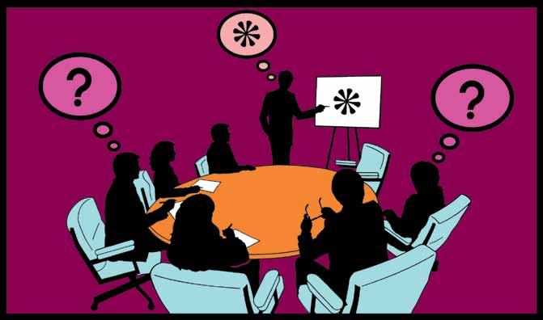

# John Kotter. (2011). Por qué fracasan los intentos de transformación

<!-- página 1 -->

78   Harvard Business Review  |  Diciembre 2011  |  hbral.com

Lawrence Zeegan
## E

Publicación original:

marzo - abril de 1995
### por John P. Kotter
## Los líderes que transforman con éxito a sus empresas hacen
## correctamente ocho cosas (y las hacen en el orden correcto).
## Liderar el cambio:
## por qué fracasan los
## intentos de transformación

EN LA ÚLTIMA década, he visto a más de un centenar de empresas
intentar reinventarse a sí mismas y ser mejores competidores. Había
organizaciones grandes (Ford) y pequeñas (Landmark Communications),
empresas con sede en Estados Unidos (General Motors) y en otros lugares
(British Airways), corporaciones desfallecientes (Eastern Airlines), y em-
presas que obtenían buenas utilidades (Bristol-Myers Squibb). Los es-
fuerzos se llevaron a cabo bajo diversos estandartes: gestión de calidad
total, reingeniería, ajuste de dotación, reestructuración, cambio cultural
y transformación. En casi todos los casos, sin embargo, el objetivo básico
ha sido el mismo: realizar cambios radicales en la forma como es dirigido
el negocio para ayudar a enfrentar un entorno de negocios nuevo y más
desafiante

Algunos de estos esfuerzos de cambio corporativo han sido exitosos.
Algunos han sido fracasos totales. La mayoría cae en un punto intermedio,

con una pendiente notoria hacia el extremo más negativo de la escala. Las
lecciones que pueden extraerse son interesantes y probablemente serán
relevantes incluso para más organizaciones en el entorno de negocios
crecientemente competitivo de la próxima década.

La lección más general que debe ser aprendida de los casos más exi-
tosos es que el proceso de cambio atraviesa una serie de fases que, en

---

<!-- página 2 -->

> **Descripción de la imagen** — La imagen es una ilustración estilizada que representa una reunión o discusión grupal.
>
> En el centro de la escena hay una mesa grande de color naranja o amarillo alrededor de la cual varias personas están sentadas, participando en lo que parece ser un debate o una sesión de estudio.
>
> Hay al menos seis figuras visibles: algunas están sentadas alrededor de la mesa y otras están de pie. Varias de las figuras tienen globos de diálogo o burbujas de pensamiento sobre sus cabezas, indicando interacción o preguntas.
>
> Una persona se encuentra de pie cerca de un pizarrón blanco que tiene un símbolo de estrella en el centro. El fondo general de la ilustración es de un color magenta o púrpura intenso.

hbral.com  |  Diciembre 2011  |  Harvard Business Review  79

total, requieren normalmente de un espacio de tiempo con-
siderable. Dar pasos apresurados sólo crea la ilusión de veloci-
dad y nunca produce un resultado satisfactorio. Una segunda
lección muy general es que un error crítico en cualquiera
de las fases puede tener un impacto devastador, enfriar el
impulso del logro en pleno desarrollo y anular beneficios tan
difíciles de alcanzar. Debido quizás a que tenemos una expe-
riencia relativamente pequeña en renovar organizaciones, a
menudo incluso la gente más competente comete al menos un
error grave.
### Error 1: No generar un sentido de
### urgencia lo suficientemente grande
La mayoría de los esfuerzos de cambio exitosos comienzan
cuando alguna persona o algún grupo empieza a observar más
de cerca la situación competitiva de la empresa, su posición de
mercado y desempeño financiero, y sus avances tecnológicos.
Se enfocan en una caída posible de los ingresos cuando expire
una patente, en la tendencia en cinco años hacia márgenes de-
crecientes en el negocio principal, o en un mercado emergente
que todos parecen ignorar. Descubren entonces maneras de

comunicar esta información de forma abierta y tajante, en
especial respecto de crisis actuales o potenciales, o de opor-
tunidades magníficas que requieren una reacción inmediata.
El primer paso es esencial, porque el solo hecho de comenzar
un proyecto de transformación requiere de la cooperación
proactiva de muchos individuos. Sin motivación, la gente no
va a ayudar, y el esfuerzo no conducirá a ninguna parte.

Comparada con otros pasos del proceso de cambio, la fase
uno puede sonar fácil. No lo es. Un porcentaje bastante su-
perior a 50% de las empresas que yo he visto fracasan en
esta primera fase. ¿Cuáles son las razones del fracaso? Al-
gunas veces los ejecutivos subestiman lo complicado que
puede ser sacar a las personas de sus zonas de comodidad. A
veces, sobrestiman groseramente lo bien que ellos mismos
se han desempeñado en acelerar la urgencia. Algunas veces
pierden la paciencia. “Basta de preámbulos, vamos al asunto”.
En muchos casos, se quedan paralizados por la posibilidad
de un recorte de puestos de trabajo. Temen que los emplea-
dos con antigüedad se pongan a la defensiva, que la moral
caiga, que los eventos se salgan de control, que los nego-
cios de corto plazo se vean amenazados, que el precio de la

---

<!-- página 3 -->

80   Harvard Business Review  |  Diciembre 2011  |  hbral.com

Liderar el cambio: por qué fracasan los intentos de transformación

acción se hunda, y que ellos serán responsabilizados por crear
una crisis.

Un equipo paralizado de altos ejecutivos es a menudo el
resultado de una abundancia de ejecutivos y una escasez de
líderes. El mandato de los ejecutivos es minimizar el riesgo
y mantener operando el sistema. El cambio, por definición,
requiere crear un sistema nuevo, el que a su vez siempre exige
liderazgo. La fase uno en un proceso de renovación normal-
mente no va hacia ninguna parte si no se promueve o contrata
a líderes genuinos para los puestos más altos.

Las transformaciones a menudo comienzan, y comienzan
bien, cuando una organización tiene una nueva cabeza que
es un buen líder y que detecta la necesidad de un cambio
importante. Si el objetivo de la renovación es toda la empresa,
el CEO es clave. Si el cambio es necesario en una división, su
ejecutivo a cargo es clave. Cuando estos individuos no son
líderes, grandes líderes o campeones del cambio, la fase uno
puede ser un desafío gigantesco.

Los malos resultados del negocio son tanto una bendición
como una maldición en la primera fase. Por el lado positivo,
perder dinero atrae la atención de la gente. Pero también deja
menos espacio para maniobrar. Con buenos resultados del
negocio, lo contrario resulta cierto: convencer a la gente de la
necesidad de un cambio es mucho más difícil, pero hay más
recursos para ayudar a hacer los cambios.

Sea el punto de partida un buen desempeño o uno malo,
en los casos más exitosos que he presenciado siempre un in-
dividuo o un grupo facilita una discusión franca sobre hechos
potencialmente desagradables respecto de nuevos competi-
dores, márgenes que se estrechan, participación de mercado
decreciente, ganancias planas, falta de crecimiento de los in-
gresos u otros indicadores relevantes de una posición com-
petitiva declinante. Parece existir una tendencia casi univer-
sal en las personas a desentenderse de las malas noticias, o
de aquellas no muy agradables, especialmente si el jefe de
la organización no es un adalid del cambio, y por ello los
ejecutivos de estas empresas a menudo descansan en gente
de afuera para traer información no deseada. Analistas de
Wall Street, clientes y consultores pueden ser todos de mucha
ayuda en este sentido. El propósito de toda esta actividad, en
palabras de un ex CEO de una gran empresa europea es “hacer
que el statu quo parezca más peligroso que penetrar en lo
desconocido”.

En algunos de los casos más exitosos, un grupo fabricó una
crisis. Un CEO diseñó deliberadamente la mayor pérdida con-
table en la historia de la empresa, generando enormes presio-
nes desde Wall Street. Un presidente de división encargó por
primera vez una encuesta sobre satisfacción de clientes, sa-
biendo muy bien que los resultados serían horribles. Después
hizo públicos estos resultados. A primera vista, tales manio-
bras pueden verse como indebidamente riesgosas. Pero tam-
bién hay riesgo en manejar las cosas bajo demasiada seguri-
dad: cuando el nivel de urgencia no se acentúa lo suficiente, el

proceso de transformación no puede tener éxito y el futuro de
la organización a largo plazo queda amenazado.

¿Cuándo es suficientemente alto el nivel de urgencia? Por
lo que he observado, la respuesta es cuando cerca de 75%, del
equipo ejecutivo está honestamente convencido de que re-
sulta totalmente inaceptable seguir con las cosas tal como
están. Cualquier idea menos contundente puede causar graves
problemas más adelante en el proceso.
### Error 2: No crear una coalición
### conductora suficientemente poderosa
Los proyectos de renovación importantes comienzan a
menudo con una o dos personas. En los casos de esfuerzos de
transformación exitosos, la coalición conductora crece perma-
nentemente a lo largo del tiempo. Pero si el esfuerzo no gen-
era rápidamente una masa crítica, no sucede nada muy valioso.

Muchas veces se dice que un cambio importante es im-
posible a menos que sea apoyado con fuerza por el jefe de
la organización. Yo estoy hablando de ir mucho más allá de
eso. En las transformaciones exitosas, el CEO, el presidente
o el director de división, más otras cinco, 15 o 20 personas,
se reúnen y establecen un compromiso compartido con un
desempeño de excelencia mediante la renovación. En mi ex-
periencia, este grupo nunca incluye a todos los ejecutivos más
experimentados de la empresa debido a que algunas personas
simplemente no creen en el cambio. Al menos no al principio.
Pero en la mayoría de los casos exitosos, la coalición es siempre
lo suficientemente poderosa, en términos de poder formal,
información y experticia, reputaciones y relaciones.

Tanto en las organizaciones grandes como en las pequeñas,
una coalición conductora exitosa puede incluir sólo a tres o
cinco personas durante el primer año del proyecto de reno-
vación. Pero en las empresas grandes, la coalición necesita
crecer hasta un nivel de 20 a 50 personas antes de que se
pueda lograr un progreso significativo en la fase tres o en las
siguientes. Los altos ejecutivos siempre forman el núcleo del
grupo. Pero a veces hay miembros del consejo, un represen-
tante de un cliente clave o incluso un poderoso líder sindical.

Debido a que la coalición conductora incluye a personas
que no son parte de la alta dirección, tiende por definición
a operar por fuera de la jerarquía formal. Esto puede ser
incómodo pero es absolutamente necesario. Si la jerarquía
existente estuviera funcionando bien, una transformación
importante no sería necesaria. Pero como el sistema actual
no está funcionando, las reformas exigen generalmente que
se actúe fuera de los límites, las expectativas y los protocolos
formales.

Un alto sentido de urgencia dentro de las filas ejecutivas
ayuda enormemente a formar una coalición conductora. Pero
usualmente se requiere más que eso. Es necesario que alguien
junte a esas personas, las ayude a desarrollar una evaluación
compartida de los problemas y oportunidades de la empresa, y
cree un nivel mínimo de confianza y comunicación. Los retiros

---

<!-- página 4 -->

hbral.com  |  Diciembre 2011  |  Harvard Business Review  81

fuera de la oficina, por dos o tres días, son un método frecuente-
mente utilizado para lograrlo. He visto a muchos grupos de
cinco a 35 ejecutivos asistir a una serie de estos retiros dentro
de un lapso de meses.

Las empresas que fracasan en la fase dos usualmente sub-
estiman las dificultades de producir un cambio y, por esto
mismo, la importancia de una coalición conductora poderosa.
A veces no tienen historia de trabajo en equipo en el alto nivel

y por ello subvaloran la importancia de este tipo de coalición.
A veces esperan que el equipo sea liderado por un asistente de

recursos humanos, de calidad o de planificación estratégica en
vez de un ejecutivo de una línea clave. No importa cuán capaz
o dedicado sea el jefe del equipo: los grupos sin fuerte lide-
razgo de línea nunca obtienen el poder que necesitan.

Los proyectos que no cuentan con una coalición conductora
lo suficientemente poderosa pueden hacer progresos palpa-
bles durante un tiempo. Pero, tarde o temprano, la oposición
reagrupa sus fuerzas y detiene el cambio.
### Error 3: Carecer de una visión
En todos los esfuerzos de transformación exitosos que he visto,
la coalición conductora desarrolla una imagen del futuro rela-
tivamente fácil de comunicar y que atrae a los clientes, accio-
nistas y empleados. Una visión siempre va más allá de los típi-
cos números que uno encuentra en los planes quinquenales.
Una visión dice algo que ayuda a clarificar la dirección en
que la empresa necesita moverse. A veces el primer borrador
pro viene en su mayor parte de un solo individuo. Suele ser
un poco difuso, al menos al principio. Pero una vez que la
coalición lo trabaja tres, cinco o hasta 12 meses, emerge algo
mucho mejor a partir de un riguroso pensamiento analítico y
un poco de fantasía. Posteriormente, se desarrolla una estrate-
gia para alcanzar esa visión.

En una empresa europea de tamaño medio, el primer paso
hacia una visión contenía dos tercios de las ideas básicas que
llegaron al producto final. El concepto de alcance global es-
taba en su versión inicial. También lo estaba la idea de llegar a
ser jugadores fuertes en algunos negocios. Pero una idea cen-
tral en la versión final –salirse de las actividades de bajo valor
agregado– surgió después de una serie de reuniones.

Sin una visión razonada, el esfuerzo de transformación pu-
ede disolverse fácilmente en una lista de proyectos confusos e
incompatibles que lleven a la empresa en la dirección equivo-
cada o hacia ninguna parte. Sin una visión estimulante, el
proyecto de reingeniería en el departamento de contabilidad,
la nueva evaluación de desempeño en 360 grados por parte
del departamento de recursos humanos, el programa de cali-
dad de la planta, el proyecto de cambio cultural en la fuerza
de ventas no serán un aporte significativo.

En las transformaciones fallidas, usted encuentra a menudo
muchos planes, directrices y programas, pero ninguna visión.
En un caso, una empresa distribuyó cuadernos de diez centí-
metros de grosor con la descripción de su iniciativa de cambio.
## Ocho pasos para
## transformar su
## organización

1. Establecer un sentido de urgencia

■ Examinar el mercado y la realidad competitiva

■ Identificar y discutir crisis, crisis potenciales y grandes

oportunidades

2. Formar una coalición conductora poderosa

■ Juntar a un grupo con el poder suficiente para liderar

un esfuerzo de cambio

■ Estimular al grupo para que trabaje como equipo

3. Crear una visión

■ Crear una visión que ayude a dirigir el esfuerzo

de cambio

■Desarrollar estrategias para lograr esa visión

4. Comunicar la visión

■ Usar todos los medios posibles para comunicar la visión

y estrategias nuevas

■ Enseñar nuevas conductas mediante el ejemplo de

la coalición conductora

5.  Facultar a otros para que actúen de acuerdo
con la visión

■ Remover los obstáculos para el cambio

■ Cambiar los sistemas y estructuras que socavan

seriamente la visión

■ Incentivar la toma de riesgos y las ideas, actividades

y acciones no tradicionales

6. Planificar y crear triunfos de corto plazo

■Planificar para mejorar visiblemente el desempeño

■ Mejorar el desempeño

■ Reconocer y recompensar a los empleados involucra-

dos en ese logro

7. Consolidar los progresos y producir aún más cambio

■ Usar la credibilidad generada para cambiar sistemas,

estructuras y políticas que no se ajustan a la visión

■ Contratar, ascender y entrenar a empleados que puedan

implementar la visión

■ Revigorizar el proceso con proyectos, temas y agentes

de cambio nuevos

8. Institucionalizar los nuevos enfoques

■ Articular las conexiones entre las nuevas conductas

y el éxito de la empresa

■ Desarrollar los medios para asegurarse del desarrollo

y la sucesión del liderazgo

---

<!-- página 5 -->

> **Descripción de la imagen** — La imagen es una ilustración de estilo silueta que representa una interacción o diálogo entre dos personas.
>
> En el centro del espacio se encuentran dos figuras humanas en silueta:
> 1. Una figura está ubicada a la izquierda, de pie y mirando hacia la derecha.
> 2. Una segunda figura está ubicada a la derecha, también de pie y mirando hacia la izquierda.
>
> Entre las dos figuras hay dos globos de diálogo (burbujas de texto) de color rosa o rojo claro. Ambos globos contienen un símbolo de estrella o asterisco en su interior.
>
> Junto a la figura de la derecha se observa un maletín o una maleta.
>
> El fondo es de un color azul claro o turquesa uniforme. La composición sugiere una conversación o intercambio de ideas entre las dos personas.

82   Harvard Business Review  |  Diciembre 2011  |  hbral.com

Liderar el cambio: por qué fracasan los intentos de transformación

Con un detallismo abrumador, los manuales citan procedi-
mientos, metas, métodos y plazos. Pero en ninguna parte
exis te una declaración clara y atractiva de hacia dónde lleva
todo esto. No es sorpresa que la mayoría de los empleados con
que conversé estuvieran confundidos o alienados. Los grandes
y gruesos manuales no los atraen ni inspiran el cambio. De
hecho, probablemente tienen el efecto contrario.

En algunos casos menos exitosos que he visto, los ejecuti-
vos tenían un sentido de dirección, pero era demasiado com-
plicado o difuso para ser útil. Recientemente, le pedí a un
ejecutivo de una empresa de tamaño medio que describiera
su visión y recibí como respuesta una cátedra más o menos
incomprensible de 30 minutos. Enterrados en esa respuesta
se hallaban los elementos básicos de una visión clara. Pero
estaban enterrados muy abajo.

Una útil regla general: si usted no puede comunicarle a
alguien su visión en cinco minutos –o menos– y generar una
reacción que demuestre comprensión e interés, entonces no
ha cumplido con esta fase del proceso de transformación.
### Error 4: Comunicar la visión diez veces
### menos que lo necesario
He visto tres patrones respecto de la comunicación, y los tres
son bastante comunes. En el primero, un grupo realmente de-
sarrolla una visión de transformación bastante buena y lue go
procede a comunicarla en una sola reunión o enviando un
solo comunicado. Habiendo usado cerca de 0,0001% de la co-
municación interna anual, el grupo se sorprende al percatarse
de cuán pocas personas parecen comprender el nuevo en-
foque. En el segundo patrón, el líder de la organización gasta

una enorme cantidad de tiempo pronunciando discursos a
grupos de empleados, pero la mayoría de las personas todavía
no entiende (no es sorprendente, ya que la visión sólo captura
0,0005% del total de las comunicaciones anuales). En el tercer
patrón, se dedica un esfuerzo mucho mayor a boletines y dis-
cursos, pero algunos altos ejecutivos muy visibles todavía se
comportan de maneras que son incoherentes con la visión. El
resultado neto es que aumenta la desconfianza entre las tropas,
mientras disminuye la credibilidad en la comunicación.

La transformación es imposible a menos que cientos o
miles de personas estén dispuestas a ayudar, muchas veces
incluso al punto de hacer sacrificios en el corto plazo. Los
empleados no harán sacrificios, ni siquiera cuando no estén
felices con el statu quo, a menos que crean que un cambio
provechoso es posible. Sin una comunicación creíble, y en
buenas cantidades, los corazones y las mentes de las tropas
nunca serán conquistados.

Esta cuarta fase es particularmente desafiante si los sacrifi-
cios de corto plazo incluyen pérdidas de empleos. Es difícil ob-
tener comprensión y apoyo cuando las reducciones son parte
de la visión. Por esta razón, las visiones exitosas a menudo in-
cluyen nuevas posibilidades de crecimiento y el compromiso
de tratar con equidad a quienes son despedidos.

Los ejecutivos que comunican bien incorporan mensajes
dentro de sus actividades regulares. En una conversación de
rutina sobre un problema de negocios, dialogan sobre si las
soluciones propuestas se ajustan (o no) al marco más global
de la empresa. En una evaluación regular de desempeño,
hablan sobre si el comportamiento del empleado apoya o
socava la visión. En una revisión del desempeño trimestral de

---

<!-- página 6 -->

hbral.com  |  Diciembre 2011  |  Harvard Business Review  83

una división, hablan no sólo sobre los números sino también
sobre cómo los ejecutivos están contribuyendo a la trans-
formación. En una ronda de preguntas y respuestas de rutina
con empleados dentro de las instalaciones de una empresa,
relacionan sus respuestas con las metas renovadas.

En los esfuerzos de transformación más exitosos, los ejecu-
tivos usan todos los canales de comunicación para difundir

su visión. Transforman los aburridos e ignorados boletines
de noticias en animados artículos sobre la visión. Toman las
aburridas y solemnes reuniones trimestrales de gestión y las
convierten en entretenidos debates sobre la transformación.
Desechan mucho de la genérica educación de gestión de la
empresa y la reemplazan con cursos que se enfocan en los
problemas del negocio y la nueva visión. El principio guía es
simple: use cada canal posible, especialmente aquellos que
están siendo desperdiciados con información no esencial.

Más importante, quizás, es que la mayoría de los ejecutivos
que he conocido en casos exitosos de cambios significativos
aprenden a “predicar con el ejemplo”. Intentan convertirse
en un símbolo viviente de la nueva cultura corporativa. A
menudo esto no es fácil. Un ejecutivo de una planta, a los
60 años de edad, que ha pasado muy poco tiempo de sus 40
años de carrera pensando en los clientes, de seguro que no
se comportará súbitamente de una manera orientada a los
clientes. Pero yo he presenciado cambios de ese calibre en las
personas, y grandes cambios, ayudados por un alto nivel de ur-
gencia en tales casos. El hecho de que ese hombre fuera parte
de la coalición conductora y del equipo de creación de visión
también ayudó, así como todas las comunicaciones, que le
ayudaron a cumplir con el comportamiento deseado, y todo el
feedback de sus pares y subordinados, que le advertía cuando
no estaba siguiendo ese comportamiento.

La comunicación se expresa tanto en palabras y en acciones,
y esta última suele ser la forma más poderosa. Nada debilita
más el cambio que un comportamiento inconsistente con sus
palabras de parte de las personas importantes.
### Error 5: No remover los obstáculos para
### la nueva visión
A medida que el proceso avanza, las transformaciones exitosas

comienzan a involucrar a más personas. Los empleados son
exhortados a probar nuevos enfoques, desarrollar ideas nue-

vas y ejercer liderazgo. La única condición es que los actos se
ajusten a los parámetros generales de la visión global. Mien-
tras más personas estén involucradas, mejor será el resultado.

Hasta cierto punto, una coalición conductora faculta a otros
para que actúen, simplemente por la vía de comunicar ade-
cuadamente la nueva dirección. Pero la comunicación nunca
es suficiente por sí misma. La renovación también necesita que

se remuevan obstáculos. Con mucha frecuencia, un empleado
entiende la nueva visión y quiere aportar para que se haga
realidad, pero pareciera que la ruta está siendo bloqueada por
un elefante. En algunos casos, el elefante está en la mente de la
persona, y el desafío entonces consiste en convencerla de que
no hay obstáculos externos. Pero en la mayoría de los casos, las
barreras son muy reales.

A veces el obstáculo es la estructura de la organización:
las estrechas clasificaciones de trabajo pueden socavar seria-
mente los esfuerzos por aumentar la productividad o pueden
hacer muy difícil que siquiera se piense en los clientes. A veces
los sistemas de evaluación de desempeño o de compensacio-
nes llevan a la gente a escoger entre la nueva visión y su interés
propio. Tal vez lo peor de todo son los jefes que se niegan a
cambiar y que hacen exigencias inconsistentes con el esfuerzo
global.

Una empresa comenzó su proceso de transformación con
bastante publicidad y de verdad logró grandes progresos du-
rante la cuarta fase. Entonces el proceso de cambio se detuvo
porque el ejecutivo a cargo de la división más grande de la
empresa tenía la facultad de socavar la mayoría de las nuevas
iniciativas. Apoyó el proceso de la boca para afuera pero no
cambió su comportamiento ni estimuló a sus ejecutivos para
que lo hicieran. No otorgó un reconocimiento a las ideas no
convencionales que la visión estaba demandando. Permitió
que los sistemas de recursos humanos permanecieran intactos
incluso cuando eran claramente inconsistentes con los nuevos
valores. Pienso que las razones del ejecutivo eran complejas.
Hasta cierto punto, él no creía que la empresa necesitara un
cambio mayor. Hasta cierto punto, él se sentía personalmente
amenazado por el cambio. Hasta cierto punto, él temía no ser
capaz de lograr simultáneamente el cambio y las utilidades
operacionales esperadas. Pero a pesar del hecho de que ellos
respaldaban el esfuerzo de renovación, ninguno de los otros
ejecutivos hizo algo para detener al obstaculizador. Nueva-
## Si no puede comunicar la visión a una persona en cinco
## minutos o menos y obtener una reacción que signifique tanto
## comprensión como interés, aún no ha terminado.

---

<!-- página 7 -->

84   Harvard Business Review  |  Diciembre 2011  |  hbral.com

Liderar el cambio: por qué fracasan los intentos de transformación

mente, las razones eran complejas. La empresa nunca antes
había enfrentado problemas como éste. Algunas personas le
temían al ejecutivo. El CEO estaba preocupado por la posibi-
lidad de perder un ejecutivo talentoso. El resultado neto fue
desastroso. Los ejecutivos de niveles más bajos llegaron a la
conclusión de que los altos ejecutivos les mintieron sobre su
compromiso con la renovación, la desconfianza aumentó y
todo el proceso colapsó.

En la primera mitad de una transformación, ninguna em-
presa tiene el impulso, el poder o el tiempo para eliminar todos
los obstáculos, pero los más grandes deben ser confrontados y
removidos. Si el obstaculizador es una persona, es importante

que él o ella reciba un tratamiento justo y consistente con la
nueva visión. La acción es esencial, tanto para facultar a otros
como para preservar la credibilidad del esfuerzo de transfor-
mación en su conjunto.
### Error 6: No planificar ni crear triunfos
### de corto plazo de manera sistemática
Las transformaciones reales toman tiempo, y un esfuerzo de
renovación corre el riesgo de perder impulso si no hay metas
de corto plazo que cumplir y celebrar. La mayoría de las per-
sonas no se entusiasma con una marcha larga a menos que vea
evidencia convincente en 12 o 24 meses de que el viaje está
produciendo los resultados esperados. Sin triunfos de corto
plazo, son demasiadas las personas que se rinden o que se
unen a las filas de quienes se resisten al cambio.

Con uno o dos años en un esfuerzo de transformación
exitoso, usted descubrirá que la calidad empieza a subir en
algunos indicadores o que se detiene la caída de las ganan-
cias. Observará exitosos lanzamientos de nuevos productos
o un cambio positivo en la participación de mercado. Usted
observa un impresionante mejoramiento en la produc-
tividad o un nivel estadísticamente mayor de satisfacción
de los clientes. Pero, cualquiera sea el caso, la victoria no
es ambigua. El resultado no es sólo una llamada de aten-
ción que pueda ser desechada por aquellos que se oponen
al cambio.

Crear triunfos de corto plazo es diferente de esperar triun-
fos de corto plazo. Lo segundo es pasivo, lo primero, activo. En
una transformación exitosa, los ejecutivos buscan activamente
formas de mejorar el desempeño, definen metas en el sistema
de planificación anual, alcanzan las metas, y recompensan
a las personas involucradas con reconocimiento, ascensos o
incluso dinero. Por ejemplo, la coalición conductora de una
empresa estadounidense creó un producto nuevo, exitoso y
muy llamativo, unos 20 meses después del inicio de un es-
fuerzo de renovación. La elección del producto se tomó en
el sexto mes del proceso porque satisfacía muchos criterios:
podía ser diseñado y lanzado en un periodo relativamente

corto; podía ser asumido por un equipo pequeño de personas
convencidas de la nueva visión; tenía un potencial favorable,
y el nuevo equipo de desarrollo de productos podía funcionar
por fuera de la estructura establecida. Casi nada se dejó al azar,
de modo que el triunfo aumentó la credibilidad del proceso
de renovación.

A menudo los ejecutivos se quejan de verse forzados a
producir triunfos de corto plazo, pero he descubierto que la
presión puede ser un factor útil en un esfuerzo de cambio.
Cuan do a las personas les queda claro que un cambio impor-
tante tomará mucho tiempo, los niveles de urgencia pueden
decaer. El compromiso con obtener triunfos de corto plazo pu-
ede ayudar a mantener en alto el nivel de urgencia y forzar un
pensamiento analítico detallado que clarifique y revise visiones.
### Error 7: Declarar victoria demasiado
### pronto
Tras unos cuantos años de trabajo duro, los ejecutivos pueden
sufrir la tentación de cantar victoria ante la primera mejora
clara de desempeño. Aunque celebrar un triunfo está bien,
declarar ganada la guerra puede ser catastrófico. Hasta que los
cambios penetren profundamente en la cultura de la empresa,
un proceso que puede tomar de cinco a diez años, los nuevos
enfoques son frágiles y pueden sufrir regresiones.

En el pasado reciente, he visto una docena de esfuerzos de
cambio operar bajo el lema de la reingeniería. En la gran ma-
## Después de algunos años de trabajo duro, los gerentes se
## pueden ver tentados a declarar la victoria con la primera
## mejora clara al desempeño. Si bien celebrar un logro
## está bien, declarar que se ganó la guerra puede
## ser catastrófico.

---

<!-- página 8 -->

hbral.com  |  Diciembre 2011  |  Harvard Business Review  85

yoría de los casos, se declaró victoria y se les pagó y agradeció
a costosas consultoras cuando se completó el primer proyecto
importante al cabo de dos o tres años. Dos años después, los
pro vechosos cambios que habían sido introducidos lenta-
mente desaparecieron. En dos de los diez casos, hoy es difícil
encontrar algún vestigio del trabajo de reingeniería.

En los últimos 20 años, he visto repetirse el fenómeno en
proyectos de enorme calidad, en esfuerzos de desarrollo orga-
nizacional, entre otros. Comúnmente, los problemas empie-
zan en la parte inicial del proceso: el nivel de urgencia no es
lo suficientemente intenso, la coalición conductora no es lo
suficientemente poderosa y la visión no es lo suficientemente
clara. Sin embargo, es la declaración prematura de victoria lo
que mata al impulso. Y es ahí cuando las poderosas fuerzas
asociadas a la tradición toman el control.

Irónicamente, a menudo una mezcla de iniciadores de
cambios y opositores al cambio es la que crea la celebración
prematura de victoria. En su entusiasmo por una señal clara
de progreso, los iniciadores se exceden. Y se les unen los oposi-
tores, quienes están atentos a detectar cualquier oportunidad
para detener el cambio. Cuando se acaba la celebración, los
opositores sostienen que la victoria es un signo de que se ganó
la guerra y que las tropas deben ser traídas de regreso a casa. Y
las tropas cansadas están dispuestas a ser convencidas de que
la guerra está ganada. Una vez en casa, los soldados no están
dispuestos a volver a subirse a los barcos. Al poco tiempo, el
cambio se detiene y la tradición se vuelve a instalar.

En vez de declarar victoria, los líderes de esfuerzos exitosos
usan la credibilidad obtenida con los triunfos de corto plazo
para abordar problemas aún más grandes. Se lanzan contra
los sistemas y estructuras que no son consistentes con la visión
de transformación. Dedican mucha atención a quién es as-
cendido, quién es contratado y cómo están evolucionando las
personas. Incluyen proyectos de reingeniería de un alcance
incluso mayor que los iniciales. Entienden que los esfuerzos
de renovación toman años y no sólo unos meses. De hecho, en
una de las transformaciones más exitosas que yo haya visto
alguna vez, cuantificamos el nivel de cambio ocurrido en cada
año por un período de siete años. En una escala de uno (bajo)
a 10 (alto), el primer año recibió un dos, el segundo un cuatro,
el tercero un tres, el cuarto un siete, el quinto un ocho, el sexto
un cuatro y el séptimo un dos. El máximo se obtuvo en el año
cinco, 36 meses después del primer conjunto de ganancias
visibles.
### Error 8: No arraigar los cambios en
### la cultura de la empresa
En el análisis final, el cambio se arraiga cuando se convierte
en “la forma en que hacemos las cosas aquí”, cuando se infiltra
en el flujo sanguíneo del cuerpo corporativo. Hasta que las
nuevas conductas no se arraiguen en normas sociales y valores
compartidos, pueden degradarse apenas termine la presión
por el cambio.

Dos factores son particularmente importantes para institu-
cionalizar el cambio. El primero es un intento consciente de
mostrarle a las personas cómo los nuevos enfoques, compor-
tamientos y actitudes han ayudado a mejorar el desempeño.
Cuando se deja que las personas hagan por sí mismas las co-
nexiones, suelen crear relaciones bastante inexactas. Por ejem-
plo, porque los resultados mejoraron cuando el carismático
Harry era el jefe, las tropas vincularon su estilo normalmente
idiosincrásico con los resultados, en vez de pensar en cómo
influyeron su mejor servicio al cliente y su mayor productivi-
dad. Ayudar a las personas para que hagan las conexiones co-
rrectas requiere comunicación. Una empresa fue inflexible en
esto y obtuvo enormes recompensas. Se gastó tiempo en cada
reunión importante de gestión para discutir por qué el desem-
peño estaba mejorando. El periódico de la empresa publicó
un artículo tras otro mostrando cómo los cambios impulsaron
las ganancias.

El segundo factor es tomarse el tiempo suficiente para
asegurarse de que la siguiente generación de altos ejecuti-
vos en verdad personifica el nuevo enfoque. Si los requisitos
para un ascenso no cambian, la renovación difícilmente du-
rará. Una mala decisión de sucesión en el tope de la orga-
nización pue de minar una década de trabajo duro. Las malas
decisiones de sucesión pueden ocurrir cuando los consejos
de admi nistración no son una parte integrante del esfuerzo
de renovación. En al menos tres casos que he visto, el adalid
del cambio era el ejecutivo saliente, y aunque su sucesor no
se oponía al cambio, tampoco estaba convencido. Como los
consejos no entendían la transformación en todos sus detalles,
no podían saber que sus decisiones no eran las más apropiadas.
En uno de los casos, el ejecutivo saliente trató de convencer
al consejo, sin éxito, de que escogieran a un candidato me-
nos avezado que personificara a la transformación de mejor
manera. En los otros dos casos, los CEO no se resistieron a las
decisiones del consejo, porque sentían que la transformación
no podría ser deshecha por sus sucesores. Al cabo de dos años,
los signos de renovación empezaron a desaparecer.

• • •
Hay todavía más errores que la gente puede cometer, pero
estos ocho son los más grandes. Me doy cuenta de que en un
artículo corto todo está puesto para que suene demasiado
simplista. En realidad, incluso los esfuerzos de cambio exitosos
son complejos y están llenos de sorpresas. Pero así como una
visión relativamente simple necesita la guía de un grupo de
personas para lograr un cambio mayor, también una visión
del proceso de cambio puede reducir la tasa de error. Y unos
pocos errores pueden marcar la diferencia entre el éxito y
el fracaso.

Ahora retirado, John P. Kotter fue Konosuke Matsushita

Professor de Liderazgo en Harvard Business School, en Boston.

Reimpresión R0701J-E

