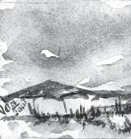
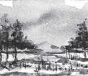
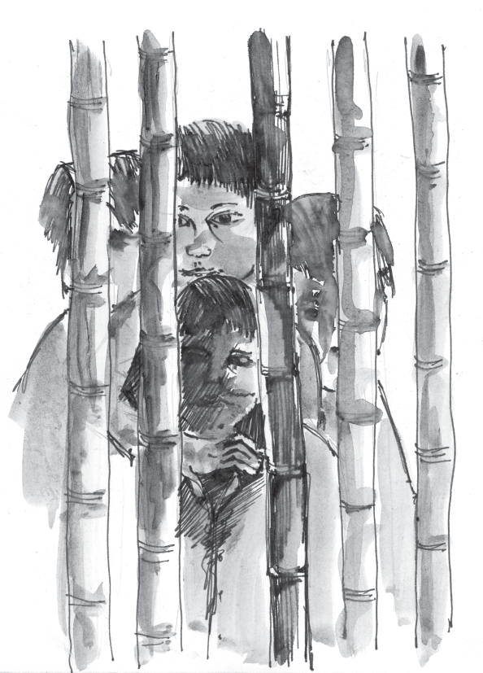
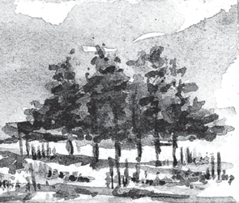
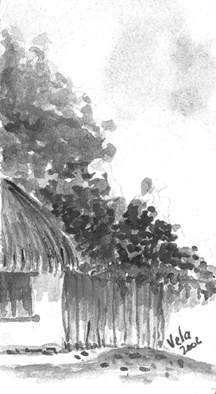
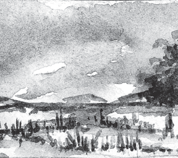

# Juan Carlos Muñoz.(2021). Sobre las tendencias de la administración. algunas reflexiones preliminares

<!-- página 1 -->

112
## SOBRE LAS TENDENCIAS DE LA ADMINISTRACIÓN.
## ALGUNAS REFLEXIONES PRELIMINARES

Juan Carlos Muñoz.

SÍNTESIS
En relación con las tendencias de la discipli-
na administrativa, se puede establecer que
los grandes retos de las organizaciones esta-
rán enfocados claramente en cinco áreas de
trabajo: la gerencia, el capital intelectual, los
sistemas empleados para ser más competi-
tivos, los negocios internacionales y el fo-
mento de una cultura del emprendimiento.
Diversas razones se han presentado para
determinar en prospectiva lo que puede su-
ceder en las empresas y cuál es papel de la
administración como disciplina que intenta
dar respuesta a los interrogantes que pue-
dan surgir en las organizaciones.

Descriptores: Tendencias, Capital Intelec-
tual, Negocios Internacionales, Dirección
Gerencial,
Gestión
de
la
Calidad,
Competitividad, Logística, Empresarismo.

ABSTRACT
In relation to the tendencies of the
administrative discipline, it is possible to be
established that the great challenges of the
organizations will be focused clearly in five
areas of work, the management, the
intellectual capital, the used systems to be
more
competitive,
the
international
businesses and the promotion of a culture
of the emprendimiento. Diverse reasons
have appeared to determine in prospectiva
which can happen in the companies and
which is paper of the administration like
discipline that tries to give answer to the
questions that can arise in the organizations.

Descriptors:
Tendencies,
Capital
Intellectual,
Internationals
businesses,
Management,  Quality Administration,
Competitive, Logistic, Empresarismo.
### INTRODUCCIÓN
### El presente informe sobre tendencias
### de la disciplina administrativa se reali-
### za considerando las diferentes explo-
### raciones bibliográficas, conversatorios
### y estudios de importantes autores
### acerca de la visión general de la evolu-
### ción de la profesión en el tiempo y
### sus relaciones con la enseñabilidad de
### la disciplina administrativa  como ten-
### dencia de  la educación en adminis-
### tración en un mundo caracterizado
### por la globalización. Igualmente, se
### consideran algunos conceptos con re-
### lación al desarrollo de la profesión en
### el país y finalmente se analizan algu-
### nas tendencias regionales y locales, las
### cuales establecen los principales retos
### para la formación del administrador
### del futuro.
### Para tal efecto, se estudian diversas
### ponencias de autores ampliamente re-
### conocidos en el campo internacional
### como Peter Drucker, Amartya Sen,
### Omar Aktouf, Henri Mintzberg y
### Héctor Ramírez,entre otros así como
### los diversos debates generados al in-
### terior del Comité Básico de la Facul-

> **Descripción de la imagen** — La imagen es una ilustración o fotografía en blanco y negro que representa un paisaje natural.
>
> En el primer plano y el centro, se observa un cuerpo de agua (posiblemente un río o lago) que se extiende horizontalmente. A lo largo de las orillas del agua hay una densa línea de vegetación vertical, compuesta por árboles altos, juncos o cañas.
>
> En el fondo, detrás del cuerpo de agua, se aprecian colinas o montañas suaves que definen el horizonte. El cielo ocupa la parte superior de la imagen y presenta algunas nubes dispersas. La iluminación sugiere un día claro o ligeramente nublado.

---

<!-- página 2 -->

113

tad de Administración de Empresas
donde se ubica el estudio tendencial.
También
se
consideran
las
subdivisiones especializadas al interior
del área para determinar con base en
las tendencias globales, cómo pueden
ser las proyecciones de la disciplina
desde el management, el capital inte-
lectual, los sistemas actuales de
competitividad entre ellos la parte lo-
gística y de desarrollo internacional,
así como la importancia del fomento
de una cultura del emprendimiento
en las instituciones de educación su-
perior como una tendencia funda-
mental de la disciplina administrativa.

Finalmente, el informe concluye con
una mirada a los diferentes impac-
tos que a nivel de la sociedad y en
particular para la institución generan
estas tendencias.

El estudio en ningún momento pre-
tende dar a entender al lector que debe
considerarse como un escrito ya finali-
zado, ya que, en cuanto al tema de las
tendencias de la disciplina, las reflexio-
nes apenas sugieren un intento por
determinar de una forma preliminar el
futuro de la disciplina administrativa.

TENDENCIAS ACTUALES.
UNA PERSPECTIVA
GLOBAL

Hace treinta años aproximadamen-
te, el mundo empezó a sentir los cam-
bios caracterizados por el auge del

fortalecimiento de los sectores
exportadores de Japón y de los países
europeos que le disputaban el
liderazgo en la capacidad productiva
y el comercio internacional a los Es-
tados Unidos. Diversos estudios
han intentado realizar un ejerci-
cio prospectivo del futuro
esperable para la economía y la
sociedad mundial y el papel de las
economías desarrolladas dentro
de ésta; todo ello, sustentado en
un conocimiento profundo de la
historia y de los acontecimientos
del presente, para de ahí, derivar
los rumbos posibles para las or-
ganizaciones en el presente siglo.

Diferentes instituciones, a través de
los estudios realizados, han coloca-
do especial interés en detectar las
tendencias globales que de manera
probable establecerán el nuevo
mundo económico, político y social
que los países, las organizaciones y
las personas enfrentarán en este si-
glo, y sobre todo, las estrategias a
seguir para que su diseño e
implementación por parte de las
organizaciones permita aprovechar
al máximo sus fuerzas y oportuni-
dades y disminuir el impacto de sus
amenazas y debilidades.

Una de las tendencias detecta-
das a principios de los ochenta
estuvo determinada por las ex-
pectativas de crecimiento econó-

> **Descripción de la imagen** — Es una ilustración o dibujo en blanco y negro que representa un paisaje natural, probablemente durante el invierno o al amanecer/atardecer.
>
> La composición muestra una escena de naturaleza con varios elementos:
> 1. **Primer plano y plano medio:** Hay siluetas de árboles altos (coníferas) dispersos por la escena. El suelo parece estar cubierto de nieve o áreas muy claras, contrastando con las sombras oscuras de los árboles.
> 2. **Fondo:** Se aprecian colinas o montañas distantes que se difuminan ligeramente debido a la atmósfera o la distancia.
> 3. **Cielo:** El cielo está cubierto, representado por tonos grises y texturas suaves.
>
> El estilo de la imagen es pictórico, con trazos visibles que sugieren una técnica de acuarela o carboncillo, creando una atmósfera melancólica y serena.

---

<!-- página 3 -->

114

mico que se esperaban para los
países dados los nuevos enfo-
ques y políticas económicas de
los gobiernos. (CEPAL, 2000,
14). En cierta forma, ese auge in-
corporó durante la década mencio-
nada y principios de los noventa a
algunos países de América Latina,
en especial aquellos que generaron
buenas relaciones comerciales con
Estados Unidos - principalmente
por su renacimiento en la década
de los noventa dado el impulso que
ofreció a dos campos fundamenta-
les: tecnología y capital intelectual -
y que en parte dinamizaron su sec-
tor exportador.

Sin embargo, la mayoría de los paí-
ses en desarrollo, en especial los de
América Latina, en vez de experi-
mentar desarrollo económico, por el
contrario desde finales de los ochenta
han decrecido en términos de PIB,
ampliando sus niveles de pobreza y
consolidando cada vez más la divi-
sión de las clases sociales a tal punto
que en países como el nuestro, cada
vez son menos las personas que per-
tenecen a la clase media y más los
que se encuentran en los estratos
socioeconómicos bajos. Ello ha ge-
nerado que difícilmente se puedan
destinar los recursos suficientes para
educación y mucho menos para in-
vestigación del capital intelectual, fac-
tor clave dentro de las tendencias de
desarrollo de los países, como lo ha

sido en el caso Asiático durante las
últimas décadas.

En tanto, la tendencia en Europa está
marcada por su unidad política y eco-
nómica. Actualmente estos países
europeos están centrando su desa-
rrollo en el capital intelectual, su in-
fraestructura económica y el mejo-
ramiento de las condiciones sociales
de algunos grupos vulnerables lo que
ha permitido según los estudios rea-
lizados, ser considerada a mediano
plazo como la potencia económica
más próspera y consolidada.

Otra tendencia destacada se re-
fiere al fortalecimiento del libre
mercado y a la privatización de
las organizaciones del estado,
pautas que en alguna medida se
han dado en la realidad e incluso
parecen haber excedido todas las
previsiones. (RAMÍREZ, 2000, 7)
Analícese por ejemplo el caso de los
países pertenecientes al sistema eco-
nómico socialista y que han debido
vincularse al sistema capitalista para
afrontar un mundo cada vez más
globalizado y en el cual sus ventajas
competitivas son mínimas.

La transferencia de recursos del sec-
tor estatal al privado y de los países
con altos niveles de deuda externa
hacia los acreedores, ha significado
la ausencia de oportunidades para
fortalecer la infraestructura produc-

> **Descripción de la imagen** — Es una ilustración en blanco y negro que representa un paisaje natural. En el primer plano y el plano medio se observan numerosos árboles altos, probablemente coníferas, distribuidos a lo largo de la escena. Detrás de los árboles, se extiende un terreno ondulado o colinas suaves. En el fondo, se aprecian montañas o elevaciones marcadas que definen el horizonte. La ilustración tiene un estilo pictórico y sugiere una vista de naturaleza o un entorno boscoso.

---

<!-- página 4 -->

115

tiva y social, así como para cimen-
tar y potenciar el recurso humano
sobre el cual se sustenta la viabili-
dad de estos países y  se asegura su
incorporación en el actual orden
económico.

La globalización de la economía dejó
de ser una tendencia para convertir-
se en una realidad en la cual la con-
formación de bloques comerciales
juegan un papel fundamental en el
desarrollo de los países. En este or-
den de ideas, especial atención re-
quiere el análisis de la Cuenca del Pa-
cífico como eje potencializador de la
economía mundial y cuyo desarrollo
ha estado vinculado al creciente
avance de las economías asiáticas.

Actualmente, la tendencia tecno-
lógica orientada a la biotecnología,
la producción soportada en el de-
sarrollo sustentable, los sistemas
de producción más limpia y las
buenas prácticas de manufactura
se constituyen en otra de las ten-
dencias básicas del trabajo en el
cual las instituciones deben cen-
trar sus esfuerzos (NEWSWEEK,
1998, 44), tal y como lo presenta el
estudio de tendencias elaborado por
la facultad de Diseño Industrial de la
Universidad Católica y presentado al
Comité Básico de este programa don-
de expresa: “En el entorno tecnoló-
gico encontramos una fuerte tenden-
cia hacia la oferta de servicios para el

sector productivo, en una variada
gama de campos y con una fuerte
participación de la las universidades y
el SENA ̈(MORALES, 2002, 1).

El resurgimiento del humanismo
y de las artes, son tendencias
mundiales que los estudiosos
detectaron desde hace tiempo y
que seguramente se consolidarán
y fortalecerán a lo largo de este
siglo (RAMÍREZ, 2000, 11). Des-
de esta perspectiva, el conocimien-
to, la experiencia, la iniciativa y la crea-
tividad serán manifiestamente reco-
nocidas como el recurso ilimitado de
las organizaciones y de los países. Se
ha empezado a reconocer abierta-
mente que el talento de los indivi-
duos es la base de la competitividad
y de la supervivencia de las organi-
zaciones en cualquier escala.

La marcada desigualdad en la distribu-
ción de los recursos, la reducción de la
pobreza y el acceso generalizado a las
oportunidades de educación y capaci-
tación son los aspectos básicos en los
cuales deben centrar su atención los
dirigentes en este milenio, sin solución
clara a estas adversidades, difícilmente
se puede hacer realidad la previsión res-
pecto a la importancia del ser, la con-
servación de su ambiente, la seguridad
de su bienestar y el de su familia, así
como el respeto a su integridad, prin-
cipales signos distintivos del futuro de
la humanidad.

> **Descripción de la imagen** — Es un dibujo o ilustración en blanco y negro con un estilo de boceto o grabado. La imagen muestra una edificación rústica, posiblemente una cabaña o casa sencilla, ubicada en el lado izquierdo del encuadre. La estructura tiene paredes claras y un techo inclinado.
>
> La edificación está parcialmente oculta por una densa vegetación; árboles frondosos y oscuros cubren gran parte del fondo y el lado derecho de la escena, creando fuertes contrastes entre las áreas iluminadas y las sombras profundas. El primer plano muestra el suelo sobre el que se asienta la estructura. La ilustración tiene un ambiente sombrío y naturalista.

---

<!-- página 5 -->

116

DE LA DISCIPLINA
ADMINISTRATIVA. SU
REALIDAD Y PERSPECTIVA

Desde la anterior proyección gene-
ral y considerando las actuales ten-
dencias, es importante iniciar un
proceso de análisis respecto al am-
biente más próximo, para de esta
forma determinar los escenarios
organizacionales y cuál el papel de
la DISCIPLINA ADMINISTRA-
TIVA en términos de este proceso.
En estudios que ha venido desarro-
llando el Comité Básico de la Facul-
tad de Administración de la Uni-
versidad Católica Popular del
Risaralda y adicionalmente, en rela-
ción con los diversos conversatorios
adelantados en el área administrati-
va, se ha podido determinar como
principales ejes de análisis en refe-
rencia con las tendencias de la dis-
ciplina las siguientes:

1.  DIRECCIÓN
GERENCIAL

El escenario de competencia glo-
bal generado por el entorno ac-
tual de negocios al que se vincu-
lan las organizaciones, ha impli-
cado la definición de nuevos es-
tilos de gerencia para los respon-
sables de la administración y el
desarrollo de las organizaciones.
Ello ha significado que estas áreas
experimenten un cambio radical de
su función de apoyo, hacia la confi-

guración de un proceso de carácter
estratégico, relacionado con el obje-
tivo corporativo de la empresa. La
nueva propuesta debe considerar
como  orientación fundamental el
contribuir a los propósitos esencia-
les de la organización con servicios
que respondan a las necesidades es-
pecíficas de los clientes internos y que
les apoyen para lograr la identifica-
ción y satisfacción plena de las nece-
sidades, deseos y expectativas de sus
clientes externos.

El nuevo orden económico no sólo
puede generar oportunidades, sino
también amenazas que requieren
estar preparados para atender las
demandas de la sociedad. No se
puede simplemente pensar que la
posibilidad de acercarse a los mer-
cados está abierta y que lo único que
se debe hacer es buscar clientes para
venderles nuestros productos y ser
rentables. La posibilidad de actua-
ción dentro de una dinámica global
está condicionada por las estrate-
gias de acción que las organizacio-
nes puedan fomentar con base a los
retos que esta participación les de-
manda. La globalización, requiere el
desarrollo de nuevas competencias,
el cambio de filosofía y cultura
organizacional y el desarrollo del ca-
pital intelectual para identificar las
oportunidades de negocios y más
aún descubrirlas en donde antes no
las identificábamos.

> **Descripción de la imagen** — Es una ilustración o boceto de un paisaje natural, ejecutado en tonos grises y blancos con trazos que sugieren acuarela o carboncillo.
>
> La composición muestra una línea de vegetación densa (árboles) en el primer plano y plano medio, que se extiende horizontalmente a través de la parte inferior del cuadro. Detrás de esta línea de árboles, se eleva una gran montaña o colina prominente que domina el fondo. El cielo está representado con tonos más claros y difuminados, sugiriendo nubes o una atmósfera brumosa. La imagen tiene un estilo pictórico y atmosférico.

---

<!-- página 6 -->

117

El fomento de una cultura de la ca-
lidad y la capacidad de una organi-
zación para generar valor agregado
para sus clientes y proveedores, será
la base de su competitividad y de
su posicionamiento en el mercado.
Ello, a su vez, estará condicionado
por la posibilidad de innovar, de res-
ponder rápidamente a los requeri-
mientos del mercado, en la facilidad
de adaptación a las condiciones de
cambio y en la posibilidad de inte-
grarse estratégicamente.

En general, pudiésemos afirmar que
actualmente las organizaciones tien-
den cada vez más a ser:

· FLEXIBLES Las personas, los
procesos y sus recursos deben
adaptarse a responder a las con-
diciones de un entorno cambian-
te en donde se puede predecir
una mayor autonomía e iniciati-
va y a su vez una disminución en
las reglas y procedimientos for-
males característicos de los nego-
cios hoy. Al respecto Peter
Drucker en su entrevista sobre
el Ejecutivo Postcapitalista expre-
sa: “Hay que aprender a admi-
nistrar en situaciones en que uno
no tiene autoridad de mando, en
las cuales ni está controlado, ni
controla. Éste es el cambio fun-
damental. Los libros de Adminis-
tración siguen hablando princi-
palmente de dirigir subalternos;

pero ya no evaluamos a un eje-
cutivo en función del número de
personas que trabajan directa-
mente a sus órdenes. Esa norma
no significa tanto como la com-
plejidad del cargo, la información
que éste utiliza y genera, y las dis-
tintas clases de relaciones que se
necesitan para hacer el trabajo”.
(DRUCKER, 1995, 3).

· GLOBALIZADAS
La
globalización de la economía acen-
tuará
los
niveles
de
internacionalización y diversifica-
ción de los procesos y de recursos
humanos, haciendo evidentes los
requerimientos organizacionales
derivados de la mezcla de culturas,
ambientes, sociedades y gustos y
preferencias de los consumidores.
El ambiente de los negocios en un
marco global seguirá las pautas y
señales establecidas por las gran-
des corporaciones, especialmente
en cuanto a su entendimiento y
enfoque por la diversidad de mer-
cados que se deben atender y co-
nocer.

· INTERCONECTADAS Debi-
do a la formación de equipos
interdisciplinarios para atender
los
procesos
de
complementariedad que deben
darse entre las diversas áreas fun-
cionales de las instituciones, e
igualmente hacia el entorno para

> **Descripción de la imagen** — La imagen es una ilustración o fotografía en blanco y negro que representa un paisaje natural.
>
> En el primer plano y el centro, se observa un cuerpo de agua (posiblemente un río o lago) que se extiende horizontalmente. A lo largo de las orillas del agua hay una densa línea de vegetación vertical, compuesta por árboles altos, juncos o cañas.
>
> En el fondo, detrás del cuerpo de agua, se aprecian colinas o montañas suaves que definen el horizonte. El cielo ocupa la parte superior de la imagen y presenta algunas nubes dispersas. La iluminación sugiere un día claro o ligeramente nublado.

---

<!-- página 7 -->

118

conocer su ambiente general y de
tarea y mantener relaciones cons-
tantes con sus clientes, de tal for-
ma que los procesos dinámicos
de inteligencia de mercados per-
mitan alcanzar la satisfacción to-
tal de sus públicos, a fin de cum-
plir sus objetivos.

2. DESARROLLO DEL CA-
PITAL INTELECTUAL

Las nuevas tendencias en la admi-
nistración del capital intelectual ape-
lan a la importancia de comprender
el recurso humano en las organiza-
ciones, proponen una mayor parti-
cipación del equipo de trabajo y
buscan una planificación del desa-
rrollo personal de ellos, más allá de
las retribuciones económicas.

Las instituciones de hoy no son las
mismas de ayer, los cambios que
diariamente surgen en el mundo in-
fluyen notoriamente en el accionar
de cada empresa; con esto, cada una
de las áreas funcionales debe
moldearse para ajustarse óptima-
mente a estos cambios, en especial
el área de recursos humanos.

La gestión que comienza a reali-
zarse ahora ya no está basada en
elementos como la tecnología y la
información; sino que “la clave de
una gestión acertada está en la
gente que en ella participa”.

Nuestro entorno competitivo de-
manda cambios, la velocidad con
que nacen, compiten y mueren
nuestras ideas, ha llevado a las or-
ganizaciones a plantearse la necesi-
dad de orientar las instituciones de
forma muy distinta a como lo ha-
cíamos hace pocos años.
Los cambios en el entorno hacen
presagiar la necesidad de la trans-
formación de Recursos Humanos
como área funcional de la organi-
zación. La respuesta debe consistir
en una profunda modificación de
su enfoque mismo, semejante al que
condujo a su aparición.

El modelo “Recursos Humanos” ha
marcado una época de casi 30 años
a lo largo de los cuales ha evolucio-
nado de forma evidente, está toda-
vía vigente y lo adoptan la mayoría
de las organizaciones que aspiran a
la supervivencia en mercados abier-
tos. Se ha adaptado ejemplarmente
a las tecnologías de la información,
ha conseguido que directivos y jefes
de todos los niveles jerárquicos asu-
man responsabilidades respecto a la
gestión de las personas que ni siquiera
imaginaban al inicio de esta época y
a las que se han resistido con fuerza.
Desde el punto de vista evolutivo ha
sido un gran éxito (ZAPATA, 2002).
Todos estos cambios hacen presa-
giar la necesidad de la transforma-
ción de Recursos Humanos, orien-
tados desde:

> **Descripción de la imagen** — Es una ilustración o dibujo en blanco y negro que representa un paisaje natural, probablemente durante el invierno o al amanecer/atardecer.
>
> La composición muestra una escena de naturaleza con varios elementos:
> 1. **Primer plano y plano medio:** Hay siluetas de árboles altos (coníferas) dispersos por la escena. El suelo parece estar cubierto de nieve o áreas muy claras, contrastando con las sombras oscuras de los árboles.
> 2. **Fondo:** Se aprecian colinas o montañas distantes que se difuminan ligeramente debido a la atmósfera o la distancia.
> 3. **Cielo:** El cielo está cubierto, representado por tonos grises y texturas suaves.
>
> El estilo de la imagen es pictórico, con trazos visibles que sugieren una técnica de acuarela o carboncillo, creando una atmósfera melancólica y serena.

---

<!-- página 8 -->

119

• La eventualidad laboral, entendi-
da como una solución de contex-
to mental, de principios y crite-
rios sobre los que Recursos Hu-
manos, ha basado su accionar en
relación con la creciente exigencia
de flexibilidad en la producción y
en la prestación de servicios.

• En las empresas actuales y espe-
cialmente
en
las
más
innovadoras, el puesto de traba-
jo que todos conocemos está en
proceso de desaparición. El con-
cepto “puesto de trabajo” es
muy anterior a la época de Re-
cursos Humanos y carga con to-
das las rigideces propias de mo-
delos organizativos muy estáti-
cos, incompatibles con las cre-
cientes exigencias de mayor di-
namismo y flexibilidad que hoy
requieren las organizaciones.

• Las empresas raras veces ofrecen
a sus trabajadores la oportunidad
de satisfacer necesidades actuales
como las de autoafirmarse, res-
ponsabilizarse de su trayectoria
profesional, mostrar sus singulari-
dades, trabajar con amplios már-
genes de libertad, autorrealizarse
profesional y personalmente y ser
reconocidos por ello.

Consecuencia de lo anterior, es que
se reconoce la necesidad de lograr
que las personas acepten invertir

todo su talento en la organización,
con un nivel de participación e im-
plicación mucho mayor.

En esta línea han surgido una serie
de modelos de gestión que recono-
cen el valor del capital intelectual, su
conocimiento y que con base en ello,
han
pretendido
promoverlo,
estructurarlo y hacerlo operativo o
válido para la empresa. Algunos de
estos modelos son: La gestión por
competencias, aportación de valor,
capital intelectual, liderazgo facilita-
dor, la gestión del conocimiento y el
fortalecimiento de los procesos de
recursos humanos, entre otros.

“Recursos Humanos” se enfrenta
entonces al gran reto de modificar
su relación con su entorno natural:
los trabajadores y sus representan-
tes; por tanto se puede afirmar que:
El principal activo de la nueva
empresa es el capital humano,  su
inteligente gestión y desarrollo
será seguramente el principal
diferenciador estratégico sosteni-
ble en el tiempo.

Los nuevos y permanentes retos que
tienen las empresas para producir
resultados bajo un marco de
competitividad, requieren de perso-
nas con alto grado y capacidad de
adaptación a los cambios, mayor fle-
xibilidad y polivalencia. La función
gerencial en esta condición presenta

> **Descripción de la imagen** — Es una ilustración en blanco y negro que representa un paisaje natural. En el primer plano y el plano medio se observan numerosos árboles altos, probablemente coníferas, distribuidos a lo largo de la escena. Detrás de los árboles, se extiende un terreno ondulado o colinas suaves. En el fondo, se aprecian montañas o elevaciones marcadas que definen el horizonte. La ilustración tiene un estilo pictórico y sugiere una vista de naturaleza o un entorno boscoso.

---

<!-- página 9 -->

> **Descripción de la imagen** — Es una ilustración o boceto en blanco y negro, realizado con trazos de lápiz o tinta. La imagen muestra un primer plano de una persona parcialmente oculta por múltiples tallos de bambú verticales. Los tallos de bambú dominan la composición, creando un marco denso y vertical que rodea el rostro y la parte superior del cuerpo de la figura central. Se puede distinguir claramente el rostro de la persona en el centro, con cabello oscuro, mientras que los tallos de bambú se superponen y crean sombras profundas, acentuando el contraste entre las líneas verticales y las áreas oscuras. La técnica es de dibujo lineal, con sombreado para dar volumen a los tallos y a la figura.

120

un mayor grado de complejidad y
requiere la aplicación de mayores ni-
veles de conocimiento técnico, tec-
nológico y científico, así como habi-
lidades analíticas y comprensivas.

Se requiere por lo tanto, alinear to-
dos estos requerimientos al principal
objetivo básico de la organización en
un enfoque de gestión de calidad,
que permita determinar la tendencia
particular de la administración del
capital Intelectual para esa industria,
el sector y la compañía, involucrando
elementos de alineamiento estraté-
gico, la construcción de competen-
cias organizacionales y la gestión del

conocimiento que conlleve a una ver-
dadera efectividad operacional.

A continuación cito algunos de los
aspectos que merecen ser estudiados
con mayor detenimiento por su fuer-
te impacto en las tendencias mun-
diales y colombianas en la gestión de
Recursos Humanos, son ellos:

- REMUNERACIÓN VARIABLE.
- BENEFICIOS Y COMPENSACIO-

NES
- HORARIO FLEXIBLE
- REFORMA
LABORAL
Y
PENSIONAL
- GESTIÓN POR COMPETENCIAS
- FORTALECIMIENTO DE LOS

PROCESOS DE RECURSOS HU-
MANOS
- MODELOS DE CONTRATA-

CIÓN. Outsourcing, empresas de
servicio temporal, empresa
asociativa de trabajo.

A manera de conclusión a este
apartado:

Los primeros años de este
milenio estarán caracterizados
por la reevaluación y prominen-
cia del conocimiento como sus-
tento de la creación de riqueza
y bienestar de los individuos, las
organizaciones y las naciones. La
fuerza competitiva de las perso-
nas, empresas y países de la eco-
nomía del conocimiento estará
determinada por el capital inte-

> **Descripción de la imagen** — Es un dibujo o ilustración en blanco y negro con un estilo de boceto o grabado. La imagen muestra una edificación rústica, posiblemente una cabaña o casa sencilla, ubicada en el lado izquierdo del encuadre. La estructura tiene paredes claras y un techo inclinado.
>
> La edificación está parcialmente oculta por una densa vegetación; árboles frondosos y oscuros cubren gran parte del fondo y el lado derecho de la escena, creando fuertes contrastes entre las áreas iluminadas y las sombras profundas. El primer plano muestra el suelo sobre el que se asienta la estructura. La ilustración tiene un ambiente sombrío y naturalista.

---

<!-- página 10 -->

121

lectual que posean, más que por
los recursos financieros, natura-
les y materiales de diversa índo-
le. Frente a ello la capacidad de
medir, administrar, desarrollar y
preservar el capital intelectual
será la base del éxito en un am-
biente muy competitivo, en el
cual lo único constante será la
necesidad de cambiar.

3. GESTIÓN DE LA CALI-
DAD. COMPETITIVIDAD -
LOGÍSTICA.

Los nuevos escenarios y condicio-
nes actuales del mercado requieren
el desarrollo de nuevas capacidades
gerenciales para lograr y mantener
los niveles de competitividad que
posibiliten no sólo su permanencia,
sino incluso la supremacía de éstas
en el contexto en que se desenvuel-
ven; ello implica la detección clara
del nuevo marco de gestión y com-
petencias que exigen las tendencias
y perspectivas de los escenarios de
mercado, el conocimiento profun-
do de las fortalezas y debilidades con
que cuentan las compañías, así como
sus posibilidades para dar respues-
ta a los requerimientos del entorno
y su gestión para desarrollar accio-
nes que, en consecuencia, permitan
suministrar a las organizaciones las
competencias y capacidades no dis-
ponibles para anticiparse a las ne-
cesidades.

La velocidad con la que se generan
nuevos escenarios mundiales, requie-
re de las organizaciones una rapidez
consecuente de cambio, adaptación
a las condiciones generadas y prepa-
ración para las transformaciones
subsecuentes. Sin embargo, el cam-
bio permanente puede resultar incó-
modo para las organizaciones y para
quienes las integran e incluso traer
consecuencias contraproducentes si
no existe el ambiente de apertura y
aceptación que un proceso de cam-
bio provechoso requiere.

Propiciar y estar dispuesto a
consolidar los escenarios reque-
ridos para los procesos de cam-
bio permanente implica una fi-
losofía que involucra de modo
decisivo a los responsables de las
funciones vinculadas al éxito de
la organización.

La calidad se ha convertido en un
elemento esencial de la gestión con-
temporánea. Esta ha evolucionado
en su enfoque y ha sido más explí-
cita en la medida que el mundo se
ha desarrollado, pasando por con-
trol de calidad que se detiene a se-
parar las unidades buenas de las
malas, aseguramiento de la calidad
que actúa sobre las causas y no so-
bre las consecuencias hasta llegar a
la Gestión de la Calidad Total que
centra su atención en los procesos
y las personas.

> **Descripción de la imagen** — Es una ilustración o boceto de un paisaje natural, ejecutado en tonos grises y blancos con trazos que sugieren acuarela o carboncillo.
>
> La composición muestra una línea de vegetación densa (árboles) en el primer plano y plano medio, que se extiende horizontalmente a través de la parte inferior del cuadro. Detrás de esta línea de árboles, se eleva una gran montaña o colina prominente que domina el fondo. El cielo está representado con tonos más claros y difuminados, sugiriendo nubes o una atmósfera brumosa. La imagen tiene un estilo pictórico y atmosférico.

---

<!-- página 11 -->

122

Las actividades de calidad total de-
ben existir en todas las operaciones
de línea principal.  Cada mejora en la
calidad y cada esfuerzo por mante-
nerla; bien sea un cambio en el equi-
po y esfuerzo laboral, en la estructu-
ra de interrelaciones, en el flujo de
información o en la administración
y control de estas funciones, debe
calificar tanto para su propia contri-
bución como para la contribución a
la efectividad de la calidad total.

Hace falta un salto cualitativamente
superior en la manera de pensar
para entender que en este enfoque
la calidad no es impuesta sino per-
sonal, que calidad está lejos de las
normas y más cerca de las iniciati-
vas, que la calidad es un trabajo en
equipo, que es el resultado de es-
fuerzos inteligentes y concentrados
de toda una organización y que a
su vez es una de las tendencias fun-
damentales de las empresas en la
actualidad, sobre la cual está en
gran medida definido el futuro de
las instituciones.

Los escenarios actuales y futuros de
la región, requieren la implementación
permanente de sistemas de gestión
enfocados hacía la gerencia del me-
joramiento continuo. La proximidad
del Acuerdo de Libre Comercio para
las Américas (ALCA) determina que
los países miembros del acuerdo, de-
ben desarrollar políticas de producti-

vidad y competitividad que generen
el desarrollo de cadenas de valor en
subsectores económicos y por ende
el fortalecimiento de los clusters (zo-
nas geográficas de desarrollo econó-
mico sectorial en particular) hacia el
mercado externo.

La decisión de implementar mejora-
miento a los sistemas de gestión de-
pende en gran medida del compro-
miso gerencial en las empresas, di-
cha actividad no debe ser objeto de
vanidades como el good will, es en
cambio una actividad integral de
mejora que pretende constantemente
solucionar falencias y monitorearlas
en el tiempo para que no ocurran
llegando a ser decididamente com-
petitivos (Siempre Innovando –
Siempre Mejorando).

Se puede pensar actualmente en los
sistemas de gestión integrados como
la nueva tendencia en calidad; el de-
sarrollo alcanzado en la certificación
de empresas en el mundo con el
modelo ISO 9000 a finales del
milenio y actualmente motivados
por factores como las exigencias de
los compradores, la competitividad,
el posicionamiento de las compañías
o la conciencia de la cultura de la ca-
lidad y de compromiso con
sostenibilidad ambiental y la comu-
nidad, han conllevado a que cada vez
más se hable del sistema integrado
de gestión (ISO 9000, ISO 14000,

> **Descripción de la imagen** — La imagen es una ilustración o fotografía en blanco y negro que representa un paisaje natural.
>
> En el primer plano y el centro, se observa un cuerpo de agua (posiblemente un río o lago) que se extiende horizontalmente. A lo largo de las orillas del agua hay una densa línea de vegetación vertical, compuesta por árboles altos, juncos o cañas.
>
> En el fondo, detrás del cuerpo de agua, se aprecian colinas o montañas suaves que definen el horizonte. El cielo ocupa la parte superior de la imagen y presenta algunas nubes dispersas. La iluminación sugiere un día claro o ligeramente nublado.

---

<!-- página 12 -->

123

OSAS 18000); producto de lo ante-
rior, países como México según ci-
fras del COPARMEX (Cámara Pa-
tronal Mexicana), el 75% de las em-
presas manufactureras de ese país
han iniciado un proceso de certifi-
cación integral por sus compromi-
sos tanto con los clientes internos
como externos.

La integración de los modelos de
sistemas de gestión en las orga-
nizaciones tanto de manufactura
como de servicios modernos, tie-
nen implícita la práctica constan-
te del elemento de mejoramiento
continuo en la empresa, este sis-
tema integral está basado en las
competencias y el conocimiento
del ambiente interno y externo
de las empresas, generando con
ello el primer paso para ser com-
petitivos en el mundo moderno.

LOGÍSTICA

Durante la última década se ha ge-
nerado una gran cantidad de trans-
formaciones a nivel de los sistemas
de producción y comercialización en
todo el mundo, ello se ha caracteri-
zado por un fuerte aumento en la
competitividad empresarial dada la
entrada de nuevos y preparados par-
ticipantes, el proceso de globalización
y la entrada en operación de una de
las tendencias fundamentales en el
éxito empresarial como lo es la LO-

GÍSTICA, cuyo enfoque básico está
centrado en la búsqueda de la lealtad
del cliente en el largo plazo.

Actualmente las organizaciones han
venido dando diversas respuestas
a estos nuevos retos de sus com-
petidores, intentando colocar un
énfasis creciente en la administra-
ción logística como medio para lo-
grar una mayor vinculación entre
el mercado y la empresa.

De acuerdo con las nuevas tenden-
cias derivadas de la Gestión de Ca-
lidad, se reconoce que las relacio-
nes con los clientes son la clave
para la rentabilidad de las organi-
zaciones, en ellas se busca configu-
rar una estructura que  involucre
los actores básicos del proceso des-
de el proveedor, pasando por la
compañía y su canal de distribu-
ción hasta llegar al usuario final del
producto o servicio.

Partiendo de las anteriores
premisas se puede establecer
que la misión de la administra-
ción logística es la de planear y
coordinar todas las actividades
necesarias para alcanzar los ni-
veles deseados de servicio y ca-
lidad. La logística es por tanto,
el enlace entre los diferentes
procesos y recursos necesarios
para la operación de la empre-
sa y el mercado.

> **Descripción de la imagen** — Es una ilustración o dibujo en blanco y negro que representa un paisaje natural, probablemente durante el invierno o al amanecer/atardecer.
>
> La composición muestra una escena de naturaleza con varios elementos:
> 1. **Primer plano y plano medio:** Hay siluetas de árboles altos (coníferas) dispersos por la escena. El suelo parece estar cubierto de nieve o áreas muy claras, contrastando con las sombras oscuras de los árboles.
> 2. **Fondo:** Se aprecian colinas o montañas distantes que se difuminan ligeramente debido a la atmósfera o la distancia.
> 3. **Cielo:** El cielo está cubierto, representado por tonos grises y texturas suaves.
>
> El estilo de la imagen es pictórico, con trazos visibles que sugieren una técnica de acuarela o carboncillo, creando una atmósfera melancólica y serena.

---

<!-- página 13 -->

124

Siendo consecuentes con estas
tendencias de cambio, que igual-
mente se han venido introducien-
do en las organizaciones, como
aquella de considerar la logística
de forma integral, bajo nuevos
modelos organizacionales, se
puede afirmar que este innova-
dor modelo de gestión no impli-
ca solamente un cambio en la es-
tructura organizacional o mejo-
ramiento de algunos procesos
claves, sino que, ello obliga a un
cambio de cultura en la empresa,
que ha de impulsarse desde la alta
dirección, en aspectos de gestión
tan importantes como: los mate-
riales, los recursos y la utilización
eficiente de los activos, el servi-
cio al cliente, las relaciones con
los proveedores y los canales de
comunicación y las técnicas de
producción y de respuesta opor-
tuna a las necesidades requeridas,
entre otros. Todos estos elemen-
tos permitirán conseguir venta-
jas competitivas y garantizar el
éxito de la organización en el nue-
vo contexto de mercado. La lo-
gística aparece hoy como una de
las grandes posibilidades de dife-
renciación organizacional, ya que
actualmente los competidores se
encuentran cada vez mejor pre-
parados y fácilmente pueden
ajustarse a las innovaciones que
se generen en las áreas de mar-
keting y producción.

4. NEGOCIOS INTERNA-
CIONALES - MERCADEO.

El actual contexto internacional, la
modificación permanente de las
políticas gubernamentales y los
nuevos acuerdos entre países han
generado impacto en el mercado
global, por ende, en las organiza-
ciones. En un impulso cada vez
mayor por intentar ser competiti-
vo y en un sistema en el cual difí-
cilmente se puede alcanzar la fide-
lidad de los clientes los directivos
de las empresas implementan cada
día diferentes estrategias que les
permitan de acuerdo a su posición
en el mercado desarrollar prácticas
gerenciales eficientes y eficaces al-
tamente competitivas. En un es-
fuerzo por superar las diferentes
barreras culturales inherentes al
desarrollo de una economía global
algunas empresas diseñan progra-
mas de capacitación para asegurar
la oferta de especialistas globales en
relaciones internacionales como un
área importante del trabajo
institucional de acuerdo con las
nuevas tendencias.

Pese a lo anterior, es importante
identificar que las organizaciones
requieren tiempo y dedicación para
ser transformadas, que los cambios
no pueden darse de  manera in-
mediata y que para establecer una
posición global y la estrategia de

> **Descripción de la imagen** — Es una ilustración en blanco y negro que representa un paisaje natural. En el primer plano y el plano medio se observan numerosos árboles altos, probablemente coníferas, distribuidos a lo largo de la escena. Detrás de los árboles, se extiende un terreno ondulado o colinas suaves. En el fondo, se aprecian montañas o elevaciones marcadas que definen el horizonte. La ilustración tiene un estilo pictórico y sugiere una vista de naturaleza o un entorno boscoso.

---

<!-- página 14 -->

125

acción adecuada se requiere una de-
liberación cuidadosa de cuál es el
mejor camino para hacerlo.

En este proceso de proximidad glo-
bal, las organizaciones deben
desarrollar ampliamente sus
infraestructuras comunicativas y
tecnológicas. El comercio elec-
trónico es ya hoy una realidad y
a través del desarrollo de porta-
les verticales y otras prácticas
especiales, las compañías defi-
nen sus estrategias adecuadas
para hacer parte del e-business
y el e-commerce factores funda-
mentales en la proximidad, ubi-
cación y servicio al cliente.  Fren-
te a ello que mejor que hacer una
reflexión en términos de la perspec-
tiva del mercadeo.

EL FUTURO DEL
MERCADEO

Difícilmente se pueden entender las
tendencias sin considerar la génesis,
dada en las variadas transformacio-
nes del mercado y la sociedad, gene-
radas por la interacción  de ésta con
los medios de comunicación y los
empresarios. Hasta hoy las personas
han estado como sujetos pasivos de
lo que los empresarios y los medios
han querido brindarle. Actualmente,
el consumidor asume un papel
protagónico y ha empezado a reti-
rar desde un comienzo lo que no le

interesa, asumiendo un rol más pen-
sante, más critico, más autónomo.

El mundo del mercadeo que en-
frentan los empresarios de hoy,
es un mundo donde  el estable-
cimiento de nuevos paradigmas,
no sabemos, si cada vez más pa-
sajeros,  están al orden del día,
se enfrenta a la necesidad de
redireccionar sus esfuerzos de
mercadeo que hasta hoy fueron
exitosos,  porque las circunstan-
cias de un cambio en el imagi-
nario colectivo empiezan a mos-
trar deficiencias que no permi-
ten predecir la reacción de un
consumidor más conocedor, más
activista y generador de una
masa crítica de conciencia en
relación con las posibilidades
que le ofrece su entorno.

Ahora los consumidores están más
informados; a través de todo el orbe
se han creado oficinas de defensa
del consumidor, la falta de credibili-
dad  en las empresas generada por
el mal uso que estas dieron a los
medios de comunicación  y a las aún
desconcertantes  interpretaciones
de la ética que aplicaron algunas en
su gestión contable, han hecho que
el consumidor con beneficio de in-
ventario  asuma una posición ex-
pectante y dudosa sobre la infor-
mación que emiten las grandes cor-
poraciones. Pareciera ser que el con-

> **Descripción de la imagen** — Es un dibujo o ilustración en blanco y negro con un estilo de boceto o grabado. La imagen muestra una edificación rústica, posiblemente una cabaña o casa sencilla, ubicada en el lado izquierdo del encuadre. La estructura tiene paredes claras y un techo inclinado.
>
> La edificación está parcialmente oculta por una densa vegetación; árboles frondosos y oscuros cubren gran parte del fondo y el lado derecho de la escena, creando fuertes contrastes entre las áreas iluminadas y las sombras profundas. El primer plano muestra el suelo sobre el que se asienta la estructura. La ilustración tiene un ambiente sombrío y naturalista.

---

<!-- página 15 -->

126

flicto entre empresas y consumido-
res va a ser un conflicto de credibi-
lidad en la comunicación   empre-
sarial. (VALENCIA, 2002)

Por otra parte, la integración de las
comunidades (Económica Europea,
Pacto Andino, G3, ALCA, etc.) ge-
nera, sin lugar a dudas, un reto  bien
grande para los administradores en
la gestión de mercadeo en el mun-
do. En virtud de la integración, el
pensamiento parroquial con el que
se manejaban las empresas, está dan-
do paso a un pensamiento global
con enfoques locales y exigiendo ello
una gran flexibilidad de las empre-
sas  en función de adaptar los pro-
ductos a los gustos de los merca-
dos particulares de cada localidad.
El gran mito de la comunicación glo-
bal parece derrumbarse y nueva-
mente es importante que las insti-
tuciones en el marco de sus políti-
cas de calidad y de mejoramiento
continuo trabajen fuertemente el
mercadeo relacional

En relación con lo anterior pudié-
semos concluir diciendo:

La nueva sociedad requiere de
una nueva empresa. Por ello las
instituciones  están llamadas a di-
ferenciarse, las condiciones labo-
rales han iniciado un proceso de
transformación
radical,
de
flexibilización y cambio, se ha co-

menzado a dar  paso a  trabajado-
res conectados en línea desde sus
hogares, las grandes industrias
aparecen con un nuevo formato,
un nuevo tipo de empleados, con
nuevas herramientas de trabajo,
novedosas técnicas de comunica-
ción y altas exigencias de veloci-
dad e innovación en la informa-
ción que se presenta. La tecnolo-
gía de las comunicaciones ha ge-
nerado una revolución en las re-
laciones empresariales, laborales
y personales. El hogar se ha visto
afectado, los roles familiares  se
ven modificados  y la sociedad
queda transformada.  Los hábitos
de consumo cambian, las necesi-
dades cambian  y el mercadeo, por
ende, cambia.  El cambio del mer-
cadeo es imperante, el cambio del
mercadeo debe ser inmediato.

5. ESPÍRITU
EMPRENDEDOR

Se puede establecer que la gran ma-
yoría de los egresados universita-
rios tienen la ilusión de una vez fi-
nalizados sus estudios, encontrar
empleo en una empresa grande, re-
conocida, en lo posible multinacio-
nal para iniciar su vida laboral y pro-
yectar su carrera profesional. Hace
unas cuantas décadas esta ilusión
podría hacerse realidad, pues el
mundo de la empresa demandaba
una gran cantidad de profesiona-

> **Descripción de la imagen** — Es una ilustración o boceto de un paisaje natural, ejecutado en tonos grises y blancos con trazos que sugieren acuarela o carboncillo.
>
> La composición muestra una línea de vegetación densa (árboles) en el primer plano y plano medio, que se extiende horizontalmente a través de la parte inferior del cuadro. Detrás de esta línea de árboles, se eleva una gran montaña o colina prominente que domina el fondo. El cielo está representado con tonos más claros y difuminados, sugiriendo nubes o una atmósfera brumosa. La imagen tiene un estilo pictórico y atmosférico.

---

<!-- página 16 -->

127

les. Hoy en día la situación es radi-
calmente distinta, el desempleo de
personas calificadas es un proble-
ma que alcanza enormes dimensio-
nes, esto debido en parte a la
sobreoferta de profesionales en al-
gunas disciplinas, a las constantes
recesiones económicas,  a los per-
manentes cambios tecnológicos y
a la incertidumbre legislativa, social
y política y porque la oferta de em-
pleo profesional también está cre-
ciendo mucho más rápido que la
capacidad del mercado para absor-
ber recursos humanos calificados.
Ante ello, un estudio realizado por
una importante firma consultora en
el Noroccidente colombiano, res-
pecto a las tendencias ocupaciona-
les en el año 2000, expresa: “La
problemática se torna estructu-
ral debido a que el sistema de
capacitación superior y  el Es-
tado no han leído esta nueva
realidad del mercado laboral de
los profesionales.  Para los de-
mandantes de formación es
muy complejo conocer la pro-
yección de la capacitación su-
perior y su pertinencia si no se
tienen activados sistemas de in-
formación que reconozcan la
viabilidad de los programas aca-
démicos en función de las nue-
vas realidades mundiales del
conocimiento”.(ENFOQUE SO-
CIAL CONSULTORÍAS LTDA -
2000 - 28).

Hace dos décadas aproximadamen-
te se estimaba que, en el peor de los
casos, el desempleo urbano en Co-
lombia para el año 2000 sería del
11.2%. Lo cierto es que hoy, en las
trece principales ciudades, 14 de
cada 100 colombianos aproximada-
mente no tienen empleo y gran par-
te de la población económicamen-
te activa se encuentra empleada en
el mercado informal o subempleada.

Por su parte, algunas universidades
continúan preparando a los estu-
diantes para el empleo. Los concep-
tos impartidos, los casos estudiados,
los textos que se usan como guía,
provienen de una realidad muy di-
ferente a la que con gran probabili-
dad se enfrentarán los futuros pro-
fesionales, lo que abre una amplia
brecha entre las expectativas gene-
radas y la realidad.

Dada esta compleja situación, se
hace necesario plantear alternativas
efectivas y promisorias. El país nece-
sita poder apostar al futuro, recobrar
la esperanza de que algún día disfru-
tará de los beneficios del progreso
con justicia social. No es tarea fácil;
se requiere de personas visionarias,
capaces de enfrentar retos, con el
empuje y la energía suficientes para
mantenerse firmes en la búsqueda de
sus objetivos, hasta lograrlos; indivi-
duos conscientes de que si bien no
hay empleo, lo que sobra es trabajo.

> **Descripción de la imagen** — La imagen es una ilustración o fotografía en blanco y negro que representa un paisaje natural.
>
> En el primer plano y el centro, se observa un cuerpo de agua (posiblemente un río o lago) que se extiende horizontalmente. A lo largo de las orillas del agua hay una densa línea de vegetación vertical, compuesta por árboles altos, juncos o cañas.
>
> En el fondo, detrás del cuerpo de agua, se aprecian colinas o montañas suaves que definen el horizonte. El cielo ocupa la parte superior de la imagen y presenta algunas nubes dispersas. La iluminación sugiere un día claro o ligeramente nublado.

---

<!-- página 17 -->

128

Los países desarrollados le deben gran
parte de su crecimiento y progreso al
hecho de haber entendido la impor-
tancia de promover una cultura em-
prendedora. En general, en esta ten-
dencia, las universidades juegan un
papel trascendental, tanto en la forma-
ción de líderes, como en la promoción
y generación de negocios. Con docen-
tes y mallas curriculares especiales, las
instituciones deben contemplar la en-
señanza del fomento del espíritu em-
prendedor desde los primeros niveles
y durante toda su carrera, ya que una
gran megatendencia es aquella que de-
termina la participación  profesional
como futuro generador del cambio
social y empresario.

Puntualizando, se puede establecer que
para alcanzar niveles adecuados de
bienestar social, nuestro país necesita
formar personas que consideren se-
riamente la posibilidad de emprender,
no en un futuro, sino hoy. No hay que
esperar a que sucedan cosas. ¡Hay que
hacerlas suceder!

Sin embargo, este proceso de forma-
ción emprendedora no debe estar au-
sente de dos elementos fundamenta-
les que igualmente determinan la ten-
dencia de la disciplina administrativa:

DESARROLLO SOSTENIBLE.
Más que considerar simplemente el
análisis de costo - beneficio, la lógi-
ca de este proceso promueve por-

que las organizaciones deben reali-
zar aquellas actividades que se pue-
den sostener durante el largo plazo
o que se renuevan fácilmente. Los
grupos de consumidores han em-
pezado a entender que los negocios
deben ir más allá del simple benefi-
cio económico generado por sus
procesos de comercialización, han
empezado a exigir un mayor com-
promiso de las organizaciones en
términos de bienestar social y han
comenzado a asimilar que es la em-
presa quien requiere de ellos y no
estos de la organización. Las exi-
gencias del mundo globalizado re-
quiere que las organizaciones se vuel-
van “verdes”, a tal punto que de-
ben empezar a aplicar las buenas
prácticas de manufactura o cuando
menos adoptar una de estas cuatro
posiciones:
· La postura Legal.
· La postura del Mercado.
· La postura de los Grupos de In-
terés.
· La postura del Verde Oscuro

ÉTICA Y RESPONSABILIDAD
SOCIAL.  Las compañías deben de-
sarrollar un papel preponderante para
lograr cambios en nuestra sociedad,
sin embargo, un rol fundamental en
este proceso lo determinan las insti-
tuciones de educación. Actualmente
estamos tomando conciencia de la
importancia de la formación integral
del profesional de una disciplina. Los

> **Descripción de la imagen** — Es una ilustración o dibujo en blanco y negro que representa un paisaje natural, probablemente durante el invierno o al amanecer/atardecer.
>
> La composición muestra una escena de naturaleza con varios elementos:
> 1. **Primer plano y plano medio:** Hay siluetas de árboles altos (coníferas) dispersos por la escena. El suelo parece estar cubierto de nieve o áreas muy claras, contrastando con las sombras oscuras de los árboles.
> 2. **Fondo:** Se aprecian colinas o montañas distantes que se difuminan ligeramente debido a la atmósfera o la distancia.
> 3. **Cielo:** El cielo está cubierto, representado por tonos grises y texturas suaves.
>
> El estilo de la imagen es pictórico, con trazos visibles que sugieren una técnica de acuarela o carboncillo, creando una atmósfera melancólica y serena.

---

<!-- página 18 -->

129

LAS TENDENCIAS DEL CONOCIMIENTO

EN LA DISCIPLINA ADMINISTRATIVA.
UNA APROXIMACIÓN AL IMPACTO DEL CAMBIO EN LA SOCIEDAD

Y EN LA UNIVERSIDAD CATÓLICA POPULAR DEL RISARALDA.

Considerando las diversas tendencias que se han manejado en el presente
documento en relación con la disciplina administrativa, se puede analizar
que de acuerdo con su evolución y transformación, en perspectiva los im-
pactos que estas tendencias pueden tener en nuestra sociedad y en particu-
lar en la Universidad, pueden ser:

buir al Centro Empresarial de la
Universidad a través de programas
de capacitación empresarial de
acuerdo a las tendencias generales
modernas respecto a la dirección de
las compañías.

DESARROLLO HUMANO

Su impacto en la sociedad estaría
marcado por la posibilidad de crear
las condiciones para que el hombre
se constituya en el centro de la ad-
ministración y desde las organiza-
ciones se convierta en un verdade-
ro actor de Desarrollo Social.
En la Universidad el impacto de esta
tendencia, le permite a la institución
liderar procesos de Desarrollo So-

DIRECCIÓN GERENCIAL

Su impacto en la sociedad puede
describirse de acuerdo a la posibili-
dad de observar un mejoramiento
de la Capacidad Gerencial en nues-
tras empresas y de acuerdo a ello,
una participación económica de las
mismas en un ambiente de
competitividad cada vez más ines-
table, dinámico y de oportunidades
limitadas.

Para la Universidad, el conocer y
manejar a fondo esta tendencia fa-
cilita una evaluación y actualización
permanente del currículo, el definir
claramente las necesidades del em-
presario de nuestra región, contri-

administradores son las personas que
en general cumplen un papel funda-
mental en la orientación de las orga-
nizaciones, son quienes toman las de-
cisiones o sugieren las alternativas más
indicadas para la compañía. Actual-
mente existe un clima de desconfian-

za a nivel mundial respecto a la ética
empresarial, toda decisión que se toma
en una institución tiene un compo-
nente ético bien sea porque está com-
prometido con la sociedad, con los
grupos de interés, la normatividad le-
gal o con sus clientes internos.

> **Descripción de la imagen** — Es una ilustración en blanco y negro que representa un paisaje natural. En el primer plano y el plano medio se observan numerosos árboles altos, probablemente coníferas, distribuidos a lo largo de la escena. Detrás de los árboles, se extiende un terreno ondulado o colinas suaves. En el fondo, se aprecian montañas o elevaciones marcadas que definen el horizonte. La ilustración tiene un estilo pictórico y sugiere una vista de naturaleza o un entorno boscoso.

---

<!-- página 19 -->

130

cial, de tal forma que se caracterice
por su aporte en pro del bienestar
Social y regional, entre otros, a tra-
vés de la formación de profesiona-
les con alto sentido de responsabi-
lidad social y ética.

GESTIÓN DE LA CALIDAD.
COMPETITIVIDAD -
LOGÍSTICA

Esta tendencia del conocimiento
en la sociedad permite que se pue-
da mejorar la eficiencia operativa
de las organizaciones y construir
ventajas competitivas importan-
tes, de tal forma que las institu-
ciones inicien un proceso de acer-
camiento permanente y de rela-
ción en la cadena proveedor -
empresa - canal - usuario final, a
fin de fortalecer sus procesos y que
de esta forma puedan aplicar es-
trategias de diferenciación y tra-
bajo conjunto que les permita dis-
minuir sus costos y aumentar su
eficiencia operacional.

Para la universidad el impacto del
cambio en esta tendencia nos per-
mite desarrollar programas de cua-
lificación, tanto docente como
empresarial, a fin de involucrarnos
en uno de los nuevos motores de
desarrollo organizacional en el cual
la región tiene deficiencias por
considerarse una tendencia relati-
vamente nueva.

NEGOCIOS INTERNACIO-
NALES - MERCADEO

Su impacto de cambio en la socie-
dad fundamentalmente se genera
al romper con el paradigma del
mercadeo local y en el algunos ca-
sos regional para de esta forma
poseer una visión globalizada, en
la cual, se comprenda que en mu-
chos casos más que el problema ser
de demanda, las reales dificultades
se encuentran en la oferta, bien sea
por factores de restricción interna
o de condiciones inadecuadas en
términos de comercialización y tra-
bajo en equipo.

Para la universidad al igual que para
la sociedad esta tendencia deter-
mina la posibilidad de explorar nue-
vas propuestas educativas, estable-
cer relaciones internacionales cada
vez más fuertes y continuar con su
cultura de la calidad a través del fo-
mento del mejoramiento continuo.

ESPÍRITU
EMPRENDEDOR

Su impacto de cambio para la so-
ciedad está determinado por el co-
nocimiento respecto a las nuevas
oportunidades de negocio, la posi-
bilidad de considerar sus fortalezas
como región y contribuir al desa-
rrollo regional y local desde la pers-
pectiva del nuevo empresarismo.

> **Descripción de la imagen** — Es un dibujo o ilustración en blanco y negro con un estilo de boceto o grabado. La imagen muestra una edificación rústica, posiblemente una cabaña o casa sencilla, ubicada en el lado izquierdo del encuadre. La estructura tiene paredes claras y un techo inclinado.
>
> La edificación está parcialmente oculta por una densa vegetación; árboles frondosos y oscuros cubren gran parte del fondo y el lado derecho de la escena, creando fuertes contrastes entre las áreas iluminadas y las sombras profundas. El primer plano muestra el suelo sobre el que se asienta la estructura. La ilustración tiene un ambiente sombrío y naturalista.

---

<!-- página 20 -->

131

Para la Universidad, el impacto de
esta tendencia nos permite fortale-
cer la integración con otras institu-
ciones y gremios, considerar proce-
sos de formación acordes con la rea-
lidad de nuestro sistema empresarial
y reorientar nuestra filosofía de for-
mación para el emprendimiento y no
para el empleo.

A MANERA DE
CONCLUSIÓN

Durante los últimos años se ha pre-
sentado un fuerte cambio en la es-
tructura de la administración, los ni-
veles de especialización han cambia-
do para dar paso a la diversificación,
la reestructuración de las institucio-
nes se acomoda a las necesidades
del entorno; allí, la información jue-
ga papel fundamental en el conoci-
miento de los gustos y preferencias
de los consumidores. El contexto
actual tanto económico como so-
cial requiere de individuos empren-

dedores que conozcan de forma cla-
ra los retos de la nueva gerencia y
comprendan a su vez la forma como
deben gestionarse las organizacio-
nes en el nuevo orden regional, na-
cional e internacional.

Parte importante de esta respon-
sabilidad la deben asumir las uni-
versidades, al intentar dar respues-
ta oportuna y eficaz a las deman-
das de la sociedad, pero conside-
rando la posibilidad de concatenar
esfuerzos con las entidades del es-
tado, los gremios y en general los
empresarios.  Sin embargo, es im-
portante prestar mucha atención
a la tendencia de expansión del
acervo empresarial en función de
la innovación a partir de la investi-
gación y el desarrollo, la proyección
hacia mercados de alto valor y la
incorporación en el mercadeo elec-
trónico
como
tendencias
orientadoras de la administración
en el contexto más próximo.

> **Descripción de la imagen** — Es una ilustración o boceto de un paisaje natural, ejecutado en tonos grises y blancos con trazos que sugieren acuarela o carboncillo.
>
> La composición muestra una línea de vegetación densa (árboles) en el primer plano y plano medio, que se extiende horizontalmente a través de la parte inferior del cuadro. Detrás de esta línea de árboles, se eleva una gran montaña o colina prominente que domina el fondo. El cielo está representado con tonos más claros y difuminados, sugiriendo nubes o una atmósfera brumosa. La imagen tiene un estilo pictórico y atmosférico.

---

<!-- página 21 -->

132

BIBLIOGRAFÍA

CEPAL. Panorama Social de América Latina 1999 - 2000. Chile.

DRUCKER, Peter. Los desafíos de la Gerencia para el Siglo XXI. Colom-
bia: Norma S.A., 1999. P.63.

DRUCKER. Peter. Su Visión sobre: La Administración - La Organización
Basada en la Información - La Economía - La Sociedad. Grupo Editorial
Norma, 1996.

Enfoque Social Consultorías Limitada. Tendencias Ocupacionales a Mediano
Plazo en el Noroccidente Colombiano. Secretaría Técnica de las Cámaras de
Comercio del Noroccidente Colombiano. Colombia - Septiembre de 2001.

JACINTO, Claudia. Contextos y actores sociales en la evaluación de los progra-
mas de capacitación de jóvenes. Ponencia presentada en el simposio “Los jóve-
nes y el trabajo,  la educación frente a la exclusión social”. México, junio 2000.

MARTÍNEZ Acosta, Víctor Hugo. Sistemas Integrados de Gestión. Re-
vista Gestión Integrada. Inalcec, Bogotá DC – Junio 2002.

MENDOZA, Martha Ruth. Gestión de Mercados. Colombia. Escuela de
Administración de Negocios, 2001, p. 34.

Ministerio de Comercio Exterior de la República de Colombia. VI Encuentro
para la productividad y Competitividad. “Colombia Compite” – Marzo 2002.

MORALES, Patricia. Universidad Católica Popular del Risaralda. Facultad
de
Diseño Industrial. Estudio de tendencias variable ciencia y tecnología.
Noviembre 2002.

NEWSWEEK. “The Century of Biology. The Next Wave”. Agosto de
1998, p. 44 – 45.

PATRONE, Alessandro. Metodología de Formación Flexible para Peque-
ños Empresarios Latinoamericanos, Cinterfor – Organización Internacio-
nal del Trabajo (OIT) – Montevideo 1998.

> **Descripción de la imagen** — La imagen es una ilustración o fotografía en blanco y negro que representa un paisaje natural.
>
> En el primer plano y el centro, se observa un cuerpo de agua (posiblemente un río o lago) que se extiende horizontalmente. A lo largo de las orillas del agua hay una densa línea de vegetación vertical, compuesta por árboles altos, juncos o cañas.
>
> En el fondo, detrás del cuerpo de agua, se aprecian colinas o montañas suaves que definen el horizonte. El cielo ocupa la parte superior de la imagen y presenta algunas nubes dispersas. La iluminación sugiere un día claro o ligeramente nublado.

---

<!-- página 22 -->

133

RAMIREZ Reyes, Héctor. El Capital intelectual, Base de la Capacidad Com-
petitiva de la Organización. Infoenlace. 2000, p. 34

TOLENTINO, Arturo L. Formación y Desarrollo de Empresarios - Ge-
rentes de Pequeñas Empresas, Cinterfor – Organización Internacional del
Trabajo (OIT) – Montevideo 1998.

VALENCIA, Carlos Arturo. Tendencias del Mercadeo. Texto en Construc-
ción aún sin editar.

ZAPATA, Beatriz Eugenia. Tendencias en la Administración de Recursos
Humanos. Texto en construcción aún sin editar.

http://www.el-mundo.es/universidad/
http://www.negocios.com.ar/revistas/nrsnt.htm
http://www.columbia.edu/cu/publications/index.html
http://www.gestiondelconocimiento.com/
http://www.alonzoya.com/indexes.html
http://www.mindesa.gov.co/Special/special03.htm.
http://www.supersolidaria.gov.co/estadisticas/index_estad.html

> **Descripción de la imagen** — Es una ilustración o dibujo en blanco y negro que representa un paisaje natural, probablemente durante el invierno o al amanecer/atardecer.
>
> La composición muestra una escena de naturaleza con varios elementos:
> 1. **Primer plano y plano medio:** Hay siluetas de árboles altos (coníferas) dispersos por la escena. El suelo parece estar cubierto de nieve o áreas muy claras, contrastando con las sombras oscuras de los árboles.
> 2. **Fondo:** Se aprecian colinas o montañas distantes que se difuminan ligeramente debido a la atmósfera o la distancia.
> 3. **Cielo:** El cielo está cubierto, representado por tonos grises y texturas suaves.
>
> El estilo de la imagen es pictórico, con trazos visibles que sugieren una técnica de acuarela o carboncillo, creando una atmósfera melancólica y serena.

