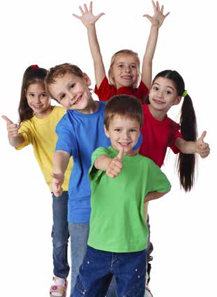

# Liderazgo

<!-- página 1 -->

> **Descripción de la imagen** — La imagen muestra una pieza de rompecabezas de color rojo brillante en primer plano, colocada sobre un fondo compuesto por varias piezas de rompecabezas interconectadas de color gris claro. La pieza roja es prominente y está orientada de manera que se aprecian sus contornos y las formas de encaje. El fondo sugiere una superficie o patrón de rompecabezas completo.

> **Descripción de la imagen** — La imagen muestra una pieza de rompecabezas de color rojo brillante en primer plano, colocada sobre un fondo compuesto por varias piezas de rompecabezas interconectadas de color gris claro. La pieza roja es prominente y está orientada de manera que se aprecian sus contornos y las formas de encaje. El fondo sugiere una superficie o patrón de rompecabezas completo.

> **Descripción de la imagen** — La imagen es un primer plano de elementos superpuestos que parecen ser páginas o bloques de papel de color blanco o gris muy claro. Hay varias capas rectangulares que se solapan entre sí, creando una textura de documento. En la parte superior central, se observa una pequeña forma sólida de color rojo brillante. El resto de la composición está dominado por tonos neutros y claros.

28
### ARTÍCULOS

Resumen:

Este escrito reflexiona sobre conceptos generales acerca del liderazgo, definiciones y algunos cambios
que se han manifestado a través de los tiempos, además de su injerencia en ámbitos laborales.
Resalta la importancia del  efecto positivo de estos componentes, para un cumplimento adecuado de
los objetivos de las organizaciones y empresas en general.

Palabras clave: Liderazgo, líder,  jefe.

Abstract:
This paper reflects on general concepts about leadership, definitions and some changes that have
manifested through time; moreover, its interference in work environments. It highlights the importance
of the positive effect of these components for proper fulfillment of the objectives of the organizations
and companies in general.

Keywords: Leadership, leader, chief.
## El liderazgo,
## un desempeño
## efectivo

Por: Sandra Ma Hutchinson Heath

---

<!-- página 2 -->

29
### ARTÍCULOS
## ¿Qué es
## liderazgo?

El liderazgo es el conjunto de habilidades-
destrezas de manejo,  que un individuo tiene para
influir en la forma de actuar de las personas o en
un grupo determinado, ocasionando que estos
se desempeñen con entusiasmo, alrededor del
cumplimiento efectivo de los objetivos y metas
propuestas.

Puede ser vista también como el arte de
influir, comandar y conducir a personas o  equipo
de trabajo, captando partidarios y seguidores,
influenciando de manera positiva en las conductas,
actitudes y comportamientos; además de impulsar
y  promover el trabajo para un objetivo común.

Es un acercamiento para buscar influencias
interpersonales, dirigidas  a través del proceso de
comunicación.
### Cambios a través del tiempo

El ejercicio del liderazgo manifiesta cambios
sustantivos en las diversas organizaciones. En los
años ochenta y comienzos del noventa se miraba
al líder como un sujeto  dedicado al control,
realizando actividades de medición y supervisión.
En este sentido, las prácticas, experiencias y
habilidades no se renovaban de manera efectiva
de una entidad a otra. El liderazgo, en esa época,
era una labor sencilla y elemental, ya que el perfil
y las capacidades necesarias para su ejecución
eran precisos, sencillos y definidos por las
organizaciones.

El sociólogo alemán  Ulrich Beck  menciona
en varios de sus  escritos, diferencias básicas
entre las competencias requeridas para el
liderazgo, entre la década de los años ochenta
y los noventa. Específicamente, en el periodo de
los años ochenta, las empresas u organizaciones
se orientaban en la identificación de líderes con
habilidades    administrativas.     Esto    varía    en

alguna manera en la década de los noventa,
en este tiempo el propósito y las competencias
de liderazgo se focalizan en las destrezas y
habilidades relacionadas con la planificación y
ejecución estratégica, dirigidos hacia la innovación
de la empresa u organización, potenciando su
desarrollo y crecimiento.

Estas variantes demandan en los líderes
capacidades
y
aptitudes
emprendedoras,
permeadas con flexibilidad  hacia la adquisición
permanente y sostenible de estas  calidades.
Paralelo a esto, las empresas u organizaciones
en la actualidad requieren líderes con habilidades
de ejecución efectiva de los planes estratégicos,
enmarcadas hacia la realización de análisis  de la
situación, y toma de decisiones positivas.

> **Descripción de la imagen** — Es una fotografía de grupo que muestra a cinco hombres jóvenes de pie, mirando directamente a la cámara. Todos visten atuendos formales o semi-formales, incluyendo trajes y camisas. Los hombres están dispuestos en fila, con el hombre central ligeramente adelantado. El fondo es liso y claro.

---

<!-- página 3 -->

30
### ARTÍCULOS
### Un líder ¿nace o se hace?

Cuando se piensa en algún líder de orden
mundial  llega a la memoria, sin dificultad
personajes como Martin Luther King, Mahatma
Gandhi, la Madre Teresa de Calcuta, Nelson
Mandela, entre otros. Estos son personajes que
a lo largo de su vida mantuvieron una influencia
visible, manifiesta y positiva en la sociedad en que
vivieron, y  que permanece en la actual.

Para dar respuesta a la pregunta si el líder nace
o se hace, es necesario hacer un cuestionamiento
alrededor de un liderazgo que esté sujeto al
efecto del líder en los seguidores, más que de la
personalidad de éste.
### Liderazgo en la organización

Todo individuo, precisa sentirse informado,
asesorado y encaminado por alguien que dirija de
manera adecuada  y con liderazgo una empresa
u organización.

La persona que está comprometida con el
liderazgo dentro de esta, debe tomar en cuenta
estos aspectos.  Una entidad puede tener una
planeación adecuada, con una misión y visión
establecidas; pero si carece de un líder apropiado,
será difícil que se logren a cabalidad las propósitos
proyectados.
### ¿Cómo surge?

El liderazgo puede presentarse de modo
natural, cuando un individuo sobresale con
el papel de líder, sin necesidad de tener una
categoría o un puesto de liderazgo. Este es un
tipo de liderazgo informal.

Cuando un líder es designado o elegido por
una organización o empresa,  e inicia una posición
de autoridad, acá ejerce un liderazgo formal.

Varios enfoques, indican que el liderazgo es un
comportamiento, una práctica, una actitud que se
puede ejercitar, adiestrar y perfeccionar.
### ¿Qué es ser un líder?

Un líder es el ejemplo a seguir, es un modelo
para todo el grupo o equipo de trabajo dentro
de la organización, o empresa. Es una persona
sencilla, auténtica, dispuesta a trabajar de manera
colaborativa, capaz de expresar sus ideas,
luchadora por sus principios, con adecuadas
relaciones humanas. Diseña y utiliza  estrategias
durante su gestión, ostenta una visión de largo
plazo, es flexible, proactivo, negocia, toma la
iniciativa, convoca, motiva, incentiva y evalúa  de
manera sistémica  a su equipo de trabajo.  Anticipa
riesgos, posee buena comunicación y capacidad
de integración, logrando en los miembros de la
empresa u organización  una sinergia.

Para ser un buen líder, se necesita tener
carisma, inteligencia, poder de convencimiento,
sensibilidad,
integridad,
imparcialidad,
ser
innovador.

Se requiere de la capacidad necesaria
para poder dirigir a un equipo de personas,
motivándolos y estimulándolos para lograr en
estos la convicción, en torno a lo que realizan y
así alcanzar las metas esperadas.

> **Descripción de la imagen** — Es una fotografía de tres niñas jóvenes posando juntas para la cámara. Las tres están de pie y sonríen.
>
> *   **Niña de la izquierda:** Tiene el cabello oscuro y lleva una camiseta de color amarillo brillante.
> *   **Niña del centro:** Tiene el cabello rubio o castaño claro y viste una blusa de color rojo.
> *   **Niña de la derecha:** Tiene el cabello oscuro recogido en dos coletas y viste una camiseta de color verde.
>
> Las niñas están agrupadas y parecen estar posando casualmente.

---

<!-- página 4 -->

31
### ARTÍCULOS
### Combinación entre jefatura
### y liderazgo

Toda
empresa
o
entidad
debe
tener
lineamientos claros, orientados desde su misión
y visión, esto favorece su solidez. Asimismo, para
dichas instituciones  se encaminen de manera
eficiente y efectiva hacia el cumplimiento de
metas establecidas. Las jefaturas dentro de las
organizaciones son las que por su rango, dirigen
a los diferentes grupos dentro de ellas.

Según el diccionario abc,  “Se designa con el
término de jefe a aquella persona que manda o
dirige a otras, que serán sus subalternos en una
oficina, empresa, corporación, gobierno, club,
organismo, entre otros.” (http://www.definicionabc.
com/general/jefe.php)

La definición anterior, no indica que un Jefe sea
líder; pero, sí es óptimo, que las jefaturas tengan
intrínseco y plasmado características de liderazgo,
esto favorecerá a la organización, logrando que el
personal involucrado sienta una real identidad y
realice de manera efectiva las tareas asignadas.

Las empresas deben evolucionar de manera
efectiva hacia jefaturas con liderazgo, orientadas
hacia una valiosa combinación entre líder y jefe.
De esta manera se garantiza, en alguna medida,
una buena administración de los recursos
humanos, logrando la formación de equipos
de trabajo efectivos, en donde los miembros se
sientan comprometidos e identificados con la
entidad, aspirando a lograr de manera eficiente y
eficaz las metas propuestas.

Con esta idea o concepto, se puede responder que el líder no nace sino que se hace, acá se está
frente a un liderazgo accesible a personas que llegan a ser líderes en atributo de las responsabilidades
y compromisos que asumen ; además, por la  influencia que ejercen sobre los demás, en lo que
respecta al trabajo en equipo para el cumplimiento de metas establecidas dentro de la empresa  u
organización.

Es importante anotar que el ambiente en donde se desenvuelven los seres humanos, se ven sujetos
a influencias, en este caso podríamos afirmar que la relación constante y permanente en un medio en
donde los que le rodean, tienen características de liderazgo, permeará y hará que el individuo exponga
desde su infancia algunas características específicas que lo ubican como líder; podría en este caso
parecer, que el líder  “nace”.  Cabe recalcar, que existen personas que por su genética han heredado
los requisitos necesarios para liderar.

> **Descripción de la imagen** — Es una fotografía de un hombre adulto de pie, vestido con un traje de color beige o marrón claro. Lleva una chaqueta y pantalones a juego sobre una camisa blanca. El hombre tiene el cabello oscuro y está mirando ligeramente hacia un lado. El fondo es simple y liso, sugiriendo un entorno interior.

---

<!-- página 5 -->

32
### ARTÍCULOS
### Conclusiones

• El ejercicio de un liderazgo efectivo creará
oportunidades
para
que
la
organización
manifieste un desarrollo pleno, encaminado hacia
el cumplimiento de las metas establecidas.

• Las jefaturas dentro de las organizaciones deben
contemplar la necesidad de personal con perfiles
asociadas al liderazgo, con una comprensión
efectiva del entorno en que se desenvuelva.

• Las organizaciones, en general, deben ir
encaminadas a realizar una adecuada gestión,
para la formación de equipos trabajo, liderados de
manera eficiente para el cumplimiento efectivo de
las metas establecidas.

• Una buena combinación y armonía entre las
características de un líder y un jefe, dentro de una
organización, permeará positivamente las tareas
que realicen los involucrados.
### Referencias

> **Descripción de la imagen** — La imagen es una fotografía de primer plano que muestra varias manos humanas apiladas verticalmente. Las manos están superpuestas y se presentan en una pila cohesiva. Se observan diferentes tonos de piel y tamaños de manos, lo que sugiere la diversidad o la unión de personas. El fondo es liso y de color blanco, lo que centra toda la atención en las manos.

Definición abc tu diccionario hecho fácil. Definición de jefe.
Recuperado de: http://www.definicionabc.com/general/jefe.php

Fernández- S., C., Martínez, M. y Roca, E.  2013. El liderazgo educativo en el contexto del
centro escolar. Ponencia presentada en el XXXII Seminario Interuniversitario de teoría
de la Educación Liderazgo y Educación,  Santander 2013 (Santander, 10-12 de noviembre
del 2013) Recuperado el  22 de agosto, 2014 de: http://www.site.unican.es/Ponencia%203.pdf

López M., E. (2013). La importancia del liderazgo en las organizaciones.
Recuperado el  26 de agosto, 2014 de:
http://ddd.uab.cat/pub/tfg/2013/110463/TFG_elopezmartinez.pdf

Romero P., D. (2005). Liderazgo y Gerencia.
Recuperado el  26 de agosto, 2014 de: http://www.liderazgoygerencia.blogspot.com/

Yarce, J. El líder¿nace o se hace?. Recuperado el  25 de agosto, 2014 de:
http://www.mercaba.org/FICHAS/Sociedad/el_lider_nace_o_se_hace.htm

