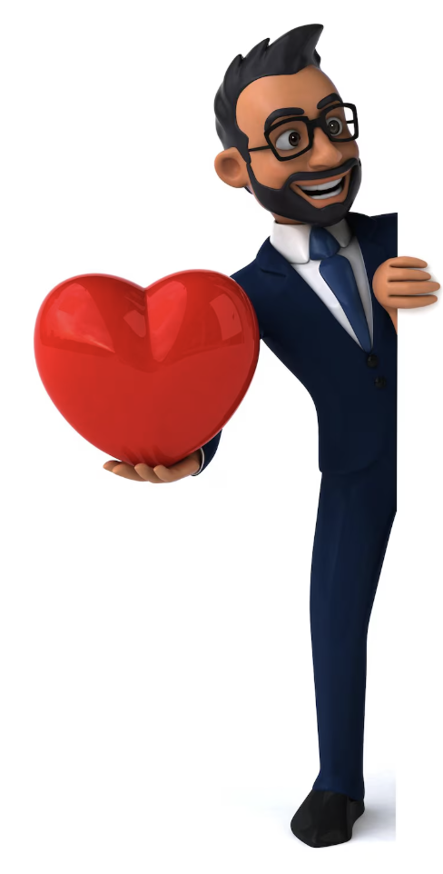
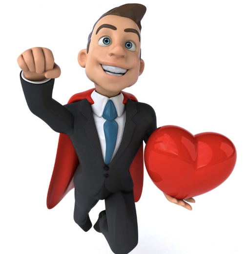
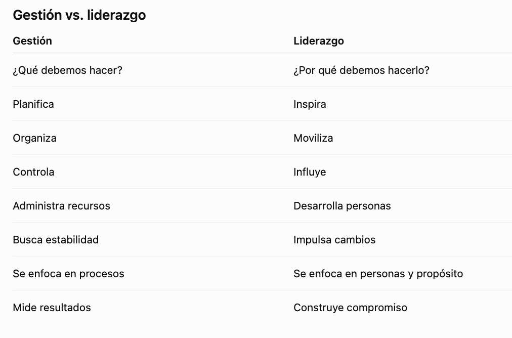
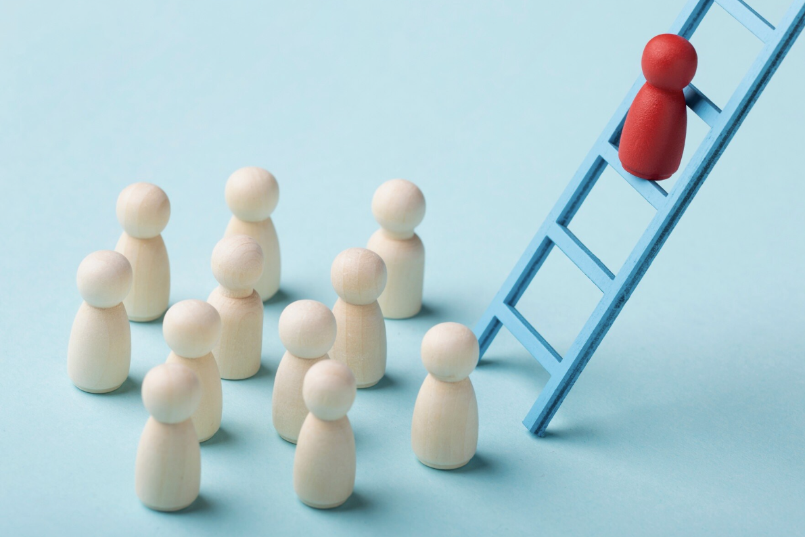

# Unidad1

## Liderazgo y Negociación

Esta Plantilla de Presentación Institucional, desarrollada por la Oficina de Comunicaciones de la Institución Universitaria Escolme, establece  lineamientos visuales y estructurales unificados para las presentaciones oficiales . Su uso garantiza coherencia con la identidad institucional y asegura una comunicación clara, profesional y alineada con la imagen de la Institución.

Por 

Andrea Bustamante

jabustamantes@escolme.edu.co

## Temática

Unidad 1: Fundamentos generales de Liderazgo 

Unidad 2: Liderazgo Gerencial y adaptativo

Unidad 3:  Fundamentos de negociación

Unidad 4:  Tendencias modernas de la negociación

## Unidad 1:  Fundamentos generales de Liderazgo  https:// www.youtube.com / watch?v =jW5KN4Kvpw0 

## Conceptualización

> **Descripción de la imagen** — La imagen es una composición que muestra una reunión de negocios en primer plano y un diagrama conceptual sobre liderazgo en el fondo.
>
> En el fondo, hay una pared o pizarra blanca con un gráfico conceptual. El elemento central es la palabra "LEADER" escrita en letras grandes de color azul. Esta palabra está conectada por líneas discontinuas rojas a varios atributos del liderazgo:
> *   En la parte superior izquierda, un ícono de trofeo.
> *   En la parte superior central, una lupa con la etiqueta "Vision" (Visión).
> *   En la parte superior derecha, un objetivo con una flecha, etiquetado como "Positive Attitude" (Actitud Positiva).
> *   En la parte inferior central, tres figuras humanas estilizadas conectadas y etiquetadas como "Solid Communicator" (Comunicador Sólido).
> *   En la parte inferior derecha, una bombilla encendida con la etiqueta "Inspiring" (Inspirador).
>
> En primer plano, se observa un grupo de hombres sentados alrededor de una mesa de madera, participando en una discusión. Un hombre vestido con traje azul está de pie en el centro del fondo, interactuando con el grupo sentado. El ambiente sugiere una sesión de estudio o reunión profesional.

¿Qué es liderazgo? 

¿Quién es un líder? 

¿Cómo identificarlo? 

Qué es un liderazgo efectivo? 

¿Qué competencias se deben adquirir para promover el liderazgo? 

## Slide 5

https:// www.youtube.com / watch?v =UBMYA0ZjtxU

El liderazgo es la capacidad de influir, guiar y motivar a otras personas para alcanzar objetivos comunes. No se trata solo de “mandar”, sino de inspirar, tomar decisiones, generar confianza y sacar lo mejor de un equipo.

> **Descripción de la imagen** — La imagen es una fotografía de un hombre joven o de mediana edad, capturado en un plano medio. El hombre tiene cabello oscuro y barba corta. Viste un traje formal de color azul marino o negro, una camisa de color claro y una corbata azul oscura con pequeños puntos blancos (lunares). Lleva gafas de montura oscura. El hombre está mirando directamente a la cámara y sonríe ampliamente. Su brazo derecho está levantado en alto con el puño cerrado, en un gesto de celebración o confianza. El fondo es completamente blanco.

## Slide 6

> **Descripción de la imagen** — La imagen es un diseño gráfico abstracto y estilizado, compuesto por formas curvas en colores contrastantes.
>
> Se observa una forma circular grande de color azul oscuro o índigo en el lado izquierdo. Dentro de este círculo, hay una forma dinámica de color blanco que se curva y se enrolla, asemejándose a la letra 'E' mayúscula o un espiral estilizado. La forma blanca es gruesa y tiene líneas fluidas que sugieren movimiento o conexión dentro del espacio circular. El fondo circundante es de un tono gris oscuro.

“ El liderazgo comienza cuando decides ser la inspiración que buscas en otros.”

https:// www.youtube.com / watch?v =atjonjXCGh0

## Slide 7

> **Descripción de la imagen** — La imagen es un diseño gráfico abstracto y estilizado, compuesto por formas curvas en colores contrastantes.
>
> Se observa una forma circular grande de color azul oscuro o índigo en el lado izquierdo. Dentro de este círculo, hay una forma dinámica de color blanco que se curva y se enrolla, asemejándose a la letra 'E' mayúscula o un espiral estilizado. La forma blanca es gruesa y tiene líneas fluidas que sugieren movimiento o conexión dentro del espacio circular. El fondo circundante es de un tono gris oscuro.

Podemos entender el liderazgo a partir de cinco elementos:

Líder → Seguidores → Influencia → Propósito → Resultados

Por ejemplo: Un gerente propone mejorar la experiencia del cliente, comunica claramente el propósito, escucha a su equipo, asigna responsabilidades y logra que todos se comprometan con el cambio. Aquí existe liderazgo porque hay  influencia, propósito y movilización del equipo .

## Slide 8

> **Descripción de la imagen** — La imagen es un diseño gráfico abstracto y estilizado, compuesto por formas curvas en colores contrastantes.
>
> Se observa una forma circular grande de color azul oscuro o índigo en el lado izquierdo. Dentro de este círculo, hay una forma dinámica de color blanco que se curva y se enrolla, asemejándose a la letra 'E' mayúscula o un espiral estilizado. La forma blanca es gruesa y tiene líneas fluidas que sugieren movimiento o conexión dentro del espacio circular. El fondo circundante es de un tono gris oscuro.

Arte de guiar a las personas para que trabajen con entusiasmo hacia una meta común.

No se trata solo de mandar o dirigir, sino de  construir una visión compartida , tomar decisiones estratégicas y fomentar el crecimiento de quienes forman parte del grupo.

Capacidad de influir, guiar, motivar e inspirar  a otras personas o equipos para alcanzar objetivos comunes, generando confianza, compromiso y desarrollo tanto individual como colectivo.

> **Descripción de la imagen** — Es una ilustración tridimensional de un personaje masculino estilizado. El hombre tiene piel oscura, cabello oscuro y lleva gafas y barba. Viste un traje formal azul marino con una camisa blanca y una corbata azul. El personaje está sonriendo ampliamente y sostiene un gran corazón rojo brillante con ambas manos frente a su pecho.

> **Descripción de la imagen** — La imagen es una ilustración tridimensional de un personaje masculino con estilo animado o CGI. El personaje tiene el cabello castaño y una expresión sonriente y entusiasta. Viste un traje formal compuesto por una chaqueta negra, una camisa blanca y una corbata azul. Lleva una capa roja que cae sobre su espalda.
>
> El personaje está en una pose dinámica: su brazo derecho está levantado y extendido hacia adelante con el dedo índice apuntando, mientras que su mano izquierda sostiene un gran corazón rojo brillante. El fondo es blanco liso.

> **Descripción de la imagen** — La imagen es una representación tridimensional (render) de una figura humana estilizada, de color blanco puro, colocada sobre un pedestal circular negro y escalonado.
>
> La figura tiene una forma simple y minimalista. Viste una capa o manto de color azul brillante que está drapeado sobre su hombro izquierdo y brazo. En el centro del pecho de la figura se observa un pequeño elemento de color naranja o amarillo. La pose es erguida, con los brazos ligeramente flexionados a los lados.
>
> La figura completa se asienta sobre una base compuesta por varios niveles negros, creando un efecto de pedestal o estrado. El fondo es completamente blanco.

## Slide 9

> **Descripción de la imagen** — La imagen es un diseño gráfico abstracto y estilizado, compuesto por formas curvas en colores contrastantes.
>
> Se observa una forma circular grande de color azul oscuro o índigo en el lado izquierdo. Dentro de este círculo, hay una forma dinámica de color blanco que se curva y se enrolla, asemejándose a la letra 'E' mayúscula o un espiral estilizado. La forma blanca es gruesa y tiene líneas fluidas que sugieren movimiento o conexión dentro del espacio circular. El fondo circundante es de un tono gris oscuro.

Antes de liderar un equipo, es necesario desarrollar la capacidad de  liderarse a sí mismo . El  liderazgo personal  es la capacidad de una persona para dirigir conscientemente sus pensamientos, emociones, decisiones, comportamientos y acciones hacia sus objetivos y valores.

Una persona con liderazgo personal puede preguntarse:

¿Sé hacia dónde quiero ir? ¿Qué estoy haciendo para llegar allí? ¿Cómo reacciono ante las dificultades?

El liderazgo personal

## Slide 10

> **Descripción de la imagen** — La imagen es un diseño gráfico abstracto y estilizado, compuesto por formas curvas en colores contrastantes.
>
> Se observa una forma circular grande de color azul oscuro o índigo en el lado izquierdo. Dentro de este círculo, hay una forma dinámica de color blanco que se curva y se enrolla, asemejándose a la letra 'E' mayúscula o un espiral estilizado. La forma blanca es gruesa y tiene líneas fluidas que sugieren movimiento o conexión dentro del espacio circular. El fondo circundante es de un tono gris oscuro.

Autoconocimiento:  Reconocer fortalezas, debilidades, emociones, valores y áreas de mejora.

Autoconfianza:  Creer en las propias capacidades sin confundir confianza con arrogancia.

Autodisciplina:  Mantener comportamientos coherentes con los objetivos, incluso cuando no existe motivación.

Gestión emocional:  Reconocer y regular las propias emociones.

Proactividad;  Actuar sobre aquello que se puede controlar en lugar de esperar permanentemente instrucciones.

Responsabilidad personal:  Asumir las consecuencias de las decisiones y acciones.

Propósito:  Tener claridad sobre aquello que se quiere alcanzar y por qué es importante.

Ejemplo:  Un estudiante tiene dificultades para hablar en público. Una respuesta pasiva sería:  "Yo no sirvo para exponer."

Desde el liderazgo personal podría decir: "Tengo dificultades para hablar en público, pero puedo desarrollar esa habilidad mediante práctica, preparación y retroalimentación.” Aquí aparece un elemento fundamental:  la mentalidad de desarrollo .

Componentes del liderazgo personal

## Slide 11

> **Descripción de la imagen** — La imagen es un diseño gráfico abstracto y estilizado, compuesto por formas curvas en colores contrastantes.
>
> Se observa una forma circular grande de color azul oscuro o índigo en el lado izquierdo. Dentro de este círculo, hay una forma dinámica de color blanco que se curva y se enrolla, asemejándose a la letra 'E' mayúscula o un espiral estilizado. La forma blanca es gruesa y tiene líneas fluidas que sugieren movimiento o conexión dentro del espacio circular. El fondo circundante es de un tono gris oscuro.

Enfoque de rasgos:  el líder “nace” con ciertas cualidades (carisma, seguridad). 

Enfoque conductual:  el liderazgo se basa en comportamientos (cómo actúa el líder). 

Enfoque situacional:  el líder se adapta según el equipo y el contexto. 

Enfoque transformacional:  el líder inspira cambios y desarrollo en las personas. 

Enfoque transaccional:  se basa en recompensas y cumplimiento de tareas. 

Enfoques principales

Hoy en día, el liderazgo más efectivo mezcla varios enfoques

## Slide 12

> **Descripción de la imagen** — La imagen es un diseño gráfico abstracto y estilizado, compuesto por formas curvas en colores contrastantes.
>
> Se observa una forma circular grande de color azul oscuro o índigo en el lado izquierdo. Dentro de este círculo, hay una forma dinámica de color blanco que se curva y se enrolla, asemejándose a la letra 'E' mayúscula o un espiral estilizado. La forma blanca es gruesa y tiene líneas fluidas que sugieren movimiento o conexión dentro del espacio circular. El fondo circundante es de un tono gris oscuro.

> **Descripción de la imagen** — La imagen es una fotografía tomada desde un ángulo picado, que muestra a un grupo de personas formando un círculo y entrelazando sus manos en el centro.
>
> Se observan varias personas con diferentes tonos de piel y vestimenta (camisas de vestir y ropa casual). Las manos de los participantes están firmemente unidas en el medio, simbolizando unidad, colaboración o apoyo mutuo. Varias caras son visibles alrededor del círculo; algunas personas tienen expresiones sonrientes, lo que sugiere un ambiente positivo y de camaradería. La composición enfatiza la conexión física entre los miembros del grupo.

Estilos de liderazgo

Cada estilo tiene su momento. 

Un buen líder sabe cuándo usar cada uno .

## Slide 13

> **Descripción de la imagen** — La imagen es un diseño gráfico abstracto y estilizado, compuesto por formas curvas en colores contrastantes.
>
> Se observa una forma circular grande de color azul oscuro o índigo en el lado izquierdo. Dentro de este círculo, hay una forma dinámica de color blanco que se curva y se enrolla, asemejándose a la letra 'E' mayúscula o un espiral estilizado. La forma blanca es gruesa y tiene líneas fluidas que sugieren movimiento o conexión dentro del espacio circular. El fondo circundante es de un tono gris oscuro.

Liderazgo autocrático:  El líder concentra gran parte de las decisiones.

Características:

- Decisiones centralizadas. 
- Comunicación principalmente descendente. 
- Alto nivel de control. 
- Poca participación del equipo. 
- 

Puede ser útil:  ante situaciones críticas donde se necesita tomar decisiones rápidamente.

Riesgo:  reducir la participación y autonomía.

## Slide 14

> **Descripción de la imagen** — La imagen es un diseño gráfico abstracto y estilizado, compuesto por formas curvas en colores contrastantes.
>
> Se observa una forma circular grande de color azul oscuro o índigo en el lado izquierdo. Dentro de este círculo, hay una forma dinámica de color blanco que se curva y se enrolla, asemejándose a la letra 'E' mayúscula o un espiral estilizado. La forma blanca es gruesa y tiene líneas fluidas que sugieren movimiento o conexión dentro del espacio circular. El fondo circundante es de un tono gris oscuro.

Liderazgo democrático o participativo:  El líder incorpora las opiniones del equipo antes de tomar decisiones.

Características:

Escucha activa. 

Participación. 

Comunicación bidireccional. 

Construcción colectiva. 

Ejemplo:  Una empresa necesita rediseñar su estrategia de servicio y reúne al equipo de atención al cliente para identificar problemas y proponer soluciones.

## Slide 15

> **Descripción de la imagen** — La imagen es un diseño gráfico abstracto y estilizado, compuesto por formas curvas en colores contrastantes.
>
> Se observa una forma circular grande de color azul oscuro o índigo en el lado izquierdo. Dentro de este círculo, hay una forma dinámica de color blanco que se curva y se enrolla, asemejándose a la letra 'E' mayúscula o un espiral estilizado. La forma blanca es gruesa y tiene líneas fluidas que sugieren movimiento o conexión dentro del espacio circular. El fondo circundante es de un tono gris oscuro.

Liderazgo liberal o laissez-faire:  El líder proporciona autonomía y permite que el equipo tenga un alto grado de libertad.

Características:

Delegación. 

Autonomía. 

Baja supervisión directa. 

Confianza en las capacidades del equipo. 

Funciona mejor:  con equipos experimentados y responsables .

## Slide 16

> **Descripción de la imagen** — La imagen es un diseño gráfico abstracto y estilizado, compuesto por formas curvas en colores contrastantes.
>
> Se observa una forma circular grande de color azul oscuro o índigo en el lado izquierdo. Dentro de este círculo, hay una forma dinámica de color blanco que se curva y se enrolla, asemejándose a la letra 'E' mayúscula o un espiral estilizado. La forma blanca es gruesa y tiene líneas fluidas que sugieren movimiento o conexión dentro del espacio circular. El fondo circundante es de un tono gris oscuro.

Liderazgo transformacional:  Busca inspirar al equipo para alcanzar una visión y promover cambios.

Características:

Inspiración. 

Innovación. 

Visión. 

Motivación. 

Desarrollo de las personas. 

Ejemplo:  Una directora logra que su equipo no vea la transformación digital como una amenaza, sino como una oportunidad para mejorar la experiencia del cliente.

.

## Slide 17

> **Descripción de la imagen** — La imagen es un diseño gráfico abstracto y estilizado, compuesto por formas curvas en colores contrastantes.
>
> Se observa una forma circular grande de color azul oscuro o índigo en el lado izquierdo. Dentro de este círculo, hay una forma dinámica de color blanco que se curva y se enrolla, asemejándose a la letra 'E' mayúscula o un espiral estilizado. La forma blanca es gruesa y tiene líneas fluidas que sugieren movimiento o conexión dentro del espacio circular. El fondo circundante es de un tono gris oscuro.

Liderazgo liberal o laissez-faire:  El líder proporciona autonomía y permite que el equipo tenga un alto grado de libertad.

Características:

Delegación. 

Autonomía. 

Baja supervisión directa. 

Confianza en las capacidades del equipo. 

Funciona mejor:  con equipos experimentados y responsables.

## Slide 18

> **Descripción de la imagen** — La imagen es un diseño gráfico abstracto y estilizado, compuesto por formas curvas en colores contrastantes.
>
> Se observa una forma circular grande de color azul oscuro o índigo en el lado izquierdo. Dentro de este círculo, hay una forma dinámica de color blanco que se curva y se enrolla, asemejándose a la letra 'E' mayúscula o un espiral estilizado. La forma blanca es gruesa y tiene líneas fluidas que sugieren movimiento o conexión dentro del espacio circular. El fondo circundante es de un tono gris oscuro.

Liderazgo transaccional:  Se enfoca en objetivos, desempeño, recompensas y cumplimiento.

Ejemplo:  "Si alcanzamos el objetivo mensual de satisfacción del cliente, tendremos un reconocimiento para el equipo."

Es especialmente visible en contextos donde existen  metas e indicadores de desempeño .

.

## Slide 19

> **Descripción de la imagen** — La imagen es un diseño gráfico abstracto y estilizado, compuesto por formas curvas en colores contrastantes.
>
> Se observa una forma circular grande de color azul oscuro o índigo en el lado izquierdo. Dentro de este círculo, hay una forma dinámica de color blanco que se curva y se enrolla, asemejándose a la letra 'E' mayúscula o un espiral estilizado. La forma blanca es gruesa y tiene líneas fluidas que sugieren movimiento o conexión dentro del espacio circular. El fondo circundante es de un tono gris oscuro.

Liderazgo situacional:  El líder adapta su comportamiento dependiendo de la situación y de las necesidades del colaborador.

Por ejemplo:

Colaborador nuevo →  mayor orientación. Colaborador con experiencia →  mayor autonomía.

La pregunta central sería:

¿Qué necesita esta persona de mí en este momento?

.

## Slide 20

> **Descripción de la imagen** — La imagen es un diseño gráfico abstracto y estilizado, compuesto por formas curvas en colores contrastantes.
>
> Se observa una forma circular grande de color azul oscuro o índigo en el lado izquierdo. Dentro de este círculo, hay una forma dinámica de color blanco que se curva y se enrolla, asemejándose a la letra 'E' mayúscula o un espiral estilizado. La forma blanca es gruesa y tiene líneas fluidas que sugieren movimiento o conexión dentro del espacio circular. El fondo circundante es de un tono gris oscuro.

Un líder no solo nace, también se forma.

Habilidades clave:

- Comunicación efectiva 
- Toma de decisiones 
- Resolución de conflictos 
- Inteligencia emocional 
- Motivación de equipos 
- Pensamiento estratégico 
- Delegación 

La habilidad más poderosa hoy: saber conectar con las personas .

Habilidades del liderazgo

## Slide 21

> **Descripción de la imagen** — La imagen es un diseño gráfico abstracto y estilizado, compuesto por formas curvas en colores contrastantes.
>
> Se observa una forma circular grande de color azul oscuro o índigo en el lado izquierdo. Dentro de este círculo, hay una forma dinámica de color blanco que se curva y se enrolla, asemejándose a la letra 'E' mayúscula o un espiral estilizado. La forma blanca es gruesa y tiene líneas fluidas que sugieren movimiento o conexión dentro del espacio circular. El fondo circundante es de un tono gris oscuro.

Gestión ( management ):  Planifica, organiza, controla procesos. Se enfoca en eficiencia. 

Gestión y liderazgo 

“La gestión hace que las cosas funcionen, el liderazgo hace que las personas quieran hacerlas.”

Liderazgo:  Inspira, motiva, genera visión. Se enfoca en las personas.

> **Descripción de la imagen** — La imagen es una fotografía de una persona con cabello largo y rubio, vestida con una blusa oscura estampada. La persona sostiene un gran círculo amarillo que representa un emoji sonriente. El emoji tiene una expresión alegre con una boca grande y curvada hacia arriba (de color rojo) y dos corazones rojos como ojos. La persona sostiene el círculo con ambas manos, presentándolo al frente. El fondo es de un color rosa pálido o melocotón uniforme.

## Slide 22

> **Descripción de la imagen** — La imagen es un diseño gráfico abstracto y estilizado, compuesto por formas curvas en colores contrastantes.
>
> Se observa una forma circular grande de color azul oscuro o índigo en el lado izquierdo. Dentro de este círculo, hay una forma dinámica de color blanco que se curva y se enrolla, asemejándose a la letra 'E' mayúscula o un espiral estilizado. La forma blanca es gruesa y tiene líneas fluidas que sugieren movimiento o conexión dentro del espacio circular. El fondo circundante es de un tono gris oscuro.

> **Descripción de la imagen** — La imagen es una fotografía de un grupo diverso de cinco jóvenes adultos (tres mujeres y dos hombres) posando juntos en un entorno interior con un fondo liso de color claro. El grupo está interactuando mediante un intercambio de apretones de manos. Varias personas están realizando o participando activamente en el saludo, mostrando expresiones de alegría y sonrisas. Todos los miembros del grupo están vestidos con ropa casual.

No es lo mismo jefe que líder

Un jefe: ordena 

Un líder: guía e inspira 

## Slide 23

> **Descripción de la imagen** — La imagen es un diseño gráfico abstracto y estilizado, compuesto por formas curvas en colores contrastantes.
>
> Se observa una forma circular grande de color azul oscuro o índigo en el lado izquierdo. Dentro de este círculo, hay una forma dinámica de color blanco que se curva y se enrolla, asemejándose a la letra 'E' mayúscula o un espiral estilizado. La forma blanca es gruesa y tiene líneas fluidas que sugieren movimiento o conexión dentro del espacio circular. El fondo circundante es de un tono gris oscuro.

> **Descripción de la imagen** — La imagen es una tabla comparativa titulada "Gestión vs. Liderazgo". La tabla está dividida en dos columnas principales que contrastan las acciones y enfoques de cada concepto.
>
> **Columna 1: Gestión**
> Enumera las tareas o acciones a realizar, incluyendo:
> *   ¿Qué debemos hacer?
> *   Planifica
> *   Organiza
> *   Controla
> *   Administra recursos
> *   Busca estabilidad
> *   Se enfoca en procesos
> *   Mide resultados
>
> **Columna 2: Liderazgo**
> Enumera los propósitos o motivaciones detrás de las acciones, incluyendo:
> *   ¿Por qué debemos hacerlo?
> *   Inspira
> *   Moviliza
> *   Influye
> *   Desarrolla personas
> *   Impulsa cambios
> *   Se enfoca en personas y propósito
> *   Construye compromiso

La gestión ayuda a que las cosas funcionen; el liderazgo ayuda a que las personas quieran hacer que funcionen.

## Slide 24

¿Quién es un líder?

https:// www.youtube.com / watch?v =ByJ5THW9V_s

## Slide 25

> **Descripción de la imagen** — La imagen es un diseño gráfico abstracto y estilizado, compuesto por formas curvas en colores contrastantes.
>
> Se observa una forma circular grande de color azul oscuro o índigo en el lado izquierdo. Dentro de este círculo, hay una forma dinámica de color blanco que se curva y se enrolla, asemejándose a la letra 'E' mayúscula o un espiral estilizado. La forma blanca es gruesa y tiene líneas fluidas que sugieren movimiento o conexión dentro del espacio circular. El fondo circundante es de un tono gris oscuro.

Un líder se reconoce más por su comportamiento que por su título:

Las personas lo escuchan y lo siguen voluntariamente 

Genera confianza y respeto 

Da ejemplo con sus acciones 

Sabe comunicar y escuchar 

Motiva incluso en momentos difíciles 

Influye en resultados y en el ambiente del equipo 

La gente quiere trabajar con él/ella, no solo por obligación…

## Slide 26

> **Descripción de la imagen** — La imagen es un diseño gráfico abstracto y estilizado, compuesto por formas curvas en colores contrastantes.
>
> Se observa una forma circular grande de color azul oscuro o índigo en el lado izquierdo. Dentro de este círculo, hay una forma dinámica de color blanco que se curva y se enrolla, asemejándose a la letra 'E' mayúscula o un espiral estilizado. La forma blanca es gruesa y tiene líneas fluidas que sugieren movimiento o conexión dentro del espacio circular. El fondo circundante es de un tono gris oscuro.

> **Descripción de la imagen** — La imagen es una fotografía de un grupo de cuatro personas interactuando en lo que parece ser un entorno de oficina o sala de reuniones moderna.
>
> El foco central de la imagen es un gesto de celebración o colaboración: varias personas están levantando las manos y chocando las palmas (un "high-five").
>
> **Elementos visuales:**
>
> 1.  **Personas:** Hay cuatro individuos visibles, todos vestidos con atuendos de negocios (trajes). Están orientados hacia el centro del grupo y muestran expresiones de alegría y camaradería.
>     *   Un hombre en el lado izquierdo, vestido de traje oscuro, está extendiendo su mano para el saludo.
>     *   Una mujer en el centro-derecha, con una camisa blanca, está levantando ambas manos en señal de celebración.
>     *   Otro hombre en el extremo derecho, también de traje oscuro, participa en el gesto.
>     *   Una cuarta persona (parcialmente visible) se encuentra en el lado izquierdo.
> 2.  **Entorno:** La escena tiene lugar en una mesa de madera clara. En primer plano sobre la mesa se observan elementos típicos de un espacio de trabajo, incluyendo laptops abiertas, papeles, tazas de café y teléfonos.
> 3.  **Atmósfera:** La iluminación es brillante y el ambiente general sugiere un momento positivo de éxito, acuerdo o trabajo en equipo.

Un líder es aquella persona que inspira, orienta y moviliza a otros hacia una meta, logrando que den lo mejor de sí.

No necesariamente es quien manda, sino quien  impacta positivamente  en los demás.

## Slide 27

> **Descripción de la imagen** — La imagen es un diseño gráfico abstracto y estilizado, compuesto por formas curvas en colores contrastantes.
>
> Se observa una forma circular grande de color azul oscuro o índigo en el lado izquierdo. Dentro de este círculo, hay una forma dinámica de color blanco que se curva y se enrolla, asemejándose a la letra 'E' mayúscula o un espiral estilizado. La forma blanca es gruesa y tiene líneas fluidas que sugieren movimiento o conexión dentro del espacio circular. El fondo circundante es de un tono gris oscuro.

| Jefe                | Líder                 |
|---------------------|-----------------------|
| Impone autoridad    | Inspira confianza     |
| Da órdenes          | Guía y orienta        |
| Se enfoca en tareas | Se enfoca en personas |
| Controla            | Desarrolla            |
| Busca obediencia    | Genera compromiso     |

El jefe dirige, el líder transforma

## Slide 28

> **Descripción de la imagen** — La imagen es un diseño gráfico abstracto y estilizado, compuesto por formas curvas en colores contrastantes.
>
> Se observa una forma circular grande de color azul oscuro o índigo en el lado izquierdo. Dentro de este círculo, hay una forma dinámica de color blanco que se curva y se enrolla, asemejándose a la letra 'E' mayúscula o un espiral estilizado. La forma blanca es gruesa y tiene líneas fluidas que sugieren movimiento o conexión dentro del espacio circular. El fondo circundante es de un tono gris oscuro.

¿Puede un jefe ser un líder?

Un jefe se convierte en líder cuando:

Deja de solo mandar y empieza a inspirar, escucha a su equipo, desarrolla a las personas y lidera con el ejemplo.

¿Puede un jefe ser un líder?

Un jefe se convierte en líder cuando:

Deja de solo mandar y empieza a inspirar, escucha a su equipo, desarrolla a las personas y lidera con el ejemplo.

> **Descripción de la imagen** — La imagen es una ilustración minimalista que presenta figuras humanas estilizadas de madera clara y una escalera.
>
> En el lado izquierdo, hay un grupo de figuras humanas de color beige claro, dispuestas en varias filas y niveles, sugiriendo un equipo o una estructura jerárquica.
>
> A la derecha, una escalera de color azul pálido se inclina diagonalmente hacia arriba. En la parte superior de la escalera, hay una figura humana de color rojo intenso, que parece estar ascendiendo o alcanzando un nivel superior.
>
> El fondo es de un color azul claro uniforme. La composición sugiere conceptos de progreso, ascenso o colaboración.

## Y a ti, quien te inspira? https:// www.youtube.com / watch?v = xIaIWNQGlnE

## Slide 30

