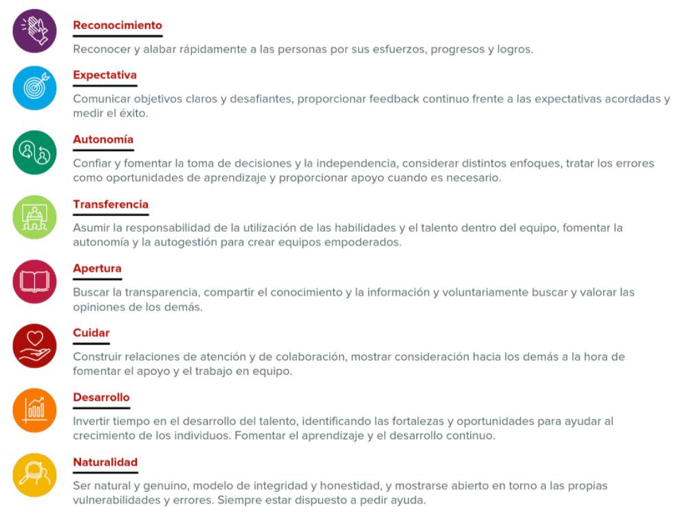
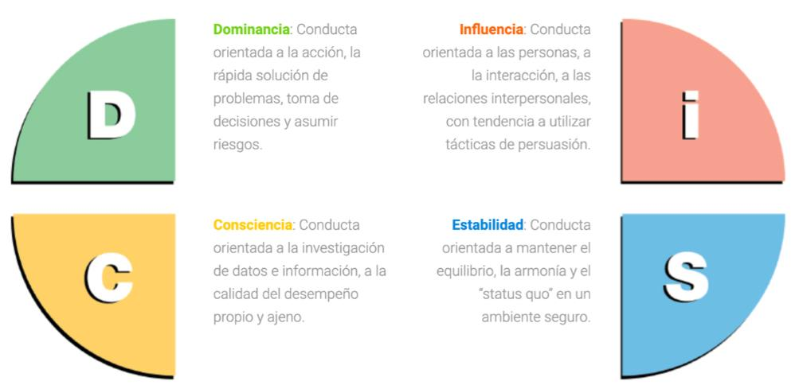

# Assessment

<!-- página 1 -->

ASSESSMENT: ¿QUÉ ES Y PARA QUÉ SIRVE?

El 50% de todos los empleados necesitarán volver a formarse para 2025, a medida que
aumente la adopción de la tecnología, según el Informe sobre el Futuro de los Empleos
del Foro Económico Mundial.

Los assessment sirven tanto para los procesos de selección de nuevos talentos como
para el desarrollo de talento al interior de la organización. En el primer caso hablamos
de assessment center o centros de selección es un método de entrevista especial,
donde los reclutadores cuentan con una serie de ejercicios que prueban las habilidades
de un candidato a un puesto laboral.

Se estima que, si al realizar evaluaciones de entrevista, pruebas psicotécnicas o pruebas
técnicas individuales por separado, solo se obtendrá un 15% de exactitud a la hora de
elegir al nuevo integrante.

Por el contrario, si se llegara a implementar una evaluación completa que considerara
todas las pruebas a la vez, se podría llegar a obtener un 70% de exactitud a la hora de
elegir el nuevo colaborador del equipo.

Metodologías aceptadas por empresas como un modo justo y preciso de evaluar a una
persona, otorgando oportunidades equitativas para todos, siendo también una buena
oportunidad para obtener datos sobre cómo afrontarían situaciones laborales a futuro.

A su vez, los assessment pueden servir como base para desarrollar programas de
acompañamiento a los colaboradores, al identificar factores que podrían trabajarse
para reducir brechas entre pares, para articular de mejor forma los equipos, o también
por ejemplo para evaluar la confianza que se tiene dentro de los equipos de trabajo de
una empresa, permitiendo fortalecer su vínculo y la cultura organizacional.

Los equipos de trabajo pueden que sean grupos de altos estándares y trabajen bien,
pero puede que aparezcan “ruidos” que requieran atención inmediata para llevar al
equipo de trabajo a un nuevo nivel.

¿Cómo profundiza el assessment la comprensión y comunicación laboral?
Existen diversas formas de poder evaluar a  colaboradores o a los equipos de trabajo.
Sin embargo, si lo que se busca es mejorar la confianza, colaboración, la comunicación
y la productividad en las empresas, en esta ocasión vamos a revisar tres assessment que
podrían ser de utilidad dependiendo de lo que se quiera medir y lograr:

Test Neuroview
Mide la confianza y liderazgo el cual se evalúa desde todo el equipo, junto a una
autoevaluación del o la líder. Se trata de una encuesta rápida, que se hace tanto al líder
como a su equipo, de manera digital. Cuenta con 16 preguntas, más otras dos que son
de comentarios. El tiempo de respuesta es de entre 5 y 10 minutos aproximadamente,
por lo que es muy fácil de aplicar. Lo interesante de Neuroview es que los colaboradores
asignan valor de importancia en sus respuestas, lo que sirve para priorizar a la  hora de

---

<!-- página 2 -->

bajar las respuestas a un plan de trabajo. Las respuestas se registran de forma anónima
y su aplicación incluye una sesión de entrega de resultados, que es privada entre el líder
y un coach certificado. Se realizan sugerencias concretas directamente al líder, para la
elaboración de un plan de acción individual, que fortalezca la confianza.

Luego de años de investigación, científicos de todo el mundo han identificado que la
confianza es el factor diferenciador entre culturas organizacionales de alto y bajo
rendimiento. Esta teoría se basa en la liberación de una hormona clave en nuestro
organismo llamada oxitocina, la encargada de generar una cultura de mayor confianza,
y en el caso de las empresas, un mayor rendimiento. Según el neuroeconomista
estadounidense y autor del libro “Trust Factor”, Paul Zak, las organizaciones de alta
confianza reportan que existe:


Un 50% más de productividad

Un 40% menos de burnout (estrés)

Un 76% más de engagement (estrategias organizacionales)

Un 60% más de alegría

Un 56% más de satisfacción

¿Qué hace tan especial a la oxitocina para las empresas?
Con las herramientas de evaluación correctas, los líderes de cada equipo de trabajo
serán capaces promover la liberación de la oxitocina entre sus compañeros con mayor
frecuencia. Su desafío como líder es crear un alto nivel de confianza, compromiso en su
equipo, logrando una cultura de alto rendimiento donde se puede maximizar la
productividad, la colaboración y la satisfacción de los componentes del equipo.El Dr.
Zak y su equipo han identificado ocho prácticas de liderazgo que se ha comprobado
empíricamente crean y mantienen una cultura de compromiso y confianza. Estas
prácticas forman la base de la evaluación de liderazgo NeuroView.

> **Descripción de la imagen** — La imagen es una lista estructurada de nueve competencias o valores, presentada verticalmente. Cada punto está identificado con un título en negrita, un ícono circular de color y una descripción textual que define el concepto.
>
> Los nueve puntos listados son:
> 1. **Reconocimiento:** Definido por la acción de reconocer y alabar a las personas por sus esfuerzos, progresos y logros.
> 2. **Expectativa:** Definido como la comunicación de objetivos claros y desafiantes, proporcionando feedback continuo para medir el éxito.
> 3. **Autonomía:** Definido como confiar y fomentar la toma de decisiones e independencia, considerando distintos enfoques y tratando los errores como oportunidades de aprendizaje.
> 4. **Transferencia:** Definido como asumir la responsabilidad de utilizar las habilidades y el talento del equipo, fomentando la autonomía y la autogestión para crear equipos empoderados.
> 5. **Apertura:** Definido como buscar la transparencia, compartir conocimiento e información, y valorar las opiniones de los demás.
> 6. **Cuidar:** Definido como construir relaciones de atención y colaboración, mostrando consideración hacia los demás y el trabajo en equipo.
> 7. **Desarrollo:** Definido como invertir tiempo en el crecimiento del talento, identificando fortalezas y oportunidades para ayudar al crecimiento continuo de los individuos.
> 8. **Naturalidad:** Definido como ser natural y genuino, mostrando integridad y honestidad, y estar dispuesto a pedir ayuda.

---

<!-- página 3 -->

Test DISC
El perfil DISC, permite evaluar a una persona en relación con su entorno laboral,
cómo una persona entiende el mundo, y cómo reacciones frente a diferentes
circunstancias. Lo que evalúa este test son comportamientos, no personalidad.

> **Descripción de la imagen** — La imagen es un diagrama de cuatro cuadrantes que presenta un modelo conceptual dividido en secciones curvas, cada una asociada a una letra mayúscula y un concepto.
>
> El diagrama está estructurado de la siguiente manera:
>
> 1.  **Cuadrante Superior Izquierdo:** Un sector de color verde/azul verdoso con la letra **D**. Está etiquetado como "Dominancia".
> 2.  **Cuadrante Superior Derecho:** Un sector de color naranja claro con la letra **I**. Está etiquetado como "Influencia".
> 3.  **Cuadrante Inferior Izquierdo:** Un sector de color amarillo/naranja con la letra **C**. Está etiquetado como "Conciencia".
> 4.  **Cuadrante Inferior Derecho:** Un sector de color azul claro con la letra **S**. Está etiquetado como "Estabilidad".
>
> Cada cuadrante contiene un texto descriptivo que define el concepto asociado a la letra y al color.

Aplicando los recursos de manera sencilla en las empresas, se puede determinar la
integración eficiente de equipos de trabajo, permitiendo combinar los diferentes
perfiles, para lograr el éxito con equilibrio.

El test DISC mide el perfil natural de una persona (forma en que tienden a hacer las
cosas intuitivamente), y el perfil adaptado (cómo actúan las personas frente a ciertas
circunstancias). Se trabaja sobre las diferencias entre ambos y también sobre la brecha
con el perfil para cada rol.

DISC es un modelo validado por la investigación, donde los participantes
comprenden y aprecian los estilos de las personas con quienes trabajan. El resultado es
que las relaciones laborales se desarrollan de manera más efectivas y productivas.

Este assessment, permite evaluar el comportamiento y emociones de los trabajadores
de una empresa en 4 dimensiones:


Factor Decisión: Mide cómo la persona responde frente a problemas y desafíos,
y si se preocupa por la forma en que debe realizarlos, más que alcanzarlos.

Factor Influencia: Mide cómo la persona reacciona y se deja influir por los
demás, dejando percibir si es un trabajador comunicativo, extrovertido u
optimista.

Factor Serenidad: Mide cómo responde la persona a cambios de ritmo en el
entorno, dejando conocer si la persona es adaptable y puede trabajar bajo
mucha presión.

---

<!-- página 4 -->


Factor Cumplimiento: Mide cómo la persona responde a las reglas y
procedimientos establecidos por sus pares, dejando conocer si la persona es
analítica y detallista.

Test Hogan
El perfil Hogan, está diseñado para poder evaluar las facetas de personalidad que
tiene una persona. Es decir, el lado visible, el lado oscuro, y el lado interno.

Para las empresas, es importante la personalidad de sus trabajadores, ya que
proporciona una visión esencial, que no puede ser descubierta sólo a través de
entrevistas.

Para el trabajador, esta evaluación significa la autoconciencia estratégica, permitiendo
que realice una mejor gestión, y una buena reputación laboral.

Este assessment, permite evaluar la empleabilidad básica y adecuación al equipo de
trabajo:


Inventario de Personalidad: El Inventario de Personalidad de Hogan (HPI) es
una medición de personalidad normal que utiliza siete escalas primarias y seis
escalas ocupacionales para describir el desempeño laboral de la persona
evaluada, incluyendo cómo él maneja el stress, interactúa con otros, enfrenta
las tareas de su trabajo y resuelve problemas. Aunque el informe presenta los
puntajes en escalas separadas, cada una de ellas contribuye al desempeño de la
persona. El informe indica fortalezas, así como áreas de mejora y provee
aspectos a indagar durante la retroalimentación de desarrollo. Al examinar los
puntajes del HPI, es importante recordar que los puntajes altos no son,
necesariamente, mejores y que los puntajes bajos no son, necesariamente,
peores. El puntaje de cada escala refleja distintas fortalezas y limitaciones. Los
puntajes del HPI deberían ser interpretados en el contexto del rol laboral que
ocupa una persona, para determinar si estas características se constituyen en
fortalezas o áreas de desarrollo potenciales.


Encuesta de Desarrollo: La Encuesta de Desarrollo de Hogan (HDS) evalúa 11
comportamientos interpersonales que pueden causar problemas en el trabajo y
la vida. Los comportamientos asociados a puntajes altos pueden constituir
fortalezas pero, si son sobre utilizados, pueden descarrilar las relaciones y las
carreras profesionales. Las personas que entienden sus limitaciones de
desempeño tienen carreras más exitosas. Este informe ayuda a construir
autoconciencia al destacar tendencias conductuales de las que la persona
evaluada puede no estar consciente. La HDS identifica tendencias conductuales
que emergen cuando uno está estresado, aburrido o cansado. La investigación
ha demostrado que las personas con puntajes más bajos en la HDS tienen
menos problemas en el trabajo. Los puntajes de Alto Riesgo y Riesgo Moderado
indican áreas de preocupación, pero los puntajes bajos indican fortalezas
infrautilizadas, que también merecen atención. La persona promedio tiene tres
o cuatro puntajes de Alto Riesgo en la HDS. Los puntajes en la HDS de la persona

---

<!-- página 5 -->

evaluada se deben interpretar en el contexto del desempeño diario, provisto por
una medición de la personalidad normal, tal como el Inventario de Personalidad
de Hogan.


Inventario de motivos, valores y preferencias (lado interno): El Inventario de
Motivos, Valores y Preferencias de Hogan describe los valores centrales, metas
e intereses de las personas. Esta información es crucial para entender los tipos
de trabajos y ambientes laborales que la gente considera agradables y les
ayudará a tomar mejores decisiones de carrera. Este reporte provee
información en términos de 10 dimensiones de valoración; cada dimensión
contiene cinco subescalas relacionadas con Estilos de Vida, Creencias,
Preferencias Ocupacionales, Aversiones y Asociaciones Preferidas. Las
personas utilizan sus valores para tomar decisiones, pero rara vez los analizan y,
a menudo, toman decisiones por razones que no entienden totalmente. Tomar
conciencia de sus valores debería ayudarles a mejorar sus procesos de toma de
decisiones. La gente prefiere asociarse con quienes comparten sus valores. Por
ello, entender los valores permite a las personas manejar sus relaciones de
forma más efectiva. Si la gente elige carreras y trabaja en organizaciones cuyas
culturas no son consistentes con sus valores, usualmente están infelices y son
incapaces de desempeñarse efectivamente. Por el contrario, si eligen carreras y
trabajan en organizaciones que son consistentes con sus valores, normalmente
están más satisfechas y se desempeñan en forma más efectiva.

