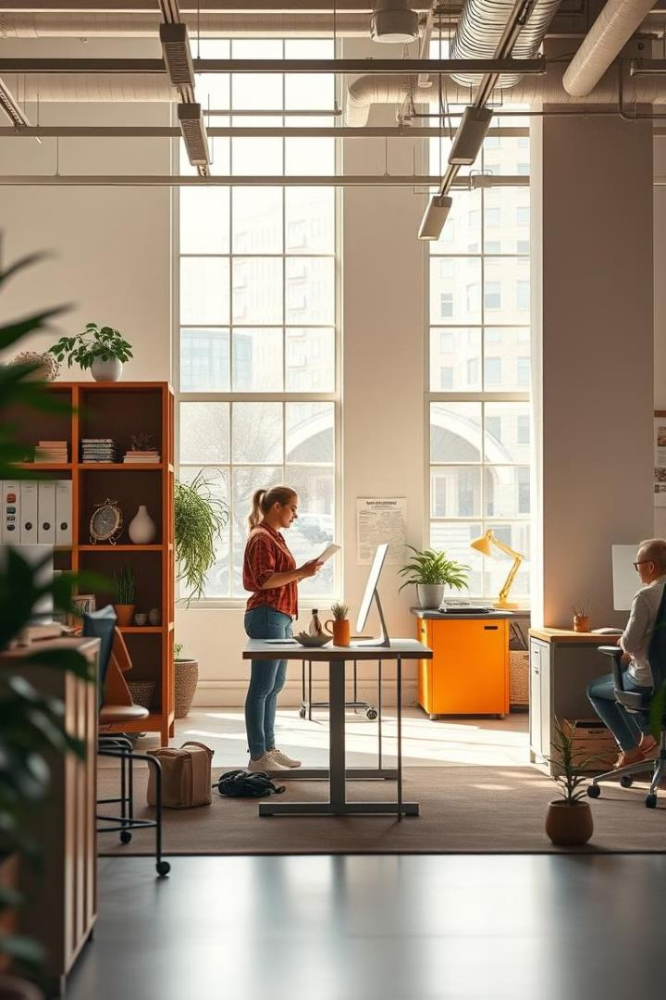
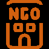
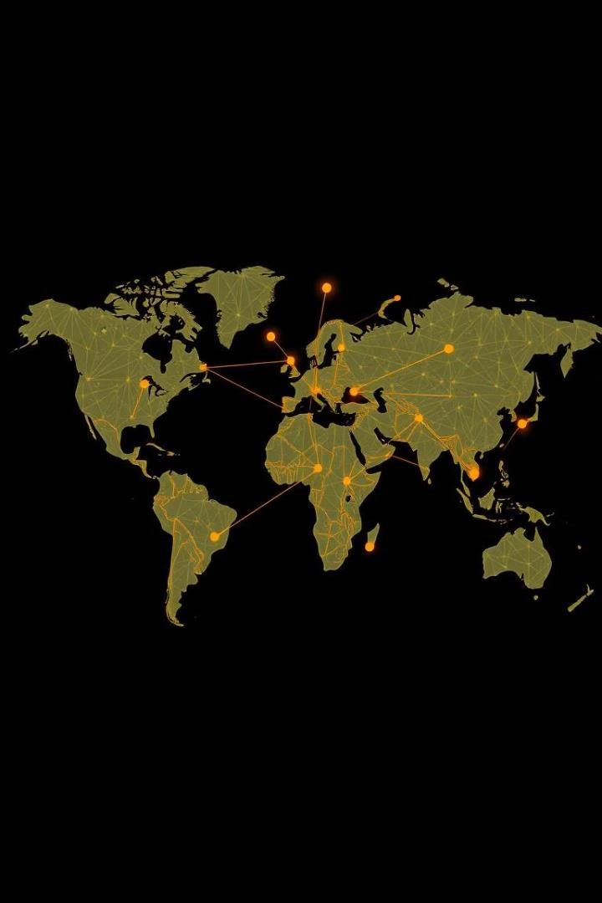
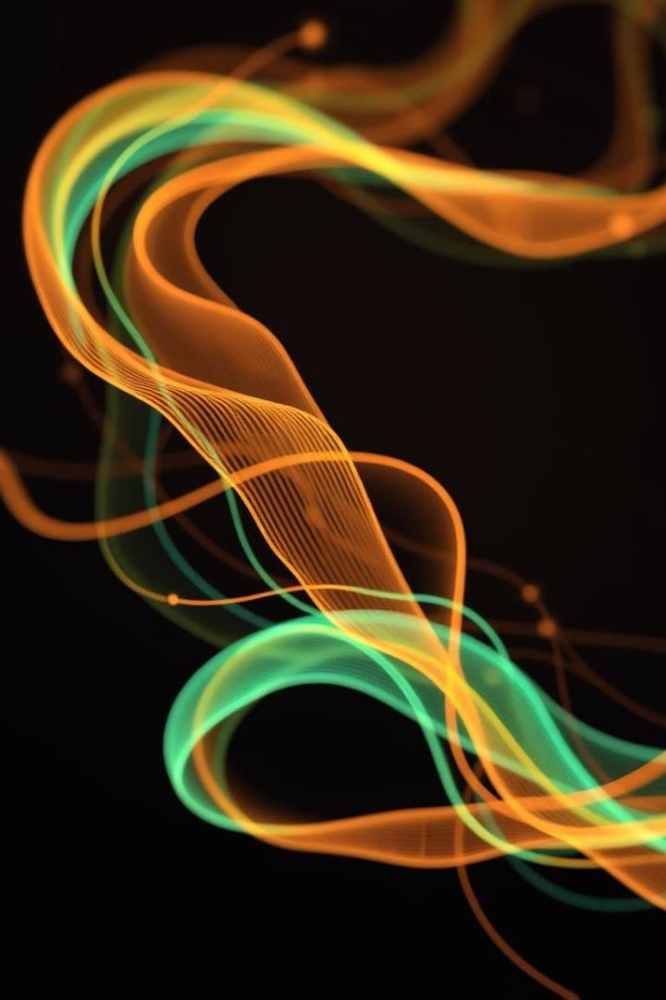
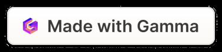
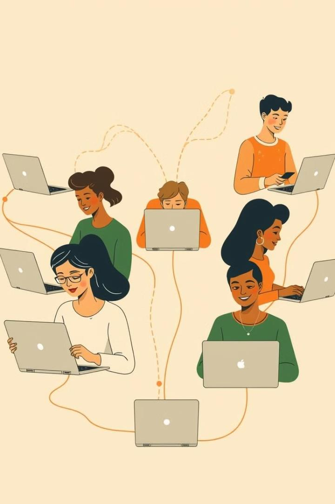
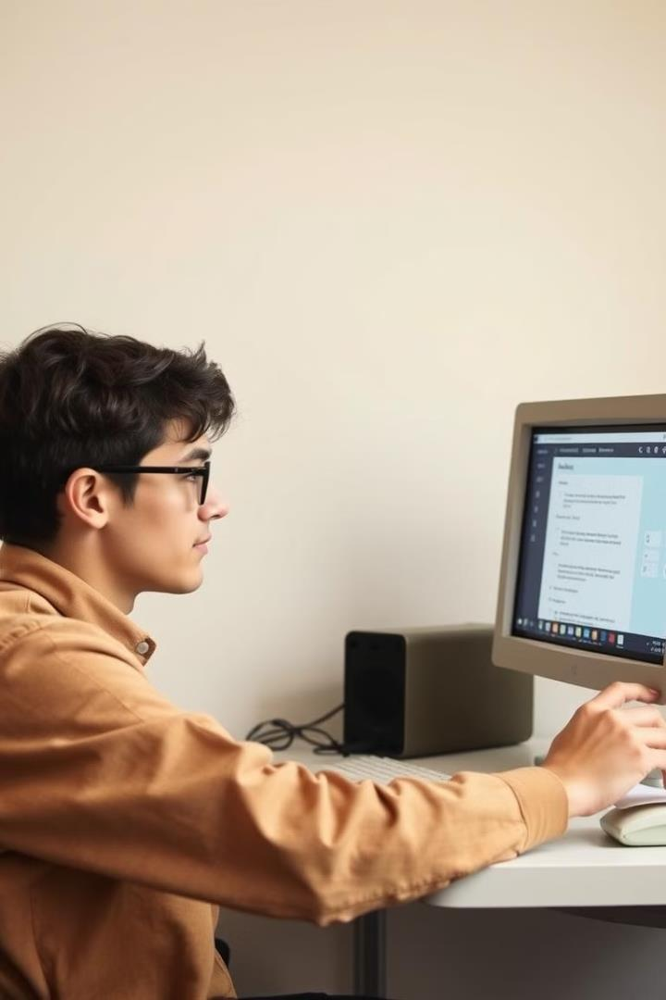
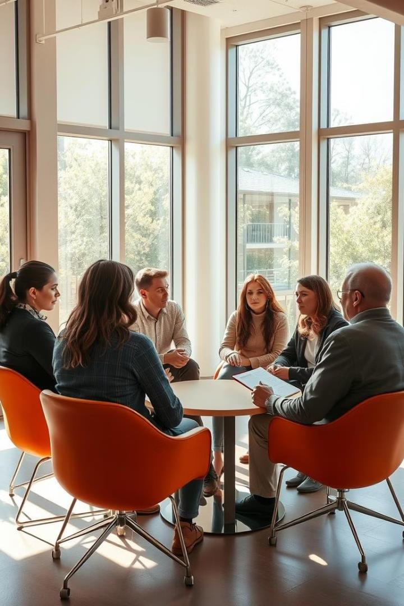

# PRESENTACIONES CLASE -PDF

<!-- página 1 -->

> **Descripción de la imagen** — La imagen es un diseño gráfico que contiene texto y un logotipo. El texto principal dice "Made with Gamma" en una fuente sans-serif de color oscuro. A la izquierda del texto se encuentra un logotipo abstracto compuesto por formas geométricas estilizadas con degradados de colores vibrantes (principalmente tonos morados, rosas y azules).

> **Descripción de la imagen** — La imagen es una fotografía de un espacio interior moderno y bien iluminado, que parece ser una oficina o un área de estudio.
>
> En el centro de la escena, una mujer está sentada frente a un escritorio oscuro, utilizando una computadora portátil. El escritorio está ubicado en el centro del plano.
>
> A la izquierda, hay una estantería alta de madera llena de libros y varias plantas en macetas. Detrás de la mujer, se observan grandes ventanas que dejan entrar abundante luz natural, mostrando edificios urbanos en el exterior.
>
> A la derecha del escritorio principal, hay otra área de trabajo con un mueble o gabinete de color naranja brillante y una lámpara de escritorio amarilla. En esta zona, se ve a otra persona sentada en una silla.
>
> El ambiente general es luminoso, con paredes de tonos neutros y suelos oscuros, creando una atmósfera profesional y acogedora. El techo presenta elementos arquitectónicos expuestos como conductos o tuberías.

preencoded.png
## Gestión
## Empresarial: Un
## Enfoque Integral

Explora las claves de la gestión empresarial, desde las funciones

gerenciales hasta las tendencias globales que impactan el mundo de

los negocios.

---

<!-- página 2 -->

> **Descripción de la imagen** — La imagen es un diseño gráfico que contiene texto y un logotipo. El texto principal dice "Made with Gamma" en una fuente sans-serif de color oscuro. A la izquierda del texto se encuentra un logotipo abstracto compuesto por formas geométricas estilizadas con degradados de colores vibrantes (principalmente tonos morados, rosas y azules).

> **Descripción de la imagen** — Es una fotografía de cuatro adultos sentados juntos en lo que parece ser una reunión o discusión. Están dispuestos en fila, mirando hacia adelante o interactuando entre ellos.
>
> Desde la izquierda, hay un hombre vestido con un saco de color marrón claro. A su lado está una mujer sonriendo, vestida con una blusa de color naranja quemado. En el centro se encuentra un hombre joven con gafas, vestido con una camisa blanca abotonada y una expresión sonriente. A su derecha hay otro hombre con gafas, vistiendo una camisa de botones azul oscuro o gris. Finalmente, a la derecha, hay un hombre mayor sonriendo, con una camisa de rayas azules y blancas.
>
> La iluminación es brillante y el fondo está ligeramente desenfocado, sugiriendo un entorno interior como una oficina o sala de reuniones.

preencoded.png
## El Trabajo Gerencial

> **Descripción de la imagen** — Es un diagrama estilizado que representa una estructura cerebral o un proceso cognitivo. Consiste en una forma orgánica de color naranja/marrón que simula el contorno de un cerebro. De esta estructura emanan dos flechas: una flecha curva indica un flujo o conexión interna entre diferentes partes del cerebro, y otra flecha más grande apunta hacia la derecha, sugiriendo una progresión, salida o resultado del proceso representado.

### Planificación

Definir objetivos y

estrategias.

> **Descripción de la imagen** — Es un ícono o logotipo estilizado con un diseño de contorno grueso de color marrón anaranjado. La forma principal es la silueta de una casa simple, que incluye paredes, un techo y una puerta en el centro. Dentro de la estructura de la casa, se encuentran las letras "N G O" dispuestas verticalmente.

### Organización

Estructura y asignación de

recursos.

> **Descripción de la imagen** — Es un gráfico simple que representa el contorno de una burbuja de diálogo o bocadillo de texto. La forma es redondeada y tiene un color marrón anaranjado. El interior de la burbuja está vacío.

### Dirección

Liderar y motivar equipos.

> **Descripción de la imagen** — Es un ícono o dibujo lineal de una embarcación, probablemente un barco de carga o un buque industrial. La figura está representada en color marrón anaranjado y muestra la silueta de un casco grande con una superestructura elevada en la parte superior.

### Control

Supervisar y ajustar el

rendimiento.

---

<!-- página 3 -->

> **Descripción de la imagen** — La imagen es un diseño gráfico que contiene texto y un logotipo. El texto principal dice "Made with Gamma" en una fuente sans-serif de color oscuro. A la izquierda del texto se encuentra un logotipo abstracto compuesto por formas geométricas estilizadas con degradados de colores vibrantes (principalmente tonos morados, rosas y azules).

preencoded.png
## Niveles Gerenciales

Alta Gerencia

Define la visión estratégica.

Gerencia Media

Implementa las estrategias.

Gerencia Operativa

Supervisa las tareas diarias.

---

<!-- página 4 -->

> **Descripción de la imagen** — La imagen es un diseño gráfico que contiene texto y un logotipo. El texto principal dice "Made with Gamma" en una fuente sans-serif de color oscuro. A la izquierda del texto se encuentra un logotipo abstracto compuesto por formas geométricas estilizadas con degradados de colores vibrantes (principalmente tonos morados, rosas y azules).

preencoded.png
## Tendencias Globales:
## Globalización

La globalización impulsa la competencia y colaboración

internacional. Las empresas deben adaptarse a mercados diversos.

> **Descripción de la imagen** — Es un diagrama de red o mapa conceptual mundial. La imagen muestra un contorno simplificado del planeta Tierra en tonos amarillos y dorados sobre un fondo oscuro. El mapa está compuesto por una serie de puntos luminosos (nodos) distribuidos estratégicamente a lo largo de los continentes. Líneas finas conectan estos nodos, representando relaciones o conexiones entre diferentes ubicaciones geográficas. La densidad de las líneas es mayor en ciertas regiones del mundo, indicando una mayor interconexión entre esos puntos.

---

<!-- página 5 -->

> **Descripción de la imagen** — La imagen es un diseño gráfico que contiene texto y un logotipo. El texto principal dice "Made with Gamma" en una fuente sans-serif de color oscuro. A la izquierda del texto se encuentra un logotipo abstracto compuesto por formas geométricas estilizadas con degradados de colores vibrantes (principalmente tonos morados, rosas y azules).

> **Descripción de la imagen** — La imagen es una ilustración abstracta y dinámica sobre un fondo completamente negro. Está compuesta por múltiples líneas fluidas y curvas que se entrelazan, creando un efecto de flujo o movimiento energético.
>
> Las líneas principales presentan dos colores predominantes: tonos cálidos (naranja y ámbar) y tonos fríos (cian brillante y verde azulado). Estas líneas son luminosas y parecen estar en constante movimiento, formando espirales y curvas que se superponen y se conectan entre sí. La composición general sugiere una representación de flujo de datos, energía o interconexión abstracta.

preencoded.png
## Tendencias Globales:
## Transformación Digital

1
IA

Automatiza procesos y análisis.

2
Big Data

Permite tomar decisiones informadas.

3
Cloud Computing

Facilita la escalabilidad y flexibilidad.

---

<!-- página 6 -->

> **Descripción de la imagen** — La imagen es un diseño gráfico que contiene texto y un logotipo. El texto principal dice "Made with Gamma" en una fuente sans-serif de color oscuro. A la izquierda del texto se encuentra un logotipo abstracto compuesto por formas geométricas estilizadas con degradados de colores vibrantes (principalmente tonos morados, rosas y azules).

> **Descripción de la imagen** — Es una ilustración o fotografía de un globo terráqueo (la Tierra) que se encuentra en el centro de la imagen. El planeta muestra los continentes y océanos, con tonos azules para el agua y verdes/marrones para la tierra.
>
> El globo está enmarcado por hojas grandes y vibrantes, predominantemente de colores otoñales (naranjas, amarillos y marrones), que rodean el objeto a ambos lados. Hay también algunas hojas verdes mezcladas en el marco. La iluminación es cálida y brillante, destacando la superficie del planeta. El fondo está desenfocado, lo que centra toda la atención en el globo y el follaje circundante.

preencoded.png
## Tendencias Globales: Sostenibilidad

Las empresas buscan reducir su impacto ambiental. La responsabilidad social es crucial para la imagen corporativa.

---

<!-- página 7 -->

> **Descripción de la imagen** — La imagen es un diseño gráfico que contiene texto y un logotipo. El texto principal dice "Made with Gamma" en una fuente sans-serif de color oscuro. A la izquierda del texto se encuentra un logotipo abstracto compuesto por formas geométricas estilizadas con degradados de colores vibrantes (principalmente tonos morados, rosas y azules).

preencoded.png
## Tendencias Globales:
## Demografía y Trabajo

Cambios Demográficos

El envejecimiento y las migraciones impactan la fuerza laboral y

la demanda.

Trabajo Remoto

El teletrabajo ofrece flexibilidad y nuevos desafíos.

> **Descripción de la imagen** — La imagen es una ilustración de estilo plano que representa la colaboración y el trabajo remoto o estudio digital. Muestra a seis personas (cinco mujeres y un hombre) interactuando simultáneamente con computadoras portátiles (laptops).
>
> Los elementos clave son:
> 1.  **Personas:** Varias figuras humanas, representadas en tonos cálidos de piel y ropa (verde, naranja, blanco), están sentadas o de pie trabajando.
> 2.  **Dispositivos:** Cada persona está asociada a una laptop, que se muestra abierta y en uso.
> 3.  **Conexiones:** Líneas delgadas y curvas de color naranja conectan a las personas con sus respectivas laptops, y también entre algunas figuras, simbolizando una red o colaboración digital.
>
> La composición es dinámica, mostrando un entorno de trabajo distribuido donde múltiples individuos están conectados a través de dispositivos electrónicos.

---

<!-- página 8 -->

> **Descripción de la imagen** — La imagen es un diseño gráfico que contiene texto y un logotipo. El texto principal dice "Made with Gamma" en una fuente sans-serif de color oscuro. A la izquierda del texto se encuentra un logotipo abstracto compuesto por formas geométricas estilizadas con degradados de colores vibrantes (principalmente tonos morados, rosas y azules).

> **Descripción de la imagen** — La imagen es una fotografía de un joven sentado en un escritorio, concentrado en el uso de una computadora. El hombre tiene cabello oscuro y lleva gafas. Viste una camisa de color naranja o marrón claro con cuello. Está mirando hacia la derecha, hacia un monitor de computadora que muestra contenido de texto o código en una interfaz de edición. En el escritorio se aprecian un teclado y un ratón, y cerca del monitor hay un dispositivo pequeño de color negro. La iluminación es suave y el fondo es una pared de color claro.

preencoded.png
## El Assessment

Evalúa competencias y potencial. Se usa en selección, desarrollo y

evaluación del desempeño.

---

<!-- página 9 -->

> **Descripción de la imagen** — La imagen es un diseño gráfico que contiene texto y un logotipo. El texto principal dice "Made with Gamma" en una fuente sans-serif de color oscuro. A la izquierda del texto se encuentra un logotipo abstracto compuesto por formas geométricas estilizadas con degradados de colores vibrantes (principalmente tonos morados, rosas y azules).

> **Descripción de la imagen** — La imagen es una fotografía de grupo que muestra a seis jóvenes adultos reunidos en un entorno interior, interactuando y sonriendo. El grupo está compuesto por cinco mujeres y un hombre. Todos están mirando hacia el centro del grupo o interactuando entre ellos, lo que sugiere una conversación amigable y colaborativa.
>
> Las personas están vestidas con ropa de estilo casual elegante o de negocios informal (como blazers y camisas). La iluminación es brillante y cálida. Las expresiones faciales de todos los participantes son positivas y alegres, transmitiendo un ambiente de camaradería y entusiasmo. El enfoque está en el grupo, destacando la conexión social entre ellos.

preencoded.png
## Tipos de Assessment

1

Pruebas Psicológicas

Miden aptitudes y personalidad.

2

Entrevistas

Evalúan habilidades y

experiencia.

3

Ejercicios Prácticos

Simulan situaciones laborales.

---

<!-- página 10 -->

> **Descripción de la imagen** — La imagen es un diseño gráfico que contiene texto y un logotipo. El texto principal dice "Made with Gamma" en una fuente sans-serif de color oscuro. A la izquierda del texto se encuentra un logotipo abstracto compuesto por formas geométricas estilizadas con degradados de colores vibrantes (principalmente tonos morados, rosas y azules).

preencoded.png
## Assessment Center

Metodología que combina varias pruebas. Ofrece una evaluación

completa y objetiva del candidato.

> **Descripción de la imagen** — Es una fotografía de un grupo de cinco adultos sentados alrededor de una mesa redonda en un espacio interior luminoso, probablemente una oficina o sala de reuniones.
>
> La escena está dominada por grandes ventanales que permiten la entrada abundante de luz natural y ofrecen vistas a vegetación exterior. El mobiliario incluye una mesa redonda de madera clara y cinco sillas de color naranja brillante con bases metálicas.
>
> Las personas están sentadas en círculo, participando en una conversación. Se observa a cinco individuos:
> 1. Una mujer a la izquierda, mirando hacia el centro.
> 2. Una mujer en primer plano (vista de espaldas), sentada en una silla naranja, vestida con una camisa de cuadros azul oscuro.
> 3. Un hombre sentado en el centro, mirando hacia la derecha.
> 4. Dos mujeres a la derecha, escuchando activamente la conversación.
> 5. Un hombre mayor en el extremo derecho, con gafas, también participando en el diálogo.
>
> La iluminación es cálida y brillante, creando un ambiente profesional pero relajado.

