# TENDENCIAS MUNDIALES DEL LIDERAZGO (1)

<!-- página 1 -->

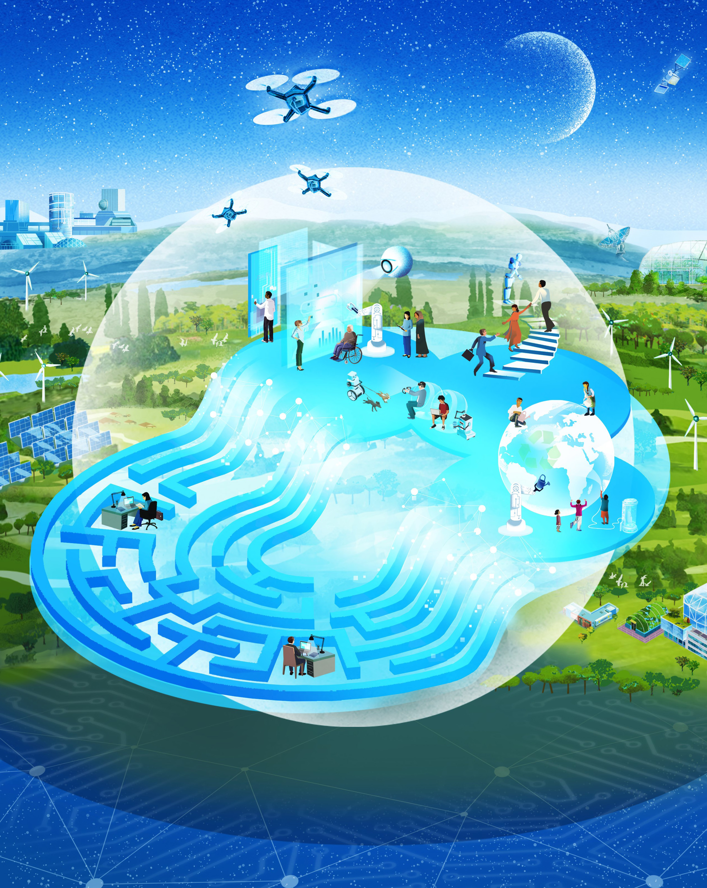

> **Descripción de la imagen** — La imagen es una ilustración digital vibrante y futurista que representa un ecosistema global interconectado y sostenible.
>
> El elemento central es una gran esfera azul brillante que simboliza la Tierra o un sistema global, rodeada de diversas actividades humanas y tecnología.
>
> En el primer plano inferior, se observan intrincadas líneas azules que forman patrones de circuitos o caminos, sugiriendo flujos de datos e interconexiones.
>
> En el plano medio, la escena muestra una mezcla de naturaleza y tecnología:
> 1. **Actividades humanas:** Varias personas están dispersas por el área central, interactuando entre sí, trabajando en computadoras, observando equipos científicos y subiendo escaleras.
> 2. **Tecnología y ciencia:** Hay maquinaria futurista, incluyendo un gran equipo científico y robots o drones pequeños que se mueven sobre la esfera.
> 3. **Entorno sostenible:** El paisaje circundante incluye campos verdes, turbinas eólicas y paneles solares, así como edificios de arquitectura moderna en el horizonte.
>
> En el fondo y el cielo nocturno, se aprecian satélites, planetas y drones volando, reforzando la temática de una red global avanzada y tecnológicamente integrada. La composición general sugiere un concepto de ciudad inteligente o desarrollo sostenible basado en la tecnología y la colaboración global.

Nuevos fundamentos para un
mundo sin fronteras

TENDENCIAS GLOBALES DE CAPITAL HUMANO 2023

---

<!-- página 2 -->

Los profesionales de Capital Humano de Deloitte se basan en la investigación, la analítica y el
conocimiento de la industria para apoyar el diseño y la ejecución de programas de RR.HH.,
talento, liderazgo, organización y cambio que habilitan los resultados del negocio a través del
desempeño de la fuerza laboral. Para conocer más, visite la sección de Capital Humano en
Deloitte.com

---

<!-- página 3 -->
## Contenido

Prólogo
2

Introducción
3

Enmarcar el reto: pensar como investigador

Navegando el final de los puestos de trabajo
10

Impulsando el impacto humano-tecnología
18

Activando el futuro del lugar de trabajo
25

Trazar un nuevo camino: cocrear la relación 

Negociando los datos de los colaboradores
32

Potenciando el involucramiento de los colaboradores
41

Desbloqueando el ecosistema de la fuerza laboral
50

Diseñar para tener impacto: dar prioridad a los resultados humanos

Tomando medidas audaces para obtener resultados equitativos
58

Impulsando el elemento humano en la sustentabilidad
68

Elevando el foco al riesgo humano
77

Liderar en un mundo sin fronteras 
85

---

<!-- página 4 -->

> **Descripción de la imagen** — Es una ilustración digital que representa una escena espacial nocturna. El fondo es un cielo azul profundo salpicado de estrellas blancas. Una luna grande y brillante, de color azul claro, domina el lado derecho de la imagen.
>
> En primer plano, se observan elementos tecnológicos:
> 1.  Un dron (multirrotor) de color azul oscuro con cuatro hélices está volando en la esquina superior izquierda.
> 2.  Otro dron similar se encuentra volando cerca de una superficie blanca (posiblemente una nube o un planeta) en la parte inferior central.
> 3.  En la esquina superior derecha, se ve una estructura de satélite o sonda espacial con componentes conectados por líneas.

2
## Prólogo
## E

N 2020 escribimos un prólogo para nuestro

décimo informe anual de Tendencias

Globales de Capital Humano de Deloitte, en

el que reflexionábamos sobre la década anterior

que se había caracterizado por la “novedad” y el

cambio exponencial. Publicamos ese estudio en

mayo de 2020, en el punto más alto de una

pandemia que marcaría el inicio de una nueva serie

de disrupciones que habrían de irrumpir en el

mundo laboral.

Hoy, al adentrarnos en 2023, la respuesta inicial a

la crisis de la pandemia se ha ido disipando, pero el

cambio sigue entrando en el lugar de trabajo a un

ritmo vertiginoso. La percepción de que el

crecimiento económico se está ralentizando, el

temor a una recesión inminente y el aumento del

costo de vida están ejerciendo una mayor presión

sobre las organizaciones y los líderes empresariales

para que hagan más con menos. Paralelamente, las

Tendencias Globales de Capital Humano- incluidos

un mercado laboral caliente, un aumento del

capitalismo participativo y cambios en la

composición de la fuerza laboral - cuestionan los

fundamentos de cómo, dónde y por qué trabajamos.

Profundice sobre los siete cambios

empresariales y sociales que están

alterando la trayectoria de la agenda de las

organizaciones en El camino hacia el 2023.

De cara a la próxima década, las lecciones de los

últimos años siguen estando muy presentes,

incluida la forma en que las realidades

empresariales pueden cambiar en un instante. Sin

poder volver al pasado o a la normalidad, las

organizaciones y los colaboradores deben atravesar

juntos este nuevo panorama, recurriendo a un

nuevo conjunto de fundamentos para hacerse

camino en un mundo sin fronteras.

---

<!-- página 5 -->

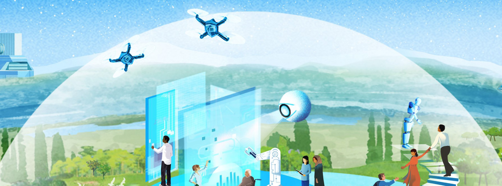

> **Descripción de la imagen** — La imagen es una ilustración digital y estilizada que combina un paisaje natural con elementos futuristas y tecnológicos.
>
> El escenario principal es un paisaje abierto con colinas verdes, árboles altos y un cuerpo de agua en el fondo. En la parte superior del cielo se observan dos drones o vehículos aéreos no tripulados flotando.
>
> En el centro de la escena, hay una estructura grande y translúcida de color azul brillante que parece representar datos o una interfaz tecnológica. Varias figuras humanas interactúan con esta tecnología:
> 1.  Un hombre vestido de blanco está de pie cerca de la estructura de datos.
> 2.  Varias personas están agrupadas en el centro, interactuando con brazos robóticos y pantallas.
> 3.  A la derecha, una mujer vestida de rojo está interactuando con un robot humanoide alto.
>
> Flotando sobre la estructura central se encuentra una esfera azul brillante con un diseño que simula un ojo o lente. La composición general muestra una interacción entre personas, robots y sistemas de información en un entorno exterior.

3
## Introducción
## Nuevos fundamentos para un mundo sin fronteras
## D

URANTE EL SIGLO pasado nos regimos por

una visión mecanicista del trabajo. Hemos

asumido que el trabajo es fijo y repetible,

fácilmente organizado en tareas discretas y

agrupado en puestos bien definidos. Los esfuerzos

de transformación se centraban en el costo y la

productividad, en cómo ofrecer los mismos

resultados con métodos más rápidos y eficientes.

Pero en los últimos años, estos modelos se han

puesto en entredicho a medida que las

organizaciones y los colaboradores se enfrentan a

un grado de discontinuidad y disrupción mayor

que nunca.

“Al principio de la pandemia de COVID-19,

todo el mundo pensaba que acabaría en

seis meses y que lo que había que hacer

era aguantar sin flaquear. Pero lo que

quedó claro rápidamente fue que esto no

sería un recorrido corto, sino algo a largo

plazo - y que íbamos a tener que

replantearnos profundamente lo que el

trabajo significa, dónde se desempeña y

cómo lo dirigimos en un entorno diferente.”

- Terry Shaw, Presidente y Director Ejecutivo

de AdventHealth

---

<!-- página 6 -->

4

Tendencias Globales de Capital Humano 2023

Los límites que una vez se asumieron como el

orden natural de las cosas - que el trabajo puede

organizarse en procesos claramente definidos, que

los puestos de trabajo pueden clasificarse y

contenerse totalmente dentro de la organización,

que el trabajo se realiza dentro de las cuatro

paredes del lugar de trabajo, y que las

organizaciones pueden centrar su toma de

decisiones en torno a los accionistas y las ganancias

netas - están desapareciendo. La consecuencia para

las organizaciones es que están encarando un

nuevo entorno al irse perdiendo los límites

tradicionales que mantenían las cosas

empaquetadas y ordenas, y obtienen permiso para

experimentar, pilotar e innovar para definir nuevas

reglas básicas. Del mismo modo, para los

colaboradores, las reglas de enfrentamiento con las

organizaciones están cambiando; se están abriendo

las puertas a una colaboración y cocreación

mayores y más significativas con la organización.

“Muchos de los límites que solían

estructurar el trabajo se han desmantelado.

Ahora los límites que quedan se centran

mucho más en la dinámica humana y en

cómo las personas interactúan y cómo se

involucran con el trabajo.”

— Chris Ernst, CLO, Workday

Cuando los límites desaparecen, instintivamente el

ser humano se siente abrumado o vacila; 10.000

entrevistados en la encuesta de Tendencias

Globales de Capital Humano de Deloitte de este

año afirmaron que su mayor barrera para lograr

resultados organizacionales es sentirse abrumados

porque hay demasiados cambios que ocurren a la

vez. Sin embargo, la disolución de los límites crea

nuevas oportunidades para las organizaciones y los

colaboradores que están preparados para

manifestarse de formas radicalmente diferentes.

Esto significa dejar de limitarse a reaccionar ante

los estímulos del mercado, desplegando nuevas

estrategias contra las categorías y los límites del

pasado. Por el contrario, las organizaciones y los

colaboradores deben cuestionar los supuestos

previos y adoptar un nuevo conjunto de

fundamentos construidos para un mundo dinámico

y sin fronteras, y ya no ese mundo estable que

estamos dejando atrás.

Estos nuevos fundamentos exigen que las

organizaciones y los colaboradores planteen el reto

de forma diferente, pensando como un

investigador a la hora de enfocar sus estrategias

empresariales y de personal, tratando cada nuevo

obstáculo como un experimento interesante del

que pueden aprender, adaptarse y mejorar. Apelan

a que las organizaciones y los colaboradores tracen

un camino diferente, creando su relación

conjuntamente en busca de un propósito nuevo y

evolutivo, innovación y reimaginación. Y exigen

que las organizaciones y los colaboradores diseñen

para lograr un impacto, dando prioridad a los

resultados humanos y enfocando las estrategias

desde un prisma humano, por y para los

seres humanos.
### Enmarcar el reto: pensar
### como un investigador

Para liderar en este mundo sin fronteras, las

organizaciones y los colaboradores deben activar

su curiosidad, contemplando cada decisión como

un experimento que agilizará el impacto y generará

nuevos conocimientos. La diferenciación y la

victoria no vendrán de creer siempre que se tiene la

respuesta correcta desde el principio, sino de ser

capaces de desafiar ortodoxias, operar con

humildad y empatía, y aprender de la nueva

información para poder perfeccionarla lo antes

posible. Los datos de nuestra encuesta Tendencias

Globales de Capital Humano 2023 muestran que el

59% de los encuestados espera centrarse en la

reimaginación en los próximos 2-4 años, lo que

duplica los niveles prepandémicos (según nuestro

informe de 2021).1

“Dimos permiso a nuestros equipos para probar

cosas nuevas, fracasar rápido, aprender de ello y

---

<!-- página 7 -->

5

Introducción

seguir adelante. Como resultado, tenemos una serie

de nuevos emprendimientos.”

— Olesea Azevedo, Directora de Personal,

AdventHealth

Tres de las tendencias descritas en este informe

ejemplifican la necesidad de que las organizaciones

y  los colaboradores piensen como un investigador.

•	 Navegando el fin de los puestos de
trabajo. Las fronteras que delimitaban un
puesto de trabajo de otro, agrupando tareas y
categorizando a los colaboradores en funciones
y responsabilidades específicas, limitan ahora
los resultados organizacionales, como la
innovación y la agilidad. Muchos están
experimentando con el uso de habilidades, en
vez de puestos de trabajo, como base para la
toma de decisiones sobre su personal. Cuando
dejan de estar encasillados en los puestos de
trabajo, los colaboradores tienen la
oportunidad de utilizar mejor sus capacidades,
experiencias e intereses de forma que mejoren
los resultados de la organización y los propios.

•	 Potenciando el impacto humano-
tecnología. La frontera entre los humanos y la
tecnología como fuerzas separadas sigue
difuminándose a medida que irrumpen en el
lugar de trabajo nuevas tecnologías que no sólo
automatizan y acrecientan el trabajo realizado
por los humanos, sino que realmente mejoran
el rendimiento humano y del equipo. Las
organizaciones con visión a futuro están
explorando cómo utilizar la tecnología de forma
que aliente a los humanos tanto a ser la mejor
versión de sí mismos como a hacer mejor
su trabajo.

•	 Activando el futuro del lugar de trabajo.
Los avances tecnológicos digitales y virtuales y
el papel emergente del metaverso están
redefiniendo el concepto de lugar de trabajo
como espacio físico. Ahora, la mayor
interconexión y la difusa frontera entre el
trabajo en casa y en el lugar de trabajo brindan
a las organizaciones una oportunidad única

para experimentar no con el “dónde”, sino con
el “cómo” debe realizarse el trabajo. La
ubicación y la modalidad pasan a ser
secundarias frente a las necesidades del trabajo
y de los colaboradores.
### Trazar un nuevo camino:
### Cocrear la relación

Para tener éxito, las organizaciones y los

colaboradores tendrán que aprender a navegar

juntos por este nuevo mundo, cocreando nuevas

reglas, nuevos límites y una nueva relación. Esto

significa que los modelos de la propiedad y el valor

deben cambiar. Las organizaciones deben

abandonar las antiguas ilusiones de control total y

reconocer el rol que juegan en ecosistemas vivos y

en constante evolución, a medida que los

colaboradores asumen una mayor influencia y

responsabilidad en los resultados organizacionales

y sociales, liderando mano a mano con la

organización.

“Estamos cambiando nuestra función de

RRHH. Ahora nos preguntamos: ¿Cómo

cocreamos? Queremos que los usuarios y

los colaboradores participen en la toma de

decisiones, colocando a las personas en el

centro de nuestro diseño”

— Líder mundial de RRHH, organización de

servicios financieros

En la encuesta Tendencias Globales de Capital

Humano de Deloitte 2023, las organizaciones con

una mayor participación de los colaboradores en el

diseño y la implementación del cambio

organizacional tenían más probabilidades de lograr

resultados positivos. En concreto, las que

afirmaron que cocreaban con sus colaboradores

declararon que tenían 1,8 veces más probabilidades

de contar con una fuerza de trabajo altamente

comprometida, 2 veces más probabilidades de ser

innovadoras y tenían 1,6 veces más probabilidades

que sus homólogas de prever los cambios y

responder a ellos eficazmente.

---

<!-- página 8 -->

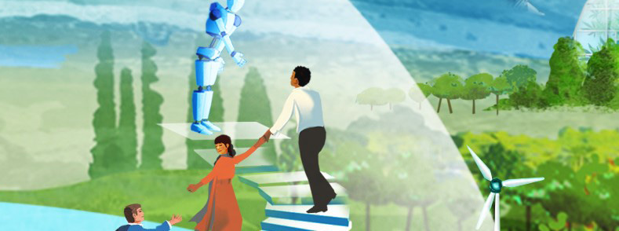

> **Descripción de la imagen** — Es una ilustración que representa una escena exterior y futurista con temática de colaboración y sostenibilidad.
>
> En el centro de la imagen, un hombre vestido de blanco y negro está de pie en una plataforma o escalón elevado, tomando la mano de una mujer vestida con un traje de color naranja rojizo. A la izquierda de la pareja se encuentra un robot alto, de diseño azul y blanco, que observa la escena.
>
> El entorno es un paisaje verde y natural bajo luz brillante. Detrás de los personajes se aprecian árboles frondosos y cuerpos de agua (un lago o río). En el fondo derecho, se distingue una gran turbina eólica moderna, lo que sugiere un enfoque en la energía renovable. La composición general transmite una sensación de armonía entre la tecnología avanzada, la interacción humana y el medio ambiente natural.

6

Tendencias Globales de Capital Humano 2023

Tres capítulos de este informe ejemplifican los

ámbitos en los que las organizaciones y los

colaboradores deben cocrear su relación:

•	 Negociando los datos de los

colaboradores. La frontera entre los derechos

de propiedad de la organización y los del

colaborador - las categorías binarias de datos

propiedad del colaborador o datos propiedad de

la organización - se está volviendo irrelevante. Y

más allá de la mera propiedad, a medida que

los datos se convierten en una nueva “moneda”,

aumentan las discusiones sobre qué son los

datos de los colaboradores, la transparencia de

esos datos y los beneficios mutuos de los

conocimientos basados en ellos.

•	 Potenciando el involucramiento de los

colaboradores. Los modelos tradicionales de

trabajo, fuerza laboral y lugar de trabajo que

asumen que las organizaciones tienen la

autoridad exclusiva para tomar decisiones están

desapareciendo a medida que los colaboradores

exigen un trabajo con más sentido, modelos de

lugar de trabajo flexibles y trayectorias

profesionales más personalizadas. Mientras que

el involucramiento de los colaboradores podría

haber sido visto anteriormente como una

amenaza, las organizaciones líderes están

encontrando formas de aprovechar la

motivación de los colaboradores y la cocreación

para impulsar beneficios mutuos y elevados.

•	 Desbloqueando el cosistema de la fuerza

laboral. El valor de fomentar diversos

ecosistemas de fuerza laboral es enorme, pero

muchas organizaciones siguen estancadas en

viejos patrones de acceso y gestión del talento

porque no están dando a los colaboradores de

todo tipo (temporales, independientes,

contratistas, colaboradores, etc.) la posibilidad

de decidir dónde, cómo y para quién trabajan.

Las organizaciones que adapten sus estrategias

y prácticas para ajustarse a la reserva de talento

del mundo real, que es mucho más compleja y

está cada vez más compuesta por colaboradores

no tradicionales, obtendrán acceso a

habilidades y experiencias para acelerar el

crecimiento, la innovación y la agilidad.

Estos nuevos modelos de propiedad requieren un

gran cambio con respecto a la forma en que

muchos trabajan hoy en día, por lo que no es de

extrañar que las organizaciones estuvieran menos

preparadas para abordar las tendencias que

requieren la cocreación con los colaboradores.

Según nuestra encuesta, sólo el 19% de las

organizaciones afirmaron estar muy preparadas

para la propiedad de los datos, el 17% para la

agencia de los colaboradores y el 16% para los

ecosistemas de fuerza laboral. Será fundamental

superar esta brecha de preparación para que las

organizaciones aprovechen la innovación y la

mejora de los resultados individuales,

---

<!-- página 9 -->

7

Introducción

empresariales y sociales que estas tendencias

podrían impulsar.
### Diseñar para tener impacto:
### Dar prioridad a los
### resultados humanos

El último aspecto fundamental para un mundo sin

fronteras se basa en las aspiraciones colectivas. Las

organizaciones deben crear impacto no sólo para

su negocio, sus colaboradores o sus accionistas,

sino también para la sociedad en general. Más de la

mitad de las organizaciones encuestadas este año

aspiran a crear mayores conexiones con la sociedad

en la que trabajan, lo que indica que la empresa

social, como la definimos en el informe Tendencias

Globales de Capital Humano 2018 de Deloitte,

sigue siendo una fuerza fundamental en el mundo

laboral.

Ya no basta con crear programas discretos que

generen valor en torno a temas importantes como

el clima, la igualdad o el riesgo humano; se han

tornado fundamentales para que una organización

pueda prosperar en este nuevo mundo laboral. En

la encuesta Tendencias Globales de Capital

Humano de Deloitte 2023, más del 80% de las

organizaciones indicó el propósito, la diversidad, la

equidad y la inclusión (DEI), la sustentabilidad y la

confianza como sus principales áreas de interés.

Tres capítulos de este informe ejemplifican la

forma en que las organizaciones y los

colaboradores están dando prioridad a los

resultados humanos.

•	 Tomando medidas audaces para obtener

resultados equitativos. La idea de la

diversidad como métrica se está disolviendo en

favor de la noción de que las organizaciones

deben considerar la DEI como resultados.

Dichos resultados se centrarán en la equidad en

la forma en que las organizaciones acceden al

talento, lo capacitan a través de programas,

métodos y herramientas de desarrollo, y en la

forma en que fomentan y promueven el talento

en todos los niveles de la organización. Las

organizaciones deberán responder menos por

sus actividades y esfuerzos y más por su

capacidad para lograr resultados equitativos en

apoyo de objetivos más amplios de la sociedad

•	 Impulsando el elemento humano en la

sustentabilidad. La frontera de la

organización como entidad totalmente

autónoma, con intereses que pueden separarse

de los intereses de la sociedad en general, se

está desvaneciendo. Por ello, las organizaciones

se enfrentan a una presión cada vez mayor de

los gobiernos, las coaliciones globales, sus

comunidades y, no menos importante, sus

colaboradores actuales y futuros, para que

aborden las cuestiones de sustentabilidad. Esos

colaboradores exigen que las organizaciones

dejen atrás la retórica sobre la sustentabilidad y

se centren en la obtención de resultados

observables. Como resultado, las

organizaciones deben centrarse en los

elementos humanos, que han estado ausentes

en gran medida en sus estrategias y acciones

hasta la fecha, “inculcando” la sustentabilidad

en la fuerza de trabajo y en el trabajo en sí.

•	 Elevando el foco al riesgo humano.

Tradicionalmente, las organizaciones han

concebido a los riesgos humanos a través de

una óptica estrecha: los riesgos que los

colaboradores podrían representar para la

empresa. En el nuevo mundo, las

organizaciones deben ampliar su visión del

riesgo humano más allá del cumplimiento y la

presentación de informes, para considerar

cómo un amplio conjunto de riesgos afecta

significativamente a los humanos y cómo son

afectados significativamente por ellos. Todos

los ejecutivos deben comprender plenamente

que estos riesgos pueden tener un efecto

importante en la viabilidad a largo plazo de una

---

<!-- página 10 -->

8

Tendencias Globales de Capital Humano 2023

empresa, y la responsabilidad última debe

recaer en la dirección.
### Dirigir en un mundo
### sin fronteras

Para quienes hacen las cosas bien, el mundo sin

fronteras se convierte en un mundo de

posibilidades infinitas y no en un lugar de caos y

confusión. A medida que los antiguos límites se

mueven y desaparecen, las organizaciones y los

colaboradores pueden aplicar estos fundamentos

para establecer nuevas directrices, crear más

autonomía, imaginar nuevas posibilidades y lograr

un valor mutuo para la organización, los

colaboradores y la sociedad. Pero para ello es

necesario cambiar de mentalidad, dejando de lado

los modelos operativos de trabajo, fuerza de

trabajo y de lugar de trabajo del pasado para

abrazar un futuro más fluido y más humano,

centrado en la velocidad, la agilidad, la

experimentación y la innovación.

“Una definición alternativa de la palabra

límite es frontera. Una frontera representa

la ubicación de la oportunidad más nueva,

más innovadora, más creadora de valor en

una entidad u organización. El reto

fundamental, y la oportunidad, es

replantear la forma en que concebimos las

fronteras, no sólo como algo que acota,

que crea límites o restricciones, sino como

la fuente misma de la creación de nuevo

valor, la innovación y la creatividad.”

— Chris Ernst, CLO, Workday

Se nenecesita una nueva capacidad de liderazgo en

todos los niveles de la organización que permita

movilizar a los colaboradores y a los equipos con el

fin de lograr nuevos resultados. Pese a ello, sólo el

23% de las organizaciones que participaron en la

encuesta Tendencias Globales de Capital Humano

de Deloitte 2023 afirma que sus líderes tienen las

capacidades necesarias para abrirse camino en un

mundo alterado. Señalan preocupaciones sobre la

capacidad de los líderes para gestionar una fuerza

de trabajo en evolución; menos del 15% de las

organizaciones dice que sus dirigentes están muy

preparados para liderar de manera inclusiva una

fuerza de trabajo en expansión o para considerar

riesgos sociales y ambientales más amplios al

tomar decisiones sobre la fuerza laboral. También

manifiestan preocupación por el diseño y la

ejecución del propio trabajo: sólo el 16% afirma

que sus líderes están muy preparados para utilizar

la tecnología con el fin de mejorar los resultados

del trabajo y el rendimiento de los equipos, y sólo

el 18% afirma que sus líderes están muy

preparados para desarrollar el modelo de lugar de

trabajo adecuado para su organización.

Se requerirá un nuevo tipo de liderazgo, uno que se

centre en dónde y cómo se presenta el líder y en la

mentalidad adoptada para llevar el trabajo

adelante. Más concretamente, cada líder

tendrá que:

•	 Utilizar la experimentación para obtener

mejores soluciones, fomentar el aprendizaje y

acelerar el valor.

•	 Cultivar relaciones profundas e íntimas con los

colaboradores de un ecosistema más amplio a

través de la cocreación.

•	 Ampliar la apertura de la toma de decisiones

para comprender todo su impacto, teniendo en

cuenta la agenda humana.

Quienes se asocien con sus colaboradores y

experimenten con lo que es posible podrán crear

modelos de trabajo sostenibles, haciendo que el

trabajo sea mejor para los humanos y que los

humanos sean mejores en el trabajo.TM

---

<!-- página 11 -->

9
## Notas finales

1.
Jeff Schwartz et al., Deloitte 2021 Global Human Capital Trends—Introduction: The social enterprise in a world
disrupted, Deloitte Insights, Diciembre 9, 2020.
## Agradecimientos

Los autores desean agradecer a Olesea Azevedo (AdventHealth), Terry Shaw (AdventHealth) y Chris

Ernest (Workday) por sus contribuciones en el análisis para coescribir este capítulo de las Tendencias

Globales de Capital Humano 2023.

Introducción

---

<!-- página 12 -->

> **Descripción de la imagen** — Es una ilustración estilizada que representa la interacción con datos y el tiempo. En el centro de la imagen hay una tableta o pantalla grande de color azul que muestra una interfaz compleja con gráficos, líneas de tendencia y cuadrículas de datos. Varias figuras humanas están interactuando con esta pantalla: algunas están subiendo escaleras para acceder a la información, otras están de pie señalando los gráficos y otras observan la pantalla desde diferentes ángulos.
>
> A la izquierda de la tableta se encuentra un reloj analógico grande de color blanco y negro. Alrededor del reloj hay varias figuras humanas en poses diversas, algunas arrodilladas o sentadas en una estera azul, sugiriendo el paso del tiempo o la dedicación al estudio.
>
> El fondo es de un color rosa sólido y suave. La composición general sugiere temas de análisis de datos, aprendizaje, productividad y la relación entre el tiempo y la información digital.

10
## Navegando el final de los
## puestos de trabajo
## Las habilidades sustituyen a los puestos de trabajo como punto
## focal para combinar a los colaboradores con el trabajo
### Coescrito por Karen Weisz.
## E

L CONCEPTO de puesto de trabajo - un

conjunto predefinido de responsabilidades

funcionales asignadas a un colaborador

concreto - está tan arraigado en el funcionamiento

de las organizaciones que resulta difícil imaginar

otra forma de gestionar el trabajo y a los

colaboradores. Sin embargo, muchos reconocen

que este concepto tradicional no sirve para nuestro

mundo sin fronteras. Nuestra encuesta sobre la

organización basada en habilidades reveló que sólo

el 19% de los directivos y el 23% de los

colaboradores afirman que la mejor forma de

estructurar el trabajo es a través de puestos de

trabajo. Como resultado, un número creciente de

organizaciones está empezando a imaginar el

trabajo más allá del puesto de trabajo, dando un

vuelco a la gestión de la fuerza laboral al basar cada

vez más sus decisiones sobre el trabajo y la fuerza

laboral en las habilidades, y no en definiciones

formales de puestos de trabajo, títulos o grados.

Desde los albores de la era industrial, el puesto de trabajo ha sido la estructura definitoria para
organizar y gestionar todos los aspectos laborales. Ese planteamiento tenía sentido cuando los cambios
empresariales se producían lentamente y los colaboradores no eran más que piezas de la maquinaria
industrial. ¿La solución? Un enfoque de la gestión del trabajo y los colaboradores basado en las
competencias, que aporta agilidad a la empresa y autonomía a los colaboradores al permitir que el
trabajo se realice más allá de los límites formales de los puestos.

---

<!-- página 13 -->

11

Navegando el final de los puestos de trabajo

Son varios los factores relacionados que impulsan

este cambio:

Presión sobre el desempeño. El treinta por

ciento de los encuestados en nuestra encuesta

sobre organizaciones basadas en habilidades1

afirman que sus organizaciones son ineficaces a la

hora de relacionar el talento al trabajo. Un enfoque

basado en habilidades aumenta la productividad,

la eficiencia y la eficacia al alinear mejor a los

colaboradores con el trabajo que se ajusta a sus

habilidades y capacidades, como las habilidades

técnicas, las habilidades blandas o humanas y las

posibles habilidades futuras en áreas adyacentes.

Las organizaciones que hacen esto de manera

eficaz pueden liberar el potencial de los

colaboradores para impulsar un mayor valor y

tienen un 52% más de probabilidades de ser

innovadoras.2

Necesidad de agilidad. El 63% de los directivos

de empresas afirman que los colaboradores se

centran en el trabajo en equipo y en proyectos que

quedan fuera de sus actuales descripciones de

puesto. Además, el 81% de los ejecutivos afirma

que cada vez más el trabajo que se realiza está

traspasando límites funcionales. Un enfoque

basado en las habilidades mejora la agilidad

organizativa al permitir que los colaboradores se

distribuyan - o se redistribuyan - rápidamente en

función únicamente de sus competencias y del

trabajo que haya que realizar, independientemente

de su cargo o área funcional. Las organizaciones

con un enfoque basado en habilidades tienen un

57% más de probabilidades de ser ágiles.3

Escasez de talento. Centrarse en las habilidades

ayuda a paliar la escasez de talentos al ofrecer una

visión más amplia del trabajo que las personas son

capaces de realizar, en lugar de limitar

artificialmente la reserva de talentos a personas

con antecedentes e historiales laborales específicos.

Esto también permite a las organizaciones mitigar

la escasez de talento cubriendo las carencias con

recursos internos en lugar de contratar personal

externo. Las organizaciones que adoptan un

enfoque basado en habilidades tienen un 107% más

de probabilidades de colocar eficazmente a los

talentos y un 98% más de probabilidades de

retener a los colaboradores de alto rendimiento y

de tener la reputación de ser un gran lugar para

crecer y desarrollarse.4

Mayor atención a los resultados equitativos.

Un enfoque basado en las habilidades también

ayuda a promover la diversidad y la equidad en el
### SEÑALES: ESTA TENDENCIA SE APLICA A USTED SI...

•	 Su organización dedica demasiado tiempo a ajustar las descripciones de puestos para adaptarlas a
los cambios en el trabajo

•	 Está perdiendo a los mejores talentos debido a la falta de oportunidades falta de desarrollo de sus
capacidades adyacentes

•	 Tiene dificultades para acceder al talento porque se basa excesivamente en los títulos y las
funciones anteriores en detrimento de las aptitudes y el potencial en consonancia con las
prioridades que van surgiendo en la empresa

•	 Excluye a candidatos prometedores y diversos de las reservas de talento porque supuestamente su
historial laboral es inadecuado

•	 Los colaboradores luchan por encontrar nuevas oportunidades fuera de sus unidades de negocio
aisladas

---

<!-- página 14 -->

12

Tendencias Globales de Capital Humano 2023

lugar de trabajo. En la encuesta sobre

organizaciones basadas en habilidades, el 75% de

los ejecutivos afirma que contratar, promocionar y

desplegar a las personas en función de sus

habilidades (en vez de hacerlo en función de su

antigüedad, antecedentes laborales o red de

contactos) puede ayudar a democratizar y mejorar

el acceso a las oportunidades.1 Merck  e IBM, por

ejemplo, forman parte de una coalición llamada

OneTen, que se ha comprometido a contratar,

mejorar, reciclar y promocionar a un millón de

personas de raza negra sin titulación universitaria

mediante la adopción de un enfoque basado en

habilidades.5
### La brecha de preparación

En la encuesta Tendencias Globales de Capital

Humano de Deloitte 2023, el 93% de nuestros

encuestados afirmó que dejar de centrarse en los

puestos de trabajo es importante o muy importante

para el éxito de su organización. Sin embargo, solo

el 20% cree que su organización está muy

preparada para afrontar el reto, lo que representa

la mayor brecha de preparación de todas las

tendencias encuestadas (figura 1).

¿Qué frena a las organizaciones? Según la encuesta

sobre la organización basada en habilidades, el

principal reto/obstáculo son las mentalidades y

prácticas heredadas, citadas por el 46% de los

directivos de negocio y RR.HH. como uno de los

tres principales obstáculos que se interponen en su

transformación hacia una organización basada en

habilidades. La tecnología no es el problema; sólo

el 18% cita la falta de tecnología eficaz relacionada

con las habilidades como uno de los tres obstáculos

principales, el más bajo de los 10 obstáculos

enumerados.6
### Los nuevos fundamentos

Definir el trabajo en función de las

habilidades necesarias. En lugar de definir el

trabajo como un conjunto específico de tareas y

responsabilidades (es decir, un puesto de trabajo),

debe definirse principalmente en función de las

competencias y habilidades que requiere. Las

organizaciones tendrán que considerar en primer

lugar sus objetivos estratégicos o los resultados

deseados y, a continuación, determinar el trabajo

que hay que hacer para alcanzarlos y las

competencias que implican.

Recopilar y analizar información sobre las

habilidades de los colaboradores. Gracias a

los recientes avances tecnológicos en materia de

evaluación de competencias, inferencia de

competencias, análisis basados en inteligencia

artificial (IA) y “pruebas” en directo para evaluar a

candidatos externos, las organizaciones tienen

acceso a un nivel diferenciado de datos sobre

habilidades laborales. Se puede utilizar una

tecnología similar para inventariar las habilidades

de los colaboradores existentes, complementada

con datos más holísticos sobre los intereses,

valores, preferencias laborales y otros aspectos

vinculados a los colaboradores.

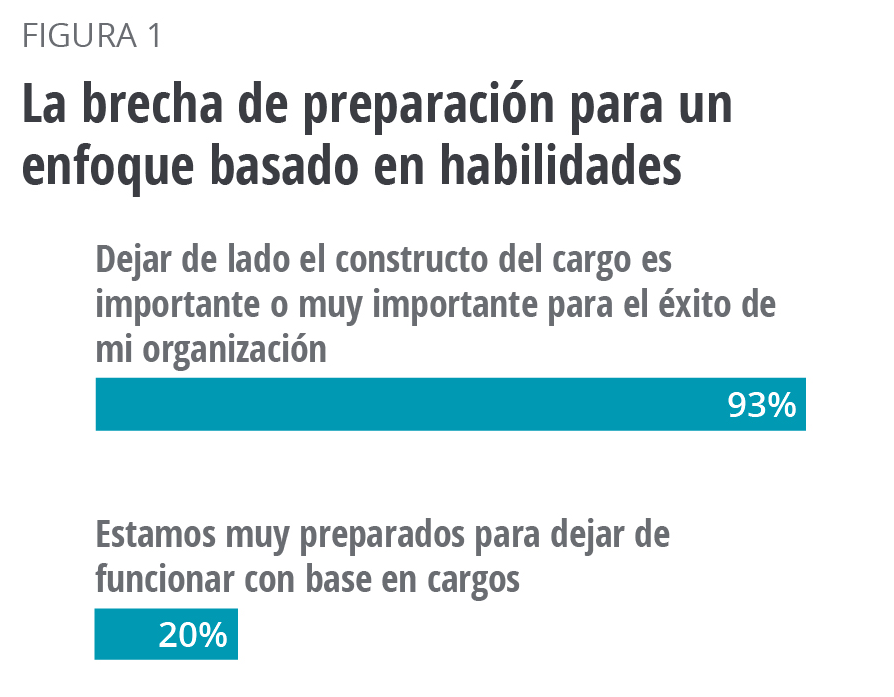

> **Descripción de la imagen** — La figura es una visualización de datos que aborda la "brecha de preparación para un enfoque basado en habilidades". Muestra dos afirmaciones relacionadas con la preparación organizacional, cada una acompañada de un porcentaje:
>
> 1.  Una sección superior, marcada con un color azul, indica el 93%. Esta sección está asociada a la idea de que "dejar de lado el constructo del cargo es importante o muy importante para el éxito de mi organización".
> 2.  Una sección inferior, marcada con un color verde azulado (teal), indica el 20%. Esta sección está asociada a la afirmación de que "estamos muy preparados para dejar de funcionar con base en cargos".

Fuente: Encuesta Tendencias Globales de Capital Humano 2023

---

<!-- página 15 -->

13

Navegando el final de los puestos de trabajo

La recopilación de información sobre los

colaboradores puede ser controversial, como se

explica en el capítulo “Negociación de la

información de los colaboradores”. Sin embargo,

cuando se trata de registrar las habilidades,

nuestro estudio sugiere que los colaboradores

están más dispuestos a que se recopilen esos datos.

Ocho de cada 10 colaboradores están dispuestos a

que su organización recopile datos sobre sus

habilidades y capacidades demostradas y siete de

cada 10 están dispuestos a que se recopilen datos

sobre sus habilidades potenciales. Esto se extiende

incluso al uso de la IA para extraer pasivamente

información de los colaboradores mientras

trabajan, algo que el 53% de los colaboradores

considera positivo.7

Considerar a los colaboradores en función

de sus habilidades, no de su cargo. En lugar

de ver a los colaboradores de forma limitada como

gente que tiene un puesto con tareas predefinidas,

habría que considerarlos de forma holística como

individuos únicos con una cartera de habilidades

que ofrecer, para después establecer la

correspondencia con un trabajo que se ajuste a

esas habilidades. El trabajo puede ser realizado por

un individuo, un equipo o un conjunto cambiante

de recursos, cada persona aporta sus habilidades

correspondientes (al tiempo que mejora sus

habilidades actuales y desarrolla otras nuevas), y

luego pasa a otro trabajo cuando sus habilidades

particulares ya no resultan necesarias. Como parte

del proceso de aplicación, lo ideal es asignar a los

colaboradores un trabajo que se ajuste no sólo a

sus habilidades, sino también a sus intereses,

valores, pasiones, objetivos de desarrollo,

preferencias de ubicación, etc., ya que las personas

son más felices y productivas cuando realizan un

trabajo que se ajusta a lo que son y a lo que les

importa. Esto ayudará a los colaboradores a

maximizar sus contribuciones personales y su

crecimiento. También contribuirá a crear una

experiencia de trabajo más equitativa y centrada en

el humano, creando valor para los colaboradores y

la sociedad en general.

Tomar decisiones sobre los colaboradores

en función de las habilidades. Además de

adecuar a los colaboradores a su trabajo en función

de sus habilidades, las organizaciones querrán

hacer de las habilidades el punto central de todas

las prácticas laborales a lo largo del ciclo de vida

del talento -desde contratar para una carrera

profesional, pasando por la gestión del

rendimiento y las recompensas - haciendo más

hincapié en las habilidades y menos en los puestos

de trabajo. Por ejemplo, en la contratación, esto

significa evaluar a los candidatos en función de sus

habilidades y capacidades en lugar de sus títulos y

certificaciones. Más de uno de cada tres

encuestados en el estudio Tendencias Globales de

Capital Humano de Deloitte 2023 afirma que no

está utilizando las habilidades para ayudar a sus

colaboradores a alcanzar su máximo potencial, lo

que pone de manifiesto la oportunidad de integrar

las habilidades en todo el ciclo de vida del talento.

“Las habilidades pueden ser una medida

muy objetiva y cuantificable de la

capacidad y la competencia. Somos

capaces de utilizar los datos de habilidades

como una entrada en las decisiones de

planificación de la fuerza de trabajo, donde

tomamos una serie de datos y los

alineamos con la estrategia de negocio.

Dado que Cisco es una organización

mundial grande y compleja, esta estrategia

nos permitirá ser ágiles y muy

intencionados en nuestras decisiones de

planificación de la fuerza laboral.”

— Kate Driscoll, Directora de estrategia de

personal y diseño organizacional, Cisco8
### Experimentos actuales:
### ¿Qué están explorando las
### principales organizaciones?

•	 La fuerza de trabajo civil del Ejército de

EE.UU. está implementando una capacidad de

trayectoria profesional para sus profesionales

---

<!-- página 16 -->

14

Tendencias Globales de Capital Humano 2023

de contrataciones y logística, pasando hacia una

organización basada en habilidades con mayor

flexibilidad para satisfacer las necesidades

cambiantes de la misión y la agencia de fuerza

de trabajo para que los colaboradores puedan

adueñarse mejor de sus carreras y permanezcan

más tiempo en el Ejército. El enfoque de la

trayectoria profesional permite a la dirección

del Ejército visualizar las aptitudes y

preferencias, no sólo los puestos, de sus

actuales talentos; muestra la alineación con las

funciones futuras y aprovecha los datos sobre

talentos para respaldar una fuerza laboral

futura más resistente y sostenible.9

•	 Una organización de servicios

financieros ha desarrollado un asistente

profesional virtual que utiliza la inteligencia

artificial para analizar las aptitudes e intereses

de los colaboradores y determinar los puestos

de trabajo más adecuados para ellos y ver

dónde la formación podría ayudarles a

encontrar nuevas oportunidades.

•	 Morning Star, la empresa procesadora de

tomates sólo tiene dos niveles de dirección: el

presidente, que toma las decisiones estratégicas,

y todos los demás. En lugar de títulos de trabajo,

los colaboradores crean su propia lista de

resultados y problemas a resolver; su autoridad

y remuneración se basan en sus habilidades,

experiencia y el valor que crean, en lugar del

cargo.10 Por ejemplo, la misión personal de un

colaborador es convertir tomates en jugo de

forma eficiente y respetuosa con el

medio ambiente.

> **Descripción de la imagen** — La imagen es una ilustración estilizada con un fondo de color rosa vibrante. En el lado izquierdo, se encuentra un gran reloj analógico negro con números blancos, mostrando aproximadamente las 3:00.
>
> En el centro y la parte inferior, hay tres figuras humanas interactuando con elementos que sugieren esfuerzo o actividad. Una mujer está agachada en la esquina inferior izquierda, mirando hacia abajo. Un hombre de pie en el centro extiende ambos brazos hacia arriba, apuntando hacia la pantalla de un dispositivo. Otro hombre está sentado en el suelo cerca de un tapete azul.
>
> En el lado derecho domina una ilustración de un teléfono inteligente o tableta. Dentro de la pantalla del dispositivo se ve a un hombre vestido de negro subiendo una escalera de madera contra un fondo azul brillante.

---

<!-- página 17 -->

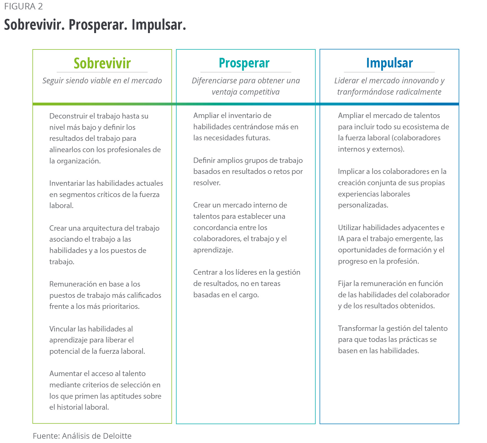

> **Descripción de la imagen** — La imagen es un diagrama conceptual estructurado en tres columnas que presenta un marco estratégico dividido en tres pilares: Sobrevivir, Prosperar e Impulsar.
>
> Cada columna contiene una definición principal y una lista de estrategias o acciones asociadas.
>
> **1. Columna "Sobrevivir"**
> *   **Definición:** Seguir siendo viable en el mercado.
> *   **Estrategias:** Incluyen deconstruir el trabajo para alinear resultados con profesionales, inventariar habilidades actuales, crear una arquitectura del trabajo, establecer remuneración basada en puestos calificados y vincular las habilidades al aprendizaje. También se menciona aumentar el acceso al talento mediante criterios de selección.
>
> **2. Columna "Prosperar"**
> *   **Definición:** Diferenciarse para obtener una ventaja competitiva.
> *   **Estrategias:** Se enfoca en ampliar el inventario de habilidades, definir grupos de trabajo basados en resultados o retos, crear un mercado interno de talentos para la concordancia entre colaboradores y aprendizaje, y centrar a los líderes en la gestión de resultados.
>
> **3. Columna "Impulsar"**
> *   **Definición:** Liderar el mercado innovando y transformándose radicalmente.
> *   **Estrategias:** Consiste en ampliar el mercado de talentos para incluir todo el ecosistema laboral, implicar a los colaboradores en la creación conjunta de experiencias laborales personalizadas, utilizar habilidades adyacentes e Inteligencia Artificial (IA), fijar la remuneración según las habilidades y resultados obtenidos, y transformar la gestión del talento.

15

Navegando el final de los puestos de trabajo
### El camino a seguir
### De cara al futuro

Un enfoque basado en las habilidades no es una

invitación a ejercer un mayor control sobre lo que

hacen las personas asignándoles tareas cada vez

más pequeñas basadas en definiciones de

habilidades cada vez más restringidas. Los

mercados de talento, por ejemplo, corren el riesgo

de convertirse en sistemas que dicten lo que hacen

las personas en lugar de darles más opciones e

influencia sobre lo que hacen, lo que podría acabar

con la motivación y comprometer el crecimiento de

los colaboradores.

Para prosperar, las organizaciones deben confiar

en que los colaboradores ofrezcan resultados

basados en sus habilidades, intereses y potencial,

no sólo en sus credenciales pasadas y su historial

laboral. También requerirá la voluntad de asignar

el trabajo en función de las habilidades adyacentes,

no sólo de las actuales. Esto dará a los

colaboradores oportunidades de crecer en áreas

adyacentes basándose en las habilidades que ya

---

<!-- página 18 -->

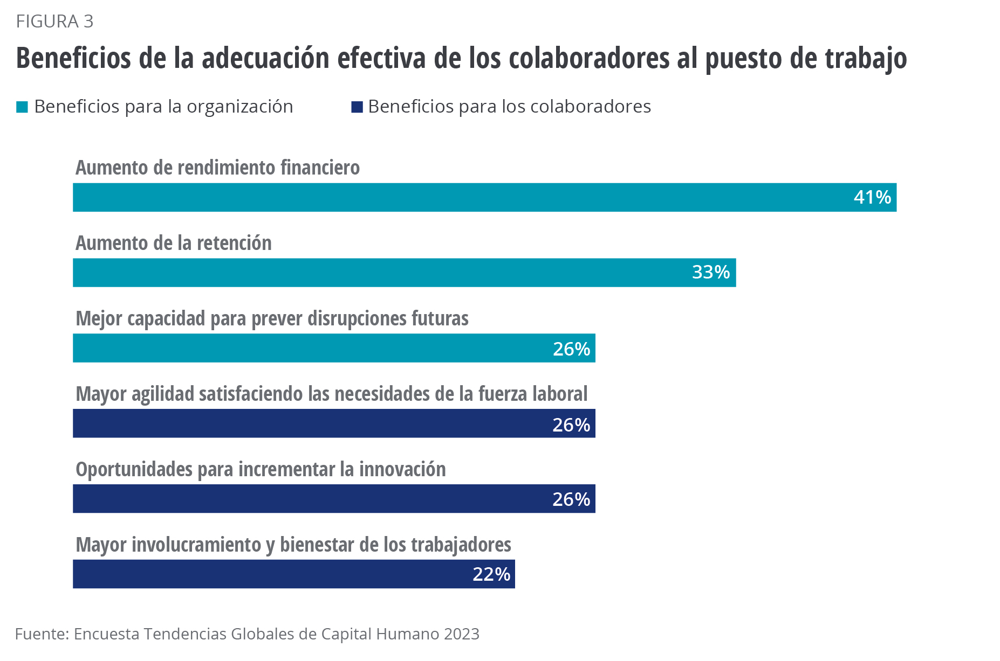

> **Descripción de la imagen** — La imagen es un gráfico de barras que ilustra los beneficios de la adecuación efectiva de los colaboradores al puesto de trabajo, divididos en dos categorías: "Beneficios para la organización" y "Beneficios para los colaboradores".
>
> **Datos por categoría:**
>
> **Beneficios para la organización (Barras azules claras):**
> 1.  Aumento de rendimiento financiero: 41%
> 2.  Aumento de la retención: 33%
> 3.  Mejor capacidad para prever disrupciones futuras: 26%
>
> **Beneficios para los colaboradores (Barras azules oscuras):**
> 1.  Mayor agilidad satisfaciendo las necesidades de la fuerza laboral: 26%
> 2.  Oportunidades para incrementar la innovación: 26%
> 3.  Mayor involucramiento y bienestar de los trabajadores: 22%

16

Tendencias Globales de Capital Humano 2023

tienen, lo que es extremadamente beneficioso tanto

para ellos como para la organización.

Los esfuerzos por adoptar un pensamiento basado

en habilidades van de modestos a radicales.

Algunos empiezan por clasificar las habilidades,

mientras que otros eliminan por completo el

concepto de puesto de trabajo. En una

conversación con el Director de Talento de M&T

Bank, Neil Walker-Neveras, afirmó: “Cuando se

puso en marcha el Programa de Protección del

Salario (PPS) durante la pandemia, tuvimos que

dejar de pensar en puestos de trabajo y empezar a

pensar en habilidades. Éramos el sexto prestamista

de Administración de Pequeñas Empresas del país

-y el primero en gran parte del noreste de EE.UU.-,

por lo que teníamos la responsabilidad de ayudar a

las pequeñas empresas a seguir siendo viables. Al

centrarnos en las capacidades en vez de los cargos

- y movilizar rápidamente el talento de forma ágil -

superamos a nuestros homólogos, financiando el

96% de los préstamos a solicitantes calificados en

la primera ronda, y el 100% en la segunda, frente a

homólogos con tecnología más avanzada que

tuvieron dificultades para financiar más del 50% en

la primera ronda.”11

Independientemente del enfoque que adopte en su

proceso para convertirse en una organización más

basada en habilidades, hay una cosa que está clara:

se pueden conseguir importantes resultados, tanto

para la organización como para los colaboradores.

---

<!-- página 19 -->
### 17
## Notas finales

1.
Sue Cantrell et al., The skills-based organization: A new operating model for work and the workforce, Deloitte
Insights, Septiembre 8, 2022; el artículo presenta datos sobre la encuesta realizada por Deloitte sobre la
organización basada en habilidades, que encuestó a 1,021 trabajadores y 225 ejecutivos de negocios y
recursos humanos en una variedad de industrias y en 10 países, Australia, Brasil, Canadá, Alemania, India,
Japón, Singapur, Sudáfrica, el Reino Unido y los Estados Unidos

2.
Ibid.

3.
Ibid.

4.
Ibid.

5.
PRNewswire, “OneTen launches technology platform to create and enable one million career opportunities for
black talent over the next 10 years,” Junio 29, 2021.

6.
Cantrell et al., The skills-based organization.

7.
Ibid.

8.
Entrevista con autores.

9.
Basado en un trabajo hecho por Deloitte con un cliente.

10.	 Gary Hamel, “First, let’s fire all the managers,” Harvard Business Review, Diciembre 2011.

11.	 Entrevista con autores.
## Agradecimientos
### Agradecemos a Karen Weisz por su contribución en el análisis para coescribir el capítulo de

“Navegando el final de los puestos de trabajo” de las Tendencias Globales de Capital Humano de 2023.
### Los autores desean agradecer a Kate Driscoll (Cisco) y Neil Walker-Neveras (M&T Bank) por sus

contribuciones en el análisis para coescribir este capítulo de las Tendencias Globales de Capital

Humano 2023.
### Los autores desean agradecer a Sarah Hechtman y Abby Shuster por su liderazgo en el desarrollo de
### este capítulo, y a Grace Stafford y Gwen Widicus por sus destacadas contribuciones.

Navegando el final de los puestos de trabajo

---

<!-- página 20 -->

> **Descripción de la imagen** — Es una ilustración estilizada y futurista que muestra una mano robótica o cibernética de color azul brillante como plataforma. La base de la estructura presenta patrones de circuitos electrónicos.
>
> Sobre esta mano se encuentran cinco figuras humanas de diferentes apariencias, interactuando con la estructura:
> 1.  En el extremo izquierdo, hay una persona sentada en una silla de ruedas.
> 2.  A su derecha, varias personas están de pie, incluyendo una mujer y un individuo vestido con un traje o armadura blanca y azul futurista.
> 3.  En el extremo derecho, una persona vestida de amarillo sostiene un objeto geométrico translúcido que parece ser un plano o estructura de datos, proyectándolo hacia la derecha.
>
> Desde el lado izquierdo de la imagen, se observa un pequeño objeto esférico blanco emitiendo un haz de luz o energía que se dirige hacia la plataforma. El diseño general sugiere temas de tecnología, accesibilidad y colaboración humano-máquina.

18
## Impulsando el impacto
## humano-tecnología
## La tecnología contribuye a que el trabajo sea mejor para los
## humanos y los humanos mejores en el trabajo.TM
### Coescrito por Martin Kamen, Tara Mahoutchian, y Nate Paynter.
## L

A RELACIÓN ENTRE la tecnología inteligente y

los colaboradores ha evolucionado mucho con

el tiempo. Al principio, la tecnología se

utilizaba como sustituto de los colaboradores,

automatizándoles tareas aburridas, tediosas,

peligrosas o desconectadas. Después, se utilizó

para complementar a los colaboradores,

funcionando junto a ellos como una herramienta

que proporcionaba capacidades y conocimientos

adicionales o mejorados. En informes anteriores

nos referíamos a estas tendencias como super-

empleos1 y super-equipos,2 que han seguido

acelerándose gracias al avance de las tecnologías.

En la actualidad, estamos asistiendo a la aparición

de tecnologías que no se limitan a sustituir o

complementar a los colaboradores, sino que

realmente les ayudan a mejorar lo que ellos son:

Están surgiendo nuevas tecnologías para el lugar de trabajo que no se limitan a aumentar la
productividad de los colaboradores, sino que les ayudan a mejorar sus capacidades personales y de
trabajo en equipo. No se trata sólo de wearables, artículos o prendas que se puedan llevar puestas.
Se trata de tecnología que apoya a los humanos de innumerables maneras para fomentar nuevos
comportamientos y ayudar a los colaboradores a convertirse en mejores versiones de sí mismos.

---

<!-- página 21 -->

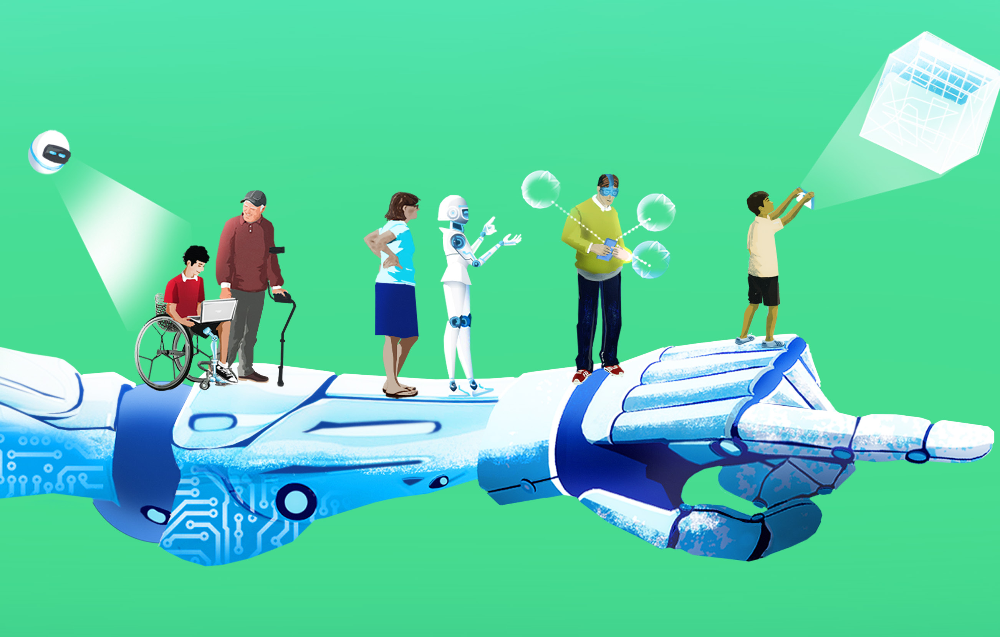

> **Descripción de la imagen** — Es una ilustración estilizada y colorida que representa un concepto de tecnología, accesibilidad y colaboración humana.
>
> El elemento central es una gran mano robótica futurista de color azul brillante con patrones de circuito impreso en su superficie, que se extiende a lo largo de la parte inferior del marco.
>
> Sobre esta mano, se encuentran seis figuras humanas interactuando con la tecnología:
> 1.  En el extremo izquierdo, un joven está sentado en una silla de ruedas utilizando una computadora portátil.
> 2.  A su lado, un hombre vestido con camisa marrón y gorra apoya un bastón.
> 3.  Una mujer de pie viste una blusa azul y una falda oscura.
> 4.  Junto a ella, hay un robot humanoide blanco con detalles azules que extiende sus brazos en un gesto de interacción.
> 5.  Un hombre vestido de amarillo está de pie y rodeado por varias esferas verdes flotantes.
> 6.  En el extremo derecho, un joven sostiene un dispositivo y apunta hacia una estructura tridimensional blanca y transparente que flota en la parte superior derecha del fondo.
>
> El ambiente está iluminado por haces de luz blancos que emanan desde la izquierda, dirigidos hacia el grupo y la mano robótica. La composición sugiere un proceso de investigación, diseño o colaboración tecnológica.

19
19

Impulsando el impacto humano-tecnología

permiten a los humanos ser mejores humanos y a

los equipos a ser mejores equipos.

Por ejemplo, Gogi Anand, de LinkedIn, afirma: “La

tecnología está a punto de cambiar radicalmente la

experiencia de los colaboradores, y va a ser muy

beneficiosa para las personas. Por ejemplo, cuando

hago presentaciones, recibo indicaciones de

Speaker Coach dentro de Microsoft Teams, y me

dice lo rápido que estoy hablando, o si estoy

dominando una reunión. Me da una

retroalimentación instantánea que me ayuda a

mejorar como presentador. Cuando miro en mi

plataforma de reconocimiento, la IA me empuja a

ser más inclusivo en mi lenguaje. Este tipo de

tecnología será realmente útil tanto para los

colaboradores de soporte como para los de primera

línea”.3

Aprovechando los principios de la psicología, la

antropología, la sociología y las ciencias del

comportamiento, estas tecnologías innovadoras
### SEÑALES: ESTA TENDENCIA SE APLICA A USTED SI...

•	 La existencia de múltiples soluciones tecnológicas que compiten entre sí está provocando el
agotamiento de sus colaboradores, estancamientos en la productividad y disfunciones en los
equipos

•	 Sus tecnologías están centradas y diseñadas para el rendimiento de la organización, en lugar del
rendimiento personal y del equipo

•	 Sus inversiones en tecnología se miden únicamente por el costo y la rentabilidad, en lugar de
medirse por los resultados humanos

---

<!-- página 22 -->

20
20

Tendencias Globales de Capital Humano 2023

están redefiniendo los límites de cómo definimos y

mejoramos el rendimiento humano, de los equipos

y de las organizaciones. Los dispositivos

inteligentes impulsados por la inteligencia artificial

(IA), en particular, están proporcionando un

volumen cada vez mayor de información

relacionada con el rendimiento para mejorar el

impacto del humano en el trabajo. De hecho,

algunos estudios estiman que la IA y el Machine

learning contribuirán a aumentar la productividad

laboral en un 37% de aquí a 2025.4
### La brecha de preparación

Según la encuesta Tendencias Globales de Capital

Humano de Deloitte 2023, más del 90% de los

líderes empresariales encuestados cree que utilizar

la tecnología para mejorar los resultados del

trabajo y el rendimiento de los equipos es muy

importante o importante para el éxito de su

organización. Sin embargo, sólo el 22% cree que

sus organizaciones están muy preparadas para

utilizar la tecnología con el fin de mejorar los

resultados laborales y el rendimiento de

los equipos.

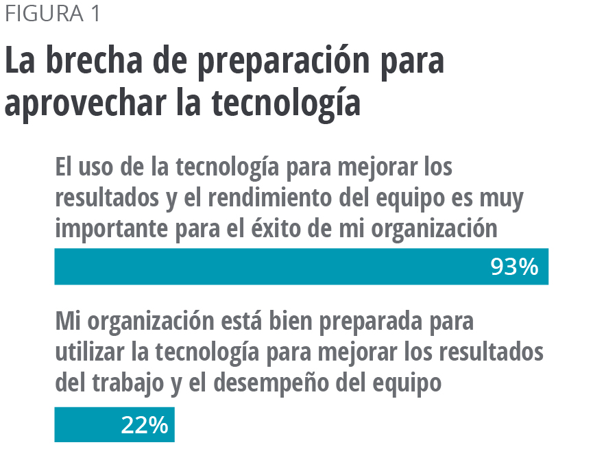

> **Descripción de la imagen** — La figura es una presentación de datos que compara dos porcentajes relacionados con la preparación para aprovechar la tecnología en una organización.
>
> Se presentan dos bloques de información:
>
> 1.  **Primer bloque:** Muestra el porcentaje del 93%, asociado a la afirmación sobre la importancia del uso de tecnología para mejorar los resultados y el rendimiento del equipo en el éxito de la organización.
> 2.  **Segundo bloque:** Muestra el porcentaje del 22%, asociado a la afirmación sobre si la organización está bien preparada para utilizar la tecnología para mejorar los resultados del trabajo y el desempeño del equipo.

Si bien muchas organizaciones han implementado

tecnologías tradicionales en el lugar de trabajo

para obtener mejores resultados laborales, muchas

se muestran actualmente cautelosas a la hora de

adoptar nuevas tecnologías inteligentes de carácter

más experimental. Sin embargo, ven las

oportunidades que tienen por delante. El 42% de

los líderes empresariales espera que, en los

próximos 2-4 años, la tecnología contribuya a

mejorar los resultados de la organización, dando a

los colaboradores y a los equipos un empujoncito

para mejorar su desempeño.
### Los nuevos fundamentos

Permitir que la tecnología trabaje para el

colaborador (y el equipo). La visión tradicional

de la tecnología como sustituto o complemento del

trabajo humano es demasiado limitada. En el

futuro, deberá aprovechar las tecnologías que

ayuden a sus colaboradores y equipos a convertirse

en la mejor versión posible de sí mismos. Esto

significa animarlos a aprender nuevos

comportamientos, corregir los antiguos y

perfeccionar sus habilidades. Por ejemplo, las

intervenciones quirúrgicas satisfactorias y sin

errores en el quirófano requieren delicadeza, pero

a menudo a los cirujanos les resulta difícil

determinar la cantidad exacta de presión que se

debe aplicar sobre el instrumento. La tecnología

proporciona a los cirujanos bisturíes y pinzas

inteligentes que les permiten medir y ajustar la

presión en tiempo real, mejorando así la precisión

y los resultados en los pacientes.5

Utilizar intervenciones e impulsos para

mejorar al ser humano. La tecnología también

puede ayudar a los humanos a mejorar cosas que

son “esencialmente humanas”. Dada la visión

tradicional de la tecnología como sustituto o

suplemento de los humanos, resulta irónico pensar

que la tecnología se utilice para hacer a los

humanos más humanos. Sin embargo, eso es

exactamente de lo que estamos hablando aquí. La

tecnología puede ayudarnos a mejorar en lo que

mejor sabemos hacer, como promover el bienestar,

aplicar la inteligencia emocional y fomentar la

creatividad y el trabajo en equipo, que son cosas

que la tecnología por sí misma no puede hacer.

Fuente: Encuesta Tendencias Globales de Capital Humano 2023

---

<!-- página 23 -->

21
21

Impulsando el impacto humano-tecnología

Ayudar a las personas a convertirse en mejores

versiones de sí mismas es un esfuerzo que ya de

por sí vale la pena. Sin embargo, desde una

perspectiva empresarial, tiene el valioso beneficio

adicional de hacer que las personas sean mejores

en su trabajo, aumentando así su compromiso y

rendimiento. Siguiendo con el ejemplo anterior de

la cirugía, las tecnologías también controlan el

tiempo que los miembros del equipo asistencial

pasan en la sala de operaciones y cruzan ese

tiempo con la información sobre errores en el tipo

de cirugía correspondiente, para emitir alertas

sobre el riesgo de fatiga. Esto no sólo redunda en

mejores resultados para el paciente, sino también

mejora el bienestar del equipo quirúrgico.

Conocimientos a escala para un mayor

impacto. Más allá del impacto individual y sobre

el equipo, esta colaboración entre tecnología y

equipos humanos también puede incidir a través

de conocimientos a escala. Toda esta tecnología,

tanto si se utiliza para impulsar, colaborar, formar

o con cualquier otro fin, crea un “escape” de datos.6

Estos datos son una poderosa herramienta por sí

mismos. Siguiendo con el ejemplo de la cirugía, la

tecnología agrega los datos sobre los ajustes de

precisión, el tiempo de intervención y los errores,

para obtener información de todo un hospital o

sistema sanitario que sirva de base a los cambios

en las prácticas laborales, como la duración de las

guardias, la programación o las inversiones en

equipos. Este tipo de información podría utilizarse

para mejorar el rendimiento y los resultados de los

colaboradores, los equipos, la organización y

el ecosistema.

Este futuro imaginado no sólo es posible; en

muchos casos, ya está aquí. Y su impacto potencial

es aún mayor cuando se aplica no sólo a individuos,

sino también a equipos (y a redes de equipos

conectados que persiguen objetivos adyacentes). El

resultado es una mejora del rendimiento, el

aprendizaje y el desarrollo, la comunicación y la

colaboración. Los ejecutivos que respondieron a la

encuesta Tendencias Globales de Capital Humano

de Deloitte 2023 creen en los beneficios de permitir

que la tecnología y los equipos colaboren para

impulsar los resultados, y uno de cada tres afirma

haber aumentado el rendimiento financiero como

resultado de su enfoque hacia la tecnología y la

colaboración en equipo.
### Experimentos actuales:
### ¿Qué están explorando las
### principales organizaciones?

•	 Humu analiza los datos de las empresas y las

opiniones de los colaboradores para identificar

los cambios que pueden mejorar la felicidad, el

rendimiento y la retención de los mismos.7 La

tecnología es como un entrenador personal

virtual que utiliza la IA para analizar las

encuestas de los colaboradores y otros datos

para identificar qué cambios de

comportamiento podrían ayudar a los

colaboradores y a las organizaciones a alcanzar

sus objetivos. A continuación, envía a los

colaboradores avisos de estímulo

personalizados que aparecen en el correo

electrónico, Slack o Microsoft Teams. Esos

avisos están dirigidos a cambiar

comportamientos, a menudo con explicaciones

o enlaces a estudios sobre por qué importan los

comportamientos. A medida que los

colaboradores (y las personas de su entorno)

informan de mejoras, el aprendizaje automático

ayuda al sistema a avanzar hacia otros

objetivos adicionales.

•	 Ultranauts utiliza Teams y los bots de Slack

para eliminar las barreras que hacían que las

personas neurodivergentes no se sintieran

cómodas en las empresas tecnológicas.8 El

director general de la empresa animó a los

colaboradores a crear su propio “biodex”

personal, una guía de inicio rápido para

trabajar con ellos, de modo que personas con

estilos diametralmente diferentes puedan

---

<!-- página 24 -->

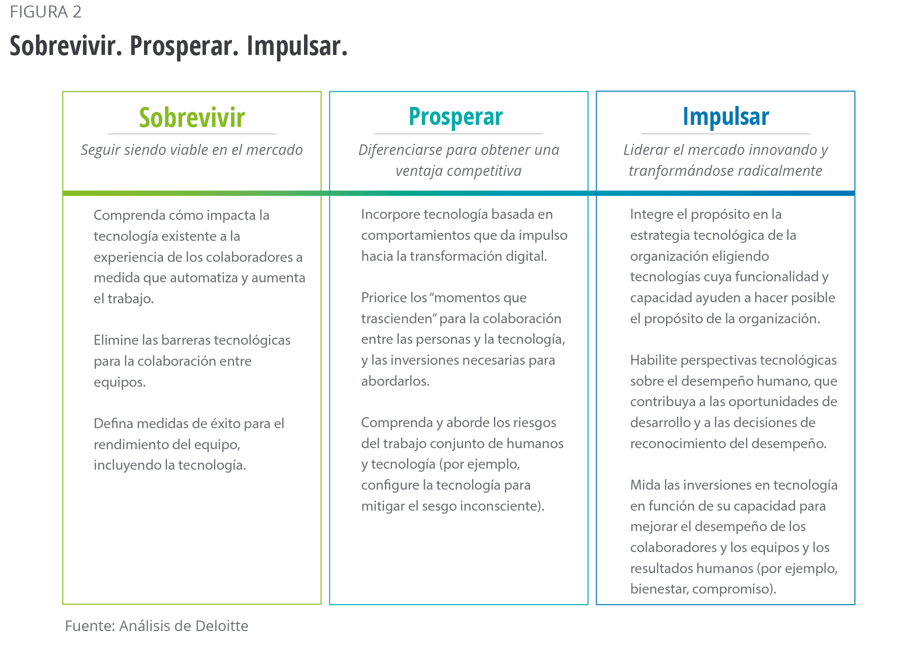

> **Descripción de la imagen** — La imagen es un diagrama conceptual estructurado en tres columnas verticales, que presenta un marco estratégico dividido en tres pilares interconectados: Sobrevivir, Prosperar e Impulsar.
>
> Cada columna contiene un título principal y una descripción detallada de las acciones o enfoques asociados a ese pilar.
>
> 1.  **Sobrevivir:** Se centra en seguir siendo viable en el mercado. Sus puntos clave incluyen comprender el impacto de la tecnología en la experiencia laboral, eliminar barreras tecnológicas para la colaboración entre equipos y definir medidas de éxito basadas en el rendimiento del equipo e inclusión de la tecnología.
> 2.  **Prosperar:** Busca diferenciarse para obtener una ventaja competitiva. Este pilar enfatiza la incorporación de tecnología basada en comportamientos, la priorización de momentos que trascienden la colaboración entre personas y tecnología, y la comprensión y abordaje de los riesgos del trabajo conjunto humano-tecnológico (como mitigar el sesgo inconsciente).
> 3.  **Impulsar:** Se enfoca en liderar el mercado innovando y transformándose radicalmente. Sus elementos incluyen integrar el propósito en la estrategia tecnológica, habilitar perspectivas tecnológicas sobre el desempeño humano y medir las inversiones en tecnología para mejorar el desempeño de los colaboradores y los resultados humanos (como el bienestar y el compromiso).
>
> El diagrama establece una progresión lógica o jerárquica entre estos tres niveles estratégicos.

22
22

Tendencias Globales de Capital Humano 2023

entender inmediatamente cuál es la mejor

forma de colaborar.

•	 La tecnología de reconocimiento de acciones de

Drishti, basada en inteligencia artificial y

visión por ordenador, permite a DENSO,

fabricante japonés de componentes para

automóviles, generar análisis continuos y en

tiempo real de las tareas manuales realizadas

por sus colaboradores de producción.9 El

conjunto de datos resultante permite a los

responsables de producción identificar y

eliminar rápidamente los cuellos de botella,

mejorar los procesos, aumentar la eficiencia y

priorizar las tareas. Prasad Akella, director

general de Drishti, señala: “Hemos comprobado

que los colaboradores de las fábricas están

encantados de utilizar Drishti porque les ayuda

a formarse continuamente sin la interferencia

de un jefe. El sistema avisa al colaborador de la

línea cuando se produce un error, dándole la

oportunidad de solucionar el problema, sin que

nadie más se entere”.

•	 El Dawn Avatar Robot Café de Tokio tiene

servidores robóticos manejados a distancia por

personas que no pueden salir de casa por

discapacidad, cuidado de niños u otras

razones.10 Estos avatares robóticos teledirigidos

se diseñaron para aumentar la accesibilidad del

lugar de trabajo, dando a los colaboradores

remotos del Café más oportunidades de

interactuar con los demás y ampliando el grupo

de posibles colaboradores.

---

<!-- página 25 -->

23

Impulsando el impacto humano-tecnología
### De cara al futuro

A medida que pasamos de la era de la información

a la era de la imaginación, la tecnología está

pasando de ayudar a los colaboradores a producir

resultados, a permitir que los seres humanos y los

equipos se centren en los resultados, haciendo que

el trabajo sea mejor para los seres humanos y que

los seres humanos sean mejores en el trabajoTM.

Estos resultados repercuten en los clientes, la

calidad de los productos, la seguridad de las

instalaciones, el medio ambiente y otros aspectos.

Para hacer realidad este valor es necesario que las

organizaciones dejen de lado la visión anticuada de

la tecnología como un potenciador de la

productividad y adopten el potencial de las

tecnologías inteligentes para permitir el impacto

humano y de equipo, impulsados por la tecnología.

Sabrá que su organización está haciendo avances si

la tecnología que se utiliza en el lugar de trabajo

está mejorando el trabajo en equipo y ayudando a

los equipos a mantenerse conectados, y si los

colaboradores están mejorando sus capacidades

personales y disponen de más tiempo para

centrarse en tareas cognitivas de alto valor como la

creatividad, la ideación y la innovación. Estas

tecnologías en el lugar de trabajo también

desempeñarán un papel importante a la hora de

facultar otras tendencias de este informe, como

información de los colaboradores, los ecosistemas

de talento y el futuro del lugar de trabajo.

---

<!-- página 26 -->
### 24
## Notas finales

1.
Erica Volini et al., 2019 Deloitte Global Human Capital Trends, Deloitte Insights, Abril 11, 2019.

2.
Jeff Schwartz et al., 2020 Global Human Capital Trends, Deloitte Insights, Mayo 15, 2020.

3.
Entrevista con autores.

4.
James Eager et al., Oportunidades de inteligencia artificial, Parlamento Europeo, Junio 2020.

5.
BioSpace, “Surgical scalpel market: Technological advancements in the field of surgical scalpel,” Junio 4,
2021; New York University, “New tool brings missing sense of touch to minimally-invasive surgery procedures,”
ScienceDaily, Junio 27, 2022.

6.
Techpedia, “What does data exhaust mean,” accedido el 17 de Noviembre, 2022.

7.
Humu, “Move your organization to exactly where it needs to be,” accedido el 17 de Noviembre, 2022.

8.
Ultranauts, “The Biodex - A user manual for every teammate,” accedido el 17 de Noviembre, 2022.

9.
Drishti, “DENSO: $46B Japanese auto tier 1 manufacturer,” accedido el 17 de Noviembre, 2022.

10.	 Emma Steen, “This new Tokyo café has robot waiters controlled remotely by disabled workers,” TimeOut, Junio

22, 2021
## Agradecimientos
### Agradecemos a Martin Kamen, Tara Mahoutchain y Nate Payner por sus contribución en el análisis

para coescribir el capítulo de “Impulsando el impacto humano - tecnología” de las Tendencias Globales

de Capital Humano de 2023.
### Agradecemos a Gogi Anand (Linkedin) por su contribución en el análisis para coescribir el capítulo de

“Impulsando el impacto humano - tecnología” de las Tendencias Globales de Capital Humano de 2023.
### Agradecemos a Caroline Kelson, Michael McLaughin y Avalon Potter por sus contribución en el

análisis para coescribir el capítulo de “Impulsando el impacto humano - tecnología” de las Tendencias

Globales de Capital Humano de 2023.

Tendencias Globales de Capital Humano 2023

---

<!-- página 27 -->

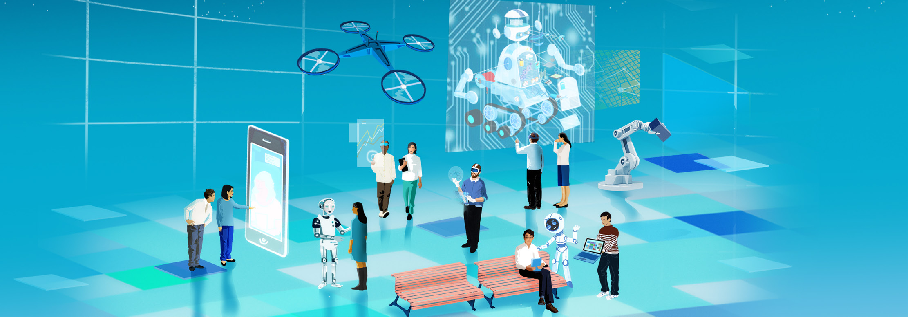

> **Descripción de la imagen** — La imagen es una ilustración digital de un entorno futurista y tecnológico, dominado por tonos azules y cian. La escena muestra a un grupo de personas interactuando con robots y tecnología avanzada.
>
> En la parte superior, se observa un dron volando. A la derecha, hay una gran proyección holográfica o diagrama digital que representa una estructura compleja de robots y circuitos interconectados.
>
> En el plano medio, varias figuras humanas están dispersas, algunas interactuando con dispositivos móviles (un teléfono en primer plano a la izquierda) y otras interactuando directamente con robots humanoides. Se ven personas de pie, conversando o señalando hacia las estructuras tecnológicas.
>
> Hay varios robots mecánicos de diferentes diseños presentes en la escena: uno pequeño y blanco junto a una mujer, otro robot humanoide más grande cerca del centro, y un robot sentado en un banco de madera. Un hombre está interactuando con una computadora portátil.
>
> El ambiente general sugiere un entorno de colaboración, investigación o desarrollo tecnológico avanzado.

25
## Activando el futuro del lugar
## de trabajo
## El lugar de trabajo evoluciona para convertirse en un insumo
## que se añade al propio trabajo
### Coescrito por Martin Kamen, Tara Mahoutchian, y Nate Paynter.
## E

L SUPUESTO DE que el lugar de trabajo es

simplemente una ubicación física se viene

cuestionando desde hace algún tiempo; la

virtualización del trabajo como tendencia data de

mucho antes de que aparecieran las distorsiones

provocadas por la pandemia COVID-19. Sin

embargo, esa abrupta disrupción obligó a las

organizaciones a replantearse más rápidamente

cómo conectar y comprometer a los colaboradores

en entornos de trabajo virtuales e híbridos y a

abrazar las posibilidades de un lugar de trabajo sin

fronteras. Por desgracia, parece que los viejos

hábitos son difíciles de romper, ya que hemos visto

cierto retroceso debido a definiciones anticuadas

de lo que es el trabajo y a percepciones sobre la

productividad de los colaboradores o la cultura

organizacional, ya que muchas organizaciones

presionan para que los colaboradores vuelvan a

la oficina.

De cara al futuro, los líderes deben centrarse en

una cuestión fundamental: el diseño y la práctica

del trabajo en sí mismo, ya que el trabajo dictará la

combinación de lugar de trabajo físico y digital

El lugar de trabajo ideal no es sólo un sitio físico dictado por la tradición, el derecho o la necesidad, sino el
lugar donde mejor se hace el trabajo. Las organizaciones deben desafiar los límites tradicionales y diseñar
entornos físicos, digitales o híbridos que se adapten a las distintas necesidades laborales, al tiempo que
respetan las preferencias de los colaboradores y los objetivos meta, como la cultura, la comunidad y el
trabajo en equipo. Los colaboradores pueden entonces determinar cuándo, dónde y cómo realizar mejor
el trabajo dentro de unas directrices generales destinadas a propiciar y no a limitar estas decisiones.

---

<!-- página 28 -->

26

Tendencias Globales de Capital Humano 2023

necesaria para alcanzar los resultados

empresariales. Lamentablemente, solo el 15 % de

los encuestados en el estudio Tendencias Globales

de Capital Humano de Deloitte 2023 citaron la

forma en que se diseña el trabajo como uno de los

atributos más importantes para crear el lugar de

trabajo futuro.

El cambio hacia un lugar de trabajo sin fronteras

está impulsado por dos factores principales: la

iniciativa de los colaboradores y los avances

tecnológicos. El sentimiento de los colaboradores

ha cambiado; ahora los colaboradores abogan por

modelos de trabajo que respondan mejor a sus

necesidades y a su bienestar. Muchos de ellos

consideran ahora que la capacidad de trabajar a

distancia es un derecho inalienable. Según un

estudio reciente,1 dos tercios de los colaboradores

de todo el mundo (64%) afirman que ya se han

planteado (o se plantearían) buscar un nuevo

trabajo si su empleador quisiera que volvieran a la

oficina a tiempo completo.

La tecnología también avanza rápidamente como

componente esencial del diseño del lugar de

trabajo. Esto va más allá de las herramientas de

colaboración e incluye ahora una amplia gama de

tecnologías relacionadas con el trabajo, cuyo

ejemplo más destacado podría ser el metaverso y la

realidad aumentada.

A medida que las organizaciones reimaginan el

lugar de trabajo en un mundo pospandémico, el

resultado no es una única ubicación o una solución

igual para todos, sino una serie de capacidades y

espacios que apoyan diferentes formas de hacer el

trabajo. Esta reimaginación no se limita a los

colaboradores del conocimiento, sino que también

se extiende a los colaboradores de primera línea.

Una encuesta reciente de Forbes y Microsoft2

muestra que las organizaciones que lideran la

capacitación digital de los colaboradores de

primera línea (por ejemplo, representantes de call

centers, personal de campo) tienen tres veces más

probabilidades de lograr un crecimiento anual

superior al 20% (en comparación con sus

homólogas menos previsoras).
### SEÑALES: ESTA TENDENCIA SE APLICA A USTED SI...

•	 El intercambio de conocimientos y el uso eficaz de la propiedad intelectual están disminuyendo
notablemente

•	 Los continuos problemas de colaboración afectan negativamente a la ejecución del trabajo y
provocan un notable aumento de las reuniones

•	 El compromiso y la productividad están disminuyendo debido a que los antiguos modelos de
trabajo se están trasladando al lugar de trabajo híbrido

•	 Su organización tiene dificultades para atraer a los mejores talentos debido a estrategias obsoletas
o ineficaces en el lugar de trabajo

---

<!-- página 29 -->

27
### La brecha de preparación

Según la encuesta Tendencias Globales de Capital

Humano de Deloitte 2023, la gran mayoría de los

líderes empresariales (87%) cree que desarrollar el

modelo de lugar de trabajo adecuado es importante

o muy importante para el éxito de su organización.

Sin embargo, sólo el 24% considera que su

organización está muy preparada para abordar esta

tendencia (figura 1).

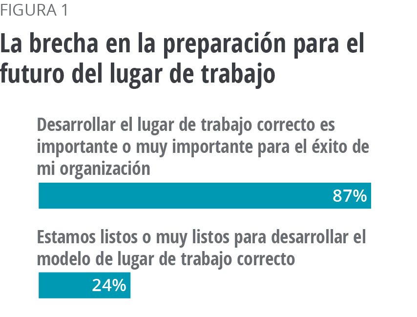

> **Descripción de la imagen** — La figura es una presentación de datos que compara dos porcentajes relacionados con la preparación para el futuro del lugar de trabajo.
>
> Se presentan dos afirmaciones distintas, cada una asociada a un porcentaje visualizado en una barra horizontal de color azul verdoso:
>
> 1.  **Primera estadística:** Una declaración sobre la importancia de desarrollar el lugar de trabajo correcto es importante o muy importante para el éxito de la organización, con un valor del **87%**.
> 2.  **Segunda estadística:** Una declaración sobre si las personas están listas o muy listas para desarrollar el modelo de lugar de trabajo correcto, con un valor del **24%**.

La buena noticia es que sólo el 6% de las

organizaciones encuestadas están satisfechas con el

statu quo y afirman que no han cambiado -ni

cambiarán- su estrategia para el lugar de trabajo.

Mientras tanto, el 78% está tratando de crear un

lugar de trabajo futuro en el que los colaboradores

puedan prosperar mediante el rediseño de sus

actuales procesos de negocio o la reimaginación del

trabajo en sí mismo.
### Los nuevos fundamentos

Deje que el trabajo en sí mismo dirija las

decisiones sobre el lugar de trabajo. Antes de

que las organizaciones puedan responder

eficazmente a cualquier pregunta sobre dónde debe

trabajar la gente – trabajo físico, digital o híbrido -,

deben entender el trabajo que hay que hacer. Para

ello, la primera pregunta que hay que plantearse al

pensar en el lugar de trabajo es “¿Qué requiere el

trabajo?”. No existe un modelo de lugar de trabajo

perfecto ni una solución universal que deban

adoptar todas las organizaciones. Si el trabajo no

requiere un espacio físico para ofrecer resultados

óptimos, no hay que forzarlo sólo por precedentes

o por las preocupaciones actuales de la dirección.

En su lugar, las organizaciones deben analizar el

trabajo que intentan realizar y conocer en

profundidad las necesidades y prioridades

específicas asociadas a esos objetivos. Sólo

entonces podrán determinar con eficacia dónde,

cuándo y cómo debe realizarse el trabajo.

Diseñar deliberadamente la experiencia al

servicio de los resultados y el valor. A medida

que las organizaciones diseñan modelos de lugar

de trabajo en apoyo del trabajo, deben empezar por

centrarse en los resultados finales que pretenden

impulsar (cultura, innovación, impacto social) y, a

continuación, determinar dónde se crea mejor ese

valor. Según los líderes que respondieron a la

encuesta Tendencias Globales de Capital Humano

de Deloitte 2023, el mayor beneficio que han

observado de su enfoque futuro del lugar de

trabajo es un mayor compromiso y bienestar de los

colaboradores, mientras que la cultura es el mayor

obstáculo.

Empoderar al individuo, al equipo y al

ecosistema. Especialmente a la luz del aumento

del protagonismo de los colaboradores, los

resultados importantes para los colaboradores del

ecosistema de una organización deben recibir la

misma consideración que los de la organización. Lo

mismo cabe decir de los modelos de puestos de

trabajo. Las organizaciones deben hacer todo lo

posible por alinear (o al menos equilibrar) sus

necesidades y deseos con las necesidades y deseos

de toda su fuerza de trabajo. Las organizaciones

tienen ahora la oportunidad de experimentar

audazmente con su modelo de lugar de trabajo,

equilibrando los resultados laborales con las

preferencias de los colaboradores, para

desbloquear el nuevo valor que pretenden crear.

Activando el futuro del lugar de trabajo

Fuente: Encuesta Tendencias Globales de Capital Humano 2023

---

<!-- página 30 -->

28

Tendencias Globales de Capital Humano 2023

Por ejemplo, considere dónde y cómo interactúan

las personas. Los estudios demuestran que la

colaboración es el objetivo número 1 de una oficina

física, un hallazgo que se aplica

independientemente de la geografía, el sector, la

función o la generación.3 Por lo tanto, al crear un

modelo de lugar de trabajo, ya sea físico, digital o

híbrido, es necesario diseñarlo a propósito para

apoyar y fomentar la conectividad y la colaboración.
### Experimentos actuales:
### ¿Qué están explorando las
### principales organizaciones?

•	 Unilever se centra en lo que las personas

producen (resultados), no en dónde o cuándo

trabajan.4 Ha introducido una serie de

principios globales sobre cómo hacer el mejor

uso de los espacios de oficina, dando a la gente

flexibilidad y capacidad de elección; tienen que

pasar al menos el 40% de su tiempo en la

oficina para colaborar y conectarse con otros.

Para ello, está diseñando opciones de trabajo

que puedan ayudar a las personas a equilibrar

la vida laboral y personal sin perder por

completo el valor del contacto cara a cara.

•	 BMW está llevando el metaverso a un entorno

tradicionalmente físico: la fábrica. Utilizando

Omniverse de NVIDIA, una plataforma de

metaverso colaborativo en 3D, la compañía ha

creado una simulación perfecta de una fábrica

del futuro (es decir, un gemelo digital).5 La

fábrica del futuro se diseñó íntegramente en el

ámbito digital y se simuló de principio a fin

para formar y conectar a distancia a los

colaboradores en un entorno 3D virtual. En esta

fábrica digital, los equipos globales de BMW

pueden colaborar en tiempo real para diseñar y

reconfigurar sus fábricas, revolucionando su

proceso de planificación y eliminando la

necesidad de desplazamientos. Los

colaboradores pueden desplazarse virtualmente

a una simulación de montaje con un traje de

captura de movimiento y grabar los

movimientos de la tarea, mientras el diseño de

la línea se ajusta en tiempo real para optimizar

las operaciones de la línea, la ergonomía de los

colaboradores y la seguridad.

•	 FamilyMart, una cadena de minimercados de

Japón, está experimentando con robots

teledirigidos para reponer los estantes, lo que

permite a los colaboradores trabajar desde

> **Descripción de la imagen** — La imagen es una ilustración digital con un estilo futurista y tonos predominantemente azules y cian. Muestra una escena interior donde varias personas interactúan con tecnología avanzada.
>
> En el centro de la composición, hay un gran teléfono inteligente vertical que muestra el rostro de una persona en una pantalla. A la izquierda, dos hombres están de pie, señalando o interactuando con la pantalla del teléfono.
>
> A la derecha, se encuentran varias figuras: un robot humanoide blanco y plateado está de pie junto a una mujer vestida de azul oscuro. Detrás de ellas, otras dos mujeres observan la escena. Cerca de las personas de la derecha, hay un gráfico o diagrama de líneas ascendentes flotando.
>
> En el plano superior derecho, se observa un dron (quadcopter) volando. En la parte superior del fondo, una barra de luz horizontal cruza la escena. El entorno tiene un diseño de cuadrícula en el suelo y el fondo es de un color azul claro brillante. La ilustración sugiere un tema de interacción humano-robot y conectividad digital.

---

<!-- página 31 -->

29

Activando el futuro del lugar de trabajo

cualquier lugar con gafas de realidad virtual y

mandos a distancia.6 Una de las principales

ventajas de esta solución es la posibilidad de

contratar a personas discapacitadas que carecen

de la movilidad física necesaria para trabajar

sin la ayuda de robots.

•	 AdventHealth incorporó enfermeros virtuales

a sus equipos asistenciales, lo que mejoró la

experiencia de su personal de enfermería en el

lugar de trabajo digital y físico y permitió

mejorar el trabajo en equipo y los resultados

para los pacientes.7 Las unidades ahora pueden

tener un miembro del equipo de enfermería

virtual en la pantalla, trabajando con un equipo

que está en persona. Como resultado, las

enfermeras virtuales no solo liberan de trabajo

a la enfermera presencial, sino que

proporcionan cuidados de forma virtual con

buenos resultados y una buena experiencia para

el paciente.

•	 M&T Bank se está centrando en situar el

propósito en el centro de su estrategia en el

lugar de trabajo luego de la pandemia.8 Durante

la pandemia, todos sus colaboradores no

esenciales eran virtuales. Cuando las cosas se

abrieron, promovió el trabajo híbrido, no

porque el trabajo no pudiera hacerse

virtualmente, sino porque creía que el lugar de

trabajo creaba comunidad y conexiones en la

empresa y con sus diversos clientes

y comunidades.

Varios de estos experimentos innovadores giran en

torno al metaverso, que está cambiando la forma

en que las organizaciones conciben el lugar de

trabajo digital y proporcionando nuevas

herramientas digitales para fomentar la

colaboración y crear una experiencia de inmersión

en el lugar de trabajo desde cualquier parte del

mundo. Entre las ventajas del metaverso está la

posibilidad de trabajar a distancia día y noche

desde cualquier lugar, y de permanecer en el

anonimato y centrarse en el trabajo. Gartner

predice que el 25% de las personas pasarán al

menos una hora al día en el metaverso en 2026.9

Además, tres de cada cinco colaboradores del

sector tecnológico afirman que estarían interesados

en utilizar el tipo de auriculares de Realidad

Virtual asociados al metaverso para formación y

desarrollo profesional.10

---

<!-- página 32 -->

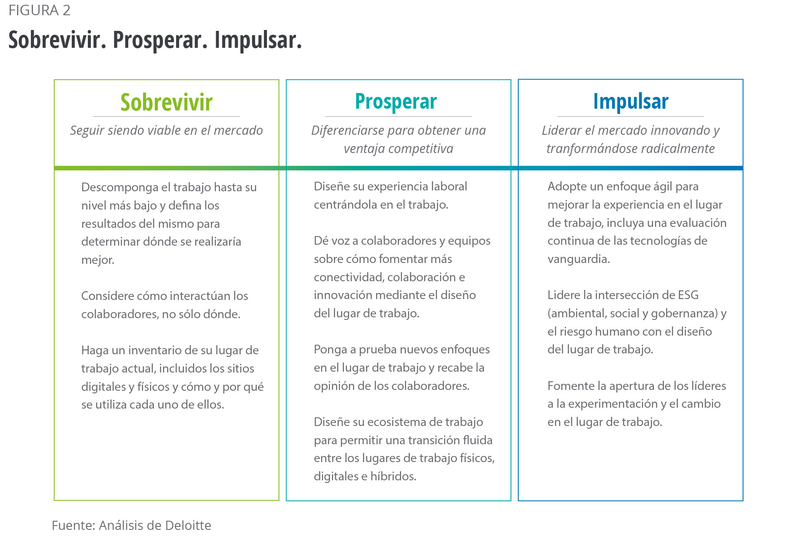

> **Descripción de la imagen** — La imagen es un diagrama conceptual estructurado en tres columnas que presenta un marco estratégico dividido en tres pilares: Sobrevivir, Prosperar e Impulsar.
>
> Cada columna contiene una definición principal y una serie de puntos clave o acciones asociadas a ese concepto.
>
> **1. Columna "Sobrevivir" (Fondo verde):**
> *   **Definición:** Seguir siendo viable en el mercado.
> *   **Acciones:** Decomponer el trabajo para definir resultados, considerar la interacción entre colaboradores, y hacer un inventario del lugar de trabajo actual (sitios digitales y físicos).
>
> **2. Columna "Prosperar" (Fondo azul claro):**
> *   **Definición:** Diferenciarse para obtener una ventaja competitiva.
> *   **Acciones:** Diseñar la experiencia laboral, dar voz a colaboradores sobre conectividad, colaboración e innovación, poner a prueba nuevos enfoques y diseñar un ecosistema de trabajo que permita una transición fluida entre lugares físicos, digitales e híbridos.
>
> **3. Columna "Impulsar" (Fondo azul oscuro):**
> *   **Definición:** Liderar el mercado innovando y transformándose radicalmente.
> *   **Acciones:** Adoptar un enfoque ágil para mejorar la experiencia, liderar la intersección de ESG (ambiental, social y gobernanza) y el riesgo humano con el diseño del lugar de trabajo, y fomentar la apertura de los líderes a la experimentación y al cambio.

30
### El camino a seguir

Tendencias Globales de Capital Humano 2023
### De cara al futuro

El lugar de trabajo es esencial, pero en la relación

entre el trabajo y el lugar de trabajo, es el trabajo el

que tiene que llevar la iniciativa. El lugar de trabajo

debe convertirse en un facilitador del trabajo en sí

mismo; debe centrarse en los resultados o el valor

alineados con la estrategia empresarial. Más allá

del valor inmediato del trabajo, un enfoque

estratégico del lugar de trabajo también puede

crear beneficios ESG “descendentes”. Por ejemplo,

reducir la cantidad de espacio físico de oficina de

una organización puede reducir su huella de

carbono; dar a los colaboradores más libertad para

elegir qué días trabajar a distancia podría apoyar

los resultados de la DEI al proporcionar

flexibilidad a los cuidadores.

A través del diseño del lugar de trabajo, las

organizaciones tienen la oportunidad de mejorar

su marca, atraer talento y elevar los resultados del

trabajo. Y todo empieza con una pregunta clave:

“¿Cómo podemos diseñar el lugar de trabajo para

apoyar mejor el propio trabajo?”. Las

organizaciones que ponen el trabajo en el centro de

sus esfuerzos de diseño del lugar de trabajo

tendrán la mejor oportunidad de lograr resultados

superiores. Como ocurre con otras tendencias del

informe de este año, las necesidades del trabajo y

las preferencias de los colaboradores seguirán

cambiando, lo que exigirá que las organizaciones

sigan experimentando, escuchando

y evolucionando.

---

<!-- página 33 -->
### 31
### Agradecemos a Martin Kamen, Tara Mahoutchain y Nate Paynter por sus contribuciones en el

análisis para coescribir el capítulo de “Activar el futuro del lugar de trabajo” de las Tendencias Globales

de Capital Humano de 2023.
### Agradecemos a Trish Celano (AdventHealth) y Neil Walker-Neveras (M&T Bank) por sus

contribuciones en el análisis para coescribir el capítulo de “Activar el futuro del lugar de trabajo” de las

Tendencias Globales de Capital Humano de 2023.
### Agradecemos a Caroline Kelson, Michael McLaughlin y Avalon Potter por sus contribuciones en el

análisis para coescribir el capítulo de “Activar el futuro del lugar de trabajo” de las Tendencias Globales

de Capital Humano de 2023.
## Notas finales

1.
ADP Research Institute, “ADP Research Institute® reveals pandemic-sparked shift in workers’ priorities

and expectations in new global study,” Abril 25, 2022.

2.
Forbes Insights, Empowering the firstline workforce: Technology, autonomy and information sharing deliver

growth to forward-thinking organizations, accedido el 12 de Diciembre, 2022.

3	.
Janet Pogue McLaurin, “How younger workers’ preferences and workstyles will define the future workplace,”

Gensler, Octubre 7, 2021.

4.
Elisabeth Buchwald, “‘Return is the wrong word. That world is gone’: Unilever chief HR officer foresees a new,

flexible era for office workers post-COVID,” Unilever, Octubre 16, 2021.

5.
Brian Caulfield, “NVIDIA, BMW blend reality, virtual worlds to demonstrate factory of the future,” NVIDIA,

Abril 13, 2021.

6.
Vlad Savov y Mia Glass, “Robot arms are replacing shelf stockers in Japan’s stores,” Bloomberg,

Agosto 10, 2022.

7.
Trish Celano, chief nursing officer, AdventHealth, entrevista con autores.

8.
Neil Walker-Neveras, chief talent officer, M&T Bank, entrevista con autores.

9.
Gartner, “Gartner predicts 25% of people will spend at least one hour per day in the metaverse by 2026,”

comunicado de prensa, Febrero 7, 2022.

10.	 Chris Teale, “Some companies are starting to embrace the metaverse. Many tech employees are interested

in doing certain work tasks in virtual reality,” Morning Consult, Mayo 31, 2022.
## Agradecimientos

Activando el futuro del lugar de trabajo

---

<!-- página 34 -->

> **Descripción de la imagen** — Es una ilustración conceptual que representa la colaboración o la conexión de personas. En el centro de la imagen se encuentran dos manos estrechándose en un apretón de manos.
>
> Alrededor del apretón de manos, hay múltiples fotografías o retratos pequeños de personas dispersos. Estos retratos están conectados entre sí y con las manos centrales mediante líneas luminosas y anillos de energía de color púrpura y rosa brillante, sugiriendo una red o un flujo de comunicación. El diseño general es abstracto y digital, con efectos de luz que resaltan la interconexión de los elementos.

32
32
## A

UNQUE LAS ORGANIZACIONES llevan

mucho tiempo tratando de aprovechar el

valor de los datos de los colaboradores,

muchas siguen empeñándose en sacar el máximo

partido de la información que están recopilando.

Mientras tanto, muchos colaboradores siguen sin

comprender qué datos se recopilan y cómo se

utilizan, y obtienen pocos beneficios de su uso.

Estos retos no han hecho más que aumentar a

medida que las tecnologías recopilan y analizan

con mayor facilidad cantidades crecientes de datos

de los colaboradores, y las habilidades y

capacidades necesarias para aprovechar esta

información que evoluciona con la misma rapidez.

Además de la información tradicional, como datos

demográficos, resultados de encuestas y métricas

de desempeño, las organizaciones recopilan ahora

datos sobre las habilidades, comportamientos e

interacciones de los colaboradores (tanto dentro

como fuera del lugar de trabajo). Este conjunto de

datos en expansión se está volviendo más valioso a
## Negociando los datos de
## los colaboradores
## Organizaciones y colaboradores se disputan el control de los datos
## de los colaboradores cuando deberían centrarse en los beneficios
## mutuos
## Coescrito por Martin Kamen, Tara Mahoutchian, y Nate Paynter.

A medida que las organizaciones siguen ampliando los datos de los colaboradores que recopilan -datos
sobre comportamiento, comunicaciones, conexiones sociales e incluso pulsaciones de teclas y clics del
ratón-, está surgiendo una negociación sobre quién controla esos datos y cómo se utilizan. La clave
del éxito es encontrar formas de utilizar los datos de los colaboradores que beneficien tanto a las
organizaciones como a los colaboradores, incluso aunque la normativa siga evolucionando.

---

<!-- página 35 -->

33
33

medida que las organizaciones lo consideran cada

vez más como un activo estratégico para

fundamentar las decisiones clave de negocio y de

personal, y mejoran sus capacidades analíticas en

consecuencia para cosechar su valor. Christopher

Westcott, líder de experiencia de las personas de la

industria financiera, destacó el poder de los datos

de los colaboradores para transformar el negocio

cuando dijo: “Ya no tenemos que hacer conjeturas.

Tenemos la oportunidad de recopilar información

sobre las aspiraciones, habilidades y capacidades

individuales, y sobre dónde necesitamos más

ayuda en la organización. Las nuevas herramientas

y tecnologías ponen esos datos a nuestro alcance, y

los utilizaremos para crear planes más eficaces

para el personal. Y lo que es más importante,

utilizaremos estos datos para ayudar a las personas

a ver trayectorias profesionales significativas de

una forma que nunca habíamos logrado”.1

En una era de crecientes organizaciones en donde

los colaboradores tienen más opciones, poder e

influencia que nunca, están empezando a luchar

por un mayor grado de control sobre sus datos, así

como por obtener beneficios mutuos de su uso. Al

igual que en su vida personal, los colaboradores

optan por compartir datos cuando les aportan valor

(por ejemplo, la aplicación que guía sus

entrenamientos) y deciden no compartirlos cuando

les preocupa cómo se utilizan (por ejemplo, cuando

los clientes rechazan las cookies de sitios en los que

no confían). Esta mentalidad es cada vez más

evidente también en su vida profesional. Según un

estudio reciente publicado en Harvard Business

Review, el 90% de los colaboradores están

dispuestos a dejar que sus jefes recopilen y utilicen

datos sobre ellos y su trabajo, pero sólo si les

beneficia de alguna manera.2

Bien utilizados, los datos de los colaboradores

pueden reportar grandes beneficios tanto a las

organizaciones como a los propios colaboradores.

Sin embargo, tanto los colaboradores como los

ejecutivos siguen preocupados por la vigilancia en

el lugar de trabajo y el uso responsable de los datos.

El mismo estudio de Harvard Business Review

señalaba que sólo el 30% de los ejecutivos cuyas

empresas utilizan datos de los colaboradores

afirmaban estar muy seguros de que los utilizan de

forma responsable.3

El panorama normativo complica este debate en

todo el mundo. En Europa, hay buenas noticias

para los colaboradores, ya que el Reglamento

General de Protección de Datos (RGPD) protege a

los colaboradores de la UE estableciendo estrictos

requisitos legales para el tratamiento de datos.

Restringe los tipos de datos claros de los

colaboradores que pueden recopilarse y cómo se

utilizan dichos datos. En Estados Unidos, las

empresas suelen tener un mayor margen de

maniobra para recopilar y utilizar los datos de los

colaboradores. En Asia-Pacífico, los ejemplos

indican que los organismos estatales son los

árbitros de los datos de los colaboradores. El

Ministerio de Trabajo de Singapur recopila y es

propietario de todos los datos sobre el mercado

laboral de Singapur, y los aprovecha para mejorar

el acceso de las organizaciones a los colaboradores

y mejorar las prácticas de empleo y la experiencia

en el lugar de trabajo.4

Negociando los datos de los colaboradores

---

<!-- página 36 -->

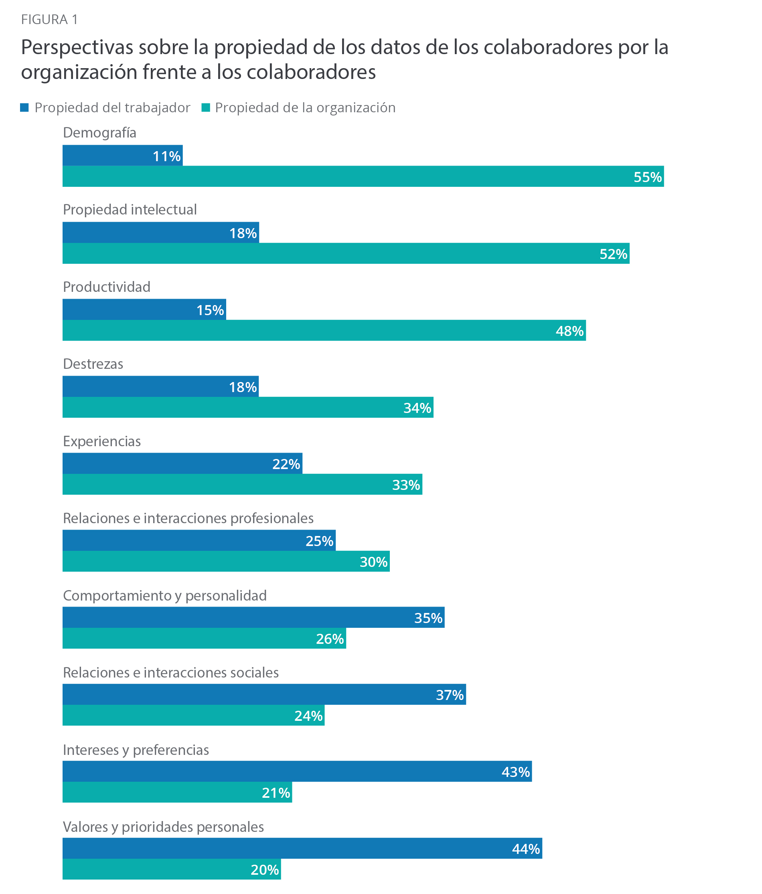

> **Descripción de la imagen** — La imagen es un gráfico de barras horizontales que compara la propiedad de diferentes tipos de datos de colaboradores entre dos entidades: "Propiedad del trabajador" (representada en color azul/verde oscuro) y "Propiedad de la organización" (representada en color verde azulado).
>
> El gráfico muestra las perspectivas sobre la propiedad de los datos según diversas categorías. A continuación, se detallan las distribuciones porcentuales para cada categoría:
>
> 1.  **Demografía:** La propiedad de la organización es del 55%, mientras que la propiedad del trabajador es del 11%.
> 2.  **Propiedad intelectual:** La propiedad de la organización es del 52%, frente al 18% del trabajador.
> 3.  **Productividad:** La propiedad de la organización es del 48%, y la propiedad del trabajador es del 15%.
> 4.  **Destrezas:** La propiedad de la organización es del 34%, mientras que la propiedad del trabajador es del 18%.
> 5.  **Experiencias:** La propiedad de la organización es del 33%, frente al 22% del trabajador.
> 6.  **Relaciones e interacciones profesionales:** La propiedad de la organización es del 30%, y la propiedad del trabajador es del 25%.
> 7.  **Comportamiento y personalidad:** La propiedad del trabajador es mayor, con un 35%, frente al 26% de la organización.
> 8.  **Relaciones e interacciones sociales:** La propiedad del trabajador es mayor, con un 37%, frente al 24% de la organización.
> 9.  **Intereses y preferencias:** La propiedad del trabajador es significativamente mayor, con un 43%, frente al 21% de la organización.
> 10. **Valores y prioridades personales:** La propiedad del trabajador

34
34
### SEÑALES: ESTA TENDENCIA SE APLICA A USTED SI...

•	 Sus colaboradores se sienten vigilados en todo momento, lo que aumenta el estrés, la
insatisfacción laboral, la rotación y la falta de confianza

•	 Las conversaciones sobre el uso y el valor de los datos de los colaboradores están aumentando
en las negociaciones sindicales, en los foros de escucha y participación de los colaboradores y en
otros foros de toma de decisiones

•	 Los colaboradores están compartiendo datos más fácilmente fuera de la organización (por
ejemplo, LinkedIn, Glassdoor), pero son reticentes a proporcionarlos a través de los canales de la
organización debido a una percepción de falta de beneficio para ellos

•	 Su organización se enfrenta a retos cada vez mayores y a la presión de los organismos
reguladores en relación con la notificación, la privacidad y el mantenimiento de los datos

Tendencias Globales de Capital Humano 2023

---

<!-- página 37 -->

35
35

A medida que más gobiernos comienzan a exigir a

las empresas que informen sobre datos

medioambientales, sociales y de gobernanza (ESG)

(como la salud en el lugar de trabajo y la igualdad

salarial), este nivel de requisitos de datos sensibles

intensificará la negociación sobre el control de los

datos, específicamente en lo que respecta a la

recopilación y el uso de los datos de los

colaboradores y el beneficio mutuo. Las

organizaciones pueden ayudar a aliviar los temores

de los colaboradores  iniciando de forma proactiva

conversaciones sobre los datos  y los beneficios con

su fuerza de trabajo.
### La brecha de preparación

Según los datos de la encuesta Tendencias Globales

de Capital Humano de Deloitte 2023, la gran

mayoría de los líderes empresariales (83%) cree

que aprovechar los datos de los colaboradores para

crear beneficios tanto para la organización como

para sus colaboradores (a la vez que se genera

confianza en cómo se utilizan los datos de los

colaboradores) es importante o muy importante

para el éxito de sus organizaciones. Sin embargo,

sólo el 19% cree estar muy preparado para hacerlo.

Cuando se les pidió que identificaran los

principales obstáculos para obtener valor de los

datos de los colaboradores, el 27% de los

encuestados citaron la cultura, convirtiéndola en la

barrera más común. Sin embargo, la “cultura”

como barrera puede ser un sinónimo de valores

desalineados o desacuerdos sobre si se deben

utilizar los datos de los colaboradores, cómo o

cuándo.
### Los nuevos fundamentos

Generar confianza y buscar beneficios

mutuos. El éxito exigirá crear una relación de

confianza entre los colaboradores y su organización,

gobierno o un tercero para utilizar los datos de

forma mutuamente beneficiosa. Estamos viendo

señales de que las organizaciones están empezando

a tomar decisiones que son mutuamente

beneficiosas. Cuando en la encuesta Tendencias

Globales de Capital Humano de Deloitte 2023 se

les pidió que identificaran los principales

beneficios del enfoque de su organización respecto

al uso de los datos de los colaboradores, la

respuesta más destacada fue el aumento del

compromiso de los colaboradores y el bienestar de

la fuerza de trabajo. Aunque es posible que las

organizaciones quieran controlar los datos de sus

colaboradores, en última instancia muchas los

utilizan en beneficio mutuo. Por ejemplo, cuando

las principales repercusiones de la pandemia

remitieron, algunas organizaciones utilizaron los

datos de interacción de los colaboradores para

realizar análisis de redes e informar sobre el

desarrollo de prácticas de trabajo híbridas.5

Además, varias empresas de nueva creación están

aprovechando la inteligencia artificial (IA) para

identificar patrones basados en las interacciones y

comunicaciones de los colaboradores y asesorar a

las organizaciones sobre los riesgos de agotamiento

(burnout).6

Negociando los datos de los colaboradores

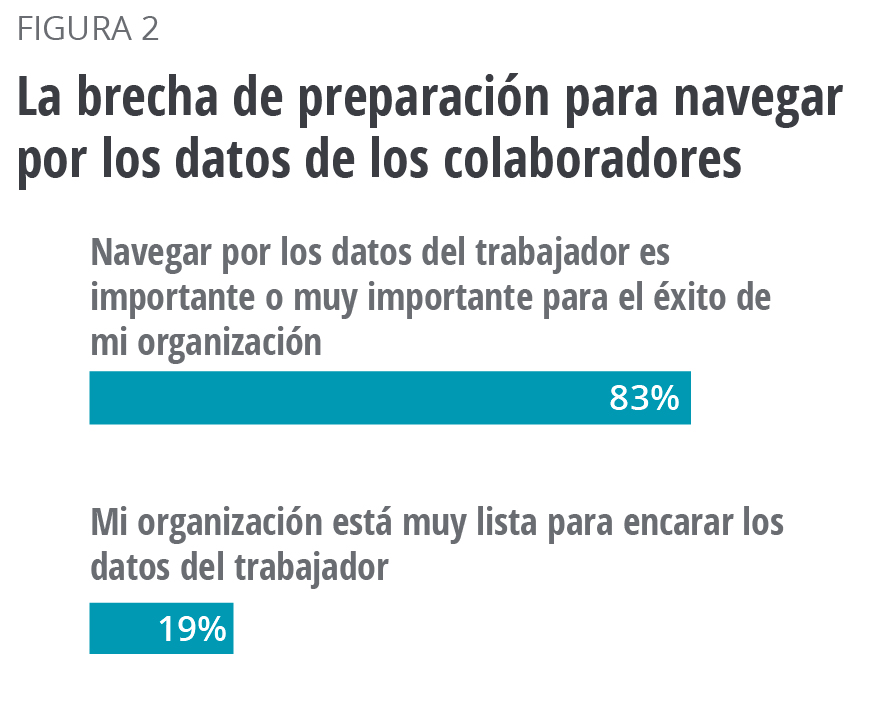

> **Descripción de la imagen** — La figura 2 es una visualización que compara dos porcentajes relacionados con la preparación de una organización para manejar datos de colaboradores.
>
> Se presentan dos indicadores:
> 1. Un indicador superior muestra el 83%, asociado a la afirmación sobre la importancia de navegar por los datos del trabajador para el éxito de la organización.
> 2. Un indicador inferior muestra el 19%, asociado a la afirmación de que la organización está muy lista para encarar los datos del trabajador.

Fuente: Encuesta Tendencias Globales de Capital Humano 2023

---

<!-- página 38 -->

36
36

Los datos también pueden ayudar a los

colaboradores a mejorar su desempeño, como

analizamos con más detalle en nuestra tendencia

“Impulsando el impacto humano - tecnología”. Una

empresa tecnológica global está utilizando

herramientas de IA cognitiva para analizar los

datos de los colaboradores generados por sus

equipos de ventas globales con el fin de determinar

por qué algunos vendedores obtienen mejores

resultados que otros y hacer recomendaciones para

mejorar los conocimientos y las tasas de éxito de su

fuerza de ventas.7 Al identificar patrones de

comportamiento que los humanos pasan por alto,

la IA puede recomendar el mejor curso de acción o

incluso módulos de aprendizaje rápido que

mejoren el éxito de sus vendedores.

Aceptar el deseo de los colaboradores de

controlar sus datos. A medida que los

colaboradores reconocen el valor de sus datos

personales, esperan tener más control sobre ellos e

influir en cómo se utilizan. Según la encuesta

Tendencias Globales de Capital Humano de

Deloitte 2023, una mayoría significativa de

organizaciones (61%) describe su actual estructura

de propiedad de los datos como compartida o

propiedad de los colaboradores. Esto representa un

alejamiento significativo del modelo tradicional de

control total por parte de la organización. Las

organizaciones deben aceptar esta nueva realidad

en lugar de aferrarse a su antiguo modelo de

control de todos los datos que recopilan de

los colaboradores.

Utilizar los datos ampliados de los

colaboradores para crear más valor, que

sea mutuo. Afortunadamente, la mayor

disponibilidad de datos de los colaboradores abre

nuevas oportunidades para crear valor empresarial

para todos los implicados. Se puede aprender de la

trayectoria de los datos de clientes, donde, a

medida que se comenzó a disponer de más datos

de clientes, las organizaciones desarrollaron

estrategias y análisis sofisticados para generar

perspectivas empresariales profundas y valiosas a

partir de esa información. En la actualidad, los

directivos que han respondido a la encuesta

Tendencias Globales de Capital Humano de

Deloitte 2023 afirman que los datos de los

colaboradores más valiosos para su organización

son los datos básicos de productividad (es decir,

datos para hacer que las personas trabajen más y/o

de forma más inteligente). Sin embargo, en los

próximos 2-4 años, se espera que los datos más

avanzados adquieran valor, como los relacionados

a  comportamiento, personalidad y los datos sobre

relaciones e interacciones profesionales. Mientras

eso sucede, el aumento del número de

colaboradores obligará a las organizaciones a

perfeccionar sus métodos y a equilibrar los

conocimientos orientados a la empresa con otros

que beneficien a los colaboradores.

Desde el punto de vista de la tecnología y las

operaciones, las organizaciones deben basarse en

su enfoque actual de establecer datos limpios y

exactos para encontrar formas de obtener nuevas

perspectivas planteándose preguntas diferentes,

como “¿Cómo evaluamos el riesgo y la recompensa

y decidimos qué datos recopilar?” y “¿Estamos

utilizando nuestros datos en todo su potencial para

servir a nuestro negocio y a nuestros colaboradores

por igual?”

Para lograr un cierto grado de confianza y control

de los colaboradores sobre los datos, las

organizaciones deben diseñar una arquitectura de

datos global que incluya políticas de datos

laborales transparentes, accesibles y éticos (por

ejemplo, datos biométricos). Además, deben

reconocer y recompensar a los equipos (por

ejemplo, aprovechando blockchain) por utilizar los

datos de forma que mejoren el desempeño

individual y del equipo. Esto ayuda a reforzar el

análisis de datos como competencia básica.

Tendencias Globales de Capital Humano 2023

---

<!-- página 39 -->

37
37
### Experimentos actuales:
### ¿Qué están explorando las
### principales organizaciones?

•	 Schlumberger utiliza la IA para ayudar a los

colaboradores de la industria manufacturera a

mejorar su desempeño y reducir su cansancio.8

Su Centro de Fiabilidad y Eficiencia de Denton

(Texas) recopila, agrega y anonimiza datos de

vídeo y utiliza la IA para buscar patrones. Los

datos nunca se utilizan para supervisar el

trabajo de los individuos; sin embargo,

cualquier colaborador puede optar de forma

privada por ver sus propios datos de

desempeño. Los datos generan beneficios

valiosos para los colaboradores y la

organización; por ejemplo, la empresa los ha

utilizado para dar a los colaboradores

descansos más frecuentes pero más cortos para

combatir la fatiga que merma la productividad.

•	 Telstra, la mayor empresa de

telecomunicaciones de Australia, ha dado a sus

colaboradores la posibilidad de editar sus

propia información profesional.9 La empresa

mantiene un sitio interno llamado MyCareer,

que se utiliza para almacenar datos sobre la

carrera profesional y las aptitudes, y permite a

la organización adecuar más eficazmente el

talento al trabajo. Los colaboradores pueden

gestionar sus propios datos y cuestionar

cualquier dato incorrecto o incompleto.

•	 ABN AMRO se ha propuesto reunir todos los

datos de RRHH y de la empresa para crear un

entorno integrado de TI y datos que permita el

machine learning y los avisos a los

colaboradores sobre temas relacionados con su

carrera profesional, como el desarrollo o las

posiciones vacantes.10 El banco global con sede

en los Países Bajos también está reescribiendo

su declaración de privacidad para garantizar

una mayor transparencia a los colaboradores.

Todos los colaboradores pueden acceder a un

tablero que incluye datos sobre la experiencia

de los colaboradores, la diversidad, la fuerza de

trabajo, la adquisición de talento y el

aprendizaje; este tablero también lo utilizan los

directivos para tomar decisiones sobre su fuerza

de trabajo.

Negociando los datos de los colaboradores

---

<!-- página 40 -->

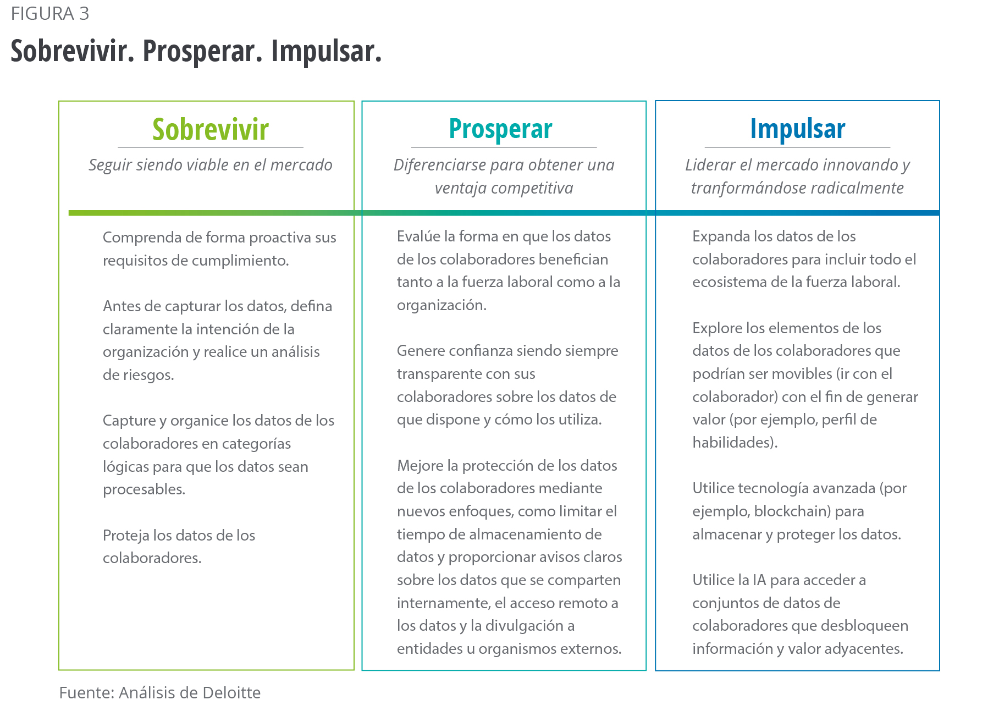

> **Descripción de la imagen** — La imagen es un diagrama conceptual estructurado en tres columnas que presenta un marco estratégico dividido en tres pilares: Sobrevivir, Prosperar e Impulsar.
>
> Cada columna contiene un título principal, una definición breve y una lista de estrategias o acciones detalladas.
>
> 1.  **Sobrevivir:** Se centra en seguir siendo viable en el mercado. Las acciones enumeradas incluyen comprender los requisitos de cumplimiento, definir la intención organizacional y realizar análisis de riesgos antes de capturar datos, organizar los datos de colaboradores en categorías procesables y proteger los datos de los colaboradores.
> 2.  **Prosperar:** Se enfoca en diferenciarse para obtener una ventaja competitiva. Las acciones detalladas incluyen evaluar la forma en que los datos benefician a la fuerza laboral, generar confianza mediante la transparencia sobre los datos, mejorar la protección de los datos mediante nuevos enfoques y limitar el tiempo de almacenamiento, y proporcionar avisos claros sobre el uso compartido de datos con entidades externas.
> 3.  **Impulsar:** Se centra en liderar el mercado innovando y transformándose radicalmente. Las acciones enumeradas incluyen expandir los datos de los colaboradores para incluir todo el ecosistema de la fuerza laboral, explorar elementos de datos móviles, utilizar tecnología avanzada (como blockchain) para almacenar y proteger datos, y usar inteligencia artificial (IA) para acceder a conjuntos de datos que desbloqueen información y valor.
>
> El diagrama establece una relación paralela entre estos tres conceptos estratégicos.

38
38
### El camino a seguir
### De cara al futuro

Más temprano destacamos las señales negativas
que sugieren que su enfoque actual de los datos
de los colaboradores podría no estar funcionando.
Por el contrario, aquí tiene usted algunas señales
positivas que le ayudarán a saber si el nuevo
enfoque de su organización para gestionar
los datos de los colaboradores es un éxito:

•	 Los datos de los colaboradores se utilizan de

forma responsable y los colaboradores

consienten ampliamente a su uso para fines

internos y comerciales y sienten que se

benefician de ello.

•	 Su organización puede utilizar los datos de los

colaboradores con facilidad y generar

información valiosa a partir de ellos.

•	 Existe una creciente diversidad de datos para

aprovechar en todo su ecosistema de la

fuerza laboral.

•	 Como líder empresarial, usted se basa cada vez

más en los datos de los colaboradores para

orientar el propósito y la dirección de su

organización y las estrategias de personal.

Tendencias Globales de Capital Humano 2023

---

<!-- página 41 -->

39
39

En última instancia, las organizaciones, los
colaboradores, los sindicatos y las administraciones
públicas tendrán que convertirse en socios
interesados para obtener beneficios tangibles de
la recopilación y el intercambio de datos de los
colaboradores, no sólo beneficios empresariales
derivados del seguimiento del desempeño (como
el aumento de la productividad y la reducción del
incumplimiento de las normas), sino beneficios
más amplios que promuevan el bienestar mutuo.

Dado que el volumen y el alcance de los datos
de los colaboradores aumenta cada día, la
cuestión del control no va a desaparecer. Las
organizaciones que aborden la cuestión más
temprano que tarde -encontrando formas de crear
beneficios mutuos tanto para ellas como para
sus colaboradores- tendrán una clara ventaja a la
hora de crear valor y generar ideas innovadoras
a partir de los datos de los colaboradores.

Negociando los datos de los colaboradores

---

<!-- página 42 -->
### 40
### Agradecemos a Martin Kamen, Tara Mahoutchain y Nate Paynter por sus contribuciones en el

análisis para coescribir el capítulo de “Negociación de datos de los trabajadores” de las Tendencias

Globales de Capital Humano de 2023.
### Agradecemos a Christopher Westcott por sus contribuciones en el análisis para coescribir el capítulo

de “Negociación de datos de los trabajadores” de las Tendencias Globales de Capital Humano de 2023.
### Agradecemos a Caroline Kelson, Michael McLaughlin y Avalon Potter por sus contribuciones en el

análisis para coescribir el capítulo de “Negociación de datos de los trabajadores” de las Tendencias

Globales de Capital Humano de 2023.
### 40
## Notas finales

1.
Entrevista con autores.

2	.
Ellyn Shook, Eva Sage-Gavin, y Susan Cantrell, “How companies can use employee data responsibly,” Harvard
Business Review, Febrero 15, 2015.

3.
Ibid.

4.
Ministerio de Manpower, Singapur, “Labour Relations and Workplaces Division,” accedido en Diciembre 9,
2022.

5.
Rob Cross and Peter Gray, “Optimizing return-to-office strategies with organizational network analysis,” MIT
Sloan Management Review, Junio 29, 2021.

6.
Sam Blum, “‘Burnout tech’ seeks to identify signs of workers’ mental distress by reading Slack messages and
email,” HR Brew, Mayo 7, 2022.

7.
Basado en observaciones hechas por Deloitte en esta organización.

8.
SLB, “Digital equipment monitoring with OneStim,” Mayo 1, 2018.

9.
Edmund Tadros, “Telstra already building its workforce of the future with MyCareer,” Financial Review, Marzo
22, 2018.

10.	 	 Patrick Coolen, “8 big tickets for people analytics (2022),” LinkedIn, Octubre 14, 2021.
## Agradecimientos

Tendencias Globales de Capital Humano 2023

---

<!-- página 43 -->

> **Descripción de la imagen** — Es una ilustración de estilo gráfico que muestra un grupo de seis personas diversas de pie en un entorno exterior con un fondo azul y líneas que sugieren un camino o carretera.
>
> Las figuras están dispuestas horizontalmente, desde la izquierda hacia la derecha. El grupo incluye hombres y mujeres de diferentes etnias y vestimentas. Cada persona sostiene un cartel rectangular de color blanco. La figura más a la derecha es una mujer vestida con un atuendo verde y un pañuelo (hiyab), y está sentada en una silla de ruedas.

41
41
## Potenciando el involucramiento
## de los colaboradores
## Las organizaciones impulsan el valor y refuerzan su relación con
## las colaboradores aprovechando la creciente influencia de estos
### Coescrito por Karen Weisz.
## C

OMO SE SEÑALA en el escenario de “El

trabajo como moda“ sobre el que escribimos

en nuestro informe Tendencias globales del

capital humano 2021 de Deloitte, el

involucramiento de los colaboradores está en

crecimiento.1 En este futuro, los colaboradores

tienen más opciones e influencia sobre el trabajo

que realizan y sobre las organizaciones para las que

trabajan. En los últimos tiempos, este tema ha sido

objeto de atención en el contexto de la

reincorporación al trabajo, ya que las

organizaciones interpretan erróneamente que el

involucramiento de los colaboradores se refiere

únicamente a las preferencias en cuanto al lugar de

trabajo, y las organizaciones intentan expresar su

poder dictando lo que debe significar la

“flexibilidad” para la fuerza laboral.2

En realidad, el involucramientos de los

colaboradores tiene múltiples dimensiones. Una de

ellas es la autodeterminación de los colaboradores,

que desean tener opciones

Hoy en día, los colaboradores tienen más opciones e influencia que nunca, y cada vez están más
dispuestos a utilizar esa nueva influencia para incidir sobre las acciones y programas de su organización.
Los líderes de las empresas deben aprovechar la pasión y la energía de los colaboradores para crear
beneficios mutuos para todos, no solo para sus colaboradores y su organización, sino para el mundo en
su conjunto.

---

<!-- página 44 -->

42
42

significativas e influir en el trabajo que realizan (y

cómo, cuándo y dónde trabajan). Los

colaboradores que renunciaron a un empleo en

2021 dijeron que la falta de oportunidades de

promoción (63%) y la falta de respeto en el trabajo

(57%) fueron las razones por las que renunciaron.3

Otra es el activismo de los colaboradores, que

desean ser valorados, estrategias, políticas y

acciones de sus organizaciones estén en

consonancia con sus propios valores personales en

una amplia gama de cuestiones, desde las prácticas

medioambientales y el bien social hasta la igualdad

racial y de género, y todo lo que esto incluya. Una

cultura corporativa tóxica, por ejemplo, es 10,4

veces más potente que la retribución a la hora de

predecir la tasa de abandono de una empresa en

comparación con su sector.4 Los principales

elementos que contribuyen a las culturas tóxicas

son la falta de promoción de la diversidad, la

equidad y la inclusión (DEI), el sentimiento de

falta de respeto de los colaboradores y el

comportamiento poco ético.5

Este aumento de la simbiosis con los colaboradores

se debe a una confluencia de algunos factores:

•	 Escasez de talento y fuerza laboral. Los

colaboradores de hoy tienen más opciones

laborales y dependen menos de sus

organizaciones, lo que los anima a exigir lo que

quieren. Esta expectativa de involucramiento e

influencia se mantendrá, independientemente

de las fluctuaciones en la oferta de fuerza

laboral. Esto se ve respaldado por los datos de

la encuesta de este año sobre la generación Z y

los millennials,6 según la cual un tercio de los

encuestados dejaría su trabajo incluso sin tener

otro disponible. Mediante la elaboración de

estrategias y prácticas de personal que

incorporen la simbiosis en su diseño, las

organizaciones pueden acceder al talento que

necesitan y establecer relaciones más sólidas y

duraderas con sus colaboradores.

•	 Aumento de la conciencia social. La

concienciación del público y la acción han

aumentado considerablemente en una amplia

gama de cuestiones sociales, políticas,

medioambientales y económicas, y la gente

siente un mayor empoderamiento y

responsabilidad para defender sus convicciones.

Dos de cada cinco jóvenes de la Generación Z y

de la generación de los millennials han

rechazado un trabajo o una tarea porque no se

ajustaba a sus valores en relación con el

impacto social y medioambiental, y con las

culturas diversas e inclusivas.7 Por el contrario,

las organizaciones que se han comprometido

con su propósito han observado una mejora de

los beneficios: el 50% de los encuestados en

nuestro estudio Tendencias globales de Capital

Humano Deloitte 2023 señalaron un aumento

de la retención y el bienestar de

los colaboradores.

•	 Avances tecnológicos. Las tecnologías

digitales facilitan a los colaboradores

independientes la creación de valor sin estar

atados a una organización o un puesto de

trabajo concreto. Además, permiten a las

personas conectarse y comunicarse sobre temas

en tiempo real a escala global y proporcionan a

las organizaciones valiosos conocimientos sobre

lo que es importante para sus colaboradores.

Por ejemplo, las redes sociales sirven tanto de

microscopio como de megáfono, amplificando

las voces para informar de las decisiones que

toman las organizaciones y hacerlas

responsables de sus acciones a una escala

mayor y más pública.

•	 Bajo impacto estatal8. Cuando los gobiernos

no ofrecen apoyo a los colaboradores - por

ejemplo, a través de políticas y normativas

públicas para proteger el empleo y los salarios,

mayores redes de seguridad social y

prestaciones, mejor acceso a la educación o

inversión en la reconversión profesional -, los

colaboradores esperan que las organizaciones

Tendencias Globales de Capital Humano 2023

---

<!-- página 45 -->

43
43

Potenciando el involucramiento de los colaboradores
### SEÑALES: ESTA TENDENCIA SE APLICA A USTED SI...

•	 Los colaboradores no se involucran a pesar de que se les escucha cada vez más y de lo que parece
un cambio continuo de programas y políticas laborales

•	 Su organización se compara con los competidores y los referentes del sector, pero sigue teniendo
dificultades para resolver los retos más importantes para su estrategia empresarial y su fuerza de
trabajo

•	 Sus resultados empresariales (financieros, de reputación, etc.) se están viendo afectados por el
aumento de las protestas y el activismo de los colaboradores debido a la falta de conexión entre
las prioridades de la organización y las de los colaboradores

se lo proporcionen. Al hacerlo, las

organizaciones pueden aumentar el

involucramiento y la retención.

Las manifestaciones del involucramiento del

colaborador varían según el país y la región debido

a las diferencias en las leyes, el comportamiento

social, las normas culturales y la relación entre los

colaboradores y las organizaciones. Sin embargo, a

pesar de las variaciones locales y regionales, la

tendencia general es que los colaboradores están

adquiriendo más influencia y capacidad de elección

que nunca, y están dispuestos a utilizarlas para

moldear y dirigir el comportamiento de la empresa,

o simplemente para determinar su nivel de

compromiso y productividad, como demuestra el

fenómeno de las “renuncias silenciosas”.9

Esta tendencia mundial está ejerciendo una

importante presión sobre las organizaciones para

que alineen sus valores, estrategias, políticas y

acciones con los valores personales de sus

colaboradores (individual y colectivamente) y con

los valores de la sociedad en general. Aunque esto

puede suponer un reto, dado que diferentes

colaboradores y diferentes partes de la sociedad

esperan cosas diferentes, los beneficios para el

colaborador, la organización y la sociedad superan

esos retos.
### La brecha de preparación

En la encuesta Tendencias Globales de Capital

Humano de Deloitte 2023, el 84% de los directivos

de las empresas encuestadas afirma que el

involucramiento de los colaboradores es

importante o muy importante para el éxito de sus

organizaciones. Sin embargo, solo el 17 %

considera que está muy preparado para abordar

esta cuestión, la segunda puntuación más baja

entre todas las tendencias encuestadas.

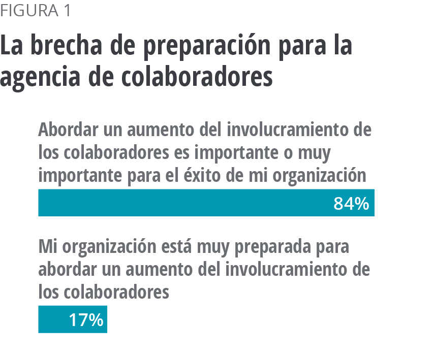

> **Descripción de la imagen** — La figura es una visualización que compara dos porcentajes relacionados con la preparación de una organización para el aumento del involucramiento de los colaboradores.
>
> Se presentan dos barras horizontales:
>
> 1.  **Barra superior:** Una barra de color azul verdoso que indica el 84%. Esta barra está asociada a la afirmación sobre la importancia de abordar un aumento del involucramiento de los colaboradores para el éxito de la organización.
> 2.  **Barra inferior:** Una barra de color azul verdoso más corta que indica el 17%. Esta barra está asociada a la afirmación sobre si la organización está muy preparada para abordar un aumento del involucramiento de los colaboradores.

Fuente: Encuesta Tendencias Globales de Capital Humano 2023

---

<!-- página 46 -->

44
44

Según la encuesta Tendencias Globales de Capital

Humano de Deloitte 2023, esta brecha está siendo

impulsada por un sesgo retrospectivo con un

enfoque en la participación impulsado por la

pandemia, como la compensación, la ubicación y

las horas de trabajo, que surgieron como las tres

áreas principales (44%). Para aprovechar

realmente la intervención y aumentar el valor, hay

que centrarse en áreas como el propósito, la voz y

el trabajo, que fueron las tres menos seleccionadas

en nuestra encuesta (16%).
### Los nuevos fundamentos

Aceptar el objetivo móvil. Aprovechar el

involucramiento de los colaboradores para obtener

un mayor valor exige reconocer que no se trata de

una moda pasajera y que prestarle atención no es

opcional. Además, los objetivos compartidos que

cree hoy con sus colaboradores no serán perennes

porque lo que es importante para la gente cambia

con frecuencia. La cocreación consiste tanto en

compartir las preguntas que se formulan como las

respuestas a las que se llega. La consecuencia es

que la cocreación de esta relación debe convertirse

en un conjunto de prácticas arraigadas entre la

organización, sus colaboradores y quienes los

representan. El estudio High-Impact Workforce

Architecture de Deloitte lo describe como el cultivo

de una “mentalidad creadora” por parte de los

colaboradores, que inculca el deseo no sólo de

adaptarse a los cambios a medida que se producen,

sino de contribuir activamente a dar forma al

futuro de la organización.10 La mentalidad de

creador beneficia al colaborador: Son más

resistentes ante el cambio en cuya creación han

participado, y son más propensos a tener un fuerte

sentimiento de pertenencia, dada la línea de visión

directa de la contribución que supone la

cocreación.11 También tiene beneficios para la

organización: el estudio Workforce Architecture

descubrió que las organizaciones que cultivan esta

mentalidad de creador tienen 1,8 veces más

probabilidades de satisfacer a los clientes y 2,8

veces más probabilidades de innovar que las que

no lo hacen.

Camino compartido, resultados

compartidos. Los colaboradores y las

organizaciones deben mantener un diálogo

continuo, compartiendo foros y resultados. Aunque

escuchar las preferencias y opiniones de los

colaboradores es un requisito previo para este

conjunto de prácticas, no es suficiente para crear

una relación significativa y de impacto. Las

organizaciones necesitan activar la contribución de

los colaboradores en los foros formales de toma de

decisiones que repercuten en los resultados

empresariales. Esta activación puede adoptar

diversas formas en función del tamaño de la

organización, la normativa y la participación de

sindicatos y comités de empresa. Este tipo de toma

de decisiones compartidas proporciona tanto

autonomía como presencia del colaborador y

mejora los resultados empresariales. Por ejemplo,

en Alemania, los comités de empresa son

obligatorios por ley para todas las empresas con

más de cinco colaboradores.12 Estos comités de

empresa tienen derechos que abarcan desde

cuestiones cotidianas, como las vacaciones y los

métodos de pago, hasta aspectos económicos,

como las inversiones de una organización, los

cierres de centros y las posibles absorciones.13

Centrarse en decisiones concretas que

respalden sus aspiraciones de relación

entre el colaborador y la organización. No es

práctico ni eficaz que las organizaciones integren la

intervención de los colaboradores en todas las

facetas del negocio. Más bien, las organizaciones

deben centrarse en integrar a los colaboradores en

los procesos y foros que ayuden a construir el tipo

de relación colaborador-organización alineada con

los valores y objetivos de la organización. Para una

organización, esto puede significar unirse en torno

a un propósito común, mientras que para otra

puede significar centrarse en el diseño del trabajo.

Tendencias Globales de Capital Humano 2023

---

<!-- página 47 -->

45
45

Potenciando el involucramiento de los colaboradores

Comprometerse a hacerlo realidad. Estas

acciones no pueden ser meras palabras para que

las organizaciones y los colaboradores logren el

beneficio mutuo mencionado al principio de esta

sección. Si los colaboradores se comprometen y las

organizaciones no integran de forma significativa

las perspectivas de los colaboradores en las

prácticas empresariales, la confianza de los

colaboradores se verá afectada y es probable que se

desvinculen. “Hacerlo realidad puede consistir en

asignar a los colaboradores tareas o iniciativas que

se ajusten a sus valores, intereses y habilidades,

convirtiendo la pasión en productividad.

Dependiendo de la relación que mantengan las

organizaciones y los colaboradores, ambas partes

podrían esperar que los colaboradores encuentren

sentido y propósito en gran medida fuera del

trabajo (escenario “el trabajo es el trabajo”14). En

este caso, “hacerlo realidad” podría significar

cocrear con el colaborador el trabajo en sí, en lugar

de centrarse en el propósito.
### Experimentos actuales

•	 Novartis ha introducido recientemente una

política de “Elección con Responsabilidad” que

permite a los colaboradores elegir cómo, dónde

y cuándo trabajar en su país de empleo.15  La

política pasa de basarse en la responsabilidad

de la aprobación por el gerente a informar al

gerente y está diseñada para optimizar tanto el

rendimiento personal como el empresarial.

•	 Haier permite la autonomía y elegir en qué

trabajar dejando que cualquier empleado se

una o cree una de sus miles microempresas, y

luego comparte la riqueza con ellos.16 Aunque el

sueldo base es modesto -a menudo no mucho

más que el salario mínimo-, los equipos que

alcanzan sus “objetivos principales” pueden

multiplicar su salario entre 5 y 10 veces. Los

equipos de primera línea tienen libertad para

dirigir sus negocios como mejor les convenga.

•	 El Estado de Massachusetts, que sigue

posicionándose como empleador preferente, ha

aumentado la flexibilidad de su lugar de trabajo

para atraer y retener talentos.17 Sus directivos y

personal gerencial averiguan continuamente

sobre las preferencias laborales de sus

colaboradores y equipos para crear horarios

híbridos que equilibren esas preferencias con

las necesidades operativas. Esta mayor

flexibilidad en el lugar de trabajo no sólo ha

dado lugar a mayores índices de retención del

personal, sino que la mejora de la comunicación

bidireccional que se inició en este entorno

híbrido ha permitido a los directivos conocer

directamente los problemas, retos y

oportunidades que enfrentan sus colaboradores.

•	 M&T Bank ha creado un programa que ofrece

a los colaboradores 40 horas de tiempo de

voluntariado remunerado para que lo dediquen

a cualquier esfuerzo que esté en consonancia

con sus pasiones.18 Este programa permite a sus

colaboradores alinear sus elecciones, acciones y

valores individuales con el propósito general de

la organización de “marcar la diferencia en la

vida de las personas.”

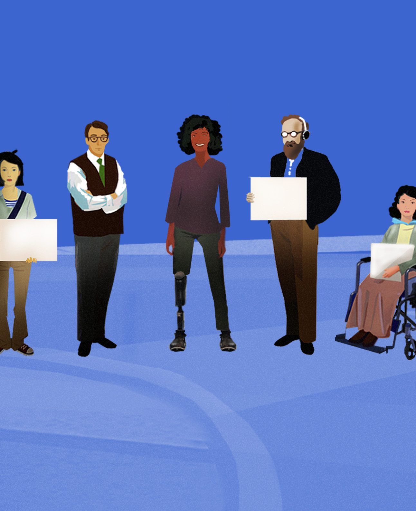

> **Descripción de la imagen** — La imagen es una ilustración de estilo caricaturesco que muestra a cinco personas de pie o sentadas sobre un fondo azul sólido.
>
> De izquierda a derecha:
> 1. Una mujer joven está de pie, vestida con ropa clara y sostiene un cartel blanco.
> 2. Un hombre está de pie, con gafas, una camisa blanca, un chaleco marrón y pantalones oscuros; tiene los brazos cruzados.
> 3. Una mujer está en el centro, con cabello rizado oscuro, vestida con una blusa morada y pantalones oscuros. Lleva una prótesis o dispositivo mecánico en su pierna izquierda.
> 4. Un hombre está de pie a la derecha, con gafas, auriculares y un traje oscuro; sostiene un cartel blanco grande con ambas manos.
> 5. Una mujer está sentada en una silla de ruedas a la extrema derecha, vestida con una blusa verde claro y sostiene una tableta o papel blanco.

---

<!-- página 48 -->

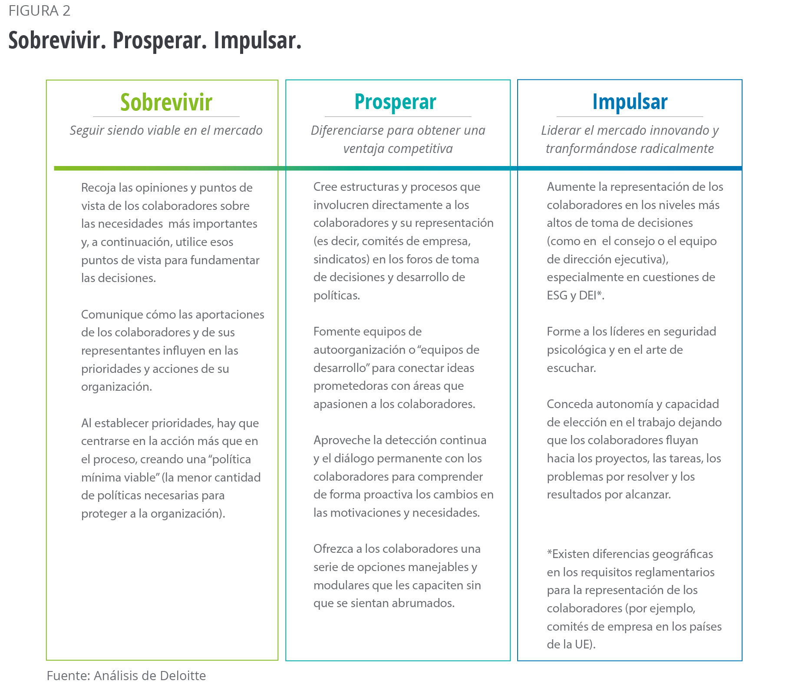

> **Descripción de la imagen** — La imagen es un diagrama conceptual estructurado en tres columnas verticales que representan un modelo de acción dividido en tres fases o pilares: Sobrevivir, Prosperar e Impulsar.
>
> Cada columna contiene un título principal y una lista de estrategias o acciones detalladas.
>
> 1.  **Columna "Sobrevivir" (fondo verde):** Se centra en seguir siendo viable en el mercado. Sus puntos clave incluyen recolectar opiniones y puntos de vista, comunicar las aportaciones de los colaboradores, establecer prioridades centradas en la acción mínima viable para proteger a la organización.
> 2.  **Columna "Prosperar" (fondo cian):** Se enfoca en diferenciarse para obtener ventaja competitiva. Sus estrategias incluyen crear estructuras y procesos que involucren directamente a los colaboradores, fomentar equipos de autoorganización y aprovechar la detección continua del diálogo con los colaboradores.
> 3.  **Columna "Impulsar" (fondo azul claro):** Busca liderar el mercado innovando y transformándose radicalmente. Sus acciones se centran en aumentar la representación de los colaboradores en niveles altos de toma de decisiones, formar líderes en seguridad psicológica y conceder autonomía y capacidad de elección a los colaboradores.
>
> El diagrama presenta un marco tripartito que conecta estas tres áreas temáticas mediante sus respectivos objetivos y estrategias.

46
46
### El camino a seguir

Tendencias Globales de Capital Humano 2023

Que los colaboradores tengan participación no

significa que haya que dejar que los colaboradores

dicten todo lo que hace la organización, ni que

haya que crear estructuras para que los

colaboradores compartan puntos de vista que

después no se tienen en cuenta (por ejemplo,

comités  con una influencia mínima). Se trata de

una colaboración bidireccional, no de una batalla

campal. Sin embargo, no es necesario un “todos

contra todos” para satisfacer el deseo de influencia

y control de los colaboradores. Lo que se necesita

es una relación abierta y respetuosa que ofrezca a

los colaboradores opciones significativas y

mutuamente beneficiosas y les permita participar

en el proceso de toma de decisiones sobre

cuestiones que afectan a la fuerza de trabajo. Los

colaboradores deben ser incluidos en las decisiones

a nivel estratégico de la organización, como la

ubicación de las instalaciones y las operaciones, y

también pueden ser incluidos en las decisiones a

nivel individual, como los horarios de trabajo.

Y aunque puede resultar tentador para los líderes

“esperar a que pase” cuando se trata de estas

decisiones, el cambio en el sentimiento de los

En última instancia, la participación  del

colaborador puede ser una potente fuente de

motivación en sí misma. Los estudios psicológicos

relacionan la autonomía con la motivación y el

comportamiento, así como con la salud física y el

bienestar general.9 Una idea clave es que dar a la

gente influencia y libertad de elección es a menudo

tan importante como las opciones reales que se les

ofrecen.
### De cara al futuro

---

<!-- página 49 -->
### 47
## Notas finales

1.
Erica Volini, The worker-employer relationship disrupted: If we’re not a family, what are we?, Deloitte Insights,

Julio 21, 2021.

2.
Hugh Son, “Goldman Sachs CEO David Solomon says in-person attendance tops 50% after return-to-office
push,”

CNBC, Mayo 2, 2022; Matthew Stern, “Apple can’t turn back from flexible work-from-home options,” Forbes,

Agosto 30, 2022.

3.
Kim Parker y Juliana Menasce Horowitz, “Majority of workers who quit a job in 2021 cite low pay, no

opportunities for advancement, feeling disrespected,” Pew Research Center, Marzo 9, 2022.

4.
Donald Sull, Charles Sull, and Ben Zweig, “Toxic culture is driving the great resignation,” MIT Sloan Management

Review, Enero 11, 2022.

5.
Ibid.

6.
Deloitte, Striving for balance, advocating for change: The Deloitte Global 2022 Gen Z and Millennial Survey, 2022.

7.
Ibid.

8.
Volini, The worker-employer relationship disrupted: If we’re not a family, what are we?

9.
Jim Harter, “Is quiet quitting real?,” Gallup, Septiembre 6, 2022.

10.	 David Mallon et al., Seven top findings on moving from talent management to workforce architecture, Deloitte,

Septiembre 2020.

11.	 	 Erica Volini et al., 2020 Global Human Capital Trends—The social enterprise at work: Paradox as a path forward,

2020.

12
.	Marie Laure Troadec, “German Works Council — An essential guide for employers,” Horizons, Diciembre 6,
2022.

13.	 	 Ibid.

14.	 	 Volini, The worker-employer relationship disrupted: If we’re not a family, what are we?

15.	 	 Novartis, “Choice with responsibility: Reimagining how we work,” Julio 29, 2020.

16.	 	 Steve Denning, “Can firms succeed without managers? The case of Haier,” Forbes, Enero 30, 2022.

17.	 	 Basado en el trabajo hecho por Deloitte con esta organización.

18.	 	 Entrevista con autores.

19.	 	 A Bandura, “Self-efficacy: Toward a unifying theory of behavioral change,” Psychological Review 84, no. 2(1977):

pp. 191–215; Gregory C. Smith, “The effects of interpersonal and personal agency on perceived control and

psychological well-being in adulthood,” The Gerontologist 40, no. 4(2000): pp. 458–68; James W. Moore, “What

is the sense of agency and why does it matter?,” Front Psychol (2016).

Potenciando el involucramiento de los colaboradores

---

<!-- página 50 -->

48
48

Agradecemos a Karen Weisz por sus contribuciones en el análisis para coescribir el capítulo de

“Aprovechar agencia de trabajadores” de las Tendencias Globales de Capital Humano de 2023.

Agradecemos a Neil Walker-Neveras (M&T Bank) por sus contribuciones en el análisis para coescribir

el capítulo de “Aprovechar agencia de trabajadores” de las Tendencias Globales de Capital Humano

de 2023.

Agradecemos a Sarah Hechtman y Abby Shuster por su liderazgo en el desarrollo de este capítulo, y

a Balaji Bondili, Grace Stafford y Gwen Widicus por sus contribuciones en el análisis para coescribir

el capítulo de “Aprovechar agencia de trabajadores” de las Tendencias Globales de Capital Humano

de 2023.
## Agradecimientos

Tendencias Globales de Capital Humano 2023

---

<!-- página 51 -->

> **Descripción de la imagen** — Es una ilustración conceptual o diagrama que muestra un gran número de figuras humanas estilizadas distribuidas sobre un fondo de color rojo anaranjado sólido. La mayoría de las figuras están agrupadas alrededor de un gran círculo o anillo de color naranja rojizo que actúa como una plataforma central. Las personas se encuentran tanto dentro del perímetro del círculo como dispersas en el espacio circundante, sugiriendo una dinámica de grupo o interacción social.

49
## Desbloqueando el ecosistema
## de la fuerza laboral
## La eliminación de las distinciones laborales tradicionales abre
## el acceso a un verdadero ecosistema de la fuerza laboral y, con
## él, a las habilidades críticas y al potencial de los colaboradores
### Coescrito por Karen Weisz.
## L

A REDEFINICIÓN DE la fuerza laboral

comenzó mucho antes de la pandemia. Sin

embargo, se ha acelerado a medida que la

escasez de talento y la dependencia de los modelos

de trabajo tradicionales fueron poniendo a prueba

la capacidad de las organizaciones para acceder al

talento crítico que necesitan. Los colaboradores

también exigen una mayor flexibilidad en sus vidas

y su trabajo, que los modelos de empleo no

tradicionales pueden ofrecer.

Las organizaciones recurren cada vez más a colaboradores no tradicionales para conocimientos y
actividades de gran valor e importancia estratégica. Sin embargo, sus estrategias y prácticas de personal
siguen estando diseñadas para los colaboradores tradicionales. Para aprovechar todas las ventajas de la
fuerza de trabajo en su conjunto, entre las que se incluyen una mayor agilidad y escalabilidad empresarial,
un mayor acceso al talento y una mejora de la productividad y el desempeño de los colaboradores, debe
pensar en su fuerza de trabajo como un ecosistema global y sin fronteras, en el que los distintos tipos de
colaboradores tienen necesidades diferentes y realizan aportaciones valiosas de diversas maneras. Esto
requiere estrategias, procesos, sistemas y programas de personal que maximicen las contribuciones únicas
de los distintos tipos de colaboradores y, al mismo tiempo, les presten apoyo de una forma más coherente.

---

<!-- página 52 -->

50
50

Los colaboradores eventuales constituyen ya una

parte significativa de la fuerza laboral total (cerca

del 30%, según algunos estudios).1 Y más de la

mitad de los colaboradores encuestados (55%)

afirman que ya han cambiado, o es probable que

cambien, de modelo de empleo a lo largo de su

carrera, moviéndose con fluidez entre empleos

tradicionales a tiempo completo, oportunidades

internas fuera de sus puestos de trabajo formales

(quizás a través de un mercado de talento) y

trabajo autónomo.2

El cambio se ve impulsado por varias tendencias

relacionadas, entre ellas:

El auge del involucramiento de los

colaboradores. Los colaboradores de todo tipo

están ganando poder para influir y decidir cómo y

dónde (y para quién) trabajan.

Escasez de talento. Las organizaciones luchan

por encontrar el talento que necesitan y están

dispuestas a aceptarlo de cualquier forma.

Necesidad de mayor agilidad. Las

organizaciones de hoy en día necesitan la

capacidad de cambiar de dirección rápidamente y

ajustar su talento en consecuencia.

Preferencias generacionales. Las generaciones

más jóvenes ven el trabajo y las carreras

profesionales de forma diferente y no se ven

necesariamente trabajando a tiempo completo a

largo plazo para una sola organización.

El auge de la tecnología digital y el lugar de

trabajo no tradicional. Los avances

tecnológicos están haciendo posible que las

personas trabajen de forma productiva desde

cualquier lugar, a cualquier hora, con cualquier

modelo de fuerza laboral.

Cambio hacia organizaciones basadas en

habilidades. Las organizaciones con visión de

futuro están dejando de centrarse en los puestos de

trabajo y los cargos para centrarse en las

habilidades. Esto encaja bien con una mentalidad

ecosistémica que valora a los colaboradores por las

habilidades que aportan, independientemente de

su situación laboral.

Aunque la adopción ha aumentado, las

organizaciones aún tienen que desbloquear todo el

valor del ecosistema de la fuerza laboral, lo que

requiere crear un mejor sentido de pertenencia y

una experiencia unificada en todo ese ecosistema.

En la actualidad, los colaboradores no tradicionales

suelen ser tratados como extraños, no suelen

incluirse en la planificación de la fuerza laboral de

las organizaciones, no pueden acceder a

oportunidades de desarrollo y no se les reconoce de

forma efectiva su contribución a la empresa, todo

lo cual repercute en la productividad y el

compromiso personal. Un verdadero ecosistema de

la fuerza laboral requiere que las organizaciones

cambien su mentalidad, cultura, estrategias/

prácticas de trabajo y acceso a los datos/

plataformas.

Encontrar mejores formas de integrar a los

colaboradores no tradicionales en la fuerza de

trabajo y la cultura ayudará a las organizaciones a

tener un mayor acceso a las capacidades y el

talento cruciales que necesitan para prosperar.

También ayudará a liberar todo el potencial de ese

talento, al tiempo que mejora la capacidad de la

organización para ampliar y reducir o cambiar de

enfoque más rápidamente en respuesta a los

cambios en el mercado. Así lo confirman los datos

de la encuesta Tendencias Globales de Capital

Humano de Deloitte 2023, que revelan que los dos

principales factores que impulsan la optimización

del ecosistema de la fuerza laboral son la capacidad

del ecosistema de la fuerza laboral para satisfacer

la demanda actual (46%) y proporcionar la agilidad

que necesitan para el futuro (36%).

Tendencias Globales de Capital Humano 2023

---

<!-- página 53 -->

51
51
### La brecha de preparación

Según la encuesta Tendencias Globales de Capital

Humano de Deloitte 2023, el 84% de los líderes

empresariales reconoce la importancia de liderar

de forma inclusiva una fuerza de trabajo en

expansión, incluyendo a los que están dentro y

fuera de la organización. Sin embargo, solo el 16 %

cree estar muy preparado para hacerlo, lo que

representa la puntuación más baja de preparación.

(figra 1).

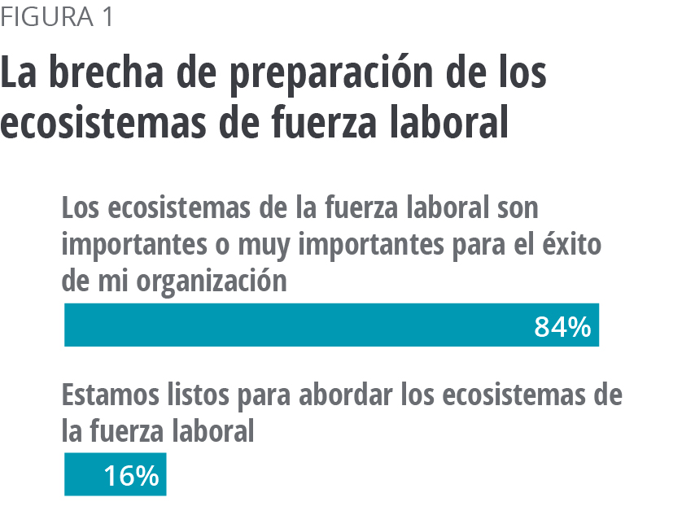

> **Descripción de la imagen** — La figura presenta dos indicadores porcentuales relacionados con los ecosistemas de la fuerza laboral.
>
> 1. **Primer indicador:** Una barra horizontal de color azul verdoso que muestra el 84%. Este porcentaje está asociado a la afirmación sobre la importancia de los ecosistemas de la fuerza laboral para el éxito de una organización.
> 2. **Segundo indicador:** Una barra horizontal más pequeña de color azul verdoso que muestra el 16%. Este porcentaje está asociado a la afirmación sobre la preparación para abordar los ecosistemas de la fuerza laboral.

Tradicionalmente, las organizaciones han

intentado adaptarse mediante ajustes y soluciones

a sus modelos y políticas de personal tradicionales.

Sin embargo, hemos llegado a un punto en el que

la cinta adhesiva y el fleje de embalaje no son

suficientes y se requieren cambios fundamentales.

Según la encuesta Tendencias Globales de Capital

Humano de Deloitte 2023, los dos principales

obstáculos para desbloquear el ecosistema de la

fuerza laboral son la necesidad de cambiar la

cultura (27%) y la forma de trabajar (26%).
### Los nuevos fundamentos

Adoptar una mentalidad de ecosistema de la

fuerza laboral. De ahora en adelante, debe

pensar en todo su equipo de colaboradores

(actuales y futuros) como un ecosistema sin

fronteras, tratando a todos los tipos de

colaboradores como muy valiosos e integrales para

la empresa. Esto incluye no sólo tener en cuenta

explícitamente a los colaboradores no tradicionales

en sus estrategias y planes de personal, sino

también integrar a todos los colaboradores en la

cultura de su organización (ya sean colaboradores

a tiempo completo o parcial, remotos o

presenciales). Todas y cada una de las personas

que contribuyen con su trabajo a la organización

deben reflejar sus valores fundamentales y sentirse

parte de la cultura. Curiosamente, a pesar de que

se ignoran a nivel organizacional y de sistema, los

datos de MIT Sloan Management Review y Deloitte

revelan que una gran mayoría de directivos de todo

el mundo (93%) ya consideran que tanto los

colaboradores internos como los externos forman

parte de su fuerza laboral, lo que indica que es

posible que los directivos ya hayan adoptado esta

mentalidad.3

Adoptar un enfoque basado en las

habilidades. Como se señala en el capítulo

“Navegar por el fin de los puestos de trabajo”, un

número creciente de organizaciones con visión de
### SEÑALES: ESTA TENDENCIA SE APLICA A USTED SI...

•	 Tiene dificultades para encontrar el talento que necesita con las habilidades críticas para ejecutar
sus estrategias de negocio

•	 Su capacidad de escucha y detección descubre problemas de moral y compromiso en equipos
formados por colaboradores tradicionales y no tradicionales

•	 Los problemas de acceso a los datos, las herramientas de colaboración y los sistemas de trabajo
de los colaboradores no tradicionales afectan negativamente a la productividad

Fuente: Encuesta Tendencias Globales de Capital Humano 2023

Desbloqueando el ecosistema de la fuerza laboral

---

<!-- página 54 -->

> **Descripción de la imagen** — La imagen es una ilustración de estilo plano que muestra un grupo diverso de figuras humanas distribuidas alrededor de un gran círculo o plataforma de color naranja rojizo.
>
> Las figuras están representadas con siluetas y sombras, y se encuentran dispersas por el área circular. Hay aproximadamente una docena de personas en total. Algunas figuras están de pie, otras parecen estar caminando o interactuando. La distribución es irregular, con algunas personas ubicadas cerca del borde exterior del círculo y otras más centradas.
>
> Las figuras varían en vestimenta (ropa casual, formal, etc.) y género. Se observan hombres y mujeres de diferentes edades. El fondo es un color naranja sólido, y el área central está delimitada por un borde exterior también naranja.

52
52

futuro están abandonando el modelo secular de

fuerza de trabajo basada en puestos y cargos

formales y estrechamente definidos. En su lugar,

están adoptando un nuevo enfoque basado en las

habilidades, capacidades e intereses. Este cambio

encaja perfectamente con el concepto de

ecosistema de la fuerza laboral, que se centra en el

trabajo que hay que hacer - y en las habilidades

necesarias para hacerlo - más que en el tipo de

colaborador o el cargo.

Crear una plataforma de personal abierta.

En lugar de tener enfoques y plataformas

completamente diferentes para los colaboradores

tradicionales y no tradicionales, adopte un enfoque

abierto del talento, que libere todo el potencial de

cada tipo de colaborador al tiempo que

proporciona una mayor coherencia en todo su

ecosistema de la fuerza laboral:

Abierto. Desarrolle estrategias y planes de

personal que reconozcan y acepten el valor y la

contribución singulares que aportan todos los

tipos de colaboradores, así como sus

necesidades y preferencias únicas.

Integre las plataformas con rapidez. Las

plataformas de ecosistemas deben integrarse

con las estrategias empresariales para

adaptarse con flexibilidad a las necesidades

cambiantes del trabajo y de los clientes.

Esto no significa que todos los colaboradores deban

recibir el mismo trato. Los distintos tipos de

colaboradores tienen necesidades diferentes,

aportan valor de distintas maneras y eligen

distintas compensaciones. Por ejemplo, los

colaboradores tradicionales a tiempo completo

suelen recibir extras como prestaciones completas

y mayor seguridad laboral a cambio de dedicación,

disponibilidad y lealtad a un único empleador.

Otros grupos de colaboradores obtienen menos

ventajas a cambio de una mayor remuneración por

hora y una mayor flexibilidad. Para atraer y

aprovechar el talento crucial, es importante

respetar esas preferencias personales.

Tendencias Globales de Capital Humano 2023

---

<!-- página 55 -->

53
53

Pasar de dirigir a orquestar. Preparar a las

organizaciones y a los directivos para operar en un

ecosistema de la fuerza laboral que requiere nuevas

prácticas de gestión, dejando de lado los enfoques

heredados de mando y control para alinear e

integrar funciones cruzadas, con el fin de acceder,

implicar, gestionar y desarrollar eficazmente a los

colaboradores externos de formas que antes

estaban reservadas a los colaboradores

tradicionales. Hoy en día, es habitual que los

colaboradores externos se vean influidos por

muchos grupos diferentes, como recursos humanos,

compras, tecnología y desarrollo empresarial, que a

menudo no se comunican entre sí sobre los

procesos y prácticas de los colaboradores externos.

En adelante, los líderes de las unidades funcionales

y de negocio deben trabajar juntos para reflexionar

de forma decidida y sistemática sobre el ecosistema

holístico del trabajo. Estas nuevas relaciones

pueden requerir cambios fundamentales en las

prácticas de gestión, la tecnología, la integración y

el liderazgo, que sustentan la capacidad de una

organización para orquestar con éxito los

ecosistemas de personal.4
### Experimentos actuales:
### Qué están explorando las
### principales organizaciones

•	 Los prestadores de servicios de la salud

de Estados Unidos están estudiando la creación

de un consorcio para desarrollar y compartir

talentos que puedan desplegarse a través de

múltiples sistemas miembros; construir una

marca de empleador colectiva más atractiva; y

abordar los retos y la escasez de talentos dentro

de la atención de la salud. Esto también crea

flexibilidad de despliegue dentro del consorcio y

mayores oportunidades profesionales y de

participación para los colaboradores, que tienen

acceso compartido a múltiples organizaciones

dentro del consorcio.

•	 Dos grandes empresas de medios de

comunicación que están fusionándose están

cambiando el paradigma del ecosistema de la

fuerza laboral a medida que intentan armonizar

sus dos negocios y sus fuerzas laborales.

Mientras que los enfoques tradicionales de

integración de la fuerza laboral consideraban en

primer lugar y únicamente a los colaboradores,

estas empresas comenzaron intencionadamente

su trabajo de integración de la fuerza laboral

examinando primero a los colaboradores

externos y luego “acercándose” a los

colaboradores tradicionales. Este cambio

permitirá a las organizaciones identificar mejor

las áreas de interés y solapamiento para

alcanzar los objetivos de sinergia y alinearse

con las estrategias de crecimiento adecuadas

para la futura organización integrada.

•	 Novartis está integrando la gestión de sus más

de 100.000 colaboradores internos y 50.000

externos bajo el paraguas de la función de

Personas y Organización para ofrecer una

experiencia sin fisuras y una estrategia holística

de la fuerza de trabajo. La construcción de esta

visión integrada permitirá a los líderes pensar

intencionadamente en el equilibrio deseado de

colaboradores internos y externos, basando

esas decisiones en las necesidades específicas

del negocio y considerando factores como la

disponibilidad de habilidades, la velocidad de

acceso y la asequibilidad.5

•	 Unilever emplea a más de 150.000 personas

en todo el mundo, pero el núcleo externo de la

fuerza laboral de la empresa de bienes de

consumo - personas, terceros y agencias - se

estima en 3 millones. Los altos directivos de

Unilever están trabajando para digitalizar los

datos y la información sobre la mano de obra

externa como requisito previo para mejorar las

cualificaciones de los colaboradores externos,

además de las de los colaboradores, con el fin

Desbloqueando el ecosistema de la fuerza laboral

---

<!-- página 56 -->

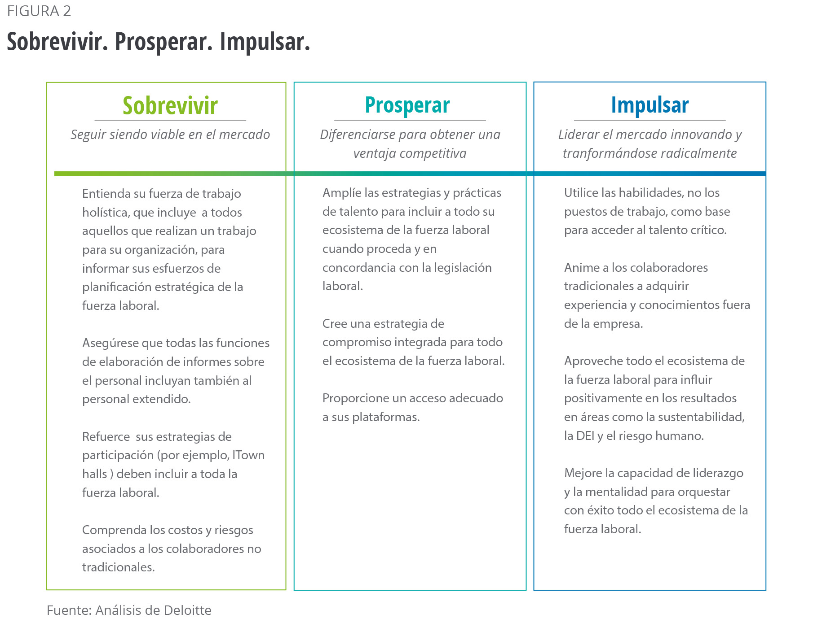

> **Descripción de la imagen** — La imagen es un diagrama conceptual estructurado en tres columnas verticales que representan tres pilares estratégicos interconectados: Sobrevivir, Prosperar e Impulsar.
>
> Cada columna contiene una definición principal y una serie de puntos clave que describen las acciones o estrategias asociadas a ese pilar.
>
> 1.  **Sobrevivir:** Se centra en seguir siendo viable en el mercado. Sus elementos incluyen entender la fuerza laboral holísticamente, planificar estratégicamente, asegurar que todas las funciones incluyan personal extendido, reforzar la participación de la fuerza laboral y comprender los costos y riesgos de los colaboradores no tradicionales.
> 2.  **Prosperar:** Se enfoca en diferenciarse para obtener una ventaja competitiva. Sus estrategias se centran en ampliar las prácticas y el talento para incluir todo el ecosistema de la fuerza laboral, crear una estrategia de compromiso integrada y proporcionar acceso adecuado a plataformas.
> 3.  **Impulsar:** Busca liderar el mercado innovando y transformándose radicalmente. Las acciones descritas incluyen utilizar las habilidades como base para acceder al talento crítico, animar a los colaboradores a adquirir conocimientos externos, aprovechar el ecosistema de la fuerza laboral para influir positivamente en áreas como la sustentabilidad, la DEI y el riesgo humano, y mejorar la capacidad de liderazgo.
>
> La fuente del análisis es señalada al pie: Análisis de Deloitte.

54
54

de crear una fuerza de trabajo más flexible

y ágil.6

•	 M&T Bank se asoció con una coalición

regional de organizaciones sin fines de lucro,

gobiernos locales e instituciones educativas

para abordar el desempleo y el subempleo en el

oeste de Nueva York (WNY) enseñando a los

miembros de la comunidad de alta necesidad.7

La iniciativa WNY Tech Skills ofrece cursos

gratuitos en habilidades como el análisis de

datos, el diseño UX y la ingeniería de software,

y está diseñada para promover la estabilidad

económica y la salud dentro de la comunidad, al

tiempo que construye un ecosistema más

amplio de talento en la región, al que todas las

empresas pueden acceder.

•	 El gobierno local y las organizaciones sin

fin de lucro están respondiendo a los

crecientes retos de desarrollo de la fuerza

laboral en la región del Greater Mesilla Valley

en Nuevo México. La Cámara de Comercio de

Las Cruces y The Bridge of Southern New

Mexico organizaron una cumbre con líderes del

gobierno, la industria privada, la educación

superior y la comunidad, con el fin de crear una

coalición para un ecosistema de la fuerza

laboral local autosostenible en la región. La

cumbre se centró en las estrategias para

reclutar, desarrollar y retener el talento local,

en particular a la luz de la creciente simbiosis

con los colaboradores. Este enfoque de

coalición demuestra una verdadera mentalidad

de ecosistema, ya que el gobierno y las

empresas privadas se unen para construir un

modelo de desarrollo colectivo para su

fuerza laboral.

Tendencias Globales de Capital Humano 2023

---

<!-- página 57 -->

55
55
### De cara al futuro

En lugar de aferrarse a la definición tradicional y

estrecha de “fuerza laboral” - que da prioridad a los

colaboradores a tiempo completo y trata a todos los

demás como “otros”-, las organizaciones deben

adaptar su mentalidad y sus prácticas para

ajustarse a la reserva de talento del mundo real,

que es mucho más compleja y está cada vez más

compuesta por colaboradores no tradicionales con

habilidades y experiencias de gran valor e

importancia estratégica.

Los nuevos fundamentos de la fuerza de trabajo,

como una mentalidad de ecosistema y una

plataforma de fuerza laboral abierta, no sólo son

mejores para los colaboradores actuales y futuros

de su ecosistema, sino que también son mejores

para su organización, ya que le dan acceso a más y

mejores talentos, le ayudan a obtener el máximo

valor de los diferentes tipos de talentos y le

proporcionan más flexibilidad para ampliar y

reducir o cambiar el enfoque en respuesta a las

necesidades cambiantes de su empresa y del

mercado. Los encuestados en el estudio Tendencias

Globales de Capital Humano de Deloitte 2023 que

han avanzado en la optimización de su enfoque de

los ecosistemas de fuerza laboral también

manifiestan lograr un aumento de la innovación,

del resultado financiero, la retención y el liderazgo.

Chris Ernst, director de aprendizaje de Workday,

ha declarado: “Aprovechar el poder del ecosistema

permite a nuestra empresa realizar el trabajo de

una forma mucho más inclusiva, ágil y flexible. En

Workday, utilizamos Career Hub, donde los

colaboradores pueden compartir sus habilidades e

intereses actuales y recibir conexiones relevantes,

trabajos, contenido de aprendizaje curado y

trabajos recomendados para ayudarles en su

trayectoria profesional. Más de 2.100 compañeros

de trabajo (alrededor del 12% de nuestra fuerza de

trabajo) han participado en actividades. Ha sido

realmente una adopción orgánica y hemos sido

capaces de expandirnos rápidamente desde

iniciativas de corta duración a trabajos de varios

meses que están conectando a los colaboradores

con oportunidades para resolver dificultades en

las empresas.”

Las organizaciones llevan décadas persiguiendo

estos objetivos, pero siempre han tenido que

diseñar soluciones en torno a los límites del

modelo tradicional de la estructura. Con una

mentalidad de ecosistema y una plataforma de

fuerza de trabajo abierta, se eliminan esos límites

tradicionales, lo que permite a los líderes

maximizar las contribuciones de cada colaborador,

independientemente de sus acuerdos laborales.

Desbloqueando el ecosistema de la fuerza laboral

---

<!-- página 58 -->

56

Agradecemos a Karen Weisz por sus contribuciones en el análisis para coescribir el capítulo de

“Desbloquear el ecosistema de la fuerza laboral” de las Tendencias Globales de Capital Humano

de 2023.

Agradecemos a Chris Ernst (Workday) por sus contribuciones en el análisis para coescribir el capítulo

de “Desbloquear el ecosistema de la fuerza laboral” de las Tendencias Globales de Capital Humano

de 2023.

Agradecemos a Sarah Hechtman y Abby Shuster por su liderazgo en el desarrollo de este capítulo, y

a Balaji Bondili, Grace Stafford y Gwen Widicus  por sus contribuciones en el análisis para coescribir

el capítulo de “Desbloquear el ecosistema de la fuerza laboral” de las Tendencias Globales de Capital

Humano de 2023.

56
## Notas finales

1.
MBO Partners, The contingent labor imperative: How agile enterprises succeed in a modern workforce model,
Agosto 2022.

2.
Sue Cantrell, Michael Griffiths, Robin Jones, y Julie Hiipakka, The skills-based organization: A new operating
model for work and the workforce, Deloitte Insights, Septiembre 8, 2022.

3.
Elizabeth J. Altman, David Kiron, Robin Jones, y Jeff Schwartz, “Orchestrating workforce ecosystems: Strategically
managing work across and beyond organizational boundaries,” MIT Sloan Management Review, Mayo 17, 2022.

4.
Ibid.

5.
Ibid.

6.
Ibid.

7.
Greg Pokriki, “Buffalo’s Tech Academy and how it benefits other companies,” Invest: BuffaloNiagra, Noviembre
17, 2021; M&T Bank, “Regional coalition announces ‘WNY Tech Skills Initiative’ to accelerate economic recovery,
provide community with access to technology training,” comunicado de prensa, Diciembre 16, 2020.
## Agradecimientos

Tendencias Globales de Capital Humano 2023

---

<!-- página 59 -->

> **Descripción de la imagen** — La imagen es una ilustración de estilo plano que representa cuatro estructuras verticales azules (pedestales o bloques) a las que varias personas están conectadas mediante cuerdas, simulando un ejercicio de cooperación o ascenso.
>
> Se observan cuatro escenas distintas:
>
> 1.  **Escena Izquierda:** Un hombre vestido de traje está en la cima del primer bloque, sosteniendo una cuerda. Una mujer vestida de rosa está tirando de la cuerda desde abajo, mientras que otro hombre se encuentra en el nivel inferior.
> 2.  **Segunda Escena:** Una mujer embarazada está en la cima del segundo bloque. Un hombre vestido de traje está subiendo o siendo asistido por una cuerda conectada a ese bloque. En la base hay dos figuras adicionales interactuando con la estructura.
> 3.  **Tercera Escena:** Una mujer se encuentra en la cima del tercer bloque. Un hombre con camisa blanca está extendiendo el brazo hacia arriba, siendo jalado por una cuerda. Cerca de la base del bloque hay otra persona sentada o arrodillada.
> 4.  **Escena Derecha:** Un hombre mayor vestido de traje está en la cima del cuarto bloque, sosteniendo una cuerda. Una figura vestida de verde claro está descendiendo o colgando desde el bloque mediante esa misma cuerda.
>
> La ilustración muestra un tema de trabajo en equipo y colaboración a través de la conexión física con estructuras elevadas.

57
## Tomando medidas audaces para
## obtener resultados equitativos
## La conversación sobre DEI pasa de las actividades a los resultados
### Coescrito por Devon Dickau.
## E

N LOS ÚLTIMOS dos años, las grandes

organizaciones multinacionales han asumido

más de 1.000 compromisos públicos en

materia de DEI y han prometido más de 210.000

millones de dólares a iniciativas de DEI, 1 invitando

a rendir cuentas cada vez más a las promesas

relacionadas con la estrategia DEI.  Los

colaboradores de todo el ecosistema, los clientes,

los proveedores, los accionistas y la sociedad

esperan ahora que las organizaciones cumplan sus

compromisos y su responsabilidad de tener un

impacto positivo en el mundo2 no simplemente

demostrando actividad, sino mostrando avances y

estando a la altura de las expectativas de una

empresa social.3 Por ejemplo, los colaboradores de

la Generación Z y de la generación millennials que

están satisfechos con el impacto social y

medioambiental de sus empleadores, y con sus

La diversidad, la equidad y la inclusión (DEI) suelen tratarse como un  objetivo monolítico, en lugar
de un conjunto de acciones independientes pero que se refuerzan mutuamente, siendo la diversidad
y la inclusión requisitos previos y necesarios para lograr resultados equitativos. Tradicionalmente, el
progreso en términos de DEI se ha medido en función de las actividades y el esfuerzo, a menudo con poca
consideración por los resultados reales conseguidos. Las acciones de DEI deben estar al servicio de la
consecución de resultados equitativos en la fuerza laboral - y en la sociedad en general - al tiempo que
impulsan la innovación, la competitividad y el éxito empresarial a largo plazo de una organización.

---

<!-- página 60 -->

58
58

esfuerzos por crear un entorno diverso e inclusivo,

tienen más probabilidades de querer permanecer

con sus empresas durante más de cinco años.4

Mientras tanto, las acciones performativas

-aquellas que se centran en aparentar que se

abordan los problemas sin comprometer tiempo ni

recursos para lograr resultados reales- pueden

erosionar la confianza en el liderazgo y en la

organización, lo que puede afectar a la deserción y

a la marca del empleador, especialmente entre los

grupos de identidad marginados.5

Algunas organizaciones están avanzando en las

acciones de DEI. En cuanto a la diversidad, se ha

producido un aumento del 1 % en la representación

de las mujeres en la fuerza de trabajo mundial

desde 2017, y un aumento del 6 % en el número de

mujeres en puestos directivos (aunque solo el 26 %

de los puestos directivos están ocupados por

mujeres).6 En lo que respecta a la inclusión, hemos

observado que muchas organizaciones están

progresando: que hay una mayor percepción de

poder llevar el “yo auténtico” al trabajo. Esto se

confirma en Deloitte, donde nuestro Informe de

Transparencia DEI 2022 revela un aumento

interanual en las percepciones de “ser auténtico”

en el trabajo en varios grupos de identidad.7

Sin embargo, las acciones y los programas

centrados en la diversidad o la inclusión no

siempre producen resultados equitativos. A modo

de ejemplo, muchas organizaciones han

desarrollado programas de liderazgo para mujeres

en busca de una mayor diversidad de género en los

puestos directivos. Estos programas suelen tener

por objeto promover la diversidad y crear una

cultura en la que los participantes se sientan

incluidos. Sin embargo, es posible que muchas

organizaciones no actualicen los procesos

sistémicos, como la movilidad interna o las

prácticas de gestión del desempleo, que pueden

servir de barreras para un avance equitativo. Un

programa centrado no garantiza la equidad para

los participantes en el programa. En cambio, la

equidad reconoce que la organización como

sistema está diseñada para dar a todos -con

consideración e independientemente de la

identidad- oportunidades equitativas de prosperar.

Aunque la representación de las mujeres en la

fuerza laboral puede estar aumentando en todo el

mundo, el hecho es que por cada 100 hombres que

ascienden, sólo 87 mujeres ascienden, y las

mujeres líderes siguen abandonando las

organizaciones en mayor proporción que los

hombres.8

Las organizaciones se enfrentan a cuatro retos

comunes a la hora de impulsar el progreso de

la DEI:

•
Demasiado énfasis en las actividades,

no lo suficiente en los resultados

equitativos. Según la encuesta Tendencias

globales de capital humano Deloitte 2023, el

23% de las organizaciones miden el progreso

en relación con los compromisos de diversidad

a través de la adhesión a las normas de

cumplimiento, que pueden centrarse en las

actividades en lugar del impacto de esas

actividades. Por ejemplo, la existencia de

programas de tutoría para grupos de identidad

específicos frente a los resultados que

producen esos programas, como la intención

de quedarse y la percepción de justicia.

•
Más atención a la solución para el

individuo que a la solución para el

sistema. Las organizaciones suelen dar

prioridad a las actividades de DEI que abordan

el desarrollo profesional, los prejuicios

inconscientes y los comportamientos

inclusivos a nivel individual. Sin embargo, los

estudios demuestran que la formación en DEI

centrada únicamente en el individuo, que es

puntual y distribuye ampliamente la

responsabilidad, no suele impulsar el cambio

de comportamiento necesario para mejorar los

resultados equitativos.9 Centrarse en el

individuo es insuficiente para superar los

prejuicios institucionales (dentro de la

Tendencias Globales de Capital Humano 2023

---

<!-- página 61 -->

59
59

organización) y estructurales subyacentes

(reconocer que una organización es un sistema

dentro de sistemas más amplios de cultura y

sociedad) que son barreras para el progreso de

la DEI.

•
Datos excesivamente agregados para

informar sobre los progresos o los

resultados. Muchas organizaciones no

recopilan ni sintetizan de forma proactiva los

datos necesarios para ofrecer información

práctica sobre la DEI más allá de la

representación de la fuerza laboral (es decir, la

diversidad), e incluso así, los datos pueden

estar sobreagregados, lo que dificulta sacar a

la luz los problemas de equidad a los que se

enfrentan grupos de identidad específicos. Por

ejemplo, las organizaciones suelen hacer un

seguimiento de la movilidad interna de los

colaboradores por grupos de identidad, pero

son menos las que analizan las tasas de

solicitudes internas para comprender las

posibles disparidades en el número de

intentos de solicitar puestos internos, lo que

podría poner de manifiesto las desigualdades

entre los grupos de identidad a la hora de

acceder a las oportunidades de movilidad

interna.

•
Desconexión entre los objetivos de DEI

y otros objetivos empresariales. Las

empresas sociales dan prioridad al valor social

como componente (no separado) de los

resultados empresariales. Deloitte lo

denomina “Purpose Premium”, y sugiere que

las organizaciones con una estrategia centrada

que articula el papel diferenciado que

desempeña en la sociedad obtienen valor y

ventaja competitiva a través de la mejora de la

reputación, la innovación, la valoración del

mercado, la eficiencia operativa, la mitigación

del riesgo y los resultados del talento.10 Del

mismo modo, décadas de investigación han

revelado correlaciones entre organizaciones

más diversas e inclusivas y lograr objetivos

empresariales básicos como la innovación y

los beneficios. Sin embargo, según los

encuestados en el estudio Tendencias Globales

de Capital Humano de Deloitte 2023, sólo el

15% (diversidad) y el 30% (inclusión) indican

que sus organizaciones relacionan los avances

en diversidad e inclusión, que contribuyen a

resultados equitativos, con resultados

empresariales como el aumento de la

rentabilidad o la productividad. Los resultados

equitativos deben considerarse resultados

empresariales, no separados de “la empresa”.

Los altos ejecutivos, en colaboración con los

líderes de DEI, deberían considerar la

posibilidad de tomar la iniciativa en el cambio

sistémico. Aunque más del 90% de los

directores ejecutivos han incorporado la DEI a

sus prioridades y objetivos estratégicos,11 se

necesitan acciones audaces para lograr

resultados equitativos.

Tomando medidas audaces para obtener resultados equitativos

---

<!-- página 62 -->

60
60
### GLOSARIO DE TÉRMINOS DEI

Los resultados equitativos se producen cuando todas las personas tienen un acceso justo,
oportunidades, recursos y poder para prosperar, teniendo en cuenta y eliminando las barreras y
los privilegios históricos y sistémicos. En comparación, la igualdad se da cuando todas las personas
reciben el mismo trato, sin tener en cuenta las barreras y los privilegios históricos y sistémicos.

La diversidad es la representación, en un grupo, de diversas facetas de identidad, incluidas (entre
otras) la raza, la etnia, la nacionalidad, la identidad de género, la identidad LGBTQIA+, el estatus
socioeconómico, la capacidad, la religión, la geografía, la educación y la edad.

La inclusión se refiere a las medidas adoptadas para comprender, aceptar y aprovechar los puntos
fuertes y las facetas de identidad únicas de todas las personas, de modo que todas se sientan
acogidas, valoradas y apoyadas.

Los sistemas son conjuntos de cosas que funcionan juntas como parte de un mecanismo o una
red de interconexión. La sociedad es un sistema que incluye organizaciones. Las organizaciones
son sistemas. Dentro de las organizaciones, el ciclo de vida del talento es un sistema. Por lo tanto,
un cambio en una parte del ciclo de vida del talento puede afectar a otras partes del ciclo de vida
del colaborador.
### SEÑALES: ESTA TENDENCIA SE APLICA A USTED SI...

•	 Su organización no tiene una representación diversa en los niveles más altos

•	 Su organización está experimentando un desgaste desproporcionado entre los grupos a pesar de
los esfuerzos de DEI

•	 Sus esfuerzos de DEI están dirigidos únicamente por RRHH

•	 Los datos de sus colaboradores no proporcionan detalles suficientes para evaluar los resultados o
el progreso en materia de DEI

•	 La estrategia y los objetivos de DEI de su organización están desconectados del propósito y la
estrategia empresarial

•	 No está consiguiendo una participación proporcional de todos los grupos de identidad en los
programas de talento clave, por ejemplo, programas de beneficios y de desarrollo de liderazgo.
### La brecha de preparación

En la encuesta Tendencias Globales de Capital

Humano de Deloitte 2023, el 86% de los líderes

empresariales encuestados afirma que integrar DEI

en las formas cotidianas de trabajo y en los equipos,

al tiempo que se miden los resultados, es

importante o muy importante para el éxito de sus

organizaciones. Sin embargo, sólo el 25% considera

que está muy preparado para abordar esta cuestión.

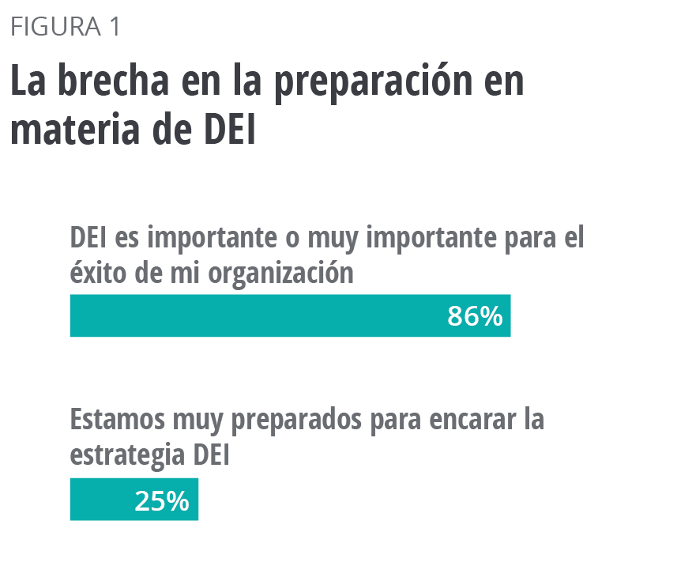

> **Descripción de la imagen** — La figura es un gráfico de barras horizontal que compara dos porcentajes relacionados con la preparación para la estrategia DEI.
>
> 1.  **Primera barra:** Muestra el porcentaje del 86%, asociado al enunciado "DEI es importante o muy importante para el éxito de mi organización".
> 2.  **Segunda barra:** Muestra el porcentaje del 25%, asociado al enunciado "Estamos muy preparados para encarar la estrategia DEI".

Fuente: Encuesta Tendencias Globales de Capital Humano 2023

Tendencias Globales de Capital Humano 2023

---

<!-- página 63 -->

61
61

Según la encuesta, la mayoría de las organizaciones

han priorizado las acciones de diversidad e

inclusión sobre los resultados equitativos. De

hecho, los principales beneficios de los esfuerzos

de DEI de las organizaciones se centran en los

resultados relacionados con la inclusión, como “el

compromiso y el bienestar de los colaboradores”.

Mientras tanto, los resultados equitativos como

“un proceso de desarrollo de liderazgo más fuerte y

un mayor acceso al talento” y “contribuciones a

resultados comunitarios o sociales positivos” se

encuentran entre los cuatro últimos, junto con

“mayor innovación” y “mayor capacidad para

anticipar futuras disrupciones y agilidad para

satisfacer las necesidades empresariales y de la

fuerza de trabajo”.

De cara al futuro, de aquí a 2 a 4 años, los

encuestados esperan que los esfuerzos de sus

organizaciones en materia de DEI tengan un gran

impacto en el “aumento del reconocimiento de la

marca” (27%), pero un impacto mucho menor en la

consecución de resultados equitativos, como una

“proceso de desarrollo de liderazgo más sólido o un

mayor acceso al talento” (9%) y la “contribución a

resultados comunitarios o sociales positivos” (10%).

Y lo que es más, el 24% de las organizaciones no

establecen responsabilidades ni miden los avances

en sus compromisos de equidad. Nuestra

conclusión al evaluar los resultados de esta

encuesta es que puede haber “compromisos a la

deriva” de DEI en el horizonte.
### Los nuevos fundamentos

Reorientarse hacia los resultados, no hacia

las actividades. Es importante medir el éxito de

la estrategia DEI en función de sus resultados (es

decir, qué está cambiando), y no en función de lo

que se está haciendo (como el dinero que se gastó,

las formaciones realizadas o la participación en

grupos de afinidad). Las organizaciones deben

identificar las desigualdades específicas que existen

entre los grupos de identidad dentro de sus propias

organizaciones, descubrir las causas profundas de

esas desigualdades y diseñar intervenciones y

soluciones para abordarlas. Al igual que cada

estrategia empresarial se adapta a las necesidades

de los clientes de cada organización, la consecución

de resultados equitativos requiere un enfoque

adaptado a la estrategia, el contexto y el historial

de compromiso de cada organización con las

comunidades.

Centrarse en el sistema, no en el individuo.

La inequidad es un reto dinámico y sistémico que

demanda una respuesta sistémica. El Modelo de

activación de la equidad de Deloitte (figura 2),

introducido en El Imperativo de la Equidad,12

presenta una visión basada en sistemas de cómo

las empresas pueden activar resultados equitativos

dentro y fuera de sus propias organizaciones. El

modelo se estructura en torno a tres esferas de

influencia principales (cada una de las cuales

incluye activadores y facilitadores) que están al

alcance de todas las organizaciones: el personal, el

mercado y la sociedad, todos ellos rodeados por la

cultura organizativa.

Si quieren liberar el potencial de una organización

para lograr un impacto en materia de DEI en el

mercado y en la sociedad en general, las

organizaciones deben priorizar primero los

resultados equitativos para la fuerza de trabajo. Sin

embargo, muchos esfuerzos de DEI se han

centrado históricamente en procesos de fuerza

laboral individuales (como la adquisición de

talento o la planificación de la sucesión) en lugar

de centrarse en un sistema interconectado de

procesos de la fuerza laboral a lo largo del ciclo de

vida del talento. El cambio sistémico requiere que

los esfuerzos de DEI se produzcan en cascada a lo

largo del ciclo de vida del talento y atraviesen

múltiples procesos de talento para reforzar

mutuamente los resultados equitativos.

Tomando medidas audaces para obtener resultados equitativos

---

<!-- página 64 -->

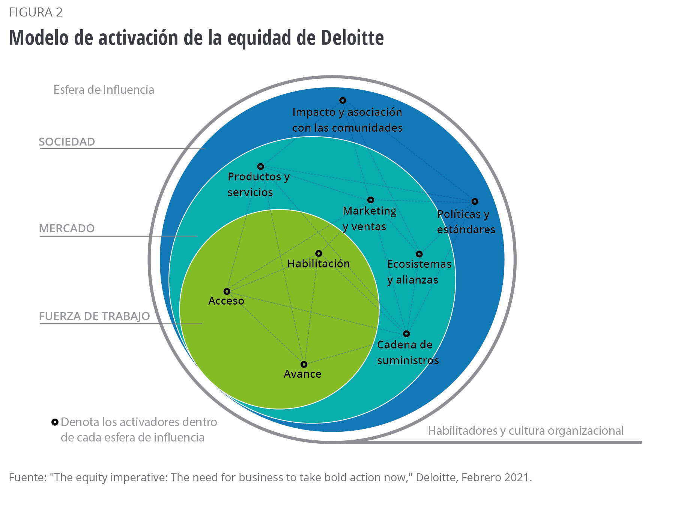

> **Descripción de la imagen** — Se trata de un diagrama conceptual que ilustra el "Modelo de activación de la equidad de Deloitte". El modelo está estructurado mediante círculos concéntricos y áreas superpuestas, representando diferentes esferas de influencia.
>
> **Estructura del Diagrama:**
>
> 1.  **Esferas de Influencia (Círculos Exteriores):** El diagrama se divide en varias capas que definen las esferas de influencia:
>     *   Una esfera azul grande que abarca la **SOCIEDAD** y el **MERCADO**.
>     *   Una esfera verde que abarca la **FUERZA DE TRABAJO**.
>     *   Un anillo exterior etiquetado como **Esfera de Influencia**.
>     *   Una base inferior etiquetada como **Habilitadores y cultura organizacional**.
>
> 2.  **Activadores (Nodos Internos):** Dentro de cada esfera, hay puntos que representan los "activadores" de la equidad.
>
>     *   **Dentro de la Esfera Azul (Sociedad/Mercado):** Se identifican seis activadores:
>         *   Impacto y asociación con las comunidades.
>         *   Productos y servicios.
>         *   Marketing y ventas.
>         *   Políticas y estándares.
>         *   Ecosistemas y alianzas.
>         *   Cadena de suministros.
>
>     *   **Dentro de la Esfera Verde (Fuerza de Trabajo):** Se identifican tres activadores:
>         *   Habilitación.
>         *   Acceso.
>         *   Avance.
>
> 3.  **Conexiones:** Líneas punteadas conectan los activadores entre las diferentes esferas, mostrando la interacción y la activación de la equidad a través de estas áreas. Por ejemplo, hay conexiones que unen elementos del mercado (como Productos y servicios) con elementos de la fuerza de trabajo (como Habilitación).

62
62

Producir perspectivas procesables

desagregadas, no datos descriptivos

agregados. Los datos desglosados pueden revelar

los obstáculos a la equidad que existen en cada

etapa del ciclo de vida del talento, lo que permite

comprender las causas profundas únicas asociadas

a las identidades individuales e interseccionales.

Una evaluación exhaustiva puede revelar las

desigualdades del momento y establecer una línea

de base para la detección continua que permita la

intervención inmediata y el modelado predictivo

para abordar las necesidades de grupos de

identidad específicos. Por ejemplo, al desglosar los

datos de experiencia de talento entre las personas

con discapacidad (en lugar de entre las personas

con discapacidad y las que no la tienen), una

organización puede descubrir que los

colaboradores con discapacidades físicas y los

colaboradores con discapacidades de aprendizaje

experimentan una variación en los resultados y,

por lo tanto, requieren diferentes acciones de DEI.

La desagregación de datos también permite

realizar análisis interseccionales o una síntesis

multivariante de múltiples grupos de identidad.

Por ejemplo, sacar a la luz las experiencias de las

personas con discapacidad que son LGBTQIA+ en

comparación con las personas con discapacidad

que no son LGBTQIA+.

Centrar el enfoque DEI como algo

intrínseco a la empresa y no como algo

separado de ella. Los resultados equitativos

impactan y son impactados por cada parte del

negocio, lo que sugiere una interconexión entre los

esfuerzos de DEI anclados en RRHH y los

esfuerzos de DEI centrados en productos, servicios,

cadena de suministro, impacto en la comunidad y

más. El informe Tendencias globales del capital

humano Deloitte 2018 introdujo el concepto de

una C-suite sinfónica que implica que los líderes

actúen como una sinfonía de expertos tocando en

armonía en lugar de una cacofonía de expertos que

suenan muy bien solos, pero no juntos. Ese

concepto también se aplica aquí. Los directivos de

Tendencias Globales de Capital Humano 2023

---

<!-- página 65 -->

63
63

toda la organización deben responsabilizarse de

defender el cambio sistémico e impulsar la

responsabilidad de los demás para lograr

resultados equitativos. Muchas organizaciones han

pasado de asignar a los líderes de RR.HH. la

responsabilidad exclusiva en materia de DEI, a

crear funciones como los directores de DEI, que

son miembros de la C-suite o dependen de ella. Sin

embargo, la responsabilidad de lograr resultados

equitativos no es sólo responsabilidad de los

líderes de DEI o de RR.HH., sino de todos los

líderes de la organización, incluidos los miembros

de la alta dirección. Abordar las desigualdades

sistémicas exige el compromiso de mejorar la

equidad en todas las decisiones, políticas, prácticas

y acciones de la organización en todos los ámbitos.

Al aplicar estos nuevos fundamentos, las

organizaciones deben considerar un enfoque

“glocal” (global-local).13 A medida que las

organizaciones pasan a resolver las desigualdades,

es probable que una estrategia global de DEI no

funcione en todas las regiones o países. Por

ejemplo, hay elementos de representación como el

género, la edad, la condición de discapacidad y la

orientación sexual que pueden ser relativamente

coherentes en todo el mundo, mientras que otros

elementos, como la raza, la etnia y la religión, así

como la normativa, la cultura y la historia, varían

enormemente de una geografía a otra. Una

estrategia de DEI verdaderamente global no es una

estrategia creada por la sede central o los líderes

del país más poblado, sino una estrategia diseñada

globalmente desde el principio.
### Experimentos actuales:
### ¿Qué están explorando las
### principales organizaciones?

•	 Google lleva publicando sus datos de

representación de la fuerza de trabajo desde

2014, mucho antes que la mayoría de las demás

empresas.14 En 2022, Google publica datos de

tendencias sobre representación de su fuerza

laboral, contratación, deserción, salidas y

autoidentificación, funciones tecnológicas

frente a no tecnológicas, frente a funciones de

liderazgo, por raza/etnia y por género, a nivel

mundial y por región. Esta profundidad y

especificidad permite a los colaboradores verse

a sí mismos en los cortes e identificar áreas de

fortaleza y oportunidad. Es importante destacar

que los datos interseccionales de la fuerza

laboral estadounidense -por ejemplo, las

contrataciones de mujeres negras comparadas

con las de hombres negros, o la deserción de

mujeres asiáticas comparado con la de hombres

asiáticos- permiten aún más precisión para

posibilitar el desarrollo de soluciones que

impulsen resultados equitativos para los grupos

menos representados.15 La Directora de

Diversidad, Melonie Parker, hablando del poder

de los datos, señala: “Estamos viendo progresos

prometedores en la mejora de la deserción de

muchas de nuestras comunidades

interseccionales... Los datos de nuestro Informe

Anual de Diversidad también nos muestran

áreas en las que trabajaremos para mejorar, y

seguimos centrados en mejorar la contratación

y la retención para esas comunidades

específicas.”16

•	 Unilever: La empresa británica de productos

de consumo Unilever creó un programa de

inclusión de las personas con discapacidad

basado en un análisis exhaustivo de la

accesibilidad física de las instalaciones, la

accesibilidad de las instalaciones virtuales y los

procesos de contratación. La organización llevó

a cabo una encuesta entre más de 2.000

colaboradores de Brasil, India y Reino Unido,

realizó entrevistas en profundidad y pidió a los

colaboradores que llevaran un diario de su

entorno de trabajo para conocer tanto las

causas como las posibles soluciones. Las

directrices Globales para la inclusión de la

discapacidad facilitan la accesibilidad en TI,

adquisición de talento, comunicaciones y

diseño del lugar de trabajo.17

Tomando medidas audaces para obtener resultados equitativos

---

<!-- página 66 -->

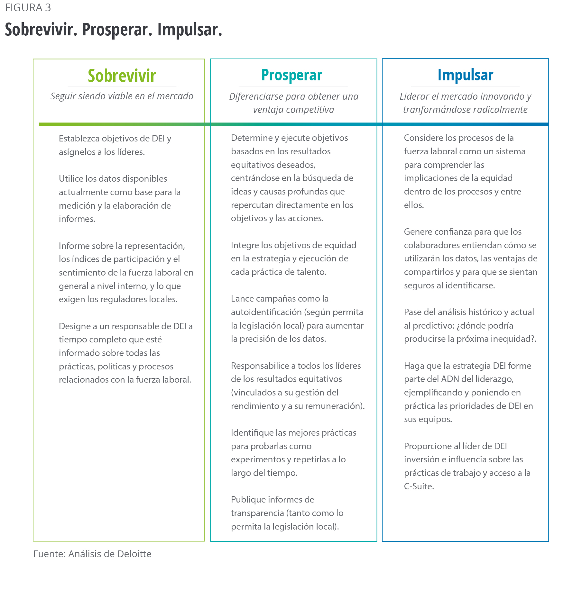

> **Descripción de la imagen** — La imagen es un diagrama conceptual estructurado en tres columnas verticales, que presenta un marco de acción dividido en tres fases o estrategias: Sobrevivir, Prosperar e Impulsar.
>
> Cada columna contiene el título de la fase, una breve definición y una lista de acciones específicas asociadas a esa estrategia.
>
> **Columnas y Contenido:**
>
> 1.  **Sobrevivir:**
>     *   Definición: Seguir siendo viable en el mercado.
>     *   Acciones clave incluyen establecer objetivos de DEI y asignarlos a líderes, utilizar datos para medición e informes, informar sobre la representación y el sentimiento laboral, designar un responsable de DEI y estar informado sobre prácticas relacionadas con la fuerza laboral.
>
> 2.  **Prosperar:**
>     *   Definición: Diferenciarse para obtener una ventaja competitiva.
>     *   Acciones clave incluyen determinar y ejecutar objetivos basados en resultados, integrar objetivos de equidad en la estrategia y ejecución de talento, lanzar campañas de autoidentificación, responsabilizar a los líderes por resultados equitativos (vinculados al rendimiento y remuneración), identificar mejores prácticas para probarlas y publicar informes de transparencia.
>
> 3.  **Impulsar:**
>     *   Definición: Liderar el mercado innovando y transformándose radicalmente.
>     *   Acciones clave incluyen considerar los procesos de la fuerza laboral como un sistema, generar confianza en colaboradores sobre el uso de datos, realizar análisis histórico y predictivo para identificar iniquidades, formar parte del ADN del liderazgo y proporcionar al líder de DEI inversión e influencia.
>
> El diagrama presenta una progresión lógica de tres niveles estratégicos: primero la estabilidad (Sobrevivir), luego la diferenciación competitiva (Prosperar) y finalmente el liderazgo transformador (Impulsar).

64
64
### El camino a seguir

•	 Genentech, miembro del grupo Roche: En

2021, casi todos los altos directivos de

Genentech identificaron acciones específicas

para avanzar en los tres pilares estratégicos de

la estrategia DEI de la empresa farmacéutica:

fomentar la pertenencia, avanzar en la

investigación inclusiva y la equidad en salud, y

transformar la sociedad en sus propios equipos.

Para mayor transparencia, los planes de acción

de los directivos se comparten anualmente con

los colaboradores. “La concientización de

nuestros colaboradores impulsa la

responsabilidad y hace avanzar estos planes”,

afirma Emily Reyna, responsable de los socios

empresariales de diversidad e inclusión

de Genentech.18

Tendencias Globales de Capital Humano 2023

---

<!-- página 67 -->

65
65
### De cara al futuro

Para obtener resultados significativos y equitativos

es preciso contar con una estrategia DEI y un plan

de aplicación de esa estrategia bien elaborados, que

cuenten con la aceptación y el apoyo de los

directivos y con el respaldo de recursos financieros

y gente dedicada a tiempo completo en toda la

organización. Entre las principales áreas de interés

se incluyen los cambios en las capacidades

organizativas, los modelos operativos y la gobierno,

así como la transformación de la

cultura organizacional.

Cuando no se logran avances medibles en materia

de equidad, el instinto puede ser redoblar la DEI

programática. Sin embargo, el cambio sostenible se

produce conectando todas las partes internas y

externas de la empresa a través de todo el

ecosistema empresarial. Las organizaciones deben

orientarse hacia resultados equitativos y equipar a

las personas en consecuencia.

La transparencia y la claridad entorno a las

métricas de éxito pueden permitir la rendición de

cuentas a las comunidades internas y externas

afectadas por las inequidades y ayudar a las

personas de la organización a comprender lo que

se está haciendo. Compartir el por qué y el cómo

ayuda a generar confianza y mejora el

involucramiento de los colaboradores, haciendo

que todos los miembros de la organización formen

parte del viaje de DEI.

Los nuevos fundamentos de la estrategia DEI

abren el camino a una acción audaz en busca de

resultados más equitativos para todos.

.

Tomando medidas audaces para obtener resultados equitativos

---

<!-- página 68 -->
### 66
### Agradecemos a Devon Dickau por sus contribuciones en el análisis para coescribir el capítulo de

“Tomar medidas audaces para obtener resultados equitativos” de las Tendencias Globales de Capital

Humano de 2023.
### Agradecemos a Ryanne Massey por su liderazgo en el desarrollo de este capítulo, y a Sameen Affaf y
### Amanda Solomon por sus contribuciones en el análisis para coescribir el capítulo de  “Tomar medidas

audaces para obtener resultados equitativos” de las Tendencias Globales de Capital Humano de 2023.
## Notas finales

1.
Análisis de Deloitte, Noviembre 2021.

2.
Porter Novelli, Purpose Perception, accedido el 8 de Diciembre, 2022.

3.
Deloitte Insights, 2018 Global Human Capital Trends, accedido el 8 de Diciembre, 2022.

4.
Deloitte, The Deloitte Global 2022 Gen Z and Millennial Survey, 2022.

5.
Kavitha Prabhakar et al., Build trust in diversity, equity, and inclusion commitments, Enero 13, 2022.

6.
LeanIn.org, Women in the Workplace, 2022.

7.
Deloitte, “2022 Deloitte Diversity, Equity, and Inclusion (DEI) Transparency Report: FY22 progress,” accedido el 8
de Diciembre, 2022.

8.
LeanIn.org, Women in the Workplace: The state of the pipeline, accedido el 8 de Diciembre, 2022.

9.
Edward Chang, “Does diversity training work the way it’s supposed to?” Harvard Business Review (HBR),

Julio 9, 2019.

10.	 	 Monitor Deloitte, The purpose premium: Why a purpose-driven strategy is good for business, Febrero 2021.

11.	 	 Deloitte, “Summer 2022 Fortune/Deloitte CEO Survey,” accedido el 8 de Diciembre, 2022.

12.	 	 Deloitte, The equity imperative, Febrero 2021.

13.	 	 Poornima Luthra, “Do your global teams see DEI as an American issue?” HBR, Marzo 21, 2022.

14.	 	 Caroline Fairchild, “Why Google voluntarily released dismal diversity numbers,” Fortune, Mayo 30, 2014.

15.	 	 Google, Google Diversity Annual Report 2022, accedido en Diciembre 12, 2022.

16.	 	 Melonie Parker, “Focused on Progress: Our 2022 Diversity Annual Report,” Google, Mayo 19, 2022.

17.	 	 Unilever, “A beacon of diversity and inclusion,” accedido en Diciembre 8, 2022.

18.	 	 Genentech, Genentech’s 2021 D&I Report, 2021.
## Agradecimientos

Tendencias Globales de Capital Humano 2023

---

<!-- página 69 -->

> **Descripción de la imagen** — Es una ilustración digital que representa un concepto de sostenibilidad y tecnología. En el centro se encuentra un globo terráqueo translúcido rodeado de elementos verdes, incluyendo turbinas eólicas.
>
> En primer plano, hay una base circular azul sobre la cual crece una planta con raíces prominentes. Varias figuras humanas interactúan con esta planta: un hombre a la izquierda señala hacia ella, dos personas están agachadas cerca de las raíces, y otro hombre está de pie observando o cuidando la planta desde atrás.
>
> A la derecha, se encuentra un robot humanoide de color azul claro, que interactúa con una estructura geométrica tridimensional compuesta por líneas y nodos luminosos flotantes. La composición sugiere una conexión entre la naturaleza (la planta y el planeta) y la tecnología avanzada (el robot y la red).

67
67
## Impulsando el elemento humano
## en la sustentabilidad
## La sustentabilidad humana pasa a primer plano en las estrategias
## de sustentabilidad de las orgaizaciones
### Coescrito por Karen Cunningham and Laura Richards.

Los esfuerzos iniciales de las empresas por encarar los problemas de sustentabilidad han estado
impulsados en gran medida por las relaciones públicas o la defensa de la marca, y se ha prestado menos
atención a los resultados significativos. Los esfuerzos más recientes, como la reducción de emisiones en las
operaciones o la fabricación, están produciendo una mejora real pero incremental en los márgenes de la
empresa. Éste es el momento de dar el siguiente paso para lograr resultados tangibles centrándose en el
elemento humano, haciendo operativos los facilitadores de las personas en la organización, planificando
las habilidades técnicas y blandas o humanas adecuadas, haciendo que el trabajo sea mejor para las
personas y diseñando para la sustentabilidad humana. Aquí es donde se arraiga el cambio fundamental y
duradero y donde pueden lograrse resultados.
## L

AS CUESTIONES DE sustentabilidad tienen un

impacto real y existencial en la sociedad y la

tierra, y a menudo se pide a las organizaciones

que desempeñen un papel más central para crear

resultados significativos para las personas, el

planeta y la prosperidad.1 Muchos ejecutivos

comprenden la importancia y la necesidad de

realizar cambios significativos, y casi el 70% de las

organizaciones encuestadas incorporan materiales

más sostenibles o aumentan la eficiencia en el uso

de la energía.2 Sin embargo, la mera financiación

de “cosas” sostenibles no producirá resultados de

sustentabilidad

---

<!-- página 70 -->

68
68

La cruda realidad es que muchos esfuerzos de

sustentabilidad se limitan a los márgenes de la

empresa e ignoran los elementos humanos, que es

donde se arraiga un cambio significativo y

duradero. Por ejemplo, muchas empresas han

reducido los viajes corporativos o han optado por

el uso de materiales más sostenibles, pero estas

acciones por sí solas no incorporan la

sustentabilidad a la fuerza laboral o al propio

trabajo, el tipo de cambio necesario para cultivar

una cultura de sustentabilidad y que podría

configurar de manera fundamental el impacto

energético y social de una empresa. Los seres

humanos son los conductores del cambio material

y duradero.
### SEÑALES: ESTA TENDENCIA SE APLICA A USTED SI...

•	 Ve un aumento de la presión de los colaboradores y otras partes interesadas para que se asuman
responsabilidades en la creación y promoción de buenos empleos, buen trabajo y buenas
plataformas3

•	 Las comunidades en las que trabaja exigen una mayor transparencia sobre el modo en que la
organización crea valor en la sociedad

•	 Sus reguladores y accionistas exigen informes más transparentes sobre medidas humanas,
medioambientales y sociales

•	 Su organización tiene dificultades para medir la rentabilidad de los esfuerzos de sustentabilidad
### GLOSARIO DE TÉRMINOS DE SUSTENTABILIDAD

Sustentabilidad. Satisfacer las necesidades del presente sin comprometer la capacidad de las
generaciones futuras para satisfacer sus propias necesidades. La sustentabilidad incluye todo
lo necesario para que una organización logre existencia, rentabilidad y crecimiento a largo plazo.
También incluye la ambición de garantizar que el progreso económico, social y tecnológico se

produzca en armonía con la naturaleza para que todos los seres humanos puedan desarrollar su
potencial y disfrutar de una vida próspera y plena, en dignidad e igualdad, en un entorno saludable.
“Sustentabilidad” no es sinónimo de medioambiental, social y de gobierno (ESG, por su sigla en inglés),

sino que los engloba.

ESG. El marco que utilizan las organizaciones para supervisar e informar sobre los avances en su
programa de sustentabilidad.

•	 Medio ambiente. Afrontar los costos medioambientales, los riesgos climáticos a largo plazo y los
retos relacionados con el capital natural mediante prácticas empresariales sostenibles y la gestión
de la cadena de suministro. Incluye una gestión cuidadosa de las emisiones y la administración de
los recursos naturales, como el agua, la agricultura, los minerales, la tierra y otros materiales.

•	 Social. Comprometerse con prácticas de gestión de la fuerza laboral que fomenten la inclusión, la
igualdad salarial, la salud, la seguridad y el bienestar, así como el avance de los derechos humanos,
el impacto comunitario y el impacto social.

•	 Gobierno. Establecimiento y ejecución de políticas y prácticas del directorio y las autoridades en
materia de autoridad para la toma de decisiones, rendición de cuentas y transparencia informativa.
Incluye liderazgo y gobernanza, derechos de los accionistas, incentivos de los ejecutivos y ética y
comportamiento corporativos.

Tendencias Globales de Capital Humano 2023

---

<!-- página 71 -->

69
69
### La brecha de preparación

En la encuesta Tendencias Globales de Capital

Humano de Deloitte  2023, el 84% de los

encuestados reconoce que comprender el impacto

de la sustentabilidad en su empresa y definir la

propiedad para impulsar el progreso y los

resultados es importante para el éxito de sus

organizaciones. Sin embargo, sólo el 21% cree que

sus organizaciones están muy preparadas para

abordar estas cuestiones.

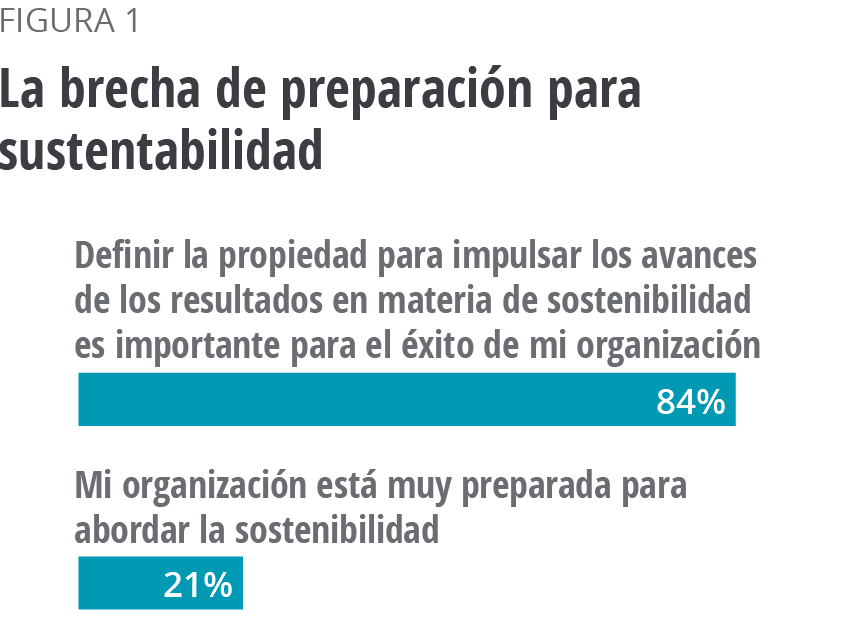

> **Descripción de la imagen** — La figura 1 es un gráfico de barras horizontales que compara dos porcentajes relacionados con la preparación para la sustentabilidad.
>
> En la parte superior, una barra muestra el 84%, asociado al enunciado sobre la importancia de definir la propiedad para impulsar los avances en resultados de sostenibilidad.
>
> En la parte inferior, una segunda barra muestra el 21%, asociada al enunciado sobre si la organización está muy preparada para abordar la sostenibilidad.

### Los nuevos fundamentos

Integrar la sustentabilidad en el propósito,

la estrategia y la cultura. La sustentabilidad no

puede seguir siendo una iniciativa aislada de ESG,

salud y seguridad de los colaboradores o

responsabilidad social corporativa. Por el contrario,

las prioridades de sustentabilidad deben integrarse

en cómo y por qué operan las organizaciones en

todos los niveles de la empresa si quieren

experimentar el cambio de comportamiento

necesario para obtener resultados tangibles.

Cuando se les pidió que identificaran los obstáculos

para lograr resultados de sustentabilidad, los

encuestados en el estudio Tendencias Globales de

Capital Humano de Deloitte 2023 señalaron de

forma abrumadora las barreras tradicionales al

cambio, como la cultura organizacional, el ritmo de

cambio, las limitaciones de financiación y recursos,

y la normativa. Estas barreras identificadas tienen

en común la externalidad del control,

probablemente relacionada con el hecho de que

menos del 30% se sienten capacitados para asumir

un papel de propiedad en los resultados de

sustentabilidad de su organización.

Pero los líderes pueden cambiar esta forma de

pensar si comprenden que, para lograr un cambio

material, deben tomar decisiones tácticas y

tangibles para tejer la sustentabilidad en el

entramado cultural de la organización y asumir el

control de los resultados de la sustentabilidad. Esto

implica alinearse y contar la historia de la

sustentabilidad como una parte fundamental del

propósito corporativo de la organización,

establecer una estructura organizacional de apoyo

Fuente: Encuesta Tendencias Globales de Capital Humano 2023

Impulsando el elemento humano en la sustentabilidad

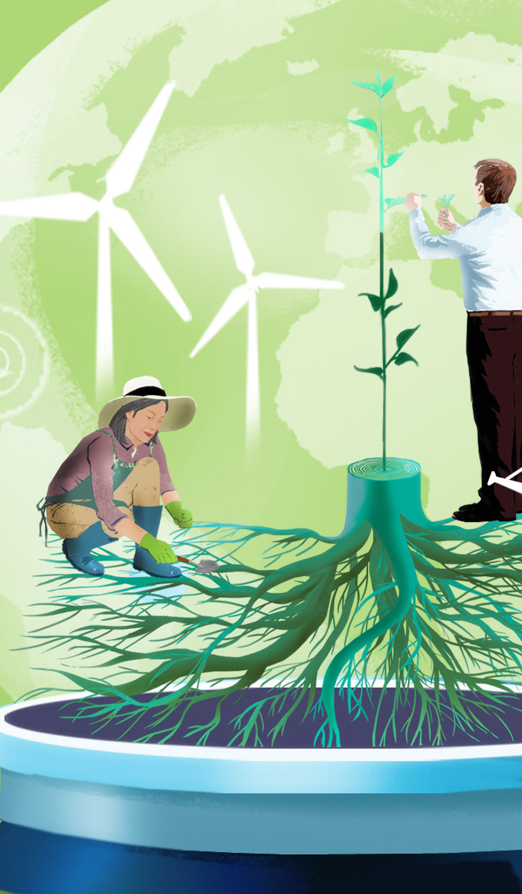

> **Descripción de la imagen** — Es una ilustración de estilo artístico y vibrante que representa un concepto relacionado con el crecimiento vegetal y la sostenibilidad.
>
> La escena se desarrolla en un entorno verde brillante, con grandes aerogeneradores blancos visibles en el fondo. En primer plano, hay un sistema radicular extenso que emerge de una base cilíndrica dentro de un recipiente azul.
>
> Hay dos figuras humanas interactuando con la planta:
> 1. Una mujer, vestida con ropa de trabajo y sombrero, está arrodillada junto al recipiente, utilizando una herramienta para manipular las raíces en el medio líquido oscuro.
> 2. Un hombre, vestido con camisa blanca y pantalones oscuros, está de pie y sostiene un pequeño brote o tallo cerca de la parte superior del sistema radicular.
>
> El elemento central es una planta robusta con un tronco que se conecta a un sistema de raíces muy denso y ramificado que se extiende hacia el fondo del recipiente. El contraste entre las raíces verdes y el medio azul oscuro en el fondo resalta la estructura del sistema de soporte de la planta.

---

<!-- página 72 -->

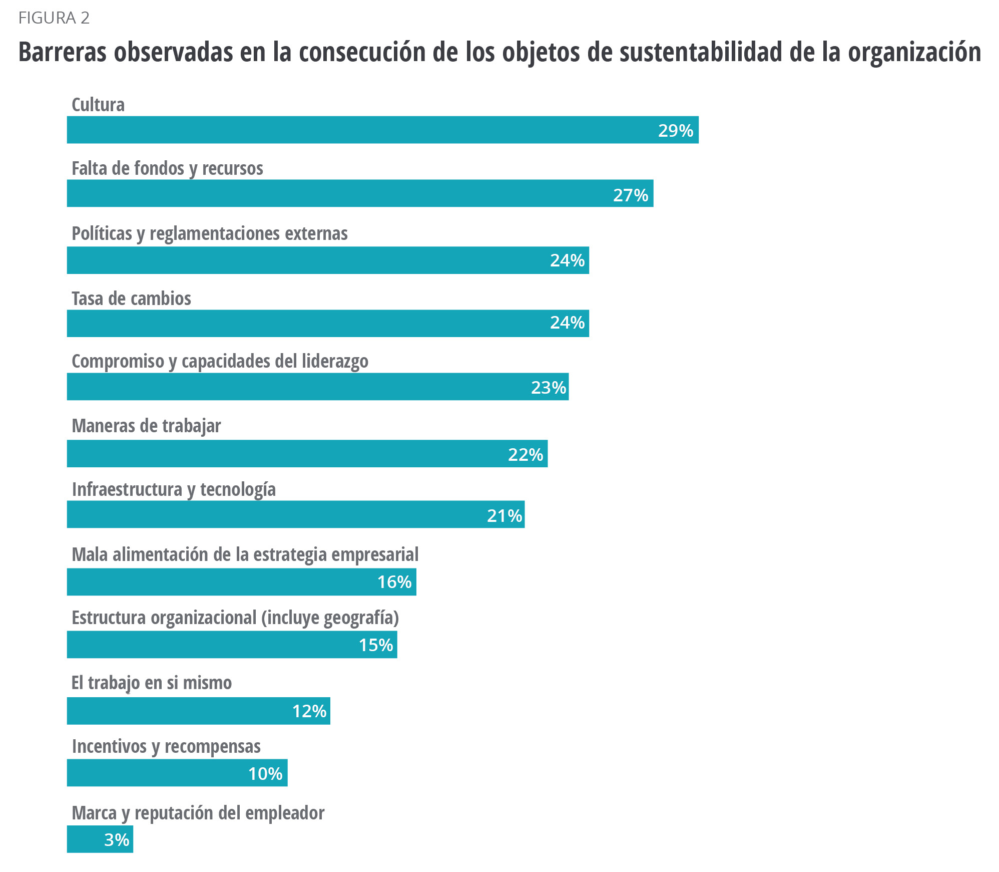

> **Descripción de la imagen** — La imagen es un gráfico de barras horizontal titulado "Barreras observadas en la consecución de los objetos de sustentabilidad de la organización". El gráfico muestra una lista de once barreras diferentes, cada una representada por una barra cuya longitud corresponde al porcentaje de ocurrencia.
>
> Los datos presentados son:
> *   **Cultura:** 29% (la barra más larga)
> *   **Falta de fondos y recursos:** 27%
> *   **Políticas y reglamentaciones externas:** 24%
> *   **Tasa de cambios:** 24%
> *   **Compromiso y capacidades del liderazgo:** 23%
> *   **Maneras de trabajar:** 22%
> *   **Infraestructura y tecnología:** 21%
> *   **Mala alimentación de la estrategia empresarial:** 16%
> *   **Estructura organizacional (incluye geografía):** 15%
> *   **El trabajo en sí mismo:** 12%
> *   **Incentivos y recompensas:** 10%
> *   **Marca y reputación del empleador:** 3% (la barra más corta)
>
> El gráfico ilustra que la "Cultura" es la barrera más significativa, con un 29%, mientras que la "Marca y reputación del empleador" representa el porcentaje más bajo con solo el 3%.

70
70

y un modelo operativo, e integrar la estrategia de

sustentabilidad en las prácticas empresariales y

laborales y en el propio trabajo. Esto puede

lograrse alineando los incentivos, las recompensas

y la gestión del desempeño con los resultados

de sustentabilidad.

Planificar estratégicamente las necesidades

de competencias sostenibles. Para lograr

resultados sustentables puede ser necesario

cultivar nuevas habilidades, capacidades y

experiencia en la fuerza laboral. Cada vez más

organizaciones parecen estar tomando nota. Por

ejemplo, LinkedIn observó entre las organizaciones

representadas en su plataforma, un crecimiento

significativo de dos dígitos en la demanda

organizacional de habilidades, como la prevención

de la contaminación, la política ambiental y la

auditoría ambiental entre 2016 y 2022 (57%, 58% y

67% de crecimiento, respectivamente).4 El Instituto

de Economía de Deloitte predice que habrá un

aumento de 300 millones de puestos de trabajo en

Fuente: Encuesta Tendencias Globales de Capital Humano 2023

Tendencias Globales de Capital Humano 2023

---

<!-- página 73 -->

71
71

todo el mundo para 2050 con el fin de realizar la

transición a cero emisiones netas.5 Pero las

habilidades en sustentabilidad son tanto técnicas

como humanas por naturaleza. Las organizaciones

necesitarán algo más que expertos especializados

en reducción de residuos o descarbonización. Para

integrar realmente la sustentabilidad en su forma

de ser, las organizaciones tendrán que planificar su

fuerza laboral en el contexto de todas las

habilidades y capacidades necesarias para operar

en una cultura y un futuro de sustentabalidad.

Además de las habilidades “verdes” necesarias, esto

implicará considerar cómo inculcar capacidades

humanas duraderas, como la empatía y el

pensamiento conceptual, y desarrollar nuevas

capacidades, como la toma de decisiones basada en

escenarios, entre los colaboradores del ecosistema

más amplio.

Hacer que el trabajo sea mejor para los

seres humanos. En 2021, escribimos sobre el

potencial de las organizaciones para diseñar

“buenos empleos” en los que la calidad del trabajo

sea alta, los colaboradores tengan voz y la

organización ofrezca formación y desarrollo de

habilidades.6 En el contexto de la sustentabilidad,

los “buenos empleos” tienen más que ver con un

enfoque holístico del trabajo, en el que se da

prioridad a la salud, la seguridad y el bienestar del

colaborador y en el que el rendimiento laboral

contribuye a los resultados de sustentabilidad.  Por

ejemplo, la empresa de moda sostenible Everlane

evalúa periódicamente las condiciones laborales,

los salarios, la formación y el impacto

medioambiental de las fábricas de su cadena de

suministro para garantizar que las condiciones de

los colaboradores cumplen sus normas de

responsabilidad social.7 En 2021, reformularon su

declaración de principios para adoptar un enfoque

de sustentabilidad medioambiental centrado en las

personas, promoviendo tanto prácticas

medioambientales seguras como entornos de

trabajo seguros.

Diseño para la sustentabilidad  humana.

Muchas organizaciones han empezado a valorar no

sólo el cuidado del medio ambiente, sino también

la sustentabilidad humana, o la creación de valor

para los colaboradores actuales y futuros y, en

términos más amplios, para los seres humanos y la

sociedad. Estas organizaciones liberan el potencial

de los individuos y les ayudan a estar más sanos,

más capacitados y más conectados con un sentido

de propósito y pertenencia. La sustentabilidad

humana difiere del activismo político o del

compromiso de los colaboradores en que la

intención es influir positivamente en los seres

humanos y las comunidades que están en contacto

con una organización, más que en la propia

organización. En una encuesta mundial realizada

por Deloitte en 2022, el 64% de los colaboradores

afirmaron que se sentirían más atraídos y

permanecerían en una organización que creara

valor no sólo para los accionistas, sino también

para los colaboradores como seres humanos y para

la sociedad en general. La sustentabilidad humana

también ha ido escalando posiciones en la agenda

empresarial. El 79% de los líderes empresariales

está de acuerdo en que la organización tiene la

responsabilidad de crear valor para los

colaboradores como seres humanos y para la

sociedad en general.8

Nuestra comprensión de lo que significa crear y

mantener valor está cambiando, en beneficio de los

seres humanos, desde la sala del consejo hacia las

comunidades circundantes.
### Expermientos actuales:
### ¿Qué están explorando las
### principales organizaciones?

•	 Hilton. La empresa hotelera ofrece un ejemplo

de cómo las organizaciones persiguen la

sustentabilidad tanto humana como

organizativa. En respuesta a la escasez de

talentos derivada de la pandemia y el aumento

del involucramiento de los colaboradores,

Impulsando el elemento humano en la sustentabilidad

---

<!-- página 74 -->

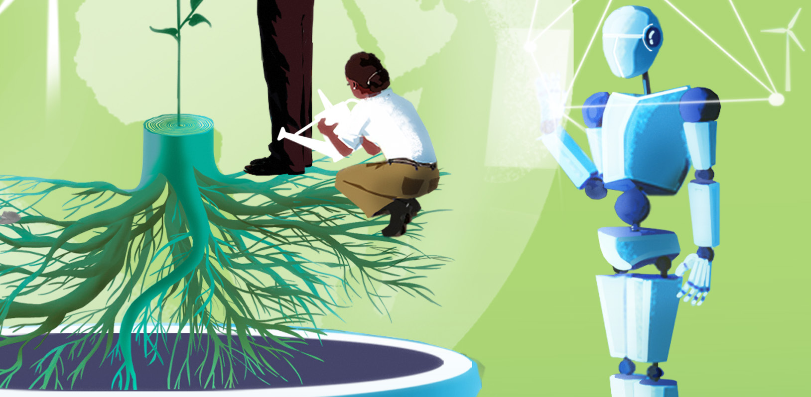

> **Descripción de la imagen** — La imagen es una ilustración conceptual dividida en dos secciones principales sobre un fondo verde claro, que contrastan elementos biológicos y tecnológicos.
>
> En el lado izquierdo, se muestra una escena de interacción con la naturaleza: hay una estructura de planta grande con raíces extensas sumergidas en un recipiente oscuro. Una persona, vestida con camisa blanca y pantalones marrones, está arrodillada junto a la base de la planta, interactuando directamente con las raíces.
>
> En el lado derecho, se presenta un robot humanoide estilizado de color azul claro y blanco, de pie. El robot emite líneas o haces de luz que se extienden hacia el fondo, conectándolo visualmente con otros puntos o nodos en el espacio. La composición sugiere una relación o conexión entre la interacción biológica (izquierda) y la tecnología robótica (derecha).

72
72

Hilton buscó nuevos talentos en comunidades

necesitadas de trabajo. La empresa contrató a

supervivientes de la trata de seres humanos,

refugiados y exreclusos, lo que creó valor para

los colaboradores y la sociedad y, al mismo

tiempo, para la empresa.9

•	 Compañía de alfombras Interface. El

camino de esta empresa mundial de pisos

comerciales hacia la neutralidad de carbono

empezó a mediados de los años noventa,

cuando los dirigentes de Interface priorizaron

la sustentabilidad medioambiental de la

empresa, incorporándola a su filosofía de

diseño, sus medidas de desempeño y su

cultura.10 La misión principal de la organización,

como se ha dicho, es “restaurar la salud del

planeta”. Esta misión se ha incorporado a la

hora de determinar qué productos diseñan y

cómo, a las evaluaciones del desempeño de los

colaboradores y a las interacciones que

impulsan el trabajo diario. La organización ya

ha alcanzado su objetivo de neutralidad de

carbono y aspira a hacerse negativa para 2040.

•	 Apple. En 2021, la empresa tecnológica

mundial añadió un modificador a su estructura

de bonos, que podría aumentar los pagos de los

ejecutivos en un 10 % en caso de que alcanzaran

objetivos de sustentabilidad predefinidos.11 La

medida se adoptó después de que un accionista

activista no consiguiera sacar adelante una

propuesta inicial en 2020, pero siguió

trabajando con los ejecutivos de Apple para

aplicar el cambio.

•	 Agencia de los Estados Unidos para el

Desarrollo Internacional (USAID). A

través de su programa Ciudades Verdes, la

organización colabora con los gobiernos locales

para aumentar el acceso a empleos

ambientalistas integradores, reducir la

contaminación, avanzar en la equidad y crear

sistemas de balance neto cero en muchas

comunidades de todo el mundo en desarrollo.12

•	 American International Group (AIG).14

La empresa mundial de servicios financieros y

seguros se ha comprometido a una

transparencia radical a través de sus informes

de sustentabilidad, que tienen en cuenta el

ecosistema en su conjunto.13 Publicado

anualmente, el informe de sustentabilidad de

AIG incluye información sobre las emisiones de

terceros, así como datos sobre la composición

de toda su estructura. La organización también

Tendencias Globales de Capital Humano 2023

---

<!-- página 75 -->

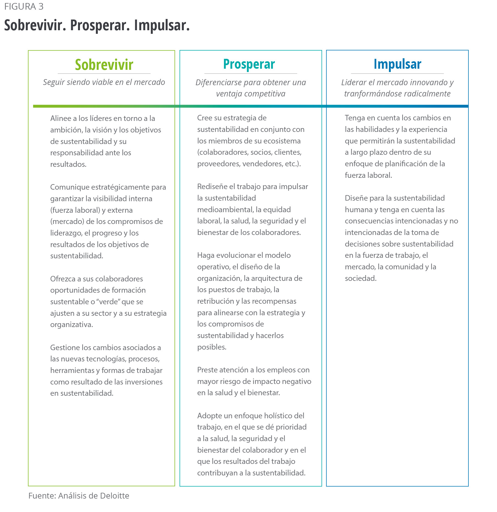

> **Descripción de la imagen** — La imagen es un diagrama conceptual estructurado en tres columnas verticales que presenta un modelo de acción o estrategia dividido en tres fases: Sobrevivir, Prosperar e Impulsar.
>
> Cada columna contiene una definición principal y una serie de puntos clave o acciones asociadas a esa fase.
>
> **Columna 1: Sobrevivir**
> *   **Definición:** Seguir siendo viable en el mercado.
> *   **Elementos/Acciones:** Incluye alinear la ambición y los objetivos con la responsabilidad; comunicar estratégicamente para garantizar la visibilidad interna y externa; ofrecer oportunidades de formación sostenible; y gestionar los cambios tecnológicos y de procesos.
>
> **Columna 2: Prosperar**
> *   **Definición:** Diferenciarse para obtener una ventaja competitiva.
> *   **Elementos/Acciones:** Se centra en crear una estrategia de sostenibilidad con el ecosistema (colaboradores, proveedores, etc.); rediseñar el trabajo para impulsar la sostenibilidad ambiental y laboral; evolucionar el modelo operativo y la arquitectura organizacional; prestar atención a los empleados en temas de salud y bienestar; y adoptar un enfoque holístico centrado en la salud y seguridad del colaborador.
>
> **Columna 3: Impulsar**
> *   **Definición:** Liderar el mercado innovando y transformándose radicalmente.
> *   **Elementos/Acciones:** Implica tener en cuenta los cambios en habilidades y experiencia para la planificación a largo plazo; diseñar para la sostenibilidad humana, considerando las consecuencias de las decisiones sobre la fuerza laboral, el mercado, la comunidad y la sociedad.
>
> El diagrama utiliza un formato de matriz o esquema para mostrar una progresión lógica de estrategias desde la viabilidad inicial (Sobrevivir) hasta la diferenciación competitiva (Prosperar) y finalmente al liderazgo

73
73

ha creado un marco centrado en la

sustentabilidad para la suscripción de seguros

que incorpora sus valores de sustentabilidad a

la mayor parte del trabajo diario.

•	 Anheuser-Busch InBev. La organización ha

adoptado un enfoque ecosistémico en sus

esfuerzos de sustentabilidad, tomando medidas

para ayudar a limpiar el agua de la que se

abastecen para producir cerveza, apoyando el

bienestar financiero de los agricultores de cuyos

cultivos se abastecen y ayudando a fabricar

cerveza segura con cultivos autóctonos para su

consumo en las comunidades locales.14 El

objetivo de la organización es operar dentro de

su ecosistema de forma simbiótica, creciendo

junto con sus proveedores, consumidores

y comunidades.
### El camino a seguir

Impulsando el elemento humano en la sustentabilidad

---

<!-- página 76 -->

74
74
### De cara al futuro

Muchas organizaciones se enfrentan a la creciente

presión de los gobiernos, las coaliciones globales,

sus comunidades y, no menos importante, sus

colaboradores actuales y futuros para que aborden

las cuestiones de sustentabilidad. Y esos

colaboradores exigen que las organizaciones

prescindan de las palabras huecas en torno a la

sustentabilidad en favor de resultados observables.

En la Encuesta Global a la Generación Z y

Millennials de Deloitte 2022, casi la mitad de los

encuestados afirmaron haber presionado

personalmente a las organizaciones para que

actuaran en temas de sustentabilidad.14 El treinta

por ciento de los colaboradores de una encuesta

externa de Deloitte de 2021 afirmaron que

considerarían cambiar de empleo para trabajar en

una empresa más sostenible desde el punto de vista

medioambiental.16 Si una organización depende de

los colaboradores y del talento -¿y qué organización

no lo hace?- tendrá que empezar a hacer progresos

significativos y cuantificables rápidamente. Dos

pasos esenciales que pueden ayudar a conseguir

este progreso son integrar la sustentabilidad

humana en la estrategia de sustentabilidad de la

organización y promover cambios de

comportamiento en todo el ecosistema de la fuerza

laboral alineados con los objetivos

de sustentabilidad.

Dejando a un lado las presiones internas y externas

de las partes interesadas y las necesidades de la

sociedad en general, los beneficios para las

empresas de aumentar su preparación para liderar

estas cuestiones son evidentes. En muchos sentidos,

los problemas representados por la sustentabilidad

sirven como un sustituto útil para todo el conjunto

de retos planteados en el informe Tendencias

Globales de Capital Humano de Deloitte 2023. En

este sentido, no debe sorprender que un análisis

estadístico más profundo de los datos de la

encuesta haya encontrado una relación clara y

predictiva entre la preparación de la organización

para abordar los retos de la sustentabilidad, la

inclusión, la confianza y el propósito y la

probabilidad de un alto rendimiento en los

resultados empresariales y de la fuerza laboral, la

relación predictiva más fuerte de cualquier grupo

de elementos en el estudio de este año.

Independientemente de los beneficios finales,

muchas organizaciones tienden a luchar para

priorizar la necesidad de sustentabilidad a largo

plazo sobre los resultados financieros a corto plazo.

Aunque la cultura y la financiación son los

principales obstáculos, también serán factores clave

para lograr el éxito en el futuro. En una entrevista

con Christine Dacre, Directora Financiera de

TransLink, señaló la importancia de aplicar un

enfoque a largo plazo y una perspectiva humana.

En su opinión, “este trabajo requiere tiempo y

mucha inversión inicial, lo que puede resultar difícil

cuando no se ven necesariamente los beneficios de

inmediato. Además, hay que mirar más allá de la

propia empresa, a todo el ecosistema, incluidos los

proveedores, la infraestructura y la tecnología

existentes. Se necesita mucha colaboración entre

las partes interesadas, porque ninguna organización

puede hacerlo sola”.17

Tendencias Globales de Capital Humano 2023

---

<!-- página 77 -->
### Agradecemos a Karen Cunningham y Laura Richards por sus contribuciones en el análisis para

coescribir el capítulo de “Avanzar en el elemento humano de la sostenibilidad” de las Tendencias

Globales de Capital Humano de 2023.
### Agradecemos a Lane Eisenburg por su liderazgo en el desarrollo de este capítulo, y Tina Chung, Bill
### Fegan, Dan Firestone y Caitlin Nasseraddin por sus contribuciones en el análisis para coescribir el

capítulo de “Avanzar en el elemento humano de la sostenibilidad” de las Tendencias Globales de

Capital Humano de 2023.
### 75
### 75
## Notas finales

1
La crisis climática exige una rápida transformación de las sociedades; Programa de Medio Ambiente de las
Naciones Unidas, Emissions Gap Report 2022, Octubre 27, 2022.

2.
Deloitte, 2022 Deloitte CxO Sustainability Report, accedido el 9 de Diciembre, 2022.

3.
Jeff Schwartz et al., The worker-employer relationship disrupted, Deloitte Insights, Julio 21, 2021.

4.
LinkedIn Economic Graph, Global Green Skills Report 2022, accedido en Diciembre 9, 2022.

5.
Dr. Pradeep Philip, Claire Ibrahim, and Emily Hayward, Work toward net zero: The rise of the green collar
workforce in a just transition, Deloitte, Noviembre 2022.

6.
Schwartz et al., The worker-employer relationship disrupted.

7.
Everlane, 2021 Impact Report, accedido el 9 de Diciembre, 2022.

8.
Sue Cantrell et al., The skills-based organization: A new operating model for work and the workforce, Deloitte
Insights, Noviembre 2, 2022.

9.
Amber Burton and Paolo Confino, “Hilton is hiring refugees, human trafficking survivors, and the

formerly incarcerated to combat hospitality worker shortage,” Fortune, Octubre 14, 2022.

10.	 	 Interface, “Sustainability is in our DNA,” accedido el 9 de Diciembre, 2022.

11
.	Eric Rosenbaum, “Apple’s new executive bonus formula is designed for the fast-changing world we live in,”
CNBC, Enero 16, 2021.

12
.	USAID, “New green cities program: A field support mechanism to advance integrated urban programming,”
Climate Links, Julio 21, 2022.

13
.	AIG, “Reimagining What AIG Can Do,” accedido el 1 de Enero, 2023.

14
.	Deloitte, 2021 Global Human Capital Trends special report, accedido el 9 de Diciembre, 2022.

15.	 	 Deloitte, Striving for balance, advocating for change: The Deloitte Global 2022 Gen Z and Millennial Survey,
accedido el 9 de Diciembre, 2022.

16.	 	 Stephen Rogers, We’ve had a lot of time to think, and we’re thinking a lot about time, Deloitte Insights, Abril
11, 2022.

17.	 	 Deloitte, 2022 Deloitte CxO Sustainability Report.
## Agradecimientos

Impulsando el elemento humano en la sustentabilidad

---

<!-- página 78 -->

> **Descripción de la imagen** — Es una ilustración conceptual que representa una reunión o discusión en un entorno de aprendizaje digital.
>
> En primer plano, siete personas están sentadas alrededor de una mesa grande y ovalada de color rojo oscuro. Las personas varían en edad y apariencia; algunas están sentadas en sillas tradicionales, mientras que una persona está sentada en una silla de ruedas. Varias de las personas interactúan con dispositivos electrónicos, como tabletas y computadoras portátiles, y algunos tienen documentos sobre la mesa.
>
> El fondo está dominado por una pared de color verde azulado claro. Sobre la mesa y detrás de los participantes, hay proyecciones o pantallas translúcidas que muestran elementos digitales abstractos relacionados con el conocimiento, tales como gráficos, iconos, siluetas de personas, símbolos de búsqueda y advertencias, sugiriendo un tema de tecnología, investigación o educación. La iluminación general es brillante y enfocada en la actividad de la reunión.

76
76
## Elevando el foco al riesgo humano
## Abrir el obturador y cambiar la lente de los riesgos para centrarse
## en el elemento humano
### Coescrito por Zac Shaw.
## C

UANDO SE TRATA de riesgos relacionados

con el personal, las organizaciones y sus

máximos responsables se centran en un

conjunto limitado de riesgos de la fuerza laboral:

los riesgos potenciales que los colaboradores

humanos plantean a la empresa. Estos riesgos

incluyen preocupaciones operativas como la

rotación de colaboradores, la baja eficiencia, la

dificultad para atraer y retener talento y el

cumplimiento de la normativa. Por lo general, su

enfoque principal, si es que lo tienen, ha sido el

impacto financiero y operativo de estos riesgos. Los

directivos miembros de la C-suite y los consejos

sólo ocasionalmente han ampliado su enfoque para

incluir sus implicaciones para la reputación y, más

raramente, sus efectos humanos.

A medida que las direcciones y los miembros de las C-suites se enfrentan a una creciente lista de riesgos
externos perturbadores -entre los que se incluyen cuestiones medioambientales, sociales, tecnológicas,
políticas y económicas-, deben considerar la posibilidad de ampliar su enfoque más allá de los efectos
operativos y financieros de esos riesgos, para incluir las implicaciones humanas. Es imperativo que
comprendan que el impacto de estos riesgos perturbadores en los seres humanos (tanto dentro como
fuera de las organizaciones) es sustancial, como lo es el vínculo entre el impacto humano y el de la
organización en general. Ver estos riesgos perturbadores a través de una lente humana allana el camino
para lograr una mayor capacidad de recuperación, permite resultados empresariales superiores y crea un
conjunto más eficaz e informado de soluciones para mitigar -y prosperar frente a- estas perturbaciones.

---

<!-- página 79 -->

77
77

“La mayoría de los consejos no están

tratando los riesgos humanos como una

cuestión estratégica.”

— Mike Fucci, miembro del consejo de Acadia

Healthcare and Flotek Industries; presidente

retirado de Deloitte

Sin embargo, todos los riesgos tienen un

importante elemento humano. Algunos afectan

sobremanera a los seres humanos. Otros se ven

afectados e impulsados en cierta medida por los

seres humanos. Como tales, nos referimos a ellos

como riesgos humanos porque afectan a las vidas

profesionales y personales de los individuos de

forma palpable, además del impacto que tienen en

el desempeño a corto plazo, la viabilidad a largo

plazo, la reputación y la marca de su organización.

Dada la importancia de estos riesgos humanos,

requieren la misma atención e inversiones que las

medidas tradicionales de riesgos. Sin embargo, los

resultados de la encuesta Tendencias Globales de

Capital Humano de Deloitte 2023 muestran que

falta este nivel de priorización de los riesgos

humanos en varias dimensiones:

•	 Medioambientales. El cambio climático y la

disponibilidad de recursos naturales podrían

alterar profundamente la disponibilidad, la

ubicación y las condiciones del trabajo, así

como la fuerza laboral. Según la encuesta

Tendencias Globales de Capital Humano de

Deloitte 2023, sólo el 18% de los encuestados

cree que el clima será uno de los principales

riesgos a los que se enfrentará su organización

en los próximos 2-4 años; sin embargo, hay

indicios claros de que este fenómeno seguirá

influyendo en el lugar, la forma y la

disponibilidad local de los colaboradores.

•	 Sociales. La injusticia y la desigualdad no se

detienen en la puerta del lugar de trabajo. Estas

cuestiones sociales pueden afectar a cómo se

sienten los colaboradores en el trabajo, cómo

colaboran y su sentido de valor y pertenencia a

su organización. Según la Encuesta Global a la

Gen Z y Millennials de Deloitte 2022, dos de

cada cinco colaboradores han rechazado un

trabajo o asignación porque no se alineaba con

sus valores en cuanto al impacto social y

medioambiental y/o culturas diversas e

inclusivas. Sin embargo, solo el 12% de los

encuestados en la encuesta Tendencias Globales

de Capital Humano de Deloitte 2023 creen que

la injusticia social y racial tendrá un impacto

sustancial en la fuerza laboral en los próximos

2-4 años.

•	 Tecnológicos. La privacidad y la seguridad de

los datos, el trabajo virtual y la automatización

son vitales para la salud de las empresas, pero

también configuran la experiencia de hacer el

trabajo y los tipos de trabajo disponibles para

los humanos. Sin embargo, sólo el 9% de los

encuestados en el estudio Tendencias Globales

de Capital Humano de Deloitte 2023 señaló que

sus organizaciones creen que la sustitución de

los humanos por la tecnología es uno de los

principales riesgos a los que se enfrenta su

fuerza de trabajo en la actualidad. Y sólo el 21%

cree que los riesgos cibernéticos, como la

privacidad y la seguridad de los datos, tendrán

un impacto significativo en la fuerza laboral.

•	 Económicos. El impacto de las disparidades

de ingresos - incluido el acceso a la atención de

la salud, la alimentación y la educación - afecta

a las capacidades y el esfuerzo que las personas

aportan a su trabajo, pero sólo el 30% de los

encuestados reconoce las repercusiones de este

riesgo en la fuerza laboral.

•	 Políticos: La regulación gubernamental y la

polarización o los conflictos políticos influyen

profundamente en la naturaleza de la relación

colaborador-organización y en las relaciones

que los colaboradores mantienen entre sí,

sinembargo, sólo el 24% de los encuestados por

Tendencias Globales de Capital Humano de

Deloitte 2023 esperan que esto tenga un

Elevando el foco al riesgo humano

---

<!-- página 80 -->

78
78
### SEÑALES: ESTA TENDENCIA SE APLICA A USTED SI...

•	 Su organización carece de los datos necesarios para informar sobre un amplio conjunto de riesgos
humanos

•	 Se esfuerza por comprender qué es lo que está mermando la capacidad de la organización para
recuperarse de acontecimientos inesperados o interrupciones de su actividad

•	 El consejo y la alta dirección (C-suite) esperan y necesitan datos más transparentes sobre el
personal para tomar decisiones básicas

impacto significativo en su estructura en los

próximos 2-4 años.

Estos riesgos no se producen en el vacío: los riesgos

económicos a menudo impulsan a los sociales, los

riesgos medioambientales imponen diferentes

cargas a la tecnología, etcétera. El hilo común es

que todos estos riesgos tienen un impacto humano

distinto. Este impacto debe abordarse no sólo en la

mesa de la estrategia, sino en la vida cotidiana de

los seres humanos de todo el ecosistema que

contribuyen a su negocio.
### La brecha de preparación

Según la encuesta Tendencias Globales de Capital

Humano de Deloitte 2023, el 81% de los

encuestados reconoce la importancia de prever y

tener en cuenta riesgos sociales y

medioambientales más amplios, como la

inestabilidad política y la injusticia social, a la hora

de tomar decisiones sobre la fuerza laboral. Sin

embargo, menos del 19% cree que sus

organizaciones están muy preparadas para abordar

esos riesgos a la hora de tomar decisiones sobre

su personal.

El enfoque actual de la gestión del riesgo de la

fuerza laboral es insuficiente, ya que sólo el 44% de

los ejecutivos de la  encuesta de Deloitte sobre el

“Riesgo de la fuerza laboral”1 creen que las métricas

relacionadas con el riesgo que capturan sus

organizaciones ofrecen una visión adecuada de la

exposición actual al riesgo de la fuerza laboral. Esa

cifra desciende al 34% cuando se pide a los

ejecutivos que evalúen su preparación para los

próximos tres años.
### Los nuevos fundamentos

Considerar un conjunto más amplio de

riesgos y crear un marco para supervisarlos.

Centrarse en los riesgos humanos requiere un

marco más amplio que tenga en cuenta la

complejidad y el dinamismo del mundo del trabajo

actual. Esto significa ir más allá de los modelos

anticuados que sólo tienen en cuenta un conjunto

limitado de factores internos, como los roles

abiertos, los planes de sucesión y la seguridad de la

fuerza laboral, para tener en cuenta un conjunto

más amplio de riesgos humanos tanto internos

como externos. Este nuevo marco debe examinar

de forma exhaustiva qué trabajo se realiza, cómo se

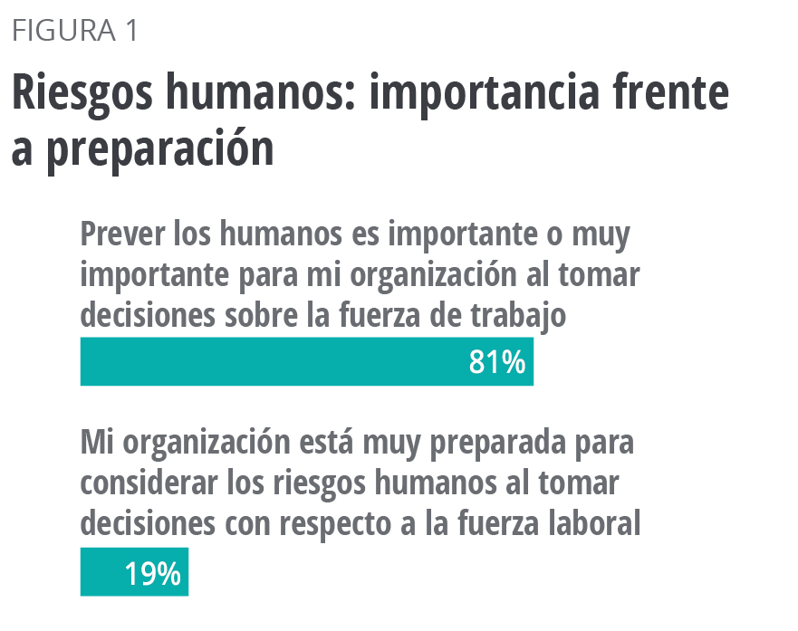

> **Descripción de la imagen** — La figura es una representación estadística que compara dos porcentajes relacionados con los riesgos humanos y la preparación organizacional.
>
> Se presentan dos barras horizontales de color turquesa:
>
> 1.  La primera barra muestra el 81%, asociado a la afirmación sobre la importancia de prever a los humanos al tomar decisiones sobre la fuerza de trabajo.
> 2.  La segunda barra muestra el 19%, asociado a la afirmación sobre si la organización está muy preparada para considerar los riesgos humanos al tomar decisiones con respecto a la fuerza laboral.

## Figure 1: The readiness gap for human riskFuente: Encuesta Tendencias Globales de Capital Humano 2023

Tendencias Globales de Capital Humano 2023

---

<!-- página 81 -->

79
79

realiza y dónde se realiza. También debe tener en

cuenta el bienestar de las comunidades en las que

opera la organización, el bienestar de los

colaboradores y la empleabilidad a largo plazo de

los colaboradores, y si la organización está

“haciendo a prueba del futuro” a los colaboradores,

ayudándoles a adquirir habilidades y capacidades

transferibles.

Incluso bajo el estrecho prisma actual del riesgo de

la fuerza laboral, pocas organizaciones cumplen los

objetivos. Según nuestra encuesta sobre “Riesgos

laborales#, sólo el 40% de las organizaciones

tienen una definición clara de los riesgos laborales

y menos del 10% de los ejecutivos dicen estar

satisfechos con la forma en que su organización

supervisa los riesgos. Esto es especialmente

preocupante dado el limitado conjunto de medidas

de riesgo actuales, con pocas organizaciones que

tengan en cuenta métricas ampliadas como el

impacto de la inclusión (27%) o la parte

medioambiental, social y de gobierno (ESG) (16%)

en la fuerza laboral.

Para quienes lo hacen bien, no hay duda de los

beneficios que le aporta a su empresa. La misma

encuesta reveló que las organizaciones que crean

más estructura y disciplina en torno a la gestión de

los riesgos humanos obtienen mejores resultados

empresariales. Estas organizaciones tienen más

probabilidades de superar a sus homólogas en

rentabilidad, eficiencia operativa, satisfacción de

los colaboradores y reconocimiento de marca.

Crear agilidad organizativa ampliando los

conocimientos. Los riesgos humanos no siguen

el calendario de planificación de una organización.

Por el contrario, surgen rápidamente y a menudo

encuentran a las organizaciones con la guardia baja

y hacen que los directivos salgan corriendo a

responder. Más allá de determinar definiciones

coherentes e instituir un marco de riesgos

humanos, las organizaciones necesitan mejorar la

planificación empresarial y las medidas de riesgo

continuas para evaluar el progreso de forma más

oportuna. Sin embargo, sólo el 40% de las

organizaciones encuestadas afirman estar

aplicando datos y análisis para detectar mejor los

riesgos humanos emergentes y prepararse para

ellos. Y sólo el 43% tiene previsto hacerlo en los

próximos 2-4 años.

La capacidad de generar estos análisis depende de

una infraestructura de datos integrada que pueda

incorporar factores de riesgo humano ampliados y

proporcionar perspectivas consumibles para la

respuesta de la organización. Por ejemplo,

considere cómo una mejor comprensión del riesgo

humano, que incluya los factores de la fuerza

laboral y el panorama económico, político,

tecnológico, social y medioambiental más amplio,

podría influir en la toma de decisiones

empresariales. Esto podría incluir la determinación

de dónde abrir una nueva planta de fabricación,

qué programas de capacitación y beneficios

laborales ofrecer, o cómo una organización planea

apoyar a los colaboradores, reorientar las cadenas

de suministro, o pivotar los profesionales de

negocios en caso de una emergencia climática o de

salud pública.

Incluso en los casos en que los análisis no sean

predictivos, aumentan la agilidad de la

organización al proporcionar una base que permite

adoptar, evaluar y ajustar rápidamente las medidas

en momentos de crisis. Y los conocimientos

generados permitirán a las organizaciones

centrarse en un amplio conjunto de riesgos

humanos: financieros, operativos, normativos, de

reputación y de marca.

Inculcar la responsabilidad a nivel directivo para

que se extienda por toda la organización. El

limitado énfasis puesto en la gestión del riesgo

humano ha recaído tradicionalmente en el director

de recursos humanos de una organización y, en

ocasiones, en su director financiero. Incluso el

simple conocimiento o comprensión del riesgo

relacionado con el personal parece ser limitado

fuera del departamento de recursos humanos.

Elevando el foco al riesgo humano

---

<!-- página 82 -->

80
80

“La forma más ineficaz de abordar los

riesgos humanos es decir que se trata de

una cuestión exlusiva de RR.HH.”

— Mike Fucci, miembro del consejo de Acadia

Healthcare and Flotek Industries; presidente

retirado de Deloitte

Según la encuesta sobre “Riesgos laborales” de

Deloitte, sólo el 40% de los miembros de los

consejos tienen conocimientos especializados sobre

los riesgos relacionados con el personal. Los

actuales riesgos globales pueden tener un efecto

material en la viabilidad a largo plazo de una

empresa y deben ser plenamente comprendidos

por todos los ejecutivos, pero especialmente por los

miembros de los consejos. Los consejos deben

asumir la responsabilidad de los riesgos humanos

al servicio de las necesidades de los inversores y las

partes interesadas de hoy y de mañana, lo que

requiere algo más que crear o ampliar los

subcomités existentes para que asuman

la responsabilidad.

La responsabilidad no puede acabar en el consejo.

Por el contrario, debe extenderse por toda la

organización para que la supervisión y la

preparación ante los riesgos humanos se

conviertan en una forma de operar. Sin embargo,

sólo el 39% de los encuestados en nuestra encuesta

sobre riesgos laborales señalaron que los

responsables de línea tienen un conocimiento

experto de los riesgos relacionados con la fuerza

laboral. Estos directivos suelen ser los que están

más cerca y en sintonía con el sentir de los

colaboradores sobre el terreno. Crear una conexión

humana entre los colaboradores y con la

organización puede ayudar a prevenir los riesgos

humanos, del mismo modo que los vecinos sienten

la responsabilidad compartida de velar por su calle.

Como ya se ha comentado en otras partes de este

informe, el diálogo continuo entre la organización y

sus colaboradores es un componente crítico para

implicar y activar a los colaboradores en lo que se

refiere a los riesgos humanos.

> **Descripción de la imagen** — Es una ilustración de estilo caricaturesco que muestra a un grupo de cuatro personas sentadas alrededor de una mesa redonda grande de color rojo oscuro. El ambiente sugiere una reunión o discusión.
>
> Los elementos visuales son:
> 1.  **Personajes:** Hay cuatro individuos. Un hombre mayor con gafas y camisa blanca está de pie detrás de la mesa, mirando hacia el centro. Una mujer con una blusa amarilla está sentada en el lado derecho de la mesa. Un hombre vestido con traje oscuro está sentado en primer plano, de espaldas al espectador. A la izquierda, hay otro hombre con gafas y camisa clara sentado a la mesa.
> 2.  **Objetos:** Sobre la mesa se observan varios dispositivos electrónicos, incluyendo una computadora portátil abierta frente al hombre en primer plano, y otras pantallas o portátiles dispersas entre los participantes.
> 3.  **Composición:** La escena está ambientada en un espacio interior con paredes de color azul verdoso claro. La composición enfoca la interacción del grupo alrededor de la mesa.

### Experimentos actuales:
### ¿Qué están explorando las
### principales organizaciones?

•	 Gard: Este proveedor mundial de seguros, con

sede en Noruega, lleva a cabo activamente una

planificación de escenarios entorno a los riesgos

potenciales, incluidos los que afectan a la fuerza

laboral. La empresa elabora una amplia lista de

riesgos potenciales relacionados con la

socioeconomía, el medio ambiente, la

geopolítica y la tecnología, y pregunta al

consejo y a los gerentes cuál consideran más

probable. A continuación, Gard lleva a cabo una

planificación de escenarios entorno a

estos riesgos con grupos de trabajo

interfuncionales para identificar

posibles soluciones.2

•	 MetLife: El proveedor mundial de seguros

atribuye la responsabilidad de los riesgos ESG

al consejo, que se reúne periódicamente con los

ejecutivos para examinar la información y

evaluar los riesgos climáticos. La organización

está desarrollando actualmente la capacidad de

realizar pruebas de estrés y planificar

escenarios entorno al cambio climático.3

Tendencias Globales de Capital Humano 2023

---

<!-- página 83 -->

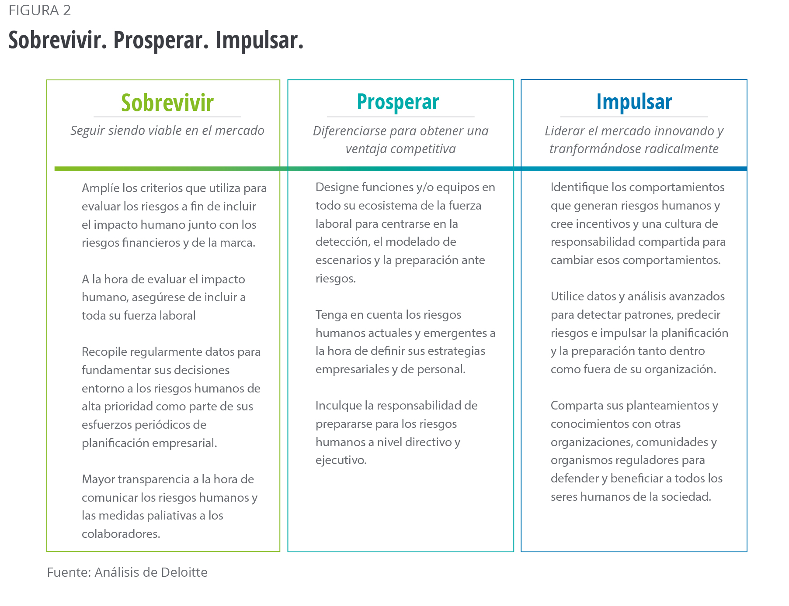

> **Descripción de la imagen** — La imagen es un diagrama conceptual estructurado en tres columnas verticales, bajo el título principal "Sobrevivir. Prosperar. Impulsar.". Cada columna representa una estrategia o enfoque distinto y contiene un título, una breve definición y una lista de puntos clave.
>
> 1.  **Columna 1: Sobrevivir**
>     *   Título: Sobrevivir.
>     *   Definición: Seguir siendo viable en el mercado.
>     *   Contenido: Incluye varios puntos sobre ampliar criterios para evaluar riesgos (humanos, financieros y de marca), asegurar la inclusión de toda la fuerza laboral en la evaluación del impacto humano, recopilar datos para fundamentar decisiones, y aumentar la transparencia al comunicar riesgos y medidas paliativas a los colaboradores.
>
> 2.  **Columna 2: Prosperar**
>     *   Título: Prosperar.
>     *   Definición: Diferenciarse para obtener una ventaja competitiva.
>     *   Contenido: Se centra en diseñar funciones y equipos dentro del ecosistema de la fuerza laboral, centrarse en la detección y modelado de escenarios de riesgos, considerar los riesgos humanos actuales y emergentes al definir estrategias empresariales y personales, e inculcar la responsabilidad de prepararse para los riesgos humanos a nivel directivo y ejecutivo.
>
> 3.  **Columna 3: Impulsar**
>     *   Título: Impulsar.
>     *   Definición: Liderar el mercado innovando y transformándose radicalmente.
>     *   Contenido: Se enfoca en identificar los comportamientos que generan riesgos humanos, crear incentivos y una cultura de responsabilidad compartida para cambiar dichos comportamientos, utilizar datos y análisis avanzados para detectar patrones, predecir riesgos e impulsar la planificación, y compartir planteamientos con otras organizaciones y organismos reguladores.
>
> En resumen, el diagrama presenta un marco estratégico dividido en tres pilares interconectados: Sobrevivir, Prosperar e Impulsar.

81
81

•	 Departamento del Tesoro de Estados

Unidos: La Oficina del Servicio Fiscal ha

comenzado a adoptar una visión más amplia de

los riesgos que evalúa, incluidos los riesgos

laborales, que ahora forman parte de su marco

de riesgos empresariales. La agencia también

tiene previsto mejorar sus capacidades de datos

y análisis para apoyar aún más la evaluación y

la toma de decisiones en torno a los riesgos.4
### El camino a seguir

Elevando el foco al riesgo humano

---

<!-- página 84 -->

82
82
### De cara al futuro

Un enfoque centrado en el ser humano y predictivo

de la gestión de riesgos requiere un importante

cambio de mentalidad tanto para los directivos

como para los colaboradores, así como una

inversión adicional. Sin embargo, los peligros de

mantener el statu quo superan con creces los

costos de la mejora. Los directivos que no den

prioridad a un enfoque de la gestión de riesgos más

amplio y centrado en el ser humano podrían

encontrarse en desacuerdo con los miembros del

consejo y otras partes influyentes, cada vez más

interesadas en cómo se gestionan los riesgos

humanos.

Aunque en última instancia el consejo debe rendir

cuentas, se necesitará a toda la fuerza de trabajo

para ocuparse eficazmente de los riesgos humanos.

Muchos riesgos humanos están causados por

“problemas perversos”, en el sentido de que son

retos sociales complejos, dinámicos y

aparentemente insolubles.5 El mismo tipo de

pensamiento ecosistémico en el que se basan las

estrategias empresariales puede aplicarse a los

riesgos humanos, aprovechando el talento y los

recursos de los colaboradores, los directivos y las

comunidades en las que operan para crear

soluciones conjuntas.

Las organizaciones líderes siguen ampliando sus

capacidades de detección y colaborando con los

colaboradores para predecir y planificar todas las

formas de riesgo humano. Las que no lo hagan

pronto se verán superadas y abrumadas por los

nuevos retos y riesgos disruptivos, e incapaces de

reaccionar con eficacia, y mucho menos de

aprovechar las nuevas oportunidades. Seguir

aplicando a la gestión de riesgos una perspectiva

tradicional centrada en la empresa puede indicar a

los colaboradores, e incluso a los clientes, que la

organización no da prioridad a los colaboradores,

lo que en última instancia puede afectar

negativamente a los resultados financieros y

operativos, la reputación y la marca de la

organización.

Tendencias Globales de Capital Humano 2023

---

<!-- página 85 -->

83

Agradecemos a Zac Shaw por sus contribuciones en el análisis para coescribir el capítulo de “Elevar el

enfoque en el riesgo humano” de las Tendencias Globales de Capital Humano de 2023.

Agradecemos a Mike Fucci por sus contribuciones en el análisis para coescribir el capítulo de “Elevar

el enfoque en el riesgo humano” de las Tendencias Globales de Capital Humano de 2023.

Agradecemos a Lane Eisenburg por su liderazgo en el desarrollo de este capítulo y a Caitlin

Nasseraddin por sus contribuciones en el análisis para coescribir el capítulo de “Elevar el enfoque en

el riesgo humano” de las Tendencias Globales de Capital Humano de 2023.

83
## Notas finales

1.
Deloitte, Encuesta del riesgo de la fuerza laboral: evaluando la C-Suite, comité, Agosto 22, 2022.

2.
Torunn Biller White, “Navigating new and emerging risk – an interview with Gard’s Chief Risk Officer,” Gard,
Mayo 28, 2020.

3.
MetLife, “Managing risk,” accedido el 9 de Diciembre, 2022.

4.
Jason Miller, “Culture of risk management beginning to emerge at the Fiscal Service,” Federal News Network,
Octubre 4, 2022.

5.
William D. Eggers and Anna Muoio, Wicked opportunities, Deloitte University Press, accedido el 9 de Diciembre,
2022.
## Agradecimientos

Elevando el foco al riesgo humano

---

<!-- página 86 -->

> **Descripción de la imagen** — Es una ilustración que representa un concepto de colaboración o superación de desafíos. Muestra dos grupos de personas interactuando a través de una barra horizontal.
>
> En la parte superior, ocho figuras están caminando o paradas sobre una viga horizontal que se extiende a lo largo del centro de la imagen.
>
> En la parte inferior, seis figuras están situadas debajo de la viga y están extendiendo sus manos hacia arriba para sujetarla, creando un puente visual entre los dos niveles.
>
> Las figuras en la parte superior están distribuidas uniformemente a lo largo de la barra. Las figuras en la parte inferior se agrupan bajo la barra, interactuando con ella. El fondo es de color beige claro y el área debajo de la viga muestra una representación del suelo o un paisaje.

84
84
## Liderando en un mundo sin fronteras
## Cambiar la forma de liderar e influir sobre los demás

Querido líder,

Su organización se enfrenta a un momento crucial

de replanteamiento, y usted también, ya que los

cambios empresariales y sociales siguen

modificando la trayectoria de las agendas humanas

de las organizaciones para prosperar en una era

de disrupción.

Estamos dejando atrás un mundo más sencillo y

compartimentado para adentrarnos en otro sin

fronteras. Como tal, tanto la definición de líder como

la labor de liderar han cambiado.

¿Cómo se lidera en un mundo sin fronteras en el que el trabajo ya no se define por los puestos, el lugar

de trabajo no es un sitio concreto, muchos de los colaboradores más importantes no son colaboradores
tradicionales y el liderazgo no viene determinado por el organigrama? Para prosperar, los líderes deben
evolucionar a la par que sus organizaciones y adoptar un nuevo conjunto de fundamentos para movilizar
a colaboradores y equipos hacia nuevos resultados.
### CINCO DISCONTINUIDADES QUE VIENEN1

•	 Ciencia y tecnología radicales: La próxima ola
de progreso exponencial

•	 Cambio al capitalismo de las partes
interesadas: La inevitable internalización de
las “externalidades”

•	 La globalización se reinventa y vuelven los
gobiernos activos

•	 Decadencia de la “teoría de la empresa” y
auge de la “teoría del ecosistema”: Una nueva
unidad estratégica de análisis

•	 Auge del poder en red: El poder por defecto
está pasando de las jerarquías a las redes

---

<!-- página 87 -->

85
85

El liderazgo ya no depende del cargo, la jerarquía o el

número de subordinados directos. Hoy en día, un

líder puede ser cualquiera que movilice a los

colaboradores para que hagan su trabajo, tengan o no

relaciones formales de subordinación e

independientemente de que estén dentro o fuera de

la organización.

Como líder, los métodos probados con los que usted

ha dirigido su organización están siendo

cuestionados, al igual que las técnicas de gestión de

eficacia probada en las que ha llegado a confiar. De

hecho, los participantes en la encuesta Tendencias

Globales de Capital Humano de Deloitte 2023

clasificaron sistemáticamente el liderazgo entre los

cinco principales obstáculos para siete de las nueve

tendencias que analizamos. La oportunidad que

presenta este momento para liderar de nuevas

formas es enorme.
### EXPECTATIVAS ELEVADAS PARA LA ALTA DIRECCIÓN (C-SUITE)

La actual definición ampliada de liderazgo significa que las personas de todos los niveles se
movilizan ante las nuevas oportunidades que presenta un mundo sin fronteras. La consideración
clave para los ejecutivos de la C-suite es cómo aprovechar esta energía de manera que avance en
los objetivos compartidos de la organización sin sofocar la innovación y la agilidad a nivel de equipo.

Para ello será necesaria una c-suite más sinfónica que nunca,2 que trabaje en armonía
para inspirar a sus organizaciones con nuevas medidas de éxito y que responsabilice a
los líderes de todos los niveles de esa visión compartida. Sólo las c-suites que trabajen en
equipo podrán alcanzar el nivel de vulnerabilidad necesario para prosperar en un mundo sin
fronteras. Eso incluye la vulnerabilidad de estar dispuesto a experimentar, probar y fracasar, y
la vulnerabilidad de operar con un mayor nivel de transparencia y empatía que nunca.

En mayo de 2020, en medio de la pandemia de COVID-19 que estaba ejerciendo una inmensa
presión sobre la organización, el Director Ejecutivo de AdventHealth, Terry Shaw, se llevó a
los miembros clave de su equipo ejecutivo a un lugar fuera de la organización para debatir
el futuro de ésta. Siguiendo el consejo de su coach ejecutivo, los líderes se centraron en dos
áreas: 1) lo que la pandemia les había enseñado sobre su organización y lo que ellos, como
líderes, llevarían adelante, y 2) cómo debía cambiar y adaptarse la organización para salir de la
pandemia preparados para la siguiente serie de perturbaciones que pudiera traer el mercado.

“La pandemia no había terminado, pero pasamos dos semanas diseñando muchas cosas para

nuestro futuro que ahora ya están instaladas o se están instalando. “

—- Terry Shaw, Director Ejecutivo de AdventHealth

“Cambió la trayectoria de nuestra organización e incidió en el enfoque que teníamos para

garantizar que nuestra empresa estuviera preparada para el futuro más allá de hacer frente a la

pandemia de ese momento”.

—- Olesea Azevedo, Directora de Personal (Chief People Officer) de AdventHealth

Liderando en un mundo sin fronteras

---

<!-- página 88 -->

86
86

Los fundamentos entorno a dónde y cómo uno

aparece, o la mentalidad que uno adopta para

impulsar el trabajo, han cambiado. En un mundo

en el que existen líderes a todos los niveles, usted

debe convertirse en un orquestador. Esto implica

crear valor en conjunto con sus colaboradores y

equipos, reunir a la gente entorno a una idea y

crear influencia. Quienes tengan éxito lo harán en

beneficio de la organización, los colaboradores y la

sociedad en general.

“A todos los niveles, tenemos que liderar de

forma que todo el barco vaya más rápido.

Para ello, nos centramos implacablemente

en la transparencia. Para nuestros

ejecutivos, esto significa que su trabajo no

consiste en tomar decisiones por los

demás, sino en plantear interrogantes

realmente acertadas y facultar a sus

equipos para que tomen decisiones.

También se destaca la importancia de la

transparencia y responsabilidad por los

resultados (outcomes) frente a los

productos (outputs), lo que incluye celebrar

abiertamente los éxitos y preguntarse

“¿Qué podemos aprender de esto?” cuando

las cosas no van bien. Esto conduce a

mejores resultados en el futuro”.

— Neil Walker-Neveras, Director de Talentos,

M&T Bank.

Su influencia como líder nunca ha sido tan necesaria.

Su papel nunca ha sido más difícil.
### La brecha del liderazgo

Los encuestados en el estudio Tendencias Globales

de Capital Humano de Deloitte 2023 nos

manifestaron que el liderazgo es más importante

que nunca y cada vez más difícil de encontrar. El

94% de los encuestados cree que las capacidades de

liderazgo y la eficacia son importantes o muy

importantes para el éxito de su organización, lo

que representa la puntuación más alta de todas las

tendencias. Sin embargo, sólo el 23% cree que los

líderes de su organización tienen actualmente las

capacidades de manejo necesarias en un mundo

distorsionado y sin fronteras definidas.

La falta de preparación puede deberse a una falta

de comprensión de las implicaciones y

oportunidades del nuevo mundo en el que estamos

ingresando. Por ejemplo, menos del 15% de los

encuestados cree que sus organizaciones cuentan

con líderes que están muy preparados para dirigir

de forma inclusiva una fuerza de trabajo en

expansión, o para tener en cuenta riesgos sociales y

medioambientales más amplios a la hora de tomar

decisiones. Sólo el 16% cree que sus líderes están

muy preparados para utilizar la tecnología para

mejorar los resultados y el rendimiento del equipo,

y sólo el 18% cree que sus líderes están muy

preparados para desarrollar el modelo de lugar de

trabajo adecuado para su organización.

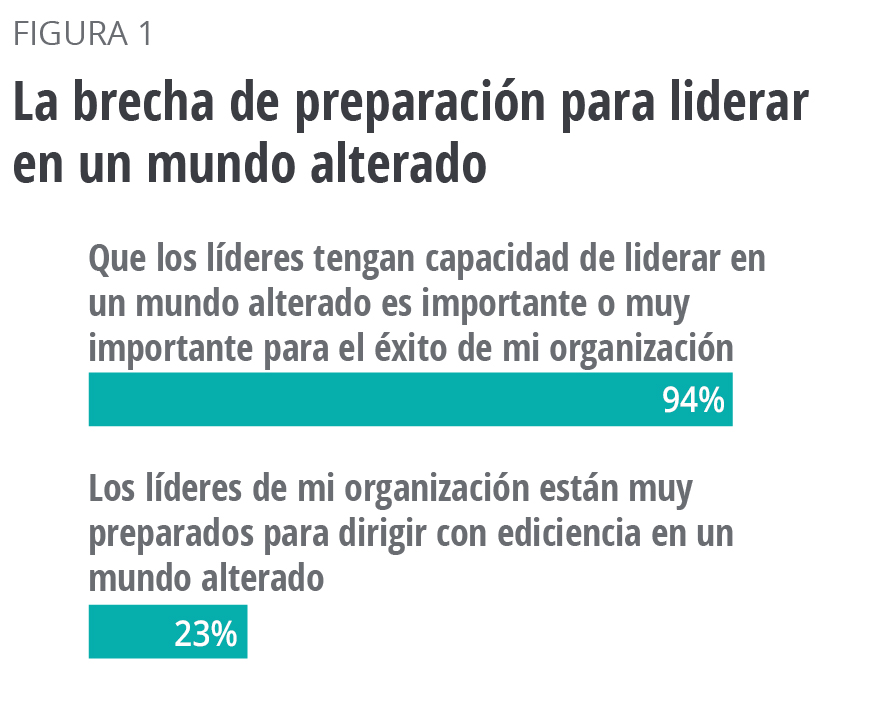

> **Descripción de la imagen** — La figura presenta dos estadísticas visualizadas mediante barras horizontales de color turquesa/azul.
>
> 1. **Primera estadística:** Una barra que muestra el 94%, asociada a la afirmación sobre la importancia o gran importancia de que los líderes tengan capacidad de liderar en un mundo alterado para el éxito de la organización.
> 2. **Segunda estadística:** Una barra que muestra el 23%, asociada a la afirmación sobre el nivel de preparación de los líderes de la organización para dirigir con idoneidad en un mundo alterado.

### Reimaginar el liderazgo

Es probable que la creciente brecha de liderazgo no

se deba a una falta de habilidades o competencias.

Por el contrario, es más probable que sea el

resultado de ver el trabajo y a los colaboradores a

través de la óptica de ayer, basada en las

definiciones y los límites de ayer. En un mundo sin

fronteras, el liderazgo tiene menos que ver con la

autoridad formal y la jerarquía y más con el uso de

la perspicacia, la responsabilidad personal, la

conexión con los valores y la acción. Esto significa

Fuente: Encuesta Tendencias Globales de Capital Humano 2023

Tendencias Globales de Capital Humano 2023

---

<!-- página 89 -->

87
87

que usted tendrá que activar sus equipos y su lugar

de trabajo de maneras diferentes, lo que le obligará

a cuestionar sus suposiciones sobre lo que es la

organización, quién está en ella y cómo funciona.

Pero ¿por dónde empezar? Casi la mitad de los

encuestados afirman que a los líderes de sus

organizaciones les resulta difícil identificar las

prioridades porque se sienten abrumados por la

cantidad y la frecuencia de los cambios

perturbadores que se están produciendo. En este

sentido, los nuevos fundamentos que tendrá que

adoptar como líder son similares a los cambios que

tendrá que hacer su organización.
### Los nuevos fundamentos

Enmarcar el reto: piense como un

investigador. En el pasado, usted era un líder

de éxito por su capacidad para dar con la

respuesta o solución correcta, cuya ejecución

consistía entonces en asegurarse de que sus

colaboradores hicieran su trabajo para poner en

práctica esa solución. En un mundo sin fronteras,

su éxito dependerá menos de definir la solución y

más de crear un entorno y movilizar a los

colaboradores para que experimenten y se

adapten, absorbiendo y aprendiendo rápidamente

de la nueva información. Como tal, una nueva

medida del éxito como líder será pasar de

gestionar puestos y actividades a orquestar

resultados.

Los encuestados del estudio Tendencias Globales

de Capital Humano de Deloitte 2023 coinciden en

que es necesario este cambio de mentalidad hacia

los resultados en lugar de los productos. El 33%

de los encuestados citó la falta de responsabilidad

por los resultados como obstáculo que dificulta a

los líderes generar valor para la organización.

Gestionar e impulsar para obtener resultados

demandará una experimentación y un aprendizaje

constantes, así como una gran capacidad para

encontrar y utilizar datos que fundamenten las

decisiones. La gente también deberá sentirse más

cómoda ante la posibilidad de cometer errores y al

desafiar las ortodoxias heredadas. Los

encuestados prevén que, en los próximos 2-4 años,

la capacidad de los líderes para cuestionar el statu

quo e impulsar nuevas formas de trabajar será

una de las funciones más importantes que

desempeñen en la organización. Para ser un líder

eficaz en un mundo sin fronteras, es probable que

tenga que moverse más rápido que su

organización. Empiece por centrar su atención y

la de sus equipos en los resultados y cree un

espacio para la experimentación (y para aprender

de los errores).

Trazar un nuevo camino: Crear la relación

conjuntamente. Solía ocurrir que un puñado de

ejecutivos fueran los principales impulsores de

gran parte del éxito de su organización,

propiciado por los colaboradores dentro de las

cuatro paredes de la organización. Su poder e

involucramiento estaban directamente

correlacionados con el nivel del cargo que usted

tuviera. Pero en un ecosistema de la fuerza laboral

sin fronteras en el que los colaboradores tienen

más capacidad de acción que nunca, la resolución

de problemas es un deporte de equipo y las

mejores soluciones se crean en conjunto. Sin

embargo, el 34% de los encuestados afirma que

los líderes de sus organizaciones no están para

nada preparados para liderar un mundo en el que

las soluciones se crean conjuntamente. Esta

brecha en la preparación para la co-creación es

mayor que las brechas que encontramos en los

otros nuevos fundamentos.

Los líderes pueden ver la co-creación como un

desafío a su autoridad jerárquica, e incluso como

un fracaso personal por no poder resolver los

problemas plenamente por su cuenta. Son

conclusiones basadas en límites antiguos. La

co-creación debe verse como una oportunidad

para que los líderes aprovechen todo el

conocimiento y la experiencia de los

colaboradores del ecosistema de su organización,

Liderando en un mundo sin fronteras

---

<!-- página 90 -->

88
88

lo que se traduce en mejores soluciones. A nivel

personal, ayuda a ampliar su red de influencia en

toda la organización.

Con la co-creación, la forma de establecer

relaciones - y con quién establecerlas - importa

más que nunca. Para lograr los resultados

esperados, tendrá que invertir intencionadamente

en establecer relaciones con todos los tipos de

colaboradores de su organización, incluidos los de

fuera, dentro, los que están arriba y abajo.

También tendrá que cultivar activamente un

conocimiento más profundo de los colaboradores

con los que establezca esas relaciones. Esto podría

incluir su experiencia, potencial, sueños y

necesidades. En un ecosistema ampliado, la

influencia no se concede, se gana dando a los

demás, agencia, propiedad, acceso a la

información y un camino para alcanzar sus

propias aspiraciones personales.

Diseñar para tener impacto: Dar prioridad

a los resultados humanos. En el mundo

empresarial, las métricas financieras y operativas

de una organización, como los ingresos generados,

la reducción de costos y la participación del

mercado que se capte, han sido las medidas

tradicionales del éxito de un líder. Pero en un

mundo sin fronteras, los resultados más amplios

para la organización se están uniendo a esa lista.

Cada decisión que usted y su organización toman

tiene consecuencias. Ningún individuo u

organización puede escapar al impacto de las

acciones y decisiones de los demás. Por ejemplo,

como organización, puede optar por ignorar los

conflictos políticos, pero esta decisión en sí misma

es una elección que puede hacer que los clientes y

los colaboradores se desvinculen o pierdan la

confianza.

Para prosperar en este mundo sin fronteras en el

que todo está conectado, los líderes deben situar a

las personas en el centro de todo lo que hacen,

diseñando resultados significativos que beneficien

tanto a la organización como a las personas con

las que se relaciona. Esto comienza

preocupándose genuinamente por las personas

que usted dirige y replicando ese cuidado en sus

acciones dentro y fuera del trabajo. Esto va más

allá de la empatía: debe demostrar un interés y

preocupación genuinos por las personas que

dirige en su trabajo y en sus vidas para construir

conexiones y resultados significativos.

Es probable que este cambio de mentalidad

suponga un gran reto, ya que en la actualidad

pocos líderes son responsables de impulsar

soluciones centradas en los individuos para

afrontar retos centrados en los individuos. Por

ejemplo, más del 40% de los encuestados afirmó

que su función en la empresa actualmente no

tiene un papel en la medición de los resultados de

sustentabilidad. Por lo tanto, el éxito -al menos de

momento - puede significar que usted mismo se

plantee cumplir normas más estrictas que las que

aplica actualmente su organización.

La buena noticia es que desempeñar un papel

positivo en la sociedad no tiene por qué ser a

costa de los resultados financieros. En el mercado,

las empresas que asumen un verdadero

compromiso con la acción socialmente

responsable superan a las que no.3
### La elección que usted
### tiene por delante

Líder, ésta es su oportunidad. Puede aprovechar

esta falta de límites para replantear su papel en la

creación del futuro de su organización, asumiendo

la responsabilidad personal de trazar un camino

más humano.

O puede elegir la alternativa: aceptar el caos que

puede sobrevenir al desaparecer los límites y hacer

lo mínimamente necesario para sobrevivir con la

esperanza de capear el temporal. Pero si opta por

eso, tendrá que hacerlo sin las ataduras de los

Tendencias Globales de Capital Humano 2023

---

<!-- página 91 -->

89
89

numerosos supuestos básicos sobre el trabajo y los

colaboradores que ya han quedado anticuados.

Aunque el potencial de disrupción es real, también

lo es la oportunidad de una extraordinaria

reimaginación de lo que puede ser el trabajo, la

fuerza laboral y el lugar de trabajo. Si elige este

camino audaz y se compromete con su organización

a avanzar hacia un nuevo futuro, le

recomendamos que:

•	 Utilice la experimentación para obtener

mejores soluciones, fomentar el aprendizaje y

acelerar el valor.

•	 Cultive relaciones profundas e íntimas con los

colaboradores de su ecosistema más amplio a

través de la creación conjunta.

•	 Amplíe la apertura de su toma de decisiones

para comprender todas sus repercusiones

teniendo en cuenta la agenda humana.

La agilidad será una de las características

definitorias de la próxima década. Aproveche las

posibilidades que el mundo sin fronteras puede

crear para usted como líder, para su organización y

para la sociedad en general, a medida que

construimos un futuro más equitativo y humano.

Liderando en un mundo sin fronteras

> **Descripción de la imagen** — La imagen es una ilustración estilizada que muestra tres figuras humanas interactuando con una barra horizontal.
>
> Dos personas están de pie y sosteniendo la barra, que se extiende horizontalmente a través del centro de la composición. Una mujer está a la izquierda, sosteniendo la barra con ambas manos, y un hombre está a la derecha, también sosteniéndola.
>
> Una tercera figura, un hombre con cabello oscuro, está caminando sobre la barra en la parte superior de la escena. La figura que camina viste una blusa clara, una falda o túnica marrón y pantalones azules.
>
> El fondo es de un color beige claro y uniforme. La composición sugiere un tema de equilibrio, apoyo o desafío.

---

<!-- página 92 -->

90

Agradecemos a Olesea Azevedo y Terry Shaw (AdventHealth) y Neil Walker-Neveras (M&T Bank)

por sus contribuciones en el análisis para coescribir el capítulo de “Liderando un mundo sin fronteras”

de las Tendencias Globales de Capital Humano de 2023.

Agradecemos a Lane Eisenburg por su liderazgo en el desarrollo de este capítulo, y a Erin Clark,

Maressa McCall y Caitlin Nasseraddin por sus contribuciones en el análisis para coescribir el capítulo

de “Liderando un mundo sin fronteras” de las Tendencias Globales de Capital Humano de 2023.

90
## Notas finales

1.
Eamonn Kelly y Jason Girzadas, Leading through an age of discontinuity, Deloitte, accedido el 9 de Diciembre,
2022.

2.
Gaurav Lahiri y Jeff Schwartz, The symphonic C-suite: Teams leading teams, Deloitte Insights, Marzo 28, 2018.

3. 	 	 David Cruickshank, 2030 Purpose: Good business and a better future, Deloitte, accedido el 9 de Diciembre,

2022.
## Agradecimientos

Tendencias Globales de Capital Humano 2023

---

<!-- página 93 -->

91
91

Christina Brodzik | Socia | Deloitte Consulting LLP | cbrodzik@deloitte.com

Como socia de Deloitte Consulting LLP, Christina Brodzik aporta más de 20 años de experiencia al

equipo de Capital Humano. Se enfoca en servicios financieros y seguros, y se especializa en una amplia

gama de transformaciones que incluyen cambio estratégico, estrategias de talento, soluciones de

aprendizaje, adquisición de talento y diversidad e inclusión. Como líder nacional de la práctica de

Servicio al Cliente de Diversidad, Equidad e Inclusión de Deloitte, es facilitadora certificada para los

Laboratorios de Inclusión de Estrategia y Experiencia de Liderazgo Inclusivo de Deloitte.

Además de sus responsabilidades con los clientes, Brodzik se desempeñó como líder del Financial

Services Woman Iniciative para la planificación de talento de socios/directores, además de como

adjunta de Human Capital Womans Initiative.

Sue Cantrell | Vice Presidente | Deloitte Consulting LLP | scantrell@deloitte.com

Susan Cantrell es vicepresidente de Productos y Estrategias de Fuerza Laboral en Deloitte Consulting

LLP. Es una destacada experta y oradora frecuente sobre el futuro del trabajo y el Capital Humano. Es

coescritora del libro Workforce of One de Harvard Business Press y ha sido publicada en Harvard

Business Review, Wall Street Journal y MIT Sloan Management Review. Tiene más de 20 años de

experiencia como asesora ejecutiva, autora, investigadora y desarrolladora de nuevas soluciones que

ayudan a las organizaciones a aprovechar las tecnologías digitales y hacer evolucionar su fuerza

laboral para innovar, desbloquear la agilidad e impulsar la transformación. Tiene una Maestría de

ciencias en gestión de sistemas de información de la Universidad de Boston y una Licenciatura en

Artes de Vassar College.

Kraig Eaton | Socio | Deloitte Consulting LLP | keaton@deloitte.com

Kraig Eaton es director del área de servicio de Capital Humano de EE. UU. de Deloitte Consulting LLP y

se desempeña como colíder del equipo de Tendencias de Capital Humano Global de Deloitte. Eaton

tiene más de 28 años de experiencia trabajando con ejecutivos senior de negocios y de RR.HH para

transformar sus estrategias de Capital Humano y capacidades para respaldar los objetivos comerciales

de la organización, específicamente apoyando a algunas de las organizaciones líderes en esfuerzos

desde el desarrollo de estrategias iniciales hasta implementaciones de modelo operativo, organización

y tecnología a gran escala.

John Forsythe | Director Ejecutivo | Deloitte Consulting LLP | joforsythe@deloitte.com

John Forsythe es director ejecutivo en la práctica de Capital Humano de Servicios Públicos y Gobierno

de EE. UU. (GPS) de Deloitte Consulting LLP. Se especializa en ayudar a los clientes a liderar el cambio

de comportamiento a través de los límites organizacionales y es el patrocinador principal de la oferta

de Transformación de la Cultura GPS de Deloitte. Forsythe tiene más de 31 años de experiencia

empresarial, incluidos 23 años en consultoría en servicios públicos. Durante su carrera, ha dirigido
## Sobre los autores

Tendencias Globales de Capital Humano 2023

---

<!-- página 94 -->

92
92

muchas asignaciones de consultoría, ganando experiencia en cultura, desarrollo de liderazgo, cambio

estratégico, evaluación organizacional, comunicaciones, alineación de liderazgo y entrenamiento

ejecutivo. Ha brindado asesoramiento y asesoramiento estratégico a clientes de la Fuerza Aérea de los

EE. UU., la Armada de los EE. UU., el Ejército de los EE. UU., el Cuerpo de Marines de los EE. UU., la

Oficina del Secretario de Defensa, el Comando de Transporte de los EE. UU., el Comando de

Operaciones Especiales, el Departamento de Comercio de los EE. UU. , la Oficina de Patentes y Marcas

de EE. UU., el Departamento de Agricultura de EE. UU., la Agencia de Protección Ambiental, el Servicio

Forestal de EE. UU., el Departamento de Asuntos de Veteranos de EE. UU. y el Departamento de

Vivienda y Desarrollo Urbano de EE. UU.

Michael Griffiths | Socio | Deloitte Consulting LLP | mgriffiths@deloitte.com

Michael Griffiths es socio de la práctica de Workforce Transformation de Deloitte Consulting LLP y se

desempeña como codirector del equipo de Tendencias Globales de Capital Humano de Deloitte.

Griffiths lidera las ofertas de mercado de Workforce Development de Deloitte, que impulsan al

mercado a nivel de aprendizaje, gestión del conocimiento, desarrollo de liderazgo y asistencia a los

clientes para que puedan basar el trabajo en las habilidades de su fuerza laboral. Griffiths ha sido

publicado en el campo del aprendizaje y talento y es la voz líder del mercado en la transformación a

una organización basada en habilidades.

Steve Hatfield | Socio | Deloitte Consulting LLP | sthatfield@deloitte.com

Steve Hatfield es socio de Deloitte Consulting LLP y se desempeña como líder mundial de Future of

Work. Tiene más de 25 años de experiencia asesorando a organizaciones globales en temas de

estrategia, innovación, organización, personas, cultura y cambio. Hatfield ha asesorado a líderes

empresariales en una cantidad de iniciativas, incluida la activación de la estrategia, la definición de un

futuro preferido, el abordaje de las tendencias de la fuerza laboral, la implementación de modelos

operativos ágiles y resistentes y la transformación de la cultura orientada al crecimiento, la innovación

y la agilidad. Hatfield tiene experiencia significativa en dar vida a las tendencias actuales que afectan el

futuro del trabajo, la fuerza laboral y el lugar de trabajo. Es un orador habitual y autor sobre el futuro

del trabajo y actualmente forma parte del equipo de liderazgo de Deloitte que da forma a la

investigación y el diálogo del mercado sobre las tendencias y los problemas de la fuerza laboral y el

lugar de trabajo del futuro. Tiene una maestría en cambio social y desarrollo de Johns Hopkins, un

MBA de Wharton, y reside en Boston.

Lauren Kirby | Gerente | Deloitte Consulting LLP | lkirby@deloitte.com

Lauren Kirby es gerente en la práctica de Workforce Transformation de Deloitte Consulting LLP con

especial conocimiento sobre programas de experiencia, talento, liderazgo y cambio de la fuerza

laboral. Se enfoca en asesorar a las organizaciones a medida que alinean la estrategia comercial y de

talento y definen las iniciativas estratégicas que hacen de su gente un facilitador fundamental del éxito

comercial y del mercado. Además de escribir este informe, Kirby se desempeñó como gerente del

equipo de Tendencias Globales de Capital Humano de 2023. Tiene un MBA de la Escuela de Negocios

Fuqua de Duke.

Tendencias Globales de Capital Humano 2023

---

<!-- página 95 -->

93
93

David Mallon | Vice Presidente | Deloitte Consulting LLP | dmallon@deloitte.com

David Mallon, vicepresidente de Deloitte Consulting LPP, es analista jefe y líder de mercado del equipo

Insight2Action de Deloitte. Él y el equipo de Insights2Action ayudan a los clientes a sentir, analizar y

actuar, con propósito y precisión, en la intersección en constante cambio de trabajo, fuerza laboral,

lugar de trabajo e industria. Siendo parte de Deloitte desde 2013, Mallon es el exjefe de investigación

de Bersin. Aporta más de 20 años de experiencia en Capital Humano y es un investigador solicitado,

líder de pensamiento y orador sobre diseño organizacional, cultura organizacional, recursos humanos,

talento, aprendizaje y desempeño. Mallon es autor del estudio anual Tendencias Globales de Capital

Humano de Deloitte y coanfitrión del podcast Capital H.

Shannon Poynton | Gerente senior | Deloitte Consulting LLP | shpoynton@deloitte.com

Shannon Poynton es gerente senior en la práctica de Capital Humano de Deloitte Consulting LLP con

más de 10 años de experiencia en el diseño y ejecución de programas de organización, talento,

liderazgo y cambio que mejoran el rendimiento empresarial. Poynton asesora a los líderes

organizacionales sobre estrategias para ayudarlos a retener talento, involucrar a su fuerza laboral y

reimaginar el trabajo a través de combinaciones innovadoras entre humano y tecnología. Es una

oradora frecuente sobre tendencias de talento y fuerza laboral y es coescritora del informe Tendencias

Globales de Capital Humano 2020, 2021 y 2023 de Deloitte.

Nic Scoble-Williams | Socia | Deloitte Tohmatsu Consulting LLC | nscoble-williams@tohmatsu.

co.jp

Nic Scoble-Williams, socia de Deloitte Tohmatsu Consulting LLC en Japón, es la líder mundial de

Trabajo de Deloitte. Con más de 20 años de experiencia intersectorial en servicios de tecnología de la

información, estrategia y asesoramiento de talentos y fusiones y adquisiciones, Scoble-Williams trabaja

con empresas y gobiernos para incorporar la visión del futuro del trabajo en las estrategias de

transformación empresarial. También es abogada en ejercicio y apasionada por el multilateralismo

para ayudar a brindar igualdad de acceso a oportunidades para todos y posicionar a los trabajadores

para prosperar en las economías verdes y digitales, en las que el trabajo decente y el aprendizaje

permanente son clave para poner a los humanos en el camino hacia un futuro sostenible, equitativo e

inclusivo. Scoble-Williams es una oradora y autora habitual sobre los cambios clave que transforman

el futuro del trabajo y las nuevas oportunidades y aspiraciones que presentan para hacer que el

trabajo sea mejor para los humanos y los humanos mejores en el trabajo.

Joanne Stephane | Directora Ejecutiva, DEI Institute | Socio, Deloitte Consulting LLP |

jstephane@deloitte.com

Durante más de 25 años, Joanne Stephane ha trabajado con ejecutivos de la C-suite para definir,

diseñar y hacer operativa su visión de la experiencia de la fuerza laboral. Ayuda a los clientes a

transformar sus organizaciones en términos de talento y recursos humanos, realizando la estrategia a

través de la implementación y más allá, para lograr resultados sostenibles. Stephane es eminente en el

rol evolutivo de Recursos Humanos y del CHRO, en la configuración de la forma en que las empresas

compiten, acceden al talento y seleccionan experiencias, y aparecen en las comunidades en donde

Tendencias Globales de Capital Humano 2023

---

<!-- página 96 -->

94
94

equidad racial. Además de servir a los clientes, Stephane también lidera el Grupo de Talento de

Soluciones y Estrategia de Recursos Humanos de EE. UU. de Deloitte en la oferta de servicios de HR

Transformation, es la directora ejecutiva de DEI de la práctica de Capital Humano de UR de Deloitte y

es la directora ejecutiva del Instituto DEI de Deloitte. Joanne se enfoca principalmente en los sectores

de productos de consumo, cuidado de la salud y ciencias de la vida.

Yves Van Durme | Socio | Deloitte Consulting | yvandurme@deloitte.com

Yves Van Durme es el líder de transformación de la organización global de Deloitte y es socio en la

práctica de Consultoría de Europa Norte y Sur de Deloitte. Van Durme ha estado liderando el equipo

de Cambio Estratégico para cambiar el “Cambio”. Se especializa en transformación cultural, liderazgo y

desarrollo organizacional, y estrategia de personas basada en datos, y tiene más de 24 años de

experiencia como consultor, gerente de proyectos y desarrollador de programas para proyectos de

Capital Humano para múltiples proyectos multinacionales europeos, japoneses, estadounidenses y

belgas. Basado en su experiencia como entrenador de deportes de alto rendimiento, tiene afinidad por

el liderazgo y el desarrollo organizacional. Anteriormente, Van Durme fue director de la unidad de

negocios “gestión del talento” para Hudson BNL, donde estuvo involucrado desde una perspectiva de

contenido y gestión con estrategia de recursos humanos, gestión de habilidades y desempeño,

asesoramiento profesional, evaluaciones, desarrollo de gestión, organización y cambio.

Tendencias Globales de Capital Humano 2023

---

<!-- página 97 -->

95
95

Únase a nosotros para agradecer a nuestros colegas de todas partes del mundo que han apoyado en

el armado del informe de Tendencias Globales de Capital Humano de 2023.

Philippe Burger, Pip Dexter, Will Gosling, Steve Hatfield, Maren Hauptmann, Andrew Hill, Art

Mazor, Yasushi Muranaka, Pascal Occean, Amir Rahnema, DJ Sharma, Simona Spelman, Michael

Stephan, Yves Van Durme y Ramona Yan, quienes, como miembros del Comité Ejecutivo de Capital

Humano Global de Deloitte, brindaron diferentes perspectivas sobre las tendencias emergentes de las

distintas regiones.

Lauren Kirby por su liderazgo como directora del programa global.

Lauren Kirby y Mari Marcotte por la coordinación de los miembros del equipo de PMO y por

completar la redacción; Lane Eisenburg por su liderazgo en la recopilación de ideas, datos e

importantes contribuciones en la escritura; Sarah Hechtman, Abby Shuster, Nat Harkins, Ryanne

Massey y Helen Ashdown por sus contribuciones como escritores; Caitlin Nasseraddin, Amanda

Solomon, Bharathi Arasan, Rupa Shankar, Tiffany Mack, Vanessa Venderley, Veena

Venkateswaran, Weatherly Langsett, Caroline Kelson, Bill Fegan, Brandon Barker, Christian

Craig, Marcella Hines, Chris Tomke y Paul Arnold por sus destacadas contribuciones a

la investigación.

Emma Mitchiner y Jonah Katz por su apoyo en la PMO.

Shruti Kalaiselvan y Ananshi Chugh por liderar los esfuerzos de análisis de datos globales, con el

apoyo de Naina Sabherwal, Vikas Arora, Raveena Hajela y Oindrila Banerjee.

Marissa Copeland, quien impulsó la estrategia de marketing con Christian Slike y Charlean Parks;

Jennifer Donegan, quien lideró los esfuerzos de relaciones públicas; y Tyra Cannady y Colleen

Bullett por su apoyo en los esfuerzos de marketing.

El equipo de Deloitte Insights que apoyó en la publicación del informe, incluido Junko Kaji, quien

brindó orientación y un tremendo liderazgo en el editorial; Blythe Hurley, Rebecca Knutsen, Rithu

Mariam Thomas, Hannah Bachman, Matt Lennert, Sylvia Yoon Chang, Melissa O’Brien, Natalie

Pfaff y Eva Vázquez en los equipos de editorial, impresión y creatividad.
## Agradecimientos

Tendencias Globales de Capital Humano 2023

---

<!-- página 98 -->

96
96
## Contactános
### Liderazgo Global de Capital Humano

Global Human Capital leader
Arthur Mazor
Deloitte Consulting LLP | amazor@deloitte.com

Global Organization Transformation leader
Yves Van Durme
Deloitte Consulting LLP | yvandurme@deloitte.com

Global Human Capital Growth leader
Steven Hatfield
Deloitte Consulting LLP | sthatfield@deloitte.com

Global Workforce Transformation leader
Philippe Burger
Deloitte Touche Tohmatsu | phburger@deloitte.fr

Global HR Transformation leader
Andrew Hill
Deloitte Consulting LLP | andrewhill@deloitte.com
### Líderes de País de Human Capital
### Americas

United States
Michael Stephan
Deloitte Consulting LLP | mstephan@deloitte.com

Canada and Chile
Pascal Occean
Deloitte | poccean@deloitte.ca

Brazil
Roberta Yoshida
Deloitte Consultores | royoshida@deloitte.com

Dutch Caribbean
George Menno
Deloitte Dutch Caribbean |
mennogeorge@deloitte.cw

Israel
Ido Namir
Deloitte Research | inamir@deloitte.co.il

S-LATAM
Lucia Munoz
Deloitte SC | luciamunoz@deloitte.com

Tendencias Globales de Capital Humano 2023

---

<!-- página 99 -->

97
97
### Asia-Pacifico

Australia
Pip Dexter
Deloitte Touche Tohmatsu  |
pidexter@deloitte.com.au

China
Ramona Rong Yan
Deloitte Consulting (Shanghai) Co. Ltd.
Beijing Branch | ramonayan@deloitte.com.cn

India
Gaurav Lahiri
Deloitte Touche Tohmatsu India LLP |
gauraviahiri@deloitte.com

Japan
Yasushi Muranaka
Deloitte Tohmatsu Consulting LLC |
ymuranaka@tohmatsu.co.jp

Korea
Gi-Won Choi
Deloitte Consulting LLP | gichoi@deloitte.com

New Zealand
Sonia Breeze
Deloitte | sbreeze@deloitte.co.nz

Southeast Asia
Angeline Leong
Deloitte Consulting Ltd | angleong@deloitte.com
### Europa, Medio Orientet, y Africa

North & South Europe
Amir Rahnema
Deloitte | amrahnema@deloitte.nl

United Kingdom
Will Gosling
Deloitte | wgosling@deloitte.com.co.uk

Africa
Pam Maharaj
Deloitte Consulting (Pty) Ltd. |
pammaharaj@deloitte.co.za

Albania and Kosovo
Roden Pajaj
Deloitte Albania sh.p.k | rpajaj@deloittece.com

Austria
Christian Havranek
Deloitte Austria | chavranek@deloitte.at

Greece
Yiorgos Fragkos
Deloitte Business Solutions S.A. |
yfragkos@deloitte.gr

Hungary
Martin Csepai
Deloitte | mcsepai@deloitte.com

Ireland
Valarie Daunt
Deloitte | vdaunt@deloitte.ie

Luxembourg
Pascal Martino
Deloitte | pamartino@deloitte.lu

Netherlands
Egon Hoppe
Deloitte | ehoppe@deloitte.nl

Belgium
Nathalie Vandaele
D Consulting & Advisory | nvandaele@deloitte.com

Italy
Drew Keith
Deloitte Consulting SRL | dkeith@deloitte.it

Czech
Ondrej Prerovsky
Deloitte | oprerovsky@deloittece.com

Cyprus
George Pantelides
Deloitte Ltd. | gpantelides@deloitte.com

Tendencias Globales de Capital Humano 2023

---

<!-- página 100 -->

98
98

Denmark
Christina Burgwald
Deloitte Denmark | cburgwald@deloitte.dk

East Africa
George Hapisu
Deloitte Limited | ghapisu@deloitte.co.ke

Finland
Maarit Santtila
Deloitte | maarit.santtila@deloitte.fi

France
Philippe Burger
Deloitte | phburger@deloitte.fr

Francophone Africa
Fabrice Comlan
Deloitte | fcomlan@deloitte.com

Germany
Maren Hauptmann
Deloitte Consulting | mahauptmann@deloitte.de

Sweden
Josefine Liljeqvist
Deloitte | jliljeqvist@deloitte.se

Norway
Eva Gjovikli
Deloitte AS | egjovikli@deloitte.no

Poland
John Guziak
Deloitte | jguziak@deloittece.com

Portugal
Nuno Carvalho
Deloitte Consulting | ncarvalho@deloitte.ru

Slovakia
Zuzana Kostiviarova
Deloitte | zkostiviarova@deloittece.com

Spain
Joan Pere Salom
Deloitte Consulting, S.L. | josalom@deloitte.es

Switzerland
Veronica Melian
Deloitte | vcmelian@deloitte.ch

Turkey
Cem Sezgin
Deloitte Turkey | csezgin@deloitte.com

West Africa
Joseph Olofinsola
Deloitte Touche Tohmatsu Limited |
jolofinsola@deloitte.com.ng

Ukraine
Natalia Tymchenko
Deloitte & Touche LLC | ntymchenko@deloitte.ua

Tendencias Globales de Capital Humano 2023

---

<!-- página 101 -->

Sobre Deloitte

Deloitte se refiere a una o más Deloitte Touche Tohmatsu Limited (“DTTL”), su red global de firmas miembro y sus entidades
relacionadas (colectivamente, la “organización Deloitte”). DTTL (también denominada “Deloitte Global”) y cada una de sus
firmas miembro y entidades relacionadas son entidades legalmente separadas e independientes, que no pueden obligarse
ni vincularse entre sí con respecto a terceros. DTTL y cada firma miembro de DTTL y entidad relacionada son responsables
únicamente de sus propios actos y omisiones, y no de los de los demás. DTTL no proporciona servicios a los clientes. Consulte
www.deloitte.com/about para obtener más información.

Sobre esta publicación

Esta publicación contiene únicamente información general, y ni Deloitte Touche Tohmatsu Limited (“DTTL”), su red global de
firmas miembro o sus entidades relacionadas (colectivamente, la “organización Deloitte”) está, por medio de este comunicado,
brindando asesoramiento profesional o servicios. Antes de tomar cualquier decisión o realizar cualquier acción que pueda
afectar sus finanzas o su negocio, debe consultar a un asesor profesional calificado. No se otorgan representaciones, garantías
o compromisos (explícitos o implícitos) en cuanto a la exactitud o integridad de la información en esta comunicación, y ni DTTL,
ni sus firmas miembro, entidades relacionadas, empleados o agentes serán responsables de ninguna pérdida o cualquier
daño que surja directa o indirectamente en relación con cualquier persona que confíe en esta comunicación. DTTL, cada una
de sus firmas miembro y sus entidades relacionadas, son entidades legalmente separadas e independientes.

© 2023. Por más información, contactar a Deloitte Global.

Regístrese para recibir actualizaciones de Deloitte Insights en www.deloitte.com/insights.

Siga @DeloitteInsight
### Contribuyentes de Deloitte Insights
### Editorial: Junko Kaji, Rithu Mariam Thomas, Rebecca Knutsen, Hannah Bachman,
### Blythe Hurley, Emma Downey, Aditi Gupta, and Arpan Kumar Saha
### Creatividad: Matt Lennert, Natalie Pfaff, Govindh Raj, Meena Sonar, and Hazel Raj
### Desarrollo de audiencia: Nikita Garia
### Ilustraciones de portada: Eva Vázquez

