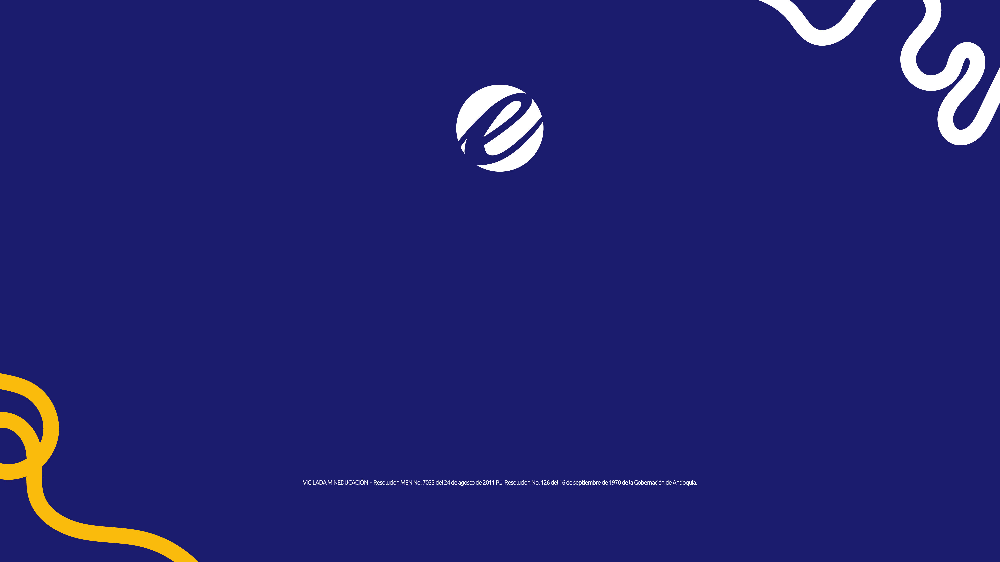
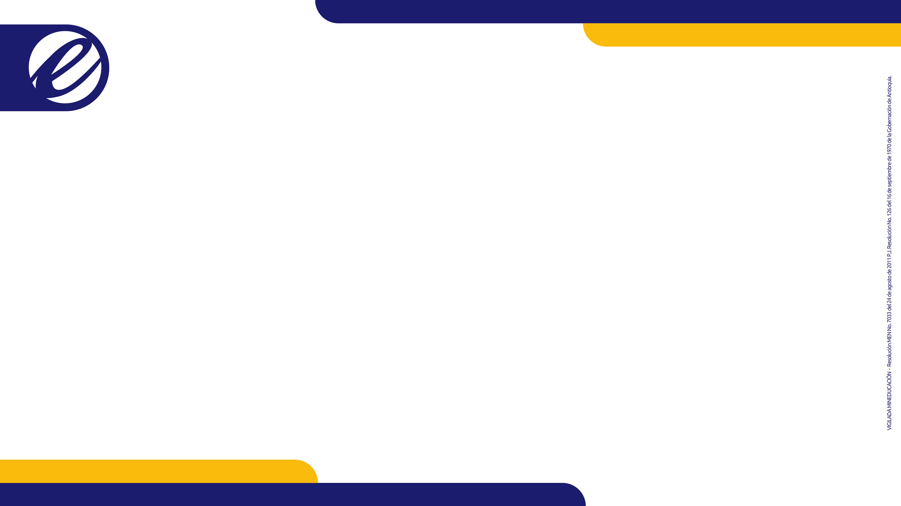
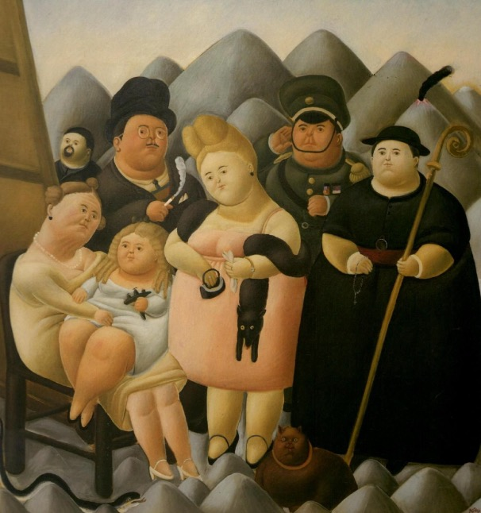
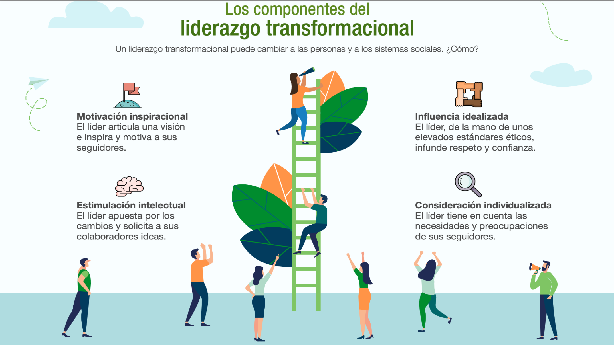
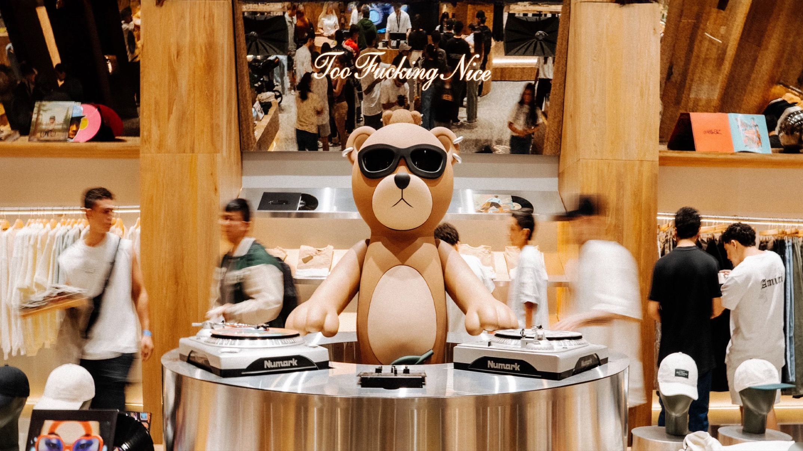
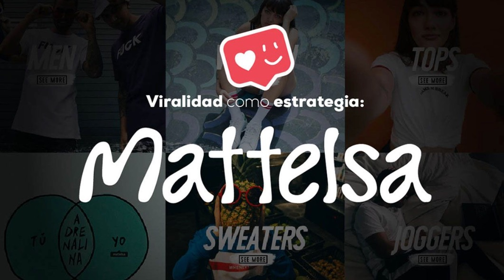
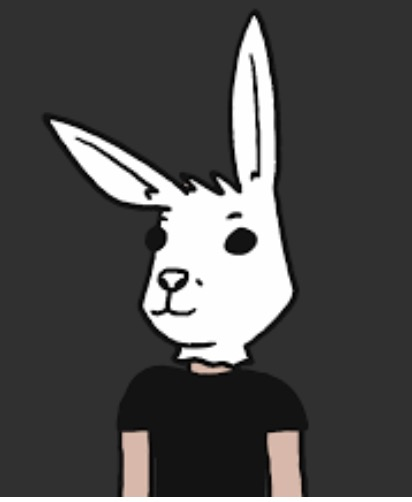
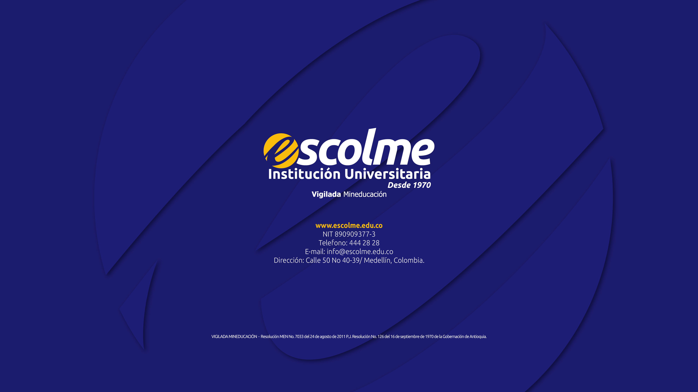

# Unidad2

<!-- página 1 -->

> **Descripción de la imagen** — La imagen es una ilustración abstracta con un fondo de color azul oscuro. En el centro superior se encuentra un círculo blanco que contiene un diseño estilizado y abstracto en tonos blancos. En la esquina inferior izquierda, hay una línea gruesa y curva de color amarillo brillante que se extiende diagonalmente hacia arriba. A lo largo del borde derecho de la imagen, se observan líneas finas y onduladas de color blanco. En la parte inferior central, hay un texto pequeño centrado.

Unidad 2:
Liderazgo Gerencial

https://elpais.com/america-colombia/branded/los-lideres-de-colombia/

---

<!-- página 2 -->

> **Descripción de la imagen** — La imagen es un diseño gráfico con fondo predominantemente blanco, que incluye elementos de color azul oscuro/morado y amarillo.
>
> En la esquina superior izquierda se encuentra un logotipo o icono estilizado en azul oscuro, compuesto por un círculo con líneas internas.
>
> En la parte superior derecha, hay una banda horizontal gruesa de color azul oscuro que se superpone parcialmente a una banda horizontal de color amarillo brillante.
>
> En la parte inferior, se observa una banda horizontal ancha de color amarillo y una sección parcial de color azul oscuro en la esquina inferior derecha.

¿Crees que el líder nace o se hace?
¿Qué tipo de líder te gustaría llegar a ser en un futuro? ¿Qué impacto

deseas dejar en las personas?
¿Qué valores consideras fundamentales para ejercer un liderazgo ético?

---

<!-- página 3 -->

> **Descripción de la imagen** — La imagen es un diseño gráfico con fondo predominantemente blanco, que incluye elementos de color azul oscuro/morado y amarillo.
>
> En la esquina superior izquierda se encuentra un logotipo o icono estilizado en azul oscuro, compuesto por un círculo con líneas internas.
>
> En la parte superior derecha, hay una banda horizontal gruesa de color azul oscuro que se superpone parcialmente a una banda horizontal de color amarillo brillante.
>
> En la parte inferior, se observa una banda horizontal ancha de color amarillo y una sección parcial de color azul oscuro en la esquina inferior derecha.

### 100 LÍDERES
### ANTIOQUEÑOS

https://www.youtube.com/watch?v=9Ye_0_7dZeo&list=PLxAox

g6TndCu7figj2C115kT5Kswbx0Iu&index=6

> **Descripción de la imagen** — Es una ilustración o pintura que representa un grupo de personas en un entorno montañoso y nevado.
>
> En primer plano, hay un grupo de varias figuras, incluyendo adultos y niños, vestidos con atuendos que sugieren un contexto histórico o folclórico. Las figuras son robustas y están agrupadas muy cerca unas de otras. Varias de las personas tienen expresiones serias o tranquilas.
>
> El fondo está dominado por montañas grandes y nevadas, lo que establece un paisaje frío y agreste. La iluminación sugiere un ambiente exterior.

---

<!-- página 4 -->

> **Descripción de la imagen** — La imagen es un diseño gráfico con fondo predominantemente blanco, que incluye elementos de color azul oscuro/morado y amarillo.
>
> En la esquina superior izquierda se encuentra un logotipo o icono estilizado en azul oscuro, compuesto por un círculo con líneas internas.
>
> En la parte superior derecha, hay una banda horizontal gruesa de color azul oscuro que se superpone parcialmente a una banda horizontal de color amarillo brillante.
>
> En la parte inferior, se observa una banda horizontal ancha de color amarillo y una sección parcial de color azul oscuro en la esquina inferior derecha.

Incluye planificar, organizar, dirigir y
controlar
recursos
(humanos,
financieros, materiales) para alcanzar
objetivos organizacionales.
## Trabajo Gerencial

El
líder
gerencial
integra
visión
estratégica con ejecución diaria, sus
componentes son:
•Visión
•Comunicación efectiva
•Toma de decisiones
•Delegación
•Motivación
•Desarrollo del equipo
•Capacidad de adaptación al cambio

---

<!-- página 5 -->

> **Descripción de la imagen** — La imagen es un diseño gráfico con fondo predominantemente blanco, que incluye elementos de color azul oscuro/morado y amarillo.
>
> En la esquina superior izquierda se encuentra un logotipo o icono estilizado en azul oscuro, compuesto por un círculo con líneas internas.
>
> En la parte superior derecha, hay una banda horizontal gruesa de color azul oscuro que se superpone parcialmente a una banda horizontal de color amarillo brillante.
>
> En la parte inferior, se observa una banda horizontal ancha de color amarillo y una sección parcial de color azul oscuro en la esquina inferior derecha.

> **Descripción de la imagen** — La imagen es predominantemente un fondo negro. Contiene muy pocos caracteres o símbolos dispersos y sin una estructura discernible, por lo que no representa un diagrama, mapa conceptual, tabla o ilustración con contenido significativo.

> **Descripción de la imagen** — La imagen es predominantemente negra. Solo se distingue un pequeño símbolo o glifo de color marrón/rojizo en la parte inferior central o derecha. El resto del espacio está vacío y oscuro.

•Planificación y estrategia: Definir los objetivos a
corto y largo plazo y los pasos necesarios para
alcanzarlos.

•Organización: Asignar roles, responsabilidades,
tareas y recursos para ejecutar los planes de
manera efectiva.

•Motivación: Fomentar un ambiente de trabajo
productivo, motivar al equipo, tomar decisiones y
guiar el rumbo de la empresa.
## Liderazgo Gerencial y
## sus actividades claves

> **Descripción de la imagen** — La imagen es una fotografía de estilo artístico que ilustra el concepto de unidad, colaboración o trabajo en equipo. Muestra múltiples personas con sus brazos extendidos hacia el centro, formando un círculo o un punto focal donde las manos se entrelazan.
>
> La toma es desde arriba (plano picado), lo que permite ver la estructura circular formada por los brazos y las manos. Se aprecian varias personas de diferentes géneros y edades, cuyas manos convergen en el centro de la composición. La iluminación es brillante y uniforme. El enfoque principal está en la interacción de las manos, simbolizando la conexión y la unión entre los participantes.

---

<!-- página 6 -->

> **Descripción de la imagen** — La imagen es un diseño gráfico con fondo predominantemente blanco, que incluye elementos de color azul oscuro/morado y amarillo.
>
> En la esquina superior izquierda se encuentra un logotipo o icono estilizado en azul oscuro, compuesto por un círculo con líneas internas.
>
> En la parte superior derecha, hay una banda horizontal gruesa de color azul oscuro que se superpone parcialmente a una banda horizontal de color amarillo brillante.
>
> En la parte inferior, se observa una banda horizontal ancha de color amarillo y una sección parcial de color azul oscuro en la esquina inferior derecha.

•Control y evaluación: Monitorear el desempeño,
evaluar resultados, analizar datos (como ventas o
costos) y realizar ajustes cuando sea necesario
para mantener el rumbo correcto.

•Resolución
de
problemas:
Gestionar
situaciones inesperadas, resolver conflictos y
encontrar soluciones rápidas y eficaces.

•Administración y comunicación: Gestionar el
presupuesto,
revisar
y
priorizar
correos
electrónicos, y comunicarse constantemente con
los
miembros
del
equipo
y
otras
partes
interesadas.

> **Descripción de la imagen** — La imagen es una ilustración que muestra una mano humana sosteniendo una pieza de ajedrez blanca sobre una estructura construida con bloques de madera.
>
> **Elementos visuales:**
>
> 1.  **Mano y Pieza:** Una mano con tono de piel cálido sostiene con el dedo índice una pieza de ajedrez blanca (posiblemente la reina o el rey).
> 2.  **Base/Estructura:** La pieza está suspendida sobre una pila de bloques de madera de color claro, dispuestos en varios niveles para formar un pedestal o base escalonada.
> 3.  **Piezas Adicionales:** Varias otras piezas de ajedrez blancas (peones y posiblemente otras figuras) están colocadas sobre los bloques de madera debajo de la pieza que se sostiene.
> 4.  **Fondo:** El fondo es oscuro, texturizado y gris/negro, lo que resalta el primer plano de la mano y la estructura de ajedrez.
>
> La composición sugiere un tema relacionado con estrategia, construcción o jerarquía.

---

<!-- página 7 -->

> **Descripción de la imagen** — La imagen es un diseño gráfico con fondo predominantemente blanco, que incluye elementos de color azul oscuro/morado y amarillo.
>
> En la esquina superior izquierda se encuentra un logotipo o icono estilizado en azul oscuro, compuesto por un círculo con líneas internas.
>
> En la parte superior derecha, hay una banda horizontal gruesa de color azul oscuro que se superpone parcialmente a una banda horizontal de color amarillo brillante.
>
> En la parte inferior, se observa una banda horizontal ancha de color amarillo y una sección parcial de color azul oscuro en la esquina inferior derecha.

Habilidades técnicas: Se relacionan a la
profesión, el cargo que ocupa y los recursos que
este sabe manejar para desarrollar el trabajo de
manera adecuada.

Habilidades blandas: Aquellas esenciales para
relacionarse con el equipo de trabajo y la
sociedad.

> **Descripción de la imagen** — La imagen es una ilustración o fotografía de estilo artístico que muestra a una mujer sentada en el suelo sobre un fondo de color marrón cálido.
>
> La mujer está sentada con las piernas cruzadas y mira hacia adelante. Viste una camisa clara debajo de una chaqueta de mezclilla (denim) y lleva un sombrero de paja. Tiene cabello largo y oscuro y usa gafas.
>
> Sobre su cabeza, flota una gran bombilla estilizada. La bombilla tiene un filamento amarillo brillante y está rodeada por llamas naranjas y azules. Dentro de la bombilla se puede leer la palabra "keep".

### Tipos de habilidades gerenciales

Según los estudios de Koontz, Weihrich y Cannice (2012)

---

<!-- página 8 -->

> **Descripción de la imagen** — La imagen es un diseño gráfico con fondo predominantemente blanco, que incluye elementos de color azul oscuro/morado y amarillo.
>
> En la esquina superior izquierda se encuentra un logotipo o icono estilizado en azul oscuro, compuesto por un círculo con líneas internas.
>
> En la parte superior derecha, hay una banda horizontal gruesa de color azul oscuro que se superpone parcialmente a una banda horizontal de color amarillo brillante.
>
> En la parte inferior, se observa una banda horizontal ancha de color amarillo y una sección parcial de color azul oscuro en la esquina inferior derecha.

> **Descripción de la imagen** — La imagen es un primer plano de las teclas de un teclado de computadora. El enfoque está en varias teclas que muestran íconos y símbolos. Se observan varios emojis o emoticonos dibujados en color, incluyendo caras sonrientes, una cara triste y un corazón rojo. Otras teclas visibles tienen símbolos numéricos y matemáticos, como el signo de porcentaje (%), el número 5, y letras como la T. El fondo es oscuro y desenfocado, lo que resalta los detalles de las teclas y sus gráficos.

Transformación
digital
y
uso
de
datos:
Liderazgo orientado a decisiones basadas en
analítica; necesidad de alfabetización digital,
gerentes deben interpretar dashboards, priorizar
iniciativas digitales.

Trabajo remoto e híbrido: Gestión de equipos
dispersos, cultura digital, fomento de la autonomía
y
confianza,
nuevas
rutinas
de
control
y
motivación, comunicación asincrónica.
### Tendencias mundiales que impactan el liderazgo
### gerencial

---

<!-- página 9 -->

> **Descripción de la imagen** — La imagen es un diseño gráfico con fondo predominantemente blanco, que incluye elementos de color azul oscuro/morado y amarillo.
>
> En la esquina superior izquierda se encuentra un logotipo o icono estilizado en azul oscuro, compuesto por un círculo con líneas internas.
>
> En la parte superior derecha, hay una banda horizontal gruesa de color azul oscuro que se superpone parcialmente a una banda horizontal de color amarillo brillante.
>
> En la parte inferior, se observa una banda horizontal ancha de color amarillo y una sección parcial de color azul oscuro en la esquina inferior derecha.

Diversidad, equidad e inclusión
(DEI):
Liderazgo
inclusivo
que
aprovecha la diversidad cultural y
cognitiva.

Sostenibilidad
y
propósito:
Demandas de stakeholders para
prácticas sostenibles; lideres que
integran propósito en la estrategia.

Agilidad organizacional y metodologías
agiles: Equipos cross-functional, aprende
más rápido. Gerentes como facilitadores y
removedores de impedimentos.

Enfoque en bienestar y salud mental:
Lideres responsables por clima, balance y
prevención del burnout

---

<!-- página 10 -->

> **Descripción de la imagen** — La imagen es un diseño gráfico con fondo predominantemente blanco, que incluye elementos de color azul oscuro/morado y amarillo.
>
> En la esquina superior izquierda se encuentra un logotipo o icono estilizado en azul oscuro, compuesto por un círculo con líneas internas.
>
> En la parte superior derecha, hay una banda horizontal gruesa de color azul oscuro que se superpone parcialmente a una banda horizontal de color amarillo brillante.
>
> En la parte inferior, se observa una banda horizontal ancha de color amarillo y una sección parcial de color azul oscuro en la esquina inferior derecha.

> **Descripción de la imagen** — La imagen es una fotografía de un plano medio que muestra a una persona interactuando con una tableta digital en un entorno luminoso. La persona viste una camisa de vestir azul claro y está señalando la pantalla de la tableta con su mano derecha.
>
> En la pantalla de la tableta se visualiza un panel de datos o un gráfico analítico. Este panel incluye varios tipos de visualizaciones:
> 1.  **Gráficos de barras:** Muestran múltiples barras verticales de diferentes colores (principalmente tonos de azul y cian) que representan datos comparativos.
> 2.  **Gráficos de líneas:** Se observan líneas que indican tendencias o series temporales, algunas de ellas en tonos rojos y naranjas.
> 3.  **Gráficos circulares (de pastel):** Hay varios gráficos circulares pequeños que ilustran proporciones o porcentajes.
>
> El diseño general del panel sugiere un informe de rendimiento, métricas empresariales o resultados académicos.

Inteligencia
artificial
y
automatización:
Cambios
en
tareas
de
supervisión;
gerentes
gestionan colaboradores +
IA. Reasignación de tareas
rutinarias
y
foco
en
actividades
de
valor
humano.

Economía
y
talento
flexible:
Gestión
de
colaboradores
no
permanentes;
nuevos
marcos
contractuales
y
motivacionales.

---

<!-- página 11 -->

> **Descripción de la imagen** — La imagen es un diseño gráfico con fondo predominantemente blanco, que incluye elementos de color azul oscuro/morado y amarillo.
>
> En la esquina superior izquierda se encuentra un logotipo o icono estilizado en azul oscuro, compuesto por un círculo con líneas internas.
>
> En la parte superior derecha, hay una banda horizontal gruesa de color azul oscuro que se superpone parcialmente a una banda horizontal de color amarillo brillante.
>
> En la parte inferior, se observa una banda horizontal ancha de color amarillo y una sección parcial de color azul oscuro en la esquina inferior derecha.

Conjunto
de
métodos
para
medir
competencias,
comportamientos
y
potencial
gerencial
(360°,
pruebas
situacionales, inventarios de personalidad,
entrevistas por competencias).

Beneficios: identificación de fortalezas y
áreas de mejora, rutas de desarrollo
personalizadas, soporte para decisiones de
promoción y formación.
### Assessment- Evaluación de competencias gerenciales

> **Descripción de la imagen** — La imagen es una ilustración que muestra varias hojas de papel blancas apiladas sobre un fondo azul claro. Las hojas contienen listas o checklists con múltiples elementos marcados con una palomita (check mark) de color azul. Una pluma o bolígrafo de color amarillo brillante y punta azul está colocada en la esquina inferior derecha, apuntando hacia las hojas. La composición sugiere el proceso de estudio, revisión o finalización de tareas.

---

<!-- página 12 -->

> **Descripción de la imagen** — La imagen es un diseño gráfico con fondo predominantemente blanco, que incluye elementos de color azul oscuro/morado y amarillo.
>
> En la esquina superior izquierda se encuentra un logotipo o icono estilizado en azul oscuro, compuesto por un círculo con líneas internas.
>
> En la parte superior derecha, hay una banda horizontal gruesa de color azul oscuro que se superpone parcialmente a una banda horizontal de color amarillo brillante.
>
> En la parte inferior, se observa una banda horizontal ancha de color amarillo y una sección parcial de color azul oscuro en la esquina inferior derecha.

Ejercicio de role-play: Se simulan situaciones de
atención al cliente, donde el candidato debe
resolver un problema, mostrando su habilidad para
tratar con el cliente, por ejemplo, con una sonrisa y
un tono amable.

Dinámica grupal: Un grupo de candidatos recibe
materiales para observar cómo colaboran, se
comunican y distribuyen roles bajo presión.
### Assessment- Evaluación de competencias gerenciales

Ejercicio de presentación: Se evalúan las
habilidades
de
comunicación
de
los
candidatos dándoles un tema específico
para que lo expongan ante un grupo.

---

<!-- página 13 -->

> **Descripción de la imagen** — La imagen es un diseño gráfico con fondo predominantemente blanco, que incluye elementos de color azul oscuro/morado y amarillo.
>
> En la esquina superior izquierda se encuentra un logotipo o icono estilizado en azul oscuro, compuesto por un círculo con líneas internas.
>
> En la parte superior derecha, hay una banda horizontal gruesa de color azul oscuro que se superpone parcialmente a una banda horizontal de color amarillo brillante.
>
> En la parte inferior, se observa una banda horizontal ancha de color amarillo y una sección parcial de color azul oscuro en la esquina inferior derecha.

Entrevista
en
panel:
Un
candidato
es
entrevistado por varios evaluadores a la vez para
ver como se desenvuelve en una situación de
presión y si puede articular sus respuestas de
manera efectiva en un entorno de múltiples
entrevistadores.

Pruebas psicotécnicas: Se utilizan para evaluar
habilidades y aptitudes específicas relacionadas
con el puesto de trabajo, como el razonamiento
lógico o la capacidad numérica.
### Assessment- Evaluación de competencias gerenciales

Análisis de caso: Se presenta un caso de
negocio o una problemática compleja para
que el candidato la analice, la evalúe y
proponga
soluciones,
demostrando
habilidades de análisis, juicio y resolución de
problemas.

---

<!-- página 14 -->

> **Descripción de la imagen** — La imagen es un diseño gráfico con fondo predominantemente blanco, que incluye elementos de color azul oscuro/morado y amarillo.
>
> En la esquina superior izquierda se encuentra un logotipo o icono estilizado en azul oscuro, compuesto por un círculo con líneas internas.
>
> En la parte superior derecha, hay una banda horizontal gruesa de color azul oscuro que se superpone parcialmente a una banda horizontal de color amarillo brillante.
>
> En la parte inferior, se observa una banda horizontal ancha de color amarillo y una sección parcial de color azul oscuro en la esquina inferior derecha.

> **Descripción de la imagen** — La imagen es una infografía que ilustra los componentes del liderazgo transformacional.
>
> El elemento central es una figura humana subiendo una escalera verde que está entrelazada con grandes hojas verdes y naranjas. Esta figura representa al líder.
>
> Alrededor de la escalera, se presentan cuatro componentes clave del liderazgo, cada uno acompañado por un ícono:
> 1. **Motivación inspiracional:** Asociado a un ícono de una bandera en la cima de la escalera.
> 2. **Estimulación intelectual:** Asociado a un ícono de un cerebro.
> 3. **Influencia idealizada:** Asociado a un ícono de una estructura o edificio.
> 4. **Consideración individualizada:** Asociado a un ícono de una lupa.
>
> En la parte inferior de la imagen, se muestran varias figuras humanas (seguidores) interactuando con el entorno, algunas levantando los brazos en señal de apoyo o celebración.

---

<!-- página 15 -->

> **Descripción de la imagen** — La imagen es un diseño gráfico con fondo predominantemente blanco, que incluye elementos de color azul oscuro/morado y amarillo.
>
> En la esquina superior izquierda se encuentra un logotipo o icono estilizado en azul oscuro, compuesto por un círculo con líneas internas.
>
> En la parte superior derecha, hay una banda horizontal gruesa de color azul oscuro que se superpone parcialmente a una banda horizontal de color amarillo brillante.
>
> En la parte inferior, se observa una banda horizontal ancha de color amarillo y una sección parcial de color azul oscuro en la esquina inferior derecha.

> **Descripción de la imagen** — La imagen es una fotografía de un interior de tienda o boutique, con un ambiente cálido y rústico debido al uso de paneles de madera.
>
> En el centro de la composición se encuentra un gran peluche de oso de color marrón claro, que lleva puestas unas gafas de sol negras. El oso está posicionado sobre una mesa redonda de metal pulido. Delante del oso hay dos tocadiscos (turntables) de estilo vintage, ambos de la marca Numark.
>
> El fondo muestra el interior de la tienda con estanterías y perchas llenas de ropa clara (camisas blancas). Varias personas están dispersas en el fondo, algunas caminando o interactuando con la mercancía. Por encima del oso, hay una imagen o pantalla que muestra una fotografía de un grupo de personas en un evento, con texto superpuesto.

---

<!-- página 16 -->

> **Descripción de la imagen** — La imagen es un diseño gráfico con fondo predominantemente blanco, que incluye elementos de color azul oscuro/morado y amarillo.
>
> En la esquina superior izquierda se encuentra un logotipo o icono estilizado en azul oscuro, compuesto por un círculo con líneas internas.
>
> En la parte superior derecha, hay una banda horizontal gruesa de color azul oscuro que se superpone parcialmente a una banda horizontal de color amarillo brillante.
>
> En la parte inferior, se observa una banda horizontal ancha de color amarillo y una sección parcial de color azul oscuro en la esquina inferior derecha.

Mateo Jaramillo Cadavid, también conocido
solo como Mateo Jaca, es el hombre que
fundó la famosa empresa Mattelsa.
En 2006, comenzaron a construirse los
primeros cimientos de una compañía que hoy
en día es un referente en el país por su lógica
y cultura empresarial.

> **Descripción de la imagen** — Es un retrato fotográfico en blanco y negro o escala de grises de un hombre joven con cabello oscuro y barba. El hombre está mirando directamente a la cámara y sonriendo. La imagen está contenida dentro de un círculo. Debajo del retrato, se encuentra texto en color rojo que identifica al sujeto: "MATEO JARAMILLO" y debajo, su cargo: "Director de Mattelsa y urbanita".

---

<!-- página 17 -->

> **Descripción de la imagen** — La imagen es un diseño gráfico con fondo predominantemente blanco, que incluye elementos de color azul oscuro/morado y amarillo.
>
> En la esquina superior izquierda se encuentra un logotipo o icono estilizado en azul oscuro, compuesto por un círculo con líneas internas.
>
> En la parte superior derecha, hay una banda horizontal gruesa de color azul oscuro que se superpone parcialmente a una banda horizontal de color amarillo brillante.
>
> En la parte inferior, se observa una banda horizontal ancha de color amarillo y una sección parcial de color azul oscuro en la esquina inferior derecha.

“Yo creo que el rol de las empresas
actualmente es ayudar a las personas
a que se conozcan, porque si una
persona
se
conoce,
es
capaz
de
conectarse con el otro y es capaz de
conocer al otro; de esta manera, se va
formando una sinergia, una conexión,
que es clave para la formación de
equipos de alto rendimiento y esos
son los equipos que transforman las
empresas y los resultados”, asegura
Jaramillo.

> **Descripción de la imagen** — Es una fotografía de un hombre de mediana edad con cabello oscuro y barba, que sonríe directamente a la cámara. El hombre está sentado o agachado, con los brazos cruzados sobre el pecho. Viste una camiseta de color claro (beige o crema) y pantalones oscuros (azul marino). El fondo es exterior y natural, mostrando vegetación exuberante, árboles y plantas en un entorno verde. La imagen está enmarcada dentro de un círculo.

---

<!-- página 18 -->

> **Descripción de la imagen** — La imagen es un diseño gráfico con fondo predominantemente blanco, que incluye elementos de color azul oscuro/morado y amarillo.
>
> En la esquina superior izquierda se encuentra un logotipo o icono estilizado en azul oscuro, compuesto por un círculo con líneas internas.
>
> En la parte superior derecha, hay una banda horizontal gruesa de color azul oscuro que se superpone parcialmente a una banda horizontal de color amarillo brillante.
>
> En la parte inferior, se observa una banda horizontal ancha de color amarillo y una sección parcial de color azul oscuro en la esquina inferior derecha.

> **Descripción de la imagen** — La imagen es un collage o montaje dividido en varias secciones, que combina fotografías de personas con texto y gráficos superpuestos.
>
> **Elementos visuales principales:**
>
> 1.  **Sección Superior:** Contiene tres imágenes verticales de personas:
>     *   A la izquierda, un hombre vistiendo una camiseta blanca.
>     *   En el centro, una mujer con cabello oscuro que sostiene su cabeza. Sobre esta imagen hay un ícono grande de burbuja de diálogo roja con un corazón y una cara sonriente en blanco, y el texto superpuesto "Viralidad como estrategia:".
>     *   A la derecha, una mujer vistiendo una camiseta blanca.
>
> 2.  **Texto Central Grande:** En la parte inferior izquierda, se encuentra la palabra "Mattelsa" escrita en una tipografía grande y estilizada de color blanco. Debajo de esta palabra, hay un gráfico circular que contiene texto dividido en segmentos: "TÚ", "A DRE NALI NA", "YO" y "MARCHA".
>
> 3.  **Secciones Inferiores:**
>     *   En el centro inferior, se ve una persona vistiendo una sudadera azul. Sobre esta imagen aparece el texto "SWEATERS" con un enlace "SEE MORE".
>     *   A la derecha inferior, se ve una persona vistiendo pantalones deportivos (joggers). Sobre esta imagen aparece el texto "JOGGERS" con un enlace "SEE MORE".
>
> En resumen, es una composición visual que mezcla retratos de personas vestidas con ropa casual y superposiciones de texto promocional relacionado con moda y conceptos sociales.

Jaramillo implantó una cultura organizacional en su
empresa, se basa en 9 pilares:

1.Alimentación. Este es uno de los
elementos fundamentales para
Mattelsa, pues, como explican en su
página, “somos lo que comemos y
sabemos que hacerlo
conscientemente mejora
radicalmente la calidad de nuestra
vida”.
2.Descanso. Según explican, el valor
del descanso es igualmente
importante al valor del trabajo.
3.Actividad física. En su cultura, el
ejercicio es un catalizador biológico
de energía y es un regulador de
emociones, elementos que son claves
en la fortaleza mental y física de
cualquiera de sus trabajadores.
4.Meditación. Para ellos, esta es la
manera en la que las personas se

---

<!-- página 19 -->

> **Descripción de la imagen** — La imagen es un diseño gráfico con fondo predominantemente blanco, que incluye elementos de color azul oscuro/morado y amarillo.
>
> En la esquina superior izquierda se encuentra un logotipo o icono estilizado en azul oscuro, compuesto por un círculo con líneas internas.
>
> En la parte superior derecha, hay una banda horizontal gruesa de color azul oscuro que se superpone parcialmente a una banda horizontal de color amarillo brillante.
>
> En la parte inferior, se observa una banda horizontal ancha de color amarillo y una sección parcial de color azul oscuro en la esquina inferior derecha.

### Jaramillo implantó una cultura organizacional
### en su empresa, se basa en 9 pilares:

Alimentación. Este es uno de los elementos
fundamentales para Mattelsa, pues, como
explican en su página, “somos lo que
comemos
y
sabemos
que
hacerlo
conscientemente mejora radicalmente la
calidad de nuestra vida”.

Descanso. Según explican, el valor del
descanso es igualmente importante al valor
del trabajo.

Actividad física. En su cultura, el ejercicio es un
catalizador biológico de energía y es un regulador
de emociones, elementos que son claves en la
fortaleza mental y física de cualquiera de sus
trabajadores.

Meditación. Para ellos, esta es la manera en la que
las personas se pueden conectar consigo mismas,
es una manera de entrenar la mente, encontrando
claridad mental.

---

<!-- página 20 -->

> **Descripción de la imagen** — La imagen es un diseño gráfico con fondo predominantemente blanco, que incluye elementos de color azul oscuro/morado y amarillo.
>
> En la esquina superior izquierda se encuentra un logotipo o icono estilizado en azul oscuro, compuesto por un círculo con líneas internas.
>
> En la parte superior derecha, hay una banda horizontal gruesa de color azul oscuro que se superpone parcialmente a una banda horizontal de color amarillo brillante.
>
> En la parte inferior, se observa una banda horizontal ancha de color amarillo y una sección parcial de color azul oscuro en la esquina inferior derecha.

Ocio. Para Mattelsa, es importante que sus
trabajadores tengan espacios de desconexión
porque les pueden ayudar a tener una visión más
amplia de lo que los rodea.

Propósito. Como lo explicó Jaramillo, es crucial
que las empresas apoyen el autoconocimiento y
en este camino que cada integrante conecte su
propósito con el trabajo en el que se encuentra.

Conocimiento. “Es imposible construir algo
mejor si no aprendemos de las personas que ya
lo han hecho posible”.

Entorno.
Es
fundamental
tener
espacios
adecuados, pues la naturaleza de los lugares
que se habitan, define a quienes los transitan.

Comunidad.
Finalmente,
para
ellos
las
conexiones y el trabajo en equipo lo son todo
para el éxito de su empresa.

---

<!-- página 21 -->

> **Descripción de la imagen** — La imagen es un diseño gráfico con fondo predominantemente blanco, que incluye elementos de color azul oscuro/morado y amarillo.
>
> En la esquina superior izquierda se encuentra un logotipo o icono estilizado en azul oscuro, compuesto por un círculo con líneas internas.
>
> En la parte superior derecha, hay una banda horizontal gruesa de color azul oscuro que se superpone parcialmente a una banda horizontal de color amarillo brillante.
>
> En la parte inferior, se observa una banda horizontal ancha de color amarillo y una sección parcial de color azul oscuro en la esquina inferior derecha.

Hoy en día, Mattelsa es una muy famosa
empresa colombiana, con una producción 100 %
nacional y que suman actualmente más de 55
tiendas en diferentes partes del país.

Su gran éxito lo atribuye a la coherencia, al
trabajo honesto y colaborativo que se ha
profesado
durante
todos
sus
años
como
empresa. “En Mattelsa hay una coherencia entre
la cultura interna y lo que profesan hacia afuera;
todo esto le permite al cliente conectarse con la
marca”.

> **Descripción de la imagen** — La imagen es una ilustración simple y estilizada de un conejo. El conejo tiene un cuerpo blanco, orejas largas y erguidas, ojos grandes y negros, y una nariz pequeña. Lleva una camiseta negra sencilla en su torso. El fondo es de color oscuro (negro o gris muy oscuro).

https://www.youtube.com/watch?v=YPvC_WtYPj8

En este sentido, Jaramillo cree que no es que
existan malas o buenas empresas, para él lo que

existen son buenos o malos líderes.

---

<!-- página 22 -->

> **Descripción de la imagen** — La imagen es un diseño gráfico o encabezado institucional con un fondo de color azul oscuro intenso y formas abstractas superpuestas en tonos similares. En el centro, se encuentra el logotipo de la institución: el nombre "escolme" estilizado en amarillo y blanco, seguido por el texto "Institución Universitaria" y debajo "Desde 1970". Debajo del nombre principal aparece la frase "Vigilada Mineducación".
>
> Debajo del logo, hay un bloque de información de contacto que incluye una dirección web, un número NIT, un número de teléfono, una dirección de correo electrónico y una dirección física. En la parte inferior de la imagen, se encuentra una línea de texto más pequeña que contiene referencias a una resolución y fechas.

