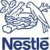

# CREATIVIDAD EN LOS EQUIPOS DE TRABAJO

<!-- página 1 -->

> **Descripción de la imagen** — La imagen es muy minimalista y consiste en un conjunto de elementos textuales y gráficos simples.
>
> En la parte superior se encuentra el acrónimo o iniciales grandes "FH." seguido de un punto. A su lado o debajo, hay un pequeño cuadrado sólido de color azul.
>
> Debajo de estos elementos visuales, aparece texto que dice "fundació factor humà" seguido de otro símbolo o palabra incompleta ("ørnæ").

Unidad de Conocimiento – Creatividad en el trabajo

Junio 2011

factorhuma.org
-1-
Fundació Factor Humà
### UNIDAD DE CONOCIMIENTO
## Creatividad en el trabajo

"Todo acto de creación es en primer lugar un acto de destrucción”

Pablo Ruiz Picasso

Sumario
¿Qué es? __________________________________________ 1
Herramientas ______________________________________ 2
El dato ____________________________________________ 4
Guía de Trabajo ____________________________________ 4
La experiencia _____________________________________ 5
Materiales _________________________________________ 7

Bibliografía básica________________________________________ 7

Materiales en línea _______________________________________ 7
### ¿Qué es?

ü
La creatividad es la capacidad humana para generar ideas o conexiones
imaginativas en un determinado campo, ya sea mediante la recombinación
de ideas preexistentes o mediante ideas rupturistas que supongan un cierto
nivel de originalidad o, incluso, un cambio de paradigma.

ü
Para que la creatividad se traduzca en aportación de valor es necesario
que la organización fomente la innovación, es decir, que disponga de la
capacidad organizativa para convertir una buena idea en un producto,
servicio, proceso, etc.

ü
A nivel teórico, el debate sobre la creatividad se ha centrado en aclarar
si en el nivel de creatividad tienen más influencia las cualidades individuales
o bien el entorno organizacional. La mayoría de teóricos coincide, sin
embargo, en una serie de cualidades de los entornos organizativos que
estimulan la creatividad de sus miembros:

---

<!-- página 2 -->

> **Descripción de la imagen** — La imagen es muy minimalista y consiste en un conjunto de elementos textuales y gráficos simples.
>
> En la parte superior se encuentra el acrónimo o iniciales grandes "FH." seguido de un punto. A su lado o debajo, hay un pequeño cuadrado sólido de color azul.
>
> Debajo de estos elementos visuales, aparece texto que dice "fundació factor humà" seguido de otro símbolo o palabra incompleta ("ørnæ").

Unidad de Conocimiento – Creatividad en el trabajo

Junio 2011

factorhuma.org
-2-
Fundació Factor Humà

§
Autonomía en la gestión de proyectos

§
Acceso a recursos suficientes

§
Estímulo y reconocimiento mediante una retroalimentación positiva
o las recompensas adecuadas

§
Concesión de tiempo suficiente para pensar en los problemas

§
Abrazar los retos y la ambición de hacer cosas importantes

§
Permitir la diversidad de opiniones dentro de la organización

§
Tolerar un cierto grado de fracaso (o nadie propondrá ideas
arriesgadas)

§
Favorecer que se comparta el conocimiento

ü
Los beneficios para una organización que estimula la creatividad en sus
trabajadores son:

§
Impactos positivos sobre los costes, las ventajas competitivas de
la organización y la creación de nuevos productos o mejora de los
ya existentes

§
Las políticas de formación que implanten una cultura de innovación
pueden estimular una mejora cualitativa de las aptitudes laborales
y el desarrollo de vocaciones profesionales

§
Incremento de la motivación y, por lo tanto, del sentimiento de
pertenencia

§
Mejora del clima laboral

ü
La retribución de las ideas que se traducen en innovación puede ir
desde la simple felicitación o el reconocimiento en la comunicación interna a
una retribución salarial o extrasalarial (premio, viaje, etc.).
### Herramientas

Algunas herramientas que estimulan la creatividad son:

ü
Espacio y tiempo para pensar: Google se ha convertido en el
paradigma de esta filosofía, con sus espacios de relajación y su política de
permitir a los trabajadores dedicar un tiempo de la jornada a proyectos
personales o proyectos experimentales, sin la presión de una inmediata
aplicabilidad.

ü
Buzón de sugerencias: un clásico que no es efectivo si no forma parte
de una estrategia global que comunique los resultados de las sugerencias y

---

<!-- página 3 -->

> **Descripción de la imagen** — La imagen es muy minimalista y consiste en un conjunto de elementos textuales y gráficos simples.
>
> En la parte superior se encuentra el acrónimo o iniciales grandes "FH." seguido de un punto. A su lado o debajo, hay un pequeño cuadrado sólido de color azul.
>
> Debajo de estos elementos visuales, aparece texto que dice "fundació factor humà" seguido de otro símbolo o palabra incompleta ("ørnæ").

Unidad de Conocimiento – Creatividad en el trabajo

Junio 2011

factorhuma.org
-3-
Fundació Factor Humà

estimule su presentación. Organizaciones como Bayer o TNT han
demostrado que aún es posible obtener un buen rendimiento de este
mecanismo.

ü
Desayunos informales: las reuniones y otros entornos formales son
contextos altamente estructurados que a menudo ahogan la creatividad.
Permitir encuentros en contextos más informales permite un intercambio
transversal de experiencias que estimula la creatividad.

ü
Herramientas basadas en las TIC: permiten canalizar la inteligencia y
la creatividad colectiva; algunos ejemplos son los foros de debate, el
crowdsourcing y los wikis.

ü
Herramientas de reflexión en grupo:

§
Brainstorming: todo un clásico que permite que las ideas fluyan
libremente sin crítica. (Ver Materiales para consejos sobre cómo
mejorar su efectividad)

§
Técnica del Grupo Nominal: permite a cada miembro del grupo
contribuir individualmente, mitigando el riesgo de que los
miembros más fuertes y más persuasivos del grupo dominen el
proceso de toma de decisiones

§
Seis sombreros para pensar: técnica ideada por Edward De
Bono para ayudar a un equipo a ver un problema desde muchas
perspectivas diferentes, permiten a los integrantes hacer de
abogados del diablo (Ver Bibliografía)

§
Técnica Delphi: permite a los integrantes del equipo la
contribución individual, sin conocimiento previo de la postura del
grupo y sin penalizar la disidencia

ü
Técnicas basadas en el azar: desde la penicilina, pasando por el velcro
y hasta el post-it, en muchas creaciones que han cambiado el mundo ha
intervenido decisivamente el azar. La técnica más sencilla para introducir el
factor azar es la de la palabra aleatoria. Encarados con un problema,
escogemos una palabra al azar de un diccionario e intentamos listar las
conexiones, por laterales o inverosímiles que sean, entre la palabra y el
problema sobre el que reflexionamos. La palabra sirve como agente
provocador y a menudo desatasca un bloqueo o nos ofrece una perspectiva
nueva. La razón es que el cerebro siempre intenta encontrar conexiones y
patrones incluso cuando está enfrentado con inputs aleatorios. Esta
herramienta forma parte de las recomendadas por Edward de Bono para
conseguir un pensamiento lateral.

ü
Estrategia del océano azul: estrategia de negocio basada en la
creatividad. El ejemplo más exitoso es Nintendo, que ha descolocado a la
competencia con su consola Wii inspirada en dicha estrategia. En lugar de
seguir refinando una idea antigua (mejores gráficos, velocidad...), apostar
por ideas que creen todo un mercado nuevo (movimiento físico).

---

<!-- página 4 -->

> **Descripción de la imagen** — La imagen es muy minimalista y consiste en un conjunto de elementos textuales y gráficos simples.
>
> En la parte superior se encuentra el acrónimo o iniciales grandes "FH." seguido de un punto. A su lado o debajo, hay un pequeño cuadrado sólido de color azul.
>
> Debajo de estos elementos visuales, aparece texto que dice "fundació factor humà" seguido de otro símbolo o palabra incompleta ("ørnæ").

### Unidad de Conocimiento – Creatividad en el trabajo
### Junio 2011

factorhuma.org
-4-
Fundació Factor Humà
## El dato
### Según un estudio de Ideas4all.com, actualmente el 85% de la innovación
### mundial se concentra en cuarenta regiones, donde vive el 20% de la población,
### pero donde se genera el 66% del desarrollo económico global. La globalización
### ha implicado que algunos países reciban más afluencia de población creativa.
### Las ciudades creativas de referencia a nivel mundial serían Nueva York, París,
### Londres, Chicago, Tokio, Los Ángeles, Milán, Frankfurt, Hong Kong y Singapur.
## Guía de Trabajo
### LAS 7 ESTRATEGIAS CREATIVAS
### THINK PO
### THINK
### OPEN
### THINK
### FLOW
### THINK&
### DRAW
### THINK
### HAPPY
### THINK
### TEAM

Razonar
provocativamente.

Pensar
alternativamente.

Provocar y
cuestionar las
ideas y los tópicos

establecidos.

Abrirse a otras

realidades.

Mirar
holísticamente.

Pensar con

fluidez.

Cambiar de
perspectiva.

No pensar
únicamente
en términos

de esfuerzo

o tensión

creativa.

Hacer
visibles las

ideas, las
imágenes y

las
sensaciones.

Dibujar

mapas
mentales.

Incorporar

elementos

de
motivación

y pasión.

Disfrutar

del
proceso.

Despertar

todos los
sentidos.

Sumar
energías.

Multiplicar

esfuerzos.

Compartir
conocimientos.
### THINK ZEN
### La base de todas las estrategias es partir de una tranquilidad espiritual desde la que
### dedicarse al trabajo creativo.
### La mente se tiene que ver como un receptáculo vacío, apto para contener ideas
### nuevas, no como un almacén lleno de antiguas concepciones e ideas recibidas.

Adaptado de: Ponti, Franc. “Siete estrategias de creatividad”.

Capital Humano, núm. 199 de mayo de 2006

---

<!-- página 5 -->

> **Descripción de la imagen** — La imagen es muy minimalista y consiste en un conjunto de elementos textuales y gráficos simples.
>
> En la parte superior se encuentra el acrónimo o iniciales grandes "FH." seguido de un punto. A su lado o debajo, hay un pequeño cuadrado sólido de color azul.
>
> Debajo de estos elementos visuales, aparece texto que dice "fundació factor humà" seguido de otro símbolo o palabra incompleta ("ørnæ").

Unidad de Conocimiento – Creatividad en el trabajo

Junio 2011

> **Descripción de la imagen** — Es un logotipo corporativo. El diseño presenta un símbolo estilizado en color plateado o gris metálico, con forma de diamante alargado o rombo puntiagudo. Este símbolo se encuentra centrado sobre un fondo de color amarillo sólido. Debajo del símbolo, en letras mayúsculas grandes y oscuras (negro o gris oscuro), se lee la palabra "RENAULT".

> **Descripción de la imagen** — La imagen es un logotipo que combina una ilustración gráfica con texto. El elemento central es un dibujo estilizado de un nido hecho de ramas y ramitas. Dentro o alrededor del nido se observan dos pájaros, uno más grande y otro más pequeño. Debajo de la ilustración se encuentra el nombre de la marca escrito en una fuente clara: "Nestlé".

factorhuma.org
-5-
Fundació Factor Humà
### La experiencia

ü
Las fábricas de Renault España intentan que todas las personas
trabajadoras estén al servicio de la creatividad mediante un sistema de
innovación participativa, llamado Ideas Concretas de Progreso (ICP).
Forma parte del sistema general de producción del grupo y establece las
bases y mecanismos para que el colectivo operario aporte sugerencias que
mejoren los resultados y solucionen problemas del trabajo cotidiano a
cambio de una compensación.

ü
Antes de que la idea sea aplicada, el/la trabajador/a la tiene que
presentar a su mando inmediatamente superior, rellenando un formulario
con todos los detalles. El mando es el primero que evalúa el beneficio que la
propuesta puede generar en el proceso de producción y, sobre todo, las
posibilidades de aplicarla. Una vez que la idea tiene el primer visto bueno,
un jurado la analiza con más profundidad y toma una decisión final que la
mayoría de las veces es afirmativa.

ü
La tasa de aplicación de las ICP presentadas es del 96%, un punto por
encima del objetivo marcado por la organización. La multinacional también
está por encima del objetivo en lo que respecta a la media de sugerencias
presentadas por trabajadores y trabajadoras, que en 2007 fue de 11,2. Otro
dato sobre el éxito del proyecto llega desde la fábrica de cajas de cambios
de Renault en Sevilla. Allí consiguieron un ahorro de 900.000 euros durante
el año 2009 gracias a este sistema de innovación participativa.

ü
Esta participación masiva se explica en parte gracias al trabajo de una
serie de animadores y animadoras que tienen como objetivo fomentar la
presentación de propuestas. Los resultados del sistema son positivos, con un
97% de la plantilla implicada en el sistema de mejora y un ahorro anual de
cerca de cinco millones de euros atribuible a la implantación de las ICP.

ü
La filial española de la multinacional de la alimentación Nestlé puso en
marcha de 1998 hasta el 2005 el programa Nestlé Innova con el objetivo
de adaptar sus productos a los gustos y a las necesidades del mercado local.

ü
Los objetivos eran comercializar nuevos productos y acceder a
consumidores más jóvenes, aumentando su segmento del mercado.

---

<!-- página 6 -->

> **Descripción de la imagen** — La imagen es muy minimalista y consiste en un conjunto de elementos textuales y gráficos simples.
>
> En la parte superior se encuentra el acrónimo o iniciales grandes "FH." seguido de un punto. A su lado o debajo, hay un pequeño cuadrado sólido de color azul.
>
> Debajo de estos elementos visuales, aparece texto que dice "fundació factor humà" seguido de otro símbolo o palabra incompleta ("ørnæ").

Unidad de Conocimiento – Creatividad en el trabajo

Junio 2011

factorhuma.org
-6-
Fundació Factor Humà

ü
Para conseguir estos objetivos, el programa Nestlé Innova se tenía que
desplegar en 3 ámbitos, cada uno acompañado de acciones facilitadoras:

§
Entorno: crear un entorno favorable para desarrollar una cultura
empresarial innovadora:

v Instaurar un buzón de ideas y convocar un concurso a la

mejor idea. Estaba a disposición de las personas empleadas
en todos los centros de trabajo de Nestlé España,
incluyendo las personas que habían colaborado con la
organización pero ya estaban jubiladas

v Convocatoria del Premio al Mejor Proyecto de Innovación.

Existían varios Comités de Innovación, formados por
personas de distintos departamentos que, utilizando la
técnica del brainstorming, analizaban y priorizaban las
propuestas recibidas a través del Buzón de ideas

v Diseño de un Plan de Comunicación que ofrecía información

actualizada de modo constante sobre la evolución del
programa

v Organización anual de la Feria de la Innovación para

exponer todos los nuevos productos desarrollados

§
Creatividad: estimular la creatividad con la finalidad de generar
más y mejores ideas:

v Talleres de creatividad, integrados por personas de distintos

departamentos

v Cursos de creatividad

v Intercambios de proyectos internacionales a través de las

Strategic Business Units

v Desarrollos técnicos y científicos propios en investigación

básica e investigación de productos

v Técnicas de investigación de mercados

v Interacción cara a cara con consumidores y consumidoras

§
Proceso: estructurar y acortar el proceso de desarrollo de nuevos
productos:

v Mediante un proceso incorporado a los procedimientos

internos de trabajo. Este procedimiento partía de dos
instrumentos
de
medida
basados
en
una
matriz
riesgo/beneficio y en unos factores clave de éxito

ü
Los resultados del Programa Nestlé Innova se plasmaron en 700
proyectos, de los cuales casi la mitad fueron renovaciones de gammas ya

---

<!-- página 7 -->

> **Descripción de la imagen** — La imagen es muy minimalista y consiste en un conjunto de elementos textuales y gráficos simples.
>
> En la parte superior se encuentra el acrónimo o iniciales grandes "FH." seguido de un punto. A su lado o debajo, hay un pequeño cuadrado sólido de color azul.
>
> Debajo de estos elementos visuales, aparece texto que dice "fundació factor humà" seguido de otro símbolo o palabra incompleta ("ørnæ").

Unidad de Conocimiento – Creatividad en el trabajo

Junio 2011

factorhuma.org
-7-
Fundació Factor Humà

existentes, una tercera parte fueron conceptos totalmente nuevos, un 12%
fueron nuevos negocios y un 6% se tradujo en nuevas tecnologías.

ü
Según sus impulsores, el factor clave fue que el programa estaba
orientado a la cuantificación y priorización de la cartera de productos y a la
consecución de unos objetivos formulados con claridad y apoyados por la
dirección.

ü
En 2008, diez años después de la puesta en marcha del primer plan, la
empresa renovó su apuesta por la innovación creando el programa Nestlé
Innova +, que abrió la participación a agencias de publicidad, proveedores
de materias primas y embalaje, y escuelas de negocio.
### Materiales

Bibliografía básica

Carrión, Juan. Culturas innovadoras 2.0. Madrid: LID Editorial, 2009.

Chesborough, Henry. Innovación abierta. Barcelona: Plataforma Editorial, 2009.

Cornella, Alfons; Flores, Antoni. La alquimia de la innovación. Barcelona:
Deusto, 2007.

De Bono, Edward. Seis sombreros para pensar. Barcelona: Paidós Ibérica,
2009.

Ponti, Franc. Innovación. Movimientos para construir una empresa innovadora.
Barcelona: Granica, 2009.

Materiales en línea

“7 estrategias básicas de la creatividad y la innovación”. Fundació Factor Humà,
17/03/2010.

Grupo de debate de la XIIIa sesión plenaria dinamizado por Franc Ponti,
profesor de creatividad e innovación en EADA.

http://www.factorhuma.org/index.php?option=com_content&view=article&id=7494

Coyne, Kevin; Coyne, Susan. “Seven steps to better brainstorming”. McKinsey
Quarterly, 01/03/2011 (Artículo consultado on line: 24/03/2011)

El brainstorming es una técnica utilizada en muchas organizaciones pero con
algunas carencias importantes. Según Mckinsey Quarterly, para generar

---

<!-- página 8 -->

> **Descripción de la imagen** — La imagen es muy minimalista y consiste en un conjunto de elementos textuales y gráficos simples.
>
> En la parte superior se encuentra el acrónimo o iniciales grandes "FH." seguido de un punto. A su lado o debajo, hay un pequeño cuadrado sólido de color azul.
>
> Debajo de estos elementos visuales, aparece texto que dice "fundació factor humà" seguido de otro símbolo o palabra incompleta ("ørnæ").

Unidad de Conocimiento – Creatividad en el trabajo

Junio 2011

factorhuma.org
-8-
Fundació Factor Humà

mejores ideas –y aumentar las probabilidades de que tu organización las
aplique– es recomendable empezar por la formulación de mejores preguntas.

http://www.mckinseyquarterly.com/Seven_steps_to_better_brainstorming_2767

Traducción disponible en factorhuma.org en:

http://www.factorhuma.org/index.php?option=com_content&view=article&id=8642

Vázquez, Tamara. “¿Es su empresa un entorno creativo?”. Expansión-Empleo,
11/12/2009.

Los equipos de trabajo diversos, que se apoyan en el conocimiento y la
colaboración colectiva y que no penalizan el fracaso del empleado potencian la
creatividad profesional, una competencia que se postula como la cualificación
laboral del siglo XXI.

http://www.factorhuma.org/index.php?option=com_content&view=article&id=619

Amiguet, Lluís. “La creatividad se aprende igual que se aprende a leer”. La
Vanguardia, 03/11/2010.

Entrevista de "La Contra" de La Vanguardia a Ken Robinson, experto que
preconiza un sistema educativo que enseñe a innovar y colaborador con el Foro
HSM: "Hemos estigmatizado el riesgo y el error y, en cambio, incentivamos la
pasividad y el conformismo."

http://www.factorhuma.org/index.php?option=com_content&view=article&id=67

actitudcreativa.es

Consultora sobre creatividad y cultura de la innovación. Cuenta con un blog
donde se puede hacer un seguimiento de sus actividades y un servicio de
publicaciones interesante.

http://www.actitudcreativa.es

