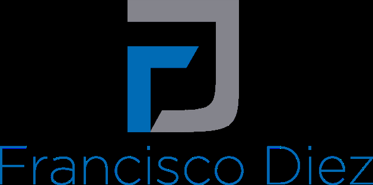
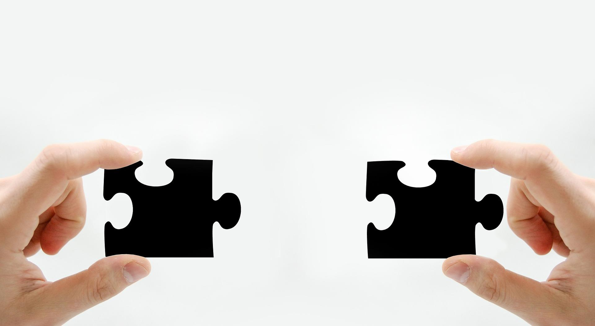
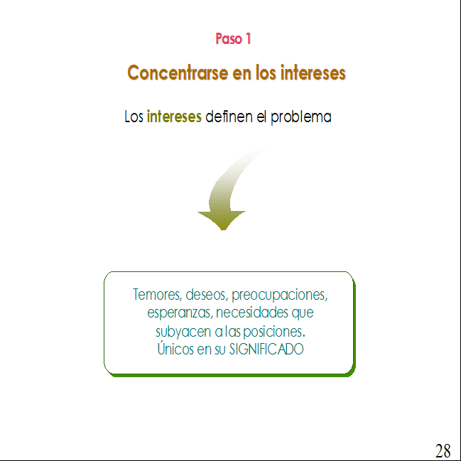
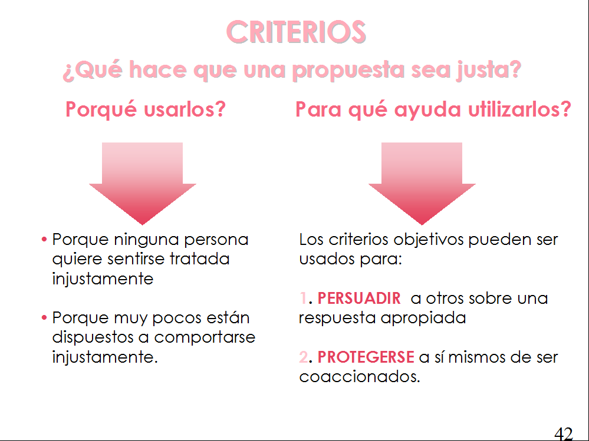

# MANUAL-DE-NEGOCIACIÓN-FDiez

<!-- página 1 -->

> **Descripción de la imagen** — La imagen es un fondo de textura uniforme. Presenta un color beige claro o crema, con una apariencia ligeramente envejecida o texturizada, similar al papel antiguo o pergamino. La superficie está marcada por líneas verticales sutiles y una textura granulada que le da profundidad visual, pero no contiene ningún texto, diagrama, gráfico ni elemento específico.

> **Descripción de la imagen** — La imagen es un diseño gráfico que funciona como logotipo o encabezado. En la parte superior se encuentra un símbolo estilizado en color azul, que parece una letra 'D' o un bracket vertical con una forma curva y angulada. Debajo de este símbolo, aparece el texto "Francisco Diez" escrito en una fuente clara. A la derecha del nombre, hay caracteres adicionales más pequeños.

MANUAL DE
NEGOCIACIÓN

> **Descripción de la imagen** — La imagen muestra dos manos humanas sosteniendo piezas de rompecabezas negras contra un fondo blanco liso. Una mano sostiene una pieza del rompecabezas a la izquierda y la otra mano sostiene una pieza idéntica a la derecha. Las piezas están separadas, sugiriendo el proceso de unir o completar un conjunto.

---

<!-- página 2 -->

> **Descripción de la imagen** — La imagen es un encabezado o logotipo. Presenta un símbolo gráfico grande y estilizado en color azul, que parece una letra 'D' o un diseño abstracto de corchetes. Debajo de este símbolo, se encuentra el texto "Francisco Diez" escrito en una fuente clara.

> **Descripción de la imagen** — La imagen es un fondo de textura uniforme. Presenta un color beige claro o crema, con una apariencia ligeramente envejecida o texturizada, similar al papel antiguo o pergamino. La superficie está marcada por líneas verticales sutiles y una textura granulada que le da profundidad visual, pero no contiene ningún texto, diagrama, gráfico ni elemento específico.

1
## MANUAL DE NEGOCIACIÓN
### ÍNDICE

INTRODUCCIÓN............................................................................................... 2

1.  DEFINICIÓN................................................................................................. 3

2.  PROCESO..................................................................................................... 4

3.  TENSIÓN....................................................................................................... 7

4.  PERSONAS-PROBLEMAS  ......................................................................... 9

5.  BALCÓN .....................................................................................................10

6.  BALCÓN Y MESA .....................................................................................  11

7.  LOS 7 ELEMENTOS..................................................................................  16

8.  COMUNICACIÓN........................................................................................17

9.  RELACIÓN.................................................................................................  21

10. EL CAMPO DEL PROBLEMA.................................................................. 24

11. INTERESES..............................................................................................  26

12. TIPOS DE INTERESES............................................................................. 27

13. NECESIDADES........................................................................................  30

14. OPCIONES................................................................................................ 33

15. CRITERIOS OBJETIVOS.......................................................................... 36

16. ALTERNATIVAS....................................................................................... 38

17. COMPROMISO ......................................................................................... 42

18. RESUMEN................................................................................................. 46

---

<!-- página 3 -->

> **Descripción de la imagen** — La imagen es un encabezado o logotipo. Presenta un símbolo gráfico grande y estilizado en color azul, que parece una letra 'D' o un diseño abstracto de corchetes. Debajo de este símbolo, se encuentra el texto "Francisco Diez" escrito en una fuente clara.

> **Descripción de la imagen** — La imagen es un fondo de textura uniforme. Presenta un color beige claro o crema, con una apariencia ligeramente envejecida o texturizada, similar al papel antiguo o pergamino. La superficie está marcada por líneas verticales sutiles y una textura granulada que le da profundidad visual, pero no contiene ningún texto, diagrama, gráfico ni elemento específico.

2
## MANUAL DE NEGOCIACIÓN
### Por Francisco Diez

Abogado mediador, consultor internacional y capacitador.
Especialista en negociación de conflictos complejos y construcción de paz

www.franciscodiez.com.ar

Material elaborado a solicitud del National Democratic Institute

(NDI) para el curso “Jóvenes políticos de América Latina”

Washington DC, 2000
### Introducción

Este manual está especialmente dirigido a quienes se interesan en el tema de la
negociación desde el enfoque conocido como ganar-ganar, esto es, una
negociación en la cual el objetivo es que cualquier acuerdo al que se llegue sea
satisfactorio para ambas partes.  El esquema aquí ofrecido se apoya en los
desarrollos realizados por el autor en sus diferentes presentaciones sobre la
base de los materiales e ideas del Profesor William Ury, co-fundador del
Program on Negotiation de la Universidad de Harvard, y los demás miembros de
dicho Programa.  Las ideas básicas están expuestas principalmente en el best-
seller  “Getting to Yes” de William Ury, Roger Fisher y Bruce Patton (en español
“Sí... de acuerdo. Cómo negociar sin ceder”, 1991, Ed. Norma).  Este manual se
estructura de la misma manera que se presentan las ideas en un taller o curso
de negociación y se acompaña con un “Manual del Capacitador” a fin de que
aquellos que estén interesados en difundir estos conceptos tengan una guía
para poder hacerlo.   Como dice mi maestro, William Ury, el conocimiento es un
valor que, cuando se lo comparte con otros, quien lo ofrece no sólo no pierde
sino que puede ganar mucho.  Con ese espíritu están presentadas las
siguientes ideas en pequeños gráficos y exposiciones explicativas.

---

<!-- página 4 -->

> **Descripción de la imagen** — La imagen es un encabezado o logotipo. Presenta un símbolo gráfico grande y estilizado en color azul, que parece una letra 'D' o un diseño abstracto de corchetes. Debajo de este símbolo, se encuentra el texto "Francisco Diez" escrito en una fuente clara.

> **Descripción de la imagen** — La imagen es una forma geométrica simple, un óvalo o elipse de gran tamaño, de color gris sólido. Esta forma ocupa la mayor parte del espacio visible y está enmarcada sobre un fondo negro.

> **Descripción de la imagen** — La imagen es una forma geométrica simple, un óvalo o elipse de gran tamaño, de color gris sólido. Esta forma ocupa la mayor parte del espacio visible y está enmarcada sobre un fondo negro.

> **Descripción de la imagen** — La imagen es una forma geométrica simple, un óvalo o elipse de gran tamaño, de color gris sólido. Esta forma ocupa la mayor parte del espacio visible y está enmarcada sobre un fondo negro.

3
### 1. DEFINICIÓN

En términos generales y como una definición descriptiva básica de
Negociación, podemos decir que: La negociación es un proceso de comunicación
entre personas que tienen que tomar una decisión respecto a un tema o cuestión
que los vincula.

Hay entonces tres elementos claves en la definición de “negociación”: el
proceso, las personas y el problema (o el tema con el que vamos a trabajar).
Estos tres elementos interactúan y se relacionan entre sí, de manera tal que
cuando sucede alguna cosa importante en el campo de alguno de estos
elementos –personas, procesos o problema–, toda la vinculación entre ellos y
cada uno de los elementos se ve afectado por ese cambio. Por ejemplo, si hay
un cambio en las personas que conforman el grupo negociador, si entra una
persona y sale otra, entonces la negociación tiene que cambiar y se toman las
decisiones de manera diferente.

NEGOCIACIÓN

PROCESO

PERSONAS
PROBLEMA

NEGOCIACIÓN

(DEFINICION)

PROCESO

PERSONAS

PROBLEMA

Es un PROCESO

de comunicación entre PERSONAS

para tomar decisiones sobre uno o

mas temas / PROBLEMAS / que

los vinculan

---

<!-- página 5 -->

> **Descripción de la imagen** — La imagen es un encabezado o logotipo. Presenta un símbolo gráfico grande y estilizado en color azul, que parece una letra 'D' o un diseño abstracto de corchetes. Debajo de este símbolo, se encuentra el texto "Francisco Diez" escrito en una fuente clara.

4
### 2. PROCESO

El primer elemento sobre el que enfocaremos la atención, es el del proceso, que
es lo que no estamos acostumbrados a mirar1. En realidad, la misma
experiencia personal nos enseña que sólo se aprende a mirar los procesos
cuando se puede hacer un ejercicio de reflexión sobre lo que uno está haciendo.
¿Cuáles son los elementos que componen el proceso?

Primero, todo proceso tiene un conjunto de secuencias, no es algo que sucede
en un instante. Inclusive, por ejemplo, el hecho de encender la luz, apretar el
interruptor y que se encienda la luz, nos muestra que allí hay un proceso, muy
rápido, pero hay un proceso. Tanto hay un proceso que si hay algún cable
cortado en algún lugar del circuito, el proceso no funciona y la luz no se
enciende, por más que se apriete la tecla. En cada negociación hay secuencias
que van encadenándose unas con otras. Ese proceso en negociación, a
diferencia del proceso lineal y causal, causa-efecto –encender a luz apretando la
tecla-, es un proceso generalmente no estructurado. Generalmente las
negociaciones no tienen una estructura pre-armada. La negociación es un
proceso no lineal, porque generalmente va a tener marchas y contramarchas,
subes y bajas, no va a ir directamente desde un punto al siguiente.

1 Estos conceptos serán mucho más efectivamente desarrollados si, antes de explicarlos, se realiza el Primer Ejercicio
de Integración Grupal -incluyendo su parte b)- desarrollado en el Manual del Capacitador.  Sobre la base de ese
ejercicio los participantes realizarán una reflexión sobre su vivencia inmediata de un proceso.

PROCESO

Como conjunto de secuencias

No Estructurado, No Causal,

No Lineal

En construcción por interacción

e influencias recíprocas

Tiempo

Dinámica

Hechos

Relaciones

Toma de
Decisiones

---

<!-- página 6 -->

> **Descripción de la imagen** — La imagen es un encabezado o logotipo. Presenta un símbolo gráfico grande y estilizado en color azul, que parece una letra 'D' o un diseño abstracto de corchetes. Debajo de este símbolo, se encuentra el texto "Francisco Diez" escrito en una fuente clara.

5

Y también es un proceso no necesariamente causal, ya que no va a responder
necesariamente al principio causa-efecto. Más bien, el proceso de negociación
es un proceso que tiene una estructura y una dinámica circular, que va a ir
siendo construido por la interacción de las personas que tienen que negociar,
y por influencias recíprocas, tanto entre las personas que negocian, como por
influencias que esas personas que negocian reciben de otros.

Entonces, es un proceso que se construye a medida que se va dando. Si se
piensa en cualquier situación de negociación, por ejemplo en un grupo que
tiene que decidir cómo se va a llamar como grupo, van a poder identificar que
alguien dijo algo primero, otro puso cara de que no le gustaba, otro dijo “bueno,
no, ¿y por qué no tal otra cosa?”, por ahí hubo dos o tres protestas, o alguien
que sacó una propuesta superadora que conformó a todos, etc. etc.  Eso es un
proceso, y en ese proceso se van tomando decisiones, que es lo que caracteriza
la negociación.

Ese proceso va a estar compuesto, básicamente también, por el tiempo. Como
es un conjunto de secuencias que se encadenan, el tiempo es un factor
fundamental en todas las negociaciones, y como negociadores, se debe saber
que el tiempo es un elemento importantísimo del área del proceso: cuánto
tiempo tengo, cuánto tiempo se necesita, qué efecto tendría una pausa, cuánto
tiempo se puede extender esta negociación, cuáles son mis tiempos límites y
por qué razones esos tiempos son límites. El tiempo es un elemento esencial y
lo primero que hay que hacer con él, es ser consciente de su presencia y de que
puede ser “utilizado” como un elemento más para darle armonía y efectividad al
proceso.

La dinámica que va a tener ese proceso, personalizado ya como proceso, va a
depender de esta construcción de interacción por influencias recíprocas. Esa
dinámica puede ser de muy distintos tipos: Por ejemplo, un grupo puede tener
una dinámica muy fácil de consenso para tomar la decisión que está
involucrada en la negociación, o pueden tener una dinámica en donde hay
distintas opciones generando tensión para ser elegidas entre sí, o pueden tener
una dinámica en donde no hay ninguna opción y se genera un vacío, y
entonces se busca alguna forma para poder llenarlo. Si se reflexiona un poco
acerca de qué es lo que pasó en cualquier situación de negociación, la idea de
dinámica aparece clara.  Como en un partido de fútbol o de tenis, uno dice que
fue lento, engorroso, aburrido o por el contrario, ágil, chispeante, emocionante,
divertido.  Esos son juicios acerca de la dinámica de esos procesos que son los

---

<!-- página 7 -->

> **Descripción de la imagen** — La imagen es un encabezado o logotipo. Presenta un símbolo gráfico grande y estilizado en color azul, que parece una letra 'D' o un diseño abstracto de corchetes. Debajo de este símbolo, se encuentra el texto "Francisco Diez" escrito en una fuente clara.

6

partidos de fútbol o de tenis (o las negociaciones).  Es esencial para los
negociadores aprender a “mirar” las dinámicas que tienen los procesos, porque
uno sólo puede intervenir con efectividad en aquello que puede “ver”.  Esta es
quizás la mayor diferencia que puede aportar la capacitación en negociación: la
habilidad para “ver” los procesos para entonces saber cómo y dónde hacer qué
cosas.
El tiempo y la dinámica, dentro del proceso, vinculan hechos y relaciones. Hay
hechos, inclusive en las más pequeñas situaciones de negociación, que son los
que estructuran el tema a decidir.  Esto dependerá de qué se negocia y cuál es
el contexto. Y hay relaciones entre quienes negocian.  En la medida en que los
miembros de cualquier grupo humano (por ej. un grupo de negociadores) se
presentan unos con otros y dicen su nombre, están comenzando a construir
una relación, porque las personas se identifican con el nombre, y cada vez que
se interactúa se pone el nombre adelante. Ahí, se está construyendo una
relación. Y verán que este es uno de los temas fundamentales en cualquier
negociación, porque en todas las negociaciones que se llevan adelante, se
generan relaciones entre los que están negociando (quién apoyó la opción que
yo dí, quién dio otra opción que me pareció genial, quién dijo alguna otra cosa
que incluía a todos, etc.) y eso empieza a construir relaciones entre los
negociadores; relaciones que van a ser indispensables y que son la base de
cualquier proceso de negociación.

Entonces, se considera la negociación como un proceso de toma de decisiones
que incluye estos tres elementos. Tener en cuenta las personas, el proceso y el
problema, permitirá que el negociador se maneje adecuadamente dentro del
proceso de negociación, diferenciando campos de acción y explorando
desarrollos posibles en cada uno de ellos.

---

<!-- página 8 -->

> **Descripción de la imagen** — La imagen es un encabezado o logotipo. Presenta un símbolo gráfico grande y estilizado en color azul, que parece una letra 'D' o un diseño abstracto de corchetes. Debajo de este símbolo, se encuentra el texto "Francisco Diez" escrito en una fuente clara.

7
### 3. TENSIÓN

En toda situación de negociación hay una tensión: por un lado, porque en el
campo del proceso hay que tomar decisiones, y porque esas decisiones están
vinculadas con contenidos o con temas, o con cuestiones, que son importantes
para los negociadores. Entonces, el contenido está representado en el eje
vertical.

Pero esas decisiones hay que tomarlas con otras personas, y eso es la relación,
y la relación está representada en el eje horizontal. En toda negociación hay
una tensión, que es muy natural y que resulta del hecho de que al “subir” lo
más posible por una línea, “contraigo” lo que se puede obtener por la otra.
Entonces, mientras más se prioriza el logro en el plano de los contenidos,
menos se prioriza la relación, y viceversa, mientras más se prioriza la relación,
menos prioridad se le da al tema de los contenidos. Esta es la TENSIÓN que
existe en las situaciones de negociación, y que está ejemplificada muy
claramente, por aquellas situaciones de negociación en donde la relación está
condicionada al resultado de la negociación. Es decir, se es amigo y se continua
siéndolo -y por lo tanto perdura la relación- “si y sólo si” el otro satisface mis
pretensiones en el plano de los contenidos.  En estos casos el mensaje es: “sólo
seguiremos teniendo una buena relación si haces y me das lo que yo quiero”.
En el otro extremo de la tensión: uno o un grupo de negociadores está
dispuesto a ceder en los contenidos todo lo que sea necesario, porque privilegia
la relación, y entonces, se está dispuesto a otorgar y a perder y a ceder todo lo

La Tensión de la Negociación

CONTENIDO

RELACIÓN

---

<!-- página 9 -->

> **Descripción de la imagen** — La imagen es un encabezado o logotipo. Presenta un símbolo gráfico grande y estilizado en color azul, que parece una letra 'D' o un diseño abstracto de corchetes. Debajo de este símbolo, se encuentra el texto "Francisco Diez" escrito en una fuente clara.

8

que haga falta, con tal de conservar la relación lo más posible. En este caso el
mensaje es: “bueno, si me prometes que conservamos una buena relación estoy
dispuesto a ceder todo lo que sea necesario”.  Esta es una tensión natural, que
hay en todas las situaciones de negociación. Sucede porque SIEMPRE están
presentes esos dos campos en una negociación, el campo del contenido del
problema, o del contenido de los temas que se van a negociar, y porque está
presente la relación. Siempre está presente la relación en la negociación,
porque toda negociación se hace entre personas, aunque éstas representen
empresas, organizaciones, países o instituciones.  Siempre hay personas de
carne y hueso, con sus modos y sus maneras y sus preferencias y sus
interpretaciones. Y si se dijo que es un proceso de interacciones y de
influencias recíprocas, siempre va a haber una relación, por más mínima que
esta relación sea.

En algunas negociaciones la relación no será muy importante, porque puede
que sea una negociación de momento; en cambio en otras negociaciones la
relación será muy importante. Entonces, uno de los dilemas básicos en la
negociación es cómo manejar esta tensión, entre el contenido y la relación. Lo
ideal sería que en cada negociación se pueda trazar una línea diagonal que
optimice los logros a nivel de contenido y los logros a nivel de relación. Logros
que signifiquen que en una negociación se pudieran hacer acuerdos en donde
se obtiene lo mayor posible en contenido y lo mayor posible a nivel de la
relación.

¿Cómo se hace para superar la tensión entre el contenido y la relación? y ¿cuál
es el consejo del Esquema de Negociación de Harvard?
Muy simple: Separar las personas del problema, y tener presente siempre, en
el transcurso de las negociaciones, que hay dos campos que atender, por un
lado el campo de las personas, en donde se va a ir construyendo una relación
determinada entre los negociadores en cada interacción que ellos tengan y el
objetivo es que ésta relación sea lo más fructífera y satisfactoria posible, y por
otro lado el campo del problema, en donde se tratará con los temas de la
negociación, con el contenido del problema sobre el que hay que decidir y el
objetivo es ser lo más eficientes posibles con él.

---

<!-- página 10 -->

> **Descripción de la imagen** — La imagen es un encabezado o logotipo. Presenta un símbolo gráfico grande y estilizado en color azul, que parece una letra 'D' o un diseño abstracto de corchetes. Debajo de este símbolo, se encuentra el texto "Francisco Diez" escrito en una fuente clara.

9
### 4. PERSONAS-PROBLEMAS

La idea es separar a las personas del problema y pensar que hay técnicas
específicas que se pueden desarrollar en cada uno de esos dos campos de la
negociación.

Habitualmente lo que sucede, y muy a menudo nos sucede a los latinos, es que
las cuestiones de relación, y las cuestiones que involucran las emociones,
suelen “dominar” las negociaciones. Entonces, muchas veces, con tal de
conservar la relación muchas veces se renuncia a logros en el plano del
contenido. Se renuncia a ver posibilidades para resolver el problema de manera
más eficiente, porque hay tensión en el campo de la relación. Entonces, se
mezclan esos dos campos, el campo de la relación y el campo del contenido, y
muchas veces para salvar la relación, se termina cediendo en el contenido.
También sucede a la inversa, aquellos que enfocan solamente en los temas a
decidir y por intentar lograr mayores resultados en el campo del contenido,
terminan sacrificando la relación.  Lo más importante es tomar conciencia que
esta tensión existe siempre y que no se resuelve nunca bien sólo inclinándose
hacia un lado o hacia el otro. No es mejor ser un negociador “duro” que siempre
presiona a los demás y así obtiene “concesiones” del otro, aunque las relaciones
queden dañadas.  No es mejor ser un negociador “suave” que siempre considera
en primer lugar las relaciones y mantiene muy buena amistad con sus
contrapartes sobre la base de conceder a las pretensiones de los otros sin
cuidar sus propios intereses.

Los dos Campos de la Negociación

PERSONAS

Trabajar en la Relación

PROBLEMA

Trabajar con el Contenido

Separe las Personas del Problema

Utilice técnicas específicas en cada campo

---

<!-- página 11 -->

> **Descripción de la imagen** — La imagen es un encabezado o logotipo. Presenta un símbolo gráfico grande y estilizado en color azul, que parece una letra 'D' o un diseño abstracto de corchetes. Debajo de este símbolo, se encuentra el texto "Francisco Diez" escrito en una fuente clara.

10

La idea es que no es necesario mezclar esos dos campos, y que como
negociadores
se
pueden
preparar
para
trabajar
en
ambos
campos
simultáneamente. Para poder trabajar en esos dos campos simultáneamente, es
útil diferenciar dos dimensiones en la negociación, que es la otra gran
diferenciación sobre la que vamos a trabajar, que le llamamos la dimensión del
balcón y la dimensión de la mesa.
### 5. BALCÓN

Diferenciar la “dimensión del balcón” y la “dimensión de la mesa” implica un
ejercicio de disociación instrumental. Los negociadores son ese instrumento, y
se disocian para ser más eficaces. O sea, la herramienta más importante en
todas las negociaciones, son los negociadores mismos. Se puede aprender
muchas técnicas, leer muchos manuales, pero si el negociador no ha logrado
internalizar esas técnicas y los conocimientos de esos manuales de manera tal
que se hagan carne de él o ella, no los podrá poner en práctica, porque en la
negociación no se tiene a nadie que actúe en cuenta de uno, no se tiene a nadie
a quien poner el peso de la toma de decisiones. Los negociadores son siempre
los actores principales de sus propias negociaciones.

Las dos Dimensiones de la Negociación

EL BALCÓN

LA MESA

Disociación instrumental

Negociador Reflexivo

---

<!-- página 12 -->

> **Descripción de la imagen** — La imagen es un encabezado o logotipo. Presenta un símbolo gráfico grande y estilizado en color azul, que parece una letra 'D' o un diseño abstracto de corchetes. Debajo de este símbolo, se encuentra el texto "Francisco Diez" escrito en una fuente clara.

11

Entonces, la herramienta que todo negociador debe desarrollar son sus propias
capacidades. La capacidad personal es la herramienta privilegiada para todas
las negociaciones. Y el camino para el desarrollo de esa herramienta, pasa por
esta disociación instrumental, en virtud de la cual se puede diferenciar qué es
lo que está sucediendo en la dimensión de la mesa de la negociación
“subiéndose” de manera imaginaria a esa otra dimensión que es la dimensión
del balcón.

El balcón es un lugar desde donde se puede mirar lo que está pasando, con
uno mismo incluido como negociador allí abajo, en la mesa. Entonces, uno
puede generar un balcón imaginario, en donde se instala para ver qué es lo que
está sucediendo en las situaciones en las que tiene que interactuar y negociar.
Eso va a generar un esfuerzo de reflexión. Necesita poder entrar en un proceso
reflexivo que le permita dividirse y mirarse a sí mismo; mirarse a sí mismo en
esa situación, y mirarse a sí mismo en cómo está interactuando y cómo están
actuando los demás en relación con usted. Por eso la imagen del balcón, como
un lugar imaginario que a uno le permite hacer este ejercicio de disociación y
de reflexión sobre lo que está pasando y lo que uno está haciendo o dejando de
hacer para que pase lo que está pasando.2
### 6.
### BALCÓN Y MESA

El balcón va a ser un lugar a donde los negociadores van a poder ir antes de la
negociación, y en esto consiste básicamente el análisis de la información, el
análisis de los hechos, el análisis de las personas que están involucradas en
esta negociación, y la preparación para la negociación. De alguna manera, este
espacio que crea la lectura del manual, es un espacio de balcón, en dónde lo
que se puede hacer es utilizar estos conceptos para generar ideas que luego le
servirá a Ud. en la mesa de la negociación.  De la misma manera, el análisis de
lo que pasó en una situación reciente de negociación, o la evaluación de cómo
funcionó un cierto proceso de negociación, son instancias que ejemplifican la
naturaleza del “balcón”.

2 El Primer Ejercicio de Integración Grupal en su parte b) incluye una instancia de reflexión sobre cuál fue el proceso
de toma de decisión del grupo para elegir el nombre que se eligió y en ese sentido ese “es” un Balcón.  Es importante
destacar que cada persona tiene sus propias maneras de generarse ese “espacio” de reflexión que implica “subir al
balcón”.

---

<!-- página 13 -->

> **Descripción de la imagen** — La imagen es un encabezado o logotipo. Presenta un símbolo gráfico grande y estilizado en color azul, que parece una letra 'D' o un diseño abstracto de corchetes. Debajo de este símbolo, se encuentra el texto "Francisco Diez" escrito en una fuente clara.

12

Si uno reflexiona sobre sus habituales negociaciones, y las relaciona con los
conceptos que vamos desplegando aquí, es posible llevarse, de esta o de
cualquier instancia de capacitación, lo que uno “ve” de sí mismo desde este
balcón a la vida real, a sus negociaciones cotidianas3.

Entonces, antes de la negociación es el tiempo del análisis de la negociación y
la preparación para negociar, estamos en el balcón.   Hay que prepararse para
la negociación que viene.  Nada es más efectivo para entender una cierta
situación que hacer buenas preguntas acerca de esa situación.  Practique.
Piense que por cada 30 minutos de preparación Ud. va a ganar un 50% de
efectividad adicional en sus negociaciones.  Lo más importante de la
preparación es tener claro quiénes son los ACTORES de esta negociación.  Los
que efectivamente participan y los que no están en la mesa pero deben ser
considerados.  Los que tienen capacidad para boicotear cualquier acuerdo al
que se llegue.  ¿Qué información adicional necesita? ¿Cuáles son sus objetivos
más importantes?

3 Es muy útil realizar aquí el Primer Ejercicio Individual titulado Un Problema Real, del Manual del Capacitador.

EL BALCÓN

Un lugar de:

LA MESA

Un lugar de:

Antes

Análisis

Preparación

Durante

Monitoreo

Decisiones

Después

Evaluación

Aprendizaje

Construcción de la
Relación

Resolución del
Problema

Durante

---

<!-- página 14 -->

> **Descripción de la imagen** — La imagen es un encabezado o logotipo. Presenta un símbolo gráfico grande y estilizado en color azul, que parece una letra 'D' o un diseño abstracto de corchetes. Debajo de este símbolo, se encuentra el texto "Francisco Diez" escrito en una fuente clara.

13

Durante la negociación, y esto es quizás el tiempo más importante en el balcón,
y que generalmente no se acostumbra a hacer, uno puede “monitorear” el
proceso. Al principio, señalábamos que usualmente no estamos acostumbrados
a mirar procesos, porque no fuimos educados para mirar procesos.  Eso es lo
que hacemos desde el balcón durante la negociación: miramos cómo se está
desarrollando el proceso. En algún momento durante la negociación, usted va a
generar el espacio del balcón dentro de sí, y se preguntará qué está pasando
allí, qué está sintiendo, qué está pasando con el otro, cuál es el juego que se
está jugando, hacia dónde va esta conversación. Esto es un monitoreo del
proceso.

Quizás el aspecto más importante del proceso de negociación que tiene lugar en
el balcón, es la toma de decisiones. Nunca se toma una decisión en la mesa de
la negociación. Las decisiones se toman afuera de la mesa, en el balcón. Si
ustedes tienen cualquier negociación en curso, la decisión la tienen que tomar
no cuando están en el fragor de la negociación, sino que la tienen que tomar en
el balcón. Aunque salir al balcón sea un solo instante de introversión y
reflexión acerca de lo que están a punto de decidir.

Cada uno de los negociadores desarrolla procedimientos específicos para poder
subirse al balcón durante la negociación: será “tengo que hacer una llamada”,
será pedir tomar un café, “necesito caminar cinco minutos y pensar”, “necesito
ir al baño”, o simplemente retraerse y decirse interiormente “bueno, voy a ver
qué es lo que está pasando y qué es lo que me conviene decidir”.  Lo importante
es que uno pueda sacarse de encima la presión de la situación de negociación

EN EL

BALCÓN

ANTES

ANÁLISIS
PREPARACIÓN

Actores
Info
Objetivos

Pregunte

Escriba

Ensaye

EN EL

BALCÓN

DURANTE

MONITOREO
DECISIONES

Perspectiva
Tiempo p/pensar
Cual es el juego
Sus Intereses

Consulte
Compare

Evalúe
Decida

---

<!-- página 15 -->

> **Descripción de la imagen** — La imagen es un encabezado o logotipo. Presenta un símbolo gráfico grande y estilizado en color azul, que parece una letra 'D' o un diseño abstracto de corchetes. Debajo de este símbolo, se encuentra el texto "Francisco Diez" escrito en una fuente clara.

14

que se despliega “en la mesa” y pueda pensar acerca de qué es lo que está
pasando en el escenario de la negociación.
La decisión se comunica en la mesa, y la mayoría de los elementos que se
necesitan para tomar las decisiones también se construyen en la mesa de la
negociación.  Pero la decisión se toma en el balcón. ¿¡Cuántas veces uno toma
decisiones en la conversación y se compromete en la conversación con cosas que
después se arrepiente, porque no evaluó suficientemente el impacto de lo que
estaba diciendo!?.

Y después de terminada la negociación, el balcón del después, es un balcón
muy útil. Es quizás el balcón más provechoso, porque si partimos de la idea de
que “la herramienta privilegiada” para conducir más eficazmente las
negociaciones es uno mismo, la única manera de aprender acerca de cuáles son
mis puntos fuertes y cuáles son las cosas que debo trabajar, es evaluar qué es
lo que pasó en mi más reciente negociación, qué es lo que hice bien, qué es lo
que no hice bien, qué es lo que podría haber hecho distinto, qué cosas no tuve
en cuenta, qué cosas sí funcionaron muy bien, en qué soy “realmente bueno”,
en qué tengo falencias que puedo superar y cuáles ya no podré superar.

Se trata de autoevaluarse y aprender. En rigor, no hay ninguna instancia de
capacitación y aprendizaje que sea más útil y eficiente, en la práctica y en la
operatividad cotidiana, que el aprendizaje que se  obtienen de mirarse a uno
mismo, y evaluarse, luego de vivir una situación real

EN EL

BALCÓN

DESPUÉS

APRENDIZAJE
EVALUACIÓN

Sobre mí
Sobre el tema
Sobre el otro

Algo diferente?

Algo nuevo?
Algo a desarrollar?

---

<!-- página 16 -->

> **Descripción de la imagen** — La imagen es un encabezado o logotipo. Presenta un símbolo gráfico grande y estilizado en color azul, que parece una letra 'D' o un diseño abstracto de corchetes. Debajo de este símbolo, se encuentra el texto "Francisco Diez" escrito en una fuente clara.

15

La mesa, es un lugar de resolución del problema y de construcción de la
relación. La relación cada uno la va a construir en la negociación misma y junto
con el otro.  No porque uno decida desde el balcón que la relación debe ser de
una determinada manera eso va a suceder así. La relación siempre se
construye “junto con” el otro. Es una tarea de co-construcción, y eso se va a
hacer en la mesa. Eso se va a hacer en el acto de la negociación.

Y también en la mesa vamos a resolver el problema “junto con” el otro. Yo
puedo tomar las decisiones en el balcón, pero esas decisiones solamente van a
ser “operativas”, es decir, van a servir para resolver el problema, si son
decisiones tomadas “junto con” el otro. De nada van a servir mis decisiones en
el balcón, en soledad, si no pueden en la mesa, concretarse en acuerdos o en
compromisos. La mesa va a ser un lugar de construcción de la relación y
resolución del problema. Aparecen de nuevo los dos campos: por un lado la
relación, y por el otro el problema, ahora enfocados desde la característica
distintiva del modelo ganar-ganar: el desarrollo de la colaboración (del latín
“co-laborare” o sea trabajar juntos) entre los que están negociando.4

4 Desde el punto de vista de la dinámica del curso, en este momento el instructor debería realizar el Ejercicio de
Grupos “Salir Ganando (Rojo y Negro)” del Manual del Capacitador.

EN LA

LA MESA

CONSTRUCCIÓN
DE LA RELACIÓN

RESOLUCIÓN DE

PROBLEMAS

7 ELEMENTOS

---

<!-- página 17 -->

> **Descripción de la imagen** — La imagen es un encabezado o logotipo. Presenta un símbolo gráfico grande y estilizado en color azul, que parece una letra 'D' o un diseño abstracto de corchetes. Debajo de este símbolo, se encuentra el texto "Francisco Diez" escrito en una fuente clara.

16
### 7. LOS 7 ELEMENTOS

El esquema de Negociación desarrollado por el Proyecto de Negociación de
Harvard se compone por siete elementos.
Tres elementos que se identifican con el campo de las personas: 1) cómo está
funcionando la comunicación, 2) qué tipo de relación hay, y 3) a qué nivel de
compromiso se puede llegar entre las personas que negocian.
Y cuatro elementos que definen el campo del problema: 4) el concepto de
intereses, 5) el concepto de opciones, 6) el de ciertos criterios objetivos o
estándares, y 7) el concepto de alternativas.
Todos estos elementos se “integran” en el proceso de negociación.
De esta forma volvemos a la idea del juego permanente de “las tres P (Personas-
Problemas-Proceso).

La propuesta es ir paso por paso desarrollando el esquema. Este esquema de
los 7 elementos va a permitir que uno pueda tanto prepararse como conducir
una negociación, utilizando cada una de estas cajitas definidas como elementos
del esquema.

Harvard Negotiation Program
### LOS 7 ELEMENTOS

COMUNICACIÓN
RELACIÓN

INTERESES

OPCIONES

CRITERIOS
ALTERNATIVAS

COMPROMISO

---

<!-- página 18 -->

> **Descripción de la imagen** — La imagen es un encabezado o logotipo. Presenta un símbolo gráfico grande y estilizado en color azul, que parece una letra 'D' o un diseño abstracto de corchetes. Debajo de este símbolo, se encuentra el texto "Francisco Diez" escrito en una fuente clara.

17
### 8. COMUNICACIÓN

Vamos a ir al primer elemento del Esquema de los 7, que es la
“comunicación humana”.
En el punto 1. definíamos “negociación” como “un proceso de
comunicación entre personas”. Por eso, el primero de los 7 elementos del
Esquema, es la comunicación.

Los axiomas de la comunicación fueron desarrollados por los teóricos de lo
que se conoce como la Escuela de Palo Alto, EE.UU.5  Los axiomas de la
comunicación de Watzlawick son los que, como buenos axiomas, se dan
absolutamente en todos los intercambios comunicacionales. No es posible
hacer una negociación sin comunicarse. Toda negociación es un proceso
de comunicación entre personas.
El primer axioma, otorga una certeza irrefutable: no es posible no
comunicarse.  Todo lo que hacemos en interacción, es comunicación. Aún

5 Aquí se presentan solo 3 de los originales 5 axiomas de la comunicación. Ver “Teoría de la Comunicación
Humana” Paul Watzlawick, Janet H. Beavin y Don D. Jackson, Editorial Tiempo Contemporáneo, Buenos
Aires, 1971.
Para una visión completa de las ideas de Palo Alto, recomiendo la lectura de “La Escuela de Palo Alto –
Historia y evolución de las ideas esenciales” de Jean Jacques Wittezaele y Teresa García, Ed. Herder,
Barcelona, 1994.

15
### Comunicación Humana
### Axiomas

I. No es posible no comunicarse

II. Toda comunicación tiene un aspecto de

contenido

y  un aspecto relacional

III. Los seres humanos se comunican tanto digital

como analógicamente

4

---

<!-- página 19 -->

> **Descripción de la imagen** — La imagen es un encabezado o logotipo. Presenta un símbolo gráfico grande y estilizado en color azul, que parece una letra 'D' o un diseño abstracto de corchetes. Debajo de este símbolo, se encuentra el texto "Francisco Diez" escrito en una fuente clara.

18

o que “no” hacemos puede ser comunicación. Entonces, en el momento en
el que estamos en interacción, cuando dos seres humanos hacen un
contacto de cualquier tipo, nos estamos comunicando. Y no es posible que
no nos comuniquemos. Cualquier cosa que hagamos o dejemos de hacer
en interacción con otro, es comunicación.
Así es que cuando cualquiera de Uds. no habla con su contraparte acerca
del problema que está presente, o acerca de la situación que requiere
negociación, están mandando mensajes. El mensaje puede ser “todo está
bien y no hay nada que hablar”, el mensaje puede ser “en cualquier
momento explota la bomba”, el mensaje puede ser cualquiera. Pero todo
hacer o no hacer en interacción con los otros, es comunicación, y no hay
manera de escaparse de esto6.

Segundo axioma: toda comunicación tiene un aspecto de contenido y un
aspecto relacional. Por un lado está el contenido de lo que se dice, y
simultáneamente hay también siempre una propuesta de relación entre los
que se comunican. Cada vez que uno se comunica con alguien, está
proponiendo una relación y reaccionando a la propuesta de un
determinado tipo de relación, y también está recibiendo la propuesta y la
reacción a su propuesta de un determinado tipo de relación. En todos los
mensajes están estos dos niveles: el nivel del contenido, del texto de lo que
se dice, y el nivel de la relación que se juega entre los comunicantes; y es
imposible que no estén.  Es probable que yo le adjudique un significado, y
es posible que el otro le adjudique un significado coincidente o diferente,
pero lo innegable es que estamos haciendo propuestas de relación en cada
intercambio comunicacional.
Distinguir estos dos niveles –el nivel del contenido y el nivel de la relación
en los intercambios comunicacionales– nos sirve en negociación para
aprender a detectar cómo está funcionando cada uno de estos dos niveles,
qué es lo que está pasando en uno y qué es lo que está pasando en otro, si
hay correlaciones y como están funcionando esas correlaciones. Uno
puedo tener acuerdos a nivel del contenido pero si el nivel de la relación no
funciona... entonces va a ser un problema tomar decisiones en conjunto y
por lo tanto la negociación va a ser compleja. Y viceversa, puedo tener
desacuerdos a nivel del contenido, y entonces es posible que tengamos que
trabajar más duramente en el campo del problema. Pero en este caso, si la
relación funciona bien, sabemos que es muy posible que generemos otras
opciones para tratar los temas sustanciales.

6 Ver el Ejercicio del Avión en el Manual del Capacitador.

---

<!-- página 20 -->

> **Descripción de la imagen** — La imagen es un encabezado o logotipo. Presenta un símbolo gráfico grande y estilizado en color azul, que parece una letra 'D' o un diseño abstracto de corchetes. Debajo de este símbolo, se encuentra el texto "Francisco Diez" escrito en una fuente clara.

19

En la medida en que nosotros tenemos incorporado un concepto que nos
permite
observar
una
diferencia,
entonces
podemos
operar
más
eficientemente, porque cuando incorporamos un concepto que traza una
diferencia, aprendemos algo que no sabíamos.  Siempre, en la medida en
que marcamos una diferencia en lo que analizamos, entonces la podemos
ver.  Si no marcamos una diferencia, entonces no la vemos, y estamos
mezclando todo el tiempo contenido y relación.

El tercer axioma se enuncia así: todas las personas nos comunicamos tanto
digital como analógicamente.
Hay por lo menos dos grandes campos para la comunicación humana: uno
que es el campo de la comunicación digital y otro que es el de la
comunicación analógica.
La comunicación digital es el lenguaje verbal, el lenguaje de las palabras,
que es el privilegiado de los seres humanos para comunicarnos.  Nosotros
como seres humanos tenemos el canal verbal, que es el que construye la
comunicación digital.  Se llama digital porque se supone que es más fiel
que el otro tipo de comunicación, la analógica. La comunicación analógica,
transcurre tanto por los canales no-verbales como por los para-verbales.
Los canales para-verbales, son aquellos que tienen que ver con el tono, con
el ritmo, con la manera en que se dice lo que se dice con el lenguaje, “ese
tonito”. El no-verbal es el gestual o corporal, el que no utiliza palabras, el
que no utiliza palabras sino que se expresa a través del cuerpo, sea el

16

Comunicación Digital

Canal Verbal
Lenguaje. Las palabras
son el canal privilegiado
para transmitir lo que se
quiere decir.

Comunicación Analógica

Canales No verbal y paraverbal
Se utilizan para metacomunicarse acerca de la forma en la

cual debe ser entendido lo que se dice en el canal verbal.

Marcan el contexto y califican la comunicación.

Por eso se  llama METACOMUNICACION.

Contextual
La misma afirmación,  en un contexto o en

otro,  “significa”  de forma diferente.

5

---

<!-- página 21 -->

> **Descripción de la imagen** — La imagen es un encabezado o logotipo. Presenta un símbolo gráfico grande y estilizado en color azul, que parece una letra 'D' o un diseño abstracto de corchetes. Debajo de este símbolo, se encuentra el texto "Francisco Diez" escrito en una fuente clara.

20

rostro y sus gestos y muecas o todo el cuerpo. Y finalmente está el canal
contextual, ya que la misma afirmación, en un contexto o en otro, tiene un
significado diferente. No es lo mismo decir “Arriba las manos” en un Banco
que decir “Arriba las manos” en una clase de gimnasia, a pesar de que son
las mismas palabras.
Entonces, el canal analógico marca el contexto y califica la comunicación,
por eso se llama “meta-comunicación”.  Pasa una cantidad de información
por el canal analógico y lo que se transmite analógicamente está
calificando lo que se transmite en el texto, lo que se dice. Para usar otro
ejemplo. Uds. vuelven a su casa esta noche, y les preguntan “¿qué tal el
Taller de Negociación? Diez horas ahí adentro!!!,¿qué tal salió?”, “Estuvo
muy divertido, muy divertido” (con un tono y un gesto como si hubiera
sido algo pesado y aburrido). ¿A qué le creen más? ¿A lo analógico o a lo
digital? Todos aquellos a los que les pregunten les van a contestar lo
mismo: a lo analógico, sin dudas.  Y ¿por qué?  Les van a decir que es
porque se puede manejar menos, demuestra el estado de ánimo, se percibe
como verdadero, es más espontáneo, más demostrativo, etc.  Ahora, sin
embargo, ¿Uds. creen que siempre somos capaces de identificar el
significado de lo que transcurre por el canal analógico? Con fidelidad, no.
Es muy difícil que haya identidad completa entre lo que se transmite y se
entiende cuando funciona la comunicación analógica.  ¿Qué dilema, no?
Porque en rigor de verdad, si nosotros sumamos los tres axiomas, queda
claro lo que significa la comunicación en la negociación.

Punto 1: no es posible no comunicarse, o sea que con cualquier cosa que
hagamos o digamos, o no hagamos o no digamos, nos estamos
comunicando.
Punto 2: en todas las comunicaciones estamos transmitiendo mensajes
que tienen que ver, no solamente con el contenido, sino con la relación que
estamos estableciendo con el otro.
Punto 3: la mayor parte de la comunicación transcurre, digamos se
mueve, por el canal analógico.  La mayor parte de la comunicación
humana es analógica, no la manejamos, es espontánea, le creemos más, y
sin embargo, no tiene necesariamente un significado fiel para los
comunicantes.

Entonces, para bajarlo concretamente a la situación de negociación. Si yo
tengo una negociación con alguien que pienso que es un estúpido, de
alguna manera lo voy a manifestar. Porque no es posible que no
comunique, porque siempre estoy proponiendo una relación y porque la

---

<!-- página 22 -->

> **Descripción de la imagen** — La imagen es un encabezado o logotipo. Presenta un símbolo gráfico grande y estilizado en color azul, que parece una letra 'D' o un diseño abstracto de corchetes. Debajo de este símbolo, se encuentra el texto "Francisco Diez" escrito en una fuente clara.

## 21
## comunicación analógica no la manejo 100%, y entonces, por algún lado
## voy a mandar el mensaje de que pienso que el otro es un estúpido.
## Por esto es que, a la luz de los axiomas, adquiere una dimensión central la
## idea de que la principal herramienta de la negociación es uno mismo.
## Porque lo que estamos diciendo es que si yo quiero llevar adelante una
## negociación con una comunicación eficiente, tengo que trabajar sobre mí
## mismo para cuidar mi comunicación, porque no es posible que no me
## comunique, siempre voy a estar proponiendo alguna relación y una gran
## parte de la comunicación que yo estoy generando, transcurre por el canal
## analógico que no manejo a conciencia.
## 9. RELACIÓN
## Muchas veces la comunicación no funciona porque uno está manejando
## ciertas hipótesis con respecto al problema o a la relación, así que vamos a
## ir al elemento “relación”.
## Piensen en los casos que Uds. conocen bien7. ¿Cómo es la relación?, ¿Cómo
## quieren que sea?, ¿Cómo la pueden mejorar?, ¿Qué gestos simbólicos
## podrían utilizar para mejorar la relación? Durante la negociación, es muy
### 7 El instructor se refiere en esta situación al ejercicio individual “Un Problema Real”

43
### RELACIÓN

ANTES
-¿Cómo es hoy la relación?
-¿Cómo quiere que sea en adelante?
-¿Cómo podría mejorarla Ud.?
-Prepare gestos simbólicos

DURANTE
-Asuma una relación a largo plazo
-¿Cuál es el nivel de confianza?
-¿Cómo ser más confiable para el/ella?
-¿Qué beneficios mutuos dará la relación

DESPUÉS
-¿Qué funcionó? ¿Qué hacer distinto?
-¿Qué “alimento” necesita la relación?

EN EL
BALCON

22

44

1.
ABORDE PRIMERO LAS CUESTIONES DE
RELACIÓN

2.
GENERE CONFIANZA. RECONOZCA

3.
USE GESTOS SIMBÓLICOS

4.
SER CONFIABLE   =  SER CONFIADO

5.
ABRA TODA LA INFORMACIÓN POSIBLE

6.
HABLE ACERCA DE LA RELACIÓN

7.
NO INDAGUE PARA “ATRAPAR AL OTRO”
SINO PREGUNTE PARA ENTENDER

8.
PREGUNTE/COMENTE DESDE LAS
PERSPECTIVAS 2 Y 3

EN LA

MESA

RELACIÓN

23

---

<!-- página 23 -->

> **Descripción de la imagen** — La imagen es un encabezado o logotipo. Presenta un símbolo gráfico grande y estilizado en color azul, que parece una letra 'D' o un diseño abstracto de corchetes. Debajo de este símbolo, se encuentra el texto "Francisco Diez" escrito en una fuente clara.

22

útil asumir que la relación con la contraparte será una relación a largo
plazo, eso nos da perspectiva y una visión muy diferente del otro.
Para el momento de la preparación, algunas preguntas son esenciales:
¿cuál es el nivel de confianza?, ¿cómo ser más confiable para el otro?, ¿qué
beneficios mutuos puede dar la relación? Para el momento de la evaluación,
es útil preguntarse: ¿qué funcionó, qué hacer distinto la próxima vez, qué
alimento necesita la relación?
En la mesa de la negociación, generalmente es mejor abordar primero las
cuestiones de relación.  ¿Qué quiere decir esto? Que es indispensable para
encarar la negociación saber más o menos cómo estamos, qué actitud trae
el otro, cuál es su tensión emocional antes de comenzar a hablar del tema,
etc., por eso, muchas veces vamos a provocar una conversación informal
antes de entrar a la negociación.  Hablamos del tiempo, hablamos de las
noticias recientes del país, o hablamos de cualquier otra cosa, antes de
entrar al tema de la negociación, porque queremos chequear cómo está esa
relación.
Una de las herramientas más poderosas a la hora de establecer una
relación de trabajo fructífera con la contraparte, es el reconocimiento.
Cualquier reconocimiento que “verdaderamente” se le pueda hacer a la
persona o a la tarea o a cualquier elemento importante del otro (su familia,
su Ciudad, su grupo de pertenencia, etc.) suele ser muy eficiente para
comenzar a generar confianza.  Pero es muy importante subrayar que no
sirven los reconocimientos hipócritas, porque al final nos delata la
comunicación analógica.  Siempre, siempre hay algo que yo le puedo
reconocer al otro.  Solo se trata de elegir una lente para mirarlo que me
permita ver qué puedo reconocer como verdaderamente valioso.  Esto
genera mucha confianza, igual que hacer un gesto simbólico que en nada
afecta mis intereses ni tiene una relación directa con el problema a
resolver (por ejemplo ir al lugar del otro a negociar).
Es importante subrayar que el Esquema, como lo dijimos antes, incluye
tres aspectos que tienen que ver con las personas (comunicación, relación
y compromiso) y cuatro que tienen que ver con el problema (intereses,
opciones, criterios y alternativas). Hay muchas cosas que venimos diciendo
respecto a los elementos comunicación y relación, tales como tratar de ser
confiable para el otro, abrir información, hacerle reconocimientos, etc. etc.,
que se pueden hacer al nivel de las personas porque este Esquema, en el
nivel del problema, me va a permitir estar seguro, todo lo seguro que
puedo estar, de que no estoy cediendo en el campo de los contenidos.  Y
aún más, los esfuerzos por mejorar la comunicación y construir una

---

<!-- página 24 -->

> **Descripción de la imagen** — La imagen es un encabezado o logotipo. Presenta un símbolo gráfico grande y estilizado en color azul, que parece una letra 'D' o un diseño abstracto de corchetes. Debajo de este símbolo, se encuentra el texto "Francisco Diez" escrito en una fuente clara.

23

buena relación, me van a permitir manejar los aspectos de contenido más
eficientemente.
El consejo de los expertos del Proyecto de Negociación dice “Sea duro con
el problema y suave con las personas”. ¿Cómo ser suave con las personas,
sin entregar posiciones en el campo del problema?  Es posible distinguir
ser confiable de ser confiado. Si soy confiado, no estoy prestando atención
a cosas que debería estar prestando atención. Si soy confiable, construyo
confianza con el otro. Abrir la información no sensible, hablar acerca de la
relación, compartir toda la información posible, ayuda.  Si uno tiene claros
cuáles son sus intereses y sus alternativas, no tiene ningún problema en
abrir información y en hablar acerca de la relación.  Y para generar
diálogos productivos es necesario saber escuchar y saber preguntar.  No se
trata de hacer preguntas para “atrapar” al otro, como hacen los abogados
muchas veces en las audiencias indagatorias de los juicios, sino hacer
preguntas para “entender” la perspectiva del otro, y preguntar desde las
perspectivas 2 y 3.
Las tres perspectivas son tres lugares desde donde es posible plantear la
relación con el otro. El más alto porcentaje de las negociaciones (90-95%)
transcurren en la perspectiva 1, en la cual el negociador entiende la
situación de negociación como la tarea de convencer al otro de algo o
convencerlo de que haga lo que yo quiero que haga.

Eso, generalmente, genera reacción: si yo presiono, el otro va a reaccionar.
La perspectiva 2 es ponerse en los zapatos del otro, imaginariamente ir
hasta donde está el otro y desde allí mirar la situación y mirarme a mí

45

EN LA

MESA
RELACIÓN

De “Ganador – Perdedor” a “Ambos ganan”

• Del pasado al futuro

• De “qué está mal” a “qué se puede hacer”

• De “Usted” y “Yo” a “Nosotros”

24

46

3 PERSPECTIVAS

1.

2.

3.

¿     % en 1?

GENERE
COMENTARIOS
SOBRE EL
TEMA Y EL
PROCESO
DESDE

2 Y 3

25

---

<!-- página 25 -->

> **Descripción de la imagen** — La imagen es un encabezado o logotipo. Presenta un símbolo gráfico grande y estilizado en color azul, que parece una letra 'D' o un diseño abstracto de corchetes. Debajo de este símbolo, se encuentra el texto "Francisco Diez" escrito en una fuente clara.

24

como contraparte del otro en esta negociación. El consejo de “ponerse en
los zapatos del otro” es lo que representa la perspectiva 2. ¿Cómo hace uno
para ponerse en los zapatos del otro? Trata de pensar la situación desde los
ojos del otro. Y para ello, como dice Humberto Maturana: para ponerme en
los zapatos del otro, primero me tengo que sacar los míos, porque si no, los
del otro no me van a entrar nunca.  Y eso exige, nuevamente, un trabajo
interno. ¿Cómo hago yo para sacarme mis zapatos y ser capaz de ponerme
los del otro? Lo primero es liberarme de mis preconceptos y prejuicios
acerca del otro y comenzar a escucharlo y a preguntarme porqué dice lo
que dice o piensa lo que piensa, ¿cuáles son sus razones? ¿cómo es él
diferente de mí? Porque solamente si yo entiendo cómo el otro está
mirando la situación, entonces voy a poder lograr “que el otro se salga con
la nuestra” que es la definición del arte de la negociación. Para lograr que
el otro se salga con la nuestra, yo voy a tener que ser capaz de ir desde mis
zapatos, sacándomelos, hasta los zapatos del otro.  Y luego, desde ese
lugar, intentar que el otro camine junto conmigo hasta el lugar donde
podamos encontrar un acuerdo satisfactorio para mí y también para el
otro.
Y la tercera perspectiva, es la de ponerme en el lugar de un tercero
neutral, de un facilitador que puede ayudarnos al otro y a mí a
comprender nuestras diferencias y a construir juntos un acuerdo a partir
del respeto a esas diferencias8.
Utilizar estas diversas perspectivas para hacer comentarios sobre el tema
de la negociación y sobre el proceso de negociación, en la mesa, va a
generar una dinámica mucho más positiva y el clima de colaboración que
queremos.
### 10.    EL CAMPO DEL PROBLEMA

Entramos al campo del problema. El problema se define por los intereses
de las partes. El método de negociación colaborativa de la Escuela de
Harvard, tiene un primer paso que es el paso de ir de las posiciones a los
intereses. Este es un paso crucial.

8 Para mayor información sobre el rol del tercero neutral puede verse el libro en co-autoría de Francisco Diez
y Gachi Tapia titulado “Herramientas para trabajar en Mediación” publicado por Editorial Paidós, 1999.

---

<!-- página 26 -->

> **Descripción de la imagen** — La imagen es un encabezado o logotipo. Presenta un símbolo gráfico grande y estilizado en color azul, que parece una letra 'D' o un diseño abstracto de corchetes. Debajo de este símbolo, se encuentra el texto "Francisco Diez" escrito en una fuente clara.

### 25
### Las personas llegan a las negociaciones generalmente asumiendo una
### posición, y esa posición no necesariamente expresa el complejo entramado
### que son los intereses que esa persona tiene involucrados en la situación de
### negociación.  En las negociaciones posicionales lo que sucede es que
### generalmente la manifestación de una posición y de la otra son opuestas.
### En un conflicto territorial entre Estados, las posiciones son “yo quiero (o
### me pertenece o me corresponde) este territorio vs. este territorio (o me
### pertenece o me corresponde) lo quiero yo”.
### Entonces, lo primero es: concéntrese en los intereses que están por detrás
### de las posiciones.
### El segundo paso es generar opciones o posibles soluciones, antes de
### decidir cuál es la solución correcta, o la mejor. Amplíe sus opciones antes
### de decidir.
### El tercer paso para trabajar con el problema, es el de utilizar ciertos
### estándares o criterios objetivos como un punto de referencia de cuándo un
### acuerdo es justo o no.
### Y el cuarto paso es elaborar la mejor alternativa al acuerdo negociado, e
### identificar cuál es la alternativa de los otros.

20
### La Negociación basada
### en Intereses

1. Concéntrese en los intereses detrás de las posiciones

2. Amplíe sus opciones antes de decidir

3. Utilice estándares independientes de la voluntad
(criterios objetivos de referencia)

4. Elabore su propio MAAN e identifique el de los otros

SOBRE ESTAS BASES,
TOME DECISIONES y ASUMA COMPROMISOS

TRABAJANDO CON

EL PROBLEMA

27

19

Método de Negociación“COLABORATIVA
COLABORATIVA”
(Escuela de
(Escuela de Harvard
Harvard)
)

P O S I C I O N E S

I N T E R E S E S

O P C I O N E  S

C R  I T E R I O S
O B J E T I V O S

A L T E R N A T I V A S

M A A N

sin acuerdo

P R O P U E S T A S

con acuerdo
Mejor que el MAAN
Recurrir al MAAN

TRABAJANDO CON

EL PROBLEMA

26

---

<!-- página 27 -->

> **Descripción de la imagen** — La imagen es un encabezado o logotipo. Presenta un símbolo gráfico grande y estilizado en color azul, que parece una letra 'D' o un diseño abstracto de corchetes. Debajo de este símbolo, se encuentra el texto "Francisco Diez" escrito en una fuente clara.

> **Descripción de la imagen** — Se trata de una diapositiva o sección titulada "Paso 1: Concentrarse en los intereses".
>
> El diseño presenta un flujo conceptual que comienza con el enunciado "Los intereses definen el problema". Este texto está conectado mediante una flecha curva y descendente que apunta hacia un recuadro rectangular.
>
> Dentro de este recuadro se enumera una lista de conceptos, que incluye: "Temores, deseos, preocupaciones, esperanzas, necesidades que subyacen a las posiciones. Únicos en su SIGNIFICADO".

26
### 11. INTERESES

Vamos paso por paso, para poder desarrollar bien el Esquema en el campo
del problema.

Decimos que el primer paso es concentrarse en cuáles son los intereses
que están por detrás de las posiciones. Porque si la negociación se queda
en esa situación de posiciones, o bien se estanca o se desata una lucha de
voluntades que solo puede resolverse a través de que uno o ambos “cedan”
en sus posiciones. Y eso no es negociación sino “regateo”. Entonces, la
recomendación es preguntarse: ¿por qué le interesa a cada uno lo que está
expresando en la posición?, ¿cuáles son los intereses, necesidades o
motivaciones para que cada uno adopte esa posición? La pregunta clave es:
¿cuáles son las cosas que a mí me interesan en esta situación, por detrás de
las posiciones que estoy adoptando?
Es claro el ejemplo de Egipto e Israel disputando por la península del
Sinaí, dos Estados que mantienen una disputa territorial.  Israel quería el
territorio para tener mayor seguridad frente a los tanques Egipcios
dispuestos a invadir sus ciudades cercanas a las fronteras.  Egipto quería
el territorio para ejercer su soberanía porque había sido siempre parte de
su nación.  Por detrás de la posición que reclamaba el territorio, Israel

Concéntrese en los INTERESES

por detrás de las posiciones

Identifique los propios y los ajenos
Haga un listado
Explore su relación con las posiciones
adoptadas
Evalúe su influencia
### Paso 1

Distinga:

Intereses COMUNES
Intereses OPUESTOS
Intereses DIFERENTES

FRANCISCO DIEZ // Tel/Fax: 4815-3685 // e-mail: fdiez@datamarkets.com.ar // Adaptación de materiales del Harvard Negotiation Project

---

<!-- página 28 -->

> **Descripción de la imagen** — La imagen es un encabezado o logotipo. Presenta un símbolo gráfico grande y estilizado en color azul, que parece una letra 'D' o un diseño abstracto de corchetes. Debajo de este símbolo, se encuentra el texto "Francisco Diez" escrito en una fuente clara.

27

24

Los intereses comunes

Son aquellos que ambos comparten y
coinciden  en que son objetivos a
alcanzar frente al conflicto.

*Copyright  CERENEC. Prohibida su reproducción
31

23

Los intereses opuestos

Son aquellos en los que todo lo que se
lleva uno, lo pierde el otro y la única
manera de congeniar las aspiraciones
de ambos es partiendo las diferencias.

*Copyright  CERENEC. Prohibida su reproducción
30

buscaba seguridad y Egipto, soberanía.  La solución fue devolver el
territorio a Egipto creando allí una amplia “zona desmilitarizada” que le
daba a Israel la seguridad que necesitaba.  Estos fueron los acuerdos de
Camp David facilitados por el ex Presidente norteamericano Jimy Carter.
Los intereses son los que definen el problema, no la posición. Y
entendemos intereses en un sentido muy amplio: los temores, deseos,
preocupaciones, esperanzas, necesidades, que le dan razón de ser a las
posiciones que adopta cada uno en la negociación. Todos esos intereses
son únicos en su significado, esto quiere decir que cada uno los va a
valorar de una manera única. En su significado, cada interés se manifiesta
en el campo de la realidad, de una manera diferente.  De una forma que
responde al modelo que cada persona tiene en su cabeza y a través del
cual se relaciona con el mundo. Cada uno de nosotros tiene distintos
intereses, aún estando en la misma situación, y esos intereses no
responden a un patrón objetivo. Somos distintos y además todos tenemos
siempre intereses múltiples en cada negociación. Este concepto es básico
porque, cuando uno está negociando con otro, tiende a pensar que el
único interés que tenemos es aquel en el que estamos opuestos y
enfrentados; por ej. yo quiero obtener el menor precio, y el otro quiere
cobrar lo más posible.   Y eso es sólo un interés opuesto.  Es útil pensar
que aparte de ese tipo de interés, el opuesto, que existe y que, sin duda, en
muchas negociaciones es un interés muy importante, hay otros intereses
de naturaleza diversa.
### 12.  TIPOS DE INTERESES

---

<!-- página 29 -->

> **Descripción de la imagen** — La imagen es un encabezado o logotipo. Presenta un símbolo gráfico grande y estilizado en color azul, que parece una letra 'D' o un diseño abstracto de corchetes. Debajo de este símbolo, se encuentra el texto "Francisco Diez" escrito en una fuente clara.

28

25

Los intereses diferentes

Son
aquellos
que
se
apoyan
en
previsiones,
creencias,
expectativas,
deseos o modos de encarar la realidad
que que son propios de cada una de las
partes en un conflicto y que responden a
su personal y única vivencia de la
realidad.

32

Y es posible distinguir tres tipos de intereses de distinta naturaleza: los
opuestos, los comunes y los diferentes.
Los opuestos son los más obvios, los que sobresalen, aquellos en los que
todo lo que se lleva uno, lo pierde el otro, y la única manera de resolver los
intereses opuestos es transar las diferencias, partir las diferencias. Estos
son los más obvios, y muchas veces son los intereses en los que se apoya
la posición que cada uno toma. Piensen en alguna situación real propia
¿cuáles son los intereses que tienen que son opuestos con los otros?
Lo que generalmente sucede es que las partes tienden a comenzar de
entrada intentando negociar estos intereses, y como son opuestos, eso
genera una dinámica de confrontación en la relación.  Si los intereses
opuestos tienen que resolverse a través de una transacción, esto quiere
decir que es necesario que ambas partes “cedan” una porción de sus
aspiraciones.  Si la negociación se inicia por aquí, es seguro que se
transformará en un “regateo” para ver quien de las dos partes “cede”
menos.  Por eso es conveniente considerar muy cuidadosamente y hablar
muy profusamente sobre los otros dos tipos de intereses. Aparte de esos
intereses, están los intereses comunes, y siempre hay intereses comunes
en cada negociación, aún en aquellas negociaciones en donde no hay una
cuestión relacional importante, siempre hay intereses comunes. Un interés
común será, puede ser, el de la velocidad, el de la eficiencia en la
negociación, puede ser cuidar la empresa, puede ser expandir el mercado,
puede ser una futura relación, cualquiera puede ser un interés común,
entre el otro negociador y yo. Son aquellos que ambos compartimos y
podemos coincidir en que son objetivos a alcanzar frente a la situación de
negociación.

Y finalmente están los intereses diferentes, que son de alguna manera los
más interesantes, porque son aquellos que responden a la particularidad
que tiene cada ser humano por su originalidad y por su calidad de ser

---

<!-- página 30 -->

> **Descripción de la imagen** — La imagen es un encabezado o logotipo. Presenta un símbolo gráfico grande y estilizado en color azul, que parece una letra 'D' o un diseño abstracto de corchetes. Debajo de este símbolo, se encuentra el texto "Francisco Diez" escrito en una fuente clara.

29

único. Cada uno de nosotros tenemos maneras diferentes de apreciar y de
vivir las mismas cosas, y esa diferencia, en realidad, es una fuente de
valor. Es muy útil poder incorporar la idea de que el hecho de que el otro
vea las cosas de manera distinta a cómo las veo yo, puede ser una
oportunidad para generar valor y no necesariamente una amenaza.  Lo que
sucede es que en general hemos aprendido que si alguien ve las cosas de
manera diferente a la mía, seguramente está en el error, está equivocado.
En cualquier grupo grande de gente preguntemos, por ejemplo: ¿A cuántos
de Uds. les gustaría hacer un curso de buceo?¿quiénes harían un curso de
buceo? Bien, algunos, dirán que sí. ¿Quiénes ni locos se pondrían esas
cosas y se meterían abajo del agua con esos seres horribles que hay abajo
del agua? Varios también levantarán la mano.  Lo mismo si preguntamos
¿A quiénes de Uds. les gustaría tirarse en un parapente? A varios, no
necesariamente a los mismos que les gustaría bucear. ¿Quiénes de Uds. ni
locos se tirarían desde el cielo? Varios.  Bueno, todos somos distintos,
tenemos distinta valoración del riesgo, y ¿quién está en lo correcto?.
También tenemos diferentes pronósticos acerca del futuro.  Por ejemplo en
la Bolsa, algunos piensan que ciertas acciones van a bajar de precio y las
quieren vender y otros piensan que esas mismas acciones van a subir y las
quieren comprar.  Y esa diferencia en los pronósticos es lo que hace que
ciertas transacciones funcionen. Aquellos a los que no les gustaría nada
hacer buceo, no les costaría nada desprenderse de un curso de buceo
ganado como premio en un sorteo, por ejemplo, entregándoselo a aquellos
que sí quisieran hacer buceo.  Y para ellos eso sería muy valioso, no?.
Todos tenemos diferencias y la clave en las negociaciones es poder detectar
intercambios de bajo costo para uno y de alto valor para el otro. Esos
son los intercambios que “agrandan la torta”. Cuando hablamos del
concepto de agrandar la torta, hablamos de identificar, en mi relación con
el otro y en el problema que ambos estamos tratando de definir,
intercambios de bajo costo para uno y de alto valor para el otro. Entonces
tenemos que poder tratar de entender, no solamente mis intereses, que es
lo que a mí me importa, si no también los intereses del otro.

---

<!-- página 31 -->

> **Descripción de la imagen** — La imagen es un encabezado o logotipo. Presenta un símbolo gráfico grande y estilizado en color azul, que parece una letra 'D' o un diseño abstracto de corchetes. Debajo de este símbolo, se encuentra el texto "Francisco Diez" escrito en una fuente clara.

30
### 13. NECESIDADES

Decimos que intereses, además, incluye las necesidades, y que las
necesidades humanas básicas son los intereses más poderosos.  Las
necesidades siempre están presentes, en todas las negociaciones. Porque
somos personas, tenemos en juego nuestra necesidad de cubrir un cierto
nivel de bienestar; esperamos también obtener un cierto nivel de
reconocimiento, de nosotros como personas, como profesionales; de
pertenecer a un ámbito profesional, a una clase, a una familia o un lugar;
tenemos necesidad de control, distintos niveles de necesidad de control,
control sobre la propia vida y control sobre los otros.
Recordar
el
“ReCoPeBiSe”
como
una
reglita
mnemotécnica:
reconocimiento, control, pertenencia, bienestar, seguridad nos será útil a
la hora de considerar los intereses, propios y del otro. Tenerlas como
categorías y poder preguntarse, en la negociación, ¿cómo está funcionando
esta necesidad en el otro y cómo está funcionando en mí?  Esto puede abrir
una puerta para el ejercicio de agrandar la torta, detectar qué es lo que el
otro necesita y que quizás es de bajo costo para mí, que no me cuesta
satisfacer, y que es de alto valor para el otro. Porque cada vez que detecto
algo de bajo costo para mí y de alto valor para el otro, puedo ofrecerlo
honestamente y estoy legitimado para pedir algo que yo necesito.  Puedo
ofrecer garantías que dan seguridad al otro cuando yo estoy seguro que
voy a cumplir con algo. Puedo ofrecer reconocimientos que efectivamente

26

Los intereses más poderosos son:
Los intereses más poderosos son:
las necesidades humanas básicas
las necesidades humanas básicas

Seguridad
Bienestar

Re
Re Co
Co Pe
Pe Bi
Bi Se
Se

Control
Reconocimiento

Pertenencia

33

---

<!-- página 32 -->

> **Descripción de la imagen** — La imagen es un encabezado o logotipo. Presenta un símbolo gráfico grande y estilizado en color azul, que parece una letra 'D' o un diseño abstracto de corchetes. Debajo de este símbolo, se encuentra el texto "Francisco Diez" escrito en una fuente clara.

31

tengo del otro aún cuando no estén relacionados con el tema a negociar (si
pienso que el otro, por ejemplo, es hábil, educado, divertido, o lo que sea.

Una idea básica en negociación, para poder “pasar de las posiciones a los
intereses”, es hacer una reformulación. La reformulación es como un
movimiento del Jiu Jitsu, como un movimiento de un arte marcial, en
donde voy a utilizar algo que me viene, dirigido quizá como un ataque
personal o como una agresión o como una queja, y voy a re-direccionarlo,
a canalizar esa energía, tanto la mía como la del otro, hacia la resolución
del problema en lugar de confrontar. Se trata de “formular” del problema
de una manera diferente a la originalmente formulada en base a las
posiciones.  Por ejemplo, en el caso mencionado de Israel y Egipto en la
disputa por el Sinaí, si el problema está formulado como “ustedes
usurparon nuestro territorio” (muy probable del lado árabe) si ustedes
estuvieran en el rol de Israel, en lugar de defenderse podrían preguntar
¿cómo podríamos hacer para sentirnos seguros frente a ustedes sin
necesidad de ocupar su territorio?  Esto también se lo llama replanteo,
porque el propósito es volver a plantear la conversación (y por lo tanto la
negociación) en términos de intereses y no de posiciones.

27

EN EL
BALCON
REFORMULACIÓN
### Aprenda a reformular para cambiar el juego

• No rechace, redireccione

• Enfoque la atención hacia los intereses, la generacion de
opciones y el uso de criterios

• Haga preguntas

• Cambie el juego (Use el Feed-Back)

34

---

<!-- página 33 -->

> **Descripción de la imagen** — La imagen es un encabezado o logotipo. Presenta un símbolo gráfico grande y estilizado en color azul, que parece una letra 'D' o un diseño abstracto de corchetes. Debajo de este símbolo, se encuentra el texto "Francisco Diez" escrito en una fuente clara.

32

Una de las cosas más importantes para preparar los intereses en el balcón,
es poder hacer un listado de cuáles son mis intereses en esta situación.
Parece una típica receta yankee, del tipo “como ser feliz en tres pasos”,
pero cuando uno lo hace, el tránsito de la cabeza a una hoja de papel suele
servir para destacar cuáles son las cosas que “de verdad” me importan en
esta situación.  En ese tránsito, comúnmente lo que uno pensaba que eran
las cosas que importaban más, cuando las ve en el papel, siente la
necesidad de cambiarlas, y de cambiar el orden de prioridades. Entonces
cuando Uds. piensan en sus negociaciones, deberían decirse: “bueno, ¿qué
me interesa a mí y cuáles son mis prioridades? ¿qué tengo en juego yo
acá?”.
La reformulación significa dirigir la atención siempre hacia los intereses, si
yo estoy escuchando algo que me viene del otro lado, bueno, ¿cómo eso se
conecta con mis intereses y cómo eso se puede conectar con los intereses
del otro?

Hay un camino para construir un acuerdo: si nosotros hacemos esta
distinción entre los intereses comunes, opuestos y diferentes, el camino es
una línea de conversación que va desde los intereses comunes, pasa por
los diferentes y termina con los opuestos.  Hay que apoyarse, primero, en
los intereses comunes. Después, es necesario componer los intereses
diferentes, en buscar de qué manera se identificamos aquellos
intercambios “bajo costo – alto valor” de los que hablamos más arriba, y

28

EN LA

MESA
INTERESES

Reformule pasando de posiciones a intereses

“¿Para? ¿Qué logro va a significar esto para Ud.?”

“¿Por qué no? ¿Qué habría de malo en...?”

“ Según entiendo sus intereses, estos radican en... ¿En
qué no estoy en lo cierto? Ayúdame a entender sus
necesidades”

35

---

<!-- página 34 -->

> **Descripción de la imagen** — La imagen es un encabezado o logotipo. Presenta un símbolo gráfico grande y estilizado en color azul, que parece una letra 'D' o un diseño abstracto de corchetes. Debajo de este símbolo, se encuentra el texto "Francisco Diez" escrito en una fuente clara.

33

que sólo las diferencias nos permiten hacer. Apoyarse en los intereses
comunes, componer los diferentes, para finalmente transar en los intereses
opuestos.  Esto genera una dinámica en el proceso.  Si nosotros hablamos
de los intereses comunes, generamos un campo común; si componemos
los intereses diferentes, agrandamos la torta; y si ya hicimos estas dos
cosas, transar los intereses opuestos va a ser mucho más fácil. Si nosotros
vamos directamente a discutir los intereses opuestos, vamos a entrar en el
Esquema de negociación distributiva, “ganar – perder”.
Entonces, suele ser muy útil hacer preguntas que resuelven problemas. La
mejor manera de conocer cuáles son los intereses del otro es poder hacerle
preguntas. “¿Qué quiere Ud.?”, “¿qué es lo que necesita?”, “¿para qué?”,
“¿qué va a significar esto?”, “¿cómo sería si...?”, “¿qué habría de malo
en...?”.
Lo importante es que Uds. puedan contar con un Esquema que les permita
transcurrir el proceso con cierto nivel de seguridad de que no van a ceder
lo que no tienen porqué ceder en el campo del problema y, al mismo
tiempo, hacer exploraciones que les permita entender al otro y a sus
intereses de manera de ser “constructivo” en el campo de las personas.  Si
no tienen este nivel de seguridad, es muy difícil explorar cuáles son los
intereses diferentes que hay entre el otro y uno, porque uno suele tener
temor a comprometerse en esa exploración.  Si uno tiene claro cuáles son
las cosas que uno quiere y las que no, es más segura cualquier
exploración.  Y si se tiene claro que el problema lo vamos a resolver sobre
la base de los intereses, entonces vamos a necesitar hacer exploraciones,
para entender de qué manera el otro está significando las cosas que me
dice que le importan.  Si Uds. piensan en sus propios problemas
personales o situaciones reales de negociación, y tratan de entender de
qué manera el otro está significando lo que dice que le importa, y
chequean lo que Uds. están entendiendo que al otro le importa, entonces
tienen ya mas de la mitad del camino hacia un acuerdo recorrido.
### 14. OPCIONES

Paso dos: amplíe su abanico de opciones, antes de buscar una solución
adecuada.
Las opciones son posibles soluciones “adentro del acuerdo”.  A diferencia
de las alternativas, que representan la satisfacción de mis intereses
“afuera del acuerdo”, las opciones son posibles soluciones, son acuerdos

---

<!-- página 35 -->

> **Descripción de la imagen** — La imagen es un encabezado o logotipo. Presenta un símbolo gráfico grande y estilizado en color azul, que parece una letra 'D' o un diseño abstracto de corchetes. Debajo de este símbolo, se encuentra el texto "Francisco Diez" escrito en una fuente clara.

34

29

Amplíe su abanico de OPCIONES

antes de buscar una solución


Invente antes de juzgar

Multiplique la variedad de opciones
antes de evaluar cuales sirven y cuales no.

Explore los intereses diferentes
Busque intercambios BAJO COSTO-ALTO VALOR
Utilice las diferencias de pronóstico
### Paso 2

36

posibles –que todavía no evaluamos si funcionarán o no-. La idea es que
en este paso podamos separar dos procesos: el proceso de inventar
posibles salidas a la situación y el de evaluar si esas salidas son las
mejores o no. Es básicamente esto, dividir dos procesos, el de inventar
posibilidades de solución y después evaluar si son o no son las adecuadas.
Las opciones se construyen con el otro buscando intercambios de bajo
costo y alto valor, usando diferencias de pronóstico, explorando los
intereses diferentes, etc. En la medida en que uno inventa algunas
posibles salidas, sin todavía comprometerse con ellas, será posible luego
que sobre ésas propuestas se multipliquen las opciones.

Tenemos ciertos obstáculos para poder inventar opciones. Algunos de los
obstáculos más comunes, que eliminan nuestra creatividad, son los
prejuicios, o los juicios prematuros.  Ellos nos llevan a pensar que alguna
cosa es de una determinada manera y que no puede ser de otra, o
pensamos que una vez que ya Fulano hizo tal cosa, va a ser imposible que
haga otra cosa. Es natural que tengamos ciertos prejuicios.  Pensamos que
las cosas “son” de una determinada manera, y entonces ese prejuicio
funciona como un filtro que nos impide ver nuevas posibilidades9. O bien,
pensamos que hay una respuesta que es “la respuesta” para este
problema, y actuamos sobre el supuesto de que cada problema tiene “su”
solución.  Y obviamente pensamos que “la” solución para este problema, es
la que se me ocurrió a mí, y que no puede haber más de una solución para
el problema.

9 En este momento se deberían realizar los ejercicios de opciones y creatividad que se presentan en el Manual
del Capacitador.

31

OBSTACULOS A LA

INVENCION DE OPCIONES

1. Juicio Prematuro.

2. Búsqueda de una respuesta única.

3. Supuesto de una torta de tamaño fijo.

4. Creencia de que la solución del problema
de ellos es “problema de ellos”.

38

---

<!-- página 36 -->

> **Descripción de la imagen** — La imagen es un encabezado o logotipo. Presenta un símbolo gráfico grande y estilizado en color azul, que parece una letra 'D' o un diseño abstracto de corchetes. Debajo de este símbolo, se encuentra el texto "Francisco Diez" escrito en una fuente clara.

35

En realidad, esto no es así, Uds. lo están viendo en este Taller tal como lo
pueden ver en la vida cotidiana.  Cada situación tiene una infinidad de
maneras de abordarse y resolverse. La cuestión es buscar, sin prejuicios,
nuevas posibilidades.
Otra barrera en funcionar con el supuesto de una torta de tamaño fijo:
pensamos que lo único que hay para distribuir es “esto”, y entonces si esto
es lo único que hay para distribuir, no se puede agrandar, entonces nos
vamos a pelear por cómo lo distribuimos. De nuevo es un supuesto que
influye nuestras acciones y nuestros argumentos. Si nosotros podemos
tratar de cambiar este supuesto y pensar de qué manera puedo agrandar
el campo, estamos cambiando el supuesto y fundamentalmente vamos a
producir a partir de ese supuesto, nuevas acciones y a poder desarrollar
nuevos argumentos.
La creencia de que la solución del problema de ellos es un problema de
ellos. “Bueno, yo me ocupo de lo mío, que él se ocupe de lo suyo”, “ah, ese
es problema de él, ¿yo qué puedo hacer?”.
En una negociación solamente vamos a poder definir la situación si
resolvemos juntos.  Si uno no le ayuda al otro a que resuelva las cosas que
son un problema para él, es muy difícil que uno pueda obtener su
colaboración para satisfacer las necesidades mías, mis propias
necesidades.

¿Cómo podemos generar opciones? Alguna cosa que me parece que puede
servir es separar el compromiso, de la generación de opciones. No
comprometernos por ahora y ver qué otras ideas podemos generar. Dibujar
escenarios
hipotéticos
utilizando
preguntas
del
tipo:
¿en
qué
circunstancias Ud. estaría de acuerdo con...? y pedir consejo:  ¿cómo
resolvería Ud....?

Entonces, en estos dos pasos del Esquema, lo primero que vamos a hacer
es agrandar el campo de la negociación.  Son dos pasos para trabajar con
el problema, dirigidos a agrandar el campo de acción que, habitualmente,
viene restringido a la expresión de “posiciones” y a la manifestación directa
de “propuestas”.  En estos dos pasos vamos a incorporar intereses que no
están explicitados y a generar opciones creativas, buscando nuevas
maneras de mirar la situación, sin todavía comprometernos con una
determinada opción, porque van a haber dos filtros que son los pasos que
vamos a trabajar inmediatamente: los criterios objetivos y las alternativas.

---

<!-- página 37 -->

> **Descripción de la imagen** — La imagen es un encabezado o logotipo. Presenta un símbolo gráfico grande y estilizado en color azul, que parece una letra 'D' o un diseño abstracto de corchetes. Debajo de este símbolo, se encuentra el texto "Francisco Diez" escrito en una fuente clara.

36

33

Utilice ESTANDARES independientes

(Criterios Objetivos de Referencia)

Vara de medición, independiente de la voluntad
de las partes, que sirve para evaluar opciones de

solución.

Proponga Procedimientos Equitativos

Estándar

Paso 3

40

34

Valor de
mercado

Ejemplos de

estándares

utilizables

Ceda ante los principios,
nunca ante las presiones

Precedente

Tradición

Reciprocidad

Costos

Eficiencia

Tratamiento

igualitario

Apreciación

científica

etc.

41
### 15. CRITERIOS OBJETIVOS

Después de haber incorporado intereses, que estaban por detrás de las
posiciones, y haber generado opciones e inventado posibles soluciones,
todo esto que hemos ampliado, se va a filtrar a través de criterios objetivos
o estándares, que son un filtro de naturaleza objetiva.
El paso 3 entonces recomienda: utilice estándares independientes de la
voluntad como vara de medición que nos va a permitir evaluar las opciones
o las posibles soluciones para un caso dado. Entonces, ese estándar o
criterios objetivos, son algo que no está en el campo de lo que yo genero o
en el campo del otro, no depoende de mi voluntad ni de la voluntad del
otro, sino que es objetivo. Por ejemplo, yo puedo decir que algunos
estándares objetivos utilizables son: el valor de mercado, en una
propiedad. O ciertos precedentes, o ciertos criterios como “reciprocidad” o
“costo”.

¿Qué quiero decir? Que cuando yo estoy evaluando posibles soluciones a
una situación de negociación, en lugar de decir “yo quiero este acuerdo
porque a mí me parece justo” pueda utilizar algún criterio que no depende
de mi voluntad, para legitimar esa propuesta de acuerdo.
Hay algunas opciones, hay algunas soluciones, que si tienen un apoyo en
un criterio objetivo o en un estándar externo, son más legítimas.  Así es.
Los criterios son una vara de medición independiente de la voluntad de las

---

<!-- página 38 -->

> **Descripción de la imagen** — La imagen es un encabezado o logotipo. Presenta un símbolo gráfico grande y estilizado en color azul, que parece una letra 'D' o un diseño abstracto de corchetes. Debajo de este símbolo, se encuentra el texto "Francisco Diez" escrito en una fuente clara.

> **Descripción de la imagen** — La imagen es una diapositiva o sección de un documento que presenta información estructurada bajo el título principal "CRITERIOS".
>
> El contenido está organizado en tres secciones principales relacionadas con preguntas, dispuestas en dos columnas:
>
> 1.  **Pregunta central:** "¿Qué hace que una propuesta sea justa?"
> 2.  **Columna izquierda (Bajo la pregunta "¿Por qué usarlos?"):** Contiene dos puntos clave presentados mediante viñetas.
> 3.  **Columna derecha (Bajo la pregunta "¿Para qué ayuda utilizarlos?"):** Comienza con una frase introductoria sobre el uso de criterios objetivos, seguida de una lista numerada de dos propósitos.
>
> Visualmente, cada sección principal está marcada por una flecha grande que apunta hacia abajo, indicando un flujo o una jerarquía de información. La estructura es clara y utiliza listas para enumerar los argumentos y beneficios. En la esquina inferior derecha se observa el número 42.

37

partes, que sirven para evaluar opciones en conflicto, posibles soluciones
al problema.
Uno puede traer criterios o estándares a la negociación, e incorporarlos en
la negociación, porque eso le da legitimidad a algunas opciones y tiene un
efecto secundario que es evitar el choque de voluntades entre las partes10.
Entonces, los criterios responden a la pregunta de “¿qué es lo que hace
que una cierta propuesta sea justa, o que una cierta propuesta sea
eficiente, o que una cierta propuesta sea equitativa?”. La respuesta a esa
pregunta me permite introducir criterios.

¿Para qué sirve utilizar criterios? Básicamente, para persuadir a otros sobre
cuál puede ser una respuesta apropiada, pero también para protegerse de
hacer algunos acuerdos, que son inconvenientes. Se pueden hacer
preguntas tales como: ¿cuál es el estándar en el que se apoya para pensar
que esa propuesta es una propuesta viable?, ¿qué es lo que sucede en
situaciones similares?, ¿qué es lo que dice la ley, por ejemplo?, porque la

10 Por ejemplo, en el caso de Bermúdez y Trujillo, algunos podían utilizar como criterio objetivo, situaciones
similares dentro del Ministerio, o situaciones similares dentro de otro Ministerio, el estándar de lo que se le
paga a alguien de la jerarquía de Trujillo, el estándar del nivel, el estándar de los años... cada cuántos años se
producen los ascensos etc.

---

<!-- página 39 -->

> **Descripción de la imagen** — La imagen es un encabezado o logotipo. Presenta un símbolo gráfico grande y estilizado en color azul, que parece una letra 'D' o un diseño abstracto de corchetes. Debajo de este símbolo, se encuentra el texto "Francisco Diez" escrito en una fuente clara.

38

Ley o las reglas en general son un criterio objetivo. Si uno en el balcón ha
elaborado ciertos criterios que pueden ser útiles en esta negociación, los va
a poder utilizar en la mesa.
Y también los criterios sirven porque ninguna persona quiere sentirse
tratada injustamente y son muy pocos los que están dispuestos a ser
puestos en el lugar de aquellos que tratan injustamente a otros. En la
mesa de la negociación se pueden hacer ciertas preguntas para generar
criterios. “¿Cómo se llegó a esta conclusión?”, “¿cuál es la teoría que está
por detrás de esto?”, si estoy analizando costos o si estoy haciendo ciertas
negociaciones que tienen que ver con el funcionamiento de un sistema, por
ejemplo. “¿Qué es lo que determina que esto sea justo?”, “¿cómo otros
están manejando este mismo problema?”.  Los criterios son parámetros
que me van a servir para evaluar opciones y encontrar algunas respuestas
que aparecen más legítimas que otras.
Y cuando no se puede utilizar ningún criterio, o no hay ningún criterio a
mano, es buena idea pensar en algún procedimiento equitativo. Hay un
procedimiento que es muy sencillo y muy útil, que es el procedimiento de
que “uno parte y el otro elige primero”. Si dos chicos se pelean por una
porción de torta, es muy claro, uno divide y el otro elige primero qué
porción se lleva. Este procedimiento es extensible a muchas situaciones de
la vida real. Si tenemos un acervo hereditario que dividir, si tenemos un
campo que dividir, si tenemos tareas que dividir, un buen ejercicio es que
uno de los interesados haga un listado, o que ambos hagamos un listado
de todo lo que hay para dividir y que después uno de los dos establezca un
corte y el otro pueda elegir primero una porción. Esto genera un
procedimiento que impulsa equidad.
Decimos que los criterios son un filtro objetivo, precisamente porque no
dependen ni de la voluntad ni del deseo de las personas que están
involucradas en la negociación.
### 16. ALTERNATIVAS

Aparte de este filtro objetivo, tenemos el otro filtro, que es el subjetivo: el
de la Mejor Alternativa al Acuerdo Negociado (MAAN). Decimos que es un
filtro subjetivo porque la alternativa responde a la pregunta: “¿de qué
manera voy yo a satisfacer mis intereses, afuera de la negociación, sin
necesidad de llegar a un acuerdo con mi contraparte?”.

---

<!-- página 40 -->

> **Descripción de la imagen** — La imagen es un encabezado o logotipo. Presenta un símbolo gráfico grande y estilizado en color azul, que parece una letra 'D' o un diseño abstracto de corchetes. Debajo de este símbolo, se encuentra el texto "Francisco Diez" escrito en una fuente clara.

39

Este es el cuarto paso que, además, cierra el Esquema.  Y la alternativa es
para cada parte la “verdadera” medida del PODER de cada uno en la
negociación.
En realidad, las partes no son más poderosas que otras en una
negociación en virtud de su jerarquía, de sus recursos o de su tamaño. Las
partes tienen mayor o menor poder en la negociación según cuán buena
sea su alternativa. El concepto de alternativa tiene que dar respuesta a la
pregunta: “¿cómo hago yo para satisfacer mis necesidades, afuera de esta
negociación, sin necesidad de contar con el otro?"11.

Entonces, se ve la diferencia entre “alternativa” y “opción”. La opción es un
acuerdo posible con el otro, dentro de la negociación. La alternativa es una
manera “alternativa” de satisfacer mis intereses y necesidades, si no llego
a un acuerdo.

11 En el caso de Bermúdez – Trujillo puede verse claramente. Bermúdez tenía una alternativa, que era la de
irse a una empresa privada en donde ganaría el 21% más que lo que estaba ganando ahora en el Ministerio.
Para algunos Bermúdez, esa era una alternativa muy atrayente, tanto es así que algunos Bermúdez tomaron
esa alternativa, y no hicieron un acuerdo en la negociación y decidieron que se iban a la empresa privada. Para
otros Bermúdez esa alternativa era menos atractiva que la posibilidad de hacer un acuerdo y quedarse en su
puesto y conservar la carrera.

37
### Elabore su propio MAAN
### Elabore su propio MAAN

(MAAN: Mejor Alternativa
a un Acuerdo Negociado)


Explore sus alternativas fuera de la
negociación

Encuentre su MAAN

Identifique otras fuentes poder

Busque caminos para mejorar su MAAN

Identifique la MAAN de la otra parte

Detecte los puntos débiles del MAAN
del otro.
### Paso 4:
### Paso 4
### Paso 4

44

---

<!-- página 41 -->

> **Descripción de la imagen** — La imagen es un encabezado o logotipo. Presenta un símbolo gráfico grande y estilizado en color azul, que parece una letra 'D' o un diseño abstracto de corchetes. Debajo de este símbolo, se encuentra el texto "Francisco Diez" escrito en una fuente clara.

40

La recomendación básica al pensar en las alternativas, es buscar cuál es la
mejor que tengo.  Pero debe ser una alternativa real, posible. En todas las
negociaciones, todos, siempre tenemos alternativas. Puede ser que al
principio pensemos que nuestra alternativa es muy mala o es de muy poco
valor, o muy poco atractiva. Entonces lo primero que debemos hacer es
tratar de identificar cuál es la mejor de las alternativas que uno puede
tener12. Cuando vamos a negociar, habitualmente, no pensamos cuál es
nuestra mejor alternativa para satisfacer los intereses y las necesidades
que tenemos involucrados en esa negociación.  Y habitualmente no hemos
pensado suficientemente qué es lo que vamos a hacer en el caso de que la
negociación no prospere.  Esto es ir a la negociación “atado de manos”.
El Esquema cierra con el concepto de “alternativas”. Si yo tengo bien en
claro cuáles son los intereses y necesidades que yo quiero proteger y de
qué manera puedo proteger esos intereses y necesidades en el caso de que
no llegue a un acuerdo, entonces tengo claro cuáles son las fronteras que
tengo en el campo de la negociación.  Porque ¿con qué voy a comparar el
acuerdo al que estoy arribando o al que puedo arribar?, ¿con mis deseos?.
Si lo comparo con mis deseos no estoy trabajando con la realidad.  Si lo
comparo con cuál es una alternativa real y posible para satisfacer mis
necesidades e intereses, entonces estoy trabajando con la realidad. Y
puedo trabajar con la realidad, desde el balcón, antes de la negociación, y
puedo trabajar con la realidad, desde el balcón, durante la negociación y
pensar si el acuerdo al que me está llevando la negociación, es mejor que
mi mejor alternativa.
Cuando me preparo y encuentro mi mejor alternativa, identifico cuáles son
las fuentes que le dan poder a mi alternativa fuera de la negociación, y
busco caminos para mejorarla, ¿de qué manera puedo mejorar mi mejor
alternativa?, ¿cómo puedo yo encontrar una mejor manera para resolver
mis necesidades? Tener una alternativa me deja tranquilo y entonces es
posible hacer la negociación de otra forma.  El sólo hecho de tener esta
idea presente, la idea de que puedo satisfacer mis necesidades de otra
manera si no llega a éxito la negociación, me permite pararme con
seguridad en el campo de la negociación y tomar decisiones razonables.
Puede ser que a primera vista mi alternativa no sea muy buena.  Si es así,
tengo que pensar cuáles son las que tengo en realidad y de qué manera
puedo mejorarlas.

12 Algunos Bermúdez generaron una alternativa que era esperar un poco de tiempo, y seguramente, en algunos
de los casos, pensaron que iban a mantener vivo el ofrecimiento del otro trabajo, mientras tanto. Pero piensen
Uds. cómo hubieran ido a negociar los Bermúdez si no hubieran tenido otra oferta de trabajo afuera, que es lo
que nos pasa habitualmente cuando vamos a negociar.

---

<!-- página 42 -->

> **Descripción de la imagen** — La imagen es un encabezado o logotipo. Presenta un símbolo gráfico grande y estilizado en color azul, que parece una letra 'D' o un diseño abstracto de corchetes. Debajo de este símbolo, se encuentra el texto "Francisco Diez" escrito en una fuente clara.

41

También es muy importante que yo pueda considerar las alternativas de la
otra parte, porque si tengo una contraparte con la que estoy negociando,
que tiene una alternativa muy valiosa afuera de la negociación, entonces él
va a esperar más del acuerdo conmigo.  Porque igual que para mí, su
alternativa va a ser la medida. Si tiene una alternativa muy pobre,
entonces mi propuesta de acuerdo va a ser fácilmente mejor que su
alternativa. Tengo que saber qué cosas puede hacer el otro para satisfacer
sus necesidades, en el caso de que no las satisfaga conmigo, y ver cuáles
son los puntos débiles de las alternativas que el otro tiene.  Porque si el
otro tiene una alternativa con puntos débiles, esto me va a permitir, en
lugar de presionarlo, encontrar los “espacios” para hacerlo reflexionar
acerca de cómo puede convenirle más a sus intereses el acuerdo que
estamos generando que la alternativa con que cuenta.
Los compromisos van a ser compromisos de acuerdo, en tanto y en cuanto
ese acuerdo sea mejor que mi mejor alternativa. Y compromisos de no-
acuerdo, si no son mejores que mi mejor alternativa, porque entonces
recurro a la alternativa.  Hay una línea que vincula las alternativas con los
intereses. El eje de todo este Esquema es qué es lo que nos importa, cuáles
son nuestros temores, nuestros deseos, nuestras necesidades. Eso se
puede satisfacer con compromisos y acuerdos o con la alternativa. Y estas
son las dos cosas que comparo: si los posibles acuerdos son mejores que
mi mejor alternativa, entonces hago el acuerdo, pero si no son mejores,
mejor recurro a mi alternativa. El poder está en la alternativa y no en los

38

EN LA

MESA
ALTERNATIVAS

Haga preguntas para “bajar” a la realidad

“¿Qué sucederá con nuestros intereses si no
logramos un acuerdo?”

“¿Cuáles serán las consecuencias positivas si
no logramos un acuerdo?”

“¿Cuáles serán los costos de no acordar?

Genere reflexión.  No amenace

45

---

<!-- página 43 -->

> **Descripción de la imagen** — La imagen es un encabezado o logotipo. Presenta un símbolo gráfico grande y estilizado en color azul, que parece una letra 'D' o un diseño abstracto de corchetes. Debajo de este símbolo, se encuentra el texto "Francisco Diez" escrito en una fuente clara.

42

recursos, porque no tiene más poder el que tiene más jerarquía o recursos,
sino el que tiene una mejor alternativa.
Algunos piensan que este es un esquema un poco ingenuo, porque pone el
énfasis en la colaboración con el otro. En realidad, en la medida en la que
uno internaliza este eje de los intereses y las alternativas, se hace muy
fácil ponerlo en práctica como una manera casi automática de enfrentarse
a las situaciones de negociación.
### 17. COMPROMISO

El último elemento dentro del Esquema de los 7 elementos, es el de
“compromisos”. ¿Qué queremos decir con “compromisos”? Básicamente,
hay dos temas vinculados: 1) cuánto nos comprometemos y 2) con quién
nos comprometemos.  El elemento “compromiso” se refiere a quiénes son
las personas que van a llevar adelante la negociación y sobre qué temas
nos vamos a poder comprometer en esta negociación.
Entonces, el primer punto es determinar cuál es mi propia autoridad y
cuál es la autoridad que tiene la contraparte, para asumir compromisos.  Y
muchas veces, la primera negociación que tengo que hacer, es acerca de
qué autoridad tiene la persona con la que estoy negociando para
comprometerse y comprometer a otros.
La negociación siempre se hace entre personas. Aún cuando yo negocie en
representación de una empresa, un país, una institución, una ONG, un
estudio u otra persona, la negociación siempre se hace entre personas
físicas determinadas.  Es necesario “chequear” el nivel de autoridad que
tiene esa persona para comprometerse. Es la primera recomendación. Y
muchas veces, ésta es una negociación que tengo que hacer antes de
comenzar la negociación sobre el contenido del problema.  Muchas veces,
previamente, hay que decir: “definamos claramente hasta dónde tiene cada
uno poder o autoridad para comprometerse, y qué nivel de decisiones
podemos tomar en conjunto”.  Porque eso se puede negociar también.

---

<!-- página 44 -->

> **Descripción de la imagen** — La imagen es un encabezado o logotipo. Presenta un símbolo gráfico grande y estilizado en color azul, que parece una letra 'D' o un diseño abstracto de corchetes. Debajo de este símbolo, se encuentra el texto "Francisco Diez" escrito en una fuente clara.

43

41
### COMPROMISO

ANTES
-Determine su autoridad para asumir compromisos
-Considere las 3 mesas
-Identifique temas en los que puede comprometerse
-Identifique temas que requieren consulta
-Diseñe compromisos de proceso

DURANTE
-Complete/Corrija su mapeo de actores
-Complete/Corrija su idea sobre la 3a. mesa
-Identifique la posibilidad de una  “cascada de acuerdos”
-Evalúe si cada compromiso es claro, operativo y realista
-Consulte con otros
-Compare los compromisos y su MAAN
-Decida en el Balcón

DESPUÉS
-Evalue
-¿Cómo mejorarlos?
### EN EL
### BALCÓN
### 20

40

1.
DISTINGA EXPLORACIÓN  =  COMPROMISO

2.
NEGOCIE UN PROCEDIMIENTO QUE => COMPROMISO

3.
ACLARE Y ACUERDE EL NIVEL DE AUTORIDAD

4.
VAYA COMPLETANDO SU LISTADO DE TEMAS

5.
IDENTIFIQUE Y CONCRETE PEQUEÑOS ACUERDOS

6.
EXPLORE NUEVOS ESCENARIOS/OPCIONES ANTES DE
COMPROMETERSE

7.
EXPLORE Y DETERMINE EL MAAN DE ELLOS

8.
PONGA EL FOCO EN LA “OPERATIVIDAD”

9.
HAGA PAUSAS ANTES DEL COMPROMISO FINAL

10. ESTABLEZCA MECANISMOS COLABORATIVOS DE
SALVAGUARDA

EN LA

MESA
### COMPROMISO

19

---

<!-- página 45 -->

> **Descripción de la imagen** — La imagen es un encabezado o logotipo. Presenta un símbolo gráfico grande y estilizado en color azul, que parece una letra 'D' o un diseño abstracto de corchetes. Debajo de este símbolo, se encuentra el texto "Francisco Diez" escrito en una fuente clara.

44

También es necesario identificar los temas en los que uno puede
comprometerse y diferenciarlos de aquellos que requieren consulta. Si uno
va a negociar por otros, puede hacer un listado con los temas en los que se
puede comprometer y otro, de los temas que conviene que consulte, aún
cuando si se pueda comprometer en ellos.
Muchas veces también, vale la pena hacer una negociación sobre las reglas
que van a regir la negociación y diseñar compromisos de proceso. O sea,
una negociación sobre cómo vamos a negociar.

En las negociaciones no hay una sola mesa de negociación. En realidad,
en todas las negociaciones hay una tercera mesa detrás de cada una de las
dos partes negociadoras. Cuando yo tengo que negociar algo, casi siempre
tengo algunas otras personas y algún otro escenario atrás mío que
requiere otra negociación. Entonces la pregunta es ¿Cuál es la tercera
mesa? ¿qué está pasando en esa mesa?
Hay un ejemplo de negociación entre un embajador soviético y un
embajador americano.  Resulta que a cada propuesta del embajador
americano, el soviético le decía “niet”. Cada vez que  el americano volvía a
hacerle otra propuesta, el soviético le decía “niet”.  Una vez más, volvía a
insistir con otra propuesta un poco diferente y el soviético de nuevo le
decía “niet”.  Hasta que un día el soviético le dijo “¿por qué no me hace
alguna pregunta para la que yo no tenga “instrucciones de Moscú” y
entonces yo tenga que pedir nuevas instrucciones a Moscú?”.  El
americano entendió y entonces le hizo un planteo completamente nuevo, a
lo que el embajador soviético le dijo “para eso no tengo instrucciones,

42

Considere siempre la 3ra. Mesa

21

---

<!-- página 46 -->

> **Descripción de la imagen** — La imagen es un encabezado o logotipo. Presenta un símbolo gráfico grande y estilizado en color azul, que parece una letra 'D' o un diseño abstracto de corchetes. Debajo de este símbolo, se encuentra el texto "Francisco Diez" escrito en una fuente clara.

45

tengo que ir a Moscú a hablar con ellos”.  Esa fue la oportunidad para que
el embajador soviético fuera a Moscú y pudiera renegociar el mandato que
tenía y así obtener de sus autoridades un permiso para poder hacer una
negociación más amplia.  Porque lo que le pasaba al soviético es que para
todas las propuestas americanas, ya tenía, previamente, una respuesta
ordenada desde Moscú.  Por eso, cuando estamos negociando con un
representante y vemos que el representante no tiene espacio para moverse,
podemos hacerle un planteo para que vaya a su tercera mesa a negociar
con ellos.
Yo tengo que estar permanentemente alerta de cuál es mi propia tercera
mesa, y de qué manera mis intereses en esta negociación están
relacionados con mis intereses en mi tercera mesa. Cuando se negocia en
representación, tienen dos negociaciones que hacer, no sólo una: negocian
con sus representados y negocian con la contraparte.  Y hay que ser
conscientes de estas dos negociaciones.  El Esquema desarrollado es
aplicable a ambas negociaciones: tengo que tener claros cuáles son mis
intereses y cuáles son los intereses de mi representado, y tengo que
encontrar maneras creativas de negociar con él para generarme un espacio
en mi otra negociación.
Por otro lado recordemos que, en la mesa de la negociación, es muy
importante distinguir la exploración de los intereses de la asunción de
compromisos.  Uno puede decir “bueno, diseñemos un procedimiento en el
que nos pongamos de acuerdo qué es necesario para comprometernos.
Decidimos que sólo cuando hacemos algo específico (como firmar), ese algo
es un compromiso.  Mientras no hacemos eso, no nos comprometemos,
sino que simplemente estamos explorando posibilidades de acordar”.
Muchas veces se puede negociar un procedimiento que implique un
compromiso y eso neutraliza la presión que pesa sobre los negociadores.

---

<!-- página 47 -->

> **Descripción de la imagen** — La imagen es un encabezado o logotipo. Presenta un símbolo gráfico grande y estilizado en color azul, que parece una letra 'D' o un diseño abstracto de corchetes. Debajo de este símbolo, se encuentra el texto "Francisco Diez" escrito en una fuente clara.

### 46
### 18. RESUMEN
### En qué consiste un buen acuerdo y en qué consiste un mal acuerdo.
### 1. Alternativas, es el primer elemento que voy a considerar cuando me
### estoy preparando para negociar.  Un buen acuerdo es cuando el
### acuerdo es mejor que la mejor alternativa. Uno malo, cuando hay
### alternativas que son mejores que el acuerdo al que llegué.
### 2. Intereses satisfechos, frente a intereses no alcanzados.
### 3. La mejor opción, porque no podría ser mejor para uno sin ser peor
### para el otro, frente a opciones antieconómicas que implican valor
### que no se lleva nadie, que se queda sobre la mesa.
### 4. Opciones apoyadas en Criterios Objetivos y no en el capricho de
### alguna de las partes
### 5. Comunicación eficiente
### 6. Relación mejorada
### 7. Compromisos durables y que se puedan implementar.
### Dentro de estos 7 elementos, el campo del problema es el comprendido por
### los elementos, intereses, opciones, criterios y alternativas. El campo de las

52

En qué consiste un buen acuerdo?
En qué consiste un buen acuerdo?
### MAL  ACUERDO
1. ATERNATIVAS
Mejores que el acuerdo.
2. INTERESES
No alcanzados.
3. OPCIONES
Antieconómicas.
Valor  sobre la mesa.
4.CRITERIOS
Haberse sentido tratado
injustamente.
5.COMUNICACION
Inefectiva
6. RELACION
Dañada
7. COMPROMISOS
Valor  sobre la mesa
Vagos. No funcionales.
### MAL  ACUERDO
MAL  ACUERDO
1. ATERNATIVAS
Mejores que el acuerdo.
2. INTERESES
No alcanzados.
3. OPCIONES
Antieconómicas.
Valor  sobre la mesa.
4.CRITERIOS
Haberse sentido tratado
injustamente.
5.COMUNICACION
Inefectiva
6. RELACION
Dañada
7. COMPROMISOS
Valor  sobre la mesa
Vagos. No funcionales.
### BUEN ACUERDO
1.ALTERNATIVAS
Acuerdo mejor que su MAAN
2. INTERESES
Satisfechos.
3. OPCIONES
La mejor porque no podía ser mejor
para uno sin ser peor para el otro.
4.CRITERIOS
Apoyado en criterios objetivos.
Durable.
5.COMUNICACION
Eficiente
6. RELACION
Mejorada.
7. COMPROMISOS
Durables, aptos en su
implementación.
### BUEN ACUERDO
BUEN ACUERDO
1.ALTERNATIVAS
Acuerdo mejor que su MAAN
2. INTERESES
Satisfechos.
3. OPCIONES
La mejor porque no podía ser mejor
para uno sin ser peor para el otro.
4.CRITERIOS
Apoyado en criterios objetivos.
Durable.
5.COMUNICACION
Eficiente
6. RELACION
Mejorada.
7. COMPROMISOS
Durables, aptos en su
implementación.
### 52

---

<!-- página 48 -->

> **Descripción de la imagen** — La imagen es un encabezado o logotipo. Presenta un símbolo gráfico grande y estilizado en color azul, que parece una letra 'D' o un diseño abstracto de corchetes. Debajo de este símbolo, se encuentra el texto "Francisco Diez" escrito en una fuente clara.

47

personas es el constituido por los elementos comunicación, relación y
compromisos.  El buen negociador se mueve en los dos campos
simultáneamente y utiliza los elementos como una guía para conducir sus
negociaciones.

