# TIPOS DE LIDERAZGO

<!-- página 1 -->

DIAPOSITIVAS:
### TEORÍAS DE LOS ESTILOS DE LIDERAZGO

UNIDAD DE APRENDIZAJE:

FORMACIÓN DE LÍDERES

PROGRAMA EDUCATIVO:
INGENIERÍA EN COMPUTACIÓN

ESPACIO ACADÉMICO:
FACULTAD DE INGENIERÍA
UNIVERSIDAD AUTÓNOMA DEL ESTADO DE MÉXICO

ELABORÓ:
LILIA OJEDA TOCHE

FECHA de ELABORACIÓN: Julio-Septiembre 2017

---

<!-- página 2 -->
### Guión Explicativo

̈ El presente juego de diapositivas
tiene como
finalidad apoyar al profesor de la Unidad de
aprendizaje de FORMACIÓN DE LÍDERES del Plan
de estudios de la Licenciatura de Ingeniería en
Computación, específicamente en la Unidad de
Competencia II: Analizar y diferenciar las teorías
de los estilos de liderazgo.

̈ Se recomienda que este material se utilice para

revisar las características de los estilos de liderazgo
que proponen diferentes teorías del liderazgo.

---

<!-- página 3 -->
### Guion Explicativo

̈ En la parte introductoria se menciona la definición de

estilo de liderazgo, y a continuación se exponen los
estilos de liderazgo de las siguientes teorías:
A) Liderazgo basado en la autoridad;
B) Teorías conductuales de liderazgo (Rejilla administrativa);
C) Continuo de Liderazgo;
D) Enfoques situacionales;
E) Teoría de los rasgos del liderazgo;
F) Teoría de Liderazgo-Personalidad.

---

<!-- página 4 -->

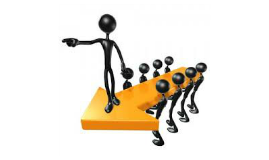

> **Descripción de la imagen** — La imagen es una ilustración vectorial simple que representa un flujo o proceso. En el lado izquierdo se encuentra la silueta negra de una persona con los brazos extendidos, señalando hacia la derecha. Esta figura está conectada a una flecha gruesa y ancha de color naranja/amarillo que apunta horizontalmente hacia la derecha. Al final de esta flecha se agrupan varias siluetas pequeñas de personas.

TEORÍAS DE LOS ESTILOS DE

LÍDERAZGO

---

<!-- página 5 -->
### Introducción

̈ El estilo de liderazgo es la manera

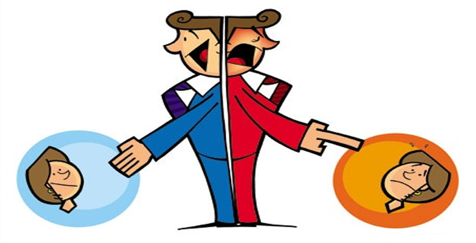

> **Descripción de la imagen** — Es una ilustración de estilo caricatura que muestra a dos figuras masculinas interactuando.
>
> Una figura, vestida con una camisa azul, se encuentra a la izquierda y tiene el pelo castaño. Su expresión facial es de sorpresa o asombro, con la boca abierta.
>
> La segunda figura, vestida con una camisa roja, está a la derecha y tiene el pelo oscuro. Esta figura también tiene una expresión de sorpresa o grito, con la boca muy abierta. La figura roja está señalando directamente hacia la figura azul con un dedo extendido.
>
> Alrededor de la figura azul hay un óvalo de color azul claro, y alrededor de la figura roja hay un círculo de color naranja.

en
que
los
líderes
guían
a
sus
colaboradores.
Ese
sello
personal
que imprimen al dirigir, forma o
método con que el jefe ejerce la
autoridad y de igual forma también
cómo se manifiestan las relaciones
entre
jefes
y
subordinados,
se
pueden expresar en varios tipos de
estilos.

---

<!-- página 6 -->
### Estilos basados en el uso de autoridad

̈ Líder autocrático: Se conoce a esta clase de

liderazgo por ser aquella en la que todas las
decisiones recaen sobre el líder, sin tomar en cuenta
la opinión de los demás.

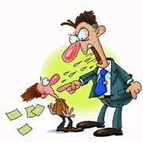

> **Descripción de la imagen** — Es una ilustración o caricatura que representa a un hombre con una expresión exagerada y demandante. El personaje es un hombre de mediana edad, vestido con un traje y corbata. Su rostro muestra una expresión intensa: los ojos están muy abiertos y la lengua está fuera, sugiriendo frustración o exigencia.
>
> El hombre está señalando con su mano derecha hacia el frente. Alrededor de él y cerca de sus pies hay billetes de dinero flotando. La composición general sugiere un tema relacionado con la avaricia, la demanda de dinero o una situación financiera intensa.

---

<!-- página 7 -->
## Estilos basados en el uso de autoridad
### Características
### que
### definen
### a
### la
### forma
### de
### liderar
### autocrática:

̈ Existe una dominación constante por parte del jefe.

̈ Hay metas a alcanzar que son muy específicas.

̈ Quien está al mando, es quien carga con la mayor parte del trabajo, ya

que no delega sus funciones.

̈ Hay recompensas para quien demuestra ser eficiente, pero también

castigos para quien retrasa al equipo o lo afecta negativamente.

̈ Solamente el líder es quien tiene acceso a la información más importante.

̈ No hay espacio para las opiniones o aportaciones de los demás miembros

del equipo.

̈ Las elecciones del líder nunca están a discusión, incluso si no son del agrado

de todos.

---

<!-- página 8 -->
## Estilos basados en el uso de autoridad

Ventajas del líder autocrático:

̈ Se encarga de cumplir con eficiencia y en el menor plazo de tiempo

posible, todas las tareas necesarias para cumplir un objetivo.

̈ Es muy exhaustivo con el trabajo de cada subordinado, lo que

garantiza un trabajo de alta calidad.

̈ Se especializa en trabajar bajo presión y aún con el tiempo y

numerosas circunstancias por encima.

̈ No le teme a las decisiones rápidas y es capaz de hacer lo

necesario para mantener a flote un proyecto difícil.

̈ Siempre controla hasta el más mínimo detalle, para no dar lugar a

errores o retrasos.

̈ Cuando es necesario despedir a un elemento negativo para el

trabajo en equipo, lo hace sin vacilación.

---

<!-- página 9 -->
## Estilos basados en el uso de autoridad

Desventajas del líder autocrático:

̈ Provoca frustración y sentimientos negativos en sus subordinados.

̈ Impide el crecimiento de una compañía o proyecto, al dejar fuera

buenas ideas de parte de otros miembros del equipo.

̈ No brinda la motivación necesaria a los trabajadores, para que se

mantengan dando el 100% en sus obligaciones.

̈ Fomenta la competencia a tal punto, que las personas en vez de

colaborar entre sí, pueden llegar a sabotearse.

̈ No existe comunicación entre el líder y la gente que está a su cargo,

a no ser por los fallos que puedan cometer estos últimos.

̈ No se fortalece con la participación de los empleados.

---

<!-- página 10 -->
### Estilos basados en el uso de autoridad

̈ Líder democrático: Este tipo de liderazgo implica la

participación de todas las personas que persiguen
un mismo objetivo. Así pues, la responsabilidad, más
que recaer en una sola persona, se comparte con
todos los miembros del equipo, tomando en cuenta
la opinión de lo que dicta la mayoría y siempre
dejando abiertos los canales de comunicación.

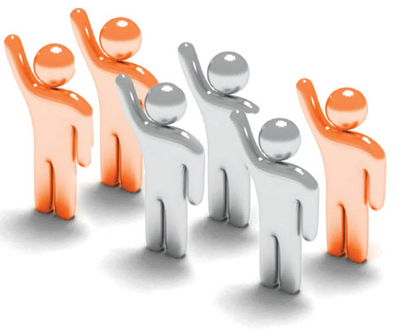

> **Descripción de la imagen** — La imagen es una ilustración tridimensional de tres figuras humanas estilizadas, representadas en un estilo brillante y pulido. Las figuras están dispuestas horizontalmente y se encuentran de pie sobre una superficie blanca.
>
> Cada figura tiene los brazos levantados por encima de la cabeza en un gesto de celebración o triunfo. Las figuras varían en color: la figura de la izquierda es naranja, la del centro es gris claro y la de la derecha es blanca. Todas las figuras tienen una apariencia alegre y dinámica.

---

<!-- página 11 -->
## Estilos basados en el uso de autoridad
### Características que definen a la forma de liderar democrática:

̈ El líder toma en cuenta todo el tiempo las sugerencias e ideas de quienes

le siguen, e incluso los alienta a participar y a dar su opinión.

̈ Las decisiones saben ser delegadas, para que quien está a cargo no tenga

que cargar con un exceso de trabajo.

̈ Nunca se deja a nadie fuera de las actividades en grupo, ni se discrimina

con base en diferencias de ningún tipo.

̈ Las opiniones de cada individuo son escuchadas, sin importar que exista

desacuerdo de algunas personas o del propio líder.

̈ Se busca que los objetivos a alcanzar vayan a beneficiar a todos en partes

iguales.

̈ El líder siempre se ofrece para orientar y aconsejar a cualquier miembro

de su grupo, que no se sienta a gusto con la dinámica.

---

<!-- página 12 -->
## Estilos basados en el uso de autoridad
### Ventajas del líder democrático:

̈
Promueve la iniciativa de las personas. Siempre es más fácil trabajar con quienes
están dispuestos a cooperar y dar buenas ideas, y los líderes democráticos tienen
la responsabilidad de lograr eso en sus grupos.

̈
Brinda oportunidades de desarrollo para todos. Además de ver resultados eficaces,
las personas que trabajan en un mismo proyecto pueden crecer profesionalmente y
obtener muy buenas experiencias, pues se busca que todos se sientan a gusto.

̈
Ayuda a crear un vínculo entre todos los participantes y el líder. Valores como la
confianza y hasta la amistad pueden verse desarrollados cuando se trata de
liderar democráticamente.

̈
Se le da más importancia a la participación que a la competencia. Al contrario que
ocurre con otros tipos de liderazgo, el que se maneja democráticamente es más
relajado y ofrece buenos ratos de recreación para quienes le siguen.

̈
Favorece la necesidad de identidad de las personas. Sucede que todos sentimos
tarde o temprano que debemos identificarnos con un grupo. El liderazgo
democrático hace que esto, de alguna manera, se vuelva posible.

---

<!-- página 13 -->
## Estilos basados en el uso de autoridad
### Desventajas del líder democrático:

̈ A veces no se pueden superar los desacuerdos entre dos o más partes del

grupo. En la democracia se busca contentar a la mayoría, por lo que
siempre habrá una minoría a la que no le guste como se maneja la
situación. Esto puede dar lugar a circunstancias negativas.

̈ Si no se establecen reglas mínimas de control, el grupo puede derivar en

problemas como la anarquía o desviarse de sus objetivos establecidos. A
veces depositar toda la confianza en varios individuos, no es la mejor
forma de establecer un orden determinado.

̈ El líder debe tener bastante habilidad para mantener la motivación y la

colaboración de quienes le siguen, así como plena confianza en sí mismo,
incluso para soportar críticas y actitudes de desprestigio. De lo contrario, el
equilibrio de un conjunto de individuos se quiebra.

̈ Es un camino lento a la hora de alcanzar una meta, en comparación con

otros estilos de liderazgo. En contraparte con los beneficios que ofrece eta
forma de liderar, es posible ver que es menos probable que rinda frutos a
corto plazo.

---

<!-- página 14 -->
### Estilos basados en el uso de autoridad

̈ Líder liberal o Laissez-faire: Su nombre proviene

de una expresión en francés que significa “déjalo
ser”. Esto quiere decir que los líderes que siguen
este
estilo,
le
dan
una
gran
libertad
a
sus
colaboradores y les pueden confiar la toma de
decisiones importantes.

> **Descripción de la imagen** — La imagen es una ilustración conceptual dividida en dos secciones principales.
>
> **Parte Superior: Figuras Estilizadas**
> Muestra un conjunto de figuras humanas estilizadas y de colores brillantes, dispuestas en una composición circular o agrupada. Las figuras son siluetas con trajes y accesorios variados (como sombreros o bufandas). Se observan al menos seis figuras distintas, utilizando una paleta de colores que incluye rojo, rosa, púrpura, azul y verde. Las figuras parecen estar interconectadas o posicionadas en relación unas con otras, sugiriendo un modelo conceptual o un flujo de interacción entre diferentes elementos.
>
> **Parte Inferior: Objetos Texturizados**
> En la parte inferior de la imagen se presenta una fila horizontal de objetos esféricos o formas redondeadas. Estos objetos tienen texturas y colores variados, incluyendo tonos anaranjados/marrones, amarillos verdosos y un verde brillante con textura de malla o tejido.

---

<!-- página 15 -->
## Estilos basados en el uso de autoridad

Ventaja del liderazgo liberal:

̈ Funciona
cuando
se
dispone
de
gente
con
mucha
experiencia para alcanzar una meta.

Desventajas del liderazgo liberal:

̈ Los líderes que entran dentro de esta categoría supervisan

muy poco a quienes trabajan para ellos, permitiendo que
cometan errores que podrían llevar al fracaso lo que
pretenden lograr.

̈ Es muy sencillo y hasta recomendable, delegar tareas en

cierto punto. Pero para evitar que las cosas se salgan de
control (anarquía y procrastinación), siempre debe haber
alguien que se haga cargo.

---

<!-- página 16 -->
## Estilos basados en la Rejilla
## administrativa o Malla gerencial

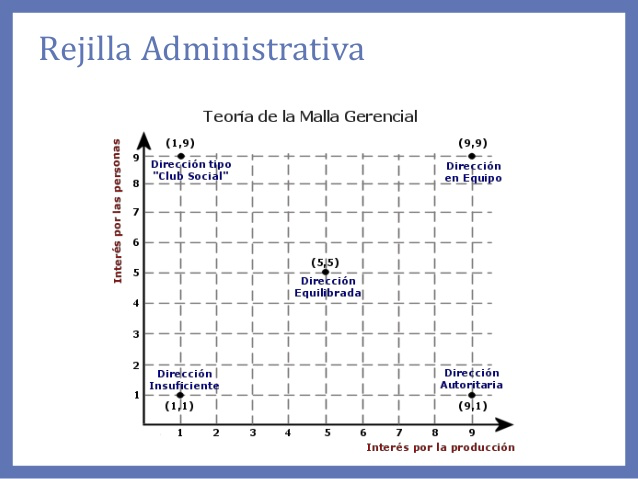

> **Descripción de la imagen** — Se trata de un diagrama tipo matriz o rejilla administrativa titulado "Rejilla Administrativa" y se relaciona con la "Teoría de la Malla Gerencial".
>
> El diagrama es una cuadrícula de 3x3 que utiliza dos ejes para clasificar relaciones:
> 1. **Eje Vertical:** Interés por las personas (escalado del 1 al 9).
> 2. **Eje Horizontal:** Interés por la producción (escalado del 1 al 9).
>
> La rejilla está segmentada en nueve celdas, cada una etiquetada con un tipo de dirección o relación, y asociada a coordenadas numéricas que indican su posición en los ejes.
>
> Las etiquetas principales dentro de las celdas son:
> *   **Dirección Insuficiente:** Ubicada en la esquina inferior izquierda (coordenadas 1,1).
> *   **Dirección Autoritaria:** Ubicada en la esquina superior derecha (coordenadas 9,9).
> *   **Dirección en Equipo:** Ubicada en la esquina superior izquierda (coordenadas 9,1).
> *   **Dirección Equilibrada:** Ubicada en el centro de la matriz.
>
> El diagrama ilustra cómo diferentes niveles de interés por las personas y la producción definen distintos tipos de dirección gerencial.

Uno de los enfoques
más reconocidos para
la definición de los
estilos de liderazgo
es
la
rejilla
administrativa,
creada
por
Robert
Blake y Jane Mouton.
Esta
teoría
plantea
dos
enfoques
centrales:
la
orientación hacia las
personas
y
la
orientación hacia las
tareas,
como
se
muestra en la figura.

---

<!-- página 17 -->
## Estilos basados en la Rejilla
## administrativa o Malla gerencial

̈ El eje vertical se refiere a la orientación para mantener relaciones

personales con los miembros del grupo, abriendo canales de
comunicación, proporcionando apoyo emocional y mostrando interés
por ellos. El punto más bajo (1) significa baja o poca preocupación o
interés por las personas y el más alto (9), un interés centrado en las
relaciones con otros.

̈ El eje horizontal se refiere a la orientación hacia la tarea, esto es, el

grado en el que el líder atiende las actividades de la organización
de las funciones, define metas, explica actividades a cada uno
respecto de lo que debe realizar, cuándo, cómo y dónde; es decir, la
forma de dirigir al grupo para lograr que el trabajo se realice. En la
medida en que se avanza por este eje hacia la derecha, se
incrementa el énfasis en la realización y el cumplimiento de las
labores y tareas encomendadas.

̈ Dentro de este encuadre se encuentra una gran diversidad de estilos,

sin embargo, se han definido cinco básicos:

---

<!-- página 18 -->
## Estilos basados en la Rejilla
## administrativa o Malla gerencial

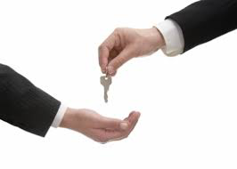

> **Descripción de la imagen** — La imagen es una fotografía que muestra una mano humana sosteniendo una llave metálica pequeña. La mano está orientada hacia abajo y la llave se encuentra en el centro de la palma. El fondo es completamente blanco, lo que resalta el gesto y los objetos.

### ̈ Estilo 1.1 (Relación Baja, Tarea
### Baja) Liderazgo de delegación
Las características más sobresalientes de
este estilo son las siguientes:

̈ Dejar que los demás hagan y decidan.

̈ Orientar y sugerir.

̈ Delegar tareas y autoridad.

̈ Confianza mutua total.

̈ Apoyo
completo
a
iniciativas
y
decisiones.

̈ En el estilo de dirección de delegación

(1.1)
existe
un
bajo
interés
en
los
resultados y un interés bajo en las
personas.

---

<!-- página 19 -->
### Estilos basados en la Rejilla
### administrativa o Malla gerencial

Ventajas del líder estilo 1.1:

̈ Cuando este estilo se adopta porque corresponde

al nivel de madurez del grupo, el líder delega
porque tiene la certeza de que los colaboradores
poseen
los
conocimientos,
la
experiencia,
la
responsabilidad y el deseo de hacer la tarea, por
lo que los deja en libertad de decidir el qué, cómo,
cuándo, dónde y quién, revisando exclusivamente
los resultados.

---

<!-- página 20 -->
## Estilos basados en la Rejilla
## administrativa o Malla gerencial

Desventajas del líder estilo 1.1

̈ En cuanto a la comunicación, quien adopta este estilo no conversa

mucho, pues no piensa en términos de qué información necesita brindar
a sus colaboradores. Más bien deja que le hagan preguntas en la
suposición de que los otros deben saber qué necesitan.

̈ Al dar instrucciones, el líder 1.1 dirá por ejemplo. “He aquí lo que

quiero que se haga. Todo está en este oficio. Avísenme cuando hayan
terminado”. Tiende a “no ver” los errores o evadirlos.

̈ No se muestra abierto a las quejas ni busca solucionarlas. Su

neutralidad le permite vivir en un mundo en el que no ve ningún
desacuerdo o, por lo menos, si lo ve, no hace nada por resolverlo.

̈ En sentido negativo podríamos ubicar a este director como “jubilado en

el trabajo”.

---

<!-- página 21 -->
## Estilos basados en la Rejilla
## administrativa o Malla gerencial

> **Descripción de la imagen** — La imagen es una fotografía de grupo que muestra a cuatro personas adultas posando juntas en un entorno interior.
>
> Los sujetos están alineados horizontalmente y mirando hacia la cámara.
> *   En el centro-izquierda hay un hombre con cabello oscuro, sonriendo, vestido con un traje oscuro.
> *   A su izquierda se encuentra una mujer con cabello oscuro, también sonriendo, vestida con una blusa clara (azul o blanca).
> *   A la derecha del hombre central está otra mujer con cabello rubio, sonriendo y vestida con una blusa clara similar a la de la mujer de la izquierda.
> *   En el extremo derecho hay un hombre con cabello oscuro, sonriendo y vestido con un traje oscuro y camisa blanca.
>
> La iluminación es brillante y el fondo sugiere un espacio interior moderno, posiblemente una oficina o sala de reuniones.

### ̈ Estilo 1.9 (Relación Alta, Tarea
### Baja) Liderazgo participativo. Las
características más sobresalientes de este
estilo son:

̈
Énfasis
en
el
otorgamiento
de
apoyo
emocional al colaborador

̈
La
comunicación
es
entre
ambas
partes,
asesora, aconseja, sugiere, orienta.

̈
Procura
establecer
confianza
mutua,
interrelación humana y positiva.

̈
Desea agradar, pues cree que con su ilimitada
simpatía, estímulo y apoyo conserva la lealtad
de los colaboradores.

̈
Este directivo manifiesta un bajo interés por
los resultados, en contraste con un interés alto
en los procesos interpersonales.

̈

---

<!-- página 22 -->
## Estilos basados en la Rejilla
## administrativa o Malla gerencial

Ventajas del líder estilo 1.9:

̈ Aplicando este estilo conforme al nivel de madurez del grupo,

se parte de la base de que los colaboradores conocen y tienen
experiencias en el trabajo, aunque pueden sentirse inseguros
para realizarlo, por lo que se procura otorgar reconocimiento y
apoyo emocional de acuerdo a sus necesidades, los buenos
sentimientos y la armonía producida por ello, garantizarán que
las tareas se realicen sin problema, generando un vínculo socio-
emocional de compromiso. Tiende a mantener comunicación con
todos, les hace sentir que las cosas están bien y los anima.

---

<!-- página 23 -->
## Estilos basados en la Rejilla
## administrativa o Malla gerencial

Desventajas del líder estilo 1.9:

̈ Cuando tiene que dar indicaciones, un dirigente participativo (1.9)

quizá mencione un problema pero lo hará de manera indirecta.

̈ Cuando el directivo necesita hacerles preguntas, lo hace de

manera vaga y general; por ejemplo: ¿cómo van las cosas?, para
evitar molestarlos o dar la impresión de estar husmeando o
criticando.

̈ Ante las equivocaciones, su tendencia es la de acentuar lo positivo

y eliminar lo negativo para no hacer sentir culpable a nadie, lo
que a veces provoca irresponsabilidad.

̈ Ante las quejas, el director participativo se une al grupo y lo

apoya, procurando hacer sentir que está con él como compañero
de infortunio para no crear distanciamiento, lo que puede generar
conformismo.

---

<!-- página 24 -->
## Estilos basados en la Rejilla
## administrativa o Malla gerencial

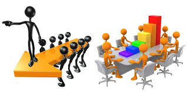

> **Descripción de la imagen** — La imagen es una fotografía que muestra a un grupo de personas interactuando alrededor de una estructura grande y inclinada de color amarillo o naranja, que parece ser de madera. Varias figuras humanas están agrupadas en la base y sobre esta estructura, sugiriendo una actividad grupal o un ejercicio práctico. La composición se centra en el grupo y la plataforma elevada.

### Estilo 9.1 (Relación Baja, Tarea
### Alta) Liderazgo informativo o de
### dirección
En
este
estilo
sobresalen
las
siguientes características:

̈ Una dirección estrecha sobre la ejecución de

las tareas.

̈ Dirige,
ordena,
manda,
fija
normas
y
funciones.

̈ Establece objetivos y estructura.

̈ Determina el cómo, cuándo y dónde hacer el

trabajo.

̈ Comunicación en un solo sentido (informa)

̈ En el estilo informativo (9.1), el directivo se

orienta, principalmente, en el alcance de los
resultados y muestra poco interés en los
pensamientos, las actitudes y los sentimientos
de sus colaboradores.

---

<!-- página 25 -->
### Estilos basados en la Rejilla
### administrativa o Malla gerencial

Ventajas del líder estilo 9.1:

̈ Emplea su autoridad para conducirlos y controlarlos.

Espera que sean obedientes, disciplinados, cumplidos y
cooperativos. Los colaboradores deben hacer lo que se
les dice para lograr los objetivos planteados.

̈ El líder pide resultados, sin excusa ni pretexto.

̈ Las instrucciones se dan de una manera clara y precisa,

para impedir que los colaboradores malinterpreten lo
que se desea que hagan y evitar que formulen preguntas.

---

<!-- página 26 -->
## Estilos basados en la Rejilla
## administrativa o Malla gerencial
### Desventajas del líder estilo 9.1:

̈ Este tipo de líder considera que las equivocaciones son producto de malas

actitudes. Recurre a acciones disciplinarias para evitar que se repitan las
cosas.

̈ Su estilo de comunicación tiende a ser en un solo sentido y casi siempre hacia

abajo (descendente). Cuando es hacia arriba (ascendente), sólo informa que
el trabajo se ha realizado.

̈ Las quejas para él son señal de debilidad. La mejor manera de manejarlas

es ignorarlas o menospreciarlas. Los sentimientos hostiles hacia él son
inaceptables, conducen a la resistencia y a la insubordinación.

̈ Este es un estilo duro, basado en autoridad-obediencia. El jefe impone sus

decisiones. El líder determina los roles de los colaboradores y las tareas que
cada uno debe realizar; estableciendo claramente qué es lo que debe
hacerse, cuándo y en qué condiciones. Los colaboradores deben ejecutar el
trabajo según les ordena.

---

<!-- página 27 -->
## Estilos basados en la Rejilla
## administrativa o Malla gerencial

> **Descripción de la imagen** — Es una fotografía que muestra a un grupo de personas jóvenes sentadas en lo que parece ser un aula o un espacio de estudio. Varias personas están dispuestas en primer plano y plano medio, mirando hacia adelante. Se observan al menos seis individuos, con diferentes apariencias. La iluminación es brillante y el ambiente sugiere una reunión o discusión académica.

### Estilo 9.9 (Relación Alta, Tarea Alta)
### Liderazgo persuasivo Se caracteriza por lo
siguiente:

̈
La dirección que ejerce es moderada.

̈
Coordina e integra los esfuerzos.

̈
Fomenta el trabajo colaborativo.

̈
Si existen dudas, demuestra y expone.

̈
Fija y motiva a seguir objetivos y programas.

̈
Establece comunicación abierta.

̈
Proporciona apoyo emocional, reconocimiento
y “caricias” psicológicas.

̈
El
estilo
persuasivo
(9.9)
manifiesta
un
equilibrio entre el interés por las tareas y por
las personas. Este estilo de dirigir requiere
mayor
habilidad
en
el
desarrollo
del
liderazgo personal y del trabajo en equipo.

---

<!-- página 28 -->
## Estilos basados en la Rejilla
## administrativa o Malla gerencial

Ventajas del líder estilo 9.9:

̈ Busca que la gente se fije objetivos altos que puedan obtenerse

por medio de esfuerzo y dedicación.

̈ Este
estilo
se
basa
en
el
involucramiento-participación-
compromiso y requiere una clase particular de interacción jefe-
colaborador.

̈ La comunicación es un intercambio abierto, libre y franco.

̈ Las instrucciones aparecen con base en metas y objetivos del

trabajo en las que el director y el grupo se han puesto de
acuerdo previamente.

̈ Los errores se consideran desde el punto de vista de las causas

que los han originado.

---

<!-- página 29 -->
## Estilos basados en la Rejilla
## administrativa o Malla gerencial

̈ La razón de emprender acciones correctivas es eliminar las causas.

̈ Las quejas deben comprenderse y atenderse debidamente, lo cual

puede hacerse eliminando cualquier cosa que haya ocasionado la
queja o pidiéndole al quejoso que amplíe la información al respecto.

̈ El directivo persuasivo reacciona ante los sentimientos hostiles en forma

seria procurando comprenderlos y haciendo uso de una interacción
auténtica, abierta y sincera.

̈ El líder acuerda con su grupo el qué, cómo, cuándo, dónde y quién

realiza el trabajo conservando el control de las actividades y
decisiones;
sin
embargo,
no
descuida
las
relaciones
con
sus
colaboradores y les proporciona el estímulo necesario para lograr los
objetivos establecidos.

̈

---

<!-- página 30 -->
## Estilos basados en la Rejilla
## administrativa o Malla gerencial

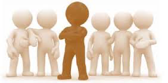

> **Descripción de la imagen** — La imagen es una ilustración o fotografía que muestra cinco figuras humanas estilizadas y simplificadas, de pie y orientadas hacia adelante. Las figuras tienen un aspecto uniforme, con cabezas redondas y cuerpos sencillos. Están dispuestas una al lado de la otra en una fila horizontal. Todas las figuras visten ropa simple (camisetas o tops). El tono general de la imagen es claro, con colores neutros (tonos beige o crema) para los cuerpos y cabezas.

### ̈ Estilo 5.5 (medianamente orientado hacia la
### tarea y hacia la relación) Liderazgo
### intermedio Los aspectos sobresalientes en este
estilo son:

̈
Apegado
a
las
normas,
los
reglamentos
y
los
estándares definidos.

̈
Se interesa por lograr resultados hasta el punto que no
lo califiquen de ineficaz.

̈
Las relaciones con sus colaboradores se encuentran
reguladas a través de reglamentos.

̈
Utiliza comunicación formal e informal.

̈
No impone las instrucciones, las negocia.

̈
El estilo intermedio (5.5) se ubica en la parte central
del esquema. En este directivo existe un grado
moderado de interés por los resultados, que se
combina con un grado moderado de interés por las
personas a su cargo.

---

<!-- página 31 -->
## Estilos basados en la Rejilla
## administrativa o Malla gerencial

̈ Este estilo se apoya en la tradición y prácticas pasadas, en los

procedimientos estándar de trabajo y en la aplicación literal de las
normas. De esta manera, el trabajo se hace “de acuerdo con la ley” o
al pie de la letra.

̈ Un directivo intermedio está atento a los problemas que puedan

resolverse por medio de una comunicación formal. Emplea los
conductos formales de comunicación (oficios, reuniones periódicas)
pero además otorga importancia a la comunicación informal (rumores,
chismes, expresiones de descontento).

̈ Su meta es anticiparse a las dificultades para evitarlas.

---

<!-- página 32 -->
## Estilos basados en la Rejilla
## administrativa o Malla gerencial

̈ Las instrucciones tienden a darse de manera general, más que específica,

para que los trabajadores no se sientan presionados. El directivo está
dispuesto a ayudar cuando se lo soliciten. Para tratar de resolver los errores,
se apega a las prácticas y normas establecidas.

̈ En cuanto a las reacciones hostiles, trata de controlarlas para que no hagan

erupción,
e
intenta
lograrlo
canalizando
una
discusión
hacia
áreas
administrativas o introduciendo periodos de “enfriamiento”, que le den tiempo
para pensar y que permitan que los sentimientos hostiles se desvanezcan.

̈ El estilo intermedio es percibido por ese líder como seguro porque hace que

la gente se desempeñe no con un alto grado de eficiencia, pero si de manera
aceptable, lo cual le evita problemas.

̈

---

<!-- página 33 -->
## Continuo de liderazgo

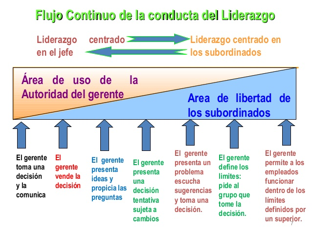

> **Descripción de la imagen** — Se trata de un diagrama de flujo que ilustra el "Flujo Continuo de la conducta del Liderazgo". El diagrama presenta una secuencia vertical de acciones y roles, conectadas por flechas, y está dividido en dos áreas conceptuales.
>
> **Estructura del Flujo:**
> El proceso comienza con la acción: "El gerente toma una decisión y la comunica". Esta acción se conecta secuencialmente con las siguientes etapas:
> 1.  "El gerente presenta ideas y propicia las preguntas."
> 2.  "El gerente presenta una decisión tentativa sujeta a cambios."
> 3.  "El gerente permite a los empleados funcionar dentro de los límites definidos por un superior."
> 4.  "El gerente define los límites: pide al grupo que tome la decisión."
>
> **Conexiones y Conceptos Superiores:**
> En la parte superior del diagrama, se muestran dos tipos de liderazgo conectados por flechas horizontales: "Liderazgo centrado en el jefe" y "Liderazgo centrado en los subordinados".
>
> **Áreas Definidas:**
> El flujo vertical está asociado a dos áreas conceptuales que definen el alcance de la autoridad:
> *   A la izquierda se encuentra la "Área de uso de la Autoridad del gerente".
> *   A la derecha se encuentra la "Área de libertad de los subordinados".

El Modelo del Continuo de
Liderazgo es un enfoque de
contingencia
para
el
liderazgo
propuesto
por
Robert
Tannenbaum
y
Warren Schmidt en 1958, y
representado en un gráfico
llamado
continuo
de
la
conducta
(patrones)
de
liderazgo.
Los
autores
sugieren
un
conjunto
de
comportamientos
de
lide-
razgo que el líder puede
elegir en relación con sus
subordinados.

---

<!-- página 34 -->
## Continuo de liderazgo

̈ Cada tipo de comportamiento está asociado con un cierto grado de

autoridad utilizado por el líder, y un grado de libertad que está
disponible a los subordinados en la toma de decisiones. En el gráfico se
presentan los estilos de liderazgo que van desde la muy centralizada
alrededor del líder y el totalmente descentralizado, en el que los
subordinados
tienen
la
máxima
libertad
dentro
de
los
límites
establecidos por el líder.

̈ Los autores apoyan la idea de que la elección de un estilo particular

de liderazgo depende principalmente de tres tipos de factores:

¤ Fuerzas del líder: saber-hacer, la educación, la experiencia, la capacidad

de asumir la responsabilidad;

¤ Fuerzas de los subordinados: saber-hacer, la educación, la experiencia, la

capacidad de asumir la responsabilidad;

¤ Fuerzas de la situación: tamaño de la organización, la complejidad, los

objetivos, la estructura organizativa, la naturaleza del trabajo, etc.

---

<!-- página 35 -->
## Continuo de liderazgo

El
Continuo
de
Liderazgo
propone
siete
estilos
de
liderazgo:
1. El líder toma decisiones y las comunica a los seguidores
en forma individual o en un grupo sin discusión.
2. El líder toma la decisión y la promueve a los seguidores
mediante una presentación de porqué es una buena idea.
3. El líder expone ideas e invita a preguntar a los
seguidores.
4. El líder manifiesta una decisión tentativa sujeta a
cambios.

---

<!-- página 36 -->
### Continuo de liderazgo

5. El líder plantea el problema obtiene soluciones
sugeridas y toma la decisión.

6. El líder define los límites y pide que los seguidores
tomen una decisión.

7.
El
líder
permite
que
los
seguidores
tomen
decisiones continuas dentro de los límites definidos.

---

<!-- página 37 -->
## Enfoques situacionales

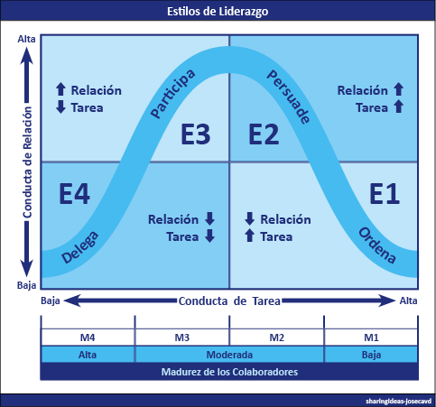

> **Descripción de la imagen** — Se trata de un diagrama que ilustra un modelo de estilos de liderazgo basado en la conducta de relación y la conducta de tarea, utilizando una escala de madurez de los colaboradores.
>
> **Estructura del Diagrama:**
>
> 1.  **Ejes:**
>     *   El eje vertical representa la **Conducta de Relación**, con niveles que van de Alta (arriba) a Baja (abajo).
>     *   El eje horizontal inferior representa la **Madurez de los Colaboradores**, con niveles que van de Baja (izquierda) a Alta (derecha).
>
> 2.  **Curva Central y Estilos de Liderazgo:**
>     *   Una curva continua atraviesa el diagrama, dividida en cuatro niveles principales: E1, E2, E3 y E4.
>     *   Cada nivel corresponde a un estilo de liderazgo específico:
>         *   **E1 (Ordena):** Se ubica en la parte inferior del espectro.
>         *   **E2 (Persuade):** Se encuentra en el centro superior.
>         *   **E3 (Participa):** Se sitúa en la parte superior central.
>         *   **E4 (Delega):** Se localiza en la parte izquierda inferior.
>
> 3.  **Conexiones y Variables:**
>     *   El diagrama muestra cómo los estilos de liderazgo se relacionan con la **Relación** y la **Tarea**.
>     *   Se indican flechas que muestran la dirección de estas variables:
>         *   En el nivel E4 (Delega), la "Relación" tiene una flecha hacia abajo y la "Tarea" tiene una flecha hacia arriba.
>         *   En el nivel E2 (Persuade), la "Relación" tiene una flecha hacia arriba y la "Tarea" tiene una flecha hacia arriba.
>
> 4.  **Conclusión Visual:**
>     El diagrama presenta un mapa conceptual

El
enfoque
de
Hersey
y
Blanchard
se
centra en gran
medida
en
las
características
de
los
segui-
dores, pues son
éstas
las
que
determinan
el
comportamiento
de liderazgo.

---

<!-- página 38 -->
## Enfoques situacionales

̈ Las personas con baja disposición para las tareas, ya

sea por su poca habilidad o capacitación, o su
inseguridad, necesitan un estilo de liderazgo diferente
de aquellas que tienen un alto grado de disposición y
tienen una buena capacidad, habilidades, confianza y
diligencia para trabajar.

̈ De acuerdo con esta teoría, un dirigente puede

adoptar uno de cuatro estilos de liderazgo, con base
en el comportamiento de relaciones, que se refiere al
interés por las personas, y del comportamiento de
tareas, que se refiere al interés por la productividad.
Elegir un estilo conveniente dependerá en gran medida
del nivel de disposición y madurez de los subordinados.

---

<!-- página 39 -->
## Enfoques situacionales
### ̈ El estilo directivo (E1) refleja una alta preocupación en

las tareas y bajo interés en las personas y las relaciones. Este
estilo de alta dirección conlleva dar direcciones explícitas
acerca de cómo y cuándo se deben desempeñar las tareas. En
esta fase lo más apropiado es que el líder observe muchas de
las conductas concernientes a las tareas. Es decir, los empleados
deben recibir instrucciones en cuanto a sus tareas y habituarse
con las reglas y procedimientos establecidos dentro de la
organización. Un gerente que no dirija de una forma adecuada
despertaría angustia y confusión entre los subordinados nuevos.

---

<!-- página 40 -->
## Enfoques situacionales
### ̈ El estilo persuasivo (E2) está apoyado en un alto interés

en las personas y al mismo tiempo preocupación en las tareas.
Con este enfoque el líder determina y explica las decisiones y
cede a los subordinados la oportunidad de realizar preguntas y
de esta forma obtener mayor claridad y comprensión con
respecto a las tareas laborales.

---

<!-- página 41 -->
## Enfoques situacionales
### ̈ El estilo participativo (E3), que se refiere a una

combinación de alto interés en las personas y relaciones,
y bajo interés en las tareas de la producción. En este
estilo, el líder comparte las ideas con los subordinados,
les da la oportunidad de participar en la toma de
decisiones. En esta fase los empleados tienen más
capacidad y su motivación para superarse empieza a
aparecer, además empiezan a buscar, de forma activa,
más
responsabilidades.
El
líder
ya
no
tendrá
la
necesidad de dirigir tanto, sin embargo, el líder si tendrá
que seguir siendo respetado y seguirá ofreciendo apoyo,
con el fin de reforzar la determinación de los seguidores
que quieren obtener más responsabilidad.

---

<!-- página 42 -->
### Enfoques situacionales
### ̈ El estilo delegador (E4), que manifiesta un bajo

interés por las relaciones del mismo modo que por
las tareas. Este estilo ofrece poca dirección y apoyo,
debido a que el líder delega a sus seguidores la
responsabilidad de la toma de decisiones y su
ejecución. Es decir, conforme los seguidores van
adquiriendo gradualmente más confianza, así como
experiencia y autogestión, el líder puede disminuir la
cantidad de apoyo y aliento que brinda. En esta
cuarta fase, los seguidores ya no requieren ni
esperan una mayor dirección de su administrador.
Cada vez son más autónomos.

---

<!-- página 43 -->
## Teoría de los rasgos del liderazgo

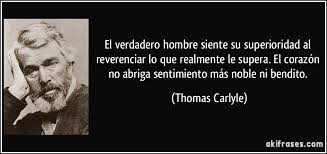

> **Descripción de la imagen** — La imagen es una diapositiva o un recuadro de texto con un fondo negro sólido. En el centro, aparece una cita escrita en letras blancas. La cita está atribuida a Thomas Carlyle y aborda temas de superioridad humana y sentimientos nobles. En la esquina inferior derecha se observa una marca de agua o fuente.

̈ Formulada durante el siglo XIX, aunque sus

orígenes los encontramos en la antigua Grecia
y Roma, esta teoría defiende que algunas
personas simplemente nacen líderes y otras no.
el
autor
destacado
de
este
enfoque
fue
Thomas Carlyle, que estudió Teología y fue
historiador, crítico social y ensayista.

̈ Carlyle creía que se debía buscar al hombre

más capaz y someterse a él por nuestro propio
bien. El peligro de hacer afirmaciones como
ésta es que pueda ser utilizada como base
para justificar los regímenes dictatoriales.

̈

̈ Esta teoría afirma que una persona cualquiera

no puede convertirse en líder, ya que el
liderazgo es unidimensional, es decir: o eres
líder o no lo eres. Por supuesto que el
desarrollo de personas no tiene sentido en esta
visión del liderazgo.

---

<!-- página 44 -->
## Teoría del liderazgo-personalidad

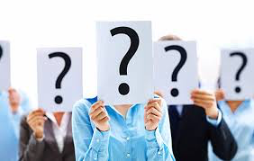

> **Descripción de la imagen** — La imagen es una fotografía de plano medio superior que muestra a una persona, vista desde el pecho hacia arriba, con cabello oscuro. La persona lleva una camisa de cuello azul claro. Sostiene varias tarjetas o papeles blancos con un signo de interrogación grande y negro en cada uno de ellos, levantados por encima de su cabeza. El fondo es completamente blanco.

̈ Los estudios de los rasgos examinan la

personalidad, las capacidades físicas
y las características sociales, así como
las relacionadas con el trabajo.

̈ Los
rasgos
son
características
que
distinguen a las personas.

̈ La personalidad es la combinación de

los
rasgos
que
definen
el
comportamiento de un individuo.

̈ La personalidad es la forma habitual

de sentir, pensar y actuar que tienen
las personas y que se mantiene más o
menos estable en el tiempo.

̈ La personalidad está conformada por

factores genéticos y ambientales. Son
también
conocidos
como
el
temperamento y el carácter.

---

<!-- página 45 -->
### Teoría del liderazgo-personalidad

CARÁCTER:
es
la
construcción social de
la personalidad, en la
que influye el medio,
la familia, los amigos,
la escuela etc.

TEMPERAMENTO: es la parte
genética de la personalidad,
es decir, aquello que ha sido
heredado.

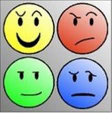

> **Descripción de la imagen** — La imagen es una cuadrícula de seis iconos circulares que representan diferentes expresiones faciales o emociones, dispuestas en dos filas de tres elementos cada una.
>
> Los iconos son:
> 1.  **Arriba a la izquierda:** Un círculo amarillo con una expresión de sonrisa amplia y feliz.
> 2.  **Arriba en el centro:** Un círculo rojo con una expresión de enfado o ceño fruncido.
> 3.  **Arriba a la derecha:** Un círculo gris claro con una expresión neutra o sin emoción marcada (aunque es un tono más apagado que los otros).
> 4.  **Abajo a la izquierda:** Un círculo verde brillante con una expresión de sonrisa contenta.
> 5.  **Abajo en el centro:** Un círculo azul oscuro con una expresión de tristeza o descontento (ceño fruncido).
> 6.  **Abajo a la derecha:** Un círculo gris claro con una expresión de ceño fruncido o enfado leve.

---

<!-- página 46 -->

Teoría del liderazgo-personalidad

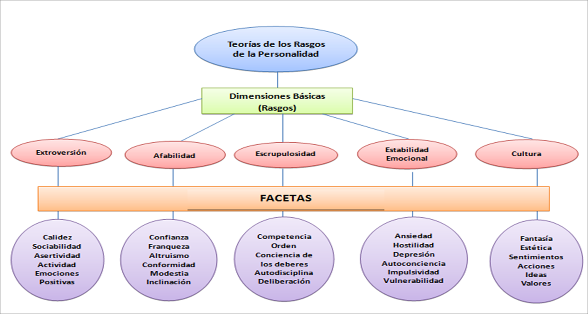

> **Descripción de la imagen** — Se trata de un diagrama jerárquico que ilustra una estructura conceptual de las teorías de los rasgos de la personalidad.
>
> La estructura se organiza en tres niveles principales:
>
> 1.  **Nivel Superior:** En la parte superior se encuentra el concepto principal, "Teorías de los Rasgos de la Personalidad".
> 2.  **Segundo Nivel (Dimensiones Básicas):** De este concepto emanan cinco dimensiones básicas o rasgos fundamentales, conectadas directamente hacia abajo: Extroversión, Afabilidad, Escrupulosidad, Estabilidad Emocional y Cultura.
> 3.  **Nivel Intermedio:** Debajo de las dimensiones básicas se encuentra una barra horizontal etiquetada como "FACETAS".
> 4.  **Tercer Nivel (Facetas Específicas):** De la barra de FACETAS se desprenden seis grupos de rasgos específicos, cada uno con varios elementos:
>     *   El primer grupo incluye Calidez, Sociabilidad, Asertividad, Actividad y Emociones Positivas.
>     *   El segundo grupo incluye Confianza, Franqueza, Altruismo, Conformidad, Modestia e Inclinación.
>     *   El tercer grupo incluye Competencia, Orden, Conciencia de los deberes, Autodisciplina y Deliberación.
>     *   El cuarto grupo incluye Ansiedad, Hostilidad, Depresión, Autoconciencia, Impulsividad y Vulnerabilidad.
>     *   El quinto grupo incluye Fantasía, Estética, Sentimientos, Acciones, Ideas y Valores.

---

<!-- página 47 -->
### Teoría del liderazgo-personalidad

̈ PERFIL
DE
LA
PERSONALIDAD:
los
perfiles se utilizan para
clasificar a las personas
con
el
fin
de
predecir
resultados en el desarrollo
de determinadas tareas.

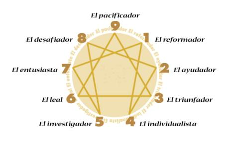

> **Descripción de la imagen** — Se trata de un diagrama circular o modelo relacional que representa nueve elementos interconectados en un ciclo.
>
> **Descripción del Diagrama:**
> El diagrama está estructurado como una figura geométrica con forma de estrella o pentágono central, rodeada por nueve nodos dispuestos en un círculo exterior. Cada nodo está etiquetado con un número y un término descriptivo. Los nodos están conectados entre sí mediante líneas que definen la estructura cíclica del modelo.
>
> **Elementos del Diagrama (Nodos):**
> Los nueve elementos identificados son:
>
> 1.  El reformador
> 2.  El ayudador
> 3.  El triunfador
> 4.  El investigador
> 5.  El entusiasta
> 6.  El leal
> 7.  El individualista
> 8.  El pacificador
> 9.  El desafiador

ENEAGRAMA

---

<!-- página 48 -->
### Teoría del liderazgo-personalidad

RASGOS DE LOS LÍDERES

EFICACES
• Dominio
• Autoconfianza
• Gran energía
• Estabilidad
• Locus de control emocional
interno
• Inteligencia
• Integridad emocional
• flexibilidad
• Sensibilidad hacia los
demás.

̈ El estudio de los perfiles

de la personalidad, puede
ser
empleado
por
los
líderes para conocer a sus
subordinados y elegir el
estilo
de
liderazgo
que
mejor convenga, más aún,
puede usarse para conocer
el potencial de liderazgo
de una persona.

---

<!-- página 49 -->
## Referencias

̈
Bibliográficas

̈
Chiavenato I., Sapiro A. (2011). Planeación estratégica. 2a. edición, Edit. McGraw-
Hill, México.

̈
David F.R. (2013). Administración Estratégica. 14a. edición, Edit. Pearson, México.

̈
Hellriegel D. et. al. (2013). Administración. Un enfoque basado en competencias.
11a. edición, Edit. CENGAGE Learning, México.

̈
Koontz H. et. al. (2012). Administración. Una perspectiva global y empresarial. 14a.
edición, Edit. McGraw-Hill, México.

̈
Jones G., George J. (2006). Administración contemporánea. 4a. edición. Edit.
McGraw-Hill, México.

̈
Thompson Jr. A.A. et.al. (2007). Administración Estratégica. Teoría y casos. 15a.
edición. Edit. McGraw-Hill.

---

<!-- página 50 -->
## Referencias

̈
Electrónicas

̈
https://www.gestiopolis.com/concepto-caracteristicas-estilos-liderazgo/ consultado
el  15 de Septiembre de 2017.

̈
http://feliciteca.com/que-es-el-liderazgo-autocratico/ consultado el  15 de
Septiembre de 2017.

̈
https://es.slideshare.net/MSaldana15/estilos-de-liderazgo-de-la-rejilla-
administrativa consultado el 15 de septiembre de 2017.

̈
https://prezi.com/gltgubovn6ck/teoria-modelo-del-continuo-liderazgo/ consultado
el 22 de Septiembre de 2017.

̈
https://es.slideshare.net/flor804/los-rasgos-de-personalidad-y-el-lderazgo
consultado el 22 de Septiembre de 2017.

