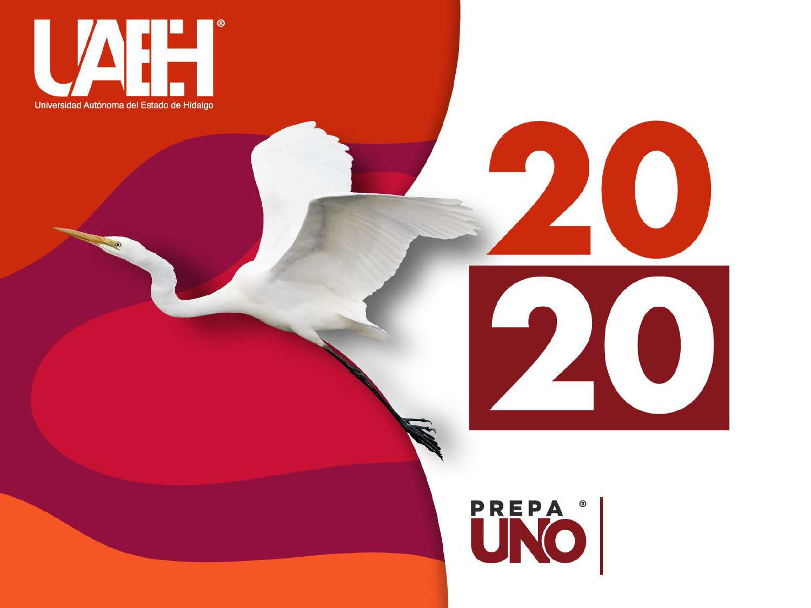
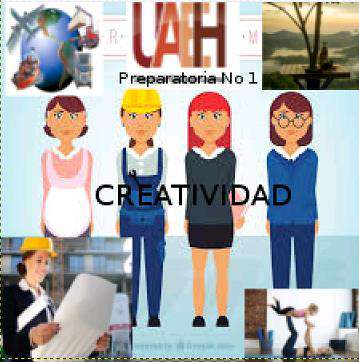
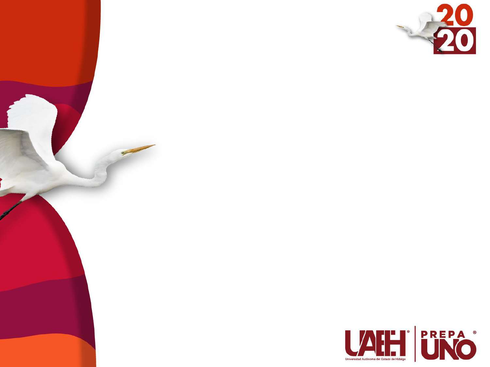
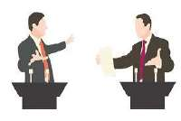

# TIPOS DE LIDERAZGO2

<!-- página 1 -->

> **Descripción de la imagen** — Es una ilustración gráfica con un diseño vibrante dominado por los colores rojo, naranja y blanco. En el lado izquierdo, se observa la sigla "UAEH" en letras blancas sobre un fondo rojo intenso, junto a el nombre de la Universidad Autónoma del Estado de Hidalgo. Una gran ilustración central muestra un ave blanca (posiblemente un cigüeña o garza) en pleno vuelo, con las alas extendidas y el pico apuntando hacia la izquierda. En el lado derecho, se destacan los números grandes "20" apilados uno encima del otro, sobre un bloque de color rojo oscuro. En la parte inferior derecha, aparece el logotipo "PREPA UNO".

Mtra. Perla Verónica
Olguín Guzmán
### Liderazgo

---

<!-- página 2 -->

> **Descripción de la imagen** — La imagen es una ilustración decorativa con un fondo predominantemente blanco y elementos gráficos en el lado izquierdo y superior derecho.
>
> En el lado izquierdo, se observa la silueta de un ave blanca, posiblemente una garza o ibis, con un cuello largo y un pico alargado, posada sobre un fondo que presenta formas curvas y degradados en tonos rojos y granates.
>
> En la esquina superior derecha, hay dos números grandes y rojos: "20" arriba y "20" abajo. Sobre estos números se encuentra una pequeña silueta blanca de un ave volando.
>
> En la parte inferior derecha, se encuentra el logotipo de "UAEH PREPA UNO" con el texto de la universidad debajo.

Resumen

Se muestra un panorama de los tipos y características de lideres, con la
perspectiva de analizar las aptitudes y cualidades que se posee en cada
tipo de liderazgo, sobre todo identificar que tipo de líder tendría mas éxito
con su desempeño de acuerdo a la problemática que se enfrente, para
analizar
que tipo de líder somos y resolver situaciones por medio del
liderazgo.

Abstract

An overview of the types and characteristics of leaders is shown, with the
perspective of analyzing the aptitudes and qualities that are possessed in
each type of leadership, especially identifying which type of leader would
be more successful with their performance according to the problems that
are opposite, to analyze what kind of leader we are and resolve situations
through leadership.

Palabras Clave

Características, perspectiva, aptitudes, cualidades, liderazgo.

Key words

Characteristics, perspective, the aptitudes and qualities, leadership

---

<!-- página 3 -->

> **Descripción de la imagen** — La imagen es una ilustración decorativa con un fondo predominantemente blanco y elementos gráficos en el lado izquierdo y superior derecho.
>
> En el lado izquierdo, se observa la silueta de un ave blanca, posiblemente una garza o ibis, con un cuello largo y un pico alargado, posada sobre un fondo que presenta formas curvas y degradados en tonos rojos y granates.
>
> En la esquina superior derecha, hay dos números grandes y rojos: "20" arriba y "20" abajo. Sobre estos números se encuentra una pequeña silueta blanca de un ave volando.
>
> En la parte inferior derecha, se encuentra el logotipo de "UAEH PREPA UNO" con el texto de la universidad debajo.

¿Quién es un líder?
Persona que trabaja en un grupo e
influye en él para lograr un propósito que
todos juntos deben alcanzar, son capaces
de
inspirar
y
guiar,
además
son
reconocidos como modelos para todos.
### Tipos de líderes

---

<!-- página 4 -->

> **Descripción de la imagen** — La imagen es una ilustración decorativa con un fondo predominantemente blanco y elementos gráficos en el lado izquierdo y superior derecho.
>
> En el lado izquierdo, se observa la silueta de un ave blanca, posiblemente una garza o ibis, con un cuello largo y un pico alargado, posada sobre un fondo que presenta formas curvas y degradados en tonos rojos y granates.
>
> En la esquina superior derecha, hay dos números grandes y rojos: "20" arriba y "20" abajo. Sobre estos números se encuentra una pequeña silueta blanca de un ave volando.
>
> En la parte inferior derecha, se encuentra el logotipo de "UAEH PREPA UNO" con el texto de la universidad debajo.

### Origen

Origen del líder

Unido al poder

Religioso

Familia

---

<!-- página 5 -->

> **Descripción de la imagen** — La imagen es una ilustración decorativa con un fondo predominantemente blanco y elementos gráficos en el lado izquierdo y superior derecho.
>
> En el lado izquierdo, se observa la silueta de un ave blanca, posiblemente una garza o ibis, con un cuello largo y un pico alargado, posada sobre un fondo que presenta formas curvas y degradados en tonos rojos y granates.
>
> En la esquina superior derecha, hay dos números grandes y rojos: "20" arriba y "20" abajo. Sobre estos números se encuentra una pequeña silueta blanca de un ave volando.
>
> En la parte inferior derecha, se encuentra el logotipo de "UAEH PREPA UNO" con el texto de la universidad debajo.

## Requisitos para ser un líder

Requisitos

Voluntad

Querer serlo

mediante la

empatía

Libertad

Elección en
objetivos asertivos

Inteligencia

Identificar las

mejores
alternativas de

acción

---

<!-- página 6 -->

> **Descripción de la imagen** — La imagen es una ilustración decorativa con un fondo predominantemente blanco y elementos gráficos en el lado izquierdo y superior derecho.
>
> En el lado izquierdo, se observa la silueta de un ave blanca, posiblemente una garza o ibis, con un cuello largo y un pico alargado, posada sobre un fondo que presenta formas curvas y degradados en tonos rojos y granates.
>
> En la esquina superior derecha, hay dos números grandes y rojos: "20" arriba y "20" abajo. Sobre estos números se encuentra una pequeña silueta blanca de un ave volando.
>
> En la parte inferior derecha, se encuentra el logotipo de "UAEH PREPA UNO" con el texto de la universidad debajo.

## Tipo de Liderazgo

Autocrático

Burocrático

Carismático

Participativo o

democrático

Laissez-faire

orientado a las relaciones

natural

orientado a la tarea

transaccional

transformacional

> **Descripción de la imagen** — La imagen es una composición visual que parece ser un encabezado o ilustración temática para un material educativo.
>
> En la parte superior, se encuentra el texto grande y destacado "UAH", seguido por debajo "Preparatoria-No 1". Detrás de este texto, hay una fotografía de paisaje con tonos cálidos, posiblemente un atardecer o amanecer sobre colinas y cielo.
>
> En el centro de la imagen, hay tres figuras femeninas de pie, dispuestas horizontalmente:
> 1.  La figura de la izquierda tiene cabello rubio y viste una blusa de color rosa pálido.
> 2.  La figura central tiene cabello rubio y viste una blusa azul oscuro.
> 3.  La figura de la derecha tiene cabello rojo y viste una blusa azul oscuro.
>
> Superpuesto a las figuras, en letras grandes y destacadas, se lee la palabra "CREATIVIDAD".
>
> En la parte inferior de la imagen, hay una fotografía más pequeña que muestra a dos personas interactuando o posando juntas.

---

<!-- página 7 -->

> **Descripción de la imagen** — La imagen es una ilustración decorativa con un fondo predominantemente blanco y elementos gráficos en el lado izquierdo y superior derecho.
>
> En el lado izquierdo, se observa la silueta de un ave blanca, posiblemente una garza o ibis, con un cuello largo y un pico alargado, posada sobre un fondo que presenta formas curvas y degradados en tonos rojos y granates.
>
> En la esquina superior derecha, hay dos números grandes y rojos: "20" arriba y "20" abajo. Sobre estos números se encuentra una pequeña silueta blanca de un ave volando.
>
> En la parte inferior derecha, se encuentra el logotipo de "UAEH PREPA UNO" con el texto de la universidad debajo.

## Liderazgo autocrático

• Los líderes tiene el poder absoluto sobre sus
trabajadores o equipos.
• Los miembros del staff tienen una pequeña
oportunidad de dar sugerencias, incluso si estas
son para el bien del equipo o de la organización.
• Muchas personas se sienten resentidas al ser
tratadas de esta manera.
• A menudo el liderazgo autocrático tiene altos
niveles de ausentismo y rotación del personal.
• Para algunas tareas y trabajos sin calificación el
estilo puede ser efectivo, porque las ventajas del
control superan las desventajas.

---

<!-- página 8 -->

> **Descripción de la imagen** — La imagen es una ilustración decorativa con un fondo predominantemente blanco y elementos gráficos en el lado izquierdo y superior derecho.
>
> En el lado izquierdo, se observa la silueta de un ave blanca, posiblemente una garza o ibis, con un cuello largo y un pico alargado, posada sobre un fondo que presenta formas curvas y degradados en tonos rojos y granates.
>
> En la esquina superior derecha, hay dos números grandes y rojos: "20" arriba y "20" abajo. Sobre estos números se encuentra una pequeña silueta blanca de un ave volando.
>
> En la parte inferior derecha, se encuentra el logotipo de "UAEH PREPA UNO" con el texto de la universidad debajo.

## Liderazgo burocrático

• Los líderes burocráticos hacen todo según
“el libro”.
• Siguen
las
reglas
rigurosamente
y
se
aseguran que todo lo que hagan sus
seguidores sea preciso.
• Es muy apropiado para trabajar cuando
existen serios riesgos de seguridad (como
trabajar con maquinaria, sustancias tóxicas,
o peso peligroso) o cuando largas sumas de
dinero están en juego.

---

<!-- página 9 -->

> **Descripción de la imagen** — La imagen es una ilustración decorativa con un fondo predominantemente blanco y elementos gráficos en el lado izquierdo y superior derecho.
>
> En el lado izquierdo, se observa la silueta de un ave blanca, posiblemente una garza o ibis, con un cuello largo y un pico alargado, posada sobre un fondo que presenta formas curvas y degradados en tonos rojos y granates.
>
> En la esquina superior derecha, hay dos números grandes y rojos: "20" arriba y "20" abajo. Sobre estos números se encuentra una pequeña silueta blanca de un ave volando.
>
> En la parte inferior derecha, se encuentra el logotipo de "UAEH PREPA UNO" con el texto de la universidad debajo.

## Liderazgo carismático

• Un estilo carismático de liderazgo es similar al
liderazgo transformacional, porque estos líderes
inspiran muchísimo entusiasmo en sus equipos y
sus muy energéticos al conducir a los demás.
• Los líderes carismáticos tienden a creer más en si
mismos que en sus equipos y esto genera
problemas, y un proyecto o la organización
entera podrían colapsar el día que el líder
abandone la empresa.
• En los ojos de los seguidores, el éxito está ligado
a la presencia del líder carismático.

---

<!-- página 10 -->

> **Descripción de la imagen** — La imagen es una ilustración decorativa con un fondo predominantemente blanco y elementos gráficos en el lado izquierdo y superior derecho.
>
> En el lado izquierdo, se observa la silueta de un ave blanca, posiblemente una garza o ibis, con un cuello largo y un pico alargado, posada sobre un fondo que presenta formas curvas y degradados en tonos rojos y granates.
>
> En la esquina superior derecha, hay dos números grandes y rojos: "20" arriba y "20" abajo. Sobre estos números se encuentra una pequeña silueta blanca de un ave volando.
>
> En la parte inferior derecha, se encuentra el logotipo de "UAEH PREPA UNO" con el texto de la universidad debajo.

## Liderazgo participativo o
## democrático

> **Descripción de la imagen** — La imagen muestra dos figuras masculinas vestidas con trajes, cada una de pie detrás de un atril o podio oscuro. En el lado izquierdo, un hombre está de pie y parece estar presentando o hablando. En el lado derecho, otro hombre también está detrás de un atril y está haciendo un gesto con la mano (pulgar hacia arriba).

• A pesar que es el líder democrático el que toma la última
decisión, ellos invitan a otros miembros del equipo a
contribuir con el proceso de toma de decisiones.
• Esto no solo aumenta la satisfacción por el trabajo sino que
ayuda a desarrollar habilidades.
• Los miembros de equipo sienten en control de su propio
destino así que están motivados a trabajar duro, más que
por una recompensa económica.
• Ya que la participación democrática toma tiempo, este
abordaje puede durar mucho tiempo pero a menudo se
logra un buen resultado.
• Este estilo de liderazgo puede adoptarse cuando es esencial
el trabajo en equipo y cuando la calidad es más importante
que la velocidad o la productividad.

---

<!-- página 11 -->

> **Descripción de la imagen** — La imagen es una ilustración decorativa con un fondo predominantemente blanco y elementos gráficos en el lado izquierdo y superior derecho.
>
> En el lado izquierdo, se observa la silueta de un ave blanca, posiblemente una garza o ibis, con un cuello largo y un pico alargado, posada sobre un fondo que presenta formas curvas y degradados en tonos rojos y granates.
>
> En la esquina superior derecha, hay dos números grandes y rojos: "20" arriba y "20" abajo. Sobre estos números se encuentra una pequeña silueta blanca de un ave volando.
>
> En la parte inferior derecha, se encuentra el logotipo de "UAEH PREPA UNO" con el texto de la universidad debajo.

## Liderazgo Laissez-faire

• Esta expresión francesa significa “déjalo ser” y es
utilizada para describir líderes que dejan a sus
miembros de equipo trabajar por su cuenta.
• Puede ser efectivo si los líderes monitorean lo que
se está
logrando
y
lo
comunican
al equipo
regularmente.
• A menudo el liderazgo laissez-faire es efectivo
cuando los individuos tienen mucha experiencia e
iniciativa propia.
• Desafortunadamente, este tipo de liderazgo puede
darse solo cuando los mandos no ejercen suficiente
control.

> **Descripción de la imagen** — La imagen es una fotografía de un grupo de personas, presumiblemente estudiantes, de pie en un entorno interior bien iluminado. Varias personas están levantando sus manos hacia arriba, lo que sugiere participación, entusiasmo o celebración. El grupo está compuesto por al menos siete individuos visibles. La composición muestra a las personas de diferentes edades y vestimentas casuales, todas mirando hacia adelante. El fondo es claro, con elementos arquitectónicos que sugieren un aula o espacio de estudio.

---

<!-- página 12 -->

> **Descripción de la imagen** — La imagen es una ilustración decorativa con un fondo predominantemente blanco y elementos gráficos en el lado izquierdo y superior derecho.
>
> En el lado izquierdo, se observa la silueta de un ave blanca, posiblemente una garza o ibis, con un cuello largo y un pico alargado, posada sobre un fondo que presenta formas curvas y degradados en tonos rojos y granates.
>
> En la esquina superior derecha, hay dos números grandes y rojos: "20" arriba y "20" abajo. Sobre estos números se encuentra una pequeña silueta blanca de un ave volando.
>
> En la parte inferior derecha, se encuentra el logotipo de "UAEH PREPA UNO" con el texto de la universidad debajo.

Liderazgo orientado a las personas o liderazgo

orientado a las relaciones
• Los líderes están completamente orientados en
organizar, hacer de soporte y desarrollar sus
equipos.
• Es un estilo participativo, y tiende a empoderar al
equipo y a fomentar la colaboración creativa.
• En la práctica la mayoría de los líderes utilizan tanto
el liderazgo orientado a la tarea y el liderazgo
orientado a las personas.

---

<!-- página 13 -->

> **Descripción de la imagen** — La imagen es una ilustración decorativa con un fondo predominantemente blanco y elementos gráficos en el lado izquierdo y superior derecho.
>
> En el lado izquierdo, se observa la silueta de un ave blanca, posiblemente una garza o ibis, con un cuello largo y un pico alargado, posada sobre un fondo que presenta formas curvas y degradados en tonos rojos y granates.
>
> En la esquina superior derecha, hay dos números grandes y rojos: "20" arriba y "20" abajo. Sobre estos números se encuentra una pequeña silueta blanca de un ave volando.
>
> En la parte inferior derecha, se encuentra el logotipo de "UAEH PREPA UNO" con el texto de la universidad debajo.

## Liderazgo natural

• Este término describe al líder que no está reconocido
formalmente como tal.
• Cuando alguien en cualquier nivel de una organización lidera
simplemente por satisfacer las necesidades de un equipo, se
describe como líder natural.
• Algunos lo llaman liderazgo servil.
• De muchas maneras este tipo de liderazgo es una forma
democrática de liderazgo porque todo el equipo participa del
proceso de toma de decisiones.
• Quienes apoyan el modelo de liderazgo natural dicen que es
una buena forma de trabajo en un mundo donde los valores
son cada vez más importantes.
• Otros creen que en situaciones de mucha competencia, los
líderes naturales pueden perder peso por otros líderes que
utilizan otros estilos de liderazgo.

---

<!-- página 14 -->

> **Descripción de la imagen** — La imagen es una ilustración decorativa con un fondo predominantemente blanco y elementos gráficos en el lado izquierdo y superior derecho.
>
> En el lado izquierdo, se observa la silueta de un ave blanca, posiblemente una garza o ibis, con un cuello largo y un pico alargado, posada sobre un fondo que presenta formas curvas y degradados en tonos rojos y granates.
>
> En la esquina superior derecha, hay dos números grandes y rojos: "20" arriba y "20" abajo. Sobre estos números se encuentra una pequeña silueta blanca de un ave volando.
>
> En la parte inferior derecha, se encuentra el logotipo de "UAEH PREPA UNO" con el texto de la universidad debajo.

### Liderazgo orientado a la tarea

• Se focalizan solo en que el trabajo se haya
cumplido
y
pueden
ser
un
poco
autocráticos.
• Estos líderes son muy buenos para definir el
trabajo y los roles necesarios, ordenar
estructuras, planificar, organizar y controlar.
• Pero no tienden a pensar mucho en el
bienestar de sus equipos, así que tienen
problemas para motivar y retener a sus
colaboradores.

> **Descripción de la imagen** — La imagen es una fotografía de un grupo de cinco personas posando juntas. El grupo está compuesto por cuatro mujeres y un hombre. Están de pie frente a un fondo con paredes texturizadas o de ladrillo visto. Varias personas están sonriendo y mirando hacia la cámara. En el fondo, se observan varios globos de colores (blanco, verde y naranja). Las personas visten ropa casual.

---

<!-- página 15 -->

> **Descripción de la imagen** — La imagen es una ilustración decorativa con un fondo predominantemente blanco y elementos gráficos en el lado izquierdo y superior derecho.
>
> En el lado izquierdo, se observa la silueta de un ave blanca, posiblemente una garza o ibis, con un cuello largo y un pico alargado, posada sobre un fondo que presenta formas curvas y degradados en tonos rojos y granates.
>
> En la esquina superior derecha, hay dos números grandes y rojos: "20" arriba y "20" abajo. Sobre estos números se encuentra una pequeña silueta blanca de un ave volando.
>
> En la parte inferior derecha, se encuentra el logotipo de "UAEH PREPA UNO" con el texto de la universidad debajo.

## Liderazgo transaccional

• Este estilo de liderazgo nace con la idea de que los
miembros
de
equipo
acuerdan
obedecer
completamente a su líder cuando aceptan el trabajo.
• La transacción es el pago a cambio del esfuerzo y la
aceptación hacia las tareas que les da su líder.
• El líder tiene derecho a castigar a quien considere
que su trabajo no está como él desea.
• El
liderazgo
transaccional
es
un
tipo
de
management, no un verdadero estilo de liderazgo,
porque el foco es hacia la ejecución de tareas de
corto plazo.

---

<!-- página 16 -->

> **Descripción de la imagen** — La imagen es una ilustración decorativa con un fondo predominantemente blanco y elementos gráficos en el lado izquierdo y superior derecho.
>
> En el lado izquierdo, se observa la silueta de un ave blanca, posiblemente una garza o ibis, con un cuello largo y un pico alargado, posada sobre un fondo que presenta formas curvas y degradados en tonos rojos y granates.
>
> En la esquina superior derecha, hay dos números grandes y rojos: "20" arriba y "20" abajo. Sobre estos números se encuentra una pequeña silueta blanca de un ave volando.
>
> En la parte inferior derecha, se encuentra el logotipo de "UAEH PREPA UNO" con el texto de la universidad debajo.

## Liderazgo transformacional

• Los líderes transformacionales son considerados los
verdaderos líderes por la mayoría de los teóricos
del liderazgo.
• Inspiran a sus equipos en forma permanente, y le
transmiten su entusiasmo al equipo.
• A su vez estos líderes necesitan sentirse apoyados
solo por ciertos empleados.
• Es una ida y vuelta emocional.
• Es por ello que muchas organizaciones tienen que
funcionar tanto con el liderazgo transformacional
como con el liderazgo transaccional.
• Los
líderes
transaccionales
(o
managers)
se
aseguran de que la rutina se lleve adelante en
forma apropiada, mientras que el transformacional
busca nuevas iniciativas y agregar valor

---

<!-- página 17 -->

> **Descripción de la imagen** — La imagen es una ilustración decorativa con un fondo predominantemente blanco y elementos gráficos en el lado izquierdo y superior derecho.
>
> En el lado izquierdo, se observa la silueta de un ave blanca, posiblemente una garza o ibis, con un cuello largo y un pico alargado, posada sobre un fondo que presenta formas curvas y degradados en tonos rojos y granates.
>
> En la esquina superior derecha, hay dos números grandes y rojos: "20" arriba y "20" abajo. Sobre estos números se encuentra una pequeña silueta blanca de un ave volando.
>
> En la parte inferior derecha, se encuentra el logotipo de "UAEH PREPA UNO" con el texto de la universidad debajo.

### Conclusiones

• La pegunta que nos hacemos que¿ tipo de
líder es el mejor y cual tipo de líder
quisiéramos
ser?,
todo
depende
del
contexto,
necesidad
o
problema,
las
persona perseguimos objetivos las familias
también y las organizaciones crean sus
empresas en función de objetivos y metas
de la sociedad misma, por lo tanto el mejor
líder
es
aquel
que
se
adapta
a
las
circunstancias y cambios vertiginosos que
enfrente sin queja y con la perspectiva de
trabajo productividad y empatía

---

<!-- página 18 -->

> **Descripción de la imagen** — La imagen es una ilustración decorativa con un fondo predominantemente blanco y elementos gráficos en el lado izquierdo y superior derecho.
>
> En el lado izquierdo, se observa la silueta de un ave blanca, posiblemente una garza o ibis, con un cuello largo y un pico alargado, posada sobre un fondo que presenta formas curvas y degradados en tonos rojos y granates.
>
> En la esquina superior derecha, hay dos números grandes y rojos: "20" arriba y "20" abajo. Sobre estos números se encuentra una pequeña silueta blanca de un ave volando.
>
> En la parte inferior derecha, se encuentra el logotipo de "UAEH PREPA UNO" con el texto de la universidad debajo.

### Referencias

• Bellver2018 10 tipos de lideres
consultado el 17 de enero del 2020
en: https://www.lifeder.com/tipos-
de-liderazgo/

