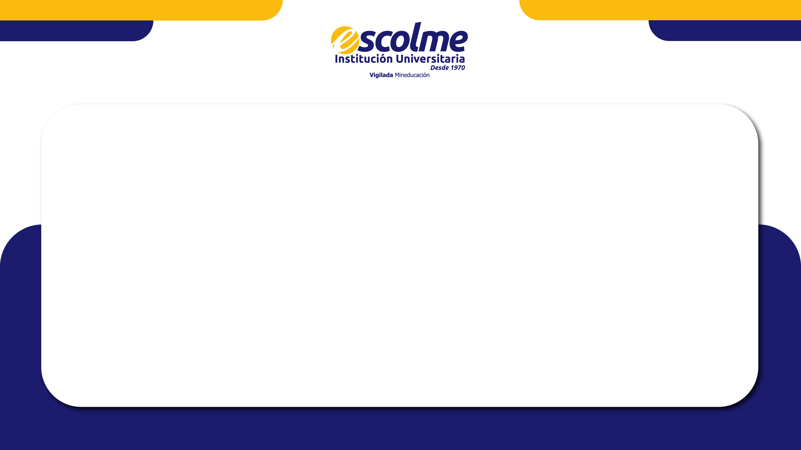
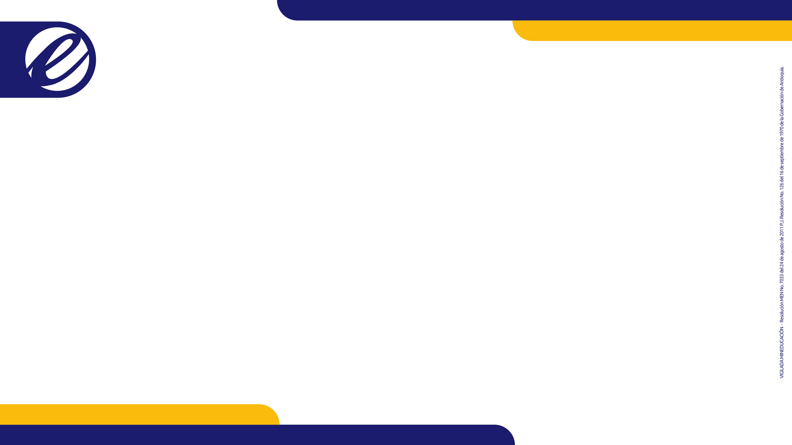
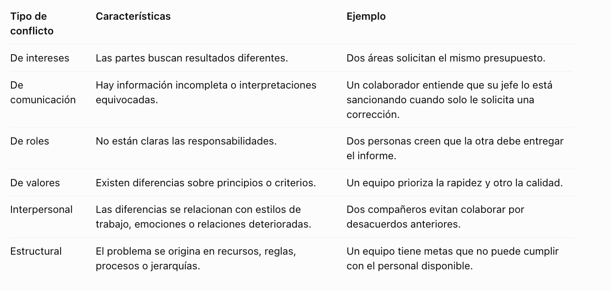
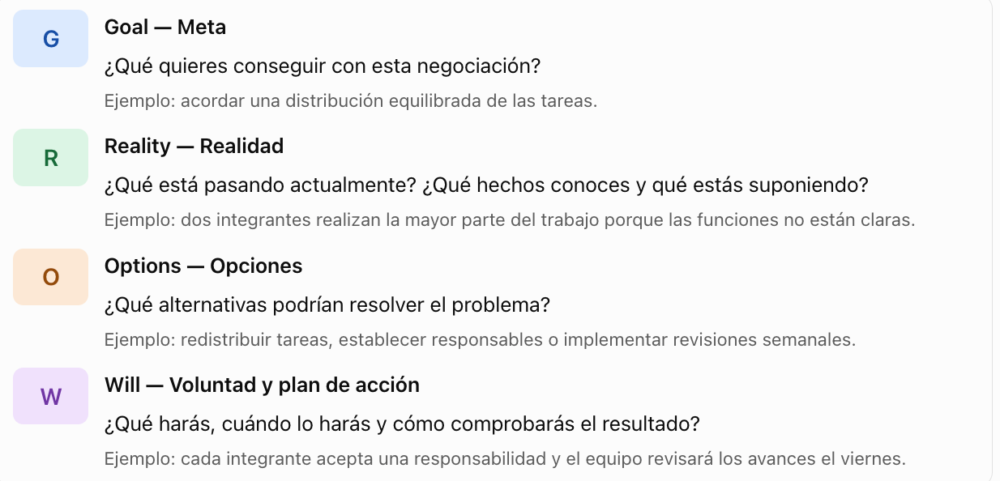
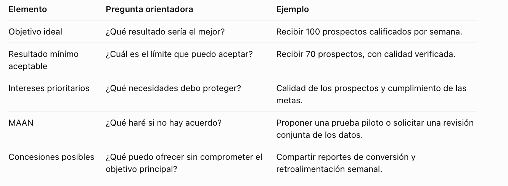
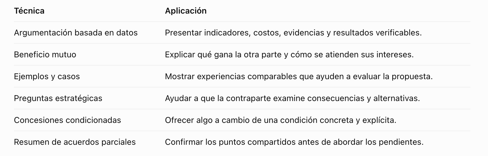
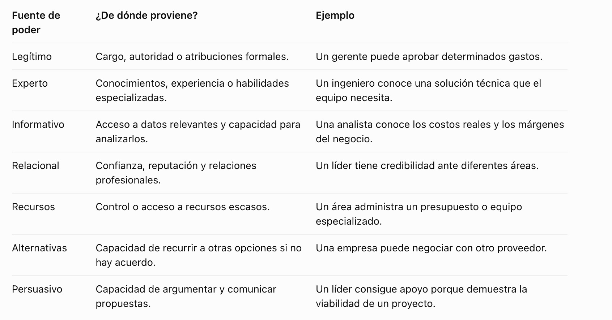
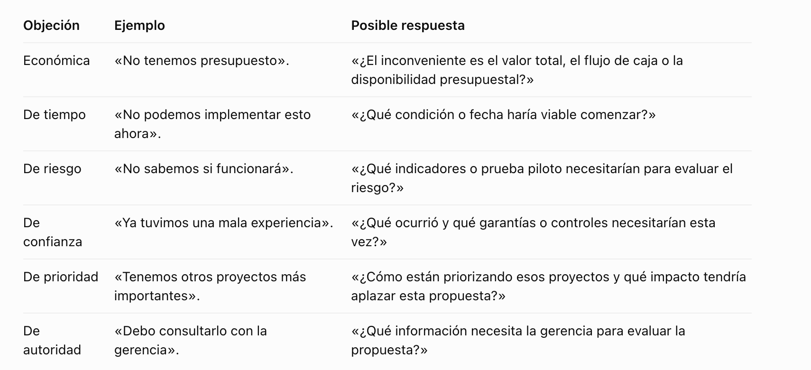
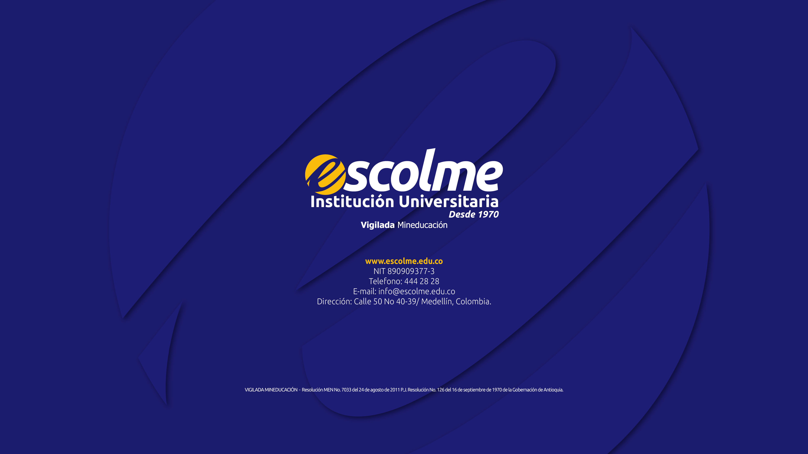

# Unidad 3

<!-- página 1 -->

> **Descripción de la imagen** — La imagen es un diseño gráfico o plantilla para el encabezado de un documento académico. Presenta un fondo blanco central enmarcado por bloques de color. En la parte superior, hay una barra decorativa en tonos amarillo y naranja en las esquinas superiores.
>
> En el centro superior se encuentra el logotipo de "escolme" con el texto "Institución Universitaria" debajo, y la leyenda "Desde 1970" y "Vigilada Mineducación".
>
> El área principal del diseño es un gran recuadro blanco que ocupa la mayor parte del espacio central. Este recuadro está enmarcado por bloques de color azul oscuro o púrpura en los bordes laterales y la parte inferior, creando un marco visual para el contenido. El interior del recuadro blanco está completamente vacío.

## Unidad No 3
## Fundamentos de Negociación

Esta Plantilla de Presentación Institucional, desarrollada por la Oficina de Comunicaciones de la Institución Universitaria Escolme, establece lineamientos

visuales y estructurales unificados para las presentaciones oficiales. Su uso garantiza coherencia con la identidad institucional y asegura una

comunicación clara, profesional y alineada con la imagen de la Institución.

---

<!-- página 2 -->

> **Descripción de la imagen** — La imagen es un diseño gráfico o una plantilla de encabezado/pie de página, caracterizada por el uso de bloques de color sólido y formas geométricas.
>
> En la esquina superior izquierda se encuentra un logotipo o símbolo estilizado en color azul oscuro/morado, con un diseño interior en blanco.
>
> En la parte superior derecha, hay dos bandas horizontales: una banda ancha de color azul oscuro y una banda más delgada de color amarillo dorado.
>
> En la parte inferior, hay una banda horizontal delgada de color amarillo dorado cerca del borde inferior, y una forma geométrica oscura (azul) que se extiende desde la esquina inferior izquierda.
>
> El resto del área es fondo blanco. En el margen derecho, hay texto vertical pequeño impreso en un tono claro.

Proceso de comunicación e interacción entre dos o más personas o partes que
tienen intereses, necesidades, expectativas o puntos de vista diferentes y que
buscan alcanzar un acuerdo mediante el diálogo, el intercambio de propuestas y la
toma de decisiones.

Negociar no significa necesariamente ganar una discusión, imponer una idea o
conseguir todo lo que se desea. Significa buscar una solución viable que permita
gestionar las diferencias y generar valor para las partes involucradas. En el
liderazgo, la negociación es una competencia fundamental porque un líder
constantemente necesita coordinar equipos, distribuir recursos, resolver conflictos,
establecer metas, motivar colaboradores y conciliar intereses.

---

<!-- página 3 -->

> **Descripción de la imagen** — La imagen es un diseño gráfico o una plantilla de encabezado/pie de página, caracterizada por el uso de bloques de color sólido y formas geométricas.
>
> En la esquina superior izquierda se encuentra un logotipo o símbolo estilizado en color azul oscuro/morado, con un diseño interior en blanco.
>
> En la parte superior derecha, hay dos bandas horizontales: una banda ancha de color azul oscuro y una banda más delgada de color amarillo dorado.
>
> En la parte inferior, hay una banda horizontal delgada de color amarillo dorado cerca del borde inferior, y una forma geométrica oscura (azul) que se extiende desde la esquina inferior izquierda.
>
> El resto del área es fondo blanco. En el margen derecho, hay texto vertical pequeño impreso en un tono claro.

•Las partes: personas, equipos u organizaciones involucradas.
•Los intereses: necesidades, preocupaciones y objetivos que cada parte busca
satisfacer.
•Las posiciones: lo que cada parte expresa que quiere conseguir.
•La comunicación: intercambio de información, preguntas, propuestas y argumentos.
•Las alternativas: opciones disponibles si no se alcanza un acuerdo.
•El poder de negociación: capacidad de influir en las decisiones y los resultados.
•Los acuerdos: compromisos aceptados por las partes.
•La confianza: percepción de que la otra parte actuará con honestidad y cumplirá lo
acordado.
### Elementos fundamentales de una negociación

---

<!-- página 4 -->

> **Descripción de la imagen** — La imagen es un diseño gráfico o una plantilla de encabezado/pie de página, caracterizada por el uso de bloques de color sólido y formas geométricas.
>
> En la esquina superior izquierda se encuentra un logotipo o símbolo estilizado en color azul oscuro/morado, con un diseño interior en blanco.
>
> En la parte superior derecha, hay dos bandas horizontales: una banda ancha de color azul oscuro y una banda más delgada de color amarillo dorado.
>
> En la parte inferior, hay una banda horizontal delgada de color amarillo dorado cerca del borde inferior, y una forma geométrica oscura (azul) que se extiende desde la esquina inferior izquierda.
>
> El resto del área es fondo blanco. En el margen derecho, hay texto vertical pequeño impreso en un tono claro.

Negociación distributiva:

Se presenta cuando las partes perciben que compiten por un recurso
limitado. Lo que una obtiene puede reducir lo que recibe la otra.

Ejemplo: negociar el precio de compra de un vehículo o el valor de un
contrato.

Enfoque: proteger los intereses propios y distribuir el valor disponible.

---

<!-- página 5 -->

> **Descripción de la imagen** — La imagen es un diseño gráfico o una plantilla de encabezado/pie de página, caracterizada por el uso de bloques de color sólido y formas geométricas.
>
> En la esquina superior izquierda se encuentra un logotipo o símbolo estilizado en color azul oscuro/morado, con un diseño interior en blanco.
>
> En la parte superior derecha, hay dos bandas horizontales: una banda ancha de color azul oscuro y una banda más delgada de color amarillo dorado.
>
> En la parte inferior, hay una banda horizontal delgada de color amarillo dorado cerca del borde inferior, y una forma geométrica oscura (azul) que se extiende desde la esquina inferior izquierda.
>
> El resto del área es fondo blanco. En el margen derecho, hay texto vertical pequeño impreso en un tono claro.

Negociación integrativa o colaborativa: Las partes buscan identificar
intereses comunes y crear opciones que generen beneficios para todos.

Ejemplo: una empresa negocia con un proveedor mejores condiciones
de pago a cambio de contratos de mayor duración y compras
planificadas.

Enfoque: ampliar las opciones y crear valor compartido.

---

<!-- página 6 -->

> **Descripción de la imagen** — La imagen es un diseño gráfico o una plantilla de encabezado/pie de página, caracterizada por el uso de bloques de color sólido y formas geométricas.
>
> En la esquina superior izquierda se encuentra un logotipo o símbolo estilizado en color azul oscuro/morado, con un diseño interior en blanco.
>
> En la parte superior derecha, hay dos bandas horizontales: una banda ancha de color azul oscuro y una banda más delgada de color amarillo dorado.
>
> En la parte inferior, hay una banda horizontal delgada de color amarillo dorado cerca del borde inferior, y una forma geométrica oscura (azul) que se extiende desde la esquina inferior izquierda.
>
> El resto del área es fondo blanco. En el margen derecho, hay texto vertical pequeño impreso en un tono claro.

Negociación para resolver conflictos: Busca transformar un
desacuerdo en una solución mediante la comprensión de las
necesidades, la comunicación y la búsqueda de compromisos.

Ejemplo: dos líderes de área discrepan sobre la prioridad de los
proyectos y deben acordar cómo distribuir el personal.

Enfoque: comprender el conflicto, reducir la confrontación y construir
acuerdos.

---

<!-- página 7 -->

> **Descripción de la imagen** — La imagen es un diseño gráfico o una plantilla de encabezado/pie de página, caracterizada por el uso de bloques de color sólido y formas geométricas.
>
> En la esquina superior izquierda se encuentra un logotipo o símbolo estilizado en color azul oscuro/morado, con un diseño interior en blanco.
>
> En la parte superior derecha, hay dos bandas horizontales: una banda ancha de color azul oscuro y una banda más delgada de color amarillo dorado.
>
> En la parte inferior, hay una banda horizontal delgada de color amarillo dorado cerca del borde inferior, y una forma geométrica oscura (azul) que se extiende desde la esquina inferior izquierda.
>
> El resto del área es fondo blanco. En el margen derecho, hay texto vertical pequeño impreso en un tono claro.

Un conflicto surge cuando dos o más personas perciben que sus
objetivos,
intereses,
valores,
expectativas
o
necesidades
son
incompatibles. El conflicto no siempre es negativo. Bien gestionado,
puede
ayudar
a
identificar
problemas,
cuestionar
decisiones
equivocadas, mejorar los procesos y generar innovación. El riesgo
aparece cuando se transforma en ataques personales, falta de
comunicación, desconfianza o resistencia permanente.
### Gestión de conflictos y desacuerdos

---

<!-- página 8 -->

> **Descripción de la imagen** — La imagen es un diseño gráfico o una plantilla de encabezado/pie de página, caracterizada por el uso de bloques de color sólido y formas geométricas.
>
> En la esquina superior izquierda se encuentra un logotipo o símbolo estilizado en color azul oscuro/morado, con un diseño interior en blanco.
>
> En la parte superior derecha, hay dos bandas horizontales: una banda ancha de color azul oscuro y una banda más delgada de color amarillo dorado.
>
> En la parte inferior, hay una banda horizontal delgada de color amarillo dorado cerca del borde inferior, y una forma geométrica oscura (azul) que se extiende desde la esquina inferior izquierda.
>
> El resto del área es fondo blanco. En el margen derecho, hay texto vertical pequeño impreso en un tono claro.

> **Descripción de la imagen** — La imagen es una tabla de tres columnas que clasifica y describe diferentes tipos de conflicto. Las columnas son: "Tipo de conflicto", "Características" y "Ejemplo".
>
> La tabla enumera seis tipos de conflicto:
> 1. **De intereses:** Describe la búsqueda de resultados diferentes, con el ejemplo de dos áreas solicitando el mismo presupuesto.
> 2. **De comunicación:** Se refiere a información incompleta o interpretaciones equivocadas, ilustrado por un colaborador que entiende que su jefe lo sanciona solo por solicitar una corrección.
> 3. **De roles:** Indica la falta de claridad en las responsabilidades, ejemplificado por dos personas que creen que la otra debe entregar el informe.
> 4. **De valores:** Señala diferencias sobre principios o criterios, como un equipo que prioriza la rapidez y otro la calidad.
> 5. **Interpersonal:** Se relaciona con diferencias basadas en estilos de trabajo, emociones o relaciones deterioradas, mostrando a dos compañeros que evitan colaborar por desacuerdos anteriores.
> 6. **Estructural:** Describe el origen del problema en recursos, reglas, procesos o jerarquías, ejemplificado por un equipo que tiene metas que no puede cumplir con el personal disponible.

---

<!-- página 9 -->

> **Descripción de la imagen** — La imagen es un diseño gráfico o una plantilla de encabezado/pie de página, caracterizada por el uso de bloques de color sólido y formas geométricas.
>
> En la esquina superior izquierda se encuentra un logotipo o símbolo estilizado en color azul oscuro/morado, con un diseño interior en blanco.
>
> En la parte superior derecha, hay dos bandas horizontales: una banda ancha de color azul oscuro y una banda más delgada de color amarillo dorado.
>
> En la parte inferior, hay una banda horizontal delgada de color amarillo dorado cerca del borde inferior, y una forma geométrica oscura (azul) que se extiende desde la esquina inferior izquierda.
>
> El resto del área es fondo blanco. En el margen derecho, hay texto vertical pequeño impreso en un tono claro.

Un líder efectivo no intenta silenciar todos los desacuerdos ni toma partido
inmediatamente. Primero identifica la naturaleza del problema, escucha a las
personas involucradas y determina qué necesita resolverse.

Puede aplicar esta secuencia:

1. Escuchar sin juzgar: Permitir que cada parte explique qué ocurrió y cómo
interpreta la situación, sin interrupciones ni descalificaciones.

2. Identificar el problema real; Separar los hechos de las interpretaciones, los rumores
y las emociones.
### ¿Cómo debe actuar un líder frente a un conflicto?

---

<!-- página 10 -->

> **Descripción de la imagen** — La imagen es un diseño gráfico o una plantilla de encabezado/pie de página, caracterizada por el uso de bloques de color sólido y formas geométricas.
>
> En la esquina superior izquierda se encuentra un logotipo o símbolo estilizado en color azul oscuro/morado, con un diseño interior en blanco.
>
> En la parte superior derecha, hay dos bandas horizontales: una banda ancha de color azul oscuro y una banda más delgada de color amarillo dorado.
>
> En la parte inferior, hay una banda horizontal delgada de color amarillo dorado cerca del borde inferior, y una forma geométrica oscura (azul) que se extiende desde la esquina inferior izquierda.
>
> El resto del área es fondo blanco. En el margen derecho, hay texto vertical pequeño impreso en un tono claro.

3. Explorar los intereses: Preguntar qué necesita cada persona, por qué es
importante y qué estaría dispuesta a considerar.

4. Construir alternativas: Generar diferentes soluciones antes de decidir cuál es la
más adecuada.

5. Acordar y hacer seguimiento: Definir responsables, compromisos, plazos y
mecanismos para comprobar el cumplimiento

---

<!-- página 11 -->

> **Descripción de la imagen** — La imagen es un diseño gráfico o una plantilla de encabezado/pie de página, caracterizada por el uso de bloques de color sólido y formas geométricas.
>
> En la esquina superior izquierda se encuentra un logotipo o símbolo estilizado en color azul oscuro/morado, con un diseño interior en blanco.
>
> En la parte superior derecha, hay dos bandas horizontales: una banda ancha de color azul oscuro y una banda más delgada de color amarillo dorado.
>
> En la parte inferior, hay una banda horizontal delgada de color amarillo dorado cerca del borde inferior, y una forma geométrica oscura (azul) que se extiende desde la esquina inferior izquierda.
>
> El resto del área es fondo blanco. En el margen derecho, hay texto vertical pequeño impreso en un tono claro.

### Estilo
### ¿En qué consiste?
### ¿Cuándo puede ser útil?

Competir
Defender firmemente una decisión o

interés.

Ante una urgencia o una regla de seguridad que debe

cumplirse.

Colaborar
Buscar una solución que atienda los
intereses relevantes de ambas partes.

Cuando el problema es importante y existe

disposición para trabajar juntos.

Comprometer
Cada parte cede algo para llegar a una

solución aceptable.

Cuando el tiempo es limitado y ambas partes pueden

hacer concesiones.

Evitar
Posponer o no abordar temporalmente

el conflicto.

Cuando las emociones están muy intensas o el

asunto es menor y necesita aclaración.

Acomodar
Dar prioridad a las necesidades de la

otra parte.

Cuando el asunto es poco importante para uno y muy

importante para el otro, o se necesita reparar una

relación.

Un modelo conocido es el de
Thomas-Kilmann, que distingue
cinco estilos según el grado de
asertividad y cooperación:

Clave para el liderazgo: ningún
estilo es siempre el mejor.

La competencia consiste en
elegirlo según la urgencia, la
importancia
del
asunto,
la
relación entre las partes y las
consecuencias de la decisión.

---

<!-- página 12 -->

> **Descripción de la imagen** — La imagen es un diseño gráfico o una plantilla de encabezado/pie de página, caracterizada por el uso de bloques de color sólido y formas geométricas.
>
> En la esquina superior izquierda se encuentra un logotipo o símbolo estilizado en color azul oscuro/morado, con un diseño interior en blanco.
>
> En la parte superior derecha, hay dos bandas horizontales: una banda ancha de color azul oscuro y una banda más delgada de color amarillo dorado.
>
> En la parte inferior, hay una banda horizontal delgada de color amarillo dorado cerca del borde inferior, y una forma geométrica oscura (azul) que se extiende desde la esquina inferior izquierda.
>
> El resto del área es fondo blanco. En el margen derecho, hay texto vertical pequeño impreso en un tono claro.

### Herramientas teóricas y prácticas de negociación y coaching

1. Separar a las personas del problema: Evitar que un desacuerdo sobre una tarea
se convierta en un ataque personal. En lugar de: «Eres irresponsable». Decir: «El
informe no se entregó en la fecha acordada; revisemos qué ocurrió y cómo
podemos evitar que se repita».

2. Concentrarse en los intereses, no solamente en las posiciones: Investigar qué
necesidad explica lo que cada parte está solicitando. Ejemplo: una persona pide
trabajar desde casa porque necesita flexibilidad para cuidar a un familiar, no
necesariamente porque quiera dejar de colaborar con su equipo.

---

<!-- página 13 -->

> **Descripción de la imagen** — La imagen es un diseño gráfico o una plantilla de encabezado/pie de página, caracterizada por el uso de bloques de color sólido y formas geométricas.
>
> En la esquina superior izquierda se encuentra un logotipo o símbolo estilizado en color azul oscuro/morado, con un diseño interior en blanco.
>
> En la parte superior derecha, hay dos bandas horizontales: una banda ancha de color azul oscuro y una banda más delgada de color amarillo dorado.
>
> En la parte inferior, hay una banda horizontal delgada de color amarillo dorado cerca del borde inferior, y una forma geométrica oscura (azul) que se extiende desde la esquina inferior izquierda.
>
> El resto del área es fondo blanco. En el margen derecho, hay texto vertical pequeño impreso en un tono claro.

3. Generar opciones de beneficio mutuo: Antes de elegir una solución, proponer
varias alternativas y analizar sus ventajas, costos y riesgos. Ejemplo: horarios
flexibles, días de trabajo remoto o una redistribución temporal de tareas.

4. Utilizar criterios objetivos: Sustentar las decisiones con datos, estándares,
políticas, presupuestos o indicadores, en lugar de depender exclusivamente de la
jerarquía o de la presión. Ejemplo: utilizar indicadores de desempeño y cargas de
trabajo para distribuir las responsabilidades de un equipo.

---

<!-- página 14 -->

> **Descripción de la imagen** — La imagen es un diseño gráfico o una plantilla de encabezado/pie de página, caracterizada por el uso de bloques de color sólido y formas geométricas.
>
> En la esquina superior izquierda se encuentra un logotipo o símbolo estilizado en color azul oscuro/morado, con un diseño interior en blanco.
>
> En la parte superior derecha, hay dos bandas horizontales: una banda ancha de color azul oscuro y una banda más delgada de color amarillo dorado.
>
> En la parte inferior, hay una banda horizontal delgada de color amarillo dorado cerca del borde inferior, y una forma geométrica oscura (azul) que se extiende desde la esquina inferior izquierda.
>
> El resto del área es fondo blanco. En el margen derecho, hay texto vertical pequeño impreso en un tono claro.

### ¿Qué es el coaching aplicado a la negociación?

Proceso conversacional que facilita la reflexión, el aprendizaje y la identificación de acciones para
alcanzar objetivos. En el liderazgo puede utilizarse para ayudar a una persona o equipo a comprender
un conflicto, explorar alternativas y asumir compromisos. No consiste en darle órdenes a alguien ni en
manipularlo para que acepte nuestra propuesta. Se trata de formular preguntas que permitan pensar
con mayor claridad.

Un líder puede utilizar preguntas como estas:
•¿Qué resultado necesitas conseguir?
•¿Qué es lo más importante para ti en esta situación?
•¿Qué opciones has considerado?
•¿Qué parte del conflicto depende de tus decisiones?
•¿Qué podrías hacer de manera diferente?
•¿Qué compromiso estás dispuesto a asumir?
•¿Cómo sabrás que la solución está funcionando?

---

<!-- página 15 -->

> **Descripción de la imagen** — La imagen es un diseño gráfico o una plantilla de encabezado/pie de página, caracterizada por el uso de bloques de color sólido y formas geométricas.
>
> En la esquina superior izquierda se encuentra un logotipo o símbolo estilizado en color azul oscuro/morado, con un diseño interior en blanco.
>
> En la parte superior derecha, hay dos bandas horizontales: una banda ancha de color azul oscuro y una banda más delgada de color amarillo dorado.
>
> En la parte inferior, hay una banda horizontal delgada de color amarillo dorado cerca del borde inferior, y una forma geométrica oscura (azul) que se extiende desde la esquina inferior izquierda.
>
> El resto del área es fondo blanco. En el margen derecho, hay texto vertical pequeño impreso en un tono claro.

### Modelo GROW para conversaciones de coaching

El modelo GROW organiza la conversación en cuatro etapas: Goal, Reality, Options, Will (meta, realidad, opciones y voluntad o
plan de acción).

> **Descripción de la imagen** — La imagen presenta un esquema o modelo de cuatro componentes interconectados, probablemente una metodología para la resolución de problemas o negociación. Cada componente está identificado por una letra y se define mediante una pregunta clave y un ejemplo ilustrativo:
>
> 1.  **G (Goal – Meta):** Se enfoca en definir el objetivo a alcanzar con la negociación, preguntando "¿Qué quieres conseguir?". El ejemplo proporcionado es acordar una distribución equilibrada de las tareas.
> 2.  **R (Reality – Realidad):** Se centra en evaluar la situación actual, preguntando "¿Qué está pasando actualmente?" y solicitando identificar los hechos conocidos y las suposiciones. El ejemplo ilustra que dos integrantes realizan la mayor parte del trabajo debido a funciones poco claras.
> 3.  **O (Options – Opciones):** Busca generar alternativas para resolver el problema, preguntando "¿Qué alternativas podrían resolver el problema?". El ejemplo incluye redistribuir tareas, establecer responsables o implementar revisiones semanales.
> 4.  **W (Will – Voluntad y plan de acción):** Se dedica a la planificación de la acción futura, preguntando "¿Qué harás, cuándo lo harás y cómo comprobarás el resultado?". El ejemplo describe que cada integrante acepta una responsabilidad y el equipo revisará los avances el viernes.

---

<!-- página 16 -->

> **Descripción de la imagen** — La imagen es un diseño gráfico o una plantilla de encabezado/pie de página, caracterizada por el uso de bloques de color sólido y formas geométricas.
>
> En la esquina superior izquierda se encuentra un logotipo o símbolo estilizado en color azul oscuro/morado, con un diseño interior en blanco.
>
> En la parte superior derecha, hay dos bandas horizontales: una banda ancha de color azul oscuro y una banda más delgada de color amarillo dorado.
>
> En la parte inferior, hay una banda horizontal delgada de color amarillo dorado cerca del borde inferior, y una forma geométrica oscura (azul) que se extiende desde la esquina inferior izquierda.
>
> El resto del área es fondo blanco. En el margen derecho, hay texto vertical pequeño impreso en un tono claro.

### Planificación de las negociaciones

Una negociación no comienza cuando las personas se sientan a conversar.
Comienza antes, cuando el negociador analiza sus intereses, prepara sus
argumentos, estudia a la contraparte y define sus límites.

Una negociación improvisada puede llevar a aceptar condiciones desfavorables,
realizar concesiones innecesarias o reaccionar emocionalmente ante una objeción.

---

<!-- página 17 -->

> **Descripción de la imagen** — La imagen es un diseño gráfico o una plantilla de encabezado/pie de página, caracterizada por el uso de bloques de color sólido y formas geométricas.
>
> En la esquina superior izquierda se encuentra un logotipo o símbolo estilizado en color azul oscuro/morado, con un diseño interior en blanco.
>
> En la parte superior derecha, hay dos bandas horizontales: una banda ancha de color azul oscuro y una banda más delgada de color amarillo dorado.
>
> En la parte inferior, hay una banda horizontal delgada de color amarillo dorado cerca del borde inferior, y una forma geométrica oscura (azul) que se extiende desde la esquina inferior izquierda.
>
> El resto del área es fondo blanco. En el margen derecho, hay texto vertical pequeño impreso en un tono claro.

Antes de negociar, debemos responder tres preguntas fundamentales:

¿Por qué voy a negociar?: Esta pregunta identifica el origen de la negociación y el problema que
necesita resolverse. Ejemplo: el equipo comercial no alcanza las metas porque recibe pocos
prospectos calificados del área de Mercadeo.

¿Para qué voy a negociar?: Esta pregunta establece el resultado que se quiere conseguir. Ejemplo:
acordar criterios de calificación de prospectos, tiempos de entrega y metas compartidas entre ambas
áreas.

¿Con quién estoy negociando?: Permite comprender quién participa, qué responsabilidades tiene,
cuáles pueden ser sus intereses y qué capacidad de decisión posee. Ejemplo: el director comercial
puede negociar con la directora de Mercadeo, pero quizá necesite la aprobación de la gerencia
general para modificar el presupuesto.
### Clarificación de los propios intereses

---

<!-- página 18 -->

> **Descripción de la imagen** — La imagen es un diseño gráfico o una plantilla de encabezado/pie de página, caracterizada por el uso de bloques de color sólido y formas geométricas.
>
> En la esquina superior izquierda se encuentra un logotipo o símbolo estilizado en color azul oscuro/morado, con un diseño interior en blanco.
>
> En la parte superior derecha, hay dos bandas horizontales: una banda ancha de color azul oscuro y una banda más delgada de color amarillo dorado.
>
> En la parte inferior, hay una banda horizontal delgada de color amarillo dorado cerca del borde inferior, y una forma geométrica oscura (azul) que se extiende desde la esquina inferior izquierda.
>
> El resto del área es fondo blanco. En el margen derecho, hay texto vertical pequeño impreso en un tono claro.

Cinco elementos que debes definir antes de sentarte a negociar

> **Descripción de la imagen** — La imagen es una tabla estructurada con tres columnas: "Elemento", "Pregunta orientadora" y "Ejemplo". La tabla presenta cinco filas que definen diferentes componentes de un proceso estratégico o de gestión de objetivos.
>
> Los elementos descritos son:
> 1.  **Objetivo ideal:** Pregunta sobre el mejor resultado posible, ejemplificado con la meta de recibir 100 prospectos calificados por semana.
> 2.  **Resultado mínimo aceptable:** Pregunta sobre el límite que se puede aceptar, ejemplificado con la meta de recibir 70 prospectos con calidad verificada.
> 3.  **Intereses prioritarios:** Pregunta sobre las necesidades a proteger, ejemplificado con la protección de la calidad de los prospectos y el cumplimiento de las metas.
> 4.  **MAAN (Medida de Acción ante el No Acuerdo):** Pregunta sobre qué hacer si no hay acuerdo, ejemplificado con proponer una prueba piloto o solicitar una revisión conjunta de los datos.
> 5.  **Concesiones posibles:** Pregunta sobre lo que se puede ofrecer sin comprometer el objetivo principal, ejemplificado con compartir reportes de conversión y retroalimentación semanal.

---

<!-- página 19 -->

> **Descripción de la imagen** — La imagen es un diseño gráfico o una plantilla de encabezado/pie de página, caracterizada por el uso de bloques de color sólido y formas geométricas.
>
> En la esquina superior izquierda se encuentra un logotipo o símbolo estilizado en color azul oscuro/morado, con un diseño interior en blanco.
>
> En la parte superior derecha, hay dos bandas horizontales: una banda ancha de color azul oscuro y una banda más delgada de color amarillo dorado.
>
> En la parte inferior, hay una banda horizontal delgada de color amarillo dorado cerca del borde inferior, y una forma geométrica oscura (azul) que se extiende desde la esquina inferior izquierda.
>
> El resto del área es fondo blanco. En el margen derecho, hay texto vertical pequeño impreso en un tono claro.

### Preparación estratégica: matriz de negociación

1. ¿Qué quiero conseguir?
2. ¿Cuáles son mis intereses y necesidades?
3. ¿Con quién voy a negociar y qué podría necesitar?
4. ¿Cuál es mi límite?
5. ¿Cuál es mi alternativa si no hay acuerdo?
6. ¿Qué puedo ofrecer o conceder?

---

<!-- página 20 -->

> **Descripción de la imagen** — La imagen es un diseño gráfico o una plantilla de encabezado/pie de página, caracterizada por el uso de bloques de color sólido y formas geométricas.
>
> En la esquina superior izquierda se encuentra un logotipo o símbolo estilizado en color azul oscuro/morado, con un diseño interior en blanco.
>
> En la parte superior derecha, hay dos bandas horizontales: una banda ancha de color azul oscuro y una banda más delgada de color amarillo dorado.
>
> En la parte inferior, hay una banda horizontal delgada de color amarillo dorado cerca del borde inferior, y una forma geométrica oscura (azul) que se extiende desde la esquina inferior izquierda.
>
> El resto del área es fondo blanco. En el margen derecho, hay texto vertical pequeño impreso en un tono claro.

La confianza facilita que las personas compartan información, expresen
sus preocupaciones y exploren soluciones sin interpretar cada
propuesta como una amenaza.

Sin embargo, confiar no significa aceptar todo lo que diga la otra
persona. La confianza debe acompañarse de verificación, límites claros
y compromisos realistas.
### Generando confianza entre las partes

---

<!-- página 21 -->

> **Descripción de la imagen** — La imagen es un diseño gráfico o una plantilla de encabezado/pie de página, caracterizada por el uso de bloques de color sólido y formas geométricas.
>
> En la esquina superior izquierda se encuentra un logotipo o símbolo estilizado en color azul oscuro/morado, con un diseño interior en blanco.
>
> En la parte superior derecha, hay dos bandas horizontales: una banda ancha de color azul oscuro y una banda más delgada de color amarillo dorado.
>
> En la parte inferior, hay una banda horizontal delgada de color amarillo dorado cerca del borde inferior, y una forma geométrica oscura (azul) que se extiende desde la esquina inferior izquierda.
>
> El resto del área es fondo blanco. En el margen derecho, hay texto vertical pequeño impreso en un tono claro.

¿Cómo se construye la confianza?
•Preparación: demostrar que se conoce el tema y que se respeta el tiempo de la
otra parte.
•Transparencia: explicar qué se puede ofrecer y cuáles son las limitaciones reales.
•Coherencia: actuar de acuerdo con lo que se dice.
•Respeto: escuchar sin ridiculizar, interrumpir constantemente o descalificar.
•Confidencialidad responsable: proteger la información compartida y respetar los
límites legales y éticos.
•Cumplimiento: honrar los acuerdos o comunicar oportunamente cuando una
obligación no podrá cumplirse.

---

<!-- página 22 -->

> **Descripción de la imagen** — La imagen es un diseño gráfico o una plantilla de encabezado/pie de página, caracterizada por el uso de bloques de color sólido y formas geométricas.
>
> En la esquina superior izquierda se encuentra un logotipo o símbolo estilizado en color azul oscuro/morado, con un diseño interior en blanco.
>
> En la parte superior derecha, hay dos bandas horizontales: una banda ancha de color azul oscuro y una banda más delgada de color amarillo dorado.
>
> En la parte inferior, hay una banda horizontal delgada de color amarillo dorado cerca del borde inferior, y una forma geométrica oscura (azul) que se extiende desde la esquina inferior izquierda.
>
> El resto del área es fondo blanco. En el margen derecho, hay texto vertical pequeño impreso en un tono claro.

Conversaciones para conocer al negociador y sus necesidades
El líder debe indagar sin asumir que conoce las motivaciones de la otra persona.
Preguntas útiles:
•¿Qué es lo más importante para ti en este acuerdo?
•¿Qué dificultad estás intentando resolver?
•¿Qué condiciones te permitirían aceptar una propuesta?
•¿Qué riesgos te preocupan?
•¿Qué necesitarías para considerar viable esta alternativa?
Ejemplo: una colaboradora rechaza asumir nuevas responsabilidades. Su jefe interpreta inicialmente
que no tiene compromiso. Al conversar, descubre que ella ya tiene una carga laboral elevada y teme
que las nuevas tareas afecten la calidad de sus resultados.
La solución no necesariamente es insistir. Puede ser redistribuir funciones, establecer prioridades o
negociar recursos adicionales.

---

<!-- página 23 -->

> **Descripción de la imagen** — La imagen es un diseño gráfico o una plantilla de encabezado/pie de página, caracterizada por el uso de bloques de color sólido y formas geométricas.
>
> En la esquina superior izquierda se encuentra un logotipo o símbolo estilizado en color azul oscuro/morado, con un diseño interior en blanco.
>
> En la parte superior derecha, hay dos bandas horizontales: una banda ancha de color azul oscuro y una banda más delgada de color amarillo dorado.
>
> En la parte inferior, hay una banda horizontal delgada de color amarillo dorado cerca del borde inferior, y una forma geométrica oscura (azul) que se extiende desde la esquina inferior izquierda.
>
> El resto del área es fondo blanco. En el margen derecho, hay texto vertical pequeño impreso en un tono claro.

Expresión asertiva de los propios intereses: La asertividad consiste en expresar necesidades,
opiniones y límites con claridad y respeto, sin someterse a la voluntad ajena ni recurrir a la agresión.

Una fórmula práctica es:

Hecho observable + impacto + necesidad + propuesta.

Ejemplo: «En las últimas dos semanas, el informe se ha entregado después de la fecha acordada.
Esto retrasa la presentación al cliente. Necesito que tengamos la información a tiempo. ¿Podemos
establecer una fecha de entrega interna un día antes del vencimiento?». Esta expresión es más
constructiva que decir: «Siempre incumples y haces quedar mal al equipo».

---

<!-- página 24 -->

> **Descripción de la imagen** — La imagen es un diseño gráfico o una plantilla de encabezado/pie de página, caracterizada por el uso de bloques de color sólido y formas geométricas.
>
> En la esquina superior izquierda se encuentra un logotipo o símbolo estilizado en color azul oscuro/morado, con un diseño interior en blanco.
>
> En la parte superior derecha, hay dos bandas horizontales: una banda ancha de color azul oscuro y una banda más delgada de color amarillo dorado.
>
> En la parte inferior, hay una banda horizontal delgada de color amarillo dorado cerca del borde inferior, y una forma geométrica oscura (azul) que se extiende desde la esquina inferior izquierda.
>
> El resto del área es fondo blanco. En el margen derecho, hay texto vertical pequeño impreso en un tono claro.

La persuasión busca que la otra persona considere una propuesta a partir de razones relevantes. No debe
confundirse con manipular, ocultar información o presionar indebidamente.

> **Descripción de la imagen** — La imagen es una tabla de dos columnas que presenta pares de conceptos relacionados entre sí. La columna izquierda está titulada "Técnica" y la columna derecha está titulada "Aplicación".
>
> La tabla enumera seis técnicas y, para cada una, describe su aplicación correspondiente:
>
> 1.  **Argumentación basada en datos:** Su aplicación es presentar indicadores, costos, evidencias y resultados verificables.
> 2.  **Beneficio mutuo:** Su aplicación consiste en explicar qué gana la otra parte y cómo se atienden sus intereses.
> 3.  **Ejemplos y casos:** Su aplicación es mostrar experiencias comparables que ayuden a evaluar la propuesta.
> 4.  **Preguntas estratégicas:** Su aplicación es ayudar a que la contraparte examine consecuencias y alternativas.
> 5.  **Concesiones condicionadas:** Su aplicación es ofrecer algo a cambio de una condición concreta y explícita.
> 6.  **Resumen de acuerdos parciales:** Su aplicación es confirmar los puntos compartidos antes de abordar los pendientes.

Ejemplo de concesión condicionada: «Podemos ampliar el plazo de pago a 45 días si acordamos un volumen mínimo mensual y
un calendario de pedidos». La clave es que la concesión sea clara, proporcional y aceptada por ambas partes.
### Técnicas de persuasión ética

---

<!-- página 25 -->

> **Descripción de la imagen** — La imagen es un diseño gráfico o una plantilla de encabezado/pie de página, caracterizada por el uso de bloques de color sólido y formas geométricas.
>
> En la esquina superior izquierda se encuentra un logotipo o símbolo estilizado en color azul oscuro/morado, con un diseño interior en blanco.
>
> En la parte superior derecha, hay dos bandas horizontales: una banda ancha de color azul oscuro y una banda más delgada de color amarillo dorado.
>
> En la parte inferior, hay una banda horizontal delgada de color amarillo dorado cerca del borde inferior, y una forma geométrica oscura (azul) que se extiende desde la esquina inferior izquierda.
>
> El resto del área es fondo blanco. En el margen derecho, hay texto vertical pequeño impreso en un tono claro.

La comunicación no se limita a las palabras. El tono de voz, la postura, las
expresiones faciales y la regulación emocional influyen en cómo se recibe un
mensaje.

Un negociador puede decir «estoy dispuesto a escucharte», pero si interrumpe, mira
constantemente el teléfono o adopta una actitud hostil, su conducta contradice sus
palabras.
### Coherencia entre cuerpo, emoción y lenguaje

---

<!-- página 26 -->

> **Descripción de la imagen** — La imagen es un diseño gráfico o una plantilla de encabezado/pie de página, caracterizada por el uso de bloques de color sólido y formas geométricas.
>
> En la esquina superior izquierda se encuentra un logotipo o símbolo estilizado en color azul oscuro/morado, con un diseño interior en blanco.
>
> En la parte superior derecha, hay dos bandas horizontales: una banda ancha de color azul oscuro y una banda más delgada de color amarillo dorado.
>
> En la parte inferior, hay una banda horizontal delgada de color amarillo dorado cerca del borde inferior, y una forma geométrica oscura (azul) que se extiende desde la esquina inferior izquierda.
>
> El resto del área es fondo blanco. En el margen derecho, hay texto vertical pequeño impreso en un tono claro.

Para mejorar esta coherencia:

•Mantener un tono firme, pero no intimidante.

•Escuchar sin preparar permanentemente la respuesta mientras la otra persona habla.

•Reconocer las emociones sin dejar que decidan por completo el resultado.

•Hacer pausas antes de responder a provocaciones.

•Expresar desacuerdos sin atacar la identidad o dignidad de la contraparte.

No se trata de interpretar automáticamente un gesto como señal de engaño. El lenguaje corporal debe
comprenderse dentro del contexto y no constituye por sí solo una prueba de las intenciones de
alguien.
### Coherencia entre cuerpo, emoción y lenguaje

---

<!-- página 27 -->

> **Descripción de la imagen** — La imagen es un diseño gráfico o una plantilla de encabezado/pie de página, caracterizada por el uso de bloques de color sólido y formas geométricas.
>
> En la esquina superior izquierda se encuentra un logotipo o símbolo estilizado en color azul oscuro/morado, con un diseño interior en blanco.
>
> En la parte superior derecha, hay dos bandas horizontales: una banda ancha de color azul oscuro y una banda más delgada de color amarillo dorado.
>
> En la parte inferior, hay una banda horizontal delgada de color amarillo dorado cerca del borde inferior, y una forma geométrica oscura (azul) que se extiende desde la esquina inferior izquierda.
>
> El resto del área es fondo blanco. En el margen derecho, hay texto vertical pequeño impreso en un tono claro.

Pasando de las posiciones a los intereses de las partes: Este es uno de los
aprendizajes más importantes de la negociación.

Una posición es lo que una persona dice que quiere. Un interés es la razón,
necesidad o preocupación que explica por qué lo quiere.

Cuando los negociadores se concentran únicamente en las posiciones, suelen
quedarse atrapados en una discusión de sí o no.

Cuando exploran los intereses, pueden descubrir alternativas que inicialmente no
habían considerado.

---

<!-- página 28 -->

> **Descripción de la imagen** — La imagen es un diseño gráfico o una plantilla de encabezado/pie de página, caracterizada por el uso de bloques de color sólido y formas geométricas.
>
> En la esquina superior izquierda se encuentra un logotipo o símbolo estilizado en color azul oscuro/morado, con un diseño interior en blanco.
>
> En la parte superior derecha, hay dos bandas horizontales: una banda ancha de color azul oscuro y una banda más delgada de color amarillo dorado.
>
> En la parte inferior, hay una banda horizontal delgada de color amarillo dorado cerca del borde inferior, y una forma geométrica oscura (azul) que se extiende desde la esquina inferior izquierda.
>
> El resto del área es fondo blanco. En el margen derecho, hay texto vertical pequeño impreso en un tono claro.

Posición: «Quiero que me aumenten el salario un 15 %.»

Posibles intereses
•Mejorar los ingresos personales.
•Reconocer responsabilidades adicionales.
•Recuperar poder adquisitivo.
•Contar con una trayectoria de crecimiento profesional.
La posición inicial es una solicitud concreta.

Los intereses pueden abrir alternativas, como una revisión salarial escalonada, un cambio de
categoría, incentivos transparentes o beneficios adicionales. Estas alternativas solo son viables si
responden a las necesidades reales y a las políticas de la organización.
### Diferencia entre posiciones e intereses

---

<!-- página 29 -->

> **Descripción de la imagen** — La imagen es un diseño gráfico o una plantilla de encabezado/pie de página, caracterizada por el uso de bloques de color sólido y formas geométricas.
>
> En la esquina superior izquierda se encuentra un logotipo o símbolo estilizado en color azul oscuro/morado, con un diseño interior en blanco.
>
> En la parte superior derecha, hay dos bandas horizontales: una banda ancha de color azul oscuro y una banda más delgada de color amarillo dorado.
>
> En la parte inferior, hay una banda horizontal delgada de color amarillo dorado cerca del borde inferior, y una forma geométrica oscura (azul) que se extiende desde la esquina inferior izquierda.
>
> El resto del área es fondo blanco. En el margen derecho, hay texto vertical pequeño impreso en un tono claro.

¿Cómo descubrir los intereses detrás de una posición?

El negociador puede aplicar tres técnicas:

1.Preguntar por qué: «¿Por qué es importante para ti obtener esa condición?».

2.Preguntar para qué: «¿Qué esperas conseguir si logramos ese acuerdo?».

3.Explorar las consecuencias: «¿Qué problema se resolvería y qué ocurriría si no encontramos una
solución?».

Es importante preguntar con genuina curiosidad, no como si se estuviera interrogando o
cuestionando a la otra persona.

---

<!-- página 30 -->

> **Descripción de la imagen** — La imagen es un diseño gráfico o una plantilla de encabezado/pie de página, caracterizada por el uso de bloques de color sólido y formas geométricas.
>
> En la esquina superior izquierda se encuentra un logotipo o símbolo estilizado en color azul oscuro/morado, con un diseño interior en blanco.
>
> En la parte superior derecha, hay dos bandas horizontales: una banda ancha de color azul oscuro y una banda más delgada de color amarillo dorado.
>
> En la parte inferior, hay una banda horizontal delgada de color amarillo dorado cerca del borde inferior, y una forma geométrica oscura (azul) que se extiende desde la esquina inferior izquierda.
>
> El resto del área es fondo blanco. En el margen derecho, hay texto vertical pequeño impreso en un tono claro.

Ejemplo de negociación entre dos áreas

Una empresa tiene un presupuesto limitado para el siguiente trimestre.
•El director Comercial sostiene: «Necesitamos contratar cinco vendedores más».
•La directora de Talento Humano responde: «No podemos contratar más personal».
Si se mantienen en esas posiciones, el desacuerdo continuará.
Al explorar los intereses, descubren que Comercial necesita aumentar las ventas y Talento Humano
necesita controlar los costos y evitar contrataciones innecesarias.
Pueden analizar otras alternativas: mejorar la capacitación del equipo, reorganizar territorios,
automatizar tareas, contratar personal temporal o incorporar vendedores de manera gradual según
los resultados.
La solución no consiste en dar la razón automáticamente a una de las partes, sino en comprobar qué
opción responde mejor a los objetivos y restricciones de la empresa.

---

<!-- página 31 -->

> **Descripción de la imagen** — La imagen es un diseño gráfico o una plantilla de encabezado/pie de página, caracterizada por el uso de bloques de color sólido y formas geométricas.
>
> En la esquina superior izquierda se encuentra un logotipo o símbolo estilizado en color azul oscuro/morado, con un diseño interior en blanco.
>
> En la parte superior derecha, hay dos bandas horizontales: una banda ancha de color azul oscuro y una banda más delgada de color amarillo dorado.
>
> En la parte inferior, hay una banda horizontal delgada de color amarillo dorado cerca del borde inferior, y una forma geométrica oscura (azul) que se extiende desde la esquina inferior izquierda.
>
> El resto del área es fondo blanco. En el margen derecho, hay texto vertical pequeño impreso en un tono claro.

Peticiones y ofertas: Una petición expresa lo que una parte solicita. Una oferta presenta una
condición o propuesta que está dispuesta a considerar. Una buena petición debe ser clara, concreta,
viable y verificable.
•Petición vaga: «Necesito que mejores tu desempeño».
•Petición concreta: «Necesito que los reportes de seguimiento se entreguen cada viernes antes de las
3:00 p. m.».
•Oferta unilateral: «Puedo ayudarte a reorganizar tus tareas».
•Oferta negociada: «Puedo acompañarte durante las próximas dos semanas a organizar el
seguimiento, si acordamos revisar los avances cada viernes».
La oferta negociada establece una relación clara entre el apoyo ofrecido y el compromiso esperado,
sin convertir la ayuda en una forma de presión indebida.

---

<!-- página 32 -->

> **Descripción de la imagen** — La imagen es un diseño gráfico o una plantilla de encabezado/pie de página, caracterizada por el uso de bloques de color sólido y formas geométricas.
>
> En la esquina superior izquierda se encuentra un logotipo o símbolo estilizado en color azul oscuro/morado, con un diseño interior en blanco.
>
> En la parte superior derecha, hay dos bandas horizontales: una banda ancha de color azul oscuro y una banda más delgada de color amarillo dorado.
>
> En la parte inferior, hay una banda horizontal delgada de color amarillo dorado cerca del borde inferior, y una forma geométrica oscura (azul) que se extiende desde la esquina inferior izquierda.
>
> El resto del área es fondo blanco. En el margen derecho, hay texto vertical pequeño impreso en un tono claro.

Gestión del poder en la negociación y el coaching

El poder de negociación es la capacidad que tiene una persona o parte para influir en el proceso y en
sus resultados. No depende exclusivamente del cargo jerárquico.

Un colaborador puede tener poco poder formal, pero contar con conocimientos técnicos
indispensables, información relevante o una alternativa laboral atractiva. Del mismo modo, un gerente
puede tener autoridad formal y aun así necesitar la cooperación de su equipo para ejecutar un
acuerdo.

---

<!-- página 33 -->

> **Descripción de la imagen** — La imagen es un diseño gráfico o una plantilla de encabezado/pie de página, caracterizada por el uso de bloques de color sólido y formas geométricas.
>
> En la esquina superior izquierda se encuentra un logotipo o símbolo estilizado en color azul oscuro/morado, con un diseño interior en blanco.
>
> En la parte superior derecha, hay dos bandas horizontales: una banda ancha de color azul oscuro y una banda más delgada de color amarillo dorado.
>
> En la parte inferior, hay una banda horizontal delgada de color amarillo dorado cerca del borde inferior, y una forma geométrica oscura (azul) que se extiende desde la esquina inferior izquierda.
>
> El resto del área es fondo blanco. En el margen derecho, hay texto vertical pequeño impreso en un tono claro.

> **Descripción de la imagen** — La imagen es una tabla estructurada con tres columnas que define las fuentes de poder. Las columnas son: "Fuente de poder", "¿De dónde proviene?" y "Ejemplo".
>
> La tabla enumera siete tipos de fuentes de poder, cada una definida por su origen y acompañada de un ejemplo práctico:
>
> 1.  **Legítimo:** Proviene del cargo, autoridad o atribuciones formales. Ejemplo: Un gerente puede aprobar determinados gastos.
> 2.  **Experto:** Proviene de conocimientos, experiencia o habilidades especializadas. Ejemplo: Un ingeniero conoce una solución técnica que el equipo necesita.
> 3.  **Informativo:** Proviene del acceso a datos relevantes y la capacidad para analizarlos. Ejemplo: Una analista conoce los costos reales y los márgenes del negocio.
> 4.  **Relacional:** Proviene de la confianza, reputación y relaciones profesionales. Ejemplo: Un líder tiene credibilidad ante diferentes áreas.
> 5.  **Recursos:** Proviene del control o acceso a recursos escasos. Ejemplo: Un área administra un presupuesto o equipo especializado.
> 6.  **Alternativas:** Proviene de la capacidad de recurrir a otras opciones si no hay acuerdo. Ejemplo: Una empresa puede negociar con otro proveedor.
> 7.  **Persuasivo:** Proviene de la capacidad de argumentar y comunicar propuestas. Ejemplo: Un líder consigue apoyo porque demuestra la viabilidad de un proyecto.

---

<!-- página 34 -->

> **Descripción de la imagen** — La imagen es un diseño gráfico o una plantilla de encabezado/pie de página, caracterizada por el uso de bloques de color sólido y formas geométricas.
>
> En la esquina superior izquierda se encuentra un logotipo o símbolo estilizado en color azul oscuro/morado, con un diseño interior en blanco.
>
> En la parte superior derecha, hay dos bandas horizontales: una banda ancha de color azul oscuro y una banda más delgada de color amarillo dorado.
>
> En la parte inferior, hay una banda horizontal delgada de color amarillo dorado cerca del borde inferior, y una forma geométrica oscura (azul) que se extiende desde la esquina inferior izquierda.
>
> El resto del área es fondo blanco. En el margen derecho, hay texto vertical pequeño impreso en un tono claro.

El negociador puede fortalecer su posición de manera legítima mediante la
preparación, la información y la construcción de alternativas.

Por ejemplo:
•Investigar el mercado y los precios comparables.
•Comprender las necesidades de la contraparte.
•Preparar argumentos verificables.
•Identificar otros proveedores, recursos o soluciones.
•Construir alianzas basadas en intereses legítimos.
•Definir con anticipación los límites y las condiciones de aceptación.

¿Cómo se crea poder en la mesa de negociación?

---

<!-- página 35 -->

> **Descripción de la imagen** — La imagen es un diseño gráfico o una plantilla de encabezado/pie de página, caracterizada por el uso de bloques de color sólido y formas geométricas.
>
> En la esquina superior izquierda se encuentra un logotipo o símbolo estilizado en color azul oscuro/morado, con un diseño interior en blanco.
>
> En la parte superior derecha, hay dos bandas horizontales: una banda ancha de color azul oscuro y una banda más delgada de color amarillo dorado.
>
> En la parte inferior, hay una banda horizontal delgada de color amarillo dorado cerca del borde inferior, y una forma geométrica oscura (azul) que se extiende desde la esquina inferior izquierda.
>
> El resto del área es fondo blanco. En el margen derecho, hay texto vertical pequeño impreso en un tono claro.

Poder, autoridad y liderazgo: Un jefe puede imponer una decisión gracias a su
autoridad, pero si lo hace constantemente mediante amenazas puede deteriorar la
confianza y la cooperación.

Un líder efectivo utiliza su autoridad cuando corresponde, explica las razones de
sus decisiones, escucha información relevante y genera condiciones para que las
personas participen en la búsqueda de soluciones.

Relación con el coaching: el coaching ayuda a que el líder identifique cómo utiliza
su poder, reconozca sus sesgos y amplíe las alternativas disponibles. También
promueve que los colaboradores desarrollen autonomía y capacidad para resolver
problemas.

---

<!-- página 36 -->

> **Descripción de la imagen** — La imagen es un diseño gráfico o una plantilla de encabezado/pie de página, caracterizada por el uso de bloques de color sólido y formas geométricas.
>
> En la esquina superior izquierda se encuentra un logotipo o símbolo estilizado en color azul oscuro/morado, con un diseño interior en blanco.
>
> En la parte superior derecha, hay dos bandas horizontales: una banda ancha de color azul oscuro y una banda más delgada de color amarillo dorado.
>
> En la parte inferior, hay una banda horizontal delgada de color amarillo dorado cerca del borde inferior, y una forma geométrica oscura (azul) que se extiende desde la esquina inferior izquierda.
>
> El resto del área es fondo blanco. En el margen derecho, hay texto vertical pequeño impreso en un tono claro.

Cerrando acuerdos y construyendo compromisos: Una negociación no termina cuando las partes
dicen «estamos de acuerdo». Termina cuando comprenden qué aceptaron, quién hará qué, en qué
plazo y cómo se verificará el cumplimiento. Un acuerdo ambiguo puede convertirse en un nuevo
conflicto.

Características de un buen acuerdo
Un acuerdo debe ser:
•Claro: las partes comprenden el contenido y el alcance.
•Viable: existen recursos y capacidades para cumplirlo.
•Específico: define actividades y resultados concretos.
•Equilibrado: contempla los intereses relevantes y distribuye razonablemente las obligaciones.
•Verificable: permite comprobar el cumplimiento.
•Responsable: identifica responsables, plazos y mecanismos de seguimiento.

---

<!-- página 37 -->

> **Descripción de la imagen** — La imagen es un diseño gráfico o una plantilla de encabezado/pie de página, caracterizada por el uso de bloques de color sólido y formas geométricas.
>
> En la esquina superior izquierda se encuentra un logotipo o símbolo estilizado en color azul oscuro/morado, con un diseño interior en blanco.
>
> En la parte superior derecha, hay dos bandas horizontales: una banda ancha de color azul oscuro y una banda más delgada de color amarillo dorado.
>
> En la parte inferior, hay una banda horizontal delgada de color amarillo dorado cerca del borde inferior, y una forma geométrica oscura (azul) que se extiende desde la esquina inferior izquierda.
>
> El resto del área es fondo blanco. En el margen derecho, hay texto vertical pequeño impreso en un tono claro.

En una negociación, prometer significa asumir un compromiso frente a otra persona.

Una promesa responsable requiere:
1.Comprender exactamente qué se está comprometiendo a realizar.
2.Verificar que se tienen los recursos y la autoridad necesarios.
3.Establecer una fecha o condición de cumplimiento.
4.Comunicar oportunamente cualquier riesgo o dificultad.
5.Cumplir lo acordado o renegociar de manera explícita cuando surja un impedimento.

Ejemplo: En lugar de decir «voy a mejorar el servicio al cliente», el responsable del área acuerda
reducir el tiempo promedio de respuesta de 24 a 12 horas durante el siguiente mes, siempre que se
apruebe el recurso operativo solicitado. Se define cómo se medirá el resultado y cuándo se revisará.
La promesa es más útil porque incluye un resultado, un plazo y una condición relevante.
### Las promesas responsables

---

<!-- página 38 -->

> **Descripción de la imagen** — La imagen es un diseño gráfico o una plantilla de encabezado/pie de página, caracterizada por el uso de bloques de color sólido y formas geométricas.
>
> En la esquina superior izquierda se encuentra un logotipo o símbolo estilizado en color azul oscuro/morado, con un diseño interior en blanco.
>
> En la parte superior derecha, hay dos bandas horizontales: una banda ancha de color azul oscuro y una banda más delgada de color amarillo dorado.
>
> En la parte inferior, hay una banda horizontal delgada de color amarillo dorado cerca del borde inferior, y una forma geométrica oscura (azul) que se extiende desde la esquina inferior izquierda.
>
> El resto del área es fondo blanco. En el margen derecho, hay texto vertical pequeño impreso en un tono claro.

Ø Las partes comprenden el acuerdo de la misma manera.
Ø Se definieron las responsabilidades de cada parte.
Ø Se establecieron plazos y entregables.
Ø Se identificaron los recursos y las condiciones necesarias.
Ø Se acordaron indicadores o evidencias de cumplimiento.
Ø Se definió qué hacer si surge un incumplimiento o cambio de condiciones.
Ø El acuerdo quedó documentado y fue validado por quienes tienen autoridad para

asumirlo.
Ø Progreso de revisión
Ø Marca cada punto a medida que se confirme durante el cierre.
### Lista de verificación para cerrar una negociación

---

<!-- página 39 -->

> **Descripción de la imagen** — La imagen es un diseño gráfico o una plantilla de encabezado/pie de página, caracterizada por el uso de bloques de color sólido y formas geométricas.
>
> En la esquina superior izquierda se encuentra un logotipo o símbolo estilizado en color azul oscuro/morado, con un diseño interior en blanco.
>
> En la parte superior derecha, hay dos bandas horizontales: una banda ancha de color azul oscuro y una banda más delgada de color amarillo dorado.
>
> En la parte inferior, hay una banda horizontal delgada de color amarillo dorado cerca del borde inferior, y una forma geométrica oscura (azul) que se extiende desde la esquina inferior izquierda.
>
> El resto del área es fondo blanco. En el margen derecho, hay texto vertical pequeño impreso en un tono claro.

Una objeción es una pregunta, duda, condición o resistencia que aparece cuando
una persona evalúa una propuesta. No necesariamente significa rechazo. Puede
indicar falta de información, preocupación por el riesgo, desacuerdo con el precio,
falta de autoridad para decidir o una necesidad que todavía no ha sido atendida. Un
líder negociador no responde a todas las objeciones intentando demostrar que tiene
razón. Primero identifica qué expresa realmente la otra persona.
## Manejo de objeciones

---

<!-- página 40 -->

> **Descripción de la imagen** — La imagen es un diseño gráfico o una plantilla de encabezado/pie de página, caracterizada por el uso de bloques de color sólido y formas geométricas.
>
> En la esquina superior izquierda se encuentra un logotipo o símbolo estilizado en color azul oscuro/morado, con un diseño interior en blanco.
>
> En la parte superior derecha, hay dos bandas horizontales: una banda ancha de color azul oscuro y una banda más delgada de color amarillo dorado.
>
> En la parte inferior, hay una banda horizontal delgada de color amarillo dorado cerca del borde inferior, y una forma geométrica oscura (azul) que se extiende desde la esquina inferior izquierda.
>
> El resto del área es fondo blanco. En el margen derecho, hay texto vertical pequeño impreso en un tono claro.

> **Descripción de la imagen** — La imagen es una tabla estructurada con tres columnas, diseñada para relacionar objeciones con ejemplos y posibles respuestas.
>
> Las columnas son:
> 1. **Objeción:** Enumera diferentes tipos de objeciones (ejemplos incluyen Económica, De tiempo, De riesgo, De confianza, De prioridad y De autoridad).
> 2. **Ejemplo:** Proporciona una frase o situación que ilustra la objeción correspondiente.
> 3. **Posible respuesta:** Sugiere una pregunta o acción que podría ser tomada como respuesta a la objeción presentada en la columna anterior.
>
> La tabla presenta seis filas de contenido, detallando cómo abordar diversas objeciones en un contexto de estudio o gestión de proyectos.

---

<!-- página 41 -->

> **Descripción de la imagen** — La imagen es un diseño gráfico o una plantilla de encabezado/pie de página, caracterizada por el uso de bloques de color sólido y formas geométricas.
>
> En la esquina superior izquierda se encuentra un logotipo o símbolo estilizado en color azul oscuro/morado, con un diseño interior en blanco.
>
> En la parte superior derecha, hay dos bandas horizontales: una banda ancha de color azul oscuro y una banda más delgada de color amarillo dorado.
>
> En la parte inferior, hay una banda horizontal delgada de color amarillo dorado cerca del borde inferior, y una forma geométrica oscura (azul) que se extiende desde la esquina inferior izquierda.
>
> El resto del área es fondo blanco. En el margen derecho, hay texto vertical pequeño impreso en un tono claro.

Paso 1. Escuchar- Permitir que la persona termine de explicar su preocupación.
Paso 2. Indagar- Preguntar: «¿Podrías explicarme un poco más qué te preocupa?».
Paso 3. Confirmar la comprensión
«Entonces, si te entiendo bien, tu principal preocupación es el costo inicial y no la
utilidad del proyecto. ¿Es correcto?».
Paso 4. Explorar alternativas- Presentar opciones, evidencias o ajustes que
respondan a la preocupación identificada.
Paso 5. Validar el siguiente paso- Preguntar si la alternativa resuelve la preocupación
o si existe otro aspecto pendiente.
### Método práctico para responder a una objeción

---

<!-- página 42 -->

> **Descripción de la imagen** — La imagen es un diseño gráfico o una plantilla de encabezado/pie de página, caracterizada por el uso de bloques de color sólido y formas geométricas.
>
> En la esquina superior izquierda se encuentra un logotipo o símbolo estilizado en color azul oscuro/morado, con un diseño interior en blanco.
>
> En la parte superior derecha, hay dos bandas horizontales: una banda ancha de color azul oscuro y una banda más delgada de color amarillo dorado.
>
> En la parte inferior, hay una banda horizontal delgada de color amarillo dorado cerca del borde inferior, y una forma geométrica oscura (azul) que se extiende desde la esquina inferior izquierda.
>
> El resto del área es fondo blanco. En el margen derecho, hay texto vertical pequeño impreso en un tono claro.

### Conversaciones para la acción

Una conversación para la acción busca transformar el diálogo en
compromisos concretos. Es útil para pasar de una intención general a
un resultado que pueda ejecutarse.

Por ejemplo, «tenemos que mejorar la comunicación del equipo» es
una intención. Una conversación para la acción debe aclarar qué
cambio se realizará, quién lo liderará, cuándo comenzará y cómo se
evaluará.

---

<!-- página 43 -->

> **Descripción de la imagen** — La imagen es un diseño gráfico o una plantilla de encabezado/pie de página, caracterizada por el uso de bloques de color sólido y formas geométricas.
>
> En la esquina superior izquierda se encuentra un logotipo o símbolo estilizado en color azul oscuro/morado, con un diseño interior en blanco.
>
> En la parte superior derecha, hay dos bandas horizontales: una banda ancha de color azul oscuro y una banda más delgada de color amarillo dorado.
>
> En la parte inferior, hay una banda horizontal delgada de color amarillo dorado cerca del borde inferior, y una forma geométrica oscura (azul) que se extiende desde la esquina inferior izquierda.
>
> El resto del área es fondo blanco. En el margen derecho, hay texto vertical pequeño impreso en un tono claro.

### Conversaciones para la acción

En estas conversaciones suelen aparecer cuatro momentos:

1.Solicitud: alguien pide una acción concreta.
2.Respuesta: la otra parte acepta, rechaza o propone modificar las condiciones.
3.Negociación de condiciones: se aclaran los recursos, los plazos y las expectativas.
4.Cumplimiento y evaluación: se ejecuta la acción y se verifica el resultado.
No toda solicitud aceptada se convierte automáticamente en una promesa efectiva.
Es necesario que el compromiso sea comprendido y asumido explícitamente.

---

<!-- página 44 -->

> **Descripción de la imagen** — La imagen es un diseño gráfico o una plantilla de encabezado/pie de página, caracterizada por el uso de bloques de color sólido y formas geométricas.
>
> En la esquina superior izquierda se encuentra un logotipo o símbolo estilizado en color azul oscuro/morado, con un diseño interior en blanco.
>
> En la parte superior derecha, hay dos bandas horizontales: una banda ancha de color azul oscuro y una banda más delgada de color amarillo dorado.
>
> En la parte inferior, hay una banda horizontal delgada de color amarillo dorado cerca del borde inferior, y una forma geométrica oscura (azul) que se extiende desde la esquina inferior izquierda.
>
> El resto del área es fondo blanco. En el margen derecho, hay texto vertical pequeño impreso en un tono claro.

La escucha activa consiste en prestar atención al contenido, las emociones y las necesidades
expresadas, para comprender antes de responder.
Las principales técnicas son:
•Parafrasear: repetir con otras palabras lo que se ha entendido.
•Resumir: recoger los puntos centrales de la conversación.
•Preguntar de manera abierta: explorar razones y necesidades sin inducir una respuesta.
•Aclarar: verificar términos o datos que pueden prestarse a interpretaciones.
•Reconocer emociones: identificar la preocupación expresada sin necesariamente compartir la
interpretación de la otra persona.
•Comprobar acuerdos: confirmar qué quedó definido y qué sigue pendiente.
Ejemplo de una pregunta cerrada: «¿Estás molesto porque cambiamos el horario?».
Ejemplo de una pregunta abierta: «¿Cómo te ha afectado el cambio de horario y qué necesitarías para
adaptarte?».
La segunda permite conocer más información y explorar alternativas.
## Escucha activa e indagación

---

<!-- página 45 -->

> **Descripción de la imagen** — La imagen es un diseño gráfico o encabezado institucional con un fondo de color azul oscuro y tonos morados, caracterizado por formas abstractas y curvas superpuestas que crean profundidad.
>
> En el centro superior se encuentra el logotipo de la institución: la palabra "escolme" en letras amarillas estilizadas, seguida de "Institución Universitaria" y debajo "Desde 1970". Debajo del nombre principal aparece el texto "Vigilada Mineducación".
>
> Debajo del logo, se presenta información de contacto organizada en líneas:
> *   www.escolme.edu.co
> *   NIT: 890909377-3
> *   Teléfono: 444 28 28
> *   E-mail: info@escolme.edu.co
> *   Dirección: Calle 50 No 40-39/ Medellín, Colombia.
>
> En la parte inferior de la imagen, en letra pequeña, se encuentra una nota legal o referencia que menciona "VIGILADA MINEDUCACIÓN" y referencias a resoluciones y fechas.

