# 2 El proceso de la Negociación

<!-- página 1 -->

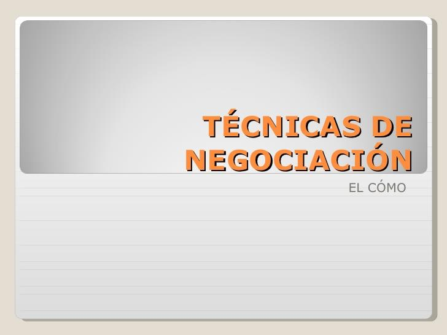

> **Descripción de la imagen** — La imagen es un diseño gráfico con fondo gris claro y un borde sutil. En el centro superior se encuentra el título principal escrito en varias líneas de texto. La frase "TÉCNICAS DE" aparece en color naranja o rojo, seguida por la palabra "NEGOCIACIÓN" escrita en una fuente más grande y oscura (azul/morado). Debajo de la palabra "NEGOCIACIÓN", en una tipografía más pequeña, se lee la frase "EL CÓMO".

Unidad No. II
El Proceso de Negociación

---

<!-- página 2 -->
### Unidad 2. El proceso de  negociación.

Reconocer en la negociación en equipo, los roles o

papeles del negociador.
Comprender la estructura  del  proceso de

negociación.
Establecer las diferencias entre el negociador

individual y la negociación en equipo.
Establecer ventajas y desventajas en la

negociación en equipo.
Comprender los modos de negociación, sus

deferencias.
Aplicar el modo  competitivo, estrategias y

tácticas.
Aplicar el modo colaborativo, estrategias y tácticas

2

---

<!-- página 3 -->

Preparación de la Negociación.

---

<!-- página 4 -->

Una buena preparación es el
camino más seguro para una
buena negociación.

Nuñez Partido

---

<!-- página 5 -->

Un negociador mal preparado tiene que
limitarse a reaccionar ante los
acontecimientos , nunca podrá
dirigirlos.

No se meta nunca en una negociación
hasta que no esté perfectamente
preparado y haya conseguido la mayor
información posible acerca de sus
interlocutores.

Nuñez Partido

---

<!-- página 6 -->
### EL PROCESO DE NEGOCIACION
### PLANEACION                         NEGOCIACION CARA A CARA

Diagnostico
Estrategia
Tácticas
Etapas
Técnicas
Estilos

 Tipo de

negociacion.

 ¿B ?

 DAFO

 Necesidades.

 Objetos.

 Objetivos.

 MAAN.

 Opciones.

 Inicio.

 Abandono.

 ¿Primera

oferta?.

 Cerrado -

abierto.

 Suave -

duro.

 Concesiones

 Apertura.

 Expectativas

 Intercambio

 Acercamien
to.

 Cierre.
.

 Exponer

expectativas.

 Verficar

percepciones
.

 Explorar.

 Ajustar.

 Manejar

conflictos.

 Cerrar.

 Control de

emociones.

 Análisis

sistemático.

 Persuadir.

 Puentear.

 Asertar.

 Atraer.

 Alejarse.

---

<!-- página 7 -->

Objetivos de la
Negociación.
A través de la Negociación,
las partes implicadas en el
proceso tratan de llegar a
un acuerdo a través del
que esperan ver cumplidas
sus expectativas.

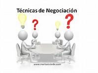

> **Descripción de la imagen** — Es una ilustración conceptual que representa un escenario de negociación. Muestra una mesa redonda en el centro, alrededor de la cual están sentados cuatro figuras humanas estilizadas, sugiriendo a los participantes de una negociación. Sobre la mesa o flotando sobre ella, se observan tres bombillas encendidas (simbolizando ideas o soluciones) y dos signos de interrogación grandes (representando dudas o desafíos).

---

<!-- página 8 -->

De ahí que antes de la entrevista sea conveniente que
cada parte se plantee las siguientes cuestiones:

- Lo que quiere obtenerse mediante la Negociación: Es
importante fijar objetivos, que, realmente se puedan
conseguir.

-
El
mínimo
que
tiene
que
conseguirse
con
la
Negociación.

- Lo que puede ocurrir si No se llega a un acuerdo. Por
eso hay que pensar las posibles alternativas que se
pueden plantear, en el caso de que la otra parte No esté
de acuerdo con la Negociación.

---

<!-- página 9 -->

La planificación de la Negociación.

Consiste en el establecimiento de estrategias para
alcanzar los fines.

Para ello es necesario que tengamos información sobre
la persona o la empresa con la que vamos a negociar.

Algunas consideraciones que debemos tener en cuenta
son:
- Utilizar la empatía.
- Tratar de conocer mejor a la otra parte.
- Seleccionar las preguntas adecuadas.
- Buscar toda la información posible acerca del cliente.

---

<!-- página 10 -->

NIVELES EN LA GERENCIA

DE
NEGOCIACIÓN.

---

<!-- página 11 -->

1. Nivel Estratégico.

• ¿Vale la pena negociar?
• ¿Existen otras opciones para obtener lo
que deseamos?
• ¿Qué necesitamos, qué podemos pedir,
qué podemos recibir?
• ¿Qué puede necesitar B?
• ¿Cuándo negociar?
• ¿Con quien negociar?
• ¿Si hay varias posibilidades, en que
orden?

---

<!-- página 12 -->

1. Nivel táctico.

• ¿Qué cosas negociamos?
• ¿En qué orden?
• ¿Cómo negociar?
• ¿Tácticas?
• ¿Técnicas?
• ¿Estilos?
• ¿Conductas?

---

<!-- página 13 -->

Roles en las Negociaciones en Grupo

---

<!-- página 14 -->

Conductor (Líder).
Asume la responsabilidad del
equipo durante la
negociación. Es el que abre
la sesión de negociación,
habla y da la palabra a los
integrantes de su grupo;
detecta y señala los
obstáculos; cierra la sesión
de negociación e informa a
los Jefes superiores.

> **Descripción de la imagen** — Es una fotografía que captura un apretón de manos profesional en un entorno urbano. En primer plano se ven dos manos estrechándose firmemente, presumiblemente de personas vestidas con traje o ropa formal.
>
> El fondo está dominado por un cielo azul brillante y la silueta de varios rascacielos modernos, lo que sugiere un contexto corporativo o de negocios en una ciudad grande. La composición enfatiza el gesto del apretón de manos contra el contraste entre las manos en primer plano y la arquitectura moderna detrás.

14

---

<!-- página 15 -->

> **Descripción de la imagen** — La imagen es una toma en primer plano que muestra a varias personas colaborando sobre documentos extendidos sobre una superficie blanca. Se observa a una persona inclinada hacia el centro, interactuando con papeles o diagramas. Otra persona se extiende desde la derecha para tocar o revisar los mismos documentos, indicando una sesión de estudio o trabajo en equipo. La escena sugiere una interacción activa y concentrada alrededor de materiales académicos o de planificación.

Sintetizador.
Se encarga de ir
resumiendo los temas y
posibles puntos de
acuerdo, formula
preguntas, hace
aclaraciones, gana
tiempo en la negociación a
favor de su grupo.
Aclara las propuestas.
Es un auxiliar del conductor.
(Registradores).

15

---

<!-- página 16 -->

Observador.
Su labor durante la
negociación consiste
en escuchar, registrar
señales, captar sutilezas y
matices, "leer" el
Ambiente general y
analizar las reacciones, la
preparación y las
relaciones entre los
miembros de la
contraparte.

> **Descripción de la imagen** — La imagen es una fotografía de tres hombres en un entorno de oficina, participando en un apretón de manos profesional.
>
> Dos de los hombres están de pie frente a una mesa blanca y se están dando la mano. El hombre de la izquierda viste un traje oscuro y está inclinado sobre la mesa, mientras que el hombre de la derecha viste un traje gris claro.
>
> Un tercer hombre, vestido con un traje oscuro, se encuentra de pie detrás de la mesa, observando la interacción entre los otros dos. Sobre la mesa se aprecian documentos y un dispositivo electrónico (posiblemente una laptop). La escena transmite una atmósfera de acuerdo o reunión de negocios.

16

---

<!-- página 17 -->

> **Descripción de la imagen** — La imagen es una ilustración o fotografía de un globo terráqueo visto desde una perspectiva aérea. Sobre la superficie del planeta se encuentran tres hombres vestidos con trajes formales, caminando en diferentes direcciones. El globo muestra claramente los continentes y océanos.

Emergente.
Puede preverse o surgir
en la negociación.
Expresa una opinión o
preocupación como propia
pero que en todo momento
se corresponde con los
intereses del grupo
negociador y con los
objetivos de la negociación.
Ej: Experto en algún tema
técnico, representante de
Finanzas.
17

---

<!-- página 18 -->

Chivo expiatorio.
Es un emergente al que
se le asignan
determinados aspectos
negativos en la
negociación.
Esto le crea una imagen
desfavorable con la
contraparte y con
frecuencia es eliminado
del grupo negociador
una vez cumplido su rol.

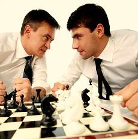

> **Descripción de la imagen** — La imagen es una fotografía que muestra a dos hombres sentados uno frente al otro, concentrados en un tablero de ajedrez. Ambos están mirando el tablero y parecen estar participando en un juego o analizando una partida. El tablero está dispuesto con piezas de ajedrez visibles.

18

---

<!-- página 19 -->
### Negociación en Equipo
### Ventajas
### Desventajas

Mayor Información y
Amplitud de Criterios.

Peligro de Desacuerdos
Internos.

Representatividad.
La contraparte puede
intentar dividirlos.

Mayor Seguridad.
Pausas Necesarias para
deliberaciones.

Apoyo Mental y
Psicológico.

Pueden no sentirse
cómodo con el rol que
desempeñan.

19

---

<!-- página 20 -->
### Roles en la Negociación
### con Terceros

20

Roles que se pueden
asumir en una
Negociación con
terceros.

---

<!-- página 21 -->

Mediador:
Es NEUTRAL y facilita la solución
en una negociación, recurriendo
al razonamiento y al
convencimiento, sugiriendo
alternativas.

Se recomienda cuando:
1. Las partes en conflicto deben
tener motivos para negociar.
2. El mediador debe ser percibido
como alguien neutral.

> **Descripción de la imagen** — La imagen muestra a tres personas —dos hombres y una mujer— interactuando en un entorno interior profesional. Están agrupados alrededor de una superficie (posiblemente una mesa) en lo que parece ser una reunión o discusión.
>
> El hombre de la izquierda está inclinado hacia adelante, mirando a la mujer. El hombre de la derecha está de pie o sentado ligeramente detrás, también participando en la conversación. La mujer se encuentra en el centro de la interacción, con su atención dirigida hacia los hombres. La composición sugiere un intercambio de ideas o una conversación formal.

21

---

<!-- página 22 -->
### Arbitro:
Tiene AUTORIDAD para dictar
un acuerdo.
El arbitraje puede ser
voluntario (solicitado) u
Obligatorio (impuesto a las
partes por contrato).
Siempre produce un arreglo,
aunque se corre el riesgo de
que no sea bien aceptado por
alguna de las partes.

> **Descripción de la imagen** — La imagen es una fotografía que muestra a cuatro personas sentadas alrededor de una mesa, participando en una reunión o sesión de estudio.
>
> Hay tres mujeres y un hombre presentes. Están sentados uno frente al otro o en un semicírculo, con la atención enfocada en el centro de la mesa. El hombre, ubicado en el centro, está inclinado hacia adelante mirando hacia abajo, posiblemente examinando un documento o material sobre la mesa. Las otras personas están orientadas hacia él y la interacción parece ser de colaboración o discusión. La escena sugiere un ambiente académico o profesional.

22

---

<!-- página 23 -->

Conciliador:
Se tiene CONFIANZA y se cree
Que ofrece un vinculo de
comunicación informal entre el
negociador y el opositor para
convencer y llegar a acuerdos.

Se diferencia del Mediador en
que se requiere mas
conocimiento del tema que se
negocia y no siempre es
neutral.

> **Descripción de la imagen** — La imagen es una fotografía que muestra a tres personas sentadas alrededor de una mesa en lo que parece ser un entorno de oficina o reunión.
>
> En el centro se encuentra una mujer con cabello rubio, vestida con un blazer de color rosa fuerte o magenta. A su izquierda está un hombre con cabello oscuro, vestido con un traje azul y camisa clara. A la izquierda del grupo hay otro hombre, con cabello castaño corto, que lleva un traje oscuro y una corbata clara, y está inclinado hacia la mesa.
>
> Las tres personas están sentadas frente a una mesa de color claro o madera. El fondo sugiere un espacio interior con grandes ventanales que permiten ver el exterior. La escena transmite una atmósfera de reunión de negocios o discusión.

23

---

<!-- página 24 -->
### Consultor:
HÁBIL E IMPARCIAL que intenta
facilitar la solución creativa de
problemas por medio de la
comunicación y el análisis, con la
ayuda de su conocimiento sobre
MANEJO DE CONFLICTOS.

En lugar de proponer soluciones
especificas, intenta ayudar a
que las partes se comprendan
entre si y trabajen conjuntamente.

> **Descripción de la imagen** — La imagen es una fotografía de tres mujeres jóvenes sentadas juntas en una mesa, aparentemente estudiando o trabajando con documentos.
>
> *   **Sujetos:** Hay tres mujeres. La mujer de la izquierda tiene el cabello rubio y está apoyando su barbilla en su mano mientras mira hacia abajo. La mujer del centro tiene cabello oscuro y rizado, también mirando los documentos sobre la mesa. La mujer de la derecha tiene cabello más claro y está inclinada hacia adelante, enfocada en lo que hay en la mesa.
> *   **Escena:** Las mujeres están sentadas alrededor de una mesa. Hay papeles o documentos extendidos frente a ellas.
> *   **Detalles adicionales:** En el primer plano, cerca del borde inferior derecho de la imagen, se observa un objeto de color amarillo (posiblemente una fruta o un objeto pequeño). La iluminación sugiere un ambiente interior bien iluminado.

24

---

<!-- página 25 -->

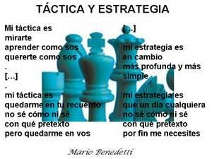

> **Descripción de la imagen** — No se ha proporcionado ninguna imagen o elemento visual para describir. El texto que se ha incluido es un fragmento escrito.

---

<!-- página 26 -->

MODOS DE NEGOCIACIÓN
En diferentes materiales
especializados, a esta clasificación
también se le llama:
- “tipos”,
- “estrategias”,
- “estilos”, o
- “modos ó métodos” de

negociación.

---

<!-- página 27 -->

1. Modo Competitivo ó
distributiva.
(GANAR – PERDER)

2. Modo Colaborativo –
Cooperativo ó

integrativa
(GANAR – GANAR)

> **Descripción de la imagen** — La imagen muestra una escena de encuentro profesional entre dos personas en un entorno de oficina o sala de reuniones. Una mujer, con cabello rojizo y vestida con una camisa clara de cuello, está sentada a la izquierda y le está dando la mano a un hombre que se encuentra sentado a la derecha. El hombre viste un traje oscuro. Ambos están interactuando mediante un apretón de manos sobre una mesa grande. Sobre la mesa se observan documentos y papeles.

27

Modos ó Estrategias

de negociación

---

<!-- página 28 -->

La Estrategia es el conjunto de acciones
que se van a llevar a cabo durante la
negociación para alcanzar los objetivos
fijados.

Es el QUÉ se hará, es decir, un plan de
acción
donde
se
van
a
utilizar
un
conjunto de tácticas.

---

<!-- página 29 -->

1. Modo o Estrategia de
Negociación Competitiva o
Distributiva.

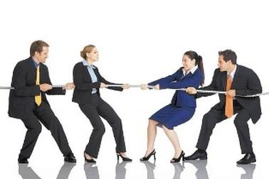

> **Descripción de la imagen** — La imagen es una fotografía de cuatro personas adultas, vestidas con ropa de negocios, de pie en una línea horizontal contra un fondo blanco liso. Las cuatro personas están tomadas de la mano, extendiendo sus manos a través del grupo.
>
> De izquierda a derecha:
> 1. Un hombre vestido con traje oscuro y camisa clara.
> 2. Una mujer con cabello castaño, vestida con un traje de negocios.
> 3. Una mujer con cabello castaño claro, vestida con un traje de negocios.
> 4. Otra mujer con cabello castaño oscuro, vestida con un traje de negocios.
>
> Todas las personas están mirando hacia adelante y tienen expresiones profesionales o sonrientes. La composición sugiere unidad, colaboración o asociación.

---

<!-- página 30 -->

Los negociadores se centran en sus
objetivos (posiciones), sin considerar los de la
contraparte, y la negociación transcurre como una
lucha.

Muchas veces las circunstancias imponen el:
Modo Competitivo.

Objetivo: Maximizar los resultados propios.

̈ El dilema de este Negociador es:

Reclamar para obtener mas valor.

30

---

<!-- página 31 -->

Ejemplo: un comercio mayorista que le
vende a un minorista que le intenta
comprar a un precio aceptable, pero
como sus productos son exclusivos, se
aprovecha de esa exclusividad para no
rebajar tanto el precio y que el minorista
acabe comprando a un precio superior.

---

<!-- página 32 -->

1.1 Negociación Competitiva - Estrategias

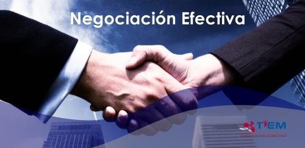

> **Descripción de la imagen** — La imagen es una ilustración o fotografía de dos manos estrechándose en un apretón de manos, simbolizando un acuerdo o negociación. Una mano viste una manga de traje oscuro y la otra viste una manga de color morado oscuro. El fondo es suave y difuminado con tonos azules claros. Sobre la imagen se superpone el texto "Negociación Efectiva".

---

<!-- página 33 -->

1. Empezar pidiendo
mucho (si es un
vendedor) o muy poco
(si es un comprador).
Persigue: reducir las
expectativas de la
otra parte, presionar
para obtener
concesiones,
imponer las “reglas
del juego” a su favor.

> **Descripción de la imagen** — La imagen es una fotografía de tres hombres en un entorno de oficina, participando en un apretón de manos profesional.
>
> Dos de los hombres están de pie frente a una mesa blanca y se están dando la mano. El hombre de la izquierda viste un traje oscuro y está inclinado sobre la mesa, mientras que el hombre de la derecha viste un traje gris claro.
>
> Un tercer hombre, vestido con un traje oscuro, se encuentra de pie detrás de la mesa, observando la interacción entre los otros dos. Sobre la mesa se aprecian documentos y un dispositivo electrónico (posiblemente una laptop). La escena transmite una atmósfera de acuerdo o reunión de negocios.

33

---

<!-- página 34 -->

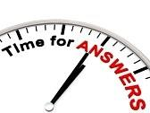

> **Descripción de la imagen** — Es un diagrama conceptual que representa una escala o medidor circular (similar a un velocímetro o un cronómetro). La escala curva está dividida y contiene texto en dos secciones opuestas.
>
> En el lado izquierdo, se lee la frase "Time for". En el lado derecho, se lee la palabra "ANSWERS". Una aguja negra apunta hacia una posición específica en el dial, indicando un punto de tiempo o límite entre las dos frases.

### 2. Presión de tiempo.
Utilizar los “plazos
irrevocables” y,
Cuando han obtenido lo
Que esperaban, trasmitir el
el mensaje de que:
“seguir negociando
implicará mayores
costos”.

34

---

<!-- página 35 -->

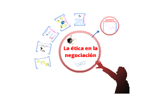

> **Descripción de la imagen** — Es un diagrama conceptual que ilustra la relación entre un tema central y sus componentes relacionados.
>
> El elemento central es un círculo grande de color rosa/rojo con el texto "La ética en la negociación".
>
> Alrededor de este círculo central, hay varios elementos secundarios (círculos o recuadros más pequeños) dispersos. Líneas con flechas conectan estos elementos periféricos hacia el círculo central, indicando que todos contribuyen o están relacionados con el tema principal.
>
> En la parte inferior derecha, se observa la silueta de una mano apuntando hacia el círculo central.

3. Utilizar
“prominencias”.
Fundamentar las
posiciones con
elementos como:
principios, valores,
nacionalismos,
políticas de la empresa,
etc. que no pueden
“violarse”, ni
modificarse.

35

---

<!-- página 36 -->

4. Aparecer firmes
Asumir una imagen de
fuerza, de poder.
Reclamar concesiones
de la otra parte, como
algo justificado; eludir
las suyas, o
concederlas como
algo excepcional.

> **Descripción de la imagen** — Es una fotografía que captura un apretón de manos profesional en un entorno urbano. En primer plano se ven dos manos estrechándose firmemente, presumiblemente de personas vestidas con traje o ropa formal.
>
> El fondo está dominado por un cielo azul brillante y la silueta de varios rascacielos modernos, lo que sugiere un contexto corporativo o de negocios en una ciudad grande. La composición enfatiza el gesto del apretón de manos contra el contraste entre las manos en primer plano y la arquitectura moderna detrás.

36

---

<!-- página 37 -->

5. Reclamar la
intervención de un
tercero (árbitro)
Utilizar esto como
chantaje, o amenaza,
como demostración de la
seguridad en la “justeza”
de su posición

> **Descripción de la imagen** — La imagen es una fotografía de tres hombres en un entorno de oficina, participando en un apretón de manos profesional.
>
> Dos de los hombres están de pie frente a una mesa blanca y se están dando la mano. El hombre de la izquierda viste un traje oscuro y está inclinado sobre la mesa, mientras que el hombre de la derecha viste un traje gris claro.
>
> Un tercer hombre, vestido con un traje oscuro, se encuentra de pie detrás de la mesa, observando la interacción entre los otros dos. Sobre la mesa se aprecian documentos y un dispositivo electrónico (posiblemente una laptop). La escena transmite una atmósfera de acuerdo o reunión de negocios.

37

---

<!-- página 38 -->

1.2 (Comportamientos / Acciones)

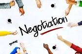

> **Descripción de la imagen** — La imagen es una ilustración o fotografía con fondo blanco que presenta la palabra "Negotiation" escrita en letras grandes y oscuras, con un estilo de escritura manuscrita. Varias manos humanas están dispuestas alrededor del texto, extendiéndose hacia él desde diferentes puntos (arriba a la izquierda, arriba a la derecha, abajo a la izquierda y abajo a la derecha), sugiriendo interacción, acuerdo o discusión.

---

<!-- página 39 -->

1. Alardear: (bluff).
Transmitir una imagen
De poder, de
potencialidades
de negocios futuros,
Que estimulen a la
contraparte a
Concretar la
negociación, con
alguien que “promete”.

> **Descripción de la imagen** — La imagen muestra una escena de encuentro profesional entre dos personas en un entorno de oficina o sala de reuniones. Una mujer, con cabello rojizo y vestida con una camisa clara de cuello, está sentada a la izquierda y le está dando la mano a un hombre que se encuentra sentado a la derecha. El hombre viste un traje oscuro. Ambos están interactuando mediante un apretón de manos sobre una mesa grande. Sobre la mesa se observan documentos y papeles.

39

---

<!-- página 40 -->

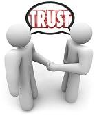

> **Descripción de la imagen** — Es una ilustración que representa la confianza y la interacción entre dos personas.
>
> La imagen muestra dos figuras humanas estilizadas (siluetas o modelos 3D simples) de color gris claro, orientadas una hacia la otra en un gesto de apretón de manos.
>
> Sobre las figuras, hay un recuadro o burbuja de diálogo con un borde negro que contiene la palabra "TRUST" escrita en letras grandes, rojas y mayúsculas.

2. El silencio.
Muchas veces, la forma más
efectiva de transmitir la no
aceptación de una
Propuesta es quedarse
callado.
Cuando se le pregunta
¿por qué?, responde:
“Porque estoy esperando
Una Propuesta mas
convincente”.

40

---

<!-- página 41 -->

3. Autoridad limitada.
Cuando se plantea un
intercambio o llegar a
Un cuerdo que implica
ceder en algo, se
plantea:

“No podemos decidir, ni
comprometernos sobre
esto, mi autoridad está
limitada a...”

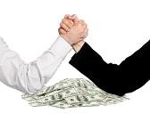

> **Descripción de la imagen** — La imagen es una fotografía o ilustración que muestra un puñado de dinero en efectivo. Se observan dos manos, posiblemente las de una persona, que están juntando o sosteniendo una pila considerable de billetes doblados. Los billetes forman una masa visible y se encuentran en la parte inferior del encuadre.

41

---

<!-- página 42 -->

5. El “Mordisco”. Cuando se van
reclamando pequeñas concesiones;
al inicio, una reducción del 3% en el
precio; más adelante, otro 2%.

Si Ud. no lleva la cuenta, al final,
puede sorprenderse con una
reducción significativa que Ud. no
tenía previsto conceder.

42

4. Ultima Oferta:  ̈Tómalo o
Déjalos”. Cuando se plantea
que la oferta realizada es la
ultima y en caso contrario no
hay negociación.

---

<!-- página 43 -->

6. El Bueno y el Malo:
(negociaciones en grupo)
Se parte de la posición
intransigente del negociador
principal de un grupo que es el
hombre malo para que uno de
sus integrantes se acerque a la
contraparte como el hombre
bueno buscando información y
tratando de conocer en que
medida existen  ̈ debilidades  ̈
en el equipo contrario.

43

---

<!-- página 44 -->

7. Cambiar los negociadores.

Cuando Ud. piensa que está a punto de
llegar a un acuerdo, con resultados
aceptables, le informan que se ha tenido que
cambiar de negociador.
El “nuevo” no “comprende” algunas de las
cosas que se han debatido y cuestiona las
Concesiones que se hicieron.
Tiene dos propósitos:
uno, tratar de desestabilizarlo y que Ud.
sienta impaciencia por concluir el asunto y;
dos, eliminar concesiones que ya se hubieran
hecho y, que “B” no considera favorables.

44

---

<!-- página 45 -->

2. Modelo de Negociación - Colaborativo
(Ganar – Ganar)

> **Descripción de la imagen** — Es una fotografía tomada al aire libre que muestra a tres personas sentadas en un muro bajo o borde de cemento frente a un gran edificio moderno de cristal.
>
> En primer plano, hay tres individuos: dos mujeres y un hombre. Están sentados juntos, mirando hacia adelante o interactuando. El hombre, ubicado en el centro, está sentado con una postura relajada y sostiene un libro abierto sobre sus rodillas. Las otras dos personas están a su alrededor.
>
> El fondo está dominado por la fachada de un rascacielos alto y moderno, compuesto principalmente por paneles de vidrio azul y gris. La escena se desarrolla en un espacio exterior pavimentado, con algunas ramas desnudas visibles cerca del edificio, lo que sugiere un clima frío o de transición estacional.

45

---

<!-- página 46 -->

Cuando se trabaja por satisfacer los
intereses de ambas partes por  ̈crear valor ̈
en el proceso de negociación.

̈El dilema del negociador es:

Trabajar para crear mas valor en el proceso
de negociación.

Objetivo:
Satisfacer los intereses de ambas
partes.

46

---

<!-- página 47 -->

El objetivo de la estrategia colaborativa
es encontrar fórmulas que tengan en
cuenta los intereses de ambas partes, y
llegar a una solución que sea aceptable
para todos.

Lo ideal es que las dos o más partes
salgan muy beneficiadas.

---

<!-- página 48 -->

Ejemplo: se está negociando el plazo de
pago de una venta, el cliente no puede
pagar al contado y el proveedor no puede
aplazarlo mucho tiempo; llegan al acuerdo
de hacer el pago a los 30 días, así al cliente
le da tiempo de reunir ese dinero y el
proveedor no se ve tan apurado con sus
obligaciones.

---

<!-- página 49 -->

Obstáculos para el Modo Colaborativo

• La historia pasada de relaciones entre
las partes.

• Prejuicios, percepciones diferentes
sobre cómo ver las cosas.

• Naturaleza entrelazada de resultados
competitivos y colaborativos.

49

---

<!-- página 50 -->
### Modo Colaborativo

Estrategias:
- Centrarse más en intereses comunes que

en las diferencias.
- Separar las personas de los problemas.
- Diferenciar necesidades (intereses) de

posiciones.
- Aumentar el  ̈pastel ̈.
- Crear opciones de beneficio mutuo.

50

---

<!-- página 51 -->
### TÁCTICAS DE NEGOCIACIÓN.

Las Tácticas son el CÓMO se realizará,
es
decir,
son
aquellas
maniobras
enfocadas a corto plazo para alcanzar
las metas.

Son opciones dentro de una estrategia.

---

<!-- página 52 -->

Las tácticas de desarrollo: son aquellas

que se limitan a concretar la estrategia
elegida, sea ésta de colaboración o de
confrontación, sin que supongan un
ataque a la otra parte y no tienen por
qué afectar a la relación entre las
partes.

---

<!-- página 53 -->

Ejemplos de Tácticas de Desarrollo:

- Tomar la iniciativa presentando una propuesta o
esperar a que se la otra parte quien vaya por
delante.

- Facilitar toda la información disponible o, por el
contrario, la estrictamente necesaria.

- Hacer la primera concesión o esperar a que sea
la otra parte quien dé el primer paso.

- Tratar de que las negociaciones tengan lugar en
las propias oficinas, en las de la otra parte o en un
lugar neutral.

---

<!-- página 54 -->

Las tácticas de presión:

Tratan de fortalecer la propia posición y
debilitar la del contrario.

Buscan confundir, intimidar o debilitar la
posición del contrario.

Se recomienda ser muy prudente en su
uso, pues usarlas en modo contundente,
podría deteriorar nuestras relaciones con
la otra parte.

---

<!-- página 55 -->

Ejemplos de tácticas de Presión:

-
Desgaste: Aferrarse a la propia posición y no
hacer
ninguna
concesión
o
hacer
concesiones
mínimas. Se busca agotar a la otra parte hasta que
ceda. “Es lo máximo que puedo ceder...”.

-
Ataque: Atacar, presionar, intimidar, rechazar
cualquier intento de la otra parte de apaciguar los
ánimos.
Se
busca
crear
una
atmósfera
tensa,
incomoda, en la que uno sabe desenvolverse y que
perjudica al oponente. “Por esas condiciones no te
compro, y ya me encargaré que tus demás clientes
tampoco te compren...”.

---

<!-- página 56 -->

Tácticas
engañosas:
Dar
información
falsa,
manifestar opiniones que no se corresponden con la
realidad, prometer cosas que no se piensan cumplir,
simular ciertos estados de ánimo, es decir, engañar
al oponente. “Si hablo con mi superior puede que te
dé mayor crédito...”.

---

<!-- página 57 -->

- Ultimátum: Presionar a la otra parte, empujarle a
que
tome
una
decisión
sin
darle
tiempo
para
reflexionar. Normalmente esta urgencia es ficticia y
tan sólo busca intranquilizar al oponente. "O lo
tomas
o
lo
dejas",
"tengo
otras
tres
personas
interesadas, así que o te decides ahora o dalo por
perdido"...

---

<!-- página 58 -->

• Separe las personas del problema.
• Separe las posiciones de los
intereses.
• Cree opciones para beneficio
mutuo.
• Busque criterios o normas
apropiadas.
### Tácticas

---

<!-- página 59 -->

Separe las personas del problema.

Sea fuerte con el

problema, suave con la
persona.
Póngase en el lugar del

otro.
Trate de crear una

relación de trabajo.
Discuta las diferencias en

la percepción.
Escuche más que hable.
Involúcrelos a ellos.

---

<!-- página 60 -->

Separe las posiciones de los

intereses.

Identifique los intereses
preguntando: ¿Por qué?.
Busque interese múltiples.
Haga explícitos los
intereses.
Sea específico pero
flexible.

---

<!-- página 61 -->

Cree opciones para beneficio mutuo.

Evite un juicio prematuro.
No busque una solución fija.
No asuma un pastel fijo.
Genere una variedad de

opciones.
Indague por el beneficio

mutuo.
Vincule las diferencias en

intereses.

---

<!-- página 62 -->

Busque criterios o normas apropiadas.

Insista en el uso de
estándares independientes.
No decida sobre la base del
poder o la voluntad.
Formule los problemas como
una búsqueda conjunta de
criterios  apropiados.
Sea abierto a la razón.

---

<!-- página 63 -->

Lecciones de la negociación colaborativa

1. Son preferibles cuando interesan las
relaciones y un clima de confianza.
2. Requiere trabajo y preparase.
3. Demanda generación de alternativas.
4. Exige interesarse por los resultados de
ambas partes.
5. Importante que las partes queden
satisfechas.
6. La dirección del proceso es
responsabilidad de todos.

---

<!-- página 64 -->

Conclusión

Ninguna negociación es  ̈puramente
competitiva o colaborativa ̈.

Dos factores que influyen en la
adopción de uno u otro modo son:

1. Necesidad de preservar las mejores
relaciones.
2. Posibilidad de futuras
negociaciones.

64

---

<!-- página 65 -->

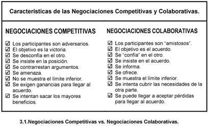

> **Descripción de la imagen** — La imagen es una lista comparativa que detalla las características de dos tipos de negociaciones: Competitivas y Colaborativas. La información está organizada en dos columnas o secciones principales.
>
> **Características de las Negociaciones Competitivas:**
> Se enumeran los siguientes rasgos:
> *   Los participantes son adversarios.
> *   El objetivo es la victoria.
> *   Se desconfía en el otro.
> *   Se insiste en la posición.
> *   Se contrarrestan argumentos.
> *   Se amenaza.
> *   No se muestra el límite inferior.
> *   Se exigen ganancias para llegar al acuerdo.
>
> **Características de las Negociaciones Colaborativas:**
> Se enumeran los siguientes rasgos:
> *   Los participantes son amistosos.
> *   El objetivo es el acuerdo.
> *   Se confía en el otro.
> *   Se insiste en el acuerdo.
> *   Se informa.
> *   Se ofrece.
> *   Se muestra el límite inferior.

