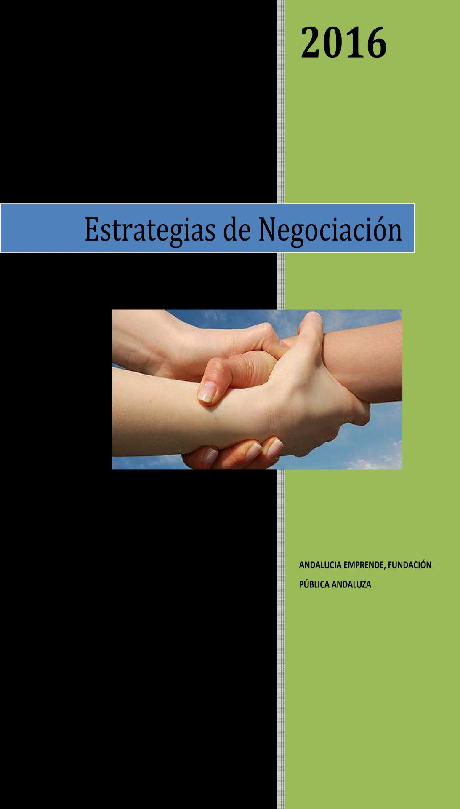
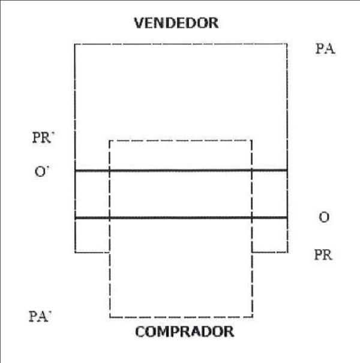

# Estrategias-de-negociación

<!-- página 1 -->

> **Descripción de la imagen** — La imagen es un encabezado institucional con fondo verde oscuro. En la esquina inferior izquierda se encuentra el logotipo de la "JUNTA DE ANDALUCÍA", representado por un símbolo estilizado de tres ondas o señales. A la derecha, se presenta el texto que identifica las entidades: "Andalucía Emprende, Fundación Pública Andaluza", seguido de "CONSEJERÍA DE EMPLEO," y finalmente "FORMACIÓN Y TRABAJO AUTÓNOMO".

> **Descripción de la imagen** — La imagen es una portada o diapositiva con un diseño dividido verticalmente en secciones negras y verdes. En el centro, hay una fotografía de dos manos de tono claro entrelazadas o dándose la mano, capturadas en un plano medio. Las manos están juntas en un gesto de acuerdo o negociación. El fondo detrás de las manos parece ser un cielo abierto o una luz brillante.

---

<!-- página 2 -->

> **Descripción de la imagen** — La imagen es un encabezado o logotipo institucional. En el lado izquierdo se encuentra un símbolo gráfico estilizado que consiste en tres líneas curvas y ascendentes que se extienden hacia arriba, formando una especie de arco o señal. A la derecha del símbolo, se presenta texto institucional organizado en varias líneas: "Junta de Andalucía", seguido por "Andalucía Emprende, Fundación Pública Andaluza" y finalmente "CONSEJERÍA DE EMPLEO, FORMACIÓN Y TRABAJO AUTÓNOMO".

01 de julio de 2016
Página 2 de 34

INDICE
PÁG

1.
¿QUÉ ES NEGOCIAR?
4

2.
¿POR QUÉ NEGOCIAMOS?  4

3.
PROCESO DE NEGOCIACIÓN  5

4.
TIPOS BÁSICOS DE NEGOCIACIÓN  7

4.1.
Negociaciones Competitivas vs Negociaciones Colaborativas
7

4.2.
Criterio para elegir el tipo de negociación más apropiado
8

5.
PREPARARSE PARA NEGOCIAR: DEFINICIÓN DE LOS LÍMITES  10

A
PREPARAR LA NEGOCIACIÓN
10

5.1.
Punto de Arranque
10

5.2.
Valor Objetivo
11

5.3.
Punto de Ruptura
11

5.4.
Campo de Juego
12

B
ESTABLECER LOS LÍMITES
13

C
CONSEJOS ÚTILES
13

6.
CONSEJOS PARA NEGOCIAR DE FORMA COMPETITIVA
15

6.1.
Plantea tu caso de forma ventajosa
16

6.2.
Conoce el alcance y fuerza de su poder
16

6.3.
Preocúpate por conocer a la otra parte
17

6.4.
Define unas metas ambiciosas
17

---

<!-- página 3 -->

> **Descripción de la imagen** — La imagen es un encabezado o logotipo institucional. En el lado izquierdo se encuentra un símbolo gráfico estilizado que consiste en tres líneas curvas y ascendentes que se extienden hacia arriba, formando una especie de arco o señal. A la derecha del símbolo, se presenta texto institucional organizado en varias líneas: "Junta de Andalucía", seguido por "Andalucía Emprende, Fundación Pública Andaluza" y finalmente "CONSEJERÍA DE EMPLEO, FORMACIÓN Y TRABAJO AUTÓNOMO".

01 de julio de 2016
Página 3 de 34

6.5.
Define tu mejor alternativa
17

6.6.
Elabora tus razonamientos
18

6.7.
Define tus concesiones y el Plan de Concesiones
18

6.8.
Estudia tus puntos fuertes y débiles
19

6.9.
Estudia el punto de vista de tu oponente
19

7.
CONSEJOS PARA NEGOCIAR DE FORMA COLABORATIVA
20

¿QUÉ HACE QUE UN ACUERDO SEA BUENO PARA AMBAS

7.1.
PARTES?
20

7.2.
PRINCIPIOS DE LA NEGOCIACIÓN COLABORATIVA
21

8.
TÉCNICAS Y TÁCTICAS DE NEGOCIACIÓN
24

8.1.
Tácticas de Engaño deliberado
24

8.2.
Tácticas de guerra psicológica
25

8.2.1.
Situaciones incomodas
25

8.2.2.
Ataques personales
26

8.2.3.
El bueno y el malo
27

8.2.4.
Amenazas
27

8.2.5.
Explosiones emocionales
28

8.3.
Tácticas de presión
29

8.3.1.
Posición cerrada
29

8.3.2.
Subida de última hora
30

8.3.3.
Tómalo o déjalo
30

8.3.4.
Silencio
31

---

<!-- página 4 -->

> **Descripción de la imagen** — La imagen es un encabezado o logotipo institucional. En el lado izquierdo se encuentra un símbolo gráfico estilizado que consiste en tres líneas curvas y ascendentes que se extienden hacia arriba, formando una especie de arco o señal. A la derecha del símbolo, se presenta texto institucional organizado en varias líneas: "Junta de Andalucía", seguido por "Andalucía Emprende, Fundación Pública Andaluza" y finalmente "CONSEJERÍA DE EMPLEO, FORMACIÓN Y TRABAJO AUTÓNOMO".

01 de julio de 2016
Página 4 de 34

9.
RESÚMEN FINAL
32

10.
BIBLIOGRAFÍA
34
### ESTRATEGIAS DE NEGOCIACIÓN

1. ¿QUÉ ES NEGOCIAR?

La negociación es la estrategia que ponemos en funcionamiento cuando dos o más

partes interesadas en un asunto, acuerdan unas pautas y buscan un acuerdo que

satisfaga los intereses de cada uno.

2. ¿POR QUÉ NEGOCIAMOS?

La satisfacción de las necesidades e intereses de las personas, es el objetivo que

perseguimos cuando negociamos. Según el libro “Negotiation” (2006), de Harvard

Business Essentials, negociar es la forma en que las personas tratan con sus

diferencias, buscando un acuerdo mutuo a través del diálogo. Hay que tener presente

que negociar no es ganar de cualquier modo, sino establecer relaciones basadas en

un acuerdo recíproco, capaz de satisfacer las necesidades e intereses de todas las

partes involucradas.

Por tanto, para poder negociar, primero debemos conocer cuáles son las

motivaciones y necesidades, tanto nuestras como de los demás. Ésto será de gran

ayuda cuando te sientes en la mesa de negociación.

---

<!-- página 5 -->

> **Descripción de la imagen** — La imagen es un encabezado o logotipo institucional. En el lado izquierdo se encuentra un símbolo gráfico estilizado que consiste en tres líneas curvas y ascendentes que se extienden hacia arriba, formando una especie de arco o señal. A la derecha del símbolo, se presenta texto institucional organizado en varias líneas: "Junta de Andalucía", seguido por "Andalucía Emprende, Fundación Pública Andaluza" y finalmente "CONSEJERÍA DE EMPLEO, FORMACIÓN Y TRABAJO AUTÓNOMO".

01 de julio de 2016
Página 5 de 34

3. EL PROCESO DE NEGOCIACIÓN

A continuación tienes un diagrama con las cuatro fases esenciales de un proceso de

negociación:

PREPARACIÓN         CONDUCCIÓN            IMPLEMENTACIÓN           RENEGOCIACIÓN

• Preparación: es la fase inicial que implica:

o Introspección: Decide cuáles son los puntos de la negociación más

importantes para ti y cuánto estás dispuesto a ofrecer para conseguirlo.

o Extrospección: Ponte “en la piel” de la otra parte para deducir cuáles

son sus puntos importantes, y cómo puede proceder ante sus ofertas.

o Considera sus alternativas: Normalmente la otra parte nunca suele

estar de acuerdo con la primera opción que le ofrezcas. Por ello,

elabora un conjunto de alternativas y prepara tu exposición

previamente.

• Desarrollo de la negociación: Es el intercambio de ofertas y demandas,

posiblemente con argumentos. Durante este proceso debes verificar tus

posiciones acerca de tus oponentes, sus necesidades y metas. Esta fase

consta de cuatro momentos:

---

<!-- página 6 -->

> **Descripción de la imagen** — La imagen es un encabezado o logotipo institucional. En el lado izquierdo se encuentra un símbolo gráfico estilizado que consiste en tres líneas curvas y ascendentes que se extienden hacia arriba, formando una especie de arco o señal. A la derecha del símbolo, se presenta texto institucional organizado en varias líneas: "Junta de Andalucía", seguido por "Andalucía Emprende, Fundación Pública Andaluza" y finalmente "CONSEJERÍA DE EMPLEO, FORMACIÓN Y TRABAJO AUTÓNOMO".

01 de julio de 2016
Página 6 de 34

o Inicio: en este primer momento hay que hacer una primera toma de

contacto, generando un clima positivo que potencie la confianza mutua.

Además, es el momento de revisar objetivos. Recuerda que en una

reunión no debes abusar de la paciencia, ofender ni molestar. o

Proponer: Es el momento de plantear la posición y de justificarla.

o Intercambiar y construir: Llega el momento de buscar un acuerdo

aceptable para las dos partes. Debes buscar puntos en común. Hay

que estar atento a las posibles trampas y tácticas de la otra parte.

o Llegar a un acuerdo: Hay que estar alerta para encontrar puntos de

acuerdo. En esta fase debes procurar no expresar emociones. Intenta

dejar por escrito los acuerdos una vez concretados.

Este paso termina cuando ambas partes alcanzan un compromiso

satisfactorio.

• Implementación: Consiste en ejecutar los compromisos adquiridos.

• Renegociación: En el caso en que una de las dos partes proponga nuevas

ofertas, a fin de reabrir la negociación. Ambas partes intercambiarían nuevas

ofertas hasta alcanzar un mejor acuerdo.

---

<!-- página 7 -->

> **Descripción de la imagen** — La imagen es un encabezado o logotipo institucional. En el lado izquierdo se encuentra un símbolo gráfico estilizado que consiste en tres líneas curvas y ascendentes que se extienden hacia arriba, formando una especie de arco o señal. A la derecha del símbolo, se presenta texto institucional organizado en varias líneas: "Junta de Andalucía", seguido por "Andalucía Emprende, Fundación Pública Andaluza" y finalmente "CONSEJERÍA DE EMPLEO, FORMACIÓN Y TRABAJO AUTÓNOMO".

01 de julio de 2016
Página 7 de 34

4. TIPOS BÁSICOS DE NEGOCIACIÓN

4.1
NEGOCIACIONES  COMPETITIVAS  VS
NEGOCIACIONES
COLABORATIVAS

La negociación por posiciones es la forma habitual de negociar, donde los

negociadores explicarán las ventajas de cada una de sus posturas y los

inconvenientes de la propuesta contraria, haciendo concesiones recíprocas y

tratando de llegar a un acuerdo.

Existen dos tipos, totalmente opuestos, de negociación por posiciones:

• Negociación Competitiva: Cada negociador defenderá su idea y criticará la idea

del contrario

• Negociación Colaborativa: Tratará, no tanto de conseguir la victoria para una

de las partes, como de encontrar la mejor solución posible para ambas.

CARACTERÍSTICAS DE LAS NEGOCIACIONES

COMPETITIVAS
COLABORATIVAS

Cada parte intenta sacar los mayores
beneficios.

Se intenta sacar los mayores beneficios
para ambas partes.

Se desconfía del otro.
Se confía en el otro.

---

<!-- página 8 -->

> **Descripción de la imagen** — La imagen es un encabezado o logotipo institucional. En el lado izquierdo se encuentra un símbolo gráfico estilizado que consiste en tres líneas curvas y ascendentes que se extienden hacia arriba, formando una especie de arco o señal. A la derecha del símbolo, se presenta texto institucional organizado en varias líneas: "Junta de Andalucía", seguido por "Andalucía Emprende, Fundación Pública Andaluza" y finalmente "CONSEJERÍA DE EMPLEO, FORMACIÓN Y TRABAJO AUTÓNOMO".

01 de julio de 2016
Página 8 de 34

Se insiste en la posición.
Se insiste en el acuerdo.

Se amenaza.
Se informa. Se ofrece.

4.2 CRITERIOS PARA ELEGIR EL TIPO DE NEGOCIACIÓN MÁS

APROPIADO

Las circunstancias en que te encuentres, serán determinantes a la hora de elegir:

• El tipo de negociación: Negociación simple y a corto plazo o Negociación

compleja y a largo plazo.

El tipo de negociación es simple si gira en torno a una sola variable, como el

precio. Por el contrario, es compleja cuando existe más de una variable: precio,

plazos de entrega, garantías, etc. Estos elementos facilitan información sobre

qué estilo negociador puede resultar más idóneo.

Cuando se trata de acuerdos simples y que se materialicen en el corto plazo,

puede ser recomendable utilizar la negociación competitiva. Puesto que la

solución puede ser materializada casi de manera inmediata y casi sin tiempo de

reacción, la parte perjudicada no dispondrá de oportunidades para percatarse de

cuánto pierde al aceptar un mal acuerdo.

Por el contrario, cuando nos encontramos en una negociación a más “largo plazo”

y compleja, una solución francamente injusta tiene más posibilidades de ser

---

<!-- página 9 -->

> **Descripción de la imagen** — La imagen es un encabezado o logotipo institucional. En el lado izquierdo se encuentra un símbolo gráfico estilizado que consiste en tres líneas curvas y ascendentes que se extienden hacia arriba, formando una especie de arco o señal. A la derecha del símbolo, se presenta texto institucional organizado en varias líneas: "Junta de Andalucía", seguido por "Andalucía Emprende, Fundación Pública Andaluza" y finalmente "CONSEJERÍA DE EMPLEO, FORMACIÓN Y TRABAJO AUTÓNOMO".

01 de julio de 2016
Página 9 de 34

meditada antes de llegar a materializarse. Por tanto hay más dificultades para un

proceso en los términos Gano/Pierdes característicos de la Negociación

Competitiva.

• La necesidad de llegar a un acuerdo.

A veces te encontrarás con la necesidad de llegar a un acuerdo, bien porque la

otra parte tiene una posición ventajosa, bien porque entendemos que cualquier

solución negociada sea la mejor opción.

Estas circunstancias nos llevan a ceder y a contemplar los intereses de la otra

parte. Por tanto, el estilo negociador es el colaborativo.

• Una de las dos partes tiene una posición dominante.

Si eres tú quien dispone de una situación dominante respecto al otro, puedes

elegir un estilo negociador competitivo. No obstante, debes tener cuidado con lo

que pides. Lo auténticamente útil de la negociación es que, además de firmar los

acuerdos, después puedan cumplirse.

La elección de un estilo negociador u otro dependerá de la naturaleza de la

negociación de que se trate y de los diferentes elementos que la rodeen.

---

<!-- página 10 -->

> **Descripción de la imagen** — La imagen es un encabezado o logotipo institucional. En el lado izquierdo se encuentra un símbolo gráfico estilizado que consiste en tres líneas curvas y ascendentes que se extienden hacia arriba, formando una especie de arco o señal. A la derecha del símbolo, se presenta texto institucional organizado en varias líneas: "Junta de Andalucía", seguido por "Andalucía Emprende, Fundación Pública Andaluza" y finalmente "CONSEJERÍA DE EMPLEO, FORMACIÓN Y TRABAJO AUTÓNOMO".

01 de julio de 2016
Página 10 de 34

5. CÓMO PREPARSE PARA NEGOCIAR: DEFINICIÓN DE LOS LÍMITES

Es importante ir preparado a los procesos de negociación, y conocer cuáles son los

límites. Cada parte habrá de saber cuál será su primera oferta, cuál su objetivo y cuál

su precio de abandono, es decir, el precio a partir del cuál abandonarías la

negociación.

A. PREPARAR LA NEGOCIACIÓN

5.1 PUNTO DE ARRANQUE

La negociación empieza cuando las posiciones de las partes no coinciden. Además,

si desde un principio las dos partes saben que van a tener que negociar,

posiblemente este primer valor que ponen sobre la mesa no sea en realidad el que

marca su posición. Es decir, que sea un intento de testar al otro.

A estas primeras posiciones es a lo que llamamos Punto de Arranque de ambas

partes.

En el Gráfico, el valor PA es el valor pedido por el vendedor en un punto alto de la

escala; y el valor PA’ será el Punto de Arranque del Comprador en el punto bajo de

esa misma escala.

---

<!-- página 11 -->

> **Descripción de la imagen** — La imagen es un encabezado o logotipo institucional. En el lado izquierdo se encuentra un símbolo gráfico estilizado que consiste en tres líneas curvas y ascendentes que se extienden hacia arriba, formando una especie de arco o señal. A la derecha del símbolo, se presenta texto institucional organizado en varias líneas: "Junta de Andalucía", seguido por "Andalucía Emprende, Fundación Pública Andaluza" y finalmente "CONSEJERÍA DE EMPLEO, FORMACIÓN Y TRABAJO AUTÓNOMO".

01 de julio de 2016
Página 11 de 34

¿Quiere esto decir que el acuerdo es imposible? Muy probablemente la respuesta

sea no.

Ambas partes son conscientes que están iniciando un proceso negociador y, por

tanto, estarán dispuestas a rebajar sus exigencias: el Vendedor pidiendo un precio

menor, y el Comprador ofreciendo un precio mayor.

5.2 VALOR OBJETIVO

Probablemente, para cada parte el valor real y objetivo de la mercancía objeto de la

transacción se alejará sensiblemente de sus primeras ofertas. Pero, esos valores

reales y objetivos, serán también diferentes para cada una de las partes.

Este valor real que considera cada parte se denomina valor objetivo y juega un papel

fundamental en el proceso de negociación. En el gráfico le llamaremos O al que

consideramos Objetivo del Vendedor, y O’ al que sabemos que es Objetivo del

Comprador.

5.3 PUNTO DE RUPTURA

Todo proceso de negociación tiene un límite. Habrá valores por encima o por debajo

del cual el Comprador no querrá comprar, o al Vendedor no le interesará vender. A

estos valores extremos son a los que se les denominan  Puntos de

Ruptura o precio de abandono.

Siguiendo con el gráfico, llamaremos PR al Punto de Ruptura del Vendedor y PR’ al

del Comprador:

---

<!-- página 12 -->

> **Descripción de la imagen** — La imagen es un encabezado o logotipo institucional. En el lado izquierdo se encuentra un símbolo gráfico estilizado que consiste en tres líneas curvas y ascendentes que se extienden hacia arriba, formando una especie de arco o señal. A la derecha del símbolo, se presenta texto institucional organizado en varias líneas: "Junta de Andalucía", seguido por "Andalucía Emprende, Fundación Pública Andaluza" y finalmente "CONSEJERÍA DE EMPLEO, FORMACIÓN Y TRABAJO AUTÓNOMO".

> **Descripción de la imagen** — Es un diagrama conceptual que ilustra la relación entre un VENDEDOR y un COMPRADOR.
>
> El diagrama está dividido en dos secciones principales:
> 1. **VENDEDOR:** La sección superior, marcada con las etiquetas PA y PR'.
> 2. **COMPRADOR:** La sección inferior, marcada con las etiquetas PA' y PR.
>
> Entre estas dos secciones se encuentran varias líneas horizontales que conectan puntos internos etiquetados como O', PR', O y PR, mostrando diferentes estados o posiciones dentro de la interacción entre el vendedor y el comprador.

01 de julio de 2016
Página 12 de 34

5.4 EL CAMPO DE JUEGO

Una vez queden establecidas las tres variables anteriores, ya tenemos las

condiciones o “campo de juego” sobre el que podrá llevarse a cabo “el partido” de la

negociación. Los límites son los marcados por los respectivos Puntos de Ruptura, ya

que fuera de ellos, sería imposible llegar a un acuerdo.

---

<!-- página 13 -->

> **Descripción de la imagen** — La imagen es un encabezado o logotipo institucional. En el lado izquierdo se encuentra un símbolo gráfico estilizado que consiste en tres líneas curvas y ascendentes que se extienden hacia arriba, formando una especie de arco o señal. A la derecha del símbolo, se presenta texto institucional organizado en varias líneas: "Junta de Andalucía", seguido por "Andalucía Emprende, Fundación Pública Andaluza" y finalmente "CONSEJERÍA DE EMPLEO, FORMACIÓN Y TRABAJO AUTÓNOMO".

> **Descripción de la imagen** — La imagen es predominantemente un bloque de color sólido de tono verde azulado oscuro (teal). En la parte inferior derecha del bloque, se observan algunos caracteres o símbolos pequeños e indistintos.

> **Descripción de la imagen** — La imagen es predominantemente un bloque de color sólido de tono verde azulado oscuro (teal). En la parte inferior derecha del bloque, se observan algunos caracteres o símbolos pequeños e indistintos.

> **Descripción de la imagen** — La imagen es predominantemente un bloque de color sólido de tono verde azulado oscuro (teal). En la parte inferior derecha del bloque, se observan algunos caracteres o símbolos pequeños e indistintos.

> **Descripción de la imagen** — La imagen es predominantemente un bloque de color sólido de tono verde azulado oscuro (teal). En la parte inferior derecha del bloque, se observan algunos caracteres o símbolos pequeños e indistintos.

> **Descripción de la imagen** — La imagen es predominantemente un bloque de color sólido de tono verde azulado oscuro (teal). En la parte inferior derecha del bloque, se observan algunos caracteres o símbolos pequeños e indistintos.

> **Descripción de la imagen** — La imagen es predominantemente un bloque de color sólido de tono verde azulado oscuro (teal). En la parte inferior derecha del bloque, se observan algunos caracteres o símbolos pequeños e indistintos.

> **Descripción de la imagen** — La imagen es predominantemente un bloque de color sólido de tono verde azulado oscuro (teal). En la parte inferior derecha del bloque, se observan algunos caracteres o símbolos pequeños e indistintos.

> **Descripción de la imagen** — La imagen es predominantemente un bloque de color sólido de tono verde azulado oscuro (teal). En la parte inferior derecha del bloque, se observan algunos caracteres o símbolos pequeños e indistintos.

> **Descripción de la imagen** — La imagen es predominantemente un bloque de color sólido de tono verde azulado oscuro (teal). En la parte inferior derecha del bloque, se observan algunos caracteres o símbolos pequeños e indistintos.

> **Descripción de la imagen** — La imagen es predominantemente un bloque de color sólido de tono verde azulado oscuro (teal). En la parte inferior derecha del bloque, se observan algunos caracteres o símbolos pequeños e indistintos.

> **Descripción de la imagen** — La imagen es predominantemente un bloque de color sólido de tono verde azulado oscuro (teal). En la parte inferior derecha del bloque, se observan algunos caracteres o símbolos pequeños e indistintos.

01 de julio de 2016
Página 13 de 34

B. ESTABLECER LOS LÍMITES

Cada una de las partes deberá llevar sus límites ya fijados a la reunión. Para

definirlos, el proceso sería el siguiente:

• Establecer nuestro Valor Objetivo: ¿Cuándo estamos dispuestos a ofrecer –

si somos Compradores -, o a recibir – si somos Vendedores – por el producto

o servicio objeto de la negociación?

• El Punto de Arranque se definirá a partir del Objetivo, bien aumentándolo si

eres el vendedor, o disminuyéndolo si nuestra posición es la de comprador.

• Definir el Punto de Ruptura antes del proceso negociador ayudará a evitar

realizar demasiadas concesiones.

C. CONSEJOS ÚTILES

Hay que ser ambicioso al establecer el Objetivo y el Punto de Arranque.

Cuanto más alto pongas tu Objetivo, mayores logros alcanzarás. Pero

también conviene que nuestro Punto de Arranque sea, al menos, igual al valor

establecido como Punto de Ruptura del contrario. De lo contrario estarías

perdiendo la posibilidad de alcanzar un mejor acuerdo para tus intereses.

---

<!-- página 14 -->

> **Descripción de la imagen** — La imagen es un encabezado o logotipo institucional. En el lado izquierdo se encuentra un símbolo gráfico estilizado que consiste en tres líneas curvas y ascendentes que se extienden hacia arriba, formando una especie de arco o señal. A la derecha del símbolo, se presenta texto institucional organizado en varias líneas: "Junta de Andalucía", seguido por "Andalucía Emprende, Fundación Pública Andaluza" y finalmente "CONSEJERÍA DE EMPLEO, FORMACIÓN Y TRABAJO AUTÓNOMO".

> **Descripción de la imagen** — La imagen es predominantemente un bloque de color sólido de tono verde azulado oscuro (teal). En la parte inferior derecha del bloque, se observan algunos caracteres o símbolos pequeños e indistintos.

> **Descripción de la imagen** — La imagen es predominantemente un bloque de color sólido de tono verde azulado oscuro (teal). En la parte inferior derecha del bloque, se observan algunos caracteres o símbolos pequeños e indistintos.

> **Descripción de la imagen** — La imagen es predominantemente un bloque de color sólido de tono verde azulado oscuro (teal). En la parte inferior derecha del bloque, se observan algunos caracteres o símbolos pequeños e indistintos.

> **Descripción de la imagen** — La imagen es predominantemente un bloque de color sólido de tono verde azulado oscuro (teal). En la parte inferior derecha del bloque, se observan algunos caracteres o símbolos pequeños e indistintos.

> **Descripción de la imagen** — La imagen es predominantemente un bloque de color sólido de tono verde azulado oscuro (teal). En la parte inferior derecha del bloque, se observan algunos caracteres o símbolos pequeños e indistintos.

> **Descripción de la imagen** — La imagen es predominantemente un bloque de color sólido de tono verde azulado oscuro (teal). En la parte inferior derecha del bloque, se observan algunos caracteres o símbolos pequeños e indistintos.

> **Descripción de la imagen** — La imagen es predominantemente un bloque de color sólido de tono verde azulado oscuro (teal). En la parte inferior derecha del bloque, se observan algunos caracteres o símbolos pequeños e indistintos.

> **Descripción de la imagen** — La imagen es predominantemente un bloque de color sólido de tono verde azulado oscuro (teal). En la parte inferior derecha del bloque, se observan algunos caracteres o símbolos pequeños e indistintos.

> **Descripción de la imagen** — La imagen es predominantemente un bloque de color sólido de tono verde azulado oscuro (teal). En la parte inferior derecha del bloque, se observan algunos caracteres o símbolos pequeños e indistintos.

> **Descripción de la imagen** — La imagen es predominantemente un bloque de color sólido de tono verde azulado oscuro (teal). En la parte inferior derecha del bloque, se observan algunos caracteres o símbolos pequeños e indistintos.

> **Descripción de la imagen** — La imagen es predominantemente un bloque de color sólido de tono verde azulado oscuro (teal). En la parte inferior derecha del bloque, se observan algunos caracteres o símbolos pequeños e indistintos.

> **Descripción de la imagen** — La imagen es predominantemente un bloque de color sólido de tono verde azulado oscuro (teal). En la parte inferior derecha del bloque, se observan algunos caracteres o símbolos pequeños e indistintos.

> **Descripción de la imagen** — La imagen es predominantemente un bloque de color sólido de tono verde azulado oscuro (teal). En la parte inferior derecha del bloque, se observan algunos caracteres o símbolos pequeños e indistintos.

> **Descripción de la imagen** — La imagen es predominantemente un bloque de color sólido de tono verde azulado oscuro (teal). En la parte inferior derecha del bloque, se observan algunos caracteres o símbolos pequeños e indistintos.

> **Descripción de la imagen** — La imagen es predominantemente un bloque de color sólido de tono verde azulado oscuro (teal). En la parte inferior derecha del bloque, se observan algunos caracteres o símbolos pequeños e indistintos.

> **Descripción de la imagen** — La imagen es predominantemente un bloque de color sólido de tono verde azulado oscuro (teal). En la parte inferior derecha del bloque, se observan algunos caracteres o símbolos pequeños e indistintos.

> **Descripción de la imagen** — La imagen es predominantemente un bloque de color sólido de tono verde azulado oscuro (teal). En la parte inferior derecha del bloque, se observan algunos caracteres o símbolos pequeños e indistintos.

> **Descripción de la imagen** — La imagen es predominantemente un bloque de color sólido de tono verde azulado oscuro (teal). En la parte inferior derecha del bloque, se observan algunos caracteres o símbolos pequeños e indistintos.

> **Descripción de la imagen** — La imagen es predominantemente un bloque de color sólido de tono verde azulado oscuro (teal). En la parte inferior derecha del bloque, se observan algunos caracteres o símbolos pequeños e indistintos.

> **Descripción de la imagen** — La imagen es predominantemente un bloque de color sólido de tono verde azulado oscuro (teal). En la parte inferior derecha del bloque, se observan algunos caracteres o símbolos pequeños e indistintos.

> **Descripción de la imagen** — La imagen es predominantemente un bloque de color sólido de tono verde azulado oscuro (teal). En la parte inferior derecha del bloque, se observan algunos caracteres o símbolos pequeños e indistintos.

> **Descripción de la imagen** — La imagen es predominantemente un bloque de color sólido de tono verde azulado oscuro (teal). En la parte inferior derecha del bloque, se observan algunos caracteres o símbolos pequeños e indistintos.

> **Descripción de la imagen** — La imagen es predominantemente un bloque de color sólido de tono verde azulado oscuro (teal). En la parte inferior derecha del bloque, se observan algunos caracteres o símbolos pequeños e indistintos.

> **Descripción de la imagen** — La imagen es predominantemente un bloque de color sólido de tono verde azulado oscuro (teal). En la parte inferior derecha del bloque, se observan algunos caracteres o símbolos pequeños e indistintos.

> **Descripción de la imagen** — La imagen es predominantemente un bloque de color sólido de tono verde azulado oscuro (teal). En la parte inferior derecha del bloque, se observan algunos caracteres o símbolos pequeños e indistintos.

> **Descripción de la imagen** — La imagen es predominantemente un bloque de color sólido de tono verde azulado oscuro (teal). En la parte inferior derecha del bloque, se observan algunos caracteres o símbolos pequeños e indistintos.

> **Descripción de la imagen** — La imagen es predominantemente un bloque de color sólido de tono verde azulado oscuro (teal). En la parte inferior derecha del bloque, se observan algunos caracteres o símbolos pequeños e indistintos.

> **Descripción de la imagen** — La imagen es predominantemente un bloque de color sólido de tono verde azulado oscuro (teal). En la parte inferior derecha del bloque, se observan algunos caracteres o símbolos pequeños e indistintos.

> **Descripción de la imagen** — La imagen es predominantemente un bloque de color sólido de tono verde azulado oscuro (teal). En la parte inferior derecha del bloque, se observan algunos caracteres o símbolos pequeños e indistintos.

> **Descripción de la imagen** — La imagen es predominantemente un bloque de color sólido de tono verde azulado oscuro (teal). En la parte inferior derecha del bloque, se observan algunos caracteres o símbolos pequeños e indistintos.

> **Descripción de la imagen** — La imagen es predominantemente un bloque de color sólido de tono verde azulado oscuro (teal). En la parte inferior derecha del bloque, se observan algunos caracteres o símbolos pequeños e indistintos.

> **Descripción de la imagen** — La imagen es predominantemente un bloque de color sólido de tono verde azulado oscuro (teal). En la parte inferior derecha del bloque, se observan algunos caracteres o símbolos pequeños e indistintos.

> **Descripción de la imagen** — La imagen es predominantemente un bloque de color sólido de tono verde azulado oscuro (teal). En la parte inferior derecha del bloque, se observan algunos caracteres o símbolos pequeños e indistintos.

01 de julio de 2016
Página 14 de 34

Conviene dejar bastante distancia entre el Punto de Arranque y el

Objetivo. De esta forma conseguimos que, al menos por nuestra parte, exista

suficiente “campo de juego” para negociar y hacer concesiones.

Es muy importante no engañarse a uno mismo. Nos referimos al Punto de

Ruptura. Si con el Punto de Arranque tratamos de testar al otro, con el Punto

de Ruptura nos engañamos a nosotros mismos.

No te pongas un Punto de Ruptura que luego te vas a saltar. Calcúlalo bien y

trata de contestarte sinceramente a la pregunta: ¿hasta dónde puedes llegar?

No te pases. Si los Puntos de Arranque son muy altos y Puntos de Ruptura

también porque piensas que serás capaz de conseguir el acuerdo casi sin

ceder, no habrá cruce de Bandas, y por lo tanto, no habrá espacio para

negociar. Será imposible conseguir un acuerdo por mucho que insistan en

argumentar cada una de sus posiciones.

Para que en la práctica no lleguen a darse este tipo de situaciones, debemos

intentar ser realistas en nuestros planteamientos.

---

<!-- página 15 -->

> **Descripción de la imagen** — La imagen es un encabezado o logotipo institucional. En el lado izquierdo se encuentra un símbolo gráfico estilizado que consiste en tres líneas curvas y ascendentes que se extienden hacia arriba, formando una especie de arco o señal. A la derecha del símbolo, se presenta texto institucional organizado en varias líneas: "Junta de Andalucía", seguido por "Andalucía Emprende, Fundación Pública Andaluza" y finalmente "CONSEJERÍA DE EMPLEO, FORMACIÓN Y TRABAJO AUTÓNOMO".

> **Descripción de la imagen** — La imagen es una fotografía de dos jóvenes, un hombre y una mujer, sentados juntos en un escritorio, aparentemente estudiando o trabajando en un proyecto.
>
> La mujer, ubicada a la izquierda, tiene el cabello largo y oscuro y viste una prenda de color beige claro. Está inclinada sobre los documentos que se encuentran sobre la mesa. El hombre, a su derecha, lleva una camisa clara y una chaqueta oscura, y también está inclinado hacia los materiales del escritorio.
>
> En el centro de la composición, sobre la mesa, se observa una computadora portátil abierta (de color plateado o blanco) y varios papeles y cuadernos. La escena sugiere un ambiente de colaboración académica o estudio concentrado.

01 de julio de 2016
Página 15 de 34

6. CONSEJOS PARA NEGOCIAR DE FORMA COMPETITIVA

Las negociaciones competitivas son aquellas en las que ambas partes buscan su

propio beneficio, concluyen de manera que uno gana y otro pierde.

Si decides que este es el estilo de negociación que vas a utilizar, el siguiente

apartado te ayudará mostrándote algunas “reglas” para negociar correctamente de

forma competitiva.

Existen una serie de puntos clave para el éxito en los procesos de negociación

competitivos:

---

<!-- página 16 -->

> **Descripción de la imagen** — La imagen es un encabezado o logotipo institucional. En el lado izquierdo se encuentra un símbolo gráfico estilizado que consiste en tres líneas curvas y ascendentes que se extienden hacia arriba, formando una especie de arco o señal. A la derecha del símbolo, se presenta texto institucional organizado en varias líneas: "Junta de Andalucía", seguido por "Andalucía Emprende, Fundación Pública Andaluza" y finalmente "CONSEJERÍA DE EMPLEO, FORMACIÓN Y TRABAJO AUTÓNOMO".

01 de julio de 2016
Página 16 de 34

6.1 PLANTEA TU CASO DE FORMA VENTAJOSA

Se trata de enfocar el tema de negociación desde el punto de vista más beneficioso

para tus intereses. ¿Cómo? Por ejemplo, mostrando desinterés por el asunto objeto

de negociación, poniendo el tiempo en su contra, haciéndole saber que hay otros

compradores que también han mostrado interés,... Muéstrale que si no llegáis a un

acuerdo, el que más pierde es él.

Con todo ello, se pretende poner, desde el principio, a la otra parte en una situación

en la que debe empezar dando, si quiere que se sigan las negociaciones. Si no existe

interés inicial, quizás este aumente tras una buena oferta, y si ya hay conversaciones

con otros, será cuestión de mejorar las concesiones que aquellos hayan ido haciendo

hasta este momento.

6.2 CONOCE EL ALCANCE Y FUERZA DE SU PODER

Normalmente se considera que el poder en una negociación está determinado por

factores tales como la riqueza, los amigos, etc. Así estimamos que el “poder” en una

negociación está del lado de aquel que posea en mayor grado alguno de estos

elementos. Esto es el poder intrínseco.

Sin embargo, el poder relativo de cada una de las partes en una negociación

depende de lo beneficioso o problemático que resulte para cada una de ellas la

posibilidad de no llegar a un acuerdo.

---

<!-- página 17 -->

> **Descripción de la imagen** — La imagen es un encabezado o logotipo institucional. En el lado izquierdo se encuentra un símbolo gráfico estilizado que consiste en tres líneas curvas y ascendentes que se extienden hacia arriba, formando una especie de arco o señal. A la derecha del símbolo, se presenta texto institucional organizado en varias líneas: "Junta de Andalucía", seguido por "Andalucía Emprende, Fundación Pública Andaluza" y finalmente "CONSEJERÍA DE EMPLEO, FORMACIÓN Y TRABAJO AUTÓNOMO".

01 de julio de 2016
Página 17 de 34

Por lo tanto, el poder en una negociación está del lado de aquel que menos pierde

en caso de no llegar a un acuerdo.

6.3 PREOCÚPATE POR CONOCER A LA OTRA PARTE

No es correcto ni recomendable hacer suposiciones sobre la otra parte. Si quieres

ser un buen negociador averigua de antemano todo lo que puedas sobre la parte

contraria y luego obtén más información durante la negociación, haciendo preguntas

y escuchando activamente.

6.4 DEFINE UNAS METAS AMBICIOSAS

Si estableces un valor objetivo elevado, tu punto de mira se mantendrá alto. Un punto

de Arranque alto evitará la posibilidad de no conseguir el mejor acuerdo. Dejar una

distancia elevada entre el valor objetivo y el punto de ruptura proporcionará campo

de juego suficiente para hacer las mínimas concesiones.

6.5 DEFINE TU MEJOR ALTERNATIVA

Disponer de una alternativa en caso de no llegar a un acuerdo, proporciona una gran

ventaja durante el proceso de negociación. Esta “alternativa” te ayudará a fijar el

Punto de Ruptura de tu Zona de Acción, lo que de otro modo puede llegar a ser algo

ciertamente difícil de calcular.

Asimismo, la Alternativa nos garantiza “poder” en la negociación, puesto que en este

caso "lo que perdemos", si no conseguimos llegar a un acuerdo, es sólo el diferencial

---

<!-- página 18 -->

> **Descripción de la imagen** — La imagen es un encabezado o logotipo institucional. En el lado izquierdo se encuentra un símbolo gráfico estilizado que consiste en tres líneas curvas y ascendentes que se extienden hacia arriba, formando una especie de arco o señal. A la derecha del símbolo, se presenta texto institucional organizado en varias líneas: "Junta de Andalucía", seguido por "Andalucía Emprende, Fundación Pública Andaluza" y finalmente "CONSEJERÍA DE EMPLEO, FORMACIÓN Y TRABAJO AUTÓNOMO".

01 de julio de 2016
Página 18 de 34

entre ese posible mejor acuerdo y nuestra alternativa, que siempre será algo menor

que la diferencia entre ese posible acuerdo y la nada.

La alternativa te ayudará a “medir” un acuerdo. La bondad o maldad de un acuerdo

queda de manifiesto sólo, en relación con cuál hubiese sido nuestra mejor alternativa

en ese momento.

6.6 ELABORA TUS RAZONAMIENTOS

La credibilidad es una característica vital en un negociador. Cuando una de las partes

pierde su credibilidad, podríamos decir que ha perdido su capacidad negociadora.

Por ello, antes de empezar a negociar conviene elaborar razonamientos que te sirvan

de apoyo, tratando de prever las respuestas del oponente.

6.7 DEFINE TUS CONCESIONES Y EL PLAN DE CONCESIONES Como toda

negociación es un proceso en el que cada una de las partes irá tomando sucesivas

posiciones hasta alcanzar un acuerdo, y el paso de una posición a otra supone hacer

concesiones. La realización de concesiones es algo consustancial a la negociación.

Sin ellas, ambas partes permanecerían en sus soluciones iniciales - sus

correspondientes puntos de arranque -, con lo que el proceso se convertiría en algo

inmóvil, sin posibilidad de avance.

Antes de acudir a negociar, debes haber pensado en posibles concesiones, factibles

de ofrecer a la otra parte. Y además, es importante haber preparado el Plan de

---

<!-- página 19 -->

> **Descripción de la imagen** — La imagen es un encabezado o logotipo institucional. En el lado izquierdo se encuentra un símbolo gráfico estilizado que consiste en tres líneas curvas y ascendentes que se extienden hacia arriba, formando una especie de arco o señal. A la derecha del símbolo, se presenta texto institucional organizado en varias líneas: "Junta de Andalucía", seguido por "Andalucía Emprende, Fundación Pública Andaluza" y finalmente "CONSEJERÍA DE EMPLEO, FORMACIÓN Y TRABAJO AUTÓNOMO".

01 de julio de 2016
Página 19 de 34

Concesiones (muestra cómo han de ser hechas dichas concesiones). Por tanto,

antes de la negociación, es importante definir “qué” y “cómo” hacer concesiones.

6.8 ESTUDIA TUS PUNTOS FUERTES Y DÉBILES

Si quieres ser un buen negociador, debes determinar objetivamente dónde residen

tus fortalezas y debilidades. Establece cómo puedes obtener el mejor partido de tus

Puntos Fuertes y cómo cubrir tus Punto Débiles

6.9 ESTUDIA EL PUNTO DE VISTA DE TU OPONENTE

En toda negociación participan dos (o más) personas. Por lo tanto, en su preparación,

deberás tener en cuenta todos sus puntos de vista. Para ellos, ponte en su lugar y

replantea todo el proceso, pensando cada uno de los puntos del decálogo de la

negociación como si fueses la otra persona.

Estudiando cómo enfocará la negociación nuestro oponente podrás descubrir

muchos de sus planteamientos.

7. CONSEJOS PARA NEGOCIAR DE FORMA COLABORATIVA

---

<!-- página 20 -->

> **Descripción de la imagen** — La imagen es un encabezado o logotipo institucional. En el lado izquierdo se encuentra un símbolo gráfico estilizado que consiste en tres líneas curvas y ascendentes que se extienden hacia arriba, formando una especie de arco o señal. A la derecha del símbolo, se presenta texto institucional organizado en varias líneas: "Junta de Andalucía", seguido por "Andalucía Emprende, Fundación Pública Andaluza" y finalmente "CONSEJERÍA DE EMPLEO, FORMACIÓN Y TRABAJO AUTÓNOMO".

> **Descripción de la imagen** — Es una fotografía tomada desde una perspectiva elevada que muestra a cuatro personas caminando sobre un cable o cuerda delgada que se extiende horizontalmente a través del encuadre. Las personas están distribuidas a lo largo del cable, aparentemente equilibrándose mientras caminan.
>
> En el fondo, se observa un extenso paisaje urbano con numerosos rascacielos y edificios, indicando que la escena tiene lugar a gran altura sobre una ciudad. El cielo es claro, de color azul pálido con algunas nubes dispersas.

01 de julio de 2016
Página 20 de 34

Las negociaciones colaborativas se basan en la satisfacción de los intereses de cada

parte. A continuación se exponen reglas o consejos para llevar a cabo con éxito este

proceso negociador.

7.1 ¿QUÉ HACE QUE UN ACUERDO SEA BUENO PARA AMBAS PARTES?

Probablemente, tu respuesta incluirá que sea:

• Amplio: considerando en toda la extensión posible los intereses de cada parte.

• Eficiente: resolviendo los intereses en conflicto de una forma rápida, justa y

realizable.

---

<!-- página 21 -->

> **Descripción de la imagen** — La imagen es un encabezado o logotipo institucional. En el lado izquierdo se encuentra un símbolo gráfico estilizado que consiste en tres líneas curvas y ascendentes que se extienden hacia arriba, formando una especie de arco o señal. A la derecha del símbolo, se presenta texto institucional organizado en varias líneas: "Junta de Andalucía", seguido por "Andalucía Emprende, Fundación Pública Andaluza" y finalmente "CONSEJERÍA DE EMPLEO, FORMACIÓN Y TRABAJO AUTÓNOMO".

01 de julio de 2016
Página 21 de 34

• Duradero: debe mejorar, o al menos no empeorar, las relaciones entre las

partes.

El estilo de negociación colaborativo huye de las posiciones de cada una de las

partes (como ocurría con las negociaciones competitivas), para centrarse en la

satisfacción de los intereses. Se hace posible la consecución de acuerdos

beneficiosos para ambas partes.

7.2 PRINCIPIOS DE LA NEGOCIACIÓN COLABORATIVA

Las reglas o principios que pueden ayudarte a mejorar el resultado de un proceso de

negociación de tipo colaborativo son las siguientes:

o Separar a las personas del problema.

Uno de los mayores peligros que plantean las Negociaciones Competitivas son los

“egos” de los participantes: entrados en la discusión, importa poco lo que el otro diga,

la cuestión es ahora que no se salga con la suya.

Por lo tanto, es vital mantener clara la diferencia entre personas y problemas. Hay

que ser suave con las personas y duro con el problema.

o Centrarse en los intereses.

En las Negociaciones Colaborativas, los intereses de la otra parte es la mitad del

problema total a resolver. Por lo tanto, difícilmente podremos resolver el problema

total si no conocemos los intereses totales.

---

<!-- página 22 -->

> **Descripción de la imagen** — La imagen es un encabezado o logotipo institucional. En el lado izquierdo se encuentra un símbolo gráfico estilizado que consiste en tres líneas curvas y ascendentes que se extienden hacia arriba, formando una especie de arco o señal. A la derecha del símbolo, se presenta texto institucional organizado en varias líneas: "Junta de Andalucía", seguido por "Andalucía Emprende, Fundación Pública Andaluza" y finalmente "CONSEJERÍA DE EMPLEO, FORMACIÓN Y TRABAJO AUTÓNOMO".

01 de julio de 2016
Página 22 de 34

El objetivo de una Negociación Colaborativa es satisfacer los intereses de cada una

de las partes. La probabilidad de que esto ocurra aumenta cuando ambas partes

conocen lo que quiera la otra. Por lo tanto, el primer trabajo de un negociador

colaborativo es informar a la otra parte de cuáles son verdaderamente su intereses.

Pero, ¿cómo puedes conocer los intereses de la otra parte? Consiste en preguntarse:

1.- ¿Por qué? Consiste en tratar de descubrir qué razón empuja al otro a tomar

la posición que ha expresado.

2.- ¿Por qué no?. Ahora pregúntate por qué no acepta nuestra posición y busca

la respuesta poniéndote en su lugar.

3.- Proponer soluciones condicionadas: Consiste en proponer soluciones de

tipo: ¿Aceptaría Vd. si...? Descubrir qué cosas le parecen atractivas y cuáles

daría una idea sobre sus intereses.

o Generar alternativas.

Es fundamental para un buen negociador tener la habilidad de inventar opciones

creativas. En las Negociaciones Colaborativas, la generación de alternativas es algo

fundamental, y además deben ser generadas de forma conjunta entre las partes,

para hallar una solución adecuada.

o Insistir en utilizar criterios objetivos.

---

<!-- página 23 -->

> **Descripción de la imagen** — La imagen es un encabezado o logotipo institucional. En el lado izquierdo se encuentra un símbolo gráfico estilizado que consiste en tres líneas curvas y ascendentes que se extienden hacia arriba, formando una especie de arco o señal. A la derecha del símbolo, se presenta texto institucional organizado en varias líneas: "Junta de Andalucía", seguido por "Andalucía Emprende, Fundación Pública Andaluza" y finalmente "CONSEJERÍA DE EMPLEO, FORMACIÓN Y TRABAJO AUTÓNOMO".

01 de julio de 2016
Página 23 de 34

A veces, resulta útil buscar patrones o procedimientos justos, que nos ayuden a

encontrar una solución beneficiosa para ambos, e independiente de la voluntad de

cada una de las partes.

Existe otro método muy útil, como es el arbitraje (un tercer o decide la solución), el

azar, o un procedimiento que aplicarían dos niños a la hora de repartirse un pastel,

haciendo que uno sea el que parte y el otro el que escoge. Obviamente, el que parte

ya se ocupa de hacerlo de la manera más equitativa posible.

8. TÉCNICAS Y TÁCTICAS DE NEGOCIACIÓN

Una vez que hayas diseñado tu estrategia de negociación, a continuación debes

seleccionar las tácticas adecuadas para conseguirla. Es igualmente importante que

sepas identificar las tácticas que está utilizando tu oponente y que aprendas a

rebatirlas. A continuación se indican algunas de las más frecuentes:

8.1 TÁCTICAS DE ENGAÑO DELIBERADO

Dentro de esta primera categoría, distinguiremos las dos tácticas siguientes:

• HECHOS FALSOS:

---

<!-- página 24 -->

> **Descripción de la imagen** — La imagen es un encabezado o logotipo institucional. En el lado izquierdo se encuentra un símbolo gráfico estilizado que consiste en tres líneas curvas y ascendentes que se extienden hacia arriba, formando una especie de arco o señal. A la derecha del símbolo, se presenta texto institucional organizado en varias líneas: "Junta de Andalucía", seguido por "Andalucía Emprende, Fundación Pública Andaluza" y finalmente "CONSEJERÍA DE EMPLEO, FORMACIÓN Y TRABAJO AUTÓNOMO".

01 de julio de 2016
Página 24 de 34

Es una de las más frecuentes, y consiste en que la otra parte nos mienta. Esto

nos pone en una situación, en principio, atractiva para nosotros, pero que no hará

pagar más por una cosa que, objetivamente, no lo vale o a hacer concesiones

innecesarias.

• INFORMACIÓN CAIDA DEL CIELO:

Se da una información que después no es cierta, o bien, esta información se va

dando una vez cerrado el acuerdo.

SOLUCION ANTE TÁCTICAS DE ENGAÑO DELIBERADO

Es recomendable separar las personas del problema. A menos que tengas muy buenas
razones para creer en alguien, no lo hagas.

Si tienes dudas, no permitas que nadie tome dichas dudas como un ataque personal.

Es aconsejable verificar las condiciones ofrecidas siempre que sea posible. Esto suele
invitar a no engañar y reduce el riesgo de ser engañado.

En el caso de ofertas tentadoras que finalmente no resultan atrayentes, debes ser
coherente: si tu idea era no acordar en unas determinadas condiciones, no lo hagas

---

<!-- página 25 -->

> **Descripción de la imagen** — La imagen es un encabezado o logotipo institucional. En el lado izquierdo se encuentra un símbolo gráfico estilizado que consiste en tres líneas curvas y ascendentes que se extienden hacia arriba, formando una especie de arco o señal. A la derecha del símbolo, se presenta texto institucional organizado en varias líneas: "Junta de Andalucía", seguido por "Andalucía Emprende, Fundación Pública Andaluza" y finalmente "CONSEJERÍA DE EMPLEO, FORMACIÓN Y TRABAJO AUTÓNOMO".

01 de julio de 2016
Página 25 de 34

8.2 TÁCTICAS DE GUERRA PSICOLÓGICA

El objetivo es hacerte sentir incómodo, para que tengas  un deseo inconsciente de

terminar con la negociación lo más rápido posible. Es lo que pretenden las cinco

tácticas que te presentamos a continuación:

8.2.1 SITUACIONES INCÓMODAS

Si en la reunión no existe un ambiente confortable, donde te sientas a gusto, hará

que te sientas en posición de debilidad y que estés más dispuesto a ceder por

terminar con la situación cuanto antes.

Puede deberse al mismo lugar de la reunión. El cuarto puede ser ruidoso, con

mucho frío o mucho calor. La silla de tu oponente puede ser más alta que la tuya,

se sitúa de cara al sol,...

Solución:

o Negarte a negociar en esas condiciones.
o Puedes sugerir que se cambien las sillas, que se aplace la reunión hasta

encontrar un lugar más adecuado o señalar que se están utilizando tácticas.

o Si decides continuar con la negociación, se consciente de la manipulación,

y está alerta sobre posibles peticiones desmedidas.

8.2.2 ATAQUES PERSONALES

---

<!-- página 26 -->

> **Descripción de la imagen** — La imagen es un encabezado o logotipo institucional. En el lado izquierdo se encuentra un símbolo gráfico estilizado que consiste en tres líneas curvas y ascendentes que se extienden hacia arriba, formando una especie de arco o señal. A la derecha del símbolo, se presenta texto institucional organizado en varias líneas: "Junta de Andalucía", seguido por "Andalucía Emprende, Fundación Pública Andaluza" y finalmente "CONSEJERÍA DE EMPLEO, FORMACIÓN Y TRABAJO AUTÓNOMO".

01 de julio de 2016
Página 26 de 34

La comunicación, tanto verbal como no verbal, es un instrumento que podría ser

utilizado para hacerte sentir incómodo. Comentarios aparentemente

intrascendentes sobre tu forma de vestir, tu apariencia, tu puntualidad, etc., que

te hagan tomar desde el principio un tono de disculpa. Pueden atacar tu status,

haciéndote sentir que eres un ignorante, no escuchándote, haciéndote repetir las

cosas, o interrumpiendo tu discurso.

Solución:

o Reconocer en cada caso la táctica, ayudará a mitigar sus consecuencias.

o Si la otra parte actúa de forma descortés o incorrecta, lo mejor será hacérselo

saber desde el primer momento.

8.2.3 EL BUENO Y EL MALO

Esta situación aparece cuando la otra parte está integrada por, al menos, dos

personas. Uno de los negociadores es rígido y obcecado. El otro es bastante

sensato y amable, sintiéndose aparentemente avergonzado por el

comportamiento de su colega. Casi parece que está de tu parte.

---

<!-- página 27 -->

> **Descripción de la imagen** — La imagen es un encabezado o logotipo institucional. En el lado izquierdo se encuentra un símbolo gráfico estilizado que consiste en tres líneas curvas y ascendentes que se extienden hacia arriba, formando una especie de arco o señal. A la derecha del símbolo, se presenta texto institucional organizado en varias líneas: "Junta de Andalucía", seguido por "Andalucía Emprende, Fundación Pública Andaluza" y finalmente "CONSEJERÍA DE EMPLEO, FORMACIÓN Y TRABAJO AUTÓNOMO".

01 de julio de 2016
Página 27 de 34

Llegará un momento en que te resulta difícil mostrarte en desacuerdo con el

negociador bueno. Deseas corresponderle, compensarle por lo razonable de su

posición. ¡Cuidado!. Están acabando con tu capacidad para negociar.

Solución:

o Aplicar una adecuada actitud mental, para no caer en el engaño.

o Ten en cuenta que ambos están en el mismo equipo: el bueno no lo es tanto,

y los problemas internos de la otra parte también son sus problemas.

8.2.4 AMENAZAS

A veces aparecen amenazas, como medio para encauzar una negociación. Si

bien, se trata de un instrumento peligroso ya que puede generar como respuesta

nuevas amenazas de la otra parte, deteriorando la negociación y generando una

posible crisis en la relación que pudiera existir entre ambos negociadores.

Los expertos en negociación no las utilizan ni las recomiendan. Se pueden utilizar

otro tipo de instrumentos como las advertencias, que hacen llegar la información

sin necesidad de utilizar la brusquedad ni violencia de las amenazas.

Solución:

o No sentirse intimidado.

o No caer en la provocación ni responder con nuevas amenazas.

---

<!-- página 28 -->

> **Descripción de la imagen** — La imagen es un encabezado o logotipo institucional. En el lado izquierdo se encuentra un símbolo gráfico estilizado que consiste en tres líneas curvas y ascendentes que se extienden hacia arriba, formando una especie de arco o señal. A la derecha del símbolo, se presenta texto institucional organizado en varias líneas: "Junta de Andalucía", seguido por "Andalucía Emprende, Fundación Pública Andaluza" y finalmente "CONSEJERÍA DE EMPLEO, FORMACIÓN Y TRABAJO AUTÓNOMO".

01 de julio de 2016
Página 28 de 34

8.2.5 EXPLOSIONES EMOCIONALES

Son parecidas a las amenazas, pero menos violenta. Por ejemplo, mostrar

indignación, de forma controlada, es una manera de indicar a la otra parte que la

negociación debe llegar a su fin.

Solución:

o Debes mantener la calma, no reacciones y dejar que la otra parte se

desahogue.

o Si la explosión emocional es cierta, es beneficioso para ti, porque se revela

mucha más información de la que podría facilitar si estuviese sereno.

o Si es ficticio, demuestra que lo sabes. No te dejes intimidar y tómatelo a broma.

8.3 TÁCTICAS DE PRESIÓN

Tienen como objetivo incrementar las concesiones del oponente, hecho que se

puede conseguir de diversas formas:

8.3.1 POSICIÓN CERRADA

Una de las partes decide que su posición es inamovible y no puede hacer ninguna

concesión  aunque él insiste en que le gustaría hacerlo. De este modo, la

responsabilidad de continuar negociando recae en la otra parte (quien deberá ceder).

Solución:

---

<!-- página 29 -->

> **Descripción de la imagen** — La imagen es un encabezado o logotipo institucional. En el lado izquierdo se encuentra un símbolo gráfico estilizado que consiste en tres líneas curvas y ascendentes que se extienden hacia arriba, formando una especie de arco o señal. A la derecha del símbolo, se presenta texto institucional organizado en varias líneas: "Junta de Andalucía", seguido por "Andalucía Emprende, Fundación Pública Andaluza" y finalmente "CONSEJERÍA DE EMPLEO, FORMACIÓN Y TRABAJO AUTÓNOMO".

01 de julio de 2016
Página 29 de 34

o Si la otra parte se encierra en una posición, no se está haciendo ningún favor.

Cuando conozca las consecuencias de su decisión, probablemente prefiera

encontrar una alternativa.

o El oponente debe mostrar claramente que su posición es inamovible, por lo que

podrás conocer su postura fácilmente. Una posible solución es hacer que no te

has percatado de su situación, y continuar con la negociación.

o La última es la de olvidarse de su problema. Es él el que ha escogido esa

postura, no depende de ti el permitirle salir.

8.3.2 SUBIDA DE ÚLTIMA HORA

Una vez estamos a punto de fijar el acuerdo, una de las partes trata de conseguir

nuevas concesiones. Normalmente no son peticiones importantes, si bien te

resultarán molestas, ya que representan un insignificante obstáculo para volver a

alcanzar el acuerdo, por lo que te resultará muy difícil no ceder.

Solución:

o No ceder.

o Dejarle clara su falta de compromiso.

o Realizar la misma táctica, planteándole a la otra parte otra concesión

insignificante a cambio del acuerdo.

---

<!-- página 30 -->

> **Descripción de la imagen** — La imagen es un encabezado o logotipo institucional. En el lado izquierdo se encuentra un símbolo gráfico estilizado que consiste en tres líneas curvas y ascendentes que se extienden hacia arriba, formando una especie de arco o señal. A la derecha del símbolo, se presenta texto institucional organizado en varias líneas: "Junta de Andalucía", seguido por "Andalucía Emprende, Fundación Pública Andaluza" y finalmente "CONSEJERÍA DE EMPLEO, FORMACIÓN Y TRABAJO AUTÓNOMO".

01 de julio de 2016
Página 30 de 34

8.3.3 TÓMALO O DÉJALO

Es una táctica que genera fuerte presión.  Normalmente se emplea al final de la

negociación, y no suele ser cierta.

Solución: o Lo primero. Asegurarte si es cierto que es la última oferta. Si compruebas

que sí lo es, hazles saber lo que perderán si no se llega a un acuerdo o La mejor

respuesta es no seguir el juego, ignorarla y seguir negociando como si no

hubiéramos oído este ultimátum.

o Ofrecer a la otra parte una vía para que pueda corregir su postura, sin hacer el

ridículo.

8.3.4 SILENCIO

Otra táctica habitual es utilizar el silencio para establecer un espacio que nos permita

obtener información a la otra parte, y también filtrar la cantidad y calidad de la

información que ofrecemos en respuesta a sus preguntas.

Solución:

o Es importante mantener la calma, seguir actuando como si no nos importase el

silencio del adversario.

o Podríamos formular preguntas abiertas para darle pie a que acabe con su

silencio, y para que perciba que conocemos su táctica.

---

<!-- página 31 -->

> **Descripción de la imagen** — La imagen es un encabezado o logotipo institucional. En el lado izquierdo se encuentra un símbolo gráfico estilizado que consiste en tres líneas curvas y ascendentes que se extienden hacia arriba, formando una especie de arco o señal. A la derecha del símbolo, se presenta texto institucional organizado en varias líneas: "Junta de Andalucía", seguido por "Andalucía Emprende, Fundación Pública Andaluza" y finalmente "CONSEJERÍA DE EMPLEO, FORMACIÓN Y TRABAJO AUTÓNOMO".

> **Descripción de la imagen** — La imagen es una fotografía que muestra una mano humana sosteniendo un bolígrafo o pluma negra y escribiendo sobre un documento impreso. La mano está posicionada sobre el papel, interactuando con las líneas y campos de un formulario o documento estructurado. El enfoque visual se centra en la acción de completar o llenar el formulario.

01 de julio de 2016
Página 31 de 34
### RESUMEN FINAL

Antes de comenzar con una negociación, debes seguir estos pasos:

---

<!-- página 32 -->

> **Descripción de la imagen** — La imagen es un encabezado o logotipo institucional. En el lado izquierdo se encuentra un símbolo gráfico estilizado que consiste en tres líneas curvas y ascendentes que se extienden hacia arriba, formando una especie de arco o señal. A la derecha del símbolo, se presenta texto institucional organizado en varias líneas: "Junta de Andalucía", seguido por "Andalucía Emprende, Fundación Pública Andaluza" y finalmente "CONSEJERÍA DE EMPLEO, FORMACIÓN Y TRABAJO AUTÓNOMO".

01 de julio de 2016
Página 32 de 34

Elegir el estilo de negociación según la situación: competitiva o

colaborativa.

Establecer tus límites en la negociación.

Seleccionar la estrategia adecuada, según el estilo de negociación que

acabas de elegir.

Definir las tácticas de negociación más adecuadas a tu estrategia;

identificando y rebatiendo las de tu oponente durante el proceso.

El estilo colaborativo está centrado en la resolución del problema mediante la

satisfacción de los intereses de ambas partes. En cambio, el competitivo se

caracteriza por una actitud agresiva de las partes

El estilo competitivo está recomendado para situaciones en las que el tema de

discusión se reduzca a una única variable y que tanto el acuerdo como la

realización del mismo se  produzcan en el corto plazo. En caso contrario, la

ausencia de alguna de estos condicionantes lleva la recomendación de estilo al

que hemos denominado colaborativo.

Antes de comenzar a negociar debes establecer tu Valor Objetivo, tu Punto de

Arranque y el Punto de Ruptura. Recuerda que debes ser ambicioso, pero

también realista, a la hora de establecer los puntos objetivo y arranque y que

debes dejar distancia entre ellos para tener un buen campo de juego.

---

<!-- página 33 -->

> **Descripción de la imagen** — La imagen es un encabezado o logotipo institucional. En el lado izquierdo se encuentra un símbolo gráfico estilizado que consiste en tres líneas curvas y ascendentes que se extienden hacia arriba, formando una especie de arco o señal. A la derecha del símbolo, se presenta texto institucional organizado en varias líneas: "Junta de Andalucía", seguido por "Andalucía Emprende, Fundación Pública Andaluza" y finalmente "CONSEJERÍA DE EMPLEO, FORMACIÓN Y TRABAJO AUTÓNOMO".

01 de julio de 2016
Página 33 de 34

Para las negociaciones competitivas recuerda: la necesidad de reconocer

previamente a la otra parte, reflexionar sobre nuestras alternativas, definir nuestra

banda de negociación cuantificando nuestro punto de arranque, objetivo y punto

de ruptura, establecer el plan de concesiones y estudiar el punto de vista del

oponente.

Para el caso de Negociaciones Colaborativas debes centrarte en los intereses.

La primera tarea de los negociadores es el dar a conocer tus intereses y averiguar

los de la parte contraria. La dinámica de los negociadores en una negociación

colaborativa se describe como “dos partes esforzadas en la búsqueda de

soluciones a un problema común”.

En la práctica las situaciones cotidianas se presentarán en un punto intermedio

frente a los dos extremos estudiados. Como decíamos en la introducción, el único

principio inamovible, en lo que se refiere el tema de la negociación, es la

flexibilidad de los planteamientos.

10. BIBLIOGRAFIA

G. Kennedy, J. Benson, J. McMillan. “Cómo negociar con éxito”. Ediciones

Deusto. Bilbao. 1990.

---

<!-- página 34 -->

> **Descripción de la imagen** — La imagen es un encabezado o logotipo institucional. En el lado izquierdo se encuentra un símbolo gráfico estilizado que consiste en tres líneas curvas y ascendentes que se extienden hacia arriba, formando una especie de arco o señal. A la derecha del símbolo, se presenta texto institucional organizado en varias líneas: "Junta de Andalucía", seguido por "Andalucía Emprende, Fundación Pública Andaluza" y finalmente "CONSEJERÍA DE EMPLEO, FORMACIÓN Y TRABAJO AUTÓNOMO".

01 de julio de 2016
Página 34 de 34

Samfrits Le Poole. “Nunca acepte un “no” por respuesta”. Ediciones Deusto.

Bilbao. 1988.

Roger Fisher, William Ury & Bruce Patton. “Obtenga el sí: el arte de negociar

sin ceder”. Gestión 2000. Madrid. 2002.

Bou Bauzá, Guillem. “El arte de la guerra para directivos, directores y

dirigentes”. Editorial Pirámide.

Cohen, Steven & Ricardo Altamira. “Claves de negociación”. McGraw-Hill.

Equipo Vértice. “Negociación Comercial”. Editorial Vértice. 2008

Harvard Business Essentials. “Negotiation”. Harvard Business Review Press.

2006.

