# Fundamentos-de-negociacion (1)

<!-- página 1 -->

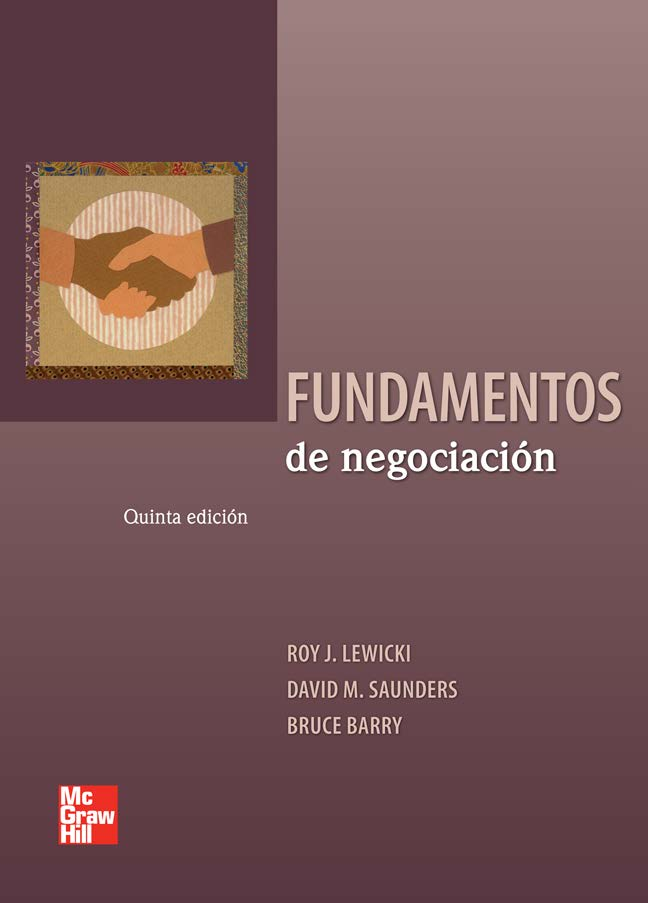

> **Descripción de la imagen** — La imagen es una ilustración insertada en el lado izquierdo del documento. Muestra una representación estilizada de dos manos estrechándose en un apretón de manos. Las manos están dibujadas con tonos cálidos de piel y la acción se encuentra contenida dentro de un círculo o anillo, sobre un fondo de color beige claro.

---

<!-- página 2 -->

Fundamentos
de negociación

---

<!-- página 3 -->

---

<!-- página 4 -->

MÉXICO • BOGOTÁ • BUENOS AIRES • CARACAS • GUATEMALA • MADRID • NUEVA YORK

SAN JUAN • SANTIAGO • SAO PAULO • AUCKLAND • LONDRES • MILÁN • MONTREAL

NUEVA DELHI • SAN FRANCISCO • SIDNEY • SINGAPUR • ST. LOUIS • TORONTO
## Fundamentos
## de negociación

Quinta edición
### Roy J. Lewicki
The Ohio State University
### David M. Saunders

Queen’s University
### Bruce Barry
Vanderbilt University

Revisión técnica

Sergio Garcilazo Lagunes
Director de Administración y Negocios Internacionales

Universidad Panamericana, Ciudad de México

Romeo Vite López
Facultad de Contaduría y Administración
Universidad Nacional Autónoma de México

---

<!-- página 5 -->

Director general México: Miguel Ángel Toledo Castellanos
Editor sponsor: Jesús Mares Chacón
Coordinadora editorial: Marcela I. Rocha Martínez
Editor de desarrollo: Edmundo Carlos Zúñiga Gutiérrez
Supervisor de producción: Zeferino García García

Traductores: Nora Natalia Martínez Suárez
Pilar Obón León

FUNDAMENTOS DE NEGOCIACIÓN
Quinta edición

Prohibida la reproducción total o parcial de esta obra,
por cualquier medio, sin la autorización escrita del editor.

DERECHOS RESERVADOS © 2012, 2008 respecto a la segunda edición en español por
McGRAW-HILL/INTERAMERICANA EDITORES, S.A. DE C.V.
A Subsidiary of The McGraw-Hill Companies, Inc.,

Prolongación Paseo de la Reforma 1015, Torre A,
Piso 17, Colonia Desarrollo Santa Fe,
Delegación Álvaro Obregón,
C.P. 01376, México, D.F.
Miembro de la Cámara Nacional de la Industria Editorial Mexicana, Reg. Núm. 736

ISBN: 978-607-15-0753-2

ISBN (edición anterior): 978-970-10-6631-7

Translated from the 5th edition of: Essentials of negotiation by Roy J. Lewicki, David M. Saunders
and Bruce Barry. Copyright © 2011, 2007, 2004,  2001 by The McGraw-Hilll Companies, Inc.
New York, N.Y., U.S.A. All rights reserved.

978-0-07-353036-9

1234567890
1345678902

Impreso en México
Printed in Mexico

> **Descripción de la imagen** — La imagen es predominantemente un fondo de color gris sólido. En la esquina inferior izquierda se observan algunos caracteres o símbolos aislados en un tono similar al gris, pero no forman parte de una estructura o contenido discernible.

---

<!-- página 6 -->

Dedicamos este libro a todos los profesionales de la negociación,
la mediación y la resolución de confl ictos que tratan de hacer que
el  mundo sea un lugar más próspero y pacífi co.

Y a John W. Minton (1946-2007), amigo, colega y coautor.
## Dedicatoria

---

<!-- página 7 -->

Roy J. Lewicki es profesor de Ética de Negocios en el Irving Abramowitz Memorial y
profesor de Administración y Recursos Humanos en el Max M. Fisher College of Business,
de la Ohio State University. Ha escrito o editado 32 libros, al igual que numerosos artícu-
los de investigación. El profesor Lewicki ha fungido como presidente de la International
Association of Confl ict Management, y recibió el premio David Bradford para maestros
destacados de la Organizational Behavior Teaching Society en 2005 por sus contribuciones
en el campo de la enseñanza sobre negociación y solución de diferencias.

David M. Saunders es decano en la Escuela de Administración de Empresas en la
Queen’s University, Canadá. Desde que ingresó a Queen’s en 2003, ha encabezado la inter-
nacionalización de la escuela, implementado dos programas únicos de MBA y una serie de
programas de maestrías ejecutivas, así como el fortalecimiento de la red internacional
de Queen’s al fomentar diversas asociaciones con importantes escuelas de negocios en Eu-
ropa, Asia y Sudamérica. Fuera de Queen’s, David es coautor de varios artículos sobre la
negociación, la solución de confl ictos, la expresión de los empleados y la justicia organiza-
cional. Es miembro del consejo de la China Europe International Business School (CEIBS)
y la Fundación Europea para el Desarrollo Gerencial, una asociación internacional de es-
cuelas de negocios.

Bruce Barry es profesor de Administración y Sociología en la Vanderbilt University.
Sus investigaciones sobre la negociación, la infl uencia, el poder y la justicia han aparecido
en numerosas publicaciones y volúmenes académicos. El profesor Barry fue presidente de
la International Association of Confl ict Management y miembro de la Academy of Mana-
gement Confl ict, en la división de Administración.
## Acerca de los autores

---

<!-- página 8 -->

Bienvenido a la quinta edición de Fundamentos de negociación. Nuevamente, este libro
constituye nuestra respuesta a muchos profesores  que deseaban una versión abreviada del
texto original, Negociación (sexta edición). El objetivo de esta versión es ofrecer al lector
los conceptos fundamentales de una negociación de una manera sucinta. Es un libro para
cursos académicos más cortos, programas ejecutivos o como compañero de otros recursos.
Es adecuado para cursos sobre negociación, relaciones laborales, administración de con-
fl ictos, administración de recursos humanos y temas afi nes.

Resumen del libro

La organización de este volumen sigue, de manera general, la de la sexta edición de Nego-
ciación, que es más completa. La diferencia fundamental entre este texto y el de la sexta
edición es que esta obra sólo contiene 12 capítulos, mientras que la quinta edición completa
tiene 20 capítulos. Los primeros cuatro capítulos han sido recortados en forma mínima
para este volumen, porque creemos que su contenido es esencial para cualquier curso de
negociación. (El proceso de recorte incluye editar algunas de las referencias y descripcio-
nes más orientadas hacia la investigación, borrar muchos de los recuadros y anotaciones
al margen y, ocasionalmente, algunas secciones secundarias.) En forma similar, el último
capítulo se reproduce completo. Los otros siete capítulos de Negociación están incluidos,
pero recortados entre 25 y 50% cada uno.

Es conveniente presentar un panorama general para el profesor que no esté familiariza-
do con los Fundamentos (las primeras cuatro ediciones) o con Negociación (edición sexta
o anteriores). Los primeros cuatro capítulos introducen al lector a los “fundamentos de la
negociación”. El primer capítulo presenta el campo de la negociación y la administración
de confl ictos, describe el problema básico de la interdependencia con otras personas y
explora de manera breve los retos de administrar esa interdependencia. Los capítulos 2 y
3 presentan los dos métodos estratégicos fundamentales de una negociación: la dinámica
básica de la negociación competitiva (ganar-perder), del capítulo 2, y la dinámica básica de
una negociación integradora (ganar-ganar), en el capítulo 3. El capítulo 4 describe el trabajo
previo fundamental que deben realizar los negociadores al prepararse para una negociación:
seleccionar la estrategia, delimitar los problemas, defi nir los objetivos de la negociación y
planifi car los pasos que aplicarán para alcanzar esos objetivos.

Los cuatro capítulos siguientes describen los subprocesos psicológicos fundamenta-
les de una negociación: la percepción, el entendimiento, la emoción, la comunicación, el
poder, la infl uencia y el juicio ético. En el capítulo 5 repasamos los procesos básicos de la
percepción, la cognición y la emoción en una negociación; específi camente examinamos
las propensiones cognoscitivas y de juicio comunes en los negociadores y la forma en que
las emociones afectan una negociación. En el capítulo 6 examinamos la dinámica de la
comunicación. Analizamos los modos en que los negociadores comunican sus intereses,
posiciones y metas, y cómo llega esta información a los demás. El capítulo 7 se concentra
en el poder. Revisamos las habilidades que emplean los negociadores para reunir poder con
el fi n de presionar a la otra parte, para que cambie su perspectiva o para que ceda a nuestros
argumentos. En el capítulo 8 examinamos los estándares y los criterios éticos que rodean
## Prefacio

---

<!-- página 9 -->

viii
Prefacio

una negociación. El negociador efi caz debe reconocer cuándo son relevantes las preguntas
éticas y qué factores deben considerarse para abordarlas de manera efi caz.

Los dos capítulos siguientes examinan los contextos sociales en los cuales ocurren
las negociaciones, los cuales, por tanto, también afectan el modo en que evolucionan. En
el capítulo 9 examinamos cómo cambia el proceso de una negociación cuando las partes
ya tienen establecida una relación entre sí, y la forma en que el tipo de relación afecta el
proceso de negociación. También revisamos los papeles importantes desempeñados por la
confi anza, la justicia y la reputación del negociador al momento de moldear las negociacio-
nes. En el capítulo 10 observamos las negociaciones con diversas partes, cuando muchas
personas deben colaborar como un grupo, un equipo o una fuerza de tarea para resolver un
problema complejo o tomar una decisión.

En el capítulo 11 intentamos aclarar el modo en que las diferencias internacionales y
transculturales moldean las diversas maneras en que las partes abordan las negociaciones.

Por último, en el capítulo 12 presentamos un nuevo capítulo fi nal, que resume el
contenido del libro y ofrece 10 principios con las “mejores prácticas” para todos los nego-
ciadores.

Comparación de esta obra con la cuarta
edición de Fundamentos

• Todo el libro ha sido revisado y actualizado. Los autores repasaron cada capítulo, uti-
lizando una intensiva realimentación de los profesores que han utilizado el libro en sus
ediciones previas. Se ha reorganizado el contenido de algunos capítulos para presentar
el material en forma más efectiva.
• Hemos mejorado aún más el formato de las gráfi cas y el diseño de las páginas para
hacer que el libro sea visualmente más interesante y fácil de leer.
• Agregamos objetivos de aprendizaje al inicio de cada capítulo.
• La nueva estructura de esta obra puede compararse con una revisión mayor de nuestro li-
bro y las  actividades en clase, Negotiation: Readings, Exercises and Cases, sexta edición,
publicado por Roy Lewicki, Bruce Barry y David Saunders en 2010. Estos textos pueden
ser utilizados juntos o de manera separada.
• La presente obra cuenta con un amplio paquete de materiales de apoyo didáctico para el
profesor. Para conocer los términos y condiciones de acceso a dicho material, favor de
contactar a su representante local de McGraw-Hill.

Panorama de los capítulos de este libro

El libro está organizado en 12 capítulos. Los primeros cuatro abordan los fundamentos
de una negociación. Además de este primer capítulo de generalidades, los capítulos 2 y 3
exploran la estrategia y las prácticas básicas de la negociación distributiva y la negociación
integradora. El capítulo 4 explora la forma en que las partes planifi can y preparan una
estrategia de negociación y prevén de manera efi caz su encuentro con el otro negociador.

Los cuatro capítulos siguientes exploran los procesos secundarios fundamentales de
una negociación. En el capítulo 5 analizamos la manera en que las percepciones, las cogni-
ciones y las emociones de un negociador tienden a moldear (y a menudo, sesgar) el modo
en que el negociador contempla e interpreta una interacción de concesión. El capítulo 6

---

<!-- página 10 -->

ix
Prefacio

examina los procesos mediante los cuales los negociadores comunican con efi cacia sus in-
tereses, posiciones y metas, y comprenden las comunicaciones de la otra parte. El capítulo
7 se concentra en el poder en una negociación; comienza por defi nir la naturaleza del poder
y analiza algunas de las dinámicas de su uso en una negociación, seguidas por una explo-
ración de las fuentes principales de poder disponibles para casi todos los negociadores. Por
último, en el capítulo 8 analizamos si existen, o deben existir, estándares éticos aceptados
para guiar una negociación. Identifi camos las dimensiones éticas principales planteadas en
una negociación, describimos la manera en que los negociadores tienden a considerar estas
opciones y ofrecemos una estructura para tomar decisiones éticas informadas.

Hasta el momento, gran parte de nuestro análisis supone que las partes negociadoras no
tienen establecida una relación a largo plazo. El capítulo 9 observa el modo en que las rela-
ciones establecidas afectan las negociaciones actuales y considera tres intereses principales
—la reputación, la confi anza y la justicia— que son muy importantes para las negociaciones
efi caces dentro de una relación. En el capítulo 10 examinamos cómo cambian las negocia-
ciones cuando hay muchas partes en la mesa —al negociar con grupos y equipos— que
intentan lograr un acuerdo colectivo o consenso grupal. En el capítulo 11 analizamos cómo
los diferentes idiomas y culturas cambian las “reglas básicas” de una negociación. Este ca-
pítulo examina algunos de los factores que hacen diferente una negociación internacional,
y cómo la cultura de un país afecta el ritmo y el fl ujo de una negociación.

Por último, en el capítulo 12 presentamos una negociación en un nivel amplio. Hace-
mos una retrospectiva de la perspectiva amplia que hemos propuesto y sugerimos 10 prácti-
cas comprobadas para quienes desean continuar mejorando sus habilidades de negociación.

Agradecimientos

Una vez más, este libro no hubiera sido posible sin el apoyo de otras personas. De manera
específi ca, queremos agradecer a:

• Muchos de nuestros colegas en el campo de la negociación y la solución de diferencias,
cuyos esfuerzos de investigación han hecho posible el crecimiento de este campo, y que
nos han proporcionado una muy útil retroalimentación con respecto a ediciones anterio-
res, para mejorar el contenido de esta edición.
• Las siguientes personas, quienes revisaron el texto y ofrecieron sus útiles opiniones: Nan
Stager, Indiana University; Leigh Anne Liu, Georgia State University; J. Keaton Grubbs,
Stephen F., Austin State University; Edward Wertheim, Northeastern University; Holly
Schroth, University of California-Berkeley; Patrizia Porrini, Long Island University, y
Monika Renard, Florida Gulf Coast University.
• El trabajo de John Minton, quien ayudó a darle forma a la segunda, tercera y cuarta
ediciones de este libro, y falleció en otoño de 2007.
• La excelente asistencia editorial de Steve Stenner, específi camente por su ayuda en la
revisión y corrección del texto, obtener permisos y bibliografía, y en refi nar el banco
de exámenes y las presentaciones en PowerPoint.
• El equipo de McGraw-Hill/Irwin, en especial a nuestra editora actual, Laura Spell, y
a nuestros editores previos Ryan Blankenship, John Weimeister, John Biernat, Kurt
Strand y Karen Johnson; Jane Beck, Allison Cleland y Trina Hauger, asistentes editoria-
les, quienes pueden resolver casi cualquier problema, y Robin Reed, nuestro incansable

---

<!-- página 11 -->

x
Prefacio

gerente de proyecto, que convirtió nuestras confusas instrucciones y aburrida prosa en
volúmenes eminentemente amenos de leer y fáciles de utilizar.
• Nuestras familias, quienes nos siguen dando el tiempo, la inspiración y las oportunida-
des de aprender continuamente sobre la forma efectiva de negociar y el apoyo personal
que requerimos para culminar este proyecto.

Roy J. Lewicki
David M. Saunders
Bruce Barry

---

<!-- página 12 -->

Acerca de los autores  vii
Prefacio  viii

1.  La naturaleza de una negociación  1

2.  Estrategia y tácticas de una negociación distributiva  29

3.  Estrategia y tácticas de una negociación integradora  66

4.  Negociación. Estrategia y planificación  96

5.  Percepción. Conocimiento y emoción  120

6.  Comunicación  147

7.  Obtención y utilización del poder de negociación  163

8.  La ética en la negociación  184

9.  Las relaciones en una negociación  209

10.  Múltiples partes y equipos  229

11.  Negociaciones internacionales y transculturales  250

12.  Las mejores prácticas en las negociaciones  273

Bibliografía  283

Índices  302
## Contenido breve

---

<!-- página 13 -->

Acerca de los autores  vii
Prefacio  viii

Capítulo 1
### La naturaleza de una negociación  1

Algunas palabras sobre nuestro
estilo y método  3

Joe y Sue Carter  4

Características de una situación
de negociación  6

Interdependencia  9

Los tipos de interdependencia afectan
los resultados  12

Las opciones moldean la interdependencia  12

Ajuste mutuo  13

Ajuste mutuo y concesiones  14

Dos dilemas del ajuste mutuo  15

Declarar un valor y crear un valor  16

Conflictos  19

Definiciones  19

Niveles de conflicto  20

Funciones y disfunciones de un conflicto  20

Factores que facilitan o dificultan
la administración de conflictos  22

Administración eficaz de un conflicto  24

Panorama de los capítulos de este libro  26

Capítulo 2
### Estrategia y tácticas de una
### negociación distributiva  29

La situación de la negociación distributiva  31

Función de las opciones para un acuerdo
negociado  33

El punto de acuerdo   34

La mezcla de la negociación  35

Estrategias fundamentales  36

Cómo descubrir el punto de resistencia
de la otra parte  36

Cómo influir en el punto de resistencia
de la otra parte  37

Tácticas  38

Valorar el objetivo, el punto de resistencia y los
costos de terminar las negociaciones para la otra
parte  38

Manejo de las impresiones de la otra parte  40

Modificación de las percepciones de la otra
parte  42

Manipulación de los costos reales de retrasos
o de la conclusión  42

Posiciones adoptadas durante la
negociación  44

Ofertas iniciales  45

La postura inicial   45

Concesiones iniciales  46

El papel de las concesiones  47

Esquema de otorgamiento de concesiones  48

Ofertas finales  50

Compromiso  50

Consideraciones tácticas al utilizar los
compromisos  51

Establecer un compromiso  51

Evitar que la otra parte se comprometa
prematuramente  53

Encontrar formas de abandonar una posiciòn
comprometida  54

Cerrar el acuerdo  55

Tácticas de presión  56

Cómo enfrentar las tácticas de presión comunes 57

Tácticas de presión comunes  58

Resumen del capítulo  65

Capítulo 3
### Estrategia y tácticas de una
### negociación integradora  66

Introducción  66

¿En qué es diferente una negociación
integradora?  67
## Contenido

---

<!-- página 14 -->
### xiii
Contenido

Panorama del proceso de negociación
integradora  67

Creación de un flujo libre de información  68

Comprender las necesidades y objetivos
reales del otro negociador  68

Destacar las afinidades entre las partes
y reducir las diferencias  69

Búsqueda de soluciones que cubran las
necesidades y los objetivos de ambos lados  70

Pasos importantes en el proceso de una
negociación integradora  70

Identificación y definición del problema  72

Comprensión del problema completo.
Identificación de intereses y necesidades  74

Generación de soluciones alternas  77

Resumen de la sección  84

Evaluar y seleccionar opciones  84

Factores que facilitan una negociación
integradora fructífera  88

Un objetivo o una meta comunes  89

Fe en la capacidad propia para resolver
un problema  89

Confianza en la validez de la posición propia
y la perspectiva de los demás  90

Motivación y compromiso para trabajar
en equipo  90

Confianza  91

Comunicación clara y precisa  92

Comprensión de la dinámica de la negociación
integradora  93

Resumen de la sección  94

Resumen del capítulo  94

Capítulo 4
### Negociación. Estrategia
### y planifi cación  96

Metas. El enfoque que impulsa una estrategia
de negociación  96

Efectos directos de las metas en la elección
de una estrategia  97

Efectos indirectos de las metas en la elección
de una estrategia   98

Estrategia. Plan general para alcanzar las metas
propias  98

Comparación entre estrategia y tácticas  98

Comparación de los métodos unilateral
y bilateral de una estrategia  99

Modelo de intereses dobles como vehículo
para describir estrategias de negociación  99

Comprensión del flujo de las negociaciones.
Etapas y fases   103

Preparación para instrumentar la estrategia.
Proceso de planificación  105

1. Definición de los problemas   105

2. Recopilación de los problemas y definición
de la mezcla de la negociación   107

3. Definición de los intereses  108

4. Determinación de límites  109

5. Conocer las opciones  109

6. Establecer objetivos y preguntar precios  109

7. Valoración de los poderdantes y el contexto
social de la negociación  111

8. Análisis de la otra parte  113

9. Presentación de los problemas a la otra parte  117

10. ¿Qué protocolo debe seguirse en la
negociación?  117

Resumen del capítulo  119

Capítulo 5
### Percepción. Conocimiento
### y emoción  120

Percepción  121

Definición de percepción  121

Distorsión de la percepción  121

Delimitación  123

Tipos de delimitaciones  125

Cómo funcionan las delimitaciones en
la negociación  126

Otro enfoque de las delimitaciones. Intereses,
razón y poder  127

---

<!-- página 15 -->
### xiv
Contenido

La delimitación de un problema cambia
conforme evoluciona una negociación  130

Resumen de la sección  132

Prejuicios cognoscitivos en una negociación  132

1. Intensificación irracional del
compromiso  133

2. Ideas míticas de la participación fija  133

3. Punto de afianzamiento y ajuste  134

4. Delimitación de un problema y riesgo  134

5. Disponibilidad de información  135

6. La maldición del ganador  135

7. Exceso de confianza  136

8. Ley de los números pequeños  136

9. Prejuicios que se alimentan a sí mismos  137

10. Efecto de adjudicación  138

11. Ignorar los conocimientos ajenos  138

12. Devaluación reactiva  139

Administración de las percepciones erróneas
y los prejuicios cognoscitivos en la
negociación  139

Humor, emoción y negociación  140

Resumen del capítulo  146

Capítulo 6
### Comunicación  147

¿Qué se comunica durante la negociación?  147

1. Ofertas, contraofertas y motivos  148

2. Información de las opciones  148

3. Información de los resultados  149

4. Razones sociales  149

5. Comunicación acerca de los procesos  149

¿Los negociadores son consistentes o
adaptativos?  150

¿Importa lo que se dice al principio de
la negociación?  150

¿Siempre es mejor tener más información?  151

Cómo se comunican las personas en una
negociación  151

Características del lenguaje  151

Comunicación no verbal  153

Elección de un canal de comunicación  154

Cómo mejorar la comunicación en una
negociación  156

Formular preguntas  157

Escuchar  158

Invertir funciones  161

Consideraciones especiales de comunicación
en la conclusión de las negociaciones  161

Prevenir errores fatales  161

Lograr una conclusión  162

Resumen del capítulo  162

Capítulo 7
### Obtención y utilización del poder
### de negociación  163

¿Por qué es importante el poder para los
negociadores?  163

Una definición de poder  164

Intereses, razón y poder en una
negociación  165

Fuentes de poder. Cómo se adquiere  167

Fuentes de poder a partir de la información  169

Poder basado en la personalidad
y las diferencias individuales 170

Poder basado en la posición en una
organización  172

Poder basado en relaciones  175

Fuentes contextuales de poder  180

Tratar con quienes tienen más poder  181

Resumen del capítulo  182

Capítulo 8
### La ética en la negociación  184

Muestra de dilemas éticos  184

¿Qué entendemos por “ética” y por qué
es importante en una negociación?  186

Definición de ética  186

Aplicación del razonamiento ético en
una negociación  187

---

<!-- página 16 -->
### xv
Contenido

Comparación entre ética, prudencia,
lo práctico y la legalidad  187

¿Qué preguntas de la conducta ética
surgen en una negociación?  190

Tácticas éticamente ambiguas: todo (o casi)
se centra en decir la verdad  191

Identificación de las tácticas y actitudes
éticamente ambiguas en función
de su uso  194

Engaño por omisión comparado con
mentir  196

Decisión de emplear tácticas éticamente
ambiguas. Un modelo  196

¿Por qué emplear tácticas engañosas?
Motivos y consecuencias  198

El motivo del poder  198

Otros motivos para una conducta poco
ética  198

Consecuencias de una conducta poco ética  199

Explicaciones y justificaciones  201

¿Cómo enfrentan los negociadores que
las otras partes recurran al engaño?  203

Resumen del capítulo  208

Capítulo 9
### Las relaciones en una
### negociación  209

Conveniencia de la teoría establecida
y la investigación para comprender
una negociación dentro de las relaciones  210

Negociaciones en relaciones con una
comunidad  213

Elementos importantes al administrar
las negociaciones dentro de las
relaciones  216

La reputación  217

Confianza  218

Justicia  222

El acuerdo idiosincrásico.
Flexibilidad o justicia  225

Relaciones entre reputación, confianza
y justicia  226

Reparación de una relación  226

Resumen del capítulo  228

Capítulo 10
### Múltiples partes y equipos  229

Naturaleza de las negociaciones con varias
partes  229

Diferencias entre negociaciones con
dos partes y con varias partes  230

Resumen  235

¿Qué es un grupo eficaz?  235

Manejo de negociaciones con varias partes  237

La etapa previa a la negociación  237

Etapa de la negociación formal. Administración
del proceso y resultado del grupo  240

La fase del acuerdo  247

Resumen del capítulo  249

Capítulo 11
### Negociaciones internacionales
### y transculturales  250

Negociación internacional. Arte y ciencia  251

¿Qué hace que una negociación internacional
sea diferente?  252

Contexto ambiental  252

Contexto inmediato  255

Resumen de la sección  257

Conceptualización de la cultura
y la negociación  257

La cultura como conducta aprendida  258

La cultura como valores compartidos  258

Resumen de la sección  262

La cultura como dialéctica  262

La cultura en contexto  263

Influencia de la cultura en una negociación.
Perspectivas administrativas  264

Definición de negociación  264

---

<!-- página 17 -->
### xvi
Contenido

Oportunidad de una negociación  264

Elección de los negociadores  264

Protocolo  264

Comunicación  265

Sensibilidad al tiempo  265

Propensión al riesgo  266

Grupos o personas  266

Naturaleza de los acuerdos  267

Emociones  267

Estrategias de negociación que generan
respuestas culturales  267

Familiaridad baja  270

Familiaridad moderada  270

Familiaridad alta  271

Resumen del capítulo  272

Capítulo 12
### Las mejores prácticas en las
### negociaciones  273

1.  Prepárese  274

2.  Diagnostique la estructura fundamental
de la negociación  274

3.  Identifique y aplique la MAPAN  275

4.  Esté dispuesto a retirarse  276

5.  Domine las paradojas importantes
de una negociación  276

Declarar valor o crear valor  276

Apegarse a sus principios o resistirse al flujo
de los acontecimientos  277

Apegarse a la estrategia o buscar
nuevas opciones en todo momento  277

Honesto y abierto o cerrado y opaco  278

Confianza o desconfianza  278

6.  Recuerde lo intangible  278

7.  Maneje activamente las coaliciones  280

8.  Aprecie y proteja su reputación  280

9.  Recuerde que la racionalidad y la justicia
son relativas  281

10.  Siga aprendiendo de sus experiencias  282

Bibliografía  283

Índice onomástico  302

Índice analítico  307

---

<!-- página 18 -->
## CAPÍTULO
## La naturaleza de
## una negociación
## 1
### Objetivos

1.
Entender la defi nición de negociación, los elementos clave de este proceso y los dis-
tintos tipos de negociación.
2.
Explorar la forma en que negocian los individuos para manejar situaciones de interde-
pendencia; es decir, dependen uno del otro para lograr sus metas.
3.
Razonar cómo encaja la negociación en la perspectiva más amplia de los procesos de
manejo de confl ictos.
4.
Apreciar el panorama general de la organización de este libro y del contenido de sus
capítulos.

“¡Basta! ¡Estoy harto! ¡El auto no arranca!”, gritó Chang Yang mientras golpeaba el volan-
te y azotaba la puerta de su sedán Toysun de 10 años de antigüedad. El vehículo ya no que-
ría encender y Chang iba a llegar tarde a la escuela (de nuevo). A Chang no le iba bien en
la clase de administración y no podía permitirse perder más clases. Reconoció por fi n que
era un buen momento de hacer algo con su coche, que había presentado muchos problemas
mecánicos en los últimos tres meses y que lo cambiaría por otro usado que le durara hasta
terminar sus estudios. Después de las clases del día se dirigió a una zona comercial donde
había varios negocios de reparación y venta de automóviles usados. Sabía muy poco sobre
vehículos, pero no quería saber más; sólo necesitaba un transporte confi able que le sirviera
durante los 18 meses siguientes.

Una importante aerolínea internacional está próxima a la bancarrota. El terrorismo,
las tarifas reducidas de varias aerolíneas nuevas y el aumento del costo del combustible
representaban una enorme presión económica. Para evitar la quiebra, la empresa preten-
de reducir 800 millones de dólares en sueldos y prestaciones a los pilotos del sindicato, el tercer
recorte en dos años. Como la propuesta fue rechazada por el negociador del sindicato de pi-
lotos, la empresa busca ir directamente a negociar con los funcionarios de la asociación de
pilotos —el sindicato internacional— para analizar los recortes. Si los pilotos no aceptan las
concesiones es muy probable que los demás sindicatos (de asistentes de vuelo, mecánicos
y demás) hagan lo mismo y la quiebra sea inevitable.

Janet y Jocelyn son compañeras de habitación. Comparten un departamento en la ciu-
dad donde ambas trabajan. Janet, contadora, tiene un buen empleo en una empresa grande,

---

<!-- página 19 -->

Capítulo 1 La naturaleza de una negociación
2

pero decidió regresar a la escuela para completar su licenciatura. Se inscribió en un progra-
ma nocturno en la Big City University y ya asiste a clases. Jocelyn trabaja para una empresa
de publicidad que crece con rapidez. Su trabajo no sólo requiere que viaje constantemente,
sino también que dedique mucho tiempo a socializar con los clientes. El problema es que
cuando Janet no acude a clases necesita el departamento para leer y estudiar, y tranquilidad
para hacerlo; sin embargo, cuando Jocelyn está en el departamento habla por teléfono, in-
vita a sus amigos a cenar, se alista para salir de noche o regresa muy tarde (y hace mucho
ruido). Janet cree que ya soportó demasiado y está a punto de enfrentar a Jocelyn.

Miles de manifestantes que se oponen a las políticas de un gobierno pretenden impedir
una convención política nacional donde se nominará a un líder en busca de la reelección. La
policía de la ciudad prohíbe a los manifestantes que se acerquen al lugar de la convención
y autoriza una protesta bajo una autopista urbana en mal estado, a menos de un kilómetro
de distancia de la convención. En respuesta, los organizadores de la manifestación piden
permiso para celebrar un mitin en uno de los principales parques de la ciudad, pero las
autoridades intentan prohibir la manifestación porque gastaron bastante en una reciente
remodelación del parque y temen que los manifestantes lo arruinen. Cada bando intenta
negociar, pero también realiza complejas maniobras legales para poner la ley a su favor.

Este año, Ashley Johnson está entre las 25 mejores graduadas de una prestigiada uni-
versidad de negocios. Obtuvo una segunda entrevista en una importante empresa de artícu-
los de consumo, la cual la invitó a sus ofi cinas centrales y le reservó habitación en un hotel
de cuatro estrellas de renombre mundial por la calidad de sus instalaciones y servicios.
Después de registrarse tarde debido a un retraso en su vuelo, se despierta a las 7:30 a.m. y se
prepara para un desayuno de negocios a las 8:00 con el principal reclutador de la compañía.
Entra en la ducha, gira la llave del agua y se queda con la perilla en la mano. No hay nada
de agua; parece como si hubieran desconectado el suministro en algún lugar para hacer una
reparación y no hubieran concluido el trabajo. Ashley se aterra ante la idea de cómo enfren-
tar este problema y verse bien para la reunión, que comienza en 30 minutos.

¿Le parecen conocidos estos incidentes? Todos son ejemplos de una negociación: nego-
ciaciones que están a punto de ocurrir, que están en proceso o que han ocurrido y generado
consecuencias para el presente. Todos son ejemplos de los problemas, incidentes y dinámicas
que abordaremos a lo largo de este libro.

Las personas negocian todo el tiempo. Los amigos negocian para decidir dónde comer.
Los niños negocian para decidir qué programa de televisión van a ver. Las empresas nego-
cian para adquirir materiales y vender sus productos. Los abogados negocian para alcanzar
acuerdos antes de interponer una demanda. La policía negocia con terroristas para liberar
rehenes. Los países negocian para abrir sus fronteras al libre comercio. Una negociación no
es un proceso reservado para diplomáticos talentosos, vendedores destacados o fervientes
defensores de una causa organizada; es algo que todos hacemos, casi a diario. Si bien lo que
está en juego no es tan trascendente como los acuerdos de paz o las grandes fusiones cor-
porativas, todos negocian; a veces se negocian cosas importantes, como un empleo nuevo,
y otras veces, cosas menos importantes, como quien lava los platos.

Las negociaciones ocurren por varias razones: 1) para acordar cómo compartir o dividir
un recurso limitado, como un terreno, una propiedad o tiempo, 2) para crear algo nuevo
que ninguna parte puede hacer por sí sola o 3) para resolver un problema o disputa entre las
partes. A veces las personas no negocian porque no reconocen que están en una situación
de negociación. Al elegir opciones diferentes de una negociación, no consiguen alcanzar

---

<!-- página 20 -->

3
Algunas palabras sobre nuestro estilo y método

sus metas, obtener lo que necesitan ni controlar sus problemas con la funcionalidad que
preferirían. Algunas personas reconocen la necesidad de una negociación, pero la realizan de
manera defi ciente porque comprenden el proceso de manera errónea y no poseen habilidades
de negociación. Después de leer este libro, confi amos en que estará minuciosamente pre-
parado para reconocer las situaciones de negociación; que sabrá cómo planifi car, ejecutar y
culminar negociaciones exitosas y, lo más importante, que podrá maximizar sus resultados.

Algunas palabras sobre nuestro estilo y método

Antes de analizar el complejo proceso social conocido como negociación, necesitamos men-
cionar varias cosas acerca de cómo abordaremos este tema. Primero describiremos breve-
mente la negociación como “forma de toma de decisiones en la que dos o más partes hablan
entre sí en un esfuerzo por resolver sus intereses contrarios”.1 Además, seremos cuidadosos
con la terminología. Para casi todas las personas, concertación* y negociación signifi can
lo mismo; sin embargo, emplearemos estas dos palabras en situaciones diferentes. Con el
término concertación describiremos las situaciones competitivas donde uno gana y otro
pierde, como las discusiones por los precios que ocurren en un almacén, un mercado al
aire libre o un lote de automóviles usados; y con el término negociación nos referiremos
a situaciones donde ambas partes ganan, como cuando las partes intentan encontrar una
solución aceptable para ambas en un confl icto complejo.

En segundo lugar, muchas personas suponen que el “núcleo de la negociación” es el
proceso de dar y recibir para alcanzar un acuerdo. Si bien ese proceso es muy importante,
una negociación es un proceso social muy complejo; muchos factores importantes que mol-
dean el resultado de una negociación no ocurren durante ella, sino antes de que las partes
comiencen a negociar; o moldean el contexto que rodea la negociación. En los primeros
capítulos examinaremos por qué se negocia, la naturaleza de una negociación como recurso
para administrar confl ictos, y los procesos principales de dar y recibir mediante los cuales
se intenta alcanzar un acuerdo. En los capítulos fi nales examinamos algunas de las muchas
maneras en que las diferencias en los problemas sustantivos, las personas involucradas, los
procesos que siguen y el contexto en que ocurre una negociación enriquecen la complejidad
de la dinámica de una negociación. Daremos un panorama más completo del libro al fi nal de
este capítulo.

En tercer lugar, nuestras ideas acerca de la negociación provienen de tres fuentes. La
primera es nuestra experiencia como negociadores y la gran cantidad de negociaciones que
ocurren todos los días en nuestra vida y en la de las personas de todo el mundo. La segunda
fuente son los medios —televisión, radio, periódicos y revistas e internet— que comunican
sobre las negociaciones que ocurren a diario. Elegiremos citas y ejemplos de los medios para
resaltar los puntos, ideas y aplicaciones importantes en todo el libro. La tercera fuente es
la cuantiosa investigación en las ciencias sociales sobre numerosos aspectos de una nego-
ciación. Esta investigación se ha realizado durante más de 50 años en economía, psicología,
ciencias políticas, comunicaciones, relaciones laborales, derecho, sociología y antropolo-
gía. Cada disciplina aborda una negociación de manera distinta. Igual que la parábola del

1  Pruitt, 1981, p. ix.
*  Nota del revisor técnico: La palabra concertación es equivalente a regateo.

---

<!-- página 21 -->

Capítulo 1 La naturaleza de una negociación
4

ciego que intenta describir un elefante al tocar y sentir diferentes partes del animal, cada
disciplina de las ciencias sociales tiene su propia teoría y método para estudiar los elementos
de una negociación, y cada una tiende a destacar algunas partes e ignorar otras. Por tanto,
los mismos sucesos y resultados de una negociación pueden examinarse al mismo tiempo
desde varias perspectivas.2 Considerada por sí sola, cada perspectiva es limitada, pero al
combinarlas comenzamos a entender la rica y compleja dinámica de este animal sorpren-
dente. En nuestro enfoque acerca de una negociación incluimos una parte de todas estas
tradiciones de investigación. Cuando reconocemos a los autores de una teoría o un conjunto
de hallazgos importantes utilizamos el proceso convencional de las ciencias sociales de citar
las obras por autor y fecha de publicación; hay referencias completas en la bibliografía al
fi nal de este libro. Cuando citamos múltiples fuentes o tenemos comentarios anecdóticos
al margen, dicha información aparece en una nota fi nal al terminar cada capítulo.

Comenzamos este capítulo con varios ejemplos de negociaciones: futuras, presentes y
pasadas. Para mejorar la comprensión del lector acerca de los fundamentos de una negocia-
ción, elaboraremos sobre el relato de un matrimonio —Joe y Sue Carter— y un día normal
en su vida. En este día enfrentan los desafíos de muchas negociaciones importantes y no
tan importantes. Después, con esa historia resaltaremos tres temas importantes:

1.  Defi nición de negociación y características básicas de las situaciones de negociación.
2.  Comprensión de la interdependencia, relación entre personas y grupos que suele ori-
ginar la necesidad de negociar.
3.  Defi nición y exploración de la dinámica de un confl icto y los procesos de administra-
ción de confl ictos, los cuales funcionan como trasfondo para las diferentes maneras de
abordar y administrar negociaciones.

Joe y Sue Carter

Se levantaron temprano, como de costumbre. Durante el desayuno, Sue preguntó a dónde
irían ella y su esposo, Joe, en sus vacaciones de verano. Quería reservar un viaje al Leja-
no Oriente patrocinado por la asociación de ex alumnos de su universidad. Sin embargo,
dos semanas de un viaje con un guía y muchas otras personas que apenas conocía no era
lo que Joe tenía en mente. Él necesitaba alejarse de la gente, las multitudes y el reloj, y
quería rentar un velero y navegar por la costa de Nueva Inglaterra. Los Carter no habían
hablado (todavía), pero era evidente que tenían un problema real. Algunos de sus ami-
gos resolvían un problema semejante con sólo tomar vacaciones separadas. No obstante,
como ambos tenían un trabajo de tiempo completo, Joe y Sue acordaron salir de vacacio-
nes juntos.

Además, no sabían si los acompañarían sus hijos adolescentes, Tracy y Ted. Tracy
quería ir a un campamento de gimnasia, y Ted quería quedarse en casa y trabajar con los
vecinos para hacer ejercicio, entrenar con el equipo de futbol y comprar una motocicleta
con sus ganancias. Joe y Sue no podían pagar un campamento de verano y unas vacaciones
prolongadas, mucho menos resolver el problema de quién cuidaría a los chicos mientras
ellos no estaban.

2 Por ejemplo, Hochberg y Kressel, 1996; Oliver, Balakrishnan y Barry, 1994; Olekalns, Smith y Walsh, 1996;
Weiss, 1997.

---

<!-- página 22 -->

Joe y Sue Carter
5

Cuando conducía en dirección a su trabajo, Joe pensó en el problema de las vacaciones.
Lo que más le molestaba era que no alcanzaba a ver un modo de resolver el confl icto de
manera productiva. En algunos confl ictos familiares todos podían convenir algo, pero en
lo que cada uno quería esta vez no vislumbraba una avenencia sencilla. En otras ocasiones
decidían algo con sólo lanzar al aire una moneda o asignar turnos; eso funcionaba para
elegir un restaurante (Joe y Ted preferían la carne, y Sue y Tracy, comida china), pero no
parecía recomendable en este caso por la cantidad de dinero requerida y porque el tiempo de
vacaciones era importante para ellos. Además, lanzar al aire una moneda podría hacer que
alguien se sintiera desalentado, comenzara una discusión y, al fi nal, nadie quedara satisfecho.

Al cruzar el estacionamiento, Joe encontró a Ed Laine, gerente de compras de la empre-
sa. Joe era jefe del grupo de diseño de ingeniería de MicroWatt, fabricante de motores eléc-
tricos pequeños. Ed recordó que tenía que resolver un problema producto de los ingenieros
del departamento de Joe: los ingenieros se comunicaban con los vendedores directamente
en vez de hacerlo por conducto del departamento de compras de MicroWatt. Joe sabía que
el departamento de compras quería que todas las comunicaciones con un vendedor pasaran
por su área, pero también tenía conocimiento de que sus ingenieros necesitaban mucha
información técnica para el diseño, y esperar que la información pasara por el departamen-
to de compras hacía lentas las actividades. Ed Laine conocía la opinión de Joe acerca de
este problema, y Joe pensaba que era probable que encontraran un modo de resolverlo si
se sentaban a analizarlo. Joe y Ed sabían que la administración esperaba que los gerentes
arreglaran sus diferencias; si este problema “subía de nivel” y llegaba a la administración
central, ambos causarían una mala impresión.

Poco después de llegar a su ofi cina, Joe recibió una llamada de un vendedor de auto-
móviles con quien había hablado acerca de un vehículo nuevo. El vendedor le preguntó si
Sue prefería una prueba de manejo. Joe no estaba seguro de que Sue estuviera de acuerdo
con lo que había elegido, un lujoso deportivo importado, y creía que ella diría que era muy
costoso y que gastaba mucho combustible. A Joe le agradaba el precio más reciente que
había ofrecido el vendedor, pero pensaba que todavía podría obtener algunas concesiones,
de modo que mencionó el posible rechazo de Sue hacia la compra para que el vendedor
redujera el precio y obtener así una oferta “irresistible”.

En cuanto Joe colgó el teléfono, volvió a sonar. Era Sue, para desahogar su frustración
por algunos procedimientos del banco donde trabajaba como funcionaria de préstamos.
Sue se sentía frustrada por trabajar en un banco antiguo “dirigido por una familia”, poco
automatizado, muy burocrático y lento para responder a las necesidades de los clientes.
Sus competidores aprobaban ciertos préstamos en tres horas, mientras que el banco de Sue
tardaba una semana. Sue no había concretado dos préstamos grandes debido a la lentitud
y los procedimientos burocráticos del banco, y esto ocurría con regularidad. Pero cada vez
que intentaba analizar la situación con la administración principal, encontraba resistencia y
un discurso acerca de la importancia de los “valores tradicionales” del banco.

Joe dedicó casi toda la tarde a la reunión de planifi cación del presupuesto anual de
MicroWatt. Odiaba estas reuniones. El personal del departamento de fi nanzas llegaba y
recortaba arbitrariamente 30% todas las cifras, y luego todos los gerentes tenían que dis-
cutir interminablemente para recuperar una parte del dinero de sus proyectos. Joe había
aprendido a colaborar con muchas personas, algunas de las cuales no le agradaban, pero
los de fi nanzas eran los examinadores de cifras más arrogantes y arbitrarios que conocía.
No comprendía por qué los jefes no veían cuánto dañaban estas personas los esfuerzos de

---

<!-- página 23 -->

Capítulo 1 La naturaleza de una negociación
6

investigación y desarrollo del grupo de ingeniería. Joe se consideraba razonable, pero la
manera de actuar de estas personas lo hacía sentir como si tuviera que cambiar sus límites
y disponerse a argumentar durante horas.

Por la noche, Joe y Sue asistieron a una reunión de la Comisión de Conservación
de su ciudad, la cual, entre otras cosas, se encargaba de proteger los afl uentes, marismas
y reservas naturales de la ciudad. Sue era integrante de la Comisión de Conservación, y
ambos creían sinceramente en la sana protección y administración del ambiente. Esa no-
che hablaron de la solicitud de una empresa de desarrollo de bienes raíces para drenar un
área pantanosa y desviar un pequeño arroyo para construir una nueva plaza comercial en
la región. Todas las proyecciones mostraban que el nuevo centro comercial generaría em-
pleos e ingresos en el área y aumentaría mucho la plusvalía de la ciudad. La nueva plaza
comercial mantendría más negocios en la comunidad y evitaría que las personas tuvieran
que conducir 25 kilómetros hasta el centro comercial existente, pero a los opositores —una
coalición de conservacionistas y empresarios del lugar— les preocupaba que afectara de
manera signifi cativa el distrito de negocios del centro y dañara las marismas naturales y
su fauna silvestre. El debate duró tres horas y la comisión acordó continuar la audiencia
la semana siguiente.

Cuando Joe y Sue regresaban a casa después de la reunión hablaron de lo ocurrido
durante el día. Cada uno refl ejaba de manera específi ca que la vida es extraña; a veces las
cosas funcionan sin contratiempos y otras veces se complican demasiado. Cuando se fueron
a dormir, cada uno pensó cómo podía haber abordado ciertas situaciones de manera distinta
durante el día, y se sintieron satisfechos de que en su relación pudieran hablar sin ataduras.
Pero todavía no sabían qué iban a hacer con sus vacaciones...

Características de una situación de negociación

La historia de Joe y Sue Carter resalta las diversas situaciones que se manejan mediante
una negociación. Cualquiera de nosotros puede encontrar una o más de estas situaciones
en el transcurso de días o semanas. Como ya indicamos, la negociación es un proceso
mediante el cual dos o más partes intentan resolver sus intereses contrarios. Así, y como
señalaremos más adelante en este capítulo, la negociación es uno de los diversos meca-
nismos a través de los cuales las personas pueden resolver confl ictos. Las situaciones de
negociación tienen fundamentalmente las mismas características, ya sean negociaciones
de paz entre países en guerra, negociaciones entre un comprador y un vendedor o entre los
trabajadores y la administración, o una huésped molesta que intenta bañarse antes de una
entrevista importante. Quienes han escrito mucho acerca de las negociaciones afi rman que
hay varias características comunes en todas las situaciones.3

1.  Hay dos o más partes, es decir, dos o más personas, grupos u organizaciones. Aunque
las personas pueden “negociar” consigo mismas —como cuando alguien analiza si
debe dedicar la tarde del sábado a estudiar, jugar tenis o ver un partido de futbol—
consideramos una negociación como un proceso entre personas, dentro de los grupos
y entre los grupos.4 En el relato de los Carter, Joe negocia con su esposa, el gerente de

3  Lewicki, 1992; Rubin y Brown, 1975.
4  Véase Bazerman, Tenbrunsel y Wade-Benzoni, 1998, sobre el reto de negociar consigo mismo.

---

<!-- página 24 -->

7
Características de una situación de negociación

compras y el vendedor de automóviles, y Sue negocia con su esposo, un administrador
del banco y la Comisión de Conservación, entre otros. Ambos todavía tienen una ne-
gociación pendiente con sus hijos respecto de las vacaciones.
2.  Hay un confl icto de necesidades y deseos entre dos o más partes —es decir, una no nece-
sariamente quiere lo mismo que la otra—, y deben buscar una manera de resolverlo. Joe
y Sue enfrentan negociaciones acerca de las vacaciones, la atención de sus hijos, presu-
puestos, un automóvil, los procedimientos de la empresa y las prácticas de la comuni-
dad para emitir permisos de construcción y conservar recursos naturales, entre otras.
3.  Las partes negocian por decisión propia. Es decir, negocian porque piensan que pueden
obtener un mejor acuerdo al negociar que sólo aceptar lo que la otra parte voluntaria-
mente les concede o permite. En gran medida, una negociación es un proceso voluntario.
Negociamos porque pensamos que podemos mejorar nuestro resultado en comparación
con evitar la negociación o aceptar sin más lo que ofrece la otra parte. Es una estrategia
aceptada por decisión propia; rara vez nos piden que negociemos. Hay ocasiones para
negociar y otras para no hacerlo (consulte en el cuadro 1.1 ejemplos de cuándo no se
debe negociar). Nuestra experiencia es que casi todas las personas de la cultura occiden-
tal no negocian lo sufi ciente; es decir, suponemos que un precio o una situación no es
negociable y ni siquiera nos molestamos en preguntar o hacer una contraoferta.
4.  Cuando negociamos, esperamos un proceso de “dar y recibir” que es fundamental para
defi nir la negociación misma. Esperamos que ambas partes modifi quen o se alejen de
sus declaraciones, solicitudes o demandas iniciales. Aunque al principio ambas partes
pueden discutir arduamente por lo que quieren, al fi nal modifi carán su posición inicial
para alcanzar un acuerdo. Este movimiento puede ser hacia un “término medio” de sus
posiciones, lo cual se denomina una avenencia. Sin embargo, es posible que las nego-
ciaciones de verdad creativas no requieran una avenencia; en cambio, las partes crean
una solución que cumple los objetivos de todas las partes. Por supuesto, si las partes
no la consideran una negociación, no necesariamente esperan modifi car su posición ni
participar en este dar y recibir (consulte el cuadro 1.2).
5.  Las partes prefi eren negociar y buscar un acuerdo en vez de luchar abiertamente, con-
seguir que una parte domine y la otra capitule, romper contacto de manera permanente
o llevar la disputa ante una autoridad superior para resolverla. Ocurre una negocia-
ción cuando las partes prefi eren intentar su propia solución para resolver el confl icto,
cuando no existe un conjunto de reglas o procedimientos fi jos o establecidos para
enfrentarlo, o cuando eligen evitar esas reglas. Las organizaciones y los sistemas crean
políticas y procedimientos para abordar y administrar estos procedimientos. Las tien-
das que rentan videos establecen una política de lo que deben cobrar si se prolonga
el tiempo de renta. Por lo general, la gente sólo paga la multa. Sin embargo, podrían
negociar una reducción de la tarifa si tienen una buena excusa de por qué devuelven
tarde el video. Asimismo, los abogados negocian o piden una reducción de sanciones
para sus clientes, quienes prefi eren alcanzar un acuerdo negociado que correr riesgos
ante un juez y un jurado en una corte. De igual forma, las cortes pueden preferir nego-
ciar, eliminar el caso de la agenda y asegurar algún castigo. En el relato de los Carter,
Joe busca negociar en vez de permitir a su esposa decidir dónde pasar las vacaciones;
presiona al vendedor para que reduzca el precio del vehículo en vez de pagar el precio
mencionado, y discute con el grupo de fi nanzas el efecto de los recortes en el presu-
puesto en vez de aceptarlos sin cuestionamientos. Sue utiliza la negociación para tratar

---

<!-- página 25 -->

Capítulo 1 La naturaleza de una negociación
8

8

de cambiar los procedimientos de revisión de préstamos del banco en vez de aceptar el
statu quo, y se esfuerza por cambiar el plano del centro comercial para que los conser-
vacionistas y los empresarios queden satisfechos en vez de permitir que otras personas
lo decidan o esperar a que se vayan a juicio.
6.  Una negociación exitosa implica administrar lo tangible (por ejemplo, el precio o los
términos de un acuerdo) y también resolver lo intangible. Los factores intangibles son
las motivaciones psicológicas implícitas que durante una negociación afectan a las

Hay ocasiones en las que se debe evitar una
negociación. En estas situaciones, defi enda su
territorio y saldrá adelante.

Cuando perdería todo:
Si está ante una situación donde puede

perder todo, elija otras opciones en
vez de negociar.
Cuando sus existencias se hayan agota-

do:
Cuando su capacidad se haya agotado, no

negocie. En vez de eso, aumente sus
precios.

Cuando las peticiones no sean éticas:
No negocie si su contraparte pide algo que

usted no puede proporcionar porque
es ilegal, poco ético o moralmente in-
adecuado, por ejemplo, pagar o acep-
tar un soborno. Cuando su carácter
o su reputación están en riesgo, a la
larga usted pierde.

Cuando no le interesa:
Si no obtiene nada con el resultado, no

negocie. Tiene todo por perder y nada
por ganar.

Cuando no tiene tiempo:
Cuando siente presión por el tiempo, puede

optar por no negociar. Si la presión del
tiempo funciona en su contra, come-
terá errores, cederá demasiado rápido
y puede pasar por alto algunas impli-
caciones de sus concesiones. Cuando
se siente presionado, se conforma con

menos de lo que aceptaría en otra si-
tuación.

Cuando actúan de mala fe:
Detenga la negociación cuando su con-

traparte muestre señales de actuar de
mala fe. Si no confía en su manera
de negociar, no puede confi ar en su
palabra. En este caso, una negociación
tiene escaso o ningún valor. Proteja
sus recursos y su posición, o desacre-
dite a su contraparte.

Cuando esperar puede mejorar su posi-

ción:
Es posible que pronto cuente con nueva

tecnología. Tal vez mejore su situa-
ción fi nanciera. Se puede presentar
otra oportunidad. Si hay una gran
probabilidad de ganar terreno con un
retraso, espere.

Cuando no esté preparado:
Si no se prepara, las mejores preguntas,

respuestas y concesiones se le ocu-
rrirán cuando vuelva a casa. Dará
buenos resultados reunir información
y ensayar la negociación. Si no está
preparado, tan sólo diga “no”.

Fuente: J. C. Levinson, M. S. A. Smith y O. R. Wilson,
Guerrilla Negotiating: Unconventional Weapons and
Tactics to Get What You Want, Nueva York, John Wiley,
1999, pp. 22-23. Con autorización de John Wiley & Sons,
Inc.
## CUADRO
### Cuándo no se debe negociar
## 1.1

---

<!-- página 26 -->

Joe y Sue Carter
9

9

partes de manera directa o indirecta. Algunos ejemplos de lo intangible son: a) la nece-
sidad de “ganar”, vencer a la otra parte o evitar perder ante la otra parte, b) la necesidad
de verse “bien”, “competente” o “fi rme” ante las personas que usted representa, c) la
necesidad de defender un principio o precedente importante en una negociación, y d)
la necesidad de parecer “justo” u “honorable”, o de proteger la reputación propia o
e) la necesidad de mantener una buena relación con la otra parte una vez concluida la
negociación, sobre todo al mantener la confi anza y reducir la incertidumbre.5 Lo in-
tangible suele provenir de los valores y emociones personales. Los factores intangibles
ejercen una enorme infl uencia en los procesos y resultados de una negociación; es casi
imposible ignorar lo intangible porque afecta nuestro juicio acerca de lo que es justo,
correcto o adecuado al solucionar lo tangible. Por ejemplo, Joe no quiere hacer enojar
a Ed Laine porque necesita su apoyo en las siguientes negociaciones del presupuesto,
pero tampoco quiere defraudar a sus ingenieros, quienes confían en su apoyo. Por tan-
to, para Joe, lo intangible importante es conservar su relación con Ed Laine y dar una
impresión de “fi rmeza” ante sus ingenieros.

Lo intangible se vuelve un gran problema en la negociación cuando los negociadores
no entienden la forma en que afecta la toma de decisiones, o cuando domina las negocia-
ciones respecto de lo tangible. El cuadro 1.3 presenta un ejemplo de los problemas que el
afán de ganar puede generar en los negociadores.

Interdependencia

Una característica importante de una situación de negociación es que las partes se nece-
sitan entre sí para lograr los objetivos o resultados deseados; es decir, deben coordinarse
para lograr sus objetivos o elegir colaborar porque el resultado posible es mejor que el que
lograrían solas. Cuando las partes dependen entre sí para lograr su resultado son interde-
pendientes.

Casi todas las relaciones entre las partes se clasifi can de una de tres maneras: indepen-
dientes, dependientes o interdependientes. Las partes independientes son capaces de cumplir
sus necesidades sin la ayuda y apoyo de los demás; en cierto modo, se apartan, son indiferentes
o no se involucran con los demás. Las partes dependientes deben basarse en los demás para
obtener lo que necesitan; como necesitan la ayuda, benevolencia o cooperación de otro, las
partes dependientes deben aceptar y conciliar los caprichos e idiosincrasias del proveedor. Por
ejemplo, si un empleado depende por completo de su patrón para tener un puesto y un sueldo,

5  Saorin-Iborra, 2006.

“A quienes necesiten regatear el precio de su
sándwich, con gusto aumentaremos los precios
para ofrecerles un descuento.”
## CUADRO
### Mensaje en un restaurante de carnes
### frías en Nueva York
## 1.2

---

<!-- página 27 -->

Capítulo 1 La naturaleza de una negociación
10

10

debe realizar su labor como le indican y aceptar el sueldo ofrecido, o arreglárselas sin eso. Sin
embargo, las partes interdependientes se caracterizan por metas relacionadas; las partes se ne-
cesitan entre sí para lograr sus objetivos. Por ejemplo, en un equipo de administración de pro-
yectos, ninguna persona puede culminar un proyecto complejo sola, el tiempo límite suele ser
muy reducido y nadie tiene las habilidades o los conocimientos para terminarlo sin ayuda. Para
que el grupo alcance sus metas, cada miembro necesita confi ar en los demás para que aporten
tiempo, conocimientos y recursos, y para sincronizar sus esfuerzos. Observe que tener metas
interdependientes no signifi ca que todos quieran o necesiten exactamente lo mismo. Los dife-
rentes integrantes del equipo de un proyecto pueden necesitar cosas distintas, pero deben co-
laborar entre sí para alcanzar sus metas. Esta mezcla de metas convergentes y en confl icto es
la característica de muchas relaciones interdependientes. (El cuadro 1.4 ofrece la perspectiva
de la interdependencia e importancia de lo intangible de un famoso agente que representa a
atletas profesionales.)

Hay veces en que el afán de ganar supera
la lógica. Los autores Malhotra, Ku y Mur-
nighan ofrecen el ejemplo de una batalla entre
Johnson & Johnson y Boston Scientifi c por
comprar Guidant, fabricante de aparatos mé-
dicos. Aunque Guidant estaba en el proceso
de retirar 23 000 marcapasos y decir a otros
27 000 pacientes con marcapasos que “consul-
taran a sus médicos”, la puja entre ambos com-
pradores condujo a un precio fi nal de 27.2 mil
millones de dólares, 1.8 mil millones más que
la propuesta inicial de J&J. Después del retiro,
las acciones de Guidant bajaron de 23 a 17 dó-
lares por acción. Más tarde, la revista Fortune
califi có la adquisición como “en apariencia, la
segunda peor de la historia”, superada sólo por
la tristemente célebre compra de Time Warner
por parte de AOL.

¿Qué motiva esta dinámica competitiva
que conduce a tan malas decisiones? Los au-
tores identifi can varios factores clave:

•
Rivalidad. Cuando las partes son inten-
samente competitivas entre sí, están dis-
puestas a suspender la toma racional de
decisiones.

•  Presión de tiempo. Una fecha de cierre ar-
tifi cial o presiones de tiempo como las que
se generan en una subasta pueden impul-
sar a la gente a tomar decisiones rápidas (y
con frecuencia erróneas).
•  Los refl ectores. Si hay público presente
que observa y evalúa al participante, es
más propenso a aferrarse y aumentar su
inversión para aparecer como más fuerte
y rudo.
•  Abogados. Los autores indican que los
abogados, más orientados a “ganar” y
“perder” en las batallas legales, pueden
presionar a sus clientes a tratar de ganar
aunque haya claras opciones para llegar a
un acuerdo.

Los autores ofrecen diversas sugerencias im-
portantes para reducir o eliminar el efecto
negativo de estas presiones competitivas con
el fi n de tomar decisiones más sólidas y razo-
nadas.

Fuente: D. H. Malhotra, G. Ku y J. K. Murnighan, “When
Winning is Everything”, Harvard Business Review, mayo
de 2008, pp. 78-86.
## CUADRO
### Cuando el afán de ganar
### supera las decisiones racionales
## 1.3

---

<!-- página 28 -->

Joe y Sue Carter
11

He representado a atletas desde hace casi un
cuarto de siglo, más tiempo del que algunos de
ellos han vivido. En este lapso forjé relaciones
profundas —amistades y asociaciones— con
muchos ejecutivos con quienes hago negocios.
Cerramos docenas de tratos en todos estos años.
Ha habido desacuerdos y lucha. A veces se die-
ron malos entendidos. Pero al fi nal, como en
un matrimonio, seguimos juntos, avanzamos y
crecimos. Con el tiempo, ese tipo de relación
compartida genera una base de confi anza y res-
peto inconmensurablemente valiosa.

Pero hay que ganarse ese tipo de confi anza.
Lo entendí cuando cerré mi primer trato hace
23 años. Una premisa básica en mi carrera ha
sido saber que trabajaré con la misma gente
una y otra vez. Esto signifi ca que siempre estoy
pensando en el trato que hago en ese momento
pero también en los futuros tratos del jugador.
Signifi ca que veo a la otra parte como socio po-
tencial, no como enemigo al que debo derrotar.

Si no fuera por los dueños de los equipos, yo
no tendría profesión. Si ellos no sintieran que
pueden operar con benefi cios, no tendríamos
una industria. Yo puedo creer que un jugador
merece cada centavo que se le paga, pero esto
es sólo la mitad de la ecuación. La otra mitad
depende de que el dueño piense que puede be-
nefi ciarse al hacer ese pago.

No son enfrentamientos; al fi nal son colabo-
raciones. Cada uno de nosotros tiene interés en
el éxito y la salud del otro. Yo necesito y de-
seo que los deportes profesionales sobrevivan
y progresen. Las diversas ligas requieren un
abastecimiento continuo de jugadores de buena
calidad que también sean personas de buena ca-
lidad. Cada lado tiene algo que ofrecer al otro.
Cada lado depende del otro.

En toda industria en la que se hagan nego-
cios una y otra vez con las mismas partes existe
siempre un equilibrio entre llevar al límite una
negociación en particular y asegurarse de que
la otra parte —y la relación que la acompaña—

sobreviva intacta. Esto no signifi ca que debas
subordinar tus intereses a los suyos, pero a ve-
ces el mejor interés de largo plazo es dejar algo
en la mesa, en especial si la otra parte comete
un error en tu favor.

A nadie le gusta que se aprovechen de él.
Todos somos seres humanos. Todos tenemos el
potencial de cometer errores. Pese a que los ban-
dos se preparen muy bien, no hay forma de con-
siderar todos los factores en una negociación.
Tal vez haya momentos en que una parte se dé
cuenta de que cometió un error de cálculo o de
interpretación, y solicite que se revise dicho pun-
to. Quizá haya ocasiones en que, acordados los
términos, la otra parte descubra un error y pida
concesiones. No es necesario hacerlo. Uno pue-
de atraparlo en ese punto, pero hay que pregun-
tarse: “¿Vale la pena? ¿Lo que voy a ganar aquí
merece que pierda en términos de la disposición
de esa persona a trabajar conmigo en el futuro?”
En la mayoría de los casos, una relación de largo
plazo es mucho más valiosa que una ganancia
de corto plazo. A veces la otra parte comete un
error y no se da cuenta. Ocasiones habrá en que
el gerente general o el dueño con quien trato co-
meta un error importante en sus cálculos o no
perciba algo importante, y yo puedo fácilmente
aprovecharme de esto y vencerlo.

Pero no lo hago. Él me ofrece su yugular
y yo, en vez de degollarlo, retrocedo. Incluso
puedo señalarle su error. Porque si lo aplasto,
a la larga se dará cuenta. Y aunque yo anote un
tanto enorme en ese trato en particular, también
cancelo nuestra relación y, muy probablemen-
te, cualquier posibilidad de futuros acuerdos. O
puede ser que el error de esa persona le cueste
su empleo, en cuyo caso alguien puede quedar
en su lugar, alguien mucho más difícil de tratar
y dispuesto a hacerme pagar por perjudicar a
su predecesor.

Fuente: Leigh Steinberg, Winning with Integrity, Nueva
York, Random House, 1998, pp. 217-218. Reproducido
con autorización.
## CUADRO
### Perspectiva
## 1.4

---

<!-- página 29 -->

Capítulo 1 La naturaleza de una negociación
12

Los tipos de interdependencia afectan los resultados

La interdependencia de las metas personales y la estructura de la situación en que van a ne-
gociar moldean en gran medida los procesos y resultados de una negociación. Cuando las
metas de dos o más personas están conectadas de modo que sólo una puede lograr la meta
—como en una carrera donde sólo hay un ganador— existe una situación competitiva, tam-
bién conocida como situación de suma cero o distributiva, en la cual “las personas están
tan vinculadas que existe una correlación negativa entre la obtención de sus metas”.6 Las
situaciones de suma cero o distributivas también se dan cuando las partes intentan dividir
un recurso limitado o escaso, como dinero, un periodo fi jo y cosas similares. En la medida
en que una persona alcanza su propia meta, bloquea la meta de los demás. En cambio,
cuando las metas de las partes se vinculan de modo que el logro de la meta de una persona
ayuda a los demás a alcanzar sus metas, es una situación de ganancias mutuas, conocida
también como situación de suma no cero o integradora, donde hay una correlación positiva
entre la obtención de las metas de ambas partes. Si alguien es un músico estupendo y otro
individuo es un gran escritor de canciones, pueden crear juntos un magnífi co éxito musical
para teatro. La música y la letra pueden ser buenas por separado, pero fantásticas juntas. En
la medida en que una persona alcanza su meta, las metas de los demás no necesariamente se
bloquean; de hecho, pueden mejorar mucho. La estrategia y prácticas que acompañan cada
tipo de situación se analizan con mayor detalle en la sección “Declarar un valor y crear un
valor”, y en los capítulos 2 y 3.

Las opciones moldean la interdependencia

Al inicio de esta sección mencionamos que las partes eligen colaborar porque el resultado
posible es mejor de lo que ocurriría si no colaboran. Por tanto, evaluar la interdependencia
también depende mucho de la conveniencia de las opciones para colaborar. Roger Fisher, Wi-
lliam Ury y Bruce Patton, en su conocido libro Getting to Yes: Negotiating Agreement without
Giving In, subrayan: “ya sea que deba acordar o no acerca de algo en una negociación, de-
pende por completo de lo atractiva que le resulte la mejor opción disponible”.7 La denominan
la mejor alternativa para un acuerdo negociado (MAPAN) [best alternative to a negotiation
agreement, BATNA], y sugieren que los negociadores necesitan comprender su propia MA-
PAN y la de los demás. El valor de una MAPAN personal siempre depende de los ajustes
disponibles en la negociación en curso. Una MAPAN ofrece independencia, dependencia o
interdependencia con otra persona. Un estudiante cuya graduación está a un mes de distancia
y sólo tiene una oferta de empleo con un sueldo mucho más bajo del que esperaba tiene la
opción de aceptarla o quedar desempleado; es muy pequeña la probabilidad de que convenza
a la empresa de que le pague más de su oferta inicial. Un estudiante con dos ofertas puede
elegir entre dos relaciones interdependientes; no sólo tiene una opción, sino que es probable
que utilice cada oferta para intentar mejorar el acuerdo al hacer que los empleadores compi-
tan entre sí (pidiendo al empleador A que mejore la oferta de B, etc.). Recuerde que todas las
interdependencias posibles tienen una opción; los negociadores siempre pueden decir “no” y
retirarse, aunque la opción tal vez no sea muy buena. Consulte en el cuadro 1.3 un ejemplo

6  Deutsch, 1962, p. 276.
7 Fisher, Ury y Patton, 1991.

---

<!-- página 30 -->

13
Ajuste mutuo

acerca de cómo una parte manipula la percepción de su MAPAN para que la otra acepte.
Analizaremos con mayor detalle la función y uso de las MAPAN en los capítulos 2, 3, 4 y 7.

Ajuste mutuo

Cuando las partes son interdependientes deben encontrar un modo de resolver sus diferen-
cias. Ambas pueden infl uir en los resultados y las decisiones de la otra, y sus propios resul-
tados y decisiones a su vez se ven afectados por la otra parte.8 Este ajuste mutuo continúa
durante la negociación mientras ambas partes tratan de infl uir en la otra.9 Es importante
reconocer que la negociación es un proceso que se transforma con el tiempo, y que el ajuste
mutuo es una de las causas principales de los cambios durante una negociación.10

Regresemos al empleo de Sue Carter en el banco. En vez de continuar con la apro-
bación tardía de sus préstamos, lo que signifi ca perder el préstamo y no califi car para un
pago adicional, Sue contempla dejar el banco y solicitar empleo en el Intergalactic Bank,
en otra ciudad. Su futuro jefe, Max, piensa que Sue es buena candidata para el puesto y
está listo para ofrecerle el empleo. Ahora Max y Sue intentan establecer el salario de Sue.
La descripción del puesto anunciaba un sueldo “competitivo”. Después de hablar con su
esposo y analizar las estadísticas de pago a los funcionarios de préstamos bancarios en el
estado, Sue defi nió un sueldo por abajo del cual no trabajaría (50 000 dólares), y espera
obtener mucho más. Sin embargo, como el Intergalactic Bank tiene muchos aspirantes y
es una empresa muy solicitada en el área, Sue decidió no mencionar el salario mínimo que
aceptaría; sospecha que el banco no pagaría más de lo necesario y que aceptaría de inme-
diato su cantidad mínima. Además, sabe que sería difícil aumentar el sueldo si resulta que
50 000 dólares era mucho menos de lo que pretendía pagar Max. Sue pensaba mencionar
su salario ideal (65 000 dólares), pero sospecha que Max puede considerarla arrogante o
grosera por solicitar tanto. Max puede negarse a contratarla o, aunque se pongan de acuerdo
en el salario, se formaría la impresión de que Sue es una persona con un sentido exagerado
de su propio valor y capacidad.

Veamos con más atención lo que ocurre aquí. Sue toma su decisión acerca de una solici-
tud de sueldo inicial basada en parte en lo que los funcionarios bancarios cobran en el área,
pero también en cómo prevé que reaccionará Max a sus peticiones. Sue reconoce que sus
peticiones infl uirán en Max. También reconoce que el modo en que la trate Max en el futuro
se verá afectado por el modo en que sus acciones lo afectan a él en ese momento. Como
resultado, Sue valora el efecto indirecto de su conducta sobre sí misma. Además, también
sabe que es probable que Max esté consciente de esto y busque cualquier declaración de
Sue que refl eje una posición preliminar sobre el salario, y no una defi nitiva. Para contra-
rrestar esta percepción, Sue intentará encontrar una manera de declarar un salario propuesto
mayor que su mínimo, pero más bajo que su oferta de sueldo “ideal”. Sue debe elegir entre
las peticiones iniciales con la idea no sólo de cómo afectarán a Max, sino también cómo
repercutirán en la forma en que Max se comporte con ella. Además, Sue sabe que Max cree
que ella actuará de este modo y toma su decisión con base en esta idea.

8  Goffman, 1969; Pruitt y Rubin, 1986; Raven y Rubin, 1973; Ritov, 1996.
9  Alexander, Schul y Babakus, 1991; Donohue y Roberto, 1996; Eyuboglu y Buja, 1993; Pinkley y Northcraft,
1994.
10 Gray, 1994; Kolb, 1985; Kolb y Putnam, 1997.

---

<!-- página 31 -->

Capítulo 1 La naturaleza de una negociación
14

Tal vez el lector se pregunte si las personas en realidad ponen atención a todos estos
matices y complejidades, o planean con tanto detalle su negociación con los demás. Claro
que las personas no hacen esto todo el tiempo, o tal vez alcancen un punto de inactividad
mientras intentan organizar todas las posibilidades. Sin embargo, este nivel de pensamiento
ayuda a prever las maneras posibles en que avancen las negociaciones conforme se des-
plazan las partes, en alguna forma de ajuste mutuo, hacia un acuerdo. El negociador efi caz
necesita comprender cómo se ajustan y reajustan las personas, cómo giran y cambian las
negociaciones, con base en sus propios movimientos y las respuestas de los demás.

Quizá parezca que la mejor estrategia para un ajuste mutuo exitoso con los demás se
base en la suposición de que, cuanta más información se tenga acerca de la otra persona,
mejor. Sin embargo, existe la posibilidad de que el conocimiento excesivo sólo confun-
da.11 Por ejemplo, suponga que Sue conoce los niveles salariales promedio de los puestos
administrativos, de supervisión y gerenciales de los bancos de su estado y región. ¿Toda
esta información ayuda a Sue a determinar sus peticiones o sólo confunde las cosas? De
hecho, incluso con toda esta información adicional, tal vez Sue no haya decidido qué sueldo
debe recibir, aparte de una cifra mínima por debajo de la cual no aceptará. Esta situación es
común en muchas negociaciones. Ambas partes defi nen sus límites extremos para una con-
ciliación aceptable (cuán arriba o abajo están dispuestos a llegar) pero, dentro de ese rango,
ninguna determina aún la cantidad elegida. Las partes necesitan intercambiar información,
intentar infl uir en la otra y resolver el problema. Deben colaborar para una solución que
tome en cuenta los requisitos de cada persona y, posiblemente, que optimice los resultados
para ambas.12

Ajuste mutuo y concesiones

Las negociaciones suelen comenzar con declaraciones de las posiciones iniciales. Cada
parte declara su propuesta de ajuste preferida en espera de que la otra parte la acepte sin
más trámite, pero sin creer en realidad que llegará un simple “sí” del otro lado (recuer-
de el importante elemento al defi nir una negociación acerca de la expectativa de dar y
recibir). Si la otra parte no acepta la propuesta con rapidez, los negociadores comienzan
a defender sus propuestas iniciales y a criticar las propuestas de la otra parte. La répli-
ca de cada parte suele sugerir alteraciones a la propuesta de la otra y tal vez contenga
cambios a su propia posición. Cuando una parte acepta un cambio en su propia posición,
realiza una concesión.13 Las concesiones limitan la variedad de opciones dentro de la
cual se alcanzará una solución o acuerdo; cuando una parte hace una concesión se reduce
todavía más el rango de concertación (la diferencia entre las conciliaciones aceptables
buscadas). Por ejemplo, a Sue le gustaría que su sueldo inicial fuera de 65 000 dólares,
pero reduce su solicitud a 60 000 dólares, con lo cual elimina todas las opciones de suel-
do superiores a 60 000 dólares. Antes de hacer cualquier concesión a un salario inferior
a 60 000 dólares, es probable que Sue quiera ver cierta disposición por parte del banco
para mejorar su propia oferta.

11  Beisecker, Walker y Bart, 1989; Raven y Rubin, 1973.
12  Fisher, Ury y Patton, 1991; Follett, 1940; Nash, 1950; Sebenius, 1992; Sen, 1970; Walton y McKersie, 1965.
13  Pruitt, 1981.

---

<!-- página 32 -->

15
Ajuste mutuo

Dos dilemas del ajuste mutuo

No es tarea fácil emplear las concesiones como señales hacia la otra parte ni leer las se-
ñales en las concesiones de los demás, sobre todo cuando hay poca confi anza entre los
negociadores. Dos dilemas que enfrentan todos los negociadores, identifi cados por Harold
Kelley,14 ayudan a explicar por qué sucede esto. El primero, el dilema de la honestidad,
se centra en cuánta verdad revelar a la otra parte. (Las consideraciones éticas de estos di-
lemas se analizan en el capítulo 8.) Por un lado, revelar a la otra parte toda la verdad de su
posición puede darle la oportunidad de aprovecharse de usted. No obstante, no mencionar
por completo sus necesidades y deseos a la otra persona puede conducir a un callejón sin
salida. Entonces, ¿cuánta verdad debe revelar a la otra parte? Si Sue le dijera a Max que
aceptaría trabajar por un mínimo de 50 000 dólares pero le gustaría iniciar con 60 000
dólares, es muy probable que Max la contratara por 50 000 dólares y asignara el dinero
adicional que le habría pagado a otra cosa en el presupuesto.15 Sin embargo, si Sue no le
informa a Max nada sobre sus aspiraciones de salario, Max tendría problemas para conocer
las aspiraciones de Sue y lo que ella consideraría una oferta atractiva. Él puede hacer una
oferta basada en el salario de la última persona que contrató, y esperar la reacción de ella
para decidir qué decir a continuación.

El segundo dilema de Kelley es el dilema de la confi anza: ¿cuánto deben creer los ne-
gociadores de lo que les dice la otra parte? Si cree todo lo que afi rma la otra parte, pueden
aprovecharse de usted; si no cree nada de lo que dice, le será muy difícil llegar a un acuerdo.
Cuánto debe confi ar en la otra parte depende de muchos factores, como la reputación de
la otra parte, cómo lo ha tratado en el pasado y comprender con claridad las presiones del
otro en las circunstancias actuales. Si Max le dice a Sue que 52 000 dólares es lo máximo
que le permiten pagarle sin buscar una aprobación “de sus superiores”, ¿Sue debe creerle
o no? Como puede ver, compartir y aclarar la información no es tan fácil como parece en
un principio.

La búsqueda de una solución óptima mediante los procesos de proporcionar informa-
ción y hacer concesiones se refuerza mucho con la confi anza y nociones de que a usted
se le trata de manera sincera y justa. Dos acciones en una negociación ayudan a crear esa
confi anza y esas nociones: basarse en las percepciones de los resultados y basarse en las
percepciones del proceso. Las percepciones del resultado se moldean al administrar la for-
ma como el receptor considera el resultado propuesto. Si Max convence a Sue de que un
salario más bajo es relativamente poco importante debido al elevado potencial de ascensos
asociado a la propuesta, Sue puede sentirse más cómoda al aceptar un salario más bajo.
Las percepciones de la confi abilidad y la credibilidad del proceso mejoran al comunicar
imágenes que revelen justicia y reciprocidad en las propuestas y concesiones (consulte el
cuadro 1.5). Cuando una parte hace varias propuestas que rechaza la otra parte y ésta no
ofrece una propuesta, la primera puede sentir que se le trata de manera incorrecta e inte-
rrumpir las negociaciones. Cuando las personas hacen una concesión, confían mucho más
en la otra parte y en el proceso si obtienen a cambio una concesión. De hecho, parece casi

14  Kelley, 1966.
15  No sugerimos que Max deba hacer esto; en cambio, como la relación de largo plazo es importante en esta
situación, Max debe asegurar que se cumplan las necesidades de ambas partes (véase en el capítulo 3 un
análisis adicional de este tema).

---

<!-- página 33 -->

Capítulo 1 La naturaleza de una negociación
16

16

universal la noción de que en las negociaciones ocurrirán concesiones. Durante unos se-
minarios de capacitación preguntamos a negociadores de más de 50 países si en su cultura
esperan que ocurra un proceso de dar y recibir durante las negociaciones; todos dijeron que
sí. Este esquema de dar y recibir no es sólo la característica de una negociación; también
es esencial para una solución conjunta de los problemas en casi todas las relaciones inter-
dependientes.16 La satisfacción con una negociación se determina tanto por el proceso a
través del que se alcanza un acuerdo como por el resultado real obtenido. Todo intento
de eliminar o incluso de deliberadamente reducir este dar y recibir —como lo pretenden
ciertas estrategias de negociación legales y de administración de personal—17 interrumpe el
proceso y puede destruir la base de confi anza y cualquier posibilidad de lograr un resultado
mutuamente satisfactorio.

Declarar un valor y crear un valor

Identifi camos antes dos tipos de situaciones interdependientes: de suma cero y de suma no
cero. Las situaciones de suma cero o distributivas son aquellas donde sólo cabe un ganador,
o donde las partes intentan obtener la cuota o segmento más grande de un recurso limitado,
como una cantidad de materias primas, dinero, tiempo y demás. En contraste, las situa-
ciones de suma no cero, integradoras o de ganancias mutuas, son aquellas donde muchas
personas pueden lograr sus metas y objetivos.

La estructura de la interdependencia moldea las estrategias y tácticas que emplean los
negociadores. En las situaciones distributivas, a los negociadores les motiva ganar la com-
petencia y vencer a la otra parte, o ganar el segmento más grande que puedan del recurso
fi jo. Para lograr estos objetivos, los negociadores suelen emplear estrategias y tácticas de
ganar-perder. Este método para negociar —llamado negociación distributiva— acepta que

16  Kimmel, Pruitt, Magenau, Konar-Goldband y Carnevale, 1980; Putnam y Jones, 1982; Weingart, Thompson,
Bazerman y Carroll, 1990.
17  Raiffa, 1982; Selekman, Fuller, Kennedy y Baitsel, 1964.

Tener información acerca de las percepciones
de su compañero de negociación es un elemen-
to importante para una negociación fructífera.
Cuando las expectativas de un resultado nego-
ciado se basan en información defi ciente, es
probable que la otra parte no lo tome a usted en
serio. Por ejemplo, analice el relato siguiente
contado a uno de los autores:

Al fi nal de una entrevista para solicitar empleo,
el reclutador preguntó al entusiasmado gradua-
do: “¿Qué sueldo inicial pretende?”

El candidato contestó: “Me gustaría em-
pezar cerca de los 150 000 dólares anuales,
según su paquete de prestaciones.”

El reclutador comentó: “Bien, ¿qué le
parece un paquete con cinco semanas de va-
caciones, seguro médico y dental, que la em-
presa aporte la mitad de su fondo de retiro y
que pague el arrendamiento del automóvil que
utilice... digamos, un Porsche rojo?”

El aspirante se enderezó y exclamó:
“¡Guau! ¿Está bromeando?”

“Por supuesto —contestó el reclutador—,
pero usted empezó.”
## CUADRO
### La importancia de alinear percepciones
## 1.5

---

<!-- página 34 -->

17
Declarar un valor y crear un valor

sólo puede haber un ganador en esa situación y busca un curso de acción para ser ese gana-
dor. El propósito de la negociación es declarar un valor; es decir, hacer todo lo necesario
para reclamar la recompensa, ganar la cuota más grande u obtener el segmento más grande
posible.18 Un ejemplo de este tipo de negociación es comprar un automóvil o refrigerador
usados. Exploramos en detalle la estrategia y tácticas de la negociación distributiva, o el
proceso de declarar un valor, en el capítulo 2, y algunas tácticas menos éticas que acompa-
ñan el proceso en el capítulo 8.

En cambio, en las situaciones integradoras, los negociadores deben emplear estra-
tegias y tácticas de ganar-ganar. Este método para negociar —denominado negociación
integradora— intenta hallar soluciones para que ambas partes se sientan bien y alcancen
sus metas. El propósito de la negociación es crear un valor, es decir, hallar un modo
para que todas las partes cumplan sus objetivos, ya sea al identifi car más recursos o al
encontrar maneras singulares de compartir y planifi car el uso de los recursos existentes.
Un ejemplo de este tipo es la planeación de una boda de modo que los novios, familias e
invitados queden felices y satisfechos. Exploramos por completo la estrategia y tácticas
de las negociaciones integradoras que crean valor en el capítulo 3.

Sería sencillo y elegante clasifi car todos los problemas de negociaciones en uno de
estos dos tipos e indicar las estrategias y tácticas adecuadas para cada problema. Por des-
gracia, casi todas las negociaciones reales son una combinación de procesos de declarar
y crear un valor. Las implicaciones son importantes:

1.  Los negociadores deben ser capaces de reconocer las situaciones que requieren más
de un método que de otro: las que necesitan sobre todo estrategias y tácticas distributi-
vas y las que necesitan estrategias y tácticas integradoras. En general, una negociación
distributiva es más adecuada cuando el tiempo y los recursos son limitados, cuando
es probable que la otra parte sea competitiva y cuando no hay una probabilidad de in-
teracción futura con la otra parte. Todas las demás situaciones deben abordarse con
una estrategia integradora.
2.  Los negociadores deben sentirse cómodos y utilizar con versatilidad los dos métodos
estratégicos principales. No sólo deben ser capaces de reconocer la estrategia más
adecuada, sino también utilizar ambos métodos con igual versatilidad. No existe una
manera única “mejor”, “preferida” o “correcta” para negociar. La elección de una es-
trategia de negociación requiere adaptarse a la situación, como se explica con más de-
talle en la sección siguiente acerca de los confl ictos. Además, si los problemas de casi
todas las negociaciones tienen componentes tanto de declarar como de crear un valor,
los negociadores deben ser capaces de usar los dos métodos con la misma deliberación.
3.  El negociador tiende a percibir las situaciones problemáticas más distributivas/compe-
titivas de lo que son en realidad. Percibir con exactitud la naturaleza de la interdepen-
dencia entre las partes es fundamental para una negociación exitosa. No obstante, casi
ningún negociador percibe con exactitud estas situaciones. Las personas llevan a una
negociación sus experiencias anteriores, personalidad, estado de ánimo, costumbres y
creencias acerca de cómo negociar. Estos elementos moldean muchísimo la forma de
percibir una situación interdependiente. Además, la investigación demuestra que las per-
sonas tienen varias tendencias sistemáticas en el modo de percibir y juzgar las situacio-

18  Lax y Sebenius, 1986.

---

<!-- página 35 -->

Capítulo 1 La naturaleza de una negociación
18

nes interdependientes.19 Si bien analizamos en detalle estas propensiones en el capítulo
5, aquí lo importante es que la tendencia predominante es considerar las situaciones in-
terdependientes como más distributivas o competitivas de lo que son en realidad. Como
resultado, se tiende a suponer que un problema de negociación es más del tipo de suma
cero de lo que puede ser y se aplican en exceso estrategias distributivas para resolver el
problema. En consecuencia, los negociadores suelen dejar un valor no declarado al fi nal
de sus negociaciones porque no reconocieron las oportunidades para crear un valor.

La tendencia de que los negociadores vean el mundo más competitivo y distributivo de
lo que es y de dejar de lado procesos integradores que crean un valor sugiere que muchas
negociaciones producen resultados menos que óptimos. En el nivel más básico, la coordina-
ción exitosa de la interdependencia puede generar sinergia, la noción de que “el total es más
grande que la suma de sus partes”. Hay numerosos ejemplos de sinergia. En el mundo em-
presarial se diseñan muchos proyectos conjuntos de investigación y desarrollo que integran
expertos de diferentes industrias, disciplinas u orientaciones de problemas para maximizar
su potencial innovador más allá de lo que cada empresa puede hacer de manera individual.
Abundan ejemplos de nuevas tecnologías en las áreas de medicina, comunicación, compu-
tación y demás. Los pioneros de la industria del cable de fi bra óptica fueron especialistas
investigadores de la industria del vidrio y especialistas en la fabricación de alambre y cables
eléctricos, grupos industriales que antes casi no habían tenido pláticas o contacto. Una gran
cantidad de nuevo instrumental y tecnología médicos tuvo su antecedente en asociaciones
entre biólogos e ingenieros. En estas situaciones se creó una interdependencia entre dos o
más partes, y los creadores de estas empresas, que aplicaron con éxito las habilidades para
la negociación analizadas en este libro, mejoraron la posibilidad de tener éxito al crear un
valor.

Un valor se crea de numerosas maneras, y el núcleo del proceso estriba en aprovechar
las diferencias entre los negociadores.20 Algunas diferencias importantes entre los nego-
ciadores son:

1.  Intereses diferentes. Rara vez los negociadores valoran por igual todos los elementos
en una negociación. Por ejemplo, al analizar un paquete de prestaciones, una empresa
puede estar más dispuesta a conceder un bono por fi rmar que un buen salario, porque
el bono sólo se da en el primer año, mientras que el salario es un gasto permanente.
Una compañía de publicidad puede estar muy dispuesta a entregar el control creativo
de un proyecto pero defender mucho el control de la distribución de los anuncios. De-
terminar la compatibilidad de los diferentes intereses suele ser la clave para organizar
el rompecabezas de la creación de valor.
2.  Diferentes opiniones del futuro. Las personas difi eren al estimar lo que vale algo o
el valor futuro de un artículo. Por ejemplo, ¿esa sección de terreno pantanoso es una
buena o mala inversión de sus ingresos? Algunas personas imaginan su casa del futuro
con todo y alberca, mientras que otras lo consideran un problema de control de inun-
daciones infestadas de insectos. Los desarrolladores de bienes raíces se esfuerzan por

19  Bazerman, Magliozzi y Neale, 1985; Neale y Bazerman, 1985; Neale y Northcraft, 1991; Pinkley, 1992;
Thompson, 1990a.
20  Lax y Sebenius, 1986.

---

<!-- página 36 -->

19
Confl ictos

identifi car las propiedades donde ven un valor futuro que los propietarios actuales no
reconocen.
3.  Diferente tolerancia al riesgo. Las personas difi eren en cuanto a la cantidad de riesgo
asumido con el que se sienten cómodas. Una familia joven con un solo ingreso y tres
hijos soporta menos riesgo que una pareja madura con dos ingresos y sin hijos. Una
empresa con un problema de fl ujo de efectivo asume menos riesgo para ampliar sus
operaciones que una que dispone de mucho efectivo.
4.  Diferentes preferencias de tiempo. Los negociadores suelen diferir en la forma en que
los afecta el tiempo. Un negociador tal vez prefi era materializar las ganancias ahora,
mientras que al otro le satisface diferirlas para el futuro; uno necesita una conciliación
rápida, mientras que otros no necesitan ningún cambio en el estatus. Las diferentes
preferencias de tiempo pueden crear valor en una negociación. Por ejemplo, un vende-
dor de automóviles quizá quiera cerrar una venta al fi nal de la semana con el fi n de ser
elegible para un premio especial, mientras que el posible comprador pretende vender
su auto en “algún momento durante los seis meses siguientes”.

En resumen, si bien se suele crear valor al aprovechar los intereses comunes, las dife-
rencias también sirven como base para crear un valor. El núcleo de la negociación es explo-
rar los intereses comunes y diferentes para crear este valor y ampliarlos como base para un
acuerdo sólido y duradero; sin embargo, tal vez las diferencias sean insuperables, en cuyo
caso funcionan como barreras que impiden un acuerdo. Como resultado, los negociadores
también deben aprender a administrar los confl ictos con efi cacia para controlar sus diferen-
cias al tiempo que buscan maneras para maximizar su valor conjunto. La administración de
confl ictos es el tema de la sección siguiente.

Confl ictos

Una consecuencia posible de las relaciones interdependientes es un confl icto. Los confl ic-
tos son el resultado de necesidades muy diferentes de las dos partes, o que se perciben o
comprenden de manera errónea. Ocurren confl ictos cuando las dos partes luchan por una
misma meta y quieren el mismo resultado, o cuando ambas partes aspiran a resultados
muy distintos. Sin tomar en cuenta la causa del confl icto, una negociación desempeña una
función importante para resolverlo con efi cacia. En esta sección defi niremos un confl icto,
analizaremos sus niveles posibles, revisaremos sus funciones y disfunciones y veremos las
estrategias para manejarlos de manera efi caz.

Defi niciones

Los confl ictos se pueden defi nir como un “marcado desacuerdo u oposición de intereses,
ideas y demás”, e incluyen “la divergencia de interés percibida, o la noción de que las aspi-
raciones actuales de las partes no se pueden lograr al mismo tiempo”.21 Los confl ictos son
resultado de “la interacción entre personas interdependientes que perciben metas incompa-
tibles e interfi eren entre sí en la consecución de dichas metas”.22

21  Pruitt y Rubin, 1986, p. 4.
22  Hocker y Wilmot, 1985.

---

<!-- página 37 -->

Capítulo 1 La naturaleza de una negociación
20

Niveles de confl icto

Una manera de comprender el confl icto es diferenciar sus niveles. Se suelen identifi car
cuatro niveles de un confl icto:

1.  Confl icto intrapersonal o intrapsíquico. Este tipo de confl ictos ocurre en una persona.
Las fuentes de un confl icto son las ideas, pensamientos, emociones, valores, predispo-
siciones o impulsos que no se integran adecuadamente. Se nos antoja mucho un hela-
do, pero sabemos que engorda. Nuestro jefe nos hace enojar, pero tememos expresar
ese enojo porque puede despedirnos por insubordinación. La dinámica de un confl icto
intrapsíquico la estudian diversos campos secundarios de la psicología: psicólogos
cognoscitivos, teóricos de la personalidad, psicólogos clínicos y psiquiatras.23 Si bien
llegamos a ahondar en la dinámica psicológica de los negociadores (por ejemplo, ca-
pítulo 5), este libro no suele abordar confl ictos intrapersonales.
2.  Confl icto interpersonal. Un segundo nivel importante de confl ictos se da entre las
personas. El confl icto interpersonal ocurre entre trabajadores, cónyuges, hermanos,
compañeros o vecinos. Casi toda la teoría de la negociación en este libro se obtuvo de
estudios de negociación interpersonal, y aborda directamente el manejo y la solución
de confl ictos interpersonales.
3.  Confl icto intragrupal. Un tercer nivel de confl icto se da dentro de un grupo: entre los
integrantes del equipo y del grupo de trabajo, y entre las familias, clases, unidades de
vivienda y tribus. En el nivel intragrupal analizamos los confl ictos que afectan la ca-
pacidad del grupo para tomar decisiones, trabajar de manera productiva, resolver sus
diferencias y seguir alcanzando sus metas con efi cacia (véase el capítulo 10).
4.  Confl icto intergrupal. El nivel fi nal de confl icto se da entre grupos: entre organizacio-
nes, grupos étnicos, países, familias o comunidades. En este nivel, el confl icto es muy
complicado por la gran cantidad de personas involucradas y las numerosas interaccio-
nes. Las negociaciones en este nivel también son las más complejas.

Funciones y disfunciones de un confl icto

Al principio, casi todas las personas creen que un confl icto es malo o disfuncional. Esta
noción tiene dos aspectos: primero, el confl icto indica que algo no va bien, está roto o es
disfuncional, y segundo, que el confl icto genera consecuencias muy destructivas. Deutsch
y otros investigadores24 han analizado muchos elementos que contribuyen a la imagen
destructiva de un confl icto:

1.  Metas competitivas de ganar o perder. Las partes compiten entre sí porque creen que
su interdependencia es tal que las metas son opuestas y ambos no pueden alcanzar sus
objetivos al mismo tiempo.25 Las metas competitivas conducen a procesos competiti-
vos para obtenerlas.
2.  Percepción errónea y parcialidad. Cuando se intensifi ca un confl icto, las percepciones
se distorsionan. Las personas llegan a percibir las cosas de acuerdo con su propia pers-

23  Bazerman, Tenbrunsel y Wade-Benzoni, 1998.
24  Deutsch, 1973; Folger, Poole y Stutman, 1993; Hocker y Wilmot, 1985.
25  Sin embargo, como ya mencionamos, tal vez las metas no sean opuestas en realidad y las partes no necesiten
competir. La percepción es más determinante que la realidad.

---

<!-- página 38 -->

21
Confl ictos

pectiva del confl icto. Por tanto, tienden a califi car a las personas o los sucesos como
algo en su favor o en su contra. Además, estas ideas se vuelven estereotipos y prejui-
cios: las partes apoyan a las personas y sucesos que apoyan su postura y rechazan por
completo lo que consideran opuesto.
3.  Emociones. Los confl ictos tienden a incorporar cargas emocionales cuando las partes
sienten ansiedad, irritación, enojo, ira o frustración. Las emociones impiden pensar
con claridad, y las partes se vuelven más irracionales conforme aumenta el confl icto.
4.  Disminución de comunicación. La comunicación productiva disminuye con un con-
fl icto. Las partes se comunican menos con quienes no están de acuerdo y más con
quienes coinciden. La comunicación suele ser un intento por vencer, degradar o des-
prestigiar la opinión de los demás o por fortalecer los argumentos propios.
5.  Problemas confusos. Los principales problemas en discusión pierden claridad y de-
fi nición. Abundan las generalizaciones. El confl icto es una vorágine que se alimenta
de temas no relacionados y testigos inocentes. Las partes olvidan cómo comenzó la
disputa, el “tema principal” o lo que se requiere para resolverlo.
6.  Compromisos rígidos. Las partes quedan atrapadas en sus posiciones. Cuando una
parte desafía a otra, ésta se compromete más con sus puntos de vista y está menos
dispuesta a retroceder por temor a perder prestigio o parecer ingenua. Los procesos de
pensamiento adquieren rigidez y las partes tienden a ver los confl ictos como sencillos
y de tipo “y/o” en vez de complejos y con numerosas dimensiones.
7.  Diferencias ampliadas y semejanzas reducidas. Cuando las partes se cierran en los
compromisos y los problemas se desdibujan, tienden a verse entre sí —y las posiciones
mutuas— como opuestos radicales. Se agudizan y resaltan los elementos que las distin-
guen y las separan al mismo que se simplifi can en exceso y se reducen las semejanzas
que comparten. Esta distorsión lleva a las partes a creer que están más lejos entre sí de
lo que realmente están, y por tanto se esfuerzan menos por encontrar bases comunes.
8.  Aumento del confl icto. Conforme avanza el confl icto, cada parte se atrinchera más en
su propia opinión, tolera menos a la otra, se comporta de manera más defensiva, menos
comunicativa y más emocional. El resultado neto es que ambas partes intentan ganar al
aumentar su compromiso con su posición, incrementar los recursos que están dispues-
tos a gastar para ganar, y reforzar su tenacidad para defender su territorio bajo amenaza.
Ambas partes creen que al agregar más presión (de recursos, compromiso, entusiasmo,
energía, etc.) obligan a la otra a rendirse y admitir su derrota. Sin embargo, como lo
revelan los confl ictos más destructivos, nada está más lejos de la verdad. El nivel del
confl icto y el compromiso para ganar aumentan tanto que las partes pueden destruir su
capacidad para resolver el confl icto y hasta de regresar a la mesa para negociar.

Estos procesos suelen asociarse al aumento, polarización o “pérdida de control” de un
confl icto. Sin embargo, un confl icto también tiene muchos aspectos productivos.26 La fi gura
1.1 resume algunos aspectos productivos del confl icto. Desde esta perspectiva, un confl icto
no es sencillamente destructivo o productivo; es ambas cosas. El objetivo no es eliminar el
confl icto, sino aprender a manejarlo para controlar los elementos destructivos sin dejar de
aprovechar los aspectos productivos. Una negociación es una estrategia para manejar un
confl icto de manera productiva.

26  Coser, 1956; Deutsch, 1973.

---

<!-- página 39 -->

Capítulo 1 La naturaleza de una negociación
### 22
### 22
### Factores que facilitan o difi cultan
### la administración de confl ictos
### La fi gura 1.2 presenta un modelo de diagnóstico de un confl icto. Este modelo ofrece algu-
### nas dimensiones útiles para analizar cualquier disputa y determinar qué tan fácil o difícil
### será resolverla. Los confl ictos con más características en la columna “difícil de resolver”
### serán los más complicados, mientras que los que tienen más características en la columna
### “fácil de resolver” se solucionan más rápido.
### Administración efi caz de un confl icto
### Se han sugerido numerosas estructuras para manejar un confl icto, y elaborado inventarios
### para medir cuánto tiende un negociador a usar estos métodos.27 Cada método comienza con

FIGURA 1.1 Funciones y benefi cios de un confl icto.

• Discutir un confl icto permite que los integrantes de una organización sean más conscientes
y capaces para enfrentar los problemas. Saber que los demás sienten frustración y buscan
cambios crea incentivos para resolver el problema implícito.

•  Un confl icto es promesa de cambio y adaptación en una organización. Se desafían procedi-
mientos, labores, asignaciones del presupuesto y otras prácticas de la organización. Un con-
fl icto llama la atención sobre los aspectos que interfi eren con los empleados y les producen
frustración.

• Un confl icto fortalece las relaciones y eleva el espíritu de equipo. Los empleados compren-
den que sus relaciones son lo bastante fuertes para resistir la prueba de un confl icto; no
necesitan evitar frustraciones ni problemas. Liberan sus tensiones mediante el análisis y la
resolución de problemas.

•  Un confl icto promueve la conciencia individual y la de los demás. A través de un confl icto, las
personas identifi can lo que les produce enojo, frustración y temor, y también lo importante
para ellas. Al saber por qué estamos dispuestos a pelear aprendemos mucho de nosotros
mismos. Saber lo que molesta a nuestros colegas nos ayuda a comprenderlos.

• Un confl icto estimula el desarrollo personal. Por medio de un confl icto, los gerentes determi-
nan cómo afecta su estilo a los subordinados, quienes a su vez se enteran de las habilidades
técnicas e interpersonales que necesitan para mejorar.

•  Un confl icto alienta el desarrollo psicológico: ayuda a las personas a ser más conscientes y
realistas en la valoración de sí mismas. Mediante un confl icto, las personas aceptan las pers-
pectivas de los demás y se vuelven menos egocéntricas. Un confl icto ayuda a las personas
a confi ar en su poder y controlar su vida. No es necesario que mantengan la hostilidad y la
frustración, sino que actúen para mejorar sus vidas.

•  Un confl icto puede ser estimulante y divertido. En un confl icto, las personas se sienten es-
timuladas, tomadas en cuenta y vivas, y puede resultar una interrupción conveniente des-
pués de una etapa fácil. Invita a los empleados a adquirir otra perspectiva y apreciar las
complejidades de sus relaciones.

Fuente: Reimpreso con autorización de Lexington Books, sello editorial de The Rowman and Littlefi eld Publishing
Group, de Working Together to Get Things Done: Managing for Organizational Productivity, de Dean Tjosvold.
Derechos reservados © 1986 por Lexington Books.

27  Filley, 1975; Hall, 1969; Rahim, 1983, 1992; Thomas, 1992; Thomas y Kilmann, 1974.

---

<!-- página 40 -->
### 23
### FIGURA 1.2
Modelo de diagnóstico de un confl icto.

Continuo de opiniones

Dimensión
Difícil de resolver
Fácil de resolver

Problema en cuestión
Cuestión de “principios”: los valores, la ética o un

precedente forman parte fundamental del pro-

blema

El problema es divisible: se puede separar con

facilidad en partes, unidades o segmentos pe-

queños

Tamaño de lo implícito: magnitud de lo que se pue-

de ganar o perder
Grande, con consecuencias enormes
Pequeño: las consecuencias son mínimas e insig-

nifi cantes

Interdependencia de las partes: medida en que los

resultados de uno determinan los resultados del

otro

Suma cero: lo que uno gana, el otro lo pierde
Resultado positivo: ambas partes creen que las

dos pueden funcionar mejor que si sólo se dis-

tribuyen los resultados actuales

Continuidad de la interacción: ¿colaborarán en el

futuro?
Transacción única: no hay pasado ni futuro
Relación de largo plazo: se espera una interac-

ción en el futuro

Estructura de las partes: cuánta cohesión y organi-

zación tienen como grupo
Desorganizado: el liderazgo no tiene cohesión y es

débil
Organizado: el liderazgo tiene cohesión y es fuerte

Participación de terceras partes: ¿pueden participar

otros en la resolución de la disputa?
No hay una tercera parte neutral
Se dispone de un tercero confi able, fuerte y pres-

tigiado

Avance percibido del confl icto: ¿es equilibrado (ga-

nancias y daños iguales) o desequilibrado (ganan-

cias y daños desiguales)?

Desequilibrado: una parte resiente más daño y

querrá más venganza y retribución, mientras que

la parte más fuerte pretende mantener el control

Equilibrado: ambas partes sufren los mismos da-

ños y ganancias; ambas están más dispuestas

a considerarlo un “empate”

Fuente: Reimpreso de “Managing Confl ict”, de L. Greenhalgh, Sloan Management Review, verano de 1986, pp. 45-51, con autorización del editor. Derechos reservados © 1986 por

Sloan Management Review Association. Todos los derechos reservados.

---

<!-- página 41 -->

Capítulo 1 La naturaleza de una negociación
24

una estructura de dos dimensiones similares y después aplica diferentes etiquetas y descrip-
ciones a cinco puntos importantes. Anotaremos estos puntos según la estructura propuesta
por Dean Pruitt, Jeffrey Rubin y S. H. Kim.28

La estructura de dos dimensiones presentada en la fi gura 1.3 se denomina modelo de
intereses dobles. Este modelo postula que las personas en confl icto tienen dos tipos de in-
tereses independientes: interés por sus propios resultados (en la dimensión horizontal de
la fi gura) e interés por los resultados del otro (en la dimensión vertical de la fi gura). Estos
intereses se representan en cualquier punto, desde ninguno (lo que indica un interés muy
bajo) hasta alto (lo cual señala un gran interés). La dimensión vertical se suele llamar de
cooperación, y la horizontal, de reafi rmación. Cuanto más fuerte es el interés por los pro-
pios resultados, es más probable que las personas apliquen las estrategias del lado derecho
de la fi gura, mientras que cuanto más débil es el interés por los propios resultados, es más
probable que apliquen las estrategias del lado izquierdo. Asimismo, cuanto más fuerte sea
su interés por permitir, alentar o incluso ayudar a que la otra parte alcance sus resultados,
más probable será que las personas apliquen las estrategias de la parte superior de la fi gura.
Cuanto más débil sea el interés por los resultados de la otra parte, más probable será que
elijan las estrategias de la parte inferior de la fi gura.

Si bien podemos identifi car de manera teórica una cantidad de puntos casi infi nita den-
tro del espacio de dos dimensiones basado en el nivel de interés para buscar los resultados
propios y de los demás, en el modelo de intereses dobles se identifi can cinco estrategias
principales para la administración de confl ictos:

1.  Luchar (también denominado competir o dominar) es la estrategia que se ubica en la
esquina inferior derecha. Los actores que aplican la estrategia de luchar se esfuerzan
mucho por sus propios resultados y muestran poco interés en que la otra parte obtenga
los resultados que prefi ere. Como explican Pruitt y Rubin, “las partes que emplean

28  Rubin, Pruitt y Kim, 1994.

Ceder
Resolución

del problema

(Avenencia)

Inacción
Luchar

Interés en los resultados propios

Interés en los resultados

del otro

FIGURA 1.3
Modelo de intereses dobles.

Fuente: Reimpreso de Social Confl ict: Escalation, Stalemate and Settlement, 2a. ed., de J. Rubin,
D. Pruitt y S. H. Kim, con autorización del editor. Derechos reservados © 1994 por The McGraw-Hill
Companies.

---

<!-- página 42 -->

25
Administración efi caz de un confl icto

esta estrategia conservan sus propias aspiraciones e intentan convencer a la otra de que
ceda”.29 Las amenazas, castigos, intimidación y acciones unilaterales son representati-
vos de un método de lucha.
2.  Ceder (también llamado conciliar o acceder) es la estrategia que se ubica en la esquina
superior izquierda. Los actores que aplican la estrategia de ceder muestran poco inte-
rés en obtener sus propios resultados, pero les interesa mucho que la otra parte alcance
lo que desea. Ceder implica reducir las aspiraciones propias para “dejar ganar al otro”
y obtener lo que el otro quiere. Ceder puede parecer a algunos una estrategia extraña,
pero tiene claras ventajas en algunas situaciones.
3.  Inacción (también llamada evasión) es la estrategia que se ubica en la esquina inferior
izquierda. Los actores que aplican la estrategia de inacción muestran poco interés en
alcanzar sus propios resultados, al igual que poco interés en que la otra parte obtenga
los suyos. La inacción suele ser sinónimo de retiro o pasividad; la parte prefi ere reti-
rarse, guardar silencio o no hacer nada.
4.  Resolución del problema (también llamada colaboración o integración) es la estrategia
que se ubica en la esquina superior derecha. Los actores que aplican la estrategia de
resolución del problema muestran mucho interés por alcanzar su propio resultado y
también por el de la otra parte. En la solución del problema, las dos partes aplican de
manera activa métodos para maximizar su resultado conjunto a partir del confl icto.
5.  Avenencia es la estrategia ubicada en medio de la fi gura 1.3. Como estrategia de mane-
jo de un confl icto, representa un esfuerzo moderado por buscar los resultados propios
y un esfuerzo moderado por ayudar a la otra parte a alcanzar los suyos. Pruitt y Rubin
no identifi can la avenencia como estrategia viable; consideran que “surge de una de
dos fuentes: un desinterés en la resolución del problema que implica un intento tibio

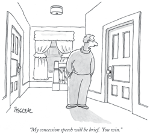

> **Descripción de la imagen** — Es un dibujo lineal o boceto simple que representa una escena interior. Muestra un pasillo o habitación con dos puertas visibles a ambos lados. En el centro de la imagen se encuentra la figura de un hombre, dibujado en estilo esquemático, de pie y mirando ligeramente hacia adelante. El fondo incluye elementos arquitectónicos como paredes, una lámpara de techo y cortinas o telas colgantes en el lado izquierdo. La composición es minimalista y se centra en la figura humana dentro del espacio interior.

“Mi discurso de aceptación será breve. Tú ganas.”

29  Pruitt y Rubin, 1986, p. 25.

© 2002 De The New Yorker cartoonbank.com. Todos los derechos reservados.

---

<!-- página 43 -->

Capítulo 1 La naturaleza de una negociación
26

por satisfacer los intereses de las dos partes, o simplemente que las dos partes cedan”
(p. 29).30 No obstante, como otros expertos que emplean versiones de este modelo
creen que una avenencia representa un método estratégico válido ante un confl icto, la
incorporamos a la estructura de Rubin, Pruitt y Kim en la fi gura 1.3.

Gran parte de lo escrito sobre estrategias de manejo de un confl icto —sobre todo durante
las décadas de 1960 y 1970— tuvo un intenso valor normativo en contra de los confl ictos y
hacia la cooperación.31 Aunque los modelos sugerían la viabilidad de los cinco métodos
estratégicos para manejar un confl icto, la resolución del problema se identifi caba como el
método preferido. Estos esquemas subrayan las virtudes de la solución del problema, de-
fendían su uso y describían la forma en que se puede aplicar en casi cualquier confl icto. Sin
embargo, análisis más recientes, aunque todavía muy comprometidos con la resolución del
problema, insisten con cuidado en que cada estrategia de manejo de un confl icto tiene sus
ventajas y desventajas, y puede ser más o menos adecuada según el tipo de interdependencia
y el contexto de un confl icto (véase la fi gura 1.4).

Panorama de los capítulos de este libro

El libro está organizado en 12 capítulos. Los primeros cuatro abordan los fundamentos
de una negociación. Además de este primer capítulo de generalidades, los capítulos 2 y 3
exploran la estrategia y las prácticas básicas de la negociación distributiva y la negociación
integradora. El capítulo 4 explora la forma en que las partes planifi can y preparan una
estrategia de negociación y prevén de manera efi caz su encuentro con el otro negociador.

Los cuatro capítulos siguientes exploran los procesos secundarios fundamentales de
una negociación. En el capítulo 5 analizamos la manera en que las percepciones, las cog-
niciones y las emociones de un negociador tienden a moldear (y a menudo sesgar) el modo
en que el negociador contempla e interpreta una interacción de concesión. El capítulo 6
examina los procesos mediante los cuales los negociadores comunican con efi cacia sus in-
tereses, posiciones y metas, y comprenden las comunicaciones de la otra parte. El capítulo
7 se concentra en el poder en una negociación; comienza por defi nir la naturaleza del poder
y analiza algunas de sus dinámicas en una negociación, seguidas por una exploración de
las fuentes principales de poder disponibles para casi todos los negociadores. Por último,
en el capítulo 8 analizamos si existen, o deben existir, estándares éticos aceptados para
guiar una negociación. Identifi camos las dimensiones éticas principales planteadas en una
negociación, describimos la manera en que los negociadores tienden a considerar estas
opciones y ofrecemos una estructura para tomar decisiones éticas informadas.

Hasta el momento, gran parte de nuestro análisis supone que las partes negociadoras
no tienen una relación de largo plazo. El capítulo 9 observa el modo en que las relacio-
nes establecidas afectan las negociaciones actuales y considera tres intereses principales
—reputación, confi anza y justicia— de particular importancia para las negociaciones efi ca-
ces dentro de una relación. En el capítulo 10 examinamos cómo cambian las negociaciones

30 Ibid., p. 29. Véanse también Filley, 1975; Hall, 1969; Rahim, 1983, 1992; Thomas, 1992; Thomas y Kilmann,
1974; todos piensan que el compromiso y la avenencia son un enfoque estratégico válido para el confl icto.
31  Lewicki, Weiss y Lewin, 1992.

---

<!-- página 44 -->
### 27
Panorama de los capítulos de este libro
### FIGURA 1.4
Estilos para manejar un confl icto interpersonal y situaciones donde
son adecuados o inadecuados.

Estilo del

confl icto

Situaciones donde

es adecuado

Situaciones donde

es inadecuado

Integrar
1.  Los problemas son complejos.
2.  Se requiere una síntesis de ideas para gene-
rar mejores soluciones.
3.  Se necesita un compromiso de otras partes
para una aplicación exitosa.
4.  Hay tiempo para solucionar el problema.
5.  Una sola parte no puede resolver el problema.
6.  Se requieren los recursos que poseen las di-
ferentes partes para resolver sus problemas
comunes.

1.  La tarea o el problema es sencillo.
2.  Se necesita una decisión inmediata.
3.  A las otras partes no les preocupa el re-
sultado.
4.  Las otras partes no tienen aptitudes para
resolver el problema.

Aceptar
1.  Usted cree que puede estar equivocado.
2.  El problema es más importante para la otra
parte.
3.  Usted está dispuesto a ceder algo a cambio
de otra cosa de la otra parte en el futuro.
4.  Usted trata desde una posición de debilidad.
5.  Es importante conservar la relación.

1.  El problema es importante para usted.
2.  Usted cree que tiene la razón.
3.  La otra parte se equivoca o carece de
ética.

Dominar
1.  El problema es trivial.
2.  Se requiere una decisión rápida.
3.  Se ejecuta un curso de acción poco acep-
table.
4.  Es necesario vencer a subordinados aser-
tivos.
5.  Una decisión desfavorable de la otra parte
puede ser costosa para usted.
6.  Los subordinados carecen de experiencia
para tomar decisiones técnicas.
7.  El problema es importante para usted.

1.  El problema es complejo.
2.  El problema no es importante para usted.
3.  Ambas partes tienen el mismo poder.
4.  No es necesario tomar una decisión rá-
pido.
5.  Los subordinados poseen un alto grado
de competencia.

Evitar
1.  El problema es trivial.
2.  El posible efecto disfuncional de enfrentar a
la otra parte sobrepasa los benefi cios de una
solución.
3.  Se requiere un periodo de descanso.

1.  El problema es importante para usted.
2.  Usted es responsable de tomar una de-
cisión.
3.  Las partes no están dispuestas a condes-
cender; el problema debe resolverse.
4.  Se requiere una atención inmediata.

Avenirse
1. Las metas de las partes son mutuamente ex-
cluyentes.
2.  Las partes tienen el mismo poder.
3.  No es posible alcanzar un consenso.
4.  Un estilo integrador o dominante no tiene éxito.
5.  Se requiere una solución temporal para un
problema complejo.

1.  Una parte tiene más poder.
2.  El problema es lo bastante complejo para
necesitar un método de resolución de
problemas.

Fuente: Modifi cado y reproducido con autorización especial del editor, Consulting Psychologists Press, Inc., Palo Alto,
California, 94303, de Rahim Organizational Confl ict Inventories: Professional Manual, de M. A. Rahim, derechos reserva-
dos © 1990 por Consulting Psychologists Press, Inc. Todos los derechos reservados. Se prohíbe la reproducción sin la
autorización por escrito del editor.

---

<!-- página 45 -->

Capítulo 1 La naturaleza de una negociación
28

cuando hay muchas partes en la mesa —al negociar con grupos y equipos— que intentan
lograr un acuerdo colectivo o consenso grupal. En el capítulo 11 analizamos cómo los di-
ferentes idiomas y culturas cambian las “reglas básicas” de una negociación. Este capítulo
examina algunos factores que distinguen una negociación internacional, y cómo la cultura
de un país afecta el ritmo y el fl ujo de una negociación.

Por último, en el capítulo 12 presentamos una negociación en un nivel amplio. Hace-
mos una retrospectiva de la panorámica más amplia que propusimos y sugerimos 10 prácti-
cas comprobadas para quienes desean continuar mejorando sus habilidades de negociación.

---

<!-- página 46 -->
## CAPÍTULO
## Estrategia y tácticas de una
## negociación distributiva
## 2
### Objetivos

1.
Comprender los elementos básicos de una situación de negociación distributiva, así
como su estrategia y tácticas.
2.
Considerar el impacto estratégico de la posición asumida durante la negociación y el
papel de las concesiones.
3.
Entender la importancia del compromiso como táctica de comunicación.
4.
Explorar opciones para cerrar el trato en una situación distributiva.

Hace 18 meses, Jackson decidió mudarse a un lugar más cercano de donde trabaja. Des-
pués de tomar esta decisión, puso en venta su condominio y comenzó a buscar uno nuevo,
sin resultados. Catorce meses después, Jackson por fi n recibió una oferta de compra y,
después de una breve negociación, acordó un precio de venta. Debido a que todavía no
encontraba un condominio para comprar, pospuso el cierre de la venta durante seis meses
con el fi n de tener más tiempo para buscar. A la compradora, Barbara, no le agradó tener
que esperar tanto por las inconveniencias y la difi cultad de que un banco le garantizara una
tasa de interés para un préstamo con tanta anticipación. Jackson ajustó el precio para que
Barbara aceptara este retraso, pero era evidente que se sentiría mucho más contenta si la
fecha fuera más cercana.

Había relativamente pocos condominios a la venta en el área donde Jackson quería
vivir, y ninguno le satisfacía. Comentó en broma que, a menos que apareciera algo nuevo
en el mercado, dormiría en una tienda de campaña en un terreno público cuando las ho-
jas de los árboles cambiaran de color en otoño. Dos meses después se puso a la venta un
condominio que le agradó. La vendedora, Sofía, fi jó el precio en 145 000 dólares, que era
10 000 dólares más de lo que Jackson esperaba pagar, pero 5 000 dólares menos del tope
máximo de lo que estaba dispuesto a pagar. Jackson sabía que cuanto más pagara por el
condominio, dispondría de menos dinero para modifi caciones, comprar cortinas y algunos
muebles nuevos, y contratar una empresa de mudanzas.

Este ejemplo presenta los elementos básicos de una situación de negociación dis-
tributiva. También se denomina negociación competitiva o de tipo ganar-perder. En una
situación de negociación distributiva, las metas de una de las partes suelen estar en confl icto

---

<!-- página 47 -->

Capítulo 2 Estrategia y tácticas de una negociación distributiva
30

directo y fundamental con las metas de la otra parte. Los recursos son fi jos y limitados, y
ambas partes quieren que les corresponda la mayor cantidad. Como resultado, cada parte
utiliza un conjunto de estrategias para maximizar lo que le corresponda. Una estrategia
importante es proteger con cuidado la información: los negociadores sólo deben dar infor-
mación a la otra parte cuando les represente una ventaja estratégica. Al mismo tiempo, es
muy conveniente obtener información de la otra parte para mejorar el poder de negociación.
Una negociación distributiva es básicamente una competencia sobre quién va a obtener más
de un recurso limitado, el cual suele ser dinero. El que una o ambas partes consigan o no
sus objetivos depende de las estrategias y tácticas que empleen.1

Para muchas personas, las estrategias y tácticas de una negociación distributiva repre-
sentan una verdadera negociación. Uno se imagina habitaciones llenas de humo de los ciga-
rrillos y hombres que discuten y defi enden sus puntos de vista. A muchas personas les atrae
esta visión de las negociaciones y buscan aprender y perfeccionar numerosas habilidades
para negociar con fi rmeza; a otras les desagrada una negociación distributiva y preferirían
retirarse antes que negociar de este modo. Afi rman que una negociación distributiva es
anticuada, innecesariamente combativa y destructiva.

Todo negociador debe conocer tres razones de una negociación distributiva. Primero,
los negociadores enfrentan ciertas situaciones interdependientes que son distributivas, y
para desempeñarse bien en ella necesitan comprender cómo funcionan. Segundo, debido
a que muchas personas emplean estrategias y tácticas de negociación distributiva de ma-
nera casi exclusiva, todos los negociadores necesitan comprender cómo contrarrestar sus
efectos. Tercero, cada situación de negociación puede requerir habilidades de negociación
distributiva cuando está en la etapa de “declarar un valor”.2 La negociación integradora se
enfoca en las formas de crear valor, pero también incluye una etapa de declaración, donde
se distribuye el valor creado. (Discutiremos extensamente la negociación integradora en el
capítulo 3.) Es importante y útil comprender las estrategias y tácticas distributivas, pero los
negociadores necesitan reconocer que estas tácticas también pueden ser contraproducentes
y costosas, y no funcionar. Suelen provocar que las partes que negocian se concentren
mucho en sus diferencias e ignoren lo que tienen en común.3 No obstante estos efectos
negativos, las estrategias y las tácticas de negociación distributiva son muy útiles cuando
un negociador quiere maximizar el valor obtenido en un solo acuerdo, cuando la relación
con la otra parte no es importante y cuando se está en la etapa de declarar un valor en las
negociaciones.

Algunas tácticas analizadas en este capítulo también generarán preocupaciones éticas.
En el capítulo 8 hablaremos en detalle del tema de la ética y la negociación. Al negociar, no
suponga que la otra parte comparte sus valores éticos. Aunque tal vez crea que no es ético
utilizar algunas tácticas analizadas en este capítulo, otros negociadores se sentirán muy có-
modos con ellas. O quizá se sienta cómodo al usar algunas tácticas que intranquilizan a otros
negociadores. Algunas tácticas explicadas suelen considerarse éticas en una negociación
distributiva (por ejemplo, presentar su acuerdo de la mejor opción como más positivo de lo
que es en realidad), mientras otras tácticas suelen considerarse inaceptables (consulte más
adelante en este capítulo un análisis de las tácticas de presión comunes).

1 Walton y McKersie, 1965.
2 Lax y Sebenius, 1986.
3 Thompson y Hrebec, 1996.

---

<!-- página 48 -->

31
La situación de la negociación distributiva

El análisis de las estrategias y las tácticas en este capítulo pretende ayudar a los nego-
ciadores a comprender la dinámica de la negociación distributiva y, con ello, obtener un
mejor acuerdo. Entender al detalle estos conceptos también permitirá a los negociadores
que por naturaleza no se sienten cómodos con la negociación distributiva administrar de
manera proactiva las situaciones distributivas. Por último, la comprensión de estas estra-
tegias y tácticas ayudará a los negociadores en la etapa de declarar un valor en cualquier
negociación.

La situación de la negociación distributiva

Para describir cómo funciona un proceso de negociación distributiva, regresemos a nuestro
ejemplo inicial de la compra del condominio de Jackson. Se mencionaron varios precios:
1) el solicitado por Sofía, 2) el que Jackson preferiría pagar por el condominio y 3) el
precio por encima del cual Jackson no compraría el condominio. Estos precios representan
puntos importantes en el análisis de cualquier situación de negociación distributiva. El
precio que prefi ere Jackson es el punto objetivo, en el cual al negociador le agradaría con-
cluir las negociaciones: su meta óptima. El objetivo también se denomina la aspiración del
negociador. El precio más allá del cual Jackson no irá es el punto de resistencia, una línea
fi nal del negociador: lo más que pagará como comprador (para un vendedor, es la cantidad
más pequeña que aceptará). También se denomina en ocasiones precio de reservación. Por
último, el precio solicitado es el precio inicial establecido por el vendedor; Jackson puede
decidir contrarrestar el precio solicitado por Sofía con su oferta inicial: la primera cantidad
que mencionará a la vendedora. Al emplear la compra del condominio como ejemplo, po-
demos tratar el rango de precios como un continuo (consulte la fi gura 2.1).

¿Cómo decide Jackson su oferta inicial? Hay muchas maneras de responder. Para hacer
una buena oferta inicial, Jackson básicamente debe comprender algo acerca del proceso
de negociación. En el capítulo 1 analizamos la forma en que las personas esperan dar y
recibir cuando negocian, y Jackson necesita incluir esto en su oferta inicial. Si Jackson
abriera la negociación en su punto objetivo (135 000 dólares) y después tuviera que hacer
una concesión, esta primera concesión lo alejaría de su punto objetivo y lo acercaría a su
punto de resistencia. Si realmente quiere lograr su objetivo debe hacer una oferta inicial
más baja que su punto objetivo con el fi n de tener margen para hacer concesiones. Al mis-
mo tiempo, el punto inicial no puede estar demasiado lejos del punto objetivo. Si Jackson
hace la primera oferta demasiado baja (por ejemplo, 100 000 dólares), Sofía puede cancelar
la negociación por considerarlo irracional o tonto. Si bien los juicios para determinar las
primeras ofertas llegan a ser muy complejos y afectar de manera drástica el curso de una
negociación, por el momento quedémonos con el caso sencillo y supongamos que Jackson

FIGURA 2.1 Visión del comprador de la negociación por la casa.

Punto
objetivo de
Jackson

Precio
solicitado
por Sofía

Punto de
resistencia
de Jackson

$130 000
$135 000
$140 000
$145 000
$150 000

---

<!-- página 49 -->

Capítulo 2 Estrategia y tácticas de una negociación distributiva
32

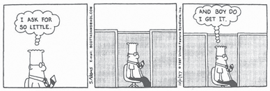

> **Descripción de la imagen** — La imagen es una ilustración en blanco y negro que muestra tres figuras masculinas de pie detrás de una serie de barras verticales, como las de una celda o un puesto. Las tres figuras llevan algún tipo de vestimenta formal o uniforme y sombreros altos.
>
> Cada figura tiene un bocadillo de diálogo sobre su cabeza:
> 1. La figura de la izquierda dice: "I ASK FOR SO LITTLE." (Pido tan poco.)
> 2. La figura de la derecha dice: "AND BOY DO I GET IT." (Y vaya, lo consigo.)
>
> La composición sugiere una interacción o una escena dramática entre los personajes.

decidió ofrecer 133 000 dólares como primera oferta razonable: menos que su punto obje-
tivo y muy inferior a su punto de resistencia. Recuerde que aunque este ejemplo se refi ere
sólo a un precio, todos los otros asuntos o conceptos de una agenda para una negociación
tienen puntos inicial, objetivo y de resistencia.

Ambas partes de una negociación deben establecer sus puntos inicial, objetivo y de
resistencia antes de comenzar. El punto inicial suele estar en la declaración inicial de cada
parte (por ejemplo, la lista de precios del vendedor y la primera oferta del comprador). El
punto objetivo se conoce o se deduce cuando se realizan las negociaciones. Las personas
suelen ceder el margen entre su punto inicial y su punto objetivo cuando hacen concesio-
nes. La otra parte no conoce el punto de resistencia, el punto que una persona no superará
y donde interrumpirá las negociaciones, y debe mantenerse en secreto.4 Es probable que
una parte no conozca el punto de resistencia de la otra incluso después del fi nal de una ne-
gociación exitosa, y con frecuencia puede subestimar la cantidad que la otra parte hubiese
pagado o aceptado.5 Después de una negociación infructuosa, una parte puede deducir que
el punto de resistencia de la otra estaba cerca de la última oferta que la otra estaba dispuesta
a considerar antes de terminar la negociación.

Los puntos iniciales y de resistencia de las partes suelen estar en orden inverso, y el
punto de resistencia es un precio alto para el comprador y bajo para el vendedor. Por tan-
to, Jackson habría estado dispuesto a pagar hasta 150 000 dólares por el condominio que
Sofía ofreció en 145 000 dólares, y consideraría 140 000 dólares una cifra conveniente. Lo
que Jackson no sabe (pero le encantaría conocer) es la cifra más baja que Sofía aceptaría.
¿Serán 140 000 o 135 000 dólares? Jackson supone que pueden ser 130 000 dólares. Por
su parte, Sofía al principio no sabe nada de la posición de Jackson, pero se entera de su
punto inicial cuando ofrece 133 000 dólares. Sofía puede sospechar que el punto objetivo
de Jackson no está demasiado lejos (de hecho son 135 000 dólares, pero Sofía desconoce
esto), pero no tiene idea de cuál pueda ser su punto de resistencia (150 000 dólares). Esta
información —lo que Jackson sabe o deduce acerca de las posiciones de Sofía— se repre-
senta en la fi gura 2.2.

La distancia entre los puntos de resistencia, llamada rango de negociación, rango de
conciliación o zona de acuerdo probable, es muy importante. En esta área ocurre la verda-

4  Raiffa, 1982.
5  Larrick y Wu, 2007.

Me conformo
con tan poco...

...y vaya que

lo obtengo

DILBERT ©UFS. Reimpreso con autorización.

---

<!-- página 50 -->

33
La situación de la negociación distributiva

dera negociación, porque la otra parte rechazará de inmediato cualquier solicitud fuera de
estos puntos. Cuando el punto de resistencia del comprador está por encima del punto
de resistencia de la vendedora — cuando al menos está dispuesto a pagar más de lo míni-
mo por lo que ella está dispuesta a vender, como en el ejemplo del condominio— existe
un rango de negociación positivo. Cuando ocurre lo opuesto —el punto de resistencia del
vendedor está por encima del punto de resistencia del comprador, y el comprador no pagará
más de lo mínimo que aceptaría el vendedor— existe un rango de negociación negativo.
En el ejemplo del condominio, si lo mínimo que aceptara Sofía fuera 145 000 dólares y lo
máximo que pagara Jackson fuera 140 000 dólares, existiría un rango de negociación ne-
gativo. Es probable que las negociaciones que comienzan con un rango de negociación
negativo no lleguen a buen puerto. Sólo se resuelven si una o ambas partes cambia sus pun-
tos de resistencia o si un tercero impone una solución que desagrade a una o ambas partes.
Sin embargo, como los negociadores no comienzan sus deliberaciones fi jando sus puntos
de resistencia (en vez de eso, analizan las ofertas y demandas iniciales), suele ser difí-
cil saber si hay un rango de conciliación positivo antes de que los negociadores avancen
en el proceso. Ambas partes comprenden que no se sobreponen sus puntos de resistencia
sólo después de haber participado en negociaciones prolongadas; en ese momento tendrán
que decidir si concluyen las negociaciones o reevalúan sus puntos de resistencia, proce-
so que se describe después con mayor detalle.

Función de las opciones para un acuerdo negociado

Además de las ofertas iniciales, los puntos objetivos y los puntos de resistencia, en las
negociaciones entra un cuarto factor: un posible resultado alterno al completar un acuerdo
con alguien más. En algunas negociaciones, las partes sólo tienen dos opciones fundamen-
tales: 1) alcanzar un acuerdo con la otra parte o 2) no llegar a ningún acuerdo. Sin embargo,
en otras negociaciones, una o ambas partes pueden tener la posibilidad de un acuerdo con
otra parte. En el caso de Jackson y Sofía puede aparecer otro condominio en venta en el
vecindario donde Jackson pretende comprar. Asimismo, si Sofía espera lo sufi ciente (o
reduce bastante el precio del condominio), es probable que encuentre otro comprador in-
teresado. Si Jackson elige comprar otro condominio, habla con su propietario y negocia el
mejor precio posible, precio que representa su alternativa. En función del ejemplo, supon-
gamos que el condominio alterno de Jackson cuesta 142 000 dólares y que el comprador
alterno de Sofía pagaría 134 000 dólares.

Un punto alterno puede ser idéntico al de resistencia, aunque los dos no tienen que ser
iguales. Si la opción de Jackson es 142 000 dólares, entonces (sin tomar en cuenta otros fac-

FIGURA 2.2 Visión del comprador de la negociación por la casa (extendida).

Punto de
resistencia
de Sofía
(deducido)

Oferta
inicial de
Jackson
(pública)

Punto
objetivo de
Jackson
(privado)

Punto
objetivo
de Sofía
(deducido)

Precio
solicitado
por Sofía
(público)

Punto de
resistencia
de Jackson
(privado)

$130 000
$133 000
$135 000
$140 000
$145 000
$150 000

---

<!-- página 51 -->

Capítulo 2 Estrategia y tácticas de una negociación distributiva
### 34
### tores) debe rechazar cualquier precio que Sofía pida por encima de esa cantidad. La opción
### de Jackson puede no ser tan conveniente por razones diferentes del precio: le agrada menos
### el vecindario, el condominio está más lejos de su lugar de trabajo o le agrada el modo en
### que Sofía ha conservado el condominio. En cualquiera de estas situaciones, Jackson puede
### conservar su punto de resistencia en 150 000 dólares; por tanto, está dispuesto a pagar a
### Sofía hasta 8 000 dólares más por su opción (consulte la fi gura 2.3).
### Las opciones son importantes porque dan a los negociadores el poder de abandonar
### cualquier negociación cuando el acuerdo previsible no sea bueno. La cantidad de opciones
### reales de los negociadores varía mucho de una situación a otra. En las negociaciones donde
### hay muchas opciones atractivas, pueden fi jar metas más altas y hacer menos concesiones.
### En las negociaciones donde no hay una opción atractiva, como al hacer negocios con un
### solo proveedor, el poder de negociación es mucho menor. Los buenos concertadores distri-
### butivos identifi can sus opciones reales antes de comenzar las discusiones con la otra parte
### para calibrar correctamente cuánta fi rmeza aplicar en la negociación.6 Los concertadores
### destacados también intentan mejorar sus opciones mientras está en curso la negociación. Si
### las negociaciones de Jackson con Sofía se extienden demasiado, debe buscar en el mercado
### otras opciones tal vez mejores. También debe seguir negociando un mejor acuerdo con el
### dueño del condominio alterno. Ambos cursos de acción implican esfuerzos de Jackson por
### mantener y ampliar su poder de negociación al mejorar la calidad de sus opciones. Dis-
### cutiremos con detalle el poder y el apalancamiento en las negociaciones en el capítulo 7.
### Por último, los negociadores necesitan asegurar que comprenden con claridad su mejor
### alternativa para un acuerdo negociado (MAPAN).7 Puede ser útil tener varias opciones,
### pues en realidad la mejor afectará la decisión de cerrar el acuerdo o de retirarse. Comprender
### la MAPAN y fortalecerla lo más posible otorga a un negociador más poder en la negociación,
### porque la MAPAN aclara lo que hará si no es posible alcanzar un acuerdo. Los negociadores
### que tienen las MAPAN más fuertes, es decir, opciones muy positivas para un acuerdo nego-
### ciado, tendrán más poder durante la negociación y, de acuerdo con eso, podrán lograr más de
### sus metas (el poder de las MAPAN se analiza con más detalle en el capítulo 7).
### El punto de acuerdo
### El proceso fundamental de una negociación distributiva es alcanzar un acuerdo dentro de
### un rango de negociación positivo. El objetivo de ambas partes es obtener el rango de nego-

6  Fisher y Ertel, 1995.
7  Fisher, Ury y Patton, 1991.

FIGURA 2.3 Visión del comprador de la negociación por la casa (extendida con opciones).

Punto de
resistencia
de Sofía
(deducido)

Oferta
inicial de
Jackson
(pública)

Comprador
alterno de
Sofía
(privado)

Punto
objetivo de
Jackson
(privado)

Punto
objetivo
de Sofía
(deducido)

Casa
alterna
de Jackson
(privada)

Precio
solicitado
por Sofía
(público)

Punto de
resistencia
de Jackson
(privado)

$130 000
$133 000 $134 000
$135 000
$140 000
$142 000
$145 000
$150 000

---

<!-- página 52 -->

35
La situación de la negociación distributiva

ciación más grande posible, es decir, alcanzar un acuerdo lo más cercano posible al punto
de resistencia de la otra parte.

En una negociación distributiva, ambas partes saben que tienen que conciliar por me-
nos de lo que preferirían (su punto objetivo), pero esperan que el acuerdo sea mejor que
su propio punto de resistencia. Para que haya un acuerdo, ambas partes deben creer que el
acuerdo que tienen, aunque menos deseable de lo que preferirían, es lo mejor que pueden
obtener. Esta noción es importante tanto para alcanzar un acuerdo como para asegurar el
apoyo para el acuerdo concluida la negociación. Los negociadores que no creen haber ob-
tenido el mejor acuerdo posible, o que creen que perdieron algo en el trato, pueden tratar
de salirse del acuerdo después o buscar otro modo de recuperar sus pérdidas. Si Jackson
piensa que obtuvo un benefi cio mínimo del acuerdo puede complicarle la vida a Sofía
con extrañas reclamaciones posteriores: que el condominio tenía daños ocultos, que las
instalaciones estaban defectuosas y cosas así. Otro factor que afecta la satisfacción con
el acuerdo es si las partes se volverán a ver. Si Sofía se traslada a otra región, Jackson no
podrá comunicarse con ella para cualquier ajuste y, por tanto, debe asegurarse de evaluar
con mucho cuidado el acuerdo (un buen consejo en cualquier situación, pero sobre todo
en este caso).

La mezcla de la negociación

En el ejemplo de la compra del condominio, igual que en casi todas las negociaciones, se
requiere un acuerdo sobre varios aspectos: precio, fecha de conclusión de la venta, reno-
vaciones del condominio y precio de los artículos que pueden quedarse del condominio
(como cortinas y aparatos eléctricos). El conjunto de aspectos de una negociación es la
mezcla de la negociación. Cada artículo de la mezcla tiene sus propios puntos de inicio,
objetivo y de resistencia. Algunos artículos tienen una importancia obvia para ambas
partes; otros sólo la tienen para una parte. Los negociadores necesitan comprender lo
importante para ellos y para la otra parte, y tomar en cuenta estas prioridades durante
el proceso de planifi cación. Véase el capítulo 4 para una exposición más detallada de la
planifi cación.

Por ejemplo, en la negociación del condominio, un aspecto secundario importante para
ambas partes es la fecha de cierre de la venta: la fecha en que se transferirá en realidad la
propiedad. La fecha de la venta es parte de la mezcla de la negociación. Jackson se enteró
de la fecha en que iban a concluir el nuevo condominio de Sofía y previó que ella querría
transferirle la propiedad de su condominio anterior poco después de ese punto. Jackson so-
licitó una fecha de cierre muy cercana a la que probablemente Sofía preferiría; por tanto, el
acuerdo le pareció muy atractivo a Sofía. Resultó que también la fecha de cierre de Jackson
en su condominio anterior estaba cercana a esta fecha, lo cual hizo que el acuerdo fuera
atractivo para Jackson y Sofía. Si Jackson y Sofía hubieran querido fechas de venta dife-
rentes, la fecha de cierre habría sido un motivo de discordia en la mezcla de la negociación
(no obstante, si Jackson hubiera fi jado una fecha de cierre más cercana, habría tenido la
oportunidad de un mejor acuerdo con Bárbara, la compradora de su condominio). A medida
que aumenta la mezcla de la negociación hay mayor probabilidad de tener problemas de
compensación, donde las preferencias del negociador son distintas cada vez. Cuando esto
ocurre, pueden ser adecuadas las estrategias y tácticas de la negociación integradora, que
se abordan en el capítulo 3.

---

<!-- página 53 -->

Capítulo 2 Estrategia y tácticas de una negociación distributiva
36

Estrategias fundamentales

El objetivo primordial en la negociación distributiva es maximizar el valor del acuerdo.
En el ejemplo del condominio, el comprador dispone de cuatro estrategias fundamentales:

1.
Impulsar una conciliación cercana al punto de resistencia (desconocido) del vendedor,
lo cual produce la parte más grande del rango de conciliación para el comprador. El
comprador puede intentar infl uir en la opinión del vendedor acerca de los acuerdos
posibles al hacer ofertas extremas y concesiones pequeñas.
2.  Convencer al vendedor de que cambie su punto de resistencia al infl uir en la noción
del vendedor acerca del valor del condominio (por ejemplo, afi rmar que el condominio
está sobrevalorado) y aumentar así el rango de negociación.
3.  Si hay un rango de conciliación negativo, convencer al vendedor de que reduzca su
punto de resistencia con el fi n de crear un rango de conciliación positivo o cambiar su
propio punto de resistencia para crear una coincidencia. De ese modo, Jackson con-
vencería a Sofía para que aceptara un precio más bajo, o puede decidir que tiene que
pagar más de lo que quería.
4.  Convencer al vendedor de que es el mejor acuerdo posible en vez de hacerle pensar
que es todo lo que puede obtener, o que es incapaz de obtener más, o que el comprador
ganó al obtener más. La diferencia entre que una parte crea que un acuerdo es el mejor
posible (y no todas las demás interpretaciones) puede parecer sutil y semántica. Sin
embargo, para que coincidan, es importante que sientan que obtienen el mejor acuer-
do. La satisfacción del ego suele ser tan importante como lograr objetivos tangibles
(recuerde el análisis de lo tangible y lo intangible del capítulo 1).

En todas estas estrategias, el comprador intenta infl uir en las percepciones del vendedor
de lo que es posible mediante el intercambio de información y el convencimiento. Sin tomar
en cuenta la estrategia general adoptada, en todas las situaciones de negociación distributiva
son importantes dos tareas: 1) descubrir el punto de resistencia de la otra parte y 2) infl uir
en el punto de resistencia de la otra parte.

Cómo descubrir el punto de resistencia de la otra parte

La información es la fuerza vital de una negociación. Cuanto más sepa usted del objeti-
vo, el punto de resistencia, los motivos, los sentimientos de confi anza y demás de la otra
parte, más fácilmente conseguirá un acuerdo favorable (consulte el cuadro 2.1). Al mismo
tiempo, preferirá que la otra parte no tenga cierta información de usted. Es mejor encubrir
su punto de resistencia, algunos de sus objetivos y la información confi dencial sobre una
posición estratégica débil.8 Por otro lado, tal vez quiera que la otra parte tenga cierta in-
formación: una parte real y correcta, y otra inventada para que la otra parte crea cosas que
le favorecen a usted. Como cada parte quiere obtener cierta información y encubrir otra,
y como cada una sabe que la otra también quiere obtener y ocultar información, la comu-
nicación puede complicarse. La información suele comunicarse mediante un código que
evoluciona durante una negociación. Las personas responden con otras preguntas o con

8  Stein, 1996.

---

<!-- página 54 -->

Joe y Sue Carter
37

37

afi rmaciones incompletas; sin embargo, para infl uir en las percepciones de la otra parte,
deben establecer algunos puntos de manera efi caz y convincente.

Cómo infl uir en el punto de resistencia de la otra parte

En una negociación distributiva, para planifi car la estrategia y las tácticas es fundamental
determinar el punto de resistencia de la otra parte y la relación de ese punto de resisten-
cia con el de usted. El punto de resistencia se establece mediante el valor esperado de un
resultado particular, el cual a su vez es el producto del valor y los costos de un resultado.
Jackson establece su punto de resistencia con base en la cantidad de dinero que puede
pagar (en los pagos hipotecarios totales o mensuales), en el valor estimado en el mercado
del condominio y otros factores en la mezcla de la negociación (por ejemplo, la fecha de
cierre). Un punto de resistencia también se ve afectado por el costo que una persona asigna
al retraso o a la difi cultad en una negociación (algo intangible) o al hecho de cancelar las

Para comprar un piano usado, Orvel Ray res-
pondió a un anuncio en el periódico. Era un
hermoso piano vertical en un enorme mueble
de nogal. El vendedor pedía 1 000 dólares, y
ese precio era una gran oferta, pero Orvel ha-
bía recibido 700 dólares en una devolución de
impuestos y fi jó esta cantidad inesperada como
límite de lo que podía invertir. Buscaba una
ventaja en la negociación.

Pudo deducir varias cosas de los antece-
dentes. El piano estaba en un sótano amuebla-
do, donde también había una batería y un bajo
acústico vertical. Era obvio que el vendedor
era un músico serio, que quizás interpretaba
jazz. Debía existir una razón imperiosa para
vender ese hermoso instrumento.

Orvel preguntó lo obvio: —¿Va a comprar
un piano nuevo?

El vendedor titubeó: —Todavía no lo sé.
Nos vamos a mudar a Carolina del Norte y
saldría muy caro trasladar el piano al otro lado
del país.

—¿Le dijeron cuánto más le costaría?,
preguntó Orvel.

—Dijeron que unos 300 dólares adiciona-
les, más o menos.

—¿Cuándo tiene que decidir?
—Los de la mudanza llegan a empacar
hoy en la tarde.

Ahora Orvel conocía el punto vulnerable
del vendedor. Podía trasladar el piano por todo
el país o venderlo en 700 dólares y obtener un
resultado similar, o seguir pidiendo su precio
inicial y arriesgarse.

—Esto es lo que puedo hacer: le doy 700
dólares en efectivo en este momento —dijo
Orvel, y sacó siete billetes de 100 dólares del
bolsillo y los extendió frente al vendedor—,
y al mediodía traigo un camión y tres amigos
para llevármelo.

El vendedor dudó, pero tomó el dinero:
—Está bien. Puedo comprar un piano nuevo
cuando nos hayamos instalado.

Orvel se fue antes de que el vendedor
cambiara de opinión. Cuando el grupo regre-
só con el camión, el vendedor había recibido
otras tres ofertas, pero como había aceptado el
efectivo, tuvo que informar que el piano ya se
había vendido.

Si el vendedor no hubiera mencionado
que los transportistas llegarían esa tarde, Orvel
no habría podido negociar el precio.

Fuente: De J. C. Levinson, M. S. A. Smith y O. R. Wilson,
Guerrilla Negotiating, Nueva York, John Wiley, 1999, pp.
15-16.
## CUADRO
### El piano
## 2.1

---

<!-- página 55 -->

Capítulo 2 Estrategia y tácticas de una negociación distributiva
38

negociaciones. Si Jackson, quien estableció su punto de resistencia en 150 000 dólares, en-
frentara la opción de pagar 151 000 dólares o vivir en un área comunal de la ciudad durante
un mes, podría revaluar su punto de resistencia. Sin embargo, los puntos de resistencia no
deben cambiarse sin antes pensarlo bien; desempeñan un papel importante al establecer los
límites de los negociadores y, a menos que haya una razón objetiva para cambiarlos, deben
permanecer inalterados.

Un factor importante al modelar la forma en que la otra persona comprende lo que es
posible —y por tanto, el valor que asigna a los resultados específi cos— es que entienda
la situación de usted. Así, al infl uir en el punto de vista de la otra persona, también debe
manejar cómo comprende la otra parte el valor de usted para un resultado específi co, los
costos que usted asigna a un retraso o a una difi cultad en la negociación, y el costo que usted
asigna a cancelar las negociaciones.

Tácticas

Entre las estrategias fundamentales de una negociación distributiva existen cuatro tácticas
importantes relacionadas con los objetivos, los puntos de resistencia y los costos de con-
cluir las negociaciones que un negociador debe considerar en tal situación: 1) valorar el
objetivo, el punto de resistencia y el costo de concluir las negociaciones para la otra parte;
2) manejar cómo percibe la otra parte el objetivo, el punto de resistencia y el costo de
concluir la negociación; 3) modifi car la percepción de la otra parte respecto de su propio
objetivo, punto de resistencia y costo de terminar la negociación, y 4) manipular los costos
reales de retrasar o concluir las negociaciones. Cada una de estas tácticas se analiza con
mayor detalle a continuación.

Valorar el objetivo, el punto de resistencia y los costos
de terminar las negociaciones para la otra parte

Un primer paso importante para un negociador es obtener información acerca del punto
objetivo y de resistencia de la otra parte. El negociador puede seguir dos rutas generales
para lograr estas tareas: obtener información de manera indirecta sobre los antecedentes
de una cuestión (valoración indirecta) u obtener información directamente de la otra parte
acerca de su punto objetivo y de resistencia (valoración directa).

Valoración indirecta Una persona establece un punto de resistencia con base en mu-
chos factores. Por ejemplo, ¿cómo decide cuánto puede pagar de renta o hipoteca cada
mes? ¿Cómo decide cuánto vale en realidad un condominio o un automóvil usado? Hay
muchas maneras de hacerlo. Una valoración indirecta signifi ca determinar cuál infor-
mación es probable que utilice una persona para establecer sus puntos objetivo y de
resistencia, y cómo la interpretó. Por ejemplo, en sus negociaciones con los trabajadores,
una empresa puede deducir si el sindicato está dispuesto o no a llegar a la huelga por
el modo de negociar del sindicato o por el tamaño del fondo para huelgas. El sindicato
decide si la compañía soporta o no una huelga con base en el tamaño de los inventarios,
las condiciones del mercado para el producto de la empresa y el porcentaje de traba-
jadores que forman parte del sindicato. En una negociación real de bienes raíces, los
factores importantes son el tiempo que ha estado una propiedad en el mercado, cuántos

---

<!-- página 56 -->

39
Tácticas

compradores potenciales existen en realidad, qué tan pronto un comprador necesita la
propiedad para negocio o vivienda, y la salud fi nanciera del vendedor. El comprador de
un automóvil puede considerar la cantidad de automóviles nuevos en el inventario del
distribuidor, deducir las ventas de automóviles por medio de artículos periodísticos, leer
acerca de la popularidad de un vehículo específi co en las guías de compra (por ejemplo,
el automóvil más popular, con el que tiene menos posibilidades de negociar el precio) o
consultar guías de referencia para determinar lo que paga un mayorista distribuidor por
diferentes vehículos.

Hay varias fuentes de información para evaluar el punto de resistencia de la otra parte.
Se pueden hacer observaciones, consultar documentos y publicaciones fácilmente disponi-
bles, y hablar con expertos; sin embargo, es importante aclarar que son indicadores indirec-
tos. Una persona puede interpretar un determinado grupo de datos en forma muy distinta a
como lo hace otra persona. El hecho de tener un gran inventario de automóviles puede hacer
que el distribuidor reduzca el precio de un auto; no obstante, el distribuidor quizás espe-
re que el mercado cambie pronto, o comience una gran campaña promocional desconocida
para el comprador, o no ver la necesidad de reducir sus precios porque espere un repunte del
mercado. Las mediciones indirectas proporcionan información valiosa que puede refl ejar
una realidad que la otra persona a la larga tendrá que enfrentar. Sin embargo, es importante
recordar que la misma información signifi ca cosas distintas para personas diferentes y, por
tanto, tal vez no le indique exactamente lo que usted piensa.

Valoración directa En una negociación, la otra parte no suele revelar información exacta
y precisa de sus objetivos, puntos de resistencia y expectativas. No obstante, en ocasiones
la otra parte proporciona información exacta. Cuando se enfrenta a un límite absoluto y a la
necesidad de un acuerdo rápido, la otra parte puede explicar los hechos con gran claridad.
Si los ejecutivos de una compañía creen que una conciliación sobre el salario por arriba de
cierto punto hará que abandone el negocio, pueden optar por declarar ese límite absoluto
con claridad y esforzarse por explicar cómo lo determinaron. Asimismo, el comprador de
un condominio puede decir al vendedor su precio máximo absoluto y apoyarlo con una ex-
plicación de los ingresos y otros gastos. En estos casos, la parte que revela la información
cree que el acuerdo propuesto está dentro del rango de conciliación, y que la otra parte
aceptará como verdadera la información ofrecida en vez de considerarla una maniobra
para la negociación. Un vendedor industrial puede hablarle al comprador sobre la calidad
y servicio del producto, los clientes alternos que quieren comprarlo y el tiempo requerido
para fabricar pedidos especiales.

Sin embargo, casi nunca la otra parte es tan amigable, y los métodos para obtener
información directa son más complejos. En el espionaje internacional, las agencias gu-
bernamentales pueden cultivar fuentes, interceptar mensajes y descifrar códigos. En las
negociaciones laborales se sabe que las compañías contratan informantes o gente que es-
cucha clandestinamente las reuniones sindicales; por su parte, los sindicatos hacen que sus
integrantes recuperen documentos de los cestos de basura de los ejecutivos. En las nego-
ciaciones de bienes raíces, un vendedor puede entretener a un posible cliente con abun-
dantes bebidas alcohólicas en espera de que suelte la lengua y revele información.9 Otros

9  Véase Schweitzer y Kerr, 2000.

---

<!-- página 57 -->

Capítulo 2 Estrategia y tácticas de una negociación distributiva
40

métodos son provocar a la otra parte para que pierda la compostura o aplicarle una presión
pensada para provocarle un desliz que revele información valiosa. Los negociadores tam-
bién suelen simular exasperación y arranques de cólera en las negociaciones en espera
de que el otro, en un esfuerzo por evitar un callejón sin salida, revele lo que quiere en
realidad.

Manejo de las impresiones de la otra parte

Una táctica importante para los negociadores es controlar la información enviada a la otra
parte acerca de su punto objetivo y de resistencia, al mismo tiempo que guiarla para que se
forme una impresión conveniente de ellos. Los negociadores necesitan encubrir la infor-
mación acerca de sus posiciones y presentarse como les gustaría que los demás los vieran.
En términos generales, las actividades de encubrimiento son más importantes al inicio de
una negociación, y después es más útil una acción directa. Esta secuencia también concede
tiempo para concentrarse en reunir información de la otra parte, lo cual será útil al evaluar
los puntos de resistencia y al determinar la mejor manera de proporcionar información a la
otra parte acerca de la posición propia.

Actividades de encubrimiento El modo más sencillo de encubrir una posición es decir
y hacer lo menos posible. Al responder preguntas, el silencio es oro; debemos dedicar las
palabras a interrogar al otro negociador. La reticencia reduce la probabilidad de cometer
deslices verbales u ofrecer pistas que sirvan a la otra parte para obtener conclusiones. Si
parece decepcionado o aburrido, si se mueve inquieto o indaga con interés son señales de
la importancia que asigna a los puntos en discusión. El disimulo es la actividad de encu-
brimiento más general.

Otro método, disponible cuando se efectúan negociaciones con un grupo por conducto
de un representante, es una incompetencia calculada. Con este método, los poderdantes no
proporcionan al negociador toda la información necesaria, lo cual impide que la revelen.
En cambio, se envía al negociador con la sola tarea de recopilar información y presentarla
al grupo. Esta estrategia vuelve las negociaciones complejas y tediosas, y suele causar que
la otra parte proteste vigorosamente ante la incapacidad del negociador para comunicar
datos importantes o fi rmar acuerdos. Los abogados, los agentes inmobiliarios y los investi-
gadores suelen desempeñar este papel. Los representantes también pueden estar limitados,
o limitarse a sí mismos, en su autoridad para tomar decisiones. Por ejemplo, un hombre
que compra un automóvil puede decir que debe consultar con su esposa antes de tomar una
decisión fi nal.

Cuando un equipo realiza una negociación —como en la diplomacia, las relaciones la-
borales y muchas negociaciones empresariales—, canalizar toda la comunicación a través
de un vocero impide revelar información sin darse cuenta. Las negociaciones con equipos
se analizan con más detalle en el capítulo 10. Además de reducir la cantidad de personas
que pueden revelar información, esto permite a los integrantes del equipo de negociación
observar y escuchar con atención lo que dice la otra parte para detectar pistas y segmentos
de información acerca de su posición. Otra actividad de encubrimiento es presentar muchos
elementos para una negociación cuando sólo algunos son de verdad importantes para quien
los comunica. De este modo, la otra parte tiene que reunir información acerca de muchos
elementos y se difi culta detectar los elementos importantes. Si se aplica de manera extrema,

---

<!-- página 58 -->

41
Tácticas

esta táctica, llamada atosigamiento, se considera de presión (lo cual se analiza más adelante
en este capítulo).10

Acción directa para alterar las impresiones Los negociadores pueden realizar muchas
acciones para presentar hechos que destaquen directamente su posición o para hacerla pa-
recer más fuerte ante la otra parte. Uno de los métodos más obvios es la presentación
selectiva, en la cual los negociadores sólo revelan lo necesario para apoyar su caso. Los
negociadores también emplean la presentación selectiva para que la otra parte se forme
la impresión deseada de sus puntos de resistencia, con el fi n de crear posibilidades para
un acuerdo más favorable que el actual. Otro método es explicar o interpretar los hechos
conocidos con el fi n de presentar un argumento lógico que muestre los costos o los riesgos
que corre una parte si se acuerdan las propuestas de la otra. También es posible decir: “Si
estuvieran en mi situación, así verían las cosas ante la propuesta que presentaron.”

Los negociadores deben justifi car sus posiciones y los resultados que esperan para
infl uir en las impresiones de la otra parte. Las tácticas de poder e infl uencia se exponen
con más detalle en el capítulo 7. Los negociadores pueden usar estándares de la industria
y puntos de referencia (benchmarks), o apelar a la justicia y argumentar en favor de la
compañía para pintar una imagen atractiva con el fi n de que la otra parte acepte lo que
ellos quieren. Estos argumentos son más convincentes cuando los hechos provienen de una
fuente neutral, porque entonces la otra parte no los verá como maquillaje de acuerdo con el
resultado que usted desea. Sin embargo, incluso con los hechos que usted proporcione, la
selectividad puede ser útil para manejar la impresión que la otra parte tenga de las preferen-
cias y prioridades que usted tiene. No es necesario que el otro acepte que ésta es la forma
en que las cosas se verían si él o ella fuera usted. Ni tampoco debe aceptar que los hechos
sólo conducen a la conclusión que usted presenta. Mientras la otra parte comprenda cómo
ve usted las cosas, entonces es probable que haya infl uido en ella.

Exhibir una reacción emocional ante los hechos, propuestas y resultados posibles es
otra forma de acción directa que aplican los negociadores para ofrecer información acerca
de lo importante para ellos. La decepción o el entusiasmo suele sugerir que un asunto es
importante, mientras que el aburrimiento o la indiferencia comunica que es trivial o no
es importante. Un estallido de ira o una respuesta ansiosa sugiere que el tema es muy impor-
tante y le da una importancia que moldeará lo que se discute. Sin embargo, es evidente que
las reacciones emocionales pueden ser reales o fi ngidas. Estas emociones se analizarán con
mayor detalle en el capítulo 5. El tiempo y la cantidad de detalles al presentar un punto de
oposición también comunican importancia. Comprobar con cuidado los detalles que la otra
parte presenta acerca de un concepto, o insistir en aclaraciones y verifi caciones, comunica
la impresión de importancia. Aceptar de manera casual los argumentos de la otra parte como
verdaderos da la impresión de desinterés sobre el tema que se analiza.

Emprender una acción directa para alterar la impresión de la otra parte conlleva varios
peligros potenciales. Una cosa es seleccionar ciertos hechos para presentar y destacar u
ocultar su importancia, y otra muy distinta es inventar y mentir. Lo primero se espera y com-
prende en una negociación distributiva; lo último, incluso en negociaciones bajo presión,
genera protestas y ataques si se descubre. Sin embargo, entre ambos extremos, lo que uno
dice y hace como encubrimiento inteligente puede percibirse por la otra parte como distor-

10 Karrass, 1974.

---

<!-- página 59 -->

Capítulo 2 Estrategia y tácticas de una negociación distributiva
42

sión deshonesta. Exploraremos con profundidad las consideraciones éticas en el capítulo 8.
Pueden surgir otros problemas cuando se introducen elementos triviales como distraccio-
nes o cuando se amplifi ca la importancia de asuntos menores. El propósito es ocultar lo
verdaderamente importante y alejar la atención de la otra persona de lo importante, pero
existe un peligro: la otra persona puede percatarse de esta maniobra y ceder sin problema
en los puntos menores, con lo cual obtiene el derecho de exigir concesiones igualmente
generosas en los puntos importantes. De esta manera, la otra parte supera su maniobra con
su propio juego.

Modifi cación de las percepciones de la otra parte

Un negociador aleja las impresiones de la otra parte de sus propios objetivos al hacer que
los resultados parezcan menos atractivos o más alto el costo de obtenerlos. El negociador
también puede intentar que las demandas y las posiciones parezcan más atractivas o menos
difíciles para la otra parte.

Hay varios métodos para modifi car las percepciones de la otra parte. Uno es interpretar
para la otra parte lo que en realidad serán los resultados de su propuesta. Un negociador
puede explicar de manera lógica el resultado inconveniente que se generaría si la otra parte
consiguiera lo que solicita. Esto puede resaltar algo que se ha pasado por alto. Por ejemplo,
en las negociaciones entre un sindicato y la empresa, ésta puede demostrar que la petición
sindical de una jornada laboral de seis horas puede, por una parte, no incrementar el nú-
mero de empleados porque no sería rentable contratar a gente por dos horas al día para que
compense las horas tomadas de la jornada tradicional de ocho horas; por otra parte, si la
compañía mantuviera la producción al nivel actual, sería necesario utilizar a los empleados
existentes durante horas extras, lo que incrementaría el costo total de la mano de obra y,
subsecuentemente, el precio del producto. Esta alza en los costos reduciría la demanda del
producto y, al fi nal, el número de horas trabajadas o el número de empleados.

Otro método para modifi car las percepciones de los demás es encubrir la información.
Un vendedor industrial puede no revelar a un comprador que ciertos cambios tecnológicos
van a reducir mucho el costo de fabricar los productos. Un vendedor de bienes raíces puede
no decirle a un cliente que en tres años una carretera aislará la propiedad de otras zonas
importantes de la ciudad. Las estrategias de encubrimiento pueden acarrear los problemas
éticos ya mencionados.

Manipulación de los costos reales de retrasos
o de la conclusión

Los negociadores tienen fechas de fi nalización. Un contrato expira. Un acuerdo debe al-
canzarse antes de una reunión importante. Alguien tiene que tomar un vuelo. Es costoso
extender las negociaciones más allá de una fecha de terminación, sobre todo para quien
tiene esa fecha, porque debe ampliarla o regresar con las manos vacías. Al mismo tiempo,
la investigación y la experiencia sugieren que casi todos los acuerdos en la negociación
distributiva se alcanzan cuando está acerca la fecha de terminación.11 Además, la presión

11  Véanse Lim y Murnighan, 1994; Roth, Murnighan y Schoumaker, 1988; Walton y McKersie, 1965.

---

<!-- página 60 -->

43
Tácticas

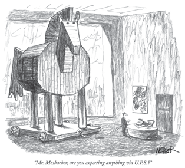

> **Descripción de la imagen** — Es un dibujo a lápiz o boceto en blanco y negro que representa una escultura o estatua monumental de un caballo.
>
> El caballo es grande y está representado de forma estilizada, de pie sobre cuatro patas. La figura tiene una postura imponente y parece estar colocada dentro de un espacio interior, con elementos arquitectónicos simples como paredes y una abertura (posiblemente una puerta o ventana) en el fondo.
>
> Debajo del dibujo se encuentra un texto que dice: "Mr. Mosbacher, are you expecting anything via U.P.S?".

de tiempo en una negociación parece reducir las exigencias del negociador,12 y cuando un
negociador representa a un grupo, una presión de tiempo parece reducir la probabilidad
de alcanzar un acuerdo.13 Manipular una fecha de terminación o no acordar una fecha de
terminación específi ca pueden ser recursos poderosos en manos de quien no enfrenta la
presión de esa fecha. En cierta manera, el arma defi nitiva en una negociación es amenazar
con concluir las negociaciones, lo cual impide a ambas partes alcanzar un acuerdo. En
tal caso, un lado se sentirá más presionado que el otro, de modo que la amenaza es un
recurso potente. Hay tres maneras de manipular el costo de un retraso en una negocia-
ción: 1) planifi car una acción de interrupción, 2) formar una alianza con personas externas
y 3) manipular el programa de las negociaciones.

Acción de interrupción Una manera de alentar una solución es aumentar los costos de
no alcanzar un acuerdo negociado mediante una maniobra de interrupción. En un caso,
un grupo de trabajadores sindicalizados de la industria de los alimentos que negociaban
con un restaurante reunieron a simpatizantes y los hicieron entrar en el local justo antes
de la hora de la comida, con la instrucción de que todos pidieran una taza de café y la
bebieran con toda calma. Cuando los clientes habituales llegaron a comer, encontraron

12  De Dreu, 2003.
13  Mosterd y Rutte, 2000.

“Señor Mosbacher, ¿espera algo del servicio de mensajería?”

© 2002 Colección de The New Yorker de cartoonbank.com. Todos los derechos reservados.

---

<!-- página 61 -->

Capítulo 2 Estrategia y tácticas de una negociación distributiva
44

ocupados todos los asientos.14 En otro caso, las personas insatisfechas con los automóviles
que compraron a cierto distribuidor pintaron en sus vehículos enormes limones amarillo
brillante y el nombre del distribuidor, y los condujeron por los alrededores en un esfuerzo
por avergonzar al distribuidor y alcanzar un acuerdo. Formar grupos de huelga en un nego-
cio, boicotear un producto o una empresa y encerrar a los negociadores en una habitación
hasta lograr un acuerdo son formas de acciones de interrupción que aumentan los costos
para los negociadores por no conciliar y, por tanto, los hacen regresar a la mesa de nego-
ciación. Estas prácticas pueden funcionar, pero también generan enojo y la intensifi cación
del confl icto.

Alianza con personas externas Otro modo de aumentar los costos de retrasar o con-
cluir las negociaciones es incorporar al proceso a otras partes que infl uyan en el resultado.
En muchas transacciones empresariales, una parte privada puede sugerir que si no tienen
éxito las negociaciones con un vendedor acudirán a una dependencia gubernamental para
protestar por las acciones del vendedor. Las personas insatisfechas con las prácticas y po-
líticas de los negocios o las agencias gubernamentales forman fuerzas de tarea, grupos de
acción política y organizaciones de protesta para generar una presión colectiva sobre el
objetivo. Por ejemplo, los consumidores de servicios públicos individuales suelen mejorar
sus negociaciones con los proveedores del servicio público sobre las tarifas y servicios al
consumidor mencionando el cumplimiento con los lineamientos de comisiones para dichos
servicios para sustentar sus solicitudes.

Manipulación del programa El proceso de programar una negociación suele colocar a
una parte en una desventaja considerable, y esta agenda sirve para aumentar la presión de
tiempo en las negociaciones. Los empresarios que recorren grandes distancias para negociar
con los clientes o proveedores suelen encontrar que las negociaciones están programadas
para comenzar inmediatamente después de su llegada, cuando todavía sufren del cansancio
del viaje y la descompensación por el cambio de horario. O bien, la parte anfi triona utiliza
tácticas de retraso para presionar las negociaciones en los últimos minutos de una sesión
con el fi n de obtener concesiones de la parte visitante.15 Es probable que los vendedores
de automóviles negocien de manera distinta con un cliente media hora antes del cierre del
negocio el sábado que al comienzo de la jornada del lunes. Los compradores industriales
enfrentan una negociación mucho más difícil cuando tienen poco tiempo de preparación
porque sus plantas pueden quedar inactivas si no consiguen a tiempo un contrato nuevo de
materias primas.

Posiciones adoptadas durante la negociación

Los negociadores distributivos efi cientes necesitan comprender el proceso de adoptar posi-
ciones durante la negociación, lo cual incluye la importancia de la oferta inicial y la postura
inicial, así como la utilidad de hacer concesiones durante una negociación.16 Al comienzo
de las negociaciones, cada parte adopta una posición. Después, una parte suele cambiar su

14 Jacobs, 1951.
15 Cohen, 1980.
16 Véase Tutzauer, 1992.

---

<!-- página 62 -->

45
Posiciones adoptadas durante la negociación

posición en respuesta a la información y a la conducta de la otra parte. La posición de la
otra parte también suele cambiar durante la negociación. Los cambios de posición suelen
acompañarse de nueva información acerca de las intenciones de la otra parte, el valor de
los resultados y las zonas de conciliación. Una negociación es iterativa. Ofrece una oportu-
nidad para que ambas partes comuniquen información sobre sus posiciones que provoque
cambios en ellas.

Ofertas iniciales

Cuando comienzan las negociaciones, el negociador enfrenta un problema confuso. ¿Cuál
debe ser la oferta inicial? ¿La considerará muy baja o muy alta el otro negociador y la
rechazará con desdén? Tal vez una oferta considerada modesta por la otra parte hubiese
podido ser más alta para dejar más espacio de maniobras o para lograr una conciliación
fi nal más alta. ¿La oferta inicial debe estar más cerca del punto de resistencia, para sugerir
una postura más cooperadora? Estas preguntas se aclaran cuando el negociador conoce
más los límites y la estrategia planeada de la otra parte. Si bien el conocimiento acerca de
la otra parte ayuda al negociador a establecer sus ofertas iniciales, no le indica qué hacer
con exactitud.

La pregunta fundamental es si la oferta inicial debe ser exagerada o modesta. Los
estudios indican que los negociadores que hacen ofertas iniciales exageradas alcanzan con-
ciliaciones más altas que quienes hacen ofertas iniciales bajas o modestas.17 Hay al menos
dos razones para que una oferta inicial exagerada sea provechosa.18 Primero, proporciona al
negociador espacio para moverse y, por tanto, tiempo para conocer las prioridades de la otra
parte. Segundo, una oferta inicial exagerada funciona como un metamensaje, y puede dar
a la otra parte la impresión de que 1) hay que recorrer un largo camino antes de lograr una
negociación razonable, 2) tal vez tengan que hacerse más concesiones que las originalmente
planeadas para acortar la diferencia entre las dos posiciones iniciales y 3) la otra parte pudo
haber calculado de manera incorrecta su propio punto de resistencia.19 Dos desventajas de
una oferta inicial exagerada son que 1) puede rechazarse sin miramientos por otra parte, y
2) comunica una actitud de dureza que pueden dañar las relaciones de largo plazo. Cuanto
más exagerada sea la oferta, mayor es la probabilidad de que la otra parte la rechace tajan-
temente. Por tanto, los negociadores que hacen ofertas iniciales exageradas también deben
tener opciones viables si el negociador contrario se rehúsa a tratar con ellos.

La postura inicial

Una segunda decisión que debe tomarse al inicio de una negociación distributiva se re-
laciona con la postura o actitud durante la negociación. ¿Se mostrará usted competitivo
(y luchará para obtener lo mejor de cada punto) o moderado (dispuesto a hacer concesio-
nes y compromisos)? Algunos negociadores adoptan una postura beligerante, atacan las

17  Véanse Brodt, 1994; Chertkoff y Conley, 1967; Cohen, 2003; Donohue, 1981; Hinton, Hamner y Pohlan,
1974; Komorita y Brenner, 1968; Liebert, Smith y Hill, 1968; Pruitt y Syna, 1985; Ritov, 1996; Van Poucke
y Buelens, 2002; Weingart, Thompson, Bazerman y Carroll, 1990.
18  Para un análisis adicional de estos puntos, véanse Pruitt, 1981, y Tutzauer, 1991.
19  Putnam y Jones, 1982; Yukl, 1974.

---

<!-- página 63 -->

Capítulo 2 Estrategia y tácticas de una negociación distributiva
46

posiciones y las ofertas, e incluso el carácter de la otra parte. En respuesta, la otra parte
puede refl ejar la postura inicial y enfrentar la beligerancia con beligerancia. Aunque la otra
parte no manifi este una postura beligerante, no es probable que responda de manera cálida
y abierta. Algunos negociadores adoptan una posición de moderación y comprensión, que
parece decir “seamos personas razonables que pueden resolver esta cuestión para nuestra
mutua satisfacción”. Aunque no se refl eje esta actitud, es probable que la respuesta de la
otra parte quede limitada por tal postura inicial moderada.

Es importante que los negociadores analicen con cuidado el mensaje que pretenden
comunicar con su postura inicial y las concesiones subsecuentes, porque existe la tendencia
de que los negociadores respondan “de la misma manera” a las prácticas distributivas en una
negociación.20 Es decir, los negociadores tienden a igualar las prácticas distributivas de la
otra parte con las propias, de modo que deben tomar una decisión consciente acerca de lo
que indican a la otra parte con su postura inicial y las concesiones subsecuentes.

Para comunicarse con efi cacia, el negociador debe enviar un mensaje que coincida
con la oferta y la postura iniciales.21 Una posición de negociación razonable suele generar
una postura amigable, y una posición de negociación exagerada suele acompañarse de una
postura competitiva más dura. Cuando están en confl icto los mensajes enviados por la oferta
y la postura iniciales, la otra parte tendrá difi cultades para interpretarlos y contestarlos. En
el capítulo 8 exploraremos con detalle las consideraciones éticas.

Concesiones iniciales

Una oferta inicial suele generar una contraoferta, y estas dos ofertas defi nen el rango de la
negociación inicial. A veces la otra parte no genera una contraoferta, sino tan sólo decla-
ra que la primera oferta (o conjunto de demandas) es inaceptable y pide al primer negocia-
dor que vuelva con propuestas más razonables. En todo caso, después de la primera ronda
de ofertas, la pregunta siguiente es, ¿qué movimiento o concesiones se van a realizar? Los
negociadores pueden decidir no hacer ninguna, mantenerse fi rmes e insistir en la posición
original, o pueden dar algunas concesiones. Observe que no es una opción para aumentar
la oferta inicial propia, es decir, alejar la oferta del punto objetivo de la otra parte más que la
primera oferta. En todos los casos, esto generaría la desaprobación del otro negociador. Si
van a hacerse concesiones, la siguiente pregunta es, ¿cuán amplias deben ser? Observe que
la primera concesión comunica un mensaje, a menudo simbólico, a la otra parte acerca de
cómo continuarán negociando.

Las ofertas iniciales, las posturas iniciales y las concesiones iniciales son elementos
del principio de una negociación con que las partes comunican cómo pretenden negociar.
Una oferta inicial exagerada, una postura inicial determinada y una concesión inicial muy
pequeña indican una posición de fi rmeza; una oferta inicial moderada, una postura inicial
razonable y cooperadora, y una concesión inicial razonable comunican una postura básica
de fl exibilidad. Al adoptar una posición fi rme, los negociadores intentan captar gran parte
del rango de negociación, con el fi n de maximizar su resultado fi nal o conservar el máximo
espacio de maniobra para después en la negociación. La fi rmeza también crea un clima en

20  Weingart, Prietula, Hyder y Genovese, 1999.
21  Eyuboglu y Buja, 1993.

---

<!-- página 64 -->

47
Posiciones adoptadas durante la negociación

el cual la otra parte puede decir que las concesiones son tan escasas que puede rendirse y
conciliar rápidamente en vez de alargar las cosas. Es una paradoja que la fi rmeza en realidad
acorte las negociaciones.22 Sin embargo, también existe la posibilidad muy real de obtener
fi rmeza como respuesta. Una o ambas partes pueden volverse intransigentes o disgustarse
y retirarse por completo.

Hay buenas razones para adoptar una posición fl exible.23 Primero, al adoptar dife-
rentes posturas durante una negociación, uno puede conocer los objetivos de la otra parte
y las posibilidades percibidas al observar cómo responde a las diferentes propuestas. Los
negociadores pueden establecer una relación cooperadora en vez de combativa, en espera
de obtener un mejor acuerdo. Además, la fl exibilidad hace avanzar la negociación; cuanto
más fl exible parece uno, más posible es que la otra parte confíe en una conciliación.

El papel de las concesiones

Las concesiones son fundamentales en una negociación. De hecho, sin ellas las negocia-
ciones no existirían. Si una parte no está preparada para hacer concesiones, la otra debe ca-
pitular o las negociaciones llegarán a un callejón sin salida. Las personas entran en las ne-
gociaciones en espera de concesiones. Los negociadores quedan menos satisfechos cuando
las negociaciones concluyen con la aceptación de su primera oferta, tal vez porque sienten
que podrían haberlo hecho mejor.24 Las concesiones inmediatas se perciben como menos
valiosas que las más graduales y retardadas, que parecen incrementar el valor percibido de
la concesión.25 Los buenos concertadores distributivos no comenzarán las negociaciones
con una oferta inicial demasiado cercana a su propio punto de resistencia, sino que se
asegurarán de que exista sufi ciente espacio en el rango de negociación para hacer algunas
concesiones. La investigación sugiere que las personas generalmente aceptan la primera o
segunda oferta que sea mejor que el punto objetivo,26 de modo que los negociadores de-
ben tratar de identifi car con exactitud el punto objetivo de la otra parte y evitar ceder muy
rápido en ese punto.

Cuantiosos datos muestran que las partes se sienten mejor con una negociación cuando
incluye concesiones que cuando no las hubo.27 Rubin y Brown sugieren que los negociado-
res quieren creer que son capaces de moldear la conducta de la otra parte, de hacer que la
otra parte tome una decisión.28 Como las concesiones señalan un reconocimiento de la otra
parte y un acercamiento a su posición, implican el reconocimiento y legitimidad de esa posi-
ción. Los factores intangibles de estatus y reconocimiento pueden ser tan importantes como
las cuestiones tangibles mismas. Las concesiones exponen a cierto riesgo a quien las hace.
Si la otra parte no es recíproca, quien las concede puede parecer débil. Por tanto, no hacer
una concesión recíproca envía un poderoso mensaje acerca de la fi rmeza y deja a quien la
otorga abierto a la sensación de que su estima ha sido dañada, o su reputación, disminuida.

22  Véase Ghosh, 1996.
23  Olekalns, Smith y Walsh, 1996.
24  Galinsky, Seiden, Kim y Medvec, 2002.
25  Kwon y Weingart, 2004.
26  Véanse Rapoport, Erev y Zwick, 1995.
27  Véanse Baranowski y Summers, 1972; Crumbaugh y Evans, 1967; Deutsch, 1958, y Gruder y Duslak, 1973.
28  Rubin y Brown, 1975.

---

<!-- página 65 -->

Capítulo 2 Estrategia y tácticas de una negociación distributiva
48

Una concesión recíproca no puede ser fortuita. Si una parte hizo una concesión im-
portante en un punto signifi cativo, se espera que la oferta de respuesta sea sobre el mismo
aspecto o uno con el mismo peso y de una magnitud comparable. Hacer una concesión
adicional cuando no se recibió ninguna (o cuando la concesión de la otra parte fue inade-
cuada) implica debilidad y puede desperdiciar un valioso espacio de maniobra. Después de
recibir una concesión inadecuada, los negociadores pueden declarar de manera explícita lo
que esperaban antes de ofrecer más concesiones, por ejemplo: “eso no es sufi ciente, tendrá
que conceder X antes de que consideremos cualquier otra concesión”.

Para estimular concesiones adicionales de una parte, a veces los negociadores vinculan
sus concesiones con una concesión anterior hecha por el otro. Pueden decir: “como redujo
su exigencia acerca de X, estamos dispuestos a ceder en Y”. Una poderosa forma de con-
cesión implica incluir una concesión en paquete. Por ejemplo, “si usted avanza en A y B,
seremos fl exibles en C y D”. Las concesiones en paquete generan mejores resultados que
las concesiones únicas en cuestiones individuales.29 Un paquete particularmente efectivo
es conceder más en cuestiones de baja prioridad para ganar más en cuestiones de alta prio-
ridad. Ésta es una táctica de la negociación integradora, conocida como ayuda recíproca, y
se aborda en el capítulo 3.

Esquema de otorgamiento de concesiones

El esquema de las concesiones que hace un negociador contiene información valiosa, pero
no siempre es fácil de interpretar. Cuando las concesiones posteriores son menores, el
mensaje obvio es que la posición de quien las hace se torna más fi rme y se acerca al punto
de resistencia. Sin embargo, es necesario moderar esta generalización al señalar que una
concesión tardía en las negociaciones también indica que queda poco espacio para avanzar.
Cuando la oferta inicial es exagerada, el negociador tiene amplio margen para ofrecer un
paquete de ofertas nuevas, lo cual hace relativamente fácil otorgar concesiones más sus-
tanciales. Cuando la oferta o la contraoferta se acerca al punto objetivo de un negociador,
otorgar una concesión del mismo tamaño que la inicial puede llevar al negociador más
allá del punto de resistencia. Suponga que un negociador hace una primera oferta de 100
dólares menos del precio objetivo de la otra parte; una concesión inicial de 10 dólares
reduciría 10% el espacio de maniobra. Cuando las negociaciones están a menos de 10 dó-
lares del precio objetivo de la otra parte, una concesión de 1 dólar entrega 10% del espacio
de maniobra restante. El negociador no siempre comunica tales proporciones al otorgar o
interpretar las concesiones, pero este ejemplo muestra la forma en que el receptor puede
confundir el signifi cado del tamaño de una concesión según el momento en el proceso de
negociación.

También es importante el esquema al otorgar las concesiones. Véase el esquema de
las concesiones de dos negociadores, George y Mario, de la fi gura 2.4. Suponga que los
negociadores analizan el precio unitario de un embarque de piezas para computadora, y
que cada uno trata con un cliente diferente. Mario hace tres concesiones, cada una con un
valor de 4 dólares por unidad, para un total de 12 dólares. En contraste, George hace cuatro
concesiones, con un valor de 4, 3, 2 y 1 dólares por unidad, para un total de 10 dólares.

29  Véanse Froman y Cohen, 1970; Neale y Bazerman, 1991, y Pruitt, 1981.

---

<!-- página 66 -->
### 49
Posiciones adoptadas durante la negociación

Tanto Mario como George quieren indicar a sus contrapartes que consiguieron todo lo que
pueden. Al afi rmar esto, es más probable que le crean a George, porque señaló en el esque-
ma de concesiones que no le queda mucho por ceder. Cuando Mario afi rma que le queda
poco por conceder, es menos probable que sus contrapartes le crean porque su esquema de
concesiones (tres concesiones por la misma cantidad) sugiere que queda mucho por ceder,
aunque Mario ha cedido más que George.30 Observe que no hemos tomado en cuenta los
argumentos de Mario y de George al hacer estas concesiones. También es importante justi-
fi car las concesiones a la otra parte, en especial si implican reducciones de precio.31 La otra
parte interpreta nuestra conducta y palabras cuando negociamos; es importante indicar a la
otra parte, con nuestras acciones y palabras, que las concesiones casi llegaron a su límite.

En negociaciones que involucran varios temas, los negociadores experimentados su-
gieren diversas formas de acuerdos potenciales que valen casi lo mismo para ellos. Recono-
cen que no todos los temas valen lo mismo para ambas partes. Por ejemplo, en un convenio
de compra, un negociador puede interesarse sólo en la ganancia total de un paquete y no en
que termine de pagarse en un mes sin intereses o en seis meses con fi nanciamiento a la tasa
de interés vigente. Sin embargo, la extensión del periodo de repago puede ser crítica para
la otra parte si tiene un problema de liquidez; dicha parte puede estar dispuesta a pagar los
intereses del fi nanciamiento a cambio de repartir los pagos en seis meses. De hecho, las
diversas combinaciones de capital, tasa de interés y periodo de pago pueden tener el mismo
valor para una parte pero un valor totalmente diferente para la otra.

30  Véase Yukl, 1974.
31  Yama, 2004.

0
1
2
3
4
5

1

2

3

4

Cantidad de concesiones

Magnitud de las concesiones (en dólares)

= concesiones de George
= concesiones de Mario
X
Y

Y
Y
X,Y

X

X

X

5

FIGURA 2.4
Esquema de otorgamiento de concesiones para dos negociadores.

---

<!-- página 67 -->

Capítulo 2 Estrategia y tácticas de una negociación distributiva
50

Ofertas fi nales

En algún momento un negociador quiere comunicar el mensaje de que no hay más espacio
para moverse, que su oferta actual es la defi nitiva. Un buen negociador dirá: “esto es todo
lo que puedo hacer” o “hasta aquí puedo llegar”. Sin embargo, en ocasiones es evidente
que no basta una simple declaración; una opción es hacer concesiones para comunicar el
punto. Un negociador sencillamente puede dejar que la ausencia de concesiones adiciona-
les comunique el mensaje a pesar de la solicitud de la otra parte. La otra parte tal vez no
reconozca al principio que la última oferta fue la defi nitiva y puede acceder a una conce-
sión adicional para obtener una respuesta. Al comprobar que no hay más concesiones, la
otra parte puede sentirse traicionada y percibir que se violó el esquema de concesión-contra
concesión. El enojo resultante puede complicar las negociaciones.

Una manera en que los negociadores comunican el mensaje de que una oferta es la de-
fi nitiva es hacer más sustancial la última concesión. Esto implica que el negociador ofrece
el resto de su rango de negociación. La oferta fi nal tiene que ser lo bastante grande para
ser notoria, pero no tanto que levante la sospecha de que el negociador se contuvo y tiene
más concesiones disponibles para otros asuntos en la mezcla de la negociación.32 También
es posible personalizar una concesión para la otra parte (“Acudí con mi jefe y obtuve un
acuerdo especial sólo para usted”), lo cual señala que ésta es la última concesión que hará
el negociador.

Compromiso

El compromiso es un concepto clave para crear una posición de negociación. Una defi -
nición de compromiso es asumir una posición de negociación con una promesa explícita
o implícita respecto del futuro curso de acción.33 Un ejemplo es el agente de deportistas
que dice al gerente general de un equipo deportivo profesional: “Si no obtenemos el sa-
lario que deseamos, mi jugador no se presentará el próximo año.” Este acto identifi ca la
posición del negociador y promete una acción futura si no se satisface dicha posición. El
propósito del compromiso es aclarar ambigüedades respecto del curso de acción que inten-
ta tomar el negociador. Al hacer un compromiso, un negociador indica su curso de acción,
toma esta decisión o persigue este objetivo; el negociador dice: “Si tú también persigues tu
meta, es posible que entremos en confl icto; o uno de nosotros gana, o ninguno conseguirá
sus objetivos.” El compromiso reduce también las opciones de la otra parte; está diseñado
para restringir a la otra parte a un reducido portafolio de opciones.

A menudo, el compromiso se entiende como amenaza por la otra parte: si el otro no
cumple o cede, ocurrirán ciertas consecuencias negativas. Algunos compromisos pueden
ser amenazas, pero otros son meras declaraciones de que se llevarán a cabo ciertas acciones
que dejarán la responsabilidad de evitar el desastre mutuo en manos de la otra parte. Una
nación que declara públicamente que va a invadir a otro país y que la guerra puede evitarse
sólo si ninguna otra nación trata de impedir la invasión está haciendo un compromiso franco
y dramático. Los compromisos también pueden implicar futuras promesas, como “si obte-
nemos el aumento de salario, aceptaremos todos los demás puntos tal como los plantearon”.

32  Walton y McKersie, 1965.
33  Ibid., p. 82.

---

<!-- página 68 -->

51
Compromiso

Por su naturaleza, los compromisos son declaraciones que suelen requerir un cumpli-
miento de la acción prometida. Un negociador que promete consecuencias (por ejemplo, el
jugador no se presentará el año siguiente) y no obtiene lo que deseaba en la negociación,
perderá credibilidad en el futuro a menos que actúe en consecuencia (es decir, que el ju-
gador no se reporte a los entrenamientos). Además, una persona perjudica su reputación
si no cumple con un compromiso que hizo público. Por tanto, una vez que un negociador
hace un compromiso, hay una fuerte motivación para sostenerlo. Como la otra parte tal vez
entiende esto, una vez aceptado el compromiso, a menudo tendrá un fuerte efecto en lo que
la otra parte crea posible.34

Consideraciones tácticas al utilizar los compromisos

Como muchas herramientas, los compromisos tienen un doble fi lo. Pueden servir para
obtener las ventajas ya descritas, pero también encerrar a un negociador en un punto o po-
sición particular. Los compromisos intercambian la fl exibilidad por una certeza de acción,
pero crean difi cultades si uno desea moverse a una nueva posición. Por ejemplo, suponga
que después de comprometerse a determinado curso de acción descubre información adi-
cional que le indica que es deseable que asuma una nueva posición, por ejemplo, algunos
datos que muestren que su estimado original del punto de resistencia de la otra parte era
erróneo y que de hecho existe un rango de negociación negativa. Puede ser deseable o in-
cluso necesario cambiar de posición después de hacer un compromiso. Por estas razones,
cuando uno hace un compromiso debe tener también planes de contingencia para realizar
una graciosa salida de ser necesario. Para que el compromiso original sea efi caz, el plan
de contingencia debe ser secreto. Por ejemplo, el agente del jugador puede haber planeado
retirarse después del cierre esperado de las negociaciones. Al adelantar su retiro, el agente
puede, por tanto, cancelar el compromiso y dejar al siguiente negociador en libertad de
acción. El comprador de un condominio puede estar en posibilidades de retractarse de un
compromiso de compra al descubrir las grietas hasta ahora no visibles en el aplanado de la
sala, o no ser capaz de obtener fi nanciamiento bancario.

Los compromisos pueden ser útiles para usted como negociador, pero le será ventajoso
evitar que la otra parte haga sus propios compromisos. De hecho, si la otra parte toma una
posición comprometida, la ventaja de usted será mantener abierta una o dos vías de escape
para que él o ella puedan salirse del compromiso. La siguiente sección examina estas cues-
tiones tácticas con más detalle.

Establecer un compromiso

Si durante la negociación se expresan declaraciones fuertes y apasionadas, algunas de las
cuales son sólo bravuconadas, ¿cómo establece un negociador que dicha declaración debe
entenderse como compromiso? Una declaración de compromiso tiene tres propiedades: un
alto grado de fi nalidad, un alto grado de especifi cidad y una declaración clara de las conse-
cuencias.35 Un comprador puede decir: “Necesitamos un descuento por volumen, o habrá

34  Pruitt, 1981.
35  Walton y McKersie, 1965.

---

<!-- página 69 -->

Capítulo 2 Estrategia y tácticas de una negociación distributiva
52

problemas.” Esta declaración es menos fuerte que “debemos tener un 10% de descuento
por volumen en el siguiente contrato, o el próximo mes fi rmaremos con otro proveedor”.
La última declaración comunica fi nalidad (cuándo y cómo debe concederse el descuento
por volumen), especifi cidad (cuál es el descuento esperado por volumen) y una clara de-
claración de las consecuencias (exactamente qué ocurrirá si no se otorga el descuento). Es
mucho más fuerte que la primera declaración, más difícil de librarse de ella. A continuación
se exponen diversas formas de crear un compromiso.

Pronunciamiento público Una declaración de compromiso aumenta su potencia mien-
tras más gente la conozca. La declaración del agente deportivo de que su jugador estará
en la banca la siguiente temporada tendría un impacto distinto si se realiza durante un pro-
grama deportivo de televisión que si se emite sólo en la mesa de negociaciones. Algunas
partes en negociación convocan a conferencias de prensa o colocan anuncios en los pe-
riódicos o en otras publicaciones asentando lo que quieren y qué pasará si no lo obtienen.
En estas situaciones, mientras mayor sea la audiencia, menos probable será que cambie el
compromiso. El efecto de un contexto social más amplio en las negociaciones se verá en
el capítulo 9.

Vincularse con una base externa Otra forma de reforzar un compromiso es procurarse
uno o más aliados. Los empleados insatisfechos con la empresa pueden formar un comité
para expresar sus preocupaciones. Las asociaciones industriales pueden formar una coa-
lición para establecer normas estándar para un producto. Ocurre una variación de este
proceso cuando los negociadores crean condiciones que les difi cultan romper con un com-
promiso ya adquirido. Por ejemplo, al alentar el establecimiento de colonias en la Ribera
Oeste cerca de Jerusalén, el gobierno israelí difi cultó que Israel concediera tierras a los
palestinos, un punto que los israelíes querían reforzar al principio.

Elevar la prominencia de las demandas Se pueden hacer muchas cosas para elevar la
prominencia de las declaraciones de compromiso. Si la mayoría de las ofertas y concesio-
nes fue verbal, redactar una declaración puede llamar la atención hacia el compromiso. Si
las declaraciones previas están por escrito, entonces utilizar una fuente de otro tamaño o un
papel de otro color resaltará la nueva declaración. El punto se refuerza mediante diferentes
canales de comunicación para transmitir un compromiso: por ejemplo, al informar a la otra
parte sobre el compromiso, después darle una declaración escrita, luego leer en voz alta la
declaración y por último hacerla circular entre los demás.

Reforzar la amenaza o la promesa Cuando se amenaza, existe el riesgo de ir demasiado
lejos: afi rmar un punto de esta manera tan fuerte puede hacer que usted se vea débil o ab-
surdo, más que amenazador. Es más probable que las declaraciones como “¡Si no obtengo
una concesión en este punto, me encargaré de que no sigas en este negocio ni un día más!”
se reciban con molestia o desdén que con preocupación o conformidad. Las declaraciones
extensas, detalladas y muy exageradas minan la credibilidad. En contraste, las declaracio-
nes sencillas y directas de demandas, condiciones y consecuencias son más efi caces.

Se pueden hacer muchas cosas para reforzar la amenaza explícita o implícita en un
compromiso. Una es recordar circunstancias semejantes y sus consecuencias, y otra es
realizar obvias preparaciones para llevar a cabo la amenaza. Al enfrentar una amenaza
de huelga, las empresas realizan sus inventarios y establecen campamentos dentro de sus

---

<!-- página 70 -->

53
Compromiso

fábricas; los sindicatos reúnen fondos de huelga y aconsejan a sus miembros cómo salir
adelante con menos ingresos en caso de huelga. Otra ruta es crear y llevar a cabo amenazas
menores con antelación, lo que llevará a la otra parte a creer que las amenazas mayores se
cumplirán. Por ejemplo, un negociador puede decir: “si no se acelera el progreso de estas ne-
gociaciones, no voy a regresar a la mesa de negociaciones después de la comida”, y hacerlo.

Por último, las investigaciones sobre amenazas en la negociación sugieren que los
negociadores que amenazan se perciben como más fuertes que los negociadores que no lo
hacen.36 Sin embargo, esta percepción de un poder mayor no parece traducirse en mejo-
res resultados en la negociación para quienes amenazan. De hecho, quienes amenazan se
perciben también como menos cooperadores, y sus resultados en situaciones integradoras
parecen menores que los de negociadores que no amenazan.37 Las negociaciones integra-
doras se analizan con mayor detalle en el capítulo 3.

Evitar que la otra parte se comprometa prematuramente

Todas las ventajas de una posición comprometida operan contra el negociador cuando la
otra parte se compromete a su vez, así que es importante evitar que el otro negociador
emita su declaración de compromiso. A menudo, la gente asume posiciones comprometi-
das cuando se enoja o se siente acorralada; con frecuencia estos compromisos suelen ser
espontáneos y pueden actuar en contra de ambas partes. En consecuencia, los negociadores
deben prestar mucha atención al nivel de irritación, enojo o impaciencia de la otra parte.

Los compromisos buenos, sólidos y deliberados toman tiempo, por las razones que ya
vimos. Una forma de evitar que la otra parte asuma una posición comprometida es negarle
el tiempo necesario para hacerlo. En un trato inmobiliario en donde una opción está a punto
de agotarse, un vendedor puede dejar pasar el tiempo volviéndose inaccesible o solicitando
una extensa revisión de las escrituras y los límites, con lo que niega a un comprador poten-
cial el tiempo para hacer una oferta de última hora y, a la larga, permite que otro comprador
dispuesto a pagar más entre en la negociación. Otro método para evitar que la otra parte
asuma una posición comprometida es ignorar o minimizar una amenaza mediante el recur-
so de no reconocer el compromiso del otro, o incluso bromear al respecto. Un negociador
puede decir, con una sonrisa: “en realidad no quisiste decir eso” o “sé que no puedes estar
hablando en serio”, o tan sólo seguir con las negociaciones como si no hubiese escuchado
o entendido la declaración. Si el negociador puede fi ngir no escuchar la declaración de la
otra parte o no considerarla importante, será posible ignorar el compromiso más tarde sin
incurrir en las consecuencias que habrían ocurrido si se le hubiera tomado en serio. Aunque
el otro negociador todavía puede cumplir su amenaza, quizá pierda fuerza la noción de que
debe hacerlo.

No obstante, a veces, si una parte asume un compromiso, le da ventaja a la otra. Cuando
una parte adopta una posición sobre un tema en una etapa relativamente temprana de la
negociación, puede ser muy ventajoso para el negociador consolidar dicha posición para
que no cambie a medida que avanza la negociación sobre otros temas. Un negociador puede
manejar esta situación en una de dos formas: identifi car la importancia de un compromiso

36  Véanse De Dreu, 1995; Shapiro y Bies, 1994.
37  Shapiro y Bies, 1994.

---

<!-- página 71 -->

Capítulo 2 Estrategia y tácticas de una negociación distributiva
54

cuando se declara o tomar nota y hacer un seguimiento de las declaraciones del otro. Un
empleado puede estar muy molesto con la manera de manejar cierto problema, pero también
puede decir que nunca se enojará lo bastante para renunciar. El gerente puede enfocarse
en este punto en el momento en que se declara o mencionarlo después si el empleado no
se calma. Ambas acciones están diseñadas para evitar que el empleado tome una decisión
drástica cegado por el coraje y puede permitir un periodo de enfriamiento antes de reiniciar
las discusiones.

Encontrar formas de abandonar una posición comprometida

Con frecuencia, los negociadores quieren sacar a la otra parte de una posición comprome-
tida, y muchas veces esa parte también quiere salirse de ella. ¿Cómo hacerlo? Sugerimos
cuatro vías de escape de los compromisos.

Planee una salida Ya vimos un método: cuando se establece un compromiso, el nego-
ciador debe planear al mismo tiempo y en secreto una forma de salirse de él. El negociador
también puede replantear un compromiso para indicar que ya cambiaron las condiciones
en las que aplica. En ocasiones, la información proporcionada por la otra parte durante
las negociaciones puede permitir a un negociador decir: “Con lo que me has dicho duran-
te esta discusión, creo que tendré que recapacitar sobre mi postura inicial.” La otra parte
puede hacer lo mismo. Un negociador que quiera facilitar a la otra parte abandonar una
posición comprometida sin perder credibilidad puede afi rmar: “Por lo que te dije respecto
de la situación (o de acuerdo con esta nueva información), creo que puedes ver que tu
posición inicial ya no aplica.” No es necesario agregar que lo último que un negociador
quiere es avergonzar a la otra parte o criticar su cambio de posición; en vez de eso, es
necesario dar a la otra parte toda la oportunidad de retractarse con dignidad y sin perder
la galanura.

Que se desvanezca en silencio Una segunda forma de abandonar un compromiso es
dejar que el asunto se diluya sin más. Después de cierto tiempo, un negociador puede hacer
una nueva propuesta en el área del compromiso sin mencionar la anterior. Una variación de
este proceso es dar pasos tentativos en una dirección previamente excluida por el compro-
miso del otro. Por ejemplo, un empleado que afi rmó que nunca aceptará realizar cierto tipo
de trabajo puede recibir la petición de considerar los benefi cios para su carrera de un puesto
“temporal” en dicha labor. En las instituciones burocráticas se introducen cambios como
“experimentos innovadores” para ver si funcionan antes de instrumentarse formalmente.
Si la otra parte, en respuesta a cualquiera de estas variaciones, indica con su silencio o un
comentario verbal su disposición a dejar que las cosas vayan en esa dirección, debe permi-
tirse que la negociación progrese.

Replantear el compromiso Una tercera ruta es replantear el compromiso en términos
más generales. La parte que desea abandonar el compromiso hará una nueva propuesta con
algunos detalles distintos para estar más en la línea de sus necesidades actuales mientras
todavía se atiene ostensiblemente a los principios generales de su declaración inicial. Por
ejemplo, el agente de compras que exigió 10% de descuento por volumen puede replantear
su declaración después para decir que sólo necesita un descuento signifi cativo por volu-
men. La otra parte podrá entonces explorar el nivel de ese descuento “signifi cativo”.

---

<!-- página 72 -->

55
Cerrar el acuerdo

Reducir daños Finalmente, si la otra parte se retracta de una posición comprometida,
es importante auxiliarlo para no perder credibilidad, lo cual signifi ca ayudarle a disminuir
cualquier posible daño a su autoestima o a sus relaciones constitutivas. Una estrategia para
esto sería una declaración pública acerca de que la otra parte se unió a otra causa más noble
o más alta. Los diplomáticos pueden retractarse de una posición comprometida debido a
su profunda preocupación por la paz y la humanidad. Un vendedor o un comprador puede
retractarse de un punto determinado durante una transacción inmobiliaria para apoyar el
bienestar de la comunidad. Los gerentes pueden abandonar una posición comprometida por
el bien de la compañía.

La posición comprometida es una herramienta poderosa de la negociación, pero tam-
bién es una herramienta muy rígida y por tanto hay que usarla con cuidado. Como con
cualquier otra herramienta, debemos estar tan alerta para encontrar formas de negársela a
la otra parte como para descubrir maneras de usarla en nuestro benefi cio. Por desgracia,
muchos compromisos se realizan impulsivamente, por enojo o por un deseo de dejar de
hacer concesiones, en vez de ser resultado de una planeación táctica bien pensada. En
todo caso, el efecto esencial de una posición comprometida es retirar un tema de cualquier
discusión posterior: ya no hacerlo negociable salvo con un grave riesgo para una o ambas
partes. La posición comprometida tiene que ser creíble y parecer inevitable: si sucede X,
Y es inevitable. Convencer a la otra parte de que la suerte está echada respecto del asunto
que se está tratando es una tarea demandante y requiere preparación, tiempo y habilidad. En
consecuencia, salirse de una posición comprometida no es fácil, pero el proceso se simpli-
fi ca si planeamos vías de escape en el momento de hacer la declaración. Muchas medidas
que un negociador puede tomar para salirse de un compromiso sirven también para ayudar
a la otra parte a abandonar una posición comprometida o, aún mejor, evitar que establezca
una en primer lugar.

Cerrar el acuerdo

Después de negociar durante un tiempo y conocer las necesidades, posiciones y tal vez el
punto de resistencia de la otra parte, el siguiente desafío para un negociador es cerrar
el acuerdo. Existen varias prácticas para que los negociadores cierren un acuerdo;38 elegir
la mejor táctica para una negociación específi ca es más arte que ciencia.

Ofrecer opciones En vez de hacer una sola oferta fi nal, los negociadores pueden pro-
porcionar dos o tres paquetes de opciones para la otra parte, con un valor más o menos
equivalente. A las personas les agrada tener opciones, y ofrecerlas a la otra parte es una
técnica muy efi caz para cerrar una negociación. Esta técnica también se utiliza cuando un
equipo de trabajo no puede decidir cuál recomendación hacer a la dirección. Si de hecho
hay dos soluciones que se pueden defender, el equipo de trabajo puede enviar ambas con
una descripción de los costos y benefi cios de cada una.

Suponer el cierre Los vendedores usan a menudo la técnica de suponer el cierre. Des-
pués de una discusión general acerca de las necesidades y posiciones del comprador, el

38  Véanse Cellich, 1997; Girard, 1989.

---

<!-- página 73 -->

Capítulo 2 Estrategia y tácticas de una negociación distributiva
56

vendedor saca un formulario de pedido y comienza a llenarlo. El vendedor pide primero el
nombre y la dirección del comprador antes de pasar a los puntos más serios (como precio o
modelo). Al usar esta técnica, los negociadores no preguntan a la otra parte si quiere hacer
una compra. Dirían, en cambio, algo como “¿comienzo con el papeleo?” y actuarían como
si ya se hubiese tomado la decisión de compra.39

Dividir la diferencia Dividir la diferencia es tal vez la táctica de cierre más común. El
negociador que emplee esta táctica ofrece un resumen de la negociación (“ambos dedica-
mos mucho tiempo, realizado muchas concesiones, etc.”) y después sugiere que, como los
objetivos están tan cerca, “¿por qué no dividimos la diferencia y ya?” Si bien ésta puede ser
una táctica de cierre efi caz, supone que las partes comenzaron con ofertas iniciales justas.
Un negociador que emplea una oferta inicial exagerada y después sugiere un cierre con la
diferencia dividida emplea una táctica de presión (consulte más adelante).

Ofertas a punto de estallar Una oferta a punto de estallar contiene una fecha de termina-
ción muy cercana para presionar a la otra parte y que acepte con rapidez, y es una versión
extrema de manipular la agenda de la negociación. Por ejemplo, una persona entrevistada
para un trabajo recibe una oferta con un sueldo y un paquete de prestaciones muy atrac-
tivos, pero también le indican que la oferta sólo dura 24 horas. El propósito de la oferta a
punto de estallar es convencer a la otra parte para aceptar y dejar de considerar las opcio-
nes. Esto es muy efi caz en situaciones donde la parte que recibe la oferta todavía está en el
proceso de desarrollar opciones que pueden o no resultar viables (como el candidato para
un empleo que todavía tiene entrevistas con otras empresas). Sin embargo, a las personas
les incomoda recibir ofertas a punto de estallar porque sienten que están bajo una presión
injusta. La oferta a punto de estallar parece funcionar mejor para las organizaciones que
tienen los recursos con los cuales hacer una oferta muy atractiva al inicio de una negocia-
ción para evitar que la otra parte siga buscando una oferta potencialmente superior.

Endulzantes Otra táctica de cierre es guardar una concesión especial para el cierre. Se
le dice al otro negociador: “además, le daremos X si acepta el acuerdo”. Por ejemplo, al
vender un condominio, para cerrar el acuerdo el propietario acepta incluir las cortinas, los
aparatos o las instalaciones de luz excluidas antes. Sin embargo, para utilizar esta táctica
con efi cacia, los negociadores necesitan incluir desde el principio los “endulzantes” en sus
planes de negociación, o pueden terminar por conceder demasiado en el cierre.

Tácticas de presión

Ahora analizaremos las tácticas de presión en una negociación. Muchos libros sobre nego-
ciación conocidos analizan tácticas de presión para vencer a la otra parte.40 Tales tácticas
están diseñadas para presionar a los negociadores a hacer cosas que no harían en otras
circunstancias, y su aplicación suele disfrazar la preferencia del usuario por un método de
negociación decididamente distributivo. No está claro exactamente con cuánta frecuencia

39  Véase Girard, 1989.
40  Por ejemplo, véanse Aaronson, 1989; Brooks y Odiorne, 1984; Cohen, 1980; Levinson, Smith y Wilson,
1999, y Schatzski, 1981.

---

<!-- página 74 -->

57
Tácticas de presión

o lo bien que funcionan estas tácticas, pero funcionan mejor contra negociadores mal pre-
parados. También pueden ser contraproducentes, y hay evidencias de que los negociadores
muy agresivos no son efi caces.41 A muchas personas las tácticas de presión les parecen
ofensivas y buscan una revancha cuando sienten que se aplican contra ellas. Muchos ne-
gociadores consideran que estas tácticas trascienden los límites de cualquier situación de
negociación. (La ética de la negociación se analiza en el capítulo 8.) No recomendamos las
técnicas siguientes. De hecho, hasta donde sabemos, estas tácticas ocasionan más daño que
benefi cio en las negociaciones. Es mucho más difícil ponerlas en práctica que leerlas, y cada
una implica un riesgo para la persona que las utiliza, como daño a su reputación, pérdida del
acuerdo, publicidad negativa y consecuencias por la venganza o represalias de la otra par-
te. No obstante, es importante que los negociadores comprendan las tácticas de presión y
cómo funcionan para que las reconozcan y detecten si se esgrimen contra ellos.

Cómo enfrentar las tácticas de presión comunes

El negociador que trata con otro que emplea tácticas de presión tiene varias opciones para
responder. Una buena respuesta estratégica a estas tácticas requiere que el negociador iden-
tifi que la táctica con rapidez y comprenda qué es y cómo funciona. Casi todas las tácticas
están diseñadas para mejorar el aspecto de la posición de negociación de la persona que
las utiliza o para demeritar el aspecto de las opciones disponibles de la otra parte. El mejor
modo de responder a una táctica depende de sus metas y del contexto más amplio de la
negociación (¿con quién negocia?, ¿cuáles son sus opciones?). Ninguna respuesta funciona
en todas las situaciones. Ahora analizaremos las cuatro opciones principales de los nego-
ciadores para responder a las tácticas de presión comunes.42

Ignorarlas Si bien ignorar una táctica de presión puede parecer una respuesta débil, de
hecho resulta muy poderosa. Se requiere mucha energía para utilizar algunas tácticas de pre-
sión descritas a continuación, y mientras la otra parte consume su energía en practicar estos
juegos, usted aprovecha la suya para satisfacer sus necesidades. No responder a una amena-
za suele ser la mejor manera de manejarla. Finja que no la escuchó. Cambie de tema y haga
que la otra parte se involucre en el tema nuevo. Pida un descanso y, al regresar, cambie el
tema. Todas estas opciones reducen los efectos de una amenaza y le permiten seguir impul-
sando sus objetivos, mientras la otra parte intenta decidir qué truco utilizar a continuación.

Analizarlas Fisher, Ury y Patton sugieren que un buen modo de enfrentar las tácticas de
presión es analizarlas, es decir, señalar la táctica e indicar a la otra parte que usted sabe
qué está haciendo.43 Luego se ofrece negociar el proceso de negociación mismo, incluidas
las expectativas de conducta de las partes, antes de continuar con lo principal de las pláti-
cas. Proponga cambiar a métodos de negociación menos agresivos. Reconozca de manera
explícita que la otra parte es un negociador duro, pero que usted también puede ser duro.
Después sugiera que ambos adopten métodos más productivos que permitan ganar a las dos

41  Schneider, 2002.
42  Véase en Fisher, Ury y Patton, 1991; Ury, 1991; Adler, Rosen y Sliverstein, 1996, un análisis más amplio de
estos puntos.
43  Fisher, Ury y Patton, 1991; Ury, 1991; Weeks, 2001.

---

<!-- página 75 -->

Capítulo 2 Estrategia y tácticas de una negociación distributiva
58

partes. Fisher, Ury y Patton sugieren que los negociadores saquen a las personas del proble-
ma y luego sean duros con el problema y suaves con las personas. Durante la negociación
es útil recordar esto al otro negociador de vez en cuando.

Responder igual  Siempre es posible responder a una práctica de presión con una propia.
Aunque esta respuesta puede provocar caos, generar resentimiento y ser contraproducen-
te, no es una opción que deba descartarse. Una vez que se disipa el humo, ambas partes
comprenderán que son hábiles en la utilización de tácticas de presión y reconocerán que
es el momento de intentar algo distinto. Responder de igual manera puede ser lo más útil
al tratar con una parte que pone a prueba sus respuestas, o como respuesta a posiciones
exageradas en las negociaciones. Un participante en un seminario sobre negociación contó
a uno de los autores la siguiente anécdota acerca de regatear por una alfombra en un país
del norte de África:

Yo sabía que el valor de la alfombra era de unos dos mil dólares, porque había estado viendo
alfombras durante mi viaje. Encontré la alfombra que buscaba y deseaba asegurarme de no
parecer muy interesado. Vi algunas otras alfombras con el vendedor antes de concentrarme en
la que de verdad quería. Cuando le pregunté el precio de la alfombra, me dijo que nueve mil
dólares. Le dije que le daría cinco mil dólares negativos. Regateamos por un rato y compré la
alfombra en dos mil dólares.

En esta negociación, el comprador claramente respondió con una táctica de presión
propia. Cuando se le preguntó si se sentía cómodo con su oferta inicial, respondió:

Claro, ¿por qué no? El vendedor sabía que el valor de la alfombra era de unos dos mil dólares.
De hecho, pareció respetarme cuando le regateé de esa forma. Si yo hubiera abierto con un
número positivo, hubiera terminado pagando más de lo que valía la alfombra. Y realmente la
quería.

Acercarse a la otra parte Otra manera de enfrentar a negociadores que utilizan tácticas
de presión agresivas es tratar de ofrecerles su amistad antes de que utilicen las tácticas con
usted. Este método se basa en la teoría de que es mucho más difícil atacar a un amigo que a
un enemigo. Si usted insiste en lo que ambos tienen en común y encuentra otro elemento al
cual culpar (el sistema, la competencia extranjera), podrá reorientar a la otra parte y evitar
así las tácticas de presión.

Tácticas de presión comunes

Ahora analizaremos algunas de las tácticas de presión descritas con mayor frecuencia y
sus debilidades.

Policía bueno/policía malo Este nombre proviene de la técnica de interrogatorio poli-
cial, en la cual dos ofi ciales (uno amable, otro duro) se turnan para interrogar a un sospe-
choso; se ve con frecuencia en episodios de conocidas series de televisión como La ley y el
orden o CSI. Su uso en las negociaciones suele ocurrir así: el primer interrogador (el malo)
presenta una posición inicial dura, acentuada con amenazas, terquedad e intransigencia.
Después el interrogador sale de la habitación para hacer una llamada o para descansar,
a menudo por sugerencia de su compañero. Mientras está fuera de la habitación, el otro

---

<!-- página 76 -->

59
Tácticas de presión

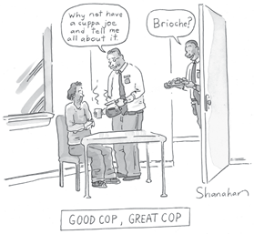

> **Descripción de la imagen** — Es una ilustración o caricatura que representa una escena de diálogo entre dos hombres en un interior.
>
> La composición muestra a dos figuras masculinas interactuando. Un hombre está sentado frente a una mesa, aparentemente conversando con el otro. El hombre sentado tiene una expresión reflexiva y parece estar haciendo una petición.
>
> El segundo hombre está de pie cerca de lo que parece ser un marco de puerta o entrada.
>
> Hay globos de diálogo que indican la conversación:
> 1.  El hombre sentado dice: "Why not have a cuppa and tell me all about it." (¿Por qué no tomar un té y contarme todo al respecto?).
> 2.  El hombre de pie responde con una pregunta corta: "Brioche?"
>
> Debajo de la ilustración, se encuentra el texto en mayúsculas: "GOOD COP, GREAT COP". La imagen tiene un tono humorístico o irónico.

interrogador (el bueno) intenta llegar a un rápido acuerdo antes que regrese el malo y com-
plique la vida de todos. Una forma más útil de esta táctica es asignar al malo la función de
hablar sólo cuando las negociaciones se encaminan en una dirección no conveniente para
el equipo; mientras las cosas fl uyan bien, el bueno es quien habla. Aunque la táctica del
bueno y el malo es muy evidente, suele conducir a concesiones y acuerdos negociados.44

Esta táctica adolece de muchas debilidades. Como ya se mencionó, es relativamente
evidente, sobre todo cuando se utiliza varias veces. Se contrarresta al expresar con libertad
lo que hacen los negociadores. Una expresión como: “No estarán actuando como el bueno
y el malo conmigo, ¿verdad?”, será muy útil para desinfl ar esta táctica aunque la niegue la
otra parte. También es más difícil representar la táctica del bueno y el malo que explicarla;
suele provocar enemistad en la otra parte y hace que los negociadores consuman mucha más
energía en ponerla en práctica que en lograr las metas de la negociación. Los negociadores
que la utilizan se enredan tanto en su actuación que dejan de concentrarse en alcanzar las
metas de su negociación.

Bola baja/bola alta Los negociadores que utilizan una táctica de bola baja (o alta) co-
mienzan con una oferta ridículamente baja (o alta) que saben que nunca conseguirán. La
teoría es que la oferta extrema haga que la otra parte reconsidere su oferta inicial y se acer-
que, o se aleje a su punto de resistencia. Por ejemplo, uno de los autores de este libro estaba
en una negociación entre la empresa y los trabajadores donde la primera oferta del sindi-

Joe, ¿por qué no se
toma un café y me lo

cuenta todo?

POLICÍA BUENO, POLICÍA EXCELENTE

¿Quiere
panecillos?

© 2002 Colección de The New Yorker de cartoonbank.com. Todos los derechos reservados.

44 Brodt y Tuchinsky, 2000; Hilty y Carnevale, 1993.

---

<!-- página 77 -->

Capítulo 2 Estrategia y tácticas de una negociación distributiva
60

cato fue solicitar un aumento salarial de 45% en tres años. Como los recientes acuerdos en
universidades vecinas habían sido de 3 o 4%, esto califi có como una oferta de bola alta.

El riesgo de emplear esta táctica es que la otra parte pensará que negociar es una pér-
dida de tiempo y cancelará la negociación. Aunque la otra parte siga negociando después
de recibir una oferta baja (alta) se necesita un negociador muy talentoso para justifi car la
oferta inicial extrema y regresar la negociación al punto donde la otra parte esté dispuesta
a hacer una concesión importante en la dirección de la oferta excesiva.

La mejor manera de enfrentar una táctica de oferta baja (alta) es no hacer una contra-
oferta, sino solicitar a la otra parte una oferta inicial más razonable (el sindicato del ejemplo
anterior respondió a esta petición al poner sobre la mesa un ofrecimiento de un aumento de
6%, aun por encima del promedio de la industria pero que no califi caba como bola alta). La
razón de que solicitar una oferta inicial razonable sea importante se debe a que esta táctica
funciona en el momento justo entre escuchar la oferta inicial de la otra parte y la exposición
de la primera oferta de usted. Si cede a la tendencia natural de cambiar su oferta inicial
debido a que sería vergonzoso comenzar las negociaciones con tanta diferencia, o porque
la oferta inicial de la otra parte lo hace replantear la ubicación de la zona de acuerdo, habrá
sido víctima de esta táctica. Cuando esto sucede, usted queda “coaccionado” por la oferta
inicial extrema de la otra parte.

Una buena preparación para la negociación es una defensa fundamental contra esta
táctica (consulte el capítulo 4). Una planifi cación adecuada le ayudará a conocer el rango
general del valor del concepto que se analiza y le permitirá responder verbalmente con una
de las siguientes estrategias: 1) insistir en que la otra parte comience con una oferta inicial
razonable y negarse a continuar negociando hasta que eso ocurra, 2) afi rmar que comprende
el valor que tiene en el mercado el artículo que se analiza, apoyar esto con hechos y cifras y,
al hacerlo, mostrar a la otra parte que no podrá engañarlo, 3) amenazar con abandonar la ne-
gociación, ya sea por un tiempo o defi nitivamente, para manifestar que no le satisface que la
otra parte utilice esta táctica, y 4) responder con una contraoferta exagerada para enviar un
mensaje claro de que usted no quedará coaccionado por una oferta extrema de la otra parte.

Fingimiento Los negociadores que emplean la táctica de fi ngimiento simulan que es muy
importante una cuestión de poca o ninguna importancia para ellos. En el transcurso de la
negociación, esta cuestión se cambia por concesiones grandes en las cuestiones que en
realidad les importan. Esta táctica es más efi caz cuando los negociadores identifi can una
cuestión muy importante para la otra parte pero de poco valor para sí mismos. Por ejemplo,
un vendedor puede tener un producto en el almacén listo para entregar. Sin embargo, al
negociar con un agente de compras, el vendedor puede solicitar concesiones para hacer un
pedido rápido al cliente. El vendedor puede reducir el tamaño de la concesión exigida para
la entrega rápida a cambio de concesiones en otras cuestiones, como el precio o el tamaño
del pedido. Otro ejemplo del fi ngimiento es argumentar como si usted quisiera una tarea o
un proyecto específi co (cuando de hecho no lo prefi ere) y luego, a cambio de concesiones
grandes de la otra parte, aceptar la tarea que en realidad prefi ere (pero que fi ngía no desear).

En lo fundamental, esta táctica es engañosa y puede ser difícil de representar. La otra
parte negociará de buena fe y lo tomará en serio cuando usted hable sobre una cuestión
en la que está fi ngiendo. Esto puede provocar la inusual situación de que ambos negocia-
dores argumenten contra sus verdaderos deseos (la otra parte le pide concesiones grandes
sobre otras cuestiones para ofrecerle la cuestión fi ngida que usted en realidad no quiere, y

---

<!-- página 78 -->

61
Tácticas de presión

dedica tiempo a evaluar ofertas y argumentar sobre una cuestión que sabe que no quiere).
También puede ser muy difícil cambiar de opinión y aceptar una oferta en una dirección
completamente opuesta. Y si no consigue hacer esta maniobra, usted termina por aceptar
un acuerdo no óptimo: lo simulado puede ser algo que usted en realidad no quiere, y tal vez
la otra parte tampoco.

Aunque es difícil defenderse contra la táctica del fi ngimiento, estar bien preparado para
la negociación lo hará menos susceptible a ella. Cuando la otra parte adopta una posición
completamente contraria a lo que usted espera, no dude en sospechar que tal vez utilice
una táctica de fi ngimiento. Indagar las razones por las que la otra parte desea un resultado
específi co ayuda a reducir la efi cacia de un fi ngimiento. Por último, sospeche de los cam-
bios de posición súbitos adoptados por la otra parte, sobre todo al fi nal de una negociación.
Puede ser una señal de que emplea la táctica de fi ngimiento. Una vez más, preguntar con
cuidado a la otra parte por qué de repente es aceptable la posición opuesta y no conceder
demasiado después de que la otra parte cambia de posición por completo reduce mucho la
efi cacia del fi ngimiento.

Tanteo Los negociadores que emplean la táctica del tanteo piden una concesión propor-
cionalmente pequeña (por ejemplo, 1 o 2% de la ganancia total en el acuerdo) sobre un
artículo que no se ha mencionado antes para cerrar el trato. Herb Cohen45 describe así el
tanteo: después de probarse muchos trajes en una tienda, diga al dependiente que se llevará
un traje específi co si incluye gratis una corbata. La corbata es el tanteo. Cohen afi rma que
suele obtener la corbata. En un contexto de negocios, la táctica ocurre así: después de dedi-
car mucho tiempo a una negociación, cuando está cerca un acuerdo, una parte pide incluir
una cláusula que no se discutió antes y que costará a la otra parte una cantidad proporcio-
nalmente pequeña. Esta cantidad es muy pequeña para echar a perder el acuerdo, pero no
bastante grande para molestar a la otra parte. Ésta es la principal debilidad de la táctica del
tanteo: muchas personas sienten que la parte que utiliza el tanteo no negocia de buena fe
(como parte de un proceso de negociación justo, todos los artículos que se van a analizar
durante la negociación deben incluirse en la agenda desde el principio). Aunque la parte
solicitante afi rme sentirse avergonzada por haber olvidado el artículo, la parte afectada no
se sentirá bien con el proceso y buscará represalias en negociaciones futuras.

Según Landon, existen dos buenas maneras de enfrentar el tanteo.46 En primer lugar,
responda a cada tanteo con la pregunta “¿qué más quieres?”, hasta que la otra parte señale
que todos los artículos ya están al descubierto; después, ambas partes discuten todos los
artículos al mismo tiempo. En segundo lugar, tenga preparados sus propios tanteos para
ofrecer a cambio. Cuando la otra parte sugiera un tanteo sobre un artículo, usted puede
responder con su propio tanteo acerca de otro.

Retiro La táctica del retiro debe su nombre a un reto que surgió en la década de 1950, en
la película Rebelde sin causa, protagonizada por James Dean, donde dos personas condu-
cían automóviles una contra la otra o hacia un despeñadero hasta que una se desviaba para
evitar un desastre. La persona que se desviaba se “retiraba”, y a la otra se le trataba como
un héroe. Los negociadores que emplean esta táctica combinan una gran baladronada con

45  Cohen, 1980.
46  Landon, 1997.

---

<!-- página 79 -->

Capítulo 2 Estrategia y tácticas de una negociación distributiva
62

una amenaza para obligar a la otra parte a “retirarse” y concederle lo que ellos quieren. En
las negociaciones entre trabajadores y una empresa, ésta puede decir a los representantes
del sindicato que si no aceptan la oferta del contrato la compañía cerrará y dejará de funcio-
nar (o se trasladará a otro estado o país). Es evidente que ésta es una apuesta con grandes
riesgos. Por una parte, la empresa debe estar dispuesta a cumplir la amenaza: si el sindicato
descubre la baladronada y no ocurre lo que la compañía declaró, no le creerán en el futuro.
Por otra parte, ¿cómo puede el sindicato correr el riesgo e identifi car la baladronada? Si
la empresa dice la verdad, en realidad puede cerrar sus puertas y trasladarse a otro lugar.

La debilidad de la táctica del retiro es que convierte la negociación en un juego serio
en el cual una o ambas partes tienen difi cultades para distinguir la realidad de las posiciones
de negociación adoptadas. ¿Cumplirá la otra parte sus amenazas? A menudo esto no se sabe
con certeza porque las circunstancias deben ser serias para hacer creíble esta práctica; pero
cuando las circunstancias son serias es precisamente cuando un negociador puede sentirse
tentado a usar esta táctica. Por ejemplo, compare las respuestas de los presidentes William
Clinton y George W. Bush ante el desafío de Irak al programa de inspección de armas de
Naciones Unidas. Parece que Irak pensó que podía “amedrentar” a Bush porque había evi-
tado un confl icto directo durante el periodo de Clinton. Los hechos posteriores mostraron
el error de esta valoración.

A un negociador le cuesta mucho defenderse de la táctica del retiro. Sin embargo, en
la medida en que el compromiso se reduzca, replantee o ignore, puede perder su fuerza. Tal
vez la respuesta más arriesgada sea introducir una táctica de retiro propia. En este punto,
ninguna parte puede estar dispuesta a retroceder para no quedar en evidencia. La prepa-
ración y una comprensión detallada de las posiciones de ambas partes son absolutamente
esenciales para identifi car dónde termina la realidad y dónde comienza la táctica de retiro.
Otra opción es utilizar expertos externos para verifi car la información o para ayudar a re-
plantear la situación.

Intimidación Dentro de la denominación general de intimidación caben muchas prácti-
cas; lo que tienen en común es que todas intentan obligar a la otra parte a ceder mediante
una treta emocional, por lo general enojo o temor. Por ejemplo, la otra parte puede emplear
deliberadamente el enojo para indicar la seriedad de una posición. Un autor de este libro
tuvo la siguiente experiencia:

Cierta vez, cuando negociaba con un vendedor de autos, perdió los estribos, destruyó sus no-
tas, me dijo que me sentara y lo escuchara, y procedió a explicar en voz alta que era el mejor
trato en la ciudad, y que si yo no lo aceptaba esa tarde mejor ni me molestara en volver a la
distribuidora a hacerle perder su tiempo. No compré el auto ni he regresado a la distribuidora,
como sospecho que tampoco habría hecho ningún estudiante de mis clases de negociación, a
quienes les cuento esta historia cada año. Sospecho que el vendedor trataba de intimidarme
para que aceptara el trato, y se dio cuenta de que si yo iba a cualquier otra parte su propuesta
ya no se vería tan atractiva. Lo que no sabía era que yo había pedido al contador de la distri-
buidora más información respecto del trato, y descubrí que el vendedor había mentido sobre su
valor; en realidad perdió la calma cuando expuse la mentira.

Otra forma de intimidación es aumentar la apariencia de legitimidad. Cuando la legiti-
midad es alta, hay políticas o procedimientos establecidos para dirimir las diferencias. Los
negociadores que no aceptan tales políticas o procedimientos pueden tratar de inventarlos

---

<!-- página 80 -->

63
Tácticas de presión

y después imponerlos al otro negociador, al mismo tiempo que hacen parecer legítimo el
proceso. Por ejemplo, es menos probable que se cuestionen las políticas escritas en los ma-
nuales o los formularios y acuerdos ofi ciales impresos con anticipación que las expresadas
verbalmente.47 Los extensos y detallados contratos para préstamo de los bancos rara vez se
leen por completo.48 Cuanto mayor es la apariencia de legitimidad, es menos probable que
la otra parte cuestione el proceso o los términos propuestos del contrato.

Por último, la culpa también se aplica como forma de intimidación. Los negociadores
pueden cuestionar la integridad de la otra parte o la falta de confi anza en ellos. El propósito
de esta táctica es poner a la otra parte a la defensiva, de modo que enfrente los aspectos de
la culpabilidad o la confi anza y no discuta la sustancia de las negociaciones.

Para enfrentar las prácticas de intimidación, los negociadores tienen varias opciones.
Las prácticas de intimidación están diseñadas para que el intimidador se sienta más pode-
roso que la otra parte y para que los otros hagan concesiones por razones emocionales en
vez de objetivas (por ejemplo, un hecho nuevo). Al hacer cualquier concesión, es impor-
tante que los negociadores comprendan por qué la hacen. Si alguien comienza a sentirse
amenazado, supone que la otra parte es más poderosa (cuando objetivamente no lo es) o tan
sólo acepta la legitimidad de la “política de la empresa” del otro negociador, con lo cual es
probable que la intimidación repercuta en las negociaciones.

Si el otro negociador intimida, una buena opción es analizar el proceso de negociación
con él. Usted puede explicar que su política es concertar de manera justa y respetuosa, y
que a cambio espera un trato semejante. Otra buena opción es ignorar los intentos de la
otra parte por intimidarlo, pues la intimidación sólo lo afecta si usted lo permite. Aunque
esto parezca simplista, piense un momento por qué algunas personas que usted conoce se
sienten intimidadas por la fi gura de una autoridad y otras no: la razón suele residir en quien
percibe, no en la fi gura de autoridad.

Otra estrategia efi caz para enfrentar la intimidación es emplear un equipo para nego-
ciar con la otra parte. Los equipos tienen, cuando menos, dos ventajas sobre las personas
en contra de la intimidación. Primero, las personas no siempre se intimidan ante las mismas
cosas; si bien usted puede sentirse intimidado por un negociador en particular, es muy
probable que los demás integrantes de su equipo no se sientan así. En una negociación en
China cuando era más joven, un autor de este libro descubrió que sus contrapartes chinas
cambiaban con frecuencia a los miembros de su equipo por miembros cada vez de más
edad en las sesiones de negociación. Decidió incluir a un colega mayor en las sesiones
subsecuentes para que no les intimidara la edad y experiencia de las contrapartes del equipo
negociador. La segunda ventaja de usar un equipo es que sus integrantes pueden analizar
las prácticas de los otros negociadores y ofrecerse apoyo mutuo si la intimidación se torna
más incómoda.

Conducta agresiva Un grupo de tácticas similares a las descritas en el apartado de in-
timidación incluye varias maneras de ser agresivo para afi anzar su posición o atacar la
posición de otra persona. Entre las prácticas agresivas están impulsar de manera implaca-
ble concesiones adicionales (“puede ofrecer algo mejor que eso”), pedir la mejor oferta al

47  Cohen, 1980.
48  Hendon y Hendon, 1990.

---

<!-- página 81 -->

Capítulo 2 Estrategia y tácticas de una negociación distributiva
64

inicio de las negociaciones (“no perdamos tiempo, ¿cuánto es lo más que puede pagar?”)
y pedir a la otra parte que explique y justifi que sus propuestas artículo por artículo o línea
por línea (“¿cuál es el desglose de costos por artículo?”). El negociador que emplea estas
técnicas manifi esta una posición intransigente y agresiva que intenta obligar a la otra parte
a hacer muchas concesiones para alcanzar un acuerdo.

Cuando enfrente prácticas de conducta agresiva, una respuesta excelente es defender
las negociaciones para nutrir el proceso de negociación mismo. Los negociadores pueden
explicar que tomarán una decisión con base en las necesidades y los intereses, no en la
conducta agresiva. Una vez más, disponer de un equipo para contrarrestar las prácticas
agresivas de la otra parte resulta útil por las mismas razones analizadas antes en el aparta-
do de intimidación. Una buena preparación y comprender las necesidades y los intereses
propios y los de la otra parte facilita responder a las prácticas agresivas, porque se resaltan
los méritos de ambas partes para alcanzar un acuerdo.

Atosigamiento La táctica de atosigamiento ocurre cuando los negociadores abruman
a la otra parte con tanta información que se difi culta discernir cuáles hechos son reales
o importantes y cuáles se incluyen sólo como distracciones. Los gobiernos emplean a
menudo esta táctica al liberar información al público. En vez de contestar brevemente,
emiten cientos de páginas de documentos de audiencias y reuniones que pueden o no
contener la información que busca la otra parte. Otro ejemplo de atosigamiento es emplear
un lenguaje muy técnico para ocultar una respuesta sencilla a una pregunta formulada por
quien no es experto. Cualquier grupo de profesionales —como ingenieros, abogados o
administradores de redes de computadoras— puede emplear esta táctica para abrumar a la
otra parte con excesiva información y lenguaje técnico que sólo comprenden los expertos.
A menudo, para no pasar la vergüenza de hacer preguntas “obvias”, el receptor del ato-
sigamiento simplemente asiente y acepta de manera pasiva el análisis o las afi rmaciones
de la otra parte.

Para contrarrestar una táctica de atosigamiento, los negociadores disponen de varias
respuestas alternas. En primer lugar, no deben sentir temor de preguntar hasta que reciban
una respuesta que comprendan. En segundo lugar, si el tema es muy técnico, los nego-
ciadores pueden sugerir que se consulte a expertos en esas cuestiones. Por último, los
negociadores deben escuchar con atención a la otra parte e identifi car la información co-
herente y no coherente. Solicitar información adicional después de identifi car un segmento
de información no coherente funciona bien para socavar la efi cacia del atosigamiento. Por
ejemplo, si se descubre un segmento de información incorrecta o no coherente en el paque-
te de atosigamiento, el negociador puede cuestionar la exactitud de toda la presentación
(“como el punto X fue incorrecto, ¿cómo puedo estar seguro de que el resto es exacto?”).
De nuevo, una preparación intensa es muy importante para una defensa efi caz contra una
táctica de atosigamiento.

---

<!-- página 82 -->

En este capítulo examinamos la estructura básica
de las situaciones de negociación competitiva o
distributiva, y algunas estrategias y prácticas de la
negociación distributiva. La negociación distribu-
tiva comienza con el establecimiento de los puntos
inicial, objetivo y de resistencia. Los puntos inicia-
les de la otra parte se conocen pronto, y sus puntos
objetivos se determinan directamente o mediante
una deducción. Sin embargo, los puntos de resis-
tencia de la otra parte, más allá de los cuales no irá
el negociador, sólo se deducen hasta el fi nal de las
negociaciones, pues suelen ocultarse con cuidado.
Todos los puntos son importantes, pero el punto de
resistencia lo es más. La distancia que media entre
los puntos de resistencia de las partes defi ne el ran-
go de la concertación o negociación. Si es positivo,
designa el área de la negociación dentro de la cual
es probable que ocurra un acuerdo, donde cada par-
te se esfuerza por obtener la mayor cantidad posi-
ble del rango de la negociación. Si es negativo pue-
de ser imposible lograr una negociación exitosa.

Es poco frecuente que una negociación inclu-
ya sólo un artículo; es más común que se negocie
un conjunto de artículos, denominados la mezcla de
la negociación. Cada artículo de una mezcla de la
negociación puede tener puntos inicial, objetivo y
de resistencia. La mezcla de la negociación ofrece
oportunidades para integrar los problemas, inter-
cambiarlos o manifestar la voluntad de que ambas
partes realicen concesiones.

Conforme a la estructura de una negociación
distributiva, un negociador tiene muchas opciones
para obtener una resolución exitosa, gran parte de la

cual atañe a dos esfuerzos amplios: infl uir en la no-
ción de la otra parte acerca de lo que se puede lograr
y conocer lo más posible de la posición de la otra
parte, sobre todo sus puntos de resistencia. La me-
ta básica del negociador es alcanzar un acuerdo fi nal
lo más cercano posible al punto de resistencia de
la otra parte. Para lograr esta meta, los negociado-
res colaboran para reunir información acerca de los
oponentes y sus posiciones; para convencer a los in-
tegrantes de la otra parte de que cambien de opi-
nión acerca de su capacidad para lograr sus propias
metas, y para justifi car los objetivos propios como
deseables, necesarios o incluso inevitables.

La negociación distributiva es básicamente
una situación de confl icto, donde las partes buscan
su propio provecho: a veces al ocultar información,
intentar confundir o emprender acciones manipula-
doras. Todas estas prácticas pueden convertir fácil-
mente la interacción de una discusión tranquila en
una hostilidad encarnizada. No obstante, una nego-
ciación es el intento por resolver un confl icto sin
usar la fuerza, sin pelear. Además, para tener éxito,
ambas partes deben sentir al fi nal que los resulta-
dos fueron los mejores que pudieron lograr, y que
vale la pena aceptarlos y apoyarlos. Por tanto, una
negociación distributiva efi caz es un proceso que
requiere una planifi cación cuidadosa, una ejecución
fi rme y una constante vigilancia de las reacciones
de la otra parte. Por último, las habilidades para una
negociación distributiva son importantes en la etapa
de declaración de valor de toda negociación. Esto
se analiza con más detalle en el capítulo siguiente,
acerca de la negociación integradora.
## Resumen del capítulo

Resumen del capítulo
### 65

---

<!-- página 83 -->
## CAPÍTULO
## Estrategia y tácticas de una
## negociación integradora
## 3

Introducción

Incluso los negociadores bien intencionados pueden cometer los tres errores siguientes: no
negociar cuando deben, negociar cuando no deben o negociar cuando sólo deben elegir una
estrategia adecuada. Tal como sugiere el modelo de intereses dobles descrito en el capítulo 1,
comprometerse con los intereses de la otra parte y con los propios hace que la resolución
de problemas sea la estrategia preferible. En muchas negociaciones, no es necesario que
haya ganadores y perdedores: todas las partes pueden ganar. En vez de suponer que las
negociaciones son situaciones de tipo ganar-perder, los negociadores buscan soluciones
ganar-ganar, y a menudo las encuentran. Una negociación integradora —conocida también
como de cooperación, de colaboración, ganar-ganar, de ganancias mutuas o de resolución
de problemas— es el tema de este capítulo.

En contraste con una negociación distributiva, en una negociación integradora las me-
tas de las partes no son excluyentes. Si una parte consigue sus metas, no evita que la otra
también alcance las suyas. La ganancia de una parte no es a expensas de la otra. La es-
tructura fundamental de una situación de negociación integradora es que permite a ambas
partes alcanzar sus objetivos.1 Si bien al principio la situación puede parecer a las partes
una situación de ganar-perder, la discusión y la exploración mutua sugerirán las opciones
donde pueden ganar ambas partes. Lo principal de este capítulo es una descripción de los
esfuerzos y las tácticas que emplean los negociadores para descubrir estas opciones.
### Objetivos

1.
Comprender los elementos básicos de una situación de negociación integradora.
2.
Explorar la estrategia y las tácticas de la negociación integradora.
3.
Considerar los factores clave que facilitan una negociación integradora exitosa.

1  Nuestra descripción recurre en gran parte a los textos de diversos expertos que han estudiado con gran detalle
el proceso integrador, y mencionaremos hallazgos recientes que confi rman la validez de algunas tácticas y es-
trategias particulares. Véanse Follett, 1940, formalizado por Walton y McKersie, 1965; Fisher, Ury y Patton,
1991; Lax y Sebenius, 1986; Carnevale y Pruitt, 1992; Filley, 1975; Pruitt, 1981, 1983, entre varios otros.
También nos apoyamos extensamente en Pruitt y Carnevale, 1993.

---

<!-- página 84 -->

Joe y Sue Carter
67

67

¿En qué es diferente una negociación integradora?

En el capítulo 1 listamos los elementos comunes de todas las negociaciones. Para que una
negociación se considere integradora, los negociadores también deben:

• Concentrarse en las afi nidades, no en las diferencias.
• Intentar abordar las necesidades y los intereses, no las posiciones.
• Comprometerse a satisfacer las necesidades de todas las partes.
• Intercambiar información e ideas.
• Crear opciones para una ganancia mutua.
• Emplear criterios objetivos para los estándares de desempeño.

Estas conductas y perspectivas indispensables son los componentes principales del proceso
integrador (véase el cuadro 3.1).

Panorama del proceso de negociación integradora

Algo notable es que, pese a las experiencias, en las percepciones sesgadas y los aspectos de
verdad distributivos de una negociación se den acuerdos integradores. Sin embargo, ocu-

Un negociador exitoso basado en los intereses
modela las características siguientes:

Honestidad e integridad. Una negocia-

ción basada en los intereses requiere
de cierto nivel de confi anza entre las
partes. Las acciones que demuestren
interés en las metas de todos los par-
ticipantes ayudan a establecer un am-
biente confi able.

Mentalidad de abundancia. Quienes tie-

nen una mentalidad de abundancia
no perciben una concesión de dinero,
prestigio, control y demás como algo
que reduce su participación en el total,
sino sólo como un modo de agrandar
el total. Una mentalidad de escasez o
de suma cero afi rma: “Pierdo cuando
doy.” Un negociador con una mentali-
dad de abundancia sabe que hacer con-
cesiones ayuda a desarrollar relaciones
más fuertes de largo plazo.

Madurez. En su libro Seven Habits of

Highly Effective Leaders, Stephen Co-
## CUADRO
### Características de un negociador
### basado en los intereses
## 3.1

vey defi ne la madurez como tener el
valor para defender las cuestiones y
valores propios, al tiempo que se re-
conocen como válidos las cuestiones
y los valores de los demás.

Orientación de los sistemas. Quienes

analizan los sistemas buscan modos
para optimizar el sistema completo,
en vez de concentrarse en atender de
manera aislada los componentes del
sistema.

Notable habilidad para escuchar. En la

comunicación, 90% no proviene de
las palabras, sino del contexto total,
lo cual incluye el modo de expresión,
el lenguaje corporal y muchos otros
elementos. La escucha efi caz tam-
bién requiere que uno evite escuchar
sólo desde su marco de referencia.

Fuente: Chris Laubach, “Negotiating a Gain-Gain Agree-
ment”, Healthcare Executive, enero-febrero de 1997,
p. 14.

---

<!-- página 85 -->

Capítulo 3 Estrategia y tácticas de una negociación integradora
68

rren, sobre todo porque los negociadores se esfuerzan por superar los elementos que los
inhiben y buscan bases comunes de manera asertiva. Quienes pretenden lograr resultados
integradores encuentran que deben manejar el contexto y el proceso de la negociación para
obtener la cooperación y el compromiso de todas las partes. Entre los factores contextuales
importantes se incluyen crear un fl ujo libre de información, comprender las necesidades
y objetivos reales del otro negociador, destacar las afi nidades entre las partes y buscar
soluciones que cumplan las metas y objetivos de ambas partes. Administrar las negocia-
ciones integradoras implica crear un proceso de identifi cación de problemas, comprender
las necesidades y los intereses de ambas partes, generar soluciones alternas y elegir entre
tales soluciones.

Creación de un fl ujo libre de información

Un intercambio de información efi caz promueve el desarrollo de buenas soluciones integra-
doras.2 La investigación muestra que el fracaso en alcanzar acuerdos integradores se suele
relacionar con el fracaso para intercambiar información sufi ciente que permita a las partes
identifi car las opciones integradoras.3 Para que ocurra el intercambio necesario, los negocia-
dores deben estar dispuestos a revelar sus verdaderos objetivos y escucharse con atención.
En resumen, los negociadores deben crear las condiciones para una discusión libre y abierta
sobre las cuestiones e intereses relacionados. La disposición a compartir información no es
una característica de las situaciones de negociación distributiva, en la cual cada parte debe
desconfi ar de la otra, encubrir y manipular la información e indagar sobre la otra parte sólo
para su propia ventaja competitiva.

La creación de un fl ujo libre de información implica que ambas partes conozcan y
compartan sus opciones. Pinkley descubrió que los negociadores que están conscientes
de sus mutuas opciones en un convenio negociado tenían más probabilidades de hacer que
sus puntos de resistencia fueran menos extremos, mejorar sus soluciones de compromiso
y aumentar el tamaño de la inversión de recursos en comparación con las situaciones en
donde uno o ambos negociadores no estaban conscientes de las opciones.4 Pinkley concluyó
que “es el negociador con opciones el responsable de expandir la inversión, pero ambos
miembros determinan su distribución”.5 Los negociadores que no revelan la disponibilidad
de una buena opción obtienen algunos benefi cios, pero quienes comparten información
respecto de sus opciones reciben benefi cios adicionales.

Comprender las necesidades y objetivos reales del otro negociador

Los negociadores tienen diferentes valores y preferencias, así como mentalidades y con-
ductas.6 Lo que una parte necesita y quiere tal vez no sea lo mismo que la otra requiere y
prefi ere. Se deben comprender las necesidades de la otra parte antes de ayudar a satisfacerlas.
Cuando los negociadores están conscientes de la posibilidad de que las prioridades del otro
no sean iguales que las propias, esto estimula a las partes para intercambiar más información,

2 Butler, 1999; Pruitt, 1981; Thompson, 1991.
3  Butler, 1999; Kemp y Smith, 1994.
4  Pinkley, 1995.
5  Ibid., p. 409.
6  Barki y Hartwick, 2004.

---

<!-- página 86 -->

69
Panorama del proceso de negociación integradora

comprender mejor la naturaleza de la negociación y lograr ganancias conjuntas más altas.7
Asimismo, los acuerdos integradores se facilitan cuando las partes intercambian informa-
ción acerca de sus prioridades para cuestiones específi cas, pero no necesariamente acerca de
sus posiciones sobre esas cuestiones.8 Durante el proceso de compartir información sobre
las preferencias y prioridades, los negociadores deben hacer un verdadero esfuerzo para
comprender lo que la otra parte quiere lograr en realidad. Esto contrasta con la negociación
distributiva, donde los negociadores no se esfuerzan por comprender las necesidades y ob-
jetivos de la otra parte, o sólo lo hacen para desafi ar, socavar o incluso negar a la otra parte
la oportunidad de alcanzar esas necesidades y objetivos. Los aspectos de comunicación del
fl ujo de la información y de la comprensión, si bien son fundamentales para una negociación
integradora, también requieren que se manejen los dilemas de Kelley acerca de la confi anza
y la honestidad (véase el capítulo 1).9 Además, los negociadores también difi eren en su
capacidad para diferenciar las necesidades e intereses de las posiciones, como cuando una
parte conoce y aplica un proceso verdaderamente integrador mientras que la otra carece de
habilidades y desconoce de negociaciones. En tales situaciones es posible que la parte más
experimentada necesite ayudar a la menos experimentada para descubrir sus necesidades
e intereses implícitos.

Destacar las afi nidades entre las partes y reducir las diferencias

Para mantener un fl ujo libre de información y el esfuerzo por comprender las necesidades
y los objetivos de la otra parte, es posible que los negociadores necesiten una perspectiva o
marco de referencia distintos (para un análisis de la delimitación, véase el capítulo 5). Tal
vez sea necesario redefi nir las metas individuales que se alcancen mejor mediante los esfuer-
zos de colaboración dirigidos hacia una meta colectiva. A veces la meta colectiva es clara
y obvia. Por ejemplo, los políticos de un mismo partido reconocen que deben dejar de lado
sus desavenencias triviales para asegurar la victoria del partido en las elecciones. Los geren-
tes que pelean contra los recortes presupuestales en sus departamentos necesitan reconocer
que, a menos que todos los departamentos tengan recortes adecuados, no podrán pasar de ser
una empresa no rentable a una rentable. Otras veces, la meta colectiva no es tan clara ni fácil
de percibir. Por ejemplo, uno de los autores trabajó como consultor para una compañía que
iba a cerrar una fábrica importante y al mismo tiempo iba a abrir otras plantas en diferen-
tes lugares del país. La empresa estaba dispuesta a transferir a los empleados a las nuevas
plantas y permitirles mantener su antigüedad; el sindicato aceptó esta propuesta. Sin em-
bargo, surgió un confl icto por el tema de las transferencias. Algunos empleados pudieron
transferirse de inmediato, mientras que otros, necesarios para cerrar y desmantelar la planta
antigua, no. Como los trabajadores adquirieron antigüedad en las plantas nuevas desde la
fecha en que llegaron, quienes se quedaron en la planta vieja tendrían menos antigüedad
una vez que llegaran a las plantas nuevas. Para evitar esta desigualdad, el sindicato quería
que todos llegaran al mismo tiempo. La administración no podía aceptar esto. En la disputa
resultante, ambas partes perdieron de vista la meta principal: transferir a todos los emplea-
dos dispuestos al cambio a las plantas nuevas con su antigüedad intacta. Sólo al enfocar

7  Kemp y Smith, 1994.
8  Olekalns, Smith y Walsh, 1996.
9  Kelley, 1966.

---

<!-- página 87 -->

Capítulo 3 Estrategia y tácticas de una negociación integradora
70

una y otra vez esta meta las partes pudieron concentrarse en las afi nidades que condujeron a
una solución; la administración permitió que los trabajadores eligieran sus trabajos nuevos
con anticipación y que transfi rieran su antigüedad a esos empleos cuando fuera necesario,
no cuando ocurriera el traslado físico.

Búsqueda de soluciones que cubran las necesidades
y los objetivos de ambos lados

El éxito de una negociación integradora depende de la búsqueda de soluciones que cumplan
las necesidades y los objetivos de ambas partes. En el proceso, los negociadores deben ser
fi rmes pero fl exibles: fi rmes acerca de sus intereses y necesidades principales, pero fl exi-
bles sobre cómo se cumplen estos intereses y necesidades;10 cuando están acostumbrados a
adoptar una orientación combativa y competitiva entre sí, por lo general sólo se preocupan
de sus propios objetivos. En tal interacción competitiva, un nivel de interés bajo hacia los
objetivos de la otra parte provoca dos formas de conducta. En primer lugar, los negocia-
dores se esfuerzan por asegurar que los objetivos del otro no le arrebaten nada a los lo-
gros propios; en segundo, los negociadores intentan evitar que el otro alcance su objetivo
debido a un fuerte deseo de ganar o “vencer al oponente”. En cambio, una negociación
integradora exitosa requiere que ambos negociadores no sólo defi nan y persigan sus pro-
pias metas, sino también que se preocupen por las metas del otro y busquen soluciones
que satisfagan a ambas partes. Los resultados se miden por el grado en que se cumplen las
metas de ambos negociadores. No se miden al determinar si una parte funciona mejor que
la otra. Si el objetivo de una parte es sencillamente obtener más que la otra, en el mejor de
los casos es difícil una negociación integradora; si ambos se esfuerzan por obtener más que
el otro, puede ser imposible una negociación integradora.

En resumen, una negociación integradora requiere un proceso fundamentalmente di-
ferente al de la negociación distributiva. Los negociadores deben intentar sondear bajo la
superfi cie de la posición de la otra parte para descubrir sus necesidades implícitas. Deben
crear un fl ujo de información abierto y libre, y utilizar su interés para satisfacer a ambas
partes como guía para estructurar el diálogo. Si los negociadores no tienen esta perspectiva,
si abordan el problema y a su “oponente” en términos de ganar-perder, no puede darse una
negociación integradora.

Pasos importantes en el proceso
de una negociación integradora

Son cuatro los pasos principales en el proceso de una negociación integradora: 1) identifi car
y defi nir el problema, 2) comprender el problema y llevar los intereses y las necesidades
a la mesa, 3) generar soluciones alternas para el problema y 4) evaluar esas opciones y
seleccionar entre ellas. Los primeros tres pasos del proceso de negociación integradora son
importantes para crear valor. Para trabajar juntos con el fi n de crear valor, los negociadores
necesitan comprender el problema, identifi car los intereses y las necesidades de ambas par-
tes y generar soluciones alternas. El cuarto paso del proceso de una negociación integradora,

10  Fisher, Ury y Patton, 1991; Pruitt y Rubin, 1986.

---

<!-- página 88 -->

71
Pasos importantes en el proceso de una negociación integradora

la evaluación y selección de opciones, implica declarar un valor. Declarar un valor requiere
muchas de las habilidades de negociación distributiva analizadas en el capítulo 2.

La relación entre crear y declarar un valor se presenta gráfi camente en la fi gura 3.1. La
meta de crear valor es impulsar la línea de declaración de un valor hacia el lado superior de-
recho de la fi gura 3.1. Cuando esto se hace en la mayor medida posible, la línea se denomina
frontera efi ciente de Pareto, y contiene un punto donde “no hay un acuerdo que haga a una
parte mejor sin disminuir los resultados para la otra parte”.11 Una negociación integradora
también se defi ne como el proceso de identifi car las soluciones efi cientes de Pareto.

La gráfi ca muestra que existen varias posibles soluciones en una negociación, en este
caso entre un comprador y un vendedor. Los primeros tres pasos en una negociación in-
tegradora buscan asegurar que los negociadores no acuerden soluciones por debajo de la
frontera efi ciente de Pareto, porque estas soluciones no son óptimas para ambos negocia-
dores. El cuarto paso, es decir, elegir una solución o declarar un valor, requiere algunas de
las mismas habilidades que la negociación distributiva. La transición de crear a declarar un
valor en una negociación integradora debe manejarse con cuidado, y se estudiará con más
detalle en este capítulo.

Es importante que los procesos para crear valor precedan a la declaración de valor por
dos motivos: 1) el proceso de crear un valor es más efi caz cuando se hace en colaboración
y sin centrarse en quién obtiene qué, y 2) porque declarar un valor implica procesos de
negociación distributiva, puede desviar la atención en la creación de valor e incluso puede
dañar la relación, a menos que se presente con efi cacia.

11  Neale y Bazerman, 1991, p. 23.

Declaración

de un valor

Aumento de

valor para
el comprador

Frontera eficiente

de Pareto

Aumento de

valor para
el vendedor

Creación de valor

FIGURA 3.1 Creación y declaración de un valor, y la frontera efi ciente de Pareto.

---

<!-- página 89 -->

Capítulo 3 Estrategia y tácticas de una negociación integradora
72

Identifi cación y defi nición del problema

El paso de identifi cación del problema suele ser el más difícil, y lo es todavía más cuan-
do participan varias partes. Considere el siguiente ejemplo: una gran planta de productos
electrónicos experimentó graves difi cultades con un artículo a medida que se desplazaba
del departamento de preensamblaje al de montaje fi nal. Varios tornillos y ensambles que
mantenían parte del producto en su lugar se doblaban y se alteraban. Cuando esto ocurría,
la unidad se rechazaba. Al fi nal del mes, las partes rechazadas se regresaban a preensam-
blaje para volver a trabajarlas, y a menudo llegaban justo cuando los operadores estaban
bajo presión para cumplir con los calendarios de entrega de fi n de mes, además de que
también padecían un défi cit de partes. Como resultado, el esfuerzo de volver a trabajar las
partes rechazadas tenía que hacerse con prisas y después de la jornada laboral. El costo de
las horas extra no encajaba en el sistema estándar de asignación de costos. El gerente del
departamento de preensamblaje no quería que los costos se asignaran a su departamento.
La gerente de la división de ensamblaje fi nal insistía en que ella no debía pagar el costo adi-
cional; argumentaba que el departamento de preensamblaje debía cargar con el costo de-
bido a que su mal trabajo causaba el problema. El gerente de preensamblaje rebatió que
las partes estaban en buenas condiciones cuando salían de su área, y que era la defi ciente
mano de obra de ensamblaje fi nal la que provocaba el daño. Los costos inmediatos eran
relativamente pequeños. Lo que en realidad preocupaba a ambos gerentes era que se es-
tableciera un precedente de largo plazo de manejo de las partes rechazadas y de pago de
dichos costos.

Al fi nal se llegó a una solución integradora. En un mes cualquiera, el departamento de
preensamblaje tenía algunos periodos breves de poca actividad. Los gerentes convinieron
en que el departamento de ensamblaje fi nal devolviera los productos dañados en pequeños
lotes durante los periodos de poca actividad. También quedó claro que mucha gente en en-
samblaje fi nal no entendía del todo las partes que manejaba, lo que pudo contribuir en parte
al daño. Se transfi rió temporalmente a estos trabajadores al área de preensamblaje durante
esos periodos “tranquilos” para aprender más acerca del preensamblaje y para procesar
algunas órdenes urgentes en dicho departamento.

Defi nir el problema de una manera aceptable para ambas partes Lo ideal es que
las partes entren en un proceso de negociación integradora con poca o ninguna concep-
ción previa acerca de la solución y con la mente abierta acerca de las necesidades de la
otra parte. Cuando un problema se defi ne de manera conjunta, debe refl ejar con exactitud
las necesidades y prioridades de ambas partes. Por desgracia, esto no suele ocurrir. Una
preocupación comprensible y muy difundida acerca de una negociación integradora es
que, durante el proceso de defi nición del problema, la otra parte manipule en su provecho
la información con que se plantea el problema. Para que se dé una solución positiva del
problema, ambas partes deben comprometerse a plantear el problema en términos neutra-
les. Este planteamiento debe ser aceptable para ambos lados y no expresarse de modo que
culpe o favorezca las preferencias o prioridades de una parte sobre la otra. Puede pedirse
a las partes que revisen varias veces el planteamiento del problema hasta que coincidan en
su redacción. Los problemas deben defi nirse al principio de esta fase, al menos para lograr
una estructura inicial dentro de las cuales convienen en diferir, aunque sea en una cuestión
distintiva común.

---

<!-- página 90 -->

73
Pasos importantes en el proceso de una negociación integradora

Plantear el problema con una intención práctica y pormenorizada El interés princi-
pal en un acuerdo integrador es resolver el (los) problema(s) central(es). Todo lo que no
se centre en este interés debe eliminarse u optimizarse para asegurar este objetivo. Como
resultado, se puede argumentar que el problema debe plantearse lo más claro posible. Sin
embargo, si el problema es complejo y tiene muchas facetas, y el planteamiento del proble-
ma no refl eja esa complejidad, serán incompletos los esfuerzos en la solución del pro-
blema. De hecho, si el problema es complejo, tal vez las partes no sean capaces de coincidir
en un planteamiento del problema. El objetivo debe ser plantear el problema de la manera
más breve posible y al mismo tiempo asegurar que la defi nición incluya las dimensiones y
los elementos más importantes. Este método está en marcado contraste con el proceso de la
concertación distributiva (véase el capítulo 2), en el que las partes destacan sus posiciones
al incorporar una gran cantidad de aspectos e intereses secundarios para intercambiarlos
durante la fase de negociación intensa. Si una negociación integradora presenta varios pro-
blemas, las partes deben identifi car el vínculo entre ellos y decidir si se abordarán como
problemas separados que pueden integrarse después, o como un problema más grande.

Planteamiento del problema como una meta e identifi cación de los obstáculos para
alcanzar esta meta Las partes deben defi nir el problema como una meta específi ca por
alcanzar y no como un proceso de solución; es decir, deben concentrarse en lo que quieren
lograr y no en cómo van a lograrlo; después deben especifi car los obstáculos que deben
superarse para alcanzar la meta. En el ejemplo anterior, la meta habría sido “reducir la
cantidad de rechazos”. Una defi nición más clara y explícita sería “disminuir la cantidad
de rechazos a la mitad”. Después de especifi car la meta, las partes deben especifi car lo
que necesitan saber acerca de cómo se hace el producto, cómo aparecen los defectos, qué
debe hacerse para reparar los defectos y demás. Un factor clave es si los obstáculos espe-
cifi cados están sujetos a los esfuerzos de los integrantes de las partes negociadoras para
cambiarlos o corregirlos. Si las partes no abordan los obstáculos de manera efi caz, y si el
tiempo u otros recursos son limitados, los obstáculos marcan los límites para la negocia-
ción general. Comprender con claridad cuáles obstáculos se pueden abordar y cuáles no, es
tan importante para una negociación integradora realista como el conocimiento explícito
de lo que es negociable y lo que no lo es.

Despersonalizar el problema Cuando las partes enfrentan un confl icto tienden a evaluar
y juzgar más. Consideran sus propias acciones, estrategias y preferencias como positivas, y
las acciones, estrategias y preferencias de la otra parte como negativas. Tales juicios
y evaluaciones interfi eren con las ideas claras y desapasionadas. Decir a la otra parte que
“su opinión es incorrecta y la nuestra correcta” inhibe el proceso de negociación integra-
dora, porque no es posible afrontar el problema sin atacar al otro negociador. En contraste,
despersonalizar la defi nición del problema —por ejemplo, al afi rmar “tenemos puntos de
vista diferentes acerca de este problema”— permite a ambas partes abordarlo de manera
ajena a las personas, y no como un problema que sólo pertenece a una parte. Otra forma
de decir esto es: “respeto que tengas restricciones y una manera de ver este problema que
puede ser distinta a la mía; te pido que tú también reconozcas lo mismo sobre mí”.

Separar la defi nición del problema de la búsqueda de soluciones Por último, es im-
portante no pasar a las soluciones antes de defi nir por completo el problema. En una nego-
ciación  distributiva se alienta a los negociadores a plantear el problema en términos de su

---

<!-- página 91 -->

Capítulo 3 Estrategia y tácticas de una negociación integradora
74

solución preferida y a hacer concesiones con base en este planteamiento. En cambio, las
partes que participan en una negociación integradora deben evitar plantear soluciones que
favorezcan a una parte o a la otra hasta que se defi na por completo el problema y examine
la mayor cantidad posible de opciones.

En vez de soluciones prematuras, los negociadores deben desarrollar los estándares
mediante los cuales se juzgará cómo se adaptan las posibles soluciones. Estos estánda-
res se crean al formular a las partes interesadas preguntas de este tipo:

• ¿Cómo sabremos que el problema se solucionó?
• ¿Cómo sabremos que alcanzamos nuestra meta?
• ¿Cómo sabría un tercero neutral que nuestras diferencias desaparecieron?
• ¿Hay un interés o una posición legítimos que nuestro resultado no haya abordado?
• ¿Hay un interés o una posición legítimos a los que nuestro resultado haya privado de sus
privilegios?

Comprensión del problema completo.
Identifi cación de intereses y necesidades

Muchos expertos en negociaciones —en particular Roger Fisher, William Ury y Bruce
Patton, en su conocido libro Getting to Yes— insisten en que una clave para lograr un
acuerdo integrador es la capacidad de las partes para comprender y satisfacer los intereses
mutuos.12 Identifi car los intereses es un paso fundamental en el proceso de una negociación
integradora. Los intereses son las preocupaciones, necesidades, deseos o temores implíci-
tos que motivan a un negociador a adoptar una posición en particular. Fisher, Ury y Patton
explican que, aunque a los negociadores les cueste trabajo satisfacer posiciones específi cas
mutuas, comprender los intereses implícitos les permitirá crear soluciones que satisfagan
sus intereses. En esta sección, primero defi niremos los intereses con mayor precisión y des-
pués veremos que su comprensión es fundamental para una negociación integradora efi caz.

El siguiente ejemplo revela la esencia de las diferencias entre intereses y posiciones:

Analice la historia de dos hombres que discuten en una biblioteca. Uno quiere abrir la ventana
y el otro la quiere cerrar. Debaten si debe estar un poco abierta, a la mitad o tres cuartos.
Ninguna solución satisface a ambos. Entra la bibliotecaria y le pregunta a uno por qué quiere
abrir la ventana. “Para tener aire fresco.” Pregunta al otro por qué la quiere cerrar. “Para evitar
las ráfagas.” Después de pensar un minuto, la bibliotecaria abre la ventana de la habitación
siguiente, lo cual genera aire fresco, sin ráfagas.13

Éste es un ejemplo clásico de negociar las posiciones y dejar de comprender los intereses
implícitos. Las posiciones son “ventana abierta” y “ventana cerrada”. Si se sigue en busca
de una negociación de posiciones, el conjunto de resultados posibles sólo puede incluir
una victoria para quien quiere abrir la ventana, una victoria para quien la quiere cerrar
o una solución intermedia en la cual ninguno obtiene lo que quiere. Observe que aquí,
para estos negociadores, una solución intermedia es más un modo de perder-perder que de
ganar-ganar, porque una parte cree que no tendrá aire sufi ciente con la ventana parcialmen-

12  Fisher, Ury y Patton, 1991.
13  Ibid., p. 40; narrado originalmente por Follett, 1940.

---

<!-- página 92 -->

75
Pasos importantes en el proceso de una negociación integradora

te abierta y la otra piensa que es insatisfactorio que esté abierta. Las preguntas de la biblio-
tecaria transforman la disputa y se concentran en por qué cada uno quiere abrir o cerrar la
ventana: para tener aire fresco, para evitar una ráfaga. Comprender estos intereses permite
a la bibliotecaria crear una solución que satisfaga los deseos de ambos: una solución que
no era tan evidente cuando los dos hombres discutían por sus posiciones.

En esta descripción, la palabra clave es por qué; por qué quieren lo que quieren. Cuan-
do dos partes comienzan una negociación, suelen exponer sus posiciones o demandas. En
una negociación distributiva, los negociadores cambian una y otra vez sus posiciones, en
un intento de lograr una conciliación lo más cercana posible a sus objetivos. Sin embargo,
en una negociación integradora, ambos negociadores necesitan adquirir las ideas y la lógica
del otro para determinar los factores que lo motivaron a llegar a sus metas. La suposición
es que si cada parte comprende los factores de motivación de la otra, pueden reconocer
las compatibilidades en los intereses que les permitan crear nuevas opciones que acepten
ambas.

Tipos de intereses Lax y Sebenius sugieren que en una negociación están en juego
varios tipos de intereses y que cada tipo puede ser intrínseco (las partes lo valoran por sí
mismo) o coadyuvante (las partes lo valoran porque les ayuda a obtener otros resultados
en el futuro).14

Los intereses sustantivos se relacionan con los problemas centrales que se están ne-
gociando: problemas económicos y fi nancieros como precios o tasas, o el meollo de una
negociación como la división de los recursos (son como los problemas tangibles analizados
en el capítulo 1). Estos intereses pueden ser intrínsecos o coadyuvantes para ambos; pode-
mos querer algo porque es intrínsecamente satisfactorio para nosotros y/o queremos algo
porque nos ayuda a lograr una meta de largo plazo.

Los intereses de un proceso se relacionan con el modo en que desenvuelve la nego-
ciación. Una parte busca una negociación distributiva porque disfruta el juego de ingenio
competitivo resultante de una vigorosa negociación frente a frente. Otra parte disfruta ne-
gociar porque cree que no la han tomado en cuenta en el pasado y quiere demostrar que sa-
be cómo resolver un problema importante. En este caso, el negociador puede pensar que
los problemas que se discuten son menos importantes que la oportunidad de expresar sus
opiniones.15 Los intereses de un proceso pueden ser intrínsecos y coadyuvantes. Tener voz
puede ser intrínsecamente importante para un grupo: le permite afi rmar su legitimidad y
valor, y resaltar el papel importante que desempeña en la organización; también es impor-
tante como coadyuvante porque, si consigue tener voz en esta negociación, demostrará que
debe ser invitado a negociar en el futuro otros problemas relacionados.

Los intereses de una relación indican que una o ambas partes valoran su relación mutua
y no quieren hacer nada que la dañe. Existen intereses intrínsecos de una relación cuando
las partes valoran la relación por su existencia y por el placer o satisfacción derivados de
mantenerla. Hay intereses coadyuvantes de la relación cuando las partes derivan benefi -
cios sustantivos de la relación y no desean poner en peligro los benefi cios futuros al estro-
pearlos.

14  Lax y Sebenius, 1986.
15  Véase en el capítulo 5 de Sheppard, Lewicki y Minton, 1992, un análisis más completo de la función de la
“voz” en las organizaciones.

---

<!-- página 93 -->

Capítulo 3 Estrategia y tácticas de una negociación integradora
76

Por último, Lax y Sebenius señalan que las partes pueden tener intereses en los prin-
cipios.16 Las partes pueden defender ciertos principios: relacionados con lo justo, lo co-
rrecto, lo aceptable, lo ético o lo que se ha hecho en el pasado y debe hacerse en el futuro,
los cuales funcionan como guías dominantes para sus acciones. Estos principios suelen
incorporar factores intangibles (véase el capítulo 1). Los intereses en los principios tam-
bién pueden ser intrínsecos (valorados debido a sus méritos inherentes) o coadyuvantes
(valorados porque se aplican a diversas situaciones y escenarios futuros).

Hacer que los intereses en los principios afl oren a la superfi cie llevará a los nego-
ciadores a discutir explícitamente los principios que están en juego, y a crear soluciones
consistentes con ellos.

Algunas observaciones sobre los intereses He aquí varias observaciones acerca de los
intereses y los tipos de intereses en una negociación:

1.  Casi siempre hay más de un tipo de intereses implícitos en una negociación. A menu-
do las partes tendrán más que intereses sustantivos acerca de los problemas.17 También
les interesa mucho el proceso, la relación o los principios en juego. Observe que los
intereses en los principios se incorporan también en los intereses sustantivos, de pro-
cedimiento y en la relación, porque las categorías no son exclusivas.
2.  Las partes pueden tener diferentes tipos de intereses en juego. A una parte le pueden
interesar mucho los problemas específi cos en discusión, mientras que a la otra le im-
porta cómo resolver los problemas: las cuestiones de principios o de procesos. Llevar
estos intereses diferentes a la mesa permite a las partes observar que les importan co-
sas muy diferentes y que es necesario imaginar resoluciones que aborden los intereses
de ambas.
3.  Los intereses suelen provenir de necesidades o valores humanos muy arraigados. Va-
rios autores sugieren que las estructuras para comprender las necesidades y los valores
humanos básicos son útiles para comprender los intereses.18 Según estas estructuras,
las necesidades son jerárquicas, y la satisfacción de las necesidades de orden básico o
inferior será más importante en una negociación que cubrir las necesidades de orden
superior.
4.  Los intereses pueden cambiar. Igual que las posiciones acerca de los problemas, los
intereses pueden cambiar con el tiempo. Lo que era importante para las partes la se-
mana anterior —o incluso hace 20 minutos— tal vez ya no sea importante ahora. La
interacción entre las partes puede eliminar ciertos intereses y despertar otros. Por tan-
to, las partes deben estar siempre atentas a los cambios en los propios intereses y los
de la otra parte. Cuando una parte comienza a hablar de las cosas de un modo distinto,
cuando cambia el lenguaje o el énfasis, la otra parte debe buscar un cambio en los
intereses.
5.  Sacar a la luz los intereses. Existen numerosas maneras para exteriorizar los intereses.
A veces las personas ni siquiera están seguras de sus propios intereses. Los negociado-
res no sólo deben preguntarse “¿qué quiero de esta negociación?”, sino también “¿por

16  Lax y Sebenius, 1986.
17  Clyman y Tripp, 2000.
18  Holaday, 2002; Nierenberg, 1976.

---

<!-- página 94 -->

77
Pasos importantes en el proceso de una negociación integradora

qué quiero eso?”, “¿por qué eso es importante para mí?”, “¿de qué me servirá conse-
guir eso?” y “¿qué ocurrirá si no alcanzo mi objetivo?” Para sacar a la luz los propios
intereses es importante escuchar la voz interior: temores, aspiraciones, esperanzas,
deseos.
6.  Exteriorizar los intereses no es siempre fácil ni provechoso para uno. Los críticos del
“método de los intereses” para una negociación identifi can la difi cultad de defi nir los
intereses y tomarlos en consideración. Provis sugiere que suele ser difícil defi nir los in-
tereses, y que sólo esa atención en los intereses suele simplifi car en exceso u ocultar
la dinámica real de un confl icto.19 En algunos casos, las partes no buscan los propios
intereses objetivos, sino que más bien se concentran en uno o más intereses subjetivos,
lo cual confunde a la otra parte.20 Por tanto, el comprador de un automóvil puede pre-
ferir un vehículo veloz y ostentoso (su interés subjetivo) aunque su interés objetivo sea
comprar uno seguro y conservador.

Generación de soluciones alternas

La búsqueda de opciones es la fase creativa de una negociación integradora. Una vez que
las partes acuerdan una defi nición común del problema y comprenden los intereses mutuos,
necesitan generar diversas soluciones alternas. El objetivo general es idear una lista de op-
ciones o soluciones posibles para el problema; evaluar y seleccionar una de esas opciones
será su tarea en la fase fi nal.

Se han sugerido varias técnicas para ayudar a los negociadores a generar soluciones al-
ternas. Estas técnicas caen en dos categorías generales. La primera requiere que los negocia-
dores redefi nan, vuelvan a moldear o a delimitar el problema (o grupo de problemas) para
concebir opciones de ganar-ganar para lo que antes parecía un problema de ganar-perder.
La segunda técnica toma el problema tal cual y genera una extensa lista de opciones de
las cuales pueden elegir las partes. En una negociación integradora acerca de un problema
complejo es posible utilizar, e incluso combinar, ambos tipos de técnicas.

Crear opciones. Generar soluciones alternas al redefi nir el problema o grupo de pro-
blemas Las técnicas en esta categoría requieren que las partes defi nan sus necesidades
implícitas y desarrollen opciones para cumplirlas.

Hace poco, Peter Carnevale creó un “círculo de convenios” que clasifi ca los acuerdos
potenciales en cuatro tipos principales, cada uno con dos subtipos (véase la fi gura 3.2).
Existen cuatro dimensiones importantes subyacentes en este modelo. A continuación se
analiza cada una de estas dimensiones, con las estrategias consistentes respectivas. En
la próxima sección veremos en forma más detallada las estrategias y daremos un amplio
ejemplo de cada una.

1. Acomodo de las posiciones vs. logro de una posición
Las posiciones se logran cuando cada parte obtiene exactamente lo que quería en sus
peticiones iniciales. Las estrategias que logran posiciones incluyen expandir la inver-
sión y modifi car la inversión de recursos, en contraste con el acomodo de la posición,
cuando las partes sólo reciben una porción de su demanda inicial.

19  Provis, 1996.
20  Idem.

---

<!-- página 95 -->

Capítulo 3 Estrategia y tácticas de una negociación integradora
### 78
### 2.
### Lograr intereses subyacentes vs. sustituir intereses subyacentes
Cuando se logran intereses subyacentes, los intereses de los negociadores quedan com-
pletamente satisfechos. Las estrategias para satisfacer los intereses subyacentes in-
cluyen encontrar una solución paralela y recortar costos. Los intereses subyacentes
también pueden sustituirse, modifi carse o cambiarse. La compensación no específi ca
y la ordenación superior son dos estrategias que alteran el que los intereses de un ne-
gociador se satisfagan o no, o se modifi quen de cierta forma.
### 3.
### Simple vs. complejo
Algunas situaciones de negociación son de naturaleza muy sencilla, como un acuerdo
de dos o tres puntos para comprar artículos a un fabricante. Otras situaciones llegan a
ser muy complejas, por ejemplo, los convenios amplios de alquiler que cubren diver-
sas ubicaciones, tamaños y tipos de propiedad. Las estrategias en la parte inferior del
círculo de convenios son más apropiadas para situaciones sencillas, mientras que las
que están arriba se adaptan mejor a situaciones más complejas.

Cuadrante III

Logro
del interés

Cuadrante II

Logro de
la posición

Cuadrante I

Acomodo de

la posición

Tipo 3
Modificar

Tipo 1
Compromiso

Tipo 5
Solución

paralela

Tipo 6
Recorte de

costos

Tipo 4
Expandir

Tipo 2
Ayuda
recíproca

Tipo 7
Compensar
Tipo 8
Priorizar

Complejo

Simple

Cuadrante IV

Sustitución

del interés
Basado en la persona
Basado en los temas

FIGURA 3.2 Círculos de convenios.

Fuente: P. J. D. Carnevale, 2006.

---

<!-- página 96 -->

79
Pasos importantes en el proceso de una negociación integradora

4.  Basado en la persona vs. basado en el tema
Las estrategias que se basan en la persona implican que los negociadores hagan con-
cesiones y cambien de posiciones de manera que se llegue a un acuerdo mediante la
modifi cación de posiciones respecto de los temas en discusión. Las estrategias basadas
en los temas modifi can los puntos en discusión para ajustarlos a los deseos y necesi-
dades de los negociadores. Las estrategias basadas en la persona se sitúan en el lado
izquierdo del círculo, y las que se basan en los temas, del lado derecho.

Carnevale presenta ocho métodos para lograr acuerdos integradores en el círculo, que vere-
mos a continuación.21 Cada método vuelve a analizar los problemas en la mesa y requiere
cada vez más información de las verdaderas necesidades de la otra parte. Las soluciones
pasan de acuerdos distributivos más sencillos a acuerdos integradores más complejos y
pormenorizados, y hay varias rutas para encontrar una ganancia conjunta..22

Cada método se presentará con el ejemplo de Samantha y Emma, dos socias en una exi-
tosa empresa, Advanced Managment Consulting, que emplean a otros ocho consultores no
asociados. Las socias van a decidir dónde ubicar su nueva ofi cina; la mitad de los clientes está
en el centro de la ciudad, y la otra mitad, en los suburbios. Analizan para arrendamiento dos
ubicaciones posibles. Samantha prefi ere la del centro. Tiene menos espacio, pero es una zona
con más prestigio. Si bien las ofi cinas son más pequeñas, están a la misma distancia de donde
viven ambas socias. Emma prefi ere los suburbios. Tienen más espacio, las ofi cinas son más
grandes y más nuevas; también están más cerca de su casa, pero más lejos de la de Samantha.

Compromiso (acomodo de posiciones) Una solución de compromiso que no contrapu-
siera más los intereses de Samantha o de Emma sería quedarse en sus ofi cinas actuales y
mantener el statu quo. Los compromisos no se consideran una buena estrategia integrado-
ra, excepto para circunstancias en que las partes no cedan y sea poco probable lograr un
acuerdo integral.

Ayuda recíproca (acomodo de posiciones) La ayuda recíproca exitosa requiere que las
partes encuentren más de un problema en confl icto y apliquen diferentes prioridades a esos
problemas.23 Así, las partes acuerdan negociar esos problemas para que una consiga el
resultado que prefi ere en el primer problema y la otra obtenga su solución preferida en el
segundo problema. Si de hecho las partes no tienen preferencias distintas acerca de proble-
mas diversos y cada una obtiene su resultado preferido en un problema de alta prioridad,
cada parte recibe más y los resultados conjuntos son mejores.24 Por ejemplo, Advanced
Management Consulting puede arrendar el lugar en el centro y dar a Emma la ofi cina más
grande. Samantha recibiría su lugar preferido, lo cual es más importante para ella, y Emma
recibiría un mejor lugar de trabajo, lo cual es más importante para ella.

La ayuda recíproca se suele conseguir mediante ensayo y error: es parte del proceso
de experimentar con diversos paquetes de ofertas que satisfagan a todos los participantes.
Primero, las partes deben establecer cuáles son los problemas en juego y después decidir

21  Por ejemplo, véanse Neale y Bazerman, 1991; Pruitt, 1981, 1983; Pruitt y Carnevale, 1993; Pruitt y Lewis,
1975.
22  Olekalns, 2002.
23  Tajima y Fraser, 2001.
24  Moran y Ritov, 2002.

---

<!-- página 97 -->

Capítulo 3 Estrategia y tácticas de una negociación integradora
80

sus prioridades individuales sobre ellos. Si ya existen cuando menos dos problemas sobre
la mesa, cualquier combinación de dos o más problemas resulta conveniente para la ayuda
recíproca. La investigación sugiere que los negociadores obtienen mejores acuerdos cuanto
más grande es la cantidad de problemas que se negocian.25 Sin embargo, la satisfacción
del negociador puede ser menor cuando se negocian más puntos, porque los negociadores
creen que podrían haberlo hecho mejor en uno o dos temas. (La satisfacción y cognición
del negociador se analizan con mayor detalle en el capítulo 5.) Si al principio parece que
está en juego sólo un problema, las partes necesitan “desamarrar” o “romper los vínculos”,
lo cual es el proceso de separar un solo problema en dos o más para posibilitar la ayuda
mutua.26 También se pueden plantear problemas adicionales mediante procesos de lluvia
de ideas que se describen más adelante.

Modifi car la inversión de recursos (logro de posiciones) Aunque puede ser atractivo ex-
pandir la inversión de recursos, esto no siempre funciona, porque el medio ambiente puede
no ser muy abundante. Por ejemplo, Advanced Management Consulting puede no tener
sufi ciente demanda de sus servicios como para tener dos ofi cinas. Un enfoque relacionado
es modifi car la inversión de recursos. Por ejemplo, Advanced Management Consulting
puede iniciar un nuevo servicio y ofrecer asesoría en tecnología de la información (TI) o
asesoría en mercadotecnia por internet además de su asesoría de negocios tradicional. En
este caso se modifi ca la inversión de recursos para sostener ofi cinas tanto en el centro como
en los suburbios.

Ampliar la inversión (logro de posiciones) Muchas negociaciones comienzan con esca-
sez de recursos, y no es posible que ambas partes satisfagan sus intereses o alcancen sus ob-
jetivos de acuerdo con las condiciones presentes. Una solución sencilla es agregar recursos
—aumentar la inversión— de manera que ambas partes alcancen sus objetivos. Por ejemplo,
Advanced Management Consulting puede arrendar ofi cinas en el centro y en los suburbios
para atender a sus dos grupos de clientes. Con la expansión prevista del negocio se pueden
pagar ambos arrendamientos. Al aumentar la inversión, una parte no requiere información
acerca de la otra, excepto sus intereses; es una manera sencilla de resolver los problemas de
escasez de recursos. Además, el método supone que sólo el aumento de recursos resolverá
el problema. Por tanto, arrendar ambas ubicaciones sería una solución muy satisfactoria si
a Samantha y a Emma les agradaran los dos lugares y quisieran ampliar su negocio. Sin
embargo, aumentar la inversión no sería una solución satisfactoria si su desacuerdo tuviera
otros orígenes; por ejemplo, si sus visiones sobre el futuro de la empresa fueran diferentes,
o si toda la empresa tuviera reuniones con frecuencia. Además, en la medida en que la nego-
ciación aumenta los costos de una persona u organización que no participa directamente en
la negociación (en este ejemplo, los empleados), la solución puede ser integradora para los
negociadores, pero problemática para las demás partes interesadas.27

Encontrar una solución paralela (logro de interés) Cuando las partes son capaces de
idear opciones nuevas que cumplan todas sus necesidades respectivas, crean una solución

25  Naquin, 2002.
26  Lax y Sebenius, 1986; Pruitt, 1981.
27  Gillespie y Bazerman, 1997.

---

<!-- página 98 -->

81
Pasos importantes en el proceso de una negociación integradora

paralela. Por ejemplo, Advanced Management Consulting puede ampliar la cantidad de
socios en la fi rma y arrendar un espacio más grande en el centro, con muebles nuevos para
todos en una zona de prestigio.

Una solución paralela exitosa requiere una reformulación fundamental del problema
de modo que las partes no discutan sus posiciones sino, en cambio, revelen información
sufi ciente para descubrir sus intereses y necesidades, y después concebir opciones que
satisfagan esas necesidades.28 Las soluciones paralelas no siempre remedian todos los in-
tereses; tal vez a Emma no le agrade el cambio y Samantha no esté convencida de que la
empresa crezca, pero ambas aceptan que colaborar es importante para ellas, y se esfuerzan
por llegar a una solución que cumpla sus necesidades más importantes. Si los negociadores
se comprometen en lo fundamental en una negociación de ganar-ganar, es probable que las
soluciones paralelas sean muy satisfactorias para ambas partes.

Recortar los costos para ajustarse (logro de interés) Mediante una reducción de costos,
una parte logra sus objetivos y los costos para la otra se reducen si acepta. Por ejemplo,
Advanced Management Consulting puede rentar en los suburbios y dar a Samantha un
subsidio para viajes, un vehículo nuevo de la compañía y espacio de estacionamiento re-
servado. En este caso, Emma obtiene su lugar preferido mientras que se reducen los costos
de Samantha al aceptar la ubicación de la nueva ofi cina.

A diferencia de una compensación no específi ca, donde la parte compensada tan sólo
recibe algo por aceptar, la reducción de costos está diseñada para disminuir los costos de
la otra parte por aceptar una solución. Por tanto, esta técnica es más precisa que la ayuda
mutua o la compensación no específi ca, porque requiere un conocimiento más profundo
de las necesidades y preferencias reales de la otra parte (los intereses, lo que de verdad le
importa, cómo satisfacer sus necesidades específi cas).

Compensación no específi ca (sustitución de intereses) Un tercer modo de generar op-
ciones es permitir que una persona logre sus objetivos y pague a la otra por aceptar esos
intereses. Tal vez el pago no se relacione con la negociación sustantiva; no obstante, la
parte que lo recibe lo considera adecuado por aceptar las preferencias de la otra parte. Di-
cha compensación es “no específi ca” porque no se relaciona directamente con los proble-
mas sustantivos que se analizan. Por ejemplo, Advanced Management Consulting decide
arrendar en los suburbios y dar a Samantha todos los muebles nuevos. En este caso, Emma
obtiene su lugar preferido mientras Samantha recibe los muebles nuevos como una com-
pensación no específi ca por aceptar la ubicación de la nueva ofi cina.

Para que funcione una compensación no específi ca, la persona que ofrece la compen-
sación necesita saber lo que es valioso para la otra persona y con cuánta seriedad olvida
sus conveniencias (por ejemplo, cuánta compensación se requiere para que se sienta satis-
fecha). Tal vez Emma necesite probar varios tipos de ofertas (tipos y cantidades de com-
pensación) con el fi n de determinar cuánto se requerirá para satisfacer a Samantha. Este
proceso de descubrimiento puede convertirse en una situación de  negociación distributiva,
porque Samantha puede optar por fi jar demandas muy altas como precio por trasladarse
a los suburbios, al mismo tiempo que Emma intenta contener la compensación que dará a
cambio.

28  Butler, 1996.

---

<!-- página 99 -->

Capítulo 3 Estrategia y tácticas de una negociación integradora
82

Jerarquización (sustitución de interés) Las soluciones de jerarquización ocurren cuando
“las diferencias en intereses que hicieron surgir el confl icto se superan o reemplazan por
otros intereses”.29 Por ejemplo, después de largas discusiones respecto de la ubicación de la
ofi cina, Samantha puede descubrir que prefi ere perseguir su sueño de ser artista y convertirse
en socia capitalista del negocio. En este punto se detiene la negociación sobre la ubicación
de la ofi cina y Emma elige la forma en que quiere proceder en el nuevo modelo de negocio.

La búsqueda exitosa de estas ocho estrategias requiere un signifi cativo intercambio de
información entre las partes; deben ofrecer información de manera voluntaria o formular
preguntas que generen información sufi ciente para revelar las opciones de ganar-ganar. La
tabla 3.1 contiene una serie de preguntas para cambiar el enfoque que pueden revelar estas
posibilidades.30

Generar soluciones alternas para el problema en sí Además de estas técnicas hay
otros métodos para generar soluciones alternas. Estos métodos los pueden utilizar los nego-
ciadores mismos o varias otras partes (poderdantes, público, testigos, etc.). Varios de estos
métodos se suelen usar en grupos pequeños. Los grupos por lo general resuelven mejor
los problemas que las personas, sobre todo porque aportan más puntos de vista y pueden
concebir una mayor variedad de maneras de resolver problemas. No obstante, los grupos
también deben adoptar procedimientos para defi nir el problema y los intereses, además
de generar opciones para evitar que el proceso del grupo degenere en una competencia de
ganar-perder o en un debate.

Lluvia de ideas En la lluvia de ideas, pequeños grupos generan la mayor cantidad posible
de soluciones para un problema. Alguien anota las soluciones, sin comentarlas, conforme
se crean. Se recomienda a los participantes que sean espontáneos, incluso poco prácticos,
y que no censuren las ideas de nadie (ni las propias). Además, se les pide también que no
discutan o evalúen ninguna propuesta para no detener el fl ujo libre de ideas nuevas. El éxi-
to de una lluvia de ideas depende de la cantidad de estímulo intelectual cuando se generan
las distintas ideas. Deben observarse las reglas siguientes:

1.  Evitar juzgar o evaluar las soluciones. Las soluciones creativas suelen provenir de
ideas que al principio parecían exageradas y poco prácticas, y la crítica inhibe el pen-
samiento creativo. Por tanto, es importante evitar juzgar las soluciones al principio,
y ninguna idea debe evaluarse o eliminarse hasta que el grupo concluya de generar
opciones.
2.  Separar a las personas del problema. Los procesos de discusión en grupo y lluvia de
ideas suelen limitarse porque las partes se apropian de las soluciones y las opciones
preferidas.31 Como los negociadores competitivos asumen una postura ofensiva hacia
la otra parte, no es probable que aprecien los méritos de una opción proveniente de la
otra parte o que parezca favorecer la posición de esa parte. A menudo no es posible
atacar el problema sin atacar a la persona que lo plantea. Por tanto, para una solución
efi caz del problema, los negociadores deben concentrarse en despersonalizar el pro-

29  Carnevale, 2006, p. 426.
30  Pruitt y Carnevale, 1993; Pruitt y Rubin, 1986.
31  Filley, 1975; Fisher, Ury y Patton, 1991; Walton y McKersie, 1965.

---

<!-- página 100 -->
### 83
Pasos importantes en el proceso de una negociación integradora
### blema y tratar todas las soluciones posibles como igualmente viables, sin tomar en
### cuenta quién las propuso.
### 3.  Ser exhaustivos en el proceso de la lluvia de ideas. Las mejores ideas suelen llegar des-
### pués de concluir una reunión o resolver un problema. Esto sucede porque las partes no
### insistieron lo sufi ciente. La investigación demuestra que cuando los participantes tra-
### bajan en el proceso durante bastante tiempo, es más probable que las mejores ideas
### salgan a la superfi cie durante la etapa fi nal de la actividad.
### 4.  Preguntar a personas externas. Las personas que no saben nada de la historia de la
### negociación ni de los problemas suelen sugerir opciones y posibilidades que no se han
### considerado. Las personas externas pueden añadir opiniones a la lista de opciones, o
### ayudar a dirigir el proceso y mantener centradas a las partes.

TABLA 3.1 Preguntas que cambian el enfoque para revelar opciones de ganar-ganar

Ampliar la inversión
1.  ¿Cómo obtienen ambas partes lo que quieren?
2.  ¿Hay escasez de recursos?
3. ¿Cómo se pueden aumentar los recursos para cumplir las demandas de ambas partes?

Ayuda mutua
1.  ¿Qué problemas tienen una prioridad más alta o más baja para mí?
2.  ¿Qué problemas tienen una prioridad más alta o más baja para el otro negociador?
3.  ¿Algunos problemas de gran prioridad para mí son de poca prioridad para el otro negocia-
dor, y viceversa?
4.  ¿Puedo “desamarrar” un problema, es decir, convertir un problema grande en dos o más
pequeños y después desarrollar la ayuda mutua?
5.  ¿Qué cosas no me costaría ofrecer y serían valiosas para el otro negociador si se emplearan
en la ayuda mutua?

Compensación no específi ca
1.  ¿Cuáles son las metas y valores del otro negociador?
2.  ¿Qué puedo hacer que satisfaga al otro negociador y al mismo tiempo me permita aplicar mi
decisión en el problema importante?
3.  ¿Qué cosas no me costaría ofrecer que fueran valiosas para el otro negociador y pudieran
servir como compensación no específi ca?

Reducción del costo

1.  ¿Qué riesgos y costos le crea mi propuesta al otro negociador?
2.  ¿Qué puedo hacer para disminuir los riesgos y los costos del otro negociador de modo que
esté más dispuesto a aceptar?

Solución paralela y jerarquización

1.  ¿Cuáles son las necesidades y los intereses implícitos reales del otro negociador?
2.  ¿Cuáles son mis necesidades e intereses implícitos reales?
3.  ¿Cuáles son las prioridades más altas y más bajas para cada uno de nosotros en nuestros
intereses y necesidades implícitos?
4.  ¿Podemos llegar a una solución que cumpla las prioridades relativas, los intereses implícitos
y las necesidades de ambos negociadores?

Nota: El compromiso no se considera una opción de ganar-ganar.

---

<!-- página 101 -->

Capítulo 3 Estrategia y tácticas de una negociación integradora
84

Encuestas La desventaja de la lluvia de ideas es que no solicita las ideas de quienes no
acuden a la negociación. Un método diferente es distribuir un cuestionario que plantee el
problema a una gran cantidad de personas y pedirles que enlisten todas las soluciones que
puedan imaginar. Este proceso se puede realizar en poco tiempo. Sin embargo, es necesario
que las partes se responsabilicen de que no vean ni escuchen las ideas de otras personas,
una ventaja importante de la lluvia de ideas.

Lluvia de ideas electrónica Un método innovador para reunir ideas es incorporar un
facilitador profesional y emplear una lluvia de ideas electrónica.32 El facilitador utiliza
una serie de preguntas para guiar las opiniones de los participantes, quienes escriben sus
respuestas de manera anónima en una computadora que las exhibe para que el grupo las
incorpore. Después, el facilitador formula preguntas adicionales. La lluvia de ideas elec-
trónica es muy útil para las negociaciones integradoras en las que participan numerosas
partes (véase el capítulo 10) o durante la preparación de negociaciones integradoras cuan-
do existen puntos de vista diferentes dentro de un equipo (véase el capítulo 4 acerca de la
preparación).

Resumen de la sección

Nuestro análisis de los dos métodos básicos para generar soluciones alternas —proponer
opciones para el problema en sí y producir opciones al redefi nir el problema— puede dar
la impresión de que si los negociadores crean sufi cientes opciones, encontrarán una que
resuelva su problema con gran facilidad. Si bien identifi car las opciones a veces conduce
a una solución, ésta suele obtenerse mediante grandes esfuerzos y la búsqueda de varios
procesos relacionados: intercambiar información, concentrarse en los intereses más que
en las posiciones y una fl exibilidad fi rme.33 El intercambio de información permite a las
partes maximizar la cantidad de información disponible, y concentrarse en los intereses
facilita ir más allá de las posiciones y demandas iniciales para determinar lo que en rea-
lidad quieren: qué necesidades deben satisfacerse realmente. Por último, una fl exibilidad
fi rme permite que las partes mantengan su postura en relación con lo que quieren lograr
(es decir, los intereses) sin dejar de ser fl exibles acerca de los medios para conseguir-
lo. Una fl exibilidad fi rme reconoce que los negociadores tienen uno o dos intereses o
principios fundamentales, aunque es posible incorporar a las negociaciones una amplia
variedad de posiciones, soluciones posibles o problemas secundarios. Por tanto, entre las
abundantes opciones viables que satisfarán a un negociador, las importantes abordan di-
rectamente las prioridades principales. Los negociadores necesitan ser capaces de señalar
a la otra parte las posiciones en las cuales están fi rmes y las posiciones en las cuales están
dispuestos a ser fl exibles.

Evaluar y seleccionar opciones

La cuarta etapa en un proceso de negociación integradora es evaluar las opciones genera-
das durante la fase previa y seleccionar las mejores. Cuando el desafío es razonablemente

32  Gallupe y Cooper, 1993; Dennis y Reinicke, 2004.
33  Fisher, Ury y Patton, 1991; Pruitt, 1983.

---

<!-- página 102 -->

85
Pasos importantes en el proceso de una negociación integradora

sencillo, los pasos de evaluación y selección se combinan en uno solo. Sin embargo, a
quienes les incomoda el proceso integrador les sugerimos apegarse con fi rmeza a una serie
de pasos separados: defi niciones y estándares, opciones, evaluación y selección. Seguir
estos pasos separados también es buena idea para quienes manejan problemas complejos
o una gran cantidad de opciones. Los negociadores necesitarán ponderar o clasifi car cada
opción con criterios claros. Si ninguna opción o conjunto de opciones parece conveniente y
aceptable, es un indicio claro de que el problema no se defi nió con claridad (regresar a las
defi niciones) o de que los estándares elaborados no son razonables, pertinentes y/o realistas
(regresar a los estándares). Por último, las partes necesitan participar en alguna forma de
proceso de toma de decisiones para debatir los méritos relativos de las opciones preferi-
das por cada negociador y acordar las mejores opciones. Deben usarse los lineamientos
siguientes para evaluar las opciones y llegar a un consenso.34

Reducir el rango de opciones de solución Examinen la lista de opciones generadas y
concéntrense en las que uno o más negociadores apoyan con fi rmeza. Este método es más
positivo que permitir a las personas concentrarse en las opciones y los criterios negativos e
inaceptables. En este momento deben eliminarse las opciones que no defi enda con fi rmeza
al menos un negociador.

Evaluar las soluciones con base en la calidad, estándares y aceptabilidad Las solu-
ciones deben juzgarse con base en dos criterios principales: si son buenas y si son acepta-
bles para quienes tienen que aplicarlas. En la medida en que las partes apoyen sus argumen-
tos con hechos y deducciones lógicas, y apelen a criterios racionales, sus argumentos serán
más persuasivos para obtener el apoyo de los demás. Fisher, Ury y Patton sugieren que
las partes apelen a estándares objetivos para tomar decisiones.35 Esto sugiere que es más
probable que las partes acepten una solución que consideren justa y equitativa para todos
en lugar de otra que parezca prejuiciada. Por tanto, las partes deben buscar antecedentes,
decisiones arbitrales u otros resultados y procesos objetivamente justos que sirvan como
líneas de referencia para legitimar la imparcialidad del acuerdo. Estos criterios pueden ser
diferentes de lo que los negociadores consideran la solución más racional o mejor. Quienes
evalúan las opciones de solución también tienen que estar preparados para contemplar
soluciones secundarias con el fi n de asegurar que se cumplan los criterios de calidad y
aceptabilidad.

Acordar con anticipación los criterios de evaluación de opciones Lo ideal es que
los negociadores acuerden los criterios para evaluar las posibles soluciones integrado-
ras al principio del proceso.36 Los negociadores pueden emplear estos criterios cuando
tengan que reducir las opciones a una sola —por ejemplo, un candidato para un puesto
nuevo— o seleccionar la opción con mayor probabilidad de éxito. Si las partes primero
debaten los criterios y determinan los más importantes, podrán determinar los criterios in-
dependientes para considerar a cualquier candidato u opción específi cos. Después, cuan-

34  Para un análisis más detallado de este paso véanse Filley, 1975; Pruitt y Carnevale, 1993; Shea, 1983; Walton
y McKersie, 1965.
35  Fisher, Ury y Patton, 1991.
36  Idem.

---

<!-- página 103 -->

Capítulo 3 Estrategia y tácticas de una negociación integradora
86

do consideren los candidatos o las opciones individuales, elegirán al mejor con base en
estos criterios, no en preferencias individuales de las partes. Si las partes aceptan, pueden
revisar estos criterios más adelante para mejorar su elección, pero sólo deben hacerlo con
la aceptación de todos los negociadores. De hecho, es buena idea comprobar los criterios
periódicamente y determinar si cada negociador asigna a ellos la misma prioridad que
antes.

Disposición a justifi car las preferencias personales A las personas les cuesta trabajo
explicar por qué les agrada o desagrada algo. Cuando se les cuestiona “¿por qué le gusta
eso?”, la respuesta suele ser “no sé, simplemente me gusta”. Además, los negociadores
no ganan mucho al presionar a los oponentes para que se justifi quen: hacer esto sólo los
enfurece y los pone a la defensiva; pueden sentir que una simple declaración de una pre-
ferencia no se considera sufi ciente. Por ejemplo, si el tema que se negocia es lo que van
a comer y una parte declara que detesta la sopa de almejas, es probable que ningún es-
fuerzo de convencimiento la induzca a comerla. No obstante, las preferencias personales
suelen tener una razón profunda: recuerde nuestro análisis sobre los intereses, valores y
necesidades que sustentan las posiciones. Por tanto, las consultas de una parte acerca de
las preferencias de la otra parte pueden ser un esfuerzo para sondear lo que motiva a una
posición e identifi car los intereses y las necesidades implícitos. Si la otra parte manifi esta
cierta actitud defensiva en respuesta a una pregunta, el negociador debe explicar que busca
sondear intereses implícitos posibles que faciliten un acuerdo en colaboración y no desafi ar
las perspectivas de esa parte.

Tener presente la infl uencia de lo intangible al seleccionar opciones Una parte puede
preferir una opción porque le ayuda a satisfacer algo intangible: obtener reconocimiento,
dar la impresión de ser un participante fuerte o duro, sentirse ganador, etc. Lo intangible o
los principios funcionan como intereses intensos para un negociador. Lo intangible puede
llevar al negociador a esforzarse con más ahínco para obtener una solución específi ca si
eso satisface necesidades tangibles e intangibles. Algunas partes se sienten incómodas al
discutir algo intangible, e incluso llegan a desconocer su naturaleza y su poder en un pro-
ceso de negociación. Es buena práctica ayudar a la otra parte a identifi car lo intangible y
sacarlo a la luz como parte del proceso de evaluación. Es probable que la otra parte prefi era
las opciones que satisfacen lo intangible, y en la medida en que usted las acepte, acordar
acerca de estas opciones puede generar concesiones importantes.

Utilizar grupos secundarios para evaluar las opciones complejas Los grupos peque-
ños pueden ser muy útiles al analizar varias opciones complejas o cuando muchas personas
se verán afectadas por la solución. Por ejemplo, en una negociación reciente del contrato
colectivo de una universidad, un equipo formado por la gerencia y por miembros de la
facultad integró un subgrupo para examinar numerosos problemas en torno a los benefi cios
que deberían incluirse en el siguiente contrato. Los grupos de seis a ocho personas, forma-
dos por representantes de cada facción, lado o grupo secundario, trabajan con más efi cacia
que un grupo grande.

Dedicar tiempo a “enfriarse” Aunque las partes hayan concluido la fase más difícil del
proceso —generar una lista de opciones viables— pueden molestarse si se interrumpe la
comunicación, si sienten que no se reconocen sus preferencias o que la otra parte impulsa

---

<!-- página 104 -->

87
Pasos importantes en el proceso de una negociación integradora

con demasiada insistencia una opción particular. Si las partes se alteran, deben tomar un
descanso; deben sacar a la luz su insatisfacción y discutir abiertamente las razones. Las
partes deben sentir que recuperaron el control o refrescaron sus emociones antes de conti-
nuar evaluando las opciones. Por último, deben esforzarse lo más posible por mantener las
discusiones en aspectos específi cos de las propuestas, no en las personas que las defi enden.
Las partes deben despersonalizar lo más posible la discusión para que las opciones de un
acuerdo no se asocien a las personas que las proponen.

Explorar diferentes modos de ayuda mutua Antes analizamos diversos modos para
idear opciones. La estrategia de ayuda mutua es efi caz no sólo para concebir opciones, sino
también como mecanismo de combinación de opciones en paquetes negociados. Neale y
Bazerman identifi can diversos métodos además de la mera combinación de varios proble-
mas en un solo paquete.37 En particular, tres métodos se relacionan con cuestiones de re-
sultados, probabilidades y oportunidad: en otras palabras, qué va a ocurrir, la probabilidad
de que ocurra y cuándo ocurre.

1.  Explorar las diferencias en las preferencias de riesgos Las personas toleran el ries-
go en diferentes niveles, y se puede crear un paquete que reconozca las diferencias en
las preferencias de riesgos.38 Por ejemplo, suponga que dos empresarios analizan un
negocio conjunto futuro. Uno tiene poco que arriesgar en el momento y todo por ganar
en el futuro; el otro tiene mucho en juego ahora y no quiere arriesgarse a perderlo si el
futuro es sombrío. Si ambos simplemente acuerdan dividir las ganancias futuras, quien
corre el mayor riesgo actual puede sentirse vulnerable. Proponer una ayuda mutua
alrededor de estos intereses puede crear una solución que proteja primero la inversión
presente de un empresario y al mismo tiempo proporcione ganancias de largo plazo
para el otro empresario.
2.  Explorar las diferencias en las expectativas Igual que con las diferencias en los
riesgos, las diferencias en las expectativas de la probabilidad de los acontecimientos
futuros permite a las partes crear una solución que atienda las necesidades de am-
bas. Por ejemplo, el empresario que tiene mucho que perder ahora también puede
tener expectativas pesimistas acerca del negocio conjunto, mientras que el empresario
que tiene poco que perder se siente más optimista. Por tanto, el optimista puede estar
dispuesto a arriesgar más en la rentabilidad y las ganancias futuras, mientras que el
pesimista puede estar dispuesto a concertar por un pago más pequeño pero más segu-
ro. También se pueden emplear contratos con contingencias para manejar diferentes
expectativas.39 Los contratos con contingencias se ajustan conforme se desenvuelven
las circunstancias. Por ejemplo, es posible incluir los precios variables del petróleo en
un contrato y ajustar las tarifas de entrega con base en precios trimestrales.
3.  Explorar las diferencias en las preferencias de tiempo Los negociadores pueden
tener diferentes preferencias en cuanto al tiempo: a uno le puede preocupar cumplir
con las necesidades de corto plazo, mientras que al otro le interesan las recompensas

37  Neale y Bazerman, 1991.
38  Lax y Sebenius, 2002.
39  Ibid.; Bazerman y Gillespie, 1999.

---

<!-- página 105 -->

Capítulo 3 Estrategia y tácticas de una negociación integradora
88

de largo plazo de la relación.40 Las partes con intereses de corto plazo necesitan una
gratifi cación inmediata, mientras que las partes que esperan recompensas de largo
plazo pueden estar dispuestas a realizar sacrifi cios inmediatos para asegurar ganancias
futuras. Las partes con diferentes preferencias del tiempo pueden concebir soluciones
que atiendan los intereses de ambas.

Mantener las decisiones provisionales y condicionales hasta culminar todos los
aspectos de la propuesta fi nal Aunque haya surgido un consenso claro acerca de las
opciones de solución que se elegirán, las partes deben hablar de la solución en términos
condicionales: una especie de “relación sin compromisos”. Mantener un tono provisional
permite a los negociadores sugerir cambios o revisar el paquete fi nal durante toda esta
etapa. Idealmente, el proceso de la negociación integradora debe ser abierto y fl exible.
Los puntos acordados en discusiones anteriores no están fi rmes hasta que se determine
el paquete completo. Las partes no tienen que sentir que, como ya defi nieron una opción,
sellaron su destino; en cambio, nada debe considerarse defi nitivo hasta el fi nal.

Aligerar la formalidad y conservar registros hasta concluir los acuerdos defi niti-
vos Los negociadores prefi eren no encerrarse en acuerdos verbales o escritos específi cos
hasta acercarse a un consenso. Quieren asegurarse de que no se verán limitados por cual-
quier comentario registrado en las notas o transcripciones. En general, cuantos menos regis-
tros escritos haya en la fase de generación de soluciones, mejor. En contraste, cuando están
cerca de lograr un consenso, una parte debe anotar los términos del acuerdo. Después, es-
te documento sirve como texto único que se transfi ere de una parte a otra las veces que sea
necesario, hasta que todas acepten su redacción.41

Recomendamos mucho a los grupos que eviten la aparente facilidad de votar los acuer-
dos o los paquetes defi nitivos, y procuren que las negociaciones continúen hasta alcanzar
un consenso. Aunque la votación suele terminar la discusión, también puede privar de sus
privilegios a la parte perdedora y facilita que los “perdedores” se sientan menos compro-
metidos que los “ganadores” a poner en práctica el resultado negociado.

Factores que facilitan una negociación
integradora fructífera

Insistimos ya en que puede darse una negociación integradora exitosa si las partes es-
tán predispuestas a encontrar una solución conjunta mutuamente aceptable. Muchos otros
factores contribuyen a una predisposición para la solución de un problema y la disposi-
ción para colaborar con el fi n de hallar la mejor solución. Estos factores también son las
condiciones previas necesarias para las negociaciones integradoras más exitosas. En esta
sección revisaremos con mayor detalle siete factores: 1) la presencia de una meta común,
2) la fe en la capacidad propia para resolver un problema, 3) la confi anza en la validez de
la posición de la otra parte, 4) la motivación y compromiso para colaborar, 5) la confi anza,
6) la comunicación clara y precisa, y 7) la comprensión de la dinámica de una negociación
integradora.

40  Lax y Sebenius, 2002.
41  Fisher, Ury y Patton, 1991.

---

<!-- página 106 -->

89
Factores que facilitan una negociación integradora fructífera

Un objetivo o una meta comunes

Cuando las partes creen posible obtener un benefi cio mayor al colaborar que al competir
o trabajar por separado, la situación ofrece una mayor probabilidad de una negociación
integradora fructífera. Tres tipos de metas —comunes, compartidas y conjuntas— pueden
facilitar el desarrollo de acuerdos integradores.

Una meta común es la que todos comparten por igual, y cada parte se benefi cia de un
modo que no sería posible si no hubiera colaboración. El gobierno de una ciudad y una
fábrica pueden debatir la cantidad de impuestos que debe la fábrica, pero es más probable
que colaboren si la meta común es mantener la planta abierta y dar empleo a la mitad de la
fuerza de trabajo de la ciudad.

Una meta compartida es aquella hacia la que enfocan sus esfuerzos ambas partes pero
que benefi cia a cada una de manera distinta. Por ejemplo, los socios pueden colaborar en un
negocio pero no dividir las ganancias equitativamente; una parte puede recibir una partici-
pación mayor porque contribuyó con más experiencia o inversión. En la idea de una meta
compartida está implícito que las partes colaboren para lograr un resultado que se divida
entre ellas. El mismo resultado también se obtiene al reducir los costos, por medio de lo
cual las partes logran el mismo resultado que antes por colaborar pero con menos esfuerzos,
gastos o riesgos. Esto se suele describir como “participación expandible” en contraste con
una “participación fi ja” (véase el capítulo 5).

Una meta conjunta se relaciona con personas que tienen diferentes metas personales
que acuerdan combinarlas en un esfuerzo colectivo. Por ejemplo, las personas que se unen
a una campaña política pueden tener metas distintas: una quiere satisfacer su ambición
personal para mantenerse en un puesto público, otra, servir a la comunidad, y otra más,
aprovechar las políticas que se aplicarán durante la nueva administración. Todas se unirán
en la meta conjunta de ayudar para que resulte electa la nueva administración.

El elemento clave de una situación de negociación integradora es la convicción de que
todas las partes obtienen un benefi cio. Ya sea que las partes obtengan el mismo resultado o
uno distinto, todas deben creer que es mejor colaborar y cooperar que trabajar de manera
independiente o competir.

Fe en la capacidad propia para resolver un problema

Las partes que creen que pueden colaborar es más probable que logren hacerlo. Quienes
no comparten esta confi anza en sí mismos y en los demás están menos dispuestos a inver-
tir tiempo y energía en las ganancias posibles de una relación en colaboración, y es más
probable que asuman un método de lucha o de conciliación para la negociación. Si un ne-
gociador tiene experiencia en el área del problema central, esto fortalece su comprensión
de la complejidad del problema, sus matices y posibles soluciones. Neale y Northcraft
comprobaron en un problema de bienes raíces que los negociadores expertos —ejecutivos
corporativos de bienes raíces— consiguieron acuerdos integradores equitativamente mejo-
res que los inexpertos.42 La experiencia aumenta la base de conocimientos del negociador
y la confi anza propia, las cuales son necesarias para abordar el problema con mente abierta.
Asimismo, la experiencia directa en una negociación eleva el nivel de la negociación para

42  Neale y Northcraft, 1986.

---

<!-- página 107 -->

Capítulo 3 Estrategia y tácticas de una negociación integradora
90

comprender el proceso de  negociación y enfrentarlo de manera más creativa.43 Por último,
también existe evidencia de que el conocimiento de prácticas integradoras conduce a un
aumento en la conducta integradora.44 En conjunto, estos resultados sugieren que la fe en
la capacidad propia para negociar de manera integradora se relaciona positivamente con las
negociaciones integradoras exitosas.

Confi anza en la validez de la posición propia
y la perspectiva de los demás

En una negociación distributiva, los negociadores invierten tiempo y energía para dar im-
portancia y justifi car el valor de su punto de vista, y para desprestigiar el valor y la impor-
tancia de la perspectiva de los demás. En cambio, una negociación integradora requiere que
los negociadores acepten como válidos las actitudes, intereses y deseos de los demás.45 En
primer lugar, uno debe creer en la validez de la perspectiva propia; que vale la pena pelear
por lo que se cree y no hay que descartarlo. Kemp y Smith encontraron que los negociado-
res que se mantenían fi rmes e insistían en incorporar su punto de vista a la solución grupal
alcanzaban más acuerdos integradores que quienes eran menos fi rmes. Pero también se
debe aceptar la validez de la perspectiva de la otra parte.46 Si uno desafía las opiniones
de la otra parte, ésta puede molestarse, ponerse a la defensiva y tornarse improductiva en
el proceso de solución del problema. El propósito de una negociación integradora no es
cuestionar ni desafi ar el punto de vista de los demás, sino incorporarlo a la defi nición del
problema y considerarlo mientras las partes buscan opciones aceptables. Además, las opi-
niones de la otra parte no deben considerarse mejores ni peores que la posición y opinión
del propio negociador. Kemp y Smith observaron también que la parte que era capaz de
adoptar la perspectiva de la otra parecía conseguir mejores acuerdos que quien era menos
capaz de hacerlo. Creer en la validez de la perspectiva del otro negociador no signifi ca te-
ner empatía con la otra parte. De hecho, existe evidencia que muestra que los negociadores
que sienten una gran empatía con la otra parte pueden aumentar el tamaño de los resultados
conjuntos, pero reciben menos benefi cios que los negociadores que no son tan empáticos.47

Motivación y compromiso para trabajar en equipo

Para que una negociación integradora llegue a buen puerto, la motivación de las partes
debe ser para colaborar y no para competir. Necesitan comprometerse para alcanzar una
meta que las benefi cie a ambas, en vez de perseguir cada quien sus propios fi nes. Deben
adoptar estilos interpersonales más compatibles que combativos, más abiertos y confi ables
que evasivos y defensivos, más fl exibles (pero fi rmes) que obstinados (pero permisivos).
Específi camente, deben estar dispuestas a hacer explícitas sus propias necesidades, a iden-
tifi car las semejanzas, y a reconocer y aceptar las diferencias. También deben tolerar las
incertidumbres y aclarar las inconsistencias.

43  Thompson, 1990b.
44  Weingart, Prietula, Hyder y Genovese, 1999.
45  Fisher, Ury y Patton, 1991.
46  Kemp y Smith, 1994.
47  Foo, Elfenbein, Tan y Aik, 2004; Nelson y Wheeler, 2004.

---

<!-- página 108 -->

91
Factores que facilitan una negociación integradora fructífera

La motivación y el compromiso para resolver un problema mejoran de varios modos:

1.  Las partes pueden entender que comparten un destino común. En palabras de Benja-
mín Franklin: “Si no permanecemos unidos, seguro que nos ahorcarán separados.”
2.  Las partes pueden comprobar mutuamente que hay más por ganar al colaborar (au-
mentar ganancias o reducir costos) que al trabajar por separado. Las partes pueden
destacar que tal vez tengan que colaborar después de terminar las negociaciones y
que seguirán aprovechando la relación que crearon. A pesar de estos esfuerzos puede
persistir una conducta competitiva y agresiva.
3.  Los negociadores pueden comprometerse entre sí antes de comenzar las negociacio-
nes; tales compromisos se denominan ajustes antes de la conciliación,48 y se distin-
guen por tres características principales:

a)  La conciliación produce un acuerdo legalmente obligatorio y sólido entre las par-

tes (es más que un “acuerdo entre caballeros”).
b)  La conciliación ocurre antes de que las partes celebren negociaciones a esca-

la completa, pero las partes pretenden que la conciliación se reemplace por un
acuerdo de largo plazo delineado con más claridad, el cual va a negociarse.
c)  La conciliación resuelve sólo un subconjunto de los problemas en los cuales no

coinciden las partes, y sólo establece una estructura dentro de la cual se defi na y
delinee el acuerdo con más detalle.
4.  Los negociadores pueden crear un convenio global que proporcione un marco para
futuras discusiones. Stefanos Mouzas sugiere que los convenios globales manejan tres
desafíos de la negociación:49

a)  Los convenios globales propician la fl exibilidad a medida que se desarrolla la

relación de negociación entre las partes.
b)  Los convenios globales proporcionan fl exibilidad para declarar el valor cuando se

desconocen las ganancias futuras reales en el momento de la negociación.
c)  Los convenios globales pueden utilizarse cuando todavía hay que identifi car todos

los problemas y contingencias, pero las partes saben que desean trabajar juntas.

Confi anza

Si bien nada garantiza que la confi anza genere colaboración, hay sufi ciente evidencia que
sugiere que la desconfi anza impide la colaboración. Las personas que dependen entre sí
pero no confían una en la otra, actuarán a la defensiva y de manera no defi nitiva. Una
actitud defensiva signifi ca que no aceptarán la información en su valor nominal, sino que
buscarán en cambio signifi cados ocultos y engañosos. Cuando las personas están a la de-
fensiva, retiran y retienen la información. Las personas defensivas también atacan las afi r-
maciones y la posición de la otra parte, y buscan socavar su posición en vez de colaborar.
Es probable que cualquiera de estas respuestas vuelva al negociador titubeante, cauteloso
y desconfi ado, lo cual debilita el proceso de negociación.50

48  Gillespie y Bazerman, 1998.
49  Mouzas, 2006.
50  Gibb, 1961.

---

<!-- página 109 -->

Capítulo 3 Estrategia y tácticas de una negociación integradora
92

Deepak Malhotra y Max Bazerman sugieren tres tácticas para obtener información del
otro negociador cuando desconfíe de usted:51

1.  Comparta información y fomente la reciprocidad. Un enfoque es sugerir al otro ne-
gociador que usted está en disposición de describir sus necesidades e intereses si él
está de acuerdo en compartir los suyos. Malhotra y Bazerman aconsejan asegurarse de
que exista un acuerdo respecto de las reglas específi cas del juego antes de proceder, y
avanzar poco a poco.
2.  Negocie múltiples puntos al mismo tiempo. Negociar simultáneamente varias ofertas
permite a las partes identifi car las prioridades relativas del otro negociador, así como
obtener cierta información sobre sus intereses. Malhotra y Bazerman sugieren estar
atentos a los puntos en donde la otra parte está muy comprometida, sea emocional e
intente controlar la discusión para inferir los temas de alta prioridad.
3.  Haga múltiples ofertas al mismo tiempo. Un tercer enfoque para obtener informa-
ción cuando la otra parte desconfía es hacer dos o tres ofertas a la vez. Estas ofertas
deben tener el mismo valor para usted. La forma en que el otro negociador responda
a estas ofertas debe proveerle a usted información acerca de sus intereses relativos.

En resumen, la negociación integradora es más fácil cuando hay confi anza mutua entre las
partes. Cuando existe desconfi anza, la negociación será más difícil, pero las tres tácticas aquí
presentadas le ayudarán a manejar ese reto.

La generación de confi anza es un proceso complejo e incierto; depende de cómo se
comporten las partes y de sus características personales. Cuando las personas confían entre
sí, es más probable que compartan información y se comuniquen con exactitud sus necesi-
dades, posiciones y los hechos de la situación.52 En cambio, cuando las personas no confían
entre sí, es más probable que realicen una  negociación de posiciones, empleen amenazas
y se comprometan con posiciones duras.53 Igual que con una actitud defensiva, es probable
que la desconfi anza sea recíproca y genere negociaciones improductivas. Para desarrollar
confi anza de manera efi caz, cada negociador debe creer que él y la otra parte prefi eren
comportarse de una manera cooperadora; además, cada uno debe creer que esta conducta
es una señal de honestidad del otro, así como de apertura y un compromiso mutuo similar
para una solución conjunta.

Comunicación clara y precisa

Otra condición previa para una negociación integradora de alta calidad es una comunica-
ción clara y precisa. Primero, los negociadores deben estar dispuestos a compartir informa-
ción sobre sí mismos.54 Deben estar dispuestos también a revelar lo que quieren y, lo más
importante, deben estar dispuestos a declarar por qué lo quieren en términos específi cos
y concretos, sin generalidades ni ambigüedades. Segundo, los otros negociadores deben
comprender la comunicación. Al menos, deben comprender el signifi cado que cada uno
asigna a sus afi rmaciones; se espera que cada parte interprete los hechos básicos de la

51  Malhotra y Bazerman, 2007.
52  Butler, 1999; Tenbrunsel, 1999.
53  Kimmel, Pruitt, Magenau, Konar-Goldband y Carnevale, 1980.
54  Neale y Bazerman, 1991.

---

<!-- página 110 -->

93
Factores que facilitan una negociación integradora fructífera

misma manera, pero si no lo hacen, deben ajustar la interpretación. Las otras personas que
participan en una negociación a menudo identifi can las ambigüedades y fallas de comuni-
cación. Si alguien en un equipo de negociación hace una declaración confusa, los demás
pueden ponerle atención y tratar de aclararla. Cuando una persona de la otra parte no capta
un punto difícil, alguien más del mismo grupo puede aclarar el signifi cado de las palabras o
los ejemplos. Una comprensión mutua es responsabilidad de ambas partes. El comunicador
debe estar dispuesto a probar si la otra parte recibió el mensaje que pretendía transmitir.
Asimismo, el receptor debe realizar una escucha activa y comprobar que recibió y com-
prendió el mensaje enviado por el emisor.

Las metáforas también desempeñan un papel importante en la comunicación durante
una negociación. Podemos defi nirlas como “hablar sobre una cosa en términos de otra”,55 y
son útiles cuando la comunicación directa es difícil o amenazadora. Thomas Smith sugiere
que las metáforas pueden representar dos papeles importantes en la negociación: 1) las
metáforas ayudan a los negociadores a entender por qué la otra parte dice lo que dice, y
2) pueden contribuir a identifi car áreas de ganancia mutua, porque proporcionan una visión
de las necesidades y motivos de la otra parte.56

Cuando hay intensos sentimientos negativos o cuando una o más partes se inclinan
a dominar, los negociadores pueden crear procedimientos de comunicación formales y
estructurados. En estas circunstancias, los negociadores deben seguir un procedimiento
que permita hablar a todos. Por ejemplo, casi todas las reglas para los debates limitan
las declaraciones a cinco minutos, y se suelen adoptar reglas semejantes en las reuniones
contenciosas abiertas o en las audiencias públicas. Además, las partes pueden establecer el
seguimiento de una agenda acordada con anticipación para que todos sean escuchados y se
observen sus contribuciones.

Comprensión de la dinámica de la negociación integradora

Con frecuencia, los negociadores asumen que el proceso de negociación distributiva es
el único modo de abordar las negociaciones. Varios estudios indican que la capacitación
en negociación integradora mejora la capacidad de las partes para negociar de verdad in-
tegralmente. Por ejemplo, Weingart, Hyder y Prietula comprobaron que capacitar a los
negociadores en tácticas integradoras —sobre todo para intercambiar información de las
prioridades en los problemas y las preferencias dentro de los problemas, y para estable-
cer metas altas— mejoró mucho la frecuencia de conductas integradoras y permitió que
las partes obtuviesen mejores resultados conjuntos.57 Este estudio también reveló que las
tácticas distributivas, como tratar de persuadir a la otra parte de la validez de los puntos de
vista propios, se relacionó negativamente con los resultados conjuntos. Además, Loewens-
tein, Thompson, Gentner y colaboradores observaron que la capacitación analógica parece
ser un medio especialmente poderoso para aprender acerca de la negociación integrado-
ra.58 El aprendizaje analógico implica la comparación directa de diferentes ejemplos de

55  Smith, 2005, p. 346.
56  Idem.
57  Weingart, Hyder y Prietula, 1996.
58  Véanse Gentner, Loewenstein y Thompson, 2003; Loewenstein y Thompson, 2000; Loewenstein, Thompson
y Gentner, 1999, 2003; Nadler, Thompson y Van Boven, 2003; Thompson, Gentner y Loewenstein, 2000.

---

<!-- página 111 -->

Capítulo 3 Estrategia y tácticas de una negociación integradora
### 94

negociación para identifi car y comprender los principios implícitos y la estructura de la
negociación.

Resumen de la sección

Identifi camos siete condiciones previas fundamentales para una negociación integradora
fructífera: alguna forma de metas compartidas o comunes, fe en la capacidad propia para
resolver un problema, confi anza en la validez y la importancia de la posición de los demás,
motivación y compromiso para trabajar juntos, confi anza en el otro negociador, capacidad
para intercambiar información precisa a pesar de las condiciones del confl icto y compren-
sión de la dinámica de la negociación integradora. Si las partes no son capaces de cumplir
con éxito estas condiciones previas, necesitarán resolver los desafíos en estas áreas mien-
tras evoluciona la negociación integradora.

En este capítulo revisamos la estrategia y tácticas
de una negociación integradora. La estructura fun-
damental de una negociación integradora es aque-
lla en la cual las partes son capaces de defi nir metas
que permitan a ambas alcanzar sus objetivos. Una
negociación integradora es el proceso de defi nir las
metas y participar en un proceso que permita a am-
bas partes maximizar sus objetivos.

El capítulo comenzó con un resumen del pro-
ceso de negociación integradora. Un nivel alto de
interés para que ambas partes consigan sus propios
objetivos impulsa un método de colaboración para
resolver un problema. Los negociadores suelen
fracasar en una negociación integradora porque no
perciben el potencial integrador de la situación de
negociación. Una negociación integradora exitosa
requiere varios procesos. Primero, las partes deben
comprender las verdaderas necesidades y objetivos
de la otra parte. Segundo, deben crear un fl ujo de

información libre y un intercambio de ideas abier-
to. Tercero, deben concentrarse en sus semejanzas,
y destacar sus afi nidades y no sus diferencias. Por
último, deben participar en una búsqueda de solu-
ciones que cumplan las metas de ambos lados. Éste
es un conjunto de procesos muy diferente al de la
negociación distributiva, descrita en el capítulo 2.
Los cuatro pasos importantes en el proceso de una
negociación integradora son identifi car y defi nir el
problema, identifi car intereses y necesidades, ge-
nerar soluciones alternas, y evaluar y seleccionar
opciones. Para cada uno de estos pasos, analizamos
técnicas y tácticas de un proceso exitoso.

Después analizamos varios factores que facili-
tan una negociación integradora fructífera. Primero,
el proceso se facilita mucho mediante alguna forma
de meta u objetivo común. Esta meta puede ser una
que ambas partes quieren lograr, una que quieran
compartir o una que no puedan alcanzar a menos
## Resumen del capítulo

---

<!-- página 112 -->

que trabajen en colaboración. Segundo, deben te-
ner fe en su capacidad para resolver el problema.
Tercero, las partes deben estar dispuestas a creer
que son válidas las necesidades de la otra. Cuarto,
deben compartir una motivación y un compromiso
para trabajar juntas, con el fi n de hacer productiva
su relación. Quinto, deben ser capaces de confi ar
entre sí y de esforzarse por establecer y mantener
esa confi anza. Sexto, debe existir una comunica-
ción clara y precisa acerca de lo que requiere cada

una y un esfuerzo por comprender las necesidades
de la otra. Por último, deben comprender la dinámi-
ca de las negociaciones integradoras.

A pesar de todas estas sugerencias, no es fácil
una negociación integradora, sobre todo para las
partes en confl icto, a la defensiva o que adoptan
una posición dura. Sólo al trabajar con el objetivo
de crear las condiciones necesarias para una nego-
ciación integradora el proceso se desenvuelve con
éxito.

Resumen del capítulo
### 95

---

<!-- página 113 -->
## CAPÍTULO
## Negociación. Estrategia
## y planifi cación
## 4

En este capítulo analizamos lo que los negociadores deben hacer antes de iniciar las ne-
gociaciones. La estrategia y la planifi cación efi caces son los precursores más importantes
para lograr los objetivos de una negociación. Con una planifi cación y una fi jación de metas
efi caces, casi todos los negociadores pueden lograr sus objetivos; sin ellas, los resultados
se dan más por casualidad que por los esfuerzos de un negociador.

Nuestro análisis de la estrategia y la planifi cación empieza al explorar el amplio pro-
ceso del desarrollo de una estrategia, a partir de la defi nición de las metas y objetivos del
negociador. Después desarrollamos una estrategia para enfrentar los problemas y lograr las
metas propias. Por último, abordamos las etapas y las fases normales de una negociación
evolutiva y el modo en que los distintos problemas y metas afectan el proceso de planifi -
cación.

Metas. El enfoque que impulsa una estrategia
de negociación

El primer paso para elaborar y ejecutar una estrategia de negociación es determinar las
metas propias. Los negociadores deben prever cuáles metas quieren lograr en una nego-
ciación y concentrarse en obtenerlas. Como se señaló en el capítulo 1, los negociadores
deben considerar las metas sustantivas (por ejemplo, dinero o un resultado específi co), las
metas intangibles (por ejemplo, ganar, vencer a la otra parte o alcanzar una conciliación a
cualquier costo) y las metas de procedimiento (por ejemplo, defi nir los planes o tan sólo
tener voz en la mesa). Una preparación efi caz requiere abordar estas metas con minuciosi-
### Objetivos

1.
Comprender la importancia de establecer metas para una próxima negociación.
2.
Explorar los elementos principales de la estrategia de negociación y un proceso para
seleccionar una estrategia.
3.
Analizar la forma en que evoluciona la mayoría de las negociaciones a través de etapas
y fases comprensibles.
4.
Obtener un amplio grupo de herramientas para una planifi cación efi caz con miras a
una próxima negociación.

---

<!-- página 114 -->

97
Metas. El enfoque que impulsa una estrategia de negociación

dad e inteligencia; los negociadores deben especifi car sus metas y objetivos con claridad.
Esto signifi ca listar todas las metas que pretenden obtener en la negociación, determinar
sus prioridades, identifi car los paquetes con varias metas posibles y evaluar las soluciones
intermedias posibles entre múltiples metas.

Efectos directos de las metas en la elección
de una estrategia

Es importante comprender cuatro aspectos del efecto de las metas en una negociación:
1.  Los deseos no son metas, sobre todo en una negociación. Los deseos se relacionan con
los intereses o necesidades que motivan las metas (véase el capítulo 3), pero no son me-
tas en sí mismos. Un deseo es una fantasía, una esperanza de que algo ocurra; una meta
es un objetivo específi co y enfocado que se planea alcanzar de manera realista.
2.  Las metas se suelen vincular a las metas de la otra parte. El vínculo entre las metas de
las dos partes defi ne un problema que se va a dirimir (véase el análisis de los proble-
mas más adelante en este capítulo) y suele ser el origen del confl icto. Mi meta es ad-
quirir un vehículo barato y la meta del vendedor es venderlo al precio más alto posible
(con la máxima ganancia); por tanto, el “problema” es el precio que pagaré. Si pudiera
lograr mi meta solo, sin la otra parte, no necesitaría negociar.
3.  Hay límites para lo que pueden ser las metas (véase el análisis de las retiradas y las
opciones más adelante en este capítulo). Si lo que queremos excede estos límites (por
ejemplo, lo que la otra parte es capaz o está dispuesta a ceder), debemos cambiar
nuestras metas o terminar la negociación. Las metas deben ser asequibles. Si mi meta
—“comprar un automóvil barato”— no es posible porque el distribuidor no lo venderá
“barato” (observe que esta meta es ambigua en este punto), voy a tener que cambiar
mi meta o comprar otro automóvil (tal vez con otro distribuidor).
4.  Las metas efi caces deben ser concretas, específi cas y mensurables. Cuanto menos con-
cretas y mensurables sean nuestras metas, más difícil será: a) comunicar a la otra parte
lo que queremos, b) comprender lo que quiere la otra parte y c) determinar si la oferta
sobre la mesa satisface nuestras metas. “Comprar un automóvil barato” o “aceptar
un precio que no consuma todos mis ingresos” no son metas muy claras. ¿A qué me
refi ero con “consumir todos mis ingresos”? ¿A los ingresos de esta semana o del mes?
¿Quiero que el pago represente menos de 100% de mis ingresos, 50% o incluso 25%?
¿Sólo mis ingresos de hoy o los que espero obtener durante la vida del préstamo? ¿Este
pago es la cantidad más grande que creo poder pagar? ¿Este pago puede cubrirse con
pocos inconvenientes o ninguno? ¿El pago se calculó después de leer que uno no debe
pagar más de 15% del salario mensual por un automóvil? El negociador debe determi-
nar con exactitud qué parte del pago cubre cómodamente con sus ingresos a las tasas
de interés actuales, e incluir el sueldo disponible para un anticipo con el fi n de negociar
con exactitud lo que está dispuesto a pagar cada mes. Pero, como se ve, ni siquiera esta
cifra está totalmente clara.

Las metas también pueden ser intangibles o de procedimiento. En el ejemplo de la
compra del automóvil, algunas metas intangibles pueden ser mejorar la reputación entre
los amigos al poseer y conducir un vehículo deportivo, mantener una imagen de negocia-
dor astuto y ahorrativo, o pagar cualquier precio para asegurar un transporte conveniente

---

<!-- página 115 -->

Capítulo 4 Negociación. Estrategia y planificación
98

y confi able. En otras negociaciones, las metas intangibles pueden ser mantener una repu-
tación como negociador duro pero con principios, establecer un precedente para nego-
ciaciones futuras o conducir las negociaciones de una manera justa para todas las partes
y asegurar un trato justo para cada una. (Véase en el capítulo 1 más detalles de las me-
tas intangibles.)

¿Qué criterios debemos usar? La respuesta depende de usted: de sus objetivos y prio-
ridades específi cas entre varios objetivos. Las soluciones intermedias serán inevitables y
pueden nublar su perspectiva mientras negocia, de modo que tiene que recordar con clari-
dad lo que quería obtener cuando comenzó la negociación.

Efectos indirectos de las metas en la elección
de una estrategia

Las metas simples y directas suelen alcanzarse en una sola sesión de negociación y con una
estrategia de negociación sencilla. Como resultado, solemos limitar nuestra opinión sobre
el efecto de buscar metas de corto plazo, sobre todo cuando el efecto es de largo plazo.
Esta noción del corto plazo es importante al elegir una estrategia; al desarrollar y delimitar
nuestras metas, podemos ignorar la relación presente o futura con la otra parte en favor de
un interés simplista por alcanzar sólo el resultado sustantivo.

Otras metas de una negociación —en particular las complejas o difíciles de defi nir—
tal vez requieran iniciar una secuencia de episodios de negociación. En estos casos, el avan-
ce es gradual, y puede depender de establecer una relación fi rme con la otra parte. Algunos
ejemplos son un aumento considerable en la línea de crédito con un banco o unión de cré-
dito, o el establecimiento de una posición privilegiada con un socio comercial importante.
Estas metas orientadas a una relación deben motivar al negociador a elegir una estrategia
en la cual la relación con la otra parte se valore igual (o incluso más) que el resultado. Por
tanto, las metas de la relación tienden a apoyar la elección de una estrategia de colaboración
o integradora (consulte el modelo de intereses dobles en el capítulo 1).

Estrategia. Plan general para alcanzar las metas propias

Después de que los negociadores expresan con claridad las metas, avanzan al segundo ele-
mento en la secuencia: seleccionar y desarrollar una estrategia. Los expertos en una estra-
tegia de negocios defi nen estrategia como “esquema o plan que integra los objetivos prin-
cipales, políticas y secuencias de acciones de una organización en un conjunto coherente”.1
Aplicada a las negociaciones, una estrategia se refi ere al plan general para lograr las metas
propias en una negociación y la secuencia de acciones que conducirán a su obtención.

Comparación entre estrategia y tácticas

¿Cómo se relacionan la estrategia y las tácticas? Si bien la línea entre la estrategia y las
tácticas puede parecer confusa, una diferencia importante es la escala, la perspectiva o la
inmediatez.2 Las tácticas son movimientos de adaptación de corto plazo diseñadas para

1  Mintzberg y Quinn, 1991.
2  Quinn, 1991.

---

<!-- página 116 -->

99
Estrategia. Plan general para alcanzar las metas propias

establecer o buscar estrategias amplias (o de nivel superior), las cuales a su vez aportan
estabilidad, unidad y dirección a las conductas tácticas. Por ejemplo, su estrategia de ne-
gociación puede ser integradora, diseñada para desarrollar y mantener una relación pro-
ductiva con la otra parte, y al mismo tiempo utilizar un método conjunto para resolver
problemas. Para conseguir esta estrategia, algunas tácticas adecuadas son describir sus
intereses, plantear preguntas abiertas y escuchar de modo activo para comprender los
intereses de los demás y formular opciones para una ganancia mutua. Las tácticas están
subordinadas a la estrategia; se estructuran, dirigen e impulsan por consideraciones es-
tratégicas.

Comparación de los métodos unilateral y bilateral de una estrategia

Una elección unilateral se efectúa sin la participación activa de la otra parte. La búsqueda
unilateral de estrategias hace que una parte pase por alto, de manera intencional, cualquier
información acerca del otro negociador. Sin embargo, las estrategias unilaterales pueden
ser problemáticas precisamente por esa razón. Toda estrategia razonable también debe in-
cluir procesos para obtener información de la otra parte, y siempre es útil incorporar esa
información a la elección de una estrategia de negociación. Por tanto, mientras que al
principio vamos a describir estrategias con una naturaleza unilateral, es evidente que deben
evolucionar a estrategias que consideren por completo el impacto de la estrategia de los
demás en la propia.

Modelo de intereses dobles como vehículo
para describir estrategias de negociación

En el capítulo 1 utilizamos el modelo de intereses dobles para describir la orientación bási-
ca que adoptan las personas hacia un confl icto.3 Este modelo propone que las personas en
confl icto tienen dos niveles de intereses relacionados: un nivel de interés por sus propios
resultados, y un nivel de interés por los resultados de la otra persona (consulte la fi gura
1.3). Savage, Blair y Sorenson proponen un modelo similar para elegir una estrategia de
negociación.4 Según este modelo, la elección unilateral de una estrategia por parte de un
negociador se refl eja en las respuestas a dos preguntas sencillas: 1) ¿cuánto interés tiene el
actor por lograr los resultados principales en juego en esta negociación (metas importan-
tes)?, y 2) ¿cuánto interés tiene el negociador por la calidad presente y futura de la relación
con la otra parte (metas de la relación)? Las respuestas a estas preguntas producen la mez-
cla de estrategias alternas presentadas en la fi gura 4.1.

Estrategias situacionales alternas El poder de este modelo estriba en que obliga al ne-
gociador a determinar la importancia y la prioridad relativas de las dos dimensiones en el
acuerdo deseado. Como muestra la fi gura 4.1, las respuestas a estas dos preguntas sugieren
al menos cuatro tipos de estrategias iniciales para los negociadores: competencia, colabo-
ración, conciliación y prevención. Un interés intenso en lograr sólo resultados sustantivos

3  Pruitt y Rubin, 1986.
4  Savage, Blair y Sorenson, 1989.

---

<!-- página 117 -->

Capítulo 4 Negociación. Estrategia y planificación
100

—alcanzar este acuerdo, ganar la negociación y considerar poco o nada el efecto en la rela-
ción o en los intercambios subsecuentes con la otra parte— tiende a apoyar una estrategia
competitiva (distributiva). Un interés intenso en lograr sólo las metas de la relación —es-
tablecer, conservar o mejorar una buena relación con la otra parte— sugiere una estrategia
de conciliación. Si son importantes los contenidos y la relación, el negociador debe aplicar
una estrategia colaboradora (integradora). Por último, si no es importante lograr resultados
importantes ni mejorar la relación, lo mejor es que la parte evite la negociación. Cada uno
de estos métodos estratégicos también tiene aplicaciones distintas para la planifi cación y
preparación de una negociación.5 A continuación analizamos las estrategias de no partici-
pación y de participación.

Estrategia de no participación. Prevención La prevención cumple varios propósitos en
una negociación estratégica. De hecho, existen muchas razones por las cuales los negocia-
dores optan por no negociar (similares a las razones analizadas para prevenir un confl icto
en el capítulo 1):

• Si uno puede cubrir las necesidades propias sin negociar es sensato utilizar una estrate-
gia de prevención.
• Si sencillamente no vale la pena dedicar tiempo y esfuerzo a negociar (no obstante, a
veces hay razones para negociar en dichas situaciones; véase la sección sobre concilia-
ción, más adelante).
• La decisión de negociar se relaciona mucho con la conveniencia de las opciones dispo-
nibles: los resultados que pueden lograrse si las negociaciones no funcionan.

Un negociador con opciones muy fuertes tiene gran poder porque no necesita la nego-
ciación para conseguir un resultado satisfactorio. Tener opciones débiles pone a los nego-

Fuente: Academy of Management Executive, de Walter B. Newsom. Derechos reservados 1989 por ACAD OF MGMT.
Reproducido con autorización de ACAD OF MGMT en formato de libro mediante Copyright Clearance Center.

Sí

Sí

No

No

¿Es importante
un resultado de
la relación?

¿Es importante un
resultado significativo?

Colaboración

Competencia

Conciliación

Prevención

FIGURA 4.1 Modelo de intereses dobles.

5  Véase también Johnston, 1982.

---

<!-- página 118 -->

101
Estrategia. Plan general para alcanzar las metas propias

ciadores en desventaja. La presencia de una opción infl uye de dos maneras en la decisión
acerca de evitar una negociación. Primero, el negociador que tiene una opción sólida puede
querer evitar la negociación estrictamente por efi ciencia: es más fácil y rápido adoptar la
opción que participar en una negociación. Pero tener una opción débil también invita a
evitar una negociación: una vez que comienzan las negociaciones, la presión del proceso
de negociación puede provocar un resultado defi ciente, el cual el negociador puede sentirse
obligado a aceptar debido a que la opción es muy pobre; o bien, puede obtener el resultado
deseado, pero con un costo elevado.

Estrategias de participación activa. Conciliación, competencia y colaboración La
competencia y la colaboración se describieron en detalle en los dos capítulos anterio-
res. En todo el libro la competencia se describe como negociación distributiva, de tipo
ganar-perder, de concertación, y la colaboración, como negociación integradora o de ga-
nar-ganar.

La conciliación es tanto una estrategia de ganar-perder como una competencia, si bien
tiene una imagen decididamente diferente: implica un desequilibrio de resultados, pero en
la dirección opuesta (“yo pierdo, tú ganas”, contrario a “yo gano, tú pierdes”). Como lo
muestra la fi gura 4.1, una estrategia de conciliación puede ser adecuada cuando el nego-
ciador otorga más importancia a la relación que al resultado principal. En otras palabras,
el negociador quiere dejar ganar al otro, tenerlo contento o no poner en peligro la relación
al insistir que se cumpla alguna meta de las cuestiones principales. Esta estrategia se suele
utilizar cuando la meta principal del intercambio es desarrollar o fortalecer la relación
(o a la otra parte) y el negociador está dispuesto a sacrifi car el resultado. Una estrategia de
conciliación también es necesaria si el negociador espera que la relación se extienda más
allá de un solo episodio de negociación. La idea es que si “yo pierdo y tú ganas” esta vez,
durante diversas negociaciones en la relación se equilibrarán las ocasiones de ganar-perder.
En cualquier relación social de largo plazo, quizá sea saludable para uno u otro negociador
aceptar un resultado menos que óptimo en una negociación específi ca si se espera una con-
ciliación recíproca (esto por aquello) del otro negociador en el futuro.6 Tal reciprocidad se
denomina el pegamento que mantiene juntos a los grupos sociales.7

¿Cuáles son las diferencias entre estas tres estrategias: competencia, colaboración y
conciliación? La tabla 4.18 resume los tres tipos de estrategias (distributiva, integradora
y de conciliación), y las compara y contrasta en varias dimensiones.

Además de sus características positivas, como se describe en la tabla, cada una de estas
tres estrategias de negociación también tiene ciertas desventajas predecibles si se aplican
sin ver, sin pensar o de manera infl exible:

• Las estrategias distributivas tienden a crear esquemas de “nosotros-ellos” o de “superio-
ridad-inferioridad”, los cuales distorsionan las opiniones relacionadas con las contribu-
ciones y los esfuerzos de la otra parte, al igual que distorsionan las percepciones de los
valores, necesidades y posiciones de la otra parte (véase el análisis sobre la delimitación
de los prejuicios en el capítulo 5).

6  Homans, 1961.
7  Por ejemplo, Cialdini, 2001.
8  Adaptado de Johnston, 1982.

---

<!-- página 119 -->

TABLA 4.1 Características de las estrategias de participación

Aspecto
Competencia (concertación distributiva)
Colaboración (negociación integradora)
Negociación de conciiación

Estructura de

retribución
Suele ser una cantidad fi ja de recursos que se

va a dividir
Suele haber una cantidad variable de recursos

para dividir
Suele haber una cantidad fi ja de recursos para

dividir

Búsqueda de

una meta
Búsqueda de las metas propias a costa de las

metas de los demás
La búsqueda de las metas se realiza junto con la

otra parte
Subordinación de las metas propias en favor de

las de los demás

Relaciones
Se concentra en el corto plazo; las partes no

esperan colaborar en el futuro
De largo plazo; las partes esperan colaborar en

el futuro
Puede ser de corto plazo (dejar ganar al otro para

mantener la paz) o de largo plazo (dejar ganar al

otro para alentar una reciprocidad en el futuro)

Motivación

principal
Maximiza el resultado propio
Maximiza el resultado conjunto
Maximizar el resultado de los demás o permitirle

ganar para mejorar la relación

Confi anza y

apertura
Secrecía y actitud defensiva; alta confi anza en

uno mismo, poca confi anza en los demás
Confi anza y apertura, escucha activa, exploración

conjunta de las opciones
Una parte se muestra relativamente abierta y

expone sus vulnerabilidades a la otra

Conocimiento

de las

necesidades

Las partes conocen sus propias necesidades

pero las encubren o disfrazan; ninguna parte

permite a la otra conocer sus necesidades reales

Las partes conocen y comunican necesidades

reales, y buscan responder a las necesidades de

la otra

Una parte responde en exceso a las necesida-

des de las demás y reprime las propias

Predictibilidad
Las partes usan lo impredecible y la sorpresa

para confundir a la otra
Las partes son predecibles y fl exibles cuando re-

sulta adecuado, y no intentan sorprender
Las acciones de una parte son totalmente pre-

decibles: siempre atiende a la otra

Agresividad
Las partes utilizan engaños y baladronadas

para mantener la ventaja
Las partes comparten información con honesti-

dad, se tratan con comprensión y respeto
Una parte renuncia a su propia posición para

apaciguar a la otra

Conducta para

buscar

soluciones

Las partes se esfuerzan por parecer compro-

metidas con su posición y emplean la argumen-

tación y la manipulación de la otra

Las partes se esfuerzan por encontrar soluciones

mutuamente satisfactorias, emplean la lógica y la

creatividad, y son constructivas

Una parte se esfuerza por hallar maneras para

conciliar con la otra

Medidas del

avance
Mejora los avances al crear una mala imagen

de la otra; aumentan los niveles de hostilidad

y de lealtad intensa dentro de un grupo

El éxito exige abandonar las malas imágenes y

considerar las ideas por sus méritos
El éxito se determina por disminuir o evitar un

confl icto y cualquier hostilidad; los sentimientos

propios se ignoran en favor de la armonía

Evidencia de

extremos pocos

saludables

Se alcanza un extremo poco saludable cuando

una parte supone un juego de suma cero; ven-

cer a la otra se vuelve una meta en sí misma

Se alcanza un extremo poco saludable cuando uno

renuncia a su propio interés por el bien común, con

lo cual pierde identidad y responsabilidad

Se alcanza un extremo poco saludable cuando el

sometimiento a los demás es completo, a costa

de las metas personales y/o de los poderdantes

Actitud clave
La actitud clave es “yo gano, tú pierdes”
La actitud clave es “¿cuál es la mejor manera para

abordar las necesidades de todas las partes?”
La actitud clave es “tú ganas, yo pierdo”

Remedio para

una falla
Si se llega a un callejón sin salida, puede reque-

rirse un mediador o árbitro
Si se presentan difi cultades, tal vez sea necesario

un facilitador de las dinámicas del grupo
Si la conducta se vuelve crónica, una parte que-

da sin capital para negociar

Fuente: Adaptado y ampliado de Robert W. Johnston, “Negotiation Strategies: Different Strokes for Different Folks”, Personnel 59, marzo-abril de 1982, pp. 38-39. Reproducido con autorización

del autor.

---

<!-- página 120 -->

103
Comprensión del fl ujo de las negociaciones. Etapas y fases

• Si un negociador aplica una estrategia integradora sin tomar en cuenta la estrategia de la
otra parte, la otra puede manipular y explotar al colaborador y aprovechar la buena fe y
la buena voluntad mostradas. La búsqueda ciega de un proceso integrador también hace
que los negociadores dejen de tomar en cuenta a sus poderdantes en favor de aplicar
el proceso de la negociación para su propio bien. Por ejemplo, los negociadores que
abordan el proceso con una actitud dominante del tipo de “podemos resolver cualquier
problema” pueden generar un acuerdo inaceptable para sus poderdantes (por ejemplo,
sus compañías), el cual será rechazado y obligará al negociador a reanudar las negocia-
ciones que otros pensaron que ya habían concluido.
• Las estrategias de conciliación pueden generar un esquema de ceder constantemente para
mantener feliz a la otra parte o evitar un confl icto. Este esquema establece un precedente
difícil de romper. También puede hacer que la otra parte desarrolle una falsa sensación
de bienestar debido a la satisfacción proveniente de la “armonía” de una buena relación,
lo cual ignora por completo todas las concesiones en temas importantes. Con el tiempo,
no es probable que se mantenga este desequilibrio, pero los esfuerzos por detener las
concesiones o restablecer el equilibrio pueden recibirse con sorpresa y resentimiento.

También es útil recordar que, al presentar estas estrategias, describimos formas pu-
ras que no captan la mezcla de problemas y motivaciones que caracterizan en realidad la
evolución de casi todas las estrategias de negociación.9 Así como casi todos los confl ictos
no son sólo competitivos ni sólo cooperadores, casi todas las estrategias de negociación
refl ejan diversas metas, intenciones y restricciones situacionales que difi cultan seguir una
estrategia “pura”.

Comprensión del fl ujo de las negociaciones. Etapas y fases

Antes de explorar los procesos de planifi cación específi cos para una negociación, es im-
portante comprender los pasos o el fl ujo comunes de una negociación para entender cómo
es probable que evolucionen las negociaciones y por qué es tan importante la planifi cación.

Varios investigadores han estudiado el fl ujo de las negociaciones en el tiempo: lo con-
siguen al clasifi car el tipo de comunicación que emplean las partes en diversos puntos del
proceso. Este trabajo confi rma que la negociación, igual que la comunicación en los grupos
que resuelven problemas y otras formas de interacción social ritualista, atraviesa diversas
fases o etapas.10

Más recientemente, Leonard Greenhalgh expresó con claridad un modelo de negocia-
ción por etapas muy relevante para una negociación integradora.11 Sugiere que hay siete
pasos fundamentales para un proceso de negociación ideal (véase la fi gura 4.2):

Preparación: decidir qué es importante, defi nir las metas, pensar con anticipación

cómo colaborar con la otra parte.
Desarrollo de la relación: conocer a la otra parte, comprender sus semejanzas y di-

ferencias, y establecer un compromiso para lograr un conjunto de resultados mu-

9  Lax y Sebenius, 1986.
10  Douglas, 1962; Greenhalgh, 2001; Morley y Stephenson, 1977.
11  Greenhalgh, 2001.

---

<!-- página 121 -->

Capítulo 4 Negociación. Estrategia y planificación
104

tuamente provechosos. Greenhalgh afi rma que esta etapa es muy importante para
avanzar satisfactoriamente a las siguientes.
Recopilación de información: conocer lo necesario sobre los problemas, la otra parte

y sus necesidades, la factibilidad de los acuerdos posibles y lo que puede ocurrir
si no se consigue un acuerdo con la otra parte.
Utilización de la información: en esta etapa, los negociadores integran el caso que

prefi eren para sus resultados y acuerdos preferidos, los cuales maximizan las pro-
pias necesidades del negociador. Con esta presentación se suele “vender” a la otra
parte el resultado que prefi ere el negociador.
Ofrecimiento: proceso de pasar de una posición inicial ideal al resultado real. El ofre-

cimiento es el proceso mediante el cual cada parte plantea su “oferta inicial” y
después se acerca hasta un punto intermedio. Describimos este proceso extensa-
mente en el capítulo 2.
Cerrar el acuerdo: el objetivo de esta etapa es fi jar un compromiso hacia el acuerdo

conseguido en la etapa anterior. Tanto el negociador como la otra parte deben
estar seguros de haber alcanzado un acuerdo con el que estén satisfechos, o que
al menos acepten.
Instrumentar el acuerdo: determinar quién necesita hacer qué, una vez alcanzado el

acuerdo. Suele ocurrir que las partes descubren que el acuerdo tiene defectos, le
faltan los puntos importantes, o la situación cambia y surgen preguntas nuevas.
Aquí aparecen las fallas de las fases anteriores, y tal vez los negociadores, los
árbitros o un juez tengan que reabrir el acuerdo o dirimir los problemas.

Greenhalgh afi rma que este modelo es muy prescriptivo —es decir, es el modo en que
las personas deben negociar— y defi ende con fi rmeza por qué debe ser así.12 Sin embargo,
un examen de la práctica real de los negociadores demuestra que con frecuencia se desvían
de este modelo y que hay diferencias en su práctica de acuerdo con su cultura nacional
(véase el capítulo 11). Por ejemplo, los negociadores estadounidenses suelen considerar el
proceso más en términos de “ganar-perder” o distributivos; no se esfuerzan por el desarrollo

12  Idem.

Fuente: Reimpreso con autorización de The Free Press, sello editorial de Simon & Schuster Adult Publishing Group,
de Managing Strategic Relationships: The Key to Business Succcess, de Leonard Greenhalgh. Derechos reservados
© 2001 por Leonard Greenhalgh.

Preparación
Establecimiento
de la relación

Recopilación
de la información

Utilización
de la información

Ofrecimiento

Cierre
del acuerdo

Instrumentación
del acuerdo

Fase 1
Fase 2
Fase 3
Fase 4

Fase 5
Fase 6
Fase 7

FIGURA 4.2 Fases de una negociación.

---

<!-- página 122 -->

105
Preparación para instrumentar la estrategia. Proceso de planifi cación

o la planifi cación, y se van directamente al ofrecimiento, al cierre y a la instrumentación.
En cambio, los negociadores asiáticos dedican mucho tiempo al desarrollo de la relación y
reducen los pasos hacia la conclusión del proceso de negociación.

Preparación para instrumentar la estrategia.
Proceso de planifi cación

El fundamento para triunfar en una negociación no es el modo de jugar ni el dramatismo.
La fuerza dominante para lograr el éxito en una negociación está en planifi car lo que ocurre
antes del diálogo. La planifi cación efi caz también requiere trabajo intenso en los puntos
siguientes:

• Defi nición de los problemas.
• Recopilación de los problemas y defi nición de la mezcla de la negociación.
• Defi nición de los intereses.
• Defi nición de los puntos de resistencia.
• Determinación de las opciones (MAPAN).
• Establecimiento de los objetivos propios (metas) y las posturas iniciales (dónde comen-
zar).
• Valoración de los participantes y el contexto social donde ocurrirá la negociación.
• Análisis de la otra parte.
• Planifi cación de la presentación y la defensa del problema.
• Defi nición del protocolo: dónde y cuándo ocurrirá la negociación, quién estará ahí, cuál
será la agenda, y demás.

El resto de este capítulo analiza en detalle cada uno de estos pasos (véase también
en la tabla 4.2 el resumen de una guía útil para planifi car la negociación propia). La lista
representa la sabiduría colectiva de varias fuentes,13 cada una de las cuales tiene su propia
lista de pasos importantes, y que suelen tener un orden distinto.

1. Defi nición de los problemas

Este paso suele comenzar con un análisis de lo que se va a analizar en la negociación. Al-
gunas negociaciones consisten en un solo problema; por ejemplo, el precio de un artículo,
como una mesa que se compra en una venta de artículos para el hogar o automóvil usado.
Otras negociaciones son más complejas; así, la compra de una empresa por otra incluye
una gran cantidad de preguntas, como precio, transferencia de inventarios, ejecutivos y
trabajadores que se conservarán, transferirán o despedirán, ubicación de las nuevas ofi cinas
generales y demás.

La cantidad de problemas de una negociación, junto con la relación entre el nego-
ciador y la otra parte, son el elemento determinante principal para aplicar una estrategia
distributiva o una integradora. Las negociaciones de un solo problema tienden a determinar

13  Véase Richardson, 1977; Asherman y Asherman, 1990; Burnstein, 1995; Fisher y Ertel, 1995; Lewicki, Hiam
y Olander, 1996; Lewicki y Hiam, 1999; Greenhalgh, 2001; Watkins, 2002.

---

<!-- página 123 -->

Capítulo 4 Negociación. Estrategia y planificación
106

negociaciones distributivas, porque el único problema real de la negociación es el precio
o la “distribución” de ese problema. En cambio, las negociaciones de varios problemas se
prestan más para negociaciones integradoras, porque las partes emplean procesos como la
ayuda mutua para crear “paquetes” de problemas mutuamente provechosos.

Aunque el número de problemas afecta la estrategia, no impide la posibilidad de que
las negociaciones de un solo problema puedan ser integradoras, o que las de múltiples
problemas permanezcan distributivas. A menudo, las negociaciones de un solo problema
se convierten en integradoras al trabajar para aumentar el número de problemas. Por ejem-
plo, en la venta de una casa, lo primero que piensan ambas partes es que el precio es el
único problema, pero pronto comprenden que también son importantes otras cuestiones:
el fi nanciamiento de la compra, la fecha de venta o la fecha de ocupación. También pueden
identifi car otros problemas, como los aparatos que se incluyen, la reparación de una valla
rota o el pago del combustible que queda en el tanque de la calefacción. Durante el proceso
de compra, el abogado, el banquero o el agente de bienes raíces del comprador puede men-
cionar otras cosas: impuestos por pagar, cantidades en depósito para cubrir vicios ocultos
o una declaración por escrito de que el vendedor debe dejar la casa “como taza de plata”
(y hay que considerar el pago de todos esos profesionistas). Observe que en poco tiempo
surge una lista muy detallada. En toda negociación se origina una lista completa de los
problemas en juego a partir de las siguientes fuentes:

1.  Un análisis de todos los problemas posibles que deben aclararse.
2.  Una experiencia anterior en negociaciones semejantes.
3.  Investigaciones para recopilar información (por ejemplo, la lectura de un artículo de
una revista acerca de cómo comprar una casa).
4.  Consultas con expertos en ese campo (agentes de bienes raíces, funcionarios de prés-
tamos bancarios, abogados, contadores o amigos que compraron una casa reciente-
mente).

TABLA 4.2 Guía de planifi cación de la negociación

1. ¿Cuáles son los problemas en la negociación futura?

2. Con base en una revisión de todos los problemas, ¿cuál es la “mezcla de la concertación”?
(¿qué problemas tenemos que cubrir?, ¿qué problemas se relacionan con otros problemas?)

3. ¿Cuáles son mis intereses?

4. ¿Cuál es mi punto de resistencia? ¿Cuál es mi ruta de escape?

5. ¿Cuál es mi opción?

6. Al defi nir los objetivos y las aperturas, ¿dónde comienzo, cuál es mi meta?

7. ¿Quiénes son mis poderdantes y qué quieren que haga?

8. ¿Quiénes son los negociadores que enfrento y qué quieren?

9. ¿Cuál estrategia general debo elegir?

10. ¿Qué necesidades de protocolo debo cumplir al realizar esta negociación?

---

<!-- página 124 -->

107
Preparación para instrumentar la estrategia. Proceso de planifi cación

2. Recopilación de los problemas y defi nición
de la mezcla de la negociación

El paso siguiente en la planifi cación es recopilar todos los problemas defi nidos en una
lista pormenorizada. La combinación de la lista de cada parte en la negociación determina
la mezcla de la negociación (véase el capítulo 2). Al generar una lista de los problemas,
los negociadores sienten que ponen demasiado en la mesa de una sola vez o que plantean
muchos problemas. Esto ocurre si las partes no hablan con frecuencia o si tienen muchos
negocios por resolver. Sin embargo, como señalamos en el paso 1, hacer una larga lista
de problemas en una negociación suele aumentar la probabilidad de éxito, en vez de re-
ducirla, pero siempre y cuando todos los problemas sean reales. Las mezclas de la nego-
ciación grandes permiten muchos componentes y arreglos posibles para acuerdos, lo cual
aumenta la probabilidad de que un paquete específi co cumpla las necesidades de ambas
partes y conduzca a un acuerdo exitoso.14 Al mismo tiempo, las mezclas de negociación
grandes alargan las negociaciones porque presentan muchas combinaciones de problemas,
y la combinación y evaluación de todas las mezclas complica mucho la evaluación del
acuerdo.

Después de recopilar los problemas en la agenda, a continuación el negociador debe
ponerlos en orden. La priorización incluye dos pasos:

1.  Determinar qué problemas son los más importantes y los menos importantes. Una vez
que comienza la negociación, las partes fácilmente quedan atrapadas en la prisa por
información, argumentos, ofertas, contraofertas, soluciones intermedias y concesio-
nes. Quienes no tienen claro con anticipación lo que quieren y lo que no pueden ceder,
pueden perder la perspectiva con facilidad y aceptar acuerdos menos que óptimos, o
distraerse a causa de los prolongados debates por puntos relativamente poco impor-
tantes. Cuando los negociadores no tienen prioridades es más probable que cedan en
los puntos defendidos con intensidad por la otra parte en vez de ceder con base en sus
propias prioridades.
Las prioridades se establecen de diversas maneras. Un modo sencillo para que el
negociador clasifi que los problemas es preguntar: “¿qué es lo más importante?, ¿cuál
es lo segundo más importante? y ¿cuál es lo menos importante?” Un proceso todavía
más sencillo es agrupar los problemas en categorías de importancia alta, media o baja.
Cuando el negociador representa a un poderdante es importante involucrarlo en el es-
tablecimiento de prioridades. Se establecen prioridades para los intereses y los proble-
mas más específi cos. Un tercer método más preciso es asignar un total de 100 puntos
al paquete total de problemas, y luego dividirlos entre los problemas en proporción
con la importancia relativa de cada problema. Si el negociador tiene confi anza en la
ponderación relativa de los puntos distribuidos entre los problemas, se sistematiza
la negociación y la formación de “paquetes” de acuerdos posibles.15 También es im-
portante establecer prioridades (y tal vez asignar puntos) para los problemas tangibles
e intangibles. Suele ser difícil analizar y clasifi car los problemas intangibles, pero si se

14  Rubin y Brown, 1975.
15  Véase un ejemplo en Simons y Tripp, 2002, 2006.

---

<!-- página 125 -->

Capítulo 4 Negociación. Estrategia y planificación
108

mantienen en la subjetividad y no se califi can, los negociadores pueden insistir en ellos
de más o de menos. Es fácil dejar de lado esos problemas en favor de asuntos numéri-
cos concretos y específi cos, y los negociadores deben tener cuidado de no dejar que la
negociación “dura” respecto de los números deje fuera discusiones más efímeras sobre
problemas e intereses intangibles.
Por último, los negociadores también pueden preferir especifi car un rango de
concertación para cada problema de la mezcla. Por tanto, no sólo se especifi caría
un paquete de lo “mejor posible” y lo “mínimo que se aceptaría”, sino también se
especifi caría un nivel objetivo y mínimamente aceptable para cada problema de la
mezcla.
2.  Determinar si los problemas se relacionan o están separados. Si los problemas están
separados, se suman o restan con facilidad; si están conectados, el acuerdo en uno
se vinculará al acuerdo en los demás y hará que las concesiones en unos problemas
inevitablemente se relacionen con otros. El negociador debe decidir si en verdad los
problemas están conectados —por ejemplo, si el precio que pagará por la casa depende
de lo que el banco le preste— en comparación con sólo estar conectado en su mente en
aras de lograr un buen acuerdo.

3. Defi nición de los intereses

Después de defi nir los problemas, el negociador debe defi nir los intereses y necesidades
implícitos. Como analizamos en detalle en los capítulos 2 y 3, las posiciones —una oferta
inicial o punto objetivo— son lo que un negociador quiere. Los intereses son por qué los
quiere. Un punto objetivo de 200 000 dólares por un condominio sería una posición; esto
es lo que el negociador espera pagar. El interés sería “pagar un precio de mercado justo y
asequible, por ese condominio de dos recámaras”. Si bien defi nir los intereses es más im-
portante para una negociación integradora que para una concertación distributiva, incluso
las discusiones distributivas pueden benefi ciar a una o ambas partes que identifi can los
intereses importantes. Si los problemas nos ayudan a defi nir lo que queremos, comprender
los intereses nos obliga a preguntar por qué lo queremos. Preguntar “por qué” suele traer a
la superfi cie los valores fundamentales, necesidades o los principios que queremos conse-
guir en la negociación16 (véase el capítulo 6). Los intereses pueden ser

• Principales, es decir, relacionados directamente con los problemas centrales en negocia-
ción.
• Basados en el proceso, es decir, relacionados con el modo en que los negociadores se
comportan mientras negocian.
• Basados en la relación, es decir, vinculados a la relación actual o futura que buscan las
partes.

Los intereses también se basan en lo intangible de una negociación, como los princi-
pios o estándares a los que las partes quieren apegarse, las normas informales mediante las
cuales negociarán y los puntos de referencia con que se guiarán para un acuerdo con el fi n
de lograr un trato justo o razonable o de que la negociación concluya con rapidez.

16  Ury, 1991.

---

<!-- página 126 -->

109
Preparación para instrumentar la estrategia. Proceso de planifi cación

4. Determinación de límites

¿Qué ocurrirá si la otra parte se niega a aceptar algunos elementos propuestos para la agenda
o plantea los problemas de un modo que resulten inaceptables? Una buena preparación
requiere que usted establezca dos puntos claros: su punto de resistencia y sus opciones.

Un punto de resistencia es donde usted decide que debe detener la negociación en vez
de continuar, porque cualquier acuerdo más allá de este punto no se puede aceptar ni en lo
más mínimo. Si usted es el vendedor, su punto de resistencia es la cantidad mínima por la
que venderá el artículo; si es el comprador, su punto de resistencia es lo máximo que pagará
por el artículo.

Es fundamental establecer los puntos de resistencia como parte de la planifi cación. Casi
todos hemos participado en situaciones de compra en las que el artículo que queríamos no
estaba disponible, pero permitimos que nos ofrecieran un modelo más costoso. Además,
algunas situaciones competitivas generan presiones intensas para aumentar el precio. Por
ejemplo, en una subasta, si hay una guerra de ofertas con otra persona, una puede pagar más
que lo planeado; de la misma manera, los apostadores pueden entrar en una racha perdedora
y terminar perdiendo más dinero del que pensaban. Los puntos de resistencia claros evitan
que las personas efectúen acuerdos que después comprenden que no fueron inteligentes.

5. Conocer las opciones

Por otra parte, las opciones son otros acuerdos que los negociadores pueden lograr y tam-
bién satisfacen sus necesidades. Las opciones son muy importantes en los procesos dis-
tributivos e integradores, porque defi nen si el resultado presente es mejor que otra posi-
bilidad. En cualquier situación, cuanto mejores sean las opciones, más poder tiene usted,
porque puede abandonar la negociación y sabe que todavía puede cubrir sus necesidades
e intereses (véanse también los capítulos 2 y 7). En el ejemplo de la compra de la casa,
cuanto más haya investigado un comprador el mercado de bienes raíces y conozca que
están disponibles otras casas comparables, más sabe que puede retirarse de la negociación
y todavía tener opciones de vivienda aceptables.

6. Establecer objetivos y preguntar precios

Después de que los negociadores defi nan los problemas, integren una agenda provisional
y consulten lo apropiado y necesario con los demás, el paso siguiente es defi nir otros dos
puntos importantes: el punto objetivo específi co donde esperan de manera realista alcanzar
un acuerdo y el precio solicitado, el cual representa el mejor acuerdo que uno espera lograr.

Hay muchas formas de establecer un objetivo. Se puede preguntar “¿con qué resultado
se sentiría cómodo?, ¿en qué punto se sentiría satisfecho?, ¿qué han conseguido otras per-
sonas en esta situación?” Los objetivos pueden no ser tan fi rmes y rígidos como los puntos
de resistencia o las opciones; uno puede establecer un rango general o una especie de varios
resultados igualmente aceptables.

Asimismo, hay numerosas maneras para establecer una oferta inicial. Una oferta inicial
puede ser el mejor resultado posible, una solución ideal, algo incluso mejor que lo logrado
la última vez. Sin embargo, es fácil caer en un exceso de confi anza y fi jar una oferta inicial
poco realista que haga reír, enfurecer o retirarse a la otra parte antes de responder. Aunque
las ofertas iniciales se suelen plantear en torno al “mejor acuerdo posible”, también es fácil

---

<!-- página 127 -->

Capítulo 4 Negociación. Estrategia y planificación
110

aumentarlas a un punto donde se hacen daño a sí mismas porque son poco realistas en opi-
nión del otro negociador o de observadores con una perspectiva más realista.

Hay varios principios por considerar cuando se establece un punto objetivo:
1.
Los objetivos deben ser específi cos, difíciles pero viables, y verifi cables. Se puede
aprender mucho para establecer un punto objetivo de los investigadores que han es-
tudiado la defi nición de metas como herramienta gerencial de motivación y desem-
peño.17 Primero, las metas deben ser específi cas. Si se negocia un salario, se debe
establecer una cantidad específi ca (por ejemplo, 75 000 dólares) en vez de una meta
más general (por ejemplo, cualquier cifra que sea mejor que 60 000 dólares al año).
Segundo, las metas deben ser difíciles, pero viables. Hay que establecer una meta para
que sea una mejora respecto de la situación o circunstancias actuales, pero que no sea
tan difícil que no se pueda alcanzar. Por último, debe ser posible defi nir una meta de
modo que quede claro si se consiguió o no. Esto no es problema si uno fi ja una meta
cuantifi cable, como la cantidad de un pago o un salario en dólares, pero puede serlo si
uno establece un objetivo más difuso (por ejemplo, obtener un salario decente que me
pague lo que merezco. “Decente” y “lo que merezco” son objetivos muy subjetivos, y
será más difícil para el negociador —y para otros— juzgar si esa meta se alcanzó de
verdad).
2. El establecimiento de un objetivo requiere pensar de manera positiva en los objetivos
propios. Al abordar una negociación, los negociadores tratan de estar más conscientes
de la otra parte: cómo se comporta, qué exigirá y cómo se siente en la negociación. Si
los negociadores se concentran en la otra parte y se olvidan de sí mismos, pueden es-
tablecer sus metas como una mera reacción a las metas y objetivos previstos de la otra
parte. Es probable que las estrategias reactivas hagan que los negociadores se sientan
amenazados y a la defensiva, y disminuyan su fl exibilidad y creatividad (y quizá limi-
ten las metas que ellos consideran alcanzables). En cambio, cuando los negociadores
adoptan una posición activa al establecer objetivos, pueden ser fl exibles en lo que
aceptarán y aumenta la probabilidad de llegar a un resultado mutuamente satisfactorio.
3. El establecimiento de un objetivo requiere considerar cómo integrar varios problemas
y objetivos. Casi todos los negociadores tienen una mezcla de objetivos de la concer-
tación, de modo que deben considerar el mejor modo para lograr la satisfacción en
varios problemas. Para integrar los problemas con efi cacia, los negociadores necesitan
comprender las prioridades relativas a estos problemas y la mezcla de la concertación.
Algunos paquetes se pueden defi nir y evaluar como “ofertas iniciales” y otros como
“objetivos”, en la misma forma en que se califi can los problemas individuales. Cuando
los paquetes contienen problemas intangibles, o problemas para los cuales es difícil
especifi car objetivos defi nidos, es más difícil evaluarlos y compararlos de manera ex-
plícita, pero hay que esforzarse en hacerlo.
4. El establecimiento de un objetivo requiere comprender las ventajas y desventajas, y
los cabos sueltos. La discusión de los paquetes plantea otro desafío: ¿qué ocurre si la
otra parte propone un paquete que pone los asuntos A, B y C como principales en su
oferta inicial, pero sólo de pasada menciona el asunto D? En la segunda oferta, nunca
se refi eren al asunto D, el cual es algo que usted podría concederles con facilidad.

17  Por ejemplo, Locke y Latham, 1984.

---

<!-- página 128 -->

111
Preparación para instrumentar la estrategia. Proceso de planifi cación

Si usted puede ceder fácilmente en el asunto D, ¿estarían ellos dispuestos a recibir
menos en A, B o C? Los negociadores tal vez quieran analizar la entrega de “algo por
nada” si tal concepto puede ser parte de la transacción. Tal vez un tema no sea impor-
tante para usted, pero puede ser valioso o atractivo para la otra parte. El conocimiento
del valor real o probable de tales concesiones puede enriquecer mucho el valor de lo
que uno ofrece a la otra parte con poco o ningún costo para uno. En el ejemplo de la
casa, al vendedor le pueden quedar ocho meses de un permiso de estacionamiento,
o un acceso a las instalaciones recreativas de la comunidad. Como el dinero que el
vendedor pagó por el acceso no es reembolsable, el permiso valdrá menos para
el vendedor una vez que venda el auto, pero para el comprador puede ser un concepto
valioso.
Para evaluar estos paquetes, los negociadores necesitan tener cierta idea de lo
que vale cada elemento de la mezcla de la negociación en términos que se puedan
comparar o negociar en todos los temas. Como ya se mencionó, puede ser conveniente
encontrar una dimensión común, como un valor económico o una escala de puntos de
utilidad, para comparar los temas en la mezcla de la negociación o para comparar lo
tangible con lo intangible, de modo que uno pueda evaluar todos los conceptos de la
mezcla en una dimensión común. Por ejemplo, en las negociaciones laborales, es fre-
cuente que cada parte trate de valorar un tema en términos de costo/benefi cio económi-
co. Aunque el ajuste no sea perfecto, cualquier guía es mejor que ninguna. Además, si
lo intangible es una parte importante en la mezcla de la negociación, los negociadores
deben conocer el punto en el cual están dispuestos a abandonar la búsqueda de algo
intangible en favor de ganancias sustanciales en lo tangible.

7. Valoración de los poderdantes y el contexto social de la negociación

Cuando las personas negocian en su propio nombre —por ejemplo, para comprar una bici-
cleta de carreras usada o una máquina de ejercicio— determinan por sí mismas la mezcla
de la negociación. Sin embargo, cuando las personas negocian en un contexto profesional
puede haber más de dos partes. Primero, puede haber más de dos negociadores en la mesa.
Varias partes en la mesa suelen producir coaliciones de negociadores que se alinean entre sí
para ganar la negociación.18 Segundo, los negociadores también pueden tener poderdantes:
jefes, superiores que toman la decisión fi nal u otras partes que evaluarán y discutirán la
solución alcanzada. Además, puede haber observadores que también analicen y discutan
la negociación. Cuando uno tiene poderdantes u observadores, surgen otros problemas,
como quién conduce la negociación, quién participa en ella y quién tiene el poder defi nitivo
para ratifi car los acuerdos negociados. Por último, una negociación ocurre en un contexto
de reglas: un sistema social de leyes, costumbres, prácticas empresariales comunes, normas
culturales y presiones políticas.

Una manera de valorar todas las partes importantes en una negociación es efectuar un
“análisis de campo”. Imagine que usted es el capitán de un equipo de fútbol que va jugar
en un campo (véase la fi gura 4.3). Valorar a los poderdantes es igual que valorar a todas las
partes que están en el estadio:

18  Cf. Wheeler, 2004.

---

<!-- página 129 -->

Capítulo 4 Negociación. Estrategia y planificación
112

1.  ¿Quién está, o debe estar, en mi equipo en el campo? Tal vez sea sólo el negociador (en
un juego de uno contra uno). Pero tal vez necesitemos ayuda: un abogado, un contador
u otro ayudante experto; alguien que nos dirija, que nos brinde apoyo moral o que
escuche con atención lo que dice la otra parte; alguien que registre o tome notas.
2.  ¿Quién está en el otro lado del campo? Esto se analiza con mayor detalle en la sección
siguiente.
3.  ¿Quién está a un lado del campo que pueda afectar el juego? En la negociación, ¿quié-
nes equivalen a los propietarios y los entrenadores? Esto incluye al superior directo
de uno o a la persona que debe aprobar o autorizar el acuerdo alcanzado. Lo más
importante, estas consideraciones afectan directamente la forma como se tomarán las
decisiones acerca de lo que es aceptable o inaceptable para quienes están en cada lado.
4.  ¿Quién está en las tribunas? Quien observa el juego, ¿está interesado en él, pero sólo
afecta de manera indirecta lo que sucede? Aquí están los gerentes principales, accionis-
tas, competidores, analistas fi nancieros, medios y otros. Cuando varias partes entran en
la negociación, ya sea que estén fuera del campo pero activas en la negociación o sean
“partes interesadas” que pueden infl uir en el acuerdo, las negociaciones se complican.
5.  ¿Qué ocurre en el ambiente más amplio en el cual transcurre la negociación? Una
negociación puede verse afectada por varios problemas “contextuales”:

• ¿Cuál es la historia de la relación con la otra parte y cómo afecta las expectativas
generales que conducen a esta negociación (véase el capítulo 9)?
• ¿Qué tipo de relación se espera o se requiere para el futuro y cómo afectan estas
expectativas la negociación actual (véase el capítulo 9)?

E

E

E

E

D

C

C

D

A
B

FIGURA 4.3 Análisis de campo de la negociación.

A  Actores directos (¿quién está en nuestro equipo?)
B  Actores de la oposición (¿quién está en su equipo?)
C  Actores indirectos (¿quién está al lado del campo?)
D  Observadores interesados (¿quién está en las gradas?)
E  Factores ambientales (¿qué sucede en el ambiente más amplio del juego: fuera del estadio,

pero que moldea y defi ne lo que sucede dentro del estadio?)

---

<!-- página 130 -->

113
Preparación para instrumentar la estrategia. Proceso de planifi cación

• ¿Con cuánta frecuencia esperamos negociar en el futuro, es decir, cuántas rondas
de negociación habrá? Las negociaciones con varias rondas crean problemas de
precedentes de administración, de negociar los acuerdos durante un periodo y ase-
gurar que los acuerdos se ejecuten y vigilen.19
• ¿Cuáles son las fechas de término o límites de tiempo? Para seguir con la metáfora
del juego, los partidos se prolongan un tiempo limitado que se divide en periodos
o segmentos. ¿Hay restricciones similares que limiten esta negociación?
• ¿Cuáles son las “reglas del juego” mediante las cuales se administrará este acuer-
do? ¿Existe un conjunto de reglas fi jas como una estructura legal que ratifi que y
haga cumplir los contratos? ¿La misma estructura de reglas es negociable y pode-
mos hacer nuestras propias reglas para manejar ciertos problemas y situaciones?
• ¿Cuál es la práctica aceptable y común en el sistema ético en el cual se hace el
acuerdo (véase el capítulo 8)? ¿Cómo decidiremos si una parte “hace trampa”; hay
reglas claras acerca de lo que es o no es justo?

Es importante considerar estas cuestiones para que avance el proceso de negociación. Un ne-
gociador que representa a otros (empresa, sindicato, departamento, club, familia, etc.) debe
consultar con ellos para que la mezcla incluya sus dudas y prioridades. En el ejemplo ya
visto de la compra de una casa, supongamos que un miembro de la pareja está haciendo la
negociación y el otro no puede asistir a la reunión. Si esa persona no considera las dudas de
su compañero respecto del estado de la casa, o que sus hijos no desean mudarse durante el
año escolar, entonces los representados pueden rechazar la resolución negociada. Un nego-
ciador que representa a sus poderdantes es responsable por ellos y debe incluir sus deseos en
las propuestas y, en consecuencia, ya sea cumplir con esos deseos mediante la negociación
o explicarles por qué sus deseos no pueden satisfacerse. Al negociar para muchos poder-
dantes, como una empresa, un sindicato o una comunidad, el proceso de consulta puede
ser laborioso y exhaustivo. El negociador puede reconocer que la lista de peticiones de los
poderdantes es poco realista e imposible de satisfacer, lo que requerirá que el negociador
y los poderdantes lleguen a un acuerdo respecto de lo que debe incluirse en la agenda y las
expectativas realistas. También es básico entender lo que ocurre cuando las dos partes se
acercan a un acuerdo. ¿Tiene el negociador autoridad para llegar a un acuerdo o necesita la
aprobación de los poderdantes? Los poderdantes limitan a los negociadores en cuanto a lo
que pueden decidir por sí mismos, y entender estos límites hará que los negociadores y los
poderdantes estén en la misma frecuencia.

8. Análisis de la otra parte

Ya en esta sección analizamos la importancia de asignar prioridades a las metas y objetivos
propios. Recopilar información acerca de la otra parte también es un paso fundamental en
la preparación de una negociación. Conocer los problemas, referencias, prioridades, inte-
reses, opciones y restricciones de la otra parte es casi tan importante como determinar las
propias. Si los negociadores no han tenido oportunidad de reunirse con la otra parte, deben
encontrar una manera de comenzar a ver la negociación desde la perspectiva de la otra
parte o reunir información para conocer sus problemas, intereses y prioridades. Los nego-

19  Ibid.

---

<!-- página 131 -->

Capítulo 4 Negociación. Estrategia y planificación
114

ciadores pueden llamar a la otra parte y hablar antes de la reunión formal, o tratar de adop-
tar su perspectiva y prever lo que puede pedir. También se puede hablar con personas que
conozcan a la otra parte o que hayan estado antes en su situación. La meta es comprender
cómo abordan la negociación y qué es probable que quieran. Al comparar esta valoración
con la propia, uno puede comenzar a defi nir las áreas donde puede haber un confl icto fuerte
(si ambas partes tienen una prioridad alta por obtener lo mismo), una solución intermedia
sencilla (si ambas partes quieren el mismo grupo de cosas pero con distintas prioridades)
o ningún confl icto (si ambas partes quieren cosas muy diferentes y pueden cumplir con
facilidad sus objetivos e intereses).

¿Qué información necesita una parte acerca de la otra para prepararse con efi cacia?
Varios segmentos fundamentales de antecedentes serán de gran importancia, entre ellos:

• Sus recursos, problemas y mezcla de la concertación.
• Sus intereses y necesidades.
• Su punto de resistencia y opciones.
• Sus metas y ofertas iniciales.
• Sus poderdantes, estructura social y autoridad para aceptar un acuerdo.
• Su reputación y estilos de negociación.
• Su estrategia y tácticas probables.

En teoría, sería muy útil disponer de la mayor cantidad posible de esta información antes
de las negociaciones. En la realidad, tal vez no sea posible obtener información antes del
comienzo de una negociación. Si esto sucede, el negociador debe planifi car reunir la mayor
cantidad posible de información durante las etapas iniciales de las deliberaciones reales.

Recursos, problemas y mezcla de concertación de la otra parte Cuanta más informa-
ción reúna sobre la otra parte mediante una investigación inicial, mejor. La pertinencia de
los datos dependerá de los problemas y los elementos probables de la mezcla de la concer-
tación. Un análisis del historial empresarial de la otra parte o de negociaciones anteriores,
exitosas o no, aporta información útil. Se pueden obtener datos fi nancieros sobre la otra
parte mediante búsquedas en internet, estados fi nancieros, registros de la empresa, reportes
de acciones, entrevistas y documentos legales o registros públicos de juicios legales. Se pue-
den investigar los inventarios de la otra parte. A veces se logra saber mucho con sólo visitar
a la otra parte o hablar con sus amigos y colegas. Otra manera de informarse es preguntar a
quienes han hecho negocios con la otra parte. Cuanta más información consiga el negocia-
dor, incluso una sensación general de cuánto es capaz la otra parte de atender y cumplir de
nuestros problemas y necesidades y qué problemas es probable que traiga a la mesa de la
negociación , mejor podrá uno predecir cómo es probable que se desarrolle el proceso.

Intereses y necesidades de la otra parte Además de reconocer los problemas y re-
cursos principales de la otra parte, también es necesario obtener información sobre sus
intereses y necesidades del momento (véase el capítulo 3). Esta información se obtiene por
diversas rutas:

• Efectúe una entrevista preliminar que incluya de manera amplia lo que a la otra parte le
gustaría lograr en las negociaciones (y centrarse en los intereses amplios, no sólo en los
problemas).
• Prevea los intereses de la otra parte (como si usted “estuviera en sus zapatos”).

---

<!-- página 132 -->

115
Preparación para instrumentar la estrategia. Proceso de planifi cación

• Pregunte a quienes conocen a la otra parte o han negociado con ella.
• Lea sobre cómo se representa a sí misma la otra parte en los medios.

La importancia de los temas o intereses junto con la naturaleza de relaciones pasadas
con la otra parte infl uirán en la profundidad con que se puede investigar para obtener in-
formación. Aunque esto requiere tiempo y esfuerzo, los resultados suelen valer más que la
inversión, porque a menudo es posible recabar información valiosa mediante una llamada
telefónica o una visita.

Límites y opciones de la otra parte También necesitamos percibir los límites y las
opciones de la otra parte. ¿Cuán lejos llega? ¿Qué es lo máximo que nos puede dar?, y
¿qué hará si esta negociación no tiene éxito? Comprender los límites y las opciones de la
otra parte es importante porque nos da cierta información acerca de cuánto podemos “pre-
sionarla”. ¿Son buenas sus opciones? Si la otra parte tiene una opción sólida y viable, es
probable que negocie con confi anza, establezca objetivos altos y esté dispuesta a presionar
en su busca. En cambio, si tiene una opción débil, dependerá más de lograr un acuerdo
satisfactorio con usted y será menos probable que presione.

Recuerde que, en una negociación distributiva, es menos probable que la otra parte re-
vele esta información y/o que disfrace sus límites y opciones para presionar por un acuerdo
mejor para ella. En una negociación integradora debe haber más apertura entre las partes,
lo cual debe conducir a comunicar con mayor precisión los límites y las opciones.

Objetivos y propuestas iniciales de la otra parte Después de que los negociadores
obtengan información de los problemas, la mezcla de la negociación y los intereses de la
otra parte, también necesitan comprender sus metas. Las personas suelen pensar de manera
estereotipada sobre los intereses y objetivos de la otra parte; se guían por sus propios obje-
tivos y valores, y suponen que es probable que los demás necesiten cosas similares a uno.
Un gerente que siempre se ha preocupado por ganar más dinero puede sorprenderse de que
a uno de sus subordinados le importe más tener un empleo interesante, fl exibilidad en su
horario o más tiempo libre en vez de un aumento de sueldo.

¿Cómo comprende y valora uno los objetivos de la otra parte? Aunque la especulación
acerca de los objetivos de la otra parte rara vez es sufi ciente, casi nadie reúne la información
de manera sistemática, cuando debía hacerlo. Una de las mejores maneras de obtener esta
información es directamente de la otra parte. Como la información sobre los objetivos de
la otra parte es tan importante para formular una estrategia de ambas partes, los negocia-
dores profesionales suelen intercambiar información acerca de los objetivos o propuestas
iniciales días o semanas antes que comience la negociación. Si esto no sucede, entonces el
negociador debe planear recolectar tanta información como pueda en la primera reunión
con la otra parte.

Poderdantes, autoridad y estructura social de la otra parte Igual que en el paso 7 de la
planifi cación, es importante comprender el contexto social más amplio en el cual ocurrirá
la negociación para la otra parte. ¿Qué traerá a la mesa? ¿Ante quién es responsable? ¿Qué
reglas o procedimientos es probable que siga? Este análisis es muy sencillo para comprar
una computadora usada, pero muy complejo en una gran negociación multinacional.

El efecto más directo del contexto social amplio está en la capacidad del otro negocia-
dor para fi rmar acuerdos obligatorios. Cuando los negociadores representan a otras partes,
su poder para hacer acuerdos puede estar limitado de varias maneras. En ocasiones un

---

<!-- página 133 -->

Capítulo 4 Negociación. Estrategia y planificación
116

poderdante estipula que los negociadores no pueden hacer ningún acuerdo obligatorio; los
negociadores sólo pueden presentar las propuestas del poderdante o recopilar la informa-
ción y presentarla a sus superiores.

Hay muchas razones para limitar la autoridad de un negociador. Los negociadores sin
autoridad para decidir no pueden ganar mediante una presentación persuasiva para com-
prometer a su poderdante a algo que ellos no quieren. No pueden comunicar información
confi dencial por descuido. Aunque estas limitaciones pueden ser útiles para un negociador,
también son frustrantes. Cuando un negociador debe consultar siempre las cosas con quien
representa, la otra parte puede negarse a continuar hasta que alguien tenga el poder para
responder las preguntas y tomar decisiones acerca de lo negociado. Los equipos de negocia-
ción deben analizar con atención si envían a un negociador con autoridad limitada. Aunque
esa persona no pueda tomar decisiones no autorizadas, la autoridad limitada puede frustrar
a la otra parte y crear una tensión poco productiva en la relación de negociación.

En un nivel más amplio, el negociador necesita conocer la forma en que la organiza-
ción de la otra parte toma decisiones para apoyar o ratifi car un acuerdo. ¿Hay un ejecutivo
importante que tome la decisión? ¿Votan algunas personas? ¿O se toma una decisión por
consenso? El modo de tomar decisiones tiene implicaciones notables para quienes necesitan
infl uir de manera directa en el otro lado.

Reputación y estilo de negociación de la otra parte Como ya se señaló, la conducta de
negociación anterior de la otra parte es un buen indicio de cómo se comportará en el futuro.
Aunque un concertador no tenga experiencia previa con la otra persona, puede ser muy
valioso hablar con quienes ya han hecho negocios con esa persona. ¿La otra parte actuó de
manera distributiva o integradora?

Esta clase de información determina en gran medida cómo abordar a la otra parte en
la negociación. Ya sea que tenga una reputación o no de cooperar o competir, esto puede
afectar la estrategia aplicada en la negociación siguiente. Por otra parte, se corre el peligro
de sacar conclusiones de esta información. Suponer que la otra parte actuará en el futuro
como lo ha hecho en el pasado es sólo eso: una suposición. Las personas pueden actuar
de manera distinta en circunstancias diversas en momentos diferentes. Si bien recopilar
información acerca de la conducta pasada de la otra parte es un punto inicial razonable para
hacer suposiciones, recuerde que las personas cambian con el tiempo.

La impresión que uno tiene de la reputación de la otra parte puede basarse en diversos
factores:

1.  La manera en que los predecesores de la otra parte negociaron con usted en el pasado.
2.  La manera en que la otra parte negoció con usted en el pasado, en contextos iguales o
diferentes.
3.  La manera en que la otra parte negoció con otros en el pasado.

Estrategia y tácticas de la otra parte Por último, también es útil obtener la información
de la estrategia y las tácticas futuras de la otra parte. Si bien no es probable que la otra
parte revele su estrategia de inmediato —sobre todo si pretende utilizar tácticas distributi-
vas— se puede deducir esta información de los datos recopilados durante la preparación.
La información obtenida acerca de los problemas, objetivos, reputación, estilo, opciones y
autoridad pueden revelar gran parte de la estrategia que pretende seguir la otra parte. Como
ya señalamos, los negociadores tendrán que reunir esta información de manera imprevista

---

<!-- página 134 -->

117
Preparación para instrumentar la estrategia. Proceso de planifi cación

conforme avanza la negociación; si sus expectativas fueron incorrectas, será necesario vol-
ver a calibrar su respuesta estratégica.

9. Presentación de los problemas a la otra parte

Un aspecto importante de las negociaciones es presentar un caso con claridad y ofrecer
hechos y argumentos que proporcionen amplio soporte; otro es refutar los argumentos de
la otra parte con argumentos de peso.

Debido a la amplitud y diversidad de los problemas que se pueden incluir en las ne-
gociaciones, no se pueden especifi car todos los procedimientos útiles para reunir informa-
ción. Sin embargo, es posible delinear algo general. Un negociador puede formular estas
preguntas:

1.  ¿Qué hechos apoyan mi punto de vista?, ¿qué justifi ca o valida esta información como
cierta?
2.  ¿A quién puedo consultar o con quién puedo hablar para detallar o aclarar los hechos?,
¿qué registros, archivos o fuentes de datos hay que apoyen mis argumentos? ¿Puedo
mencionar a expertos que sustenten mis argumentos?
3.
¿Han negociado otras personas estos problemas antes en circunstancias similares?,
¿puedo consultar a esos negociadores para determinar sus argumentos importantes,
cuáles tuvieron éxito y cuáles no?
4.  ¿Cuál puede ser el punto de vista de la otra parte?, ¿cuáles son sus intereses?, ¿qué
argumentos es probable que utilice la otra parte?, ¿cómo puedo responder a esos argu-
mentos y buscar posiciones más creativas que avancen en la atención de los problemas
e intereses de las partes?
5.  ¿Cómo puedo desarrollar y presentar los hechos para que sean más convincentes?,
¿qué apoyos visuales, imágenes, diagramas, gráfi cas, testimonios de expertos y demás
pueden ser útiles o defi nitorios?

En el capítulo 7 ofrecemos numerosos consejos para el negociador acerca de cómo utilizar
el poder y las fuentes de poder que les darán la capacidad para ejercer su infl uencia.

10. ¿Qué protocolo debe seguirse en la negociación?

Un negociador debe considerar varios elementos del protocolo o el proceso:
• ¿Qué agenda debemos seguir? Mencionamos brevemente este problema en el paso 7, al
valorar la estructura social. Un negociador puede generar de manera unilateral una lista
de problemas mucho antes de la reunión inicial de la negociación. Este proceso es va-
lioso porque obliga a los negociadores a analizar sus posiciones y decidir sus objetivos.
La lista unilateral de problemas constituye una agenda preliminar para la negociación.
Es lo que el negociador quiere analizar y el orden o prioridad en el cual pretende reali-
zar este análisis (por ejemplo, primero el problema más importante y al fi nal el menos
importante).
Si bien el negociador puede proponer una agenda de manera unilateral, este mé-
todo implica un riesgo potencial. Si la lista del negociador es diferente a una agenda
preestablecida o a la lista preferida por la otra parte, el negociador puede llevar a la mesa
problemas que la otra parte no está preparada para analizar, o puede defi nir priorida-

---

<!-- página 135 -->

Capítulo 4 Negociación. Estrategia y planificación
118

des que no es posible obtener. A los negociadores no les gustan las sorpresas ni la
vergüenza que puede surgir cuando el otro lado toca un tema para el que no están ni
mínimamente preparados para discutir. En esta situación, los negociadores expertos
pedirán un receso para obtener información y prepararse sobre el nuevo tema, lo que
genera retrasos imprevistos. Incluso pueden rehusarse a incluir el nuevo tema en la
agenda porque no han tenido tiempo de prepararse. Si la otra parte también representa a
unos poderdantes, quizá no desee reabrir decisiones anteriores o dedicar tiempo a eva-
luar el nuevo asunto. Por esta razón, muchos negociadores profesionales, por ejemplo,
en asuntos laborales y en la diplomacia, suelen intercambiar y negociar la agenda con
anticipación. Quieren coincidir en los problemas que se analizarán antes de participar
en la discusión sustantiva.
• ¿Dónde debemos negociar? Los negociadores están más cómodos en su terreno: su
propia ofi cina, edifi cio o ciudad. Conocen el espacio, se sienten cómodos y relajados,
tienen acceso directo a todos los recursos: secretarias, información de una investiga-
ción, asesoría de expertos, computadoras y demás. En las negociaciones transculturales
(véase el capítulo 11) pueden entrar en juego las diferencias de idioma y de cultura, y
es probable que las partes necesiten traspasar muchas zonas horarias, hospedarse en
lugares y tomar alimentos con los que no están familiarizadas, y enfrentar problemas
similares. Si los negociadores quieren reducir la ventaja proveniente del terreno propio,
necesitan elegir un territorio neutral en el cual ninguna parte tenga ventaja. Además,
los negociadores pueden seleccionar el grado de formalidad del ambiente. Las delibe-
raciones formales se suelen efectuar en salas de juntas o de conferencias de hoteles;
las deliberaciones informales se efectúan en restaurantes, salas de cocteles o clubes de
aerolíneas privadas.
• ¿Cuál es el periodo de la negociación? Si los negociadores esperan deliberaciones pro-
longadas y lentas, es posible negociar el tiempo y la duración de las sesiones. ¿Cuándo
comenzamos?, ¿cuánto tiempo nos reunimos?, ¿cuándo concluimos?, ¿cuándo progra-
mamos descansos para tomar café o para reunirnos con nuestro equipo?
• ¿Qué se puede hacer si fracasa la negociación? ¿Qué ocurrirá si llegamos a un callejón
sin salida?, ¿acudiremos a una tercera parte neutral?, ¿podemos intentar otras técnicas?
• ¿Cómo daremos seguimiento a lo acordado? Muchos negociadores no consideran la
importancia de registrar exactamente lo discutido y acordado. Desempeñarse como se-
cretario se considera algo tedioso y poco interesante. Sin embargo, los negociadores
experimentados saben que esta labor es fundamental. Primero, la persona que toma las
mejores notas se suele convertir en la “memoria” de la sesión, porque después se con-
sultan sus notas para determinar lo que se dijo y analizó. Segundo, esta persona también
se ofrece para preparar el borrador del acuerdo inicial; esta persona puede tener cierta
libertad en la manera de plantear el acuerdo y en los puntos que se destaquen o no. Por
último, si el acuerdo es muy técnico o complejo, es necesario que lo revisen expertos o
especialistas: abogados, analistas fi nancieros, contadores, ingenieros y demás.
En las nuevas negociaciones, los procedimientos para las discusiones acerca de
estos problemas deben establecerse antes de plantear los principales problemas más
importantes. La facilidad o difi cultad para establecer los procedimientos para resolver
estos problemas sirve como guía para determinar la forma en que avanzará la negocia-
ción en los problemas principales más importantes. Si el negociador triunfa en estas
negociaciones, después puede ser más fácil obtener un acuerdo en los temas principales.

---

<!-- página 136 -->
### 119
Resumen del capítulo

• ¿Cómo sabemos si logramos un buen acuerdo? Por último, ¿contamos con un proceso
para asegurar que, una vez concluida la negociación, podamos evaluar de manera sis-
temática cómo se compara el acuerdo con 1) nuestro plan inicial, y 2) la sensación del
mejor esfuerzo dadas las condiciones de la otra parte, y las restricciones estructurales y
de procedimientos?

La planifi cación es una actividad muy importante
en una negociación. La planifi cación efi caz permi-
te a los diseñadores diseñar un mapa que los guíe
hacia un acuerdo. Aunque suele ser necesario mo-
difi car y actualizar este mapa conforme avanzan las
discusiones con la otra parte, y mientras cambia el
mundo en torno a la negociación, trabajar con el
mapa es mucho más efi caz que trabajar sin él.

Iniciamos este capítulo con un entendimiento
básico de los conceptos de estrategia, y analizamos
la importancia de establecer metas claras con base
en los temas clave que están en juego. Después
presentamos un modelo de elección de estrategia
de negociación regresando al marco familiar del
modelo de intereses dobles. Un negociador que
planifi ca con cuidado se esforzará por lo siguiente:
### 1.  Comprender los problemas principales que
deben resolverse en la futura negociación.
### 2.  Integrar todos los problemas y comprender la
complejidad de la mezcla de la negociación.
### 3.  Entender y defi nir los intereses principales
implícitos en los problemas.
### 4.  Defi nir los límites: los puntos por donde no
transitaremos o detendremos la negociación.
### 5.  Defi nir las opciones: otros acuerdos posibles
si este trato no funciona.
### 6.  Aclarar los objetivos por lograr y los precios
iniciales donde comenzará la discusión.
### 7.  Comprender a sus poderdantes y lo que espe-
ran de él, así como el contexto social.
### 8.  Entender a la otra parte en la negociación: sus
metas, problemas, estrategias, intereses, lími-
tes, opciones, objetivos, ofrecimientos inicia-
les y autoridad.
### 9.  Planifi car el proceso mediante el cual repre-
sentará y “venderá” sus ideas a la otra parte
(y tal vez a su propio poderdante).
10.  Defi nir los puntos del protocolo importan-
tes en el proceso: la agenda, quién estará en
la mesa u observará la negociación, dónde y
cuándo negociará y demás.

Cuando los negociadores son capaces de con-
siderar y evaluar cada uno de estos factores, sabrán
lo que quieren y tendrán un sentido claro de la di-
rección en la que avanzarán. Este sentido de direc-
ción, y la confi anza que deriva de él, son factores
muy importantes que afectarán los resultados de
una negociación.
## Resumen del capítulo

---

<!-- página 137 -->
## CAPÍTULO
## Percepción. Conocimiento
## y emoción
## 5

La percepción, el conocimiento y la emoción son los elementos básicos de todo encuentro
social, uno de los cuales es una negociación, porque nuestras acciones sociales se determi-
nan por la manera en que percibimos y analizamos a la otra parte, y la situación e intereses
y posiciones propios. Es importante tener un conocimiento funcional de la manera como
las personas perciben y procesan la información para comprender por qué se comportan
como lo hacen durante las negociaciones.

Comenzamos el capítulo al examinar la forma en que la percepción psicológica se rela-
ciona con el proceso de una negociación, con particular atención en las formas de distorsión
de la percepción que provocan problemas de comprensión a los negociadores. Después apre-
ciamos cómo emplean los negociadores la información para tomar decisiones sobre tácticas
y estrategias: el proceso de cognición o conocimiento. Aquí, nuestro análisis atiende dos
ángulos. Primero nos concentramos en la delimitación: el uso estratégico de la información
para defi nir y justifi car un problema o una situación en la negociación. Segundo, analizamos
los diversos tipos de errores sistemáticos, o prejuicios cognoscitivos, en el procesamien-
to de la información que los negociadores tienden a cometer y que ponen en peligro su
desempeño. Esta sección también considera la forma como los negociadores controlan las
percepciones erróneas y los prejuicios cognoscitivos para maximizar la ventaja estratégica
y disminuir sus efectos adversos.

Sin embargo, los encuentros sociales son más que simples ocasiones para la percepción
y el conocimiento. Cuando interactuamos con los demás, experimentamos y expresamos
### Objetivos

1.
Entender el importante papel de las percepciones, conocimientos y emociones en la
negociación.
2.
Explorar la forma en que las percepciones se distorsionan y provocan prejuicios en la
negociación.
3.
Considerar las formas en que los prejuicios y los procesos de delimitación también
afectan las cogniciones (procesamiento de información) en la negociación, y cómo las
emociones y el humor moldean una negociación.
4.
Obtener consejos para manejar la percepción, conocimientos y emociones en situacio-
nes de negociación.

---

<!-- página 138 -->

121
Percepción

una emoción, y una negociación no es la excepción. En la sección fi nal de este capítulo
analizamos la función de las actitudes y las emociones en una negociación: como causas
de la conducta y como consecuencias de los resultados negociados.

Percepción

Defi nición de percepción

Los negociadores abordan las situaciones guiados por sus percepciones en experiencias
anteriores y por sus actitudes y conductas actuales. La percepción es el proceso mediante
el cual las personas se conectan con su ambiente. Muchas cosas infl uyen en la forma en que
una persona entiende y asigna signifi cado a mensajes y sucesos, inclusive el estado mental
actual, el papel y la comprensión de comunicaciones anteriores por parte del perceptor.1
En la negociación, el objetivo es percibir e interpretar con exactitud lo que la otra parte
quiere decir y dar a entender. Ahora examinaremos con mayor detalle cómo se crean las
percepciones y cómo afectan lo que ocurre en una negociación.

La percepción es un proceso de “comprensión”; las personas interpretan su ambiente
para responder de manera adecuada (véase la fi gura 5.1). Los ambientes suelen ser com-
plejos: presentan una gran cantidad y variedad de estímulos, donde cada uno tiene diversas
propiedades, como magnitud, color, forma, textura y novedad relativa. Esta complejidad
hace imposible procesar toda la información disponible, de modo que la percepción es se-
lectiva, asimila algunos estímulos y deja de captar otros. Esta percepción selectiva se da a
través de varios “métodos abreviados” para percibir, y que permiten a las personas procesar
la información con mayor rapidez. Por desgracia, la efi ciencia en la percepción resultante
se genera a costa de la exactitud.

Distorsión de la percepción

En una negociación cualquiera, las necesidades, deseos, motivaciones y experiencias per-
sonales del negociador crean una predisposición acerca de la otra parte. Esto es causa de
preocupación cuando provoca prejuicios y errores en la percepción y en la comunicación
subsecuente. Analizaremos cuatro errores de percepción importantes: estereotipos, efectos
refl ejo, percepción selectiva y proyección. Los estereotipos y los efectos refl ejo son ejem-
plos de distorsiones de percepción por generalización: a partir de pequeñas cantidades de
información percibida se extraen grandes conclusiones acerca de las personas. En cambio,

1  Babcock, Wang y Loewenstein, 1996; De Dreu y Van Lange, 1995; Thompson, 1995; Thompson y Hastie,
1990a.

Estímulo
Atención
Reconocimiento

Percepción

Traslación
Conducta

FIGURA 5.1 El proceso de percepción.

---

<!-- página 139 -->

Capítulo 5 Percepción. Conocimiento y emoción
122

la percepción selectiva y la proyección son formas de distorsión que implican prever cier-
tos atributos y cualidades en otra persona. Quien los percibe, fi ltra y distorsiona la informa-
ción para llegar a una perspectiva predecible y consistente de la otra persona.

Un estereotipo es una distorsión muy común del proceso de percepción. Ocurre cuan-
do una persona asigna a otra atributos sólo porque la otra pertenece a una categoría de-
mográfi ca o grupo social específi cos. Se crean estereotipos sobre una amplia variedad de
grupos, por ejemplo, generaciones más jóvenes, mujeres u hombres, italianos o alemanes,
o personas de distintas razas, religiones u orientaciones sexuales. En todos los casos, los
estereotipos tienden a formarse del mismo modo. Los individuos asignan a una persona a un
grupo con base en un segmento de información percibida (por ejemplo, la persona es joven
o de mayor edad); después asignan a esta persona un rango amplio de características del
grupo (por ejemplo, “los ancianos son conservadores; esta persona es anciana, por tanto, es
conservadora”, o “los jóvenes son irrespetuosos; esta persona es joven, por tanto, es irres-
petuosa”). Puede haber o no bases concretas para concluir que esa persona específi ca sea
conservadora; la conclusión se basa en generalizar las cualidades atribuidas —de manera
correcta o no— al grupo más amplio. Aplicar a esta persona otras características asociadas
a la categoría específi ca complica más el error.

Una vez formados, los estereotipos suelen resistirse al cambio. El simple proceso de
aplicar un solo criterio —aunque sea arbitrario— para dividir a las personas en grupos alien-
ta a los integrantes del grupo a defi nirse a sí mismos como “nosotros” y al otro grupo como
“ellos”, y a evaluar después por comparación. Es más probable que las personas recurran a
estereotipos en ciertas condiciones; algunos ejemplos son presión de tiempo, tensión cog-
noscitiva y humor,2 así como confl ictos que impliquen valores, ideologías y competencia
directa por recursos entre los grupos.3

Los efectos refl ejo en la percepción son similares a los estereotipos. Sin embargo, en
vez de basarse en la pertenencia de una persona a un grupo para clasifi carla, los efectos
refl ejo ocurren cuando las personas generalizan acerca de diversos atributos con base en
el conocimiento de un atributo de una persona.4 Por ejemplo, una persona sonriente se
considera más honesta que una persona malencarada, aunque no exista una relación cohe-
rente entre sonreír y ser honesto. Los efectos refl ejo pueden ser positivos o negativos. Se
puede generalizar un buen atributo para que las personas se vean con una luz muy positiva,
mientras que un atributo negativo tiene el efecto contrario. Cuanto más destaca el atributo
para infl uir en la opinión general acerca de una persona, es más probable que se utilice para
incorporar información adicional en una perspectiva que coincida con la opinión inicial.
Es más probable que ocurran efectos refl ejo en la percepción: 1) cuando se tiene muy poca
experiencia con una persona y se conoce cierta dimensión (y por ende ocurre una genera-
lización acerca de esta persona por conocerla en otros contextos), 2) cuando la persona es
muy conocida y 3) cuando las cualidades tienen fuertes implicaciones morales.5

Los efectos refl ejo y los estereotipos son peligros comunes en una negociación. Los ne-
gociadores logran formarse impresiones rápidas entre sí a partir de una información inicial

2  De Dreu, 2003; Devine, 1989; Forgas y Fiedler, 1996.
3  Sherif, Harvey, White, Hood y Sherif, 1988.
4  Cooper, 1981.
5  Bruner y Tagiuri, 1954.

---

<!-- página 140 -->

123
Delimitación

muy limitada, como el aspecto, la participación en un grupo o las declaraciones iniciales.
Los negociadores tienden a mantener estas opiniones cuando llegan a conocer mejor a la
otra persona, e incorporan cada segmento de información nueva a un esquema coherente.
Por último, es probable que la sola sugerencia de contemplar a la otra parte en términos
morales —por ejemplo, honesta o deshonesta, ética o poco ética— afecte la percepción de
una amplia variedad de sus demás atributos.6

Ocurre una percepción selectiva cuando el observador señala cierta información que
apoya o refuerza una idea previa y descarta la información que no la confi rma. La percep-
ción selectiva perpetúa los estereotipos o los efectos refl ejo: después de generar opiniones
rápidas acerca de las personas con base en información limitada, las personas descartan la
evidencia adicional que no coincida con esa opinión. Una sonrisa inicial de la otra parte,
la cual hace que el negociador crea que es honesta o cooperadora, también puede hacer que
el negociador descarte cualquier afi rmación de la otra parte que muestre una intención de ser
astuta o competitiva. Si el negociador percibe la misma sonrisa inicial como presunción, el
negociador puede descartar las ofertas de la otra parte para establecer una relación honesta
y cooperadora. En ambos casos, es probable que los propios prejuicios del negociador —su
predisposición a considerar la sonrisa honesta o deshonesta— afecten la forma como per-
ciba e interprete la conducta de la otra parte.

La proyección ocurre cuando las personas asignan a los demás sus propias característi-
cas o sentimientos. La proyección suele surgir por la necesidad de proteger el concepto del
yo: verse como coherente y bueno. Los negociadores suponen que la otra parte respondería
de la misma manera que ellos si invirtieran sus posiciones. Por ejemplo, si a un negociador
le molestan mucho los retrasos en las negociaciones pero necesita decir a la otra parte que
habrá un retraso inevitable, el negociador espera que la otra parte muestre frustración ante
el anuncio. Si bien es posible que la otra parte se sienta frustrada, también es posible que
agradezca el retraso como una oportunidad para concluir el trabajo en un proyecto distinto,
y que cualquier frustración sólo sea una proyección de la mente del negociador. La ten-
dencia a proyectar puede conducir también al negociador a sobrestimar cuánto sabe la otra
parte acerca de sus preferencias y deseos.7

Delimitación

La delimitación es un problema importante en la percepción y la negociación. Una deli-
mitación es el mecanismo subjetivo mediante el cual las personas evalúan y comprenden
las situaciones, lo que las lleva a buscar o evitar acciones subsecuentes.8 La delimitación
ayuda a explicar “el modo en que los concertadores conciben los grupos de acontecimien-
tos en curso a la luz de experiencias anteriores”; delimitar y volver a delimitar, junto con
una revaluación de la información y las posiciones, “se vinculan al procesamiento de la
información, los esquemas de mensajes, las sugerencias lingüísticas y los signifi cados so-
cialmente desarrollados”.9 La delimitación pretende concentrar, moldear y organizar el

6  Idem.
7  Van Boven, Gilovich y Medvec, 2003.
8  Bateson, 1972; Goffman, 1974.
9  Putnam y Holmer, 1992, p. 129.

---

<!-- página 141 -->

Capítulo 5 Percepción. Conocimiento y emoción
124

mundo que nos rodea: intenta entender una realidad compleja y defi nirla en términos ase-
quibles. Las delimitaciones defi nen a una persona, un suceso, un proceso, y lo aíslan del
mundo complejo que nos rodea. Las delimitaciones “imparten signifi cado e importancia a
los elementos en su propio marco y los separan del exterior”.10

La delimitación es ya un concepto popular entre los científi cos sociales que estudian
los procesos cognoscitivos, la toma de decisiones, el convencimiento y la comunicación. La
importancia de la delimitación proviene de que a menudo dos o más personas inmersas en
la misma situación o en un problema complejo lo ven o defi nen de maneras distintas.11 Por
ejemplo, dos personas entran en una habitación llena de gente y ven cosas diferentes: una
(la extrovertida) ve una gran fi esta; la otra (la introvertida) ve una multitud poco amigable,
temible e intimidante. Como las personas tienen diferentes antecedentes, experiencias, ex-
pectativas y necesidades, delimitan a las demás personas, sucesos y procesos de maneras
distintas. Además, estas delimitaciones cambian según la perspectiva o con el paso del
tiempo. Lo que comienza como un juego de apodos entre dos niños puede convertirse en
una pelea. En el fútbol americano, un mariscal de campo es un “héroe” cuando lanza un
pase de anotación, pero es un “perdedor” cuando le interceptan su lanzamiento.

Las delimitaciones son importantes en la negociación porque con frecuencia las dispu-
tas son nebulosas y abiertas a distintas interpretaciones como resultado de las diferencias
de orígenes, historia personal y experiencias de la gente.12 Una delimitación es un mo-
do de etiquetar estas diferentes interpretaciones de la situación. Una de las primeras teó-
ricas de la administración, Mary Parker Follett, quien fue una de las primeras en describir
una negociación integradora, observó que las partes que llegan a un acuerdo conjunto
logran la unidad “no por ceder, sino por ‘incluir los deseos mutuos en un solo campo de
visión’”.13 Por tanto, las delimitaciones emergen y convergen cuando las partes hablan
de sus preferencias y prioridades; permiten a las partes comenzar a desarrollar una defi ni-
ción compartida o común de los problemas relacionados con una situación y un proceso
para resolverlos.

El modo en que las partes delimitan y defi nen un problema en una negociación es un
claro refl ejo de lo que defi nen como fundamental para los objetivos de la negociación,
de sus expectativas y preferencias por ciertos resultados posibles, de la información que
buscan y utilizan para defender su caso, de sus procedimientos para defender su caso y de
la manera como evalúan los resultados reales.14 Las delimitaciones son inevitables; uno
no puede “evitar” delimitar. Al optar por defi nir y expresar con claridad un aspecto de
una situación social compleja, de manera implícita se “eligen” ciertas delimitaciones y se
ignoran otras. Este proceso ocurre sin ninguna intención real del negociador; uno delimita

10  Buechler, 2000.
11  Thompson, 1998.
12  Roth y Sheppard, 1995.
13  Follett, 1942, citado en Putnam y Holmer, 1992.
14  Observe que las delimitaciones mismas no se “ven”. Son abstracciones, percepciones e ideas con que las
personas defi nen una situación, organizan información, determinan lo importante, lo que no lo es y demás.
Podemos deducir las delimitaciones de otras personas al preguntar directamente por ellas, al escuchar su
comunicación y al observar su conducta. Asimismo, podemos tratar de comprender nuestras propias delimita-
ciones al pensar en qué aspectos de una situación debemos poner atención, destacar, concentrarnos o ignorar
al observar nuestras propias palabras y acciones. Sin embargo, no es posible apreciar o medir directamente
una delimitación.

---

<!-- página 142 -->

125
Delimitación

una situación con base en experiencias anteriores muy arraigadas, actitudes y valores muy
asentados o emociones intensas. Las delimitaciones también ayudan a moldear el tipo de
información elegida, o el ambiente y contexto donde se presenta la información.

Comprender la dinámica de la delimitación ayuda a los negociadores a elevar de ma-
nera consciente el proceso de delimitación para controlarlo mejor; los negociadores que
comprenden cómo delimitan un problema entienden de manera más completa lo que hacen,
lo que realiza la otra parte y cómo tener más control sobre el proceso de negociación. Por
último, tanto la teoría actual como varias investigaciones empíricas muestran que las de-
limitaciones son maleables y que, de ser así, durante la negociación se pueden moldear o
volver a moldear en función de la información y la comunicación. En las páginas siguientes
analizaremos varios aspectos de las delimitaciones:

• Tipos de delimitaciones.
• Funcionamiento de las delimitaciones en situaciones de negociación.
• Método de intereses/razón/poder para delimitar una negociación.
• Cambios de las delimitaciones conforme evoluciona un encuentro de negociación.

Tipos de delimitaciones

Varios investigadores han estudiado varios tipos de delimitaciones en diferentes contextos.
A partir del trabajo sobre delimitación de disputas ambientales,15 ofrecemos los ejemplos
siguientes de delimitaciones que emplean las partes en las disputas:

1.  Importantes. Relacionadas con el confl icto. Las partes que aceptan una delimitación
importante tienen una disposición particular acerca del problema o interés fundamen-
tal en el confl icto.
2.  De resultado. Predisposición de una parte para alcanzar un resultado específi co de la
negociación. En la medida en que un negociador prefi ere un resultado específi co, la de-
limitación dominante puede ser concentrar toda la estrategia, tácticas y comunicación
en obtener ese resultado. Es más probable que las partes que tienen una intensa deli-
mitación de resultado participen sobre todo en negociaciones distributivas (de ganar-
perder o perder-perder) que en otros tipos de negociaciones.
3.  De aspiración. Predisposición a satisfacer un conjunto más amplio de intereses o ne-
cesidades en la negociación. En vez de concentrarse en un resultado específi co, el ne-
gociador intenta asegurar que se cumplan sus preocupaciones, necesidades e intereses
básicos. Es más probable que las partes con una intensa delimitación de aspiración
participen en una negociación integradora (de ganar-ganar) que en otros tipos.
4.  De proceso. Forma en que las partes van a solucionar sus discusiones. Los negociadores
con una fuerte delimitación de proceso son menos propensos que la otra parte a preocu-
parse por problemas específi cos de una negociación, pero se interesan en el modo en
que avanzarán las deliberaciones, o cómo deben administrarse. Cuando los intereses
principales son más de procedimiento que importantes, las delimitaciones de proceso
serán fuertes.

15  Gray, 1997; Gray y Donnellon, 1989; Lewicki, Gray y Elliott, 2003.

---

<!-- página 143 -->

Capítulo 5 Percepción. Conocimiento y emoción
126

5.  De identidad. Modo en que las partes defi nen “quiénes son”. Las partes son integran-
tes de varios grupos sociales diferentes: género (hombres), religión (católicos), origen
étnico (italiano), lugar de nacimiento (Brooklyn), lugar de residencia (Londres) y de-
más. Éstas son sólo algunas categorías con que las personas se defi nen a sí mismas y
se diferencian de las demás.
6.  De caracterización. Modo en que las partes defi nen a las otras partes. Una delimita-
ción de caracterización se moldea con toda claridad mediante la experiencia con la otra
parte, por información del historial o reputación de la otra parte, o por el modo de en-
contrarse con la otra parte al inicio de la experiencia de negociación. En un confl icto,
las delimitaciones de identidad (del yo) tienden a ser positivas; las delimitaciones de
caracterización (de los demás) tienden a ser negativas.
7.  De pérdida-ganancia. Modo en que las partes defi nen el riesgo o la recompensa pro-
pios de resultados específi cos. Por ejemplo, en una negociación de ventas, un compra-
dor puede considerar la transacción en términos de pérdida (el costo monetario de la
compra) o de ganancia (el valor del artículo). Esta forma de delimitación se analiza
con mayor detalle más adelante en el capítulo, con los prejuicios cognoscitivos.

Cómo funcionan las delimitaciones en la negociación

Es difícil saber qué delimitación utiliza la otra parte a menos que lo exprese (que usted escu-
che o lea sus palabras exactas) o que usted saque conclusiones de la conducta de la otra parte.
Incluso entonces, las interpretaciones son difíciles y están cargadas de errores. Asimismo, las
delimitaciones de quienes escuchan o interpretan una comunicación pueden crear prejuicios
propios. No obstante, la investigación sobre las delimitaciones sirve para comprender la for-
ma en que defi nen las partes de qué trata una negociación, cómo emplean la comunicación
para defender sus propias delimitaciones e intentan moldear la orientación de la otra parte, y
cómo resuelven las diferencias cuando es evidente que actúan desde delimitaciones distintas.
Éstas son algunas ideas provenientes de estudios sobre los efectos de delimitación.16

1.  Los negociadores pueden utilizar más de una delimitación. Un urbanizador que anali-
za un confl icto sobre un campo de golf que se construirá mediante el relleno de un pan-
tano puede hablar del campo de golf (el problema importante), sus preferencias para
rellenar el terreno (una delimitación de resultado), hasta qué punto deben tomarse en
cuenta las opiniones de los vecinos y los grupos ambientalistas para determinar lo que
ocurre en ese pantano, que es su propiedad privada (una delimitación de procedimien-
to), y si considera a estos grupos de manera favorable o desfavorable (una delimitación
de caracterización).
2.  Las desigualdades en las delimitaciones entre las partes son fuentes de confl icto. Dos
negociadores pueden hablar entre sí desde delimitaciones diferentes (por ejemplo, uno
tiene una delimitación de resultado y el otro una delimitación de procedimiento), uti-
lizar un contenido diverso en la misma delimitación (por ejemplo, ambos tienen una
delimitación de procedimiento pero prefi eren procedimientos distintos) o diferentes
niveles de abstracción (por ejemplo, una delimitación de aspiración amplia en contra
de una delimitación de resultado específi ca). Tales desigualdades provocan confl ictos

16  Gray, 1991, 1997; Lewicki, Gray y Elliott, 2003.

---

<!-- página 144 -->

127
Delimitación

y ambigüedad, los cuales generan malentendidos, intensifi cación del confl icto e inclu-
so un callejón sin salida, o que una o ambas partes “vuelvan a delimitar” el confl icto y
generen delimitaciones más compatibles que conduzcan a una solución. En las discu-
siones muy polarizadas, una redelimitación mutua no ocurre sin ayuda de un tercero.
3.  Las partes negocian en forma distinta según la delimitación. Las delimitaciones pue-
den evocar ciertas estrategias o respuestas cognoscitivas y emocionales en los nego-
ciadores. Por ejemplo, cuando se ven motivadas a delinear una negociación en térmi-
nos emocionales, tienden a involucrarse más y a comportarse más competitivamente,
lo cual conduce a un mayor índice de puntos muertos.17
4.  Las delineaciones específi cas tienden a ser más comunes con ciertos tipos de asuntos.
Por ejemplo, en una negociación sobre una oferta de trabajo, las partes que discuten
el salario pueden tender a utilizar delineaciones de resultado, mientras que las partes
que discuten problemas de relación pueden ser más propensas a las delineaciones de
caracterización.
5.  Los tipos particulares de delimitaciones pueden conducir a tipos específi cos de acuer-
dos. Por ejemplo, es posible que las partes que consiguen acuerdos integradores utili-
cen delimitaciones de aspiración y discutan una gran cantidad de problemas durante
sus deliberaciones. En contraste, es probable que las partes que utilizan delimitaciones
de resultado o de caracterización negativa tengan opiniones negativas de la otra parte y
una intensa preferencia por resultados específi cos; estas dos cosas pueden intensifi car
el confl icto y generar resultados distributivos (o impedir el acuerdo).
6.  Es probable que las partes asuman una delimitación particular debido a diversos
factores. Las diferencias de valores entre las partes, de personalidad, de poder, y de
antecedentes y contexto social de los negociadores pueden hacer que las partes adop-
ten delimitaciones distintas. Véase como ejemplo el cuadro 5.1.

Otro enfoque de las delimitaciones. Intereses, razón y poder

Otro enfoque para delimitar las discusiones sugiere que las partes en confl icto utilicen una
de tres delimitaciones:18

Intereses. Las personas suelen interesarse por lo que necesitan, desean o quieren.

Las personas hablan de sus “posiciones”, pero lo que suele estar en juego son
sus intereses implícitos. Alguien afi rma que “necesita” un nuevo teléfono celular
que tenga mensajes de texto, pero lo que en realidad quiere es un nuevo juguete
electrónico porque todos sus amigos tienen uno. Las partes que se concentran en
los intereses en una disputa suelen ser capaces de encontrar maneras de resolver
tal disputa.
Razón. A las personas también les interesa quién “tiene la razón”, es decir, quién

tiene legitimidad, quién está en lo correcto o quién es justo. Las discusiones acer-
ca de la razón suelen resolverse al ayudar a las partes a encontrar una manera
de determinar quién “tiene la razón” o que ambos pueden “tener la razón”. Esta
solución requiere algún estándar o regla como “hacer por turnos”, “dividir a la

17  Conlon y Hunt, 2002; Hunt y Kernan, 2005.
18  Ury, Brett y Goldberg, 1988.

---

<!-- página 145 -->

Capítulo 5 Percepción. Conocimiento y emoción
128

128

mitad” o “primero el mayor” para conciliar una diferencia. Las discusiones acerca
de la razón suelen remitirse a árbitros formales o informales para que decidan qué
razones o estándares son más adecuados.
Poder. Las personas pueden elegir delimitar una negociación con base en el poder.

Las negociaciones que se resuelven por medio del poder se suelen basar en quién
es físicamente más fuerte o quién es capaz de obligar al otro, pero más a menudo
se trata de imponer otros tipos de costos: presiones económicas, conocimientos,

Si bien los negociadores experimentados sa-
ben que sus delimitaciones de negociación y
las de sus oponentes se moldean por medio de
la experiencia y la cultura, pocos se detienen
a examinar de manera crítica los elementos
culturales que moldean las percepciones de
los demás acerca del confl icto. Por ejemplo,
Catherine Tinsley, de la Georgetown Universi-
ty, identifi có cinco conceptos de la cultura chi-
na que deben tener en cuenta quienes intentan
negociar en China:

• Vínculo social. Los chinos creen que las
personas deben tomarse en cuenta en el
contexto de sus grupos sociales más gran-
des y no como individuos aislados.
• Armonía. Como las personas están inhe-
rentemente ubicadas en su red social, se
aprecia mucho una coexistencia pacífi ca.
• Funciones. Para mantener la armonía so-
cial, las personas deben comprender y regir-
se por los requerimientos de su función en
la red de relaciones. Las funciones especifi -
can los deberes, el poder y los privilegios,
al tiempo que determinan dónde se ubica un
individuo en la jerarquía de relaciones.
• Obligaciones recíprocas. Cada función es-
pecifi ca las obligaciones que las personas
esperan cumplir y recibir dentro de la red
social. Estas obligaciones persisten en el
tiempo y solidifi can la red de relaciones a
través de generaciones.
• Prestigio. El valor que asignan los chinos
a proteger el “prestigio” es fundamental
para su percepción de la interacción social.

El prestigio se pierde cuando una persona
actúa de una manera que no coincide con
su función o deja de cumplir las obligacio-
nes recíprocas. El prestigio es tan valorado
que la amenaza de perderlo es la fuerza
primordial que asegura el cumplimiento
de las obligaciones y, en consecuencia, la
continuidad de la jerarquía de relaciones.

Los negociadores que participen en discusiones
con nativos de China deben considerar la pers-
pectiva sobre el confl icto producto de estas reali-
dades culturales. Por ejemplo, los negociadores
individuales suelen basarse en el poder de su red
personal para lograr las metas deseadas. Esta
perspectiva, que Tinsley llama “delimitación
de la negociación de la relación”, alienta a las
partes a aumentar su poder al solicitar el apoyo
de personas poderosas y defender la legitimidad
social de su posición. Si bien quienes provienen
de una cultura más individualista pueden recha-
zar el argumento de que un acuerdo propuesto
no se recibiría bien, tal argumento puede tener
mayor peso en la cultura colectivista de China.
Asimismo, es más probable que las partes en la
delimitación de la relación soliciten opiniones
externas. Una estrategia muy útil sería alentar
a las partes a alinear sus posiciones para que
sean compatibles con las metas de un colectivo
social más grande.

Fuente: C. H. Tinsley, “Understanding Confl ict in a Chine-
se Cultural Context”, en R. Bies, R. Lewicki y B. Sheppard
(eds.), Research on Negotiation in Organizations, vol. 6,
Stamford, Connecticut, JAI, 1997, pp. 209-225.
## CUADRO
### Delimitaciones chinas para
### una negociación
## 5.1

---

<!-- página 146 -->

129
Delimitación

autoridad legítima y demás. Las discusiones conciliadas mediante poder suelen
crear ganadores y perdedores evidentes, con todas las consecuencias de polarizar
la discusión y resolverla así.

Las partes pueden elegir la forma de abordar una negociación en términos de intereses,
razón y poder; la negociación misma puede limitarse de distintas maneras y es probable que
genere consecuencias diferentes. Por ejemplo, considere la situación de una estudiante
que tiene una discusión con un taller de reparaciones cercano a la universidad por el costo
de reparar un automóvil. La estudiante cree que le cobran demasiado por el trabajo: el
taller hizo más de lo solicitado, utilizó las refacciones más costosas y no le dio oportuni-
dad de revisar la cuenta antes de concluir el trabajo. La estudiante puede “delimitar” la
discusión en una de estas tres maneras:

Intereses. La estudiante puede afi rmar que “las empresas tienen derecho a cobrar un

precio justo por un trabajo de buena calidad. Acudiré y trataré de comprender el
sistema del dueño del taller para las reparaciones; defi niremos un precio justo por
el trabajo, le pagaré y es probable que regrese a ese taller”.
Razón. La estudiante trabajó en un taller un verano y sabe que el precio de las repa-

raciones se basa en lo que los manuales dicen que cuesta la mano de obra (las
horas de trabajo × el pago por hora) más el costo de las refacciones. “Pediré que
me muestre el manual y la factura de las refacciones. También iré al taller donde
trabajé y preguntaré al propietario si piensa que los precios de la factura están
infl ados. Propondré pagar las refacciones al costo y la mano de obra con base en
la tarifa por hora de los mecánicos.”
Poder. “Entraré y comenzaré a insultar al dueño por estafar y amenazaré con decirles

a todos mis amigos que no acudan a ese taller. Escribiré al periódico de la univer-
sidad acerca del trato que recibí. Mi padre es abogado y le pediré que demande al
dueño. ¡A ver si aprende!”

Observe que es probable que las diferentes delimitaciones produzcan discusiones muy
distintas entre la estudiante y el dueño del taller. Cuanto más poder utilice es más proba-
ble que el propietario responda con su propio poder (por ejemplo, retener el automóvil
hasta que pague la estudiante, no descontar nada del precio y llamar a su propio abogado);
el enfrentamiento puede subir de tono y llevar a las partes a un juzgado. En contraste,
cuanto más intereses utilice la estudiante, es más probable que el dueño emplee sus propios
intereses. Las partes analizarán lo justo por el servicio prestado; si bien la estudiante puede
terminar pagando más (que si “ganara” el argumento de poder), es probable que el tono
de la discusión sea muy diferente y que esté en mejor posición para obtener descuentos o
consideraciones futuras.

La delimitación de un problema cambia
conforme evoluciona una negociación

La defi nición de los problemas en juego en una negociación puede cambiar conforme evo-
luciona la discusión. En vez de concentrarse sólo en las delimitaciones dominantes que
sostienen las partes al inicio de una negociación, también es importante considerar los

---

<!-- página 147 -->

Capítulo 5 Percepción. Conocimiento y emoción
130

esquemas de cambio (transformación) que ocurren mientras las partes se intercomunican.
Por ejemplo, un estudio clásico de discusiones legales sugería que estas discusiones ten-
dían a transformarse por medio de un proceso de “identifi cación, culpa y reclamación”.19
La identifi cación ocurre cuando las partes que participan en una discusión etiquetan o iden-
tifi can un problema y lo caracterizan. Después ocurre la culpa, cuando las partes intentan
determinar quién provocó el problema. Por último, sobreviene una reclamación cuando
la persona que tiene el problema decide enfrentar, acusar o emprender alguna otra acción
contra la persona u organización que provocó el problema.

Las delimitaciones se moldean mediante las conversaciones que tienen las partes entre
sí sobre los problemas en la mezcla de la concertación. Aunque ambas partes pueden abor-
dar la discusión con delimitaciones iniciales que se asemejan a las categorías descritas, la
interacción en curso entre ellas moldea la discusión a medida que cada una intenta argumen-
tar desde su propia perspectiva o refutar la perspectiva contraria. Varios factores afectan la
forma en que se moldea la conversación:

1.  Los negociadores tienden a discutir por problemas esenciales, o intereses que surgen
cada vez que negocian las partes. Por ejemplo, siempre se puede hablar de sueldos o
condiciones laborales en una negociación sindical; el sindicato siempre pide más, y la
empresa siempre espera esa petición y está lista para responder. Se pueden reestructu-
rar las negociaciones por problemas esenciales, para incluir más o menos problemas,
lo cual aumenta la probabilidad de encontrar una solución.20
2.  Cada parte intenta plantear de la mejor manera posible su posición o perspectiva pre-
ferida. Una parte recopila datos, cifras, testimonios u otra evidencia para convencer a
la otra parte de la validez de su argumento o perspectiva. Al inicio de una negociación,
es común que las partes “hablen para sí mismas” y traten de controlar la conversa-
ción con cierta delimitación o perspectiva en vez de escuchar e involucrarse en los
argumentos de la otra. A la larga, los argumentos de cada parte comienzan a cambiar
cuando ambas se concentran en refutar los de la otra o modifi car los propios con base
en los argumentos de la otra.21
3.  Las delimitaciones pueden defi nir los cambios y transiciones principales en una ne-
gociación general compleja. En las negociaciones diplomáticas, una concertación exi-
tosa se describe como un proceso de dos etapas llamado de “fórmula/detalle”.22 En
este proceso, las partes comienzan por desarrollar un amplio marco de principios y
objetivos sobre los cuales lograr un acuerdo. Sólo después de logrado esto trabajan en
puntos específi cos del acuerdo. El proceso fórmula-detalle tiene tres etapas: a) diag-
nóstico, en el cual las partes reconocen la necesidad de cambiar o mejorar, revisar el
historial relevante y preparar posiciones; b) fórmula, según la cual las partes intentan
desarrollar una percepción compartida del confl icto, que incluye términos, puntos de
referencia y criterios de justicia comunes, y c) detalle, en el cual las partes solucionan
los detalles operativos de acuerdo con la fórmula básica.23

19  Felstiner, Abel y Sarat, 1980-1981.
20  Jensen, 1995.
21  Putnam y Wilson, 1989; Putnam, Wilson y Turner, 1990.
22  Ikle, 1964.
23  Zartman, 1977; Zartman y Bennan, 1982.

---

<!-- página 148 -->

131
Delimitación

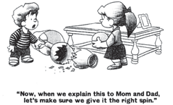

> **Descripción de la imagen** — Es una ilustración en blanco y negro que muestra a dos figuras: un adulto y un niño. El adulto está interactuando con un objeto grande, redondo y liso (similar a una pelota o esfera), mientras el niño observa la interacción. Ambos personajes están representados con un estilo de dibujo lineal simple.

4.  Por último, varios elementos de la agenda contribuyen a moldear el desarrollo de un
problema. Aunque las partes suelen tener uno o dos objetivos, prioridades o proble-
mas principales, existen varios conceptos menores o secundarios. Cuando se incluyen
en la conversación, estos intereses secundarios suelen transformar la conversación
sobre los problemas primarios. En un análisis cuidadoso de las negociaciones de un
maestro en dos distritos escolares, un investigador mostró cómo se transforman los
problemas durante una negociación.24 Por ejemplo, un problema de horario se volvió
a delimitar como problema de tiempo de preparación del maestro, y un problema de
costo del seguro personal se transformó en un problema del alcance de los benefi cios
del seguro.

Uno de los aspectos más importantes del desarrollo de un problema es el proceso de
volver a delimitar:  cambiar la presión, el tono y el enfoque de una conversación conforme
las partes participan en ella. Volver a delimitar es un proceso dinámico que puede ocurrir
muchas veces durante una conversación a medida que las partes se desafían entre sí, o
buscan maneras de conciliar perspectivas en apariencia incompatibles. También se vuelve
a delimitar cuando una parte utiliza metáforas, analogías o casos específi cos para ilustrar
un punto, lo cual lleva a la otra a utilizar la metáfora o el caso de una manera distinta para
defi nir la situación. Una u otra parte puede volver a delimitar de manera intencional, o puede
surgir de la conversación cuando los desafíos de una persona son un reto a la creatividad y
la imaginación de la otra. En cualquier caso, las partes suelen proponer una nueva manera
de abordar el problema.

Resumen de la sección

La delimitación se ocupa de concentrar, moldear y organizar el mundo que nos rodea: de
comprender realidades complejas y defi nirlas de maneras que tengan sentido para nosotros.
Analizamos los tipos de delimitaciones que hay y su importancia para comprender las op-
ciones estratégicas en una negociación. Podemos ofrecer la siguiente sugerencia restrictiva
acerca de la delimitación de un problema para el negociador:

“Ahora, cuando expliquemos esto a mamá y papá,

no olvides darle el giro adecuado.”

24  Putnam, 1994.

© 1998; reimpreso por cortesía de Bunny Hoest y Parade Magazine.

---

<!-- página 149 -->

Capítulo 5 Percepción. Conocimiento y emoción
132

• Las delimitaciones moldean lo que las partes defi nen como problemas principales y el
modo en que van a discutirlos. En la medida en que las partes tengan preferencias acerca
de los problemas por cubrir, los resultados por obtener o los procesos por abordar, deben
esforzarse para que la otra parte acepte y reconozca sus delimitaciones preferidas.
• Ambas partes tienen delimitaciones. Cuando coinciden las delimitaciones es más pro-
bable que las partes se concentren en los problemas comunes y en una defi nición común
de la situación; cuando no coinciden es probable que la comunicación entre las partes
sea difícil e incompleta.
• Las delimitaciones son controlables, al menos en cierto grado. Si los negociadores
están conscientes de su delimitación y de la que emplea la otra parte, pueden dirigir la
conversación hacia la delimitación que les gustaría que adoptara la otra.
• Las conversaciones transforman las delimitaciones en maneras que los negociadores
tal vez no sean capaces de predecir, pero sí logren controlar. Cuando las partes analizan
un problema, introducen argumentos y evidencias y defi enden un curso de acción, la
conversación cambia, y la delimitación también puede cambiar. Es fundamental para
los negociadores detectar este cambio y ver a dónde conduce.
• Ciertas delimitaciones suelen procurar más que otras ciertos tipos de procesos y resul-
tados. Por ejemplo, es probable que las partes competitivas tengan delimitaciones de
identidad positiva de sí mismas, delimitaciones de caracterización negativa entre sí y
preferencia por los procesos de ganar-perder para resolver sus discusiones. Reconocer
estas tendencias permite a las partes volver a delimitar sus opiniones de sí mismas, de
la otra o del mecanismo de solución de diferencias para buscar un proceso que resuelva
el confl icto de manera más productiva.

Prejuicios cognoscitivos en una negociación

Hasta aquí examinamos cómo se percibe, fi ltra, distorsiona y delimita la información. En
esta sección veremos cómo los negociadores emplean la información para tomar deci-
siones durante la negociación. En vez de ser procesadores de información perfectos, es
evidente que los negociadores tienden a cometer errores sistemáticos cuando procesan in-
formación.25 Estos errores, denominados en conjunto prejuicios cognoscitivos, tienden a
impedir el rendimiento de un negociador; entre ellos están: 1) la intensifi cación irracional
del compromiso, 2) la idea mítica de que todos los problemas en la negociación son de
participación fi ja, 3) el punto de afi anzamiento y el ajuste en la toma de decisiones, 4) la
delimitación de los problemas, 5) la disponibilidad de información, 6) el mal del ganador,
7) el exceso de confi anza del negociador, 8) la ley de los números pequeños, 9) los prejui-
cios que se fomentan a sí mismos, 10) el efecto de la adjudicación, 11) la tendencia a igno-
rar los conocimientos ajenos y 12) el proceso de una devaluación reactiva. A continuación
analizamos cada concepto con mayor detalle.

25  Para una revisión extensiva de la investigación sobre los prejuicios cognoscitivos en la negociación, véase
Bazerman y Carroll, 1987; Neale y Bazerman, 1992a, y Thompson y Hastie, 1990b. Si los negociadores
perciben o procesan la información de manera errónea aún es un tema de debate técnico en la bibliografía de
la comunicación y la negociación que trasciende el alcance de este libro.

---

<!-- página 150 -->

133
Prejuicios cognoscitivos en una negociación

1. Intensifi cación irracional del compromiso

A veces los negociadores mantienen un compromiso con un curso de acción incluso cuan-
do ese compromiso constituye una conducta irracional de su parte. Éste es un ejemplo de
un fenómeno psicológico más amplio conocido como “intensifi cación del compromiso”: la
tendencia de una persona a tomar decisiones que se apegan a un curso de acción fallido.26
Algunos ejemplos son un país que no deja de enviar recursos militares a un confl icto ar-
mado que no se puede ganar o un inversionista que no deja de invertir dinero en acciones
a la baja con la esperanza de que cambie su fortuna (la intensifi cación del compromiso se
suele llamar “meter dinero bueno al malo”). La intensifi cación del compromiso se debe en
parte a los prejuicios en la percepción y opinión individuales. Una vez decidido un curso
de acción, los negociadores suelen buscar evidencias que apoyen (confi rmen) su decisión
al tiempo que ignoran o dejan de buscar evidencias en sentido opuesto. Los compromisos
iniciales se graban en piedra (consulte la sección sobre el punto de afi anzamiento y el ajus-
te) y un deseo de uniformidad evita que los negociadores los modifi quen. Esta búsqueda de
uniformidad suele exacerbarse por el deseo de salvar el prestigio y mantener la impresión
de conocimiento o control frente a los demás. A nadie le gusta admitir un error o una falla,
sobre todo cuando la otra parte puede considerarlo una debilidad.

Una manera de combatir estas tendencias es hacer que un asesor se desempeñe como
punto de comprobación de la realidad: alguien que no se deje llevar por “el calor del mo-
mento” y advierta a los negociadores cuando, sin darse cuenta, comiencen a comportarse de
manera irracional. Asimismo, la investigación sugiere que quienes toman las decisiones son
menos propensos a intensifi car si experimentan arrepentimiento después de una situación
previa de intensifi cación.27

2. Ideas míticas de la participación fi ja

Muchos negociadores suponen que todas las negociaciones implican una participación
fi ja.28 Los negociadores suelen abordar las oportunidades de una negociación integradora
como situaciones de suma cero o intercambios de ganar-perder. Quienes creen en la mítica
de la participación fi ja suponen que no hay posibilidad de acuerdos integradores y solucio-
nes intermedias mutuamente provechosas, y cancelan los esfuerzos por buscarlos.29 En una
negociación salarial, el solicitante que supone que el salario es el único problema puede in-
sistir en 55 000 dólares cuando el empleador ofrece 52 000 dólares. Sólo cuando ambas par-
tes analizan más las posibilidades, descubren que los gastos de desplazamiento y la fecha de
inicio también se pueden negociar, lo cual puede facilitar la solución del problema salarial.

La tendencia a considerar las negociaciones en términos de participación fi ja varía
según la cantidad de personas que observen la naturaleza de una situación de confl icto
específi ca.30 Es más probable que los negociadores que se concentren en los intereses per-
sonales reciban la infl uencia de las ideas de una participación fi ja y aborden la situación

26  Brockner, 1992; Staw, 1981.
27  Ku, 2008.
28  Thompson, 1990a.
29  Pinkley, Griffi th y Northcraft, 1995; Thompson y Hastie, 1990a, 1990b.
30  Harinck, De Dreu y Van Vianen, 2000.

---

<!-- página 151 -->

Capítulo 5 Percepción. Conocimiento y emoción
134

de manera competitiva. Es menos probable que los negociadores que se concentren en los
valores vean el problema en términos de una participación fi ja y se inclinen más a abordar
la situación de manera cooperadora.

3. Punto de afi anzamiento y ajuste

Los prejuicios cognoscitivos de afi anzamiento y ajuste se relacionan con el efecto del
estándar (o punto de afi anzamiento) respecto del cual se hacen los ajustes subsecuentes
durante una negociación. Un ejemplo clásico de un punto de afi anzamiento en una nego-
ciación es escuchar la primera oferta de la otra parte y pensar: “Vaya, esa oferta fue mucho
más baja de lo que esperaba; quizá malinterpreté el valor y debí reconsiderar mis metas y
mis tácticas.” Los puntos de afi anzamiento como éste tienden una trampa potencialmente
peligrosa para el negociador del lado receptor, porque la elección de un punto de afi anza-
miento (por ejemplo, una oferta inicial o una meta buscada) puede basarse en una infor-
mación defectuosa o incompleta y, por tanto, ser engañosa por sí misma. Sin embargo, una
vez decidido el punto de afi anzamiento, las partes tienden a considerarlo como un punto
de referencia real, válido para ajustar otras opiniones, como el valor de lo que se negocia
o la magnitud de la contraoferta que haremos.31 Por ejemplo, la investigación muestra
que el precio inicial afecta mucho la forma en que los agentes de bienes raíces tasan una
casa.32 El precio solicitado funciona como punto de afi anzamiento conveniente para tasar
el valor de la casa. Las metas en una negociación —ya sea que se establezcan de manera
realista o descuidada— también funcionan como puntos de afi anzamiento. Estos puntos de
afi anzamiento son visibles o invisibles para la otra parte (precio de mercado publicado en
contra de una perspectiva no comunicada) y, al mismo tiempo, una persona puede tenerlos
de manera consciente o inconsciente (una expectativa específi ca en contra de una norma
no examinada ni cuestionada). Una preparación minuciosa, junto con la participación de
un abogado del diablo (es decir, alguien que verifi que la realidad), ayuda a evitar errores
de punto de afi anzamiento y ajuste.

4. Delimitación de un problema y riesgo

Como analizamos ya en este capítulo, una delimitación es una perspectiva o un punto de
vista al recopilar información y resolver problemas. Las delimitaciones conducen a las
personas a buscar, evitar o ser neutrales acerca del riesgo en una negociación. La manera
de delimitar una negociación puede hacer que los negociadores sean más o menos adver-
sos o propensos al riesgo. Por ejemplo, las personas responden de manera muy diferente
cuando negocian para “ganar” algo en vez de para “no perder” algo.33 Un hallazgo básico
de la investigación que condujo al descubrimiento de lo que se conoce como “teoría de
los prospectos” es que las personas son más contrarias al riesgo cuando un problema
de decisión se delimita como una ganancia posible, y son más propensas al riesgo cuando

31  Kristensen y Garling, 1997. Véanse también Diekmann, Tenbrunsel, Shah, Schroth y Bazerman, 1996; Ritov,
1996.
32  Northcraft y Neale, 1987.
33  Schurr, 1987. Véanse también Bazerman, Magliozzi y Neale, 1985; De Dreu, Carnevale, Emans y Van de
Vliert, 1994; Neale, Huber y Northcraft, 1987.

---

<!-- página 152 -->

135
Prejuicios cognoscitivos en una negociación

se delimita como una pérdida.34 En otras palabras, los negociadores reaccionan en ex-
ceso a lo que se percibe como una pérdida, cuando podrían reaccionar de manera más
positiva a la misma situación si se delimitara como una ganancia percibida. Por tanto,
como negociador, usted debe “evitar los peligros de ser delimitado y, al mismo tiem-
po, comprender de manera positiva y delimitar de manera negativa a su oponente”.35
Cuando los negociadores son contrarios al riesgo es más probable que acepten cualquier
oferta viable sólo porque temen perder. En cambio, cuando los negociadores son propen-
sos al riesgo es probable que esperen una mejor oferta o concesiones futuras.

Este proceso de delimitación positiva/negativa es importante porque la misma oferta
puede producir cursos de acción muy distintos, según se delimite en términos de ganancia-
pérdida. Las negociaciones en que los resultados se delimitan de manera negativa tienden
a producir menos concesiones y a obtener menos acuerdos, y los negociadores perciben
que los resultados son menos justos que en las negociaciones en las cuales los resultados
se delimitan de manera positiva.36 Los remedios para los probables efectos perniciosos
de una delimitación son similares a los que mencionamos para otros prejuicios cognos-
citivos (por ejemplo, información sufi ciente, análisis minucioso, comprobaciones de la
realidad), pero pueden ser difíciles de llevar a cabo porque las delimitaciones se suelen
relacionar con valores e ideas muy arraigados o con otros puntos de afi anzamiento difí-
ciles de detectar.

5. Disponibilidad de información

Los negociadores también deben interesarse en el probable prejuicio provocado por la dis-
ponibilidad de la información o la facilidad con que se recupera la información, es decir,
con cuánta facilidad se recuerda y utiliza para informar o evaluar un proceso o una deci-
sión.37 En una negociación, el prejuicio de disponibilidad funciona cuando la información
que se presenta en maneras vívidas, coloridas o llamativas es fácil de recordar y por ende
también se torna fundamental para evaluar sucesos y opciones. Es probable que la infor-
mación presentada mediante una tabla, diagrama o fórmula particularmente clara (incluso
una muy sencilla) se acepte con más facilidad que la información presentada en un formato
confuso o detallado, sin tomar en cuenta la exactitud de cada una. La disponibilidad de
información también afecta la negociación mediante esquemas de búsqueda establecidos.
Si los negociadores tienen un modo preferido de recopilar información o buscar señales
importantes utilizarán estos esquemas una y otra vez, y pueden sobrevalorar la información
que provenga de ellos.

6. La maldición del ganador

La maldición del ganador se refi ere a la tendencia de los negociadores, sobre todo en un
ambiente de subasta, de llegar a un acuerdo rápido sobre un artículo y después sentirse

34  Kahneman y Tversky, 1979.
35  Neale y Bazerman, 1992b, p. 50.
36  Bazerman y Neale, 1992.
37  Tversky y Kahneman, 1982.

---

<!-- página 153 -->

Capítulo 5 Percepción. Conocimiento y emoción
136

incómodos por ganar una negociación con demasiada facilidad.38 Si la otra parte capitula
muy rápido, el negociador suele preguntarse: “¿pude conseguir esto por menos?” o “¿hay
algo de malo con el artículo/producto/opción?” El negociador puede sospechar que la otra
parte sabe demasiado o percibe una ventaja intangible; por tanto, piensa “pude haberlo
hecho mejor” o “Éste debe ser un mal acuerdo”.

Por ejemplo, hace varios años uno de los autores de este libro y su esposa vieron en
una tienda de antigüedades un reloj del cual se enamoraron. Después de dedicar un tiempo
a decidir la estrategia de negociación (oferta inicial, oferta mínima, oportunidad, interés
fi ngido, táctica del bueno y el malo), el autor y su esposa regresaron a la tienda para repre-
sentar su estrategia. El propietario aceptó su primera oferta. Al llegar a casa, afectados por
la maldición del ganador, dejaron el reloj en la cochera, donde aún acumula polvo.

El mejor remedio para la maldición del ganador es evitar que ocurra en primer lugar,
realizando con antelación el trabajo necesario para evitar hacer una oferta que se acepte
inesperadamente. Una investigación y una preparación minuciosas ofrecen a los negocia-
dores una verifi cación independiente de los valores adecuados de una concertación. Los
negociadores también pueden tratar de asegurar el desempeño o las garantías de calidad de
la otra parte para comprobar que el resultado no sea defectuoso ni fallido.

7. Exceso de confi anza

El exceso de confi anza es la tendencia de los negociadores a creer que su capacidad para
ser correctos o precisos es mayor de lo que en realidad es. El exceso de confi anza es un
arma de doble fi lo: 1) consolida el grado en que los negociadores apoyan posiciones u
opciones incorrectas o inadecuadas, y 2) lleva a los negociadores a ignorar el valor o la
validez de las opiniones de los demás, con lo cual impiden que las otras partes sean fuentes
de información, opciones e intereses necesarios para una negociación integradora exitosa.
En un estudio se encontró que los negociadores no capacitados para estar conscientes de la
heurística del exceso de confi anza tendieron a sobreestimar su probabilidad de tener éxito,
y fueron menos propensos a conseguir una avenencia o alcanzar acuerdos que los negocia-
dores capacitados.39 En otro estudio, las personas con exceso de confi anza insistieron más
y se interesaron más en sus propios resultados que los negociadores confi ados de manera
realista.40 Sin embargo, esto no signifi ca que los negociadores siempre deban suprimir la
confi anza o el optimismo. Una investigación sobre la negociación distributiva halló que los
negociadores que tendían al optimismo lograron acuerdos más rentables en comparación
con negociadores con percepciones exactas o que tendían al pesimismo.41 Es evidente que
se requiere más investigación acerca de la interacción del optimismo, el exceso de confi an-
za y los resultados de una negociación.

8. Ley de los números pequeños

En la teoría de las decisiones, la ley de los números pequeños se refi ere a la tendencia de las
personas a extrapolar a partir de muestras pequeñas. En una negociación, la ley de los nú-

38  Bazerman y Samuelson, 1983. Véanse también Ball, Bazerman y Carroll, 1991; Foreman y Murnighan, 1996.
39  Neale y Bazerman, 1983.
40  Lim, 1997
41  Bottom y Paese, 1999.

---

<!-- página 154 -->

137
Prejuicios cognoscitivos en una negociación

meros pequeños se aplica al modo en que los negociadores aprenden y extrapolan su propia
experiencia. Si esa experiencia tiene tiempo o alcance limitados (por ejemplo, todas las ne-
gociaciones anteriores propias han sido intensas y distributivas), la tendencia es extrapolar
la experiencia anterior a las negociaciones futuras (por ejemplo, todas las negociaciones
son distributivas). Esta tendencia genera una profecía que se alimenta a sí misma; de este
modo es más probable que las personas que esperan que se les trate de manera distributiva:
1) perciban las conductas de la otra parte como distributivas y 2) traten a la otra parte de
una manera más distributiva. Así, es probable que la otra parte interprete la conducta del
negociador como evidencia de una tendencia distributiva y, por tanto, responderá de igual
manera. Cuanto más pequeña sea la muestra anterior (por ejemplo, cuanto más limita-
da sea la experiencia de negociación), es mayor la posibilidad de que las elecciones ante-
riores se utilicen de manera errónea para inferir lo que ocurrirá en el futuro. Los estilos y
las estrategias que funcionaron en el pasado tal vez no lo hagan en el futuro, y es seguro
que no funcionen si las negociaciones futuras son muy diferentes de las experiencias an-
teriores.

9. Prejuicios que se alimentan a sí mismos

Las personas suelen explicar la conducta de otra persona al atribuirle cosas, ya sea a la
persona (por ejemplo, las conductas fueron resultado de factores internos, como capacidad,
humor o esfuerzo) o a la situación (por ejemplo, las conductas fueron producto de factores
externos, como trabajo, otras personas o el destino).42 Al “explicar” la conducta de otra
persona, la tendencia es sobrestimar el peso de los factores personales o internos y menos-
preciar el peso de los factores situacionales o externos. Por ejemplo, piense en la estudiante
que llega tarde a una clase en la mañana. Tal vez sea perezosa (explicación interna de su
disposición) o quizá se desinfl ó un neumático a su automóvil en su tránsito a la universi-
dad (explicación situacional externa). Sin más información, el profesor tiende a aceptar la
explicación interna (es perezosa). Los prejuicios conceptuales suelen exacerbarse por el
efecto actor-observador, en el cual las personas tienden a atribuir su propia conducta a los
factores situacionales pero atribuyen las conductas de los demás a los factores personales,
y en realidad dicen “si me equivoco, es mala suerte (la situación, la falla de otra persona,
etc.); si te equivocas, es culpa tuya”.43

La investigación documenta los efectos de los prejuicios que se alimentan a sí mismos
en el proceso de una negociación. Por ejemplo, un estudio reveló que los negociadores de
diferentes distritos escolares eligieron una comparación de distritos escolares de una ma-
nera que se alimenta a sí misma; es decir, los distritos que eligieron como estándares para
comparar sus propias actividades fueron los que hicieron ver a sus distritos de la manera
más favorable.44 Otro estudio descubrió que los negociadores creían que utilizaban tácti-
cas más constructivas que sus contrapartes y que la fuerza de estos prejuicios que se alimen-
taban a sí mismos aumentaba con la fuerza del confl icto entre las partes.45

42  Heider, 1958.
43  Jones y Nisbett, 1976.
44  Babcock, Wang y Loewenstein, 1996.
45  De Dreu, Nauta y Van de Vliert, 1995.

---

<!-- página 155 -->

Capítulo 5 Percepción. Conocimiento y emoción
138

Un error de percepción también se expresa en forma de prejuicios o distorsiones en
la evaluación de los datos. Por ejemplo, el efecto de un consenso falso es una tendencia
a sobrestimar el grado de apoyo y consenso para la posición, opiniones o conductas pro-
pias.46 También tendemos a asumir que nuestras creencias u opiniones personales se basan
en información confi able, mientras que los de la otra parte se basan en desinformación.47
Cualquiera de estos prejuicios puede dañar gravemente un esfuerzo de negociación: los
negociadores sujetos a esto pueden hacer juicios erróneos en relación con las tácticas o las
probabilidades de un resultado.

10. Efecto de adjudicación

El efecto de adjudicación es la tendencia a valorar en exceso algo que usted posee o cree
que posee. El efecto de adjudicación se demostró de manera muy drástica en una serie de
experimentos relacionados con tazas para café.48 En un experimento se preguntó a algunos
participantes si preferían una cantidad de dinero o una taza con distintos precios asignados.
Con base en sus respuestas se determinó que asignaron a la taza un valor promedio de
sólo un poco más de tres dólares. Se pidió a otros participantes que valoraran la taza como
posibles compradores; el valor promedio que le asignaron fue de menos de tres dólares. A
los integrantes de un tercer grupo les entregaron una taza y les preguntaron si la venderían
por diferentes cantidades: sus respuestas indicaron que asignaban a cada taza un valor de
más de siete dólares.

En una negociación, el efecto de la adjudicación conduce a estimaciones infl adas del
valor, las cuales interfi eren para alcanzar un buen acuerdo. Al analizar los efectos de la ad-
judicación en el contexto de las negociaciones por problemas ambientales, Max Bazerman
y sus colegas argumentaron que el statu quo funciona como “punto de afi anzamiento dis-
funcional, lo cual difi cultaba los acuerdos mutuamente provechosos”.49 Ocurre un proceso
similar cuando se acepta una oferta en una negociación. Un estudio demostró que, una
vez aceptada, a los negociadores les gustaba más esa propuesta que otras ofertas que ellos
mismos hicieron durante el proceso de negociación.50

11. Ignorar los conocimientos ajenos

Los negociadores no suelen preguntar acerca de las percepciones y pensamientos de la
otra parte, lo cual los hace trabajar con información incompleta y esto a su vez produce
resultados defectuosos. Dejar de considerar los conocimientos de los demás permite a los
negociadores simplifi car sus ideas sobre procesos complejos, y esto suele conducirlos a
una estrategia más distributiva y hace que se deje de reconocer la naturaleza fortuita de
las conductas y respuestas de ambos lados. Si bien esta “omisión de considerar” puede
atribuirse a prejuicios implícitos contra la otra parte, la investigación sugiere que más a
menudo es una manera de hacer más manejable la compleja tarea de tomar decisiones en

46  Ross, Green y House, 1977.
47  Fragale y Heath, 2004.
48  Kahneman, Knetsch y Thaler, 1990.
49  Bazerman, Moore y Gillespie, 1999, p. 1288.
50  Curhan, Neale y Ross, 2004.

---

<!-- página 156 -->

139
Administración de las percepciones erróneas y los prejuicios cognoscitivos en la negociación

condiciones de riesgo e incertidumbre.51 La investigación también sugiere que la capaci-
tación y el conocimiento de esta trampa reducen sus efectos sólo de manera modesta.52 El
impulso por ignorar los conocimientos de los demás está muy arraigado y sólo se evita si
los negociadores se concentran de manera explícita en aplicar el esfuerzo necesario para
generar una comprensión precisa de los intereses, metas y perspectivas de la otra parte.

12. Devaluación reactiva

La devaluación reactiva es el proceso de devaluar las concesiones de la otra parte sólo
porque las hizo la otra parte.53 Tal devaluación puede originarse en las emociones (“senci-
llamente no me agrada”) o en la desconfi anza alimentada por una experiencia anterior. La
devaluación reactiva conduce a los negociadores a minimizar una concesión realizada por
alguien que nos desagrada para no responder con una concesión de igual valor o incluso
para pretender más de la otra parte una vez hecha una concesión.54 La devaluación reactiva
se reduce al mantener una opinión objetiva del proceso y asignar a un colega para realizar
esta tarea, al aclarar las preferencias de cada parte en las opciones y las concesiones antes
de que se hagan55 o al utilizar a un tercero como mediador o fi ltro en los procesos de hacer
concesiones.

Administración de las percepciones erróneas
y los prejuicios cognoscitivos en la negociación

Las percepciones erróneas y los prejuicios cognoscitivos suelen surgir de un conocimiento
consciente mientras los negociadores recopilan y procesan información. Es difícil sugerir
la forma de administrar mejor un prejuicio de percepción y cognoscitivo. Es evidente que
el primer nivel para administrar tales distorsiones es estar consciente de que ocurren. Sin
embargo, la conciencia por sí sola no basta; la evidencia en las investigaciones muestra que
informar a las personas acerca de las percepciones erróneas y los prejuicios cognoscitivos
ayuda poco a contrarrestar sus efectos.56 Por ejemplo, en un estudio, unos investigadores
enseñaron a los estudiantes cómo evitar la maldición del ganador en una serie de simula-
ciones de subastas. Comunicaron a los estudiantes los resultados de 128 subastas durante
un periodo de cuatro semanas, pero descubrieron que la capacitación tuvo poco impacto en
reducir la maldición del ganador.57

Se requiere más investigación para sugerir a los negociadores cómo manejar los efectos
negativos de la percepción errónea y los prejuicios cognoscitivos en una negociación. Hasta
entonces, el mejor consejo que pueden seguir los negociadores es tan sólo estar conscientes
de los aspectos negativos de estos efectos y analizarlos de manera estructurada dentro de
su equipo y con sus contrapartes.

51  Carroll, Bazerman y Maury, 1988.
52  Carroll, Delquie, Halpern y Bazerman, 1990.
53  Stillenger, Epelbaum, Keltner y Ross, 1990.
54  Neale y Bazerman, 1992a.
55  Stillenger et al., 1990.
56  Babcock y Loewenstein, 1997; Thompson y Hastie, 1990a.
57  Foreman y Murnighan, 1996.

---

<!-- página 157 -->

Capítulo 5 Percepción. Conocimiento y emoción
140

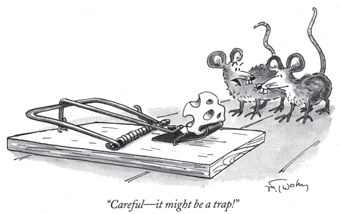

> **Descripción de la imagen** — Es una ilustración en blanco y negro que muestra a dos ratones interactuando con un mecanismo que parece ser una trampa o una red. Un ratón está posicionado cerca del dispositivo, aparentemente manipulándolo o examinándolo. El otro ratón se encuentra cerca, observando la escena. La composición sugiere un momento de cautela o peligro, lo cual es reforzado por el texto adjunto a la imagen.

Humor, emoción y negociación

En la investigación sobre las negociaciones predominan las opiniones que favorecen los
análisis racionales, cognoscitivos y económicos del proceso. Estos métodos tienden a ana-
lizar la racionalidad de una negociación, a examinar la forma en que los negociadores
cometen errores de juicio que se desvían de la racionalidad o a valorar la manera en que los
negociadores optimizan sus resultados. Los negociadores se consideran seres racionales
que aparentan ser calculadores, tranquilos y mesurados. Pero esto pasa por alto el papel que
desempeñan las emociones en una negociación.

Durante la década anterior, la función del humor y la emoción en una negociación se
sometió a un cuerpo de teoría e investigación cada vez más amplio.58 La distinción entre
humor y emoción se basa en tres características: especifi cidad, intensidad y duración. Los
estados de humor son más confusos, menos intensos y más perdurables que los estados de
emoción, los cuales tienden a ser más intensos y dirigirse a objetivos más específi cos.59
Las emociones desempeñan funciones importantes en diversas etapas de la interacción en
una negociación.60 En el estudio del humor, emoción y negociación hay muchos descubri-
mientos nuevos y emocionantes, y aquí sólo presentaremos un resumen limitado. Éstos son
algunos hallazgos importantes.

Las negociaciones crean emociones positivas y negativas Se generan emociones
positivas al verse atraído por otra parte, sentirse bien por el desarrollo de la negociación
y el avance que realizan las partes o porque nos agradan los resultados de las negocia-

¡Cuidado, puede ser una trampa!

58  Para revisar críticas en la bibliografía de investigación sobre las emociones en la negociación, véanse Allred,
Mallozzi, Matsui y Raia, 1997; Barry, Fulmer y Goates, 2006; Barry, Fulmer y Van Kleef, 2004; Kumar, 1997.
59  Forgas, 1992; Parrott, 2001.
60  Barry y Oliver, 1996.

© 2002 Colección de The New Yorker, de cartoonbank.com. Todos los derechos reservados.

---

<!-- página 158 -->

141
Humor, emoción y negociación

ciones.61 Por el contrario, se producen emociones negativas cuando la otra parte nos des-
anima, porque nos sentimos mal por el desarrollo del proceso de negociación y el avance
logrado o porque nos desagradan los resultados. Las emociones positivas suelen clasifi -
carse con el término de felicidad, pero tendemos a discriminar con mayor precisión entre
las emociones negativas.62 Algunas emociones negativas suelen basarse en el rechazo,
mientras que otras se basan en la perturbación. Las emociones relacionadas con el rechazo
son provocadas por sentirse decepcionado, frustrado o insatisfecho, mientras que las emo-
ciones relacionadas con la perturbación provienen de sentimientos de ansiedad, temor o
amenaza.63 Las emociones relacionadas con el rechazo hacen que los negociadores actúen
con agresividad, mientras que las emociones relacionadas con la perturbación hacen que
los negociadores traten de tomar represalias o salirse de la situación.64

Las emociones positivas suelen tener consecuencias positivas para las negociacio-
nes Las emociones positivas tienen estas consecuencias:

• Es más probable que los sentimientos positivos conduzcan a las partes a procesos más
integradores. Los investigadores demuestran que es más probable que los negociadores
con emociones positivas entre sí busquen acuerdos integradores y sean fl exibles para
solucionar un problema.65
• Los sentimientos positivos también crean una actitud positiva hacia la otra parte.
Cuando a los negociadores les agrada la otra parte, tienden a ser más fl exibles en las
negociaciones. Tener una actitud positiva hacia la otra parte aumenta las concesiones,
suaviza las conductas hostiles y desarrolla confi anza entre las partes.66
• Los sentimientos positivos promueven la persistencia. Si los negociadores se sienten
positivamente atraídos, es más probable que se sientan confi ados y, como resultado,
que insistan en tratar de abordar sus intereses y problemas en la negociación, y lograr
mejores resultados.67

Algunos aspectos del proceso de negociación generan emociones positivas Los in-
vestigadores comienzan a explorar las consecuencias emocionales de una negociación. Los
siguientes dos hallazgos se relacionan con la manera en que el proceso de una negociación
moldea los resultados relacionados con las emociones:

• Los sentimientos positivos son resultado de procedimientos justos durante la negocia-
ción. Los investigadores exploran la forma en que se relacionan las respuestas emociona-
les con la sensación de que el proceso de una negociación fue justo. Los hallazgos indican
que los negociadores que consideran justo el proceso experimentan más sentimientos
positivos y se inclinan menos a expresar emociones negativas después del encuentro.68

61  Carver y Scheir, 1990.
62  Kumar, 1997.
63  Higgins, 1987.
64  Berkowitz, 1989.
65  Carnevale e Isen, 1986; Isen y Baron, 1991.
66  Baron, 1990; Druckman y Broome, 1991; Pruitt y Carnevale, 1993.
67  Kramer, Pommerenke y Newton, 1993.
68  Hegtvedt y Killian, 1999.

---

<!-- página 159 -->

Capítulo 5 Percepción. Conocimiento y emoción
142

• Los sentimientos positivos son resultado de comparaciones sociales favorables. La evi-
dencia comprueba que la satisfacción individual después de una negociación es más
alta cuando los resultados de un negociador individual se comparan favorablemente con
otros en situaciones similares.69 Sin embargo, es interesante observar que este hallazgo
por las comparaciones sociales externas (comparar su resultado con otros fuera de la
negociación efectuada) no es válido para las comparaciones sociales internas (compa-
rar su resultado para la contraparte con quien usted acaba de negociar). Esto puede ser
porque las comparaciones con un oponente —incluso las favorables— se concentran en
la forma como el negociador atendió las oportunidades perdidas para declarar un valor
adicional.

Las emociones negativas suelen tener consecuencias negativas para las negocia-
ciones Como ya señalamos, los sentimientos negativos se pueden basar en el rechazo o
en la perturbación, una o ambas partes pueden sentir las emociones, y la conducta de una
parte puede activar una reacción emocional de la otra. A continuación presentamos los re-
sultados específi cos de algunos estudios. (Véase el cuadro 5.2 para obtener consejos sobre
cómo lidiar con un oponente que trae a la mesa emociones negativas.)

• Las emociones negativas pueden hacer que las partes defi nan la situación como com-
petitiva o distributiva. Un humor negativo aumenta la probabilidad de que una parte
manifi este una conducta beligerante hacia la otra.70 En una situación de negociación es
muy probable que esta conducta negativa adopte la forma de una postura más distribu-
tiva en los problemas.
• Las emociones negativas pueden socavar la capacidad de un negociador para analizar
la situación con precisión, lo cual afecta de manera adversa los resultados individua-
les. La investigación indica que los negociadores enojados juzgan con menos exactitud
los intereses de la otra parte y olvidan sus propios intereses, en comparación con los
negociadores que presentan emociones neutrales.71 Vale la pena señalar que la manipu-
lación experimental del enojo en este estudio no se relacionó con la negociación misma;
el enojo surgió durante lo que las personas consideraban un experimento separado,
anterior al experimento de la negociación. Este efecto de traslado del enojo resalta el
poder de las emociones negativas para desviar la atención propia y desatender el pro-
blema actual en la negociación.
• Las emociones negativas pueden hacer que las partes intensifi quen el confl icto. Cuando
el humor es negativo —para ser más precisos, cuando ambas partes sienten rechazo,
frustración y culpan a la otra— es probable que el confl icto se vuelva personal, que
aumente la cantidad de problemas en el confl icto y que se incluya a otras partes en
la discusión.72 Las expresiones de enojo de una parte pueden desencadenar enojo en la
otra, lo que reduce las oportunidades de que la disputa se solucione con éxito.73

69  Novemsky y Schweitzer, 2004.
70  Veitch y Griffi th, 1976.
71  Gonzalez, Lerner, Moore y Babcock, 2004.
72  Kumar, 1997.
73  Friedman, Anderson, Brett, Olekalns, Goates y Lisco, 2004.

---

<!-- página 160 -->

Joe y Sue Carter
143

143

Las emociones son inevitables en las negocia-
ciones, y no es realista evitarlas o eliminar-
las del encuentro. La experta en negociación
Barbara Gray argumenta que los negociadores
efi caces logran manejar los estallidos emocio-
nales de los demás tan sólo con “tomarnos
desprevenidos”. Ofrece las siguientes suge-
rencias para lidiar con un oponente que expre-
sa sus sentimientos de modo volátil o incluso
hiriente:

1.  Separe la emoción de su expresión. Quizá
la emoción sea en realidad la forma de la
otra persona para señalar un interés im-
portante. ¿Por qué actúa así? ¿Qué interés
es lo bastante importante para justifi carla?
2.  Voltee las cosas. Póngase en el lugar de la
otra persona y pregúntese: “Por qué actua-
ría yo así?” Esto puede ayudarle a identifi -
car una circunstancia que legitime ese
tipo de estallido emocional. La idea es no
aceptar el comportamiento (inaceptable)
de la otra persona, sino contemplarlo co-
mo refl ejo de alguna necesidad o interés

identifi cables que deben discutirse en la
negociación.
3.  Refl eje a la otra persona la emoción ex-
presada. En ocasiones, los sentimientos
fuertes son un indicador de que la otra
parte tan sólo quiere que se le escuche.
Confi rme que está usted escuchando y
que entiende la preocupación que desató
la emoción. Esto no necesariamente sig-
nifi ca que usted está de acuerdo con esa
preocupación ni hace alguna concesión;
sólo reconoce que la otra parte es humana
y tiene sentimientos. Esto puede ser todo
lo que la otra parte necesita.
4.  Formule preguntas para revelar el pro-
blema o interés que motiva la emoción.
Conocer la preocupación subyacente le
posibilitará avanzar de la emoción a la
sustancia, y tratar la preocupación (una
vez que usted sepa cuál es) como tema
para la mesa de negociaciones.

Fuente: Adaptado de B. Gray, “Negotiating with Your
Nemesis”, Negotiation Journal 19, 2003a, pp. 299-310.

• Las emociones negativas pueden hacer que las partes tomen represalias e impidan
resultados integradores. Cuando las partes se enojan entre sí y cuando su interacción
anterior ya había hecho que una parte buscara castigar a la otra, la otra puede optar por
tomar represalias.74 Las emociones negativas también generan resultados menos efi ca-
ces. Cuanto más hace responsable un negociador al otro de una conducta destructiva
en una interacción previa, más enojo y menos compasión siente por la otra parte. A su
vez, esto conduce a menos preocupación por los intereses de la otra parte y una menor
probabilidad de idear soluciones negociadas mutuamente provechosas.75
• No todas las emociones negativas tienen el mismo efecto. El enojo puede tender a inten-
sifi car el confl icto y desencadenar una represalia, pero ¿qué hay de emociones menos
“calientes”, como preocupación, desilusión, culpa y arrepentimiento? La investigación
muestra que los negociadores demandan menos de oponentes preocupados o decepcio-
nados, quizá porque lamentan esta situación, pero hacen menos concesiones a oponentes
que se sienten culpables o arrepentidos. Sin embargo, los negociadores reportan impre-

74  Allred, 1999; Bies y Tripp, 1998.
75  Allred, Mallozzi, Matsui y Raia, 1997.
## CUADRO
### Cómo responder a las emociones
### negativas
## 5.2

---

<!-- página 161 -->

Capítulo 5 Percepción. Conocimiento y emoción
144

siones más favorables de sus oponentes arrepentidos, visualizándolos como más sensibles
interpersonalmente que los oponentes que experimentan preocupación o desilusión.76

Algunos aspectos del proceso de negociación pueden provocar emociones negati-
vas Igual que con la emoción positiva, es reciente y limitada la investigación que explora
las consecuencias emocionales negativas de una negociación. Éstos son algunos hallazgos:

• Las emociones negativas pueden ser el resultado de una actitud mental competitiva.
Los negociadores con una percepción de participación fi ja de la situación tienden a
sentirse menos satisfechos con los resultados negociados que quienes tienen una orien-
tación integradora. Esto puede generar la percepción de que cuando una negociación
se considera de suma cero, las ganancias de la otra parte signifi can una pérdida propia
equivalente.77
• Las emociones negativas pueden ser el resultado de callejones sin salida o puntos
muertos. Cuando una negociación termina en un callejón sin salida es más probable
que los negociadores experimenten emociones negativas, como enojo y frustración, en
comparación con los negociadores que alcanzan un acuerdo exitoso.78 Sin embargo, es
menos probable que las personas con más confi anza en su capacidad de negociación
experimenten emociones negativas frente a un callejón sin salida. Esto es importante
porque un callejón sin salida no siempre es malo: la meta es alcanzar un buen resultado,
no sólo obtener un acuerdo.
• Las emociones negativas pueden resultar simplemente del prospecto de iniciar una
negociación. Podemos asumir que los negociadores inexpertos son más propensos a
estar nerviosos respecto de una próxima sesión de negociación, pero incluso los ne-
gociadores expertos pueden sentir ansiedad al dirigirse al encuentro. No obstante, la
ansiedad no es algo malo; puede desatar la creatividad que ayude a producir resultados
constructivos.79

Efectos de las emociones positivas y negativas en una negociación Es posible que
una emoción positiva genere resultados negativos y que un sentimiento negativo produzca
resultados provechosos, como explicamos a continuación:

• Los sentimientos positivos pueden tener consecuencias negativas. Primero, es menos
probable que los negociadores con humor positivo examinen con atención los argumen-
tos de la otra parte. Como resultado, son más susceptibles a las prácticas engañosas de un
oponente competitivo.80 Además, como los negociadores con sentimientos positivos se
concentran menos en los argumentos de la otra parte, pueden alcanzar resultados menos
que óptimos.81 Por último, si los sentimientos positivos crean fuertes expectativas positi-
vas, es probable que las partes que no son capaces de obtener un acuerdo integrador expe-
rimenten la derrota con más intensidad y quizá traten a la otra parte con más aspereza.82

76  Van Kleef, De Dreu y Manstead, 2006.
77  Thompson y DeHarpport, 1994.
78  O’Connor y Arnold, 2001.
79  Wheeler, 2004.
80  Bless, Bohner, Schwartz y Strack, 1988.
81  Kumar, 1997.
82  Parrott, 1994.

---

<!-- página 162 -->

145
Humor, emoción y negociación

• Los sentimientos negativos pueden crear resultados positivos. Igual que las emociones
positivas pueden crear resultados negativos, es evidente que las emociones negativas
pueden generar consecuencias positivas para una negociación. Primero, una emoción
negativa tiene valor como información. Comunica a las partes que la situación es pro-
blemática y necesita atención, lo cual puede motivarlas a abandonar la situación o a
resolver el problema.83 Existe también evidencia reciente de que cuando un negociador
utiliza palabras que desencadenan emociones negativas, otros se vuelven más optimis-
tas respecto de que la negociación llegará a buen puerto.84 En resumen, el enojo y otras
emociones negativas pueden funcionar como una señal que motiva a ambas partes a
enfrentar el problema directamente y buscar una solución.85

Por supuesto, la ira también puede ser una señal de que un negociador es rudo o am-
bicioso, y los investigadores observan que los negociadores suelen ceder más a menudo
ante un oponente enojado que ante un oponente feliz o no emocional.86 Pero si bien a veces
sirve estar enojado en negociaciones competitivas (como señal de rudeza o resistencia a
comprometerse), la investigación advierte que el enojo puede ser contraproducente. Es
menos probable que el enojo genere concesiones cuando la parte que está en el lado re-
ceptor de dicho enojo: 1) tiene la oportunidad de responder con un engaño (por ejemplo,
tergiversar sus propios intereses), o 2) no tiene mucho que perder, lo que se traduce en
poco que temer si el oponente enojado rechaza una oferta.87

Empleo estratégico de las emociones como tácticas de negociación Por último,
analizamos las emociones como si fueran genuinas. Dado el poder de las emociones para
desplazar a la otra parte hacia nuestro punto de vista, las emociones también se aplican
de manera estratégica y manipuladora para infl uir en las tácticas de una negociación. Por
ejemplo, los negociadores pueden manipular intencionalmente las emociones para que la
otra parte adopte ciertas ideas o realice ciertas acciones.88

En un estudio, los negociadores a quienes se llevó a aplicar un tono emocional positivo
tuvieron más probabilidades de alcanzar acuerdos que incorporaran una relación de nego-
cios futura entre las partes en comparación con quienes aplicaron una estrategia emocional
negativa o neutral. Los negociadores que exhibieron emociones positivas tuvieron más
probabilidades de inducir docilidad al ofrecer un ultimátum.89

Más allá de la expresión estratégica de nuestras emociones (genuinas o inventadas),
los negociadores también se dedican a regular o administrar las emociones de la otra parte.
Los negociadores efi caces son capaces de ajustar su mensaje para que se adapte a lo que
ellos perciben como el estado emocional de la otra parte.90 Algunos psicólogos consideran
la capacidad de percibir y regular las emociones como una diferencia individual estable,
y la denominan inteligencia emocional.91

83  Van de Vliert, 1985.
84  Schroth, Bain-Chekal y Caldwell, 2005.
85  Daly, 1991.
86  Sinaceur y Tiedens, 2006; Van Kleef, De Dreu y Manstead, 2004.
87  Van Dijk, Van Kleef, Steinel y Van Beest, 2008.
88  Barry, 1999.
89  Kopelman, Rosette y Thompson, 2006.
90  Thompson, Nadler y Kim, 1999.
91  Mayer, Salovey y Caruso, 2000.

---

<!-- página 163 -->

Capítulo 5 Percepción. Conocimiento y emoción
### 146

En resumen, las emociones son características fundamentales de los encuentros de
negociación, que complementan la noción clásica de que la negociación es sobre todo un
proceso racional de toma de decisiones con riesgo e incertidumbre. Desde la perspectiva
tradicional, entendemos una negociación al observar la forma en que las partes sopesan la
información y hacen juicios que optimizan sus resultados. Como ya dijimos en este capítu-
lo, los negociadores se consideran actores racionales calculadores, calmados y controlados.
Pero como los investigadores han descubierto, las negociaciones implican a seres humanos
que no sólo se desvían de sus juicios racionales, sino que inevitablemente experimentan y
expresan emociones en circunstancias en las que hay mucho en juego.

En este capítulo apreciamos desde varias perspecti-
vas la función de la percepción, los conocimientos
y las emociones en una negociación. La primera
porción del capítulo presentó un breve resumen
del proceso de percepción y analizó cuatro tipos de
distorsiones de la percepción: estereotipos, efectos
refl ejo, percepción selectiva y proyección. Luego
analizamos la forma en que la delimitación afec-
ta las percepciones en una negociación y cómo al
volver a delimitar el desarrollo de un problema se
modifi can las percepciones de un negociador du-
rante las pláticas.

Después, el capítulo analizó una de las áreas de
consulta reciente más importantes en una negocia-
ción: los prejuicios cognoscitivos. A continuación
se consideraron las maneras para administrar las
percepciones erróneas y los prejuicios cognosciti-
vos en una negociación. En la sección fi nal conside-
ramos el humor y las emociones en una negociación
como factores que proporcionan una opción impor-
tante para los conceptos cognitivos y perceptivos
con el fi n de entender el comportamiento durante el
proceso de negociación.
## Resumen del capítulo

---

<!-- página 164 -->
## CAPÍTULO
## Comunicación
## 6
### Objetivos

1.
Explorar lo comunicado en una negociación, y cómo se comunica la gente.
2.
Considerar las formas de mejorar la comunicación en una negociación.
3.
Obtener herramientas prácticas para mejorar los procesos de comunicación en toda
negociación.

Reducida a su esencia, una negociación es una forma de comunicación interpersonal. Los
procesos de comunicación, verbales y no verbales, son fundamentales para lograr las metas
de una negociación y resolver confl ictos. En este capítulo examinamos el proceso mediante
el cual los negociadores comunican sus intereses, posiciones y metas y, a su vez, compren-
den en su conjunto los de la otra parte y los de la negociación. El capítulo inicia con un
análisis de qué se comunica en una negociación, seguido por una exploración de cómo se
comunican las personas en una negociación y concluye con un análisis sobre cómo mejo-
rar la comunicación en una negociación y las consideraciones especiales de comunicación
en la conclusión de las negociaciones.

¿Qué se comunica durante la negociación?

Una de las preguntas fundamentales que han examinado los investigadores en la comunica-
ción y la negociación es: “¿Qué se comunica durante una negociación?” Esta labor adopta
varias formas, pero suele implicar grabar en audio y en video las funciones en una negocia-
ción y analizar los esquemas de comunicación presentes. En un estudio, los investigadores
grabaron en video a los ejecutivos que participaron en una negociación de 60 minutos con
tres personas, relacionada con dos compañías petroleras.1 Los investigadores encontraron
que más de 70% de las tácticas verbales que utilizaron los compradores y los vendedores
durante la negociación fue integradora. Además, compradores y vendedores tendieron a
comportarse de manera recíproca: cuando una parte empleaba una táctica integradora, la
otra respondía con una equivalente.

Gran parte de la comunicación durante una negociación no se centra en las preferencias
de un negociador.2 Aunque la mezcla de contenido integrador en contra de distributivo varía

1  Alexander, Schul y Babakus, 1991.
2  Carnevale, Pruitt y Seilheimer, 1981.

---

<!-- página 165 -->

Capítulo 6 Comunicación
148

en función de los problemas analizados, también es evidente que el contenido de la comu-
nicación sólo es responsable en parte de los resultados de una negociación.3 Por ejemplo,
una parte puede decidir no comunicar ciertas cosas (la razón de seleccionar otro proveedor)
para que la contraparte (el proveedor no elegido) no sepa por qué se dan algunos resulta-
dos. En las secciones siguientes analizamos cinco categorías de comunicación que ocu-
rren durante las negociaciones, y después, si más comunicación siempre es mejor que me-
nos comunicación.

1. Ofertas, contraofertas y motivos
Entre las comunicaciones más importantes en una negociación están las que presentan
las ofertas y las contraofertas.4 Los negociadores tienen preferencias defi nidas y exhiben
una conducta racional al actuar de acuerdo con esas preferencias. Las preferencias de un
negociador refl ejan en buena medida sus motivaciones implícitas, las cuales también se
comunican durante una negociación, y ejercen una poderosa infl uencia en las acciones de
la otra parte y en los resultados de la negociación. Una estructura comunicativa para una
negociación se basa en las suposiciones que: 1) la comunicación de ofertas es un proceso
dinámico (las ofertas cambian con el tiempo), 2) el proceso de ofrecer es interactivo (los
negociadores infl uyen entre sí) y 3) diversos factores internos y externos (como limitacio-
nes de tiempo, normas de reciprocidad, opciones, presiones de los poderdantes) impulsan
la interacción.5 En otras palabras, el proceso de oferta-contraoferta es dinámico e interacti-
vo, y está sujeto a restricciones situacionales y ambientales. Este proceso revisa constante-
mente los parámetros de la negociación y termina por estrechar el rango de la negociación
y guiar la discusión hacia un punto de conciliación.

2. Información de las opciones
La comunicación en una negociación no se limita al intercambio de ofertas y contraofertas.
Otro aspecto importante estudiado es cómo infl uye en el proceso de negociación compartir
información con la otra parte. Por ejemplo, ¿tener una mejor alternativa para un acuerdo
negociado (MAPAN) es sufi ciente para dar a un negociador una ventaja sobre la otra par-
te?, ¿debemos comunicar nuestra MAPAN a la otra persona? La investigación sugiere que
una MAPAN cambia varias veces durante una negociación: 1) en comparación con los
negociadores sin MAPAN atractivas, los negociadores con MAPAN atractivas establecen
precios de reserva más altos para sí mismos que sus contrapartes; 2) los negociadores cu-
yos contrapartes tenían MAPAN atractivas establecieron puntos de reserva más bajos para
sí mismos, y 3) cuando ambas partes estaban conscientes de la MAPAN atractiva que tenía
uno de los negociadores, ese negociador recibió un resultado de la negociación más posi-
tivo.6 Así, los negociadores que poseen una MAPAN atractiva deben decir a la otra parte
si esperan recibir sus benefi cios completos. Nos apresuramos a agregar que sí importan el
estilo y el tono con que se comunica información sobre una MAPAN atractiva. Comunicar
a la otra parte con cortesía (guiar con sutileza) que se cuenta con una buena opción pro-
porciona una ventaja sin hacer sentir mal a la otra parte. Por otro lado, restregar en la cara

3  Weingart, Hyder y Prietula, 1996; Olekalns, Smith y Walsh, 1996.
4  Tutzauer, 1992.
5  Idem.
6  Pinkley, 1995; Pinkley, Neale y Bennett, 1994.

---

<!-- página 166 -->

149
¿Qué se comunica durante la comunicación?

a la otra parte una MAPAN de manera impositiva o condescendiente puede considerarse
agresivo y amenazador.

3. Información de los resultados
La investigadora Leigh Thompson y colaboradores examinaron los efectos de compartir
diferentes tipos de información en las evaluaciones de éxito de los negociadores.7 El es-
tudio se centró en la forma en que los ganadores y perdedores evaluaban los resultados de
su negociación (los ganadores se defi nieron como los negociadores que recibieron más
puntos en la simulación de una negociación). Thompson y sus colegas encontraron que los
ganadores y los perdedores evaluaron sus propios resultados de la misma manera cuando
no sabían qué tan bien lo había hecho la otra parte, pero si se enteraban de que el otro ne-
gociador lo había hecho mejor, o que simplemente estaba satisfecho con su resultado, los
negociadores se sentían menos optimistas con su propio resultado. Otro estudio sugiere que
incluso cuando los negociadores saben que la otra parte se desempeñó relativamente mal,
están menos satisfechos con el resultado que cuando no tienen información para comparar.8
En conjunto, estos hallazgos sugieren que los negociadores deben tener cautela acerca de
compartir con la otra parte sus resultados e incluso sus reacciones positivas por los resulta-
dos, sobre todo si en el futuro van a negociar otra vez con esa parte.

4. Razones sociales
Otro tipo de comunicación durante una negociación consiste en las “razones sociales” con
que los negociadores explican las cosas a la otra parte, sobre todo cuando necesitan justi-
fi car malas noticias.9 Son importantes tres tipos de explicaciones: 1) las explicaciones de
las circunstancias atenuantes, donde los negociadores sugieren que sólo pudieron adoptar
las posiciones que tenían; 2) las explicaciones de las circunstancias de exoneración, con
que los negociadores explican sus posiciones desde una perspectiva más amplia y sugieren
que, aunque su posición actual puede parecer negativa, se deriva de motivos positivos
(por ejemplo, un error de buena fe), y 3) las explicaciones de redelimitación, donde los
resultados se explican al cambiar el contexto (por ejemplo, una molestia de corto plazo
por una ganancia de largo plazo).10 Es más probable que obtengan mejores resultados los
negociadores que emplean varias explicaciones, y los efectos negativos de los resultados
defi cientes se aligeran al explicarlos.11

5. Comunicación acerca de los procesos
Por último, cierta comunicación trata del proceso de negociación mismo: si transcurre
bien o cuáles procedimientos pueden adoptarse para mejorar la situación. Parte de esta
comunicación toma la forma de una “charla” de apariencia trivial, que rompe el hielo o
permite una relación entre los negociadores. Sin embargo, es claro que cierta comunicación
acerca del proceso no sólo es útil, sino importante, como cuando el confl icto se intensifi ca
y los negociadores corren el riesgo de dejar que las hostilidades se apoderen del proceso.
Una de tales estrategias implica llamar la atención sobre las acciones agresivas de la otra

7  Thompson, Valley y Kramer, 1995.
8  Novemsky y Schweitzer, 2004.
9  Bies y Shapiro, 1987; Shapiro, 1991.
10  Sitkin y Bies, 1993.
11  Idem.

---

<!-- página 167 -->

Capítulo 6 Comunicación
150

parte y defi nir de manera explícita el proceso como contraproducente.12 Los negociadores
que desean interrumpir una espiral de confl icto deben resistir el impulso natural de repetir
la comunicación agresiva de la otra parte. Los negociadores, como otros seres humanos
igualmente ocupados, pueden sentir la tentación de tomar la delantera con ofertas y contra-
ofertas en busca de un resultado en vez de hacer una pausa y “perder” tiempo para discutir
un proceso que se desvirtuó. A veces, ese respiro en la conversación sustantiva y en la
atención al proceso es precisamente lo que se necesita.

Concluimos esta sección hablando de lo que es la comunicación en la negociación,
con tres preguntas básicas.

¿Los negociadores son consistentes o adaptativos?

Los negociadores efi cientes son capaces de adaptar su estilo y estrategia a situaciones
particulares de negociación. Sin embargo, aunque esto puede ser una buena idea, la inves-
tigación indica que cuando se trata de patrones de comunicación, es más probable que los
negociadores sean consistentes en sus estrategias en vez de cambiar su enfoque.13 Los ne-
gociadores reaccionan sólo a una pequeña proporción de las claves disponibles comunica-
das por su contraparte, y únicamente utilizan una pequeña porción de la posible respuesta.
Aún más, esta proporción se reduce a medida que avanza la negociación, lo que signifi ca
que mientras más dure, menos varían las formas de comunicación.14 Parece que cuando se
trata de elegir respecto de la comunicación, muchos negociadores prefi eren quedarse en
terreno conocido en vez de aventurarse por la senda de la improvisación.

¿Importa lo que se dice al principio de la negociación?

Una porción relativamente pequeña de la comunicación en un encuentro de negociación
puede tener efectos importantes en los resultados. Los investigadores observan que las “re-
banadas delgadas” de la negociación —es decir, los patrones de comunicación durante los
primeros cinco minutos— tienen un gran impacto en los acuerdos negociados a los que las
partes llegan al fi nal.15 El tono de la conversación durante esos primeros minutos sí impor-
ta: mientras mayor énfasis manifi esten los negociadores, con variaciones de las infl exiones
de voz y de volumen, peor les va, y mejor le va a la otra parte.16 En otras palabras, es útil
controlar “el piso” al principio de la negociación, pero no dominarlo con comunicación
emocional o hiperbólica.

Controlar la conversación en forma temprana puede ayudar a un negociador indi-
vidual, pero ¿ayuda a las partes a lograr resultados integrales? Hay evidencia de que las
ganancias conjuntas reciben la infl uencia de lo que ocurre al comienzo. Un estudio reveló
que hay mayores ganancias conjuntas cuando los negociadores trascienden su postura para
intercambiar información acerca de problemas y prioridades antes de que la negociación
avance demasiado.17

12  Brett, Shapiro y Lytle, 1998.
13  Taylor y Donald, 2003.
14  Idem.
15  Curhan y Pentland, 2007.
16  Idem.
17  Adair y Brett, 2005.

---

<!-- página 168 -->

151
Cómo se comunican las personas en  una negociación

¿Siempre es mejor tener más información?

Algunas investigaciones sugieren que recibir demasiada información durante una negocia-
ción en realidad puede ser nocivo para los negociadores; esto suele conocerse como “efecto
de que la información es debilidad”.18 A los negociadores que conocen las preferencias
completas de ambas partes se les difi culta más determinar los resultados justos que a los
negociadores que no tienen esta información.

Hay pruebas de que tener más información no se traduce automáticamente en mejores
resultados en una negociación. Un estudio reveló que la cantidad de información intercam-
biada no mejora necesariamente la exactitud general de las percepciones de las partes acerca
de las preferencias mutuas.19 La infl uencia del intercambio de información precisa en los
resultados de una negociación no es tan directa como se espera; es decir, tan sólo intercam-
biar información no conduce de manera automática a comprender mejor las preferencias
de la otra parte, o a mejores resultados en una negociación.

Cómo se comunican las personas en una negociación

Si bien puede parecer obvio que el modo en que se comunican los negociadores es tan im-
portante como lo que tienen que decir, la investigación ha analizado diferentes aspectos del
modo en que las personas se comunican en una negociación. Abordamos tres aspectos re-
lacionados con el “cómo” de la comunicación: las características del lenguaje de los co-
municadores, la comunicación no verbal en la negociación y la elección de un canal de
comunicación para enviar y recibir mensajes.

Características del lenguaje

En una negociación, el lenguaje funciona en dos niveles: el nivel lógico (para las propues-
tas u ofertas) y el nivel pragmático (semántica, sintaxis y estilo). El signifi cado transmitido
por una propuesta o declaración es una combinación de un mensaje superfi cial lógico y
varios mensajes pragmáticos (por ejemplo, sugeridos o deducidos). En otras palabras, no
importa sólo lo que se dice y cómo se dice, sino también la información adicional, velada
o entre líneas que busca, comunica o percibe el receptor. Por ejemplo, piense en las amena-
zas. Solemos reaccionar no sólo a la esencia de una declaración amenazadora, sino también
(y a menudo con más intensidad) a sus mensajes no expresados, que pueden implicar algo
acerca de la posibilidad de que la amenaza se cumpla, o de nuestra relación o nuestros
prospectos de trabajar juntos en el futuro. El cuadro 6.1 ilustra cómo las amenazas, que en
la superfi cie parecen lo bastante directas como estratagemas de negociación que intentan
motivar a la otra parte a hacer una concesión, en realidad son complejas y muy matizadas
cuando se analizan en términos de los elementos específi cos del lenguaje con que se ex-
presan.

Ya sea que se busque ordenar y obligar, vender, convencer u obtener un compromiso,
el modo en que se comunican las partes en una negociación parece depender de la capaci-
dad del emisor para codifi car las ideas de manera adecuada, al igual que la capacidad del

18  Véase Roth y Malouf, 1979; Schelling, 1960; Siegel y Fouraker, 1960.
19  O’Connor, 1997.

---

<!-- página 169 -->

Capítulo 6 Comunicación
152

152

receptor para comprender y decodifi car el mensaje transmitido. Además, suele ser pro-
blemático que los negociadores utilicen modismos o palabras coloquiales, sobre todo en
las negociaciones transculturales. El signifi cado transmitido puede estar claro para quien
habla, pero resultar confuso para quien escucha (por ejemplo, “estoy dispuesto a esperar
hasta que se ahorque el último perro”, declaración de compromiso positivo por parte de los
estadounidenses en ciertas regiones, pero confuso, en el mejor de los casos, para quienes
tienen diferentes antecedentes culturales, incluso en Estados Unidos). Aunque el signifi -
cado esté claro, una palabra o metáfora puede comunicar una falta de sensibilidad o crear
la sensación de exclusión, como ocurre a menudo cuando los hombres hablan de intereses
estratégicos mediante metáforas deportivas (“es la cuarta oportunidad para anotar; no es
momento de soltar el balón”). Como las personas no están conscientes de lo que ocurre con
una comunicación defectuosa con alguien de su propia cultura, están menos preparadas
para enfrentar ese tipo de comunicación defectuosa de lo que estarían si la persona fuera
de una cultura distinta.

¿Una simple declaración acerca de cosas ma-
las que sucederán a los otros si se resisten es
una amenaza? ¿O hay más? Gibbons, Bradac
y Busch (1992) identifi can cinco dimensiones
lingüísticas de la amenaza:

1.  Un lenguaje polarizado, en el que los ne-
gociadores manifi estan palabras positivas
cuando hablan de sus propias posiciones
(por ejemplo, generoso, razonable o inclu-
so equitativo) y palabras negativas cuan-
do se refi eren a la posición de la otra parte
(por ejemplo, rígido, irracional u opre-
sivo).
2.  Transmisión de inmediatez verbal (una
medida para transmitir inmediatez o ur-
gencia, o poner una relativa distancia
psicológica), ya sea alta y dirigida a com-
prometer o motivar a la otra parte (“Muy
bien, éste es el trato” o “Tuve mucho cui-
dado de...”), o baja y orientada a crear
un sentimiento de distancia o indiferencia
(“Bueno, ya estamos” o “Uno debería te-
ner gran cuidado de...”).
3.  Grado de intensidad del lenguaje: la alta
intensidad transmite sentimientos fuertes
al receptor (como en declaraciones de
afi rmación o frecuentes malas palabras) y

la baja intensidad transmite sentimientos
débiles.
4.  Grado de diversidad léxica (es decir, el
dominio de un vocabulario amplio y
rico), donde los altos grados de diversi-
dad léxica denotan comodidad y compe-
tencia con el lenguaje, mientras que los
bajos niveles transmiten incomodidad,
ansiedad o inexperiencia.
5.  Extensión de un estilo de lenguaje de alto
poder, donde el bajo poder se denota por
faltas verbales, vacilaciones o cortesía
que llega al punto de deferencia y subor-
dinación, y el alto poder se denota por el
dominio verbal, la claridad y fi rmeza de
la expresión y la confi anza en sí mismo.

De acuerdo con Gibbons, Bradac y Busch,
las amenazas son más creíbles si incorporan
descripciones negativamente polarizadas de la
otra parte y de su posición, alta inmediatez, alta
intensidad, alta diversidad léxica y un distinti-
vo estilo de lenguaje de alto poder.

Fuente: Adaptado de P. Gibbons, J. J. Bradac y J. D.
Busch, “The Role of Language in Negotiations: Threats
and Promises”, en L. Putnam y M. Roloff (eds.), Com-
munication and Negotiation, Newbury Park, California,
Sage, 1992, pp. 156-175.
## CUADRO
### ¿Todas las amenazas son iguales?
## 6.1

---

<!-- página 170 -->

153
Cómo se comunican las personas en  una negociación

Por último, las palabras que elige un negociador no sólo señalan una posición, sino tam-
bién la moldean y la predicen. El investigador Tony Simons examinó los esquemas lingüís-
ticos de la comunicación en una negociación; dos de sus hallazgos son importantes aquí:20

1.  Las partes cuyas afi rmaciones comunicaban intereses en la esencia de la negociación
(las cosas) y la relación con la otra parte obtenían mejores soluciones integradoras que
las partes cuyas declaraciones sólo se interesaban en la esencia o la relación.
2.  Los patrones lingüísticos que se dan temprano en la negociación ayudan a defi nir los
temas en formas que contribuyan a que las partes descubran más tarde posibilidades
integradoras.

Comunicación no verbal

Gran parte de lo que las personas comunican se transmite de manera no verbal. Algunos
ejemplos son las expresiones faciales, lenguaje corporal, movimientos de cabeza y tono
de voz, por nombrar algunos. Ciertos aspectos no verbales, llamados conductas circuns-
tanciales, son muy importantes para conectarse con otra persona durante una interacción
coordinada, como una negociación; permiten a la otra parte saber que usted escucha y pre-
para a la otra parte para recibir sus mensajes. Analizaremos tres conductas circunstanciales
importantes: contacto visual, postura corporal y estímulos.

Haga contacto visual Se supone que las personas deshonestas y cobardes no son ca-
paces de mirar a las personas a los ojos. Los poetas afi rman que la mirada es el lente que
nos permite percibir el alma de otra persona. Estos fragmentos de sabiduría convencional
ilustran la importancia que dan las personas al contacto visual. En general, hacer contacto
visual es una manera de mostrar a los demás que usted presta atención y escucha, y que
los considera importantes. Por supuesto, se puede escuchar muy bien incluso cuando no se
mira a la otra persona; de hecho, al desviar la mirada se concentra la atención en las pala-
bras que se escuchan y no se mezclan con la información visual. Pero la cuestión es que,
al no hacer contacto visual, usted no ofrece a la otra persona la información importante de
que usted está atento y escucha.

Para convencer a alguien es importante hacer contacto visual al proporcionar la parte
más importante del mensaje.21 En este aspecto, sincronizar los sistemas verbal y no verbal
destaca la importancia del mensaje que se envía. Asimismo, se debe mantener el contacto
visual no sólo al hablar, sino también al recibir la comunicación.22 Sin embargo, es im-
portante reconocer que estos esquemas son característicos de la sociedad occidental. En
otras partes del mundo prevalecen esquemas distintos. Por ejemplo, en algunas sociedades
asiáticas, bajar los ojos mientras la otra persona habla es señal de respeto.23

Ajuste la postura corporal Los padres suelen recomendar a sus hijos cómo permane-
cer de pie y sentarse, sobre todo cuando están en ambientes formales como la escuela, la
iglesia o una fi esta. La orden “¡siéntate!” suele acompañarse de “¡y pon atención!” Aquí

20  Simons, 1993.
21  Beebe, 1980; Burgoon, Coker y Coker, 1986; Kleinke, 1986.
22  Kellerman, Lewis y Laird, 1989.
23  Ivey y Simek-Downing, 1980.

---

<!-- página 171 -->

Capítulo 6 Comunicación
154

el padre comunica al hijo otra idea muy aceptada: que la postura del cuerpo indica si uno
pone atención a la otra persona o no. Para que los demás confi rmen que usted está atento,
mantenga su cuerpo erguido, inclínese un poco hacia adelante y encare directamente a la
otra persona.24 Si usted acepta y aprueba el mensaje de los demás, debe tener cuidado de no
exhibir una falta de respeto al adoptar una postura desgarbada, voltear a otra parte o poner
los pies sobre la mesa.25 En cambio, cruzar los brazos, inclinar la cabeza, arrugar la frente
y unir las cejas son señales de un fuerte rechazo o desaprobación del mensaje.26

Estimule o desapruebe de manera no verbal lo que dicen los demás Se puede indi-
car atención e interés en lo que dice la otra persona mediante diversas conductas sencillas.
Asentir con la cabeza, un simple gesto de la mano para continuar, o un “ajá” murmurado
para signifi car comprensión indican a la otra persona que continúe, que usted escucha. De
hecho, uno alienta a alguien a continuar hablando sobre muchos temas con sólo asentir con
la cabeza. Un breve contacto visual o una sonrisa y una inclinación de cabeza son señales
de aliento. Asimismo, fruncir el ceño, mover la cabeza de un lado a otro o tomarse el pecho
con dolor fi ngido señalan desaprobación hacia el mensaje del otro.

La comunicación no verbal —cuando se emplea bien— ayuda a los negociadores a
obtener mejores resultados por medio de una coordinación mutua. Un estudio comparó el
desarrollo de armonía entre los negociadores que tuvieron o no acceso visual entre sí mien-
tras negociaban. Los investigadores defi nieron la armonía como “un estado de positividad e
intereses mutuos que surge por la convergencia de una conducta expresiva no verbal en una
interacción”.27 Descubrieron que la interacción frente a frente estimuló la armonía mediante
una comunicación no verbal, la cual a su vez mejoró la coordinación y generó ganancias
conjuntas más elevadas. Por supuesto, hay que suponer que estos benefi cios sólo se dan si
las partes son capaces de interpretar la comunicación no verbal con precisión.

Elección de un canal de comunicación

La comunicación se experimenta de manera diferente en los distintos canales. Podemos
pensar que una negociación suele ocurrir frente a frente, y esta suposición se refuerza
por la metáfora común de la “mesa de negociación”. Pero la realidad es que las personas
negocian a través de diversos medios de comunicación: por teléfono, por escrito y, cada
vez más, mediante canales como correo electrónico, mensajes instantáneos y sistemas de
teleconferencia. El uso de tecnologías de información por medios conectados en redes para
negociar se suele denominar negociación virtual (a veces también e-negotiation). Un canal
particular moldea las percepciones de la tarea de comunicación en curso y las normas rela-
cionadas con una conducta adecuada; del mismo modo, las variaciones en el canal suelen
tener efectos importantes en los procesos y resultados de una negociación.28

La variación importante que distingue un canal de comunicación de otro es el ancho
de banda social: la capacidad de un canal para llevar y comunicar señales sociales sutiles

24  Idem.
25  Stacks y Burgoon, 1981.
26  Nierenberg y Calero, 1971.
27  Drolet y Morris, 2000, p. 27.
28  Bazerman, Curhan, Moore y Valley, 2000; Lewicki y Dineen, 2002.

---

<!-- página 172 -->

155
Cómo se comunican las personas en  una negociación

del emisor al receptor que van más allá del texto literal del mensaje mismo.29 Por ejemplo,
como alternativa para la interacción frente a frente, el teléfono conserva la capacidad para
transmitir señales sociales a través de las infl exiones o el tono de la voz, pero limita la capa-
cidad para comunicarse mediante expresiones faciales o gestos físicos. En la comunicación
escrita sólo están las palabras y los símbolos sobre el papel, aunque las palabras que se
eligen y el modo en que se ordenan comunican tono, (in)formalidad y emoción.

El correo electrónico, como modo ubicuo de comunicación entre personas y organiza-
ciones, se considera sólo otra forma de comunicación escrita que implica una transmisión
electrónica. Sin embargo, existen importantes diferencias entre el correo electrónico y otras
formas de comunicación escrita. Muchas personas, que tratan el correo electrónico como
un medio muy informal, se sienten cómodas al enviar mensajes cuya gramática o estilo
no son pulcros en situaciones (como el trabajo) donde nunca enviarían con descuido una
comunicación escrita e impresa. Algunas personas incorporan emoticonos mediante signos
de puntuación para comunicar información emocional en sus mensajes (la carita sonriente
[:-)] es el más conocido). Cierta investigación sobre la comunicación interpersonal y en
grupos pequeños a través de computadoras indica que la falta de señales sociales desinhibe
al comunicador y permite una conducta de comunicación más agresiva.30 No obstante, gran
parte de investigación en la comunicación a través de la computadora se concentra en la
interacción anónima. No está claro que la escasez de señales sociales tenga el mismo efecto
en un contexto de comunicación, como una negociación, donde las partes se conocen, y de
hecho pueden conocerse muy bien.31

Los investigadores examinaron los efectos de los canales en general, y del correo
electrónico en particular, en los procesos y los resultados de una negociación durante gran
parte de la década anterior. Por desgracia, son pocos los hallazgos consistentes que señalan
resultados claros. Sabemos que las partes que interactúan desarrollan armonía personal
con más facilidad en una comunicación personal que en otros canales,32 y que quienes
negocian frente a frente se inclinan más a revelar información verdadera, lo cual aumenta
su capacidad para alcanzar ganancias mutuas.33 Las investigaciones demuestran que es más
probable que la comunicación a través de canales escritos termine en un punto muerto que
la que ocurre en persona o por teléfono.34

También hay evidencias de que quienes negocian por correo electrónico alcanzan
acuerdos más equitativos (una división equilibrada de los recursos) que quienes nego-
cian en persona.35 Esto quizá se deba a que la comunicación electrónica “nivela el terreno
de juego” entre los negociadores fuertes y débiles. Al dar al individuo la oportunidad de
analizar con sufi ciente tiempo el mensaje y de revisar su propia comunicación, el correo
electrónico en realidad ayuda a las partes con menos habilidad interpersonal a mejorar su
desempeño, sobre todo cuando la alternativa es negociar de manera espontánea (en persona
o por teléfono) con otra parte más hábil.

29  Barry y Fulmer, 2004. Véanse también Short, Williams y Christie, 1976, quienes aplicaron para esto el térmi-
no “presencia social”.
30  Sproull y Kiesler, 1986.
31  Barry y Fulmer, 2004.
32  Drolet y Morris, 2000.
33  Valley, Moag y Bazerman, 1998.
34  Idem.
35  Croson, 1999.

---

<!-- página 173 -->

Capítulo 6 Comunicación
156

Un conjunto de evidencias cada vez mayor apunta a la conclusión de que los nego-
ciadores que emplean correo electrónico necesitan esforzarse más por desarrollar armonía
personal con la otra parte si desean superar las limitaciones del canal que inhiben los acuer-
dos óptimos o fomentan un atolladero. Las negociaciones por correo electrónico carecen de
chismorreo: conversaciones ajenas a la tarea o centradas en la relación que suelen aparecer
en las negociaciones personales.36 El chismorreo es un medio importante para desarrollar
armonía y establecer confi anza en la relación de la negociación. Un estudio reveló que
los negociadores que chismorreaban por teléfono antes de negociar por correo electrónico
alcanzaban mejores acuerdos negociados, mejores resultados, mayor cooperación y mayor
confi anza y optimismo en cuanto a relaciones de trabajo futuras con la otra parte.37

Con tanta atención que se presta a un correo electrónico es importante tener en cuenta
que existen otros mecanismos en línea para las negociaciones virtuales. Un estudio compa-
ró las negociaciones por correo electrónico con las conducidas a través del mensaje instan-
táneo (MI). La diferencia importante entre estos dos canales es la velocidad de respuesta:
el correo electrónico es un medio “de tiempo lento”, mientras que el MI es “de tiempo
rápido”, que se aproxima más a la comunicación oral. En un simulacro de negociación de
compraventa se proporcionó a algunos vendedores intrincados argumentos para sustentar
su posición; otros recibieron argumentos más sencillos. Los investigadores pronosticaron
y observaron que los vendedores se desempeñaban mejor con los argumentos complejos en
el medio “rápido” (MI) que en el medio “lento” (correo electrónico).38 Los resultados del
estudio sugieren que esto ocurrió porque los vendedores armados con argumentos intrinca-
dos eran más capaces de dominar la conversación en el entorno de rápida respuesta del MI,
y al hacerlo lograban concesiones de la otra parte.

En resumen, las negociaciones por correo electrónico y otras tecnologías mediadas por
la red crean oportunidades, pero también plantean cruciales desafíos que los negociadores
harían bien en entender antes de elegir un medio en particular para una ocasión importante.
Consulte en el cuadro 6.2 una lista de modos adicionales para maximizar la efi cacia cuando
ocurran negociaciones en ambientes virtuales.

Cómo mejorar la comunicación en una negociación

Dadas las numerosas maneras en que una comunicación puede interrumpirse y distorsio-
narse, nos sorprende el grado en que los negociadores en realidad se comprenden entre sí.
Las fallas y las distorsiones en la percepción, el conocimiento y la comunicación contribu-
yen en gran medida a las interrupciones y las fallas en una negociación. La investigación
comprueba una y otra vez que incluso las partes cuyas metas son compatibles o integra-
doras pueden fracasar en alcanzar un acuerdo u obtienen acuerdos menos que óptimos a
causa de las percepciones erróneas de la otra parte o por interrupciones en el proceso de
comunicación.

Existen tres técnicas principales para mejorar la comunicación en una negociación:
formular preguntas, escuchar e invertir funciones.

36 Morris, Nadler, Kurtzberg y Thompson, 2000.
37  Idem.
38  Loewenstein, Morris, Chakravarti, Thompson y Kopelman, 2005.

---

<!-- página 174 -->

Joe y Sue Carter
157

157

Tácticas

Formular preguntas

Las preguntas son elementos esenciales en las negociaciones para proteger la información;
formular buenas preguntas permite a los negociadores obtener una buena porción de in-
formación acerca de la postura, argumentos de apoyo y necesidades de la otra parte. Las
preguntas se dividen en dos categorías básicas: manejables e inmanejables que provocan
difi cultades (véase la tabla 6.1).39 Las preguntas manejables generan atención o preparan

1.  Tome medidas para crear una relación en
persona antes de una negociación, o in-
cluso antes, para que exista un rostro o
una voz detrás del correo electrónico.
2.  Sea explícito acerca del proceso normati-
vo que se seguirá durante la negociación.
3.  Si están presentes otras personas en una
negociación virtual (de su parte o con la
otra), corrobore que todos sepan quiénes
están ahí y por qué.
4.  Seleccione el canal (en persona, videófo-
no, voz, fax o correo electrónico, etc.) más
efi caz para obtener toda la información y
los detalles de modo que ambas partes los
consideren a cabalidad.
5.  Evite “encenderse”; cuando deba expre-
sar una emoción, menciónela de manera
explícita para que los demás sepan de qué
se trata y qué signifi ca.
6.  No es estrictamente necesario hablar por
turnos, pero intenten sincronizar las ofer-
tas y las contraofertas. Hable si no está
seguro de “a quién le toca hablar”.
7.  Compruebe sus suposiciones acerca de los
intereses, ofertas, propuestas o conducta
de la otra parte. Menos contacto personal
signifi ca menos información acerca de la
otra parte y más posibilidad de que las de-
ducciones provoquen problemas; por tan-
to, es mejor preguntar.

8.  En muchas negociaciones virtuales (por
ejemplo, correo electrónico) todo se co-
munica por escrito, de modo que tenga
cuidado de no hacer compromisos que
puedan usarse en su contra. Tampoco debe
aprovecharse de manera indebida de la
otra parte de este modo; analice y aclare
hasta que todos coincidan.
9.  Quizá sea más fácil emplear tácticas poco
éticas en una negociación virtual porque
es más difícil verifi car los hechos. Pero no
ceda a la tentación. Las consecuencias son
muy graves, e incluso más, porque en las
negociaciones virtuales la evidencia incri-
minatoria se guarda automáticamente.
10.  No todos los estilos funcionan igual de
bien en todos los ambientes. Trate de de-
sarrollar un estilo de negociación perso-
nal (colaboración, competencia, etc.) que
se ajuste bien al canal de comunicación
que utiliza.

Fuente: Adaptado de R. J. Lewicki y B. R. Dineen, “Ne-
gotiating in Virtual Organizations”, en R. L. Heneman y
D. B. Greenberger (eds.), Human Resource Management
in the Virtual Organization, Nueva York, John Wiley and
Sons, 2003.
## CUADRO
### Las 10 reglas principales para
### la negociación virtual
## 6.2

39  Nierenberg, 1976.

---

<!-- página 175 -->

Capítulo 6 Comunicación
### 158
### el pensamiento de la otra persona para las preguntas adicionales (“¿puedo hacerle una
### pregunta?”), obtienen información (“¿cuánto costará esto?”) y generan ideas (“¿tiene al-
### guna sugerencia para mejorar esto?”). Las preguntas inmanejables provocan difi cultades,

TABLA 6.1 Preguntas en una negociación

Preguntas manejables
Ejemplos

Preguntas abiertas: las que no se responden
con un simple sí o no. Contienen palabras como
quién, qué, cuándo, dónde y por qué.

“¿Por qué adopta tal posición en estas de-
liberaciones?”

Preguntas libres: estimulan las ideas de la otra
parte.

“¿Qué piensa de nuestra propuesta?”

Preguntas guiadas: apuntan hacia una respuesta.
“¿Cree que nuestra propuesta contiene
una oferta justa y razonable?”

Preguntas moderadas: con baja carga emocional.
“¿Qué tasa adicional tendremos que pagar
si usted hace las mejoras a la propiedad?”

Preguntas planifi cadas: son parte de una secuen-
cia lógica desarrollada con anticipación.

“Después de que haga las mejoras a la
propiedad, ¿cuándo podemos ocuparla?”

Preguntas obsequiosas: halagan al oponente al
tiempo que se inquiere por información.

“¿Nos puede dar algunas de sus excelen-
tes ideas sobre este problema?”

Preguntas de ventana: ayudan a hurgar en la
mente de la otra persona.

“¿Nos puede decir cómo llegó a esa con-
clusión?”

Preguntas directivas: se concentran en un punto
específi co.

“¿Cuál es la renta por metro cuadrado con
estas mejoras?”

Preguntas de valoración: indagan cómo se siente
la otra persona.

“¿Qué le parece nuestra propuesta?”

Preguntas inmanejables
Ejemplos

Preguntas cerradas: obligan a la otra parte a ver
las cosas desde la perspectiva de usted.

“¿Usted no quiere aprovecharse de noso-
tros, verdad?”

Preguntas cargadas: ponen a la otra parte en es-
crutinio, sin tomar en cuenta la respuesta.

“¿Quiere decir que éstos son los únicos
términos que aceptará?”

Preguntas candentes: con alta carga emocional;
activan respuestas emotivas.

“¿No le parece que ya pasamos mucho
tiempo discutiendo esta ridícula propuesta
de usted?”

Preguntas por impulso: surgen “al calor del mo-
mento”, sin planifi cación, y tienden a descarrilar
la conversación.

“Mientras discutimos esto, ¿qué cree us-
ted que debemos decir a los demás gru-
pos que nos plantearon demandas seme-
jantes?”

Preguntas engañosas: parecen requerir una res-
puesta franca, pero en realidad su signifi cado
está “cargado”.

“¿Qué va usted a hacer: ceder a nuestras
demandas o recurrir a un árbitro?”

Preguntas engañosas de refl ejo: hacen que la
otra parte se refl eje en usted y acepte su punto
de vista.

“Así es como yo veo la situación, ¿no está
usted de acuerdo?”

Fuente: De Gerard Nierenberg, Fundamentals of Negotiating, Nueva York, Hawthorn Books, 1973, pp. 125-126.
Reproducido con autorización del autor.

---

<!-- página 176 -->

159
Cómo mejorar la comunicación en una negociación

revelan información (“¿sabía que no podemos pagar esto?”) y llevan la discusión a una
conclusión errónea (“¿no cree que ya hablamos sufi ciente de esto?”). Es probable que las
preguntas inmanejables generen actitudes defensivas y enojo en la otra parte. Si bien es-
tas preguntas pueden generar información, es probable que hagan que la otra parte se sienta
incómoda y no esté dispuesta a proporcionar información en el futuro.

Los negociadores también plantean preguntas para controlar las negociaciones difíciles
o estancadas. Aparte de su utilidad habitual para recopilar y diagnosticar información o
ayudar a la otra parte a abordar y a expresar sus necesidades e intereses, las preguntas tam-
bién cumplen una función táctica para revitalizar una negociación después de un colapso y
un aparente callejón sin salida. La tabla 6.2 identifi ca varias de tales situaciones y sugiere
preguntas específi cas para manejarlas.40 El valor de estas preguntas parece radicar en su
poder para ayudar u obligar a la otra parte a enfrentar los efectos o las consecuencias de
su comportamiento, consciente y previsto o no.

Escuchar

En las profesiones de ayuda, como la consultoría y la terapia, suelen emplearse términos
como “escucha activa” y “refl ejo”.41 Los consultores reconocen que las comunicaciones
están cargadas con numerosos signifi cados y que el consultor debe identifi carlos sin que el
comunicador se enoje o se ponga a la defensiva. Existen tres formas principales de escucha:

1.  La escucha pasiva implica recibir los mensajes sin enviar al emisor señales sobre la
exactitud o cabalidad de la recepción. A veces la escucha pasiva basta para evitar que
un comunicador envíe información. Un negociador cuya contraparte habla demasiado
puede ver que la mejor estrategia es sentarse y escuchar mientras la otra parte termina
por entrar o salir de su posición.
2.  El reconocimiento es la segunda forma de escucha, y es un poco más activa que la escu-
cha pasiva. Al reconocer, los receptores suelen asentir con la cabeza, mantener contacto
visual o intercalar respuestas como “entiendo”, “ya”, “interesante”, “¿en verdad?”, “cla-
ro”, “prosiga” y similares. Estas respuestas son sufi cientes para que los comunicadores
sigan enviando mensajes, pero un emisor puede malinterpretar que el receptor está de
acuerdo con su posición en vez de sólo reconocer que recibe el mensaje.
3.  La escucha activa es la tercera forma. Cuando los receptores emplean la escucha
activa, vuelven a expresar el mensaje del emisor en sus propias palabras. Éstos son
algunos ejemplos de escucha activa:42

EMISOR: No sé cómo voy a desenredar este problema.

RECEPTOR: En verdad este asunto te ha dejado perplejo.

EMISOR: Por favor, no me preguntes eso ahora.

RECEPTOR: Me parece que en este momento estás muy ocupado.

EMISOR: Creo que no conseguimos nada en la reunión de hoy.

RECEPTOR: Te siento un tanto decepcionado de nuestra sesión.

40  Deep y Sussman, 1993.
41  Rogers, 1957, 1961.
42  Estos ejemplos son de Gordon, 1977.

---

<!-- página 177 -->

Capítulo 6 Comunicación
### 160
### En una negociación, al principio puede parecer que la escucha activa no es con-
### veniente porque, a diferencia de un consultor, el receptor por lo general tiene una
### posición establecida y percibe los problemas con intensidad. Al recomendar la escucha
### activa, no sugerimos que los receptores acepten automáticamente la posición de la otra
### parte y abandonen la propia. Sugerimos, en cambio, que la escucha activa es una habi-
### lidad que alienta a las personas a expresar más sus sentimientos, prioridades, marcos

TABLA 6.2 Preguntas para situaciones difíciles

Situación
Preguntas posibles

Ultimátums del tipo “tómelo o dé-
jelo”

“Si pensamos en una opción más atractiva, ¿su oferta to-
davía sería ‘tómelo o déjelo’?”
“¿Tengo que decidir ahora o tengo tiempo para pensar-
lo?”
“¿Lo han presionado para que concluya la negociación?”

Presión para resolver en una fecha
límite poco razonable

“¿Por qué no podemos negociar la fecha de entrega?”
“Si lo presionan para cumplir con esta fecha de entrega,
¿cómo puedo ayudarle a reducir un poco la presión?”
“¿Qué tiene de especial esta noche? ¿No puede ser a
primera hora mañana?”

Tácticas de ofertas bajas y altas
“¿Qué razones lo llevaron a adoptar esta posición?”
“¿Cuál cree usted que yo consideraría una buena oferta?”
“¿Qué estándares cree que debe cumplir la resolución
fi nal?”

Punto muerto
“¿Qué puede hacer cualquiera de nosotros dos para ce-
rrar la distancia entre nuestras posiciones?”
“Específi camente, ¿qué concesiones necesita de mí para
cerrar el acuerdo de inmediato?”
“Si ya hubieran transcurrido seis semanas y viéramos en
retrospectiva esta negociación, ¿qué desearíamos haber
traído a la mesa?”

Indecisión entre aceptar y rechazar
una propuesta

“¿Cuál es su mejor opción para aceptar mi oferta en este
momento?”
“Si rechaza esta oferta, ¿qué puede reemplazarla que sea
mejor de lo que usted sabe que recibirá de mí?”
“¿Cómo puede estar seguro de que obtendrá un acuerdo
mejor en otra parte?”

Una pregunta sobre si la oferta que
usted hizo es igual a la ofrecida a
otros

“¿Qué considera usted una oferta justa y, a partir de eso,
qué le parece mi oferta?”
“¿Cree que lo mejor para mí es ser injusto con usted?”
“¿Cree que se pueda tratar a las personas de manera dis-
tinta y aun así ser justo con ellas?”

Intentos por presionar, controlar o
manipular

“¿No deberíamos retirarnos de esta negociación sintién-
donos satisfechos?”
“¿Qué pensaría si invirtiéramos nuestras posiciones y sin-
tiera la presión que me aplica?”
“¿Sufre presiones externas para concluir estas negocia-
ciones?”

Fuente: Adaptado de Sam Deep y Lyle Sussman, What to Ask When You Don’t Know What to Say, 1993. Repro-
ducido con autorización del editor, Prentice Hall, división de Simon & Schuster, Englewood Cliffs, Nueva Jersey.

---

<!-- página 178 -->

161
Consideraciones especiales de comunicación en la conclusión de las negociaciones

de referencia y, por extensión, las posiciones que adoptan. Cuando la otra parte hace
eso, los negociadores comprenden mejor sus posiciones, los factores y la información
que la apoyan, así como los modos en que pueden conciliar, negociar u obtener una
avenencia sobre esa posición, de acuerdo con sus preferencias y prioridades.

Invertir funciones

La discusión continua por una posición específi ca en un debate conduce a una “partici-
pación ciega” o a un ciclo de autorreforzamiento de argumentos que evita que los nego-
ciadores reconozcan la compatibilidad posible entre su posición y la de la otra parte.43
Al analizar la escucha activa, sugerimos que un objetivo era comprender la perspectiva o
marco de referencia de la otra parte. Sin embargo, de algún modo la escucha activa todavía
es un proceso pasivo. Las técnicas de inversión de funciones permiten a los negociadores
comprender a cabalidad las posiciones de la otra parte al debatir de manera activa estas
posiciones hasta que la otra parte está convencida de que comprendió. Por ejemplo, alguien
puede preguntarle cómo respondería usted a la situación en la que está él (“¿usted qué haría
en mi lugar?”). Al hacerlo, usted comprende la posición de esa persona, tal vez acepte su
validez y descubra cómo modifi car las posiciones de ambos para volverlas compatibles.

Las investigaciones sugieren que la inversión de funciones es un recurso útil para
mejorar la comunicación y la comprensión precisa de la posición de la otra parte en una
negociación.44 Esto puede ser muy útil durante la etapa de preparación de la negociación
o durante la reunión de un equipo cuando las cosas no van bien. Sin embargo, aumentar
la comprensión no necesariamente conduce a una solución fácil del confl icto, sobre todo
cuando una comunicación precisa revela una incompatibilidad fundamental en las posicio-
nes de ambas partes.

Consideraciones especiales de comunicación
en la conclusión de las negociaciones

Conforme las negociaciones se acercan a la conclusión de un acuerdo, deben atender al
mismo tiempo dos aspectos fundamentales de la comunicación y la negociación: evitar
cometer errores fatales y lograr una conclusión satisfactoria de manera constructiva.

Prevenir errores fatales

Lograr una conclusión en una negociación suele implicar tomar decisiones para aceptar
ofertas, determinar prioridades, alcanzar soluciones intermedias sobre los problemas con
la otra parte o adoptar una combinación de estos pasos. Tales procesos de toma de decisio-
nes se dividen en cuatro elementos importantes: delimitación, recopilación de inteligencia,
obtención de conclusiones y aprendizaje a partir de la realimentación.45 Analizamos los
primeros tres elementos en otras partes del libro; el cuarto elemento, aprender (o no) de la

43  Rapoport, 1964.
44  Johnson, 1971; Walcott, Hopmann y King, 1977.
45  Russo y Schoemaker, 1989.

---

<!-- página 179 -->

Capítulo 6 Comunicación
### 162

realimentación es en su mayor parte un problema de comunicación, lo cual implica “regis-
trar lo que esperaba que sucediera, alejarse de manera sistemática de las expectativas que
se alimentan a sí mismas y repasar las lecciones que su experiencia le aportó la siguiente
ocasión que enfrente una decisión similar”.46 En el capítulo 5 analizamos las trampas en
las decisiones provocadas por los prejuicios de percepción y cognoscitivos que inevitable-
mente encuentran los negociadores. Aunque algunas de estas trampas pueden ocurrir en
las etapas iniciales de la negociación, creemos que es posible que surjan varias al fi nal de
una negociación, cuando las partes tienen prisa por amarrar los cabos sueltos y consolidar
el acuerdo.

Lograr una conclusión

Gary Karrass, al analizar las negociaciones de ventas en particular, presenta sugerencias
específi cas sobre la comunicación cerca del fi nal de una negociación.47 Karrass sugiere a
los negociadores “reconocer cuándo deben mantener silencio” para no revelar información
importante innecesariamente, y abstenerse de emitir “comentarios tontos” que provoquen
que una contraparte indecisa se aleje de un acuerdo que estaba a punto de apoyar. Otro
aspecto de esto es tomar por lo que son los errores y comentarios tontos de la otra parte
y negarse a responder o distraerse con ellos. Karrass aconseja a los negociadores la nece-
sidad de atender los problemas de último minuto, como los detalles perfeccionistas o las
vacilaciones de las partes que no participaron en el proceso de concertación pero tienen el
derecho o responsabilidad de revisarlo. Karrass recomienda esperar tales desafíos y prepa-
rarse para controlarlos con aplomo. Por último, observa la importancia de reducir el acuer-
do a una forma escrita y reconocer que la parte que redacta el contrato está en posición de
obtener claridad de propósito y dirigir el acuerdo.

En este capítulo consideramos los elementos del
arte y la ciencia de la comunicación relevantes para
comprender las negociaciones.

Primero abordamos qué se comunica durante
una negociación. En vez de sólo intercambiar opi-
niones acerca de las soluciones, las negociaciones
cubren una gran variedad de temas en un ambiente
donde cada parte intenta infl uir en la otra. Después
de esto exploramos tres problemas relacionados
con la forma como se comunican las personas en
una negociación: lenguaje, comunicación no verbal

y elección de un canal de comunicación. Analiza-
mos en cierta medida cómo la decisión de negociar
en el entorno electrónico (por ejemplo, correo elec-
trónico) altera el comportamiento y los resultados
del negociador.

En las secciones fi nales del capítulo anali-
zamos cómo mejorar la comunicación en una ne-
gociación, inclusive el mejoramiento de las habi-
lidades para escuchar y plantear preguntas, y las
consideraciones especiales de comunicación en el
cierre de una negociación.
## Resumen del capítulo

46  Ibid., p. 3.
47  Karrass, 1985.

---

<!-- página 180 -->
## CAPÍTULO
## Obtención y utilización
## del poder de negociación
## 7
### Objetivos

1.
Comprender los distintos enfoques para entender el poder en las negociaciones, y por
qué el poder es básico en ese proceso.
2.
Explorar distintas fuentes o bases de poder en la negociación.
3.
Considerar los distintos enfoques estratégicos para los negociadores que tienen mayor
poder y para tratar con otros más poderosos.

En este capítulo nos concentramos en el poder que se desarrolla en una negociación. Por
poder nos referimos a las capacidades que adquieren los negociadores para obtener una
ventaja o aumentar la probabilidad de lograr sus objetivos. Todos los negociadores quieren
poder; quieren saber lo que pueden hacer para presionar a la otra parte, convencerla para
que vea las cosas a su modo, hacer que quiera lo mismo que ellos, obtener algo de la otra
parte o hacerla cambiar de opinión. Observe que, según esta defi nición, ya analizamos mu-
chas tácticas de poder en los capítulos 2 y 3. Las tácticas de las negociaciones distributiva
e integradora son de apalancamiento: con ellas se infl uye en la otra parte con la intención
de lograr el mejor acuerdo para una o ambas partes.

Primero defi niremos la naturaleza del poder y analizaremos algunas de sus dinámicas
en una negociación. Nos concentraremos en las fuentes de poder que dan a los negociado-
res la capacidad para ejercer su infl uencia. De las numerosas fuentes de poder que existen,
aquí consideraremos las tres principales: información y conocimiento, control de recursos
y posición propia en una organización o red.1

¿Por qué es importante el poder para los negociadores?

Casi todos los negociadores creen que el poder es importante en una negociación porque
les proporciona una ventaja sobre la otra parte. Los negociadores con esta ventaja suelen
querer usarla para lograr una mayor participación de los resultados o alcanzar su solución
preferida. La búsqueda del poder en una negociación surge de una de dos percepciones:

1  French y Raven, 1959; Pfeffer, 1992.

---

<!-- página 181 -->

Capítulo 7 Obtención y utlización del poder de negociación
164

1.  El negociador cree que en el momento presente tiene menos poder que la otra parte. En
esta situación, un negociador cree que la otra parte ya tiene cierta ventaja que puede y
debe utilizar, de modo que busca equilibrar o contrarrestar dicha ventaja.
2.  El negociador cree que necesita más poder que la otra parte para aumentar la proba-
bilidad de asegurar un resultado deseado. En este contexto, el negociador piensa que
requiere mayor poder para ganar o sustentar su propia ventaja en la negociación futura.

Estas dos ideas incorporan preguntas importantes de las tácticas y los motivos. Las
tácticas se diseñan para mejorar el poder del negociador o disminuir el poder de la otra parte,
y para crear un estado de equilibrio del poder (ambas partes tienen un poder relativamente
igual o contrarrestado) o una diferencia de poder (el poder de una es mayor que el de la
otra). Los motivos se refi eren a por qué el negociador utiliza las tácticas. A menudo, los
negociadores emplean tácticas diseñadas para equilibrar el poder con el fi n de nivelar el
campo de juego. La meta es socavar la capacidad de un lado para dominar la relación. Esto
establece las bases para que las discusiones avancen hacia un acuerdo integrador de ave-
nencia o colaboración. En contraste, los negociadores también emplean tácticas diseñadas
para crear una diferencia de poder como medio para obtener una ventaja o para bloquear
los movimientos de poder de la otra parte. Tales tácticas mejoran la capacidad de una parte
para dominar la relación, y allanan el camino para una estrategia competitiva o dominante
y un acuerdo distributivo. El cuadro 7.1 representa un esquema de los méritos de utilizar el
poder como táctica de negociación (en comparación con concentrarse en los intereses o en
“tener la razón” en una disputa).

En general, los negociadores a quienes no les importa su poder o que lo equilibraron
—ya sea mucho o poco poder— observan que sus deliberaciones avanzan con mayor fa-
cilidad y sencillez hacia un resultado mutuamente satisfactorio y aceptable. En cambio, es
probable que los negociadores a quienes les importa su poder y desean igualar o superar
el poder de la otra parte busquen una solución en la cual no pierdan la negociación (una
posición defensiva) o la dominen (una postura ofensiva).

El poder está implícito en muchas tácticas de negociación competitivas y de colabora-
ción ya descritas, como sugerir a la otra parte que usted tiene buenas opciones (una MAPAN
fuerte) para aumentar su ventaja. Relativamente pocos estudios de investigación se han
concentrado de manera específi ca en el poder y las tácticas para infl uir en una negociación,
las cuales integraremos a nuestro análisis. Sin embargo, gran parte del trabajo sobre el
poder analizado en este capítulo también proviene de estudios más amplios sobre la forma
en que los gerentes infl uyen entre sí en las organizaciones, y aplicaremos estos hallazgos a
las situaciones de negociación adecuadas.

Una defi nición de poder

En un sentido amplio, las personas tienen poder cuando tienen “la capacidad de producir
los resultados que buscan” o “la capacidad de hacer que las cosas se hagan como ellas
quieren”.2 Se supone que una parte que tiene poder puede inducir a la otra a hacer algo que
no haría en otra situación.3

2  Salancik y Pfeffer, 1977.
3  Dahl, 1957; Kotter, 1979.

---

<!-- página 182 -->

Joe y Sue Carter
165

165

¿Qué se comunica durante la comunicación?

Un modo de considerar la función del poder en
una negociación se relaciona con otras opcio-
nes estratégicas. En el capítulo 5 presentamos
una estructura desarrollada por Ury, Brett y
Goldberg (1993) que compara tres enfoques
estratégicos en una negociación: intereses, ra-
zón y poder.

• Los negociadores se concentran en los inte-
reses cuando tratan de conocer las priorida-
des y los intereses mutuos como un modo
para colaborar en la búsqueda de un acuer-
do mutuamente satisfactorio que genere
valor.
• Los negociadores se concentran en la razón
cuando buscan resolver una discusión al
exponer las reglas o los estándares de deci-
sión basados en principios legales, de jus-
ticia o incluso contratos vigentes.
• Los negociadores se concentran en el po-
der cuando manifi estan amenazas u otros
medios para obligar a la otra parte a hacer
concesiones.

Esta estructura supone que los tres enfoques
pueden estar presentes en una sola situación;
los negociadores eligen en cuál concentrarse.
Pero, ¿los negociadores en realidad aplican
los tres?, ¿deben hacerlo? Estas preguntas las
abordaron en un estudio Anne Lytle, Jeanne
Brett y Debra Shapiro.

Lytle y colaboradores observaron que casi
todos los negociadores pasaban por las tres es-
trategias —intereses, razón y poder— durante
el mismo encuentro. También vieron que los
negociadores tendían a refl ejar estas estrate-
gias. Por ejemplo, una estrategia coercitiva de
poder obtenía como respuesta una estrategia
de poder, lo cual generaba una espiral de con-
fl icto negativa y acuerdos defi cientes (o nin-
guno). Desarrollaron algunas implicaciones

importantes sobre la utilización del poder en
la negociación:

• Comenzar una negociación con la exhibi-
ción del poder propio para imponerse a la
otra parte puede generar una conciliación
rápida si su amenaza es creíble. Sin em-
bargo, si la otra parte piensa que es una
baladronada, a usted sólo le queda cumplir
su amenaza o perder prestigio, dos situa-
ciones indeseables.
• Las tácticas de poder (y las tácticas de la
razón) son más útiles cuando la otra parte
se niega a negociar o cuando las negocia-
ciones se interrumpieron y es necesario
reiniciarlas. En estas situaciones no se
arriesga mucho al amenazar con base en la
razón o el poder, pero la amenaza misma
puede motivar a la otra parte a apreciar la
gravedad de la situación.
• El éxito de las tácticas de poder (y de las
tácticas de la razón) depende en gran me-
dida del modo en que se implementan.
Para ser efi caces, las amenazas deben ser
específi cas y creíbles, y dirigirse a los in-
tereses más prioritarios de la otra parte.
De lo contrario, la otra parte tiene escasos
incentivos para una avenencia. No olvide
dejar abierta una vía para que la otra parte
“desactive” la amenaza, conserve su pres-
tigio y reabra las negociaciones sobre los
intereses.

Fuente: Adaptado de A. L. Lytle, J. M. Brett y D. L. Sha-
piro, “The Strategic Use of Interests, Rights, and Power to
Resolve Disputes”, Negotiation Journal 15, núm. 1, 1999,
pp. 31-51.
## CUADRO
### Intereses, razón y poder
### en una negociación
## 7.1

---

<!-- página 183 -->

Capítulo 7 Obtención y utlización del poder de negociación
166

Pero aquí hay un problema: la defi nición que elaboramos hasta el momento parece con-
centrarse en el poder como absoluto y coercitivo, lo cual es muy restrictivo para compren-
der la forma en que se utiliza el poder en una negociación. De hecho, en realidad existen
dos visiones del poder: el poder para dominar y controlar a la otra parte (más frecuente en
un contexto de concertación distributiva) y el poder para colaborar con la otra parte (más
común en un contexto de negociación integradora).4 Desde el punto de vista de quien tiene
poder, la primera visión se ajusta a una defi nición del poder sobre algo, lo que implica que
la naturaleza de este poder es sobre todo dominante y coercitiva. Desde el punto de vista
de la otra parte, este uso del poder implica impotencia y dependencia. La dinámica de esta
relación de poder va desde “benigna y de apoyo (como en muchas relaciones de tutoría)
hasta opresiva y abusiva (como un padre impositivo)”.5

Desde la segunda perspectiva, la visión del poder del actor sugiere el poder con algo,6
lo cual implica que quien tiene el poder lo desarrolla y comparte con la otra parte. Con
este poder, el receptor se siente investido con las facultades adecuadas e independiente, y
su dinámica refl eja los benefi cios de esta autorización, como una mejor participación del
empleado, una amplia delegación de la autoridad y una mayor capacidad para actuar con
autonomía e integridad personal. Esta visión del poder se ajusta a una que contrasta con la
defi nición del poder sobre algo:

un actor [...] tiene poder en una situación específi ca (poder situacional) en la medida en que
satisface los propósitos (metas, deseos o intenciones) que pretende lograr en esa situación. El
poder es un concepto relacional; no reside en la persona, sino en la relación de la persona con
su ambiente. Por tanto, el poder de un actor en una situación específi ca se determina por las
características de la situación tanto como por sus propias características.7

Se tiende a considerar el poder como un atributo sólo del actor, pero así se ignoran
los elementos del poder derivados de la situación o del contexto donde opera el actor. La
afi rmación “A es más poderoso que B” debe considerarse desde tres perspectivas y no
obstante interrelacionadas: poder ambiental: “A suele ser más capaz que B para infl uir
favorablemente en su ambiente general y/o para superar su resistencia”; poder relacional:
“A suele ser más capaz para infl uir favorablemente en B y/o para superar la resistencia de
B de lo que B es capaz de hacer con A”, y poder personal: “A suele ser más capaz para
satisfacer sus deseos que B”.8

Antes de continuar, queremos llamar la atención hacia la debilidad de cualquier análi-
sis del poder. Sería agradable escribir un capítulo que revisara de manera exhaustiva las
fuentes de poder disponibles para los negociadores, las principales confi guraciones de las ba-
ses del poder integradas como estrategias de infl uencia y las condiciones en las cuales debe
utilizarse cada una. Por desgracia, tal tarea no es sólo abrumadora sino imposible, por dos
razones principales. Primero, el uso efi caz del poder requiere un toque sensible y diestro, y
sus consecuencias varían mucho de una persona a la siguiente. En manos de un usuario, los

4  Coleman, 2000.
5  Ibid., p. 111.
6  Follett, 1942.
7  Deutsch, 1973, pp. 84-95.
8  Ibid., p. 85.

---

<!-- página 184 -->

167
Fuentes de poder. Cómo se adquiere

recursos del poder pueden crear un reino benévolo de prosperidad y éxito, mientras que en
las manos de otro pueden generar una pesadilla de tiranía y desorden.9 Segundo, no sólo los
actores y objetivos importantes cambian de una situación a otra, sino también lo hace el con-
texto en el cual operan los recursos del poder. Como resultado, lo mejor posible es identifi car
algunas fuentes importantes del poder. En el capítulo siguiente examinaremos en detalle cómo
y cuándo utilizar estos recursos, o cómo combinarlos.

Fuentes de poder. Cómo se adquiere

Los diferentes modos en los cuales se ejerce el poder se comprenden mejor al analizar
primero sus orígenes. En su obra innovadora sobre el poder, French y Raven identifi caron
cinco tipos principales: experto, de recompensa, coercitivo, legítimo y de referencia.10 La
naturaleza de cada uno es relativamente evidente:

• Poder experto: se deriva de tener información a fondo y exclusiva sobre un tema.
• Poder de recompensa: se deriva de ser capaz de recompensar a los demás por hacer lo
que debe hacerse.
• Poder coercitivo: se deriva de ser capaz de castigar a los demás por no hacer lo que debe
hacerse.
• Poder legítimo: se deriva de tener un título ofi cial o formal en una organización y ejer-
cer los poderes asociados a ese puesto (p. ej., vicepresidente o director).
• Poder de referencia: se deriva del respeto o de la admiración provocada por atributos
como personalidad, integridad, estilo interpersonal y demás. Se dice que A tiene un
poder de referencia sobre B en la medida en que B se identifi ca o quiere verse asociado
estrechamente a A.

Muchos análisis contemporáneos del poder todavía se basan en esta tipología (y Raven
la ha revisado varias veces desde su propuesta, hace 50 años). En este capítulo adoptaremos
una perspectiva más amplia sobre el poder en lo que respecta a una negociación y dividire-
mos las principales fuentes de poder en cinco grupos (véase la tabla 7.1):

• Fuentes de poder a partir de la información.
• Fuentes de poder personales.
• Poder basado en una posición laboral.
• Fuentes de poder basadas en relaciones.
• Fuentes de poder contextuales.

Como veremos con regularidad, estas categorías no son rígidas ni absolutas. El poder
se genera de muchas maneras en numerosos contextos y, con el tiempo, una fuente de
apalancamiento puede pasar de una categoría a otra. Conforme explicamos en detalle estos
enfoques veremos las revisiones y actualizaciones del modelo de French y Raven.

9  Los investigadores defi nieron una diferencia individual llamada competencia para la comunicación (Spitz-
berg y Cupach, 1984). Es probable que las personas con mucha competencia para la comunicación tengan
habilidades verbales defi nidas, sean capaces de generar estrategias para comunicarse de una situación a la
siguiente y adopten con facilidad la perspectiva de la otra parte. Las personas con mucha competencia para la
comunicación también son capaces de adaptarse a diferentes situaciones y hacer lo más necesario y deseable
en una situación específi ca.
10  French y Raven, 1959.

---

<!-- página 185 -->

Capítulo 7 Obtención y utlización del poder de negociación
### 168

TABLA 7.1 Principales fuentes de poder

Fuente de poder
Descripción

Información
• Información: acumulación y presentación de datos con intención de
cambiar el punto de vista o posición de la otra persona sobre un pro-
blema.
•  Experiencia: acumulación reconocida de información o dominio de un
cuerpo de información sobre un problema específi co.

El poder experto puede ser positivo (creemos en la otra parte por
sus conocimientos reconocidos) o negativo (desconfi amos tanto de
la otra parte que los conocimientos que se le atribuyen nos llevan a
buscar un curso de acción opuesto al que defi ende).

Personalidad y
diferencias
individuales

Poder derivado de diferencias en:
• Orientación psicológica (orientaciones amplias para ejercer poder).
• Orientación cognoscitiva (ideologías sobre el poder).
• Orientación motivacional (motivos específi cos para ejercer poder).
• Disposiciones y habilidades (orientaciones para cooperar/competir).
• Orientación moral (orientaciones fi losófi cas para ejercer el poder).

Poder basado en
el puesto

Poder derivado de una posición particular en una estructura organizacional
o de comunicación; permite varios tipos de apalancamiento:
•  Poder legítimo, o autoridad formal, derivado de ocupar una posición
importante en una organización jerárquica. Sin embargo, el poder legí-
timo también infl uye en las normas sociales, como

Reciprocidad, o intercambio de favores esperado.
Equidad, o devolución esperada cuando uno hace una concesión
a la otra parte.
Dependencia, o la atención esperada que se debe a quienes no se
ayudan a sí mismos.
•  Control de recursos, o acumulación de dinero, materias primas, mano
de obra, tiempo y equipo, que sirve como incentivo para estimular el
cumplimiento o como medida disciplinaria por falta de cumplimiento. El
control de los recursos se manifi esta en
Poder para recompensar, otorgar recompensas tangibles o aproba-
ción personal para obtener el cumplimiento de la otra parte.
Poder para castigar, aplicar medidas disciplinarias tangibles o retirar la
aprobación personal para conseguir el cumplimiento de la otra parte.

Poder basado en
relaciones

•  Interdependencia de metas: el modo en que las partes consideran sus
metas.

Poder referente: basado en un atractivo para la otra parte, se iden-

tifi ca mediante experiencias comunes, participación en un grupo, la
posición, etc. El poder referente también puede ser positivo (cree-
mos en la otra parte porque la respetamos) o negativo (respetamos
tan poco a la otra parte que buscamos una línea de acción opuesta
a la que defi ende).
•  Acceso o control de información, fl ujos de suministro de recursos o
acceso derivado de la ubicación dentro de los fl ujos en una red.

Poder contextual
Poder derivado del contexto en el cual ocurren las negociaciones. Las
fuentes comunes de poder contextual son
•  Disponibilidad de MAPAN.
•  Cultura organizacional y nacional.
•  Disponibilidad de agentes, poderdantes y público que afecten de ma-
nera directa o indirecta los resultados de la negociación.

---

<!-- página 186 -->

Joe y Sue Carter
169

169

Cómo se comunican las personas en  una negociación

Fuentes de poder a partir de la información

En el contexto de una negociación, la información tal vez sea la fuente de poder más co-
mún. El poder de la información se deriva de la capacidad del negociador para reunir y
organizar hechos y datos que apoyen su posición, argumentos o resultados deseados. Los
negociadores también utilizan la información como recurso para desafi ar la posición o
los resultados deseados de la otra parte o socavar la efi cacia de los argumentos de nego-
ciación del otro. Incluso en la negociación más sencilla, las partes adoptan una posición
y después presentan argumentos y hechos para apoyarla. Quiero vender una motocicleta
usada por 1 500 dólares; usted dice que sólo vale 1 000. Yo le digo cuánto pagué por ella,
en qué buenas condiciones está y sus características atractivas, lo cual explica por qué vale
1 500. Usted señala que tiene cinco años de uso, destaca los rayones, abolladuras, puntos
de oxidación y que los neumáticos están gastados y hay que cambiarlos. También me dice
que no puede pagar 1 500. Después de 20 minutos de discusión acerca de la motocicleta
intercambiamos mucha información sobre su costo original, antigüedad, uso, depreciación
y estado actual, al igual que su situación fi nanciera y mi necesidad de efectivo. Acordamos
un precio de 1 300, lo cual incluye un “préstamo” de 300 que le otorgué. (Véase en el cua-

¿Qué se comunica durante la comunicación?

Antes de la era de internet, muchos clientes
abordaban la compra de un automóvil con
el mismo entusiasmo que visitar al dentista.
Sabían que su función era mofarse del precio
solicitado, amenazar con retirarse de la nego-
ciación y, en general, adoptar posiciones de ne-
gociación duras para obtener el mejor acuerdo.
No obstante, después de sacar el vehículo del
negocio, dudaban si habían pagado o no dema-
siado por el nuevo automóvil.

Los clientes astutos siempre han sabido
que deben determinar sus requerimientos rea-
les para un automóvil, encontrar varios vehícu-
los que cumplan sus objetivos, determinar el
valor real de cada uno, comunicarse con el pro-
pietario para determinar qué lo satisface y
evitar comprometerse emocionalmente con un
automóvil específi co. Estas estrategias ayu-
daron a los compradores a prepararse para
negociar con los distribuidores. Sin embargo,

todavía tenían que conjeturar mucho para de-
terminar las ofertas aceptables para el distri-
buidor.

Sin embargo, en la actualidad, la informa-
ción de precios de los automóviles nuevos y
usados se consigue con facilidad en internet
y otras fuentes. Los clientes inician las nego-
ciaciones con los distribuidores armados con
cifras y hechos exactos acerca del costo de un
vehículo, el precio real de las opciones, los
precios en los estados vecinos y los incentivos
para el cliente y el distribuidor vigentes en ese
momento. Los compradores que dedican tiem-
po a reunir información acerca de los precios
“reales” hablan de ahorros de cientos o incluso
miles de dólares en los automóviles. Esta abun-
dancia de información da a los clientes más po-
der en las negociaciones con los distribuidores.
A fi nal de cuentas, el poder reduce los precios
de los automóviles nuevos.11
## CUADRO
### El poder de la información en una
### negociación de compra de automóvil
## 7.2

11  Blumenstein, 1997; McGraw, 1997.

---

<!-- página 187 -->

Capítulo 7 Obtención y utlización del poder de negociación
170

dro 7.2 los modos en que el poder de la información, ahora disponible en internet, cambió
la forma de comprar automóviles nuevos.)

El intercambio de información en una negociación también está en el centro del proce-
so de hacer concesiones. A medida que cada lado presenta información, surge una defi nición
común de la situación. La cantidad y calidad de la información compartida, y cómo la com-
parten los negociadores, permite a ambas partes crear una imagen común (y supuestamente
realista) de la condición de la motocicleta, su valor en el mercado y las preferencias de
cada parte. Además, esta información no necesita ser 100% precisa para ser efi caz; pueden
funcionar las baladronadas, exageraciones, omisiones y hasta las mentiras. Puedo decirle
que pagué 2 200 dólares por una motocicleta cuando en realidad pagué sólo 2 000. Puedo
no decirle que el embrague necesita cambiarse. Puede no decirme que en realidad puede
pagar 1 500 pero sencillamente no quiere gastar demasiado, o que planea comprar esta mo-
tocicleta sin tomar en cuenta lo que tenga que pagar por ella. (Volveremos a las cuestiones
de baladronadas y representación errónea en el capítulo 8, al analizar la ética acerca de
mentir y engañar.)

El poder derivado de los conocimientos es una forma especial del poder de la in-
formación. Del poder proveniente de la información disponen quienes reúnen hechos y
cifras con el fi n de apoyar los argumentos, pero se concede un poder experto a quienes
se considera que tienen cierto nivel de dominio sobre un tema determinado. Los expertos
obtienen respeto, deferencia y credibilidad con base en su experiencia, estudios o logros.
En una negociación, una o ambas partes concederán más credibilidad a los argumentos de
los expertos que a los de los inexpertos, pero sólo en la medida en que los conocimientos
se consideren funcionalmente pertinentes para la situación de persuasión.12 Por ejemplo,
alguien con conocimientos sobre automóviles tal vez no sea experto en motocicletas. Por
tanto, un negociador que busque aprovechar esos conocimientos necesitará demostrar que
dichos conocimientos 1) existen en realidad y 2) son relevantes para los problemas que se
discuten.

Poder basado en la personalidad
y las diferencias individuales

Orientación personal Las personas tienen diferentes orientaciones psicológicas ante las
situaciones sociales. Tres de dichas orientaciones son muy importantes: “las orientaciones
cognoscitivas, motivacionales y morales ante una situación dada guían el comportamiento
y respuestas propias ante dicha situación”.13 Éstas son diferencias individuales estables
—es decir, características de la personalidad— que afectan el modo en que las personas
adquieren y utilizan el poder. A continuación analizamos brevemente estas orientaciones:

Orientación cognoscitiva Las diferencias individuales en las delimitaciones o referen-
cias ideológicas —una manera de representar una orientación cognoscitiva— son funda-
mentales para el enfoque del poder. Hay tres tipos de delimitaciones ideológicas:

12  Cronkhite y Liska, 1976, 1980.
13  Deutsch, 1985, p. 74.

---

<!-- página 188 -->

171
Fuentes de poder. Cómo se adquiere

• El marco unitario, caracterizado por ideas de que la sociedad es un conjunto integrado y
que los intereses de las personas y la sociedad son uno solo, de modo que el poder puede
ignorarse en su mayor parte o, cuando se requiere, utilizarse para el bien de todos por
autoridades conscientes (una visión común en muchas sociedades y culturas “comuna-
les”).
• El marco radical, caracterizado por ideas de que la sociedad es un choque continuo de
intereses sociales, políticos y de clases, y que el poder está desequilibrado de manera
inherente y estructural (una visión común en personas y culturas marxistas).
• El marco pluralista, caracterizado por ideas de que el poder se distribuye de manera
relativamente equitativa entre diversos grupos, los cuales compiten y negocian por par-
ticipar en un equilibrio del poder en evolución constante (una visión común en muchas
democracias liberales).14

Cada perspectiva ideológica funciona como “marco”, “delimitación” (capítulo 5) o
perspectiva del mundo, y moldea las expectativas de las cosas a las que se debe poner aten-
ción, de la evolución de los acontecimientos y de la participación propia en las situaciones
de poder. También se ha demostrado que la perspectiva ideológica afecta el modo en que
las personas procesan la información social acerca del poder: “es limitado o expandible,
competitivo o cooperador, igual o desigual”, y el modo en que la orientación afecta la dis-
posición de las personas a compartir el poder cuando poseen autoridad.15

Orientación motivacional  Una segunda orientación se concentra en las diferencias de
las motivaciones individuales, es decir, las diferencias enraizadas más en las necesidades y
“elementos energizantes” que en la ideología. Las diferencias individuales en cuanto a los
“motivos del poder” o la disposición de algunas personas con gran necesidad de infl uir y
controlar a los demás y de buscar posiciones de poder y autoridad. Por ejemplo, después de
la Segunda Guerra Mundial y la notoria inclinación a construir imperios por parte de Hitler
y Mussolini, los teóricos de la personalidad describieron la “personalidad autoritaria” como
una fuerte necesidad de dominar a los demás y al mismo tiempo de identifi carse y someterse a
quienes tienen una autoridad alta.16 Es probable que estas orientaciones desempeñen un papel
en situaciones de “poder sobre algo” o de “falta de poder” según el estado de la otra parte.

Disposiciones y habilidades Varios autores sugieren que las orientaciones hacia el po-
der están muy arraigadas en las disposiciones individuales a cooperar o competir (p. ej.,
el modelo de intereses dobles, capítulo 1).17 Las disposiciones y habilidades competitivas
destacan el enfoque de “poder sobre algo” y sugieren habilidades como conservar la ener-
gía y la fuerza, mantener la concentración y tener cuantiosos conocimientos, mucha con-
fi anza en sí mismo y una alta tolerancia a los confl ictos. La disposición en las habilidades
cooperadoras se alía más con el enfoque de “poder con algo”, el cual destaca habilida-
des como la sensibilidad hacia los demás, y la fl exibilidad y capacidad para considerar e
incorporar las opiniones de los demás en un acuerdo.

14  Burrell y Morgan, 1979.
15  Coleman, 2000, p. 116.
16  McClelland, 1975; McClelland y Burnham, 1976; Adorno, Frenkl-Brunswick, Levinson y Sanford, 1950.
17  Pfeffer, 1992; Frost, 1987.

---

<!-- página 189 -->

Capítulo 7 Obtención y utlización del poder de negociación
172

Orientación moral Por último, las personas difi eren en sus opiniones morales acerca del
poder y su ejercicio. Un investigador observó que hay una importante relación positiva
entre los ideales implícitos de las personas en relación con el igualitarismo —una idea
profundamente arraigada en el ideal de la igualdad de poder para todos— y su disposición
a compartir el poder con partes que tienen menos poder.18 En el capítulo 8 mostraremos la
forma en que las diferencias en la orientación social afectan en general el uso de tácticas
éticas y poco éticas en una negociación.

Poder basado en la posición en una organización

Analizaremos dos fuentes de poder importantes basadas en la posición en una organiza-
ción: 1) poder legítimo, basado en el título, deberes y responsabilidades de la descripción
de un trabajo y en el “nivel” dentro de la jerarquía de una organización, y 2) poder basado
en el control de recursos (presupuesto, fi nanciamiento, etc.) asociados a ese puesto.

Poder legítimo El poder legítimo se deriva de ocupar un puesto, ofi cina o posición es-
pecífi cos en la jerarquía de una organización. En este caso, el poder reside en el título, de-
beres y responsabilidades del empleo mismo, y la “legitimidad” de quien lo tiene proviene
del título y deberes de la descripción del empleo dentro del contexto de esa organización.
Por tanto, un vicepresidente recién designado adquiere cierto poder legítimo sólo por ser
vicepresidente.

Hay ocasiones en que las personas responden a las indicaciones de los demás, incluso
a las que les desagradan, porque sienten que es adecuado (legítimo) que la otra persona los
dirija y adecuado (obligatorio) que ellas obedezcan. Éste es el efecto del poder legítimo.

El poder legítimo forma la base de nuestra estructura social. Cuando las personas y los
grupos se organizan en un sistema social: negocio pequeño, unidad de combate, sindicato,
organización de acción política, equipo deportivo, fuerza de tarea, casi de inmediato deben
crear alguna forma de estructura y jerarquía. Eligen o designan a un líder y elaboran reglas
formales para tomar decisiones, dividir el trabajo, asignar responsabilidades y administrar
confl ictos. Sin este orden social, las acciones del grupo tienen poca coordinación (preva-
lece el caos) o se requiere que todos participen en todas las decisiones y, por tanto, es muy
tardado coordinar al grupo. Las estructuras sociales son efi cientes y efi caces, y esto crea
las bases para el poder legítimo. Las personas están dispuestas a renunciar a su derecho a
participar en todas las decisiones al investir de autoridad a alguien que actúe en su nombre
(presidente, líder o vocero). Al crear una estructura grupal que proporcione a una persona
una base de poder, los integrantes del grupo están dispuestos a obedecer las indicaciones
de esa persona.

Las personas adquieren un poder legítimo de varias maneras. Primero, se puede adqui-
rir por nacimiento. Isabel II tiene el título de reina de Inglaterra y toda la importancia que
conlleva el título. También controla gran parte de la riqueza personal de la monarquía. Sin
embargo, tiene poco poder real en términos de capacidad para dirigir los asuntos cotidianos
de Gran Bretaña, situación que ha creado controversia y resentimiento en años recientes.
Segundo, el poder legítimo puede adquirirse al ser electo o designado para un puesto: el
presidente de Estados Unidos tiene gran poder legítimo derivado de la estructura constitu-

18  Coleman, 1997.

---

<!-- página 190 -->

173
Fuentes de poder. Cómo se adquiere

> **Descripción de la imagen** — La imagen es esencialmente un espacio en blanco. No contiene ningún diagrama, gráfico, tabla o ilustración visible.

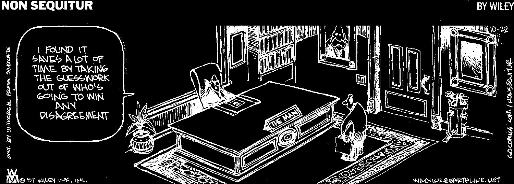

> **Descripción de la imagen** — Es una ilustración en blanco y negro, con un estilo de dibujo a tinta o boceto, que representa una escena interior, probablemente un estudio o biblioteca.
>
> En el centro de la imagen se encuentra un gran escritorio de madera. Un hombre está sentado detrás del escritorio. A su lado derecho, hay un pequeño animal (parecido a un perro) de pie cerca del escritorio.
>
> El fondo muestra estanterías llenas de libros y elementos arquitectónicos que sugieren un ambiente académico o de estudio. Hay marcos de cuadros en las paredes y una ventana visible.
>
> En el lado izquierdo de la ilustración, hay un globo de diálogo que contiene texto.

cional de su gobierno. Tercero, el poder legítimo se deriva sencillamente del nombramiento
o promoción a algún puesto de una organización. Por tanto, tener el título de director o
gerente general acredita a una persona todos los derechos, responsabilidades y privilegios
que van con ese puesto. Por último, cierta autoridad legítima proviene de una persona que
ocupa un puesto por el cual las otras personas muestran respeto. Por lo general, tal respeto
se deriva del bien social intrínseco o de los valores sociales importantes de la posición de
esa persona o de la organización. En muchas sociedades, los jóvenes prestan atención y
obedecen a los ancianos. Las personas también escuchan a los rectores de las universidades
y a los integrantes del clero. Siguen sus consejos porque creen que es correcto hacerlo. Los
sacerdotes, los rectores de universidades y muchos otros que tienen pequeños detalles que
ofrecen a las personas como recompensas o que utilizan contra ellas como medidas disci-
plinarias coercitivas tienen, no obstante, considerable poder legítimo.19

La efi cacia de la autoridad formal se deriva de la disposición de los seguidores a reco-
nocer la legitimidad de la estructura organizacional y el sistema de reglas y regulaciones
que faculta a sus líderes.20 En resumen, el poder legítimo no funciona sin la obediencia o
la aceptación de los gobernados. Si sufi cientes ciudadanos británicos cuestionaran la legiti-
midad de la reina y su autoridad, incluso con los siglos de tradición y legalidad en los que
se basa la monarquía, la continuación de su dominio estaría en grave peligro. Si sufi cientes
católicos desafi aran los dictámenes del papa acerca del aborto, el control de la natalidad u
otra política social, se desgastaría la autoridad papal. Si los integrantes del gabinete y los
asesores principales de un presidente no están dispuestos a acatar las órdenes presidencia-
les, se anula la efi cacia del presidente. Cuando sufi cientes personas comienzan a desconfi ar
de la autoridad o a desacreditar su legitimidad, empezarán a desafi arla y, por tanto, a socavar
su potencial como fuente de poder.

Como el poder legítimo se debilita si los seguidores ya no quieren reconocer la auto-
ridad de quien detenta el poder, es frecuente que quienes lo tienen acumulen otras fuentes
de poder (como el control de recursos o información) para fortalecer su base de poder. El

19  Véase Cialdini, 2001, acerca de las ilusiones de autoridad.
20  Barnard, 1938.

Descubrí que se
ahorra mucho tiempo
si dejamos de especular
quién va a ganar en
cualquier desacuerdo.

POR WILEY

NON SEQUITUR © Wiley Miller. Distribuido por UNIVERSAL PRESS SYNDICATE. Reproducida con
autorización. Todos los derechos reservados.

---

<!-- página 191 -->

Capítulo 7 Obtención y utlización del poder de negociación
174

control de recursos y el poder de la información suelen acompañar un título, posición o
defi nición de puesto de trabajo. A menudo, el poder legítimo se deriva de manipular estas
otras fuentes de poder. Los ofi ciales militares han sabido esto por largo tiempo. Todas las
organizaciones de estilo militar (soldados, policía, etc.) siguen instruyendo a su personal
aunque las unidades militares ya no se miden en el campo de batalla como alguna vez lo
hicieron. Esto se debe a varias razones: un campo de instrucción es un lugar adecuado para
dar instrucciones, enseñar disciplina y obediencia, supervisar de cerca a un gran número
de personas y castigar o recompensar rápidamente el desempeño. La instrucción hace que
grandes grupos de personas se acostumbren a aceptar órdenes de una persona en específi co,
sin cuestionarla. Quienes obedecen las órdenes son recompensados, mientras que quienes
no lo hacen son castigados públicamente con rapidez. Con el tiempo, se agota la necesidad
de castigo y recompensa, y al soldado le parece algo natural o legítimo acatar las órde-
nes de un ofi cial sin preguntar por qué ni cuestionar las consecuencias.

Aunque afi rmamos que las estructuras y los puestos organizacionales confi eren “le-
gitimidad”, también es posible aplicar la noción de legitimidad a ciertas normas o con-
venciones sociales que ejercen un intenso control sobre las personas.21 Éstos son algunos
ejemplos:

1.  El poder de reciprocidad legítimo, una fuerte norma social que sugiere que si una per-
sona hace algo positivo o favorable por otra, se espera que se devuelva el gesto o favor
(“te hice un favor; espero que me hagas uno a mí”).
2.  El poder de equidad legítimo, otra norma social fuerte en la cual el agente tiene dere-
cho a solicitar una compensación de la otra si el agente acepta una molestia o soporta
un contratiempo por parte de la otra (“acepté la molestia por ti; esto es lo menos que
puedes hacer por mí”).
3.  El poder de responsabilidad o dependencia legítimo, una tercera norma social bien es-
tablecida según la cual tenemos la obligación de ayudar a quienes no pueden ayudarse
a sí mismos y dependen de nosotros (“vi que de verdad necesitaban ayuda y no podían
lograrlo solos”).

Control de recursos Las personas que controlan recursos tienen la capacidad de dárselos
a quien haga lo que quieran con ellos y de retenerlos (o quitárselos) a quien no haga lo que
ellas quieren. Los recursos pueden ser muchas cosas. Los recursos particulares son más
sutiles como instrumentos de poder en la medida en que los participantes en la negocia-
ción los consideren valiosos. En un contexto organizacional, algunos de los recursos más
importantes son:

1.
Dinero en sus diferentes formas: efectivo, sueldos, asignaciones de presupuesto, con-
cesiones, bonos, cuentas de gastos y fondos discrecionales.
2.
Suministros: materias primas, componentes, piezas y refacciones.
3.
Capital humano: mano de obra disponible, personal para asignar a un problema o
tarea, o ayuda temporal.
4.
Tiempo: tiempo libre, capacidad de cumplir o controlar fechas límite. Si hay presión
de tiempo sobre una o ambas partes, la capacidad de ayudar a alguien a cumplir o mo-

21  Raven, 1993; Raven, Schwartzwald y Koslowski, 1998.

---

<!-- página 192 -->

175
Fuentes de poder. Cómo se adquiere

difi car una fecha límite puede ser muy poderosa (analizamos las fechas límite en las
negociaciones en el capítulo 3).
5.
Equipo: máquinas, herramientas, tecnología, hardware y software de computadora, y
vehículos.
6.
Servicios fundamentales: reparación, mantenimiento, conservación, instalación y en-
trega, soporte técnico y transporte.
7.
Apoyo interpersonal: elogio verbal y aliento por un buen desempeño o crítica por un
mal desempeño. Éste es un recurso interesante porque está disponible para casi todos,
no requiere un esfuerzo importante para adquirirlo y es muy poderoso por sí solo.

La capacidad de controlar y gastar recursos es una fuente de poder importante en las
organizaciones. El poder también proviene de crear reservas de un recurso en un ambiente
donde sea escaso. En su libro Managing with Power,22 Jeffrey Pfeffer relata cómo las fi -
guras corporativas y los políticos poderosos construyen imperios con base en el control de
recursos. Durante sus primeros años en el Congreso, Lyndon Johnson asumió el control del
“Congresito” (la ofi cina del vocero para personal administrativo y asistentes de los dipu-
tados) y la convirtió en una base de poder importante que lo ayudó a convertirse en vocero
de la presidencia y después en presidente. Asimismo, Robert Moses, quien comenzó como
comisionado de parques en Nueva York, construyó un imperio de poder que permitió la
construcción de 12 puentes, 35 carreteras, 751 parques, 13 campos de golf, 18 albercas y
más de dos millones de acres de parques en el área metropolitana de Nueva York, base que
le sirvió para convertirse en un intermediario del poder importante en la ciudad.

Para utilizar los recursos como base de poder, los negociadores deben desarrollar o man-
tener el control sobre alguna recompensa que desee la otra parte —espacio físico, empleos,
autorizaciones de presupuesto o materias primas— o controlar alguna medida disciplinaria
que la otra parte busca evitar. Como se señaló, estas recompensas y medidas disciplina-
rias pueden ser tangibles o intangibles, como agrado, aprobación, respeto y demás. El con-
trol exitoso de los recursos también requiere que la otra parte deba enfrentar directamente a
quien tiene el poder. Por último, quien tiene el poder debe estar dispuesto a asignar recursos
según el cumplimiento o cooperación de la otra parte con sus peticiones. La escasez cada
vez mayor de recursos de todo tipo originó una nueva regla de oro en las organizaciones:
“Quien tiene el oro hace las reglas.”

Poder basado en relaciones

Aquí se analizarán tres tipos de poder: interdependencia de metas, poder referente y poder
basado en las relaciones con los demás en las redes personales y profesionales.

Interdependencia de metas El modo en que las partes contemplan sus metas —y en qué
grado el logro de su meta depende del comportamiento de la otra parte— tiene un fuerte
impacto en la probabilidad de que las partes utilicen el poder de manera constructiva. Las
metas cooperadoras tienden a moldear la orientación de “poder con algo”, incluso entre
superiores y subordinados. Estas metas inducen “expectativas de asistencia más altas, más

22  Pfeffer y Salancik, 1974; Pfeffer, 1992.

---

<!-- página 193 -->

Capítulo 7 Obtención y utlización del poder de negociación
176

176

ayuda, más apoyo, más convencimiento, menos coerción y más actitudes confi ables y ami-
gables”.23 En cambio, las metas competitivas orillan a las partes a buscar una orientación
de “poder sobre algo” para reforzar o mejorar las diferencias de poder existentes y utilizar
ese poder con el fi n de maximizar las metas propias, a menudo a costa de la otra parte.24
Por ejemplo, las relaciones y la interdependencia de metas son fuentes clave de poder en
las negociaciones salariales (véase el cuadro 7.3).

Poder referente Como ya se defi nió, el poder referente se deriva del respeto o admira-
ción por atributos como personalidad, integridad, estilo interpersonal y demás. Se dice que
A tiene un poder referente sobre B en la medida en que B se identifi ca o quiere asociarse
estrechamente con A. El poder referente suele basarse en la atracción por experiencias
comunes, un pasado común, un destino común o participación en los mismos grupos. El
poder referente es sobresaliente cuando una parte identifi ca la dimensión de comunidad
en un esfuerzo por aumentar su poder (por lo general, convencimiento) sobre la otra. Por

El experto en negociaciones salariales Paul Ba-
rada, de Monster.com, señala que el poder es
una de las dinámicas que más se pasan por alto y
son más importantes en las negociaciones. Afi r-
ma que las relaciones de poder no son como
un juego de cartas, pero hay un paralelismo:
el poder determina quién tiene la mejor mano.
Con frecuencia, el empleador tiene mejor mano
porque posee algo que el candidato quiere: la
capacidad de otorgar el empleo, y quizás haya
muchos candidatos que aspiran al mismo puesto
(una buena MAPAN). Pero si el candidato tiene
habilidades únicas que el empleador quiere, o si
hay escasez de talento en un área en particular,
el candidato puede tener mucho poder (y por
tanto, una buena mano). Un candidato a un em-
pleo aumenta su poder como sigue:

•  Determinar sus habilidades, y cuáles son
transferibles al empleo que solicita.
•  Hacer su tarea y averiguar la demanda de
esas habilidades en diversos empleos e in-
dustrias.

•  Conocer el salario justo y razonable para
ese puesto dadas las condiciones del mer-
cado y el área geográfi ca.
•  Estar preparado para esgrimir argumentos
convincentes respecto del valor que apor-
tará a su nuevo empleador.
•  Determinar un rango justo de compensa-
ción (objetivo) y un umbral por debajo del
cual no está dispuesto a aceptar (punto de
abandono de la negociación).

Si el candidato determina que no tiene las
habilidades, la educación o la experiencia ade-
cuadas, debe considerar obtenerlas para ganar
más poder en las negociaciones laborales.

Fuente: P. W. Barada, “Power Relationships and Nego-
tiation”, 2008. http://www.career-advice-monster.com/
salary-negotiation/Power-Relationships-and-Negotia-
tion/home.asp
## CUADRO
### Relaciones de poder en negociaciones
### salariales
## 7.3

23  Tjosvold, 1997, p. 297.
24  Deutsch, 1973;  Howard, Gardner y Thompson, 2007.

---

<!-- página 194 -->

177
Fuentes de poder. Cómo se adquiere

tanto, un negociador puede comenzar a conocer a la otra parte para descubrir las cosas en
común (ciudad natal, universidad, equipos favoritos, perspectiva política) que, una vez
descubiertas, espera que creen un vínculo entre las partes que facilite un acuerdo. Igual
que el poder experto, el poder referente también tiene formas negativas. El poder referente
negativo se manifi esta sobre todo cuando las partes crean una distancia o división entre sí
mismas y los demás lo etiquetan a la otra parte. Así, los rivales políticos suelen clasifi carse
entre sí como “liberales” o “de derecha” en un esfuerzo por hacer al otro un candidato me-
nos atractivo en una elección futura.25

Redes El tercer tipo de poder relacional también proviene de la ubicación en una estruc-
tura organizacional pero no necesariamente jerárquica. En este caso, el poder se deriva de
lo que fl uye por esa ubicación particular en la estructura (por lo general, información y
recursos, como dinero). La persona que ocupa cierta posición tal vez no tenga un título u
ofi cina formal; su ventaja proviene de la capacidad de controlar y administrar lo que “fl u-
ye” por esa posición. Por ejemplo, antes que China se modernizara en la década de 1980,
los choferes de automóviles tenían un enorme poder, aunque su título no fuera prestigioso.
Si a un chofer no le agradaba un pasajero o no tenía ganas de conducir a cierto lugar, podía
hacerle al pasajero la vida muy difícil e imponerle graves consecuencias (p. ej., retrasar la
hora de salida, conducir muy despacio, dar muchas vueltas para llegar, etc.).

Este ejemplo muestra que incluso sin una posición o título elevados, las personas ad-
quieren poder por la manera en que sus acciones y responsabilidades afectan los fl ujos de
información, de bienes y servicios o de contactos. Por ejemplo, las personas con acceso a
una gran cantidad de información o responsables de recopilar, administrar y asignar recur-
sos vitales (dinero, materias primas, permisos y autorizaciones) pueden adquirir mucho po-
der.26 El empleo tal vez no tenga un título llamativo, mucho personal o una ofi cina enorme,
pero confi ere una cantidad de poder signifi cativa en virtud de la cantidad de información y
recursos que maneja.

Comprender el poder de este modo se deriva de conceptualizar las organizaciones y su
funcionamiento no como una jerarquía, sino como una red de interrelaciones. Los esquemas
de la red representan a las personas importantes como círculos o nodos, y las relaciones
entre las personas, como líneas de transacciones. (Véase en la fi gura 7.1 un ejemplo de una
red en comparación con una jerarquía organizacional.)

Estas líneas (vínculos) conectan a las personas o grupos (nodos) que interactúan o
necesitan interactuar entre sí en la organización. Mediante la información y recursos como
enfoque principal en las transacciones, también se pueden negociar por las líneas de la red
las relaciones personales, el poder referente y la “presión”. En los términos de una jerarquía
formal, la autoridad se relaciona directamente con la importancia del puesto en el organi-
grama vertical y con la cantidad de subordinados. En cambio, en términos de una red, el
poder se determina mediante la ubicación dentro del conjunto de relaciones y los fl ujos
que atraviesan ese nodo en la red. Varios aspectos fundamentales de las redes moldean el
poder: la fuerza del vínculo, el contenido del vínculo y la estructura de la red (incluso la
centralidad, fl exibilidad y visibilidad del nodo).

25  Raven y Rubin, 1976.
26  Véase Charan, 1991; Kaplan, 1984; Krackhardt y Hanson, 1993.

---

<!-- página 195 -->

Capítulo 7 Obtención y utlización del poder de negociación
### 178
### Fuerza del vínculo Es un indicio de la fuerza o calidad de las relaciones con los demás. La
calidad se puede medir por la cercanía, la cantidad de información personal que se com-
parte con la otra parte o la disposición de una persona a aceptar una molestia de otra. La
fuerza de los vínculos entre las personas se determina por la frecuencia en que interactúan
las partes, el tiempo que se conocen, la solidez de su relación, sus maneras de interactuar
y la reciprocidad en la relación para que cada una dé y reciba de igual manera. Los víncu-
los mutuos más fuertes suelen indicar mayor poder para que la otra parte acceda a las
solicitudes.
### Red de una organización
### Jerarquía de una organización

Pareja aislada
Portero
Enlace

Aislado
Punto de
vinculación
Ambiente
externo

Estrella

FIGURA 7.1
Comparación de jerarquías y redes de una organización.

---

<!-- página 196 -->

179
Fuentes de poder. Cómo se adquiere

Contenido del vínculo El contenido es el recurso que traspasa el vínculo con la otra persona;
puede ser dinero u otros recursos, información, apoyo, emoción y demás. Cuanto más conte-
nido tiene el vínculo se desarrolla una relación personal más fuerte, y cuanta más confi anza
y respeto creen entre sí, más fuerte será el vínculo.27

Estructura de la red Si bien la fuerza y el contenido se relacionan con un trato individual
dentro de una red, la estructura de una red se refi ere al conjunto general de relaciones den-
tro de un sistema social (p. ej., lugar de trabajo, departamento, escuela u otro ambiente
social). Algunos aspectos de la estructura de una red que determinan el poder son:

1.  Centralidad. Cuanto más céntrico esté un nodo en una red de intercambios y transac-
ciones, más poder tendrá su ocupante. La centralidad se determina mediante la canti-
dad de información o de transacciones que pasan por un nodo, o por el grado en que el
nodo es fundamental para administrar el fl ujo de información. En la red representada
de la fi gura 7.1, la estrella tiene más centralidad y, por tanto, más poder. Los investi-
gadores han demostrado que estar en el centro del fl ujo de información —red de fl ujo
de trabajo, red de comunicación informal y red de amistades— es particularmente
importante para lograr un ascenso.28 El nuevo miembro de una facultad puede decidir
ofrecerse como voluntario para encabezar el programa de “oradores” en los seminarios
de la facultad porque esto le pondría en el centro de muchas comunicaciones respecto de
las presentaciones semanales.
2.  Importancia y relevancia. Una segunda fuente de poder en una red es la importancia
del nodo. Aunque tal vez no fl uya una gran cantidad de información o recursos por
un nodo específi co, lo que hace puede ser esencial para la misión, tarea principal o
producto clave de una organización. Las personas que dependen mucho de otras ad-
quieren importancia en la medida en que se encargan de reunir información de muchos
lugares. En la fi gura 7.1, los enlaces y los puntos de vinculación desempeñan este
papel. A menudo, se aconseja a los empleados que desean escalar con rapidez que bus-
quen empleos con alta centralidad e importancia en una organización de modo que
obtengan la experiencia y visibilidad necesarias para lograr un rápido ascenso. Ser
importante —incluso irremplazable— es una parte medular de adquirir y mantener el
poder.
3.  Flexibilidad. Una tercera fuente de poder en una red estriba en la fl exibilidad de la
posición, o el grado en que las personas clave defi nen el modo en que se toman ciertas
decisiones o a quién se permite el acceso. La fl exibilidad suele relacionarse con la
importancia (véase el párrafo anterior). Un ejemplo clásico de la fl exibilidad es la fun-
ción del portero (fi gura 7.1), la persona de una red que controla el acceso a una fi gura o
grupo importante. Si usted quiere ver al jefe, tiene que obtener un permiso y el acceso
de la secretaria.
4.  Visibilidad. Los nodos difi eren en su grado de visibilidad, es decir, de lo visible que es
el desempeño de la tarea para los demás en la organización. Si el negociador obtiene
concesiones signifi cativas de la otra parte mientras es observado, el equipo dará a ese
negociador una gran afi rmación. Un nodo con mucha centralidad e importancia tal

27  Ibarra y Andrews, 1993.
28  Brass, 1984.

---

<!-- página 197 -->

Capítulo 7 Obtención y utlización del poder de negociación
180

vez no sea visible, pero si no lo es, mucho menos probable será que se le reconozca y
recompense.
5.  Membresía de una coalición. Por último, como un nodo en una red, usted puede estar
en uno o más grupos secundarios o coaliciones. Las coaliciones suelen actuar juntas
para representar un punto de vista o promover una acción o cambio; mientras más sean
las coaliciones a las que pertenezca, más probable será que encuentre “amigos” que le
ayuden a conocer gente clave, obtener información importante (a menudo “interna”) y
lograr objetivos.

Fuentes contextuales de poder

Por último, si bien el poder se ubica en las personas y sus relaciones, también se basa en
el contexto, la situación o el ambiente en el cual ocurren las negociaciones. Aunque estas
formas de poder no suelen reconocerse en el corto plazo (por la tendencia a contemplar
el poder como cualidad individual en vez de incorporarlo a la estructura o contexto de un
confl icto), estas fuentes son igual de importantes.

MAPAN En los capítulos 3 y 4 analizamos el papel de la mejor alternativa para un acuer-
do negociado (MAPAN), es decir, un trato alterno o que busca un negociador si no llega
a un acuerdo con la otra parte. La disponibilidad de una MAPAN ofrece a un negociador
mucho poder, porque ahora puede aceptar la propuesta de la otra parte o el acuerdo alterno.
Toda MAPAN viable otorga al negociador la elección de rechazar el acuerdo actual o de
usarla como elemento nivelador para lograr un mejor acuerdo en las discusiones. Los es-
tudiantes que tienen dos ofertas de ayuda económica de diferentes escuelas tendrán mucho
más poder para aumentar la calidad de ese paquete de ayuda de cualquier universidad que
los estudiantes que sólo tengan una oferta de ayuda económica.

Cultura La cultura determina el “sistema signifi cativo” de un ambiente social. La cultura
suele moldear los tipos de poder que se consideran legítimos o ilegítimos, y el modo de
utilizar la infl uencia y reaccionar a ella. Por ejemplo, en una organización que conocen los
autores de este libro, el director ejecutivo introdujo ideas para cambios importantes en la
estrategia de negocios en las reuniones del equipo administrativo. Los gerentes principales
hicieron comentarios poco críticos sobre estas ideas en la reunión, pero después expresaron
su desacuerdo con las ideas en las conversaciones entre sí o con el director ejecutivo. Esta
pública falta de apertura y honestidad —valor cultural en esta organización— contribuyó a
muchas decisiones que en apariencia se tomaron por consenso pero después fueron socava-
das varias veces en privado por quienes las tomaron. Las culturas suelen contener muchas
reglas “implícitas” acerca del uso del poder y para considerar más o menos apropiados los
procesos de “poder sobre algo” y “poder con algo”.29

Exploraremos este enfoque con mayor profundidad en nuestro tratamiento de una ne-
gociación internacional en el capítulo 11.

Por último, la cultura —de la organización y del país— suele traducirse en desigual-
dades estructurales muy arraigadas en una sociedad. El grado al que las mujeres, grupos

29  Schein, 1988.

---

<!-- página 198 -->

181
Tratar con quienes tienen más poder

religiosos o étnicos, ciertas clases sociales u otros intereses minoritarios reciban tratos in-
justos en una sociedad refl eja una evolución histórica muy prolongada de las desigualdades
del poder en las estructuras e instituciones sociales. Es posible rastrear muchos problemas
y negociaciones sociales signifi cativas en la evolución histórica de estas disposiciones al
interior de una cultura, e introducir un cambio importante requiere gran esfuerzo y atención
durante muchos años.

Agentes, poderdantes y público externo Casi todas las negociaciones que describi-
mos en este libro ocurren de uno a uno: sólo usted y el otro negociador. Sin embargo, las
negociaciones se complican mucho cuando los negociadores representan otras opiniones
(p. ej., se desempeñan como agentes que representan a su organización o son representados
por otra persona) y cuando existen numerosas partes, medios, y/o público para observar,
criticar y evaluar las negociaciones. Cuando todas estas partes están presentes en una nego-
ciación, pueden participar de manera activa para presionar de un modo formal o informal
a los demás como parte del proceso de negociación, lo cual altera la dinámica de poder.

Tratar con quienes tienen más poder

Hasta aquí nos hemos concentrado en las numerosas maneras en que los negociadores
obtienen y utilizan el poder en su provecho durante una negociación. Sin embargo, los
negociadores están en el extremo receptor de ese poder. Muy poca investigación se dedica
al modo en que las partes enfrentan a quienes tienen mucho más poder (de una o más de
las fuentes mencionadas en este capítulo). Concluimos este capítulo con sugerencias para
los negociadores que están en una posición de menos poder. Michael Watkins30 específi ca-
mente aborda el problema de “bailar con los elefantes” (concluir un acuerdo con un opo-
nente mucho más grande) y destaca los modos en que las partes con menos poder pueden
enfrentar a los grandes jugadores en los acuerdos y asociaciones de negocios. Éstos son
algunos de sus consejos:

1.
Nunca haga un trato de todo o nada. Depender de una sola parte y crear un trato de tó-
melo o déjelo pone muy vulnerable a la parte que tiene menos poder. Por ejemplo, una
empresa pequeña que permite que Walmart sea su único cliente corre el riesgo de que
Walmart la controle por completo. Las partes con menos poder deben diversifi car su
riesgo en acuerdos con otros socios para que ningún jugador con mucho poder pueda
hacerlas desaparecer.
2.
Haga más pequeña a la otra parte. Al tratar con una parte de mucho poder, sobre todo
si es un grupo o una organización, se deben establecer varias relaciones y participar
en muchas negociaciones. Al tratar con diversas personas y departamentos de la parte
que tiene mucho poder, se diversifi can las relaciones y los numerosos intereses que se
atienden al trabajar con estos grupos secundarios diferentes.
3.
Hágase usted mismo más grande. De igual manera, las partes con poco poder deben
intentar desarrollar coaliciones con otras partes de bajo poder para aumentar su poder
de concertación colectivo.

30  Watkins, 2002.

---

<!-- página 199 -->

Capítulo 7 Obtención y utlización del poder de negociación
182

4.
Acumule ímpetu mediante acuerdos en secuencia. Se pueden establecer acuerdos ini-
ciales para desarrollar una relación, fortalecer la relación con una parte con mucho
poder y tal vez adquirir recursos (información, tecnología, capital inicial, etc.). Selec-
cione los objetivos con mucho poder que produzcan más y maximice la visibilidad de
esos acuerdos para las demás partes.
5.
Utilice el poder de competencia para aprovechar el poder. Ésta es una variación del
poder de una MAPAN. Si usted tiene algo que ofrecer, no olvide hacerlo a más de una
parte que tenga mucho poder. Si puede hacer que compitan entre sí por lo que usted
tiene, alguna puede alcanzar un acuerdo con usted sólo para evitar que haga lo mismo
con uno de sus competidores.
6.
Limítese. Contenga las formas en que puede hacer negocios o con quién puede hacer-
los. No obstante, aunque estas limitaciones pueden reducir su competencia, también
tienen la responsabilidad de limitarlo a usted.
7.
La buena información siempre es una fuente de poder. Busque información que forta-
lezca su posición de negociación y su caso. Prevea la información más convincente o
persuasiva para la otra parte; organícela para presentarla con rapidez e intégrela para
que sea muy convincente.
8.
Haga muchas preguntas para obtener más información. Las investigaciones muestran
que los negociadores que tienen menos poder hacen preguntas más diagnósticas que
relevantes y siempre muestran su disposición a cooperar, y que estos comportamientos
dieron mejores resultados.31
9.
Esfuércese por controlar el proceso. Si la fuente con mucho poder controla el proceso
de negociación (agenda, ritmo, oportunidad y lugar), lo hará de manera que asegure
los resultados que quiera. Si la parte con menos poder controla el proceso, es más
probable que pueda dirigir el acuerdo hacia una dirección provechosa.32

En este capítulo analizamos la naturaleza del poder
en una negociación. Anotamos que hay dos mane-
ras principales para considerar el poder: el “poder
sobre algo”, lo cual sugiere que el poder tiene fun-
damentalmente una naturaleza dominante y coerci-
tiva, y el “poder con algo”, que sugiere que el poder
se comparte con la otra parte para desarrollar metas
y objetivos conjuntos; hay una gran tendencia a
considerar y defi nir el poder como el primer caso,
pero, como analizamos en este capítulo y explica-
mos en nuestro resumen de las estrategias básicas
de negociación, el “poder con algo” es fundamental
para una negociación integradora fructífera.

Revisamos cinco fuentes de poder importan-
tes:

•
Fuentes de poder de la información (informa-
ción y conocimientos).
•
Fuentes de poder personal (orientación psicoló-
gica, orientación cognoscitiva, orientación mo-
tivacional, ciertas disposiciones, y orientación
y habilidades morales).
•
Fuentes de poder basadas en la posición (poder
legítimo y control de recursos).
•
Poder basado en relaciones (interdependencia
de metas, poder referente y redes).
## Resumen del capítulo

31  De Dreu y Van Kleef, 2004.
32  Watkins, 2002.

---

<!-- página 200 -->

•
Fuentes de poder contextual (disponibilidad de
MAPAN, disponibilidad de agentes y cultura de
la organización o del país en el cual ocurren las
negociaciones).

Para concluir, deseamos insistir en dos pun-
tos importantes. Primero, si bien en este capítulo
presentamos muchos vehículos para obtener poder,
debe recordar que el poder puede ser muy elusi-

vo y desaparecer con rapidez en una negociación.
Casi todo puede ser una fuente de poder si da al
negociador una ventaja temporal sobre la otra parte
(por ejemplo, una MAPAN o un segmento de infor-
mación importante). Segundo, el poder es sólo la
capacidad de infl uir; utilizar ese poder e infl uir con
habilidad en la otra parte requiere mucho ingenio
y experiencia.

Resumen del capítulo
### 183

---

<!-- página 201 -->
## CAPÍTULO
## La ética en la negociación
## 8

En este capítulo exploramos si hay, o debe haber, estándares éticos aceptados para la con-
ducta en las negociaciones. Este tema recibe cada vez más atención de los investigadores
desde años recientes. Opinamos que, en todas las negociaciones, surgen preguntas funda-
mentales sobre la conducta ética. El negociador efi caz debe reconocer cuándo es pertinente
cuestionarse lo anterior y qué factores deben tomarse en cuenta para responder. Identifi ca-
remos las principales dimensiones éticas planteadas en las negociaciones, describiremos
cómo se tienden a considerar estas opciones éticas y ofreceremos una estructura para tomar
decisiones éticas informadas.

Pero antes de sumergirnos en esto, armemos el escenario con algunos dilemas hipo-
téticos.

Muestra de dilemas éticos

Piense en las situaciones siguientes:

1.
Usted desea vender su estéreo con el fi n de reunir dinero para un viaje por mar. El
equipo funciona muy bien, y un amigo le dice que si buscara en el mercado un equipo
similar (el cual no es el caso), le daría 500 dólares por él. Pocos días después, el primer
comprador viene a ver el equipo. Lo revisa y hace algunas preguntas sobre su funcio-
namiento. Usted le asegura que funciona bien. Al preguntar el precio, usted le dice que
ya tiene una oferta por 500 dólares. El comprador adquiere el estéreo por 550.

¿Fue ético mencionar la otra oferta?
### Objetivos

1.
Comprender los enfoques comúnmente aceptados de los estándares éticos y el razona-
miento ético.
2.
Explorar los factores que determinan la forma en que la ética afecta los procesos de
negociación.
3.
Considerar distintos tipos de tácticas éticas problemáticas y la forma en que se per-
ciben.
4.
Entender la manera en que los demás reciben las tácticas éticas marginales en una
negociación, y cómo detectar y lidiar con el uso ajeno de tácticas engañosas.

---

<!-- página 202 -->

185
Muestra de dilemas éticos

2.
A usted le interesa adquirir una empresa propiedad de un competidor, pero el compe-
tidor no ha mostrado interés en vender su negocio o fusionar su compañía con la suya.
Para obtener conocimiento interno de esa empresa, usted contrata un consultor cono-
cido suyo para que llame a los contactos de la empresa competidora y pregunte si la
compañía tiene problemas serios que amenacen su viabilidad. Si hay tales problemas
puede usar la información para contratar a los empleados despedidos o hacer que el
competidor venda.

¿Es un proceder ético? ¿Sería probable que lo hiciera si usted fuera el empresario?

3.
Usted es el vicepresidente de recursos humanos que negocia con los representantes
de un sindicato un nuevo contrato de trabajo. El sindicato se niega a fi rmar un nuevo
contrato a menos que la empresa acepte aumentar de seis a siete la cantidad de días fes-
tivos pagados. La administración calcula que gastará más o menos 220 000 dólares por
cada día festivo pagado, y afi rma que no puede satisfacer esa demanda. Sin embargo,
usted sabe que en realidad el dinero no es el problema: la empresa tan sólo considera
que la demanda del sindicato no está justifi cada. Para convencer a los líderes del sindi-
cato de que retiren su demanda, se le ocurrieron tres opciones: a) decir al sindicato que
la empresa sencillamente no puede pagarlo, sin mayor explicación; b) preparar estados
fi nancieros falsos que muestren que costará cerca de 300 000 dólares cada día festivo
pagado, lo cual simplemente no es aceptable, y c) ofrecer a los líderes del sindicato un
“viaje de negocios” a un centro recreativo de Florida si retiran esa petición.

¿Algunas de estas estrategias plantean problemas éticos? ¿Cuáles? ¿Por qué?

4.
Usted está a punto de graduarse de un programa en una universidad prestigiada. Se
especializó en administración de sistemas de información y comenzará a trabajar con
una compañía que desarrolla páginas web para otras empresas. Posee una computado-
ra personal de dos años de antigüedad. Decidió venderla y comprar un equipo nuevo
después de ver los tipos de proyectos en los que trabaja su nuevo patrón. Pone un
anuncio en los tableros de información de la universidad para ofrecer su computadora.
Prefi rió no comunicar a sus clientes que el disco duro a veces parece a punto de fallar
y en ocasiones la computadora se bloquea sin previo aviso.

¿Es ético esto? ¿Haría usted esto si fuera este estudiante?

5.
Usted compra un nuevo par de zapatos. El recibo impreso menciona con claridad que
no se aceptan devoluciones. Al llegar a su casa, usa los zapatos un día y decide que no
le ajustan bien. Devuelve los zapatos a la tienda. El dependiente le muestra el mensaje
escrito en la nota de compra, pero usted no permite que eso lo convenza. Grita enojado
por la defi ciente calidad del servicio de la tienda, de modo que comienza a llamar la
atención de los presentes. El empleado llama al gerente; después de cierta discusión,
el gerente acepta devolverle su dinero.

¿Es ético esto? ¿Haría usted esto si fuera este cliente?

Estas situaciones son hipotéticas; sin embargo, los problemas que presentan son reales
para los negociadores. Dentro y fuera de las organizaciones, las personas enfrentan día a

---

<!-- página 203 -->

Capítulo 8 La ética en la negociación
186

día decisiones importantes acerca de las estrategias para lograr objetivos importantes, en
particular cuando disponen de diversas tácticas para ejercer infl uencia. Estas decisiones
suelen tener implicaciones éticas. En este capítulo abordaremos las principales cuestiones
éticas que surgen en una negociación al considerar estas preguntas:

1.
¿Qué es la ética y por qué se aplica a una negociación?
2.
¿Qué cuestiones sobre conducta ética es probable que surjan en una negociación?
3.
¿Cuál es el motivo de una conducta poco ética y cuáles son las consecuencias?
4.
¿Cómo enfrentan los negociadores a otra parte que utiliza el engaño?

¿Qué entendemos por “ética” y por qué
es importante en una negociación?

Defi nición de ética

La ética se refi ere a los estándares sociales que se aplican en todas partes a lo correcto o
incorrecto en una situación específi ca, o un proceso para establecer tales estándares. Es
diferente de la moral, la cual son las ideas individuales y personales de lo correcto y lo
incorrecto. La ética proviene de las fi losofías particulares, las cuales pretenden: 1) defi nir
la naturaleza del mundo donde vivimos, y 2) normar las reglas de convivencia. Cada fi lo-
sofía adopta distintas perspectivas en estas cuestiones, lo que en la práctica signifi ca que
conducen a diferentes juicios acerca de lo correcto o incorrecto en una situación determi-
nada. En la práctica, el “trabajo arduo” de la ética es determinar en qué difi eren entre sí las
fi losofías éticas, decidir qué enfoques prefi ere cada individuo y aplicarlos a las situaciones
reales cotidianas.

Nuestra meta es distinguir entre los diferentes criterios, o estándares, para juzgar y
evaluar las acciones de un negociador, sobre todo cuando hay cuestiones éticas implícitas.
Aunque nos concentramos en una negociación, los criterios relacionados en realidad no son
diferentes de aquellos con que se evalúa la ética en los negocios en general. A un negociador
se le presenta un dilema ético cuando las acciones o estrategias posibles ponen en confl icto
los benefi cios económicos potenciales de aceptar un acuerdo con las obligaciones sociales
propias hacia las otras partes relacionadas o hacia una comunidad más amplia.

Muchos analistas de la ética empresarial proponen estructuras que captan los están-
dares éticos en competencia (y como veremos después, suelen ubicarse en teorías clásicas
antiguas de la fi losofía ética). De estos analistas provienen los siguientes cuatro estándares
para evaluar las estrategias y las tácticas en los negocios y en una negociación:1

• Elegir una línea de acción con base en el resultado que espero lograr (por ejemplo, el
mayor rendimiento sobre la inversión).
• Seleccionar una línea de acción con base en mi deber para defender las reglas y princi-
pios adecuados (p. ej., la ley).
• Optar por una línea de acción con base en las normas, valores y estrategia de mi orga-
nización o mi comunidad (p. ej., valores y normas culturales).

1  Green, 1993; Hitt, 1990; Hosmer, 2003.

---

<!-- página 204 -->

187
¿Qué entendemos por “ética” y por qué es importante en una negociación?

• Escoger una línea de acción con base en mis convicciones personales (p. ej., lo que mi
conciencia me indica).

Cada uno refl eja un enfoque fundamentalmente diferente del razonamiento ético. El prime-
ro puede llamarse ética del resultado fi nal, en donde la rectitud de una acción se determina
al evaluar los pros y los contras de sus consecuencias. El segundo es un ejemplo de lo que
se denomina ética del deber, en la cual la rectitud de una acción se determina mediante las
obligaciones propias para apegarse a principios, leyes y estándares sociales uniformes que
defi nen lo correcto e incorrecto, y dónde se dividen. El tercero representa una forma de ética
del contrato social, donde la rectitud de una acción se basa en las costumbres y normas de
una comunidad específi ca. Por último, el cuarto puede llamarse una ética personal, porque
la rectitud de la acción se basa en la conciencia y estándares morales propios. Véase en la
tabla 8.1 un resumen de estos cuatro enfoques.

Aplicación del razonamiento ético en una negociación

Cada uno de estos enfoques es útil para analizar las cinco situaciones hipotéticas del inicio
del capítulo. Por ejemplo, en la primera situación relacionada con vender un estéreo y la
mención a un posible cliente de la existencia de otro comprador:

• Si cree en la ética del resultado fi nal puede hacer lo necesario para obtener el mejor
resultado posible (inclusive mentir acerca de otro comprador).
• Si confía en la ética del deber puede considerar una obligación nunca participar en un
pretexto, y por tanto rechazar una táctica que implique una mentira defi nida.
• Si se apega a la ética del contrato social puede basar sus opciones tácticas en su opinión
de una conducta apropiada en su comunidad; si los demás usarían el engaño en una
situación así, usted aceptaría mentir.
• Si respeta la ética personal consultaría su conciencia y decidiría si su necesidad de
efectivo para su próximo viaje justifi ca las tácticas de engaño o deshonestas.

Lo que muestra este ejemplo es que, en situaciones con una dimensión ética, el enfoque
para el razonamiento ético que usted prefi ere afecta al tipo de juicio ético que hace y el
comportamiento posterior que elige.

Comparación entre ética, prudencia, lo práctico y la legalidad

Las discusiones sobre la ética empresarial a menudo confunden lo ético (adecuado según
un estándar de conducta moral), lo prudente (inteligente, basado en tratar de comprender
la efi cacia de la táctica y las posibles consecuencias en la relación con la otra parte), lo
práctico (lo que un negociador puede hacer que suceda en una situación específi ca) y
lo legal (lo que la ley defi ne como práctica aceptable).2 En capítulos anteriores evaluamos
las estrategias y tácticas de una negociación mediante criterios de prudencia y de lo prácti-
co; en este capítulo nos concentramos en evaluar las estrategias y tácticas de una negocia-
ción mediante criterios éticos.

2  Missner, 1980.

---

<!-- página 205 -->
### TABLA 8.1
Cuatro enfoques del razonamiento ético

Sistema ético
Defi nición
Proponente

principal
Principios

más importantes
Preocupaciones

principales

Ética del resultado

final
La rectitud de una

acción se determina al

considerar sus conse-

cuencias.

Jeremy Bentham

(1748-1842)

John Stuart Mill

(1806-1873)

•  Se deben considerar todas las con-

secuencias probables.

•  Las acciones son correctas si pro-
mueven la felicidad, y son incorrec-

tas si producen infelicidad.

• La felicidad se defi ne como la presen-
cia de placer y la ausencia de dolor.

• La promoción de la felicidad suele

ser la meta defi nitiva.

• La meta es la felicidad colectiva de

todos los interesados.

•  ¿Cómo se defi ne la felicidad, el placer

o la utilidad?

•  ¿Cómo se mide la felicidad, el placer o

la utilidad?

•  ¿Cómo se equilibra la felicidad de cor-

to plazo con la de largo plazo?

•  Si las acciones crean felicidad a 90%
de las personas e infelicidad al otro

10%, ¿son éticas?

Ética del deber
La rectitud de una

acción se determina al

considerar las obliga-

ciones para aplicar los

estándares y principios

universales.

Emmanuel Kant

(1724-1804)
•  La conducta debe guiarse por los
principios o “deberes” morales prin-

cipales.

•  Las personas deben respetar sus
principios y limitarse a sí mismas por

las reglas.

•  El bien defi nitivo es una vida de vir-
tud (actuar según los principios) y no

de placer.

•  No debemos ajustar la ley moral a
nuestras acciones, sino ajustar nues-

tras acciones a la ley moral.

• ¿Con qué autoridad aceptamos las
reglas particulares o la “bondad” de

esas reglas?

• ¿Qué regla seguimos cuando en su

conjunto entran en confl icto?

• ¿Cómo adaptamos las reglas genera-

les a situaciones específi cas?

• ¿Cómo cambian las reglas cuando se

modifi can las circunstancias?

• ¿Qué ocurre cuando las reglas buenas

tienen consecuencias malas?

• ¿Existen reglas sin excepciones?

Ética del contrato

social
La rectitud de una

acción se determina

por las costumbres y

normas de una comu-

nidad.

Juan Jacobo

Rousseau

(1712-1778)

•  Las personas deben operar en un
contexto comunitario y social para

sobrevivir.

• Las comunidades devienen “orga-
nismos morales” para determinar las

reglas básicas.

•  ¿Cómo determinamos la voluntad ge-

neral?

•  ¿Qué signifi ca el “bien común”?
• ¿Qué hacemos con los pensadores
independientes que desafían la mo-

ralidad del orden social existente (p.

ej., Jefferson, Gandhi, Martin Luther

King)?

---

<!-- página 206 -->

•  El deber y la obligación unen a la co-
munidad y a las personas entre sí.

•  Lo que es mejor para el bien común

determina el estándar defi nitivo.

• Las leyes son importantes, pero la
moral determina las leyes y los es-

tándares para lo correcto y lo inco-

rrecto.

• ¿Puede un Estado ser corrupto y su
pueblo “moral” (p. ej., la Alemania

nazi)?

Ética personal
La rectitud de una

acción se determina

mediante la conciencia

personal.

Martin Buber

(1878-1965)
•  El lugar de la verdad se encuentra en

la existencia humana.

•  La conciencia de cada persona le
pide satisfacer su humanidad y de-

cidir entre lo correcto y lo incorrecto.

•  Las reglas de decisión personales

son los estándares defi nitivos.

•  Buscar una meta noble mediante me-
dios innobles genera un fi n innoble.

•  No existen fórmulas absolutas para

vivir.

•  Se debe seguir al grupo, pero tam-
bién apegarse a lo que se cree en lo

individual.

• ¿Cómo podemos justifi car la ética
aparte de decir “siento que es lo co-

rrecto”?

• ¿Cómo podemos lograr una defi ni-
ción colectiva de la ética si las perso-

nas no están de acuerdo?

• ¿Cómo podemos lograr cohesión y
consenso en un equipo que sólo ali-

menta las perspectivas personales?

• ¿Cómo puede una organización ase-
gurar cierta uniformidad en la ética?

Fuente: Elaborado a partir de W. Hitt, Ethics and Leadership: Putting Theory into Practice, Columbus, Ohio, Battelle Press, 1990.

---

<!-- página 207 -->

Capítulo 8 La ética en la negociación
### 190

La fi gura 8.1 presenta un modo útil de refl exionar sobre lo que signifi ca asimilar y ana-
lizar un dilema ético. La fi gura exhibe un modelo del proceso de analizar un problema moral
desarrollado por Larue Hosmer, quien analiza la ética empresarial.3 Según Hosmer, antes de
ponderar soluciones, el primer paso es comprender a cabalidad el problema moral. Como se
aprecia en el lado izquierdo de la fi gura 8.1, esto signifi ca asimilar los diversos estándares
subjetivos (normas, ideas, valores, etc.) en juego entre las partes y reconocer la mezcla de
daños, benefi cios y derechos potenciales implícitos en la situación. Con el problema comple-
tamente defi nido, la ruta hacia una solución convincente pasa por los tres modos de análisis
presentados en el lado derecho de la fi gura: 1) determinar los resultados económicos de las
líneas de acción posibles, 2) considerar los requerimientos legales que conlleva la situación
y 3) valorar las obligaciones éticas hacia las otras partes involucradas respecto de lo “correc-
to”, “sufi ciente” y “justo”.4 Este último elemento —el razonamiento ético— se refi ere a las
estructuras éticas básicas ya mencionadas (consulte de nuevo la tabla 8.1).
### ¿Qué preguntas de la conducta ética
### surgen en una negociación?

¿Por qué algunos negociadores usan tácticas que pueden ser poco éticas? Lo primero que
viene a la mente es que tales negociadores son corruptos, degenerados o inmorales. Sin
embargo, la respuesta es mucho más sencilla. Como analizamos en el capítulo 5, se tiende a
considerar que el comportamiento deshonesto de los demás es producto de una disposición
o de la personalidad, mientras que las causas del comportamiento propio se atribuyen a fac-
tores del ambiente social.5 Por tanto, un negociador puede considerar que un adversario que
emplea una táctica cuestionable y poco ética no tiene principios, está ávido de ganancias o
dispuesto a utilizar cualquier táctica para obtener lo que busca. En cambio, al explicar por

Comprender todos

los estándares morales

Determinar los
resultados económicos

Considerar los
requerimientos legales

Evaluar los
deberes éticos

Definir el problema
moral completo

Proponer una
solución moral
convincente

Reconocer todos
los impactos morales:

•  Beneficios para algunos

•  Daños para los demás

•  Derechos ejercidos

•  Derechos denegados

FIGURA 8.1
Proceso analítico para resolver problemas morales.

Fuente: L. T. Hosmer, The Ethics of Management, 4a. ed., Nueva York, McGraw-Hill/Irvin, 2003.

3  Hosmer, 2003.
4  Ibid., p. 87.
5  Miller y Ross, 1975.

---

<!-- página 208 -->

191
¿Qué preguntas de la conducta ética surgen en una negociación?

qué usted como negociador puede utilizar la misma táctica, tiende a decir que tiene muchos
principios pero también buenas razones para desviarse de esos principios sólo esta vez.

En esta sección analizaremos las tácticas de negociación que generan problemas de
ética. Primero veremos a qué nos referimos con tácticas “éticamente ambiguas” y vincu-
laremos la ética del negociador al problema básico de decir la verdad. Después describire-
mos las investigaciones para identifi car y clasifi car tales tácticas y analizar las actitudes de
las personas al respecto. También diferenciaremos las formas activa y pasiva del engaño:
mentiras por omisión y mentiras expresadas. Esta sección concluye con un modelo que
representa el proceso de toma de decisiones del negociador en relación con tales tácticas.

Tácticas éticamente ambiguas: todo (o casi)
se centra en decir la verdad

Aquí analizamos los tipos de tácticas éticamente ambiguos y cómo funcionan para permitir
una ventaja estratégica temporal. La frase “éticamente ambiguo” es una cuidadosa elección
de palabras. Un diccionario defi ne “ambiguo” como “abierto a más de una interpretación
[...] dudoso o incierto”.6 Nos interesan las tácticas que pueden o no ser inadecuadas según
el razonamiento ético y las circunstancias personales.

Gran parte de los problemas éticos en una negociación se relacionan con los estándares
de decir la verdad: cuán honesto, confi ado y abierto debe ser un negociador. La atención
aquí se centra más en lo que dicen los negociadores (lo que comunican) o lo que afi rman que
harán (y cómo lo dicen) que en lo que de verdad hacen (aunque los negociadores también
pueden actuar de manera poco ética). Algunos negociadores engañan (violan las reglas for-
males e informales: por ejemplo, afi rman que no están sujetos a fechas límite o a reglas de
procedimientos) o roban (por ejemplo, irrumpen en la base de datos o en las ofi cinas de la
otra parte o de un competidor para obtener documentos confi denciales o resúmenes), pero
casi toda la atención en la ética de un negociador se aplica al comportamiento mentiroso.

Es probable que casi todos los negociadores valoren mucho la reputación de ser hones-
tos. Pero, ¿qué signifi ca ser honesto? Las preguntas acerca de decir la verdad son directas,
pero las respuestas no son tan claras. Primero, ¿cómo defi nir la verdad? ¿Sigue usted un
conjunto claro de reglas, determina el contrato social para la verdad en su grupo u organi-
zación o sigue su conciencia? Segundo, ¿cómo defi nir y clasifi car las desviaciones de la
verdad?, ¿todas las desviaciones son mentiras, sin importar lo insignifi cantes que sean?
Por último, es posible agregar una dimensión relativista a estas preguntas: ¿se debe decir
la verdad en todo momento o hay ocasiones cuando no decir la verdad sea una conducta
aceptable (o incluso necesaria)? Estas preguntas son muy importantes para los negociadores
(y para los fi lósofos desde hace mucho tiempo) que refl exionan sobre lo que pueden y no
pueden decir para mantenerse dentro de la ética.

Varios artículos en publicaciones de negocios abordan problemas éticos relacionados
con decir la verdad. Por ejemplo, un empresario apellidado Carr afi rmó hace casi 40 años en
un polémico artículo de Harvard Business Review, “Is Business Bluffi ng Ethical?” (¿Es ético
farolear al negociar?), que la estrategia en los negocios se parece a la de un juego de póquer.7

6  The American Heritage Dictionary of the English Language, 3a. ed., Houghton Miffl in.
7  Carr, 1968.

---

<!-- página 209 -->

Capítulo 8 La ética en la negociación
192

Argumentó que, aparte del engaño específi co (el equivalente de marcar las cartas u ocultar
un as bajo la manga), los empresarios deben participar en el juego igual que en el póquer.
Así como un buen jugador de póquer suele ocultar información y farolear (convencer a los
demás de que se tiene unos naipes cuando en realidad no es así), se debe hacer lo mismo en
las transacciones empresariales. De vez en cuando, casi todos los ejecutivos están obligados,
a causa de sus intereses o los intereses de sus empresas, a practicar alguna forma de engaño
en su trato con clientes, proveedores, sindicatos, funcionarios gubernamentales o incluso
otros ejecutivos importantes. Por medio de afi rmaciones inexactas, ocultamiento de hechos
pertinentes o exageración —en resumen, “faroles”— pretenden convencer a los demás para
que coincidan con ellos. Carr sostiene que si un ejecutivo se rehúsa a farolear periódicamen-
te, si se siente obligado a decir la verdad, toda la verdad y nada más que la verdad en todo
momento, es probable que pase por alto las oportunidades permitidas conforme a las reglas
empresariales y que quede en gran desventaja en los acuerdos de negocios.8

Farolear, exagerar y ocultar o manipular la información, afi rma Carr, son modos legíti-
mos para que las personas y organizaciones obtengan lo máximo para sus intereses. Dichas
estrategias pueden ser ventajosas o desventajosas. Un ejecutivo puede alegar pobreza durante
una negociación de contrato con un empleado importante y con eso ahorrar mucho dinero
a la empresa. Sin embargo, un enfoque de reducción de costos similar puede hacer que el
mismo ejecutivo deje de mejorar la seguridad o la calidad de un producto de la compañía, lo
cual puede generar graves consecuencias empresariales en el largo plazo. Como puede ima-
ginar, la posición de Carr encendió un intenso debate entre los lectores de Harvard Business
Review. Varios críticos declararon que los empresarios y las corporaciones deben apegarse
a estándares más altos de conducta ética y sugirieron aplicar a Carr sus propias tácticas.9

Aún son tema de debate lo relacionado con los estándares éticos para decir la verdad
en una negociación. Como señalamos cuando analizamos la interdependencia (capítulo 1),
una negociación se basa en la dependencia de la información: el intercambio de informa-
ción acerca de las verdaderas preferencias y prioridades del otro negociador.10 Llegar a un
acuerdo negociado claro, preciso y ético depende de la disposición de las partes a compartir
información exacta acerca de sus preferencias, prioridades e intereses. Al mismo tiempo,
como los negociadores también quieren maximizar sus intereses, tal vez deseen revelar la
menor información posible sobre sus posiciones; sobre todo si piensan que les benefi cia
más manipular la información que revelan a la otra parte (véase el capítulo 3). Esto produce
dilemas fundamentales en una negociación relacionados con la confi anza y la honestidad.
El dilema de la confi anza es que un negociador que cree todo lo que dice la otra parte puede
ser manipulado mediante deshonestidad. El dilema de la honestidad es que un negociador
que dice a la otra parte sus requerimientos y límites exactos nunca trascenderá el punto de
restricción mencionado. Mantener una relación de negociación signifi ca elegir un curso
intermedio entre la apertura completa y el engaño absoluto.11

Como punto fi nal del tema de decir la verdad está, más allá de la ética, la cuestión de
las obligaciones legales para ser sincero. El engaño en una negociación puede llegar a un
nivel de fraude legalmente procesable. La ley sobre este tema (y como en todos los temas)

8  Ibid., p. 144.
9  Por ejemplo, Allhoff, 2003; Koehn, 1997.
10 Kelley y Thibaut, 1969.
11  Rubin y Brown, 1975.

---

<!-- página 210 -->

193

Si bien un enfoque principal en la ética de una
negociación está en la moralidad de engañar,
también concierne al negociador efi caz fami-
liarizarse con la legalidad de hacerlo. Richard
Shell, abogado y profesor que escribe y enseña
sobre negociación, ofreció una interpretación
de la ley de Estados Unidos en su artículo
“¿Cuándo es legal mentir en una negociación?”

Shell comienza con una defi nición básica
de fraude en la “ley común”: “una representa-
ción errónea a sabiendas de un hecho material
en el cual la víctima confía razonablemente y el
cual causa un daño (p. 94; cursivas nuestras).

Una mirada más atenta al signifi cado de
las palabras importantes (en cursivas) de esta
defi nición permite ver aspectos legales rela-
cionados con la mentira en una negociación.

Una representación errónea: una afi rma-

ción errónea sobre algo.
Una representación errónea a sabiendas:

Shell afi rma que una representación
errónea es “a sabiendas” cuando se
sabe que lo que se manifi esta es falso
al momento de expresarlo. ¿Esto sig-
nifi ca que puede caminar por el borde
de la responsabilidad al evitar saber?
Shell dice que no: los jueces conside-
rarían eso como hacer caso omiso de la
verdad de manera imprudente.
Un hecho: en teoría, para ser ilegal, lo que

se representa de manera errónea tiene
que ser un hecho objetivo. Pero en
la práctica, Shell señala que expresar
de manera errónea una opinión o una
intención puede causarle problemas
si desarrolla una representación erró-
nea de los hechos o es particularmen-
te atroz: sobre todo si usted conoce
la falsedad en el momento de hacer
la afi rmación o promesa.

Un hecho material: no todos los “hechos”

son objetivos o materiales. Shell afi r-
ma que, según los estándares de la
práctica legal en Estados Unidos, las
demandas y los puntos de restricción
no se consideran “coadyuvantes”
para el acuerdo, de modo que no es
un fraude farolear acerca de ellos. Sin
embargo, advierte que mentir sobre
las opciones, otras ofertas u otros
compradores puede causarle proble-
mas. No está claro que esto siempre
coadyuve, pero este tipo de cosas
puede dejarse para que un jurado de-
cida si una reclamación por fraude se
presenta a juicio.
Confi anza/causa: para que una afi rmación

engañosa sea legalmente fraudulenta,
el receptor debe probar que confi aba
en la información y que al hacerlo se
generó un daño.

¿Signifi ca esto que el engaño ilegal siempre im
plica afi rmaciones afi rmativas falsas? ¿El silen-
cio lo protegerá de la responsabilidad legal?
Shell afi rma que no: existen condiciones en
las cuales usted está legalmente obligado a
compartir información verdadera. Por ejemplo,
usted está obligado a revelar estas situaciones:

• Si revela de manera parcial algo que sería
engañoso.
• Si las partes tienen una relación fi duciaria
entre sí.
• Si el segmento que no la revela tiene “in-
formación superior” que sea “vital”.
• Si los casos implican ciertas transacciones
especializadas, como contratos de seguros.

Fuente: Adaptado de G. Richard Shell, “When Is It Legal
to Lie in Negotiations?”, Sloan Management Review 32,
núm. 3, 1991, pp. 93-101.
## CUADRO
### ¿Cuándo es legal mentir?
## 8.1

---

<!-- página 211 -->

Capítulo 8 La ética en la negociación
194

> **Descripción de la imagen** — La imagen es esencialmente un espacio en blanco. No contiene ningún diagrama, gráfico, tabla o ilustración visible.

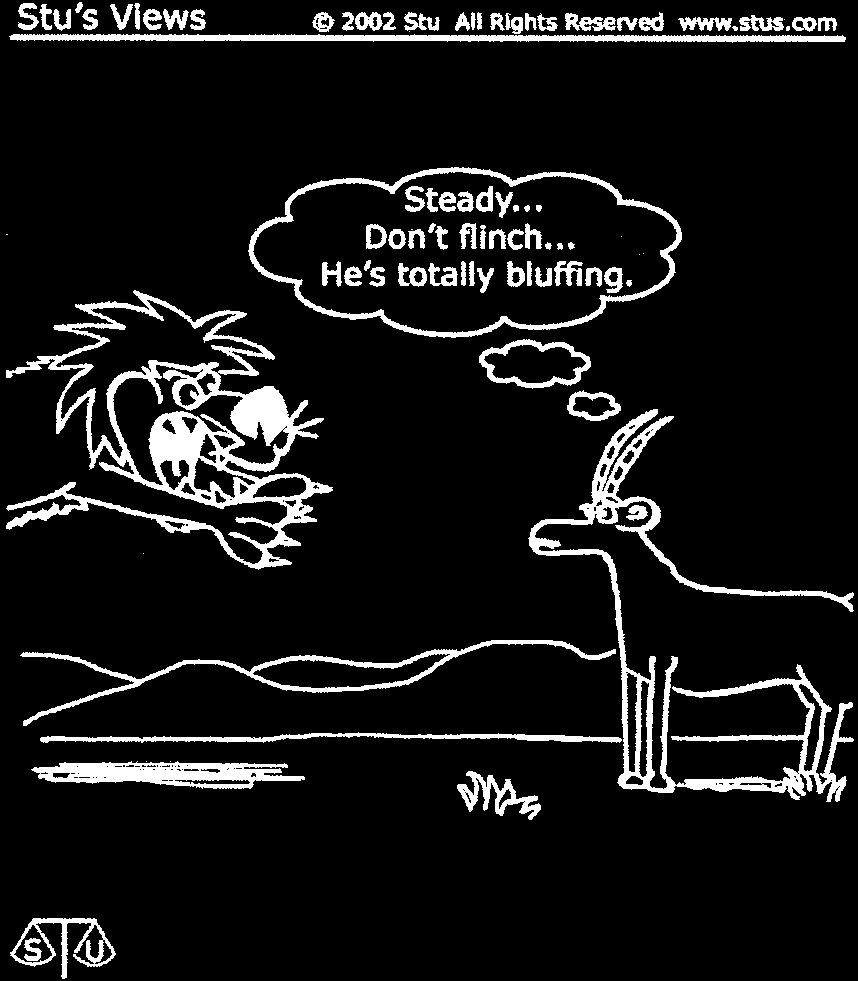

> **Descripción de la imagen** — Es una ilustración en blanco y negro que representa una escena de confrontación entre dos animales en un paisaje abierto. A la izquierda, se observa un gran felino con una expresión agresiva o rugiendo. A la derecha, hay un animal pequeño con cuernos (similar a un ciervo o antílope) de pie. Sobre el felino aparece una burbuja de diálogo que contiene texto.

es compleja y suele ser difícil de atribuir. Véase en el cuadro 8.1 una guía para la (i)legalidad
de mentir en una negociación.12

Identifi cación de las tácticas y actitudes
éticamente ambiguas en función de su uso

¿Qué tácticas éticamente ambiguas hay? El engaño y el pretexto pueden adoptar va-
rias formas en una negociación. Los investigadores se han esforzado por identifi car la
naturaleza de estas tácticas, y su estructura implícita, durante casi 20 años.13 Han explo-
rado en detalle la naturaleza y la organización conceptual de las tácticas de negociación
éticamente ambiguas. El enfoque general es pedir a estudiantes y ejecutivos que califi quen
una lista de tácticas en varias dimensiones: la conveniencia de la táctica, la probabilidad de
que quien califi ca la utilice y/o la efi cacia percibida de usarla. Al analizar los resultados de
este cuestionario, los investigadores identifi caron seis categorías defi nidas de tácticas, las
cuales confi rmaron con la recopilación y análisis de datos adicionales.14 Estas categorías se
listan en la tabla 8.2. Es interesante observar que de las seis categorías, dos —manipulación
emocional y tácticas de “concertación competitiva tradicional”— en general se consideran
adecuadas y de uso probable. Por tanto, estas tácticas, si bien un tanto inadecuadas, se

Quieto...
No parpadees...
Está faroleando.

Stu ́s Views
© 2002 Stu Todos los derechos reservados. www. stus.com

12  El cuadro 8.1, acerca de la legalidad de mentir en una negociación, aborda la ley de Estados Unidos. Es
obvio que los sistemas legales varían de un país a otro, y ocurrirá lo mismo con la doctrina legal relacionada
con el engaño y el fraude en una negociación.
13  Véanse Lewicki, 1983; Lewicki y Robinson, 1998; Lewicki y Spencer, 1990; Lewicki y Stark, 1995.
14  Robinson, Lewicki y Donahue, 2000; Barry, Fulmer y Long, 2000.

---

<!-- página 212 -->
### 195
¿Qué preguntas de la conducta ética surgen en una negociación?

consideran apropiadas y efi caces en una negociación distributiva exitosa. Las otras cuatro
categorías de tácticas —representación errónea, farolear, representación errónea para la
red del oponente y recopilación de información inadecuada— por lo general se consideran
inadecuadas y poco éticas en una negociación.

¿Es correcto utilizar tácticas éticamente ambiguas? La investigación sugiere que en
una negociación existen reglas tácitamente acordadas. En estas reglas, ciertas formas meno-
res de falsedad —representación errónea de la verdadera posición propia ante la otra parte,
faroles y manipulaciones emocionales— se consideran éticamente aceptables y dentro de
las reglas. En contraste, el engaño directo y la falsifi cación suelen considerarse ilegales. Sin
embargo, debemos ser muy prudentes con estas conclusiones. Primero, estas afi rmaciones
se basan en califi caciones de grupos grandes de personas (en su mayoría estudiantes de ad-
ministración de empresas); de ninguna manera predicen, o deben predecir, la forma en que
un negociador percibirá y utilizará las tácticas o el modo en que las califi cará cualquier per-
sona que las experimente. (Más adelante en el capítulo analizaremos las reacciones desde
la perspectiva de la “víctima”.) Segundo, estas observaciones se basan sobre todo en lo que
las personas dijeron que harían, y no en lo que de verdad hicieron. Las percepciones y reac-
ciones pueden ser muy diferentes cuando las partes toman decisiones en una negociación
real, y no cuando califi can las tácticas en un cuestionario sin la experiencia directa con otra
persona en un contexto social signifi cativo. Tercero, al participar en la investigación sobre
las tácticas éticamente ambiguas (como hicieron los autores) y comunicar estos resultados,
no pretendemos apoyar ninguna táctica que esté al margen de la ética. En vez de eso, nues-
tro objetivo es concentrar el debate entre los negociadores acerca de exactamente cuándo
pueden ser adecuadas o deben utilizarse estas tácticas. Por último, reconocemos que ésta es
una opinión en Occidente, donde las personas determinan lo que es éticamente aceptable;
en algunas otras culturas (por ejemplo, Asia), un grupo o una organización decide sobre la
ética, mientras que en otras más (por ejemplo, algunos países con mercados libres emergen-

TABLA 8.2
Categorías de tácticas de negociación marginalmente éticas

Categoría
Ejemplo

Concertación competitiva tradicional
No revelar su límite para abandonar la negocia-
ción; hacer una oferta inicial infl ada.

Manipulación emocional
Fingir enojo, temor, decepción; fi ngir alegría, sa-
tisfacción.

Representación errónea
Distorsionar la información o los sucesos de la
negociación al describirlos a la otra parte.

Representación errónea para las redes del opo-
nente

Dañar la reputación del oponente ante sus co-
legas.

Recopilación inadecuada de información
Robo, infi ltración, espionaje, etcétera.

Farolear
Amenazas o promesas no sinceras.

Fuente: Adaptado de R. Robinson, R. J. Lewicki y E. Donahue, “Extending and Testing a Five Factor Model to
Ethical and Unethical Bargaining Tactics: The SINS Scale”, Journal of Organizational Behavior 21, 2000, pp. 649-
664; y B. Barry, I. S. Fulmer y A. Long, Ethically Marginal Bargaining Tactics: Sanction, Effi cacy, and Performance,
presentado en la reunión anual de la Academy of Management, Toronto, agosto de 2000.

---

<!-- página 213 -->

Capítulo 8 La ética en la negociación
196

tes), las restricciones éticas sobre las transacciones negociadas pueden ser mínimas o difíci-
les de determinar con claridad y “dejan que el comprador se cuide solo” en todo momento.

Engaño por omisión comparado con mentir

Las tácticas engañosas son activas o pasivas. Por ejemplo, piense en un estudio que analizó
la tendencia de los negociadores a representar de manera errónea sus intereses en un pro-
blema de valor común: un problema donde ambas partes buscan el mismo resultado.15 Un
negociador que utiliza esta táctica engaña a la otra parte sobre lo que quiere en el problema
de valor común y luego acepta (a regañadientes) la preferencia de la otra parte, la cual,
en realidad, coincide con la propia. Al hacer que parezca como si diera una concesión, lo
que busca es, a cambio, una concesión de la otra parte. En general, 28% de los sujetos del
estudio representó de manera errónea el problema de valor común en un esfuerzo por ob-
tener una concesión de la otra parte. Los investigadores descubrieron que los negociadores
engañaron de dos formas al representar de manera errónea el problema de valor común:
una representación errónea mediante omisión (no revelar información que benefi ciaría a la
otra parte) y una representación errónea mediante mentir abiertamente (mentir acerca del
problema de valor común).

En otro conjunto de análisis, los estudiantes representaron la venta de un automóvil con
la transmisión defectuosa.16 Los estudiantes podían mentir por omisión —con sólo dejar
de mencionar la transmisión defectuosa— o por perpetración, al negar que la transmisión
estuviese defectuosa aunque lo preguntara la otra parte. Muchos más estudiantes estaban
dispuestos a mentir por omisión (no revelar toda la verdad) que por perpetración (responder
con mentiras a una pregunta). Este hallazgo señala una característica importante de la na-
turaleza humana: mucha gente está dispuesta a dejar que la otra persona continúe operando
con falsas premisas, pero evita realizar asertivamente una falsa declaración. Esto refuer-
za con claridad la norma de advertencia (dejar que el comprador se dé cuenta), y sugiere
que depende de cada parte formular las preguntas correctas y tener el nivel apropiado de
escepticismo al aceptar los argumentos de la otra parte.

Decisión de emplear tácticas éticamente ambiguas.
Un modelo

Concluimos esta sección del capítulo con un modelo relativamente sencillo que permite
explicar la forma en que un negociador decide aplicar una o más técnicas engañosas
(véase la fi gura 8.2). El modelo pone al negociador en una situación donde necesita elegir
las tácticas para infl uir en la otra parte. La persona identifi cará las tácticas de infl uencia
posibles que serían efi caces en una situación específi ca, algunas de las cuales pueden ser
engañosas, inadecuadas o con cierto grado al margen de la ética. Una vez identifi cadas, la
persona puede decidir aplicar en realidad una o más. Es probable que en la elección y el
uso de una táctica determinada infl uyan las motivaciones del negociador y su percepción/
juicio de la conveniencia de la táctica. Una vez empleada, el negociador valora las con-

15  O’Connor y Carnevale, 1997.
16  Schweitzer, 1997; Schweitzer y Croson, 1998.

---

<!-- página 214 -->

Sí

No

Uso de

tácticas

engañosas

Identificación del

rango de las

tácticas de influencia

Intenciones y

motivos para emplear

tácticas engañosas

Elección y uso

de tácticas

engañosas

Explicaciones

y

justificaciones

Situación

de infuencia

1. Impacto de la táctica:

¿Funciona?

2. Autoevaluación
3. Opinión y reacción del

otro negociador,

poderdantes y

público

Consecuencias

FIGURA 8.2
Modelo sencillo del engaño en las negociaciones.

---

<!-- página 215 -->

Capítulo 8 La ética en la negociación
198

secuencias con tres estándares: 1) si la táctica funcionó (produjo el resultado deseado),
2) cómo se siente el negociador consigo mismo después de aplicarla y 3) cómo juzgan la
otra parte u observadores neutrales a la persona. Las conclusiones negativas o positivas
de cualquiera de estos tres estándares pueden hacer que el negociador trate de explicar o
justifi car la táctica, pero a fi nal de cuentas afectarán la decisión de emplear tácticas simi-
lares en el futuro.

¿Por qué emplear tácticas engañosas?
Motivos y consecuencias

En las páginas anteriores analizamos en detalle la naturaleza de la ética y los tipos de tác-
ticas en una negociación que pueden considerarse éticamente ambiguas. Ahora pasamos a
analizar por qué son tentadoras dichas tácticas y cuáles son las consecuencias de sucumbir
a esa tentación. Comenzamos con los motivos, y los motivos inevitablemente comienzan
con el poder.

El motivo del poder

El propósito de emplear tácticas de negociación éticamente ambiguas es aumentar el poder
del negociador en el ambiente de la concertación. La información es una fuente importante
de apalancamiento en una negociación. La información tiene poder porque una negocia-
ción pretende ser una actividad racional que implica el intercambio de información y el uso
convincente de esa información. A menudo, sin embargo, quien tiene mejor información, o
la utiliza de manera más convincente, “gana” la negociación.

Tal visión supone que la información es exacta y verdadera. Suponer lo contrario —que
no es verdadera— es cuestionar las premisas de las cuales parte la comunicación social
cotidiana y la honestidad y la integridad de quien presenta esa información. Por supuesto,
plantear dichas preguntas puede insultar a la otra parte y reducir la confi anza implícita
que le concedemos. Además, se requiere tiempo y energía para investigar la veracidad y
la honestidad de otra persona. Así, toda afi rmación inexacta y falaz (p. ej., mentiras) pre-
sentada en este intercambio social manipula la información en favor de quien la presenta.
Mediante las tácticas ya descritas —faroles, falsifi cación, representación errónea, engaño
y revelación selectiva— el mentiroso obtiene ventajas. De hecho, se ha comprobado que
las personas están más dispuestas a emplear tácticas engañosas cuando perciben que la otra
parte está poco informada o que desconoce la situación en negociación, sobre todo cuando
lo que está en juego es valioso.17

Otros motivos para una conducta poco ética

La motivación de un negociador afecta a todas luces su tendencia para emplear tácticas
engañosas. La “orientación motivacional” —si los negociadores están motivados para ac-
tuar de manera cooperadora, competitiva o individualista entre sí— afecta las estrategias
y las tácticas que se aplican. En un estudio, los investigadores manipularon la orientación

17  Boles, Croson y Murnighan, 2000.

---

<!-- página 216 -->

199
¿Por qué emplear tácticas engañosas? Motivos y consecuencias

motivacional de los negociadores ante la situación y predispusieron a las partes para una
orientación competitiva o cooperadora hacia la otra.18 Es más probable que los negociado-
res competitivos —quienes buscan maximizar su propio resultado sin tomar en cuenta las
consecuencias para la otra parte— empleen como estrategia una representación errónea.
Las diferencias culturales también se ubican entre las infl uencias motivacionales: hay evi-
dencia de que es más probable que las personas de una cultura muy individualista (Estados
Unidos) empleen el engaño para una ganancia personal que quienes viven en una cultura
más colectivista (Israel).19

Sin embargo, el impacto de los motivos puede ser más complejo. En un estudio sobre
las tácticas, se preguntó a los negociadores acerca de su predisposición para utilizar tácti-
cas éticamente ambiguas.20 Las diferentes versiones del cuestionario indicaban de manera
explícita a los encuestados que asumieran una orientación motivacional competitiva o coo-
peradora hacia la otra parte y que supusieran que la otra parte adoptaría una orientación
motivacional competitiva o cooperadora. Los investigadores predijeron que las motiva-
ciones competitivas generarían la máxima aprobación de tácticas éticamente ambiguas.
Los resultados revelaron que las diferencias en la orientación motivacional propia de los
negociadores —cooperadora más que competitiva— no causó diferencias en su opinión de
la conveniencia de utilizar las tácticas, pero sí lo hizo la percepción de los negociadores de
la motivación que esperaban las otras partes. En otras palabras, fue mucho más probable
que los negociadores consideraran apropiadas las tácticas éticamente ambiguas si preveían
que la otra parte sería competitiva más que cooperadora. Estos hallazgos (preliminares) su-
gieren que los negociadores racionalizan la utilización de las tácticas marginalmente éticas
en previsión de la conducta esperada de la otra parte, en vez de adoptar la responsabilidad
personal por utilizar estas tácticas en función de su propia orientación competitiva.

Consecuencias de una conducta poco ética

Un negociador que emplea una táctica poco ética sufrirá las consecuencias positivas o
negativas con base en tres aspectos de la situación: 1) si la táctica es efi caz, 2) la forma en
que la otra persona, sus poderdantes y el público evalúan la táctica y 3) la forma en que el
negociador evalúa la táctica. Analicemos cada uno de ellos.

Efi cacia Consideremos primero las consecuencias con base en el éxito o el fracaso. Es
evidente que la efi cacia de una táctica tendrá cierto impacto si es más o menos probable
que se utilice en el futuro (en esencia, un sencillo proceso de aprendizaje y refuerzo). Si
emplear la táctica permite al negociador obtener resultados útiles que no serían posibles si
se hubiera portado de manera ética, y si la conducta poco ética no es castigada, es probable
que aumente la frecuencia de una conducta poco ética porque el negociador confía en que
puede salirse con la suya. Por tanto, las consecuencias reales —recompensas y castigos por
utilizar una táctica— no sólo debe motivar la conducta del negociador, sino que también
afecta su predisposición para emplear estas estrategias en circunstancias similares en el
futuro. (Por el momento, ignoraremos las consecuencias de estas prácticas en la reputación

18  O’Connor y Carnevale, 1997.
19  Sims, 2002.
20  Lewicki y Spencer, 1991.

---

<!-- página 217 -->

Capítulo 8 La ética en la negociación
200

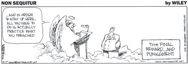

> **Descripción de la imagen** — Es una ilustración que representa una escena narrativa con dos figuras principales en un entorno exterior, posiblemente un paisaje montañoso o abierto.
>
> La composición muestra a una figura grande y prominente, envuelta en grandes ropajes fluidos que le dan una apariencia imponente. Esta figura se encuentra de pie sobre un terreno elevado. Debajo de ella, hay una segunda figura más pequeña, que parece estar interactuando con la figura superior o mirando hacia arriba.
>
> La escena está enmarcada por elementos atmosféricos como nubes y cielo. La ilustración sugiere una interacción o un diálogo entre las dos figuras.

y la confi abilidad del negociador, impacto que por desgracia casi todos los negociadores
que engañan pasan por alto en el corto plazo.)

Estas propuestas no se han probado en situaciones de negociación, pero sí en otros
estudios de investigación sobre la toma de decisiones éticas. Por ejemplo, cuando los parti-
cipantes en una investigación esperaban una recompensa por tomar una decisión poco ética
al desempeñar un esquema de reacción simulado en el laboratorio, no sólo participaron,
sino que estuvieron dispuestos a hacerlo otra vez cuando surgió una segunda oportuni-
dad.21 Además, cuando también había fuertes presiones en los sujetos de la investigación
para competir entre sí —p. ej., anunciar lo bien que una persona realizó una tarea y dar un
premio a quien obtuvo la califi cación más alta— aumentó todavía más la frecuencia de una
conducta poco ética.

Las reacciones de los demás Un segundo grupo de consecuencias surge de los jui-
cios y evaluaciones de la persona “objeto” de la táctica, de los poderdantes o del público
que observa la táctica. Si estas partes reconocen la táctica y la califi can como adecuada o
inadecuada, el negociador puede recibir muchas reacciones. Si la persona objeto no está
consciente de que se utilizó una táctica engañosa, su única reacción puede ser de decepción
por perder la negociación. Sin embargo, si la persona descubre que ocurrió un engaño, es
probable que reaccione con intensidad. Las personas que descubren que se les engañó o
explotó suelen enojarse. Además de “perder” la negociación, se sienten defraudadas por
permitir que los manipularan mediante una maniobra sagaz. No es probable que la víctima
confíe otra vez en el negociador poco ético, tal vez busque vengarse de él en tratos futuros,
y también puede generalizar esta experiencia a negociaciones con otras personas.

Estas consecuencias negativas fueron evidentes en una investigación que muestra que
las víctimas tuvieron reacciones emocionales intensas ante el engaño cuando mantenían una
relación muy personal con el sujeto, cuando la información que estaba en juego era muy
importante y cuando consideraban las mentiras un tipo de conducta inaceptable para esa
relación (p. ej., cuando las expectativas defi nidas de decir la verdad se violaban de mane-
ra específi ca).22 En la mayoría de los casos, el descubrimiento de la mentira coadyuvaba a

por WILEY
NON SEQUITUR

La recompensa...

y el castigo final.

... y para permanecer

aquí, sólo tienen que

practicar lo que

predicaron.

NON SEQUITUR © Wiley Miller. Distribuido por UNIVERSAL PRESS SYNDICATE. Reimpreso con
autorización. Todos los derechos reservados.

21  Hegarty y Sims, 1978.
22  McCornack y Levine, 1990.

---

<!-- página 218 -->

201
¿Por qué emplear tácticas engañosas? Motivos y consecuencias

concluir la relación con la otra persona, y en casi todos los casos la conclusión la iniciaba
la víctima. Cuanto más grave y personal era el engaño y cuantas más consecuencias tenía
para la confi anza entre las partes, más destructivo era para la relación. En un tono similar,
también existe evidencia de que a las personas que engañan se les considera menos veraces
y menos deseables para interacciones futuras.23 Destacamos aquí que el daño a la reputación
puede ser difícil de reparar. Un estudio reveló que los efectos de acciones traicioneras o no
dignas de confi anza en la propia confi abilidad pueden remediarse con un comportamiento
confi able subsecuente siempre que las acciones negativas que rompieron la confi anza no
impliquen un engaño. Sin embargo, cuando el engaño es la causa del problema, los intentos
por restaurar la confi anza mediante una disculpa u otro comportamiento similar suelen ser
poco efi caces.24 En resumen, aunque las tácticas poco éticas pueden generar éxito de corto
plazo para el negociador, también crean un adversario en busca de venganza y retribución.

Reacciones del yo En ciertas condiciones, como cuando la otra parte sufre de verdad,
un negociador puede sentir cierta incomodidad, tensión, culpa o remordimiento. Esto pue-
de conducir al negociador a buscar formas de reducir la incomodidad psicológica. En un
estudio, las personas que mintieron a su compañero en el transcurso de una negociación
simulada de negocios hicieron mayores concesiones después para compensar la mentira.25
Esta compensación por una mentira anterior fue en especial común entre los participantes
del estudio que se autocalifi caron de manera elevada en “atributos morales” (es decir, ho-
nestidad, justicia, benevolencia) y entre quieres dijeron que negociaban en nombre de una
organización que “se siente orgullosa de ser justa y honesta en sus tratos de negocios”.

Por supuesto, los negociadores que no ven un problema en utilizar la táctica es proba-
ble que la empleen de nuevo y hasta analicen cómo hacerlo con más efi cacia. Por un lado,
aunque estas tácticas pueden tener consecuencias intensas para la reputación y confi abilidad
del negociador, en el corto plazo las partes rara vez parecen tomar en consideración estos re-
sultados. Por otro lado, y sobre todo si la táctica funcionó, el negociador puede llegar a racio-
nalizarla y justifi carla. A continuación analizamos estas racionalizaciones y justifi caciones.

Explicaciones y justifi caciones

Cuando un negociador aplicó una táctica éticamente ambigua que puede desencadenar una
reacción, como ya describimos, debe prepararse para defenderla (p. ej., “soy una persona
íntegra, y no obstante decidí hacer algo que puede considerarse poco ético”) ante la vícti-
ma, los poderdantes y el público que expresen su preocupación. El propósito principal de
estas explicaciones y justifi caciones es racionalizar, explicar o excusar el comportamiento:
verbalizar una razón legítima y correcta por la que fue necesaria esta táctica. Existen ca-
da vez más investigaciones acerca de quienes emplean tácticas poco éticas, y las explica-
ciones y justifi caciones con que las racionalizan. Éstos son algunos ejemplos:26

• La táctica era inevitable. Los negociadores a menudo justifi can sus acciones al afi rmar
que la situación hizo necesario que actuaran como lo hicieron. El negociador puede

23  Boles, Croson y Murnighan, 2000.
24  Schweitzer, Hershey y Bradlow, 2006.
25  Aquino y Becker, 2005.
26  Los ejemplos se tomaron de Bok, 1978.

---

<!-- página 219 -->

Capítulo 8 La ética en la negociación
202

sentir que no tenía un control completo de sus acciones y que no tenía opción; por tanto,
no tiene ninguna responsabilidad. Tal vez el negociador no pretenda herir a nadie, pero
otra persona lo presionó para utilizar la táctica.
• La táctica era inofensiva. El negociador puede decir que lo que hizo era trivial y poco
importante. Las personas mienten todo el tiempo. Por ejemplo, puede saludar a su ve-
cino con un animado “buenos días, me alegra verlo” cuando de hecho no piensa que la
mañana sea buena, esté de mal humor y quisiera no haber visto a su vecino porque su
perro ladró toda la noche. Las exageraciones, los faroles o curiosear en las notas priva-
das de la otra parte durante las negociaciones se descartan con facilidad como acciones
inofensivas. Sin embargo, observe que esta justifi cación particular interpreta el daño
desde el punto de vista del actor; la víctima tal vez no esté de acuerdo y como resultado
quizá padeció un daño grave u otros costos.
• La táctica ayudará a evitar consecuencias negativas. Con esta justifi cación, los nego-
ciadores argumentan que el fi n justifi ca los medios. En este caso, la justifi cación es que
la táctica ayudó a evitar un daño mayor. Es correcto mentir a un ladrón armado acerca
de dónde escondió su dinero para evitar el robo. Asimismo, los negociadores justifi can
las mentiras (o cualquier otra táctica sobre medios y fi nes) si los protege contra conse-
cuencias todavía más indeseables en caso de conocerse la verdad.
• La táctica producirá buenas consecuencias o fue motivada por el altruismo. Una vez
más, el fi n justifi ca los medios, pero en un sentido positivo. Un negociador que juzga
una táctica con base en sus consecuencias actúa de acuerdo con los principios del utilita-
rismo: que la calidad de cualquier acción específi ca se juzga por sus consecuencias. Los
utilitaristas declaran que son adecuados ciertos tipos de mentiras o tácticas sobre medios
y fi nes porque buscan un bien mayor; por ejemplo, la táctica de Robin Hood, según la
cual roba al rico para que los pobres vivan mejor. En realidad, casi todos los negociado-
res emplean tácticas engañosas en su propio provecho, no para el bien general.
• “Tenía que sucederle”, “se lo merecía” o “busco lo que es mío”. Éstas son variaciones
del tema de utilizar las mentiras y el engaño contra una persona que se aprovechó de
usted en el pasado o contra alguna fuente general de autoridad (p. ej., “el sistema”). Las
encuestas captan una erosión de la honestidad en Estados Unidos: las personas cada día
consideran más apropiado aprovecharse del sistema de diversas maneras, como evasión
fi scal, robo de insignifi cancias, hurtos en tiendas, declaración inadecuada de quiebra,
excesos periodísticos y distorsión en la publicidad.27
• “Ellos iban a hacerlo, así que me adelanté.” A veces un negociador legitima una tác-
tica porque prevé que la otra parte pretende hacer lo mismo. Un estudio reveló que las
personas estaban más dispuestas a utilizar el engaño al negociar con alguien que tiene
reputación de ser poco ético.28 Otro estudio relacionó la inclinación propia para engañar
y los juicios sobre la integridad de la otra parte: cuanta más tentación sentía una persona
por hacer una representación errónea, más creía que la otra parte también representaba
la información de manera errónea.29 Por tanto, la tentación propia para hacer una repre-
sentación errónea crea una lógica que se alimenta a sí misma en la cual se cree necesa-
ria la representación errónea porque es probable que la otra parte lo haga también. Al

27  Por ejemplo, Patterson y Kim, 1991; Yankelovich, 1982.
28  Volkema y Fleury, 2002.
29  Tenbrunsel, 1998.

---

<!-- página 220 -->

203
¿Cómo enfrentan los negociadores que las otras partes recurran al engaño?

mismo tiempo, los participantes en este estudio una y otra vez se califi caron a sí mismas
como más éticas que la otra parte, lo cual sugiere que las personas experimentan una
combinación de ilusiones positivas acerca de sí mismas y su propia conducta, e ilusio-
nes negativas acerca de la otra y su comportamiento probable.
• “Él comenzó.” Ésta es una variación del punto anterior. En este caso, la razón funda-
mental es que la otra parte ya violó las reglas, lo cual legitima el derecho del negociador
a violarlas también. En tales casos se emplean tácticas poco éticas de manera recíproca
para restablecer el equilibrio o para dar una lección a la otra parte.
• La táctica es justa o adecuada para la situación. Este método aplica el relativismo
moral (situacional) como razón o justifi cación. Casi todas las situaciones sociales, entre
ellas las negociaciones, se guían por una serie de reglas, por lo general bien comprendi-
das, de conducta adecuada. Por ejemplo, recuerde los argumentos anteriores de Carr, de
que los negocios son un juego con un carácter distintivo que legitima las acciones nor-
malmente poco éticas.30 Otros desmienten estos argumentos al afi rmar que el engaño en
los negocios es tan inmoral como en otras áreas de la vida, y que la analogía del juego
no legitima más una conducta poco ética que otras analogías.31 Como una cuestión ge-
neral, el relativismo ético —la idea de que los estándares morales se modifi can con las
circunstancias cambiantes— suele considerarse una visión inaceptable de la moralidad.
Como lo explica un escritor, “si todos los sistemas éticos son por igual válidos, no es
posible hacer un juicio moral fi rme acerca de la conducta individual, y todos estamos
solos para hacer lo que preferimos a los demás, dentro de límites económicos y restric-
ciones legales”.32 Dejamos al lector decidir si esto es bueno o malo.

Como racionalizaciones de nuestra conducta que se alimentan a sí mismas, las expli-
caciones permiten al negociador convencer a los demás —en particular a la víctima— de
que es aceptable una conducta que sería incorrecta en una situación específi ca. Las expli-
caciones y las justifi caciones también ayudan a las personas a racionalizar la conducta para
sí mismas. Pero existe un riesgo: suponemos que cuanto más a menudo los negociadores se
someten a este proceso que se justifi ca a sí mismo, cuanto más parciales son sus juicios acer-
ca de los estándares y valores éticos, tanto más disminuye su capacidad para ver la verdad
como es. Las tácticas mencionadas al principio quizá sirvieron para obtener poder en una
negociación, pero con el tiempo los negociadores que las emplean a menudo experimentan
una pérdida de poder. Estos negociadores se consideran de baja credibilidad o integridad, y
por eso se les trata como personas que se aprovechan si surge la oportunidad. Es más fácil
mantener en buen estado la reputación que restaurarla una vez dañada.

¿Cómo enfrentan los negociadores que
las otras partes recurran al engaño?

La gente miente; de hecho, lo hace con mucha frecuencia,33 así que este capítulo no estaría
completo sin señalar brevemente algunas cosas que usted puede hacer como negociador

30  Carr, 1968.
31  Bowie, 1993; Koehn, 1997.
32  Hosmer, 2003, p. 89.
33  Adler, 2007.

---

<!-- página 221 -->

Capítulo 8 La ética en la negociación
204

cuando crea que la otra parte utiliza prácticas engañosas. La tabla 8.3 presenta algunas
estrategias verbales para determinar si el otro nos está mintiendo. ¿Y qué pasa si lo hace?
He aquí algunas opciones:

Formule preguntas de sondeo La investigación muestra que casi ningún comprador
plantea preguntas y que hacerlo revela mucha información, una parte de la cual el ne-
gociador intencionalmente no presenta.34 En una simulación experimental de una nego-
ciación por la venta de una computadora, se recomendaba mucho a los compradores
preguntar al vendedor sobre la condición de la computadora o se les pedía no hacerlo.35
Los hallazgos indican que, en general, preguntar sobre la condición de la computadora re-
dujo el número de comentarios engañosos del vendedor (mentiras dichas). Sin embargo,
en ciertas condiciones, preguntar también aumentó el número de mentiras por omisión
del vendedor acerca de otros aspectos de la computadora. Por tanto, si bien las pregun-
tas ayudan a un negociador a determinar si la otra parte es engañosa, tal interrogatorio
también aumenta la tendencia del vendedor a engañar en áreas donde no se formulan
preguntas. (Consulte en el capítulo 6 un examen más extenso sobre la formulación de
buenas preguntas.)

Formule las preguntas en distintas formas Robert Adler, estudioso de la ley y la ética,
señala que lo que los negociadores que mienten suelen hacer no es mentir directamente
(lo que plantea el riesgo de responsabilidad penal por fraude); en vez de eso, “eluden, se
agachan, se inclinan y tejen alrededor de la verdad, asumiendo que se malinterpretarán sus
declaraciones o no las cuestionarán”.36 Una pregunta planteada de cierta manera puede
obtener una respuesta que sea técnicamente cierta pero eluda la verdad que quien pregunta
busca descubrir. Considere este ejemplo: como comprador potencial de una casa, pregunto:
“¿cómo está el sistema de calefacción?”, y el vendedor replica: “trabaja bien”, así que yo
saco la conclusión de que no hay problema. En cambio, pude haber preguntado: “¿cuándo
fue la última vez que revisaron el sistema de calefacción, y cuál fue el resultado?” (y qui-
zá pude ir más lejos y pedir una documentación escrita de la inspección). Pude haberme
enterado de que, aunque el sistema funciona razonablemente en este momento (“funciona
bien”), la inspección reveló que está en las últimas y que habrá que reemplazarlo el año
siguiente. Pregunta diferente, distinta respuesta y menos evasión.

Obligue a la otra parte a mentir o retractarse Si sospecha que la otra parte engaña
sobre un problema pero no lo manifi esta con claridad, hágale una pregunta que la obligue
a decir una mentira directa (si la afi rmación es falsa) o a abandonar o califi car la afi rma-
ción. Por ejemplo, si el vendedor de una propiedad alude a otros compradores interesados
e implica que hay otras ofertas, pregunte sobre las otras ofertas de una manera que exija
una respuesta de tipo sí o no. Ésta puede ser una estrategia útil porque, como ya señalamos,
la investigación muestra que las personas se inclinan más a mentir por omisión que por
comisión. Algunas personas se sienten cómodas engañando o despistando, pero recuperan
rápido la conciencia si se les obliga a mentir directamente mientras miran a alguien a los

34  Schweitzer, 1997; Schweitzer y Croson, 1999.
35  Schweitzer, Brodt y Croson, 2002.
36  Adler, 2007, p. 72.

---

<!-- página 222 -->
### 205
¿Cómo enfrentan los negociadores que las otras partes recurran al engaño?
### TABLA 8.3
Detección del engaño

Los investigadores identifi caron varias tácticas verbales útiles para determinar si la otra parte actúa
de manera engañosa.

Táctica
Explicación y ejemplo

Intimidación
Obligar a la otra parte a admitir que utiliza el engaño al amenazarla
para que diga la verdad. Hacer una acusación grave a la otra parte.
Criticar a la otra parte. Acorralar a la otra parte con preguntas desa-
fi antes. Fingir indiferencia ante lo que dice (“no me interesa nada lo
que tengas que decir del asunto”).

Descripción de lo fútil
Destacar la futilidad y el peligro inminente asociado al engaño con-
tinuo: “la verdad se sabrá algún día”, “no haga un hoyo más grande
para tapar otro”, “si trata de encubrirlo, en el futuro será peor”, “us-
ted está solo en su engaño”.

Incomodidad y alivio
Expresar la máxima “la confesión le hace bien al alma”. Ayudar a la
otra parte a reducir la tensión de que se le conozca como embau-
cadora.

Farolear
Mentir a la otra parte para que crea que usted descubrió el engaño:
“sus pecados están a punto de salir a la luz”. Indicar que usted sabe
que la otra parte sabe, pero no lo discutirá.

Insinuaciones amables
Alentar a la otra parte a que siga hablando para que proporcione
información con la cual separar la verdad del engaño. Pedirle que
desarrolle el tema que se analiza. Preguntar para indicar que lo hace
porque “quiere saber”. Actuar como abogado del diablo y formular
preguntas incisivas. Alabar a la otra parte para darle confi anza y ha-
cer que comparta información.

Minimización
Reducir la importancia de cualquier actuación engañosa. Ayudar a la
otra parte a encontrar excusas para el engaño; minimizar las conse-
cuencias de la acción; comentar que otros han hecho cosas peores;
culpar a otra persona.

Contradicción
Hacer que la otra parte cuente toda su historia para descubrir más
información que revele inconsistencias y contradicciones en sus co-
mentarios o informes. Señalar y pedir explicaciones sobre las con-
tradicciones evidentes. Repetir una pregunta varias veces y buscar
inconsistencias en las respuestas. Volver a hablar de las contradic-
ciones y pedir una explicación. Presionar a la otra parte para que
diga cosas que no quiere decir.

Información alterada
Alterar la información y esperar engañar a la otra para que revele su
propio engaño. Exagerar lo que usted cree que es el engaño en es-
pera de que la otra parte “corrija” la afi rmación. Plantear una pregun-
ta con información incorrecta y esperar que la otra parte la corrija.

Una grieta en la defensa
Intentar que la otra parte admita una mentira pequeña o parcial so-
bre cierta información y utilizar esto para que admita una mentira
más grande: “si mintió sobre esta insignifi cancia, ¿cómo sé que no
mintió en otras cosas?”

(continúa)

---

<!-- página 223 -->

Capítulo 8 La ética en la negociación
### 206
### ojos. Haciendo a un lado la conciencia, este tipo de preguntas también pone nerviosa a la
### otra parte por la responsabilidad de una conducta fraudulenta. Por tanto, una pregunta di-
### recta e incisiva oportuna inducirá a algunos adversarios a retractarse en vez de mentirle en
### su cara. (Por supuesto, el mentiroso patológico enfrentará bien el desafío.)
### Ponga a prueba a la otra parte ¿No está seguro de que la otra parte sea el tipo de
### persona que miente? Considere hacerle preguntas cuya respuesta usted conozca.37 Si la
### respuesta es evasiva o engañosa, usted habrá aprendido algo importante sobre la otra parte
### y su grado de confi abilidad. Y cuando piense que la lealtad que su oponente siente por la
### verdad es tambaleante, tome nota durante la negociación (e invite al otro lado a confi rmar
### la exactitud de sus notas) para crear y preservar más tarde dicha exactitud.
### “Mencione” la táctica Indique a la otra parte que usted sabe que farolea o miente. Haga
### esto con tacto pero con fi rmeza, y exponga su desagrado. Recuerde, sin embargo, que no
### siempre es fácil detectar las mentiras; véase el cuadro 8.2. Acusar equivocadamente a la
### otra parte de ser un negociador mentiroso o poco ético sin duda no es el camino para lograr
### un proceso constructivo y un resultado fructífero.
### Ignore la táctica Si está consciente de que la otra parte farolea o miente, tan sólo ignó-
### rela, en especial si el engaño es sobre un aspecto relativamente menor de la negociación.
### Algunos pueden mentir o farolear por la expectativa de que es lo que “deben” hacer —es
### TABLA 8.3
Detección del engaño (conclusión).

Revelación de sí mismo
Revelar varias cosas sobre sí mismo, como alguna acción desho-
nesta de su parte, en espera de que la otra parte confíe en usted y
mencione acciones deshonestas.

Indicar las señales
de engaño

Señalar las conductas percibidas en la otra parte que indican que
miente: sudor, nerviosismo, cambio de voz, incapacidad para hacer
contacto visual, etcétera.

Interés
Indicar su interés sincero por el bienestar de los demás: “ustedes
son importantes para mí”, “me interesan mucho”, “comprendo su
malestar”.

Mantener el statu quo
Recomendar a la otra parte que sea sincera para mantener su repu-
tación. “¿Qué pensará la gente?” Apelar a su orgullo y deseo para
conservar una buena reputación.

Mención directa
“Sólo dígame la verdad”, “seamos sinceros con esto”, “supongo que
no tiene objeción en decirme todo lo que sabe”.

Silencio
Crear un “vacío verbal” que incomode a la otra parte y la haga hablar
y revelar información. Cuando diga una mentira, tan sólo mantenga
el contacto visual pero permanezca en silencio.

Fuente: Adaptado de Pamela J. Kalbfl eisch, “The Language of Detecting Deceit”, Journal of Language and Social
Psychology 13, núm. 4, 1994, pp. 469-496.

37  Adler, 2007.

---

<!-- página 224 -->

Joe y Sue Carter
207

207

parte del ritual de la negociación— y no por un siniestro sentido de la ética o la morali-
dad. En ocasiones los negociadores hacen comentarios tontos —declaraciones de las que
más tarde se arrepienten, prometiendo cosas o descartando opciones— y a veces lo más
conveniente para la otra parte es ayudar a ese negociador a “escapar” del compromiso y
mantener su prestigio. Se aplica una lógica similar a las declaraciones mentirosas cuando el
motivo se acerca más a la ingenuidad que a la depravación: déjelo pasar, evite avergonzar
a la otra parte y siga adelante. (La tabla 8.3 contiene sugerencias adicionales para enfrentar
situaciones donde sospeche que la otra parte se dedica a engañar.)

Analice lo que ve y ofrezca ayudar a la otra parte a cambiar a conductas más hones-
tas Ésta es una variación de mencionar la táctica, pero intenta asegurar a la otra parte
que, en el largo plazo, es más probable que consiga lo que quiere si dice la verdad que con
cualquier forma de farolear o engañar.

Responda de manera similar Si la otra parte farolea, supérela. Si actúa de manera erró-
nea, haga lo mismo. No recomendamos esta línea de acción en absoluto, porque sólo inten-
sifi ca la conducta destructiva y lo arrastra con la otra parte, pero si ésta capta que usted tam-
bién miente, puede comprender que no es probable que la táctica funcione. Por supuesto,
si las mentiras de la otra parte son tan directas y extremas para constituir un fraude punible
legalmente, no es éste un enfoque que usted desearía imitar en ninguna circunstancia. En
general, es mejor considerar el “responda de forma similar” como estrategia de “último
recurso”.

Aunque las personas en general no son muy
buenas para detectar mentiras, hay quien cree
que con mirar el rostro de alguien sabe si la
persona tiende a ser deshonesta o sincera con
regularidad. Pero, ¿cuán exactas son tales va-
loraciones?

Un estudio pidió a los participantes que
observaran fotografías de las mismas personas
como niños, adolescentes y adultos, y califi -
caran su atractivo y honestidad con base en la
valoración de sus rostros. Estos resultados se
compararon con informes propios de conduc-
ta honesta proporcionados por las personas de
las fotografías. Los resultados comprobaron
que la calidad estructural del rostro, como el
atractivo, aspecto infantil, tamaño de ojos y
simetría, contribuyeron a las percepciones de
mayor honestidad en los observadores. Los
informes propios revelaron que los hombres
que parecían más honestos al principio de su
vida en realidad eran más honestos de adul-

tos. Por otra parte, las mujeres cuya conducta
era menos honesta cuando eran jóvenes pa-
reció hacerse más honesta conforme crecían,
aunque su conducta no cambió de manera
signifi cativa. Los participantes en el estudio
fueron capaces de identifi car correctamente a
los hombres más honestos en el grupo confor-
me envejecían, pero su valoración de las mu-
jeres fue muy imprecisa. Los investigadores
concluyeron que los rostros de los hombres
refl ejaban con exactitud su tendencia a la ho-
nestidad, pero los rostros de las mujeres no
eran indicadores particularmente válidos de
su sinceridad.

Fuente: Adaptado de L. A. Zebrowitz, L. Voinescu y M. A.
Collins, “Wide-Eyed and Crooked-Faced: Determinants
of Perceived and Real Honesty across the Life Span”,
Personality and Social Psychology Bulletin 22, 1996, pp.
1258-1269.
## CUADRO
### ¿Existe un rostro honesto?
## 8.2

---

<!-- página 225 -->

Capítulo 8 La ética en la negociación
### 208

En este capítulo analizamos los factores que toman
en cuenta los negociadores cuando deciden si cier-
tas tácticas específi cas son engañosas y poco éticas.
Abordamos el estudio de las tácticas éticamente
ambiguas desde una situación de toma de decisio-
nes, y examinamos los signifi cados éticos de las
decisiones que toman los negociadores.

Primero elegimos un conjunto de escenarios
hipotéticos para analizar la forma en que las pre-
guntas éticas son inherentes al proceso de nego-
ciación, y luego presentamos cuatro enfoques fun-
damentales para el razonamiento ético para tomar
decisiones acerca de lo éticamente adecuado. Pro-
pusimos que la decisión de un negociador de utili-
zar tácticas éticamente ambiguas (o decididamente
poco éticas) proviene de un deseo de aumentar el
poder de negociación propio al manipular el pa-
norama de la información (supuestamente exacta)
en la negociación. Vimos las diferentes formas que
adoptan las tácticas éticamente ambiguas, y luego

analizamos los motivos y consecuencias de aplicar
una conducta de negociación poco ética. Por últi-
mo, abordamos la forma en que pueden responder
los negociadores a otra parte que esgrime tácticas
de engaño o pretextos.

Al fi nal, sugerimos que los negociadores que
consideran aplicar tácticas engañosas se formulen
las preguntas siguientes:

•
¿En realidad aumentarán mi poder y me ayu-
darán a lograr mi objetivo?
•
¿Cómo afectarán estas prácticas la calidad de
mi relación con la otra parte en el futuro?
•
¿Cómo afectarán estas tácticas mi reputación
como negociador?

Los negociadores suelen pasar por alto que, si
bien con las tácticas poco éticas o ventajosas obtie-
nen lo que quieren en el corto plazo, estas mismas
tácticas suelen generar reputaciones dudosas y efi -
cacia reducida en el largo plazo.
## Resumen del capítulo
### 208

---

<!-- página 226 -->
## CAPÍTULO
## Las relaciones en
## una negociación
## 9
### Objetivos

1.
Comprender la forma en que la negociación que se realiza dentro de una relación exis-
tente cambia la dinámica de la negociación.
2.
Explorar las distintas formas de relaciones en las que puede ocurrir una negociación.
3.
Considerar las funciones críticas que desempeñan las reputaciones, la confi anza y la
justicia en toda relación de negociación.
4.
Saber cómo reconstruir la confi anza y reparar relaciones dañadas.

Hasta este punto hemos descrito el proceso de negociación como si dos partes sin relación
o conocimiento previo mutuo se reunieran para llegar a un acuerdo, después de lo cual
no tuvieran ninguna relación. En otras palabras, fue sólo una “instantánea” tomada fuera
de tiempo y contexto. Pero es evidente que muchas negociaciones reales no se efectúan de
este modo. Las negociaciones ocurren en un contexto social múltiple y complejo que tiene
un impacto signifi cativo en el modo como interactúan las partes y cómo evoluciona el
proceso.

Una forma importante en que el contexto afecta a una negociación es que las personas
participan en relaciones que tienen un pasado, un presente y un futuro. En este capítulo nos
concentraremos en las maneras en que estas relaciones pasadas y futuras afectan las nego-
ciaciones presentes. Analizaremos las relaciones en dos secciones importantes. Primero,
examinamos la forma en que una relación anterior, actual o futura entre los negociadores
afecta el proceso de negociación. Este análisis considera las suposiciones generales sobre
la teoría y la práctica de una negociación, suposiciones que no tomaron en cuenta ninguna
relación entre las partes, y presenta una evaluación crítica de la idoneidad de la teoría de las
negociaciones para comprender y administrar las negociaciones dentro de las relaciones.
Presentamos una taxonomía de diferentes tipos de relaciones y las negociaciones probables
dentro de ellas; también describimos a grandes rasgos las investigaciones que examinan
los procesos de negociación dentro de las relaciones existentes. Por último, analizamos tres
temas destacados —reputación, confi anza y justicia— y fundamentales para las negocia-
ciones efi caces dentro de una relación.

---

<!-- página 227 -->

Capítulo 9 Las relaciones en una negociación
210

Conveniencia de la teoría establecida
y la investigación para comprender
una negociación dentro de las relaciones

Tradicionalmente, los investigadores estudian el proceso de negociación de dos maneras.
Por un lado, analizan las negociaciones verdaderas con negociadores reales en situaciones
de campo “en vivo”, como las relaciones laborales;1 por otro, simulan estas complejas ne-
gociaciones en un laboratorio de investigación. Mediante juegos y simulaciones simplifi ca-
dos de negociación, y estudiantes dispuestos a participar en la investigación, exploran los
problemas y situaciones de una negociación en condiciones controladas en el laboratorio.
Este enfoque dominó el proceso de investigación sobre negociaciones durante los últimos
40 años.
Existen, sin embargo, graves problemas con esta intensa tradición de investigación
en el laboratorio. Casi todas nuestras conclusiones acerca de lo que resulta efectivo en
negociaciones complejas provienen de estudios que utilizan un conjunto muy sencillo de
juegos de negociación y simulaciones en un salón de clases. Estos hallazgos obtenidos
en una investigación simple de laboratorio se han utilizado mucho para prescribir cómo
deben comportarse los negociadores en situaciones complejas; por tanto, en vez de sólo
describir lo que hacen en realidad las personas en las negociaciones (reales y simuladas),
muchos libros (incluso éste) recurren a esa teoría para indicar a los negociadores lo que
deben hacer y cómo deben negociar. Es razonable cuestionar si esas extensas normas son
completamente exactas o adecuadas, pues la mayoría de las negociaciones se da entre
gente que tiene una relación con la otra parte, y por ende ambos comparten una historia
pasada signifi cativa y esperan estar juntos en el futuro. Ha sido sólo hasta hace poco que
los investigadores comenzaron a examinar las negociaciones en el contexto de la relación
para ofrecer mejores normas sobre cómo negociar cuando las partes están profundamente
involucradas en una relación.

Un grupo de autores analizó la idoneidad de las teorías en vigor para explicar una
negociación dentro de las relaciones. Aportaron los ejemplos siguientes:

Una pareja de recién casados discute sobre el lugar donde pasarán las vacaciones de Navidad:
con los padres de él o con los de ella. Procter & Gamble y Wal-Mart analizan quién poseerá el
inventario en su nueva relación. Price Waterhouse negocia un exceso de costos con un cliente
muy importante que verifi ca la contabilidad. Los integrantes de una nueva fuerza de trabajo
revisan sus nuevos papeles y descubren que dos quieren realizar la misma función. Cada una
de estas discusiones puede modelarse muy bien como un solo problema, un problema de nego-
ciación distributiva. Hay dos partes: una dimensión única y muy importante, y las posiciones
opuestas. Una parte importante de cada análisis implica investigar el punto de conveniencia
de la otra parte y ocultar el propio. Pero las discusiones también son más complicadas que el
problema distributivo aislado.2

Como ya señalamos, el problema, argumentan, es que los investigadores se apresuran a
generalizar a partir de estudios simples (“negociaciones transaccionales”) respecto de rela-

1  Douglas, 1962; Friedman, 1994.
2  Sheppard y Tuchinsky, 1996a, pp. 132-133.

---

<!-- página 228 -->

211
Conveniencia de la teoría establecida y la investigación para comprender una negociación

ciones complejas. A continuación presentamos diversas formas en que el contexto de una
relación cambia la dinámica de la negociación:

1.  Una negociación dentro de las relaciones ocurre con el tiempo. En el capítulo 3 ob-
servamos que un modo de convertir una negociación distributiva en integradora es que
las partes se turnen para obtener un benefi cio o recompensa. Basadas en la relación, las
partes consiguen esto fácilmente. La esposa y el esposo acuerdan visitar a los padres
de cada quien en días festivos alternos. En las relaciones, el tiempo se vuelve una
variable importante al negociar; comprender la forma en que las partes incorporan o
descartan problemas durante un tiempo puede ser fundamental para administrar las
situaciones difíciles.
2.  A menudo, una negociación no es un modo para analizar un problema, sino una ma-
nera de conocer más a la otra parte y aumentar la interdependencia. En una negocia-
ción de transacciones, las partes buscan obtener información entre sí para alcanzar un
mejor acuerdo. El breve espectro de tiempo de una transacción requiere que una parte
actúe sólo con base en sus propias preferencias, o bien que recopile pequeñas porcio-
nes de información respecto de la otra parte antes de actuar. En una relación, recopilar
información sobre las ideas, preferencias y prioridades de la otra parte suele ser la
actividad más importante; esta información suele servir para aprender y comprender
la mentalidad y hábitos laborales de la otra parte, etc., con el fi n de destacar la capaci-
dad de una parte para coordinar las actividades y mejorar la relación. En resumen, en
una negociación transaccional, el tema más importante suele ser el trato en sí; en una
relación de negociación, el tema más importante es conservar o mejorar la relación.
3.  La solución de problemas distributivos sencillos tiene implicaciones para el futuro.
Aunque el tiempo puede ser un valor, también puede ser un gran obstáculo. La conci-
liación de cualquier problema en una negociación puede crear precedentes no desea-
dos para el futuro. El modo en que Procter & Gamble maneje una cuestión del inven-
tario afectará el modo de resolver cuestiones similares en el futuro. Las visitas alternas
a sus padres en los primeros dos años no signifi can que la pareja nunca pueda cambiar
el programa de visitas o que deban turnarse en todas las situaciones en las que no están
de acuerdo; sin embargo, tienen que analizar de manera explícita cuándo se aplican o
no ciertos precedentes, y explicar sus decisiones a la otra parte. Estas negociaciones
también pueden cambiar la dinámica del poder y la dependencia en su relación futura.
Mientras más conozcan las partes una de la otra, más vulnerables o dependientes serán
entre sí. La dinámica distributiva ahora puede crear problemas de reputación para am-
bas partes en el futuro, y analizaremos explícitamente el impacto de las reputaciones
más adelante en este capítulo.
4.  Los problemas distributivos dentro de las negociaciones en una relación pueden ser
emocionalmente intensos. Si una parte tiene sentimientos intensos por los problemas
o la otra la hostiga, las partes pueden enojarse. Es evidente que expresar ese enojo
difi culta la negociación de otros problemas (en el capítulo 5 vimos cómo afectan las
emociones una negociación en general). Las partes pueden decir cosas que no sien-
ten, hacer comentarios hirientes, cortar las discusiones e incluso dejar de hablarse.
Al menos, las partes tienen que tranquilizarse o disculparse antes de continuar. En
casos extremos, las partes mantienen su enemistad durante años y soportan una carga
emocional de una pelea a otra que nunca se resuelve y nunca se permiten expresar los
problemas sustantivos importantes para la relación.

---

<!-- página 229 -->

Capítulo 9 Las relaciones en una negociación
212

5.  Es posible que una negociación dentro de las relaciones nunca termine. Una ventaja
de negociar en un juego o una simulación es que hay un fi nal defi nido. De hecho,
muchos participantes en experimentos de negociación en laboratorio desarrollan una
estrategia específi ca para participar y terminar el juego; a menudo, abandonan las
estrategias cooperadoras para vencer a la otra parte en el último movimiento. Sin em-
bargo, en muchas relaciones, las negociaciones nunca terminan; las partes una y otra
vez intentan renegociar acuerdos o problemas anteriores que nunca se resolvieron del
todo. Esto tiene varias consecuencias:
• Las partes pueden diferir la negociación de los problemas difíciles para comenzar
con el pie derecho. Si la pareja de casados pensara que su relación podría terminar
en dos años, cada uno se esforzaría por obtener lo que quisiera mientras están ca-
sados; además, es probable que negociaran un acuerdo muy específi co acerca de
quién se iba a quedar con qué cuando la relación terminara. Pero si la pareja espera
que el matrimonio dure para siempre, sencillamente mezclan todos los problemas
y propiedades con la esperanza de que “todo se solucionará” en el futuro.
• Suele ser imposible prever el futuro y negociar todo por anticipado. Dos jóvenes
empresarios que deciden hacer un negocio juntos no pueden prever hacia dónde
los llevarán sus esfuerzos comunes o qué problemas deben considerar si deciden
separarse en cinco años. ¿Quién sabe ahora cuánto éxito tendrá el negocio o cuáles
serán los problemas más importantes? Cuando mucho, sólo pueden prometer que
se comunicarán entre sí y analizarán los problemas cuando surjan.
• Los problemas en los que de verdad no están de acuerdo las partes tal vez nunca
desaparezcan. Como ya sugerimos, algunas negociaciones en las relaciones nunca
terminan. Dos compañeras de habitación con diferentes estándares de limpieza
—una ordenada, la otra desordenada— tal vez nunca cedan entre sí acerca de quién
va a dictar las condiciones de vida en su departamento. La desordenada siempre
dejará las cosas fuera de lugar, mientras que a la ordenada eso siempre le moles-
tará. Mientras vivan juntas, el problema puede enfrentarlas; los acuerdos sobre la
limpieza pueden romperse con regularidad, aunque recurran a diversas soluciones
mientras tratan de aceptar sus diversas preferencias y hábitos.
6.  En muchas negociaciones, la otra persona es el problema principal. Una teoría nor-
mativa muy conocida sobre una negociación integradora indica que, para ser efi caces,
los negociadores deben “separar la persona del problema”.3 Pero, ¿qué sucede si la
otra persona es el problema? Revisemos algunos de nuestros primeros ejemplos: cuan-
do se combinan problemas cargados con emociones y personas que tienen diferencias
importantes en sus valores y estilos de vida, existe la posibilidad de que una discusión
trascienda la negociación de un solo problema. En la situación de las dos compañeras
de habitación, la pasión por la limpieza de una puede hacerla creer que el desorden de
la otra no es un simple problema de diferencias de estilo de vida, sino intencional e
incluso provocador: “¡Deja todo tirado porque sabe cómo me enoja ver que la casa pa-
rezca un basurero! ¡Lo hace para fastidiarme!” Ya no es un problema de la frecuencia
con que se debe limpiar, o de que a una le importe tolerar la idiosincrasia de la otra:
ahora es un problema de una parte que considera a la otra provocadora y rencorosa, lo

3  Fisher, Ury y Patton, 1991.

---

<!-- página 230 -->

213
Conveniencia de la teoría establecida y la investigación para comprender una negociación

cual hace que el problema sea la coexistencia misma en el espacio vital. Aunque las
partes se esfuercen de verdad en “separar la persona del problema” y encontrar solu-
ciones viables, el mero hecho de la existencia, preferencias, estilo de vida o conducta
de una parte que irritan a la otra crea un problema de negociación difícil de tratar, para
el cual una separación permanente o una disolución de la relación puede ser la única
solución.
7.  En algunas negociaciones, la conservación de la relación es la meta fundamental de
la negociación, y las partes pueden hacer concesiones sobre problemas importantes
para conservarla o mejorarla. Una posible solución a una negociación donde “la per-
sona sea el problema” es que una o ambas partes hagan concesiones importantes en
problemas esenciales sólo para mantener la relación. En las transacciones de mercado
tradicionalmente distributivas, las partes suelen hacer concesiones al iniciar con pre-
tensiones altas o bajas en un problema y avanzar a un punto medio. Incluso las conce-
siones pensadas como intercambio de favores llegan a comprenderse muy bien, pues
las partes equiparan sus benefi cios en dos problemas separados y después ceden en
uno y avanzan en otro. Sin embargo, es difícil ver cómo las partes ceden el valor de la
relación por metas específi cas en problemas tangibles. Suponga que tengo un automó-
vil usado cuyo valor en el mercado es de 5 000 dólares; no obstante, decido vendérselo
a mi madre, quien lo necesita sólo para viajes ocasionales en la ciudad o para visitar
a sus nietos. Aquí no se trata de una simple transacción mercantil. ¿Cómo convenzo a
mi madre de que debe pagar el mismo precio que yo le pediría a un comprador desco-
nocido? ¿Cómo me convenzo yo mismo de eso? Es evidente que el valor que asigno
a las relaciones pasadas y futuras entre mi madre y yo determinará la respuesta a esa
pregunta al menos en la misma medida (y tal vez mucho más) que el valor del auto
en el mercado. En el capítulo 1 analizamos la conciliación como la opción estratégica
más probable cuando la relación con la otra parte es importante y los problemas no lo
son tanto; la conciliación es mucho más probable como estrategia en las negociaciones
de una relación que en transacciones mercantiles.4

En resumen, identifi camos varios problemas que distinguen (y difi cultan) negociar
cuando hay una relación respecto de los que se presentan al efectuar negociaciones distri-
butivas o integradoras entre partes que no tienen un pasado ni buscan una relación futura.
No siempre es evidente la forma de aplicar las lecciones normativas aprendidas de las
“negociaciones en el mercado” a una negociación dentro de las relaciones. Por ejemplo,
véase el cuadro 9.1.

Negociaciones en relaciones con una comunidad

Los estudios demuestran que, en comparación con otros tipos de negociaciones, las partes
que mantienen una relación cercana y personal (o que esperan una interacción futura):

• Son más cooperadoras y empáticas.5
• Alcanzan acuerdos de mejor calidad.6

4  Sheppard y Tuchinsky, 1996a, b.
5  Greenhalgh y Gilkey, 1993.
6  Sondak, Neale y Pinkley, 1995.

---

<!-- página 231 -->

Capítulo 9 Las relaciones en una negociación
214

214

• Toman mejores decisiones y se esfuerzan más por ponerlas en práctica.7
• Concentran su atención en los resultados de la otra parte y en los propios.8
• Ponen más atención en las normas que establecen para colaborar.9
• Es más probable que compartan información y menos probable que apliquen tácti-
cas coercitivas.10
• Es más probable que entablen una comunicación indirecta acerca de los confl ictos y
desarrollen una estructura singular para ellos.11
• Puede ser más probable que recurran a avenencias o fórmulas específi cas para resol-
ver confl ictos.12

Sin embargo, no está claro si las partes que mantienen relaciones estrechas producen
mejores soluciones que otros negociadores. Algunos estudios revelaron que las partes que
no mantienen una relación estrecha produjeron mejores soluciones integradoras.13 Puede
ser que las partes de una relación tal vez no impulsen su solución preferida para reducir el

El experto en negociaciones internacionales
Jeswald Salacuse (1998) sugiere tres reglas
importantes para negociar una relación:

• No se apresure a negociar. Dedique un
buen tiempo a conocer a la otra parte, vi-
sitarla, conocerla y pasar tiempo con ella.
Este proceso mejora la recopilación de
información y desarrolla una relación en
la que haya confi anza, se comparta infor-
mación y permita pláticas productivas. En
particular, los ejecutivos estadounidenses
tienden a apresurarse para hacer un nego-
cio, lo cual pone en riesgo esta etapa fun-
damental para desarrollar una relación.
• Reconozca como una negociación continua
un acuerdo de negocios de largo plazo. El
cambio y la incertidumbre son constantes
en todo acuerdo de negocios. Las discusio-

nes no concluyen cuando se fi rma el con-
trato; se mantienen a medida que las partes
se desempeñan de acuerdo con el contrato,
tiempo durante el cual a menudo tienen que
reunirse para sortear problemas y renego-
ciar partes específi cas del acuerdo.
• Considere una mediación o una concilia-
ción. Por último, piense en las funciones
útiles que pueden desempeñar los terceros.
Un tercero puede ayudar a vigilar el acuer-
do, zanjar desacuerdos sobre las relaciones
de un contrato y asegurar que el acuerdo
no se estropee porque las partes no pueden
resolver las diferencias en su interpreta-
ción o ejecución.

Fuente: Adaptado de J. Salacuse, “So, What’s the Deal
Anyway? Contracts and Relationships as Negotiating
Goals”, Negotiation Journal 14, núm. 1, 1998, pp. 5-12.
## CUADRO
### Tres reglas para negociar una relación
## 9.1

7  Shah y Jehn, 1993.
8  Loewenstein, Thompson y Bazerman, 1989.
9  Macneil, 1980.
10  Greenhalgh y Chapman, 1996; Greenhalgh y Kramer, 1990.
11  Tuchinsky, 1998.
12  Dant y Schul, 1992; Ganesan, 1993.
13  Fry, Firestone y Williams, 1983; Thompson, Peterson y Brodt, 1996.

---

<!-- página 232 -->

Joe y Sue Carter
215

215

nivel de confl icto en la relación, o bien sacrifi quen sus preferencias en aras de conservar la
relación.14 Algunos describen esta tensión como un proceso de equilibrar la investigación
y la defensa (véase el cuadro 9.2).15

Por último, ahora se comienza a explorar la forma en que las partes en una relación
pueden probar distintas maneras de relacionarse, y las consecuencias de dichas diferencias.
En un estudio con parejas casadas israelíes que eligieron participar en un arbitraje de divor-
cio, los hombres tendieron a esgrimir argumentos basados en principios de ley y práctica
común para manejar problemas y confl ictos en la disolución del matrimonio, y las mujeres,
argumentos propios de la responsabilidad personal y mutua entre las partes. Los hombres
tendieron a ser menos emocionales y más reservados, y las mujeres, a expresar sentimientos

14  Barry y Oliver, 1996; Tripp, Sondak y Bies, 1995.
15  Senge, 1990; Argyris y Schön, 1996.

Los investigadores han estudiado cómo alige-
rar los confl ictos interpersonales cuando hay
relaciones vigentes y resolverlos con efi cacia
cuando surgen. Sugieren que la clave es equi-
librar las habilidades de defensa —para lo cual
casi todos los gerentes están capacitados— con
las habilidades para investigar —la capacidad
para formular preguntas— con el fi n de pro-
mover el aprendizaje mutuo. Éstos son algunos
lineamientos para equilibrar la investigación y
la defensa:

Al defender sus propias opiniones,

• Haga explícito su razonamiento.
• Aliente a la otra parte a explorar el punto
de vista de usted.
• Estimule a la otra parte a ofrecer opiniones
distintas.
• Cuestione de manera activa las opiniones
de la otra parte.

Al preguntar por las opiniones de los demás,

• Plantee sus suposiciones con claridad y re-
conozca que son suposiciones.
• Comparta los “datos” en que se basan sus
suposiciones.

• Sólo pregunte cuando tenga un interés ge-
nuino en las respuestas.

Al llegar a un callejón sin salida,

• Investigue qué lógica o datos pueden cam-
biar la opinión de la otra parte.
• Pregunte si hay alguna manera en la que pue-
dan diseñar juntos una técnica que ofrezca
más información.

Cuando usted o la otra parte duden en expre-
sar sus opiniones o experimentar con otras
ideas,

• Aliente a la otra parte (o a usted mismo) a
expresar en voz alta cuál puede ser la difi -
cultad.
• Si ambas partes lo prefi eren, participen en
una lluvia de ideas para superar las barre-
ras.

Fuente: Adaptado de L. A. Hill (1997), “Building Effecti-
ve One-on-One Work Relationships”, documento 9-497-
028 de la Harvard Business School; y P. Senge, The Fifth
Discipline: The Art and Practice of the Learning Organi-
zation, Nueva York, Doubleday Currency, 1990.
## CUADRO
### Equilibrar la investigación con la defensa
## 9.2

---

<!-- página 233 -->

Capítulo 9 Las relaciones en una negociación
216

216

más hondos de agravio y dolor.16 Para un panorama más completo del manejo de confl ictos
en las relaciones, véase el cuadro 9.3.

Elementos importantes al administrar
las negociaciones dentro de las relaciones

La reputación, la confi anza y la justicia son tres elementos que adquieren importancia
cuando se dan dentro de la negociación de una relación. En esta sección analizamos la
forma en que se intensifi can los efectos de estos elementos en las negociaciones dentro de
las relaciones.

El psicólogo John Gottman ha estudiado la re-
solución de confl ictos en los matrimonios a lo
largo de su carrera. Después de videograbar
a miles de parejas cuando hablaban sobre los
problemas más difíciles de sus matrimonios,
ofrece las siguientes nociones sobre lo que
hace que una relación sea efi caz:

1.  Las parejas exitosas buscan formas de ser
positivas y decir “sí” tan a menudo como
sea posible. Afi rman constantemente las
ideas, contribuciones, opiniones y pre-
ferencias del otro. Esto es en particular
importante para los hombres que con fre-
cuencia pueden no aceptar la infl uencia
de una mujer.
2.  Abordan el confl icto como forma de tra-
bajar en sus diferencias, en vez de tratar
de evitarlo o dejarlo todo al tiempo. Los
confl ictos habituales en una relación se
refi eren a las diversas preferencias para
trabajar y descansar, la puntualidad y la
forma de resolver disputas sobre temas
importantes.
3.  Las buenas relaciones no son sólo acerca
de cómo pelear, sino de cómo reparar la
relación después de una pelea. El humor,

el afecto, las disculpas y otras formas de
“emoción positiva” que permiten una ver-
dadera “conexión” con el otro son básicas.
Gottman destaca que no son sucesos gran-
des y complejos en la relación: a menudo
son momentos breves, efímeros y casi tri-
viales, pero importantes para su manejo.
4.  Las relaciones exitosas de largo plazo se
caracterizan por señalar continuamente
lo que a uno le gusta, valora, aprecia y
respeta del otro. En cambio, los mejores
indicadores de que una relación no durará
son los incidentes frecuentes de criticar al
otro, ponerse a la defensiva cuando el otro
nos critica, cerrarse y rehusarse a ceder o
a comprometerse, así como de desprecio
o disgusto hacia el otro y sus opiniones.
Gottman considera el desprecio como el
elemento más tóxico que puede convertir
una relación buena en una mala con gran
rapidez.

Fuentes: Adaptado de John M. Gottman, The Seven
Principles for Making Marriage Work; y “Making Rela-
tionships Work: A Conversation with Psychologist John
Gottman”, Harvard Business Review, diciembre de 2007,
pp. 45-50.
## CUADRO
### Solución de confl ictos en relaciones
### intensas y complejas
## 9.3

16  Pines, Gat y Tal, 2002.

---

<!-- página 234 -->

217
Elementos importantes al administrar las negociaciones dentro de las relaciones

La reputación

Su reputación es el modo en que otras personas recuerdan sus experiencias anteriores con
usted. La reputación es la herencia que los negociadores dejan después de un encuentro
de negociación con otra parte. Una reputación es una “identidad percibida, refl ejo de la
combinación de características y logros personales sobresalientes, conducta mostrada e
imágenes buscadas que se conservan con el tiempo, observadas de manera directa y/o
comunicadas por fuentes secundarias”.17 Con base en esta defi nición podemos decir varias
cosas acerca de la importancia de las reputaciones:

• La reputación se basa en la percepción y es de naturaleza muy subjetiva. Lo que cuenta
no es la forma en que nos gustaría que se nos conociera, ni cómo creemos que nos co-
nocen: es lo que en realidad piensan de nosotros. Una vez que se forma una reputación,
actúa como lente o “esquema” mediante el cual la gente forma sus expectativas res-
pecto del comportamiento futuro (consulte nuestro análisis de la percepción en el capí-
tulo 5).18
• Una persona puede tener varias reputaciones, incluso opuestas, porque puede actuar
de manera muy distinta en diversas situaciones. Puede negociar de manera distributiva
con la persona que administra el puesto de verduras en la calle, pero ser integradora con
la persona que repara su computadora. Aunque las personas pueden crearse diferentes
reputaciones en contextos distintos, lo más común es que una reputación sea una ima-
gen única y uniforme para muchas personas distintas en muchos contextos; en la mayo-
ría de los casos, es un acuerdo compartido acerca de quiénes somos y cómo nos con-
sideran.
• El comportamiento moldea la reputación. Por un lado, podemos conocer la reputación
de alguien basándonos en nuestra propia experiencia pasada con él (por ejemplo, una
historia de conducta cooperativa o competitiva); por otro, nuestras expectativas pueden
moldearse por la forma en que el otro se comporta con otras personas. Así, las repu-
taciones “directas” (derivadas de nuestra propia experiencia) pueden ser distintas de
las reputaciones “de oídas” (basadas en la experiencia de otros). Las personas tienden a
confi ar más en quienes tienen mejores reputaciones basadas en la experiencia que en las
que son de oídas a la hora de decidir si confi ar o no en la otra parte.19
• La reputación también recibe la infl uencia de las características personales y los logros
de un individuo. Pueden ser cualidades como edad, raza y género, educación y expe-
riencias, rasgos de personalidad, habilidades y conductas. Todo esto se combina con el
tiempo para crear una reputación amplia —cómo se nos recuerda en general— y tam-
bién una reputación específi ca que proviene de la experiencia que nosotros, o los demás,
tuvimos con esta persona específi ca en el pasado.
• Las reputaciones se desarrollan con el tiempo; una vez desarrolladas, es difícil cambiar-
las. Nuestras primeras experiencias con la otra parte —o lo que escuchamos acerca de
ella por otras personas— moldean nuestras opiniones de ella, las cuales incorporamos
a situaciones nuevas en forma de expectativas. Estas expectativas se confi rman o no

17  Ferris, Blas, Douglas, Kolodinsky y Treadway, 2005, p. 215.
18  Fiske y Taylor, 1991.
19  Goates, 2008.

---

<!-- página 235 -->

Capítulo 9 Las relaciones en una negociación
218

por el siguiente grupo de experiencias. Así, las primeras impresiones y experiencias
con otras personas son muy importantes para moldear las expectativas sobre ellas; una
vez moldeadas estas expectativas, no es fácil alterarlas. A un negociador que desarrolla
la reputación de “tiburón” distributivo al principio le costará trabajo convencer a otro
negociador de que es honesto y confi able, y de que quiere colaborar hacia un acuerdo
mutuamente aceptable.20
• La reputación de los demás moldea los estados emocionales y sus expectativas. Una
buena reputación de oídas genera respuestas emocionales positivas de los demás, y las
malas reputaciones de oídas provocan en los demás respuestas emocionales negativas.21
• Por último, es difícil “reparar” las reputaciones negativas. Cuanto más perdure una
reputación negativa, más difícil será convertirla en positiva. Las reputaciones nece-
sitan defenderse y renovarse de forma activa ante los demás. En particular, cuando es
probable que un suceso se considere de manera negativa por la otra parte, debemos
esforzarnos por defender y proteger nuestra reputación y confi rmar a los demás que no
recordamos la experiencia de modo negativo. La forma en que consideramos la conduc-
ta anterior, en que ofrecemos disculpas y pedimos a la otra persona que pase por alto
u olvide el pasado, o en que nos excusamos o justifi camos por qué hicimos algo que la
otra parte considera desfavorable, tendrá un impacto importante en la forma como los
demás nos recuerden, así como califi quen sus experiencias con nosotros. En la sección
siguiente, acerca de la confi anza, hablaremos más sobre la función de las disculpas, las
excusas y otras “explicaciones”.

Confi anza

Muchos expertos que escriben sobre relaciones identifi can la confi anza como un factor
fundamental en todo tipo de relación.22 Daniel McAllister defi nió así la palabra confi anza:
“en lo que cree una persona y su disposición para guiarse por las palabras, acciones y deci-
siones de otra”.23 Hay tres cosas que contribuyen al nivel de confi anza que un negociador
deposita en otro: disposición personal permanente hacia la confi anza (p. ej., diferencias in-
dividuales de personalidad que hacen que algunas personas sean más confi adas que otras),
factores de la situación (p. ej., oportunidades de que las partes se comuniquen entre sí de
manera adecuada) e historial de la relación entre las partes.

Investigaciones recientes sobre la confi anza y la negociación Muchos investigado-
res han analizado la confi anza en la negociación.24 Estos primeros estudios se efectuaron
con conceptualizaciones muy básicas de la confi anza y en ambientes experimentales muy
sencillos, por lo que los hallazgos fueron limitados. Como cabe esperar, los niveles más
altos de confi anza facilitan las negociaciones, mientras que los niveles más bajos de con-
fi anza las difi cultan. Asimismo, los procesos integradores tienden a aumentar la confi anza,

20  Ferris et al., 2005.
21  Goates, 2008.
22  Greenhalg, 2001; Greenhalgh y Chapman, 1996, y Tuchinsky, Edson Escalas, Moore y Sheppard, 1994.
23  McAllister, 1995.
24  Por ejemplo, Butler, 1991; Kimmel, Pruitt, Magenau, Konar-Goldband y Carnevale, 1980; Lindskold, Bentz
y Walters, 1986; Schlenker, Helm y Tedeschi, 1973, y Zand, 1972, 1997.

---

<!-- página 236 -->

219
Elementos importantes al administrar las negociaciones dentro de las relaciones

mientras que es probable que los procesos distributivos la limiten.25 Una parte de la inves-
tigación más reciente sobre la confi anza reveló relaciones más complejas entre la confi anza
y la conducta en una negociación. Éste es un resumen de los hallazgos:

• Muchas personas abordan una relación nueva con otra parte que desconocen con nive-
les muy altos de confi anza. Por tanto, si bien cabe esperar que las personas en relaciones
nuevas tengan una confi anza “en ceros”, de hecho, casi todos suponemos que la otra
parte es confi able y estamos dispuestos a confi ar en ella aun con poca información o
conocimientos sobre ella.26
• La confi anza fomenta una conducta cooperadora. Las partes que confían entre sí se
acercan con disposición cooperadora. Por tanto, la confi anza fomenta una orientación
más comunal para una relación y una conducta más cooperadora.27
• Los motivos individuales también moldean la confi anza y las expectativas de conducta
de la otra parte. Las partes con una motivación más cooperadora informan una mayor
confi anza inicial en la otra parte e impresiones iniciales más positivas de ella que quie-
nes están motivados individualmente.28
• Quienes confían, y quienes reciben esa confi anza, se concentran en cosas distintas
mientras se desarrolla la confi anza. Quienes confían se concentran sobre todo en los
riesgos de confi ar (p. ej., su grado de vulnerabilidad), mientras que quienes reciben
la confi anza se concentran en los benefi cios que obtienen de ella. Aquí apreciamos
un prejuicio de delimitación de un negociador (capítulo 5) tanto del emisor como del
receptor, los cuales moldean la forma en que se contemplan las acciones de confi anza.
Quienes confían es más probable que lo hagan cuando el riesgo es bajo, pero su dis-
posición para confi ar no parece depender del nivel de benefi cio que reciba la persona
en quien confían. Sin embargo, es más probable que el receptor confíe cuando sean
grandes los benefi cios de la confi anza; pero su confi anza no parece depender del nivel
de vulnerabilidad que tema quien confía. Además, cada parte informó que no era muy
sensible a los factores que afectaban la decisión de su contraparte. Por tanto, el desa-
rrollo de confi anza se facilita mucho si las partes comunican con claridad las vulne-
rabilidades que perciben o los benefi cios que obtendrán, y el modo de controlarlos de
manera efi caz.29
• La naturaleza de la labor de negociación (distributiva o integradora) moldea el modo
en que las partes juzgan la confi anza. En un contexto más distributivo, quienes confían
tienden a concentrarse en los riesgos que enfrentan, mientras que quienes están en posi-
ción de recibir y después pagar la confi anza de la otra parte se concentran en los bene-
fi cios que les proporcionan quienes confían. Sin embargo, por el prejuicio de delimita-

25  Como ya mencionamos, un problema de muchas de estas investigaciones es que tienden a considerar la
confi anza como una característica conceptual sencilla y unidimensional de los intercambios comerciales
(Kimmel et al., 1980; Tedeschi, Heister y Gahagan, 1969). Como las relaciones son complejas, cambian con
el tiempo y a menudo se basan en la compatibilidad de personalidades, estilos interpersonales y valores, pa-
rece probable que los modelos más complejos de confi anza que sugerimos en este capítulo realmente operan
tanto en relaciones comunitarias estrechas como en transacciones comerciales más distantes.
26  Kramer, 1994; Myerson, Weick y Kramer, 1996.
27  Butler, 1995, 1999.
28  Olekalns, Lau y Smith, 2007.
29  Malhotra, 2004.

---

<!-- página 237 -->

Capítulo 9 Las relaciones en una negociación
220

ción mencionado, ninguna parte tiende a considerar el punto de vista de la otra antes de
decidir si corresponde a la confi anza de la otra parte. Como resultado, las posibilidades
de que la confi anza se interrumpa o no concluya pueden aumentar porque ninguna parte
comprende los riesgos o recompensas que percibe la otra. Hay más reciprocidad entre
las personas que captan mejor la perspectiva de la otra en una negociación, y aumenta
la reciprocidad al dirigir a un negociador a considerar las opiniones de la otra parte en
su toma de decisiones.30
• Si hay más expectativas de confi anza entre los negociadores se comparte más informa-
ción con la otra parte; asimismo, si se espera desconfi anza se comparte menos infor-
mación.31
• Cuando se comparte más información mejora la efi cacia para lograr un buen resultado
de la negociación; por el contrario, cuando se comparte menos información disminuye
la efi cacia para obtener un buen resultado, aunque esta efi cacia no necesariamente sea
resultado de una mayor confi anza.32
• Los procesos distributivos llevan a los negociadores a ver el diálogo de la negociación,
y los acontecimientos importantes en el diálogo, muy centrados en la naturaleza de la
labor de negociación (p. ej., cómo dividir la participación). Los procesos distributivos
también hacen que las personas juzguen a la otra parte con delimitaciones de caracte-
rización negativas (véase nuestro análisis de las delimitaciones en el capítulo 5). Estas
dos perspectivas tienden a reducir la confi anza. En cambio, los procesos integradores
llevan a los negociadores a ver el diálogo centrado en los intereses, relaciones y afecto
positivo, y a ver a la otra parte con delimitaciones de caracterización positivas; estas
perspectivas tienden a aumentar la confi anza.33
• La confi anza aumenta la probabilidad de que una negociación siga una trayectoria fa-
vorable constante. Como se describió en el capítulo 4, los investigadores comienzan
ya a examinar los momentos cruciales en una negociación, o los sucesos, comenta-
rios o conductas importantes que orientan la negociación en una dirección más posi-
tiva (o más negativa). Un estudio reveló que la confi anza aumenta la probabilidad de
más momentos cruciales que facilitan los intereses y la relación, y reduce la cantidad
de momentos cruciales que inhiben la discusión de una tarea distributiva o de una ca-
racterización negativa de la otra parte. Estos procesos generan niveles de confi anza más
elevados al fi nal de la negociación y reducen los niveles de desconfi anza.34
• Una negociación en persona estimula más la confi anza que una negociación virtual.
Hay evidencias de que las partes que prevén una negociación virtual esperan menos
confi anza antes de las negociaciones, están menos satisfechas con los resultados de
su negociación, confían menos en la calidad de su desempeño durante la negociación,
confían menos en la otra parte después de la negociación y tienen menos deseo de una
interacción futura con la otra parte.35

30  Malhotra, 2003.
31  Butler, 1995, 1999.
32  Butler, 1999; Olekalns y Smith, 2001.
33  Olekalns y Smith, 2001; véase también en Koeszegi, 2004, una descripción del proceso de construcción de
confi anza en relaciones interorganizacionales.
34  Olekalns y Smith, 2001, 2005.
35  Naquin y Paulson, 2003.

---

<!-- página 238 -->

221
Elementos importantes al administrar las negociaciones dentro de las relaciones

> **Descripción de la imagen** — La imagen es esencialmente un espacio en blanco. No contiene ningún diagrama, gráfico, tabla o ilustración visible.

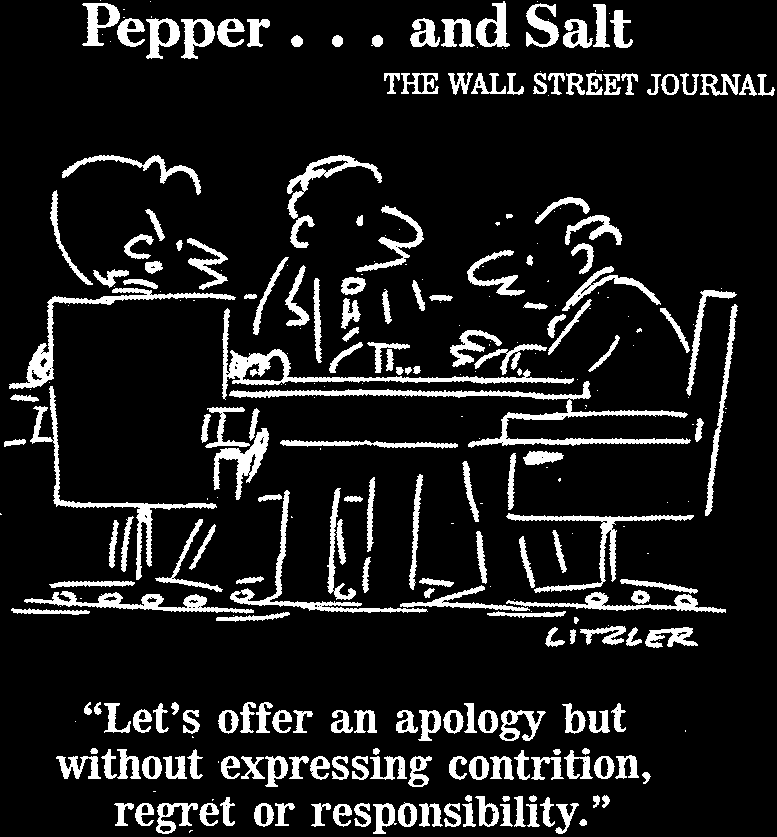

> **Descripción de la imagen** — Es una ilustración en blanco y negro de estilo dibujo lineal que representa una escena interior con tres figuras sentadas alrededor de una mesa.
>
> La composición muestra a tres personas (aparentemente hombres) sentadas frente a una mesa rectangular. A la izquierda de la mesa hay un mueble alto o escritorio. Las tres figuras están interactuando en el centro, mirando hacia el área de la mesa. El estilo es simple y esquemático, típico de una ilustración periodística o editorial.

• Los negociadores que representan intereses ajenos en lugar de los propios tienden a
comportarse de manera menos confi ada (son menos confi ables) y a esperar que la otra
parte sea confi ada. Como resultado de ser menos confi ables, los negociadores participan
menos en el proceso de dar y recibir con la otra parte y esperan que la otra parte dé y
reciba menos.36

Reparación de la confi anza El resumen anterior de las investigaciones indica con clari-
dad que la confi anza mejora los procesos de negociación, genera procesos de negociación
más integradores y, a menudo, mejores resultados; asimismo, que la desconfi anza obstacu-
liza los procesos de negociación, genera negociaciones más distributivas y suele disminuir
los resultados positivos. Como la confi anza, los procesos y los resultados positivos de una
negociación parecen tan importantes, debemos comentar modos de reparar la confi anza
dañada para orientar las negociaciones en una dirección más productiva.

Varios estudios abordan las formas de reparar la confi anza.37 Un estudio representativo
mostró lo siguiente:

• Cuanto más grave sea la ruptura de la confi anza (mientras más altos sean los costos para
la otra parte), más difícil será reparar la confi anza y reconciliar la relación.
• Es más fácil reparar la confi anza cuando las partes tienen una buena relación que una
defi ciente.
• Cuanto más pronto se ofrece una disculpa después de la ruptura de la confi anza, es más
probable que la disculpa sea efi caz.

36  Song, 2004.
37  Véanse Bottom, Gibson, Daniels y Murnighan, 2002; Kim, Dirks, Cooper y Ferrin, 2006; Schweitzer, Hers-
hey y Bradlow, 2006; Tomlinson, Dineen y Lewicki, 2004.
### Pimienta... y sal

“Ofrezcamos una disculpa, pero

sin expresar arrepentimiento

ni responsabilidad.”

THE WALL STREET JOURNAL

De The Wall Street Journal. Reproducido con autorización de Cartoon Features Syndicate.

---

<!-- página 239 -->

Capítulo 9 Las relaciones en una negociación
222

• Cuanto más sincera sea una disculpa, más efi caz será para reparar la confi anza.
• Las disculpas en las que el actor acepta la responsabilidad personal de crear una ruptura
son más efi caces que aquellas en las que el actor culpa a factores externos por la rup-
tura. Las disculpas son todavía más efi caces cuando el actor acepta la responsabilidad
personal y se perciben sinceras.
• Las disculpas son más efi caces cuando la ruptura de la confi anza parece aislada en vez
de algo habitual y repetitivo para la otra parte.38

Estudios recientes comprobaron que después de un periodo de desconfi anza es más proba-
ble que se repare la confi anza si el abuso no ocurrió junto con un engaño. El engaño parece
dañar la confi anza mucho más que las acciones poco confi ables, por lo que es mucho más
difícil reparar la confi anza si se acompañó de un engaño.39

Justicia

El tercer problema importante en las relaciones es la cuestión de lo justo. La justicia es un
problema importante en las ciencias organizacionales; los empleados en las empresas sue-
len debatir si el pago es justo, si se les trata con justicia o si la organización trata de manera
injusta a un grupo de personas (p. ej., mujeres, minorías o personas de otras culturas).

La justicia adopta varias formas:40

• La justicia distributiva aborda la distribución de los resultados. A las partes les preocu-
pa que una parte reciba más de lo que merece, que los resultados se distribuyan equi-
tativamente o con base en las necesidades.41 Un estudio mostró que la justicia de los
resultados suele determinarse en una negociación distributiva como el punto medio
entre la posición inicial de las dos partes (lo cual se conoce como “dividir la diferen-
cia”; véase el capítulo 2). La presencia de un punto de acuerdo obvio parece aumentar
el otorgamiento de concesiones y la probabilidad de una conciliación.42
• La justicia de procedimiento se refi ere al proceso de determinar los resultados. A las
partes les preocupa no recibir un trato justo durante la negociación, no tener oportu-
nidad de ofrecer su punto de vista u opinión de la situación o que no se les trate con
respeto. Como la negociación es un entorno en el que las partes tienen la oportunidad
de moldear el resultado que obtienen, la justicia de procedimiento por lo general es alta
en la mayoría de las negociaciones. Es más probable que surjan dudas acerca de la jus-
ticia de procedimiento cuando los negociadores juzgan los comportamientos de terceras
partes: considerar a la tercera parte neutral y confi able, aceptar sus decisiones y, en
caso de autoridades formales como la policía, aceptar voluntariamente sus decisiones y
directrices.43

38  Tomlinson, Dineen y Lewicki, 2004.
39  Schweitzer, Hershey y Bradlow, 2006.
40  Véanse en Sheppard, Lewicki y Minton, 1992, y Greenberg y Colquitt, 2005, una revisión de los problemas
de justicia en las organizaciones; y en Albin, 1993, un comentario sobre el papel de la justicia en una nego-
ciación.
41  Deutsch, 1985; véase también Loewenstein, Thompson y Bazerman, 1989.
42  Benton y Druckman, 1974.
43  Tyler y Blader, 2004.

---

<!-- página 240 -->

223
Elementos importantes al administrar las negociaciones dentro de las relaciones

• La justicia de interacción se refi ere al modo en que las partes se tratan entre sí en una
relación personal. La investigación comprobó que se guardan expectativas altas acerca
de la forma como debe conducirse la otra parte; cuando se violan estos estándares, las
partes se sienten tratadas de manera injusta. Cuando la otra parte engaña, no es sincera
y amigable, se comporta con groserías, formula preguntas inadecuadas, expresa comen-
tarios prejuiciados y discriminatorios, o toma decisiones o realiza acciones precipitadas
sin justifi cación, los negociadores sienten que se violan sus estándares de justicia.44
• Por último, la justicia sistémica aborda el modo en que las organizaciones parecen tratar
a los grupos de personas y las normas establecidas sobre su tratamiento. Cuando se dis-
crimina, priva de sus derechos o de manera sistemática otorga sueldos más bajos o condi-
ciones laborales defi cientes a grupos determinados, las partes se preocupan menos por los
elementos procedurales específi cos y más porque el sistema general no tenga prejuicios
ni un trato discriminatorio para ciertos grupos y sus intereses.

El problema de la justicia comienza a recibir cierta investigación sistemática en la
dinámica de una negociación. Se llegó a las conclusiones siguientes:

• La participación en el proceso de moldear una estrategia de negociación aumenta el
compromiso con esa estrategia y la disposición para seguirla. Éste es el conocido efecto
de la “justicia de procedimiento”, conforme al cual las partes involucradas en el proceso
de moldear una decisión se comprometen más con esa decisión. Los negociadores que
contribuyeron a una estrategia de negociación colectiva se comprometieron más con
ella y con las metas de negociación del grupo.45

• Los negociadores (compradores en una transacción mercantil) a quienes se les alienta
(“alecciona”) a pensar en la justicia son más cooperadores en las negociaciones distri-
butivas. Hacen concesiones mayores, actúan con más justicia y alcanzan acuerdos más
rápido, además de manifestar actitudes positivas más intensas hacia la otra parte. A
cambio, también exigen de la otra parte un trato justo. Sin embargo, cuando la otra parte
no corresponde a la conducta cooperadora del negociador, el negociador se desquita de
manera activa y castiga la conducta competitiva de la otra parte. Por tanto, mencionar la
intención de ser justo y alentar a la otra parte a hacer lo mismo es un excelente modo de
apoyar el intercambio de justicia; pero tenga cuidado con un negociador cuyos gestos
de justicia tengan dobles intenciones.46
• Asimismo, las partes que reciben ofertas que consideren injustas pueden rechazarlas
por completo, incluso cuando la cantidad ofrecida sea mejor que la alternativa, la cual
signifi que no recibir nada en absoluto. Aquí vemos en acción lo intangible en una nego-
ciación. Los economistas predecirían la aceptación de cualquier acuerdo mejor que cero
(si la única alternativa es cero), pero la investigación demuestra que los negociadores
rechazan estas ofertas pequeñas. Es evidente que una oferta pequeña o injusta crea sen-
timientos de ira y orgullo herido, y los negociadores suelen mostrar rencor y cancelar
todo el acuerdo en vez de aceptar una conciliación simbólica.47

44  Bies y Moag, 1986.
45  Jones y Worchel, 1992.
46  Maxwell, Nye y Maxwell, 1999, 2003.
47  Pillutla y Murnighan, 1996.

---

<!-- página 241 -->

Capítulo 9 Las relaciones en una negociación
224

• El establecimiento de un estándar de justicia objetivo tiene un impacto positivo en las
negociaciones y contribuye a obtener resultados satisfactorios. En el capítulo 3 analiza-
mos la función de establecer un “estándar objetivo” de justicia.48 Entre los estudiantes
que participaron en una simulación de una adquisición corporativa, los compradores que
sabían cuál sería un precio justo de venta para la empresa estuvieron más satisfechos con
los precios de venta ofrecidos, más dispuestos a comprar y más dispuestos también a ha-
cer negocios con la otra parte en el futuro. Además, el conocimiento de la MAPAN de un
oponente, así como la información respecto de los precios estimados del mercado para el
objeto negociado, determinan poderosamente la percepción de justicia del negociador.49
• Las opiniones acerca de la justicia están sujetas al tipo de prejuicio cognoscitivo ya
descrito. Por ejemplo, casi todos los negociadores tienden a ser egocéntricos, que es la
tendencia a considerar justa una participación mayor para sí mismos aunque la regla de
justicia obvia sea una división equitativa. Investigaciones recientes demuestran que esta
tendencia egocéntrica disminuye mediante una interacción con mucha justicia; es decir,
reconocer la necesidad de tratar con justicia a la otra persona y en realidad darle ese
trato reduce la tendencia egocéntrica, permite una división equitativa de los recursos,
acuerdos más rápidos y menos callejones sin salida.50
• No es de sorprender que las tendencias egocéntricas varíen entre las culturas. Al menos
un estudio demostró que las tendencias egocéntricas son más intensas en las culturas
individualistas (p. ej., Estados Unidos), donde se atiende el yo al concentrarse en los
atributos positivos propios para destacar y ser mejor que los demás, en comparación con
las culturas más colectivistas (p. ej., Japón), donde el yo se nutre al concentrarse en las
características negativas propias para mezclarse con los demás.51

Por la penetración de las preocupaciones acerca de la justicia: cómo consideran las par-
tes la distribución de los resultados, cómo consideran el proceso para llegar a esa decisión
y cómo se tratan entre sí, es notable que no haya más investigaciones que aborden explí-
citamente los temas de justicia en contextos de negociación. Por ejemplo, también surgen
problemas de justicia cuando las personas negocian al interior de sus organizaciones, como
cuando se crea un conjunto único y especializado de deberes y responsabilidades para un
puesto. Estos “acuerdos idiosincrásicos” deben controlarse con efi cacia para conservarse
sin alterar la sensación de justicia de los demás acerca del trato equitativo (véase el cuadro
9.4). Y tal vez no siempre sean tan justos como parecían al principio. Se puede esperar que
los intercambios negociados se consideren justos en cuanto al procedimiento o porque las
partes toman la decisión en conjunto, conocen los términos con anticipación, aprueban el
proceso y toman decisiones obligatorias. No obstante, al menos un estudio reveló que des-
pués de alcanzar tales acuerdos, los negociadores perciben a sus contrapartes como menos
justas y están menos dispuestos a participar en intercambios futuros con ellas. Por tanto, en
vez de hacer las cosas más justas, los intercambios negociados suelen servir para destacar
el confl icto entre actores ciegos a sus propios prejuicios e inclinados a ver de manera des-
favorable los motivos y las características de la otra parte.52

48  Fisher, Ury y Patton, 1991.
49  Buelens y Van Poucke, 2004.
50  Leung, Tong y Ho, 2004.
51  Gelfand et al., 2002.
52  Molm, Takahashi y Peterson, 2003.

---

<!-- página 242 -->

Joe y Sue Carter
225

225

Relaciones entre reputación, confi anza y justicia

Las diversas formas de justicia no sólo se relacionan entre sí, sino que la interacción
entre reputación, confi anza y justicia moldea las expectativas de la conducta de la otra
parte. Por ejemplo, cuando una parte siente que la otra actuó con justicia en el pasado o

La profesora Denise Rousseau, de la Carne-
gie Mellon University, ha estudiado mucho
la naturaleza cambiante de las relaciones de
empleo y los “contratos psicológicos” entre
trabajadores y patrones. En un artículo re-
ciente analizó el “acuerdo idiosincrásico”: las
maneras únicas en que los patrones llegan a
tratar a ciertos empleados en comparación con
otros de la misma ofi cina o ambiente. Ahora
se negocian muchos acuerdos idiosincrásicos
en el lugar de trabajo (p. ej., salidas para estu-
diar, horarios fl exibles, trabajar en casa o de-
dicarse a un proyecto propio o voluntario en
horas laborables). Si bien los acuerdos idio-
sincrásicos alguna vez estuvieron disponibles
sólo para los trabajadores con más antigüedad
o actividades más discrecionales, Rousseau
observa que los acuerdos idiosincrásicos son
mucho más comunes en la actualidad y no se
reservan para unos cuantos. Por tanto, si bien
los acuerdos idiosincrásicos son una nueva
fuente de fl exibilidad e innovación en el lugar
de trabajo, también plantean preocupaciones
importantes acerca del trato justo y uniforme
de las clases de empleados. Las siguientes son
algunas observaciones acerca de los acuerdos
idiosincrásicos:

1.
Son más comunes cuando los trabajadores:

• Tienen alto valor en el mercado (p. ej.,
tienen una buena MAPAN en la bolsa
de trabajo).
• Están dispuestos a negociar.
• Tienen un alto conocimiento del mer-
cado y la empresa.
• Trabajan en empresas pequeñas o que
inician.

• Trabajan en empresas más orientadas
al conocimiento (se especializan en in-
formación o en servicios y no en pro-
ductos específi cos).

2.  Son más comunes en ciertos países, co-
mo Estados Unidos, Reino Unido y Nue-
va Zelanda.
3.  Es más probable que los acuerdos idiosin-
crásicos funcionen con efi cacia cuando:

• Existe una relación muy buena entre
el trabajador y el administrador.
• Las responsabilidades y los requeri-
mientos de la función se comprenden
y aceptan bien.
• Los criterios de desempeño son claros
y están bien especifi cados.
• Los trabajadores confían en el proceso
de evaluación del desempeño.
• Los compañeros de trabajo también
entienden los criterios de desempeño.
• Los compañeros de trabajo mantienen
relaciones de apoyo mutuo.
• Los compañeros de trabajo confían en
el administrador.
• La fl exibilidad es limitada, se exponen
las razones legítimas y son claras. Ta-
les acuerdos se consideran una fuente
de innovación que otras personas pue-
den compartir y adoptar en la empresa.

Fuente: D. Rousseau, “The Idiosyncratic Deal: Flexibili-
ty vs. Fairness?”, Organizational Dynamics 29, núm. 4,
2001, pp. 260-273.
## CUADRO
### El acuerdo idiosincrásico.
### Flexibilidad o justicia
## 9.4

---

<!-- página 243 -->

Capítulo 9 Las relaciones en una negociación
226

lo hará en el futuro, es más probable que confíe en ella.53 También predecimos que actuar
de manera justa hace que confíen en uno y también fomenta una reputación positiva. Por
el contrario, cuando las partes se tratan de manera injusta, suelen enojarse y desquitarse
con la injusticia misma o con quienes creen que la provocaron. Es probable que un trato
injusto genere desconfi anza y una mala reputación.54 La confi anza, la justicia y la repu-
tación son fundamentales para las negociaciones en una relación y se alimentan entre sí;
no podemos comprender una negociación dentro de relaciones complejas sin considerar
de manera destacada la forma en que juzgamos a la otra parte (y a nosotros mismos) en
estas dimensiones.

Reparación de una relación

Hay muchos pasos para reparar una relación. Tratar de superar una mala reputación o res-
tablecer la confi anza o la justicia en una relación son acciones más fáciles de decir que de
llevar a la práctica. Fisher y Ertel sugieren los siguientes pasos como diagnóstico cuando
se comienza a trabajar para mejorar una relación:

1.
¿Qué pudo causar el malentendido actual y qué hago para comprenderlo mejor? Si la
relación está en difi cultades, ¿qué produce las difi cultades y cómo obtengo informa-
ción o perspectiva para mejorar la situación?
2.
¿Qué pudo causar la falta de confi anza y qué hago para comenzar a recuperarla? La
reparación de la confi anza es un proceso prolongado y lento. Requiere explicaciones
adecuadas de la conducta, disculpas y, tal vez, compensaciones (véase el cuadro 9.5).
3.
¿Qué provoca que uno o ambos nos sintamos coaccionados y qué hago para con-
centrarnos en el convencimiento y no en la coerción? ¿Cómo desechamos la presión
mutua para darnos la libertad de comentar lo ocurrido y lo necesario para repararlo?
4.
¿Qué hace que uno o ambos sintamos que nos faltamos al respeto y qué hago para
mostrar aceptación y respeto? ¿Cómo comenzamos a apreciar las contribuciones de
cada uno y las cosas positivas que hemos hecho juntos en el pasado? ¿Cómo restable-
cer el respeto y el valor de las contribuciones mutuas?
5.
¿Qué hace que uno o ambos nos sintamos molestos y qué hago para equilibrar la
emoción y la razón? ¿Cómo expongo las emociones enterradas que generaron enojo,
frustración, rechazo y decepción? ¿Cómo podemos verbalizar con efi cacia estas emo-
ciones, o comprender sus causas, para dejarlas atrás?55

Éstas son preguntas importantes. Si el problema de la relación no es importante o duradero,
las partes pueden solucionarlo solas. Si el problema ha persistido algún tiempo o la sepa-
ración crea costos elevados para una o ambas partes, es probable que tengan que intervenir
terceros.

53  Lewicki, Wiethoff y Tomlinson, 2005.
54  Véanse Greenberg, 1990; Sheppard, Lewicki y Minton, 1992, y Skarlicki y Folger, 1997.
55  Fisher y Ertel, 1995.

---

<!-- página 244 -->

Joe y Sue Carter
227

El 14 de febrero de 2007 (día de San Valen-
tín en Estados Unidos), la aerolínea JetBlue
atravesó por una crisis importante. Cinco cen-
tímetros de nieve y hielo en el aeropuerto JFK
de Nueva York causaron mil cancelaciones de
vuelos, retrasos masivos y pasajeros atrapados
en los aviones por hasta nueve horas. El suce-
so recibió una atención masiva de los medios,
y JetBlue tardó casi una semana en reanudar
sus operaciones normales. Aunque otras aero-
líneas también sufrieron interrupciones en sus
servicios debido a la tormenta, JetBlue recibió
la mayor atención por la falla, sobre todo por-
que en sus siete años de historia había inspi-
rado expectativas más altas de buen trato por
parte de sus clientes fi eles.

El fundador y director ejecutivo de Jet-
Blue, David Neeleman, se enfrentó al reto de
reparar la confi anza pública de forma que for-
taleciera la fuerte identidad de marca que había
creado la compañía. En la semana siguiente a
la crisis apareció en todos y cada uno de los
noticiarios locales y nacionales. Aceptó la res-
ponsabilidad de haber tomado malas decisio-
nes y por los problemas organizacionales. Se

disculpó una y otra vez, prometió reembolsos
a los pasajeros afectados y se comprometió a
arreglar los problemas que generó el desastre.
También presentó una “declaración de dere-
chos” del cliente. Dos semanas después del
deshielo, 43% de una muestra de personas
que visitó el sitio web de JetBlue afi rmó que
la aerolínea aún era su preferida.

En una época en que la mayoría de las
aerolíneas cuenta con muy poca confi anza por
parte de sus clientes, el exitoso manejo de la
crisis de Neeleman se destaca como ejemplo
de creación de identidad confi able de marca,
y de ser capaz de sostenerla en momentos de
crisis. Bruce Blythe, director ejecutivo de Cri-
sis Management International, lo resume muy
bien: “Lo único más importante que una com-
pañía necesita mostrar en una crisis es que se
preocupa. No es un sentimiento. Es un com-
portamiento.”

Fuente: C. Salter, “Lessons from the Tarmac”, Fast Com-
pany, mayo de 2007, pp. 31-32.
## CUADRO
### Las disculpas de JetBlue
## 9.5

En este capítulo exploramos el modo en que las
relaciones existentes moldean una negociación.
Gran parte de la teoría y las investigaciones sobre
negociaciones se basa en ambientes de investiga-
ción experimentales que constan de sólo dos partes
negociadoras desconocidas entre sí, que no esperan
tratar una con la otra en el futuro y participan en
una transacción comercial sobre precio y cantidad.
No obstante, muchas negociaciones profesionales
en asuntos de negocios, legales, gubernamentales,
comunitarios e internacionales ocurren en un con-
texto donde las partes tienen una relación pasada
(y futura) y su relación afecta mucho el proceso de
negociación.

Además, no podemos suponer que los nego-
ciadores participan sólo en transacciones de su

mercado cercano donde se intercambian honora-
rios por bienes y servicios. Muchas negociaciones
se interesan en el modo de colaborar (y convivir)
de manera más efi caz con el tiempo, cómo coordi-
nar acciones y compartir responsabilidades o cómo
administrar los problemas que surgen en una rela-
ción. En este capítulo evaluamos el estado de las
investigaciones sobre las negociaciones —la cual
se concentra casi exclusivamente en las relaciones
de intercambio en el mercado— y lo evaluamos
respecto de los diversos tipos de relaciones, sobre
todo las relaciones donde se comparten cosas co-
munes y se califi ca la autoridad. En las relaciones
observamos que las partes cambian mucho su en-
foque y no sólo se centran en el precio y en el in-
tercambio, sino que también atienden el futuro de
## Resumen del capítulo

---

<!-- página 245 -->

la relación, lo cual abarca el nivel de confi anza y
cuestiones de justicia entre las partes, así como el
desarrollo de reputaciones positivas y sólidas. Ex-
plicamos que casi todas las negociaciones se dan
dentro de estos contextos, y que el trabajo futuro
debe atender sus complejidades únicas.

En el capítulo 10 analizaremos otro aspecto de
las negociaciones que tiene que ver con las relacio-
nes: cómo cambian las cosas cuando los negocia-
dores representan intereses ajenos y no los propios,
y cuándo más de dos partes participan de manera
activa en un proceso de negociación.
### 228
Capítulo 9 Las relaciones en una negociación

---

<!-- página 246 -->
## CAPÍTULO
## Múltiples partes y equipos
## 10
### Objetivos

1.
Comprender las formas en que las negociaciones se complican cuando hay más de dos
partes en la mesa de negociación.
2.
Describir los elementos clave de un grupo efi ciente aplicados a los procesos de nego-
ciación grupal.
3.
Defi nir las principales etapas en el manejo de negociaciones efectivas cuando existen
más de dos partes.

El propósito de este capítulo es comprender cómo cambia el proceso de negociación cuan-
do hay más de dos partes en la mesa al mismo tiempo. Casi todo lo que abordamos en los
capítulos anteriores supuso una situación de negociación “uno a uno”. En este capítulo
examinamos la forma en que cambia la dinámica cuando grupos, equipos y fuerzas de
tarea tienen que presentar opiniones individuales y llegar a un acuerdo colectivo sobre un
problema, plan o curso de acción futuro.

Naturaleza de las negociaciones con varias partes

Defi nimos una negociación con varias partes como aquella en la que colaboran más de dos
partes para lograr un objetivo colectivo. Piense en el ejemplo siguiente sobre la naturaleza
de una negociación con varias partes. Un grupo de cuatro estudiantes vende un estéreo.
Colocan avisos en las áreas de dormitorios y comedores. Hace un año, cada uno aportó 200
dólares para comprar el sistema; ahora tienen preferencias diferentes sobre lo que deben
hacer con él. Aarón (A) quiere venderlo y dividir el dinero porque desea adquirir una bici-
cleta nueva; Bill (B) quiere venderlo y comprar un estéreo más reciente y más económico;
Chuck (C) quiere venderlo y comprar un sistema de alta calidad que requeriría que cada
uno aportara mucho más dinero, y Dan (D) no quiere venderlo y cree que todo es una idea
tonta. Cada parte tiene preferencias y prioridades propias y los compañeros de habitación
deben decidir en conjunto si venden el sistema y cuándo hacerlo. Pueden decidir en conjun-
to qué hacer, organizarse en grupos secundarios para juntar su dinero o cada quien apoyar
su propia idea. Cuando las partes se reúnan para analizar las opciones y tomar una decisión
colectiva, será una negociación con varias partes que implica dinámicas singulares en un
proceso colectivo de toma de decisiones.

---

<!-- página 247 -->

Capítulo 10 Múltiples partes y equipos
230

En la fi gura 10.1 se representa el modelo general de una negociación con varias partes.
Cada parte (puede haber tres o más) representa sus propios intereses. En una situación dife-
rente (por ejemplo, integrantes de varios departamentos de una corporación que se reúnen
como equipo para un proyecto) pueden representar los intereses de otros (véase la fi gura
10.2). Casi todas las complejidades descritas en esta sección aumentarán de manera lineal,
si no exponencial, conforme se incorporen más partes, poderdantes y público.

En este capítulo observaremos los factores que hacen que sea más difícil controlar las
negociaciones con varias partes que las negociaciones uno a uno. Comentaremos algunas
etapas y fases importantes de las deliberaciones con varias partes. Por cada fase consi-
deraremos diversas estrategias útiles para administrar con efi cacia las negociaciones con
varias partes. Mostraremos cómo se complican las negociaciones con varias partes y corren
el riesgo de interrumpirse, y para administrarlas con efi cacia se requiere un compromiso
consciente de las partes y un facilitador mientras avanzan hacia un acuerdo efi caz.1

Diferencias entre negociaciones con dos partes y con varias partes

Las negociaciones con varias partes difi eren de las deliberaciones con dos partes de mane-
ra importante. En todos los casos, las diferencias hacen que las negociaciones con varias
partes sean más complejas, desafi antes y difíciles de moderar.

1  Este capítulo se basa en buena medida en la obra de Bazerman, Mannix y Thompson, 1988; Brett, 1991, y
Kramer, 1991, quienes aportaron panoramas sólidos de los problemas y retos de una negociación con varias
partes.

A

B

D

C

FIGURA 10.1 Negociación con varias partes.

---

<!-- página 248 -->

231
Naturaleza de las negociaciones con varias partes

Cantidad de partes La primera diferencia es la más obvia: las negociaciones con varias
partes tienen más negociadores en la mesa, por lo que sencillamente son más grandes. Esto
crea desafíos para administrar varias perspectivas y asegurar que cada parte tenga un tiem-
po conveniente para hablar y ser escuchada. Cada parte puede actuar como principal, es
decir, que representa sus propios intereses (fi gura 10.1), o como agente, donde representa
los intereses de al menos otra parte (poderdante) (fi gura 10.2). Además, las partes pueden
tener diferentes funciones sociales fuera de la negociación (p. ej., presidente, vicepresiden-
te, director, presidente de la junta directiva), lo cual origina niveles de poder y posiciones
iguales o desiguales en la negociación (véase el capítulo 7). Si todas las partes son iguales
(p. ej., todos son vicepresidentes), el intercambio en la negociación debe ser más abierto
que cuando una parte tiene una posición más elevada o más poder que las demás.

Complejidad informativa y computacional Una segunda diferencia en las negociacio-
nes con varias partes es que se presentan más problemas, más perspectivas sobre los pro-
blemas y más información en total (hechos, cifras, puntos de vista, argumentos, apoyo
documental): “Una de las consecuencias más fundamentales de aumentar la cantidad de

A

B

D

C

FIGURA 10.2 Negociación con varias partes y poderdantes.

---

<!-- página 249 -->

Capítulo 10 Múltiples partes y equipos
232

partes es que la situación de negociación tiende a volverse menos lúcida, más compleja
y por ende, en algunos aspectos, más exigente. Conforme aumenta el tamaño, habrá más
valores, intereses y percepciones por integrar o acomodar.”2 Registrar toda esta informa-
ción, las perspectivas de cada parte y los parámetros dentro de los cuales debe entrar una
solución se vuelve un desafío importante para los negociadores.

Complejidad social Una tercera diferencia es que cuando aumenta el número de par-
tes, el ambiente social pasa de un diálogo personal a una discusión en un grupo pequeño.
Como resultado, todas las dinámicas de los grupos pequeños comienzan a afectar el modo
en que se comportan los negociadores. Primero, la evolución del proceso depende de la
orientación motivacional de las partes entre sí. Es mucho más probable que las partes con
una orientación motivacional cooperadora (comparada con una individualista) obtengan
un resultado de mayor calidad en sus deliberaciones, y que las partes con una motivación
cooperadora confíen más y discutan menos que las individualistas.3 Esta orientación tam-
bién parece afectar el modo en que las partes analizan los problemas (veremos esto más
adelante).

En segundo lugar, pueden surgir presiones sociales para que el grupo actúe con co-
hesión, y quizá los integrantes estén en confl icto entre sí y no obtengan cohesión a menos
que encuentren una solución aceptable. Los integrantes se comparan y evalúan entre sí,
y aplican diversas tácticas de infl uencia para imponer sus puntos de vista a los demás.
Crecen las presiones internas conforme los integrantes presionan a los demás para adoptar
una perspectiva común, defi nir el problema o respaldar una solución específi ca. Además,
el grupo puede desarrollar una dinámica disfuncional. Fiascos como la invasión estadouni-
dense a la Bahía de Cochinos en Cuba durante el régimen de Kennedy o la decisión de la
NASA para lanzar el transbordador espacial Challenger fueron producto de la dinámica de
grupos que toman decisiones importantes en los cuales algunos integrantes dudan por la
posibilidad de crear confl ictos y no expresan sus reservas reales acerca de continuar con el
proyecto. Estas vacilaciones generan una ilusión de consenso, en la cual cada parte creía
que era el único integrante que disentía en un acuerdo muy fi rme sobre las acciones por
emprender. Temerosos de expresar su resentimiento por temor a parecer débiles y tontos
(observe la dinámica de cuidar su reputación), los integrantes de un grupo se guardan sus
reservas y preocupaciones, con lo cual refuerzan el aparente consenso superfi cial y se to-
man decisiones con consecuencias desastrosas.4

Complejidad de los procedimientos Una cuarta manera en la cual las negociaciones
con varias partes son más difíciles que las de dos partes es que es más complicado el pro-
ceso que deben seguir. En las negociaciones uno a uno, las partes tan sólo se turnan para
presentar sus problemas y perspectivas, poner a prueba las perspectivas de la otra o hacer
que la negociación avance de sus etapas iniciales a las fi nales. Cuando participan más par-
tes, las reglas de procedimientos se desdibujan. ¿A quién le corresponde hacer qué?, ¿cómo
se coordinan las partes cuando están en las negociaciones (por ejemplo, declaraciones ini-
ciales, presentación de puntos de vista, avance hacia un acuerdo)? De esta complejidad de

2  Midgaard y Underal, 1977, p. 332, cit. en Kramer, 1991.
3  Weingart, Bennett y Brett, 1993.
4  Tompkins, 1993.

---

<!-- página 250 -->

233
Naturaleza de las negociaciones con varias partes

procedimientos surgen varias consecuencias. Primero, las negociaciones se prolongan,5 de
modo que debe asignarse más tiempo. Segundo, cuanto mayor sea la cantidad de partes,
más complejo y descontrolado será el proceso, sobre todo si algunas partes adoptan una
estrategia de negociación posicional fi rme y dominan el proceso en un esfuerzo para diri-
girlo hacia sus puntos de vista particulares.6 Tercero, como resultado de los dos primeros
conceptos, es probable que los negociadores tengan que dedicar tiempo específi co para
discutir el control del proceso con el fi n de llegar al tipo de solución o acuerdo que quieren.
Por último, las partes deben decidir cómo abordar los diversos problemas que atienden.
Las partes que analizaron varios problemas al mismo tiempo —que consideraron todos los
problemas a la vez y buscaron soluciones intermedias entre ellos— lograron acuerdos de
mayor calidad y tuvieron más probabilidad de lograr un acuerdo en comparación con los
grupos que abordaron los problemas de manera secuencial (uno a la vez, en una secuencia
fi ja o negociada). Los grupos que abordaron los temas simultáneamente también intercam-
biaron más información y tuvieron una mejor noción de las preferencias y prioridades de
las otras partes.7

Complejidad estratégica Por último, las negociaciones con varias partes son estratégi-
camente más complejas que las negociaciones con dos partes. En las negociaciones uno
a uno, el negociador sólo necesita atender el comportamiento del otro negociador; por
tanto, la estrategia la dictan los objetivos del negociador, las acciones de la otra parte y las
prácticas de cada uno. En una negociación de grupo, aumenta mucho la complejidad. El
negociador debe considerar las estrategias de todas las partes y decidir si las maneja por
separado o en grupo. El proceso real de manejar cada una suele transformarse en una serie
de negociaciones uno a uno pero frente a todos los integrantes del grupo. Contemplada así,
esta serie de negociaciones uno a uno tiene varias consecuencias.

Primero, estos intercambios están sujetos al escrutinio del público. Los negociadores
reaccionan a la observación y pueden sentir la necesidad de mostrar su fi rmeza y resolución
(tanto a la otra parte como a los integrantes del público). Como resultado, el medio social
puede llevar a los negociadores a adoptar estrategias y tácticas distributivas —aunque no
sea su intención— sólo para mostrar su dureza y determinación a los demás. El resultado
de corto plazo es que los negociadores del grupo buscan posiciones fuertes a menos que
se realicen acciones específi cas para alejar al grupo de esta intensifi cación competitiva.
Una dinámica relacionada es que, una vez que las partes alcanzan posiciones fuertes, los
negociadores tienen que encontrar modos satisfactorios para explicar la modifi cación de sus
posiciones —hacer concesiones o buscar avenencias y consensos— a sus poderdantes sin
la dinámica de cuidar su reputación, ya analizada. Incluso sin los poderdantes, los negocia-
dores quieren cuidar su reputación frente a los otros negociadores. Esto es muy cierto en la
situación de la fi gura 10.2, cuando los negociadores tienen poderdantes.

Segundo, los negociadores que tienen algún modo de controlar la cantidad de partes en
la mesa (o incluso en la sala) pueden comenzar a actuar de manera estratégica y a utilizar
este control en función de sus objetivos. La práctica se determinará por los intereses estra-
tégicos buscados al incluir a otras partes. Se puede invitar a partes adicionales para agregar

5  Sebenius, 1983.
6  Bazerman, Mannix y Thompson, 1988.
7  Weingart, Bennett y Brett, 1993.

---

<!-- página 251 -->

Capítulo 10 Múltiples partes y equipos
234

apoyo o credibilidad a la posición del negociador, para aportar un testimonio o un apoyo
“independiente” a un punto de vista o sólo para hacer una demostración de fuerza. Por ejem-
plo, cuando las comunidades discuten acerca de construir un nuevo centro comercial o una
escuela, cambiar una ley de zonifi cación o presentar un nuevo paquete fi scal, es frecuente
que los agentes que públicamente hablan del problema convenzan al público con una gran
cantidad de seguidores que muestran su entusiasmo y apoyo (u oposición) a una posición.
Por tanto, de manera estratégica, los negociadores incluyen otras partes en la negociación
para destacar su poder mediante sus seguidores o para exponer alguna amenaza acerca de
las consecuencias si no prevalece su opinión.

Tercero, los negociadores explícitamente pueden provocar choques como un modo
para obtener apoyo. Las partes pueden aceptar de manera explícita o implícita apoyar po-
siciones mutuas para aumentar la fuerza colectiva de sus opiniones combinadas, y después
emplear esta coalición para dominar el proceso de negociación o moldear el acuerdo bus-
cado. Las coaliciones pueden formarse de manera explícita antes de las negociaciones o
durante los descansos de la negociación, o pueden surgir conforme avanza la discusión.
Los integrantes de las coaliciones ejercen su fuerza en una negociación con varias partes
de diversas maneras: al expresar solidaridad entre sí, al aceptar ayudar a otras partes para
que alcancen sus objetivos comunes e individuales, al dominar el tiempo de la discusión y
al aceptar apoyarse entre sí cuando surjan soluciones particulares y acuerdos negociados.
Un autor sugirió que la aparición de un consenso en los grupos que toman decisiones ocurre
como “coalición de tipo alud”. Las coaliciones se forman una parte tras otra. Por tanto, en
una discusión de grupos, mientras las partes comparten información y después deliberan
las soluciones posibles, surgen algunas personas con una perspectiva común y después, de
manera tácita o explícita, aceptan apoyar sus opiniones mutuas. Después, otras personas ne-
gocian con la coalición emergente para incorporar sus propias opiniones. Quienes no están
dispuestos a negociar o modifi car sus opiniones terminan por ser rechazados y descartados
de la decisión del grupo.8

El riesgo para quienes quedan fuera de una coalición infl uyente es que no participa-
rán de manera activa en las discusiones, pues algunas resoluciones pueden tomarse lejos
de la mesa principal de negociaciones. Los negociadores excluidos de una negociación
entre varias partes suelen participar menos en el resultado que quienes están presentes
todo el tiempo. Esto daña mucho a la parte excluida cuando se pierde la segunda mitad
de la discusión. La lección parece ser que es importante estar presente cuando ocurren
discusiones decisivas, sobre todo en las etapas fi nales, cuando las partes preparan un
acuerdo fi nal.9

Por último, las relaciones son la fuerza más importante al determinar qué partes for-
marán coaliciones en una negociación con varias partes. Cuando ocurre una relación, las
partes incorporan de manera importante la dimensión del tiempo en sus deliberaciones y en
las negociaciones secundarias que celebran. Así, lo que las partes hicieron una por otra en el
pasado, y/o lo que creen que pueden hacer una por otra en el futuro, tiene un gran impacto
en las discusiones en curso.10 Además, como señalamos en el capítulo 9, las relaciones ha-
cen que las partes tengan preferencias similares, se preocupen mucho por las otras partes,

8  Murnighan, 1986.
9  Kim, 1997.
10  Polzer, Mannix y Neale, 1995, 1998.

---

<!-- página 252 -->

235
Naturaleza de las negociaciones con varias partes

quieran ayudar a las otras partes a alcanzar sus resultados, y generen y mantengan mucha
confi anza entre los integrantes del grupo.

Resumen

Hay cinco modos en los cuales aumenta la complejidad cuando tres o más partes participan al
mismo tiempo en una negociación. Primero, sencillamente hay más partes involucradas en la
negociación, lo cual aumenta el número de oradores, incrementa la demanda de tiempo para
la discusión y crece la cantidad de funciones que cumplen las partes. Segundo, más partes lle-
van más problemas y posiciones a la mesa, por lo que se deben presentar y analizar más pers-
pectivas. Tercero, las negociaciones se vuelven socialmente más complejas; surgen normas
sociales que afectan la participación de los integrantes, y puede haber presiones más inten-
sas para coincidir y marginar los desacuerdos. Cuarto, los procedimientos de las negociacio-
nes se complican y las partes tienen que negociar un nuevo proceso que les permita coordinar
sus acciones con más efi cacia. Por último, las negociaciones se vuelven más complejas es-
tratégicamente porque las partes deben vigilar los movimientos y acciones de las otras partes
y determinar qué harán a continuación. Además, la posibilidad de coaliciones aumenta la
probabilidad de que las decisiones no se tomen por un consenso negociado al detalle, sino por
un grupo secundario que domine la discusión y los procesos de toma de decisiones.

¿Qué es un grupo efi caz?

Las negociaciones con varias partes se asemejan mucho a una toma de decisiones en grupo
porque implican un conjunto de partes que tratan de alcanzar una solución común en una
situación donde son distintas las preferencias de las partes. En consecuencia, comprender
una negociación con varias partes signifi ca, en parte, entender los atributos de un grupo
efi caz. Los grupos efi caces y sus integrantes hacen lo siguiente:

1. Ponen a prueba suposiciones e inferencias. En los grupos efi caces, cada integrante
aclara sus suposiciones e inferencias al expresarlas y revisarlas con los demás. Las
suposiciones y las inferencias no revisadas conducen a conclusiones infundadas.
2. Comparten tanta información relevante como sea posible. En una negociación com-
petitiva, es probable que las partes utilicen la información de manera estratégica; que
compartan muy poca con otras partes mientras intentan obtener información de las de-
más. Sin embargo, los grupos efi caces requieren que la información se comparta igual
que en una negociación integradora con el fi n de maximizar la información disponible
para que el grupo pueda encontrar soluciones que satisfagan el interés de todas las
partes. Así, las partes deben discutir sus intereses, pero no revelar su punto de escape
o su MAPAN.
3. Se concentran en los intereses, no en las posiciones. Como en una negociación integrado-
ra, las deliberaciones del grupo deben emplear procedimientos que expongan los intereses
implícitos de los integrantes individuales, y no sólo sus posiciones declaradas: compar-
tir información, formular preguntas y sondear las necesidades o intereses implícitos.
4. Explican las razones de las propias declaraciones, preguntas y respuestas. Revelar los
intereses requiere ser claro con los demás acerca de lo más importante e indicar por
qué es relevante.

---

<!-- página 253 -->

Capítulo 10 Múltiples partes y equipos
236

5. Son específi cos; utilizan ejemplos. Las partes deben intentar hablar en términos es-
pecífi cos sobre conductas, personas, lugares y sucesos directamente observables. Las
generalidades generan confusiones o ambigüedades que descarrilan la solución de los
problemas.
6. Acuerdan el signifi cado de los términos importantes. Los participantes deben tener
cuidado en explicar y defi nir por completo las palabras importantes que se incorporan
en el acuerdo. Por ejemplo, si los integrantes del grupo aceptan que todas las decisio-
nes se tomarán por consenso, todos deben tener la misma defi nición de lo que cons-
tituye un “consenso” en el grupo: procedimientos de votación, apoyo general de casi
todos los integrantes o apoyo completo de 100% de los integrantes.
7. Disienten abiertamente con cualquier integrante del grupo. Si las partes no exponen
su desacuerdo, el confl icto se mantiene encubierto, lo cual al fi nal impide alcanzar un
consenso o instrumentar un plan que el grupo acepte. El desacuerdo puede ser produc-
tivo sin ser ofensivo.
8. Hacen afi rmaciones y luego aceptan preguntas y comentarios. La diversidad de pun-
tos de vista no debe reservarse para disentir con otra parte, sino también debe estar
abierta para las otras partes: alentar a los demás a aclarar su comprensión de los inte-
reses y necesidades de usted.
9. Diseñan juntos maneras para probar los desacuerdos y las soluciones. Desarrollan
un proceso para confi rmar hechos, verifi car interpretaciones de sucesos y exponer las
razones de los desacuerdos con el fi n de avanzar en la solución de un problema. Este
proceso se facilita por cualquiera que no participe directamente en el debate central.
Volveremos a esto más adelante en el capítulo.
10. Discuten los problemas indiscutibles. En los grupos hay problemas que se consideran
indiscutibles: los integrantes que no se desempeñan de acuerdo con lo esperado (que se
comportan mal) o que desafían a un jefe presente en la discusión. Poner estos problemas
sobre la mesa puede ser fundamental para que el grupo sea productivo. Un método es
analizar con franqueza el aspecto indiscutible de una norma, regla o problema importante
y mencionar las consecuencias implícitas de analizar ese tema abiertamente. Como señala
Schwartz: “si se puede asegurar a los miembros que sus temores no se concretarán, esta-
rán más dispuestos a hablar con franqueza sobre problemas antes innombrables” (p. 82).
11. Se concentran en la discusión. Los líderes del equipo deben asegurarse de que la
conversación se mantenga enfocada hasta que se haya escuchado a todos. Elaborar un
programa y contar con alguien que dirija el proceso asegura que se concentren en las
discusiones.
12. No aceptan comentarios de mal gusto o que distraigan al grupo. Las distracciones,
el sarcasmo, los relatos irrelevantes y los chistes son distracciones que alejan y des-
concentran al grupo. Si bien algunas de estas conductas son inevitables en los grupos
donde sus integrantes tienen lazos interpersonales positivos, los grupos efi caces man-
tienen esto al mínimo.
13. Esperan que todos los integrantes participen en todas las fases del proceso. Todos los
integrantes del grupo deben estar dispuestos a contribuir en todas las fases del proceso
del grupo, ya sea al compartir información relevante, ayudar a que el grupo llegue a
una solución o manejar el proceso.
14. Intercambian información pertinente con integrantes ajenos al grupo. Si se invita a
personas ajenas, como expertos o fuentes de información importantes, debe informár-

---

<!-- página 254 -->

237
Manejo de negociaciones con varias partes

seles por completo de las reglas de operación básicas del grupo, y se les debe pedir que
se apeguen a ellas.
15. Toman decisiones por consenso. Aunque no siempre es posible que los grupos tomen
decisiones unánimes, deben esforzarse por alcanzar un consenso cuando sea posible.
Más adelante en este capítulo volveremos a las reglas de discusión en grupo.
16. Realizan autocrítica. Por último, entre una y otra decisión o deliberación importante,
los grupos deben dedicar cierto tiempo a evaluar su proceso y efi cacia. Resulta para-
dójico que los grupos que no colaboran bien rara vez dedican tiempo a evaluar su pro-
ceso, tal vez porque el confl icto que creen que puede surgir por analizar la disfunción
parece más desafi ante que la disfunción misma. No es de sorprender que el hecho de
no analizar la disfunción suele hacer que ésta empeore.11

Manejo de negociaciones con varias partes

Con la complejidad adicional en una negociación con varias partes, ¿cuál es el modo más
efi caz para abordarla? Tres etapas fundamentales caracterizan las negociaciones con varias
partes: la etapa previa a la negociación, la negociación real y la administración del acuer-
do. Al abordar estas tres etapas, también identifi camos lo que puede hacer un negociador
cuando:

• La persona es sólo una parte en una negociación con varias partes y quiere asegurar que
sus problemas e intereses se incorporen con claridad en el acuerdo fi nal.
• La persona quiere asegurar que el grupo alcance el mejor acuerdo fi nal posible y la
mejor calidad.
• La persona es responsable de administrar un proceso de negociación con varias partes
para asegurar que se controlen con efi cacia muchas complejidades estratégicas y de
procedimientos.12

La etapa previa a la negociación

Esta etapa se caracteriza por mucho contacto informal entre las partes. Tienden a trabajar
en los aspectos siguientes:

Participantes Las partes deben acordar a quién se va a invitar a las pláticas. Si el grupo
ya está completo es una pregunta fácil. Sin embargo, muchas negociaciones internacio-
nales complejas dedican mucho tiempo a ver quién será reconocido y quién puede hablar
por los demás. Los problemas sobre los participantes se deciden con base en lo siguiente:

• ¿A quién debe incluirse si va a alcanzarse un acuerdo (los integrantes importantes de la
coalición)?
• ¿Quiénes pueden echar a perder el acuerdo si se les excluye (posibles participantes con
poder de veto)?
• ¿La presencia de quién es probable que ayude a las otras partes a alcanzar sus objetivos
(los integrantes deseables de una coalición)?

11  Schwartz, 1994.
12  Touval, 1988.

---

<!-- página 255 -->

Capítulo 10 Múltiples partes y equipos
### 238
### • ¿La presencia de quién es probable que evite que las otras partes alcancen sus objetivos
### (los bloqueadores importantes de una coalición)?
### • ¿La posición de quién mejorará con sólo estar en la mesa? (Éste fue con frecuencia
### un problema importante en las pláticas entre palestinos e israelíes en Medio Oriente y
### en las pláticas de paz de París para terminar la guerra de Vietnam, donde se invitó al
### Vietcong a la mesa como una parte completamente reconocida.)
### Coaliciones Es frecuente que haya coaliciones antes de comenzar las negociaciones o
### que se organicen antes de que se reúnan las partes. Es natural que se formen coaliciones
### para promover o bloquear una agenda específi ca.
### Defi nir los papeles de los integrante del grupo Si el grupo ya tiene una estructura, ya
### se habrán determinado los papeles: líderes, mediadores, quienes registran y demás. Pero
### si el grupo no se ha reunido antes, las partes comienzan a maniobrar por las funciones
### importantes. Algunas quieren dirigir, participar de manera activa y promover una agenda
### específi ca; otras pretenden guardar silencio y ser invisibles, y otras más buscan un papel de
### tercera parte, como mediadores o facilitadores. Los integrantes de un grupo pueden desem-
### peñar varias funciones en un grupo. La tabla 10.1 describe tres tipos de funciones que des-
### empeñan los integrantes: funciones de tareas, las cuales llevan al grupo hacia una decisión
### o conclusión; funciones de la relación, las cuales administran y mantienen las relaciones
### entre los integrantes del grupo, y las funciones orientadas a sí mismas, que sirven para
### llamar la atención sobre un integrante del grupo, lo cual suele socavar la efi cacia del grupo.

TABLA 10.1 Funciones que desempeñan los integrantes de un grupo

Funciones

de tareas

Funciones
de  la relación

Funciones orientadas

a  sí mismas

Iniciar/ofrecer: aportar ideas
nuevas.

Búsqueda de información:
pedir a los demás sus puntos
de vista.

Búsqueda de opiniones: pedir
a los demás sus opiniones y
juicios.

Pormenores/aclaraciones:
ahondar en el tema.

Evaluación: ofrecer juicios
sobre el tema.

Coordinación: extraer juntos
ideas planteadas por otras
partes.

Estimulación: crear emoción
en el tema que se analiza.

Aliento: apoyar los comenta-
rios y las contribuciones de
otras partes.

Armonización: desactivar
confl ictos, reforzar la integri-
dad del grupo.

Conciliación: cambiar la posi-
ción propia para encontrar un
término medio de opiniones
entre las personas.

Moderación: alentar la partici-
pación de quienes no hablan
a menudo, desalentar la parti-
cipación de quienes acaparan
el tiempo de exposición.

Establecimiento de estánda-
res: solicitar u ofrecer están-
dares para juzgar la efi cacia
del equipo.

Bloqueo: actuar de manera
negativa, disentir de manera
activa y frecuente de los
demás.

Búsqueda de reconocimiento:
atraer la atención del grupo
hacia sí mismo, buscar la
aprobación de los demás.

Dominio: hablar a menudo,
acaparar la conversación,
manipular al grupo hacia su
resultado preferido.

No participación: permanecer
callado y alejado, no partici-
par en las tareas o problemas
de una relación.

Fuente: Basado en K. D. Benne y P. Sheats, “Functional Roles of Group Members”, Journal of Social Issues 4,
1948, pp. 41-49.

---

<!-- página 256 -->

239
Manejo de negociaciones con varias partes

Comprender los costos y consecuencias de una falta de acuerdo Los negociadores
necesitan comprender los costos y las consecuencias de que el grupo no llegue a un acuer-
do. En este libro sugerimos eso a los negociadores en reuniones uno a uno, en el análi-
sis de una MAPAN (capítulos 2, 3 y 4). Por ejemplo, suponga que un grupo de vicepresi-
dentes de una compañía de computadoras intenta decidir qué modelos de una nueva línea de
computadoras personales deben construirse el año siguiente y las cantidades de cada uno.
Para que esta decisión sea efi caz, deben incluir en sus opciones de decisión una considera-
ción de lo que ocurrirá si no acuerdan qué hacer. ¿Otra persona (por ejemplo, el presidente)
se incorporará y decidirá por ellos? ¿Cómo considerará el presidente al grupo si los inte-
grantes no se ponen de acuerdo? ¿Los costos de llegar a un callejón sin salida son iguales
para todos los negociadores? Esto no suele ocurrir: los distintos agentes tienen costos dife-
rentes asociados a la falta de acuerdos. Por ejemplo, si los vicepresidentes no se ponen de
acuerdo, el presidente puede determinar el modelo y las cantidades, lo cual puede conllevar
costos mayores para los departamentos de ingeniería y fabricación (los cuales tendrían que
trabajar dos turnos) que para los departamentos de mercadotecnia y ventas (los cuales ten-
drían que diseñar una nueva campaña de mercadotecnia y promoción, sin tomar en cuenta
lo que se haga). Es probable que los integrantes con las mejores opciones tengan más poder
en la negociación porque les afecta menos que el grupo llegue a una solución específi -
ca en relación con la falta de acuerdo.13 Por último, ¿los integrantes del grupo perciben con
precisión sus opciones de acuerdo y de falta de acuerdo? Hay mucha evidencia de que los
negociadores tienen prejuicios de percepción que les hacen creer que son mejores que los de-
más (consulte el capítulo 5), que sus opciones son mejores que las de los demás, que es más
probable que obtengan su resultado que los demás, y que tienen más control para moldear
un resultado que los demás.14 En las negociaciones con varias partes, es probable que estos
prejuicios afecten a los negociadores al exagerar su sensación de poder y capacidad para
ganar, lo cual los hace creer que la opción de no lograr ningún acuerdo es mucho mejor de lo
que es en realidad. Es importante hacer una verifi cación de la realidad para mantener estos
prejuicios bajo control: ¿los miembros del grupo de verdad están dispuestos a vivir con los
posibles costos de no llegar a un acuerdo, y hasta qué punto está el grupo preparado para
afrontar esa posibilidad?

Conocer los problemas y elaborar un programa Por último, las partes dedican mucho
tiempo a familiarizarse con los problemas, absorber la información y tratar de comprender
los intereses de los demás. También dedican tiempo a elaborar un programa. Un programa
es una ayuda efi caz para tomar decisiones por muchas razones:

• Establece los problemas que se analizarán.
• Según el modo en que se expresen los problemas, también defi ne cuándo se analiza
cada problema (consulte nuestro análisis de la delimitación en el capítulo 5).
• Defi ne el orden en que se analizan los problemas.
• Sirve para presentar los problemas de un proceso (reglas de decisión, normas de discu-
sión, funciones de los integrantes, dinámica de la discusión) y los problemas principa-
les, tan sólo al incluirlos.

13  Brett, 1991.
14  Taylor y Brown, 1988; Tyler y Hastie, 1991.

---

<!-- página 257 -->

Capítulo 10 Múltiples partes y equipos
### 240
### • Asigna límites de tiempo a los diferentes conceptos, lo cual indica la importancia de los
### distintos problemas.
### Además de crear un programa, las partes también acuerdan apegarse a un conjunto
### de “reglas básicas”: las maneras para conducirse durante la negociación. El modelo de
### conexión es un método comprobado para desarrollar relaciones de equipo efi caces. La
### tabla 10.2 resume los cuatro requerimientos y pasos principales en este modelo de proce-
### samiento.15
### Etapa de la negociación formal. Administración
### del proceso y resultado del grupo
### Gran parte del proceso de negociación con varias partes es una combinación de las acti-
### vidades de discusión en un grupo, negociación bilateral y desarrollo de coaliciones, ya
### descritas en este capítulo. También incorpora mucho de lo que sabemos acerca de estruc-
### turar la discusión de un grupo para lograr un resultado efi caz con respaldo. Es probable
### que los métodos siguientes aseguren una decisión del grupo de gran calidad.
### Designar a un coordinador adecuado Las negociaciones con varias partes avanzan con
### más regularidad cuando es evidente para todos los participantes quién dirige o facilita el
### proceso. Esta función suele recaer en una de las partes interesadas, pero las negociaciones
### con varias partes se facilitan mucho con un coordinador neutral que aplique muchas de las

TABLA 10.2 Modelo de conexión y requerimientos para establecer una relación

Cuatro requerimientos
Modelo del proceso

1.  ¿Podemos acordar mante-
ner una conversación cons-
tructiva?

Comprometerse con la relación: señalar que usted está
preparado para trabajar en el problema y que vale la pena
hacerlo.
Optimizar la seguridad: hacer su mejor esfuerzo para que las
otras partes no se pongan a la defensiva y tratar de apreciar
el punto de vista de los demás.

2.  ¿Nuestra conversación pue-
de ser lo bastante producti-
va para que valga la pena?

Delimitar la discusión a un problema: identifi car un problema
a la vez de manera no intimidante.
Neutralizar las actitudes defensivas: limitar las palabras,
términos o descripciones que pongan a los demás a la de-
fensiva.

3.  ¿Comprendemos y aprecia-
mos la perspectiva de los
demás?

Explicar y repetir cada perspectiva: indicar a los demás lo que
usted observa, cómo lo hace sentir y las consecuencias de
largo plazo.

4.  ¿Podemos comprometernos
para alcanzar mejoramien-
tos?

Cambiar una conducta cada uno: acordar que cada uno de
ustedes cambie una conducta.
Dar seguimiento: determinar cómo vigilar el progreso.

Fuente: De F. M. S. LaFasto y C. Larson, When Teams Work Best, Thousand Oaks, California, Sage, 2001, p. 51.

15  LaFasto y Larson, 2001.

---

<!-- página 258 -->

241
Manejo de negociaciones con varias partes

prácticas descritas a continuación. Cuando sea factible, las partes deben considerar con se-
riedad la designación de un coordinador que tenga poco en juego en el resultado específi co,
pero un compromiso intenso por un proceso franco y justo. En este caso, el coordinador
funciona como una tercera parte que no apuesta por algún resultado específi co, sino que
tiene un interés defi nido en asegurar que el grupo colabore para alcanzar el mejor resultado
posible. De una manera práctica, suele ocurrir que el coordinador provenga del círculo de
partes interesadas. Recuerde que si un coordinador también defi ende una posición especí-
fi ca o resultado preferido, será más difícil que esa persona actúe con neutralidad, porque es
probable que la solución que busca para los problemas ponga en riesgo (o eso parezca) su
neutralidad u objetividad para facilitar el proceso. Consulte en el cuadro 10.1 un inventario
de métodos constructivos para desempeñarse como coordinador en las negociaciones con
varias partes.

Utilización y reestructuración del programa Un modo fundamental para controlar el fl u-
jo y la dirección de una negociación es mediante un programa, el cual presentan el coordi-
nador o las partes. Un programa agrega un alto grado de estructura, organización y coor-
dinación a una discusión. Los programas proporcionan a los grupos con poco poder o en
desventaja un vehículo para que se escuchen y atiendan sus problemas, siempre y cuando
se incluyan en el programa. Sin embargo, la manera en que se elabora un programa (por
consenso colectivo al inicio de una reunión o por una persona antes de la reunión) y quién
lo hace afecta mucho el fl ujo de la negociación. A menos que los integrantes del grupo se
sientan cómodos al cuestionar a quien presente un programa preparado con anticipación,
el programa no generará problemas y, por tanto, prevalecerán la estructura y el formato
que sugiere. Quienes entren en una negociación con varias partes para la cual se creó con
anticipación un programa (inaceptable) deben comunicar a tiempo a las otras partes que
consideran el programa mismo abierto a discusiones o cambios. En otras palabras deben
asegurar que se integren las posibles modifi caciones del programa.

Si bien un programa puede agregar la estructura necesaria a una negociación compleja,
una desventaja es que puede dividir de manera artifi cial los problemas relacionados; como
resultado, los problemas se analizan separados y no acoplados o en soluciones intermedias
para aprovechar las posibilidades integradoras. Las partes que empleen un programa deben
estar conscientes de la estructura que impone, y estar dispuestas a desafi arla y reconfi gurarla
si eso facilita la aparición de un acuerdo integrador basado en un consenso.

Compruebe la diversidad en la información y perspectivas Un tercer modo para fa-
cilitar la negociación es asegurar que el grupo reciba una amplia variedad de perspecti-
vas acerca de la tarea y de fuentes de información. Como la naturaleza de la información
cambia según la tarea del grupo: por ejemplo, diseñar e instrumentar un cambio, hallar la
mejor solución posible para un problema o tan sólo encontrar una solución políticamente
aceptable para varios poderdantes, es difícil determinar qué información es fundamental y
cómo asegurar que el grupo tenga acceso a ella. Sólo es cuestión de asegurarse de que se
escuche la voz de todos los participantes.

Si hay un coordinador debe garantizar que el grupo escuche las opiniones de todos
los integrantes; que los diferentes poderdantes y accionistas tengan oportunidad de opinar
(mediante comentarios escritos o con testimonios ante el grupo); que circulen los informes,
documentos y análisis estadísticos pertinentes y que se les analice. En el proceso hay cinco

---

<!-- página 259 -->

Capítulo 10 Múltiples partes y equipos
242

Los coordinadores de negociaciones con va-
rias partes deben ser capaces de mantener un
estrecho control sobre el proceso del grupo y
al mismo tiempo no afectar directamente su
resultado. Cuando un grupo quiere lograr un
consenso o una decisión unánime, la respon-
sabilidad del coordinador es estar siempre
atento al proceso del grupo. Éstos son algunos
puntos para coordinar de manera efi caz una
negociación con varias partes:

1.
Describa de manera explícita el papel que
desempeñará como coordinador. Deje en
claro que usted es el único que adminis-
trará el proceso y que el grupo determina-
rá el resultado.
2.
Presente el programa o elabore uno con
base en los problemas, intereses y prio-
ridades del grupo. Confi rme que el grupo
tenga oportunidad de analizar, modifi car
o discutir el programa antes de comenzar.
3.
Haga arreglos logísticos que ayuden al
proceso de negociación. ¿La disposición
física de la habitación ofrece la mejor
confi guración posible para una discusión
constructiva? Prepare un rotafolio, un
pizarrón o un proyector para anotar los
problemas y los intereses. Muchos ne-
gociadores aprovechan el acceso visual
común a los problemas, las propuestas y
otra información durante la discusión.
4.
Presente las reglas básicas o permita que
las partes las sugieran. ¿Cuánto tiempo se
reunirá el grupo?, ¿cuál es el resultado es-
perado o el producto fi nal?, ¿se anotará la
minuta?, ¿habrá recesos?, ¿dónde ocurri-
rán las negociaciones?, ¿cómo y cuándo
pueden consultar los integrantes del gru-
po a sus poderdantes?
5.
Prepare y revise los estándares y las re-
glas de decisión. Determine los estánda-
res que las partes consideren que están
dentro de un acuerdo justo o razonable.
¿Con qué criterios se valorará si una so-

lución específi ca es justa, razonable y efi -
caz? A fi nal de cuentas, ¿cómo decidirá el
grupo adoptar un acuerdo?
6. Verifi que que los integrantes tengan opor-
tunidad de hacer declaraciones iniciales
u otros modos de plantear sus intereses y
problemas individuales en la mesa. Ma-
nifi este que una vez que las partes se fa-
miliaricen con los problemas, puede dar-
se una discusión simultánea sobre ellos.
Esto permitirá soluciones intermedias
entre los problemas en vez de obligar a
una avenencia en cada problema indivi-
dual.
7.
Elimine o imponga barreras. Compruebe
que las personas tengan oportunidad de
hablar y que los más expresivos no do-
minen y hagan que los menos expresivos
guarden silencio y se aparten. Pida a las
personas más expresivas que se conten-
gan e invite explícitamente a los más
callados a comentar y opinar. Con fre-
cuencia, conforme un grupo avanza hacia
alguna forma de acuerdo o consenso, al-
gunas personas participan menos. Verifi -
que que hayan decidido no participar en
vez de apartarse porque consideren que
sus opiniones no valen la pena o no son
importantes.
8.
Escuche los intereses y las cosas en co-
mún. Aliente a las personas a expresar sus
intereses, a refl ejarlos y a que identifi quen
no sólo lo que quieren, sino también por
qué. Escuche prioridades y preocupacio-
nes. Una vez identifi cados los problemas
y sus intereses, reserve tiempo de manera
explícita para crear opciones. Utilice una
lluvia de ideas y otras técnicas para tomar
decisiones en grupo con el fi n de generar
opciones y evaluarlas.
9.
Presente información externa (estudios,
informes, estadísticas, hechos, testimo-
nios de expertos) que ayuden a ilustrar los
problemas y los intereses. Solicite datos
## CUADRO
### Coordinación de una negociación
### con varias partes
## 10.1

---

<!-- página 260 -->

Joe y Sue Carter
243

243

Elementos importantes al administrar las negociaciones dentro de las relaciones

pasos importantes para que el coordinador se asegure de que los desacuerdos en un equipo
sean efi caces y amigables:

1.  Integre sus ideas y recupere la compostura antes de hablar. Evite la tentación de “ha-
blar con precipitación”, emocionado, y no con argumentos razonados.
2.  Trate de comprender la posición de la otra persona. En los capítulos 6 y 9 analizamos
técnicas como las habilidades de escucha, el refl ejo y la inversión de funciones para
comprender a la otra parte.
3.  Trate de pensar en maneras para que ambos ganen.
4.  Piense en la importancia que reviste este problema para usted. ¿Es su problema más
importante en la negociación?, ¿puede sacrifi car toda o una parte de su posición en
este problema para ganar en otro lugar?
5.  Recuerde que es probable que tenga que colaborar con estas personas en el futuro.
Aunque sienta enojo y frustración, no utilice tácticas que el día de mañana le haga
lamentar la conversación.16

Compruebe que se considere toda la información disponible Una manera de garan-
tizar que el grupo analice toda la información disponible es vigilar las normas de la discu-
sión, es decir, la manera en que el grupo comparte y evalúa la información presentada.17

Aunque sería muy deseable hacerlo, los grupos rara vez consideran con anticipación las
normas que van a guiar una discusión. En la mayoría de los casos, esta falla tal vez se deba
a que no se alcanza a ver cuánto pueden mejorar las deliberaciones si se observan normas
y reglas que las alienten. Varios grupos de normas socavan la efi cacia de una discusión:

• Falta de disposición para tolerar los puntos de vista y las perspectivas en confl icto. A
uno o más integrantes les desagrada el confl icto, temen que se vuelva incontrolable o lo
consideran destructivo para la cohesión del grupo. Sin embargo, como ya señalamos, la
ausencia de confl icto también puede generar decisiones desastrosas.
• Conversaciones laterales. Las conversaciones aparte entre dos o tres miembros de un
grupo a veces pueden ser benéfi cas y a veces destructivas. Aunque a menudo la gen-
te puede tener una conversación más cómoda con una o dos personas que con todo
el grupo, las conversaciones laterales también pueden destruir el sentido de unidad en el
grupo y la capacidad de llegar a un acuerdo cuando el consenso es fundamental. Cuan-
do una decisión puede benefi ciarse de perspectivas únicas y aportaciones creativas,
las conversaciones laterales pueden resultar benéfi cas; sin embargo, cuando el grupo

comprobados para apoyar las declaracio-
nes (pero evite interrogatorios agresivos
que pongan en peligro su neutralidad).
10. Recapitule con frecuencia, sobre todo cuan
do la conversación se detenga, se vuelva

confusa o se ponga tensa. Declare dónde
cree que está el grupo, qué se ha consegui-
do y qué se necesita hacer. El parafrasear
y los resúmenes devuelven al grupo a la
realidad y a las tareas.
## CUADRO
### Coordinación de una negociación
### con varias partes (continuación)
## 10.1

16  Manz, Neck, Mancuso y Manz, 1997.
17  Brett, 1991.

---

<!-- página 261 -->

Capítulo 10 Múltiples partes y equipos
244

debe permanecer unido y afrontar colectivamente el resultado, las conversaciones apar-
te pueden crear una mayor alteración y reducir las posibilidades de lograr esa unidad.18
• Falta de medios para desactivar una discusión con carga emocional. A menos que
exista una manera para liberarlos, el enojo, la frustración o el resentimiento se pueden
mezclar con los problemas principales y difi cultar los esfuerzos del grupo. Si bien mu-
cha bibliografía sobre negociación sólo sugiere que las partes se muestren tranquilas
y racionales en todo momento, hacerlo no es humanamente posible. Cuanto más les
interese a las partes un problema particular y más se dediquen a él, más probable será
que surjan las emociones. Debe haber válvulas que permitan a las partes desahogar sus
emociones de manera productiva.
• Llegar a una reunión sin preparación. Por desgracia, la preparación para una reunión
suele consistir en ninguna preparación o en sólo preparar la posición propia. Una prepa-
ración minuciosa requiere atender las posiciones de los demás o valorar los intereses y
prioridades implícitos.

Hay varias estrategias para controlar cada una de estas normas de la discusión con
potencial destructivo. Las partes deben generar e intercambiar ideas de una manera que
permita una exploración completa, que todos participen y que no obstante evite las posibles
emociones y confl ictos destructivos. Para lograr este objetivo se emplean a menudo varias
técnicas de toma de decisiones en grupo y de lluvia de ideas:

Técnica Delphi Un moderador estructura un cuestionario inicial y lo distribuye a todas
las partes para obtener sus opiniones. Las partes opinan y lo devuelven al moderador. El
moderador resume las opiniones y las devuelve a las partes. Después, las partes evalúan el
informe, incorporan más opiniones y lo devuelven al moderador. Después de varias rondas
de preguntas y consultas moldeadas por el moderador, las partes intercambian mucha in-
formación y comparten perspectivas diferentes.

Lluvia de ideas En la lluvia de ideas se indica a las partes que defi nan un problema y
después generen la mayor cantidad posible de soluciones sin criticar ninguna. Esto lo ana-
lizamos ya en el capítulo 3. El cuadro 10.2 ofrece una lista de reglas fundamentales para
una lluvia de ideas.

Técnica fi gurativa del grupo La técnica fi gurativa del grupo suele ocurrir después de una
lluvia de ideas. Una vez creada la lista de opciones de solución, los integrantes clasifi can,
califi can o evalúan las opciones en términos de la medida en la que cada una resuelva el
problema. El coordinador recopila, difunde y registra estas clasifi caciones para que todos
los integrantes del grupo tengan oportunidad de evaluar formalmente las opciones y de
votar las que consideren más efi caces.19

Controle los confl ictos con efi cacia Tal como indican muchas de las sugerencias pre-
sentadas en esta sección, los grupos deben generar muchas ideas y enfoques para resolver
un problema —lo cual suele crear un confl icto— y al mismo tiempo no permitir que el
confl icto altere el fl ujo de información o genere una animosidad personal. Cuando se es-

18  Swaab, Phillips, Diermeier y Medvec, 2008.
19  Bazerman, Mannix y Thompson, 1988.

---

<!-- página 262 -->

Joe y Sue Carter
245

245

tructura bien, el confl icto es una parte natural de la vida del grupo y mejora la capacidad de
los participantes para completar las tareas, colaborar y conservar sus relaciones. Cuando se
estructura mal, el confl icto afecta todos estos procesos. Un estudio analizó el desarrollo y
administración de confl ictos durante un tiempo en grupos de tareas de alto rendimiento. Los
autores analizaron tres tipos de confl ictos habituales de los grupos de trabajo: confl ictos en
las relaciones (incompatibilidades interpersonales, antipatía entre los integrantes, y senti-
mientos de tensión, fricción, molestia, frustración y desagrado); confl ictos de las tareas (la
conciencia de la diferencia en los puntos de vista acerca de la tarea del grupo), y confl ictos
de los procesos (la conciencia de las controversias sobre el modo en que se realizará una
tarea: quién hará qué, cuánto debe obtener uno del resultado, etcétera). Los equipos de
alto rendimiento se caracterizaron por niveles bajos (pero en aumento) de confl ictos en los
procesos; niveles de confl ictos bajos (pero más altos cerca de la fecha de entrega) en las re-
laciones, y niveles moderados de confl ictos en las tareas a la mitad de la interacción. Los
equipos que lograron crear este perfi l de confl ictos ideal tenían sistemas similares de valo-
res relacionados con el trabajo y preestablecidos entre los integrantes, altos niveles de con-
fi anza y respeto, y normas de discusión abierta de los confl ictos durante las etapas medias
de la interacción. Los grupos efi caces anticipan que tendrán que lidiar con un confl icto y
trabajan en múltiples estrategias para hacerlo.20

Revise y controle las reglas de decisión Además de vigilar las normas de la discusión
y controlar con efi cacia los procesos de los confl ictos, las partes también necesitan admi-
nistrar las reglas de decisión, es decir, el modo en que el grupo decidirá qué hacer. En los
grupos que toman decisiones, la opinión que prevalece es suponer que la mayoría manda
y, en algún momento, contar los votos de los integrantes y aceptar que se adopte cualquier
opción de acuerdo que reciba más de 50% de los votos. Es obvio que ésta no es la única op-
ción. Los grupos pueden tomar decisiones por imposición (una persona decide), oligarquía
(una coalición minoritaria dominante decide), mayoría simple (la mitad del grupo más una

• No se permiten críticas. Ningún partici-
pante puede decir si una idea es buena o
mala.
• Sólo se permiten preguntas para acla-
rar una idea.
• La audacia es una ventaja. Se reciben
con agrado las ideas alocadas y extrañas,
las cuales pueden ayudar a despertar otras
ideas en los integrantes. No se preocupe si
la idea que expone es buena, mala, tonta o
realista; sólo exprésela.

• Se prefi ere la cantidad. Cuantas más
ideas generen los participantes, mejor será
el esfuerzo del equipo.
• Combinar y mejorar las ideas. Es co-
rrecto desarrollar la idea de otra persona.

Fuente: C. C. Manz, Christopher P. Neck, James Mancu-
so y K. P. Manz, For Team Members Only, Nueva York,
AMACOM, 1997, p. 135.
## CUADRO
### Reglas para una lluvia de ideas
## 10.2

20  Jehn y Mannix, 2001; para sugerencias adicionales sobre el manejo del confl icto en grupos véase Cloke y
Goldsmith, 2005.

---

<!-- página 263 -->

Capítulo 10 Múltiples partes y equipos
246

persona decide), mayoría de dos terceras partes, casi consenso (casi todo el grupo coincide,
y quienes disienten aceptan no protestar ni plantear objeciones), y unanimidad absoluta
o consenso (todos están de acuerdo). Determinar la regla de decisión del grupo antes de
comenzar las deliberaciones también afectará de manera signifi cativa al proceso del grupo.
Por ejemplo, si una mayoría simple tomará la decisión en un grupo de cinco personas,
sólo es necesario que tres personas estén de acuerdo, por lo que tres personas cualesquiera
pueden unirse y formar una coalición durante o incluso antes de la reunión. En contraste, si
la regla de decisión será el consenso o la unanimidad, el grupo debe reunirse y esforzarse
para asegurar que los intereses de todas las partes se planteen, analicen e incorporen en
la decisión del grupo. Para favorecer una estrategia de desarrollo de coaliciones o una de
participación de todos en las posiciones, intereses y solución de problemas, se requieren
enfoques muy distintos.21

Esfuércese por un acuerdo inicial A fi n de cuentas, si el objetivo es un consenso o la
solución de mayor calidad, los negociadores no deben esforzarse por alcanzarlo de inme-
diato. En cambio, deben esforzarse por un acuerdo inicial que se pueda revisar, actualizar
y mejorar. Como hemos dicho, la complejidad adicional de las negociaciones con varias
partes aumenta la complejidad de los acontecimientos, la probabilidad de que se interrum-
pa la comunicación y la probabilidad de que las partes negocien por posiciones (ya sea
por la dinámica competitiva o por las consecuencias de la dinámica del público o de los
poderdantes). En estas condiciones, lograr un verdadero consenso entre las partes es mucho
más difícil, aunque exista una verdadera solución consensuada. Como resultado, en estas
negociaciones es mejor establecer un objetivo más modesto: lograr un acuerdo preliminar o
un consenso provisional que se pueda mejorar sistemáticamente mediante una “renegocia-
ción”, y utilizar el acuerdo inicial como plataforma para modifi carse, rediseñarse y mejorar
en el siguiente esfuerzo de negociación.

Desde luego, la desventaja es que muchos integrantes pueden estar satisfechos con la
primera solución, ya sea porque incorpora sus opiniones o porque la difi cultad para alcanzar-
las debilita su entusiasmo para dedicar tiempo y energía con el fi n de mejorarla. Los acuerdos
iniciales suelen refl ejar la posición de una mayoría del grupo o las opiniones de una cantidad
reducida de integrantes poderosos. Estas partes tal vez no estén abiertas a opiniones diferen-
tes que estimulen el análisis de un conjunto más amplio de resultados alternos.22

Esta resistencia a deliberaciones adicionales por las partes satisfechas con el acuerdo
inicial puede superarse por medio de un receso después de alcanzar el acuerdo inicial, y lue-
go recomendar al grupo que lo critique y lo evalúe, y planear de manera explícita regresar
con un compromiso de intentar negociaciones para un segundo acuerdo (renegociaciones).
Además, si el grupo atravesó un confl icto polarizante y poco productivo para llegar al
acuerdo inicial, las renegociaciones deben tratar específi camente de cambiar y administrar
el proceso del confl icto.23

Maneje a los integrantes problemáticos del equipo Por último, las conductas de los
integrantes del equipo pueden ser fuentes de difi cultad para el proceso del grupo. Los

21  Brett, 1991.
22  Ibid.; Nemeth, 1986, 1989.
23  Brett, 1991.

---

<!-- página 264 -->

247
Manejo de negociaciones con varias partes

integrantes pueden llegar tarde a las reuniones, no prepararse bien, distraer al grupo con
comentarios marginales y chistes o no aportar la parte que les corresponde del trabajo.
Por desgracia, en muchos grupos se tiende a ignorar a estas personas en vez de abordar
su conducta y modifi carla. Éstas son algunas tácticas para enfrentar un problema con los
integrantes del equipo:

1.  Sea específi co acerca de la conducta problemática: ofrezca ejemplos claros y especí-
fi cos.
2.  Plantee que el problema afecta a todo el equipo, no sólo a usted. Diga “nosotros” en
vez de “usted”, lo cual suena mucho más acusatorio y es probable que ponga a la de-
fensiva a la otra parte.
3.  Concéntrese en las conductas que puede controlar la otra parte. El propósito no es
criticar o avergonzar, sino concentrarse en conductas específi cas que la persona pueda
controlar y modifi car.
4.  No ofrezca una crítica constructiva hasta que la persona pueda escucharla y aceptarla.
Hable con la persona problemática en privado, y cuando no tenga la presión de ir a otro
lugar o enfrentar algún problema importante.
5.  Mantenga un tono profesional. Hable de manera normal y describa la conducta ofensi-
va y su impacto específi co. Haga que la conversación parezca de un adulto a otro, no
de padre a hijo.
6.  Compruebe que la otra parte escucha y comprende sus comentarios. Pídale que repita
lo planteado para comprobar que escuchó.24

La fase del acuerdo

La tercera etapa y fi nal para administrar las negociaciones con varias partes es la etapa del
acuerdo. Durante la etapa del acuerdo, las partes deben elegir entre las opciones ofrecidas.
También es probable que encuentren algunos problemas de último minuto, como presiones
por fechas límite, problemas nuevos no atendidos antes, necesidad de más información so-
bre ciertos problemas o intereses, y tendencia de algunas partes a exhibir su poder de veto
mientras cabildean para que se incluyan sus ideas o proyectos preferidos en el acuerdo fi nal
del grupo. Durante esta fase es necesario que ocurran cuatro pasos importantes:

• Elegir la mejor solución. Ya en este capítulo repasamos varias estrategias para tomar
una decisión. El grupo debe sopesar las opciones consideradas y elegir una sola o com-
binarlas en un paquete que satisfaga a la mayor cantidad posible de participantes.
• Elaborar un plan de acción. Esto aumenta la probabilidad de que la solución se ponga
en práctica por completo, con efi cacia y a tiempo. Por ejemplo, un buen plan de acción
incluye una lista de etapas importantes, los objetivos que se deben lograr en cada una,
cuándo debe comenzar y concluir la etapa, qué recursos se requieren para completarla y
quién tiene la responsabilidad de hacerlo. La elaboración de este plan también puede pro-
vocar que surjan ambigüedades u omisiones de las primeras deliberaciones, lo que evita
un mayor confl icto más adelante, cuando haya comenzado la ejecución.

24  Manz, Neck, Mancuso y Manz, 1997.

---

<!-- página 265 -->

Capítulo 10 Múltiples partes y equipos
248

• Ejecutar el plan de acción. Es probable que esto ocurra después que se desintegre el
grupo o fuera del ámbito del grupo, pero es necesario seguir los lineamientos estable-
cidos por el grupo. Sin un plan de acción efi caz, es seguro que surgirán problemas que
pudieron detectarse en este punto.
• Evaluar el proceso recién terminado. Conducir una evaluación del proceso y su resul-
tado puede ser fundamental para obtener datos respecto de la efi cacia de desempeño del
grupo. Esta evaluación no necesita darse al mismo tiempo y en el mismo lugar que la
reunión de decisiones, pero no debe postergarse ni omitirse. Si los integrantes del equi-
po no están dispuestos a hacer críticas públicas, el coordinador o un facilitador neutral
puede entregar cuestionarios para que se respondan de manera anónima, resumirlos y
devolverlos al grupo con el fi n de resaltar preocupaciones específi cas por un proceso
defectuoso o resultados incompletos.25

Qué puede hacer el coordinador para ayudar Además de la lista de responsabilidades
del coordinador presentada en el cuadro 10.1, a continuación se presentan algunas sugeren-
cias para que el facilitador lleve al grupo a una conclusión exitosa:

• Haga que el grupo seleccione una o más opciones. Utilice las reglas del proceso ana-
lizadas antes, así como las diversas técnicas para lograr un acuerdo integrador presen-
tadas en el capítulo 3. Preste atención al surgimiento de un consenso tentativo entre
los principales miembros. Permita y aliente que se formen paquetes de problemas para
lograr soluciones intermedias o que se modifi que el acuerdo inicial provisional ya al-
canzado. Si la decisión está muy cargada de confl ictos, busque un acuerdo inicial con
la noción de que el grupo tomará un descanso y regresará a renegociarlo en una fecha
posterior.
• Diseñe y prepare un borrador del acuerdo provisional. Anótelo. Cuide el tono. Escriba
las frases en un pizarrón, en hojas de rotafolio o en diapositivas que pueda mostrar a
todo el grupo, para que todos las vean y las modifi quen con entera libertad. Verifi que
que todas las partes comprendan el acuerdo, con sus implicaciones y consecuencias.
Recuerde que la persona que anota tiene más poder que las demás porque redacta el
acuerdo en sus propias palabras y puede sesgar o recordar sólo algunos puntos y omitir
otros.
• Analice la aplicación y el seguimiento o los pasos siguientes necesarios. Compruebe
que las personas que desempeñan una función en este proceso comprenden lo que deben
hacer. Encargue a algunas personas que verifi quen la preparación y ejecución de los
pasos importantes. Programe una reunión de seguimiento. Planifi que otra reunión en el
futuro para evaluar el funcionamiento del acuerdo.
• Agradezca al grupo su participación, su colaboración y su esfuerzo. Si la discusión
fue muy difícil o exigió un compromiso durante mucho tiempo, es conveniente una
pequeña celebración, notas de agradecimiento formales o regalos. Pueden organizar una
comida o una fi esta para celebrar todo el esfuerzo.
• Organice y facilite el análisis posterior. Haga que los participantes analicen el proceso
y el resultado, y que evalúen lo que pueden hacer mejor o diferente la próxima vez. Esto
asegurará un aprendizaje para los participantes y el coordinador.

25  Schwartz, 1994.

---

<!-- página 266 -->

Casi toda la teoría de las negociaciones se basa en
la suposición de que una negociación es un proceso
bilateral: que sólo se enfrentan dos negociadores
o equipos de negociadores importantes. Sin em-
bargo, muchas negociaciones son deliberaciones
con muchas partes o grupos; participan más de dos
negociadores, cada uno con sus propios intereses
y posiciones, y el grupo debe alcanzar un acuer-
do colectivo acerca de un plan, una decisión o un
curso de acción. En este capítulo exploramos la
dinámica de dos formas de negociaciones con va-
rias partes: cuando varias partes deben colaborar
para lograr una decisión colectiva o un consenso
y cuando dos o más equipos se oponen entre sí en
una negociación.

Un tema que abarca todas las formas de ne-
gociación con varias partes es la necesidad de vi-
gilar y administrar de manera activa las situaciones
del proceso de negociación signifi cativamente más
complejas que en las negociaciones con dos partes.
Ésta es una breve lista de preguntas que debe re-
cordar todo participante en una negociación donde
intervengan coaliciones, varias partes o equipos:

•
¿Cuáles son las consecuencias de que las partes
no lleguen a un acuerdo debido a la mayor com-
plejidad? ¿Qué ocurre si no hay un acuerdo?

•
¿Cómo tomarán una decisión las partes invo-
lucradas? Es decir, ¿qué reglas de decisión se
utilizarán? ¿Por qué son las mejores reglas po-
sibles?
•
¿Cómo utilizan las partes las repeticiones —va-
rias rondas de discusiones— para alcanzar sus
objetivos? (Esto es muy adecuado cuando la
regla de decisión es un consenso, o el acuerdo
de mejor calidad, porque el consenso tal vez no
sea asequible en una primera ronda.)
•
¿Necesitamos designar a un coordinador o fa-
cilitador? ¿Debe ser un tercero neutral, o una
de las partes puede desempeñar este papel?
¿De qué tácticas dispone un facilitador para
administrar el proceso del grupo con el fi n de
garantizar la mejor decisión? (Algunas tácticas
son verifi car que el grupo reciba información
de diversas fuentes, administrar el proceso para
comprobar que el grupo considera y analiza
con minuciosidad toda la información disponi-
ble y estructurar con atención el programa del
grupo.)

Si estos problemas se plantean y analizan con mi-
nuciosidad, es mucho más probable que las partes
se sientan mejor con el proceso y alcancen un re-
sultado efi caz que si se dejan al azar estos factores.
## Resumen del capítulo

Resumen del capítulo
### 249

---

<!-- página 267 -->
## CAPÍTULO
## Negociaciones
## internacionales
## y transculturales
## 11

Si bien ha existido interés en las negociaciones internacionales durante siglos, su frecuen-
cia aumentó mucho en los últimos 20 años.1 En la actualidad, las personas viajan con más
frecuencia y más lejos, y el alcance y cantidad de los negocios internacionales son mayores
que antes. Para muchas personas y organizaciones, las negociaciones internacionales se
han vuelto la norma, y no una actividad exótica que sólo ocurre ocasionalmente. Se han
escrito numerosos libros y artículos —desde perspectivas académicas y prácticas— acerca
de las complejidades de negociar a través de las fronteras con personas de países, culturas
o regiones diferentes. Aunque el término cultura tiene muchas defi niciones, lo empleare-
mos para referirnos a los valores e ideas compartidos por un grupo de personas. Las per-
sonas pueden tener más de una cultura, y las culturas sobrepasan las fronteras nacionales.
Como analizamos en el capítulo 1, negociar es un proceso social que se lleva a cabo en
un contexto mucho más amplio. La complejidad de este contexto aumenta cuando incluye
más de una cultura o país, lo cual hace de una negociación internacional un proceso muy
complicado.2
### Objetivos

1.
Comprender cómo difi eren las negociaciones internacionales y transculturales de las
negociaciones domésticas o de la misma cultura.
2.
Explorar distintas defi niciones y signifi cados de una cultura.
3.
Considerar cómo la cultura afecta la dinámica de la negociación.
4.
Obtener estrategias que los negociadores pueden adaptar al estilo cultural de su con-
traparte.

1  Hopmann, 1995, Weiss, 2006.
2  Sebenius, 2002a.

---

<!-- página 268 -->

251
Negociación internacional. Arte y ciencia

Este capítulo está organizado de la siguiente manera.3 Primero analizamos el arte y cien-
cia de la negociación transcultural. En seguida, consideramos algunos de los factores que
hacen diferente una negociación internacional, como el contexto ambiental (factores ma-
cropolíticos) y el inmediato (factores microestratégicos). Después vemos el aspecto que
se estudia con más frecuencia de una negociación internacional: el de la cultura, ya sea
nacional, regional u organizacional. Refl exionamos sobre cómo se conceptualiza la cultura
y analizamos dos enfoques de la cultura propios de los académicos y los practicantes. Des-
pués examinamos la infl uencia de la cultura en las negociaciones desde las perspectivas
administrativa y de investigación. El capítulo concluye con un análisis de las estrategias
culturalmente sensibles disponibles para un negociador internacional. A lo largo del capí-
tulo, diversos cuadros presentan ejemplos de los factores que se deben analizar al negociar
con personas de otras culturas.4

Negociación internacional. Arte y ciencia

La noción de que la negociación es a la vez un arte y una ciencia es especialmente válida
en el ámbito transcultural o internacional. La ciencia de la negociación proporciona evi-
dencia de las investigaciones para sustentar las amplias tendencias que a menudo, pero no
siempre, ocurren durante una negociación. El arte de la negociación está en decidir qué
estrategia aplicar en cada caso y elegir los modelos y perspectivas para incrementar el en-
tendimiento transcultural. Esto es en particular difícil porque las negociaciones internacio-
nales y transculturales añaden un nivel de complejidad signifi cativamente mayor que el que
poseen las negociaciones intraculturales. En este capítulo analizamos dos implicaciones de
esta complejidad.

Primero, presentamos muchos modelos y perspectivas de negociación transcultural.
Varían en amplitud y utilidad según las diversas situaciones. Ningún modelo explica por sí
solo todas las situaciones de las negociaciones transculturales; simplemente no hay el nivel
de conocimiento para crear tal modelo y quizá nunca lo haya. Esta complejidad es una fuen-
te de frustración para muchos negociadores transculturales que querrían contar con una guía
práctica más clara cuando negocian fuera de las fronteras.

No hay una receta simple. Los modelos y enfoques que presentamos en este capítulo
permiten a los negociadores transculturales integrar un sólido portafolio de herramientas
cuando negocian transculturalmente. Al leer y estudiar los efectos de estas herramientas,
los negociadores podrán afi nar su experiencia en el dominio de la negociación transcultural.

La segunda implicación de la complejidad de las negociaciones transculturales es la
tendencia de los negociadores a sobrevalorar la cantidad de variación intracultural exis-

3  Es importante reconocer que este libro se redactó desde la perspectiva estadounidense, y que este fi ltro
cultural infl uye en nuestra forma de pensar respecto de las negociaciones (Brett y Gelfand, 2004), tanto
en nuestras elecciones como en lo que analizamos, y porque usamos a los estadounidenses como la base
de comparación con otras culturas. Esto no equivale a afi rmar que todos los estadounidenses comparten la
misma cultura. Hay descripciones del estilo de negociación estadounidense en Druckman, 1996; Koh, 1996;
Le Poole, 1989, y McDonald, 1996. Sin embargo, en cierto nivel, los estadounidenses comparten (más o
menos) una cultura común distinta a las de otros países. Aunque reconocemos las diferencias dentro de
Estados Unidos, usaremos algunos aspectos comunes de la cultura estadounidense en nuestros análisis de las
negociaciones internacionales y transculturales.
4  Para más ejemplos, véanse Acuff, 1993; Hendon y Hendon, 1990, y Kennedy, 1985.

---

<!-- página 269 -->

Capítulo 11 Negociaciones internacionales y transculturales
252

tente. Es importante recordar que los resultados de la negociación, tanto doméstica como
internacional, están determinados por diversos factores. Aunque es claro que las diferen-
cias culturales son importantes, los negociadores deben cuidarse de asignarles demasiada
responsabilidad.5 Dialdin, Kopelman, Adair, Brett, Okumura y Lytle denominaron error de
atribución cultural a la tendencia de pasar por alto la importancia de los factores situacio-
nales en favor de explicaciones culturales.6

En resumen, las negociaciones transculturales e internacionales son mucho más com-
plejas que las domésticas. Esta complejidad es también una fuente de energía, entusiasmo y
frustración cuando se negocia fuera de las fronteras y desafía a los negociadores a entender
la ciencia de la negociación mientras desarrollan su propia experiencia en este arte.

¿Qué hace que una negociación internacional
sea diferente?

Phatak y Habib sugieren que en las negociaciones internacionales infl uyen dos contextos
generales: el ambiental y el inmediato (véase la fi gura 11.1).7 El contexto ambiental in-
cluye las fuerzas ambientales que no controla ningún negociador y que afectan a la nego-
ciación. El contexto inmediato incluye factores sobre los cuales los negociadores parecen
tener cierto control. Para captar la complejidad de los procesos y resultados de una nego-
ciación internacional es importante comprender la función de los factores en los contextos
ambiental e inmediato.

Contexto ambiental

Salacuse identifi có seis factores en el contexto ambiental que complican más las negocia-
ciones internacionales que las nacionales: pluralismo político y legal, economía internacio-
nal, gobiernos extranjeros y sus burocracias, inestabilidad, ideología y cultura.8 (La cultura
recibe más atención de quienes examinan una negociación internacional, y se analiza en
una sección aparte más adelante en este capítulo.) Phatak y Habib sugieren un factor adi-
cional: los interesados externos.9 Estos factores limitan a las organizaciones que operan
en un ámbito internacional, por lo que es importante que los negociadores comprendan y
aprecien sus efectos.

Pluralismo político y legal Las empresas que realizan negocios en varios países trabajan
con sistemas legales y políticos distintos. Puede haber implicaciones por los impuestos que
paga una organización, estándares para la mano de obra que deben cumplirse y diferentes
códigos de leyes contractuales y estándares de imposición (por ejemplo, la ley propia del
caso, la ley común o un sistema legal que no funciona). Además, las consideraciones polí-
ticas alientan o desalientan las negociaciones empresariales en diferentes países en épocas
distintas. Por ejemplo, el ambiente de negocios abierto en las ex repúblicas soviéticas en

5  Rubin y Sander, 1991; Sebenius, 2002b; Weiss, 2003.
6  Dialdin, Kopelman, Adair, Brett, Okumura y Lytle, 1999; véanse también Huang y van de Vliert, 2004;
Matsumoto y Yoo, 2006.
7  Phatak y Habib, 1996.
8  Salacuse, 1988.
9  Phatak y Habib, 1996.

---

<!-- página 270 -->
### 253
¿Qué hace que una negociación internacional sea diferente?

la década de 1990 es muy diferente del ambiente cerrado de la década de 1960, y realizar
negocios en China hoy es muy diferente que hace tan sólo 10 años.

Economía internacional El valor del tipo de cambio de las divisas internacionales suele
fl uctuar, y este valor debe considerarse al negociar en diferentes países. ¿En qué divisa se
hará el acuerdo? El riesgo suele ser mayor para la parte que deben pagar en la moneda de
otro país.10 Cuanto menos estable sea la divisa, mayor será el riesgo para ambas partes.
Además, cualquier cambio en el valor de la divisa (hacia arriba o hacia abajo) afecta mucho
el valor del acuerdo para ambas partes y se convierte en una ganancia inesperada para una
y una pérdida importante para la otra. Muchos países también controlan el fl ujo de divisas
a través de sus fronteras. A menudo, las compras en estos países sólo se hacen con divi-
sas fuertes llevadas por la parte extranjera, y las organizaciones locales no pueden comprar
productos extranjeros ni negociar resultados que requieran un pago en divisas extranjeras.

Gobiernos extranjeros y sus burocracias Los países difi eren en la medida en que el
gobierno regula las industrias y las organizaciones. Las empresas en Estados Unidos están

10  Salacuse, 1988.

Pluralismo

legal
Pluralismo

político

Fluctuaciones

de las divisas

y el tipo de

cambio

Control
y burocracia
del gobierno

extranjero

Poder de concertación
relativo de los negociadores
y naturaleza de la dependencia
Niveles de conflicto
implícitos en las
negociaciones
potenciales

Interesados

inmediatos

Resultado
deseado de las

negociaciones

Inestabilidad

y cambio

Diferencias
ideológicas

Diferencias

culturales

Interesados

externos

Contexto
ambiental

Contexto
inmediato

Relación entre los
negociadores antes y
durante las negociaciones

Proceso de
negociación
y resultados

FIGURA 11.1 Contextos de las negociaciones internacionales.

Fuente: Adaptado de A. V. Phatak y M. H. Habib, “The Dynamics of International Business Negotiations”, Business
Horizons 39, 1996, pp. 30-38; y J. W. Salacuse, “Making Deals in Strange Places: A Beginners Guide to Internatio-
nal Business Negotiations”, Negotiation Journal 4, 1988, pp. 5-13.

---

<!-- página 271 -->

Capítulo 11 Negociaciones internacionales y transculturales
254

relativamente libres de intervención gubernamental, aunque algunas están más reguladas
que otras (p. ej., generación de electricidad, defensa) y algunos estados tienen regulacio-
nes ambientales más complejas que otros. En general, las negociaciones empresariales en
Estados Unidos ocurren sin la aprobación del gobierno; sin embargo, las partes de una ne-
gociación deciden si participan o no en un acuerdo con base sólo en razones empresariales.
En cambio, los gobiernos de muchos países en desarrollo y (ex) comunistas supervisan
estrechamente las importaciones y las empresas conjuntas,11 y a menudo una agencia gu-
bernamental tiene el monopolio para tratar con organizaciones extranjeras.12 Además, las
consideraciones políticas, como el efecto de la negociación en la hacienda gubernamental
y la economía general del país, pueden afectar las negociaciones con más intensidad de lo
que las empresas occidentales consideran razones empresariales legítimas.

Inestabilidad Las empresas que negocian en Estados Unidos están acostumbradas a un
grado de estabilidad ausente en muchas áreas del mundo. La inestabilidad adopta diver-
sas formas, como falta de recursos que los estadounidenses confían tener durante las ne-
gociaciones empresariales (papel, electricidad, computadoras), escasez de otros bienes y
servicios (alimentos, transporte confi able, agua potable) y estabilidad política (golpes de
Estado, cambios repentinos en las políticas gubernamentales o devaluaciones de divisas
importantes). El desafío para los negociadores internacionales es prever los cambios con
precisión y sufi ciente antelación para ajustar sus consecuencias. Salacuse sugiere que los
negociadores que enfrentan circunstancias inestables deben incluir en sus contratos cláusu-
las que permitan una fácil cancelación o un arbitraje neutral, y considerar la incorporación
de un seguro para garantizar las provisiones del contrato.13 Esta sugerencia supone que los
contratos se cumplirán y que las cláusulas específi cas serán culturalmente aceptables para
la otra parte.

Ideología Dentro de Estados Unidos, los negociadores suelen compartir una ideología
común sobre los benefi cios del individualismo y el capitalismo. Los estadounidenses con-
fían mucho en los derechos individuales, la superioridad de la inversión privada y la impor-
tancia de obtener ganancias en los negocios.14 Los negociadores de otros países no siempre
comparten esta ideología. Por ejemplo, los negociadores de ciertos países (p. ej., China o
Francia) insisten en que los derechos de un grupo son más importantes que los derechos
individuales, y que las inversiones públicas asignan mejor los recursos que la inversión
privada; también tienen diferentes recomendaciones para obtener y compartir las ganan-
cias. Los choques de ideologías aumentan el reto de la comunicación en las negociaciones
internacionales en el sentido más amplio, porque las partes pueden disentir en los niveles
más fundamentales acerca de lo que se negocia.

Cultura Las personas de culturas diferentes parecen negociar de manera distinta.15 Ade-
más de comportarse de otro modo, las personas de culturas diversas también interpretan

11  Véanse Brouthers y Bamossy, 1997; Derong y Faure, 1995; Pfouts, 1994.
12  Salacuse, 1988.
13  Idem.
14  Idem.
15  Por ejemplo, Graham y Mintu-Wimsat, 1997; Metcalf, Bird, Shankarmahesh, Aycan, Larimo y Valdelamar,
2006; Metcalf, Bird, Peterson, Shankarmahesh y Lituchy, 2007.

---

<!-- página 272 -->

255
¿Qué hace que una negociación internacional sea diferente?

de otra manera los procesos fundamentales de una negociación (como los factores ne-
gociables y el propósito de las negociaciones). Según Salacuse, las personas de algunas
culturas abordan las negociaciones de manera deductiva (pasan de lo general a lo especí-
fi co), mientras que las personas de otras culturas son más inductivas (concilian una serie
de problemas específi cos que remiten al área de acuerdo general).16 En algunas culturas,
las partes negocian los problemas principales al mismo tiempo que consideran la relación
entre las partes más o menos incidental.17 En otras culturas, la relación entre las partes es
el punto de atención principal de la negociación, y los problemas principales del acuerdo
mismo son más o menos incidentales. También hay evidencias de que los modelos que se
prefi eren para resolver confl ictos varían entre las culturas.18

Interesados externos Phatak y Habib defi nieron a los interesados externos como “las
diferentes personas y organizaciones que tienen un interés en el resultado de las negocia-
ciones”.19 Entre estos interesados están asociaciones empresariales, sindicatos, embajadas
y asociaciones industriales.20 Por ejemplo, un sindicato puede oponerse a las negociacio-
nes con empresas extranjeras por temor a perder empleos locales. Los negociadores inter-
nacionales reciben mucha promoción y guía de su gobierno por conducto de la sección co-
mercial de su embajada y de otros empresarios a través de las asociaciones de profesionales
(p. ej., una Cámara de Comercio en el país donde negocian).

Contexto inmediato

En muchos puntos de este libro analizamos aspectos de una negociación que se relacionan
con los factores del contexto inmediato pero sin considerar sus implicaciones internaciona-
les. En esta sección analizaremos los conceptos a partir del modelo de negociación interna-
cional de Phatak y Habib, el cual destaca que este contexto tiene una infl uencia importante
en una negociación.21

Poder relativo de  negociación Un aspecto de las relaciones internacionales que recibe
gran atención de los investigadores es el poder de negociación relativo de las dos partes
implícitas. Las empresas colectivas han estado sujetas a mucha investigación sobre ne-
gociaciones internacionales, y el poder relativo a menudo se ha materializado como la
cantidad de acciones (inversiones fi nancieras y de otro tipo) que cada parte está dispuesta a
aportar en la nueva empresa.22 Se supone que la parte que invierte más acciones tiene más
poder en la negociación y, por tanto, infl uirá más en el proceso y su resultado. Sin embargo,
la investigación de Yan y Gray cuestiona esta perspectiva y sugiere que el poder relativo no
es una mera función de las acciones, sino que parece deberse al control administrativo del
proyecto, que, según se observó, recibe gran infl uencia en una negociación.23 Además,

16  Palich, Carini y Livingstone, 2002; Xing, 1995.
17  Véase Tinsley, 1997.
18  Tinsley, 1997, 1998, 2001.
19  Phatak y Habib, 1996, p. 34.
20  Véase Sebenius, 2002a.
21  Phatak y Habib, 1996; véase también Lin y Miller, 2003.
22  Para una revisión, véase Yan y Gray, 1994.
23  Idem.

---

<!-- página 273 -->

Capítulo 11 Negociaciones internacionales y transculturales
256

varios factores parecen infl uir en el poder relativo, como un acceso especial a los mercados
(p. ej., en los países comunistas antiguos y actuales), los sistemas de distribución (p. ej.,
en Asia, donde es tan costoso crear un nuevo sistema de distribución que puede ser una
barrera para entrar en los mercados) o la administración de las relaciones con el gobierno
(donde el idioma y la cultura son muy diferentes).

Niveles de confl icto En el proceso de negociación y en el resultado también infl uyen
el nivel de confl icto y el tipo de interdependencia de las partes para una negociación
transcultural. Las situaciones de mucho confl icto —relacionadas con orígenes étnicos,
identidad o geografía— son más difíciles de resolver.24 Algunos ejemplos son los confl ic-
tos en Zimbabwe, Medio Oriente o Sudán. Sin embargo, hay evidencias históricas de que
las guerras civiles concluyen con acuerdos institucionalizados y detallados que prohíben
la fuerza coercitiva y promueven la distribución justa de los recursos y el poder político
que conducen a convenios más estables.25 También es importante el grado al que los ne-
gociadores delimitan una negociación o conceptualizan lo que interesa a la negociación
(véase un análisis de la delimitación en los capítulos 4 y 5). Esto parece variar entre las
culturas,26 al igual que las maneras en que los negociadores responden al confl icto.27 Por
ejemplo, Fisher, Ury y Patton analizan la forma en que los confl ictos en Medio Oriente
fueron difíciles de manejar durante varios años porque las diferentes partes tenían modos
muy distintos de conceptualizar los elementos de la discusión (p. ej., seguridad, soberanía
o derechos históricos).28 Las “negociaciones extraofi ciales” en la diplomacia, conducidas
en secreto, pueden ayudar a resolver situaciones de alto confl icto, pero su éxito no está
garantizado.29

Relaciones entre negociadores Phatak y Habib sugieren que las relaciones entre las
partes negociadoras antes de las negociaciones reales tienen un impacto importante en el
proceso y en el resultado de una negociación.30 Las negociaciones forman parte de una
relación más amplia entre dos partes. El historial de las relaciones entre las partes afecta la
negociación (p. ej., la forma en que delimitan las partes la negociación) del mismo modo
que la negociación actual se tomará en cuenta en toda negociación futura entre las partes.
(Véase en el capítulo 9 un análisis detallado al respecto.)

Resultados deseados Ciertos factores tangibles e intangibles también desempeñan una
función importante para determinar el resultado de las negociaciones internacionales. Los
países recurren a negociaciones internacionales para lograr metas políticas locales e in-
ternacionales. Por ejemplo, una de las metas principales de los norvietnamitas durante las
Pláticas de paz de París para terminar la guerra de Vietnam era lograr el reconocimiento
formal de las otras partes de la negociación. Asimismo, en los confl ictos étnicos recientes
en todo el mundo, numerosas partes advierten que, a menos que se les reconozca en las

24  Véanse Agha y Malley, 2002; Isajiw, 2000; Ross, 2000; Rubinstein, 2003; Stein, 1999, y Zartman, 1997.
25  Hartzell, 1999.
26  Abu-Nimer, 1996.
27  Ohbuchi y Takahashi, 1994; Tinsley, 1998; y véase una revisión en Weldon y Jehn, 1995.
28  Fisher, Ury y Patton, 1991.
29  Wanis-St. John, 2006.
30  Phatak y Habib, 1996.

---

<!-- página 274 -->

257
Conceptualización de la cultura y la negociación

negociaciones formales, interrumpirán la solución exitosa del confl icto (p. ej., Irlanda
del Norte). Puede haber tensión entre los objetivos de corto plazo de una parte para las
negociaciones actuales y su infl uencia en las relaciones de largo plazo de las partes. En
las negociaciones comerciales entre Estados Unidos y Japón, ambos suelen acordar un
resultado deseado menor de corto plazo a causa de la importancia de su relación de largo
plazo.31

Interesados inmediatos Los interesados inmediatos en la negociación son los negocia-
dores mismos, al igual que las personas a quienes representan directamente, como geren-
tes, trabajadores y juntas directivas.32 Los interesados afectan las negociaciones de muchas
maneras (véase el capítulo 9). Es evidente que las habilidades, aptitudes y experiencia
internacional de los negociadores tienen un gran impacto en el proceso y el resultado de
las negociaciones internacionales. Además, las motivaciones personales de los principales
negociadores y los demás interesados inmediatos ejercen una enorme infl uencia en el pro-
ceso y resultados de una negociación. Las personas pueden estar motivadas por factores
intangibles en la negociación, por ejemplo, cómo los hará ver el proceso y el resultado ante
la otra parte y sus propios superiores, y otros factores intangibles, como el avance en su
carrera personal.33

Resumen de la sección

En resumen, los modelos como los de Phatak y Habib son buenos elementos para guiar
nuestras ideas sobre una negociación internacional.34 Sin embargo, siempre es importante
reconocer que los procesos y los resultados de una negociación están sujetos a la infl uencia
de muchos factores, y que la magnitud de la infl uencia de estos factores cambia con el tiem-
po.35 El desafío de todos los negociadores internacionales es comprender las numerosas
infl uencias simultáneas de varios factores en el proceso y el resultado de la negociación, y
actualizar esta comprensión cuando cambien las circunstancias. Esto también signifi ca que
es muy importante planifi car las negociaciones internacionales, ante la necesidad de hacer
ajustes conforme se obtiene nueva información mediante la supervisión de los contextos
ambientales e inmediatos.

Conceptualización de la cultura y la negociación

El aspecto de una negociación internacional que se estudia con más frecuencia es la cultu-
ra. La cantidad de investigación sobre los efectos de la cultura en una negociación aumentó
mucho en los últimos 20 años.36 Hay muchos signifi cados del concepto de cultura, pero
todas las defi niciones comparten dos aspectos importantes.37 Primero, la cultura es un fe-
nómeno grupal. Esto signifi ca que un grupo defi nido de personas comparte ideas, valores

31  Idem.
32 Idem.
33 Idem.
34  Idem.
35  Véase Stark, Fam, Waller y Tian, 2005; Yan y Gray, 1994.
36  Véanse revisiones de esta obra en Brett, 2001, y Gelfand y Dyer, 2000.
37  Véase Avruch, 2000.

---

<!-- página 275 -->

Capítulo 11 Negociaciones internacionales y transculturales
258

y expectativas de conducta. El segundo elemento común de la cultura es que las ideas,
valores y expectativas de conducta culturales se aprenden y se transmiten a los nuevos
integrantes del grupo.

Robert Janosik identifi có cuatro maneras de conceptualizar la cultura en las nego-
ciaciones internacionales: como conducta aprendida, como valores compartidos, como
dialéctica y en contexto.38 Aunque hay similitudes y diferencias entre los cuatro enfo-
ques, cada uno subraya la importancia de entender la forma en que la cultura afecta a la
negociación.

La cultura como conducta aprendida

Un enfoque para entender los efectos de la cultura documenta la conducta sistemática de
negociación de la gente en distintas culturas. En vez de enfocarse en por qué los miem-
bros de una cultura determinada se comportan de cierta manera, este enfoque práctico
se concentra en crear un catálogo de conductas que los negociadores extranjeros deben
esperar cuando entran en contacto con la cultura anfi triona.39 Muchos libros y artículos
populares sobre negociaciones internacionales abordan la cultura como conducta aprendi-
da, y ofrecen listas de lo que se debe hacer y no se debe hacer al negociar con personas de
otras culturas. Por ejemplo, Solomon sugiere que los negociadores internacionales deben
reconocer que los negociadores chinos comienzan las negociaciones con una búsqueda de
principios amplios y el establecimiento de una relación.40 A esto sigue un extenso periodo
de evaluación en el cual se exploran los límites de la relación; a la larga se decide estable-
cer o no un convenio, el cual sienta las bases de concesiones y modifi caciones futuras. Las
investigaciones que coinciden con esta perspectiva examinan los efectos de la cultura en
la manifestación de emociones durante la negociación41 y en la conducta para guardar las
apariencias.42

La cultura como valores compartidos

El segundo enfoque para conceptualizar la cultura se concentra en comprender los valores
y normas principales, y después desarrollar un modelo sobre la forma en que estas normas y
valores afectan las negociaciones dentro de esa cultura.43 Se comparan las culturas al de-
tectar las normas y valores importantes que diferencian una cultura de otra, y después
comprender el modo en que estas diferencias afectan una negociación internacional.

Modelo de dimensiones culturales de Hofstede Geert Hofstede condujo un extenso
programa de investigación sobre dimensiones culturales en negocios internacionales.44
Hofstede examinó los datos sobre valores provenientes de más de 100 000 empleados de

38  Janosik, 1987.
39  Idem.
40  Solomon, 1987.
41  George, Jones y Gonzalez, 1998.
42  Ogawa, 1999; Ting-Toomey y Kurogi, 1998.
43  Faure, 1999; Sebenius, 2002a.
44  Hofstede, 1980a, 1980b, 1989, 1991.

---

<!-- página 276 -->
### 259
Conceptualización de la cultura y la negociación

45  Hofstede clasifi có el éxito profesional/calidad de vida como masculino-femenino, pero para esta dimensión
adoptamos clasifi caciones neutras del género (Adler, 2002). La investigación subsecuente de Hofstede y
Bond (1988) sugería agregar una quinta dimensión, denominada dinamismo confuciano, el cual contiene tres
elementos: ética laboral, tiempo y compromiso con los valores tradicionales de Confucio. Esta dimensión ha
recibido poca atención en la bibliografía sobre negociación (cf. Chan, 1998).
### IBM en todo el mundo, y se incluyeron más de 50 culturas en el estudio inicial. El análisis
### estadístico de estos datos sugiere que se pueden aplicar cuatro dimensiones para describir
### las diferencias importantes entre las culturas en estudio: individualismo/colectivismo, dis-
### tancia del poder, éxito profesional/calidad de vida y prevención de incertidumbre.45 En la
### tabla 11.1 se listan las primeras 10 culturas en cada dimensión y a continuación se analiza
### cada una.
### 1. Individualismo/colectivismo La dimensión de individualismo/colectivismo describe
### el grado al que una sociedad se organiza en torno a personas o grupos. Las sociedades
### individualistas alientan a sus jóvenes a ser independientes y cuidar de sí mismos. Las so-
### ciedades colectivistas integran a las personas en grupos coherentes que se responsabilizan
### del bienestar de todos. Hofstede sugiere que la atención a las relaciones en las sociedades
### colectivistas desempeña una función fundamental en las negociaciones: las negociaciones
### con la misma parte se prolongan durante años, y el cambio de un negociador altera la re-
### lación, la cual tarda muchos años en reconstruirse. Compare esto con las sociedades indi-
### vidualistas, donde los negociadores son intercambiables y la aptitud (más que la relación)
### es un aspecto importante al elegir un negociador. Esto implica que los negociadores de
### culturas colectivistas dependen mucho de cultivar y mantener una relación de largo plazo,
### mientras que es más probable que los negociadores de culturas individualistas se intercam-
### bien y utilicen cualquier criterio de corto plazo que consideren adecuado.

TABLA 11.1 Clasifi cación de las 10 culturas principales en las dimensiones

culturales de Hofstede (1991)

Individualismo

Distancia
del poder

Calidad
de vida

Prevención
de incertidumbre

1.  Estados Unidos
2.  Australia
3.  Gran Bretaña
4.  Canadá
Países Bajos
6.  Nueva Zelanda
7.  Italia
8.  Bélgica
9.  Dinamarca
10.  Francia
Suecia

1.  Malasia
2.  Guatemala
Panamá
4.  Filipinas
5.  México
Venezuela
7.  Países árabes
8.  Ecuador
Indonesia
10. India
África occidental

1.  Suecia
2.  Noruega
3.  Países Bajos
4.  Dinamarca
5.  Costa Rica
Yugoslavia
7.  Finlandia
8.  Chile
9. Portugal
10. Tailandia

1.  Grecia
2.  Portugal
3.  Guatemala
4.  Uruguay
5.  Bélgica
El Salvador
7.  Japón
8.  Yugoslavia
9.  Perú
10. Argentina
Chile
Costa Rica
Panamá
España

Fuente: Basado en G. Hofstede, Culture and Organizations: Software of the Mind, Londres, McGraw-Hill, 1991.
Reimpreso con autorización de The McGraw-Hill Companies.

---

<!-- página 277 -->

Capítulo 11 Negociaciones internacionales y transculturales
260

2. Distancia del poder La dimensión de la distancia del poder describe “el grado al que
los integrantes con menos poder en las organizaciones e instituciones (como la familia)
aceptan y esperan que el poder se distribuya de manera inequitativa”.46 Según Hofstede,
es más probable que las culturas con gran distancia del poder se concentren en tomar de-
cisiones en el nivel superior, y que todas las decisiones importantes tenga que tomarlas el
líder. Es más probable que en las culturas con poca distancia del poder se disperse la toma
de decisiones en toda la organización, y si bien se respeta a los líderes, también es posible
que se cuestionen sus decisiones. Las consecuencias para las negociaciones internacionales
son que los negociadores de las culturas con distancias del poder comparativamente altas
tal vez necesiten buscar con más frecuencia la aprobación de sus supervisores, y por más
asuntos, lo que hace más lento el proceso de negociación.

3. Éxito profesional/calidad de vida Hofstede observó que las culturas difi eren en el
grado al que mantienen valores que promueven el éxito profesional o la calidad de vida.
Las culturas que promueven el éxito profesional se caracterizaron por “la adquisición de
dinero y bienes sin atender a otras personas, la calidad de vida o la gente”.47 Las cultu-
ras que promueven la calidad de vida se caracterizaron por un interés en las relaciones y
la educación. Según Hofstede, esta dimensión infl uye en la negociación al aumentar la
competitividad cuando se reúnen negociadores de culturas con éxito profesional; es más
probable que los negociadores de culturas con calidad de vida sientan empatía por la otra
parte y busquen una avenencia.48

4. Prevención de incertidumbre La prevención de incertidumbre “indica en qué medida
una cultura prepara a sus integrantes para sentirse incómodos o cómodos en situaciones
no estructuradas”.49 Las situaciones no estructuradas se caracterizan por cambios rápidos
y situaciones novedosas, mientras que las situaciones estructuradas son estables y seguras.
Los negociadores de culturas con alta prevención de incertidumbre se sienten menos cómo-
dos con las situaciones ambiguas, y es más probable que busquen reglas y procedimientos
estables para negociar. Es probable que los negociadores de culturas con baja prevención
de incertidumbre se adapten con rapidez a las situaciones cambiantes y se sientan menos
incómodos cuando se tornen ambiguas o cambien las reglas de la negociación.

El modelo de Hofstede es ya una fuerza dominante en la investigación transcultural
sobre el comercio internacional, aunque también cuenta con sus escépticos.50 La crítica
más importante a este modelo es que la investigación se realizó con una muestra de partici-
pantes que no era auténticamente representativa de la riqueza de distintas culturas, porque
había proporcionalmente muchos hombres, demasiada representación de miembros de la
clase media, los niveles de educación eran más altos que el promedio y los participantes
provenían de una compañía (IBM). En otras palabras, existe cierta preocupación de que
el modelo de Hofstede subestime la verdadera riqueza de las diferencias de valores entre
las culturas.

46  Hofstede, 1989, p. 195.
47  Hofstede, 1980a, p. 46.
48  Hofstede, 1989.
49  Ibid., p. 196.
50  Véanse por ejemplo Kale y Barnes, 1992; Schwartz, 1994; Triandis, 1982.

---

<!-- página 278 -->
### 261
Conceptualización de la cultura y la negociación

Los 10 valores culturales de Schwartz La obra de Shalom Schwartz y colaboradores
ofrece un ejemplo detallado de la perspectiva de la cultura como valores (véase la fi gura
11.2).51 Schwartz se concentró en identifi car la meta motivacional implícita en los valores
culturales y halló 10 valores fundamentales (véanse los valores dentro del círculo de la fi -
gura 11.2). Estos 10 valores pueden estar en confl icto o ser compatibles entre sí, y es proba-
ble que estén en confl icto los valores en el lado contrario del círculo de un valor específi co.
Schwartz propuso también que los 10 valores se pueden representar en dos dimensiones
bipolares: disposición para cambiar / conservadurismo y autotrascendencia / automejora-
miento (véase el círculo exterior de la fi gura 11.2). Los valores culturales de Schwartz y las
dos dimensiones bipolares proponen la más detallada explicación de los valores culturales
elaborada hasta la fecha, y se han validado con una extensa investigación. Aunque este
trabajo ha aparecido con lentitud en el estudio de una negociación transcultural, desde
hace poco comenzaron a aparecer referencias al respecto.52 La ventaja de los 10 valores
de Schwartz es la riqueza con que describen una cultura. La desventaja es que aunque esta
riqueza puede aumentar el entendimiento cultural, no proporciona un consejo claro para

51  Véanse Schwartz, 1992, 1994; Schwartz y Bilsky, 1990, y Smith y Schwartz, 1997.
52  Véanse Gelfand y Dyer, 2000; Kozan y Ergin, 1999.

Co

ns

er

va

du

ris

mo

Au

to

me

jo

ra

mi

en

to

Au

to

tr

as

ce

nd

en

cia

Di

sp

os

ic

ió

n

pa

ra

c

am

bi

ar

Autodirección

Universalismo

Benevolencia

Conformidad

Seguridad

Poder

Logro

Hedonismo

Simulación

Tradición

FIGURA 11.2 Los 10 valores culturales de Schwartz.

---

<!-- página 279 -->

Capítulo 11 Negociaciones internacionales y transculturales
262

manejar la negociación entre culturas. Se supone que los negociadores que mejor entiendan
la otra cultura tendrán más éxito para negociar dentro de ella.

Resumen de la sección

La perspectiva de la cultura como valores compartidos explica por qué las negociaciones
transculturales son difíciles y tienden a interrumpirse. Por ejemplo, un valor central en Es-
tados Unidos es el individualismo. Se espera de los estadounidenses que tomen decisiones
individuales, defi endan sus puntos de vista y adopten posiciones fi rmes en los problemas
que les interesan. Compare esto con un valor fundamental de los chinos: el colectivismo.53
Se espera que los negociadores chinos tomen decisiones en grupo, defi endan al grupo por
encima del individuo y adopten posiciones fi rmes en problemas importantes para el grupo.
Cuando negocian estadounidenses y chinos, las diferencias en el valor cultural del indivi-
dualismo/colectivismo infl uyen en la negociación de muchas maneras. Por ejemplo, 1) es
probable que los chinos tarden más en negociar porque tienen que alcanzar el consenso en
su grupo antes de aceptar un acuerdo; 2) las diversas líneas de autoridad generan en los
chinos señales confusas acerca de las verdaderas necesidades del grupo, y ninguna persona
comprende todos los requerimientos, y 3) como el poder se comparte entre muchas perso-
nas y organismos, para los extranjeros es difícil identifi car a la contraparte adecuada en la
burocracia china.54

La cultura como dialéctica

El tercer enfoque para comprender una negociación internacional a partir de la cultura
reconoce que todas las culturas contienen dimensiones o tensiones llamadas dialécticas.55
Estas tensiones se ilustran muy bien en las parábolas de la tradición judeocristiana. Pien-
se en los ejemplos siguientes: “demasiados cocineros arruinan el caldo” y “dos cabezas
piensan mejor que una”. Estos refranes ofrecen consejos en confl icto para quienes desean
trabajar en una tarea solos o en grupo. Esto refl eja una dialéctica, o tensión, dentro de la tra-
dición judeocristiana acerca de los valores de la independencia y la colaboración. Ni la in-
dependencia completa ni el trabajo en equipo funcionan todo el tiempo; cada uno tiene
ventajas y desventajas que varían en función de las circunstancias (p. ej., la decisión que
se va a tomar o la tarea que se va a realizar). Según Janosik, el enfoque de la cultura como
dialéctica tiene ventajas sobre el enfoque de la cultura como valores compartidos porque
explica las variaciones dentro de las culturas (p. ej., no todas las personas de la misma
cultura comparten los mismos valores en la misma medida).56 El enfoque de la cultura
como dialéctica no ofrece a los negociadores internacionales recomendaciones sencillas
para comportarse en una negociación específi ca; en cambio, sugiere que los negociadores
que pretendan llevar a cabo negociaciones internacionales exitosas necesitan apreciar la
riqueza de las culturas en las que operan.

53  Véase Faure, 1999, para un análisis sistemático de los efectos de la cultura en el estilo chino de negociación.
54  Pye, 1992.
55  Janosik, 1987.
56  Idem.

---

<!-- página 280 -->

263
Conceptualización de la cultura y la negociación

La cultura como perspectiva dialéctica comienza con un profundo entendimiento de
una cultura, y con esa comprensión crea metáforas de negociación para entender con mayor
amplitud cómo se desenvuelven las negociaciones dentro de una cultura. Los negociadores
con una comprensión más sólida de la metáfora de negociación dentro de una cultura tienen
más probabilidades de éxito en las negociaciones.

La cultura en contexto

Los defensores del cuarto enfoque para entender las negociaciones internacionales median-
te la cultura reconocen que el comportamiento humano no está determinado por una sola
causa. En vez de eso, todo el comportamiento puede entenderse en muchos niveles distin-
tos a la vez, y una conducta social tan compleja como la negociación está determinada por
muchos factores, uno de los cuales es la cultura. Otros factores que pueden ser importantes
determinantes de la conducta de negociación son la personalidad, el contexto social y los
factores ambientales.57 Quienes proponen el enfoque de la cultura en contexto reconocen
también que la conducta de negociación está determinada en forma múltiple, y que utilizar
la cultura como única explicación de la conducta es simplifi car en exceso un proceso social
complejo. Kumar y Worm lo exponen en forma sucinta: “si bien las negociaciones se dan
siempre en el presente, reciben la infl uencia de lo que habita en el pasado y están restringi-
das por la sombra del futuro”.58

Las teorías e investigaciones recientes sobre negociación internacional adoptan el en-
foque de la cultura en contexto. Por ejemplo, Tinsley, Brett, Shapiro y Okumura proponen
una teoría de complejidad cultural en la que sugieren que los valores culturales ejercen
un efecto directo en las negociaciones en ciertas circunstancias y un efecto moderado en
otras.59 Se propone que los valores tienen un efecto directo cuando infl uyen en gran medida
en varios contextos (p. ej., la individualidad estadounidense), mientras que los valores con
un efecto moderado son los que tienen distintos instigadores contextuales en la cultura. Por
ejemplo, Francia posee tradiciones monárquicas y democráticas, y ambas pueden infl uir en
la conducta de negociación según el contexto.60 Fang sugiere que las tradiciones de Mao,
Confucio y Sun Tzu ejercen una múltiple infl uencia en los negociadores chinos, que también
puede variar según el contexto. Otro ejemplo del enfoque de la cultura en contexto proviene
de Adair y Brett,61 quienes observaron que los patrones de comunicación eran distintos para
negociadores de culturas de alto y bajo contextos en diferentes fases de la negociación.62

Los modelos de cultura en contexto cada vez adquieren mayor complejidad con el
fi n de explicar diferencias de matiz en las negociaciones transculturales. Sin embargo, a
medida que aumenta esta complejidad, resultan menos útiles para los practicantes de la
negociación transcultural.63 No obstante, su fuerza está en forjar un entendimiento más pro-
fundo del funcionamiento de las negociaciones transculturales y en utilizarlo para preparar
e involucrarse más efectivamente en una negociación internacional.

57  Rubin y Sander, 1991.
58  Kumar y Worm, 2004, p. 305.
59  Tinsley, Brett, Shapiro y Okumura, 2004.
60  Brett et al., 1998.
61  Fang, 2006.
62  Adair y Brett, 2003.
63  Janosik, 1987.

---

<!-- página 281 -->

Capítulo 11 Negociaciones internacionales y transculturales
264

Infl uencia de la cultura en una negociación.
Perspectivas administrativas

Se ha sugerido que las diferencias culturales infl uyen en una negociación en modos di-
versos. En esta sección analizamos 10 modos en que la cultura afecta las negociaciones.64

Defi nición de negociación

La defi nición fundamental de la negociación, lo que es negociable y lo que negociamos
difi ere mucho entre las culturas.65 Por ejemplo, “los estadounidenses tienden a contemplar
una negociación como un proceso competitivo de ofertas y contraofertas, mientras que los
japoneses tienden a considerarla una oportunidad para compartir información”.66

Oportunidad de una negociación

La cultura infl uye en el modo en que los negociadores perciben una oportunidad como
distributiva o integradora. En Estados Unidos, los negociadores están predispuestos a per-
cibir una negociación fundamentalmente como distributiva.67 Sin embargo, no sucede así
fuera de este país, y parece haber mucha variación en las culturas en la medida en que una
situación de negociación se perciba al principio como distributiva o integradora.68 Las
negociaciones transculturales reciben la infl uencia del grado al que los negociadores de
diferentes culturas tengan un acuerdo o desacuerdo fundamental sobre la naturaleza distri-
butiva o integradora de la situación.

Elección de los negociadores

Los criterios para seleccionar a los participantes en una negociación son diferentes en las
distintas culturas. Entre estos criterios están el conocimiento de la materia que se negocia,
antigüedad, conexiones familiares, género, edad, experiencia y posición social. Las dife-
rentes culturas ponderan estos criterios de manera distinta, con lo cual varían sus expectati-
vas acerca de lo que es adecuado en diversos tipos de negociaciones. Por ejemplo, en China
es importante establecer tempranamente las conexiones de la negociación, y la selección de
los negociadores adecuados puede ayudar en esto.69

Protocolo

Las culturas difi eren en el grado de importancia del protocolo, o la formalidad de las re-
laciones entre dos partes negociadoras. La cultura estadounidense está entre las menos

64  El análisis que sigue se basa en la obra de Foster, 1992; Hendon y Hendon, 1990; Moran y Stripp, 1991;
Salacuse, 1998, y Weiss y Stripp, 1985.
65  Véanse Ohanyan, 1999; Yook y Albert, 1998.
66  Foster, 1992, p. 272.
67  Thompson y Hastie, 1990b.
68  Salacuse, 1998.
69  Véase Zhu, McKenna y Sun, 2007.

---

<!-- página 282 -->

265
Infl uencia de la cultura en una negociacion. Perspectivas administrativas

formales del mundo. Es muy común un estilo de comunicación familiar; por ejemplo,
se utilizan los nombres de pila y se ignoran los títulos. Compare esto con otras culturas.
Muchos países europeos (p. ej., Francia, Alemania, Inglaterra) son muy formales y se con-
sidera insultante no utilizar un título adecuado al dirigirse a alguien (p. ej., señor, doctor,
profesor o caballero).70 Las tarjetas de presentación son esenciales en muchos países del
Pacífi co asiático (p. ej., China o Japón). Los negociadores que olvidan llevar tarjetas de
presentación o quienes escriben mensajes en ellas infringen el protocolo e insultan a su
contraparte.71 Incluso el modo de ofrecer estas tarjetas, de estrechar la mano y de observar
los códigos para vestir están sujetos a interpretación por parte de los negociadores, y son la
base de los atributos sobre los antecedentes y la personalidad.

Comunicación

Las culturas infl uyen en el modo en que se comunican las personas, tanto de manera verbal
como no verbal. También hay diferencias culturales en el lenguaje corporal; una conducta
muy insultante en una cultura es completamente inofensiva en otra.72 Para no ofender a la
otra parte en las negociaciones, el negociador internacional necesita observar con cuidado
las reglas de comunicación culturales. Por ejemplo, en Estados Unidos poner los pies sobre
un escritorio indica poder o tranquilidad; en Tailandia se considera muy insultante. Sin
duda, hay mucha información para comunicarse, la cual debe recordar un negociador inter-
nacional para no insultar, molestar o desconcertar a la otra parte durante las negociaciones.
Los libros y artículos específi cos de una cultura proporcionan abundantes sugerencias a los
negociadores internacionales para comunicarse bien; buscar tales sugerencias es un aspec-
to esencial de la planifi cación para las negociaciones internacionales.73

Sensibilidad al tiempo

Las culturas determinan en gran medida lo que representa el tiempo y el modo en que afec-
ta las negociaciones.74 En Estados Unidos, las personas respetan el tiempo al llegar a las
reuniones a la hora señalada, al no desperdiciar el tiempo de demás y al pensar que “más
rápido” es mejor que “más lento”, porque simboliza una gran productividad. Otras cultu-
ras tienen opiniones muy diferentes sobre el tiempo. En las sociedades más tradicionales,
sobre todo en los climas cálidos, el ritmo es más lento que en Estados Unidos. Esto tiende
a reducir la atención en el tiempo, cuando menos en el corto plazo. Las culturas islámicas
de habla árabe parecen enfocarse más en el tiempo-suceso que en el tiempo-reloj: “en las
culturas orientadas al tiempo-reloj, la gente programa los sucesos de acuerdo con el reloj;
en las culturas tiempo-suceso, es éste el que programa a las personas”.75 Otras culturas per-
ciben a los estadounidenses como esclavos del reloj, porque respetan el tiempo y lo cuidan
como recurso valioso. En algunas culturas, como en China y América Latina, el tiempo por

70  Véase Braganti y Devine, 1992.
71  Foster, 1992.
72  Axtell, 1990, 1991, 1993.
73  Por ejemplo, véanse Binnendijk, 1987; Graham y Sano, 1989; Pye, 1992, y Tung, 1991.
74 Véanse Macduff, 2006; Mayfi eld, Mayfi eld, Martin y Herbig, 1997.
75  Alon y Brett, 2007, p. 58.

---

<!-- página 283 -->

Capítulo 11 Negociaciones internacionales y transculturales
266

sí mismo no es importante. Las negociaciones se centran en la tarea, sin tomar en cuenta
la cantidad de tiempo que requieran. La posibilidad de confusiones es grande debido a las
diferentes percepciones del tiempo durante las negociaciones transculturales. Se considera
que los estadounidenses siempre tienen prisa y pasan de una tarea a otra, mientras que a los
estadounidenses les parece que los negociadores chinos y latinoamericanos sólo pierden
el tiempo.

Propensión al riesgo

El grado al que se está dispuesto a aceptar riesgos es variable en cada cultura. En algu-
nas, quienes toman las decisiones son conservadores y burócratas que requieren mucha
información antes de tomar una decisión. Otras culturas producen negociadores con más
sentido empresarial que están dispuestos a actuar y a correr riesgos aunque su información
esté incompleta (p. ej., “el que no arriesga no gana”). Según Foster, los estadounidenses
están en el extremo de correr riesgos continuamente, al igual que en algunas culturas asiá-
ticas, mientras que algunas culturas europeas son muy conservadoras (p. ej., Grecia).76 La
orientación de una cultura hacia el riesgo ejerce un gran efecto en lo que se negocia y en
el contenido del resultado negociado. Los negociadores en las culturas orientadas al riesgo
están más dispuestos a llegar pronto a un acuerdo y en general corren más riesgos. Es más
probable que las culturas que evitan el riesgo busquen información adicional y adopten una
postura de esperar a ver qué pasa.

Grupos o personas

Las culturas difi eren en la importancia que se otorga a la persona o al grupo. Estados Uni-
dos es una cultura orientada a lo individual, donde se valora y elogia ser independiente y
asertivo. En contraste, las culturas orientadas a los grupos favorecen la superioridad del
grupo y contemplan las necesidades individuales como secundarias para las necesidades
del grupo. Las culturas orientadas a los grupos valoran la fl exibilidad y recompensan la
lealtad de los integrantes; quienes se atreven a ser diferentes son aislados socialmente,
un precio elevado que hay que pagar en una sociedad orientada a los grupos. Esta dife-
rencia cultural puede tener diversos efectos en una negociación. Es más probable que
los estadounidenses tengan una persona responsable de la decisión fi nal, mientras que es
probable que las culturas orientadas a los grupos, como los japoneses, tengan un respon-
sable del grupo para la decisión. La toma de decisiones en las culturas orientadas a los
grupos implica un consenso y puede tardar mucho más tiempo del que están acostumbra-
dos los negociadores estadounidenses. Además, como participan tantas personas en las
negociaciones en las culturas orientadas a los grupos, y como su participación puede ser
secuencial en vez de simultánea, los negociadores estadounidenses pueden enfrentar una
serie de discusiones sobre los mismos problemas y materiales con muchas personas. En
una negociación en China, un autor de este libro se reunió con más de seis personas en
días sucesivos, y repasó el mismo tema con diferentes negociadores e intérpretes hasta
que concluyó la negociación.

76  Foster, 1992.

---

<!-- página 284 -->

267
Estrategias de negociación que generan respuestas culturales

Naturaleza de los acuerdos

La cultura también tiene un efecto importante en la conclusión de los acuerdos y en la for-
ma que adopta el acuerdo negociado. En Estados Unidos, los acuerdos suelen basarse en la
lógica (p. ej., el productor con el costo más bajo obtiene el acuerdo) y suelen formalizarse
e imponerse por medio del sistema legal si no se cumplen tales estándares. Sin embargo, en
otras culturas obtener el acuerdo puede basarse en la posición social (p. ej., su familia o sus
conexiones políticas) y no sólo en el trabajo. Además, los acuerdos no signifi can lo mismo
en todas las culturas. Foster observa que los chinos a menudo emplean memorandos del
acuerdo para formalizar una relación e indicar el comienzo de las negociaciones (favores
y compromiso mutuos).77 Sin embargo, los estadounidenses suelen interpretar el mismo
memorando del acuerdo como la culminación de las negociaciones exigibles legalmente.
Una vez más, las diferencias culturales para culminar un acuerdo y entender su signifi cado
exacto pueden generar confusión y malas interpretaciones.

Emociones

La cultura parece infl uir en el grado al que los negociadores manifi estan sus emociones.78
Estas emociones pueden usarse como tácticas o ser una respuesta natural a circunstancias
positivas y negativas durante la negociación.79 Si bien es probable que la personalidad
cumpla una función en la expresión de las emociones, también parecen existir considera-
bles diferencias transculturales, y es probable que las reglas que controlan el despliegue de
emociones en una cultura estén presentes durante la negociación.80

En resumen, se han escrito muchas sugerencias prácticas sobre la importancia de la
cultura en las negociaciones internacionales. Si bien con la palabra cultura se habla de
cosas diferentes, es evidente que representa un aspecto fundamental de una negociación
internacional con una enorme infl uencia en muchos aspectos del proceso y resultado de una
negociación internacional. Ahora examinaremos las perspectivas de investigación sobre la
forma en que la cultura afecta a una negociación.

Estrategias de negociación que generan
respuestas culturales

Aunque se ha escrito mucho acerca del desafío de las negociaciones internacionales y
transculturales, se ha puesto mucha menos atención en lo que los negociadores deben hacer
cuando enfrentan una negociación con alguien de otra cultura. La sugerencia, explícita o
implícita, de muchos teóricos en esta área es: “cuando estés en Roma, compórtate como los
romanos”.81 En otras palabras, se recomienda a los negociadores que estén conscientes de
los efectos de las diferencias culturales en la negociación y que las tomen en cuenta cuan-
do negocien. Muchos teóricos parecen suponer de manera implícita que el mejor modo de

77  Idem.
78  Salacuse, 1998.
79  Véase Kumar, 2004.
80  Salacuse, 1998.
81  Véanse Francis, 1991, y Weiss, 1994, para revisiones sobre la simplifi cación excesiva de este consejo.

---

<!-- página 285 -->

Capítulo 11 Negociaciones internacionales y transculturales
268

manejar las negociaciones transculturales es ser sensible a las normas culturales del otro
negociador y modifi car la estrategia propia para que coincida con las conductas que rigen
esa cultura.

Sin embargo, varios factores sugieren que los negociadores no deben hacer grandes
modifi caciones a su enfoque en una negociación transcultural:

1.  Es posible que los negociadores no puedan modifi car su enfoque de manera efi caz. Se
requieren años para comprender cabalmente otra cultura, y los negociadores no suelen
disponer del tiempo necesario para comprender esto antes de comenzar una negocia-
ción. Aunque comprender un poco a la otra cultura es mejor que la ignorancia, tal vez
no sea sufi ciente para permitir a los negociadores hacer ajustes efi caces a su estrategia
de negociación. Intentar que coincidan en otra cultura las estrategias y las tácticas de
los negociadores es una tarea intimidante que requiere fl uidez en el idioma como una
de muchas condiciones previas. Incluso las palabras sencillas pueden traducirse de va-
rias maneras con matices diversos, lo cual vuelve agobiante el desafío de comunicarse
en otro idioma.82
2.  Aunque los negociadores modifi quen su enfoque con efi cacia, esto no signifi ca que au-
tomáticamente obtendrán un mejor resultado de la negociación. Es muy probable que la
otra parte también modifi que su enfoque. El resultado en esta situación puede ser de-
sastroso, y cada lado puede intentar actuar como el otro “debería” actuar sin que ambas
partes comprendan en realidad lo que hace la otra. Piense en el ejemplo siguiente que
compara los estilos de negociación normales de estadounidenses y japoneses. Es más
probable que los estadounidenses comiencen las negociaciones con una oferta extrema
con el fi n de dejar espacio para concesiones. Es más probable que los japoneses co-
miencen las negociaciones recopilando información para comprender con quién hablan
y cuál será la relación. Suponga que ambas partes comprenden las tendencias culturales
propias y de la otra parte (ésta es una suposición que no suele cumplirse). Ahora supon-
ga que cada parte, a partir del respeto por la otra, decide “actuar igual que los romanos”
y adoptar el enfoque de la otra parte. Las posibilidades de confusión son interminables.
Cuando los estadounidenses recopilan información acerca de los japoneses, ¿en rea-
lidad les interesa o sólo interpretan un papel? Es evidente que no se comportan como
estadounidenses, pero tal vez su estrategia no se identifi que rápido. ¿Cómo interpretan
los estadounidenses la conducta de los japoneses? Los estadounidenses se prepararon
bien para las negociaciones y comprenden que los japoneses no presentan posicio-
nes extremas al inicio de las negociaciones. Cuando los japoneses presentan una po-
sición extrema al inicio de las negociaciones (para adaptarse al estilo de negociación
estadounidense), ¿cómo deben interpretar los estadounidenses esta conducta? Es proba-
ble que los estadounidenses piensen: “Esto debe ser lo que quieren en realidad, porque
no inician con ofertas extremas.” Adoptar el enfoque de la otra parte no garantiza el
éxito, y de hecho puede generar más confusión que actuar como uno mismo (donde al
menos su conducta se comprende dentro de su propio contexto cultural).
3.  La investigación sugiere que los negociadores pueden negociar con naturalidad de una
manera diferente cuando están con personas de su propia cultura que cuando están con

82  Véase Adachi, 1998.

---

<!-- página 286 -->

269
Estrategias de negociación que generan respuestas culturales

personas de otra cultura.83 Las implicaciones de esta investigación son que una com-
prensión profunda para negociar con personas en otras culturas, por ejemplo, los cos-
tarricenses negociando entre sí, tal vez no ayude a un estadounidense a negociar con
un costarricense.84
4.  La investigación de Francis sugiere que una adaptación moderada puede ser más efi -
caz que “actuar igual que los romanos”.85 En un estudio de simulación de las respues-
tas de los estadounidenses a los negociadores de otros países, Francis observó que los
negociadores de una cultura familiar (Japón) que hicieron adaptaciones moderadas a
las maneras estadounidenses se percibieron de manera más positiva que los negocia-
dores que no hicieron cambios o quienes hicieron adaptaciones grandes. Aunque estos
hallazgos no se aplican a los negociadores de una cultura menos familiar (Corea) es
necesario realizar más investigación para comprender la razón. Al menos, el resultado
de este estudio sugiere que las adaptaciones grandes de los negociadores internaciona-
les no siempre son efi caces.

Los hallazgos en la investigación reciente ofrecen ciertos consejos específi cos para
negociar de manera transcultural. Rubin y Sander sugieren que, durante la preparación, los
negociadores deben concentrarse en comprender tres aspectos: 1) sus propios prejuicios,
fortalezas y debilidades, 2) al otro negociador como persona y 3) el contexto cultural del
otro negociador.86 Brett y colaboradores sugieren que los negociadores transculturales
deben ir más allá y formularse una serie de preguntas sobre cómo puede infl uir la cultura
en el proceso de compartir información y el de negociación (p. ej., ¿esta cultura comparte
información de manera directa o indirecta?,87 ¿está arraigada una sola cosa o varias?).
Aprender la forma en que otra cultura comparte la información y estructura el proceso de
negociación puede ayudar a los negociadores a planifi car su actividad de manera más estra-
tégica.88 Por último, Adair, Okumura y Brett sugieren que ambas partes de una negociación
transcultural necesitan prepararse para comunicarse con el método de comunicación directa
o indirecta preferido por la cultura de la otra parte para aumentar la posibilidad de un resul-
tado exitoso en la negociación.89

Stephen Weiss propuso una mentalidad útil acerca de las opciones al negociar con al-
guien de otra cultura.90 Observó que los negociadores pueden elegir hasta ocho estrategias
de respuesta cultural. Estas estrategias se pueden utilizar en forma individual o secuencial,
y es posible cambiar de estrategia conforme avanzan las negociaciones. Al elegir una es-
trategia, los negociadores deben estar conscientes de la cultura propia y de la otra parte
en general, comprender los factores específi cos de la relación actual y predecir o tratar de
infl uir en el enfoque de la otra parte.91 Las estrategias de respuesta cultural de Weiss se
pueden clasifi car en tres grupos con base en el nivel de familiaridad (bajo, moderado o alto)

83  Adler y Graham, 1989; Natlandsmyr y Rognes, 1995.
84  Véanse Drake, 1995; Weldon y Jehn, 1995.
85  Francis, 1991.
86  Rubin y Sander, 1991.
87  Brett et al., 1998.
88  Adair et al., 2004.
89  Adair, Okumura y Brett, 2001.
90  Weiss, 1994.
91  Idem.

---

<!-- página 287 -->

Capítulo 11 Negociaciones internacionales y transculturales
270

que tiene un negociador con la cultura de la otra parte. Dentro de cada grupo hay algunas
estrategias que puede usar el negociador de manera individual (estrategias unilaterales) y
otras que implican la participación de la otra parte (estrategias conjuntas).

Familiaridad baja

Emplear agentes o asesores (estrategia unilateral) Un método para los negociadores
que tienen muy baja familiaridad con la cultura de la otra parte es contratar a un agente o
asesor que conozca la cultura de ambas partes. Esta relación puede ir desde encargar a la
otra parte que conduzca las negociaciones con supervisión (agente) hasta recibir sugeren-
cias con regularidad u ocasionalmente durante la negociación (asesor). Aunque los agentes
o los asesores pueden crear otros desafíos, son muy útiles para los negociadores que tienen
poco conocimiento de la cultura de la otra parte y poco tiempo para prepararse.

Incorporar a un mediador (estrategia conjunta) En las negociaciones transculturales
se pueden usar muchos tipos de mediadores, desde alguien que realice las presentaciones y
se retire hasta alguien que esté presente durante toda la negociación y acepte la responsabi-
lidad de dirigir el proceso de negociación. Los intérpretes suelen desempeñar este papel, y
aportarán a ambas partes más información que una simple traducción durante las negocia-
ciones. Los mediadores alientan a una u otra parte a adoptar los enfoques de una cultura o
un tercer enfoque cultural (la cultura del mediador).

Inducir al otro negociador a utilizar su enfoque (estrategia conjunta) Otra opción
es convencer a la otra parte para que utilice el enfoque que usted propone. Hay muchas
maneras de lograr esto, desde hacer una petición amable hasta afi rmar con rudeza que su
estilo es mejor. Un modo más sutil es que los negociadores respondan a las solicitudes de
la otra parte en su propio idioma porque “no se expresan bien” en el idioma de la otra parte.
Aunque esta estrategia tiene muchas ventajas para el negociador con una familiaridad baja,
también presenta desventajas. Por ejemplo, la otra parte puede sentirse molesta o insultada
de tener que hacer un esfuerzo adicional para tratar con los negociadores en sus propios tér-
minos culturales. Además, el otro negociador también puede tener una ventaja estratégica
porque ahora puede intentar tácticas más extremas y disculparse con base en su “ignorancia
cultural” (después de todo, los negociadores no esperan que la otra parte comprenda todo
acerca de su modo de negociar).

Familiaridad moderada

Adaptarse al enfoque del otro negociador (estrategia unilateral) Esta estrategia im-
plica que los negociadores hagan cambios conscientes en su enfoque de modo que sea más
atractivo para la otra parte. En vez de tratar de actuar como la otra parte, los negociadores
que utilizan esta estrategia conservan con fi rmeza su propio enfoque pero hacen modifi -
caciones que ayuden a las relaciones con la otra persona. Algunas de estas modifi caciones
son comportarse de manera menos marcada, eliminar ciertas conductas y adoptar algunas
conductas de la otra parte. El desafío al utilizar esta estrategia es identifi car qué conductas
modifi car, eliminar o adoptar. Además, no está claro que la otra parte interprete las modifi -
caciones de la manera que pretenden los negociadores.

---

<!-- página 288 -->

271
Estrategias de negociación que generan respuestas culturales

Ajuste coordinado (estrategia conjunta) Esta estrategia implica que ambas partes ha-
gan ajustes mutuos para encontrar un proceso común de negociación. Aunque esto se pue-
de hacer de manera implícita, es más probable que ocurra de manera explícita (“¿cómo le
gustaría que procediéramos?”), y puede considerarse un caso especial de negociar el proce-
so de negociación. Esta estrategia requiere una cantidad moderada de conocimiento acerca
de la cultura de la otra parte y al menos cierta fl uidez en su idioma (comprensión, si no la
capacidad de hablarlo). El ajuste coordinado ocurre a diario en Montreal, la ciudad más
bilingüe de América del Norte (85% de sus habitantes comprenden inglés y francés). Para
los empresarios en Montreal es una práctica común negociar el proceso de negociación
antes de comenzar la discusión principal. Los resultados de esta discusión son variaciones
sobre el tema de si las negociaciones ocurrirán en inglés o francés, y el resultado común es
que cualquier parte puede hablar cualquier idioma. Las negociaciones a menudo ocurren
en ambos idiomas, y con frecuencia la persona que tiene más conocimientos de un segundo
idioma pasa a ese lenguaje para facilitar la plática. Otro resultado común es que ambas par-
tes hablen en su segundo idioma (p. ej., el francófono negocia en inglés, y el anglófono, en
francés) para mostrar respeto a la otra parte. Otro tipo de ajuste coordinado ocurre cuando
las dos partes adoptan aspectos de una tercera cultura para facilitar sus negociaciones. Por
ejemplo, durante un viaje a América Latina, uno de los autores tuvo pláticas en francés
con un colega latinoamericano que hablaba español y francés, pero no inglés. En un viaje
posterior a China, las negociaciones se efectuaron en francés, inglés y chino, porque cada
uno de los seis participantes hablaba dos de los tres idiomas.

Familiaridad alta

Adoptar el enfoque del otro negociador (estrategia unilateral) Esta estrategia con-
lleva adoptar por completo el enfoque del otro negociador. Para utilizarla con éxito, el
negociador necesita ser completamente bilingüe y bicultural. En esencia, el negociador que
emplea esta estrategia no actúa como romano; es romano. Esta estrategia requiere mucho
tiempo y gastos de preparación, y pone al negociador que la usa en gran tensión, porque es
difícil hacer ajustes entre las culturas con rapidez. Sin embargo, se gana mucho al utilizar
esta estrategia porque es posible acercarse al otro negociador y comprenderlo por completo
en sus propios términos.

Improvisar un enfoque (estrategia conjunta) Esta estrategia implica preparar un en-
foque adaptado específi camente a la situación de negociación, al otro negociador y a las
circunstancias. Para utilizar este enfoque, ambas partes necesitan tener mucha familiaridad
con la cultura de la otra parte y comprender muy bien las características individuales del
otro negociador. La negociación que surge con este enfoque se prepara al adoptar aspectos
de ambas culturas cuando sean útiles. Este enfoque es el más fl exible de las ocho estrate-
gias, tanto en sus ventajas como en sus debilidades. La fl exibilidad es una ventaja porque
permite preparar el enfoque según las circunstancias presentes, pero su debilidad es que
se pueden hacer pocas recomendaciones normativas generales para utilizar esta estrategia.

Efecto sinfonía (estrategia conjunta) Esta estrategia permite a los negociadores crear
un nuevo enfoque que puede incluir aspectos de cualquiera de sus culturas o adoptar prác-
ticas de una tercera cultura. Los diplomáticos profesionales emplean dicho enfoque cuando
las costumbres, las normas y el idioma que utilizan trascienden las fronteras nacionales y

---

<!-- página 289 -->

Capítulo 11 Negociaciones internacionales y transculturales
### 272

forman su propia cultura (la diplomacia). El uso de esta estrategia es complejo y requiere
mucho tiempo y esfuerzo. Funciona mejor cuando las partes se conocen entre sí y las
culturas de ambas, y tienen una estructura común (p. ej., de diplomáticos profesionales)
para negociar. Entre los riesgos de esta estrategia están los costos, debido a la confusión, el
tiempo perdido y el esfuerzo general requerido para que funcione.

En este capítulo se analizaron varios aspectos de un
campo en expansión de las negociaciones, el cual ex-
plora las complejidades de una negociación interna-
cional y transcultural. Comenzamos el capítulo con
un análisis del arte y la ciencia de la negociación.
A continuación consideramos algunos factores que
hacen diferentes las negociaciones internacionales.
Phatak y Habib sugieren que los contextos ambiental
e inmediato tienen efectos importantes en las nego-
ciaciones internacionales.92 Después examinamos la
descripción de Salacuse de los factores ambientales
que infl uyen en las negociaciones internacionales: 1)
pluralismo político y legal, 2) economía internacio-
nal, 3) gobiernos y burocracias extranjeros, 4) ines-
tabilidad, 5) ideología y 6) cultura.93 Agregamos un
factor ambiental más —interesados externos— de
Phatak y Habib.94 A continuación se analizaron los
cinco factores del contexto o inmediatos de Phatak y
Habib: 1) poder de negociación relativo, 2) niveles
de confl icto, 3) relación entre los negociadores, 4)
resultados deseados y 5) los interesados inmediatos.
Cada uno de estos factores del contexto ambiental
e inmediato difi cultan las negociaciones internacio-
nales, y los negociadores internacionales efi caces
necesitan saber controlarlos.

A continuación analizamos cómo conceptuali-
zar la cultura. Robert Janosik sugiere que los inves-
tigadores y practicantes de la negociación utilicen

la cultura al menos en cuatro formas: 1) cultura
como conducta aprendida, 2) cultura como valores
compartidos, 3) cultura como dialéctica y 4) cultura
en contexto.95 Luego examinamos dos perspectivas
sobre la forma en que las diferencias culturales in-
fl uyen en las negociaciones. Desde la perspectiva
del practicante, exploramos diez maneras en que la
cultura infl uye en una negociación: 1) defi nición de
negociación, 2) oportunidad de una negociación,
3) elección de los negociadores, 4) protocolo, 5)
comunicación, 6) sensibilidad al tiempo, 7) propen-
sión al riesgo, 8) grupos o personas, 9) naturaleza
de los acuerdos y 10) emociones.

El capítulo concluyó con un análisis del ma-
nejo de las diferencias culturales en una negocia-
ción. Weiss presenta ocho estrategias de respuesta
cultural que pueden usar los negociadores con un
negociador de otra cultura. Algunas estrategias se
pueden utilizar de manera individual y otras se em-
plean conjuntamente con el otro negociador. Weiss
señala que un aspecto fundamental de elegir la es-
trategia correcta para una negociación específi ca es
el grado de familiaridad (baja, moderada o alta) de
un negociador con la otra cultura. Sin embargo, in-
cluso quienes tienen una familiaridad alta con otra
cultura enfrentan una tarea abrumadora si buscan
modifi car su estrategia por completo cuando tratan
con otra cultura.
## Resumen del capítulo

92  Phatak y Habib, 1996.
93  Salacuse, 1988.
94  Phatak y Habib, 1996.
95  Janosik, 1987.

---

<!-- página 290 -->
## CAPÍTULO
## Las mejores prácticas
## en las negociaciones
## 12
### Objetivos

1.
Apreciar el grado al que la negociación es tanto un arte como una ciencia.
2.
Explorar las 10 mejores prácticas que todos los negociadores pueden seguir para lo-
grar una negociación exitosa.

Las negociaciones forman una parte integral de la vida diaria, y las oportunidades para
negociar están por todos lados. Aunque algunas personas pueden parecer negociadoras de
nacimiento, una negociación es fundamentalmente una habilidad que implica análisis y
comunicación que todos podemos aprender. El propósito de este libro es ofrecer a los estu-
diosos de la negociación un panorama del campo de la negociación, una perspectiva de la
amplitud y la profundidad de los procesos secundarios en una negociación, y una muestra
del arte y la ciencia de la negociación. En este capítulo fi nal refl ejamos una negociación
en un nivel amplio al ofrecer las 10 mejores prácticas para los negociadores que pretenden
seguir mejorando sus habilidades (véase la tabla 12.1).

TABLA 12.1 Las 10 mejores prácticas para los negociadores

1.  Prepárese.

2.  Diagnostique la estructura fundamental de la negociación.

3.  Trabaje en la MAPAN.

4.  Recuerde que puede retirarse.

5.  Domine las paradojas.

6.  Recuerde lo intangible.

7.  Administre las coaliciones de manera activa.

8.  Aprecie y proteja su reputación.

9.  Recuerde que la racionalidad y la justicia son relativas.

10.  Siga aprendiendo de sus experiencias.

---

<!-- página 291 -->

Capítulo 12 Las mejores prácticas en las negociaciones
274

1. Prepárese

Nunca se insiste lo sufi ciente en la importancia de la preparación, por lo que recomenda-
mos mucho a todos los negociadores que se preparen de manera adecuada para sus ne-
gociaciones (véase el capítulo 4). La preparación no tiene que ser una actividad ardua o
que consuma mucho tiempo, pero debe encabezar la lista de las mejores prácticas de todo
negociador. Los negociadores mejor preparados tienen numerosas ventajas, como la capa-
cidad para analizar con más efi ciencia y efi cacia las ofertas de la otra parte, comprender
las sutilezas del proceso de hacer concesiones y alcanzar las metas de su negociación. La
preparación debe ocurrir antes de comenzar la negociación para que el tiempo dedicado a
negociar sea más productivo. Una buena preparación signifi ca comprender las metas e in-
tereses propios (al igual que los posibles), y ser capaz de expresarlos con claridad a la otra
parte. También incluye estar preparado para entender la comunicación de la otra parte con
el fi n de alcanzar un acuerdo que satisfaga las necesidades de ambas partes. Pocas nego-
ciaciones van a concluir con éxito sin que ambas partes obtengan al menos una fracción de
sus metas; el trabajo fi rme para identifi car las propias necesidades y comprender las nece-
sidades de la otra parte es un paso fundamental para aumentar las probabilidades de éxito.

Una buena preparación también signifi ca establecer aspiraciones altas, pero asequibles,
para la negociación. Está garantizado que los negociadores que ponen su vista muy abajo
alcanzan un acuerdo menos que óptimo; por el contrario, es probable que quienes fi jen
metas demasiado altas terminen en callejones sin salida y concluyan frustrados la negocia-
ción. Los negociadores también necesitan planifi car con cuidado sus ofertas y posiciones
iniciales para estar bien preparados desde el principio. Sin embargo, es importante evitar la
planifi cación completa de la secuencia de negociación porque, aunque las negociaciones si-
guen etapas amplias, también van y vienen en ritmos irregulares. Planifi car en exceso y con
anticipación las tácticas para cada etapa de la negociación no es un buen modo de emplear
el tiempo de preparación. Es mucho mejor que los negociadores se preparen al comprender
de la mejor manera posible sus propias ventajas y debilidades, sus necesidades e intereses,
la situación, así como a la otra parte, para que puedan hacer ajustes con rapidez y efi cacia
mientras avanza la negociación.

2. Diagnostique la estructura fundamental
de la negociación

Los negociadores deben tomar la decisión consciente de enfrentar una negociación fun-
damentalmente distributiva, una negociación integradora o una combinación de las dos,
y, en consecuencia, elegir sus estrategias y tácticas. Emplear estrategias y tácticas que no
coinciden generará resultados menos que óptimos. Por ejemplo, es casi seguro que las
tácticas distributivas en una situación fundamentalmente integradora produzcan acuerdos
que tengan un potencial integrador desaprovechado, porque los negociadores tienden a no
compartir con facilidad la información necesaria para triunfar en las negociaciones integra-
doras cuando se ven enfrentados a tácticas distributivas. En estas situaciones, el dinero y la
oportunidad a menudo se dejan en la mesa.

Asimismo, las tácticas integradoras en una situación distributiva tampoco generan re-
sultados óptimos. Por ejemplo, uno de los autores hace poco adquirió un vehículo nuevo
y el vendedor dedicó mucho tiempo y esfuerzo a preguntar sobre su familia y le aseguró

---

<!-- página 292 -->

275
3. Identifi que y aplique la MAPAN

que se esforzaba para ofrecerle el valor más alto posible en la compra. Por desgracia, las
peticiones de aclaración del precio de lista del automóvil e información sobre los incentivos
del fabricante descritos en un reciente anuncio de periódico obtuvieron como respuesta el
silencio o un cambio de tema. Para el autor, ésta era una situación puramente distributiva,
y no lo engañó el intento del vendedor por concertar de manera “integradora”. El autor
compró un automóvil con otro distribuidor que proporcionó la información solicitada de
manera directa, y cuyo precio fue 1 500 dólares más bajo que el del primer vendedor por
el mismo automóvil.

Los negociadores también necesitan recordar que muchas negociaciones consisten en
una mezcla de elementos integradores y distributivos, y que habrá fases distributivas e
integradoras en estas negociaciones. Es muy importante tener cuidado en la transición más
amplia entre las fases dentro de la negociación, porque los pasos erróneos en estas transi-
ciones pueden confundir a la otra parte y llevar a un callejón sin salida.

Por último, también hay veces en que las adecuaciones, la evasión y el compromiso
pueden ser estrategias apropiadas (véase el capítulo 1). Los negociadores fuertes identifi can
estas situaciones y adoptan las estrategias y tácticas adecuadas.

3. Identifi que y aplique la MAPAN

Una de las fuentes más importantes de poder en una negociación son las opciones disponi-
bles para un negociador si no se alcanza un acuerdo. Una opción, la mejor alternativa  para
un acuerdo negociado (MAPAN), es muy importante porque es probable que sea la elegida
en caso de no alcanzarse un acuerdo. Los negociadores siempre deben tener en mente su
MAPAN. Necesitan saber cómo se relaciona su MAPAN con un acuerdo probable y traba-
jar de manera consciente para mejorar esa MAPAN con el propósito de mejorar el acuerdo.
A los negociadores que no disponen de una MAPAN fuerte les costará trabajo lograr un
buen acuerdo, porque la otra parte puede presionarlos de manera agresiva y obligarlos a
aceptar un acuerdo que después consideren insatisfactorio.

Por ejemplo, los compradores que necesitan adquirir artículos de un solo proveedor
están muy conscientes de que la falta de una MAPAN difi culta lograr resultados positivos
en la negociación. Sin embargo, incluso en esta situación, pueden trabajar para mejorar su
MAPAN en el largo plazo. Por ejemplo, las organizaciones que mantienen una relación
con un solo proveedor integran su producción de manera vertical y comienzan a construir
componentes comparables dentro de la compañía, o rediseñan sus productos para estar
menos vulnerables ante el proveedor único. Es evidente que éstas son opciones de largo
plazo que no están disponibles en una negociación en curso; sin embargo, se puede hacer
referencia a estos planes al negociar con un solo proveedor para recordarle que usted no
siempre dependerá de él.

Los negociadores también necesitan estar conscientes de la MAPAN del otro negociador
e identifi car cómo se compara con lo que usted ofrece. Los negociadores tienen más poder
en una negociación cuando sus términos de acuerdo potenciales son mejores que los que el
otro negociador puede obtener con su MAPAN. Por otro lado, cuando la diferencia entre sus
términos y la MAPAN del otro negociador es pequeña, los negociadores tienen menos espacio
para maniobrar. Los negociadores deben hacer tres cosas respecto de la MAPAN del otro ne-
gociador: 1) vigilarla con atención para comprender y mantener su ventaja competitiva sobre
las opciones del otro negociador; 2) recordar al otro negociador las ventajas de su oferta en

---

<!-- página 293 -->

Capítulo 12 Las mejores prácticas en las negociaciones
276

relación con su MAPAN, y 3) de manera sutil, sugerir que la MAPAN del otro negociador
tal vez no sea tan fuerte como piensa que es (esto se hace de manera positiva al destacar las
ventajas de usted o de una manera negativa al resaltar las debilidades de los competidores).

4. Esté dispuesto a retirarse

La meta de casi todas las negociaciones es lograr un resultado valioso, no alcanzar un
acuerdo per se. Los negociadores fuertes recuerdan esto y están dispuestos a retirarse de
una negociación cuando no obtener un acuerdo es mejor que un acuerdo defi ciente. Si bien
parece fácil adoptar esta sugerencia, en la práctica los negociadores se concentran tanto en
alcanzar un acuerdo que pierden de vista la meta real, la cual es obtener un buen resultado
(y no necesariamente un acuerdo). Los negociadores pueden comprobar que no dejan de
mirar la meta si piensan con regularidad en los objetivos establecidos durante la etapa
de planeación y si comparan su avance durante la negociación con su punto de conve-
niencia y su MAPAN. Si bien los negociadores suelen estar optimistas al fi nal acerca del
logro de sus metas, tal vez necesiten revaluarlas durante la negociación. Es importante se-
guir comparando el avance en la negociación con el objetivo, el punto de conveniencia y
la MAPAN, y estar dispuesto a retirarse de la negociación si el punto de conveniencia o la
MAPAN en verdad se vuelven la mejor elección.

5. Domine las paradojas importantes
de una negociación

Los negociadores excelentes comprenden que una negociación incorpora un conjunto de
paradojas: elementos aparentemente contradictorios que en realidad ocurren juntos. Anali-
zaremos cinco paradojas comunes que enfrentan los negociadores. Al manejar estas para-
dojas, el desafío para los negociadores es buscar el equilibrio en estas situaciones. Existe
una tensión natural para elegir entre una u otra opción en la paradoja, pero el mejor modo
de manejarla es lograr un equilibrio entre las fuerzas opuestas. Los negociadores fuertes
saben cómo manejar esta tensión.

Declarar valor o crear valor

Todas las negociaciones tienen una etapa de declaración de un valor, donde las partes
deciden quién obtiene cuánto de qué, pero muchas negociaciones también tienen una eta-
pa de creación de un valor, donde las partes colaboran para expandir los recursos que se
negocian. Las habilidades y estrategias adecuadas para cada etapa son muy diferentes; en
términos generales, se requieren habilidades distributivas en la etapa de declaración de
un valor y las habilidades integradoras son útiles en la creación de un valor. Es común
que la etapa de creación de un valor preceda a la etapa de declaración de un valor, y para
los negociadores un reto es equilibrar el acento en las dos etapas y la transición de crear
a declarar un valor. Sin embargo, no hay indicadores que marquen esta transición, y los
negociadores deben manejarla con tacto para evitar socavar la relación abierta de lluvia de
ideas y de invención de opciones que tiene lugar durante la creación de valor. Un método
para administrar esta transición es etiquetarla. Por ejemplo, los negociadores pueden decir
algo como “parece que tenemos una buena base de ideas y opciones con las cuales trabajar.

---

<!-- página 294 -->

277
5. Domine las paradojas importantes de una negociación

¿Cómo avanzamos para decidir cuál es una distribución justa de los resultados esperados?”
Además, la investigación demuestra que casi todos los negociadores tienden a pensar que
una negociación se centra más en declarar un valor que en crearlo, de modo que es probable
que administrar esta paradoja requiera destacar el análisis de la dinámica de creación de
un valor.

Apegarse a sus principios o resistirse al fl ujo
de los acontecimientos

El ritmo y el fl ujo de las negociaciones pueden pasar de un intenso regateo por cuestiones
fi nancieras a un acalorado debate sobre principios muy arraigados acerca de lo correcto o
justo. Esta transición suele crear una segunda paradoja para los negociadores. Por un lado,
una negociación efi caz requiere ideas fl exibles y comprender que tal vez sea necesario
reajustar la valoración de la situación conforme surge nueva información; es probable que
la obtención de cualquier acuerdo requiera que ambas partes hagan concesiones. Por otro
lado, no es fácil renunciar a principios fundamentales en favor de alcanzar un acuerdo. Los
negociadores efi caces deben estar atentos para distinguir entre los problemas de principios,
donde la fi rmeza es esencial, y otros problemas donde una avenencia o conciliación es la
mejor ruta para lograr un resultado mutuamente aceptable.

Apegarse a la estrategia o buscar nuevas opciones
en todo momento

Durante una negociación suele surgir información nueva, y los negociadores necesitan
controlar la paradoja de apegarse a su estrategia preparada o apropiarse de una oportunidad
nueva que surja durante el proceso. La administración de esta paradoja resulta un desafío
para los negociadores porque las “oportunidades” nuevas pueden ser caballos de Troya
que alojen sorpresas desagradables. Por otro lado, las circunstancias cambian y ocurren
acuerdos “únicos” legítimos donde hay que aprovechar la oportunidad. El desafío para los
negociadores es diferenciar las oportunidades aparentes de las reales; desarrollar la capaci-
dad para reconocer la diferencia es otro sello del negociador experimentado.

Una preparación intensa es fundamental para manejar la paradoja de “estrategia u
oportunismo”. Los negociadores que se preparan bien para la negociación y entienden las
circunstancias están en una buena posición para hacer este juicio. También sugerimos que
los negociadores presten mucha atención a su intuición. Si un acuerdo no parece correcto,
si “parece demasiado bueno para ser cierto”, es probable que no sea una oportunidad viable.
Si los negociadores se sienten intranquilos por la dirección que toma una negociación, es
mejor solicitar un descanso y asesorarse sobre las circunstancias. Explicar la “oportunidad”
a un colega, amigo o poderdante ayuda a diferenciar las oportunidades reales de los caballos
de Troya.

Sin embargo, no sugerimos que los negociadores sean absolutamente cautelosos. Du-
rante una negociación pueden ocurrir oportunidades genuinas, generadas de manera legí-
tima por los cambios en la estrategia empresarial, oportunidades del mercado, exceso de
inventarios o una necesidad de fl ujo de efectivo de corto plazo. Los negociadores que se
preparen bien pueden aprovechar las oportunidades reales cuando surjan y reducir el riesgo
que representan los caballos de Troya.

---

<!-- página 295 -->

Capítulo 12 Las mejores prácticas en las negociaciones
278

Honesto y abierto o cerrado y opaco

Los negociadores enfrentan el dilema de la honestidad: ¿cuán franco y sincero debo ser
con la otra parte? Los negociadores completamente francos y que dicen todo a la otra parte
se exponen a que se aprovechen de ellos. De hecho, la investigación sugiere que demasiado
conocimiento de las necesidades de la otra parte en realidad conduce a resultados menos
que óptimos de la negociación. Por otro lado, cerrarse por completo no sólo tiene un efecto
negativo en su reputación (se aborda esto más adelante), sino que también es una estra-
tegia de negociación poco efi caz porque usted no revela información sufi ciente con el fi n
de crear las bases para un acuerdo. El reto de esta paradoja es decidir cuánta información
revelar y cuánta reservar, tanto por razones pragmáticas como éticas.

Los negociadores fuertes han considerado esta paradoja y entienden su zona de co-
modidad, que tal vez varíe en función de la otra parte. Sugerimos que los negociadores
recuerden que la negociación es un proceso en curso. Cuando los negociadores avanzan
en sentido positivo, desarrollan confi anza y se sienten más cómodos acerca de revelar más
información a la otra parte. Incluso con lo anterior, hay cierta información que quizá no
deba revelarse (p. ej., la oferta defi nitiva en una negociación distributiva) sin importar lo
bien que avance la negociación.

Confi anza o desconfi anza

Como imagen de espejo que refl eja el dilema de la honestidad, los negociadores también
encaran el dilema de la confi anza: cuánto confi ar en lo que dice la otra parte. Los nego-
ciadores que creen todo lo que dice la otra parte quedan expuestos a que se aprovechen
de ellos. Por otro lado, a los negociadores que no creen nada de lo que dice la otra parte
les costará mucho trabajo llegar a un acuerdo. Igual que con el dilema de la honestidad,
sugerimos que los negociadores recuerden que una negociación es un proceso que evolu-
ciona con el tiempo. Primero, como señalamos, la confi anza se desarrolla al ser honesto y
compartir información con la otra parte, lo cual debe conducir a una confi anza recíproca
y a revelaciones creíbles de la otra parte. Incluso, habrá diferencias individuales en la
confi anza. Algunos negociadores comienzan por confi ar pero cada vez desconfían más si
la información que sale a la luz muestra que la otra parte no es digna de confi anza. Otros
negociadores se sentirán más cómodos haciendo que la otra parte se gane su confi anza, y
serán más escépticos al inicio de las negociaciones. No existe un enfoque correcto o inco-
rrecto para manejar este dilema; sin embargo, los negociadores preparados están conscien-
tes de él y vigilan constantemente cómo controlan este desafío.

6. Recuerde lo intangible

Es importante que los negociadores recuerden los factores intangibles mientras negocian
y permanezcan conscientes de sus efectos potenciales. Con frecuencia, los aspectos intan-
gibles suelen afectar la negociación de manera negativa, y confunden la conciencia del
negociador. Como señalamos en el capítulo 1, lo intangible consta de factores psicológicos
que motivan a los negociadores, y pueden incluir ganar, evitar perder, parecer duro o fuerte
ante los demás, no parecer débil, ser justo y demás. Por ejemplo, si la otra parte lucha por
un ascenso con un archirrival en la misma ofi cina, puede mostrarse muy difícil al negociar

---

<!-- página 296 -->

279
6. Recuerde lo intangible

con usted frente a su jefe para parecer duro e impresionar a su superior. Es poco probable
que el otro negociador le diga a usted que eso es lo que está haciendo, y de hecho quizá
ni siquiera esté consciente de eso. El mejor modo para identifi car la existencia de factores
intangibles es tratar de ver lo que no está ahí. En otras palabras, si su preparación y análisis
cuidadosos de la situación no revelan una explicación tangible para la conducta del otro
negociador: defensa infl exible de cierto punto, rehusarse a ceder en otro, una conducta que
parezca no ser sensata, es hora de buscar lo intangible que impulse su conducta.

Por ejemplo, hace varios años uno de los autores acompañó a un amigo a comprar un
automóvil nuevo, y el precio del distribuidor era 2 000 dólares menor que el de cualquier
otro distribuidor de la ciudad. La única desventaja era que el auto debía venderse ese día.
A primera vista, esto parecía un truco (consulte el análisis de “estrategia u oportunismo”,
ya presentado), pero no había un factor tangible obvio que explicara este precio especial.
El amigo nunca antes había tratado a ese distribuidor, el vehículo era nuevo y tenía una
buena garantía, y el amigo había visitado varios distribuidores y sabía que el precio era
mucho más bajo que el de ellos. Conforme discutían el posible acuerdo, el vendedor se
mostraba cada vez más inquieto. Prácticamente comenzó a sudar. El amigo decidió ad-
quirir el vehículo y tan pronto como fi rmó el vendedor mostró alivio y emoción. Pidió un
momento para llamar por teléfono a su esposa y comunicarle las buenas noticias. Resultó
que el vendedor acababa de ganar un complicado paquete de prestaciones ofrecido por el
distribuidor y el premio era unas vacaciones de dos semanas con todos los gastos pagados
al Caribe para los cuatro integrantes de su familia. El paquete de incentivos requería que
se vendiera en un mes un total de 10 vehículos, uno de cada categoría de los disponibles en
la distribuidora. El vendedor, que se especializaba en vender camiones, sintió una inmensa
presión cuando el amigo titubeó, porque le había dado un enorme descuento en un auto
deportivo para cerrar el trato.

El factor intangible de ganar el paquete de vacaciones explica el comportamiento agita-
do del vendedor en el ejemplo anterior. El comprador supo de esto sólo cuando el vendedor
ya no pudo contener su entusiasmo y compartió las buenas nuevas con su familia. A menu-
do, los negociadores no captan los factores intangibles que infl uyen en el otro negociador a
menos que la otra parte decida revelarlos; sin embargo, los negociadores pueden “verlos”
al fi jarse en los cambios en la conducta del otro negociador de una negociación a otra, y al
reunir información de la otra parte antes de comenzar una negociación. Por ejemplo, si se
entera de que la otra parte tiene un jefe nuevo con quien no se lleva bien y después es más
difícil acordar con ella en la negociación, el factor intangible del jefe nuevo puede ser la
respuesta.

Hay al menos otros dos modos de descubrir lo intangible que puede afectar a la otra
parte. Un modo de revelar lo intangible de la otra parte es preguntar. Estas preguntas deben
tratar que la otra parte revele por qué defi ende con tanta intensidad un punto específi co.
Es importante recordar que las emociones y/o los valores profundos son la raíz de muchos
factores intangibles, de modo que exponerlos puede provocar que se analicen diversos te-
mores y ansiedades. El proceso de formular preguntas debe ser amable y despreocupado; si
el cuestionamiento es agresivo puede poner a la defensiva a la otra parte, lo cual agrega otro
factor intangible a la mezcla, y asfi xiar una negociación efi caz. Un segundo modo es hacer
que un observador lo acompañe a la negociación. Hay observadores capaces de leer el tono
emocional o la conducta no verbal de la otra parte, concentrarse en los problemas que son
un obstáculo o adoptar la perspectiva de la otra parte y ponerse en sus zapatos (inversión

---

<!-- página 297 -->

Capítulo 12 Las mejores prácticas en las negociaciones
280

de papeles). Después, una plática con el observador ayuda a reorientar la discusión para
exponer lo intangible y elaborar una nueva línea de preguntas u ofertas.

Los negociadores también necesitan recordar que los factores intangibles infl uyen en
su propia conducta (y que es frecuente que no reconozcamos qué nos enoja, qué nos pone
a la defensiva o por qué nos comprometemos celosamente con cierta idea). ¿Se mues-
tra usted muy difícil con la otra parte porque no lo respeta? ¿Trata de dar una lección a
un subordinado? ¿O quiere ganar la negociación para verse mejor ante otro gerente? Sin
juzgar la legitimidad de estas metas, recomendamos mucho a los negociadores que estén
conscientes del efecto de los factores intangibles en sus propias aspiraciones y conducta.
Platicar con otra persona —un escucha empático— ayuda al negociador a identifi car es-
tos factores. Los negociadores preparados están conscientes de la forma en que infl uyen los
factores tangibles e intangibles en una negociación, y ponderan ambos factores al evaluar
el resultado de una negociación.

7. Maneje activamente las coaliciones

Los negociadores deben reconocer tres tipos de coaliciones y sus efectos potenciales: 1)
coaliciones contra usted, 2) coaliciones que lo apoyan y 3) coaliciones imprecisas e inde-
fi nidas que pueden decantarse por usted o en su contra. Los negociadores aptos valoran la
presencia y fuerza de las coaliciones, y se esfuerzan por captar la fuerza de la coalición en
su benefi cio. Si esto no es posible, los negociadores deben trabajar para evitar que la otra
parte capte una coalición indefi nida para sus propósitos. Cuando los negociadores son parte
de una coalición es fundamental comunicarse con la coalición para asegurar que su poder
se alinee con sus metas. Asimismo, los negociadores que son agentes o representantes de
una coalición deben tener especial cuidado al manejar este proceso.

Concluir con éxito las negociaciones cuando una coalición se alinea en contra de un
negociador es una labor muy difícil. Es importante reconocer el momento en que las coa-
liciones se alinean en contra suya y trabajar de manera consciente para contrarrestar su
infl uencia. A menudo esto se convierte en una estrategia de tipo “divide y vencerás”, donde
los negociadores intentan aumentar la división dentro de la coalición al fomentar la ines-
tabilidad en su seno.

En muchas negociaciones formales ocurren coaliciones, como las valoraciones ambien-
tales y las decisiones sobre políticas en una asociación industrial. Las coaliciones también
tienen una infl uencia intensa en ambientes menos formales, como equipos de trabajo y fami-
lias, donde los diferentes grupos secundarios de personas tal vez no tengan los mismos inte-
reses. Es muy importante manejar las coaliciones cuando los negociadores necesitan depen-
der de otras personas para instrumentar un acuerdo. Es posible que los negociadores logren
un acuerdo cuando la mayoría de los participantes no esté a favor, pero será muy complicado
poner en práctica los resultados de ese acuerdo. Los negociadores fuertes deben supervisar
y manejar las coaliciones activamente, y aunque esto absorba un tiempo considerable a lo
largo del proceso de negociación, tal vez rinda mayores benefi cios en la fase de aplicación.

8. Aprecie y proteja su reputación

La reputación es como un huevo: frágil, importante de desarrollar, fácil de romper y muy
difícil de recuperar una vez roto. La reputación viaja rápido, y a menudo la gente sabe

---

<!-- página 298 -->

281
9. Recuerde que la racionalidad y la justicia son relativas

más acerca de usted de lo que piensa. Es esencial comenzar las negociaciones con una
reputación positiva y los negociadores deben tener cuidado de proteger su reputación. Los
negociadores con una reputación de faltar a su palabra y no negociar con honestidad ten-
drán más difi cultades para negociar en el futuro que quienes tengan la reputación de ser
honestos y justos. Considere las siguientes reputaciones contrastantes: “duro pero justo”
o “duro y solapado”. Los negociadores se preparan de manera distinta cuando tienen que
enfrentar a otros con reputaciones ambiguas. Negociar con un negociador duro pero justo
signifi ca prepararse para negociaciones probablemente difíciles y, al mismo tiempo, estar
consciente de que la otra parte impulsará su posición pero también será racional y justa en
su conducta. Negociar con otra parte difícil pero solapada signifi ca que los negociadores
necesitan verifi car lo que dice la otra parte, estar atentos a los trucos sucios y ser más pre-
cavidos al compartir información.

¿Cómo se le percibe como negociador? ¿Cuál es su reputación entre los demás en
este punto? ¿Qué reputación le gustaría tener? Piense en los negociadores que usted más
respeta y su reputación. ¿Qué es lo que admira de su comportamiento? Piense también en
los negociadores que tienen una mala reputación. ¿Qué tendrían que hacer para que usted
cambiara la imagen que tiene de ellos?

En vez de dejar la reputación al azar, los negociadores pueden trabajar para moldear
y mejorar su reputación al comportarse de manera coherente e imparcial. La coherencia
ofrece a la otra parte un conjunto claro de expectativas predecibles acerca de su compor-
tamiento, lo cual genera una reputación estable. La imparcialidad envía el mensaje de que
usted tiene principios y es razonable. Los negociadores capaces preguntan periódicamente
a otros cómo se les percibe y utilizan esa información para aumentar su credibilidad y
confi abilidad en el mercado.

9. Recuerde que la racionalidad y la justicia
son relativas

La investigación sobre la percepción y el entendimiento de un negociador es muy clara
(capítulo 5): las personas tienden a contemplar el mundo de una manera que se refuerza a sí
misma y a defi nir lo “racional” de su conducta, o un resultado o proceso “justo”, de un modo
que las benefi cie. Primero, los negociadores necesitan estar conscientes de esta tendencia
en sí mismos y en la otra parte. Los negociadores pueden hacer tres cosas para manejar es-
tas percepciones de manera activa. Primero, pueden cuestionar sus propias percepciones de
justicia y basarlas en principios claros. Segundo, pueden encontrar referencias y ejemplos
externos que sugieran resultados justos. Por último, los negociadores pueden hacer suyas las
defi niciones de justicia defendidas por la otra parte y participar en un diálogo para alcanzar
un consenso en el que se apliquen los estándares de justicia en una situación específi ca.

Además, los negociadores suelen estar en posición de defi nir de manera colectiva lo co-
rrecto o justo como parte del proceso de negociación. En casi todas las situaciones, ninguna
parte posee la defi nición de lo que es absolutamente correcto, racional o justo. Las personas
razonables pueden disentir, y con frecuencia el resultado más importante que pueden lograr
los negociadores es una perspectiva común y acordada, una defi nición de los hechos, un
acuerdo sobre el modo correcto de ver un problema o un estándar para determinar cuál es
un resultado o proceso justo. Prepárese para negociar estos principios con tanta intensidad
como se prepara para discutir los problemas.

---

<!-- página 299 -->

Capítulo 12 Las mejores prácticas en las negociaciones
282

10. Siga aprendiendo de sus experiencias

Una negociación resume el aprendizaje de una vida. Los mejores negociadores nunca dejan
de aprender de sus experiencias: saben que hay tantas variables y sutilezas al negociar que
no hay dos negociaciones idénticas. Estas diferencias implican que para que los negocia-
dores se mantengan aptos, necesitan seguir practicando con regularidad el arte y la ciencia
de la negociación. Además, los mejores negociadores dedican un momento a analizar cada
negociación después de concluida, a revisar lo ocurrido y lo aprendido. Recomendamos un
proceso de tres pasos:

•
Dedicar un tiempo a la refl exión personal después de cada negociación.
•
Cada cierto tiempo, tomar una clase de un entrenador o mentor.
•
Llevar un diario personal de los puntos fuertes y débiles, y elaborar un plan para tra-
bajar en los puntos débiles.

Este análisis no tiene que ser extenso ni consumir mucho tiempo. Sin embargo, debe hacerse
después de cada negociación importante y concentrarse en los qués y los porqués: ¿Qué
ocurrió durante esta negociación, por qué ocurrió y qué puedo aprender? Los negociadores
que dedican un tiempo a refl exionar sobre sus negociaciones seguirán refi nando sus habili-
dades y se mantendrán aptos y concentrados en sus próximas negociaciones.

Además, incluso los mejores atletas —en casi cualquier deporte— tienen uno o más
entrenadores en su equipo, y se dan un tiempo para tomar una clase cuando es necesario.
Los negociadores tienen acceso a seminarios para mejorar sus habilidades, libros para con-
sultar y entrenadores que les ayudan a refi nar sus habilidades. Este libro debe considerarlo
un paso para agudizar y refi nar sus habilidades de negociación, y le recomendamos que siga
aprendiendo el arte y la ciencia de la negociación. ¡Le deseamos la mejor de las suertes en
todas sus negociaciones futuras!

---

<!-- página 300 -->

Aaronson, K., Selling on the fast track, Nueva York,

1989, Putnam.
Abu-Nimer, M., “Confl ict resolution approaches: Wes-

tern and Middle Eastern lessons and possibilities”,
American Journal of Economics and Sociology,
55(1), 1996, pp. 35-52.
Acuff, F.L., How to negotiate anything with anyone

anywhere around the world, Nueva York, 1993,
AMACOM.
Adachi, Y., “The effects of semantic difference on

cross-cultural business negotiation: A Japanese and
American case study”, Journal of Language for In-
ternational Business, 9, 1998, pp. 43-52.
Adair, W., Brett, J., Lempereur, A., Okumura, T., Shi-

hkirev, P., Tinsley, C., y Lytle, A., “Culture and ne-
gotiation strategy”, Negotiation Journal, 20, 2004,
pp. 87-110.
Adair, W.L., y Brett, J.M., “The negotiation dance:

Time, culture and behavioral sequences in negotia-
tion”, Organization Science, 16(1), 2005, pp. 33-51.
Adair, W.L., Okumura, T., y Brett, J. M., “Negotiation

behavior when cultures collide: The United States
and Japan”, Journal of Applied Psychology, 86,
2001, pp. 371-385.
Adler, N.J., International dimensions of organiza-

tional behavior, 4a. ed., Cincinnati, Ohio, 2002,
South-Western.
Adler, N.J., y Graham, J.L., “Cross-cultural interac-

tion: The international comparison fallacy?”, Jour-
nal of International Business Studies, 20, 1989, pp.
515-537.
Adler, R.S., “Negotiating with liars”, MIT Sloan Ma-

nagement Review, 48(4), 2007, pp. 69-74.
Adler, R., Rosen, B., y Silverstein, E., “Thrust and

parry: The art of tough negotiating”, Training and
Development, 50, 1996, pp. 42-48.
Adorno, T.W., Frenkl-Brunswick, E., Levinson, D.J., y

Sanford, R.N., The authoritarian personality, Nue-
va York, 1950, HarperCollins.
Agha, H., y Malley, R., “The last negotiation: How

to end the Middle East peace process”, Foreign
Affairs, 81(3), 2002, pp. 10-18.
Albin, C., “The role of fairness in negotiation”, Nego-

tiation Journal, 9, 1993, pp. 223-243.
Alexander, J.F., Schul, P.L., y Babakus, E., “Analyzing

interpersonal communications in industrial marke-
ting negotiations”, Journal of the Academy of Mar-
keting Science, 19, 1991, pp. 129-139.
Allhoff, F., “Business bluffi ng reconsidered”, Journal

of Business Ethics, 45, 2003, pp. 283-289.
Allred, K.G., “Anger-driven retaliation: Toward an

understanding of impassioned confl ict in orga-

nizations”, en R.J. Bies, R.J. Lewicki y B.H.
Sheppard (eds.), Research on negotiation in orga-
nizations, vol. 7, Greenwich, Connecticut, 1999,
JAI Press.
Allred, K.G., Mallozzi, J.S., Matsui, F., y Raia, C.P.,

“The infl uence of anger and compassion on ne-
gotiation performance”, Organizational Behavior
and Human Decision Processes, 70, 1997, pp.
175-187.
Alon, I., y Brett, J.M., “Perceptions of time and their

impact on negotiations in the Arabic-speaking Is-
lamic world”, Negotiation Journal, 23, 2007, pp.
55-73.
Aquino, K., y Becker, T.E., “Lying in negotiation:

How individual and situational factors infl uence
the use of neutralization strategies”, Journal of
Organizational Behavior, 26, 2005, pp. 661-679.
Argyris, C., y Schön, D., Organizational learning II:

Theory, method, and practice, Reading, Massachu-
setts, 1996, Addison-Wesley Longman.
Asherman, I.G., y Asherman, S.V., The negotiation

sourcebook, Amherst, Massachusetts, 1990, Hu-
man Resource Development Press.
Avruch, K., “Culture and negotiation pedagogy”, Ne-

gotiation Journal, 16, 2000, pp. 339-346.
Axtell, R.E., Do’s and taboos of hosting international

visitors, Nueva York, 1990, John Wiley and Sons.
Axtell, R.E., Gestures: The do’s and taboos of body

language around the world, Nueva York, 1991,
John Wiley and Sons.
Axtell, R.E., Do’s and taboos around the world, 3a.

ed., Nueva York, 1993, John Wiley and Sons.
Babcock, L., y Loewenstein, G., “Explaining bargai-

ning impasse: The role of self-serving biases”,
Journal of Economic Perspectives, 11(1), 1997,
pp. 109-126.
Babcock, L., Wang, X., y Loewenstein, G., “Choosing

the wrong pond: Social comparisons in negotia-
tions that refl ect a self-serving bias”, Quarterly
Journal of Economics, 111(1), 1996, pp. 1-19.
Ball, S.B., Bazerman, M.H., y Carroll, J.S., “An eva-

luation of learning in the bilateral winner’s curse”,
Organizational Behavior and Human Decision
Processes, 48, 1991, pp. 1-22.
Baranowski, T.A., y Summers, D.A., “Perceptions

of response alternatives in a prisoner’s dilemma
game”, Journal of Personality and Social Psycho-
logy, 21, 1972, pp. 35-40.
Barki, H., y Hartwick, J., “Conceptualizing the cons-

truct of interpersonal confl ict”, The International
Journal of Confl ict Management, 15(3), 2004, pp.
216-244.
## Bibliografía

---

<!-- página 301 -->

Bibliografía
### 284

Barnard, C., The functions of the executive, Cam-

bridge, Massachusetts, 1938, Harvard University
Press.
Baron, R.A., “Environmentally induced positive

affect: Its impact on self effi cacy and task per-
formance, negotiation and confl ict”, Journal of
Applied Social Psychology, 20, 1990, pp. 368-384.
Barry, B., “The tactical use of emotion in negotiation”,

en R. Bies, R.J. Lewicki y B.H. Sheppard (eds.),
Research on negotiation in organizations, vol. 7,
Stanford, Connecticut, 1999, JAI Press, pp. 93-
121.
Barry, B., y Fulmer, I.S., “The medium and the messa-

ge: The adaptive use of communication media in
dyadic infl uence”, Academy of Management Re-
view, 2, 2004, pp. 272-292.
Barry, B., Fulmer, I.S., y Goates, N., “Bargaining with

feeling: Emotionality in and around negotiation”,
en L. Thompson (ed.), Negotiation theory and re-
search, Nueva York, 2006, Psychology Press, pp.
99-127.
Barry, B., Fulmer, I.S., y Long, A., “Ethically marginal

bargaining tactics: Sanction, effi cacy, and perfor-
mance”, presentado en la reunión anual de la Aca-
demy of Management, Toronto, 2000.
Barry, B., Fulmer, I.S., y Van Kleef, G.A., “I laughed,

I cried, I settled: The role of emotion in negotia-
tion”, en M. Gelfand y J. Brett (eds.), Culture and
negotiation: Integrative approaches to theory and
research, Stanford, California, 2004, Stanford Uni-
versity Press.
Barry, B., y Oliver, R.L., “Affect in dyadic negotiation:

A model and propositions”, Organizational Beha-
vior and Human Decision Processes, 67, 1996, pp.
127-143.
Bateson, G., Steps to an ecology of mind, Nueva York,

1972, Ballantine Books.
Bazerman, M.H., y Carroll, J.S., “Negotiator cogni-

tion”, en B.M. Staw y L.L. Cummings, Research
in organizational behavior, vol. 9, Greenwich,
Connecticut, 1987, JAI Press, pp. 247-288.
Bazerman, M.H., Curhan, J.R., Moore, D.A., y Valley,

K.L., “Negotiation”, Annual Review of Psycholo-
gy, 51, 2000, pp. 279-314.
Bazerman, M.H., y Gillespie, J.J., “Betting on the fu-

ture: The virtues of contingent contracts”, Harvard
Business Review, septiembre-octubre de 1999, pp.
155-160.
Bazerman, M.H., Magliozzi, T., y Neale, M.A., “Inte-

grative bargaining in a competitive market”, Orga-
nizational Behavior and Human Decision Proces-
ses, 35, 1985, pp. 294-313.
Bazerman, M.H., Mannix, E.A., y Thompson, L.L.,

“Groups as mixed motive negotiations”, en E.J.
Lawler y B. Markovsky (eds.), Advances in group

processes, vol. 5, Greenwich, Connecticut, 1988,
JAI Press, pp. 195-216.
Bazerman, M.H., Moore, D.A., y Gillespie, J.J., “The

human mind as a barrier to wiser environmental
agreements”, American Behavioral Scientist, 42,
1999, pp. 1277-1300.
Bazerman, M.H., y Neale, M.A., Negotiating rationa-

lly, Nueva York, 1992, Free Press.
Bazerman, M.H., y Samuelson, W.F., “I won the auc-

tion but don’t want the prize”, Journal of Confl ict
Resolution, 27, 1983, pp. 618-634.
Bazerman, M.H., Tenbrunsel, A.E., y Wade-Benzoni,

K., “Negotiating with yourself and losing: Making
decisions with competing internal preferences”,
Academy of Management Review, 23(2), 1998, pp.
225-241.
Beckhard, R., “The dependency dilemma”, Consul-

tant’s Communique, 6, julio-septiembre de 1978,
pp. 1-3.
Beckman, N., Negotiations, Lexington, Massachu-

setts, 1977, Lexington Books.
Beebe, S.A., “Effects of eye contact, posture, and

vocal infl ection upon credibility and comprehen-
sion”, Australian SCAN: Journal of Human Com-
munication, 7-8, 1980, pp. 57-70.
Beisecker, T., Walker, G., y Bart, J., “Knowledge ver-

sus ignorance in bargaining strategies: The impact
of knowledge about other’s information level”, So-
cial Science Journal, 26, 1989, pp. 161-172.
Benton, A.A., y Druckman, D., “Constituent’s bar-

gaining orientation and intergroup negotiations”,
Journal of Applied Social Psychology, 4, 1974, pp.
141-150.
Berkowitz, L., “The frustration-aggression hypothesis:

An examination and reformulation”, Psychologi-
cal Bulletin, 106, 1989, pp. 59-73.
Bies, R., y Moag, I., “Interactional justice: Commu-

nication criteria of fairness”, en R.J. Lewicki, B.
H. Sheppard y M.H. Bazerman (eds.), Research on
negotiation in organizations, vol. 1, Greenwich,
Connecticut, 1986, JAI Press, pp. 43-55.
Bies, R., y Shapiro, D., “Interactional fairness judg-

ments: The infl uence of causal accounts”, Social
Justice Research, 1, 1987, pp. 199-218.
Bies, R., y Tripp, T., “Revenge in organizations: The

good, the bad and the ugly”, en R.W. Griffi n, A.
O’Leary-Kelly y J. Collins (eds.), Dysfunctional
behavior in organizations, vol. 1, Violent behavior
in organizations, Greenwich, Connecticut, 1998,
JAI Press, pp. 49-68.
Binnendijk, H., National negotiating styles, Wash-

ington, D.C., 1987, Foreign Service Institute, De-
partment of State.
Bless, H., Bohner, G., Schwarz, N., y Strack, F., “Ha-

ppy and mindless: Moods and the processing of

---

<!-- página 302 -->

Bibliografía
### 285

persuasive communication”, manuscrito inédito,
Mannheim, Alemania, 1988.
Blumenstein, R., “Haggling in cyberspace transforms

car sales”, The Wall Street Journal, 30 de diciem-
bre de 1997, pp. B1, B6.
Bok, S., Lying: Moral choice in public and private life,

Nueva York, 1978, Pantheon.
Boles, T.L., Croson, R.T.A., y Murnighan, J.K., “De-

ception and retribution in repeated ultimatum bar-
gaining”, Organizational Behavior and Human
Decision Processes, 83, 2000, pp. 235-259.
Bottom, W.P., Gibson, K., Daniels, S., y Murnighan, J.

K., “When talk is not cheap: Substantive penance
and expressions of intent in the reestablishment of
cooperation”, Organization Science, 13, 2002, pp.
497-513.
Bottom, W.P., y Paese, P.W., “Judgment accuracy and

the asymmetric cost of errors in distributive bargai-
ning”, Group Decision and Negotiation, 8, 1999,
pp. 349-364.
Bowie, N., “Does it pay to bluff in business?”, en T.L.

Beauchamp y N.E. Bowie (eds.), Ethical theory
and business, Englewood Cliffs, Nueva Jersey,
1993, Prentice Hall, pp. 449-454.
Braganti, N.L., y Devine, E., European customs and

manners: How to make friends and do business in
Europe, ed. rev., Nueva York, 1992, Meadowbrook
Press.
Brass, D.J., “Being in the right place: A structural

analysis of individual infl uence in an organiza-
tion”, Administrative Science Quarterly, 29, 1984,
pp. 518-539.
Brett, J., “Negotiating group decisions”, Negotiation

Journal, 7, 1991, pp. 291-310.
Brett, J., Adair, W., Lempereur, A., Okumura, T.,

Shikhirev, P., Tinsley, C., y Lytle, A., “Culture and
joint gains in negotiation”, Negotiation Journal,
14(1), 1998, pp. 61-86.
Brett, J., y Gelfand, M., “A cultural analysis of the

underlying assumptions of negotiation theory”,
documento inédito, Evanston, Illinois, 2004, Dis-
pute Resolution Research Center, Northwestern
University.
Brett, J.M., Negotiating globally, San Francisco, 2001,

Jossey-Bass.
Brett, J.M., Shapiro, D.L., y Lytle, A.L., “Breaking the

bonds of reciprocity in negotiation”, Academy of
Management Journal, 41, 1998, pp. 410-424.
Brockner, J., “The escalation of commitment to a fai-

ling course of action: Toward theoretical progress”,
Academy of Management Review, 17, 1992, pp.
39-61.
Brodt, S.E., “‘Inside information’ and negotiator de-

cision behavior”, Organizational Behavior and
Human Decision Processes, 58, 1994, pp. 172-202.

Brodt, S.E., y Tuchinsky, M., “Working together but

in opposition: An examination of the ‘Good-Cop/
Bad-Cop’ negotiating team tactic”, Organizational
Behavior and Human Decision Processes, 81(2),
2000, pp. 155-177.
Brooks, E., y Odiorne, G.S., Managing by negotia-

tions, Nueva York, 1984, Van Nostrand.
Brouthers, K.D., y Bamossy, G.J., “The role of key

stakeholders in international joint venture negotia-
tions: Case studies from Eastern Europe”, Journal
of International Business Studies, 28, 1997, pp.
285-308.
Bruner, J.S., y Tagiuri, R., “The perception of people”,

en G. Lindzey (ed.), The handbook of social psy-
chology, vol. 2, Reading, Massachusetts, 1954,
Addison-Wesley, pp. 634-654.
Buechler, S.M., Social movements in advanced ca-

pitalism, Nueva York, 2000, Oxford University
Press.
Buelens, M., y Van Poucke, D., “Determinants of a

negotiator’s initial opening offer”, Journal of Busi-
ness and Psychology, 19, 2004, pp. 23-25.
Burgoon, J.K., Coker, D.A., y Coker, R.A., “Commu-

nication of gaze behavior: A test of two contrasting
explanations”, Human Communication Research,
12, 1986, pp. 495-524.
Burnstein, D., Negotiator pro, Brookline, Massachu-

setts, 1995, Beacon Expert Systems, 35 Gardner
Road.
Burrell, G., y Morgan, G., Sociological paradigms and

organizational analysis: Elements of the sociology
of corporate life, Londres, 1979, Heinemann.
Butler, J.K., Jr., “Toward understanding and measu-

ring conditions of trust: Evolution of a conditions
of trust inventory”, Journal of Management, 17,
1991, pp. 643-663.
Butler, J.K., Jr., “Behaviors, trust and goal achieve-

ment in a win-win negotiation role play”, Group &
Organization Management, 20, 1995, pp. 486-501.
Butler, J.K., Jr., “Two integrative win-win negotiating

strategies”, Simulation and Gaming, 27, 1996, pp.
387-392.
Butler, J.K., Jr., “Trust expectations, information sha-

ring, climate of trust, and negotiation effectiveness
and effi ciency”, Group and Organization Manage-
ment, 24, 1999, pp. 217-238.
Carnevale, P.J., “Creativity in the outcomes of con-

fl ict”, en M. Deutsch et al. (eds.), The handbook
of confl ict resolution: Theory and practice, 2a. ed.,
San Francisco, 2006, Jossey-Bass, pp. 414-435.
Carnevale, P.J., e Isen, A.M., “The infl uence of posi-

tive affect and visual access on the discovery of
integrative solutions in bilateral negotiation”, Or-
ganizational Behavior and Human Decision Pro-
cess, 37, 1986, pp. 1-13.

---

<!-- página 303 -->

Bibliografía
### 286

Carnevale, P.J.D., y Pruitt, D.G., “Negotiation and me-

diation”, en M. Rosenberg y L. Porter (eds.), An-
nual Review of Psychology, vol. 43, Palo Alto, Ca-
lifornia, 1992, Annual Reviews, Inc., pp. 531-582.
Carnevale, P.J.D., Pruitt, D.G., y Seilheimer, S.D.,

“Looking and competing: Accountability and vi-
sual access in integrative bargaining”, Journal of
Personality and Social Psychology, 40, 1981, pp.
111-120.
Carr, A.Z., “Is business bluffi ng ethical?”, Harvard

Business Review, 46, enero-febrero de 1968, pp.
143-153.
Carroll, J., Bazerman, M., y Maury, R., “Negotiator

cognitions: A descriptive approach to negotiators’
understanding of their opponents”, Organizatio-
nal Behavior and Human Decision Processes, 41,
1988, pp. 352-370.
Carroll, J., Delquie, R., Halpern, J., y Bazerman, M.,

“Improving negotiators’ cognitive processes”, do-
cumento de trabajo, Cambridge, Massachusetts,
1990, Massachusetts Institute of Technology.
Carver, C.S., y Scheir, M.E., “Origins and foundations

of positive and negative affect: A control process
view”, Psychological Review, 97, 1990, pp. 19-35.
Cellich, C., “Closing your business negotiations”, In-

ternational Trade Forum, 1, 1997, pp. 14-17.
Chan, C.W., “Transfer pricing negotiation outcomes

and the impact of negotiator mixed-motives and
culture: Empirical evidence from the U.S. and
Australia”, Management Accounting Research, 9,
1998, pp. 139-161.
Charan, R., “How networks reshape organizations—

for results”, Harvard Business Review, 69(5), sep-
tiembre-octubre de 1991, pp. 104-115.
Chertkoff, J.M., y Conley, M., “Opening offer and fre-

quency of concessions as bargaining strategies”,
Journal of Personality and Social Psychology, 7,
1967, pp. 181-185.
Cialdini, R.B., Infl uence: Science and practice, 4a. ed.,

Boston, 2001, Allyn and Bacon.
Cialdini, R.B., y Goldstein, N.J., “Social infl uence:

Compliance and conformity”, Annual Review of
Psychology, 55, 2004, pp. 591-621.
Cloke, K., y Goldsmith, J., Resolving confl icts at work,

2a. ed., San Francisco, 2005, Jossey-Bass.
Clyman, D.R., y Tripp, T.M., “Discrepant values and

measures of negotiator performance”, Group Deci-
sion and Negotiation, 9, 2000, pp. 251-274.
Cohen, H., You can negotiate anything, Secaucus,

Nueva Jersey, 1980, Lyle Stuart.
Cohen, H., Negotiate this!, Nueva York, 2003, Warner

Books.
Coleman, P., “Refi ning ripeness: A social-psychologi-

cal perspective”, Peace and Confl ict: Journal of
Peace Psychology, 3, 1997, pp. 81-103.

Coleman, P., “Power and confl ict”, en M. Deutsch y P.

Coleman (eds.), Handbook of confl ict resolution,
San Francisco, 2000, Jossey-Bass.
Conlon, D.E., y Hunt, C.S., “Dealing with feeling: The

infl uence of outcome representations on negotia-
tion”, International Journal of Confl ict Manage-
ment, 13, 2002, pp. 38-58.
Cooper, W., “Ubiquitous halo”, Psychological Bulle-

tin, 90, 1981, pp. 218-244.
Coser, L., The functions of social confl ict, Nueva York,

1956, Free Press.
Cronkhite, G., y Liska, J., “A critique of factor analytic

approaches to the study of credibility”, Communi-
cation Monographs, 32, 1976, pp. 91-107.
Cronkhite, G., y Liska, J., “The judgment of commu-

nicant acceptability”, en M.E. Roloff y G.R. Miller
(eds.), Persuasion: New directions in theory and
research, Beverly Hills, California, 1980, Sage, pp.
101-139.
Croson, R.T.A., “Look at me when you say that: An

electronic negotiation simulation”, Simulation &
Gaming, 30, 1999, pp. 23-37.
Crumbaugh, C.M. y Evans, G.W., “Presentation for-

mat, other persons’ strategies and cooperative be-
havior in the prisoner’s dilemma”, Psychological
Reports, 20, 1967, pp. 895-902.
Curhan, J.R., Neale, M.A., y Ross, L., “Dynamic va-

luation: Preference changes in the context of face-
to-face negotiation”, Journal of Experimental So-
cial Psychology, 40, 2004, pp. 142-151.
Curhan, J.R., y Pentland, A., “Thin slides of nego-

tiation: Predicting outcomes from conversational
dynamics within the fi rst 5 minutes”, Journal of
Applied Psychology, 92, 2007, pp. 802-811.
Dahl, R.A., “The concept of power”, Behavioral

Science, 2, 1957, pp. 201-215.
Daly, J., “The effects of anger on negotiations over

mergers and acquisitions”, Negotiation Journal, 7,
1991, pp. 31-39.
Dant, R.P., y Schul, P.L., “Confl ict resolution proces-

ses in contractual channels of distribution”, Jour-
nal of Marketing, 56, 1992, pp. 38-54.
De Dreu, C.K.W., “Coercive power and concession

making in bilateral negotiation”, Journal of Con-
fl ict Resolution, 39, 1995, pp. 646-670.
De Dreu, C.K.W., “Time pressure and closing of the

mind in negotiation”, Organizational Behavior and
Human Decision Processes, 91, 2003, pp. 280-295.
De Dreu, C.K.W., Carnevale. P.J.D., Emans, B.J.M.,

y Van de Vliert, E., “Effects of gain-loss frames
in negotiation: Loss aversion, mismatching, and
frame adoption”, Organizational Behavior and
Human Decision Processes, 60, 1994, pp. 90-107.
De Dreu, C.K.W., Nauta, A., y Van de Vliert, E., “Self-

serving evaluations of confl ict behavior and esca-

---

<!-- página 304 -->

Bibliografía
### 287

lation of the dispute”, Journal of Applied Social
Psychology, 25, 1995, pp. 2049-2066.
De Dreu, C.K.W., y Van Kleef, G.A., “The infl uence

of power on the information search, impression
formation and demands in negotiation”, Journal
of Experimental Social Psychology, 40, 2004, pp.
303-319.
De Dreu, C.K.W., y Van Lange, P.A.M., “The impact

of social value orientation on negotiator cognition
and behavior”, Personality and Social Psychology
Bulletin, 21, 1995, pp. 1178-1188.
Deep, S., y Sussman, L., What to ask when you don’t

know what to say: 555 powerful questions to use
for getting your way at work, Englewood Cliffs,
Nueva Jersey, 1993, Prentice Hall.
Dennis, A.R., y Reinicke, B.A., “Beta versus VHS and

the acceptance of electronic brainstorming techno-
logy”, MIS Quarterly, 28, 2004, pp. 1-20.
Derong, C., y Faure, G.O., “When Chinese companies

negotiate with their government”, Organization
Studies, 16, 1995, pp. 27-54.
Deutsch, M., “Trust and suspicion”, Journal of Con-

fl ict Resolution, 2, 1958, pp. 265-279.
Deutsch, M., “Cooperation and trust: Some theoretical

notes”, en M.R. Jones (ed.), Nebraska symposium
on motivation, Lincoln, Nebraska, 1962, Universi-
ty of Nebraska Press, pp. 275-318.
Deutsch, M., The resolution of confl ict, New Haven,

Connecticut, 1973, Yale University Press.
Deutsch, M., Distributive justice: A social-psycholo-

gical perspective, New Haven, Connecticut, 1985,
Yale University Press.
Devine, P.G., “Stereotypes and prejudice: Their auto-

matic and controlled components”, Journal of Per-
sonality and Social Psychology, 56, 1989, pp. 5-18.
Dialdin, D., Kopelman, S., Adair, W., Brett, J.M., Oku-

mura, T., y Lytle, A., The distributive outcomes of
cross-cultural negotiations, documento de trabajo
DRRC, Evanston, Illinois, 1999, Northwestern
University.
Diekmann, K.A., Tenbrunsel, A.E., Shah, P.P.,

Schroth, H.A., y Bazerman, M.H., “The descriptive
and prescriptive use of previous purchase price
in negotiations”, Organizational Behavior and
Human Decision Processes, 66, 1996, pp. 179-
191.
Donohue, W.A., “Analyzing negotiation tactics: Deve-

lopment of a negotiation interact system”, Human
Communication Research, 7, 1981, pp. 273-287.
Donohue, W.A., y Roberto, A.J., “An empirical exami-

nation of three models of integrative and distribu-
tive bargaining”, International Journal of Confl ict
Management, 7, 1996, pp. 209-299.
Douglas, A., Industrial peacemaking, Nueva York,

1962, Columbia University Press.

Drake, L.E., “Negotiation styles in intercultural com-

munication”, International Journal of Confl ict Ma-
nagement, 6, 1995, pp. 72-90.
Drolet, A.L., y Morris, M.W., “Rapport in confl ict re-

solution: Accounting for how face-to-face contact
fosters mutual cooperation in mixed-motive con-
fl icts”, Journal of Experimental Social Psycholo-
gy, 36, 2000, pp. 26-50.
Druckman, D., “Is there a U.S. negotiating style?”, In-

ternational Negotiation, 1, 1996, pp. 327-334.
Druckman, D., y Broome, B., “Value difference and

confl ict resolution: Familiarity or liking?”, Journal
of Confl ict Resolution, 35(4), 1991, pp. 571-593.
Eyuboglu, N., y Buja, A., “Dynamics of channel nego-

tiations: Contention and reciprocity”, Psychology
& Marketing, 10, 1993, pp. 47-65.
Fang, T., “Negotiation: The Chinese style”, The Jour-

nal of Business & Industrial Marketing, 21(1),
2006, pp. 50-60.
Faure, G.O., “The cultural dimension of negotiation:

The Chinese case”, Group Decision and Negotia-
tion, 8, 1999, pp. 187-215.
Felstiner, W.L.F., Abel, R.L., y Sarat, A., “The emer-

gence and transformation of disputes: Naming,
blaming, and claiming”, Law and Society Review,
15, 1980-1981, pp. 631-654.
Ferris, G.R., Blas, F.R., Douglas, C., Kolodinsky, R.

W., y Treadway, D.C., “Personal reputation in or-
ganizations”, en J. Greenberg (ed.), Organizational
behavior: The state of the science, Mahwah, Nueva
Jersey, 2005, Lawrence Erlbaum.
Filley, A.C., Interpersonal confl ict resolution, Glen-

view, Illinois, 1975, Scott Foresman.
Fisher, R., y Ertel, D., Getting ready to negotiate: The

getting to yes workbook, Nueva York, 1995, Pen-
guin.
Fisher, R., Ury, W. y Patton, B., Getting to yes: Nego-

tiating agreement without giving in, 2a. ed., Nueva
York, 1991, Penguin.
Fiske, S.T., y Taylor, S.W.E., Social cognition, Rea-

ding, Massachusetts, 1991, Addison-Wesley.
Folger, J.P., Poole, M.S., y Stutman, R.K., Working

through confl ict: Strategies for relationships,
groups and organizations, 2a. ed., Nueva York,
1993, HarperCollins.
Follett, M.P., Dynamic administration: The collec-

ted papers of Mary Parker Follett, H.C. Metcalf
y L. Urwick (eds.), Nueva York, 1940, Harper &
Brothers.
Follett, M.P., “Constructive confl ict”, en H.C. Metcalf

y L. Urwick (eds.), Dynamic administration: The
collected papers of Mary Parker Follett, Nueva
York, 1942, Harper & Brothers, pp. 30-49.
Foo, M.D., Elfenbein, H.A., Tan, H.H., y Aik, V.C.,

“Emotional intelligence and negotiation: The ten-

---

<!-- página 305 -->

Bibliografía
### 288

sion between creating and claiming value”, In-
ternational Journal of Confl ict Management, 15,
2004, pp. 411-429.
Foreman, P., y Murnighan, J.K., “Learning to avoid

the winner’s curse”, Organizational Behavior and
Human Decision Processes, 67, 1996, pp. 170-180.
Forgas, J.P., “Affect in social judgments and decisions:

A multiprocess model”, Advances in Experimental
Social Psychology, 25, 1992, pp. 227-275.
Forgas, J.P., y Fiedler, K., “Us and them: Mood effects

on intergroup discrimination”, Journal of Persona-
lity and Social Psychology, 70, 1996, pp. 28-40.
Foster, D.A., Bargaining across borders: How to nego-

tiate business successfully anywhere in the world,
Nueva York, 1992, McGraw-Hill.
Fragale, A.R., y Heath, C., “Evolving informational

credentials: The (mis)attribution of believable
facts to credible sources”, Personality and Social
Psychology Bulletin, 30, 2004, pp. 225-236.
Francis, J.N.P., “When in Rome? The effects of cul-

tural adaptation on intercultural business negotia-
tions”, Journal of International Business Studies,
22, 1991, pp. 403-428.
Friedman, Raymond A., Front stage, backstage: The

Diamantic Structure of Labor Negotiations, Cam-
bridge, Massachusetts, 1994, Massachusetts Insti-
tute of Technology.
Friedman, R., Anderson, C., Brett, J., Olekalns, M.,

Goates, N., y Lisco, C.C., “The positive and nega-
tive effects of anger on dispute resolution: Eviden-
ce from electronically mediated disputes”, Journal
of Applied Psychology, 89, 2004, pp. 369-376.
French, J.R.P., y Raven, B., “The bases of social

power”, en D. Cartwright (ed.), Studies in social
power, Ann Arbor, Michigan, 1959, Institute for
Social Research.
Froman, L.A., y Cohen, M.D., “Compromise and lo-

grolling: Comparing the effi ciency of two bargai-
ning processes”, Behavioral Sciences, 15, 1970,
pp. 180-183.
Frost, P., “Power, politics and infl uence”, en F.M. Ja-

blin, Handbook of organizational communication,
Newbury Park, California, 1987, Sage, pp. 403-548.
Fry, W.R., Firestone, I.J., y Williams, D.L., “Negotia-

tion process and outcome of stranger dyads and da-
ting couples: Do lovers lose?”, Basic and Applied
Social Psychology, 4, 1983, pp. 1-16.
Galinsky, A.D., Seiden, V. L., Kim, P.H., y Medvec, V.

H., “The dissatisfaction of having your fi rst offer
accepted: The role of counterfactual thinking in
negotiations”, Personality and Social Psychology
Bulletin, 28(2), 2002, pp. 271-283.
Gallupe, R.B., y Cooper, W.H., “Brainstorming elec-

tronically”, Sloan Management Review, 35(1),
1993, pp. 27-36.

Ganesan, S., “Negotiation strategies and the nature of

channel relationships”, Journal of Marketing Re-
search, 30, 1993, pp. 183-203.
Gelfand, M.J., y Dyer, N., “A cultural perspective

on negotiation: Progress, pitfalls, and prospects”,
Applied Psychology: An International Review, 49,
2000, pp. 62-99.
Gelfand, M., Higgins, M., Nishii, L.H., Raver, J.L.,

Dominguez, A., Murakami, F., Yamaguchi, S., y
Toyama, M., “Culture and egocentric perceptions
of fairness in confl ict and negotiation”, Journal of
Applied Psychology, 87(5), 2002, pp. 833-845.
Gentner, J., Loewenstein, J., y Thompson, L., “Lear-

ning and transfer: A general role for analogical en-
coding”, Journal of Educational Psychology, 95,
2003, pp. 393-408.
George, J.M., Jones, G.R., y Gonzalez, J.A., “The role

of affect in cross-cultural negotiations”, Journal of
International Business Studies, 29, 1998, pp. 749-
772.
Ghosh, D., “Nonstrategic delay in bargaining: An ex-

perimental investigation”, Organizational Beha-
vior and Human Decision Processes, 67, 1996, pp.
312-325.
Gibb, J., “Defensive communication”, Journal of

Communication, 3, 1961, pp. 141-148.
Gillespie, J.J., y Bazerman, M.H., “Parasitic integra-

tion: Win-win agreements containing losers”, Ne-
gotiation Journal, 13, 1997, pp. 271-282.
Gillespie, J.J., y Bazerman, M.H., “Pre-settlement sett-

lement (PreSS): A simple technique for initiating
complex negotiations”, Negotiation Journal, 14,
abril de 1998, pp. 149-159.
Girard, J., How to close every sale, Nueva York, 1989,

Warner Books.
Goates, N., “Reputation as a basis for trust: Social in-

formation, emotional state and trusting behavior”,
documento presentado a la Academy of Manage-
ment Annual Meetings, agosto de 2008.
Goffman, E., Strategic interaction. Filadelfi a, 1969,

University of Philadelphia Press.
Goffman, E., Frame analysis, Nueva York, 1974, Har-

per & Row.
Gonzalez, R.M., Lerner, J.S., Moore, D.A., y Babcock,

L.C., “Mad, mean, and mistaken: The effects of
anger on strategic social perception and behavior”,
documento presentado en la reunión anual de la In-
ternational Association for Confl ict Management,
Pittsburgh, 2004.
Gordon, T., Leader effectiveness training, Nueva York,

1977, Wyden Books.
Graham, J.L., y Mintu-Wimsat, A., “Culture’s infl uen-

ce on business negotiations in four countries”,
Group Decision and Negotiation, 6, 1997, pp. 483-
502.

---

<!-- página 306 -->

Bibliografía
### 289

Graham, J.L., y Sano, Y., Smart bargaining, Nueva

York, 1989, Harper Business.
Gray, B., “The framing of disputes: Partners, processes

and outcomes in different contexts”, documento
presentado en la conferencia anual de la Interna-
tional Association of Confl ict Management, Den
Dolder, Países Bajos, 1991.
Gray, B., “The gender-based foundation of negotiation

theory”, en B.H. Sheppard, R.J. Lewicki y R.J.
Bies (eds.), Research in negotiation in organiza-
tions, vol. 4, Greenwich, Connecticut, 1994, JAI
Press, pp. 3-36.
Gray, B., “Framing and reframing of intractable envi-

ronmental disputes”, en R.J. Lewicki, R.J. Bies y
B. Sheppard (eds.), Research on negotiation in or-
ganizations, vol. 6, Greenwich, Connecticut, 1997,
JAI Press, pp. 163-188.
Gray, B., y Donnellon, A., “An interactive theory of re-

framing in negotiation”, manuscrito inédito, 1989.
Green, R.M., The ethical manager: A new method for

business ethics, Upper Saddle River, Nueva Jersey,
1994, Prentice Hall.
Greenberg, J., “Organizational justice: Yesterday,

today, tomorrow”, Journal of Management, 16,
1990, pp. 299-432.
Greenberg, J., y Colquitt, J., Handbook of organizatio-

nal justice, Mahwah, Nueva Jersey, 2005, Lawren-
ce Erlbaum Associates.
Greenhalgh, L., Managing strategic relationships,

Nueva York, 2001, Free Press.
Greenhalgh, L., y Chapman, D., “Relationships bet-

ween disputants: Analysis of their characteristics
and impact”, en S. Gleason (ed.), Frontiers in
dispute resolution and human resources, East Lan-
sing, Michigan, 1996, Michigan State University
Press, pp. 203-228.
Greenhalgh, L., y Gilkey, R.W., “The effect of rela-

tionship orientation on negotiators cognitions and
tactics”, Group Decision and Negotiation, 2, 1993,
pp. 167-186.
Greenhalgh, L., y Kramer, R.M., “Strategic choice in

confl icts: The importance of relationships”, en K.
Zald (ed.), Organizations and nation states: New
perspectives on confl ict and cooperation, San
Francisco, 1990, Jossey-Bass, pp. 181-220.
Gruder, C.L., y Duslak, R.J., “Elicitation of coopera-

tion by retaliatory and nonretaliatory strategies in
a mixed motive game”, Journal of Confl ict Resolu-
tion, 17, 1973, pp. 162-174.
Hall, J., Confl ict management survey: A survey of one’s

characteristic reaction to and handling confl ict
between himself and others, Conroe, Texas, 1969,
Teleometrics International.
Harinck, F., De Dreu, C.K.W., y Van Vianen, A.E.M.,

“The impact of confl ict issues on fi xed-pie percep-

tions, problem solving, and integrative outcomes
in negotiation”, Organizational Behavior and Hu-
man Decision Processes, 81, 2000, pp. 329-358.
Hartzell, C.A., “Explaining the stability of negotiated

settlements to intrastate wars”, Journal of Confl ict
Resolution, 43, 1999, pp. 3-22.
Hegarty, W., y Sims, H.P., “Some determinants of

unethical decision behavior: An experiment”,
Journal of Applied Psychology, 63, 1978, pp. 451-
457.
Hegtvedt, K.A., y Killian, C., “Fairness and emotions:

Reactions to the process and outcomes of negotia-
tions”, Social Forces, 78, 1999, pp. 269-303.
Heider, F., The psychology of interpersonal relations,

Nueva York, 1958, John Wiley and Sons.
Hendon, D.W., y Hendon, R.A., World-class negotia-

ting: Deal making in the global marketplace, Nue-
va York, 1990, John Wiley and Sons.
Higgins, E.T., “Self discrepancy theory: A theory re-

lating self and affect”, Psychological Review, 94,
1987, pp. 319-340.
Hilty, J.A., y Carnevale, P.J., “Black-hat/white-hat

strategy in bilateral negotiation”, Organizational
Behavior and Human Decision Processes, 55,
1993, pp. 444-469.
Hinton, B.L., Hamner, W.C., y Pohlan, N.F., “Infl uen-

ce and award of magnitude, opening bid and con-
cession rate on profi t earned in a managerial nego-
tiating game”, Behavioral Science, 19, 1974, pp.
197-203.
Hitt, W., Ethics and leadership: Putting theory into

practice, Columbus, Ohio, 1990, Battelle Press.
Hochberg, A.M., y Kressel, K., “Determinations of

successful and unsuccessful divorce negotiations”,
Journal of Divorce and Remarriage, 25, 1996, pp.
1-21.
Hocker, J.L., y Wilmot, W.W., Interpersonal confl ict,

2a. ed., Dubuque, Iowa, 1985, Wm. C. Brown.
Hofstede, G., “Motivation, leadership, and organiza-

tion: Do American theories apply abroad?”, Orga-
nizational Dynamics, 9, 1980a, pp. 42-63.
Hofstede, G., Culture’s consequences: International

differences in work related values, Beverly Hills,
California, 1980b, Sage.
Hofstede, G., “Cultural predictors of national negotia-

tion styles”, en F. Mautner-Markhof (ed.), Proces-
ses of international negotiations, Boulder, Colora-
do, 1989, Westview Press, pp. 193-201.
Hofstede, G., Culture and organizations: Software of

the mind, Londres, 1991, McGraw-Hill.
Hofstede, G., y Bond M.H., “Confucius and economic

growth: New trends in culture’s consequences”,
Organizational Dynamics, 16, 1988, pp. 4-21.
Holaday, L.C., “Stage development theory: A natural

framework for understanding the mediation pro-

---

<!-- página 307 -->

Bibliografía
### 290

cess”, Negotiation Journal, 18(3), 2002, pp. 191-
210.
Homans, G.C., Social behavior: Its elementary forms,

Nueva York, 1961, Harcourt, Brace & World Co.
Hopmann, P.T., “Two paradigms of negotiation: Bar-

gaining and problem solving”, Annals of the Ame-
rican Academy, 542, 1995, pp. 24-47.
Hosmer, L.T., The ethics of management, 4a. ed., Bos-

ton, 2003, McGraw-Hill/Irwin.
Howard, E.S., Gardner, W.L., y Thompson, L., “The

role of the self-concept and the social context in
determining the behavior of power holders: Self-
construal in inter-group versus dyadic dispute re-
solution negotiations”, Journal of Personality and
Social Psychology, 93, 2007, pp. 614-631.
Huang, X., y Van de Vliert, E., “A multilevel approach

to investigating cross-national differences in ne-
gotiation processes”, International Negotiation, 9,
2004, pp. 471-484.
Hunt, C.S., y Kernan, M.C., “Framing negotiations in

affective terms: Methodological and preliminary
theoretical fi ndings”, International Journal of
Confl ict Management, 16, 2005, pp. 128-156.
Ibarra, H., y Andrews, S., “Power, social infl uence and

sense making: Effects of network centrality and
proximity on employee perceptions”, Administra-
tive Science Quarterly, 38, 1993, pp. 277-303.
Ikle, F.C., How nations negotiate, Nueva York, 1964,

Harper & Row.
Isajiw, W.W., “Approaches to ethnic confl ict reso-

lution: Paradigms and principles”, International
Journal of Intercultural Relations, 24, 2000, pp.
105-124.
Isen, A.M., y Baron, R.A., “Positive affect as a factor

in organizational behavior”, en B.M. Staw y L.L.
Cummings (eds.), Research in organizational be-
havior, vol. 13, Greenwich, Connecticut, 1991,
JAI Press, pp. 1-53.
Ivey, A.E., y Simek-Downing, L., Counseling and

psychotherapy, Englewood Cliffs, Nueva Jersey,
1980, Prentice Hall.
Jacobs, A.T., “Some signifi cant factors infl uencing the

range of indeterminateness in collective bargaining
negotiations”, tesis de doctorado inédita, Ann Ar-
bor, Michigan, 1951, University of Michigan.
Janosik, R.J., “Rethinking the culture-negotiation

link”, Negotiation Journal, 3, 1987, pp. 385-
395.
Jehn, E., y Mannix, E., “The dynamic nature of con-

fl ict: A longitudinal study of intragroup confl ict
and group performance”, Academy of Management
Journal, 44(2), 2001, pp. 238-251.
Jensen, L., “Issue fl exibility in negotiating internal

war”, Annals of the American Academy of Political
and Social Science, 542, 1995, pp. 116-130.

Johnson, D.W., “Role reversal: A summary and review

of the research”, International Journal of Group
Tensions, 1, 1971, pp. 318-334.
Johnston, R.W., “Negotiation strategies: Different

strokes for different folks”, Personnel, 59, marzo-
abril de 1982, pp. 36-45.
Jones, E.E., y Nisbett, R.E., “The actor and the obser-

ver: Divergent perceptions of causality”, en J. W.
Thibaut, J.T. Spence y R.C. Carson (eds.), Contem-
porary topics in social psychology, Morristown,
Nueva Jersey, 1976, General Learning Press, pp.
37-52.
Jones, M., y Worchel, S., “Representatives in negotia-

tion: ‘Internal’ variables that affect ‘external’ ne-
gotiations”, Basic and Applied Social Psychology,
13(3), 1992, pp. 323-336.
Kahneman, D., Knetsch, J.L., y Thaler, R.H., “Experi-

mental tests of the endowment effect and the Coa-
se Theorem”, Journal of Political Economy, 98,
1990, pp. 1325-1348.
Kahneman, D., y Tversky, A., “Prospect theory: An

analysis of decisions under risk”, Econometrica,
47, 1979, pp. 263-291.
Kale, S.H., y Barnes, J.W., “Understanding the domain

of cross-national buyer-seller interactions”, Jour-
nal of International Business Studies, 23, 1992, pp.
101-132.
Kaplan, Robert, “Trade routes: The manager’s network

of relationships”, Organizational Dynamics, 12,
primavera de 1984, pp. 37-52.
Karrass, C.L., Give and take, Nueva York, 1974, Tho-

mas Y. Crowell.
Karrass, G., Negotiate to close: How to make more

successful deals, Nueva York, 1985, Simon &
Schuster.
Kellerman, J.L., Lewis, I., y Laird, J.D., “Looking and

loving: The effects of mutual gaze on feelings of
romantic love”, Journal of Research in Personali-
ty, 23, 1989, pp. 145-161.
Kelley, H.H., “A classroom study of the dilemmas in

interpersonal negotiation”, en K. Archibald (ed.),
Strategic interaction and confl ict: Original papers
and discussion, Berkeley, California, 1966, Institu-
te of International Studies, pp. 49-73.
Kelley, H.H., y Thibaut, J., “Group problem solving”,

en G. Lindzey y E. Aronson (eds.), Handbook of
social psychology, 2a. ed., vol. 4, Reading, Massa-
chusetts, 1969, Addison-Wesley, pp. 1-101.
Kemp, K.E., y Smith, W.P., “Information exchange,

toughness, and integrative bargaining: The roles
of explicit cues and perspective-taking”, Interna-
tional Journal of Confl ict Management, 5, 1994,
pp. 5-21.
Kennedy, G., Doing business abroad, Nueva York,

1985, Simon & Schuster.

---

<!-- página 308 -->

Bibliografía
### 291

Kim, P.H., “Strategic timing in group negotiations:

The implications of forced entry and forced exit
for negotiators with unequal power”, Organizatio-
nal Behavior and Human Decision Processes, 71,
1997, pp. 263-286.
Kim, P.H., Dirks, K.T., Cooper, C.D., y Ferrin, D.L.,

“When more blame is better than less: The impli-
cations of internal vs. external attributions for the
repair of trust after a competence- vs. integrity-ba-
sed trust violation”, Organizational Behavior and
Human Decision Processes, 99, 2006, pp. 49-65.
Kim, P.H., Pinkley, R.L., y Fragale, A.R., “Power dy-

namics in negotiation”, Academy of Management
Review, 30(4), 2005, pp. 799-822.
Kimmel, M.I., Pruitt, D.G., Magenau, J.M., Konar-

Goldband, E., y Carnevale, P.J.D., “Effects of
trust aspiration and gender on negotiation tactics”,
Journal of Personality and Social Psychology, 38,
1980, pp. 9-23.
Kleinke, C.L., “Gaze and eye contact: A research re-

view”, Psychological Bulletin, 100, 1986, pp. 78-
100.
Koehn, D., “Business and game playing: The false

analogy”, Journal of Business Ethics, 16, 1997, pp.
1447-1452.
Koeszegi, S., “Trust building strategies in inter-orga-

nizational negotiations”, Journal of Managerial
Psychology, 19(6), 2004, pp. 640-660.
Koh, T.T.B., “American strengths and weaknesses”,

Negotiation Journal, 12, 1996, pp. 313-317.
Kolb, D., The mediators, Cambridge, Massachusetts,

1985, MIT Press.
Kolb, D.M., y Putnam, L.L., “Through the looking

glass: Negotiation theory refracted through the
lens of gender”, en S. Gleason (ed.), Frontiers in
dispute resolution in labor relations and human re-
sources, East Lansing, Michigan, 1997, Michigan
State University Press, pp. 231-257.
Komorita, S.S., y Brenner, A.R., “Bargaining and con-

cessions under bilateral monopoly”, Journal of Per-
sonality and Social Psychology, 9, 1968, pp. 15-20.
Kopelman, S., Rosette, A.S., y Thompson, L., “The

three faces of Eve: An examination of strategic
positive, negative, and neutral emotion in negotia-
tions”, Organizational Behavior and Human Deci-
sion Processes, 99, 2006, pp. 81-101.
Kotter, J., Power in management, Nueva York, 1979,

AMACOM.
Kozan, M.K., y Ergin, C., “The infl uence of intra-

cultural value differences on confl ict management
processes”, International Journal of Confl ict Ma-
nagement, 10, 1999, pp. 249-267.
Krackhardt, D., y Hanson, J.R., “Informal networks:

The company behind the chart”, Harvard Business
Review, 71, julio-agosto de 1993, pp. 104-111.

Kramer, R., “The sinister attribution error: Paranoid

cognition and collective distrust in organizations”,
Motivation and Emotion, 18, 1994, pp. 199-203.
Kramer, R.M., “The more the merrier? Social psy-

chological aspects of multiparty negotiations in
organizations”, en M.H. Bazerman, R.J. Lewicki y
B.H. Sheppard, Research on negotiation in organi-
zations, vol. 3, Greenwich, Connecticut, 1991, JAI
Press, pp. 307-332.
Kramer, R.M., Pommerenke, P., y Newton, B., “The

social context of negotiation: Effects of trust, aspi-
ration and gender on negotiation tactics”, Journal
of Personality and Social Psychology, 38(1), 1993,
pp. 9-22.
Kristensen, H., y Garling, T., “The effects of anchor

points and reference points on negotiation process
and outcome”, Organizational Behavior and Hu-
man Decision Processes, 71, 1997, pp. 85-94.
Kristensen, H., y Garling, T., “Anchor points, refe-

rence points, and counteroffers in negotiations”,
Group Decision Processes, 9, 2000, pp. 493-505.
Ku, G., “Learning to de-escalate: The effects of regret

in escalation of commitment”, Organizational Be-
havior and Human Decision Processes, 105, 2008,
pp. 221-232.
Kumar, R., “The role of affect in negotiations: An inte-

grative overview”, Journal of Applied Behavioral
Science, 3(1), 1997, pp. 84-100.
Kumar, R., “Brahmanical idealism, anarchical indivi-

dualism, and the dynamics of Indian negotiating
behavior”, International Journal of Cross Cultural
Management, 4, 2004, pp. 39-58.
Kumar, R., y Worm, V., “Institutional dynamics and

the negotiation process: comparing India and Chi-
na”, International Journal of Confl ict Manage-
ment, 15(3), 2004, pp. 304-334.
Kwon, S., y Weingart, L.R., “Unilateral concessions

from the other party: Concession behavior, attri-
butions, and negotiations judgments”, Journal of
Applied Psychology, 89, 2004, pp. 263-278.
LaFasto, F.M.J., y Larson, C.E., When teams work

best, Thousand Oaks, California, 2001, Sage.
Landon, E.L., Jr., “For the most fi tting deal, tailor ne-

gotiating strategy to each borrower”, Commercial
Lending Review, 12, 1997, pp. 5-14.
Larrick, R.P., y Wu, G., “Claiming a large slice of a

small pie: Asymmetric disconfi rmation in negotia-
tion”, Journal of Personality and Social Psycholo-
gy, 93, 2007, pp. 212-233.
Lax, D., y Sebenius, J., The manager as negotiator:

Bargaining for cooperation and competitive gain,
Nueva York, 1986, Free Press.
Lax, D.A., y Sebenius, J.K., “Dealcrafting: The subs-

tance of three-dimensional negotiations”, Negotia-
tion Journal, 18, 2002, pp. 5-28.

---

<!-- página 309 -->

Bibliografía
### 292

Le Poole, S., “Negotiating with Clint Eastwood in

Brussels”, Management Review, 78, 1989, pp. 58-
60.
Leung, K., Tong, K., y Ho, S.S., “Effects of interactio-

nal justice on egocentric bias in resource allocation
decisions”, Journal of Applied Psychology, 89(3),
2004, pp. 405-415.
Levinson, J.C., Smith, M.S.A., y Wilson, O.R., Gue-

rilla negotiating, Nueva York, 1999, John Wiley.
Lewicki, R., Wiethoff, C., y Tomlinson, E., “What is

the role of trust in organizational justice?”, en J.
Greenberg y J. Colquitt, Handbook of organizatio-
nal justice, Mahwah, Nueva Jersey, 2005, Lawren-
ce Erlbaum Associates, pp. 247-272.
Lewicki, R.J., “Lying and deception: A behavioral

model”, en M.H. Bazerman y R.J. Lewicki (eds.),
Negotiating in organizations, Beverly Hills, Cali-
fornia, 1983, Sage, pp. 68-90.
Lewicki, R.J., “Negotiating strategically”, en A. Co-

hen (ed.), The portable MBA in management, Nue-
va York, 1992, John Wiley and Sons, pp. 147-189.
Lewicki, R.J., y Dineen, B.R., “Negotiating in virtual

organizations”, en R.L. Heneman y D.B. Greenber-
ger, Human resource management in virtual orga-
nizations, Nueva York, 2002, John Wiley and Sons.
Lewicki, R.J., Gray, B., y Elliott, M., Making sense of

intractable environmental disputes, Washington,
D.C., 2003, Island Press.
Lewicki, R.J., e Hiam, A., The fast forward MBA in

negotiation and deal making, Nueva York, 1999,
John Wiley and Sons.
Lewicki, R.J., Hiam, A., y Olander, K., Think before

you speak: The complete guide to strategic nego-
tiation, Nueva York, 1996, John Wiley and Sons.
Lewicki, R.J., y Robinson, R., “A factor-analytic study

of negotiator ethics”, Journal of Business Ethics,
18, 1998, pp. 211-228.
Lewicki, R.J., y Spencer, G., “Lies and dirty tricks”,

documento presentado en la reunión anual de la In-
ternational Association for Confl ict Management,
Vancouver, British Columbia, Canadá, junio de
1990.
Lewicki, R.J., y Spencer, G., “Ethical relativism and

negotiating tactics: Factors affecting their percei-
ved ethicality”, documento presentado en la reu-
nión anual de la Academy of Management, Miami,
Florida, agosto de 1991.
Lewicki, R.J., y Stark, N., “What’s ethically appro-

priate in negotiations: An empirical examination
of bargaining tactics”, Social Justice Research, 9,
1995, pp. 69-95.
Lewicki, R.J., Weiss, S., y Lewin, D., “Models of con-

fl ict, negotiation and third-party intervention: A
review and synthesis”, Journal of Organizational
Behavior, 13, 1992, pp. 209-252.

Liebert, R.M., Smith, W.P., y Hill, J.H., “The effects

of information and magnitude of initial offer on in-
terpersonal negotiation”, Journal of Experimental
Social Psychology, 4, 1968, pp. 431-441.
Lim, R.G., “Overconfi dence in negotiation revisited”,

International Journal of Confl ict Management, 8,
1997, pp. 52-70.
Lim, R.G., y Murnighan, J.K., “Phases, deadlines, and

the bargaining process”, Organizational Behavior
and Human Decision Processes, 58, 1994, pp. 153-
171.
Lin, X., y Miller, S.J., “Negotiation approaches: Direct

and indirect effects of national culture”, Interna-
tional Marketing Review, 20, 2003, pp. 286-303.
Lindskold, S., Bentz, B., y Walters, P.D., “Trust de-

velopment, the GRIT proposal and the effects of
conciliatory acts on confl ict and cooperation”, Psy-
chological Bulletin, 85, 1986, pp. 772-793.
Locke, E., y Latham, G., Goal setting: A motivational

technique that works!, Englewood Cliffs, Nueva
Jersey, 1984, Prentice Hall.
Loewenstein, G.F., Thompson, L., y Bazerman, M.H.,

“Social utility and decision making in interperso-
nal contexts”, Journal of Personality and Social
Psychology, 57(3), 1989, pp. 426-441.
Loewenstein, J., Morris, M.W., Chakravati, A.,

Thompson, L., y Kepelman, S., “At a loss of
words: Dominating the conversation and the
outcome in negotiation as a function of intricate
arguments and communication media”, Organiza-
tional Behavior and Human Decision Processes,
98, 2005, pp. 28-38.
Loewenstein, J., y Thompson, L., “The challenge of

learning”, Negotiation Journal, 16, 2000, pp. 399-
408.
Loewenstein, J., Thompson, L., y Gentner, D., “Ana-

logical encoding facilitates knowledge transfer in
organizations”, Psychonomic Bulletin and Review,
6, 1999, pp. 586-597.
Loewenstein, J., Thompson, L. y Gentner, D., “Ana-

logical learning in negotiation teams: Comparing
cases promotes learning and transfer”, Academy of
Management Learning and Education, 2, 2003, pp.
119-127.
Macduff, I., “Your pace or mine? Culture, time, and

negotiation”, Negotiation Journal, 22(1), 2006, pp.
31-45.
Macneil, I.R., The new social contract, New Haven,

Connecticut, 1980, Yale University Press.
Malhotra, D.K., “Reciprocity in the context of trust:

The differing perspective of trustors and trusted
parties”, Dissertation Abstracts, 63, 2003, pp. 11-
18.
Malhotra, D.K., “Trust and reciprocity decisions: The

differing perspectives of trustors and trusted par-

---

<!-- página 310 -->

Bibliografía
### 293

ties”, Organizational Behavior and Human Deci-
sion Processes, 94(2), 2004, pp. 61-73.
Malhotra, D., y Bazerman, M.H., “Investigative nego-

tiation”, Harvard Business Review, 85, 2007, pp.
72-78.
Manz, C.C., Neck, C.R., Mancuso, I., y Manz, K.P.,

For team members only, Nueva York, 1997, AMA-
COM.
Matsumoto, D., y Yoo, S.H., “Toward a new genera-

tion of cross-cultural research”, Perspectives on
Psychological Science, 1(3), 2006, pp. 234-250.
Maxwell, S., Nye, P. y Maxwell, N., “Less pain, some

gain: The effects of priming fairness in price nego-
tiations”, Psychology and Marketing, 16(7), 1999,
pp. 545-562.
Maxwell, S., Nye, P. y Maxwell, N., “The wrath of the

fairness-primed negotiator when the reciprocity
is violated”, Journal of Business Research, 56(5),
2003, pp. 399-409.
Mayer, J.D., Salovey, P., y Caruso, D., “Emotional

intelligence”, en R. Sternberg (ed.), Handbook of
intelligence, Cambridge, 2000, Cambridge Univer-
sity Press, pp. 396-420.
Mayfi eld, M., Mayfi eld, J., Martin, D., y Herbig, P.,

“Time perspectives of the cross-cultural negotia-
tions process”, American Business Review, 15,
1997, pp. 78-85.
McAllister, D.J., “Affect- and cognition-based trust as

foundations for interpersonal cooperation in orga-
nizations”, Academy of Management Journal, 38,
1995, pp. 24-59.
McClelland, D.C., Power: The inner experience, Nue-

va York, 1975, Irvington.
McClelland, D.C., y Burnham, D.H., “Power is the

great motivator”, Harvard Business Review, 43(2),
1976, pp. 100-110.
McCornack, S.A., y Levine, T.R., “When lies are un-

covered: Emotional and relational outcomes of dis-
covered deception”, Communication Monographs,
57, 1990, pp. 119-138.
McDonald, J.W., “An American’s view of a U.S. nego-

tiating style”, International Negotiation, 1, 1996,
pp. 323-326.
McGraw, D., “Will he own the road?”, U.S. News &

World Report, 20 de octubre de 1997, pp. 45-54.
Metcalf, L.E., Bird, A., Peterson, M.F., Shankarma-

hesh, M., y Lituchy, T.R., “Cultural infl uences in
negotiations: A four country comparative analy-
sis”, International Journal of Cross Cultural Ma-
nagement, 7(2), 2007, pp. 147-168.
Metcalf, L.E., Bird, A., Shankarmahesh, M., Aycan, Z.,

Larimo, J., y Valdelamar, D.D., “Cultural tenden-
cies in negotiation: A comparison of Finland, India,
Mexico, Turkey and the United States”, Journal of
World Business, 41, 2006, pp. 382-394.

Midgaard, K., y Underal, A., “Multiparty conferen-

ces”, en D. Druckman (ed.), Negotiations: Social
psychological perspectives, Beverly Hills, Califor-
nia, 1977, Sage, pp. 329-345.
Miller, D.T., y Ross, M., “Self-serving bias in the attri-

bution of causality: Fact or fi ction?”, Psychologi-
cal Bulletin, 82, 1975, pp. 213-225.
Mintzberg, H., y Quinn, J.B., The strategy process:

Concepts, contexts, cases, 2a. ed., Englewood
Cliffs, Nueva Jersey, Prentice Hall, 1991.
Missner, M., Ethics of the business system, Sherman

Oaks, California, 1980, Alfred Publishing Co.
Molm, L., Takahashi, N., y Peterson, G., “In the eye of

the beholder: Procedural justice in social exchan-
ge”, American Sociological Review, 68(1), 2003,
pp. 128-152.
Moran, R.T., y Stripp, W.G., Dynamics of successful in-

ternational business negotiations, Houston, Texas,
1991, Gulf Publishing.
Moran, S., y Ritov, I., “Initial perceptions in nego-

tiations: Evaluation and response to ‘logrolling’
offers”, Journal of Behavioral Decision Making,
15, 2002, pp. 101-124.
Morley, I., y Stephenson, G., The social psychology of

bargaining, Londres, 1977, Alien and Unwin.
Morris, M., Nadler, J., Kurtzberg, T., y Thompson, L.,

“Schmooze or lose: Social function and lubrication
in e-mail negotiations”, Group Dynamics-Theory
Research and Practice, 6, 2000, pp. 89-100.
Mosterd, I., y Rutte, C.G., “Effects of time pressure

and accountability to constituents on negotiation”,
International Journal of Confl ict Management,
11(3), 2000, pp. 227-247.
Mouzas, S., “Negotiating umbrella agreements”, Ne-

gotiation Journal, 22(3), 2006, pp. 279-301.
Murnighan, J.K., “Organizational coalitions: Structu-

ral contingencies and the formation process”, en
R.J. Lewicki, B.H. Sheppard y M.H. Bazerman
(eds.), Research on negotiation in organizations,
vol. 1, Greenwich, Connecticut, 1986, JAI Press,
pp. 155-173.
Myerson, D., Weick, K.E., y Kramer, R.M., “Swift

trust and temporary groups”, en R.M. Kramer y T.
Tyler (eds.), Trust in organizations: Frontiers of
theory and research, Thousand Oaks, California,
1996, Sage, pp. 166-195.
Nadler, J., Thompson, L., y Van Boven, L., “Learning

negotiation skills: Four models of knowledge crea-
tion and transfer”, Management Science, 49, 2003,
pp. 529-540.
Naquin, C.E., “The agony of opportunity in negotia-

tion: Number of negotiable issues, counterfactual
thinking, and feelings of satisfaction”, Organiza-
tional Behavior and Human Decision Processes,
91, 2002, pp. 97-107.

---

<!-- página 311 -->

Bibliografía
### 294

Naquin, C.E., y Paulson, G.D., “Online bargaining and

interpersonal trust”, Journal of Applied Psycholo-
gy, 88(1), 2003, pp. 113-120.
Nash, J.F., “The bargaining problem”, Econometrica,

18, 1950, pp. 155-162.
Natlandsmyr, J.H., y Rognes, J., “Culture, behavior,

and negotiation outcomes: A comparative and
cross-cultural study of Mexican and Norwegian
negotiators”, International Journal of Confl ict Ma-
nagement, 6, 1995, pp. 5-29.
Neale, M., y Bazerman, M.H., “The role of perspec-

tive-taking ability in negotiating under different
forms of arbitration”, Industrial and Labor Rela-
tions Review, 36, 1983, pp. 378-388.
Neale, M., y Bazerman, M.H., “The effects of framing

and negotiator overconfi dence on bargaining be-
haviors and outcomes”, Academy of Management
Journal, 28, 1985, pp. 34-49.
Neale, M., y Bazerman, M.H., Cognition and rationa-

lity in negotiation, Nueva York, 1991, Free Press.
Neale, M.A., y Bazerman, M.H., “Negotiator cogni-

tion and rationality: A behavioral decision theory
perspective”, Organizational Behavior and Human
Decision Processes, 51, 1992a, pp. 157-175.
Neale, M., y Bazerman, M.H., “Negotiating rationally:

The power and impact of the negotiator’s frame”,
Academy of Management Executive, 6(3), 1992b,
pp. 42-51.
Neale, M., Huber, V., y Northcraft, G., “The framing of

negotiations: Contextual vs. task frames”, Organi-
zational Behavior and Human Decision Processes,
39, 1987, pp. 228-241.
Neale, M.A., y Northcraft, G.B., “Experts, amateurs,

and refrigerators: Comparing expert and amateur
negotiators in a novel task”, Organizational Beha-
vior and Human Decision Processes, 38, 1986, pp.
305-317.
Neale, M.A., y Northcraft, G.B., “Behavioral negotia-

tion theory: A framework for conceptualizing dya-
dic bargaining”, en L.L. Cummings y B.M. Staw
(eds.), Research in organizational behavior, vol.
13, Greenwich, Connecticut, 1991, JAI Press, pp.
147-190.
Nelson, D., y Wheeler, M., “Rocks and hard places:

Managing two tensions in negotiation”, Negotia-
tion Journal, 20, 2004, pp. 113-125.
Nemeth, C.J., “Differential contributions to majority

and minority infl uence”, Psychological Review,
93, 1986, pp. 23-32.
Nemeth, C.J., “The stimulating properties of dissent”,

documento presentado en la primera Conference
on Group Process and Productivity, Texas, Texas
A&M University, College Station, 1989.
Nierenberg, G., The complete negotiator, Nueva York,

1976, Nierenberg & Zeif Publishers.

Nierenberg, G., y Calero, H., How to read a person

like a book, Nueva York, 1971, Simon & Schuster.
Northcraft, G.B., y Neale, M.A., “Experts, amateurs,

and real estate: An anchoring and adjustment pers-
pective on property pricing decisions”, Organiza-
tional Behavior and Human Decision Processes,
39, 1987, pp. 228-241.
Novemsky, N., y Schweitzer, M.E., “What makes ne-

gotiators happy? The differential effects of inter-
nal and external social comparisons on negotiator
satisfaction”, Organization Behavior and Human
Decision Processes, 95, 2004, pp. 186-197.
O’Connor, K.M., “Motives and cognitions in nego-

tiation: A theoretical integration and an empirical
test”, International Journal of Confl ict Manage-
ment, 8, 1997, pp. 114-131.
O’Connor, K.M., y Arnold, J.A., “Distributive spirals:

Negotiation impasses and the moderating role of
disputant self-effi cacy”, Organizational Behavior
and Human Decision Processes, 84, 2001, pp.
148-176.
O’Connor, K.M., y Carnevale, P.J., “A nasty but effec-

tive negotiation strategy: Misrepresentation of a
common-value issue”, Personality and Social Psy-
chology Bulletin, 23, 1997, pp. 504-515.
Ogawa, N., “The concept of facework: Its function in

the Hawaii model of mediation”, Mediation Quar-
terly, 17, 1999, pp. 5-20.
Ohanyan, A., “Negotiation culture in a post-Soviet

context: An interdisciplinary perspective”, Media-
tion Quarterly, 17, 1999, pp. 83-104.
Ohbuchi, K., y Takahashi, Y., “Cultural styles of con-

fl ict management in Japanese and Americans: Pas-
sivity, covertness, and effectiveness of strategies”,
Journal of Applied Social Psychology, 24, 1994,
pp. 1345-1366.
Olekalns, M., “Negotiation as social interaction”, Aus-

tralian Journal of Management, 27, 2002, pp. 39-46.
Olekalns, M., Lau, F., y Smith, P.L., “Resolving the

empty core: Trust as a determinant of outcomes in
three-party negotiation”, Group Decision and Ne-
gotiation, 16, 2007, pp. 527-538.
Olekalns, M., y Smith, P., “Metacognition in negotia-

tion: The identifi cation of critical events and their
role in shaping trust and outcomes”, documento de
trabajo 2001-15 de Melbourne Business School,
2001.
Olekalns, M., y Smith, P., “Moments in time: Meta-

cognitions, trust and outcomes in dyadic negotia-
tions”, Personality and Social Psychology Bulle-
tin, 31(12), 2005, pp. 1696-1707.
Olekalns, M., Smith, P.L., y Walsh, T., “The process

of negotiating: Strategy and timing as predictors of
outcomes”, Organizational Behavior and Human
Decision Processes, 68, 1996, pp. 68-77.

---

<!-- página 312 -->

Bibliografía
### 295

Oliver, R.L., Balakrishnan, P.V., y Barry, B., “Outco-

me satisfaction in negotiation: A test of expectancy
disconfi rmation”, Organizational Behavior and
Human Decision Processes, 60, 1994, pp. 252-275.
Palich, L.E., Carini, G.R., y Livingstone, L.P., “Com-

paring American and Chinese negotiating styles:
The infl uence of logic paradigms”, Thunderbird
Business review, 44, 2002, pp. 777-798.
Parrott, W., “Beyond hedonism: Motives for inhibiting

good moods and for maintaining bad moods”, en
D.M. Wegner y J.W. Pennebaker (eds.), Handbook
of mental control, Englewood Cliffs, Nueva Jersey,
1994, Prentice Hall, pp. 278-305.
Parrott, W.G., “Emotions in social psychology: Volu-

me overview”, en W.G. Parrott (ed.), Emotions in
social psychology, Filadelfi a, 2001, Psychology
Press, pp. 1-19.
Patterson, J., y Kim, P., The day America told the truth,

Nueva York, 1991, Prentice Hall.
Pfeffer, J., Managing with power, Boston, Massachu-

setts, 1992, Harvard Business School Press.
Pfeffer, J., y Salancik, G.R., “Organizational decision

making as a political process: The case of a univer-
sity budget”, Administrative Science Quarterly, 19,
1974, pp. 135-151.
Pfouts, R.W., “Buying a pig when both buyer and se-

ller are in a poke”, Atlantic Economic Journal, 22,
1994, pp. 80-85.
Phatak, A.V., y Habib, M.H., “The dynamics of inter-

national business negotiations”, Business Hori-
zons, 39, 1996, pp. 30-38.
Pillutla, M.M., y Murnighan, J.K., “Unfairness, an-

ger and spite: Emotional rejections of ultimatum
offers”, Organizational Behavior and Human De-
cision Processes, 68(3), 1996, pp. 208-224.
Pines, A.M., Gat, H., y Tal, Y., “Gender differences

and content and style of argument between couples
during divorce mediation”, Confl ict Resolution
Quarterly, 20(1), 2002, pp. 23-50.
Pinkley, R.L., “Dimensions of confl ict frame: Relation

to disputant perceptions and expectations”, Inter-
national Journal of Confl ict Management, 3, 1992,
pp. 95-113.
Pinkley, R.L., “Impact of knowledge regarding al-

ternatives to settlement in dyadic negotiations:
Whose knowledge counts?”, Journal of Applied
Psychology, 80, 1995, pp. 403-417.
Pinkley, R.L., Griffi th, T.L., y Northcraft, G.B.,

“‘Fixed pie’ a la mode: Information availability,
information processing, and the negotiation of
suboptimal agreements”, Organizational Beha-
vior and Human Decision Processes, 62, 1995,
pp. 101-112.
Pinkley, R.L., Neale, M.A., y Bennett, R.J., “The im-

pact of alternatives to settlement in dyadic negotia-

tion”, Organizational Behavior and Human Deci-
sion Processes, 57, 1994, pp. 97-116.
Pinkley, R.L., y Northcraft, G.B., “Cognitive interpre-

tations of confl ict: Implications for dispute pro-
cesses and outcomes”, Academy of Management
Journal, 37, 1994, pp. 193-205.
Polzer, J.T., Mannix, E.A., y Neale, M.A., “Multiparty

negotiations in a social context”, en R. Kramer y
D. Messick (eds.), Negotiation as a social process,
Thousand Oaks, California, 1995, Sage, pp. 123-
142.
Polzer, J.T., Mannix, E.A., y Neale, M.A., “Interest

alignment and coalitions in multiparty negotia-
tion”, Academy of Management Journal, 41(1),
1998, pp. 42-54.
Provis, C., “Interests vs. positions: A critique of the

distinction”, Negotiation Journal, 12, 1996, pp.
305-323.
Pruitt, D.G., Negotiation behavior, Nueva York, 1981,

Academic Press.
Pruitt, D.G., “Strategic choice in negotiation”, Ameri-

can Behavioral Scientist, 27, 1983, pp. 167-194.
Pruitt, D.G., y Carnevale, P.J.D., Negotiation in social

confl ict, Pacifi c Grove, California, 1993, Brooks-
Cole.
Pruitt, D.G., y Lewis, S.A., “Development of integra-

tive solutions in bilateral negotiation”, Journal of
Personality and Social Psychology, 31, 1975, pp.
621-633.
Pruitt, D.G., y Rubin, J.Z., Social confl ict: Escalation,

stalemate and settlement, Nueva York, 1986, Ran-
dom House.
Pruitt, D.G., y Syna, H., “Mismatching the opponent’s

offers in negotiation”, Journal of Experimental So-
cial Psychology, 21, 1985, pp. 103-113.
Putnam, L.L., “Productive confl ict: Negotiation as im-

plicit coordination”, International Journal of Con-
fl ict Management, 5, 1994, pp. 284-298.
Putnam, L.L., y Holmer, M., “Framing, reframing,

and issue development”, en L. Putnam y M. Roloff
(eds.), Communication and negotiation, Newbury
Park, California, 1992, Sage, pp. 128-155.
Putnam, L.L., y Jones, T.S., “Reciprocity in negotia-

tions: An analysis of bargaining interaction”, Com-
munication Monographs, 49, 1982, pp. 171-191.
Putnam, L.L., y Wilson, S.R., “Argumentation and

bargaining strategies as discriminators of integra-
tive outcomes”, en M. A. Rahim (ed.), Managing
confl ict: An interdisciplinary approach, Nueva
York, 1989, Praeger, pp. 121-131.
Putnam, L., Wilson, S., y Turner, D., “The evolution of

policy arguments in teachers’ negotiations”, Argu-
mentation, 4, 1990, pp. 129-152.
Pye, L.W., Chinese negotiating style, Nueva York,

1992, Quorum Books.

---

<!-- página 313 -->

Bibliografía
### 296

Quinn, J.B., “Strategies for change”, en H. Mintzberg

y J.B. Quinn (eds.), The strategy process: Con-
cepts, contexts, cases, 2a. ed., Englewood Cliffs,
Nueva Jersey, 1991, Prentice Hall, pp. 4-12.
Rahim, M.A., “A measure of styles of handling inter-

personal confl ict”, Academy of Management Jour-
nal, 26, 1983, pp. 368-376.
Rahim, M.A., Managing confl ict in organizations, 2a.

ed., Westport, Connecticut, 1992, Praeger.
Raiffa, H., The art and science of negotiation, Cam-

bridge, Massachusetts, 1982, Belknap Press of
Harvard University Press.
Rapoport, A., Strategy and conscience, Nueva York,

1964, Harper & Row.
Rapoport, A., Erev, I., y Zwick, R., “An experimental

study of buyer-seller negotiation with one-sided in-
complete information and time discounting”, Ma-
nagement Science, 41, 1995, pp. 377-394.
Raven, B., “The bases of power: Origins and recent

developments”, Journal of Social Issues, 49(4),
1993, pp. 227-251.
Raven, B., Schwartzwald. J., y Koslowski, M., “Con-

ceptualizing and measuring a power/interaction
model of interpersonal infl uence”, Journal of
Applied Social Psychology, 28(4), 1998, pp. 297-
332.
Raven, B.H., y Rubin, J.Z., Social psychology: People

in groups, Nueva York, 1976, John Wiley and Sons.
Richardson, R.C., Collective bargaining by objectives,

Englewood Cliffs, Nueva Jersey, 1977, Prentice
Hall.
Ritov, I., “Anchoring in simulated competitive market

negotiation”, Organizational Behavior and Human
Decision Processes, 67, 1996, pp. 16-25.
Robinson, R., Lewicki, R.J., y Donahue, E., “Extending

and testing a fi ve factor model of ethical and unethi-
cal bargaining tactics: The SINS scale”, Journal of
Organizational Behavior, 21, 2000, pp. 649-664.
Rogers, C.R., Active listening, Chicago, Illinois, 1957,

University of Chicago Press.
Rogers, C.R., On becoming a person: A therapist’s

view of psychotherapy, Boston, Massachusetts,
1961, Houghton Miffl in.
Ross, L., Green, D., y House, P., “The false consensus

phenomenon: An attributional bias in self-percep-
tion and social-perception processes”, Journal of
Experimental Social Psychology, 13, 1977, pp.
279-301.
Ross, M.H., “‘Good-enough’ isn’t so bad: Thinking

about success and failure in ethnic confl ict ma-
nagement”, Peace and Confl ict: Journal of Peace
Psychology, 6, 2000, pp. 21-27.
Roth, A., y Malouf, M., “Game-theoretic models and

the role of information in bargaining”, Psychologi-
cal Review, 86, 1979, pp. 574-594.

Roth, A.E., Murnighan, J.K., y Schoumaker, F., “The

deadline effect in bargaining: Some empirical evi-
dence”, American Economic Review, 78, 1988, pp.
806-823.
Roth, J., y Sheppard, B.H., “Opening the black box of

framing research: The relationship between fra-
mes, communication, and outcomes”, Academy of
Management Proceedings, 1995.
Rubin, J., Pruitt, D., y Kim, S.H., Social confl ict: Es-

calation, stalemate and settlement, 2a. ed., Nueva
York, 1994, McGraw-Hill.
Rubin, J.Z., y Brown, B.R., The social psychology of

bargaining and negotiation, Nueva York, 1975,
Academic Press.
Rubin, J.Z., y Sander, F.E.A., “Culture, negotiation,

and the eye of the beholder”, Negotiation Journal,
7(3), 1991, pp. 249-254.
Rubinstein, R.A., “Cross cultural considerations in

complex peace operations”, Negotiation Journal,
19(1), 2003, pp. 29-49.
Russo, J.E., y Schoemaker, P.J.H., Decision traps: The

ten barriers to brilliant decision making and how
to overcome them, Nueva York, 1989, Simon &
Schuster.
Salacuse, J., “So, what’s the deal anyway? Contracts

and relationships as negotiating goals”, Negotia-
tion Journal, 14(1), 1998, pp. 5-12.
Salacuse, J.W., “Making deals in strange places: A

beginner’s guide to international business negotia-
tions”, Negotiation Journal, 4, 1988, pp. 5-13.
Salancik, G.R., y Pfeffer, J., “Who gets power and how

they hold on to it: A strategic-contingency model
of power”, Organizational Dynamics, 5, 1977, pp.
3-21.
Saorin-Iborra, M.C., “A review of negotiation outco-

me: A proposal on delimitation and subsequent as-
sessment in joint venture negotiation”, Canadian
Journal of Administrative Sciences, 23(3), 2006,
pp. 237-252.
Savage, G.T., Blair, J.D., y Sorenson, R.L., “Consider

both relationships and substance when negotiating
strategically”, Academy of Management Executive,
3(1), 1989, pp. 37-48.
Schatzski, M., Negotiation: The art of getting what you

want, Nueva York, 1981, Signet Books.
Schein, E., Organisational culture and leadership, San

Francisco, 1988, Jossey-Bass.
Schelling, T.C., The strategy of confl ict, Cambridge,

Massachusetts, 1960, Harvard University Press.
Schlenker, B.R., Helm, B., y Tedeschi, J.T., “The

effects of personality and situational variables on
behavioral trust”, Journal of Personality and So-
cial Psychology, 25(3), 1973, pp. 419-427.
Schneider, A.K., “Shattering negotiation myths:

Empirical evidence on the effectiveness of nego-

---

<!-- página 314 -->

Bibliografía
### 297

tiation style, Harvard Law Review, 7, 2002, pp.
143-233.
Schreisheim, C., y Hinkin, T.R., “Infl uence strategies

used by subordinates: A theoretical and empirical
analysis and refi nement of the Kipnis, Schmidt,
and Wilkinson subscales”, Journal of Applied Psy-
chology, 75, 1990, pp. 246-257.
Schroth, H.A., Bain-Chekal, J., Caldwell, D.F.,

“Sticks and stones may break bones and words can
hurt me: Words and phrases that trigger emotions
in negotiations and their effects”, International
Journal of Confl ict Management, 16, 2005, pp.
102-127.
Schurr, P.H., “Effects of gain and loss decision fra-

mes on risky purchase negotiations”, Journal of
Applied Psychology, 72, 1987, pp. 351-358.
Schwartz, S.H., “Universals in the content and struc-

ture of values: Theoretical advances and empi-
rical tests in 20 countries”, en M. Zanna (ed.),
Advances in experimental social psychology, vol.
25, Orlando, Florida, 1992, Academic Press, pp.
1-65.
Schwartz, S.H., “Beyond individualism and collecti-

vism: New cultural dimensions of values”, en U.
Kim, H.C. Triandis, C. Kagitcibasi, S.C. Choi y
G. Yoom (eds.), Individualism and collectivism:
Theory, method and application, Thousand Oaks,
California, 1994, Sage, pp. 85-122.
Schwartz, S.H., y Bilsky, W., “Toward a theory of

universal content and structure of values: Exten-
sions and cross-cultural replications”, Journal of
Personality and Social Psychology, 58, 1990, pp.
878-891.
Schweitzer, M.E., “Omission, friendship and fraud:

Lies about material facts in negotiation”, manus-
crito inédito, 1997.
Schweitzer, M.E., y Croson, R., “Curtailing deception:

The impact of direct questions on lies and omis-
sions”, International Journal of Confl ict Manage-
ment, 10(3), 1999, pp. 225-248.
Schweitzer, M.E., Brodt, S.E., y Croson, R.T.A.,

“Seeing and believing: Visual access and the stra-
tegic use of deception”, International Journal of
Confl ict Management, 13, 2002, pp. 258-275.
Schweitzer, M.E., Hershey, J.C., y Bradlow, E.T.,

“Promises and lies: Restoring violated trust”, Or-
ganizational Behavior and Human Decision Pro-
cesses, 101, 2006, pp. 1-19.
Schweitzer, M.E., y Kerr, J.L., “Bargaining under the

infl uence: The role of alcohol in negotiations”,
Academy of Management Executive, 14, 2000, pp.
47-57.
Sebenius, J.K., “Negotiation arithmetic: Adding and

subtracting issues and parties”, International Or-
ganization, 37, 1983, pp. 1-34.

Sebenius, J.K., “Negotiation analysis: A characteriza-

tion and review”, Management Science, 38, 1992,
pp. 18-38.
Sebenius, J.K., “The hidden challenge of cross-border

negotiations”, Harvard Business Review, 80, mar-
zo de 2002a, pp. 76-85.
Sebenius, J.K., “Caveats for cross-border negotia-

tions”, Negotiation Journal, 18(2), 2002b, pp. 121-
133.
Selekman, B.M., Fuller, S.H., Kennedy, T., y Baitsel,

J.M., Problems in labor relations, Nueva York,
1964, McGraw-Hill.
Sen, A.K., Collective choice and individual values,

San Francisco, 1970, Holden-Day.
Senge, P., The fi fth discipline: The art and practice of

the learning organization, Nueva York, 1990, Dou-
bleday.
Shah, P.P., y Jehn, K.A., “Do friends perform better

than acquaintances? The interaction of friendship,
confl ict and task”, Group Decision and Negotia-
tion, 2, 1993, pp. 149-165.
Shapiro, D.L., “The effects of explanations on nega-

tive reactions to deceit”, Administrative Science
Quarterly, 36, 1991, pp. 614-630.
Shapiro, D.L., y Bies, R.J., “Threats, bluffs and dis-

claimers in negotiation”, Organizational Behavior
and Human Decision Processes, 60, 1994, pp. 14-
35.
Shea, G.F., Creative negotiating, Boston, Massachu-

setts, 1983, CBI Publishing, Co.
Sheppard, B.H., Lewicki, R.J., y Minton, J.W., Orga-

nizational justice: The search for fairness in the
workplace, Nueva York, 1992, Lexington Books.
Sheppard, B.H., y Tuchinsky, M., “Micro-OB and the

network organization”, en R. Kramer y T. Tyler
(eds.), Trust in organizations, Thousand Oaks, Ca-
lifornia, 1996a, Sage, pp. 140-165.
Sheppard, B.H., y Tuchinsky, M., “Interfi rm relations:

A grammar of pairs”, en B.M. Staw y L.L. Cum-
mings (eds.), Research on organizational beha-
vior, vol. 18, Greenwich, Connecticut, 1996b, JAI
Press, pp. 331-373.
Sherif, M., Harvey, L., White, B., Hood, W., y She-

rif, C., The Robbers’ Cave experiment: Intergroup
confl ict and cooperation, Middletown, Connecti-
cut, 1988, Wesleyan University Press. (Obra origi-
nal publicada en 1961.)
Short, J., Williams, E., y Christie, B., The social psy-

chology of telecommunications, Londres, 1976,
John Wiley.
Siegel, S.R., y Fouraker, L.E., Bargaining and group

decision making: Experiments in bilateral mono-
poly, Nueva York, 1960, McGraw-Hill.
Sims, R.L., “Support for the use of deception within

the work environment: A comparison of Israeli and

---

<!-- página 315 -->

Bibliografía
### 298

United States employee attitudes”, Journal of Bu-
siness Ethics, 35, 2002, pp. 27-34.
Simons, T., “Speech patterns and the concept of utility

in cognitive maps: The case of integrative bargai-
ning”, Academy of Management Journal, 36, 1993,
pp. 139-156.
Simons, T., y Tripp, T.M., “The negotiation checklist:

How to win the battle before it begins”, Cornell
Hotel and Restaurant Administration Quarterly,
38(1), pp. 14-23, en R.J. Lewicki, David M. Saun-
ders y Bruce Barry, Negotiation, 5a. ed., Burr Rid-
ge, Illinois, 1997, McGraw-Hill/Irwin.
Sinaceur, M., y Tiedens, L.Z., “Get mad and get more

than even: When and why anger expression is
effective in negotiations”, Journal of Experimental
Social Psychology, 42, 2006, pp. 314-322.
Sitkin, S.B., y Bies, R.J., “Social accounts in confl ict

situations: Using explanations to manage confl ict”,
Human Relations, 46, 1993, pp. 349-370.
Skarlicki, D.P., y Folger, R., “Retaliation in the work-

place: The roles of distributive, procedural and in-
teractive justice”, Journal of Applied Psychology,
82(3), 1997, pp. 434-443.
Smith, P., y Schwartz, S.H., “Values”, en J.W. Berry,

M.H. Segall y C. Kagitcibashi (eds.), Handbook
of cross-cultural psychology, vol. 3, Needham
Heights, Massachusetts, 1997, Allyn & Bacon, pp.
77-118.
Smith, T.H., “Metaphors for navigating negotiations”,

Negotiation Journal, 21, 2005, pp. 343-364.
Solomon, R.H., “China: Friendship and obligation in

Chinese negotiating style”, en H. Binnendijk (ed.),
National negotiating styles, Washington, D.C.,
1987, Foreign Service Institute, pp. 1-16.
Sondak, H., Neale, M.A., y Pinkley, R., “The negotia-

ted allocation of benefi ts and burdens: The impact
of outcome valence, contribution and relations-
hip”, Organizational Behavior and Human Deci-
sion Processes, 64(3), 1995, pp. 249-260.
Song, F., “Trust and reciprocity: The differing norms

of individuals and group representatives”, docu-
mento inédito, 2004.
Spitzberg, B.H., y Cupach, W.R., Interpersonal com-

munication competence, Beverly Hills, California,
1984, Sage.
Sproull, L., y Kiesler, S., “Reducing social context

cues: Electronic mail in organizational communi-
cation”, Management Science, 32, 1986, pp. 1492-
1512.
Stacks, D.W., y Burgoon, J.K., “The role of non-verbal

behaviors as distractors in resistance to persuasion
in interpersonal contexts”, Central States Speech
Journal, 32, 1981, pp. 61-80.
Stark, A., Fam, K.S., Waller, D.S., y Tian, Z., “Chi-

nese negotiation practice: A perspective from New

Zealand exporters”, Cross Cultural Management,
12(3), 2005, pp. 85-102.
Staw, B.M., “The escalation of commitment to a cour-

se of action”, Academy of Management Review, 6,
1981, pp. 577-587.
Stein, J., “The art of real estate negotiations”, Real Es-

tate Review, 25, 1996, pp. 48-53.
Stein, J.G., “Problem solving as metaphor: Negotiation

and identity confl ict”, Peace and Confl ict: Journal
of Peace Psychology, 5, 1999, pp. 225-235.
Stillenger, C., Epelbaum, M., Keltner, D., y Ross, L.,

“The ‘reactive devaluation’ barrier to confl ict reso-
lution”, documento de trabajo, Palo Alto, Califor-
nia, 1990, Stanford University.
Swaab, R.I., Phillips, K.W., Diermeier, D., y Medvec,

V. H., “The pros and cons of dyadic side conversa-
tions in small groups”, Small Group Research, en
prensa, 2008.
Tajima, M., y Fraser, N.M., “Logrolling procedure for

multi-issue negotiation”, Group Decision and Ne-
gotiation, 10, 2001, pp. 217-235.
Taylor, P.J., y Donald, I., “Foundations and evidence

for an interaction based approach to confl ict nego-
tiation”, International Journal of Confl ict Manage-
ment, 14, 2003, pp. 213-232.
Taylor, S.E., y Brown, J.D., “Illusion and well-being:

A social-psychological perspective on mental
health”, Psychological Bulletin, 103, 1988, pp.
193-210.
Tedeschi, J.T., Heister, D.S., y Gahagan, J.P., “Trust

and the prisoner’s dilemma game”, Journal of So-
cial Psychology, 79, 1969, pp. 43-50.
Tenbrunsel, A.E., “Misrepresentation and expecta-

tions of misrepresentation in an ethical dilemma:
The role of incentives and temptation”, Academy
of Management Journal, 4(3), 1998, pp. 330-339.
Tenbrunsel, A.E., “Trust as an obstacle in environ-

mental-economic disputes”, American Behavioral
Scientist, 42, 1999, pp. 1350-1367.
The American Heritage Dictionary of the English Lan-

guage, 3a. ed., 1992, Houghton Miffl in.
Thomas, K.W., “Confl ict and negotiation processes in

organizations”, en M.D. Dunnette y L.H. Hough,
Handbook of industrial & organizational psycho-
logy, 2a. ed., vol. 3, Palo Alto, California, 1992,
Consulting Psychologists Press, pp. 651-718.
Thomas, K.W., y Kilmann, R.H., Thomas-Kilmann

confl ict mode survey, Tuxedo, Nueva York, 1974,
Xicom.
Thompson, L., “Negotiation behavior and outcomes:

Empirical evidence and theoretical issues”, Psy-
chological Bulletin, 108, 1990a, pp. 515-532.
Thompson, L., “An examination of naive and expe-

rienced negotiators”, Journal of Personality and
Social Psychology, 59, 1990a, pp. 82-90.

---

<!-- página 316 -->

Bibliografía
### 299

Thompson, L., “Information exchange in negotiation”,

Journal of Experimental Social Psychology, 27,
1991, pp. 161-179.
Thompson, L., “They saw a negotiation: Partnership

and involvement”, Journal of Personality and So-
cial Psychology, 68, 1995, pp. 839-853.
Thompson, L., The mind and heart of the negotiator,

Upper Saddle River, Nueva Jersey, 1998, Prentice
Hall.
Thompson, L., y DeHarpport, T., “Social judgment,

feedback, and interpersonal learning in negotia-
tion”, Organizational Behavior and Human Deci-
sion Processes, 58, 1994, pp. 327-345.
Thompson, L., Gentner, J., y Loewenstein, J., “Avoi-

ding missed opportunities in managerial life: Ana-
logical training more powerful than individual case
training”, Organizational Behavior and Human
Decision Processes, 82, 2000, pp. 60-75.
Thompson, L., y Hastie, R., “Social perception in ne-

gotiation”, Organizational Behavior and Human
Decision Processes, 47, 1990a, pp. 98-123.
Thompson, L., y Hastie, R., “Judgment tasks and bia-

ses in negotiation”, en B.H. Sheppard, M.H. Bazer-
man y R.J. Lewicki (eds.), Research on negotiation
in organizations, vol. 2, Greenwich, Connecticut,
1990b, JAI Press, pp. 31-54.
Thompson, L., y Hrebec, D., “Lose-lose agreements

in interdependent decision making”, Psychological
Bulletin, 120, 1996, pp. 396-409.
Thompson, L., Peterson, E., y Brodt, S.E., “Team ne-

gotiations: An examination of integrative and dis-
tributive bargaining”, Journal of Personality and
Social Psychology, 70, 1996, pp. 66-78.
Thompson, L., Valley, K.E., y Kramer, R.M., “The bit-

tersweet feeling of success: An examination of so-
cial perception in negotiation”, Journal of Experi-
mental Social Psychology, 31, 1995, pp. 467-492.
Thompson, L.L., Nadler, J., y Kim, P.H., “Some like it

hot: The case for the emotional negotiator”, en L.L.
Thompson, J.M. Levine y D.M. Messick (eds.),
Shared cognition in organizations: The manage-
ment of knowledge, Mahwah, Nueva Jersey, 1999,
Erlbaum, pp. 139-161.
Ting-Toomey, S., y Kurogi, A., “Facework competen-

ce in intercultural confl ict: An updated face-nego-
tiation theory”, International Journal of Intercultu-
ral Relations, 22, 1998, pp. 187-225.
Tinsley, C.H., “Understanding confl ict in a Chinese

cultural context”, en R.J. Bies, R.J. Lewicki y B.
H. Sheppard (eds.), Research on negotiation in or-
ganizations, vol. 6, Greenwich, Connecticut, 1997,
JAI Press, pp. 209-225.
Tinsley, C.H., “Models of confl ict resolution in Japa-

nese, German, and American cultures”, Journal of
Applied Psychology, 83, 1998, pp. 316-323.

Tinsley, C.H., “How negotiators get to yes: Predicting

the constellation of strategies used across cultures
to negotiate confl ict”, Journal of Applied Psycho-
logy, 86, 2002, pp. 583-593.
Tinsley, C.H., Brett, J.M., Shapiro, S.L., y Okumura,

T., “When do cultural values explain cross-cultural
phenomena? An introduction and test of cultural
complexity theory”, documento inédito, Evanston,
Illinois, 2004, Northwestern University, Dispute
Resolution Research Center.
Tjosvold, D., “The leadership relationship in Hong

Kong: Power, interdependence and controversy”,
en K. Leung, U. Kim, S. Yamaguchi y Y. Kashima
(eds.), Progress in Asian social psychology, vol. 1,
Nueva York, 1997, John Wiley.
Tomlinson, E., Dineen, B., y Lewicki, R., “The road to

reconciliation: Antecedents of victim willingness
to reconcile following a broken promise”, Journal
of Management, 30(2), 2004, pp. 165-187.
Tompkins, P.K., Organizational communication impe-

ratives: Lessons of the space program, Los Ánge-
les, 1993, Roxbury.
Touval, S., “Multilateral negotiation: An analytical

approach”, Negotiation Journal, 5(2), 1988, pp.
159-173.
Triandis, H.C., “Review of culture’s consequences:

International differences in work values”, Human
Organization, 41, 1982, pp. 86-90.
Tripp, T.M., Sondak, H., y Bies, R.J. “Justice as ra-

tionality: A relational perspective on fairness in
negotiations”, en R.J. Lewicki, B.H. Sheppard y R.
J. Bies (eds.), Research on negotiation in organi-
zations, vol. 5, Greenwich, Connecticut, 1995, JAI
Press, pp. 45-64.
Tuchinsky, M., “Negotiation approaches in close rela-

tionships”, tesis de doctorado inédita, 1998, Duke
University.
Tuchinsky, M.B., Edson Escalas, J., Moore, M.C., y

Sheppard, B.H., “Beyond name, rank and function;
Construals of relationships in business”, en D.P.
Moore, Proceedings of the Academy of Manage-
ment, 1994, pp. 79-83.
Tung, R.L., “Handshakes across the sea: Cross-cultu-

ral negotiating for business success”, Organizatio-
nal Dynamics, 19, invierno de 1991, pp. 30-40.
Tutzauer, F., “Bargaining outcome, bargaining pro-

cess, and the role of communication”, Progress in
Communication Science, 10, 1991, pp. 257-300.
Tutzauer, F., “The communication of offers in dya-

dic bargaining”, en L. Putnam y M. Roloff (eds.),
Communication and negotiation, Newbury Park,
California, 1992, Sage, pp. 67-82.
Tversky, A., y Kahneman, D., “Judgment under uncer-

tainty: Heuristics and biases”, en D. Kahneman, P.
Slovic y A. Tversky (eds.), Judgment under uncer-

---

<!-- página 317 -->

Bibliografía
### 300

tainty: Heuristics and biases, Cambridge, 1982,
Cambridge University Press, pp. 3-22.
Tyler, T., y Blader, S.R., Justice and negotiation, en

M. Gelfand y J. Brett, The handbook of negotiation
and culture, Stanford, California, 2004, Stanford
University Press, pp. 295-312.
Tyler, T., y Hastie, R., “The social consequences of

cognitive illusions”, en M.H. Bazerman, R.J.
Lewicki y B.H. Sheppard (eds.), Research on ne-
gotiation in organizations, vol. 3, Greenwich, Con-
necticut, 1991, JAI Press, pp. 69-98.
Ury, W., Getting past no: Negotiating with diffi cult

people, Nueva York, 1991, Bantam Books.
Ury, W.L., Brett, J.M., y Goldberg, S.B., Getting dis-

putes resolved, San Francisco, 1988, Jossey-Bass.
Valley, K.L., Moag, J., y Bazerman, M.H., “A matter

of trust: Effects of communication on the effi cien-
cy and distribution of outcomes”, Journal of Eco-
nomic Behavior and Organization, 34, 1998, pp.
211-238.
Van Boven, L., Gilovich, T., y Medvec, V.H., “The

illusion of transparency in negotiations”, Negotia-
tion Journal, 19, 2003, pp. 117-131.
Van de Vliert, E., “Escalative intervention in small

group confl icts”, Journal of Applied Behavioral
Science, 21, 1985, pp. 19-36.
Van Dijk, E., Van Kleef, G., Steinel, W., y Van Beest,

I., “A social functional approach to emotions in
bargaining: When communicating anger pays and
when it backfi res”, Journal of Personality and So-
cial Psychology, 94, 2008, pp. 600-614.
Van Kleef, G.A., De Dreu, C.K., y Manstead, A.S.R.,

“The interpersonal effects of anger and happiness
in negotiations”, Journal of Personality and Social
Psychology, 86, 2004, pp. 57-76.
Van Kleef, G.A., De Dreu, C.K.W., y Manstead, A.

S.R., “Supplication and appeasement in confl ict
and negotiation: The interpersonal effects of di-
sappointment, worry, guilt and regret”, Journal of
Personality and Social Psychology, 91, 2006, pp.
124-142.
Van Poucke, D., y Buelens, M., “Predicting the outco-

me of a two-party price negotiation: Contribution
of reservation price, aspiration price, and opening
offer”, Journal of Economic Psychology, 23, 2002,
pp. 67-76.
Veitch, R., y Griffi th, W., “Good news-bad news:

Affective and interpersonal affects”, Journal of
Applied Social Psychology, 6, 1976, pp. 69-75.
Volkema, R.J., y Fleury, M.T.L., “Alternative nego-

tiating conditions and the choice of negotiation
tactics: A cross-cultural comparison”, Journal of
Business Ethics, 36, 2002, pp. 381-398.
Walcott, C., Hopmann, P.T., y King, T.D., “The role

of debate in negotiation”, en D. Druckman (ed.),

Negotiations: Social psychological perspectives,
Beverly Hills, California, 1977, Sage, pp. 193-211.
Walton, R.E., y McKersie, R.B., A behavioral theory

of labor negotiations: An analysis of a social inte-
raction system, Nueva York, 1965, McGraw-Hill.
Wanis-St. John, A., “Back-channel negotiation: Inter-

national bargaining in the shadows”, Negotiation
Journal, 22(2), 2006, pp. 119-144.
Watkins, M., Breakthrough business negotiations, San

Francisco, 2002, Jossey-Bass.
Weeks, H., “Taking the stress out of stressful conver-

sations”, Harvard Business Review, julio-agosto de
2001, pp. 112-119.
Weingart, L.R., Bennett, R.I., y Brett, J.M., “The im-

pact of consideration of issues and motivational
orientation group negotiation process and outco-
me”, Journal of Applied Psychology, 78(3), 1993,
pp. 504-517.
Weingart, L.R., Hyder, E.B., y Prietula, M.J., “Knowl-

edge matters: The effect of tactical descriptions
on negotiation behavior and outcome”, Journal of
Personality and Social Psychology, 70, 1996, pp.
1205-1217.
Weingart, L.R., Prietula, M.J., Hyder, E.B., y Geno-

vese, C.R., “Knowledge and the sequential pro-
cesses of negotiation: A Markov Chain analysis of
response-in-kind”, Journal of Experimental Social
Psychology, 35, 1999, pp. 366-393.
Weingart, L.R., Thompson, L.L., Bazerman, M.H., y

Carroll, J.S., “Tactical behaviors and negotiation
outcomes”, International Journal of Confl ict Ma-
nagement, 1, 1990, pp. 7-31.
Weiss, J., “Trajectories toward peace: Mediator se-

quencing strategies in intractable communal dispu-
tes”, Negotiation Journal, 2003, pp. 109-115.
Weiss, S.E., “Negotiating with ‘Romans’: A range of

culturally-responsive strategies”, Sloan Manage-
ment Review, 35(1), 1994, pp. 51-61; (2), pp. 1-16.
Weiss, S.E., “Explaining outcomes of negotiation:

Toward a grounded model for negotiations bet-
ween organizations”, en R.J. Lewicki, R.J. Bies
y B.H. Sheppard (eds.), Research on negotiation
in organizations, vol. 6, Greenwich, Connecticut,
1997, JAI Press pp. 247-333.
Weiss, S.E., “International business negotiation in a

globalizing world: Refl ections on the contributions
and future of a (sub) fi eld”, International Negotia-
tion, 11, 2006, pp. 287-316.
Weiss, S.E., y Stripp, W., “Negotiating with foreign bu-

siness persons: An introduction for Americans with
propositions on six cultures”, documento de trabajo
85-6, Nueva York, 1985, Nueva York University
Graduate School of Business Administration.
Weldon, E., y Jehn, K.A., “Examining cross-cultural

differences in confl ict management behavior: A

---

<!-- página 318 -->

Bibliografía
### 301

strategy for future research”, The International
Journal of Confl ict Management, 6, 1995, pp. 387-
403.
Wheeler, M., “Anxious moments: Openings in nego-

tiation”, Negotiation Journal, 20, 2004, pp. 153-
169.
Xing, F., “The Chinese cultural system: Implications

for cross-cultural management”, SAM Advanced
Management Journal, 60, 1995, pp. 14-20.
Yama, E., “Buying hardball, playing price”, Business

Horizons, 47(5),  2004, pp. 62-66.
Yan, A., y Gray, B., “Bargaining power, management

control, and performance in United States-China
joint ventures: A comparative case study”, Aca-
demy of Management Journal, 37, 1994, pp. 1478-
1517.
Yankelovich, D., “Lying well is the best revenge”, Psy-

chology Today, 71, agosto de 1982, pp. 5-6, 71.
Yook, E.L., y Albert, R.D., “Perceptions of the appro-

priateness of negotiation in educational settings:
A cross-cultural comparison among Koreans and
Americans”, Communication Education, 47, 1998,
pp. 18-29.
Yukl, G., “Effects of the opponent’s initial offer, con-

cession magnitude, and concession frequency on

bargaining behavior”, Journal of Personality and
Social Psychology, 30, 1974, pp. 323-335.
Yukl, G., y Tracey, J.A.B., “Consequences of infl uence

tactics used with subordinates, peers and the boss”,
Journal of Applied Psychology, 77, 1992, pp. 525-
535.
Zand, D., “Trust and managerial problem solving”,

Administrative Science Quarterly, 17, 1972, pp.
229-239.
Zand, D., The leadership triad: Knowledge, trust and

power, Nueva York, 1997, Oxford University
Press.
Zartman, I.W., “Negotiation as a joint decision ma-

king process”, en I. Zartman (ed.), The negotiation
process: Theories and applications, Beverly Hills,
California, 1977, Sage, pp. 67-86.
Zartman, I.W., “Confl ict and order: Justice in negotia-

tion”, International Political Science Review, 18,
1997, pp. 121-138.
Zartman, I.W., y Bennan, M., The practical negotiator,

New Haven, 1982, Yale University Press.
Zhu, Y., McKenna, B., y Sun, Z., “Negotiating with

Chinese: Success of initial meetings is the key”,
Cross Cultural Management: An International
Journal, 14(4), 2007, pp. 354-364.

---

<!-- página 319 -->

Índice onomástico
### 302
### A
Aaronson, K., 56n
Abel, R. L., 130n
Abu-Nimer, M., 256n
Acuff, F. L., 251n
Adachi, Y., 268n
Adair, W. L., 150n, 252n, 263, 269
Adler, N. J., 259n, 269n
Adler, Robert S., 57n, 203n, 204,

206n
Adorno, T. W., 171n
Agha, H., 256n
Aik, V. C., 90n
Albert, R. D., 264n
Alexander, J. F., 13n, 147n
Allhoff, F., 192n
Allred, K. G., 140n, 143n
Alon, I., 265n
Anderson, C., 142n
Andrews, S., 179n
Aquino, K., 201n
Argyris, C., 215n
Arnold, J. A., 144n
Asherman, I. G., 105n
Asherman, S. V., 105n
Avruch, K., 257n
Axtell, R. E., 265n
Aycan, Z., 254n
### B
Babakus, E., 13n, 147n
Babcock, L. C., 121n, 137n, 139n,

142n
Bain-Chekal, J., 145n
Baitsel, J. M., 16n
Balakrishnan, P. V., 4n
Ball, S. B., 136n
Bamossy, G. J., 254n
Barada, Paul W., 176
Baranowski, T. A., 47n
Barki, H., 68n
Barnard, C., 173n
Barnes, J. W., 260n
Baron, R. A., 141n
Barry, Bruce, 4n, 140n, 145n, 155n,

194, 195, 215n
Bart, J., 14n
Bateson, G., 123n
Bazerman, Max H., 6n, 16n, 18n,

20n, 45n, 48n, 71, 79n, 80n,
87n, 91n, 92, 132n, 134n,

135n, 136n, 138n, 139n,
154n, 155n, 214n, 222n,
230n, 233n, 244n
Becker, T. E., 201n
Beebe, S. A., 153n
Beene, K. D., 238
Beisecker, T., 14n
Bennan, M., 130n
Bennett, R. J., 148n, 232n, 233n
Bentham, Jeremy, 188
Benton, A. A., 222n
Bentz, B., 218n
Berkowitz, L., 141n
Bies, R. J., 53n, 143n, 149n, 215n,

223n
Bilsky, W., 261n
Binnendijk, H., 265n
Bird, A., 254n
Blader, S. R., 222n
Blair, J. D., 99
Blas, F. R., 217n
Bless, H., 144n
Blumenstein, R., 169n
Blythe, Bruce, 227
Bohner, G., 144n
Bok, S., 201n
Boles, T. L., 198n, 201n
Bond M. H., 259n
Bottom, W. P., 136n, 221n
Bowie, N. E., 203
Bradac, J. J., 152
Bradlow, E. T., 201n, 221n, 222n
Braganti, N. L., 265n
Brass, D. J., 179n
Brenner, A. R., 45n
Brett, Jeanne M., 127n, 142n, 150n,

165n, 230n, 232n, 233n, 239n,
243n, 246n, 251n, 252n, 257n,
263, 265n, 269
Brockner, J., 133n
Brodt, S. E., 45n, 59n, 204n, 214n
Brooks, E., 56n
Broome, B., 141n
Brouthers, K. D., 254n
Brown, B. R., 6n, 47, 107n, 192n
Brown, J. D., 239
Bruner, J. S., 122n
Buber, Martin, 189
Buechler, S. M., 124n
Buelens, M., 45n, 224n
Buja, A., 13n, 46n
Burgoon, J. K., 153n, 154n

Burnham, D. H., 171n
Burnstein, D., 105n
Burrell, G., 171n
Busch, J. D., 152
Bush, George W., 62
Butler, J. K., Jr., 68n, 81n, 92,
218n, 219n, 220n
### C
Caldwell, D. F., 145n
Calero, H., 154n
Carini, G. R., 255n
Carnevale, Peter J. D., 16n, 59,

66n, 77, 78, 79, 82n, 85,
92n, 134n, 141n, 147n,
196n, 199n, 218n
Carr, A. Z., 191-192, 203n
Carroll, J. S., 16n, 45n, 132, 136n,

139n
Caruso, D., 145n
Carver, C. S., 141n
Cellich, C., 55n
Chakravati, A., 156n
Chan, C. W., 259n
Chapman, D., 214n, 218n
Charan, R., 177n
Chertkoff, J. M., 45n
Christie, B., 155n
Cialdini, R. B., 101n, 173n
Clinton, William, 62
Cloke, K., 245n
Clyman, D. R., 76n
Cohen, Herb, 44n, 45n, 56n, 61, 63n
Cohen, M. D., 48n
Coker, D. A., 153n
Coker, R. A., 153n
Coleman P., 166n, 171n, 172n
Collins, M. A., 207
Colquitt, J., 222n
Confucio, 259n, 263
Conley, M., 45n
Conlon, D. E., 127n
Cooper, C. D., 221n
Cooper, W. H., 84n, 122n
Coser, L., 21n
Covey, Stephen, 67
Cronkhite, G., 170n
Croson, R. T. A., 155n, 196n, 198n,

201n, 204n
Crumbaugh, C. M., 47n
Cupach, W. R., 167n
Curhan, J. R., 138n, 150n, 154n
## Índice onomástico

---

<!-- página 320 -->

Índice onomástico
### 303
### D
Dahl, R. A., 164n
Daly, J., 145n
Daniels, S., 221n
Dant, R. P., 214n
De Dreu, C. K. W., 43n, 53n, 121n,

122n, 133n, 134n, 137n, 144n,
145n, 182n
Dean, James, 61
Deep, S., 158n, 160
DeHarpport, T., 144n
Delquie, R., 139n
Dennis, A. R., 84n
Derong, C., 254n
Deutsch, M., 20, 21n, 47n, 166n,

170n, 176n, 222n
Devine, E., 265n
Devine, P. G., 122n
Dialdin, D., 252n
Diekmann, K. A., 134n
Diermeier, D., 244n
Dineen, B. R., 154n, 157n, 221n,

222n
Dirks, K. T., 221n
Donahue, E., 194n, 195
Donald, I., 150n
Donnellon, A., 125n
Donohue, W. A., 13n, 45n
Douglas, A., 103n, 210n
Douglas, C., 217n
Drake, L. E., 269n
Drolet, A. L., 154n, 155n
Druckman, D., 141n, 222n, 251n
Duslak, R. J., 47n
Dyer, N., 257n, 261n
### E
Edson Escalas, J,. 218n
Elfenbein, H. A., 90n
Elliott, M., 125n, 126n
Emans, B. J. M., 134n
Epelbaum, M., 139n
Erev, I., 47n
Ergin, C., 261n
Ertel, D., 34n, 105n, 226n
Evans, G. W., 47n
Eyuboglu, N., 13n, 46n
### F
Fam, K. S., 257n
Fang, T., 263
Faure, G. O., 254n, 258n, 262n
Felstiner, W. L. F., 130n
Ferrin, D. L., 221n

Ferris, G. R., 217n, 218n
Fiedler, K., 122n
Filley, A. C., 22n, 26n, 66n, 82n, 85
Firestone, I. J., 214n
Fisher, Roger, 12, 14n, 34n, 57, 66n,

70, 74, 82n, 84n, 85, 88n, 90n,
105n, 212n, 224n, 226n, 256n
Fiske, S. T., 217n
Fleury, M. T. L., 202n
Folger, R., 20n, 226n
Follett, Mary Parker, 14n, 66n, 74,

124, 166n
Foo, M. D., 90n
Foreman, P., 136n, 139
Forgas, J. P., 122n, 140n
Foster, D. A., 264n, 265n, 266
Fouraker, L. E., 151n
Fragale, A. R., 138n
Francis, J. N. P., 267n, 269n
Franklin, Benjamín, 91
Fraser, N. M., 79n
French, J. R. P., 163n, 167n
Frenkl-Brunswick, E., 171n
Friedman, Raymond A., 142n, 210n
Froman, L. A., 48n
Frost, P., 171n
Fry, W. R., 214n
Fuller, S. H., 16n
Fulmer, I. S., 140n, 155n, 194n, 195
### G
Gahagan, J. P., 219n
Galinsky, A. D., 47n
Gallupe, R. B., 84
Ganesan, S., 214n
Garling, T., 134n
Gat, H., 216n
Gelfand, M. J., 224n, 251n, 257n,

261n
Genovese, C. R., 46n, 90n
Gentner, D., 93
George, J. M., 258n
Ghosh, D., 47n
Gibb, J., 91n
Gibbons, P., 152
Gibson, K., 221n
Gilkey, R. W., 213n
Gillespie, J. J., 80n, 87, 91n, 138n
Gilovich, T., 123n
Girard, J., 55n, 56n
Goates, N., 140n, 142n, 217n,
218n
Goffman, E., 13n, 123n
Goldberg, S. B., 127n, 165n
Goldsmith, J., 245n

Gonzalez, J. A., 258n
Gonzalez, R. M., 142n
Gordon, T., 158n
Gottman, John M., 216
Graham, J. L., 254n, 265n, 269n
Gray, Barbara, 13n, 125n, 126n,

143, 255, 257n
Green, D., 138n
Green, R. M., 186n
Greenberg, J., 222n, 226n
Greenberger, D. B., 157n
Greenhalgh, Leonard, 23, 103,

104, 105n, 213n, 214n, 218n
Griffith, T. L., 133n
Griffith, W., 142n
Gruder, C. L., 47n
### H
Habib, M. H., 252, 253, 255,
256n, 257, 272n
Hall, J., 22n, 26n
Halpern, J., 139n
Hamner, W. C., 45n
Hanson, J. R., 177n
Harinck, F., 133n
Hartwick, J., 68n
Hartzell, C. A., 256n
Harvey, L., 122n
Hastie, R., 121n, 132n, 133n, 139,

239n, 264n
Heath, C., 138
Hegarty, W., 200n
Hegtvedt, K. A., 141n
Heider, F., 137n
Heister, D. S., 219n
Helm, B., 218n
Hendon, D. W., 63n, 251n, 264n
Hendon, R. A., 63n, 251n, 264n
Heneman R. L., 157n
Herbig, P., 265n
Hershey, J. C., 201n, 221n, 222n
Hiam, A., 105n
Higgins, E. T., 141n
Hill, J. H., 45n
Hill, L. A., 215
Hilty, J. A., 59n
Hinton, B. L., 45n
Hitt, W., 186n, 189
Ho, S. S., 224n
Hochberg, A. M., 4n
Hocker, J. L., 19n, 20n
Hoest, Bunny, 131
Hofstede, Geert, 258, 259, 260
Holaday, L. C., 76n
Holmer, M., 123n, 124n

---

<!-- página 321 -->

Índice onomástico
### 304

Homans, G. C., 101n
Hood, W., 122n
Hopmann, P. T., 161n, 250n
Hosmer, Larue T., 186n, 190, 203n
House, P., 138n
Hrebec, D., 30n
Huang, X., 252n
Huber, V., 134n
Hunt, C. S., 127n
Hyder, E. B., 46n, 90n, 93n, 148n
### I
Ibarra, H., 179n
Ikle, F. C., 130n
Isajiw, W. W., 256n
Isen, A. M., 141n
Ivey, A. E., 153n
### J
Jacobs, A. T., 44
Janosik, Robert J., 258, 262, 263n,

272n
Jehn, E., 245n, 256n, 269n
Jehn, K. A., 214n
Jensen, L., 130n
Johnson, D. W., 161n
Johnston, Robert W., 100n, 101n, 102
Jones, E. E., 137n
Jones, G. R., 223n
Jones, M. R., 258n
Jones, T. S., 16n, 45n
### K
Kahneman, D., 135n, 138n
Kalbfleisch, Pamela J., 206
Kale, S. H., 260n
Kant, Emmanuel, 188
Kaplan, Robert, 177n
Karrass, Gary, 41n
Kellerman, J. L., 153n
Kelley, Harold H., 15, 69n, 192n
Keltner, D., 139n
Kemp, K. E., 68n, 69n, 90
Kennedy, G., 251n
Kennedy, T., 16n
Kernan, M. C., 127n
Kerr, J. L., 39n
Kiesler, S., 155n
Killian, C., 141n
Kilmann, R. H., 22n, 26n
Kim, P. H., 47n, 145n, 202n
Kim, S.H., 24, 26
Kim, U., 221n, 234n
Kimmel, M. I., 16n, 92n, 218n, 219n

King, T. D., 161n
Kleinke, C. L., 153
Knetsch, J. L., 138n
Koehn, D., 192n, 203
Koeszegi, S., 220n
Koh, T. T. B., 251n
Kolb, D.M., 13n
Kolodinsky, R. W., 217n
Komorita, S. S., 45n
Konar-Goldband, E., 16n, 92n, 218n
Kopelman, S., 145n, 156n, 252n
Koslowski, M., 174n
Kotter, J., 164n
Kozan, M. K., 261n
Krackhardt, D., 177n
Kramer, R. M., 141n, 149n, 214n,

219n, 230n, 232n
Kressel, K., 4n
Kristensen, H., 134n
Ku, G., 10, 133n
Kumar, R., 140n, 141n, 142n, 144n,

263, 267n
Kurogi, A., 258n
Kurtzberg, T., 156n
Kwon, S., 47n
### L
LaFasto, F. M. J., 240n
Laird, J. D., 153n
Landon, E. L., Jr., 61
Larimo, J., 254n
Larrick, R. P., 32n
Larson, C. E., 240n
Latham, G., 110n
Lau, F., 219n
Laubach, Chris, 67
Lax, D. A., 17n, 18n, 30n, 66n, 75,

76, 80n, 87, 88n, 103
Le Poole, S., 251n
Lerner, J. S., 142n
Leung, K., 224n
Levine, T. R., 200n
Levinson, D. J., 171n
Levinson, J. C., 8, 37, 56n
Lewicki, R. J., 6n, 26n, 75, 105n,

125n, 126n, 154n, 157n, 194n,
195, 199n, 221n, 222n, 226n
Lewin, D., 26n
Lewis, I., 153n
Lewis, S. A., 79n
Liebert, R. M., 45n
Lim, R. G., 42n, 136n
Lindskold, S., 218n
Lisco, C. C., 142n
Liska, J., 170n

Lituchy, T. R., 254n
Livingstone, L. P., 255n
Locke, E., 110n
Loewenstein, G. F., 121n, 137n,

139n, 156n
Loewenstein, J., 93, 214n, 222n
Long, A., 194n, 195
Lytle, Anne L., 150n, 165n, 252n
### M

Macduff, I., 265n
Macneil, I. R., 214n
Magenau, J. M., 16n, 92n, 218n
Magliozzi, T., 18n, 134n
Malhotra, D. H., 10
Malhotra, Deepak K., 92, 219n,
220n
Malley, R., 256n
Mallozzi, J. S., 140n, 143n
Malouf, M., 151n
Mancuso, James, 243n, 247n
Mannix, E. A., 230n, 233n, 234n,

244n, 245n
Manstead, A. S. R., 144n, 145
Manz, C. C., 243n, 245n, 247n
Manz, K. P., 243n, 245n, 247n
Mao, 263
Markovsky, B.,
Martin, D., 265n
Matsui, F., 140n, 143n
Matsumoto, D., 252n
Maury, R., 139n
Maxwell, N., 223n
Maxwell, S., 223n
Mayer, J. D., 145n
Mayfield, J., 265n
Mayfield, M., 265n
McAllister, Daniel J., 218n
McClelland, D. C., 171n
McCornack, S. A., 200n
McDonald, J. W., 251n
McGraw, D., 169n
McKenna, B., 264n
McKersie, R. B., 14n, 30n, 42n, 50n,

51n, 66n, 82n, 85
Medvec, V. H., 47n, 123n, 244n
Metcalf, L. E., 254n
Midgaard, K., 232n
Mill, John Stuart, 188
Miller, D. T., 190n
Miller, Wiley, 173n, 200
Minton, J. W., 75, 222n, 226n
Mintu-Wimsat, A., 254n
Mintzberg, H., 98
Missner, M., 187n

---

<!-- página 322 -->

Índice onomástico
### 305

Moag, I., 223n
Moag, J., 155n
Molm, L., 224n
Moore, D. A., 142n, 154n
Moore, D. P., 138n
Moore, M. C., 218n
Moran, R. T., 264n
Moran, S., 79n
Morgan, G., 171n
Morley, I., 103n
Morris, M. W., 154n, 155n, 156n
Moses, Robert, 175
Mosterd, I., 43n
Mouzas, Stefanos, 91
Murnighan, J. K., 10, 42n, 136n,

139n, 198n, 201n, 221n, 223n,
234n
Myerson, D., 219n
### N
Nadler, J., 93n, 145, 156n
Naquin, C. E., 80n, 220n
Nash, J. F., 14n
Natlandsmyr, J. H., 269n
Nauta, A., 137n
Neale, M. A., 18n, 48n, 71, 79n, 87,

89n, 92n, 132n, 134n, 135n, 136n,
138n, 139n, 148n, 213n, 234n
Neck, Christopher R., 240n, 245n,

247n
Neeleman, David, 227
Nelson, D., 90n
Nemeth, C. J., 246n
Newson, Walter B., 100
Newton, B., 141n
Nierenberg, De Gerard, 76n, 154n,

157n, 159
Nisbett, R. E., 137n
Northcraft, G. B., 13n, 18n, 89n,

133n, 134n
Novemsky, N., 142n, 149n
Nye, P., 223n
### O
O’Connor, K. M., 144n, 196n, 199n
Odiorne, G. S., 56n
Ogawa, N., 258n
Ohanyan, A., 264n
Ohbuchi, K., 256n
Okumura, T., 252n, 263, 269
Olander, K., 105n
Olekalns, M., 4n, 47n, 69n, 79n,

142n, 148n, 219n, 220n
Oliver, R. L., 4n, 140n, 215n
### P
Paese, P. W., 136n
Palich, L. E., 255n
Parrott, W. G., 140n, 144n
Patterson, J., 202n
Patton, Bruce, 12, 34n, 57, 66n, 70,

74, 82, 84n, 85, 88n, 90n,
212n, 224n, 256
Paulson, G. D., 220n
Pentland, A., 150n
Peterson, E., 214n
Peterson, G., 224n
Peterson, M. F., 254n
Pfeffer, Jeffrey, 163n, 164n, 171n,

175n
Pfouts, R. W., 254n
Phatak, A. V., 252, 253, 255, 256n,

257, 272n
Phillips, K. W., 244n
Pillutla, M. M., 223n
Pines, A. M., 216n
Pinkley, R. L., 13n, 18n, 68n, 133n,

148n, 213n
Pohlan, N. F., 45n
Polzer, J. T., 234n
Pommerenke, P., 141n
Poole, M. S., 20n
Prietula, M. J., 46n, 90n, 93n, 148n
Provis, C., 77n
Pruitt, Dean G., 3n, 13n, 14n, 16n,

19n, 24-26, 45n, 48n, 51n,
66n, 68n, 70, 79n, 82n, 84n, 85,
92n, 99n, 141n, 147n, 218n
Putnam, L., 13n, 16n, 45n, 123n,

124n, 130n, 131n, 152
Pye, L. W., 262, 265n
### Q
Quinn, J. B., 98
### R
Rahim, M. A., 22n, 26n, 27n
Raia, C. P., 140n, 143n
Raiffa, H., 16n, 32n
Rapoport, A., 47n, 161n
Raven, B. H., 13n, 14n, 163n,
167n, 174n, 177
Reinicke, B. A., 84n
Richardson, R. C., 105n
Ritov, I., 13n, 45n, 79n, 134
Roberto, A. J., 13n
Robinson, R., 194n, 195
Rogers, C. R., 158n
Rognes, J., 269n

Roloff, M. E., 152
Rosen, B., 57n
Rosette, A. S., 145n
Ross, L., 138n, 139n
Ross, M. H., 151n, 190n, 256n
Roth, A. E., 42n, 124n
Rousseau, Denise, 225
Rousseau, Juan Jacobo, 188
Rubin, Jeffrey Z., 6n, 13n, 14n,

19n, 24-26, 47, 70, 82, 99n,
107n, 177n, 192n, 252n, 269
Rubinstein, R. A., 256n
Russo, J. E., 161n
Rutte, C. G., 43n
### S
Salacuse, Jeswald W., 214, 252, 253,

254n, 255, 264n, 267n, 272n
Salancik, G. R., 164n, 175n
Salovey, P., 145n
Salter, C., 227
Samuelson, W. F., 136n
Sander, F. E. A., 252n, 269
Sanford, R. N., 171n
Sano, Y., 265n
Saorin-Iborra, M.C., 9n
Sarat, A., 130n
Schatzski, M., 56n
Schein, E., 180n
Scheir, M. E., 141n
Schelling, T. C., 151n
Schlenker, B. R., 218n
Schneider, A. K., 57n
Schoemaker, P. J. H., 161n
Schön, D., 215n
Schoumaker, F., 42n
Schroth, H. A., 134n, 145n
Schul, P. L., 13n, 147n, 214n
Schurr, P. H., 134n
Schwartz, Shalom H., 144n, 237n,

248n, 260n, 261
Schwartzwald. J., 174n
Schweitzer, M. E., 39n, 142n, 149n,

196, 201n, 204n, 221n, 222n
Sebenius, J. K., 14n, 17n, 18n,

30n, 66n, 75, 76, 80n, 87, 88n,
103, 233n, 250n, 252n, 255, 258n
Seiden, V. L., 47n
Seilheimer, S. D., 147n
Selekman, B. M., 16n
Sen, A. K., 14n
Senge, P., 215
Shah, P. P., 134n, 214n
Shankarmahesh, M., 254n
Shapiro, Debra L., 53n, 150n, 165

---

<!-- página 323 -->

Índice onomástico
### 306

Shapiro, S. L., 149n, 263
Shea, G. F., 85
Sheats, P., 238
Shell, G. Richard, 193
Sheppard, B. H., 75, 124n, 210n,

213n, 218n, 222n, 226n
Sherif, C., 122n
Sherif, M., 122n
Short, J., 155n
Siegel, S. R., 151n
Silverstein, E., 57n
Simek-Downing, L., 153n
Simons, Tony, 107n, 153
Sims, H. P., 200n
Sims, R. L., 199n
Sinaceur, M., 145n
Sitkin, S. B., 149n
Skarlicki, D. P., 226n
Smith, M. S. A., 8, 37, 56n
Smith, P. L., 4n, 47n, 69n, 148n,

219n, 220n, 261n
Smith, Thomas H., 93
Smith, W. P., 45n, 68n, 69n, 90
Solomon, R. H., 258
Sondak, H., 213n, 215n
Song, F., 220n
Sorenson, R. L., 99
Spence, J. T., 194n
Spencer, G., 199n
Spitzberg, B. H., 167n
Sproull, L., 155n
Stacks, D. W., 154n
Stark, A., 257n
Stark, N., 194n
Stein, J. G., 36n, 256n
Steinberg, Leigh, 11
Steinel, W., 145n
Stephenson, G., 103n
Stillenger, C., 139n
Strack, F., 144n
Stripp, W. G., 264n
Stutman, R. K., 20n
Summers, D. A., 47n
Sun Tzu, 263
Sun, Z., 264n
Sussman, Lyle, 158n, 160
Swaab, R. I., 244n
Syna, H., 45n
### T
Tagiuri, R., 122n
Tajima, M., 79n
Takahashi, N., 224
Takahashi, Y., 256n
Tal, Y., 216n

Tan, H. H., 90n
Taylor, P. J., 239n
Taylor, S. W. E., 150n, 217n
Tedeschi, J. T., 218n, 219n
Tenbrunsel, A. E., 6n, 20n, 92n,

134n, 202n
Thaler, R. H., 138n
Thibaut, J. W., 192n
Thomas, K. W., 22n, 26n
Thompson, Leigh L., 16n, 18n,
30n, 45n, 68n, 90n, 93, 121n,

124n, 132n, 133n, 139n, 144n,
145n, 149n, 156n, 214n, 222n,
230n, 233n, 244n, 264
Tian, Z., 257n
Tiedens, L. Z., 145n
Ting-Toomey, S., 258n
Tinsley, Catherine H., 128, 255n,

256n, 263
Tjosvold, Dean, 22, 176n
Tomlinson, E., 221n, 222n, 226n
Tompkins, P. K., 232n
Tong, K., 224n
Touval, S., 237n
Treadway, D. C., 217n
Triandis, H. C., 260n
Tripp, T. M., 76n, 107n, 143n, 215n
Tuchinsky, M. B., 59n, 210n,
213n, 214n, 218n
Tung, R. L., 265n
Turner, D., 130n
Tutzauer, F., 44n, 45n, 148n
Tversky, A., 135n
Tyler, T., 222n, 239n
### U

Underal, A., 232n
Ury, William, 12, 14n, 34n, 57n,

66n, 70, 74, 82, 84n, 85, 88n, 90n,
108n, 127n, 165n, 212n, 224n, 256
### V
Valdelamar, D. D., 254n
Valley, K. E., 149n
Valley, K. L., 155n
Van Beest, I., 145n
Van Boven, L., 93n, 123n
Van de Vliert, E., 134n, 137n, 145n,

252n
Van Dijk, E., 145n
Van Kleef, G. A., 140n, 144n, 145n,

182n
Van Lange, P. A. M., 121n
Van Poucke, D., 45n, 224n

Van Vianen, A. E. M., 133n
Veitch, R., 142n
Voinescu, L., 207
Volkema, R. J., 202n
### W
Wade-Benzoni, K., 6n, 20n
Walcott, C., 161
Walker, G., 14n
Waller, D. S., 257n
Walsh, T., 4n, 47n, 69n, 148n
Walters, P. D., 218n
Walton, R. E., 14n, 30n, 42n, 50n,

51n, 66n, 82, 85
Wang, X., 121n, 137n
Wanis-St. John, A., 256n
Watkins, Michael, 105n, 181, 182n
Weick, K. E., 219n
Weingart, L. R., 16n, 45n, 46n, 47n,

90n, 93, 148n, 232n, 233n
Weiss, J., 250n, 252n, 264n, 267n
Weiss, Stephen E., 4n, 26n, 269,
272
Weldon, E., 256n, 269n
Wheeler, M., 90n, 111n, 144n
White, B., 122n
Wiethoff, C., 226n
Williams, D. L., 214n
Williams, E., 155n
Wilmot, W. W., 19n, 20n
Wilson, O. R., 8, 37, 56n
Wilson, S. R., 130n
Worchel, S., 223n
Worm, V., 263
Wu, G., 32n
### X
Xing, F., 255n
### Y
Yama, E., 49n
Yan, A., 255, 257n
Yankelovich, D., 202n
Yoo, S. H., 252n
Yook, E. L., 264n
Yukl, G., 45n, 49n
### Z
Zand, D., 218n
Zartman, I. W., 130n, 256n
Zebrowitz, L. A., 207
Zhu, Y., 264n
Zwick, R., 47n

---

<!-- página 324 -->
### A
Abogados, 10
Abundancia, mentalidad de, 67
Acceder, 25
Acción
de interrupción, 43
directa para alterar las
impresiones, 41
Aceptar, 27
Actividades de encubrimiento, 40
Actores
de la oposición, 112
directos, 112
indirectos, 112
Acuerdo(s)
cerrar el, 55
comprender los costos y
consecuencias de una
falta de, 239
fase del, 247
idiosincrásico, 225
inicial, 246
naturaleza de los, 267
negociado
función de las opciones para

un, 33
Adjudicación, efecto de, 138
Agentes, 181
Ajuste mutuo, 13
dilemas del, 15
y concesiones, 14
Alianza con personas externas, 44
Ampliar la inversión, 80, 83
Análisis
de campo, 111
de la negociación, 112
de la otra parte, 113
Ancho de banda social, 154
Apalancamiento, 163
Apoyo interpersonal, 175
Armonía, 128
Atosigamiento, 41, 64
Autodirección, 261
Automejoramiento, 261
Autotrascendencia, 261
Avenencia, 25
Avenirse, 27
Ayuda
mutua, 83
explorar diferentes modos

de, 87
recíproca, 79
### B

BATNA (best alternative to a
negotiation
agreement), 12
Benevolencia, 261
Best alternative to a negotiation

agreement (BATNA), 12
Bola baja/bola alta, 59
Búsqueda de soluciones que
cubran las necesidades
y los objetivos de
ambos lados, 70
### C
Cambios y transiciones, 130
Capital humano, 174
Ceder, 25
Centralidad, 179
Chismorreo, 156
Círculos de convenios, 78
Coaliciones, 238
Cognición, 120
Colaboración, 25, 101-102
Compensación no específica, 81, 83
Competencia, 101-102
Competir, 24
Complejidad
de los procedimientos, 232
estratégica, 233
informativa y computacional,

231
social, 232
Compromiso(s), 50, 79
consideraciones tácticas al
utilizar los, 51
declaración de, 51
propiedades de una, 51
establecer un, 51
intensificación irracional del,

133
rígidos, 21
Comunicación, 147-162, 265
clara y precisa, 92
elección de un canal de, 154
no verbal, 153-154
técnicas principales para mejorar

la, 157
Concertación, 3
competitiva tradicional, 195
distributiva, 102
rango de, 14

Concesiones
esquema de otorgamiento de, 48
para dos negociadores, 49
iniciales, 46
papel de las, 47
Conciliación, 101, 213
ajustes antes de la, 91
Conciliar, 25
Conclusión, lograr una, 162
Conclusiones
obtención de, 161
Conducta(s)
agresiva, 63
circunstanciales, 153
poco ética
consecuencias de una, 199
Confianza, 91, 218
/causa, 193
exceso de, 136
reparación de la, 221
Conflicto(s), 19
administración eficaz de un, 22
aspectos productivos del, 21
aumento del, 21
estrategias principales para la

administración de, 24
factores que facilitan o
dificultan la
administración de, 22
funciones y beneficios de un,

22
funciones y disfunciones de un,

20-21
intergrupal, 20
interpersonal, 20
estilos para manejar un, 27
intragrupal, 20
intrapersonal, 20
intrapsíquico. Véase Conflicto

intrapersonal
modelo de diagnóstico de un,

23
niveles de, 20
Conformidad, 261
Conocer los problemas y elaborar

un programa, 239
Conocimiento, 120
Consecuencias, 51
clara declaración de las, 52
Conservadurismo, 261
Consultoría, 158
Contacto visual, 153
## Índice analítico

---

<!-- página 325 -->
### 308
Índice analítico

Contexto(s)
ambiental, 252-253
de las negociaciones
internacionales, 253
inmediato, 252-253, 255
Contradicción, 205
Contraofertas, 148
Control de recursos, 174
Correo electrónico, 155
Creación
de un flujo libre de
información, 68
y declaración de un valor, 71
Culpa, 63, 130
Cultura, 180, 250, 254
como conducta aprendida, 258
como dialéctica, 262
como valores compartidos, 258
en contexto, 263
### D
Declarar un valor, 17, 71
Dedicar tiempo a “enfriarse”, 86
Definir el problema de una manera

aceptable para ambas
partes, 72
Delimitación, 120, 123, 161, 171
de un problema cambia conforme

avanza la negociación,
129
de un problema y riesgo, 134
Delimitaciones
chinas para una negociación, 128
cómo funcionan las, en la
negociación, 126
de aspiración, 125
de caracterización, 126
de identidad, 126
de pérdida-ganancia, 126
de proceso, 125
de resultado, 125
importantes, 125
otro enfoque de las, 127
Dependencia, 166
Descripción de lo fútil, 205
Destacar las afinidades entre las

partes y reducir las
diferencias, 69
Detalle, 130
Detección del engaño, 205
Devaluación reactiva, 139
Diagnóstico, 130
Dialécticas, 262
Diferencias ampliadas y semejanzas

reducidas, 21

Dilema(s)
de la confianza, 15, 192, 278
de la honestidad, 15, 192, 278
éticos, 184-186
Dimensiones culturales de Hofstede
clasificación de las 10 culturas

principales en las,
259
Dinero, 174
Disminución de comunicación, 21
Disponibilidad de información, 135
Disposición para cambiar, 261
Disposiciones y habilidades, 171
Distorsiones de percepción por

generalización, 121
Diversidad léxica, 152
Dividir la diferencia, 56
Dominar, 24, 27
### E
Economía internacional, 253
Efectos reflejo, 121-122
Eficacia, 199
Elevar la prominencia de las
demandas, 52
Emoción, 121
Emociones, 21, 267
empleo estratégico de las, como

tácticas de negociación,
145
negativas, 141-144
positivas, 141-142
Emoticonos, 155
e-negatiation. Véase Negociación

virtual
Encontrar una solución paralela, 80
Encuestas, 84
Endulzantes, 56
Engaño
indicar las señales del, 206
Equilibrar la investigación con la

defensa, 215
Equipo, 175
integrantes problemáticos del,

246
Error de atribución cultural, 252
Escucha
activa, 158
pasiva, 158
Escuchar, 158
notable habilidad para, 67
Especificidad, 51-52
Estándares objetivos, 85
Estereotipo(s), 121-122
Estímulos, 153

Estrategia(s), 98
comparación de los métodos

unilateral y bilateral
de una, 99
comparación entre, y tácticas,

98-99
de negociación
modelo de intereses dobles

como vehículo para
describir, 99
que generan respuestas
culturales, 267
de no participación, 100
de participación, 102
activa, 101
características de las, 102
efectos directos de las metas en

las elección de una, 97
efectos indirectos de las metas

en las elección de una,
97
preparación para instrumentar

la, 105
principales para la
administración de
conflictos, 24
situacionales alternas, 99
Estructura, 12
Ética
definición de, 186
del deber, 187
del contrato social, 197
del resultado final, 187
personal, 187
Ético, lo, 187
Evaluación de opciones
acordar con anticipación los

criterios de, 85
Evaluar
las soluciones con base en la

calidad, estándares y
aceptabilidad, 85
y seleccionar opciones, 84
Evasión, 25
Evitar, 27
juzgar o evaluar las soluciones,

82
que la otra parte se comprometa

prematuramente, 53
Éxito profesional/calidad de vida,

260
Explicaciones, 201
Explorar
diferentes modos de ayuda
mutua, 87

---

<!-- página 326 -->
### 309
Índice analítico

las diferencias
en las expectativas, 87
en las preferencias
de riesgos, 87
de tiempo, 87
### F
Factores
ambientales, 112
intangibles, 8
macropolíticos, 251
microestratégicos, 251
Familiaridad
alta, 271
baja, 270
moderada, 270
Farolear, 205
Felicidad, 141
Finalidad, 51-52
Fingimiento, 60
Flexibilidad, 179, 225
Fórmula, 130
Formular preguntas, 157
Frontera eficiente de Pareto, 71
Funciones, 128
de la relación, 238
de tareas, 238
invertir, 160
orientadas a sí mismas, 238
### G
Generar soluciones alternas para el

problema en sí, 82
Gobiernos extranjeros y sus
burocracias, 253
Grieta en la defensa, 205
Grupo eficaz, 235
Grupos o personas, 266
### H
Hecho, 193
material, 193
Hedonismo, 261
Honestidad, 67
### I
Identificación, 130
de intereses y necesidades, 74
Ideología, 254
Ignorar los conocimientos ajenos,

138
Importancia y relevancia, 179
Impotencia, 166

Inacción, 25
Incomodidad y alivio, 205
Individualismo/colectivismo, 259
Inestabilidad, 254
Información, 168
alterada, 205
fuentes de poder a partir de
la, 169
Inmediatez verbal, 152
Insinuaciones amables, 205
Intangible, lo, 8
Integración, 25
Integrar, 27
Integridad, 67
Inteligencia
emocional, 145
recopilación de, 161
Interdependencia, 4, 9
Interés, 206
Interesados
externos, 255
inmediatos, 257
Intereses, 127, 129, 165
basados
en el proceso, 108
en la relación, 108
en lo intangible de una
negociación, 108
de un proceso, 75
de una relación, 75
en los principios, 76
observaciones sobre los, 76
principales, 108
sustantivos, 75
tipos de, 75
Intimidación, 62, 205
### J
Jerarquización, 81
Justicia, 222, 225
de interacción, 223
de procedimiento, 222
distributiva, 222
relaciones entre reputación,
confianza y, 225
sistémica, 223
Justificaciones, 201
### L
Legal, lo, 187
Legalidad, 187, 193
Legitimidad, 62
Lenguaje
estilo de, de alto poder, 152

grado de intensidad del,
152
nivel lógico del, 151
nivel pragmático del, 151
polarizado, 152
Ley de los números pequeños,

136-137
Limitaciones ideológicas, 170
Límites, 109
Lluvia de ideas, 82, 244
electrónica, 84
reglas para una, 245
ser exhaustivos en el proceso

de, 83
Logro, 261
Luchar, 24
### M
Madurez, 67
Maldición del ganador, 135
Manejo de las impresiones de la

otra parte, 40
Manipulación
de los costos reales de retrasos

o de la conclusión, 42
del programa, 44
emocional, 195
Mantener el statu quo, 206
MAPAN (mejor alternativa para

un acuerdo negociado),
12, 34, 180
Marco, 171
pluralista, 171
radical, 171
unitario, 171
Mejor alternativa para un acuerdo

negociado (MAPAN),
12, 34
Membresía de una coalición, 180
Mención directa, 206
Mensaje instantáneo (MI), 156
Mentalidad de abundancia, 67
Mentir
abiertamente, 196
engaño por omisión comparado

con, 196
Meta
compartida, 89
común, 89
conjunta, 89
Metas
competitivas de ganar y perder,

20
interdependencia de, 175
Minimización, 205

---

<!-- página 327 -->
### 310
Índice analítico

Modelo
de conexión y requerimientos

para establecer una
relación, 240
de dimensiones culturales de

Hofstede, 258
de intereses dobles, 24, 99-100
como vehículo para
describir estrategias
de negociación, 99
de negociación
ideal
pasos fundamentales
para un, 103-104
por etapas, 103
del proceso, 240
Modificación de las percepciones

de la otra parte, 42
Modificar la inversión, 80
Motivos, 148
Múltiples partes y equipos, 229-249
### N
Negociación, 3, 6, 96
administración de las
percepciones erróneas
y los prejuicios
cognoscitivos en la, 139
análisis de campo de la, 112
aplicación del razonamiento

ético en una, 187
arte de la, 251
características de una situación

de, 6
cómo funcionan las
delimitaciones en la, 126
cómo mejorar la comunicación

en una, 156
cómo se comunican las
personas en una, 151
competitiva. Véase Situación de

negociación distributiva
conceptualización de la cultura

y la, 257
contexto, 68
de concertación, 101
de conciliación, 102
de ganar-ganar, 101
de tipo ganar-perder. Véase
Situación de negociación
distributiva
definición de, 264
distributiva, 16, 31, 101
estrategia y tácticas de una,

29-65

estrategias fundamentales, 36
situación de, 29
tácticas, 38-44
ejemplos de una, 1-2
en cada disciplina, 3-4
estrategia y planificación,

96-119
etapa previa a la, 237
ética en la, 184-208
fases de una, 104
formal
etapa de la, 240
guía de planificación de la, 106
humor y emoción en la, 140
influencia de la cultura en una,

264
integradora, 17, 102
comprensión de la dinámica

de la, 93
estrategia y tácticas de una,

66-95
panorama del proceso de,

67, 69
pasos importantes en el
proceso de una, 70
investigaciones recientes sobre

la confianza y la, 218
metas, 96
efectos directos de la, en la

elección de una
estrategia, 97
mezcla de la, 35
naturaleza de una, 1-28
núcleo de la, 3
oportunidad de una, 264
por decisión propia, 7
posiciones adoptadas durante

la, 44-50
preguntas en una, 159
prejuicios cognoscitivos en una,

132
proceso de la, 68
protocolo que debe seguirse en

la, 117
qué se comunica durante la,
147-151
relaciones en una, 209-228
satisfacción con una, 16
transcultural, 251
valoración de los poderdantes y

el contexto social de la,
111
virtual, 154
reglas principales para la,

157

Negociaciones
comprensión del flujo de las,

103
consideraciones especiales de

comunicación en la
conclusión de las, 161
crean emociones positivas y

negativas, 140
en relaciones con una
comunidad, 213
engaño en las, 197
internacionales, 250
razones por las que ocurren las,

2-3
reales, 17
salariales
relaciones de poder en, 176
Negociador(es), 17-18
aspiración del, 31
características de un, basado en

los intereses, 67
comprender las necesidades y

objetivos reales del
otro, 68
diferencias importantes entre

los, 18-19
eficientes, 150
elección de los, 264
las 10 mejores prácticas para

los, 273
por qué es importante el poder

para los, 163
relaciones entre, 256
Negociar
cuándo no se debe, 8
Niveles de conflicto, 256
Nodos, 177
### O
Obligaciones recíprocas, 128
Observadores interesados, 112
Oferta(s), 148
a punto de estallar, 56
finales, 50
inicial(es), 31, 45
Ofrecer opciones, 55
Omisión, 196
de considerar, 138
Opciones, 109
información de las, 148
Organización
jerarquía de una, 178
red de una, 178
Orientación
cognoscitiva, 170

---

<!-- página 328 -->
### 311
Índice analítico

de los sistemas, 67
moral, 172
motivacional, 171, 198
personal, 170
Otra parte
análisis de la, 113
estrategias y tácticas de la, 116
intereses y necesidades de la, 114
límites y opciones de la, 115
objetivos y propuestas iniciales

de la, 115
poderdantes, autoridad y
estructura social de la,
115
presentación de los problemas a

la, 117
recursos, problemas y mezcla

de la concertación de la,
114
reputación y estilo de negociación

de la, 116
### P
Partes
cantidad de, 231
dependientes, 9
independientes, 9
interdependientes, 10
Participación
activa, 101
fija
ideas míticas de la, 133
Participantes, 237
Percepción, 120-121
definición de, 121
distorsión de la, 121
errónea y parcialidad, 20
errores de, 121
prejuicios y errores en la, 121
proceso de, 121
selectiva, 121-123
Pérdida, 135
Personalidad y diferencias
individuales, 168
Plantear de la mejor manera
posible, 130
Pluralismo político y legal, 252
Poder, 128-129, 163, 261
basado
en el puesto, 168
en la personalidad y las
diferencias individuales, 170
en la posición en una
organización, 172
en relaciones, 168, 175

coercitivo, 167
con algo, 166
contextual, 168
de negociación,
obtención y utilización del,

163-183
de recompensa, 167
de referencia, 167
distancia del, 260
en una negociación, 165
experto, 167
falta de, 171
fuentes contextuales de, 180
fuentes de, 167
principales, 168
legítimo, 167, 172-174
más, 164
menos, 164
motivo del, 198
negativo, 177
sobresaliente, 176
relativo de negociación, 255
sobre algo, 166, 171
tratar con quienes tienen más,

181
una definición de, 164
uso eficaz del, 166
Poderdantes, 181
Policía bueno/policía malo, 58
Posición comprometida
encontrar formas de abandonar

una, 54
Postura
corporal, 153
inicial, 45
Práctico, lo, 187
Precio
de reservación, 31
solicitado, 31, 109
Preferencias personales
disposición a justificar las, 86
Preguntar a personas externas, 83
Preguntas
en una negociación, 159
inmanejables, 159
manejables, 159
para situaciones difíciles, 159
posibles, 159
Prejuicios
cognoscitivos, 120
en una negociación, 132
que se alimentan a sí mismos,

137
Presentación selectiva, 41
Presión de tiempo, 10

Prestigio, 128
Prevención, 100
de incertidumbre, 260
Prevenir errores fatales, 161
Problema(s)
comprensión del, completo, 74
confuso(s), 21
despersonalizar el, 73
esenciales, 130
fe en la capacidad para resolver

un, 89
identificación y definición del, 72
morales
proceso analítico para
resolver, 190
separar a las personas del, 82
Procesos
comunicación acerca de los, 149
Profesiones de ayuda, 158
Pronunciamiento público, 52
Protocolo, 264
Proyección, 121-123
Prudente, lo, 187
Público en general, 181
Punto
alterno,  33
de acuerdo, 34
de afianzamiento y ajuste, 134
de resistencia, 31-32, 109
cómo descubrir el, de la otra

parte, 36
cómo influir en el, de la otra

parte, 37
inicial, 32
objetivo, 31-32, 109-110
### R
Rango
de conciliación, 32
de negociación, 32
negativo, 33
positivo, 33
Razón, 127, 129, 165
Razonamiento ético
enfoques del, 188
Razones sociales, 149
Reacción emocional, 41
Reacciones
de los demás, 200
del yo, 201
Realimentación
aprendizaje a partir de la, 161
Reclamación, 130
Recopilación inadecuada de
información, 195

---

<!-- página 329 -->
### 312
Índice analítico

Recortar los costos para ajustarse,

80
Red(es), 177
estructura de la, 179
Reducción del costo, 83
Reducir
daños, 55
el rango de opciones de
solución, 85
Reflectores, 10
Reflejo, 158
Reglas
de decisiones, 245
para negociar una relación, 214
Regresar
a las definiciones, 85
a los estándares, 85
Reforzar la amenaza o la promesa,

52
Relaciones
elementos importantes al
administrar las
negociaciones dentro de
las, 216
Reparación de una relación, 226
Replantear el compromiso, 54
Representación errónea, 193, 195
a sabiendas, 193
para las redes del oponente, 195
Reputación, 217
Resolución del problema, 25
Resultados
deseados, 256
información de los, 149
Retiro, 61
Revelación de sí mismo, 206
Riesgo, propensión al, 266
Rivalidad, 10
### S
Seguridad, 261
Sensibilidad al tiempo, 265
Servicios fundamentales, 175
Silencio, 206
Simulación, 261
Sistemas, orientación de los, 67

Situación
de ganancias mutuas, 12, 16
de suma cero, 12, 16
de suma no cero, 12, 16
distributiva. Véase Situación de

suma cero
integradora. Véase Situación de

suma no cero
Solución
de conflictos en relaciones
intensas y complejas,
216
paralela y jerarquización, 83
Soluciones alternas
generación de, 77
Suministros, 174
Suponer el cierre, 55
### T
Tácticas
de negociación marginalmente

éticas, 195
de presión, 56
comunes, 58
cómo enfrentar las, 57
engañosas
por qué emplear, 198
éticamente ambiguas, 191, 194
decisión de emplear, 196
es correcto utilizar, 195
Tangible, lo, 8
Tanteo, 61
Técnica
Delphi, 244
figurativa del grupo, 244
Teléfono, 155
Tener presente la influencia de

lo intangible al
seleccionar opciones,
86
Teoría
de complejidad cultural,
263
de los prospectos, 134
Terapia, 158
Tiempo, 174

Trabajar en equipo
motivación y compromiso para,

90
Tradición, 261
### U
Universalismo, 261
Utilizar grupos secundarios para

evaluar las opciones
complejas, 86
### V
Valor
creación de un, 276
declaración de un, 276
Valoración
directa, 38-40
indirecta, 38-39
Valores culturales de Schwartz, los

10, 261
Variación intracultural, 251
Varias partes
coordinación de una
negociación con,
242-243
diferencias entre negociaciones

con dos partes y con,
230
manejo de negociaciones con,

237
naturaleza de las negociaciones

con, 229
negociación con, 229
y poderdantes, 231
Vincularse con una base externa,

52
Vínculo(s), 177
contenido del, 179
fuerza del, 178
social, 128
Visibilidad, 179
Volver a delimitar, 131
### Z
Zona de acuerdo probable, 32

