# Negociacion1

<!-- página 1 -->

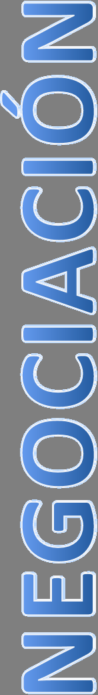

> **Descripción de la imagen** — La imagen es una representación tipográfica de la palabra "NEGOCIACIÓN". La palabra está escrita en letras mayúsculas grandes, de color azul brillante con un contorno o sombreado que le da un efecto tridimensional. Las letras están dispuestas verticalmente y se extienden a lo largo del eje central de la imagen. El fondo es de color gris sólido.

> **Descripción de la imagen** — La imagen es un logotipo o encabezado institucional. Presenta un diseño en blanco y negro con los siguientes elementos:
>
> 1.  **Elemento Gráfico Central:** Una figura abstracta compuesta por formas geométricas interconectadas, que parecen piezas de rompecabezas o un nudo complejo.
> 2.  **Texto Superior:** Una frase escrita en una fuente pequeña, posiblemente en euskera, que dice "ematen za zabel zazu".
> 3.  **Identificación Institucional (Parte Inferior):** Dos líneas de texto que identifican a las instituciones:
>     *   A la izquierda: "Universidad del País Vasco"
>     *   A la derecha: "Euskal Herriko Unibertsitatea"

> **Descripción de la imagen** — La imagen es un logotipo institucional que combina un elemento gráfico y texto. A la izquierda, hay un diseño abstracto compuesto por varias formas curvas y arcos superpuestos en colores vibrantes (verde, azul y rojo), dispuestos en una configuración circular o rotacional. A la derecha del gráfico, se encuentra el nombre principal "EUSKAMPUS" escrito en letras grandes y negras. Debajo del nombre principal, hay dos líneas de texto más pequeñas: "Nazioarteko Bikaintasun Campusa" y "Campus de Excelencia Internacional".

---

<!-- página 2 -->

NEGOCIACIÓN

> **Descripción de la imagen** — La imagen es un fondo sólido de color verde pálido o amarillo verdoso claro. No contiene texto, gráficos, diagramas ni elementos visuales discernibles.

> **Descripción de la imagen** — La imagen es un bloque sólido de color verde claro o verde lima, que ocupa todo el espacio visible. No contiene elementos gráficos, texto, diagramas ni datos específicos.

> **Descripción de la imagen** — La imagen es un fondo de color sólido, de tono verde claro o amarillo verdoso pálido. No contiene ningún texto, diagrama, gráfico ni elementos visuales específicos.

> **Descripción de la imagen** — La imagen es un fondo de color uniforme, predominantemente amarillo pálido o verde claro muy suave. No contiene ningún texto, diagrama, gráfico ni elementos visuales estructurados; es esencialmente una superficie lisa y de tono claro.

> **Descripción de la imagen** — La imagen es un fondo de color amarillo pálido o verde claro, casi uniforme. No contiene texto, gráficos, diagramas ni elementos visuales específicos; es esencialmente un espacio vacío.

> **Descripción de la imagen** — La imagen proporcionada es completamente blanca o de un color muy claro y uniforme, sin contener ningún elemento visual discernible como texto, diagramas, gráficos o ilustraciones. Es esencialmente un espacio vacío.

> **Descripción de la imagen** — La imagen es un fondo completamente liso de color verde claro o verde lima. No contiene ningún objeto, texto, diagrama, gráfico ni elementos visuales discernibles.

> **Descripción de la imagen** — La imagen es un campo de color uniforme, de tono verde claro o lima pálido, sin ningún otro elemento, texto, diagrama o ilustración visible.

> **Descripción de la imagen** — La imagen es un fondo de color sólido, predominantemente verde claro o verde lima. No contiene texto, diagramas, gráficos ni elementos visuales específicos aparte del color de fondo.

> **Descripción de la imagen** — La imagen es un fondo completamente liso de un color verde claro o verde lima uniforme. No contiene ningún texto, diagrama, gráfico ni elementos visuales específicos.

> **Descripción de la imagen** — La imagen es un encabezado o título de sección. Muestra la palabra "Definición" escrita en una fuente grande y clara, centrada en un fondo de color verde sólido. Inmediatamente después de la palabra se encuentra un carácter aislado.

> **Descripción de la imagen** — La imagen es un fondo completamente sólido de color verde oliva o verde musgo uniforme, sin ningún otro elemento visual, texto, diagrama, gráfico o ilustración discernible.

> **Descripción de la imagen** — La imagen es un fondo sólido de color verde oliva o verde musgo uniforme. No contiene elementos gráficos, texto, diagramas ni datos visibles.

> **Descripción de la imagen** — La imagen es un campo de color sólido y uniforme, de un tono verde oliva o verde salvia apagado. No contiene elementos gráficos, texto, diagramas ni datos visibles.

> **Descripción de la imagen** — La imagen es un bloque sólido de color verde oliva o caqui uniforme. No contiene ningún texto, diagrama, gráfico ni elementos visuales discernibles.

> **Descripción de la imagen** — La imagen es un campo de color sólido o un degradado uniforme de tono verde oliva apagado o caqui. No contiene ningún texto, gráfico, diagrama ni ilustración visible.

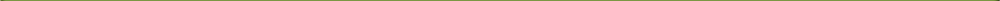

> **Descripción de la imagen** — La imagen es un bloque sólido de color verde oliva o verde musgo uniforme, sin ningún otro elemento, texto, diagrama o ilustración visible.

> **Descripción de la imagen** — La imagen es un bloque sólido de color verde oliva o caqui uniforme. No contiene ningún texto, diagrama, gráfico ni elementos visuales discernibles.

> **Descripción de la imagen** — La imagen es predominantemente un fondo de color verde oliva oscuro o verde musgo sólido. No contiene elementos gráficos, texto, diagramas ni datos visibles; es esencialmente una superficie de color uniforme con algunas marcas o artefactos muy sutiles y difusos en la esquina inferior derecha.

> **Descripción de la imagen** — La imagen es predominantemente un campo de color uniforme, de un tono verde oliva oscuro o verde musgo apagado. No se observan elementos, diagramas, texto ni estructuras complejas; la mayor parte del espacio visual está ocupado por este color sólido. Hay algunas marcas o artefactos muy sutiles en la esquina inferior derecha.

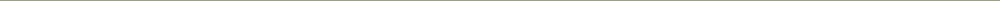

> **Descripción de la imagen** — La imagen es predominantemente un fondo de color sólido, un tono verde grisáceo o salvia apagado. No contiene elementos gráficos, texto, diagramas ni ilustraciones detalladas; solo presenta una superficie de color uniforme.

> **Descripción de la imagen** — La imagen es un bloque sólido de color verde oliva o verde salvia uniforme. No contiene ningún texto, diagrama, gráfico, tabla ni elementos visuales discernibles.

> **Descripción de la imagen** — La imagen es un fondo completamente uniforme de color verde claro o verde lima. No contiene ningún objeto, texto, diagrama, gráfico ni estructura visual discernible.

> **Descripción de la imagen** — La imagen es un fondo completamente liso de color verde claro o verde menta uniforme. No contiene ningún objeto, texto, diagrama, gráfico ni elementos visuales específicos.

> **Descripción de la imagen** — La imagen es un campo de color sólido, de tono verde claro o verde lima uniforme. No contiene texto, gráficos, diagramas ni elementos visuales discernibles aparte del color de fondo.

> **Descripción de la imagen** — La imagen es un fondo de color sólido, de tono verde claro o verde lima. No contiene elementos gráficos, texto, diagramas ni datos visibles.

> **Descripción de la imagen** — La imagen es un fondo de color sólido, predominantemente verde claro o verde menta pálido. No contiene ningún objeto, texto, diagrama, gráfico ni elementos visuales discernibles aparte del color uniforme que ocupa todo el espacio.

> **Descripción de la imagen** — La imagen es un fondo de color sólido, predominantemente verde claro o verde lima. No contiene ningún diagrama, gráfico, tabla, texto ni ilustración discernible.

> **Descripción de la imagen** — La imagen es un fondo de color uniforme, predominantemente verde claro o verde lima pálido. No contiene elementos gráficos, texto, diagramas ni figuras específicas.

> **Descripción de la imagen** — La imagen es un fondo completamente liso de color verde claro o verde lima uniforme. No contiene ningún objeto, texto, diagrama, gráfico ni elementos visuales específicos.

> **Descripción de la imagen** — La imagen es un fondo de color sólido con un degradado suave. Predomina un tono de verde lima o verde brillante, que se atenúa gradualmente hacia tonos más apagados o ligeramente verdosos a lo largo del eje horizontal de la imagen.

> **Descripción de la imagen** — La imagen es un encabezado o título de texto. El texto dice "Tipos básicos de negociación" escrito en color blanco sobre un fondo de color verde sólido.

> **Descripción de la imagen** — La imagen proporcionada es un campo de color sólido, de tono verde uniforme. No contiene ningún diagrama, tabla, gráfico o ilustración visible.

> **Descripción de la imagen** — La imagen es predominantemente un campo de color sólido, de tono verde oliva o verde oscuro. No contiene texto, gráficos, diagramas ni ilustraciones específicas; es esencialmente un fondo de color uniforme. Se observan algunas manchas o artefactos muy sutiles en los bordes inferiores derechos.

> **Descripción de la imagen** — La imagen es un campo de color uniforme, de tono verde oscuro o verde oliva. No contiene ningún texto, diagrama, gráfico ni ilustración visible.

> **Descripción de la imagen** — La imagen es un campo de color sólido, de tono verde oscuro o verde oliva apagado. No contiene ningún objeto, texto, diagrama, gráfico ni ilustración visible.

> **Descripción de la imagen** — La imagen es un bloque sólido de color verde oliva o verde oscuro uniforme que ocupa todo el espacio visible. No contiene texto, gráficos, diagramas ni elementos visuales específicos.

> **Descripción de la imagen** — La imagen es un campo de color sólido, de tono verde oscuro o verde oliva uniforme. No contiene ningún texto, diagrama, gráfico ni ilustración visible.

> **Descripción de la imagen** — La imagen es un bloque sólido de color verde oliva oscuro o verde musgo uniforme. No contiene texto, gráficos, diagramas ni elementos visuales específicos discernibles.

> **Descripción de la imagen** — La imagen es un bloque sólido de color verde oscuro o verde oliva uniforme, sin ningún otro elemento, texto o forma visible.

> **Descripción de la imagen** — La imagen es un fondo completamente liso de un solo color uniforme, un tono verde menta o verde claro. No contiene ningún elemento gráfico, texto ni información visual específica.

> **Descripción de la imagen** — La imagen es un fondo de color uniforme, predominantemente verde claro o verde lima brillante. Presenta sutiles gradientes o variaciones tonales dentro del campo de color.

> **Descripción de la imagen** — La imagen es un fondo completamente liso de un color verde claro o menta uniforme. No contiene ningún objeto, texto, diagrama, gráfico ni elemento visual adicional.

> **Descripción de la imagen** — La imagen es un fondo de color sólido, predominantemente verde claro o menta. No contiene texto, gráficos, diagramas ni elementos visuales específicos aparte del color uniforme.

> **Descripción de la imagen** — La imagen es un fondo de color sólido, predominantemente verde claro o menta. No contiene texto, diagramas, gráficos ni elementos visuales específicos aparte del color uniforme.

> **Descripción de la imagen** — La imagen es un campo de color uniforme, de tono verde claro o menta. No contiene ningún objeto, texto, diagrama, tabla ni ilustración específica.

> **Descripción de la imagen** — La imagen es un bloque rectangular de color verde claro o menta uniforme. No contiene texto, diagramas, gráficos ni elementos visuales específicos aparte del color sólido.

> **Descripción de la imagen** — La imagen es un fondo de color uniforme. Presenta un tono verde claro o verde menta sólido, sin ningún otro elemento, texto, diagrama, gráfico o ilustración visible.

> **Descripción de la imagen** — La imagen es un fondo de color uniforme, predominantemente verde claro o verde lima. No contiene elementos gráficos, texto, diagramas ni objetos discernibles.

> **Descripción de la imagen** — La imagen es un fondo de color sólido o un degradado suave, predominantemente verde lima o verde brillante. No contiene elementos gráficos, texto, diagramas ni datos específicos.

> **Descripción de la imagen** — La imagen es un título o encabezado de sección que presenta el tema: "Criterios para elegir el tipo de negociación".

> **Descripción de la imagen** — La imagen es un fondo de color sólido o un degradado muy sutil. Predomina un tono verde claro o verde grisáceo, con una ligera variación tonal que sugiere un gradiente suave a través del área. No contiene elementos gráficos, texto ni figuras específicas.

> **Descripción de la imagen** — La imagen proporcionada es un fondo completamente de color verde sólido y uniforme. No contiene ningún diagrama, gráfico, tabla, foto o ilustración visible.

> **Descripción de la imagen** — La imagen es un fondo de color verde sólido y uniforme. No contiene diagramas, gráficos, tablas ni ilustraciones visibles. En la esquina inferior derecha se observan algunas marcas o símbolos muy tenues e indistintos.

> **Descripción de la imagen** — La imagen es un fondo de color sólido, de tono verde oscuro o verde bosque uniforme. No contiene elementos gráficos, texto, diagramas ni datos visibles.

> **Descripción de la imagen** — La imagen es un fondo completamente sólido de color verde oscuro o verde bosque uniforme. No contiene ningún texto, diagrama, gráfico ni elementos visuales específicos.

> **Descripción de la imagen** — La imagen es un fondo de color sólido, de tono verde oscuro o verde oliva. No contiene ningún objeto, texto, diagrama ni gráfico.

> **Descripción de la imagen** — La imagen es un fondo completamente sólido de color verde oscuro o verde bosque. No contiene elementos gráficos, texto ni figuras discernibles.

> **Descripción de la imagen** — La imagen es un campo de color sólido, predominantemente de un tono verde oscuro o verde bosque. No contiene elementos visuales, texto, diagramas ni gráficos discernibles; es esencialmente una superficie de color uniforme.

> **Descripción de la imagen** — La imagen es un campo de color sólido de tono verde oscuro uniforme. No contiene ningún texto, diagrama, gráfico, tabla ni elementos visuales discernibles.

> **Descripción de la imagen** — La imagen es un fondo de color uniforme, predominantemente verde menta o turquesa pálido. No contiene texto, diagramas, gráficos ni elementos visuales específicos aparte del color de fondo.

> **Descripción de la imagen** — La imagen es un fondo completamente liso de un color verde menta claro o turquesa pálido, sin ningún elemento gráfico, texto o forma discernible.

> **Descripción de la imagen** — La imagen es un bloque rectangular de color verde menta claro uniforme, sin ningún otro elemento visual, texto o gráfico.

> **Descripción de la imagen** — La imagen es un fondo de color uniforme, predominantemente verde menta o turquesa claro. No contiene texto, diagramas, gráficos ni elementos visuales específicos.

> **Descripción de la imagen** — La imagen es un campo de color sólido, de un tono verde menta claro o turquesa pálido, sin ningún otro elemento visual, texto, diagrama o gráfico.

> **Descripción de la imagen** — La imagen es un fondo de color sólido, de tono verde menta claro o turquesa pálido. No contiene ningún texto, gráfico, diagrama ni ilustración visible.

> **Descripción de la imagen** — La imagen es un rectángulo de fondo de color verde claro uniforme. No contiene ningún texto, diagrama, gráfico, tabla ni ilustración específica; es esencialmente un espacio vacío de color sólido.

> **Descripción de la imagen** — La imagen es un fondo de color sólido o un campo de color uniforme. El color predominante es un tono verde menta claro o turquesa suave. Presenta sutiles gradientes verticales que varían ligeramente en intensidad a lo largo del plano, creando una transición suave de tono dentro del área.

> **Descripción de la imagen** — La imagen es un fondo de color uniforme, predominantemente verde menta o turquesa claro. No contiene texto, diagramas, gráficos ni elementos visuales específicos.

> **Descripción de la imagen** — La imagen es un fondo de color uniforme, presentando un tono verde menta o turquesa claro y homogéneo. No contiene elementos gráficos, texto, diagramas ni datos específicos.

> **Descripción de la imagen** — La imagen es un encabezado de texto que dice "Variables de la negociación".

> **Descripción de la imagen** — La imagen es un bloque rectangular de color verde sólido y uniforme. No contiene texto, gráficos, diagramas ni elementos visuales específicos aparte del color de fondo.

> **Descripción de la imagen** — La imagen es predominantemente un fondo de color verde sólido y uniforme. En el centro de la imagen se observa una pequeña forma o símbolo oscuro, borroso e indistinto. No hay otros elementos, texto, gráficos ni estructuras complejas visibles.

> **Descripción de la imagen** — La imagen es predominantemente un bloque de color sólido, de tono verde oscuro o verde azulado. No contiene elementos visuales específicos como diagramas, gráficos, tablas o ilustraciones detalladas. En la esquina inferior derecha se aprecian fragmentos borrosos y oscuros que parecen ser caracteres o artefactos.

> **Descripción de la imagen** — La imagen es un fondo completamente uniforme de un color verde oscuro o verde azulado sólido. No contiene ningún texto, diagrama, gráfico, tabla ni elementos visuales discernibles.

> **Descripción de la imagen** — La imagen es un campo de color sólido y uniforme, de un tono verde oscuro o verde azulado apagado. No contiene elementos gráficos, texto ni figuras discernibles.

> **Descripción de la imagen** — La imagen es un fondo de color sólido, de tono verde oscuro o verde azulado apagado. No contiene ningún elemento gráfico, texto, diagrama, tabla ni ilustración.

> **Descripción de la imagen** — La imagen es un fondo de color sólido, de tono verde oscuro o verde azulado apagado. No contiene ningún objeto, texto, diagrama, gráfico ni elementos visuales discernibles.

> **Descripción de la imagen** — La imagen es un bloque sólido de color verde oscuro uniforme, sin ningún otro elemento visual, texto, diagrama o gráfico discernible.

> **Descripción de la imagen** — La imagen es un fondo completamente liso de un color verde oscuro o verde azulado apagado. No contiene ningún objeto, texto, diagrama, gráfico ni ilustración.

> **Descripción de la imagen** — La imagen es un campo de color sólido o un degradado suave en tonos verde azulado claro (teal/menta). No contiene ningún texto, diagrama, gráfico ni ilustración visible.

> **Descripción de la imagen** — La imagen es un fondo de color sólido, de tono turquesa claro o menta pálido. No contiene ningún texto, diagrama, gráfico ni elementos visuales específicos.

> **Descripción de la imagen** — La imagen es un bloque de color sólido de tono turquesa claro o cian pálido, que ocupa todo el espacio visible. No contiene ningún texto, diagrama, gráfico ni ilustración.

> **Descripción de la imagen** — La imagen es un fondo o un degradado abstracto. Presenta una transición suave de color, comenzando en el lado izquierdo con un tono cian claro o turquesa pálido y gradualmente oscureciéndose hacia el lado derecho hasta alcanzar un tono azul verdoso o teal más profundo.

> **Descripción de la imagen** — La imagen es un fondo de color sólido o un área con un degradado muy sutil. El color predominante es un tono cian claro o turquesa suave. No contiene elementos gráficos, texto, diagramas ni datos específicos.

> **Descripción de la imagen** — La imagen es un campo de color uniforme. El fondo es de un tono turquesa claro o cian pálido y sólido, ocupando toda el área visible. No contiene texto, gráficos, diagramas ni elementos visuales específicos.

> **Descripción de la imagen** — Por favor, proporciona la imagen que deseas que describa. Actualmente no se ha adjuntado ninguna imagen.

> **Descripción de la imagen** — La imagen es un fondo de color uniforme, predominantemente turquesa claro o menta. No contiene elementos gráficos, texto, diagramas ni datos visibles.

> **Descripción de la imagen** — La imagen es un fondo de color uniforme, predominantemente turquesa o verde azulado claro (teal). No contiene ningún diagrama, texto, gráfico, tabla ni elementos visuales específicos; es una superficie sólida de color.

> **Descripción de la imagen** — La imagen es un título o encabezado que dice "Fases de la negociación".

> **Descripción de la imagen** — La imagen es un fondo de color uniforme, predominantemente un tono verde azulado o turquesa claro. No contiene elementos gráficos, texto, diagramas ni datos específicos; es una superficie sólida de color.

> **Descripción de la imagen** — La imagen es un fondo de color sólido, predominantemente verde azulado o turquesa oscuro. No contiene elementos visuales, diagramas, gráficos, tablas ni ilustraciones discernibles.

> **Descripción de la imagen** — La imagen es un fondo de color sólido, predominantemente un tono verde azulado o turquesa apagado (teal). No contiene elementos gráficos, texto, diagramas ni datos visibles.

> **Descripción de la imagen** — La imagen es predominantemente un fondo de color verde azulado o turquesa oscuro. No contiene elementos visuales específicos, diagramas, tablas ni ilustraciones detalladas; es esencialmente un espacio vacío. Se observan algunos fragmentos de texto o símbolos muy tenues en la esquina inferior derecha.

> **Descripción de la imagen** — La imagen es un fondo de color sólido o un degradado muy sutil. Predomina un tono verde azulado apagado (teal/verde salvia), con una ligera variación tonal que sugiere un gradiente vertical, siendo ligeramente más claro en la parte superior y más oscuro en la inferior. No contiene elementos gráficos, texto ni figuras específicas.

> **Descripción de la imagen** — La imagen es un campo de color sólido y uniforme, de un tono verde azulado apagado o turquesa oscuro. No contiene ningún diagrama, gráfico, tabla, texto ni elementos visuales específicos.

> **Descripción de la imagen** — La imagen es un fondo de color uniforme, presentando un tono verde azulado o turquesa oscuro. No contiene elementos gráficos, texto, diagramas ni datos visibles.

> **Descripción de la imagen** — La imagen es un bloque sólido de color verde azulado oscuro (teal) uniforme, sin ningún otro elemento, texto, diagrama o gráfico visible.

> **Descripción de la imagen** — La imagen es un bloque de color sólido, predominantemente de un tono verde azulado oscuro o verde bosque. No contiene elementos gráficos, texto, diagramas ni datos visibles; es esencialmente un fondo de color uniforme.

> **Descripción de la imagen** — La imagen es un fondo de color uniforme, de tono verde azulado apagado o gris verdoso. No contiene texto, gráficos, diagramas ni elementos visuales discernibles aparte del color sólido.

> **Descripción de la imagen** — La imagen es un bloque sólido de color azul claro o cian, sin ningún otro elemento, texto, diagrama o ilustración visible.

> **Descripción de la imagen** — La imagen es un bloque sólido de color azul claro o cian uniforme, sin ningún otro elemento, texto, gráfico o forma visible.

> **Descripción de la imagen** — No se ha proporcionado ninguna imagen para describir. Por favor, adjunte la imagen para que pueda realizar la descripción solicitada.

> **Descripción de la imagen** — La imagen es un fondo de color sólido, predominantemente azul claro o cian, con una ligera gradación o efecto de desenfoque en los bordes. No contiene ningún texto, gráfico, diagrama ni ilustración visible.

> **Descripción de la imagen** — La imagen es un bloque sólido de color azul claro o cian uniforme, sin ningún otro elemento gráfico, texto o forma discernible.

> **Descripción de la imagen** — La imagen es un campo de color uniforme, predominantemente azul claro o cian pálido. No contiene elementos gráficos, texto, diagramas ni datos específicos.

> **Descripción de la imagen** — La imagen es predominantemente un fondo de color azul claro o cian. En la esquina inferior derecha se observan algunos caracteres o símbolos muy tenues e indistintos, que no forman parte de una estructura visual clara o un diagrama reconocible.

> **Descripción de la imagen** — La imagen proporcionada es mínima y consiste principalmente en un fondo de color azul claro o blanco. No contiene elementos visuales complejos como diagramas, gráficos, tablas o ilustraciones detalladas.

> **Descripción de la imagen** — La imagen es un campo de color sólido, predominantemente de un tono azul verdoso o cian apagado. No contiene elementos gráficos, texto, diagramas ni datos visibles; es esencialmente un fondo de color uniforme.

> **Descripción de la imagen** — La imagen es un encabezado o título de una sección, presentado en texto. El texto dice: "1ª Fase: Preparación del Cuestionario".

> **Descripción de la imagen** — La imagen es un campo de color sólido, de tono azul verdoso o turquesa apagado. No contiene elementos gráficos, texto, diagramas ni datos visibles.

> **Descripción de la imagen** — La imagen proporcionada es un fondo de color sólido, de tono azul verdoso apagado o turquesa oscuro. No contiene ningún diagrama, gráfico, tabla ni ilustración; es esencialmente un espacio vacío.

> **Descripción de la imagen** — La imagen es un fondo de color uniforme. Presenta un tono sólido de azul verdoso apagado o verde azulado (teal) que cubre toda el área visible. No contiene elementos gráficos, texto ni estructuras.

> **Descripción de la imagen** — La imagen proporcionada es un campo de color sólido, de tono azul verdoso oscuro o teal uniforme. No contiene ningún objeto, texto, diagrama, gráfico ni ilustración visible.

> **Descripción de la imagen** — La imagen es un bloque sólido de color verde azulado oscuro (teal/petróleo), sin ningún otro elemento, texto, diagrama o ilustración visible.

> **Descripción de la imagen** — La imagen es un bloque sólido de color verde azulado o turquesa apagado, sin ningún otro elemento, texto, diagrama, gráfico o ilustración visible.

> **Descripción de la imagen** — La imagen es un rectángulo sólido de color verde azulado oscuro o turquesa apagado. No contiene ningún texto, diagrama, gráfico, tabla ni elementos visuales adicionales; es simplemente un fondo de color uniforme.

> **Descripción de la imagen** — La imagen es un bloque sólido de color verde azulado oscuro o teal, sin ningún otro elemento, texto, diagrama o ilustración visible.

> **Descripción de la imagen** — La imagen es un bloque sólido de color verde azulado oscuro (teal o cian oscuro). No contiene ningún texto, diagrama, gráfico ni ilustración; es una superficie uniforme y lisa de un solo color.

> **Descripción de la imagen** — La imagen es un campo de color sólido y uniforme. El color predominante es un tono azul grisáceo o verde azulado apagado (teal oscuro). No contiene ningún objeto, texto, diagrama, gráfico ni elementos visuales discernibles; es esencialmente una superficie de color plano.

> **Descripción de la imagen** — La imagen es un bloque sólido de color azul oscuro o morado uniforme. No contiene elementos gráficos, texto, diagramas ni datos visibles.

> **Descripción de la imagen** — La imagen es un fondo de color sólido, predominantemente azul claro o lavanda pálido. No contiene ningún diagrama, gráfico, tabla, ilustración o texto discernible; es esencialmente un espacio vacío de color uniforme.

> **Descripción de la imagen** — La imagen es un fondo de color sólido, de tono azul claro o lavanda pálido, sin ningún elemento gráfico, texto, diagrama, tabla o ilustración visible.

> **Descripción de la imagen** — La imagen es un fondo de color que presenta un degradado suave. El color transiciona desde un tono azul claro o cian en el lado izquierdo hacia un tono púrpura o índigo más oscuro en el lado derecho. La mayor parte del área es uniforme, con algunas marcas o artefactos muy sutiles e irregulares visibles cerca del borde inferior derecho.

> **Descripción de la imagen** — La imagen es un campo de color uniforme, predominantemente azul claro o celeste pálido. No contiene elementos gráficos, texto, diagramas, tablas ni ilustraciones discernibles.

> **Descripción de la imagen** — La imagen es un campo de color sólido y uniforme. Predomina un tono azul claro o lavanda pálido, con ligeras variaciones tonales que sugieren un sutil degradado o gradiente en la iluminación. No contiene elementos gráficos, texto, diagramas ni datos específicos.

> **Descripción de la imagen** — La imagen es predominantemente un fondo de color azul claro o lavanda pálido. No contiene elementos visuales definidos, texto legible, diagramas, gráficos o ilustraciones específicas; parece ser un espacio vacío o una sección sin contenido visual significativo.

> **Descripción de la imagen** — La imagen proporcionada es predominantemente un fondo de color azul oscuro o púrpura con una ligera gradación. No contiene elementos visuales definidos como diagramas, gráficos, tablas o ilustraciones; el contenido visible es mínimo y no discernible.

> **Descripción de la imagen** — La imagen es un encabezado o título de sección en formato de texto. Muestra el texto "2ª Fase: Actitud durante la negociación".

> **Descripción de la imagen** — La imagen es un bloque sólido de color azul oscuro o índigo uniforme. No contiene texto, gráficos, diagramas ni elementos visuales discernibles.

> **Descripción de la imagen** — La imagen es un fondo de color sólido, predominantemente azul oscuro o índigo. No contiene elementos visuales discernibles como diagramas, texto, gráficos, tablas o ilustraciones.

> **Descripción de la imagen** — La imagen es un campo rectangular de color azul oscuro uniforme. No contiene ningún diagrama, texto, gráfico, tabla ni elementos visuales discernibles aparte del color sólido.

> **Descripción de la imagen** — La imagen es un bloque sólido de color azul oscuro o azul marino, sin ningún otro elemento, texto, diagrama o ilustración visible.

> **Descripción de la imagen** — La imagen es un bloque sólido de color azul oscuro o azul marino. No contiene texto, diagramas, gráficos ni ilustraciones visibles.

> **Descripción de la imagen** — La imagen es un campo de color sólido, predominantemente azul oscuro o índigo. No contiene texto, gráficos, diagramas ni elementos visuales específicos aparte del color uniforme.

> **Descripción de la imagen** — La imagen es un rectángulo sólido de color azul oscuro o índigo. No contiene ningún texto, diagrama, gráfico ni elementos visuales discernibles aparte del color uniforme.

> **Descripción de la imagen** — La imagen es un bloque sólido de color azul oscuro o índigo, que ocupa todo el espacio visible. No contiene texto, gráficos, diagramas ni elementos visuales discernibles aparte del color uniforme.

> **Descripción de la imagen** — La imagen es un bloque sólido de color azul oscuro o azul marino, ocupando todo el espacio visible. No contiene texto, gráficos, diagramas ni elementos visuales discernibles más allá del color uniforme.

> **Descripción de la imagen** — La imagen es predominantemente un fondo de color azul oscuro o negro sólido. En la esquina inferior derecha se aprecian algunas marcas o texto muy tenues y poco definidos.

> **Descripción de la imagen** — La imagen es predominantemente un fondo de color gris oscuro o azul marino, con muy pocos elementos visibles y borrosos en la parte inferior derecha. Visualmente, no contiene ningún diagrama, gráfico, tabla o ilustración específica; es esencialmente un espacio vacío.

> **Descripción de la imagen** — La imagen es un bloque sólido de color morado oscuro o índigo, que ocupa todo el espacio visible. No contiene texto, diagramas, gráficos ni elementos visuales específicos aparte del color uniforme.

> **Descripción de la imagen** — La imagen es un fondo o una sección de color que presenta un degradado suave. El color principal es un tono púrpura o azul violáceo, que se oscurece en la parte superior y se aclara gradualmente hacia la parte inferior. No contiene elementos gráficos específicos como diagramas, tablas o ilustraciones detalladas; es esencialmente un bloque de color con una transición tonal.

> **Descripción de la imagen** — La imagen es un fondo o una barra de color que presenta un degradado suave. Comienza con un tono azul oscuro o púrpura intenso en el lado izquierdo y se desvanece gradualmente hacia un tono lavanda o púrpura más claro en el lado derecho.

> **Descripción de la imagen** — La imagen es un fondo abstracto o un degradado de color. Presenta una transición suave y gradual de tonos morados y lavanda. El lado izquierdo de la imagen muestra un tono púrpura más oscuro e intenso, que se desvanece progresivamente hacia el lado derecho, donde el color se aclara hasta convertirse en un tono lavanda o malva más pálido. La composición es uniforme y sin elementos figurativos.

> **Descripción de la imagen** — La imagen es un bloque de color sólido, predominantemente lila o morado claro. Presenta una ligera gradación o sombra sutil en los bordes, lo que le da una apariencia suave y uniforme. No contiene elementos gráficos, texto ni estructuras complejas como diagramas o tablas.

> **Descripción de la imagen** — La imagen es un bloque sólido de color, predominantemente púrpura oscuro o azul violáceo. No contiene elementos visuales, texto, diagramas, gráficos ni ilustraciones; es simplemente un fondo de color uniforme.

> **Descripción de la imagen** — La imagen es un fondo de color sólido con un degradado suave que va desde tonos morados y violetas en la parte superior hasta azules más oscuros en la parte inferior. No contiene elementos gráficos, texto ni estructuras organizativas.

> **Descripción de la imagen** — La imagen es un campo de color sólido, predominantemente de tono púrpura oscuro o índigo. No contiene elementos gráficos, texto, diagramas ni datos visibles.

> **Descripción de la imagen** — La imagen es predominantemente un fondo de color sólido, un tono morado o índigo uniforme. No contiene elementos visuales específicos, texto, diagramas, gráficos ni ilustraciones detalladas.

> **Descripción de la imagen** — La imagen es predominantemente un bloque de color sólido, de tono púrpura oscuro o índigo. No contiene elementos visuales definidos, diagramas, gráficos, tablas ni ilustraciones reconocibles; solo presenta una superficie de color uniforme con algunas marcas muy tenues e indistintas en el lado derecho.

> **Descripción de la imagen** — La imagen es un encabezado o título de sección que dice: "2ª Fase: Propuestas y Cesiones".

> **Descripción de la imagen** — La imagen es un fondo sólido de color púrpura oscuro o índigo. No contiene elementos visuales, diagramas, gráficos, tablas ni texto discernible; es esencialmente un bloque de color uniforme.

> **Descripción de la imagen** — Por favor, adjunta la imagen a la que te refieres. No se ha incluido ninguna imagen en tu solicitud. Una vez que la subas, con gusto la describiré de forma clara y completa según tus instrucciones.

> **Descripción de la imagen** — La imagen es un bloque sólido de color morado oscuro o índigo, sin ningún elemento visual, texto, diagrama, gráfico o ilustración discernible.

> **Descripción de la imagen** — La imagen es un bloque sólido de color morado oscuro o índigo, que ocupa todo el espacio visible. No contiene texto, diagramas, gráficos ni ilustraciones específicas; es esencialmente un fondo de color uniforme.

> **Descripción de la imagen** — La imagen es predominantemente un fondo de color sólido, de un tono púrpura oscuro o azul índigo. Hay algunas marcas o fragmentos de texto muy tenues y difusos en la parte inferior derecha del encuadre, que son difíciles de distinguir claramente.

> **Descripción de la imagen** — La imagen es predominantemente un color sólido, de tono púrpura oscuro o índigo. No contiene texto, gráficos, diagramas ni elementos visuales específicos; parece ser un fondo uniforme o una página en blanco con un color de relleno. Se observan algunas marcas o artefactos muy sutiles e irregulares en la esquina inferior derecha.

> **Descripción de la imagen** — La imagen es un campo de color uniforme, dominado por un tono púrpura oscuro o índigo. No contiene elementos visuales, texto, diagramas, gráficos ni estructuras discernibles; es esencialmente una superficie sólida de color.

> **Descripción de la imagen** — La imagen es un campo de color sólido, de un tono morado oscuro o índigo uniforme. No contiene ningún diagrama, gráfico, texto, tabla ni ilustración discernible.

> **Descripción de la imagen** — Por favor, proporciona la imagen que deseas que describa. Actualmente no se ha adjuntado ninguna imagen.

> **Descripción de la imagen** — La imagen es un fondo de color uniforme, predominantemente un tono morado oscuro o gris púrpura. No contiene ningún objeto, texto, diagrama, gráfico ni ilustración visible.

> **Descripción de la imagen** — La imagen es un bloque sólido de color morado o lila uniforme. No contiene elementos gráficos, texto, diagramas ni datos visibles.

> **Descripción de la imagen** — La imagen es un campo de color sólido, uniformemente teñido de un tono púrpura o lavanda. No contiene ningún texto, diagrama, gráfico, tabla ni elementos visuales discernibles.

> **Descripción de la imagen** — La imagen es un fondo de color sólido, predominantemente lila o morado claro. No contiene ningún diagrama, gráfico, tabla, ilustración ni texto visible.

> **Descripción de la imagen** — La imagen es un fondo de color sólido con un degradado suave que va desde tonos morados claros hasta lavanda o púrpura pálido. No contiene elementos gráficos, texto ni estructuras complejas.

> **Descripción de la imagen** — La imagen es un fondo de color sólido, de tono púrpura o lavanda uniforme. No contiene ningún diagrama, gráfico, tabla ni ilustración visible.

> **Descripción de la imagen** — La imagen es un fondo de color sólido, predominantemente morado o lila. No contiene elementos gráficos, texto, diagramas ni datos específicos.

> **Descripción de la imagen** — La imagen es un bloque sólido de color morado o lavanda uniforme que ocupa todo el espacio visible. No contiene ningún texto, diagrama, gráfico, tabla ni elementos visuales discernibles aparte del color de fondo.

> **Descripción de la imagen** — Por favor, adjunte la imagen que desea que describa. Actualmente no se ha proporcionado ninguna imagen.

> **Descripción de la imagen** — La imagen es un bloque de color sólido, predominantemente de un tono púrpura o lavanda uniforme que cubre toda el área visible. No contiene elementos gráficos, texto ni estructuras complejas como diagramas o tablas.

> **Descripción de la imagen** — Es un encabezado o título de sección. El texto principal dice "3ª Fase: Cierre y Acuerdo".

> **Descripción de la imagen** — La imagen es un bloque sólido de color morado oscuro o violeta, sin ningún otro elemento, texto, diagrama o ilustración visible.

> **Descripción de la imagen** — No se ha proporcionado ninguna imagen para describir. Por favor, adjunte la imagen que desea que analice.

> **Descripción de la imagen** — La imagen es un bloque sólido de color morado oscuro o violeta, sin ningún otro elemento visual, texto, diagrama o gráfico discernible.

> **Descripción de la imagen** — La imagen es un bloque sólido de color morado o púrpura uniforme que ocupa todo el espacio. No contiene texto, gráficos, diagramas ni elementos visuales discernibles aparte del color de fondo.

> **Descripción de la imagen** — No se ha proporcionado ninguna imagen para describir. Por favor, adjunte la imagen para que pueda realizar la descripción solicitada.

> **Descripción de la imagen** — La imagen es un rectángulo grande y uniforme, completamente relleno de un color sólido, que se asemeja a un tono púrpura o malva oscuro. No contiene ningún diagrama, gráfico, texto, ilustración ni elementos visuales discernibles aparte del color de fondo.

> **Descripción de la imagen** — La imagen es un bloque sólido de color morado oscuro o púrpura. No contiene ningún diagrama, gráfico, tabla, foto o ilustración; es simplemente un fondo de color uniforme.

> **Descripción de la imagen** — La imagen es un bloque sólido de color morado oscuro o índigo, sin ningún otro elemento, texto, forma o detalle visible.

> **Descripción de la imagen** — La imagen es un campo de color sólido, predominantemente de un tono púrpura oscuro o índigo. No contiene elementos gráficos, diagramas, tablas ni ilustraciones específicas; es esencialmente una superficie de color uniforme.

> **Descripción de la imagen** — La imagen es predominantemente un fondo de color sólido, un tono grisáceo o malva uniforme. No contiene ningún diagrama, gráfico, tabla ni ilustración discernible; es esencialmente una superficie de color plano.

> **Descripción de la imagen** — La imagen es un logotipo o encabezado institucional. Presenta un diseño en blanco y negro con los siguientes elementos:
>
> 1.  **Elemento Gráfico Central:** Una figura abstracta compuesta por formas geométricas interconectadas, que parecen piezas de rompecabezas o un nudo complejo.
> 2.  **Texto Superior:** Una frase escrita en una fuente pequeña, posiblemente en euskera, que dice "ematen za zabel zazu".
> 3.  **Identificación Institucional (Parte Inferior):** Dos líneas de texto que identifican a las instituciones:
>     *   A la izquierda: "Universidad del País Vasco"
>     *   A la derecha: "Euskal Herriko Unibertsitatea"

> **Descripción de la imagen** — La imagen es un logotipo institucional que combina un elemento gráfico y texto. A la izquierda, hay un diseño abstracto compuesto por varias formas curvas y arcos superpuestos en colores vibrantes (verde, azul y rojo), dispuestos en una configuración circular o rotacional. A la derecha del gráfico, se encuentra el nombre principal "EUSKAMPUS" escrito en letras grandes y negras. Debajo del nombre principal, hay dos líneas de texto más pequeñas: "Nazioarteko Bikaintasun Campusa" y "Campus de Excelencia Internacional".

---

<!-- página 3 -->
### Definición

NEGOCIACIÓN es un

proceso de interacción

comunicativa por el que

dos o más partes

interdependientes y con

intereses diversos en uno

o varios asuntos tratan

de acercar posiciones

mediante concesiones

mutuas hasta alcanzar un

acuerdo beneficioso.

> **Descripción de la imagen** — Es una fotografía de alto contraste que muestra un único filamento o hebra fibrosa, de color naranja dorado y textura lanosa o plumosa. La estructura se extiende verticalmente en el centro del encuadre, con finos pelos o fibras que le dan una apariencia deshilachada y áspera. El objeto está fuertemente iluminado, lo que resalta su color cálido y la complejidad de su textura. El fondo es oscuro y difuso, de tonos marrones y ámbar, lo que proporciona un fuerte contraste y enfoca toda la atención en el detalle de la fibra.

> **Descripción de la imagen** — La imagen es un logotipo o encabezado institucional. Presenta un diseño en blanco y negro con los siguientes elementos:
>
> 1.  **Elemento Gráfico Central:** Una figura abstracta compuesta por formas geométricas interconectadas, que parecen piezas de rompecabezas o un nudo complejo.
> 2.  **Texto Superior:** Una frase escrita en una fuente pequeña, posiblemente en euskera, que dice "ematen za zabel zazu".
> 3.  **Identificación Institucional (Parte Inferior):** Dos líneas de texto que identifican a las instituciones:
>     *   A la izquierda: "Universidad del País Vasco"
>     *   A la derecha: "Euskal Herriko Unibertsitatea"

> **Descripción de la imagen** — La imagen es un logotipo institucional que combina un elemento gráfico y texto. A la izquierda, hay un diseño abstracto compuesto por varias formas curvas y arcos superpuestos en colores vibrantes (verde, azul y rojo), dispuestos en una configuración circular o rotacional. A la derecha del gráfico, se encuentra el nombre principal "EUSKAMPUS" escrito en letras grandes y negras. Debajo del nombre principal, hay dos líneas de texto más pequeñas: "Nazioarteko Bikaintasun Campusa" y "Campus de Excelencia Internacional".

---

<!-- página 4 -->

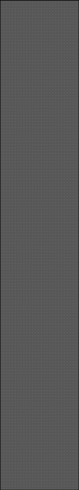

> **Descripción de la imagen** — La imagen es esencialmente un fondo de textura uniforme, compuesto por un patrón de puntos o trama (halftone) en tonos grises y blancos. No contiene ningún diagrama, gráfico, tabla, fotografía ni texto discernible; es una superficie visualmente neutra y texturizada.

> **Descripción de la imagen** — La imagen es un fondo de color sólido, de tono azul cian o turquesa brillante. No contiene ningún objeto, texto, diagrama, gráfico ni ilustración visible.

## Definición

La  negociación  es  algo  consustancial  al  ser  humano.

Negociamos de forma natural, consciente e inconsciente,

a lo largo de toda nuestra vida, al cambiar:

La  negociación  es  algo  consustancial  al  ser  humano.

Negociamos de forma natural, consciente e inconsciente,

a lo largo de toda nuestra vida, al cambiar:

> **Descripción de la imagen** — La imagen es muy minimalista y se compone de dos elementos principales:
>
> 1.  Una barra vertical alargada que ocupa la mayor parte del espacio, de color azul verdoso o turquesa oscuro.
> 2.  En la esquina inferior derecha, hay una pequeña forma curva y redondeada de color claro (que parece ser piel o un objeto suave).

> **Descripción de la imagen** — La imagen es abstracta y se compone principalmente de dos grandes bloques de color que se encuentran en una transición suave o degradado.
>
> A la izquierda, predomina un tono claro, similar a un rosa pálido o melocotón muy suave. A la derecha, hay una franja vertical de color azul verdoso oscuro (teal). La transición entre estos dos colores es gradual y difusa. No se observan elementos estructurados, texto, gráficos ni figuras reconocibles.

> **Descripción de la imagen** — La imagen es un fondo abstracto compuesto por gradientes de color. En el lado izquierdo, se observa una transición suave desde el blanco hacia tonos claros de rosa pálido o melocotón. Esta zona se funde gradualmente con un tono verde azulado oscuro o turquesa profundo en el lado derecho. La transición entre los colores es fluida y difusa.

> **Descripción de la imagen** — La imagen es un fondo abstracto o un degradado de color. Presenta una transición suave y gradual de tonos azules y cian. El lado izquierdo de la imagen muestra colores más claros, con matices que se acercan al rosa pálido o el melocotón claro, mientras que el lado derecho transiciona hacia tonos de azul verdoso oscuro (teal) y azul profundo. No contiene elementos gráficos, texto ni figuras específicas.

> **Descripción de la imagen** — La imagen es altamente abstracta y minimalista, compuesta principalmente por bloques de color. La mayor parte del área superior e izquierda presenta un tono claro, que varía entre el blanco roto y un rosa pálido o melocotón desaturado. A la derecha, hay una franja vertical prominente de color azul verdoso oscuro (teal). La composición es simple, dividida por estos dos tonos principales. No se observan elementos gráficos, texto, diagramas ni datos específicos.

> **Descripción de la imagen** — La imagen es predominantemente un fondo abstracto con un degradado de colores. El área superior e izquierda presenta tonos claros, que varían entre blanco, rosa pálido y naranja suave. Estos tonos se mezclan gradualmente hacia la derecha con diversos matices de azul verdoso (teal) y azul oscuro. En la parte inferior derecha se observan algunas líneas o formas abstractas muy tenues.

> **Descripción de la imagen** — La imagen es un fondo abstracto compuesto por gradientes de color horizontales y verticales. En el lado izquierdo, se observan tonos suaves que van desde el blanco o rosa pálido hasta naranjas y rojizos apagados. Hacia el centro y la derecha, estos colores transicionan a tonos de azul verdoso (teal) y azul oscuro. La imagen carece de elementos definidos o figuras concretas, funcionando como un fondo de color degradado.

> **Descripción de la imagen** — La imagen es altamente borrosa y abstracta, compuesta principalmente por grandes bloques de color que se dividen verticalmente.
>
> En el lado izquierdo predominan tonos claros, como beige o rosa pálido. En el lado derecho, los colores son más oscuros, presentando un tono verde azulado o turquesa oscuro. La transición entre ambos lados es difusa y no presenta líneas o formas definidas. El contenido visual carece de detalles específicos, texto legible o estructuras claras (como diagramas o gráficos).

> **Descripción de la imagen** — La imagen es un fondo abstracto o un degradado de color. Presenta una división vertical suave entre dos tonos principales: en el lado izquierdo, un color cálido que varía entre naranja claro y melocotón; en el lado derecho, un tono frío de azul verdoso o turquesa oscuro. La transición entre ambos colores es gradual y difusa. No se observan formas, texto ni datos estructurados.

> **Descripción de la imagen** — La imagen es un fondo abstracto o un degradado de colores. Presenta una transición suave y difusa entre varios tonos, incluyendo blanco brillante en la parte superior, que se mezcla gradualmente con tonos rosados pálidos y anaranjados en el centro, y finalmente con un color azul verdoso oscuro (teal) en la parte inferior derecha. No contiene elementos estructurados como diagramas, tablas o ilustraciones específicas.

> **Descripción de la imagen** — La imagen es un fondo abstracto y difuminado, compuesto por grandes áreas de color que se mezclan suavemente. La parte izquierda está dominada por tonos cálidos, como el rosa pálido o salmón claro. Esta área transiciona hacia la derecha, donde predomina un color azul verdoso oscuro o turquesa profundo. La composición es una mezcla gradual y difusa de estos dos colores principales, sin presentar formas definidas, texto ni elementos estructurados.

> **Descripción de la imagen** — La imagen es una composición abstracta de colores. Está dividida verticalmente en dos secciones principales:
>
> 1.  **Lado izquierdo:** Presenta un degradado suave que transiciona desde tonos claros de rosa pálido o melocotón hacia el blanco.
> 2.  **Lado derecho:** Consiste en un bloque sólido de color azul verdoso oscuro (teal o turquesa profundo).
>
> La transición entre los dos colores es nítida y vertical. La imagen carece de elementos figurativos, texto o estructuras organizativas como diagramas o tablas.

> **Descripción de la imagen** — La imagen es un fondo abstracto o una gradación de color que ocupa todo el espacio. Está dividida verticalmente en dos grandes secciones cromáticas: la mitad izquierda presenta tonos cálidos, como naranjas y melocotón, mientras que la mitad derecha muestra tonos fríos, predominantemente azul verdoso oscuro (teal). La transición entre ambos colores es suave y difusa. No contiene elementos gráficos, texto ni estructuras definidas.

> **Descripción de la imagen** — La imagen es una composición abstracta formada por franjas verticales de color. A la izquierda se observa una banda de tonos rojizos y anaranjados, que transiciona hacia áreas más claras en el centro. A la derecha, esta transición culmina en una banda de color azul verdoso oscuro. La imagen carece de elementos definidos o estructuras visuales específicas como diagramas o gráficos.

> **Descripción de la imagen** — La imagen proporcionada es una franja horizontal de baja resolución y muy borrosa. Se compone principalmente de dos áreas de color contrastante: un lado izquierdo claro (blanco o gris muy claro) y un lado derecho dominado por tonos de azul verdoso oscuro (teal). Hay formas e indicios de líneas indistintos, pero no es posible identificar elementos específicos, diagramas o datos concretos debido a la falta de claridad.

> **Descripción de la imagen** — La imagen es altamente abstracta y está muy desenfocada, lo que dificulta la identificación de elementos específicos. Visualmente, se compone principalmente de grandes bloques de color.
>
> En el lado izquierdo, predominan tonos cálidos, con una mezcla de rojos y rosados en un degradado suave. En el lado derecho, hay un bloque sólido de color azul verdoso oscuro (teal). Hay algunas líneas o formas blancas muy tenues que sugieren una división o borde entre las dos áreas de color.

> **Descripción de la imagen** — La imagen es muy borrosa y de baja resolución, lo que dificulta la identificación de detalles específicos. Visualmente, se compone de franjas horizontales o verticales de color.
>
> Se observan grandes áreas de color verde azulado oscuro (teal) en los bordes izquierdo y derecho, separadas por una sección central más clara, que presenta tonos rosados pálidos y blancos. Hay líneas verticales blancas que actúan como divisiones entre estas secciones de color. La imagen parece ser un fondo abstracto o una textura muy difuminada.

> **Descripción de la imagen** — La imagen es una composición abstracta o un fragmento fotográfico con dos elementos principales:
>
> 1.  **A la izquierda:** Se observa una porción vertical de tono claro, que parece ser piel humana (posiblemente una mano o brazo).
> 2.  **A la derecha y centro:** Una gran área de color sólido de tono azul verdoso oscuro (teal) domina el espacio.
>
> Ambos elementos están separados por una línea vertical delgada de color blanco. La composición es minimalista, enfocándose en el contraste entre el tono claro de la piel y el fondo oscuro.

> **Descripción de la imagen** — La imagen es una composición abstracta de bloques de color dispuestos horizontalmente.
>
> En el lado izquierdo se observa un área clara o blanca. En el centro-izquierda hay una franja vertical de color marrón rojizo oscuro. A la derecha, ocupa la mayor parte del espacio un bloque sólido de color azul verdoso oscuro (teal). La imagen parece ser una sección de fondo o un elemento de diseño dividido en tres zonas de color distintas.

> **Descripción de la imagen** — La imagen es un primer plano de una parte del cuerpo humano, probablemente una mano o brazo. Se observan tonos cálidos, predominantemente rojizos y anaranjados, con áreas de sombra que definen la forma y el contorno de la estructura.

> **Descripción de la imagen** — La imagen es un fragmento visual que muestra una composición de bloques de color y texto. Se observa una franja vertical a la izquierda con tonos claros, posiblemente representando una textura o parte de una figura. A su lado, hay una franja vertical de color azul oscuro o turquesa. Dentro de esta franja oscura, se encuentra texto escrito en color claro (blanco o gris muy claro), que aparece fragmentado y parcialmente visible. Se distinguen algunas letras como "ponto", "no" y "bo".

> **Descripción de la imagen** — La imagen muestra texto en color blanco sobre un fondo de color turquesa oscuro o verde azulado. El texto visible es "lanho normalmeno".

> **Descripción de la imagen** — La imagen es un fragmento visual abstracto con un fondo de color azul verdoso oscuro o turquesa. Sobre este fondo se observan varias líneas verticales delgadas y blancas, dispuestas en paralelo. Las líneas son uniformes en grosor y recorren la altura visible de la imagen. En la parte inferior, hay una pequeña forma oscura que parece ser un fragmento de texto o un símbolo.

> **Descripción de la imagen** — La imagen es una franja vertical con un fondo dividido en dos tonos principales: blanco o muy claro y un color azul verdoso oscuro (teal). La composición muestra una mezcla de estas dos áreas, con líneas y formas irregulares que sugieren una textura abstracta o un patrón sutil. La calidad de la imagen es baja y pixelada, lo que dificulta la identificación de elementos concretos.

> **Descripción de la imagen** — La imagen es una fotografía de primer plano que muestra tejido biológico. Se observan estructuras curvas y suaves, predominantemente de tonos rosados y rojizos, que sugieren piel o un canal anatómico. Hay áreas más oscuras en el centro de la imagen que indican estructuras internas o sombras. El enfoque está en la textura del tejido.

> **Descripción de la imagen** — La imagen es una banda horizontal de color y textura, muy desenfocada. Presenta una transición gradual de un tono rojizo o rosado en el lado izquierdo a un tono verde azulado oscuro (teal) en el lado derecho. La composición está marcada por líneas verticales sutiles que sugieren un patrón o una textura lineal. No se distinguen objetos, texto ni datos estructurados; es esencialmente un fondo abstracto de colores y tonos.

> **Descripción de la imagen** — La imagen es una franja vertical abstracta que se divide en dos secciones de color distintas. La sección izquierda está dominada por un tono rojizo o anaranjado cálido. Esta sección se encuentra separada por una línea vertical nítida y pasa a una sección derecha de color azul verdoso oscuro (teal).

> **Descripción de la imagen** — La imagen es muy abstracta y consiste principalmente en bloques de color verticales. Se observa una sección izquierda clara o blanca, flanqueada por dos franjas verticales más oscuras: una franja central de color azul verdoso apagado (teal) y una franja derecha de color blanco. No se distinguen elementos textuales, gráficos o figuras específicas.

> **Descripción de la imagen** — La imagen es un fondo abstracto o un degradado de color. Presenta bandas verticales amplias que transicionan entre dos tonos principales: en el lado izquierdo, una mezcla de blanco y un tono rojizo/anaranjado cálido; esta transición se funde gradualmente hacia la derecha con un color azul verdoso oscuro (teal) o azul profundo. El efecto general es una suave mezcla de estos colores cálidos y fríos.

> **Descripción de la imagen** — La imagen es un fondo abstracto compuesto por un degradado de colores. La parte izquierda presenta tonos cálidos, que van desde el blanco o el rosa pálido hasta un naranja rojizo. Esta transición se funde gradualmente hacia la derecha con tonos fríos, dominados por un color azul verdoso oscuro (teal). El efecto general es una mezcla suave y difusa de estos dos espectros de color. No se observan elementos estructurados, texto o figuras definidas.

> **Descripción de la imagen** — La imagen es una composición abstracta o un fondo de color que presenta una transición horizontal entre dos tonos principales. La sección izquierda está dominada por un color cálido, que varía entre el rojo anaranjado y el salmón. La sección derecha presenta un tono frío, predominantemente azul verdoso o turquesa oscuro. La división entre ambos colores es gradual y difusa.

> **Descripción de la imagen** — La imagen es un fondo abstracto o una sección de color con un degradado. El área central y izquierda presenta una transición gradual de colores cálidos, comenzando con tonos rojos y anaranjados que se mezclan hacia el centro con tonos azul verdoso o turquesa oscuro. En el borde derecho de la imagen, hay una línea vertical blanca y delgada.

> **Descripción de la imagen** — La imagen es altamente abstracta y difusa, compuesta principalmente por grandes bloques de color que se dividen verticalmente. La mitad izquierda está dominada por tonos cálidos, como el rojo y el naranja quemado. La mitad derecha presenta tonos fríos, predominantemente azul verdoso o turquesa oscuro. Hay algunas formas blancas o muy claras dispersas, especialmente en la sección central-derecha, que se mezclan con los colores de fondo. No se distinguen objetos, texto ni estructuras definidas; es una composición de masas de color y gradientes.

> **Descripción de la imagen** — La imagen proporcionada es extremadamente abstracta y de baja resolución. Muestra un fondo dividido por un gradiente de color: en el lado izquierdo predomina un tono cálido (rojo/naranja), que se funde hacia el centro, y en el lado derecho aparece un tono frío (azul/verde azulado o cian). La transición entre estos dos colores es suave y difusa. No se distinguen formas, líneas, texto ni elementos estructurados definidos; parece ser una textura o un fondo de color degradado.

> **Descripción de la imagen** — La imagen es una franja horizontal que presenta un degradado de color. Comienza con tonos cálidos, como rojos y naranjas, que se mezclan gradualmente hacia la derecha para transformarse en tonos fríos, específicamente azules verdosos o cian oscuro. El efecto general es una transición suave entre el rojo/naranja y el azul/verde azulado.

> **Descripción de la imagen** — La imagen es un fondo abstracto dividido en secciones de color. La parte izquierda y central-izquierda está dominada por un tono claro, casi blanco o crema pálido. A lo largo del centro, hay una franja vertical de color rojo anaranjado o terracota. A la derecha de esta franja se encuentra un bloque sólido de color azul verdoso oscuro (teal).

> **Descripción de la imagen** — La imagen es un fondo abstracto o un degradado de color horizontal. Comienza en el lado izquierdo con tonos blancos y grises muy claros, que gradualmente transicionan a través de una serie de colores cálidos, incluyendo marrones rojizos y borgoñas. Estos tonos se mezclan y se funden hacia el centro, culminando en un tono azul verdoso oscuro (teal) en el lado derecho.

> **Descripción de la imagen** — La imagen proporcionada es muy borrosa y carece de contenido visual claro o estructurado que permita identificar un diagrama, gráfico, tabla o ilustración específica. Se observa principalmente un fondo de color claro con algunas manchas o áreas de tonos rojizos/marrones en la parte superior izquierda y una sección de color azul verdoso (teal) en el lado derecho. Debido a la baja resolución y la falta de detalles definidos, no es posible describir su contenido específico ni su función dentro del documento.

> **Descripción de la imagen** — La imagen es un fondo o una banda horizontal compuesta por gradientes de color. La sección izquierda presenta una transición suave de tonos cálidos, variando desde un marrón rojizo claro hasta un tono más oscuro y terroso. Esta sección se funde progresivamente hacia la derecha con tonos fríos, específicamente azules verdosos o turquesas oscuros.

> **Descripción de la imagen** — La imagen es un fondo abstracto compuesto por un degradado de colores. La parte superior y central presenta tonos cálidos, variando entre el marrón rojizo y el borgoña. Estos tonos se mezclan gradualmente hacia la parte inferior con azules verdosos oscuros o turquesa profundo. No contiene texto, diagramas, gráficos ni elementos visuales estructurados.

> **Descripción de la imagen** — La imagen es abstracta y de baja resolución, compuesta principalmente por bloques de color. Se observa una banda horizontal en el lado izquierdo con tonos rojizos o rosados, que se funde gradualmente hacia la derecha con un bloque de color azul verdoso oscuro o teal. La composición muestra una transición suave entre estos dos colores principales. No hay elementos textuales, gráficos complejos ni figuras reconocibles.

> **Descripción de la imagen** — La imagen es un fondo o una ilustración abstracta que consiste en un degradado de colores suaves y difuminados. La transición comienza con tonos cálidos, como rojos y marrones, que se mezclan gradualmente hacia el lado derecho con tonos fríos, específicamente azules verdosos o turquesa oscuro. La imagen carece de detalles definidos y presenta una textura muy suave y borrosa.

> **Descripción de la imagen** — La imagen es un fondo abstracto compuesto por una gradación de colores horizontales. La parte izquierda presenta tonos cálidos, que varían entre el rojo y el rosa pálido. Estos tonos se mezclan progresivamente hacia la derecha con una transición a diversos tonos de azul verdoso (teal) y turquesa oscuro. La imagen carece de elementos definidos o figuras concretas, siendo puramente una transición cromática.

> **Descripción de la imagen** — La imagen es un fondo abstracto o una transición de color. Presenta un degradado suave que va desde tonos rojizos y marrones en el lado izquierdo hasta tonos azul verdoso oscuro (teal) en el lado derecho. No contiene elementos gráficos, texto, diagramas ni figuras identificables.

> **Descripción de la imagen** — La imagen es un fondo abstracto compuesto por gradientes horizontales de color. La composición se divide en tres zonas principales: una sección izquierda dominada por tonos claros, como blanco roto o beige pálido, que transiciona hacia el centro con bandas de color marrón rojizo o terracota. A la derecha, estos tonos cambian a un color azul verdoso oscuro o teal profundo. No contiene elementos gráficos, texto ni estructuras definidas.

> **Descripción de la imagen** — La imagen es una banda horizontal que presenta un degradado de color. La sección izquierda está dominada por tonos cálidos, como marrón rojizo o terracota oscuro. Esta sección se funde gradualmente hacia la derecha con una sección de tonos fríos, predominantemente azul verdoso o cian oscuro (teal). El cambio de color es suave y continuo a lo largo de la banda.

> **Descripción de la imagen** — La imagen proporcionada es una composición abstracta y muy borrosa, compuesta por franjas verticales y horizontales de colores. Se observan tonos claros (blanco o beige pálido), tonos oscuros (azul verdoso o turquesa oscuro) y algunas manchas de color marrón rojizo. No se distingue ningún objeto, texto, diagrama, tabla o ilustración específica; es esencialmente un fondo abstracto con gradientes de color.

> **Descripción de la imagen** — La imagen es un elemento gráfico vertical que funciona como una división o borde estilizado. Está compuesta por dos columnas verticales paralelas:
>
> 1.  **Columna Izquierda:** Es de color gris oscuro o azul pizarra sólido.
> 2.  **Columna Derecha:** Es de color azul claro o turquesa pálido.
>
> Ambas columnas se extienden verticalmente y tienen bordes definidos. En la parte inferior, las dos secciones convergen en formas curvas y estilizadas (similares a pies o bases), dentro de las cuales se observan pequeñas formas abstractas y claras.

> **Descripción de la imagen** — La imagen es una barra horizontal de color azul claro o celeste, que ocupa la mayor parte del espacio. Presenta una textura sutilmente granulada o degradada. En el borde derecho de la barra se observa un elemento vertical oscuro (marrón o negro).

> **Descripción de la imagen** — La imagen es predominantemente un fondo de color azul claro o cian, con una ligera gradación tonal que se extiende por toda el área visible. No contiene ningún diagrama, gráfico, tabla ni ilustración específica; es esencialmente un bloque de color liso.

> **Descripción de la imagen** — La imagen es predominantemente un fondo abstracto compuesto por una gradación de colores suaves. La parte superior y central presenta tonos claros, que van desde el beige pálido hasta el azul claro o turquesa suave. Hay una transición gradual entre estos colores. En la esquina inferior derecha se observa una pequeña forma oscura e indistinta.

> **Descripción de la imagen** — La imagen es predominantemente un bloque de color azul claro o cian, ocupando la mayor parte del espacio. Hay algunas líneas verticales y artefactos visuales sutiles en el lado derecho, pero no contiene contenido gráfico, texto ni elementos estructurados como diagramas o tablas.

> **Descripción de la imagen** — La imagen es un fondo abstracto y minimalista compuesto por franjas verticales y horizontales de colores suaves. Predominan los tonos azul claro, turquesa y beige o blanco roto. La composición es difusa y carece de elementos definidos o estructuras visuales complejas.

> **Descripción de la imagen** — La imagen es predominantemente un fondo de color azul claro o cian. Presenta algunas variaciones tonales y líneas verticales muy sutiles en el lado izquierdo. En la esquina inferior derecha se observa una pequeña forma oscura e irregular. La imagen carece de contenido visual específico como texto, gráficos o diagramas complejos.

> **Descripción de la imagen** — La imagen es muy abstracta y presenta una composición de bloques de color. Predomina un tono azul claro o cian que ocupa la mayor parte del espacio. A la izquierda se observan franjas verticales de color beige claro o blanco. Hacia el centro y la derecha, hay elementos verticales más oscuros, de tonos marrones o rojizos, que contrastan con el fondo azul. La imagen carece de estructuras definidas, texto legible o gráficos específicos como diagramas o tablas.

> **Descripción de la imagen** — La imagen proporcionada es una porción muy borrosa y de baja resolución, compuesta principalmente por bloques de color difusos, incluyendo tonos de azul claro, blanco y algunas manchas rojizas o marrones en la parte superior izquierda. No se distingue ningún diagrama, gráfico, tabla o ilustración específica; el contenido visual es esencialmente una mancha de color sin forma definida.

> **Descripción de la imagen** — La imagen es un fondo abstracto compuesto por varias franjas horizontales delgadas y superpuestas de diferentes colores. Las franjas visibles incluyen tonos beige claro o blanco, amarillo, un tono marrón rojizo oscuro y azul celeste o turquesa. La composición es lineal y horizontal. En la esquina inferior derecha se observa un pequeño símbolo o carácter oscuro e indistinto.

> **Descripción de la imagen** — La imagen es altamente abstracta y se compone de bandas horizontales y rayas verticales de colores apagados. Se observan franjas de color beige claro o blanco en el lado izquierdo, seguidas por varias franjas verticales de colores como amarillo, rojo y azul oscuro/gris. El lado derecho está dominado por un tono azul verdoso o cian suave. La composición general es difusa y carece de formas definidas, texto o elementos visuales concretos identificables.

> **Descripción de la imagen** — La imagen es un elemento gráfico abstracto que consiste en una franja horizontal con varias bandas de color superpuestas y verticales. La composición se divide en secciones horizontales: a la izquierda, hay un área de color claro (beige o blanco). A la derecha, se observan varias franjas verticales de colores distintos, incluyendo rojo, amarillo, azul verdoso (teal) y blanco/gris claro. El diseño es lineal y segmentado, sin elementos figurativos ni texto discernible.

> **Descripción de la imagen** — La imagen es altamente abstracta y se compone principalmente de franjas horizontales de color que ocupan la mayor parte del espacio. Se observan tonos claros (beige o blanco roto) en la parte superior, seguidos por bandas de color azul oscuro o grisáceo en el centro. En el borde inferior y a lo largo de las líneas, hay algunas líneas verticales finas de colores como rojo, amarillo y marrón, que atraviesan las franjas horizontales. La composición general es una mezcla de colores planos y texturas sutiles, sin figuras, texto o estructuras definidas.

> **Descripción de la imagen** — La imagen proporcionada es altamente abstracta y consiste en una composición de franjas verticales de color. Se observan varias bandas superpuestas, incluyendo tonos claros como beige o blanco, amarillo, rojo, azul oscuro/grisáceo y azul claro. La composición parece ser un patrón de bloques de color dispuestos verticalmente. No se distinguen formas, líneas, texto ni elementos gráficos definidos.

> **Descripción de la imagen** — La imagen es altamente abstracta y fragmentada, compuesta principalmente por bloques de color. Se observa una banda horizontal clara en la parte superior. A la izquierda, hay una columna vertical que contiene elementos que parecen ser libros o objetos apilados de colores (rojo, amarillo y blanco/beige). El resto del espacio está dominado por un gran área de color azul claro o turquesa. En la esquina inferior derecha se distingue una forma pequeña e indistinta.

> **Descripción de la imagen** — La imagen es un fondo abstracto o una sección de color. Consiste en franjas horizontales de color, predominantemente tonos de azul claro y turquesa, que se mezclan con áreas más claras (blanco o gris muy pálido) en los bordes. La composición es simple y lineal, sin elementos figurativos ni texto discernible.

> **Descripción de la imagen** — La imagen es predominantemente un espacio en blanco o una franja vertical muy estrecha de color claro, posiblemente parte del fondo de una página. No contiene elementos visuales específicos como diagramas, tablas, gráficos o ilustraciones detalladas que permitan identificar contenido académico.

> **Descripción de la imagen** — La imagen es una franja horizontal de fondo con un degradado o bandas de color. Se observa una transición de tonos claros a azules. A la izquierda hay una sección de color claro, posiblemente beige o blanco roto, que se mezcla gradualmente hacia la derecha con diferentes tonalidades de azul, incluyendo azules claros y más oscuros. La imagen carece de elementos definidos o figuras concretas, pareciendo ser un fondo abstracto o un degradado cromático.

> **Descripción de la imagen** — La imagen es predominantemente un fondo de color azul claro o cian. Hay una línea vertical delgada y blanca visible en el lado derecho de la composición. No contiene texto, gráficos, diagramas ni objetos discernibles.

> **Descripción de la imagen** — La imagen es un fragmento de un diseño gráfico o encabezado que utiliza bloques de color. Se divide verticalmente en dos secciones principales:
>
> 1.  **Lado izquierdo:** Un bloque de color beige claro o tostado.
> 2.  **Lado derecho:** Un bloque de color azul claro o cian.
>
> Entre ambos bloques hay una línea divisoria vertical. En el lado derecho, se observan formas blancas y posiblemente texto parcial (se distinguen letras como "sino no..."). El diseño es minimalista y utiliza estos dos tonos para crear un contraste visual.

> **Descripción de la imagen** — La imagen es un elemento gráfico abstracto y estilizado, probablemente parte de un encabezado o diseño decorativo. Consiste en una serie de bloques verticales con colores contrastantes: fondo azul claro/cian y formas blancas redondeadas. Se observan letras o símbolos grandes y gruesos en color blanco que se superponen o están dispuestos verticalmente. La composición es fragmentada, utilizando formas curvas y sólidas para crear un patrón visual.

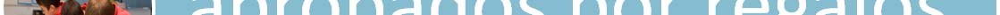

> **Descripción de la imagen** — La imagen es un fragmento de texto que aparece en una fuente grande y clara, de color azul claro o turquesa. El texto visible parece ser un encabezado o título, compuesto por varias palabras, incluyendo la frase "aprobados por regalos".

> **Descripción de la imagen** — La imagen es muy borrosa y abstracta, compuesta principalmente por franjas verticales de color. Se observan bandas claras de azul celeste o turquesa alternadas con áreas blancas o grisáceas. Hay algunas formas oscuras e indistintas en el centro que sugieren la presencia de objetos o sombras, pero no se distinguen detalles específicos. La composición general es vertical y texturizada.

> **Descripción de la imagen** — La imagen muestra un patrón vertical compuesto por franjas o bandas de colores. Se distinguen claramente franjas de color rojo, marrón oscuro/negro, azul claro y blanco, dispuestas una al lado de la otra en una secuencia repetitiva.

> **Descripción de la imagen** — La imagen muestra una composición abstracta de franjas verticales. Predominan los tonos azules claros y cian, alternados con bandas más oscuras o texturas que sugieren colores cálidos (como rojo o naranja) en el centro. La imagen parece ser un fragmento de un patrón o textura de tela.

> **Descripción de la imagen** — La imagen es una fotografía de baja resolución y desenfocada que muestra parcialmente la parte superior de una persona. Se distingue el cabello largo y oscuro de una persona en primer plano. En el lado derecho de la imagen se observa una porción de tela de color rojo brillante. El fondo es muy borroso, con tonos claros (blanco o azul pálido).

> **Descripción de la imagen** — La imagen es un fragmento de diseño o una barra de color que ocupa la parte inferior del espacio visible. Está compuesta por tres secciones verticales principales: una franja oscura a la izquierda, un área central más clara y posiblemente vacía o con texto muy tenue, y una amplia sección de color azul claro (cian) a la derecha. Las secciones están separadas por líneas sutiles.

> **Descripción de la imagen** — La imagen es una composición abstracta compuesta por bloques de color sólidos dispuestos verticalmente. Se observan tres secciones principales: un bloque de color azul claro o cian en el lado izquierdo, un bloque blanco central y un bloque de color rojo o rosa intenso a la derecha. No se distinguen elementos gráficos, texto ni datos específicos dentro de esta sección visible.

> **Descripción de la imagen** — La imagen es una composición abstracta y muy borrosa, compuesta por franjas verticales de colores cálidos y fríos. Se observan bandas de tonos marrones, naranjas y rojos en la parte izquierda, que se mezclan con áreas de blanco brillante y franjas de color azul claro o cian en el lado derecho. La imagen carece de detalles definidos o estructuras reconocibles como texto, líneas o figuras concretas.

> **Descripción de la imagen** — La imagen es una composición abstracta y muy borrosa, dominada por franjas verticales de color. Se observan bandas de tonos cálidos (naranja y marrón) en el lado izquierdo, seguidas por franjas blancas y luego un amplio bloque de color azul claro o cian en el lado derecho. La calidad de la imagen es baja y difusa, lo que impide identificar detalles específicos o figuras concretas; parece ser una textura o un fondo de colores.

> **Descripción de la imagen** — La imagen es muy borrosa y abstracta, compuesta por franjas verticales de color que se superponen o están adyacentes. Se distinguen claramente tres bandas principales: una banda clara (blanco o beige muy pálido), una banda de color rojo anaranjado o terracota, y una banda de color azul claro o cian. La composición es lineal y vertical, con las áreas de color mezclándose en los bordes debido a la baja resolución o el desenfoque. No se identifican figuras, texto ni estructuras organizadas como un diagrama o gráfico.

> **Descripción de la imagen** — La imagen es una composición abstracta y muy desenfocada que consiste en franjas verticales de color. Se distinguen claramente tres bandas principales: una banda blanca o beige claro, una banda de color rojo oscuro o terracota, y una banda de color azul claro o cian. Las franjas se superponen o se yuxtaponen, creando transiciones suaves entre los tonos. La imagen carece de detalles definidos y parece ser un fondo visual o una ilustración abstracta.

> **Descripción de la imagen** — La imagen es una franja horizontal con una composición de colores difuminados y texturas. La parte izquierda presenta tonos cálidos, predominantemente beige, naranja y marrón claro, con una apariencia suavemente texturizada. La parte derecha de la imagen está dominada por un color azul claro o cian uniforme. No se distinguen elementos específicos, figuras, texto o estructuras organizadas; es esencialmente una transición visual entre dos bloques de color.

> **Descripción de la imagen** — La imagen es una composición abstracta y muy desenfocada, compuesta por franjas verticales de color que ocupan la mayor parte del espacio. Se observan las siguientes bandas de color:
>
> 1.  Una banda vertical en el lado izquierdo con tonos claros, cálidos (beige o amarillo pálido).
> 2.  Una banda central de color naranja rojizo o terracota.
> 3.  Una banda vertical a la derecha de un tono rojo oscuro o granate.
> 4.  En la parte inferior, hay una franja horizontal sólida de color azul claro o cian.
>
> La imagen carece de detalles definidos y parece ser una textura o un fondo muy difuminado.

> **Descripción de la imagen** — La imagen es un fondo abstracto compuesto por una gradación horizontal de colores suaves y tonos cálidos a tonos fríos. La composición se caracteriza por bandas horizontales que transicionan suavemente, comenzando con tonos beige, melocotón y marrones claros en el lado izquierdo, y progresando hacia azules claros y tonos rojizos/granates en el lado derecho. La imagen carece de formas definidas o contenido estructurado.

> **Descripción de la imagen** — La imagen es un fondo abstracto o una sección muy desenfocada que presenta un gradiente de color. La parte izquierda está dominada por tonos beige y marrones claros, mientras que la parte derecha transiciona hacia un color azul claro o cian suave. No se observan elementos estructurados, texto, gráficos ni figuras definidas.

> **Descripción de la imagen** — La imagen es un fondo abstracto compuesto por un degradado de colores suaves y horizontales. La transición cromática va desde tonos cálidos (beige, naranja y rojizo) en el lado izquierdo hasta tonos fríos (azul claro y cian) en el lado derecho. La imagen tiene una apariencia difuminada o borrosa.

> **Descripción de la imagen** — La imagen es muy abstracta y consiste principalmente en bloques de color difuminados. A la izquierda se observa una zona con tonos beige o naranja claro, que se funde gradualmente hacia el centro. A la derecha, hay un gran bloque de color azul celeste o turquesa sólido. No se distinguen formas, diagramas, texto ni elementos concretos.

> **Descripción de la imagen** — La imagen es un fondo abstracto que presenta un degradado de color. Comienza con tonos cálidos como beige y melocotón en el lado izquierdo, que se desvanecen gradualmente hacia el blanco en el centro, y finalmente transicionan a un tono azul claro o cian en el lado derecho.

> **Descripción de la imagen** — La imagen es un fondo abstracto compuesto por una gradación de colores suaves y cálidos, incluyendo tonos de beige, naranja pálido, rosa claro, blanco y azul celeste. La composición es difusa y sin formas definidas ni elementos visuales específicos.

> **Descripción de la imagen** — La imagen es una composición abstracta y muy desenfocada, dominada por un degradado de colores suaves. En el lado izquierdo se observa una zona de tonos beige y naranja claro que se funde gradualmente hacia el lado derecho, donde la paleta de colores cambia a tonos azul claro y cian pálido. La transición entre estos dos colores es suave y difusa. Hay algunas áreas oscuras e indistintas en el centro-derecha, pero no se distinguen formas o elementos concretos.

> **Descripción de la imagen** — La imagen es una composición abstracta de colores suaves y degradados. Presenta una mezcla difusa de tonos cálidos (rosas, naranjas, marrones) en la parte superior y tonos fríos (azules claros, turquesas) en la parte inferior. La transición entre estos colores es suave y borrosa, creando un efecto de gradiente o desenfoque. No se observan formas definidas, texto ni elementos gráficos específicos.

> **Descripción de la imagen** — La imagen es un fondo abstracto o un degradado suave. Presenta una transición gradual de colores cálidos en el lado izquierdo, que van desde tonos beige y naranja claro, hacia tonos fríos en el lado derecho, que se transforman en azules claros y cian. La transición entre los dos grupos de color es fluida y difusa.

> **Descripción de la imagen** — La imagen es un fondo abstracto o una gradación de color muy suave y difusa. Presenta una transición gradual de tonos cálidos en la parte superior, que van desde beige claro y melocotón hasta blanco. Esta zona se funde con tonos fríos en la parte inferior, donde predominan los azules claros y cian. La imagen carece de cualquier objeto, texto o estructura definida.

> **Descripción de la imagen** — La imagen es predominantemente un fondo con un degradado suave. El color transiciona desde tonos cálidos (beige y naranja claro) en el lado izquierdo hacia tonos fríos (azul claro y blanco) en el lado derecho. En la esquina inferior derecha se observa un pequeño símbolo o carácter oscuro.

> **Descripción de la imagen** — La imagen es un fondo abstracto compuesto por un degradado de colores suaves y difuminados. La transición cromática va desde tonos cálidos (naranjas y marrones) en el lado izquierdo y central, hasta tonos fríos (azules claros y cian) en el lado derecho. El efecto general es una mezcla suave y uniforme de estos colores.

> **Descripción de la imagen** — La imagen es altamente abstracta y desenfocada. Presenta una transición de colores suaves: en el lado izquierdo predominan tonos cálidos como el naranja, el rosa y el marrón, que se mezclan gradualmente con un tono azul claro o cian en el lado derecho. La composición es difusa y carece de elementos definidos, formas geométricas claras o contenido textual discernible.

> **Descripción de la imagen** — La imagen muestra una estructura vertical con dos franjas grises verticales paralelas a los lados, separadas por un espacio central de color azul claro. En la parte inferior de la imagen, se observan fragmentos parciales de lo que parecen ser fotografías o ilustraciones de personas y objetos.

> **Descripción de la imagen** — La imagen es un fondo abstracto compuesto por franjas verticales de diferentes tonos de azul y cian. Las bandas de color se superponen y se mezclan, creando una textura visual suave y difusa. Predominan los azules claros y medios, con algunas áreas más oscuras o saturadas que añaden profundidad al conjunto. No se observan objetos, texto ni estructuras definidas; es puramente una composición de color.

> **Descripción de la imagen** — La imagen es un fondo abstracto compuesto por una serie de franjas horizontales y verticales de colores. Presenta una gradación o mezcla de tonos que incluyen marrones oscuros, negros, beige, rosados pálidos, azules claros y blanco. La composición sugiere una paleta de colores o una textura visual difusa.

> **Descripción de la imagen** — La imagen es una composición abstracta compuesta por bandas horizontales y verticales de color. La parte superior está dominada por franjas estrechas y diagonales en tonos oscuros, incluyendo marrones, negros y grises. La sección inferior es una banda sólida de color azul claro o cian. En la esquina inferior derecha se observa un pequeño símbolo o carácter estilizado.

> **Descripción de la imagen** — La imagen es altamente abstracta y minimalista, compuesta por bloques de color. Se observa una composición dividida principalmente en dos secciones horizontales o verticales. En el lado derecho, predomina un tono azul claro o cian uniforme. El lado izquierdo presenta una mezcla de bandas verticales de colores oscuros (marrones, negros y tonos rojizos) junto con formas y áreas de color más claro y difuminado. No se identifican figuras, texto ni estructuras organizadas como diagramas o gráficos.

> **Descripción de la imagen** — La imagen es un fondo abstracto compuesto por múltiples franjas o bandas verticales de color. Estas franjas presentan una mezcla de tonos oscuros (negro, marrón oscuro, gris) y tonos más claros (blanco, beige, azul claro/cian), con transiciones suaves entre los diferentes colores a lo largo del eje vertical. No se distinguen formas, objetos ni estructuras específicas; es puramente un patrón de color difuminado.

> **Descripción de la imagen** — La imagen es una franja horizontal abstracta compuesta por una mezcla de colores y tonos, incluyendo marrones oscuros, negros, beige claro, tonos rosados/pálidos y azules. La composición es lineal y difusa, sin elementos gráficos, texto o estructuras organizadas como diagramas, tablas o ilustraciones específicas.

> **Descripción de la imagen** — La imagen es una franja vertical con una composición abstracta y difusa, dominada por una paleta de colores neutros y suaves. Se observan bandas verticales que alternan tonos marrones, beige claros, blanco y un azul celeste pálido en el lado derecho. La textura general es suave y borrosa, lo que dificulta la identificación de objetos o detalles específicos. No se distinguen elementos estructurados como diagramas, tablas o gráficos definidos.

> **Descripción de la imagen** — La imagen es un fondo abstracto compuesto por franjas horizontales de colores y tonos. La composición presenta una transición gradual de colores oscuros en el lado izquierdo, incluyendo marrones, grises y negros, hacia tonos más claros y fríos en el lado derecho, como beige y azul claro/cian.

> **Descripción de la imagen** — La imagen es un fondo abstracto compuesto por franjas verticales de diferentes colores y tonos. Se observan bandas estrechas que alternan entre colores oscuros (marrones, negros) y tonos más claros (blancos, beige, rosados pálidos). En el lado derecho de la composición, hay una sección notable de color azul claro o cian. La imagen está muy desenfocada o borrosa, lo que impide distinguir detalles específicos o formas definidas, presentando únicamente una textura de rayas cromáticas.

> **Descripción de la imagen** — La imagen es altamente abstracta y minimalista, compuesta principalmente por una banda horizontal de colores y tonos. Predominan los colores azul claro, blanco y algunos tonos oscuros o marrones en la parte superior izquierda. La composición parece ser una mezcla de texturas suaves y líneas verticales indistintas, creando un fondo visual difuso sin elementos concretos identificables como texto, gráficos o figuras específicas.

> **Descripción de la imagen** — La imagen es altamente abstracta y borrosa, compuesta por una mezcla de franjas verticales y bloques de color. Predominan los tonos azules claros, turquesas, blancos y marrones o beige, dispuestos en bandas que sugieren un patrón de rayas o texturas superpuestas. La composición general es difusa y carece de elementos definidos o figuras reconocibles.

> **Descripción de la imagen** — La imagen es una composición abstracta y muy borrosa, compuesta por múltiples franjas verticales de colores. Se observan bandas alternadas de tonos claros (blanco y azul celeste pálido) y tonos más oscuros (azul marino, marrón rojizo y negro). La textura general es difusa y las líneas son irregulares, creando un efecto visual de rayas superpuestas o una degradación de color vertical.

> **Descripción de la imagen** — La imagen es una composición abstracta formada por varias franjas verticales de colores dispuestos uno al lado del otro. Se observan las siguientes bandas, de izquierda a derecha: una banda oscura (casi negra o marrón muy oscuro), seguida de una banda de color beige claro o tostado, una franja de tono marrón rojizo, una franja de color azul cian brillante y finalmente una franja blanca, seguida por otra franja de color azul verdoso o turquesa.

> **Descripción de la imagen** — La imagen es una franja vertical de textura o tela, compuesta por bloques de color superpuestos y ligeramente borrosos. Se observan varias bandas verticales de colores distintos, incluyendo tonos oscuros (negro/gris oscuro), un tono rosado o malva, y secciones de azul claro o cian. La composición sugiere una vista de tejido o vestimenta.

> **Descripción de la imagen** — La imagen es una franja horizontal compuesta por varias bandas verticales de color sólido y uniforme. Se observan franjas alternadas de colores, incluyendo tonos oscuros (negro o gris oscuro), azul claro/cian, blanco y posiblemente algunos toques de rosa o rojo pálido. La composición es abstracta y se compone únicamente de estas líneas de color.

> **Descripción de la imagen** — La imagen es una franja horizontal compuesta por varias bandas verticales de colores y tonos. Se observan secciones de color oscuro (marrón o negro), rojo, azul claro/cian, blanco y otros tonos neutros, dispuestos uno al lado del otro. La composición es abstracta y parece ser una textura o un degradado de colores verticales.

> **Descripción de la imagen** — La imagen es una composición abstracta formada por franjas verticales de color sólido. Se observan varias bandas adyacentes con los siguientes tonos: negro o gris muy oscuro, rojo intenso o granate, rosa pálido o beige claro, azul celeste o cian claro, y blanco o gris muy claro. Las franjas están dispuestas una al lado de la otra en un patrón vertical.

> **Descripción de la imagen** — La imagen es un fragmento gráfico que consiste en bloques de color dispuestos horizontalmente. Se observan tres franjas o secciones de color distintas: una sección de color azul claro/cian, una sección de color azul oscuro/verde azulado y una sección de color marrón rojizo o borgoña. Los bloques están adyacentes y forman una banda visual.

> **Descripción de la imagen** — La imagen es un fragmento visual de texto o una palabra estilizada, presentada en un color azul claro o cian sobre un fondo más oscuro. Se observan varias letras y sílabas cortadas o parciales, como "trob" y "paldo", con una tipografía moderna y limpia. El resto del contenido es borroso o está fuera de la vista.

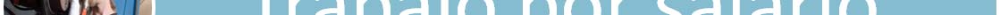

> **Descripción de la imagen** — La imagen muestra un fragmento de texto escrito en una fuente estilizada de color azul claro o cian sobre un fondo blanco. El texto visible es la frase "lahalño por Salano".

> **Descripción de la imagen** — La imagen es una composición abstracta compuesta por varias franjas o bandas verticales de diferentes colores y tonos. En el extremo izquierdo se observa una banda oscura (negra o gris muy oscuro). A su derecha, hay múltiples franjas verticales alternadas de colores claros, incluyendo blanco y tonos de azul claro o cian. La composición general es lineal y vertical.

> **Descripción de la imagen** — La imagen es un fragmento abstracto y altamente estilizado, dominado por tonos azules claros y blancos. Presenta una composición horizontal con bandas de color. Se observan líneas verticales o rayas que atraviesan el fondo azul, alternando entre blanco brillante y un tono oscuro (negro o gris muy oscuro). El efecto general es de textura fragmentada o patrón gráfico.

> **Descripción de la imagen** — La imagen es una franja horizontal de elementos abstractos y bloques de color. Se observan varias bandas verticales de colores distintos, incluyendo tonos oscuros (negro o azul muy oscuro), blanco, un tono azul claro/cian y un tono rojo o borgoña. Los bordes son irregulares y la calidad de la imagen es baja, lo que hace que los elementos visuales sean difusos y abstractos. No se distingue ningún diagrama, tabla o ilustración específica con contenido estructurado.

> **Descripción de la imagen** — La imagen proporcionada es de muy baja calidad y está altamente borrosa, lo que impide identificar contenido específico o detalles concretos. Visualmente, se presenta como una franja horizontal con tonos oscuros a la izquierda y áreas más claras en el centro. No es posible determinar si se trata de un diagrama, tabla o fotografía debido a la falta de claridad.

> **Descripción de la imagen** — La imagen es un fragmento visual abstracto y minimalista. Está compuesta por bloques de color y formas geométricas. En el lado izquierdo se observan franjas verticales oscuras (negro o gris muy oscuro). A la derecha, predomina una gran área de color azul claro o cian. La composición sugiere una división vertical entre dos zonas de color contrastante. En la parte inferior derecha hay un pequeño símbolo o carácter en tonos claros.

> **Descripción de la imagen** — La imagen es una composición abstracta y fragmentada, compuesta por bloques verticales de color y textura. Se observan varias franjas superpuestas:
>
> 1.  En el lado izquierdo, hay una sección oscura, casi negra.
> 2.  A su derecha, se intercalan franjas de tonos claros, incluyendo gris claro y un matiz rosado o beige pálido.
> 3.  Hacia el centro, hay una banda de color azul verdoso o turquesa.
> 4.  El lado derecho está dominado por un bloque sólido de color azul celeste o cian claro.
>
> La imagen carece de elementos estructurados como texto, líneas o gráficos definidos.

> **Descripción de la imagen** — La imagen proporcionada es de muy baja resolución y está altamente desenfocada, lo que dificulta la identificación de su contenido específico. Visualmente, se compone de bloques de color oscuros (negro y tonos grises) mezclados con áreas más claras (blanco y tonos azulados/grisáceos). La composición general es abstracta y fragmentada, sin elementos definidos como texto, figuras geométricas claras o datos estructurados. Parece ser una sección borrosa de una superficie o un objeto.

> **Descripción de la imagen** — La imagen es altamente borrosa y abstracta, compuesta principalmente por bandas verticales de color y textura.
>
> En el lado izquierdo se observan tonos oscuros. A medida que la vista avanza hacia el centro y la derecha, hay una serie de franjas verticales alternadas de colores (incluyendo negro, blanco y tonos rojizos/oscuros). El fondo dominante en el lado derecho es un color azul claro o cian uniforme. La composición general es fragmentada y carece de elementos definidos o estructuras claras como diagramas o gráficos.

> **Descripción de la imagen** — La imagen es una composición abstracta y fragmentada, compuesta por franjas verticales de diferentes colores. Se observan bandas oscuras (negro y gris oscuro), franjas blancas, tonos de gris intermedios y un bloque de color azul claro o cian en el lado derecho. La composición sugiere una división vertical o capas superpuestas de elementos de color. No se distinguen objetos, texto ni estructuras gráficas claras como diagramas o tablas.

> **Descripción de la imagen** — La imagen proporcionada es de muy baja resolución y está altamente borrosa. Visualmente, se compone de franjas verticales y bloques de color que se superponen o están adyacentes.
>
> Los colores predominantes incluyen:
> *   Negro sólido.
> *   Blanco.
> *   Varias tonalidades de azul (desde azul claro hasta azul medio).
> *   Tonos neutros o grises.
>
> La composición general es abstracta y se asemeja a una textura compuesta por bandas verticales de diferentes colores, sin que se identifiquen formas específicas, diagramas o datos concretos.

> **Descripción de la imagen** — La imagen es una composición abstracta y fragmentada, compuesta por franjas verticales de color. Se observan bandas oscuras o negras en el lado izquierdo, seguidas por varias franjas de tonos azules, que varían desde azul claro hasta azul verdoso (teal). En la parte central y derecha se aprecian áreas más claras, posiblemente blancas o grises muy pálidos, también dispuestas en formato vertical. La imagen carece de elementos definidos como texto, líneas o figuras concretas.

> **Descripción de la imagen** — La imagen es altamente abstracta y presenta una composición de bloques de color y formas verticales. Predominan los tonos azules claros y cian en la parte derecha y central, contrastando con áreas más oscuras y líneas verticales en el lado izquierdo. La imagen carece de elementos reconocibles como texto, gráficos estructurados o figuras concretas; es una composición visual minimalista basada en la interacción de diferentes tonalidades y formas geométricas.

> **Descripción de la imagen** — La imagen es una franja horizontal abstracta compuesta por múltiples bandas verticales de colores y tonos. La composición consiste en varias líneas paralelas que varían en saturación y oscuridad. Los colores presentes incluyen tonos oscuros como negro, gris oscuro y marrón, intercalados con bandas más claras de color rosa pálido o rojizo, y finalmente, una banda de color azul claro o cian en el extremo derecho. La imagen carece de formas definidas o contenido figurativo específico, pareciendo más bien una textura o un degradado de colores.

> **Descripción de la imagen** — La imagen es altamente borrosa y abstracta. Consiste en una composición de franjas verticales de color. Se observa un área oscura o negra en el lado izquierdo, flanqueada por varias bandas verticales de tonos claros y apagados, incluyendo blanco, gris claro, beige/rosado pálido y un tono azul verdoso suave. No se distinguen objetos, texto ni estructuras definidas.

> **Descripción de la imagen** — La imagen es predominantemente un fondo de color azul claro o cian en la mitad derecha del encuadre, contrastando con una zona más oscura (negra o gris muy oscuro) en el lado izquierdo. La composición es abstracta y carece de elementos visuales específicos como diagramas, gráficos, tablas o ilustraciones claras. No se distingue ningún texto ni contenido estructurado dentro de la imagen.

> **Descripción de la imagen** — La imagen es un fondo abstracto compuesto por bandas horizontales de color que presentan una gradación suave. Se observan tonos oscuros (negros y grises) en el lado izquierdo, que se desvanecen progresivamente hacia colores más claros, incluyendo blancos, tonos rosados/marrones y finalmente un azul claro o cian en el lado derecho. La imagen carece de formas definidas u objetos reconocibles.

> **Descripción de la imagen** — La imagen es una composición abstracta de bandas horizontales y verticales de color. Predominan tonos oscuros (negro o gris muy oscuro) en el lado izquierdo, intercalados con franjas delgadas y verticales de colores claros como blanco, rosa pálido/beige y azul oscuro. Una gran sección inferior y derecha está cubierta por un color sólido de tono azul claro o cian. La imagen carece de estructura definida o elementos reconocibles como diagramas o gráficos.

> **Descripción de la imagen** — La imagen es un fragmento visual abstracto compuesto por franjas verticales de color. Se observan bandas alternadas de tonos oscuros (negro o gris oscuro), blanco y un tono azul claro o cian. La composición es vertical, con estas franjas superpuestas o adyacentes, creando una textura visual simple y lineal. No se distingue ningún objeto, diagrama o dato estructurado.

> **Descripción de la imagen** — La imagen es una composición abstracta y borrosa, compuesta por múltiples franjas o bandas verticales de colores. Estas franjas presentan una mezcla de tonos oscuros (negros y marrones), tonos claros (blancos y azules pálidos/cian) y algunos matices rosados o malvas. La textura general es difusa y las transiciones de color son suaves, creando un fondo visualmente texturizado.

> **Descripción de la imagen** — La imagen es una composición abstracta de bandas verticales y rayas superpuestas. Estas bandas varían en color, incluyendo tonos de marrón, negro, blanco, rosa pálido y varios matices de azul claro/cian. Las líneas son irregulares y están difuminadas o desenfocadas, creando una textura visual con transiciones suaves entre los diferentes colores.

> **Descripción de la imagen** — La imagen es un fondo abstracto o un degradado horizontal que presenta una transición suave de múltiples tonos de color. Se observan franjas verticales de colores que varían desde tonos cálidos (marrones, beige, rosados) en el lado izquierdo hasta tonos fríos (azules y cian/turquesa) en el lado derecho. La composición es puramente cromática, sin formas definidas ni elementos concretos.

> **Descripción de la imagen** — La imagen es altamente abstracta y está compuesta por bandas horizontales de color difuminado. Se observan diversas tonalidades, incluyendo marrones, blancos, azules oscuros y tonos cian o azul claro. La imagen carece de cualquier forma definida, texto, diagramas o elementos visuales concretos; se presenta como un fondo de colores mezclados y borrosos.

> **Descripción de la imagen** — La imagen es un fondo abstracto o una zona de color con gradientes suaves y difuminados. Predominan tonos neutros como beige, marrón claro y blanco en la parte izquierda y central, que se mezclan con tonos azules y turquesa más claros hacia el lado derecho. No contiene elementos definidos, texto, diagramas, gráficos ni objetos reconocibles.

> **Descripción de la imagen** — La imagen es predominantemente un fondo de color azul claro o cian. En el lado izquierdo se aprecian formas verticales y borrosas, que sugieren la presencia de figuras humanas o elementos textiles en tonos claros y oscuros. Hay una pequeña mancha oscura e irregular visible en la esquina inferior derecha. La composición general es muy minimalista y carece de elementos estructurados como texto, gráficos o diagramas definidos.

> **Descripción de la imagen** — La imagen consiste en un fondo vertical de color azul grisáceo claro, que ocupa la mayor parte del espacio. En la parte inferior de la imagen se observa un fragmento parcial de una persona, mostrando una sección de una mano o brazo y parte de una prenda de vestir de color azul oscuro.

> **Descripción de la imagen** — La imagen es una fotografía de primer plano que muestra a una mujer adulta, vestida con una camiseta blanca, interactuando con un bebé. La mujer está inclinada hacia el bebé y le está ofreciendo o alimentando con una botella de plástico transparente (posiblemente leche o fórmula). Ambos sujetos están en contacto cercano; la mujer mira al bebé con una expresión amable o sonriente. El bebé se encuentra en primer plano, mirando hacia arriba.

> **Descripción de la imagen** — La imagen es una fotografía de un niño joven sonriendo. El niño tiene el cabello oscuro y está mirando ligeramente hacia la derecha del encuadre. Sostiene con ambas manos una caja de regalo rectangular, envuelta en papel de color azul claro. La caja está adornada con una cinta o lazo de color azul claro atado en la parte superior. El fondo está desenfocado, lo que centra la atención en el niño y el regalo.

> **Descripción de la imagen** — La imagen es una fotografía que muestra una mano humana sosteniendo un fajo de billetes de papel doblados. Los billetes son de color claro y están enfocados en el centro de la composición. El fondo es oscuro, dominado por tonos azules profundos con efectos de luz o humo difuso.

> **Descripción de la imagen** — La imagen es un logotipo o encabezado institucional. Presenta un diseño en blanco y negro con los siguientes elementos:
>
> 1.  **Elemento Gráfico Central:** Una figura abstracta compuesta por formas geométricas interconectadas, que parecen piezas de rompecabezas o un nudo complejo.
> 2.  **Texto Superior:** Una frase escrita en una fuente pequeña, posiblemente en euskera, que dice "ematen za zabel zazu".
> 3.  **Identificación Institucional (Parte Inferior):** Dos líneas de texto que identifican a las instituciones:
>     *   A la izquierda: "Universidad del País Vasco"
>     *   A la derecha: "Euskal Herriko Unibertsitatea"

> **Descripción de la imagen** — La imagen es un logotipo institucional que combina un elemento gráfico y texto. A la izquierda, hay un diseño abstracto compuesto por varias formas curvas y arcos superpuestos en colores vibrantes (verde, azul y rojo), dispuestos en una configuración circular o rotacional. A la derecha del gráfico, se encuentra el nombre principal "EUSKAMPUS" escrito en letras grandes y negras. Debajo del nombre principal, hay dos líneas de texto más pequeñas: "Nazioarteko Bikaintasun Campusa" y "Campus de Excelencia Internacional".

---

<!-- página 5 -->

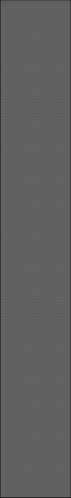

> **Descripción de la imagen** — La imagen es un fondo de color gris claro o blanco con un patrón de puntos finos y uniformes que cubre toda el área visible. No contiene ningún diagrama, gráfico, tabla ni ilustración; es esencialmente un espacio vacío con una textura sutil.

> **Descripción de la imagen** — La imagen es un bloque sólido de color rosa pálido o salmón claro que ocupa todo el espacio visible. No contiene texto, gráficos ni elementos estructurales.

## Soka‐tira
## Soka‐tira

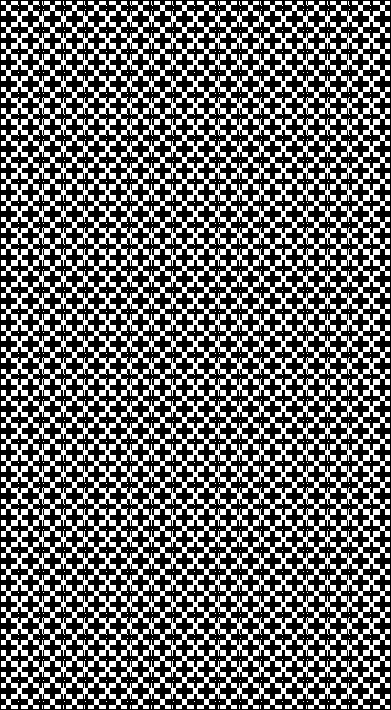

> **Descripción de la imagen** — La imagen es un fondo de color gris con un patrón de rayas verticales finas y uniformes que cubren toda la superficie.

> **Descripción de la imagen** — La imagen es predominantemente un fondo de color azul claro o gris muy pálido. El espacio está casi vacío, con muy pocos elementos visuales dispersos o marcas sutiles en el fondo.

Deporte vasco que consiste en el enfrentamiento de dos

equipos que tiran de los extremos opuestos de una soga, y

en el que vence el equipo que arrastra al contrario al

campo propio.

Deporte vasco que consiste en el enfrentamiento de dos

equipos que tiran de los extremos opuestos de una soga, y

en el que vence el equipo que arrastra al contrario al

campo propio.

> **Descripción de la imagen** — La imagen es un logotipo o encabezado institucional. Presenta un diseño en blanco y negro con los siguientes elementos:
>
> 1.  **Elemento Gráfico Central:** Una figura abstracta compuesta por formas geométricas interconectadas, que parecen piezas de rompecabezas o un nudo complejo.
> 2.  **Texto Superior:** Una frase escrita en una fuente pequeña, posiblemente en euskera, que dice "ematen za zabel zazu".
> 3.  **Identificación Institucional (Parte Inferior):** Dos líneas de texto que identifican a las instituciones:
>     *   A la izquierda: "Universidad del País Vasco"
>     *   A la derecha: "Euskal Herriko Unibertsitatea"

> **Descripción de la imagen** — La imagen es un logotipo institucional que combina un elemento gráfico y texto. A la izquierda, hay un diseño abstracto compuesto por varias formas curvas y arcos superpuestos en colores vibrantes (verde, azul y rojo), dispuestos en una configuración circular o rotacional. A la derecha del gráfico, se encuentra el nombre principal "EUSKAMPUS" escrito en letras grandes y negras. Debajo del nombre principal, hay dos líneas de texto más pequeñas: "Nazioarteko Bikaintasun Campusa" y "Campus de Excelencia Internacional".

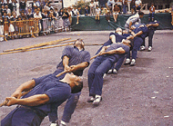

> **Descripción de la imagen** — La imagen es una fotografía de un grupo de hombres realizando algún tipo de ejercicio físico o entrenamiento al aire libre.
>
> Varios hombres, vestidos con camisetas oscuras (azul marino o negro), están acostados o tumbados sobre una superficie pavimentada oscura (posiblemente asfalto). Los hombres están dispuestos en fila o agrupados, y algunos parecen estar realizando un ejercicio de fuerza o estiramiento. En primer plano, se observa a un hombre con la parte superior del cuerpo extendida y las piernas dobladas, mirando hacia adelante. El fondo está desenfocado, pero se aprecian otras figuras humanas y estructuras, sugiriendo que la escena tiene lugar en un entorno exterior, posiblemente un campo de entrenamiento o una calle.

> **Descripción de la imagen** — La imagen es un bloque sólido de color verde claro o verde lima pálido, que ocupa todo el espacio visible. No contiene elementos gráficos, texto, diagramas ni datos específicos.

> **Descripción de la imagen** — La imagen es un fondo de color sólido y uniforme, predominantemente verde claro o amarillo verdoso pálido. No contiene ningún objeto, texto, diagrama, gráfico ni elementos visuales discernibles aparte del color de fondo.

> **Descripción de la imagen** — La imagen es un fondo abstracto o una textura de degradado suave. Presenta una mezcla de tonos pastel, dominados por el amarillo pálido y el verde claro, con transiciones suaves hacia áreas blancas o muy claras en los bordes. No contiene elementos gráficos, texto, diagramas ni datos estructurados.

> **Descripción de la imagen** — La imagen es un fondo de color uniforme y muy claro, dominado por tonos amarillos pálidos y verdes claros. No contiene elementos visuales específicos, diagramas, gráficos o ilustraciones; es esencialmente un área de color con sutiles gradientes de tono.

> **Descripción de la imagen** — La imagen es predominantemente un fondo de color verde claro o amarillo pálido. No contiene elementos gráficos, texto legible ni diagramas complejos; se presenta como un espacio vacío o una sección con un fondo uniforme.

> **Descripción de la imagen** — La imagen es predominantemente un fondo de color verde claro o amarillo verdoso pálido. No se distingue ningún diagrama, gráfico, tabla o ilustración específica; la mayor parte del espacio está ocupado por este tono uniforme. Hay algunas formas y trazos muy difusos e irregulares en el centro y la derecha, pero no son lo suficientemente claros para identificar elementos concretos.

> **Descripción de la imagen** — La imagen es un fragmento de texto que aparece sobre un fondo de color verde claro o amarillo verdoso. El texto visible está escrito en una fuente oscura y parece ser parte de un título o encabezado, con palabras como "la etapa de preparación a secuencia".

> **Descripción de la imagen** — La imagen consiste en una línea de texto escrita en color verde claro. El texto dice: "Se trala de arrastrar al equipo contrario hasta la posición del otro".

> **Descripción de la imagen** — La imagen es predominantemente de color verde oliva o verde militar, con una textura uniforme y apagada. Se observan algunas líneas verticales delgadas y blancas que atraviesan el fondo, sugiriendo un efecto de textura, un filtro o un elemento visual muy sutil y abstracto. No se identifican formas, texto ni datos específicos.

> **Descripción de la imagen** — La imagen es un fondo abstracto compuesto por líneas verticales paralelas de diferentes tonos de verde y blanco/gris claro. Las líneas varían en intensidad y saturación, creando un efecto de textura o rayas verticales que se extienden a lo largo del campo visual.

> **Descripción de la imagen** — La imagen es un fondo abstracto compuesto por múltiples franjas verticales de diferentes tonos de verde. Los colores varían desde verdes oscuros y oliva hasta tonos más claros y casi blancos o verde lima pálido, creando un efecto de textura o degradado vertical.

> **Descripción de la imagen** — La imagen es un patrón abstracto compuesto por franjas verticales. Estas franjas alternan entre diferentes tonos de verde (desde verdes claros y lima hasta verdes oliva más oscuros) y líneas blancas o de color gris muy claro. El diseño crea una textura de rayas verticales que cubren todo el espacio visual.

> **Descripción de la imagen** — La imagen es un fondo abstracto compuesto por franjas verticales que varían en tono y color. Presenta una transición de colores que incluye tonos de verde, desde verdes oliva o oscuros hasta verdes claros y blancos, creando un efecto de rayas o degradado vertical.

> **Descripción de la imagen** — La imagen es un fondo de color sólido, predominantemente verde oliva o verde amarillento apagado. No contiene ningún texto, diagrama, gráfico ni elementos visuales específicos.

> **Descripción de la imagen** — La imagen es un fondo sólido de color verde oliva o verde musgo apagado y uniforme. No contiene elementos gráficos, texto, diagramas ni estructuras visibles.

> **Descripción de la imagen** — La imagen es un bloque sólido de color verde oliva o caqui uniforme, sin ningún elemento gráfico, texto, diagrama o ilustración visible.

> **Descripción de la imagen** — La imagen es un campo de color uniforme, predominantemente verde oliva oscuro o marrón verdoso. No contiene elementos visuales, texto, diagramas ni gráficos discernibles.

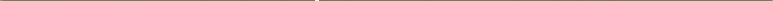

> **Descripción de la imagen** — La imagen es un fondo de color sólido, predominantemente verde oliva o caqui oscuro. Presenta una textura sutil y variaciones tonales que le dan profundidad, pero no contiene elementos gráficos, texto, diagramas ni datos específicos.

> **Descripción de la imagen** — La imagen proporcionada está completamente en blanco o no contiene ningún contenido visual discernible para describir. Por favor, asegúrese de adjuntar la imagen para que pueda realizar la descripción solicitada.

> **Descripción de la imagen** — La imagen es predominantemente un fondo de color uniforme, de tono verde claro o verde salvia. No contiene texto, gráficos, diagramas ni elementos visuales específicos aparte del color sólido.

> **Descripción de la imagen** — La imagen es un campo de color sólido, predominantemente verde claro o menta. No contiene ningún texto, diagrama, gráfico ni ilustración específica; es un fondo de color uniforme.

> **Descripción de la imagen** — La imagen es un fondo completamente liso de color verde claro o menta uniforme. No contiene ningún texto, diagrama, gráfico ni elementos visuales específicos.

> **Descripción de la imagen** — La imagen es un campo de color uniforme, de tono verde claro o menta pálido, sin ningún elemento gráfico, texto, diagrama o figura discernible.

> **Descripción de la imagen** — La imagen es un bloque de color sólido o degradado en un tono verde claro o menta pálido. No contiene texto, diagramas, gráficos ni elementos visuales específicos.

> **Descripción de la imagen** — La imagen es un campo de color sólido, de tono verde claro o menta uniforme. No contiene elementos gráficos, texto, diagramas ni datos visibles.

> **Descripción de la imagen** — La imagen es un fondo de color verde claro uniforme. No contiene elementos gráficos, texto ni diagramas.

> **Descripción de la imagen** — La imagen es un campo de color sólido y uniforme. El color predominante es un tono de verde claro o verde menta. No contiene objetos, texto, diagramas ni estructuras visuales complejas.

> **Descripción de la imagen** — La imagen es un fondo completamente sólido de color verde claro o menta uniforme. No contiene elementos gráficos, texto, diagramas ni datos visuales específicos.

> **Descripción de la imagen** — La imagen es predominantemente un fondo de color verde claro o menta. No contiene ningún diagrama, gráfico, tabla ni ilustración detallada; es esencialmente un espacio vacío de color sólido. Hay algunas marcas o caracteres muy tenues en la esquina inferior derecha.

> **Descripción de la imagen** — La imagen es un fondo de color sólido, predominantemente verde brillante o verde lima. Presenta una ligera variación tonal o gradiente sutil a lo largo de su extensión, pero no contiene ningún objeto, texto, diagrama o elemento gráfico específico.

> **Descripción de la imagen** — La imagen es un fragmento visual con un fondo de color verde brillante y varios elementos verticales de color blanco. Estos elementos se presentan como barras o rectángulos de diferentes alturas, distribuidos verticalmente a lo largo del lado izquierdo de la composición. Se observan al menos cuatro barras blancas distintas, que varían en su longitud, sugiriendo una representación gráfica simplificada de datos o una secuencia de elementos. No hay etiquetas ni ejes visibles para contextualizar los datos.

> **Descripción de la imagen** — El contenido visual es un fragmento de texto que dice: "Existe un desgaste tremendo al intentar llevar a la otra parte a tu terreno".

> **Descripción de la imagen** — La imagen es una franja horizontal de color verde oscuro que ocupa la parte superior del espacio visible. Sobre este fondo verde, hay texto o símbolos en color blanco, aunque el contenido específico es fragmentado y no se puede leer completamente.

> **Descripción de la imagen** — La imagen es predominantemente un fondo de color verde sólido y uniforme. En el borde derecho de la imagen, se observan formas o artefactos oscuros, muy difusos e indistintos, que parecen ser elementos abstractos o ruido visual.

> **Descripción de la imagen** — La imagen es un fondo de color sólido, de tono verde oscuro o verde bosque. No contiene ningún texto, diagrama, gráfico ni elementos visuales específicos.

> **Descripción de la imagen** — La imagen es un fondo completamente sólido de un color verde oscuro o verde bosque uniforme. No contiene elementos gráficos, texto ni figuras específicas.

> **Descripción de la imagen** — La imagen es un fondo de color sólido, predominantemente verde brillante o verde lima. No contiene ningún texto, diagrama, gráfico ni elementos visuales específicos aparte del color uniforme.

> **Descripción de la imagen** — La imagen es un fondo completamente uniforme de color verde oscuro o verde bosque. No contiene ningún objeto, texto, diagrama, gráfico ni elemento visual discernible aparte del color sólido.

> **Descripción de la imagen** — La imagen es un campo de color sólido, de tono verde oscuro o verde oliva uniforme. No contiene ningún objeto, texto, diagrama o gráfico visible.

> **Descripción de la imagen** — La imagen es un fondo de color sólido, de tono verde oscuro o verde azulado. No contiene ningún texto, diagrama, gráfico ni ilustración específica.

> **Descripción de la imagen** — La imagen es un fondo de color sólido. El color es un tono verde oscuro o verde azulado apagado y uniforme, sin ningún otro elemento, texto, diagrama o ilustración visible.

> **Descripción de la imagen** — La imagen es un bloque sólido de color verde oscuro uniforme. No contiene texto, gráficos, diagramas ni elementos visuales complejos.

> **Descripción de la imagen** — La imagen es un fondo de color sólido, predominantemente verde oscuro o verde azulado profundo. No contiene elementos gráficos, texto, diagramas ni datos visibles.

> **Descripción de la imagen** — La imagen es un fondo completamente sólido de color verde oscuro o verde bosque. No contiene ningún texto, diagrama, gráfico ni ilustración visible.

> **Descripción de la imagen** — La imagen es un fondo de color sólido y uniforme, de un tono verde azulado pálido o menta claro. No contiene ningún objeto, texto, diagrama, gráfico ni estructura visual discernible.

> **Descripción de la imagen** — La imagen es un bloque sólido de color turquesa claro o verde menta. No contiene ningún texto, diagrama, gráfico, tabla ni elementos visuales específicos; es una superficie de color uniforme.

> **Descripción de la imagen** — La imagen proporcionada es un campo de color sólido, de tono cian claro o turquesa pálido, y no contiene ningún elemento visual, diagrama, gráfico, tabla o ilustración discernible.

> **Descripción de la imagen** — La imagen proporcionada es casi completamente un campo de color sólido, de tono cian claro o turquesa pálido. No contiene texto, diagramas, gráficos, tablas ni ilustraciones discernibles.

> **Descripción de la imagen** — La imagen proporcionada es un bloque de color uniforme, de tonalidad cian claro o turquesa pálido. No contiene ningún elemento gráfico, texto, diagrama, tabla ni ilustración discernible.

> **Descripción de la imagen** — La imagen es un campo de color uniforme, predominantemente de un tono cian claro o turquesa pálido. No contiene elementos gráficos, texto, diagramas, tablas ni ilustraciones específicas; es esencialmente un fondo de color sólido.

> **Descripción de la imagen** — La imagen es un bloque sólido de color turquesa claro o verde menta. No contiene ningún diagrama, gráfico, tabla, texto ni elementos visuales específicos; es una superficie de color uniforme.

> **Descripción de la imagen** — La imagen es un fondo de color sólido, predominantemente un tono verde azulado claro o menta pálido. No contiene ningún texto, diagrama, gráfico ni elementos visuales específicos; es esencialmente un espacio vacío de color uniforme.

> **Descripción de la imagen** — La imagen es un fondo de color sólido, predominantemente turquesa claro o verde menta pálido. No contiene ningún diagrama, gráfico, texto, tabla ni ilustración; es simplemente un bloque de color uniforme.

> **Descripción de la imagen** — La imagen es un bloque sólido de color verde azulado claro (teal o menta), sin ningún otro elemento, texto, diagrama, gráfico o ilustración visible.

> **Descripción de la imagen** — La imagen es predominantemente un fondo de color verde azulado claro (teal). No contiene texto, gráficos, diagramas ni datos visibles; es esencialmente un espacio vacío.

> **Descripción de la imagen** — La imagen es un diseño gráfico minimalista compuesto por franjas verticales de color. Presenta una alternancia de bloques de color turquesa o verde azulado claro y franjas blancas, creando un patrón de rayas verticales.

> **Descripción de la imagen** — La imagen es un fondo de color turquesa o verde azulado con una serie de elementos verticales y rectangulares de color blanco. Estos elementos están dispuestos en varias columnas o segmentos, creando un patrón abstracto que sugiere una estructura segmentada o un diagrama incompleto.

> **Descripción de la imagen** — La imagen es un texto que presenta un resultado o conclusión. El contenido visual muestra la frase: "El resultado es: una parte GANA y la otra PIERDE".

> **Descripción de la imagen** — La imagen es un fondo de color sólido, predominantemente un tono verde azulado o turquesa claro. No contiene texto, diagramas, gráficos ni elementos visuales específicos.

> **Descripción de la imagen** — La imagen es un fondo de color sólido, predominantemente verde azulado o turquesa. No contiene elementos gráficos, diagramas, tablas ni ilustraciones visibles; es esencialmente un bloque de color uniforme.

> **Descripción de la imagen** — La imagen es un campo de color sólido y uniforme, predominantemente de un tono verde azulado o turquesa. No contiene elementos gráficos, texto, diagramas, tablas ni ilustraciones; es esencialmente un bloque de color plano.

> **Descripción de la imagen** — La imagen es un fondo completamente uniforme de un solo color, un tono verde azulado o turquesa apagado. No contiene texto, diagramas, gráficos ni elementos visuales específicos.

> **Descripción de la imagen** — La imagen es un bloque sólido de color verde azulado o turquesa apagado. No contiene texto, gráficos, diagramas ni elementos visuales específicos.

> **Descripción de la imagen** — La imagen es un bloque sólido de color verde azulado oscuro o turquesa apagado. No contiene ningún texto, diagrama, gráfico ni ilustración visible.

> **Descripción de la imagen** — La imagen es un fondo sólido de un color verde azulado o turquesa apagado. No contiene ningún objeto, texto, diagrama, gráfico ni elemento visual discernible más allá del color uniforme.

> **Descripción de la imagen** — La imagen es un fondo de color sólido. El tono es un verde azulado o turquesa apagado (teal). Presenta una ligera gradación sutil en la iluminación, pero no contiene elementos gráficos, texto ni objetos discernibles.

> **Descripción de la imagen** — La imagen es un fondo de color uniforme, predominantemente un tono verde azulado o turquesa apagado. No contiene elementos visuales, texto, diagramas ni gráficos.

> **Descripción de la imagen** — La imagen es un bloque sólido de color. El color predominante es un tono verde azulado oscuro o verde botella. No contiene texto, gráficos, diagramas ni elementos visuales específicos; es una superficie de color uniforme.

> **Descripción de la imagen** — La imagen es un campo de color sólido de tono verde azulado oscuro (teal). No contiene ningún objeto, texto, diagrama o estructura visual discernible.

> **Descripción de la imagen** — La imagen es un bloque sólido de color uniforme, de un tono verde grisáceo o azul verdoso apagado. No contiene ningún texto, diagrama, gráfico ni elementos visuales discernibles aparte del color de fondo.

> **Descripción de la imagen** — La imagen es un fondo de color sólido, predominantemente azul claro o lavanda pálido. No contiene texto, gráficos, diagramas ni elementos visuales específicos discernibles.

> **Descripción de la imagen** — La imagen es un fondo de color sólido o degradado en tonos azules y morados. No contiene elementos gráficos, texto legible ni estructuras como diagramas, tablas o ilustraciones.

> **Descripción de la imagen** — La imagen es un fondo de color uniforme con un degradado suave que transiciona entre tonos de azul y púrpura. No contiene elementos gráficos, texto, diagramas ni datos visibles.

> **Descripción de la imagen** — La imagen es un campo de color sólido, predominantemente azul claro o lavanda pálido. No contiene elementos visuales específicos, texto, gráficos, tablas ni diagramas; es esencialmente una superficie de color uniforme.

> **Descripción de la imagen** — La imagen consiste en un fondo de color sólido, de tonalidad azul claro o celeste pálido. No contiene elementos gráficos, texto, diagramas ni datos visibles.

> **Descripción de la imagen** — La imagen es un fondo de color sólido, predominantemente azul claro o lavanda pálido, con ligeras variaciones tonales o gradientes sutiles en los bordes. No contiene elementos gráficos, texto ni figuras específicas.

> **Descripción de la imagen** — La imagen es un fondo de color sólido, predominantemente azul claro o celeste. No contiene elementos gráficos, texto, diagramas ni ilustraciones discernibles.

> **Descripción de la imagen** — La imagen es un fondo de color que presenta un degradado suave. Comienza en el lado izquierdo con un tono azul claro o celeste y se desvanece gradualmente hacia el lado derecho, donde el color se oscurece a un tono azul más profundo o púrpura. No contiene elementos gráficos, texto, diagramas ni datos específicos.

> **Descripción de la imagen** — La imagen es un bloque sólido de color azul oscuro o índigo, que ocupa todo el espacio visible. No contiene ningún texto, diagrama, gráfico ni ilustración discernible; es esencialmente un fondo de color uniforme.

> **Descripción de la imagen** — La imagen es predominantemente un fondo de color azul oscuro o morado sólido. No contiene elementos visuales específicos, diagramas, tablas, gráficos ni texto discernible.

> **Descripción de la imagen** — La imagen proporcionada es predominantemente un fondo de color azul oscuro o morado sólido. No contiene ningún diagrama, gráfico, tabla, ilustración o texto legible que represente contenido académico o de estudio.

> **Descripción de la imagen** — La imagen es un fondo de color sólido, predominantemente azul oscuro o índigo. No contiene elementos visuales, texto, diagramas ni gráficos discernibles.

> **Descripción de la imagen** — La imagen es predominantemente un bloque de color azul oscuro o morado intenso que ocupa la mayor parte del espacio. En la esquina inferior derecha, se aprecian algunas formas o caracteres muy borrosos y poco definidos en tonos más claros.

> **Descripción de la imagen** — La imagen es un recuadro de color azul claro que contiene una pregunta escrita en texto blanco. El texto dice: "¿Es éste el fin de la negociación?".

> **Descripción de la imagen** — La imagen es predominantemente un fondo de color azul muy oscuro o negro. No contiene elementos visuales, diagramas, gráficos, tablas ni ilustraciones discernibles; parece ser una sección vacía o un espacio en blanco.

> **Descripción de la imagen** — La imagen es un bloque de color sólido, predominantemente azul oscuro o azul marino. No contiene texto, diagramas, gráficos ni elementos visuales estructurados; es esencialmente un fondo de color uniforme.

> **Descripción de la imagen** — La imagen es predominantemente un fondo de color azul oscuro o azul marino sólido. No contiene elementos gráficos, texto legible ni diagramas visibles.

> **Descripción de la imagen** — La imagen es un bloque sólido de color azul oscuro o índigo. No contiene ningún texto, diagrama, gráfico ni elementos visuales discernibles aparte del color uniforme.

> **Descripción de la imagen** — La imagen es predominantemente un fondo de color azul oscuro o azul marino. No contiene elementos gráficos, texto legible, diagramas, tablas ni ilustraciones específicas. Solo se observan algunas marcas o manchas muy tenues en la esquina inferior derecha.

> **Descripción de la imagen** — La imagen es un bloque sólido de color azul oscuro o azul marino, sin ningún otro elemento visual, texto, diagrama o ilustración discernible.

> **Descripción de la imagen** — La imagen es un campo de color sólido, predominantemente azul oscuro o índigo. No contiene elementos gráficos, texto, diagramas ni estructuras visibles; es una superficie uniforme y oscura.

> **Descripción de la imagen** — La imagen es un campo de color sólido, de tono azul oscuro o índigo. No contiene elementos visuales, texto, diagramas, gráficos ni figuras discernibles.

> **Descripción de la imagen** — La imagen es predominantemente un bloque de color sólido, de tono azul oscuro o marino. No contiene texto, gráficos, diagramas ni ilustraciones detalladas; es esencialmente un fondo de color uniforme.

> **Descripción de la imagen** — La imagen es predominantemente un fondo oscuro, de color azul marino o negro. No presenta contenido visual claro, como texto, gráficos, diagramas o ilustraciones detalladas. La mayor parte del área es uniforme y oscura, con algunas formas o marcas muy tenues e indistintas en la parte central y derecha.

> **Descripción de la imagen** — La imagen es un bloque sólido de color azul oscuro o gris pizarra uniforme. No contiene ningún texto, diagrama, gráfico ni ilustración visible.

> **Descripción de la imagen** — La imagen es un campo de color sólido o un fondo con un degradado suave. Predomina un tono púrpura o violeta oscuro. Hay ligeras variaciones tonales que sugieren un sutil gradiente de luz o sombra a través del área. No contiene texto, gráficos, tablas ni elementos visuales complejos.

> **Descripción de la imagen** — La imagen es predominantemente un fondo de color morado o lila, con una ligera gradación. No contiene elementos gráficos complejos, texto legible ni diagramas; se presenta como un bloque visual de color sólido y suave.

> **Descripción de la imagen** — La imagen es un bloque sólido de color morado claro o lavanda. No contiene elementos gráficos, texto, diagramas ni datos visibles; es una superficie uniforme de color.

> **Descripción de la imagen** — La imagen es un fondo de color sólido, presentando un degradado suave que va de un tono lila claro en la parte superior a un tono ligeramente más oscuro o púrpura en la parte inferior. No contiene texto, diagramas, gráficos ni elementos visuales específicos.

> **Descripción de la imagen** — La imagen es un bloque sólido de color lila o morado claro, sin ningún otro elemento, texto, gráfico o forma discernible.

> **Descripción de la imagen** — La imagen consiste en un fondo de color lila o morado muy claro y uniforme que ocupa todo el espacio visible. No contiene ningún diagrama, gráfico, tabla, texto legible ni elementos visuales específicos aparte del color sólido.

> **Descripción de la imagen** — La imagen es un fondo de color que presenta un degradado suave. El color transiciona gradualmente desde un tono púrpura claro o lavanda en el lado izquierdo hacia un tono púrpura más oscuro o malva en el lado derecho.

> **Descripción de la imagen** — La imagen es un campo de color uniforme, predominantemente de un tono púrpura o lavanda. Presenta una gradación sutil en la intensidad del color, con variaciones tonales que sugieren un degradado suave dentro del área visual. No contiene elementos gráficos, texto ni figuras específicas.

> **Descripción de la imagen** — La imagen es un campo de color sólido o degradado, dominado por tonos de púrpura y violeta. No contiene elementos gráficos, texto, diagramas ni datos estructurados.

> **Descripción de la imagen** — La imagen es un campo de color uniforme, dominado por un tono lila o púrpura suave. No contiene ningún objeto, texto, diagrama, gráfico ni estructura discernible. Es esencialmente un bloque sólido de color.

> **Descripción de la imagen** — La imagen proporcionada es demasiado oscura, borrosa o incompleta para que pueda identificar y describir su contenido visual específico (diagrama, gráfico, tabla o ilustración). No se distingue ningún elemento estructurado o información clara.

> **Descripción de la imagen** — La imagen es un bloque sólido de color morado o lila uniforme, sin ningún otro elemento, texto, diagrama, gráfico o ilustración visible.

> **Descripción de la imagen** — La imagen es un recuadro de color morado con texto en blanco. El texto dice: "O se trata de que ganen ambas partes".

> **Descripción de la imagen** — La imagen es un bloque sólido de color morado o púrpura uniforme. No contiene texto, diagramas, gráficos ni elementos visuales discernibles.

> **Descripción de la imagen** — La imagen es un fondo de color uniforme, predominantemente púrpura o magenta oscuro. No contiene ningún objeto, texto, diagrama, gráfico ni elementos visuales específicos.

> **Descripción de la imagen** — La imagen es un campo de color sólido y uniforme. Predomina un tono púrpura o violeta oscuro. No contiene elementos gráficos, texto, diagramas ni datos visibles.

> **Descripción de la imagen** — La imagen es un fondo sólido de color morado o púrpura oscuro, sin elementos gráficos, texto ni figuras discernibles. Hay algunas marcas o artefactos muy sutiles en la esquina inferior derecha.

> **Descripción de la imagen** — La imagen es un bloque sólido de color morado oscuro o violeta, sin ningún otro elemento, texto, gráfico o forma discernible.

> **Descripción de la imagen** — La imagen es un bloque sólido de color morado o púrpura oscuro, sin ningún elemento gráfico, texto, diagrama o ilustración discernible.

> **Descripción de la imagen** — La imagen es un bloque sólido de color morado oscuro o púrpura. No contiene texto, diagramas, gráficos ni elementos visuales discernibles.

> **Descripción de la imagen** — La imagen es un campo de color sólido. Muestra un tono uniforme de púrpura oscuro o violeta. No contiene ningún objeto, texto, diagrama, gráfico ni elementos visuales adicionales.

> **Descripción de la imagen** — La imagen es un bloque sólido de color morado oscuro o púrpura. No contiene ningún texto, diagrama, gráfico ni elementos visuales discernibles.

> **Descripción de la imagen** — La imagen es un bloque sólido de color morado oscuro o púrpura. No contiene texto, gráficos, diagramas, tablas ni elementos visuales discernibles.

> **Descripción de la imagen** — La imagen es un bloque sólido de color, predominantemente un tono púrpura muy oscuro o borgoña. No contiene elementos visuales discernibles como diagramas, texto, gráficos, tablas o ilustraciones; es esencialmente una superficie uniforme de color.

> **Descripción de la imagen** — La imagen es un bloque sólido de color morado oscuro o índigo uniforme. No contiene ningún texto, diagrama, gráfico, tabla ni elementos visuales discernibles.

---

<!-- página 6 -->
## Tipos básicos de negociación

NEGOCIACIONES COMPETITIVAS

GANAR‐PERDER

•
Se establecen en términos de

confrontación.

•
Las partes son adversarias.

•
El objetivo es la victoria.

•
Se desconfía de la otra parte.

•
Se insiste en la posición.

•
Se contraponen argumentos.

•
Se presiona y se amenaza.

•
Se exigen ganancias para llegar al

acuerdo.

•
Se intenta sacar los mayores

beneficios.

•
No importa lo que siente la otra

parte.

•
No se cuidan las relaciones a largo

plazo.

NEGOCIACIONES COLABORATIVAS

GANAR‐GANAR

•
Se establecen en términos de

colaboración.

•
Las partes se tratan amistosamente.

•
El objetivo es el acuerdo.

•
Se confía en la otra parte.

•
Se insiste en el acuerdo.

•
Se informa.

•
Se persuade y se ofrece.

•
Se intenta cubrir las necesidades de

la otra parte.

•
Se puede llegar a aceptar ciertas

pérdidas para llegar al acuerdo.

•
La otra parte también debe quedar

satisfecha con el acuerdo.

•
Se fortalecen las relaciones a largo

plazo.

> **Descripción de la imagen** — La imagen es un logotipo o encabezado institucional. Presenta un diseño en blanco y negro con los siguientes elementos:
>
> 1.  **Elemento Gráfico Central:** Una figura abstracta compuesta por formas geométricas interconectadas, que parecen piezas de rompecabezas o un nudo complejo.
> 2.  **Texto Superior:** Una frase escrita en una fuente pequeña, posiblemente en euskera, que dice "ematen za zabel zazu".
> 3.  **Identificación Institucional (Parte Inferior):** Dos líneas de texto que identifican a las instituciones:
>     *   A la izquierda: "Universidad del País Vasco"
>     *   A la derecha: "Euskal Herriko Unibertsitatea"

> **Descripción de la imagen** — La imagen es un logotipo institucional que combina un elemento gráfico y texto. A la izquierda, hay un diseño abstracto compuesto por varias formas curvas y arcos superpuestos en colores vibrantes (verde, azul y rojo), dispuestos en una configuración circular o rotacional. A la derecha del gráfico, se encuentra el nombre principal "EUSKAMPUS" escrito en letras grandes y negras. Debajo del nombre principal, hay dos líneas de texto más pequeñas: "Nazioarteko Bikaintasun Campusa" y "Campus de Excelencia Internacional".

---

<!-- página 7 -->
## Tipos básicos de negociación

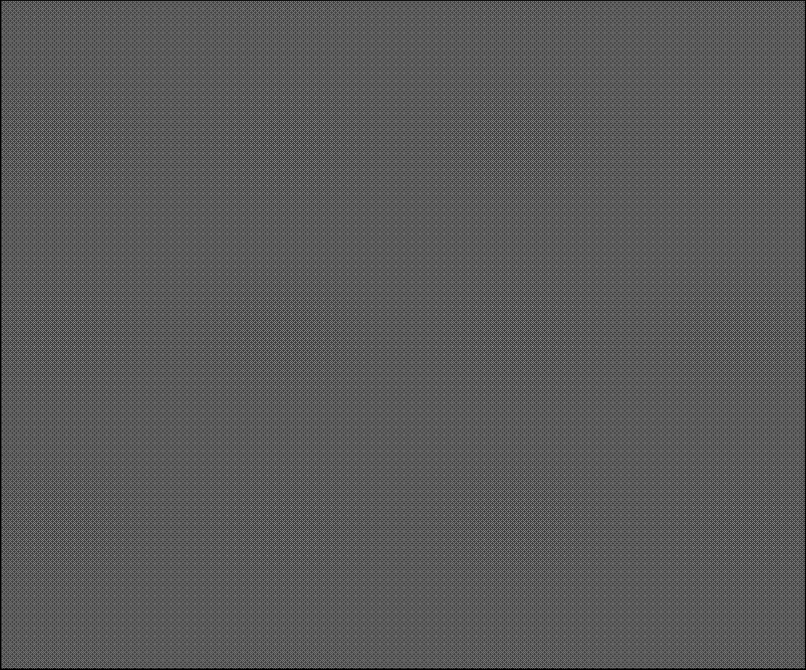

> **Descripción de la imagen** — La imagen es un fondo uniforme de color gris oscuro o negro con una textura de ruido o patrón de puntos finos (halftone). No contiene ningún diagrama, gráfico, tabla, foto o ilustración discernible; es esencialmente un espacio vacío texturizado.

> **Descripción de la imagen** — La imagen es un fondo de color uniforme, predominantemente azul claro o cian, con una ligera gradación. No contiene texto, diagramas, tablas ni ilustraciones específicas; es esencialmente un campo visual sólido y liso.

Negociaciones Competitivas

GANAR‐PERDER

Cada parte se dedica a defender

su  posición  y  a  atacar  a  la

parte
contraria.
Conforme

avanza  la  negociación  cada

parte se va encerrando en su

muralla, perdiendo margen de

maniobra, generando tensión,

desgastando  la  confianza  y

olvidando los intereses.

Negociaciones Colaborativas

GANAR‐GANAR

Se asemejan a un puzle en el que

se  construyen  soluciones  que

satisfacen los intereses de ambas

partes,  poniendo  sobre  la  mesa

todas las piezas de la negociación

y  encajándolas  conjuntamente,

para  fortalecer  las  relaciones  a

largo plazo.

Negociaciones Colaborativas

GANAR‐GANAR

Se asemejan a un puzle en el que

se  construyen  soluciones  que

satisfacen los intereses de ambas

partes,  poniendo  sobre  la  mesa

todas las piezas de la negociación

y  encajándolas  conjuntamente,

para  fortalecer  las  relaciones  a

largo plazo.

> **Descripción de la imagen** — La imagen es un logotipo o encabezado institucional. Presenta un diseño en blanco y negro con los siguientes elementos:
>
> 1.  **Elemento Gráfico Central:** Una figura abstracta compuesta por formas geométricas interconectadas, que parecen piezas de rompecabezas o un nudo complejo.
> 2.  **Texto Superior:** Una frase escrita en una fuente pequeña, posiblemente en euskera, que dice "ematen za zabel zazu".
> 3.  **Identificación Institucional (Parte Inferior):** Dos líneas de texto que identifican a las instituciones:
>     *   A la izquierda: "Universidad del País Vasco"
>     *   A la derecha: "Euskal Herriko Unibertsitatea"

> **Descripción de la imagen** — La imagen es un logotipo institucional que combina un elemento gráfico y texto. A la izquierda, hay un diseño abstracto compuesto por varias formas curvas y arcos superpuestos en colores vibrantes (verde, azul y rojo), dispuestos en una configuración circular o rotacional. A la derecha del gráfico, se encuentra el nombre principal "EUSKAMPUS" escrito en letras grandes y negras. Debajo del nombre principal, hay dos líneas de texto más pequeñas: "Nazioarteko Bikaintasun Campusa" y "Campus de Excelencia Internacional".

---

<!-- página 8 -->
## Criterios para elegir el tipo de
## negociación

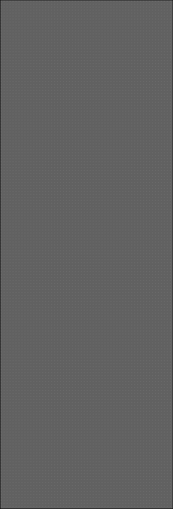

> **Descripción de la imagen** — La imagen es un fondo de textura compuesto por líneas verticales finas y uniformes en tonos grises o negros, creando un patrón de rayas. No contiene elementos gráficos, texto ni diagramas discernibles.

> **Descripción de la imagen** — La imagen es muy minimalista y consiste en la palabra "respeta" escrita en texto simple.

•
La condición fundamental para que se produzca la negociación es que las

partes quieran negociar.

•
Una de las partes se puede encontrar en la imperiosa necesidad de llegar a

un acuerdo, mientras que la otra parte ostenta una posición dominante.

•
El poder en la negociación depende de disponer de la mejor alternativa a

un acuerdo negociado (MAAN), como otra empresa con la que negociar.

De esto depende el valor mínimo aceptable en la negociación.

•
La negociación se planteará de forma competitiva o colaborativa en

función de la relación de poder y de las alternativas de cada parte.

•
La condición fundamental para que se produzca la negociación es que las

partes quieran negociar.

•
Una de las partes se puede encontrar en la imperiosa necesidad de llegar a

un acuerdo, mientras que la otra parte ostenta una posición dominante.

•
El poder en la negociación depende de disponer de la mejor alternativa a

un acuerdo negociado (MAAN), como otra empresa con la que negociar.

De esto depende el valor mínimo aceptable en la negociación.

•
La negociación se planteará de forma competitiva o colaborativa en

función de la relación de poder y de las alternativas de cada parte.

> **Descripción de la imagen** — La imagen es una fotografía de dos personas adultas interactuando en un entorno interior.
>
> A la izquierda, hay una mujer con piel oscura y cabello oscuro, vestida con una chaqueta o blazer de color gris claro. Está sonriendo y mirando hacia el hombre a su lado.
>
> A la derecha, hay un hombre mayor con barba y cabello canoso, vestido con un traje oscuro y una corbata roja. El hombre está sonriendo y parece estar estrechando la mano de la mujer en un apretón de manos.
>
> La composición muestra una interacción cordial y profesional entre ambos sujetos. El fondo es simple e indistinto, sugiriendo un entorno de oficina o reunión.

> **Descripción de la imagen** — La imagen es un logotipo o encabezado institucional. Presenta un diseño en blanco y negro con los siguientes elementos:
>
> 1.  **Elemento Gráfico Central:** Una figura abstracta compuesta por formas geométricas interconectadas, que parecen piezas de rompecabezas o un nudo complejo.
> 2.  **Texto Superior:** Una frase escrita en una fuente pequeña, posiblemente en euskera, que dice "ematen za zabel zazu".
> 3.  **Identificación Institucional (Parte Inferior):** Dos líneas de texto que identifican a las instituciones:
>     *   A la izquierda: "Universidad del País Vasco"
>     *   A la derecha: "Euskal Herriko Unibertsitatea"

> **Descripción de la imagen** — La imagen es un logotipo institucional que combina un elemento gráfico y texto. A la izquierda, hay un diseño abstracto compuesto por varias formas curvas y arcos superpuestos en colores vibrantes (verde, azul y rojo), dispuestos en una configuración circular o rotacional. A la derecha del gráfico, se encuentra el nombre principal "EUSKAMPUS" escrito en letras grandes y negras. Debajo del nombre principal, hay dos líneas de texto más pequeñas: "Nazioarteko Bikaintasun Campusa" y "Campus de Excelencia Internacional".

---

<!-- página 9 -->
## Criterios para elegir el tipo de
## negociación

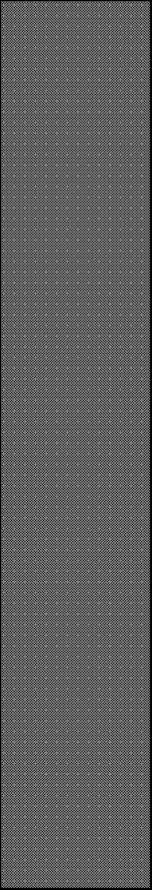

> **Descripción de la imagen** — La imagen proporcionada es una página que está casi completamente vacía, compuesta por un patrón de textura granulada o punteada en tonos grises y blancos. No contiene ningún diagrama, tabla, gráfico ni ilustración visible; es esencialmente un fondo texturizado.

> **Descripción de la imagen** — La imagen es un campo de color sólido, predominantemente de tono rosa pálido o salmón claro. No contiene ningún texto, diagrama, gráfico, tabla ni elementos visuales discernibles aparte del color uniforme.

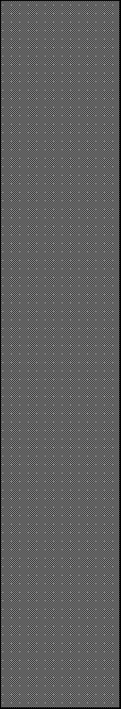

> **Descripción de la imagen** — La imagen proporcionada es un campo vacío o un marcador de posición. Consiste en un fondo uniforme de color gris claro con un patrón sutil de puntos o textura. No contiene ningún diagrama, gráfico, tabla, ilustración ni texto visible.

> **Descripción de la imagen** — No se ha proporcionado ninguna imagen para describir. Por favor, adjunte la imagen que desea que analice.

Criterios para elegir

Negociaciones Competitivas

Criterios para elegir

Negociaciones Competitivas

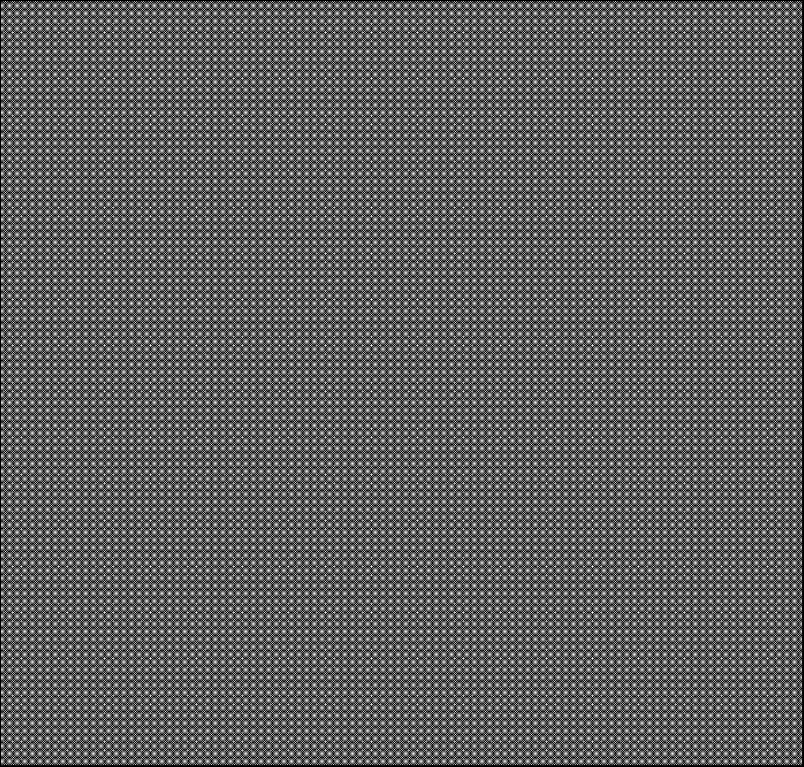

> **Descripción de la imagen** — La imagen es esencialmente un fondo uniforme de color gris claro o blanco roto, con una textura sutil y fina que parece un patrón de cuadrícula o ruido digital muy tenue. No contiene ningún objeto, texto, diagrama, gráfico ni ilustración discernible.

> **Descripción de la imagen** — La imagen es predominantemente un fondo de color rosa pálido o rojo claro. No contiene elementos gráficos, texto legible ni estructuras como diagramas, tablas o ilustraciones definidas.

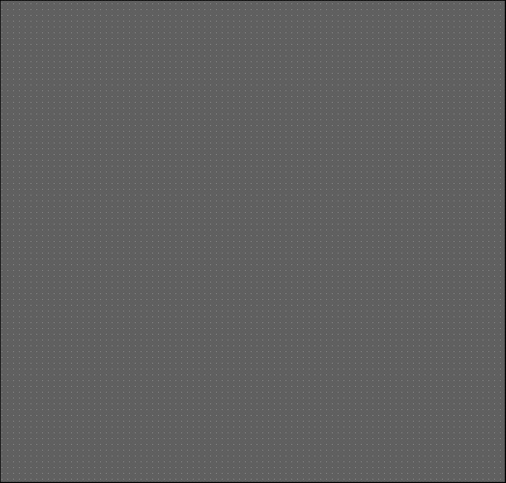

> **Descripción de la imagen** — La imagen es un fondo de color gris oscuro o negro con una textura sutil y repetitiva de puntos o líneas finas (un patrón de trama). No contiene ningún objeto, diagrama, gráfico, tabla ni texto discernible.

> **Descripción de la imagen** — No se ha proporcionado una imagen discernible para describir. Por favor, suba la imagen para que pueda realizar la descripción solicitada.

• Convenientes para
negociaciones simples y a

corto plazo, donde el

acuerdo y su

materialización son casi

inmediatas

• Cuando la negociación gira

en torno a una única

variable: PRECIO

• Convenientes para
negociaciones simples y a

corto plazo, donde el

acuerdo y su

materialización son casi

inmediatas

• Cuando la negociación gira

en torno a una única

variable: PRECIO

Criterios para elegir

Negociaciones Colaborativas

Criterios para elegir

Negociaciones Colaborativas

• Recomendables para
negociaciones complejas y a

largo plazo en las que se

requiere garantizar el

cumplimiento del contrato

en base a la capacidad y

voluntad de las partes

• Cuando la negociación
comprende un gran número

de variables: GARANTÍAS,

SERVICIOS POSTVENTA,

> **Descripción de la imagen** — La imagen es un logotipo o encabezado institucional. Presenta un diseño en blanco y negro con los siguientes elementos:
>
> 1.  **Elemento Gráfico Central:** Una figura abstracta compuesta por formas geométricas interconectadas, que parecen piezas de rompecabezas o un nudo complejo.
> 2.  **Texto Superior:** Una frase escrita en una fuente pequeña, posiblemente en euskera, que dice "ematen za zabel zazu".
> 3.  **Identificación Institucional (Parte Inferior):** Dos líneas de texto que identifican a las instituciones:
>     *   A la izquierda: "Universidad del País Vasco"
>     *   A la derecha: "Euskal Herriko Unibertsitatea"

> **Descripción de la imagen** — La imagen es un logotipo institucional que combina un elemento gráfico y texto. A la izquierda, hay un diseño abstracto compuesto por varias formas curvas y arcos superpuestos en colores vibrantes (verde, azul y rojo), dispuestos en una configuración circular o rotacional. A la derecha del gráfico, se encuentra el nombre principal "EUSKAMPUS" escrito en letras grandes y negras. Debajo del nombre principal, hay dos líneas de texto más pequeñas: "Nazioarteko Bikaintasun Campusa" y "Campus de Excelencia Internacional".

ETC.

• Recomendables para
negociaciones complejas y a

largo plazo en las que se

requiere garantizar el

cumplimiento del contrato

en base a la capacidad y

voluntad de las partes

• Cuando la negociación
comprende un gran número

de variables: GARANTÍAS,

SERVICIOS POSTVENTA,

ETC.

---

<!-- página 10 -->

Variables de la negociación

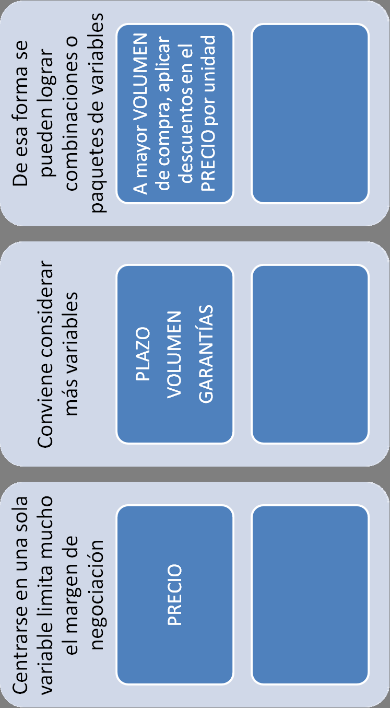

> **Descripción de la imagen** — La imagen es un diagrama conceptual dividido en tres secciones principales, cada una con un título y varios recuadros que representan variables o estrategias.
>
> 1.  **Sección Superior:** Presenta la idea de lograr combinaciones o paquetes de variables. Contiene un recuadro que establece una relación: "A mayor VOLUMEN de compra, aplicar descuentos en el PRECIO por unidad".
> 2.  **Sección Media:** Título "Conviene considerar más variables". Muestra tres recuadros principales que representan factores a considerar: "PLAZO", "VOLUMEN" y "GARANTÍAS".
> 3.  **Sección Inferior:** Título que advierte sobre la limitación de enfocarse en una sola variable. Contiene un recuadro central destacado con la palabra "PRECIO".
>
> El diagrama utiliza bloques de color azul claro para los elementos clave, organizando visualmente las diferentes estrategias y variables relacionadas con negociaciones o paquetes comerciales.

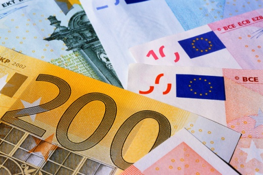

> **Descripción de la imagen** — La imagen es una fotografía en primer plano de varias billetes de euro apilados o superpuestos. El elemento central es un billete grande de color amarillo dorado con la cifra "200" impresa en grandes números oscuros. Se aprecian otros billetes de diferentes colores, incluyendo tonos azules y rojos/anaranjados, algunos de los cuales muestran el diseño de la Unión Europea (bandera azul con estrellas amarillas).

> **Descripción de la imagen** — La imagen es una fotografía de un gran buque de carga (un portacontenedores) navegando bajo un cielo azul con nubes blancas.
>
> El barco ocupa la mayor parte del encuadre y se caracteriza por:
> *   **Casco:** Tiene un casco oscuro (negro o gris muy oscuro).
> *   **Detalles:** Una franja horizontal de color rojo brillante recorre la parte inferior del casco, cerca de la línea de flotación.
> *   **Equipamiento:** El barco está equipado con numerosas grúas y estructuras elevadas blancas en la superestructura, indicando que es un buque de carga. Se observan mástiles altos y aparejos complejos.
> *   **Carga:** En la cubierta se aprecian varios contenedores de carga apilados, algunos de color rojo y otros de colores variados.
>
> La escena sugiere un entorno marítimo abierto o cerca de un puerto.

> **Descripción de la imagen** — La imagen es un fragmento de una página de calendario. Muestra una cuadrícula que representa los días de la semana y las fechas. Se observan varias filas de números que indican las fechas del mes. En el centro de la vista, se destacan dos fechas específicas: el número 15 y el número 22, ambos encerrados en un círculo rojo.

> **Descripción de la imagen** — La imagen es un logotipo o encabezado institucional. Presenta un diseño en blanco y negro con los siguientes elementos:
>
> 1.  **Elemento Gráfico Central:** Una figura abstracta compuesta por formas geométricas interconectadas, que parecen piezas de rompecabezas o un nudo complejo.
> 2.  **Texto Superior:** Una frase escrita en una fuente pequeña, posiblemente en euskera, que dice "ematen za zabel zazu".
> 3.  **Identificación Institucional (Parte Inferior):** Dos líneas de texto que identifican a las instituciones:
>     *   A la izquierda: "Universidad del País Vasco"
>     *   A la derecha: "Euskal Herriko Unibertsitatea"

> **Descripción de la imagen** — La imagen es un logotipo institucional que combina un elemento gráfico y texto. A la izquierda, hay un diseño abstracto compuesto por varias formas curvas y arcos superpuestos en colores vibrantes (verde, azul y rojo), dispuestos en una configuración circular o rotacional. A la derecha del gráfico, se encuentra el nombre principal "EUSKAMPUS" escrito en letras grandes y negras. Debajo del nombre principal, hay dos líneas de texto más pequeñas: "Nazioarteko Bikaintasun Campusa" y "Campus de Excelencia Internacional".

---

<!-- página 11 -->

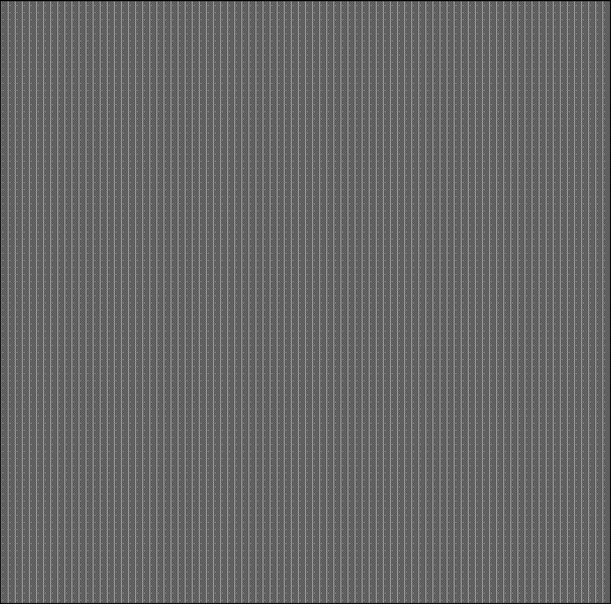

> **Descripción de la imagen** — La imagen es un fondo completamente texturizado y monocromático. Consiste en un patrón de cuadrícula o malla muy fina, compuesto por líneas horizontales y verticales que crean una textura granulada uniforme en tonos grises oscuros. No contiene ningún objeto, diagrama, gráfico o texto discernible.

> **Descripción de la imagen** — La imagen es un fondo de color sólido, predominantemente rosa pálido o salmón claro. No contiene ningún texto, diagrama, gráfico ni ilustración visible.

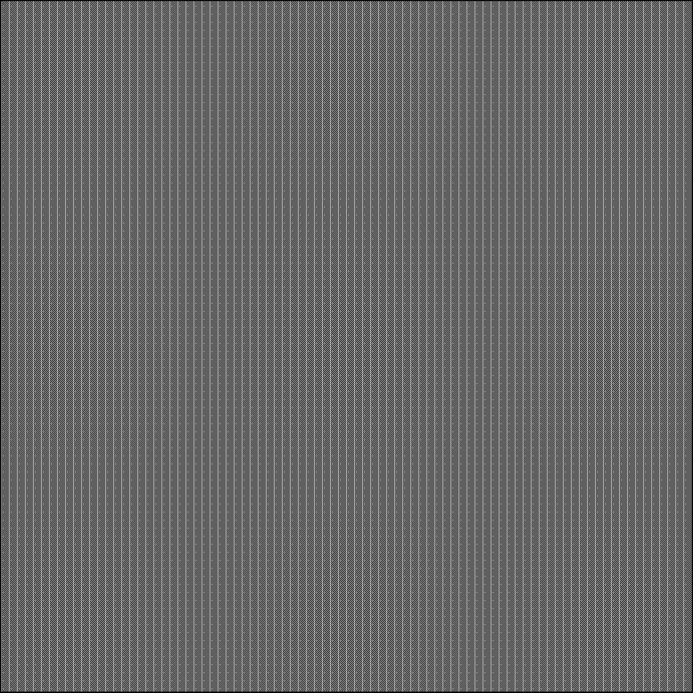

> **Descripción de la imagen** — La imagen es un fondo de textura uniforme. Está compuesta por líneas verticales finas y paralelas, creando un patrón de cuadrícula o tejido sutil en tonos de gris oscuro y negro. No contiene ningún objeto, diagrama, gráfico ni texto discernible.

> **Descripción de la imagen** — La imagen proporcionada es ilegible o está incompleta/corrompida, por lo que no es posible describir su contenido visual ni identificar si se trata de un diagrama, tabla o ilustración.

Discutir sólo por el PRECIO

conlleva repartir el pastel

intentando conseguir el

> **Descripción de la imagen** — Es una fotografía de un pastel redondo decorado. El pastel está cubierto con abundante crema blanca, tanto en los lados como en la parte superior. La superficie del pastel está adornada con frutos rojos y chispas. En la parte superior se encuentra un grupo de velas blancas dispuestas verticalmente. El pastel descansa sobre un plato oscuro de color marrón rojizo.

trozo más grande a costa

de la otra parte

Discutir sólo por el PRECIO

conlleva repartir el pastel

intentando conseguir el

trozo más grande a costa

de la otra parte

Pero se puede hacer la

tarta más grande en

beneficio mutuo, creando

variables multiplicadoras

Pero se puede hacer la

tarta más grande en

beneficio mutuo, creando

variables multiplicadoras
### Variables de la negociación

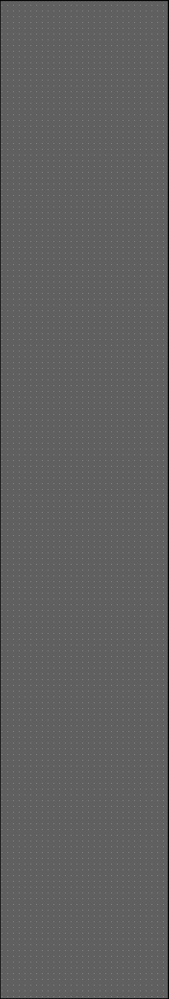

> **Descripción de la imagen** — La imagen es un campo uniforme de textura. Consiste en un patrón denso de puntos o pequeños cuadrados en tonos de gris y negro sobre un fondo claro, similar a una trama de puntos o un efecto de semitonos. No contiene ningún objeto, diagrama, gráfico, texto ni ilustración discernible.

> **Descripción de la imagen** — La imagen es un bloque sólido de color verde claro o verde lima pálido, sin ningún otro elemento, texto, diagrama o ilustración visible.

Variable multiplicadora: algo de mucho valor para una

de las partes pero de muy poco coste para la otra, por lo

que resulta mutuamente beneficioso.

Variable multiplicadora: algo de mucho valor para una

de las partes pero de muy poco coste para la otra, por lo

que resulta mutuamente beneficioso.

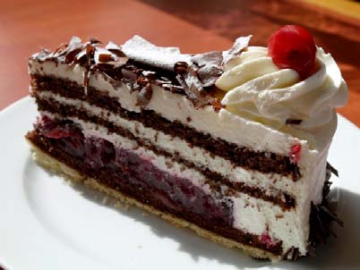

> **Descripción de la imagen** — La imagen muestra una rebanada de pastel de capas servida sobre un plato blanco. El pastel presenta múltiples capas alternadas de color oscuro (probablemente chocolate) y color claro (crema o glaseado). Se observa una capa gruesa de crema blanca entre las capas de bizcocho. La parte superior del pastel está cubierta con más crema blanca y decorada con trozos oscuros, posiblemente virutas de chocolate. Como adorno, hay una cereza roja colocada en la cima del pastel.

> **Descripción de la imagen** — La imagen es un logotipo o encabezado institucional. Presenta un diseño en blanco y negro con los siguientes elementos:
>
> 1.  **Elemento Gráfico Central:** Una figura abstracta compuesta por formas geométricas interconectadas, que parecen piezas de rompecabezas o un nudo complejo.
> 2.  **Texto Superior:** Una frase escrita en una fuente pequeña, posiblemente en euskera, que dice "ematen za zabel zazu".
> 3.  **Identificación Institucional (Parte Inferior):** Dos líneas de texto que identifican a las instituciones:
>     *   A la izquierda: "Universidad del País Vasco"
>     *   A la derecha: "Euskal Herriko Unibertsitatea"

> **Descripción de la imagen** — La imagen es un logotipo institucional que combina un elemento gráfico y texto. A la izquierda, hay un diseño abstracto compuesto por varias formas curvas y arcos superpuestos en colores vibrantes (verde, azul y rojo), dispuestos en una configuración circular o rotacional. A la derecha del gráfico, se encuentra el nombre principal "EUSKAMPUS" escrito en letras grandes y negras. Debajo del nombre principal, hay dos líneas de texto más pequeñas: "Nazioarteko Bikaintasun Campusa" y "Campus de Excelencia Internacional".

---

<!-- página 12 -->

Variables de la negociación

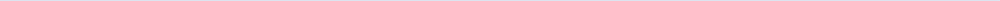

> **Descripción de la imagen** — La imagen proporcionada es completamente negra o está vacía, sin contenido visual discernible.

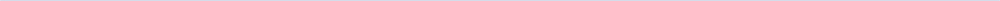

> **Descripción de la imagen** — No se ha proporcionado ninguna imagen para describir. Por favor, adjunte la imagen para que pueda realizar la descripción solicitada.

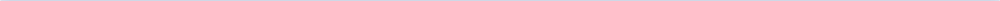

> **Descripción de la imagen** — No se ha proporcionado ninguna imagen para describir. Por favor, adjunte la imagen que desea que analice.

> **Descripción de la imagen** — La imagen es predominantemente un fondo de color azul claro o gris muy pálido, con una pequeña marca o texto indistinto en la esquina inferior derecha. No contiene ningún diagrama, gráfico, tabla o ilustración detallada.

> **Descripción de la imagen** — La imagen es casi completamente blanca o de un color muy claro y presenta muy poco contenido visual. En la esquina inferior derecha se observa un pequeño símbolo o letra indistinta. No hay diagramas, tablas ni ilustraciones complejas visibles.

> **Descripción de la imagen** — La imagen proporcionada es casi completamente un fondo de color azul claro o lavanda. En la esquina inferior derecha se observa un pequeño símbolo o carácter indistinto. No contiene diagramas, tablas ni ilustraciones detalladas.

> **Descripción de la imagen** — La imagen proporcionada está completamente en blanco o no contiene contenido visual discernible. Por lo tanto, no hay elementos que describir.

> **Descripción de la imagen** — La imagen es predominantemente un espacio en blanco o de color gris muy claro. En la esquina inferior derecha se observa una pequeña marca o texto indistinto.

> **Descripción de la imagen** — La imagen proporcionada es esencialmente un espacio en blanco o muy poco contenido, con un fondo de color claro (blanco o gris muy pálido). No se observa ningún diagrama, gráfico, tabla o ilustración discernible.

> **Descripción de la imagen** — La imagen proporcionada está vacía o no contiene contenido visual discernible. Por favor, suba la imagen para que pueda describirla.

> **Descripción de la imagen** — La imagen proporcionada es esencialmente un espacio en blanco o contiene elementos visuales tan indistintos y borrosos que no permiten identificar ningún diagrama, tabla, gráfico o ilustración específica. No hay contenido visual discernible para describir.

> **Descripción de la imagen** — La imagen es predominantemente un fondo de color claro (blanco o azul muy pálido). Contiene muy poco contenido visual; en la esquina inferior derecha se observan algunas marcas o símbolos pequeños y borrosos. No hay diagramas, tablas ni ilustraciones detalladas visibles.

> **Descripción de la imagen** — Lo siento, pero no se ha proporcionado ninguna imagen para describir. Por favor, adjunta la imagen para que pueda ayudarte.

> **Descripción de la imagen** — La imagen proporcionada es casi completamente blanca y carece de contenido visual discernible. No se observa ningún diagrama, gráfico, tabla o ilustración.

> **Descripción de la imagen** — Por favor, proporciona la imagen que deseas que describa. Actualmente no se ha adjuntado ninguna imagen.

> **Descripción de la imagen** — La imagen proporcionada está completamente en blanco o contiene muy poca información visual discernible. Por lo tanto, no es posible realizar una descripción del contenido gráfico solicitado.

> **Descripción de la imagen** — No se ha proporcionado ninguna imagen para describir. Por favor, adjunte la imagen para que pueda realizar la descripción solicitada.

> **Descripción de la imagen** — No se ha proporcionado ninguna imagen para describir. Por favor, suba la imagen para que pueda realizar la descripción solicitada.

> **Descripción de la imagen** — La imagen proporcionada es esencialmente un espacio en blanco o una zona de ruido visual muy tenue. No contiene elementos gráficos, diagramas, tablas ni ilustraciones identificables que permitan realizar una descripción detallada del contenido académico solicitado.

> **Descripción de la imagen** — No se ha proporcionado ninguna imagen para describir. Por favor, adjunte la imagen que desea que analice.

> **Descripción de la imagen** — La imagen es predominantemente un fondo de color azul claro o gris muy pálido. No contiene elementos gráficos, texto legible ni diagramas visibles; la mayor parte del espacio está vacío. En la esquina inferior derecha se observan algunas marcas o caracteres muy pequeños e ilegibles.

> **Descripción de la imagen** — Lo siento, pero no se ha adjuntado ninguna imagen. Por favor, proporciona la imagen para que pueda describirla.

> **Descripción de la imagen** — La imagen proporcionada es predominantemente un fondo de color azul claro o gris muy pálido. No se distingue ningún diagrama, gráfico, tabla, foto o ilustración específica; el contenido visual es mínimo e indistinto.

> **Descripción de la imagen** — La imagen proporcionada es casi completamente un fondo liso de color azul claro o gris muy pálido. No se observan elementos gráficos, texto, diagramas, tablas ni ilustraciones discernibles. La mayor parte del espacio visual está vacío.

> **Descripción de la imagen** — La imagen proporcionada es esencialmente un espacio en blanco, con muy poco contenido visual discernible. Se observa una gran área blanca y, en la esquina inferior derecha, hay un pequeño símbolo o artefacto indistinto. No contiene diagramas, tablas, gráficos ni ilustraciones significativas.

> **Descripción de la imagen** — La imagen proporcionada es completamente blanca o está vacía, sin contenido visual discernible.

> **Descripción de la imagen** — No se ha adjuntado ninguna imagen. Por favor, proporciona la imagen para que pueda describirla.

> **Descripción de la imagen** — La imagen proporcionada es casi completamente blanca o de un color muy claro, con una pequeña marca indistinta en la esquina inferior derecha. No contiene ningún diagrama, gráfico, tabla ni ilustración discernible.

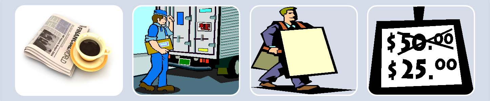

> **Descripción de la imagen** — La imagen es una composición de cuatro ilustraciones separadas horizontalmente:
>
> 1.  **Panel Izquierdo:** Muestra un libro o periódico abierto y una taza de café colocada encima.
> 2.  **Segundo Panel:** Ilustra a un hombre vestido con ropa azul y pantalones de trabajo, de pie frente a la puerta abierta de un camión grande de color blanco.
> 3.  **Tercer Panel:** Representa a un hombre caminando hacia adelante, llevando una gran tabla o letrero rectangular en sus manos.
> 4.  **Panel Derecho:** Muestra un cartel negro con texto y números blancos que indican precios: "$50.00" y "$25.00".

> **Descripción de la imagen** — Por favor, proporciona la imagen que deseas que describa. Actualmente no se ha adjuntado ninguna imagen.

> **Descripción de la imagen** — Lo siento, pero la imagen que ha proporcionado está completamente en blanco o no es visible. Por favor, envíe la imagen para que pueda describirla.

> **Descripción de la imagen** — La imagen es casi completamente blanca y presenta un fondo liso. En la esquina inferior derecha se observa un pequeño símbolo o carácter indistinto, que parece ser "penas". El resto del área está vacía.

> **Descripción de la imagen** — La imagen proporcionada es completamente blanca o está ausente, por lo que no contiene ningún contenido visual que pueda describir.

> **Descripción de la imagen** — No se ha proporcionado ninguna imagen para describir. Por favor, adjunte la imagen para que pueda realizar la descripción solicitada.

> **Descripción de la imagen** — Por favor, adjunte la imagen que desea que describa. Actualmente no se ha proporcionado ninguna imagen.

> **Descripción de la imagen** — La imagen que ha proporcionado está completamente en blanco o no contiene ningún contenido visual discernible. Por favor, suba la imagen para que pueda describirla.

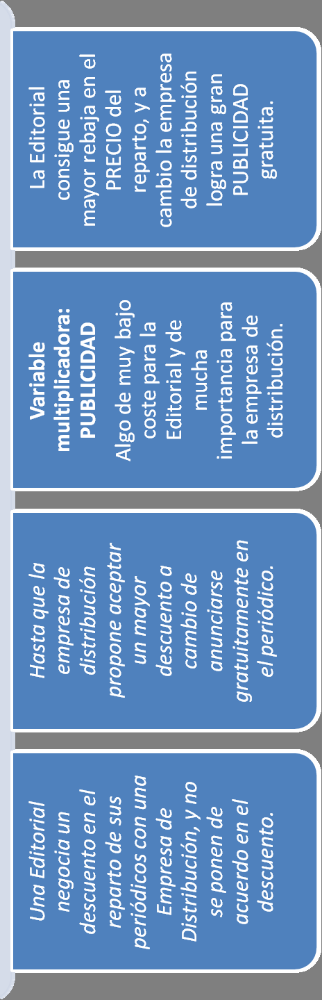

> **Descripción de la imagen** — La imagen es una estructura vertical compuesta por cinco paneles rectangulares distintos con fondo azul oscuro y texto en blanco. Estos paneles parecen representar puntos clave o etapas de un proceso de negociación o relación comercial.
>
> Los elementos son:
>
> 1.  **Panel superior:** Describe la acción de la editorial de obtener un mayor descuento en el precio del reparto, lo que resulta en un cambio en la empresa de distribución y, a cambio, una gran publicidad gratuita.
> 2.  **Segundo panel:** Identifica una variable clave denominada "PUBLICIDAD".
> 3.  **Tercer panel:** Señala que existe un costo muy bajo para la editorial y una gran importancia para la empresa de distribución.
> 4.  **Cuarto panel:** Detalla la condición necesaria para el acuerdo: que la empresa de distribución proponga aceptar un mayor descuento a cambio de un reparto más grande de periódicos, estableciendo un acuerdo mutuo sobre el descuento.
> 5.  **Panel inferior:** Inicia la secuencia describiendo que una editorial negocia un descuento en el reparto de sus periódicos.

> **Descripción de la imagen** — La imagen es un logotipo o encabezado institucional. Presenta un diseño en blanco y negro con los siguientes elementos:
>
> 1.  **Elemento Gráfico Central:** Una figura abstracta compuesta por formas geométricas interconectadas, que parecen piezas de rompecabezas o un nudo complejo.
> 2.  **Texto Superior:** Una frase escrita en una fuente pequeña, posiblemente en euskera, que dice "ematen za zabel zazu".
> 3.  **Identificación Institucional (Parte Inferior):** Dos líneas de texto que identifican a las instituciones:
>     *   A la izquierda: "Universidad del País Vasco"
>     *   A la derecha: "Euskal Herriko Unibertsitatea"

> **Descripción de la imagen** — La imagen es un logotipo institucional que combina un elemento gráfico y texto. A la izquierda, hay un diseño abstracto compuesto por varias formas curvas y arcos superpuestos en colores vibrantes (verde, azul y rojo), dispuestos en una configuración circular o rotacional. A la derecha del gráfico, se encuentra el nombre principal "EUSKAMPUS" escrito en letras grandes y negras. Debajo del nombre principal, hay dos líneas de texto más pequeñas: "Nazioarteko Bikaintasun Campusa" y "Campus de Excelencia Internacional".

---

<!-- página 13 -->

Fases de la negociación

> **Descripción de la imagen** — La imagen proporcionada es completamente negra y no contiene ningún contenido visual discernible, como diagramas, tablas o ilustraciones.

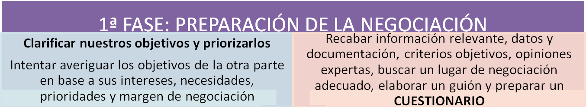

> **Descripción de la imagen** — La imagen es un esquema estructurado que describe la primera fase de un proceso, titulada "1ª FASE: PREPARACIÓN DE LA NEGOCIACIÓN". El contenido se divide en dos columnas que detallan las acciones y objetivos de esta fase.
>
> En la columna izquierda, el enfoque principal es la clarificación estratégica:
> *   **Objetivo:** Clarificar y priorizar los propios objetivos.
> *   **Acción clave:** Intentar descubrir los objetivos de la otra parte basándose en sus intereses, necesidades, prioridades y margen de negociación.
>
> En la columna derecha, se enumeran las tareas metodológicas para la preparación:
> *   **Recolección de información:** Recabar datos, documentación, criterios objetivos y opiniones expertas.
> *   **Logística:** Buscar un lugar de negociación adecuado.
> *   **Elaboración:** Crear un guion y preparar un cuestionario.

> **Descripción de la imagen** — La imagen es un diagrama esquemático que presenta una estructura vertical dividida en dos secciones principales. Consiste en dos barras rectangulares verticales de color gris, paralelas entre sí. Entre estas dos barras se encuentra un triángulo de color morado o violeta, orientado hacia la derecha, lo que sugiere una transición, conexión o flujo entre las dos secciones.

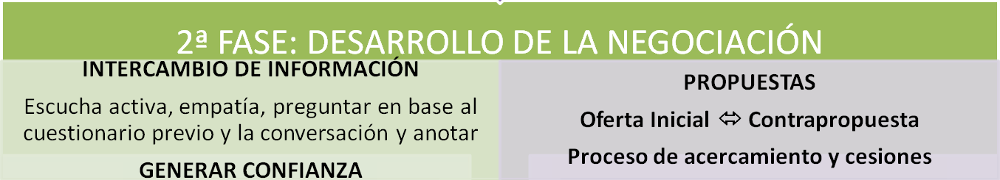

> **Descripción de la imagen** — La imagen es un esquema o diapositiva que estructura la segunda fase de un proceso, titulada "DESARROLLO DE LA NEGOCIACIÓN".
>
> El contenido está dividido en dos columnas principales que describen las actividades clave y los objetivos de esta fase:
>
> **Columna Izquierda (Intercambio de Información):**
> Se centra en la actividad de "INTERCAMBIO DE INFORMACIÓN". Los elementos asociados son una lista de habilidades o acciones: escucha activa, empatía, preguntar basándose en un cuestionario previo, mantener la conversación y tomar notas.
>
> **Columna Derecha (Propuestas):**
> Se centra en el componente de "PROPUESTAS". Los elementos asociados incluyen la interacción entre la oferta inicial y la contrapropuesta, y el proceso de acercamiento y concesiones.
>
> **Título General:**
> En la parte superior se indica claramente que esta es la "2ª FASE: DESARROLLO DE LA NEGOCIACIÓN".
>
> **Objetivo Final:**
> En la parte inferior se menciona un objetivo general asociado a la fase: "GENERAR CONFIANZA".

> **Descripción de la imagen** — El diagrama consiste en dos barras verticales de color gris que se extienden a lo largo del eje vertical. En el centro, una línea horizontal conecta ambas barras. Sobre esta línea, hay un triángulo sólido de color verde claro que apunta hacia la derecha, indicando una conexión o flujo entre las dos barras.

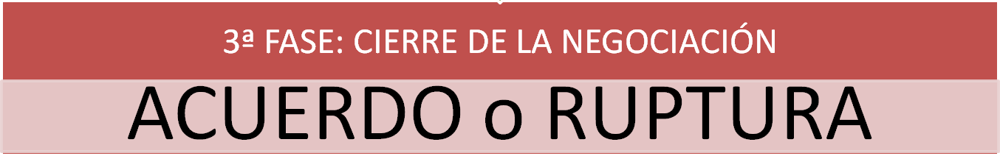

> **Descripción de la imagen** — La imagen es un encabezado o título de sección con texto centrado y en negrita. El contenido está dividido en dos líneas principales:
>
> 1.  La primera línea dice: "3ª FASE: CIERRE DE LA NEGOCIACIÓN".
> 2.  La segunda línea, más grande y destacada, dice: "ACUERDO o RUPTURA".

> **Descripción de la imagen** — La imagen proporcionada es completamente negra y no contiene ningún contenido visual discernible, como diagramas, tablas o ilustraciones.

> **Descripción de la imagen** — La imagen es un logotipo o encabezado institucional. Presenta un diseño en blanco y negro con los siguientes elementos:
>
> 1.  **Elemento Gráfico Central:** Una figura abstracta compuesta por formas geométricas interconectadas, que parecen piezas de rompecabezas o un nudo complejo.
> 2.  **Texto Superior:** Una frase escrita en una fuente pequeña, posiblemente en euskera, que dice "ematen za zabel zazu".
> 3.  **Identificación Institucional (Parte Inferior):** Dos líneas de texto que identifican a las instituciones:
>     *   A la izquierda: "Universidad del País Vasco"
>     *   A la derecha: "Euskal Herriko Unibertsitatea"

> **Descripción de la imagen** — La imagen es un logotipo institucional que combina un elemento gráfico y texto. A la izquierda, hay un diseño abstracto compuesto por varias formas curvas y arcos superpuestos en colores vibrantes (verde, azul y rojo), dispuestos en una configuración circular o rotacional. A la derecha del gráfico, se encuentra el nombre principal "EUSKAMPUS" escrito en letras grandes y negras. Debajo del nombre principal, hay dos líneas de texto más pequeñas: "Nazioarteko Bikaintasun Campusa" y "Campus de Excelencia Internacional".

---

<!-- página 14 -->

> **Descripción de la imagen** — La imagen es un rectángulo sólido de color morado o púrpura uniforme. No contiene texto, gráficos, líneas ni elementos visuales internos.

## 1a Fase: Preparación del Cuestionario

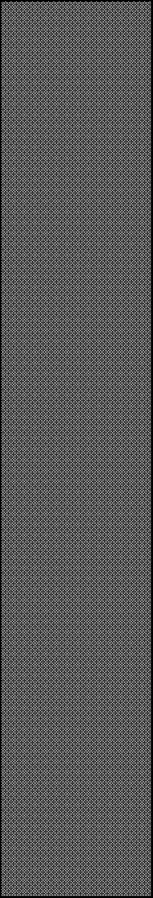

> **Descripción de la imagen** — La imagen es predominantemente un fondo texturizado de color gris claro o blanco roto, con un patrón de puntos o cuadrícula sutil que le da una apariencia granulada o de trama fina. No contiene ningún diagrama, gráfico, tabla ni ilustración específica; es esencialmente un espacio vacío con una textura de fondo.

> **Descripción de la imagen** — La imagen es un fondo de color sólido, predominantemente naranja o ámbar, que ocupa todo el espacio visible. No contiene elementos gráficos, texto ni diagramas.

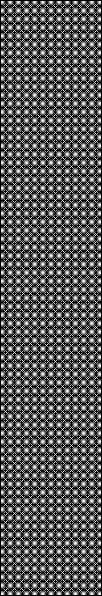

> **Descripción de la imagen** — La imagen proporcionada es esencialmente un espacio en blanco con una textura de fondo sutil, similar a un patrón de puntos o cuadrícula gris claro. No contiene ningún diagrama, gráfico, tabla ni ilustración discernible.

> **Descripción de la imagen** — La imagen es un fondo de color uniforme, predominantemente verde lima o verde chartreuse claro. El área es rectangular y está compuesta por este tono sólido. Se observan líneas horizontales muy tenues y sutiles que atraviesan el campo visual, sugiriendo una textura de rayas o bandas, pero no hay ningún texto, diagrama, gráfico ni contenido específico visible.

### Conocer intereses y objetivos
### Conocer intereses y objetivos

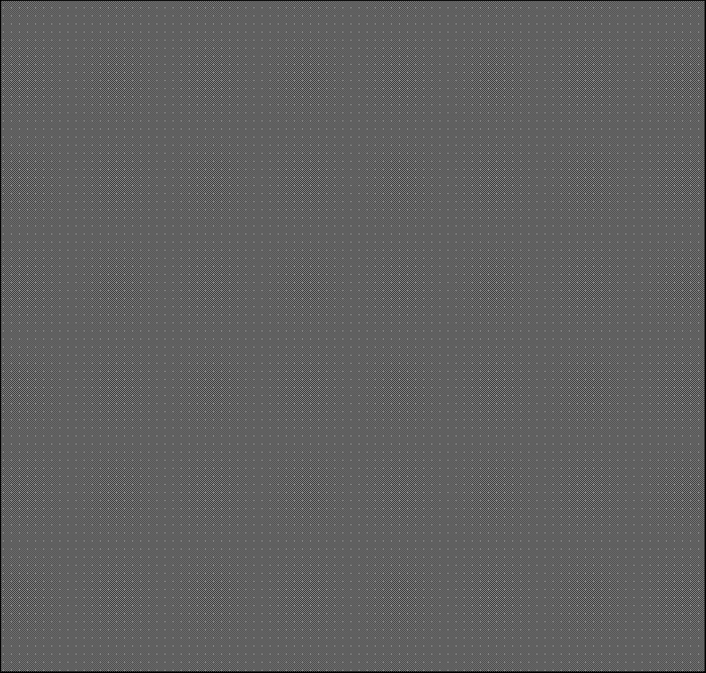

> **Descripción de la imagen** — La imagen es predominantemente un fondo de textura uniforme, compuesto por un patrón de líneas horizontales finas y puntos (similar a un patrón de trama o semitono), en tonos grises oscuros y claros. No contiene ningún diagrama, gráfico, tabla ni ilustración discernible; es esencialmente un espacio vacío o una plantilla con textura.

> **Descripción de la imagen** — La imagen proporcionada es extremadamente mínima y no contiene información visual clara o estructurada que permita identificar un diagrama, gráfico o ilustración específica. Parece ser una área casi en blanco o un fragmento muy pequeño e indistinto.

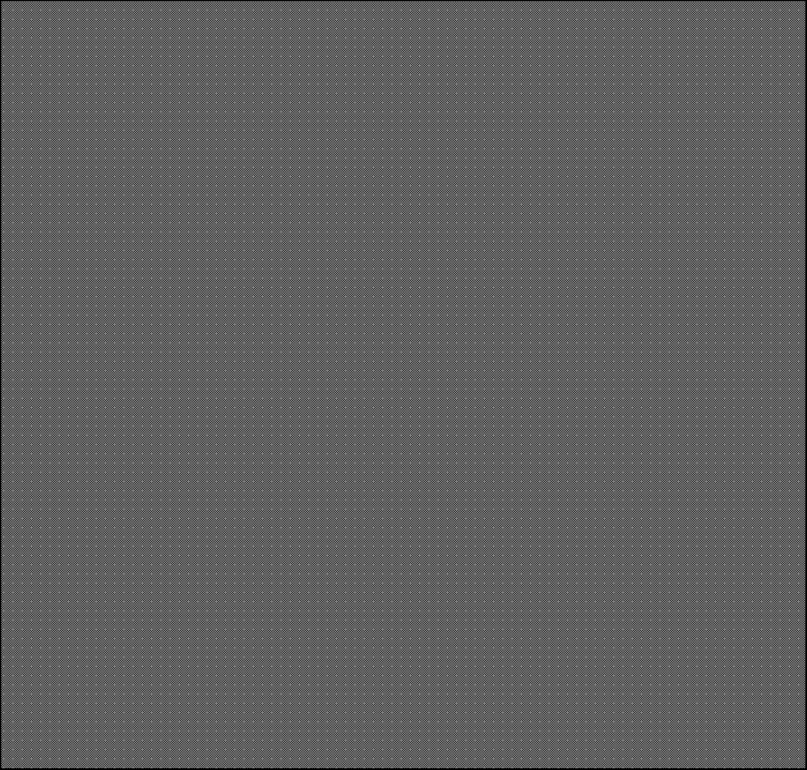

> **Descripción de la imagen** — La imagen es un fondo uniforme de color gris claro con una textura sutil de patrón cuadriculado o reticulado. No contiene ningún diagrama, gráfico, tabla, foto ni texto visible.

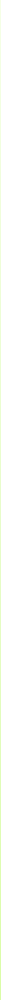

> **Descripción de la imagen** — Lo siento, pero la imagen que ha proporcionado no es visible o está corrupta. Por favor, envíe la imagen nuevamente para que pueda describirla.

Para conocer sus necesidades

Para obtener información específica

Para concretar o aclarar algún punto

Cuando no se entiende bien lo que la

otra parte dice

Cuando se sale del tema tratado

Cuando generaliza excesivamente

Cuando se muestra indignado

Para conclusiones negativas

Cuando se niega a considerar una

propuesta

Cuando se niega a aceptar la

propuesta

Para conocer sus necesidades

Para obtener información específica

Para concretar o aclarar algún punto

Cuando no se entiende bien lo que la

otra parte dice

Cuando se sale del tema tratado

Cuando generaliza excesivamente

Cuando se muestra indignado

Para conclusiones negativas

Cuando se niega a considerar una

propuesta

Cuando se niega a aceptar la

propuesta
### Preguntas útiles
### Preguntas útiles

¿Qué es lo más importante para ti?

¿Qué piensas de este asunto?

¿Qué quieres decir con eso?

¿Podrías explicármelo mejor o

ponerme algún ejemplo?

¿Podríamos centrarnos en el tema?

¿Podrías concretar tu propuesta?

¿Prefieres hablar en otro momento?

¿Cómo podríamos mejorarlo?

¿Necesitas tiempo para considerar

las ventajas?

¿Qué modificarías para poder

aceptarla?

¿Qué es lo más importante para ti?

¿Qué piensas de este asunto?

¿Qué quieres decir con eso?

¿Podrías explicármelo mejor o

ponerme algún ejemplo?

¿Podríamos centrarnos en el tema?

¿Podrías concretar tu propuesta?

¿Prefieres hablar en otro momento?

¿Cómo podríamos mejorarlo?

¿Necesitas tiempo para considerar

las ventajas?

¿Qué modificarías para poder

aceptarla?

> **Descripción de la imagen** — La imagen es un bloque sólido de color lila o morado pálido uniforme, sin ningún otro elemento, texto, diagrama o ilustración visible.

> **Descripción de la imagen** — La imagen es un logotipo o encabezado institucional. Presenta un diseño en blanco y negro con los siguientes elementos:
>
> 1.  **Elemento Gráfico Central:** Una figura abstracta compuesta por formas geométricas interconectadas, que parecen piezas de rompecabezas o un nudo complejo.
> 2.  **Texto Superior:** Una frase escrita en una fuente pequeña, posiblemente en euskera, que dice "ematen za zabel zazu".
> 3.  **Identificación Institucional (Parte Inferior):** Dos líneas de texto que identifican a las instituciones:
>     *   A la izquierda: "Universidad del País Vasco"
>     *   A la derecha: "Euskal Herriko Unibertsitatea"

> **Descripción de la imagen** — La imagen es un logotipo institucional que combina un elemento gráfico y texto. A la izquierda, hay un diseño abstracto compuesto por varias formas curvas y arcos superpuestos en colores vibrantes (verde, azul y rojo), dispuestos en una configuración circular o rotacional. A la derecha del gráfico, se encuentra el nombre principal "EUSKAMPUS" escrito en letras grandes y negras. Debajo del nombre principal, hay dos líneas de texto más pequeñas: "Nazioarteko Bikaintasun Campusa" y "Campus de Excelencia Internacional".

---

<!-- página 15 -->

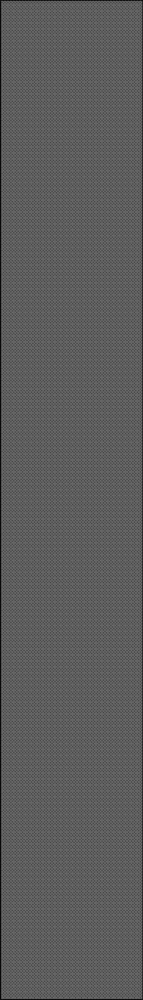

> **Descripción de la imagen** — La imagen es un rectángulo que contiene un patrón de textura uniforme, compuesto por líneas finas y puntos en tonos grises o negros, lo que sugiere un fondo cuadriculado o punteado. No se observa ningún diagrama, gráfico, tabla, ilustración ni contenido visual específico.

> **Descripción de la imagen** — La imagen es un fondo de color sólido, predominantemente verde claro o verde lima. Presenta sutiles variaciones tonales y bandas horizontales muy tenues que sugieren una textura o gradiente, pero no contiene ningún objeto, texto, diagrama, gráfico ni información estructurada.

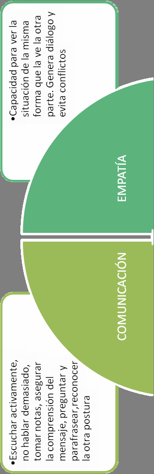

> **Descripción de la imagen** — La imagen es un diagrama conceptual vertical que presenta tres elementos principales interconectados.
>
> 1.  **Parte Superior:** Un gran bloque de color verde claro etiquetado como **EMPATÍA**.
> 2.  **Parte Inferior Central:** Un bloque grande de color verde oliva/militar etiquetado como **COMUNICACIÓN**.
> 3.  **Lado Izquierdo (Lista de puntos):** Una lista con dos viñetas que se superponen parcialmente sobre el bloque inferior ("COMUNICACIÓN"). Estos puntos describen habilidades específicas:
>     *   La primera viñeta describe la capacidad de ver la situación desde la perspectiva de la otra parte, lo cual genera diálogo y evita conflictos.
>     *   La segunda viñeta enumera acciones para la escucha activa, como no hablar demasiado, tomar notas, asegurar la comprensión del mensaje, preguntar y parafrasear la postura contraria.
>
> El diseño sugiere que la Empatía y la Comunicación son conceptos centrales, con las habilidades listadas sirviendo como componentes o estrategias dentro de este marco.

2a Fase: Actitud durante la

negociación

2a Fase: Actitud durante la

negociación

> **Descripción de la imagen** — La imagen es un fragmento gráfico con un fondo predominantemente de color verde oliva o verde musgo. En la esquina superior derecha, se observan varias formas curvas y concéntricas de color blanco o crema, que parecen ser arcos o secciones de círculos superpuestos. Hay una pequeña marca oscura o símbolo estilizado en el borde derecho central.

> **Descripción de la imagen** — La imagen es un fondo o un bloque de color que presenta un degradado suave. Está dominada por tonos de verde, variando desde verdes oscuros en el centro hasta tonos más claros y amarillentos, con transiciones hacia blanco o tonos muy claros en los bordes. No contiene elementos gráficos, texto, diagramas ni información específica.

> **Descripción de la imagen** — La imagen es predominantemente un bloque de color sólido de tono verde oliva o caqui. En la esquina inferior derecha se observa un pequeño símbolo o carácter ilegible.

> **Descripción de la imagen** — Es un diagrama vertical compuesto por tres columnas o franjas de color distintas, separadas por líneas blancas.
>
> 1.  **Columna Izquierda:** De color verde oliva.
> 2.  **Columna Central:** De color gris claro o neutro.
> 3.  **Columna Derecha:** De color azul verdoso (teal).
>
> La columna central está conectada a las columnas izquierda y derecha mediante dos flechas curvas blancas que indican un flujo bidireccional o cíclico entre el centro y los extremos.

> **Descripción de la imagen** — Por favor, proporciona la imagen que deseas que describa. Actualmente no se ha adjuntado ninguna imagen.

> **Descripción de la imagen** — La imagen es un bloque de color sólido que ocupa todo el espacio. El color predominante es un tono morado o azul violáceo apagado.

> **Descripción de la imagen** — La imagen proporcionada es un fragmento muy oscuro y de baja resolución. Predomina un color sólido de tono púrpura o azul oscuro que ocupa la mayor parte del espacio. En la esquina inferior derecha se aprecian algunas formas o líneas muy tenues y abstractas, pero no son lo suficientemente claras para identificar un diagrama, gráfico o ilustración específica.

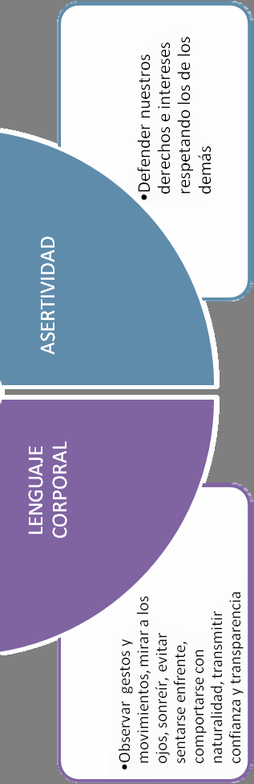

> **Descripción de la imagen** — La imagen es un diagrama conceptual o un esquema visual dividido en tres secciones verticales, cada una con un título y un punto clave.
>
> 1.  **Sección Superior (Color azul/verde azulado):**
>     *   Título: ASERTIVIDAD.
>     *   Contenido: Un punto que describe la acción de "Defender nuestros derechos e intereses respetando los de los demás".
>
> 2.  **Sección Media (Color morado oscuro):**
>     *   Título: LENGUAJE CORPORAL.
>     *   Contenido: Un punto que comienza con "Observar gestos y movimientos, mirar a los ojos, sonreír, evitar..." (El texto está incompleto).
>
> 3.  **Sección Inferior (Color morado claro):**
>     *   Contenido: Un punto que describe la acción de "compartirse con naturalidad, transparencia confianza y transparencia".
>
> El diseño utiliza formas redondeadas para enmarcar cada sección, sugiriendo una estructura jerárquica o un modelo de componentes interrelacionados.

> **Descripción de la imagen** — La imagen es un logotipo o encabezado institucional. Presenta un diseño en blanco y negro con los siguientes elementos:
>
> 1.  **Elemento Gráfico Central:** Una figura abstracta compuesta por formas geométricas interconectadas, que parecen piezas de rompecabezas o un nudo complejo.
> 2.  **Texto Superior:** Una frase escrita en una fuente pequeña, posiblemente en euskera, que dice "ematen za zabel zazu".
> 3.  **Identificación Institucional (Parte Inferior):** Dos líneas de texto que identifican a las instituciones:
>     *   A la izquierda: "Universidad del País Vasco"
>     *   A la derecha: "Euskal Herriko Unibertsitatea"

> **Descripción de la imagen** — La imagen es un logotipo institucional que combina un elemento gráfico y texto. A la izquierda, hay un diseño abstracto compuesto por varias formas curvas y arcos superpuestos en colores vibrantes (verde, azul y rojo), dispuestos en una configuración circular o rotacional. A la derecha del gráfico, se encuentra el nombre principal "EUSKAMPUS" escrito en letras grandes y negras. Debajo del nombre principal, hay dos líneas de texto más pequeñas: "Nazioarteko Bikaintasun Campusa" y "Campus de Excelencia Internacional".

> **Descripción de la imagen** — Por favor, proporciona la imagen que deseas que describa. Actualmente no se ha adjuntado ninguna imagen.

> **Descripción de la imagen** — La imagen consiste en un único glifo o carácter escrito en un estilo de escritura asiática (posiblemente tailandés o similar). El carácter es una forma estilizada y curva, compuesto por líneas que se unen para formar una figura singular.

> **Descripción de la imagen** — Por favor, adjunta la imagen a la que te refieres. No se ha proporcionado ninguna imagen para describir.

> **Descripción de la imagen** — La imagen proporcionada es extremadamente mínima y consiste en una serie de caracteres o símbolos que parecen ser fragmentos de texto o datos no inteligibles dentro del contexto de un diagrama, gráfico o ilustración académica. No se identifica como un elemento visual estructurado (como una tabla, un mapa conceptual o un flujo).

> **Descripción de la imagen** — La imagen es un bloque sólido de color, predominantemente un tono rojo oscuro o borgoña intenso. No contiene elementos gráficos, texto, diagramas ni figuras específicas; es una superficie uniforme de color.

> **Descripción de la imagen** — La imagen es un bloque sólido de color rojo oscuro o borgoña. No contiene texto, gráficos, diagramas ni elementos visuales específicos; es simplemente un fondo de color uniforme.

> **Descripción de la imagen** — La imagen es un bloque sólido de color, predominantemente rojo oscuro o marrón rojizo (terracota). No contiene texto, gráficos, diagramas ni elementos visuales específicos que permitan una descripción detallada de contenido académico.

> **Descripción de la imagen** — La imagen es un bloque sólido de color, predominantemente rojo oscuro o borgoña. Ocupa la totalidad del espacio visible y no contiene elementos gráficos, texto, diagramas ni datos específicos.

> **Descripción de la imagen** — La imagen es un bloque sólido de color rojo oscuro o borgoña. No contiene texto, diagramas, gráficos ni elementos visuales complejos; es una superficie de color uniforme.

> **Descripción de la imagen** — La imagen es un bloque sólido de color rojo oscuro o borgoña, sin ningún otro elemento, texto, diagrama o ilustración visible.

> **Descripción de la imagen** — La imagen es un bloque sólido de color rojo oscuro o granate (burdeos). No contiene texto, gráficos, diagramas ni elementos visuales específicos aparte del color uniforme.

> **Descripción de la imagen** — La imagen es un bloque rectangular de color sólido, predominantemente rojo oscuro o granate. No contiene texto, diagramas, gráficos ni elementos visuales discernibles más allá del color uniforme.

> **Descripción de la imagen** — La imagen es altamente abstracta y fragmentada. Está compuesta principalmente por bloques de color marrón rojizo oscuro o borgoña, intercalados con áreas blancas. Hay formas irregulares y líneas muy tenues dispersas en el fondo, pero no se distingue ningún diagrama, gráfico, tabla o ilustración clara.

> **Descripción de la imagen** — La imagen es un patrón abstracto compuesto por franjas verticales alternadas de color rojo oscuro (o borgoña) y blanco. Las franjas se suceden una al lado de la otra, creando un efecto de rayas verticales.

> **Descripción de la imagen** — La imagen es altamente abstracta y de baja resolución. Está compuesta principalmente por grandes bloques de color, alternando tonos de rojo oscuro o borgoña con áreas blancas o de color gris muy claro. No se distinguen formas específicas, texto legible, diagramas, tablas o gráficos definidos; solo se observan manchas y transiciones de color.

> **Descripción de la imagen** — La imagen es un patrón abstracto compuesto por franjas verticales paralelas. Estas franjas alternan entre tonos de rojo oscuro o borgoña y líneas blancas o de color rojo muy claro, creando un efecto de rayas verticales.

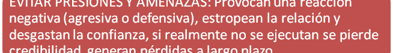

> **Descripción de la imagen** — La imagen es un fragmento de texto que presenta una advertencia o consejo sobre la gestión de presiones y amenazas. El mensaje principal indica que evitar estas situaciones es crucial porque las presiones y amenazas provocan una reacción negativa (agresiva o defensiva), dañan la relación, erosionan la confianza y, si no se ejecutan adecuadamente, resultan en pérdida de credibilidad y pérdidas a largo plazo.

> **Descripción de la imagen** — La imagen es un patrón de rayas verticales alternadas. El fondo está compuesto por franjas estrechas de color rojo oscuro o borgoña y franjas blancas, dispuestas una al lado de la otra en un diseño de rayas paralelas.

> **Descripción de la imagen** — La imagen proporcionada es de muy baja resolución y está altamente borrosa. Muestra un fondo predominantemente de color marrón rojizo o terracota. Se aprecian algunas formas indistintas e irregulares, sugiriendo la presencia de líneas o estructuras, pero no es posible identificar elementos específicos, diagramas, tablas o gráficos con claridad.

> **Descripción de la imagen** — La imagen es un patrón abstracto compuesto por franjas horizontales de color. Se observan bandas alternadas de un tono rojo oscuro o granate y un color blanco o muy claro.

> **Descripción de la imagen** — La imagen es predominantemente un fondo de color rojo oscuro o borgoña intenso. Hay algunas marcas blancas irregulares y difusas visibles en el borde derecho de la imagen.

> **Descripción de la imagen** — La imagen es un bloque sólido de color rojo oscuro o granate, que ocupa la mayor parte del espacio visible. No contiene texto, gráficos, diagramas ni elementos visuales específicos aparte del color uniforme.

> **Descripción de la imagen** — La imagen es un bloque sólido de color, predominantemente un tono rojo oscuro o borgoña intenso. Ocupa la totalidad del espacio visual y no contiene elementos gráficos, texto ni estructuras complejas. Hay algunas marcas o formas muy sutiles e indistintas en la esquina inferior derecha.

> **Descripción de la imagen** — La imagen es un bloque sólido de color rojo oscuro o borgoña, sin ningún otro elemento, texto, diagrama, gráfico o ilustración visible.

> **Descripción de la imagen** — La imagen es un bloque sólido de color rojo oscuro o borgoña intenso que ocupa la mayor parte del espacio. No contiene texto, gráficos, diagramas ni elementos visuales complejos; es una superficie de color uniforme. Hay algunas marcas o artefactos muy sutiles en la esquina inferior derecha.

> **Descripción de la imagen** — La imagen es un bloque sólido de color rojo oscuro o borgoña uniforme que ocupa la mayor parte del espacio visible. No contiene texto, gráficos, diagramas ni elementos visuales específicos aparte del color de fondo.

> **Descripción de la imagen** — La imagen es un bloque sólido de color rojo oscuro o borgoña. No contiene elementos visuales, texto, diagramas ni gráficos discernibles.

> **Descripción de la imagen** — La imagen es un bloque de color sólido, predominantemente de tono rosa pálido o beige claro. No contiene elementos gráficos, texto, diagramas ni datos visibles.

> **Descripción de la imagen** — Lo siento, pero la imagen que ha proporcionado es ilegible o está incompleta y no contiene un diagrama, tabla, gráfico o ilustración reconocible. Por favor, envíe una imagen clara para que pueda describirla según sus instrucciones.

> **Descripción de la imagen** — Por favor, proporciona la imagen que deseas que describa. La imagen no se cargó correctamente.

> **Descripción de la imagen** — La imagen proporcionada consiste en una secuencia de caracteres o símbolos escritos en un tipo de fuente simple. Los caracteres visibles son: "p", "e", "n", "a", "s".

---

<!-- página 16 -->

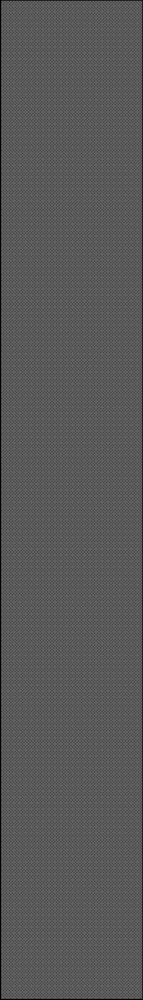

> **Descripción de la imagen** — La imagen es un espacio vacío o una página con una textura de puntos (halftone) en tonos grises y negros. No contiene ningún diagrama, gráfico, tabla, foto ni texto visible.

> **Descripción de la imagen** — La imagen es un fondo de color sólido, predominantemente verde claro o verde lima. Presenta sutiles variaciones tonales y bandas horizontales muy tenues que sugieren una textura o gradiente, pero no contiene ningún objeto, texto, diagrama, gráfico ni información estructurada.

## 2a Fase: Propuestas y Cesiones
## 2a Fase: Propuestas y Cesiones

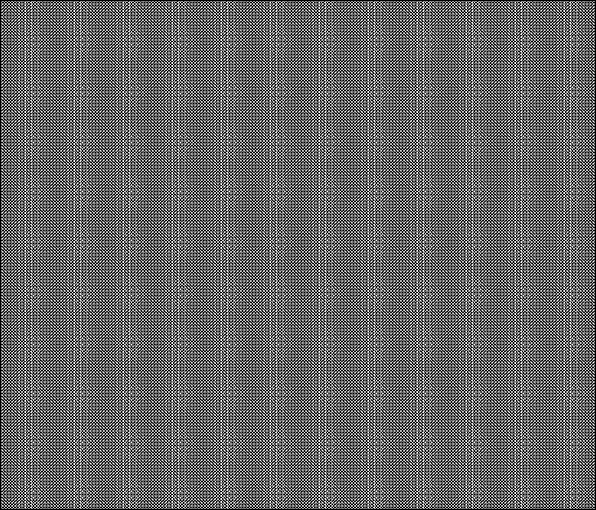

> **Descripción de la imagen** — La imagen es un fondo de textura uniforme y sutilmente granulada o rayada. Consiste en un campo predominantemente gris oscuro con líneas verticales finas que le dan una apariencia de ruido o patrón de trama. No contiene ningún objeto, texto, diagrama, gráfico ni ilustración discernible.

> **Descripción de la imagen** — La imagen proporcionada es completamente oscura o está ausente, y no contiene ningún contenido visual discernible para describir.

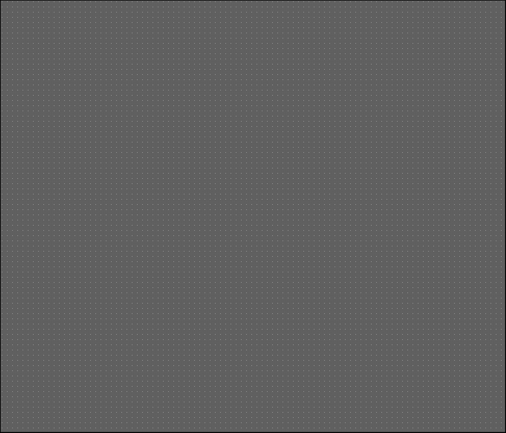

> **Descripción de la imagen** — La imagen es un fondo uniforme con una textura de ruido o patrón de puntos (halftone) en tonos grises y negros. No contiene ningún diagrama, gráfico, tabla, foto o ilustración específica; es esencialmente un área vacía o texturizada sin contenido visual discernible.

> **Descripción de la imagen** — La imagen proporcionada es completamente blanca o muestra un área de color sólido sin contenido visual discernible. No se observa ningún diagrama, gráfico, tabla ni ilustración.

OFERTA INICIAL

Posición inicial de cara al proceso de

cesiones basado en intereses y

objetivos claros ordenados de

forma prioritaria.

Debe ofrecer MARGEN DE MANIOBRA

pero sin ser excesivamente

pretenciosa y debe estar justificada

en criterios objetivos sólidos.

OFERTA INICIAL

Posición inicial de cara al proceso de

cesiones basado en intereses y

objetivos claros ordenados de

forma prioritaria.

Debe ofrecer MARGEN DE MANIOBRA

pero sin ser excesivamente

pretenciosa y debe estar justificada

en criterios objetivos sólidos.

PROCESO DE CESIONES

Ceder, siempre a cambio de algo:

Cesión y Contraprestación.

Cuantificar las cesiones y conseguir

que la otra parte las valore.

Ceder de más a menos: si inicialmente

se cede un descuento del 10%,

luego se podría ceder un 5%, y

finalmente un 1% más, mostrando

el límite inferior de la cesión y

evitando más descuentos.

Cerrar combinaciones de variables, no

cerrar de una a una.

No esconder variables conflictivas,

afrontarlas desde el principio.

PROCESO DE CESIONES

Ceder, siempre a cambio de algo:

Cesión y Contraprestación.

Cuantificar las cesiones y conseguir

que la otra parte las valore.

Ceder de más a menos: si inicialmente

se cede un descuento del 10%,

luego se podría ceder un 5%, y

finalmente un 1% más, mostrando

el límite inferior de la cesión y

evitando más descuentos.

Cerrar combinaciones de variables, no

cerrar de una a una.

No esconder variables conflictivas,

afrontarlas desde el principio.

> **Descripción de la imagen** — La imagen es una fotografía de un trozo de material fibroso y grueso, que parece ser cuerda o hilo rústico. El material tiene una textura áspera y está compuesto por fibras entrelazadas de color marrón claro o beige. La cuerda se extiende diagonalmente a través del encuadre.
>
> El fondo es un degradado suave, con tonos que varían desde el blanco o gris muy claro en el centro hasta un tono púrpura o malva apagado en los bordes.

> **Descripción de la imagen** — La imagen es un logotipo o encabezado institucional. Presenta un diseño en blanco y negro con los siguientes elementos:
>
> 1.  **Elemento Gráfico Central:** Una figura abstracta compuesta por formas geométricas interconectadas, que parecen piezas de rompecabezas o un nudo complejo.
> 2.  **Texto Superior:** Una frase escrita en una fuente pequeña, posiblemente en euskera, que dice "ematen za zabel zazu".
> 3.  **Identificación Institucional (Parte Inferior):** Dos líneas de texto que identifican a las instituciones:
>     *   A la izquierda: "Universidad del País Vasco"
>     *   A la derecha: "Euskal Herriko Unibertsitatea"

> **Descripción de la imagen** — La imagen es un logotipo institucional que combina un elemento gráfico y texto. A la izquierda, hay un diseño abstracto compuesto por varias formas curvas y arcos superpuestos en colores vibrantes (verde, azul y rojo), dispuestos en una configuración circular o rotacional. A la derecha del gráfico, se encuentra el nombre principal "EUSKAMPUS" escrito en letras grandes y negras. Debajo del nombre principal, hay dos líneas de texto más pequeñas: "Nazioarteko Bikaintasun Campusa" y "Campus de Excelencia Internacional".

---

<!-- página 17 -->

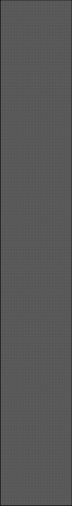

> **Descripción de la imagen** — La imagen es un fondo uniforme compuesto por un patrón de puntos finos en tonos grises y negros (textura de ruido o trama). No contiene ningún objeto, diagrama, gráfico, tabla ni texto visible.

> **Descripción de la imagen** — La imagen es un fondo de color sólido, predominantemente verde claro o verde lima. Presenta sutiles variaciones tonales y bandas horizontales muy tenues que sugieren una textura o gradiente, pero no contiene ningún objeto, texto, diagrama, gráfico ni información estructurada.

## 2a Fase: Propuestas y Cesiones
## 2a Fase: Propuestas y Cesiones
### MARGEN DE MANIOBRA

CONTRAPRESTACIONES                       CESIONES

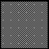

> **Descripción de la imagen** — La imagen es un patrón de fondo que ocupa todo el espacio. Consiste en una malla o tejido repetitivo formado por líneas diagonales blancas sobre un fondo completamente negro. El patrón crea una textura de rejilla o entramado uniforme.

PUNTO DE ACUERDO

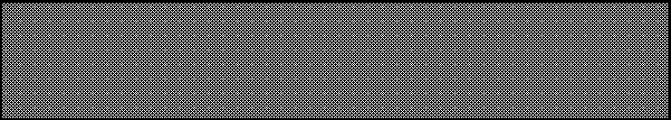

> **Descripción de la imagen** — La imagen es predominantemente un fondo de color gris claro o blanco con una textura sutil de puntos o patrón punteado uniforme. En la esquina inferior derecha se observan algunos caracteres escritos en un tono más oscuro, que parecen ser letras coreanas (como 'ㅈ', 'ㅓ', 'ㅏ', 'ㄴ'). El resto del área es espacio vacío y texturizado.

> **Descripción de la imagen** — La imagen es un fondo de color sólido, de tono naranja claro o melocotón pálido. No contiene elementos gráficos, texto ni estructuras complejas; es una superficie uniforme de color.

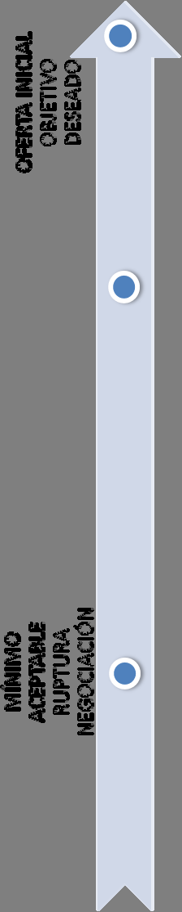

> **Descripción de la imagen** — Se trata de un diagrama vertical que representa un flujo o una secuencia conceptual, estructurado como una línea larga y gris con varias etiquetas y nodos circulares.
>
> El diagrama se organiza de arriba abajo y contiene los siguientes elementos:
>
> 1.  **Parte Superior:** Tres conceptos están alineados en la parte superior, conectados por una flecha ascendente grande que apunta hacia arriba. Estos conceptos son:
>     *   OFERTA INICIAL
>     *   OBJETIVO
>     *   DESEADO
>
> 2.  **Cuerpo Central:** Una línea vertical gris continua desciende desde la sección superior. A lo largo de esta línea, hay un nodo circular visible en el centro.
>
> 3.  **Parte Inferior:** En la parte inferior del diagrama se encuentran dos conceptos clave:
>     *   MINIMO ACEPTABLE
>     *   RUPTURA NEGOCIACIÓN
>
> El diagrama visualiza una progresión o relación entre estos elementos, sugiriendo un proceso que va desde la oferta inicial y el objetivo deseado hasta los puntos de referencia y posibles resultados de la negociación.

NEGOCIADOR X

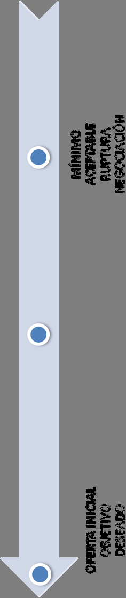

> **Descripción de la imagen** — Se trata de un diagrama conceptual vertical que utiliza flechas y una columna central para mostrar una relación o proceso entre dos conceptos.
>
> **Elementos y estructura:**
>
> 1.  **Parte Superior:** Una gran flecha o chevron apuntando hacia arriba, ubicada a la izquierda del eje central.
> 2.  **Eje Central:** Una barra vertical gris clara que actúa como el cuerpo principal del diagrama. Dentro de esta barra se encuentran dos círculos superpuestos verticalmente: uno azul oscuro en la parte superior y otro de color azul claro/blanco debajo. A la derecha de este eje, se encuentra el texto "FINANCO ACEPTABLE RUPTURA NEGOCIACIÓN".
> 3.  **Parte Inferior:** Una gran flecha o chevron apuntando hacia abajo, ubicada a la izquierda del eje central. Debajo de esta sección, se encuentra el texto "OFERTA INICIAL OBJETIVO DESEADO".
>
> El diagrama establece una conexión visual entre los conceptos superiores e inferiores a través del elemento central y el texto descriptivo.

NEGOCIADOR Y

> **Descripción de la imagen** — La imagen es predominantemente un fondo oscuro, con un degradado que va de gris muy oscuro a negro. No se distinguen elementos gráficos, texto o figuras claras; la mayor parte del espacio visual está ocupado por tonos sombríos y uniformes.

> **Descripción de la imagen** — La imagen es un logotipo o encabezado institucional. Presenta un diseño en blanco y negro con los siguientes elementos:
>
> 1.  **Elemento Gráfico Central:** Una figura abstracta compuesta por formas geométricas interconectadas, que parecen piezas de rompecabezas o un nudo complejo.
> 2.  **Texto Superior:** Una frase escrita en una fuente pequeña, posiblemente en euskera, que dice "ematen za zabel zazu".
> 3.  **Identificación Institucional (Parte Inferior):** Dos líneas de texto que identifican a las instituciones:
>     *   A la izquierda: "Universidad del País Vasco"
>     *   A la derecha: "Euskal Herriko Unibertsitatea"

> **Descripción de la imagen** — La imagen es un logotipo institucional que combina un elemento gráfico y texto. A la izquierda, hay un diseño abstracto compuesto por varias formas curvas y arcos superpuestos en colores vibrantes (verde, azul y rojo), dispuestos en una configuración circular o rotacional. A la derecha del gráfico, se encuentra el nombre principal "EUSKAMPUS" escrito en letras grandes y negras. Debajo del nombre principal, hay dos líneas de texto más pequeñas: "Nazioarteko Bikaintasun Campusa" y "Campus de Excelencia Internacional".

---

<!-- página 18 -->

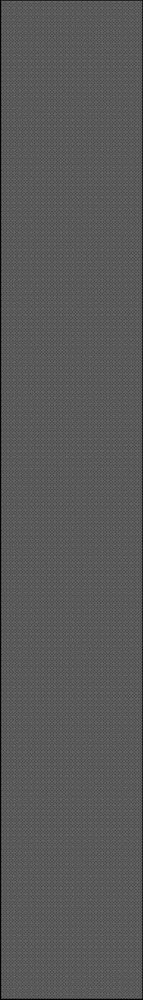

> **Descripción de la imagen** — La imagen es un fondo de color gris claro con una textura de puntos o trama fina uniforme que cubre toda el área visible. No contiene ningún diagrama, gráfico, tabla, texto ni ilustración discernible.

> **Descripción de la imagen** — La imagen es un bloque sólido de color rojo oscuro o granate uniforme.

## 3a Fase: Cierre de la negociación
## 3a Fase: Cierre de la negociación

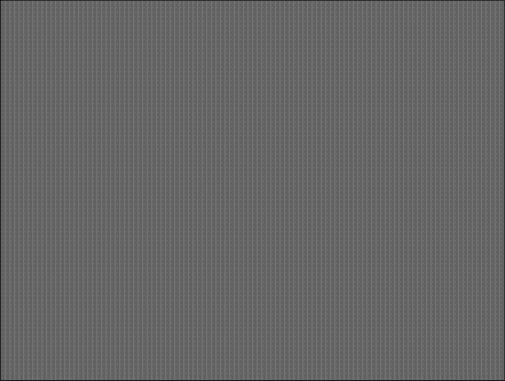

> **Descripción de la imagen** — La imagen es un fondo de textura uniforme, predominantemente en tonos grises oscuros y negros. Presenta un patrón de cuadrícula o puntos finos (similar a ruido o trama de halftone) que cubre toda el área. Hay una sutil variación tonal, con un ligero gradiente que hace que la zona central parezca ligeramente más clara que los bordes. No contiene ningún diagrama, gráfico, texto ni objeto específico.

> **Descripción de la imagen** — La imagen proporcionada es muy pequeña y contiene caracteres que no forman un diagrama, gráfico o ilustración discernible. Solo se observan símbolos o fragmentos de texto ("penas"). No hay contenido visual complejo para describir como una tabla, mapa conceptual o flujo.

La finalidad del cierre es llegar a un

ACUERDO

La propuesta de cierre debe satisfacer

aceptablemente un número

> **Descripción de la imagen** — La imagen es una fotografía de primer plano que muestra dos manos dándose un apretón de manos. Las manos están centradas en el encuadre y se ven de forma prominente. Una de las manos está vestida con una manga de traje oscuro (negro o azul marino) con un puño de camisa blanca visible en la muñeca. La otra mano, que se encuentra en el centro del apretón, tiene una piel morena y no lleva ropa visible. El fondo es un color azul vibrante y desenfocado, lo que resalta las manos y sugiere un ambiente profesional o formal.

suficiente de necesidades de ambas

partes, de lo contrario la negociación

podría romperse.

La negociación se debe cerrar con

decisión, pero con calma, tomando

el tiempo y la distancia adecuados, y

comprobando escrupulosamente los

detalles del acuerdo.

La propuesta final tiene que ser reflejo

de la negociación, sin sorpresas.

Poner el acuerdo por escrito: las

palabras se las lleva el viento.

> **Descripción de la imagen** — La imagen es un logotipo o encabezado institucional. Presenta un diseño en blanco y negro con los siguientes elementos:
>
> 1.  **Elemento Gráfico Central:** Una figura abstracta compuesta por formas geométricas interconectadas, que parecen piezas de rompecabezas o un nudo complejo.
> 2.  **Texto Superior:** Una frase escrita en una fuente pequeña, posiblemente en euskera, que dice "ematen za zabel zazu".
> 3.  **Identificación Institucional (Parte Inferior):** Dos líneas de texto que identifican a las instituciones:
>     *   A la izquierda: "Universidad del País Vasco"
>     *   A la derecha: "Euskal Herriko Unibertsitatea"

> **Descripción de la imagen** — La imagen es un logotipo institucional que combina un elemento gráfico y texto. A la izquierda, hay un diseño abstracto compuesto por varias formas curvas y arcos superpuestos en colores vibrantes (verde, azul y rojo), dispuestos en una configuración circular o rotacional. A la derecha del gráfico, se encuentra el nombre principal "EUSKAMPUS" escrito en letras grandes y negras. Debajo del nombre principal, hay dos líneas de texto más pequeñas: "Nazioarteko Bikaintasun Campusa" y "Campus de Excelencia Internacional".

Afianzar las relaciones profesionales.

Revisar y actualizar las condiciones.

La finalidad del cierre es llegar a un

ACUERDO

La propuesta de cierre debe satisfacer

aceptablemente un número

suficiente de necesidades de ambas

partes, de lo contrario la negociación

podría romperse.

La negociación se debe cerrar con

decisión, pero con calma, tomando

el tiempo y la distancia adecuados, y

comprobando escrupulosamente los

detalles del acuerdo.

La propuesta final tiene que ser reflejo

de la negociación, sin sorpresas.

Poner el acuerdo por escrito: las

palabras se las lleva el viento.

Afianzar las relaciones profesionales.

Revisar y actualizar las condiciones.
## Dignificar el momento,
## ¡CELEBRARLO!

---

<!-- página 19 -->

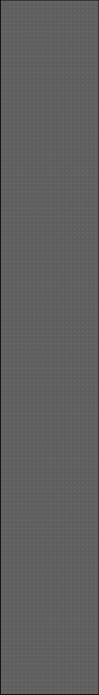

> **Descripción de la imagen** — La imagen es un fondo uniforme compuesto por un patrón de puntos o trama (halftone) en tonos de gris claro y blanco. No contiene texto, diagramas, tablas ni gráficos; es esencialmente una superficie texturizada sin contenido visual informativo específico.

> **Descripción de la imagen** — La imagen es un bloque sólido de color verde claro o amarillo pálido, sin ningún otro elemento visual, texto, diagrama, tabla o gráfico discernible.

### Trainera colaborativa
### Trainera colaborativa

> **Descripción de la imagen** — La imagen es completamente oscura y presenta un patrón de textura granulada o cuadriculada en tonos grises, sin contener ningún objeto, texto, diagrama, gráfico ni ilustración visible. Es esencialmente un fondo vacío.

> **Descripción de la imagen** — La imagen proporcionada es extremadamente mínima y consiste en una secuencia de caracteres o un símbolo muy pequeño, que se asemeja a la palabra "penas". No presenta elementos gráficos complejos como diagramas, tablas o ilustraciones.

> **Descripción de la imagen** — La imagen es un fondo de textura uniforme y oscura. Está compuesta por un patrón sutil de líneas diagonales finas que crean una apariencia de rejilla o ruido visual. El color predominante es gris oscuro o negro. No contiene texto, gráficos, tablas ni elementos estructurales definidos.

> **Descripción de la imagen** — No se ha proporcionado ninguna imagen discernible para describir. Por favor, adjunte la imagen para que pueda realizar la descripción solicitada.

Aunque  la  negociación

comienza con una imagen

tensa  inspirada  en  la

SOKATIRA.  No se trata de

> **Descripción de la imagen** — Es una fotografía tomada desde una perspectiva aérea o elevada, que muestra un bote de remo en el agua. Cuatro personas están sentadas en el bote, remando. Los remeros visten camisetas rojas. El bote tiene un casco blanco y azul brillante. Se observan los largos remos extendidos hacia el agua. La imagen captura la acción del remo y refleja claramente la silueta del bote y de los remeros en la superficie del agua azul.

una  batalla  que  se  deba

ganar  a  cualquier  precio,

porque  los  beneficios  a

corto  plazo  a  la  larga  se

pueden
convertir
en

pérdidas,
y
pueden

impedir acuerdos futuros.

Aunque  la  negociación

comienza con una imagen

tensa  inspirada  en  la

SOKATIRA.  No se trata de

una  batalla  que  se  deba

ganar  a  cualquier  precio,

porque  los  beneficios  a

corto  plazo  a  la  larga  se

pueden
convertir
en

pérdidas,
y
pueden

impedir acuerdos futuros.

Se  trata  más  bien  de  una

TRAINERA  colaborativa  en

la que ambas partes bogan

en pos del beneficio mutuo.

Se  trata  más  bien  de  una

TRAINERA  colaborativa  en

la que ambas partes bogan

en pos del beneficio mutuo.

> **Descripción de la imagen** — La imagen es un logotipo o encabezado institucional. Presenta un diseño en blanco y negro con los siguientes elementos:
>
> 1.  **Elemento Gráfico Central:** Una figura abstracta compuesta por formas geométricas interconectadas, que parecen piezas de rompecabezas o un nudo complejo.
> 2.  **Texto Superior:** Una frase escrita en una fuente pequeña, posiblemente en euskera, que dice "ematen za zabel zazu".
> 3.  **Identificación Institucional (Parte Inferior):** Dos líneas de texto que identifican a las instituciones:
>     *   A la izquierda: "Universidad del País Vasco"
>     *   A la derecha: "Euskal Herriko Unibertsitatea"

> **Descripción de la imagen** — La imagen es un logotipo institucional que combina un elemento gráfico y texto. A la izquierda, hay un diseño abstracto compuesto por varias formas curvas y arcos superpuestos en colores vibrantes (verde, azul y rojo), dispuestos en una configuración circular o rotacional. A la derecha del gráfico, se encuentra el nombre principal "EUSKAMPUS" escrito en letras grandes y negras. Debajo del nombre principal, hay dos líneas de texto más pequeñas: "Nazioarteko Bikaintasun Campusa" y "Campus de Excelencia Internacional".

---

<!-- página 20 -->

> **Descripción de la imagen** — La imagen es un logotipo o identificador institucional que combina texto y un símbolo gráfico. En la parte superior central se encuentra un símbolo abstracto, compuesto por formas geométricas negras entrelazadas. Debajo de este símbolo, el texto está dispuesto en dos líneas: a la izquierda aparece "Universidad del País Vasco" y a la derecha aparece "Euskal Herriko Unibertsitatea".

> **Descripción de la imagen** — La imagen es un logotipo institucional que combina un elemento gráfico y texto.
>
> A la izquierda, hay un diseño abstracto compuesto por varias formas curvas y arcos superpuestos en colores vibrantes (verde, azul y rojo/naranja), que forman un patrón dinámico o circular.
>
> A la derecha del gráfico, se encuentra el nombre de la institución escrito en letras grandes y negras: "EUSKAMPUS".
>
> Debajo del nombre principal, hay dos líneas de texto más pequeñas:
> 1.  "Nazioarteko Bikaintasun Campusa"
> 2.  "Campus de Excelencia Internacional"

