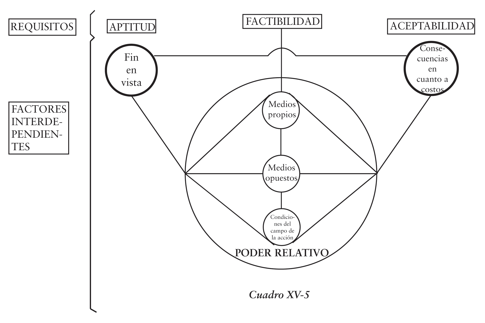
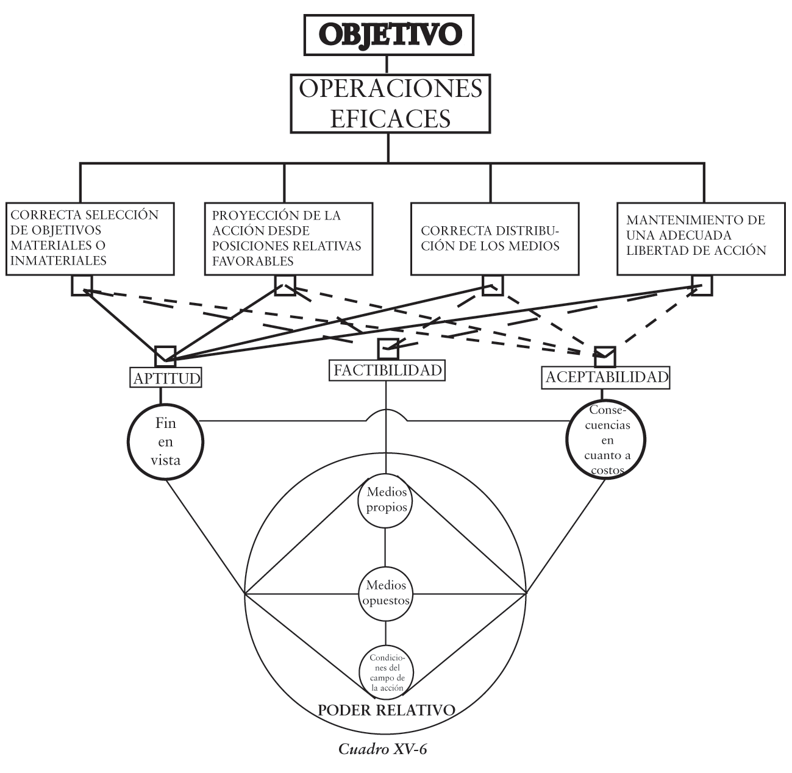

# aldao

<!-- página 1 -->
### La negociación

Un enfoque transdisciplinario con
específicas referencias a la negociación laboral

---

<!-- página 2 -->

Ilustración de portada
CARLOS BERNASCONI
La Explicación
Óleo sobre tela
Colección Privada

---

<!-- página 3 -->

Carlos M. Aldao-Zapiola
### La negociación

Un enfoque transdisciplinario

con específicas referencias a

la negociación laboral

> **Descripción de la imagen** — La imagen es un logotipo que combina texto y un emblema circular. En la parte superior se encuentra el texto "Oficina Internacional del Trabajo". Debajo, hay un emblema circular con un diseño de laureles o ramas entrelazadas. Dentro del círculo se lee las siglas "OIT" estilizadas. Debajo del emblema, centrado, se encuentra el texto "CINTERFOR".

---

<!-- página 4 -->

Copyright © Organización Internacional del Trabajo (OIT/Cinterfor) 2009
1a Edición de 2000 ejemplares, 1990, Buenos Aires.
2a Edición de 2000 ejemplares, 1992, Buenos Aires.
3a Edición de 2000 ejemplares, 1995, Buenos Aires.
4a Edición de 2000 ejemplares ampliada y corregida, 2009, Montevideo.

Las publicaciones de la Oficina Internacional del Trabajo gozan de la protección de los derechos de
propiedad intelectual en virtud del protocolo 2 anexo a la Convención Universal sobre Derecho de Autor.
No obstante, ciertos extractos breves de estas publicaciones pueden reproducirse sin autorización, con la
condición de que se mencione la fuente. Para obtener los derechos de reproducción o de traducción, deben
formularse las correspondientes solicitudes a la Oficina de Publicaciones (Derechos de autor y licencias),
Oficina Internacional del Trabajo, CH-1211 Ginebra 22, Suiza, solicitudes que serán bien acogidas.
### ALDAO ZAPIOLA, CARLOS M.
### La negociación.  Un enfoque transdisciplinario con específicas referencias a la
### negociación laboral.  4a. ed.  rev.  Montevideo: OIT/Cinterfor, 2009.
### 496 p.   (Herramientas para la Transformación, 34)
### Referencias bibliográficas: p. 481-490
### Bibliografía ampliatoria: p. 491-496
### Índice analítico: p. 475-480
### ISBN: 978-92-9088-248-0
### /NEGOCIACIÓN/ /TRABAJO//RELACIONES LABORALES/ /ASPECTO
### PSICOLÓGICO//ASPECTOS SOCIOLÓGICOS/

Las denominaciones empleadas, en concordancia con la práctica seguida en las Naciones Unidas,
y la forma en que aparecen presentados los datos en las publicaciones de la OIT no implican juicio
alguno por parte de la Oficina Internacional del Trabajo sobre la condición jurídica de ninguno de los
países, zonas o territorios citados o de sus autoridades, ni respecto de la delimitación de sus fronteras.

La responsabilidad de las opiniones expresadas en los artículos, estudios y otras colaboraciones
firmados incumbe exclusivamente a sus autores, y su publicación no significa que la OIT las sancione.

Las referencias a firmas o a procesos o productos comerciales no implican aprobación
alguna por la Oficina Internacional del Trabajo, y el hecho de que no se mencionen
firmas
o
procesos
o
productos
comerciales
no
implica
desaprobación
alguna.

Las publicaciones de la OIT pueden obtenerse en las principales librerías o en oficinas locales de la OIT en
muchos países o pidiéndolas a:  Publicaciones de la OIT, Oficina Internacional del Trabajo, CH-1211 Ginebra
22, Suiza. También pueden solicitarse catálogos o listas de nuevas publicaciones a la dirección antes mencionada
o por correo electrónico a: pubvente@ilo.org                                                              Sitio en la red: www.ilo.org/publns

El Centro Interamericano de Investigación y Documentación sobre Formación Profesional (Cinterfor/
OIT) es un servicio técnico de la OIT, establecido en 1964 con el fin de impulsar y coordinar
los esfuerzos de las instituciones y organismos dedicados a la formación profesional en la región.

Las publicaciones del Centro pueden obtenerse en las oficinas locales de la OIT en muchos países o
solicitándolas a Cinterfor/OIT, Casilla de correo 1761, E-mail: oitcinterfor@oitcinterfor.org, Fax: 902 1305,
Montevideo, Uruguay.
Sitio en la red: www.oitcinterfor.org

Impreso en la República Oriental del Uruguay

---

<!-- página 5 -->

A (J) la memoria de mis padres
y a sus amigos, que cuando ellos me
faltaron fueron mis amigos.
Especialmente a Juana.

Esta cuarta edición la dedico
especialmente a Alicia y a nuestros
hijos Joaquín Carlos, Juan Cruz,
Matilde, Francisco y Justo Mariano.

---

<!-- página 6 -->

El uso de un lenguaje que no discrimine ni marque
diferencias entre hombres y mujeres es una de las preocupaciones
de nuestra Organización. Sin embargo, no hay acuerdo entre los
lingüistas sobre la manera de cómo hacerlo en nuestro idioma.

En tal sentido y con el fin de evitar la sobrecarga gráfica que supon­
dría utilizar en español o/a para marcar la existencia de ambos sexos,
hemos optado por emplear el masculino genérico clásico, en el
entendido de que todas las menciones en tal género representan
siempre a hombres y mujeres.

A  D  V  E  R  T  E  N  C  I  A

---

<!-- página 7 -->

> **Descripción de la imagen** — Es un retrato formal de un hombre de mediana edad, tomado a la altura del pecho. El sujeto tiene cabello oscuro y está mirando directamente a la cámara con una expresión seria o neutra. Viste un traje oscuro (posiblemente negro) sobre una camisa blanca y una corbata estampada. Lleva un pañuelo de bolsillo blanco en el bolsillo superior del saco. El fondo está compuesto por estanterías llenas de libros, lo que sugiere un entorno académico o de biblioteca.

VII
### El Autor

Carlos M. Aldao-Zapiola es
considerado una autoridad en Gestión de
Personas, Relaciones Laborales, Estrategia
Organizacional, Comunicaciones y las
interrelaciones de estas áreas.

Es abogado, Doctor en Ciencias
Jurídicas y Sociales, Master en Admi-
nistración Estratégica, Doctor en
Sociología del Trabajo, Doctor en
Jurisprudencia y ha cursado, además,
estudios de doctorado en Ciencias Políticas. Habiendo asistido a pos­
grados de distintas universidades en Estados Unidos y Europa.

Durante más de treinta años se ha desempeñado en posiciones
de alta dirección en empresas como John Deere Argentina, Revlon
Argentina, Grupo Fortabat (Loma Negra, Lomax, Ferrosur Roca, Radio
el Mundo y Diario La Prensa). También ha sido contratado como con­
sultor para organismos privados y públicos argentinos e internaciona­
les (PNUD, UNICEF, OIT, BID, etc.).

Institucionalmente se ha desarrollado como presidente del comité
de Relaciones Industriales de la Cámara de Comercio de los Estados
Unidos en la República Argentina (AMCHAM), director de la División
de Personal del Instituto para el Desarrollo Empresarial de la Argentina
(IDEA), presidente de la Sociedad de Recursos Humanos de Argentina
(ADRHA), presidente de la Federación Interamericana de Asociaciones
Profesionales para la Gestión Humana (FIDAGH), presidente de la
World Federation of Personnel Management Associations (WFPMA).

Ha recibido múltiples premios entre los que se destacan el Premio
“Rodolfo Napoli” otorgado por la Suprema Corte de Justicia de la
Provincia de Buenos Aires a la mejor obra doctrinaria presentada al
VIII Congreso Nacional de Derecho del Trabajo y la Seguridad Social
(1986), Certificate of Appreciation and Award otorgado por la World
Federation of Personnel Management Associations (1992), Premio

---

<!-- página 8 -->

VIII

“Oscar Alvear Urrutia”, instituido por la Federación Interamericana
de Asociaciones Profesionales para la Gestión Humana (2004), Premio
“Georges Petitpas” otorgado por la World Federation of Personnel
Management Associations (2008), Distinción de la Asociación de
RRHH de la Argentina por su aporte a la gestión Humana (2008).

Autor de más de ochenta artículos publicados en revistas espe­
cializadas en el país y en el exterior. Ha publicado varios libros entre
los que se destacan: “La Negociación”, “Productividad y Negociación
Colectiva”, “Relaciones Industriales y Recursos Humanos en América
Latina”.

Desde hace más de treinta años se dedica a la docencia universitaria
dictando cátedras de grado y de posgrado en universidades argenti­
nas y latinoamericanas. Dirigiendo en la actualidad varias Maestrías
en Gestión Estratégica de Recursos Humanos y Relaciones Laborales
(UADE Business School, UCEL, entre otras).

A partir de 1992 ha venido asistiendo ininterrumpidamente a
la Organización Internacional del Trabajo (OIT) en su carácter de
Delegado Técnico Empleador representante de la Argentina.

En el año 2002 fundó CAZEEL (Carlos M. Aldao-Zapiola Estudios
Estratégicos Laborales), una firma dedicada a la investigación y análisis
de temas vinculados a la Estrategia Organizacional, al Empleo y las
Personas, y su desempeño en las organizaciones. Desde la cual asesora
a importantes compañías y capacita a ejecutivos sobre los temas vincu­
lados a su conocimiento.

Una de sus principales convicciones que permanentemente trans­
mite es el desarrollo del pensamiento sistémico y del enfoque estraté­
gico además de remarcar la importancia de la formación continua con
el convencimiento de que la educación es la clave para el desarrollo
económico y social.

---

<!-- página 9 -->

IX
## Índice

Presentación a la cuarta edición.................................................................................17
Prólogo del autor a la cuarta edición.........................................................................21
Préface............................................................................................................................25
Prefacio...........................................................................................................................29
Prólogo del autor a manera de explicación..............................................................33
¿Por qué se escribió este libro?...................................................................................33
¿Para qué escribir el presente libro?...........................................................................37
¿A qué posibles lectores está destinado este libro?..................................................38
Algunas aclaraciones necesarias.................................................................................40
Prólogo del autor a la segunda edición.....................................................................45
Presentación..................................................................................................................47
Estructura del libro.......................................................................................................55
### PRIMERA SECCIÓN
### INTRODUCCIÓN

CAPÍTULO I
Planteamiento del tema
Sumario..........................................................................................................................59

1,1. Importancia de la negociación laboral.........................................................59
1,2. Otras causales que justifican su estudio.......................................................61
1,3. Negociadores: improvisado, intuitivo y profesional..................................66
1,4. Enfoque a seguir..............................................................................................67
1,5. Sinopsis del capítulo I.....................................................................................70

CAPÍTULO II
Concepto y clasificación de la negociación
Sumario..........................................................................................................................73

2,1. Vocablo negociación.......................................................................................73
2,2. Distintos enfoques científicos posibles para definir el concepto.............76

---

<!-- página 10 -->

X

2,3. La negociación en general .............................................................................77
2,4. La negociación laboral....................................................................................84
2,5. Necesidad de una nueva conceptualización de la negociación................89
2,6. Nueva definición ............................................................................................89
2,7. Ampliación conceptual que implica una clasificación..............................91
2,8. Otras clasificaciones........................................................................................94
2,9. Sinopsis del capítulo II...................................................................................97
### SEGUNDA SECCIÓN
### COMPONENTES DE LA NEGOCIACIÓN

CAPÍTULO III
Concepto, Clasificación, Aptitudes y Necesidades
Sumario........................................................................................................................105

3,1. Concepto........................................................................................................105
3,2. Clasificación...................................................................................................105
3,3. Aspectos básicos que deben ser considerados..........................................108
3,4. Algunas aptitudes deseables de ser poseídas.............................................109
3,5. La creatividad como presupuesto indispensable......................................112
3,6. Necesidades a satisfacer por parte de los negociadores...........................115
3,7. Sinopsis del capítulo III................................................................................119

CAPÍTULO IV
Aspectos psicológicos
Sumario........................................................................................................................121

4,1. Conceptos introductorios............................................................................121
4,2. Conductas defensivas...................................................................................125
4,3. Automatismos de la conducta humana.....................................................130
4,4. Conducta racional del sujeto negociador..................................................133
4,5. Sinopsis del capítulo IV................................................................................134

CAPÍTULO V
Aspectos sociológicos
Sumario........................................................................................................................137

5,1. Posición de los negociadores y papel que desempeñan..........................137
5,2. Actitudes posibles de los sujetos negociadores y de los grupos a
los que representan.......................................................................................141
5,3. Sinopsis del capítulo V.................................................................................155

---

<!-- página 11 -->

XI

CAPÍTULO VI
Contenido de la negociación
Sumario........................................................................................................................159

6,1. Generalidades................................................................................................159
6,2. Intercambiabilidad de objetos.....................................................................161
6,3. El contenido en las negociaciones laborales.............................................162
6,4. Posible clasificación considerando las negociaciones colectivas............163
Tabla de clasificación resumida.........................................................................166
6,5. Materia negociable en el ámbito individual..............................................171
6,6. El contenido en cualquier tipo de negociación........................................172
6,7. Sinopsis del capítulo VI................................................................................174

CAPÍTULO VII
¿Dónde se negocia?
Sumario.........................................................................................................................179

7,1. Generalidades introductorias......................................................................179
7,2. Importancia del lugar...................................................................................181
7,3. Algunas posibilidades a considerar............................................................183
7,4. Sinopsis del capítulo VII..............................................................................191

CAPÍTULO VIII
Distintas posturas
Sumario.........................................................................................................................195

8,1. Concepto........................................................................................................195
8,2. Algunos enfoques posibles...........................................................................196
8,3. Criterio adoptado..........................................................................................199
8,4. Sinopsis del capítulo VIII.............................................................................200

CAPÍTULO IX

Tiempo
Sumario........................................................................................................................203

9,1. Aclaraciones introductorias y conceptualizaciones previas....................203
9,2. Formas posibles de clasificar el tiempo.....................................................204
9, 3. Algunas características del tiempo............................................................205
9,4. La delegación como forma de comprar tiempo.......................................206
9,5. Relaciones a considerar................................................................................207
9,6. Oportunidad..................................................................................................208
9,7. La maniobra en el tiempo............................................................................209
9,8. Armonización de las acciones en el tiempo..............................................209
9,9. Sinopsis del capítulo IX................................................................................213

---

<!-- página 12 -->

XII

CAPÍTULO X
Información
Sumario........................................................................................................................215

10,1. Introducción................................................................................................215
10,2. Concepto......................................................................................................216
10,3. Información, inteligencia y proceso de inteligencia..............................217
10,4. Funciones fundamentales de la actividad de inteligencia.....................218
10,5. Comentarios adicionales sobre la información en el ámbito
de la negociación............................................................................................221
10,6. Sinopsis del capítulo X...............................................................................223

CAPÍTULO XI

Poder
Sumario........................................................................................................................225

11,1. Concepto......................................................................................................225
11,2. Concepción de Etzioni. Clasificación......................................................226
11,3. Sumisión.......................................................................................................227
11,4. Otros aportes al concepto del poder........................................................229
11,5. Concepción de Galbraith...........................................................................230
11,6. Similitud de las concepciones de Etzioni y Galbraith...........................235
11,7. Algunos conceptos sobre el poder considerado desde el punto
de vista estratégico........................................................................................235
11,8. Comentarios sobre el poder en el ámbito de la negociación................236
11,9. Sinopsis del capítulo XI..............................................................................236

CAPÍTULO XII
Modelos competitivo y cooperativo
Sumario........................................................................................................................241

12,1. Generalidades .............................................................................................241
12,2. Modelo competitivo....................................................................................243
12,3. Modelo cooperativo....................................................................................247
12,4. Prevalencia de un modelo sobre otro......................................................249
12,5. Sinopsis del capítulo XII............................................................................250

CAPÍTULO XIII
Otros modelos
Sumario........................................................................................................................253

13,1. Aclaraciones introductorias.......................................................................253
13,2. Modelo “Clausewitziano” (Aldao-Zapiola).............................................254
13,3. “Negociar sin ceder” (Fisher-Ury)............................................................257
13,4. “Negociación efectiva” (Huthwaite Research Group)...........................274
13,5. “Ganar-ganar” (Jandt-Gillette).................................................................278

---

<!-- página 13 -->

XIII

13,6. Modelo “cooperativo” (Nierenberg)........................................................292
13,7. Comentarios adicionales............................................................................315
13,8. Sinopsis del capítulo XIII...........................................................................316
### TERCERA SECCIÓN
### ASPECTOS ESTRATÉGICOS Y TÁCTICOS

CAPÍTULO XIV
Encadenamiento estratégico
Sumario........................................................................................................................325

14,1. La incorporación de la estrategia a la administración...........................325
14,2. Encadenamiento estratégico......................................................................329
14,3. El encadenamiento estratégico y las relaciones industriales en general....338
14,4. El encadenamiento estratégico y la negociación laboral en particular.339
14,5. Sinopsis del capítulo XIV...........................................................................340

CAPÍTULO XV
Principios a considerar
Sumario........................................................................................................................343

15,1. Los principios estratégicos.........................................................................343
15,2. Diferentes concepciones ...........................................................................344
15,3. Principio general para la resolución de un problema humano............355
15,4. El Principio estratégico fundamental (PEF)...........................................356
15,5. Aplicación del principio estratégico a la negociación...........................358
15,6. Sinopsis del capítulo XV............................................................................359

CAPÍTULO XVI
Contextos posibles
Sumario........................................................................................................................361

16,1. Explicación introductoria..........................................................................361
16,2. Contexto: estático. Plácido y azaroso.......................................................363
16,3. Contexto: estático. Placido y conexo........................................................364
16,4. Contexto: dinámico. Conexo-reactivo.....................................................366
16,5. Contexto: dinámico. Conexo-reactivo y perturbado.............................369
16,6. Importancia de la consideración del contexto........................................371
16,7. Sinopsis del capítulo XVI...........................................................................371

CAPÍTULO XVII
Maniobras a implementar
Sumario........................................................................................................................373

---

<!-- página 14 -->

XIV

17,1. Concepto general........................................................................................373
17,2. Diversas manifestaciones de la maniobra...............................................374
17,3. Una tipología a considerar........................................................................376
17,4. Analogías entre las maniobras de la estrategia general y las
maniobras de la negociación.......................................................................379
17,5. Tácticas comúnmente asociadas a las maniobras estratégicas.............382
17,6. Gestos y otras manifestaciones corporales que van asociados
usualmente a las actitudes estratégicas o a la acción...............................392
17,7. La manipulación como acción psicológica de apoyo a la negociación......396
17,8. Ideas aplicables a la negociación derivadas de “El Príncipe”
de Nicolás Maquiavelo..................................................................................404
17,9. Aclaración adicional...................................................................................408
17,10. Sinopsis del capítulo XVII.......................................................................409

CAPÍTULO XVIII
Planificación de la acción
Sumario........................................................................................................................417

18,1. Aclaraciones sobre etapas y metodología de preparación
de la negociación...........................................................................................418
18,2. Fases de la metodología..............................................................................418
18,3. Determinación del plan general................................................................419
18,4. El desarrollo del plan..................................................................................436
18,5. La directiva...................................................................................................439
18,6. La supervisión de la acción........................................................................442
18,7. Sinopsis del capítulo XVIII........................................................................443
### CUARTA SECCIÓN
### DESARROLLO DE LA NEGOCIACIÓN

CAPÍTULO XIX

Etapas
Sumario........................................................................................................................449

19,1. Comentarios introductorios......................................................................449
19,2. Decisión de negociar..................................................................................452
19,3. Preparación..................................................................................................452
19,4. Ejecución......................................................................................................452
19,5. Conclusión...................................................................................................456
19,6. Materialización del resultado....................................................................458
19,7. Sinopsis del capítulo XIX...........................................................................459

---

<!-- página 15 -->

XV
### QUINTA SECCIÓN
### CONCLUSIÓN

CAPÍTULO XX
Reflexiones finales
Sumario........................................................................................................................463

20,1. Consideraciones preliminares...................................................................463
20,2. Conclusiones................................................................................................464
20,3. Sinopsis del capítulo XX............................................................................471

Nota del Autor............................................................................................................473
Índice analítico............................................................................................................475
Referencias bibliográficas..........................................................................................481
Bibliografía Ampliatoria............................................................................................491

---

<!-- página 16 -->

---

<!-- página 17 -->

17
## Presentación a la cuarta edición

Si la negociación es un arte, una técnica, una práctica de ejercicio
permanente en la vida de relación, la negociación laboral en el plano
colectivo es también eso y todavía algo más que eso: es uno de los
modos, y no el menos importante, en que se formulan las normas del
derecho objetivo del derecho del trabajo. La negociación colectiva con­
tribuye de ese modo a configurar un ordenamiento que en la mayoría
de las experiencias nacionales que poseen algún grado razonable de
evolución institucional, no es sino el producto de una mezcla en diversas
dosis entre la ley y los productos de esa negociación. Más leyes o menos
leyes, más convenios colectivos o menos convenios colectivos, según
cuál sea la cultura jurídica y la cultura industrial de cada sociedad
nacional. Pero siempre, ley y convenio.

Leyes y convenios colectivos operan a su vez como portadores de
la técnica de la limitación de la autonomía de la voluntad a partir de
la captación de la radical ineptitud de la autonomía individual para
establecer las condiciones del contrato de trabajo dependiente; un tal
contrato sólo fundado en la voluntad de sus partes no ha de expresar
una razonable y equilibrada adjudicación recíproca de derechos y obli­
gaciones sino, muy por el contrario, una muy sesgada entronización de
los intereses de quien recibe el trabajo y consiguiente postergación de
quien lo presta.

Es fácil entender, por ello, por qué razón la negociación colecti­
va, expresión de la íntima y ontológica bilateralidad de las relaciones
industriales, tiene en el universo de las relaciones de producción una
dimensión estelar, en tanto que la negociación individual, más proba­
blemente abarcada por las técnicas empresarias de gestión de los recur­
sos humanos, genera expectativas menores, al menos en lo que hace a
su aptitud para la fijación de las condiciones de trabajo.

---

<!-- página 18 -->

18

Por lo demás, cuando se incursiona en la negociación laboral, es
menester admitir también la lógica del conflicto social que constituye
su presupuesto, desde una visión que lo reconoce como motor de pro­
greso social y desdeña los perspectivas comunitarias –las que definen a
la empresa como una incomprobable “comunidad de personas”– pers­
pectivas estas muchas veces apenas voluntaristas cuando no franca­
mente autoritarias. En las relaciones de producción, como en los otros
órdenes de la vida económica, hay intereses diferenciados –lo que no es
malo sino bueno (malo es negarlo...)– y vale servirse de la negociación
como uno de los modos más eficaces para componerlos y articularlos.

Si esos son algunos de los imperativos cuya debida consideración
el mundo del trabajo impone a toda reflexión teórica vinculada con
el arte de negociar, este a su vez requiere que quienes protagonizan
la negociación laboral comprendan que la negociación es, necesaria­
mente, intercambio de concesiones recíprocas y que si en sus orígenes
el intercambio de salario por paz social bastaba para darle contenido,
en los días que corren eso sólo ya no alcanza. La negociación laboral,
particularmente la negociación colectiva, reclama hoy para fructificar
que ambos protagonistas puedan interesarse en ella. No se ha de llegar
ya muy lejos en el plano de la negociación, si sólo uno la quiere y el
otro apenas la tolera o incluso la resiste; también en ese plano hay que
decir hoy que la equidad social y la eficacia económica y productiva
son dimensiones inseparables en una lógica de progreso, y es menester
ofrecerles espacios compartidos.

Como se advierte, en la encrucijada en la que se encuentran la prác­
tica de la negociación y la de las relaciones de producción, se reciben
“mensajes” desde ambas “avenidas”. Desde luego, no es fácil incursio­
nar en el terreno de la negociación laboral desde esa perspectiva com­
pleja; es necesario para ello entender mucho de negociación y mucho
también de la práctica de las relaciones industriales y de su marco
contextual. Esa –la de la aproximación multidisciplinaria, en la que se
articulan, además de las relaciones industriales en sí, la administración,
la sociología, la psicología, el derecho, la estrategia y la economía– pre­
supone una posición privilegiada, inhabitual en el campo de la produc­
ción del conocimiento; una posición de la que Aldao dispone, y que le
permite materializar una elaboración como la que esta obra contiene.

---

<!-- página 19 -->

19

En cualquier caso, lo que Aldao-Zapiola se propone expresar es que
las relaciones de producción –en todos sus niveles– constituyen uno de
los ámbitos en los que se despliega el ejercicio de la negociación y que
tampoco en él es posible prescindir del conocimiento y la administra­
ción de una cierta teoría general de la negociación y de las destrezas
que esa teoría alimenta; como tantas veces se ha sostenido, en cualquier
orden de la práctica profesional no hay mejor instrumento para un des­
empeño eficaz que un adecuado dominio y comprensión de la teoría.

A partir de esa dotación intelectual, el autor despliega la teoría y
las destrezas de la negociación desde una dimensión disciplinaria de
amplia cobertura, refiriéndolas particularmente a la negociación labo­
ral que fuera, además, el objeto de su historia profesional, que Aldao
exhibe con ánimo generoso. Y como es de los que saben, matiza ese
despliegue teórico sobre la negociación con las intransferibles singula­
ridades del mundo del trabajo. Además de las que se recordaran en las
primeras líneas de esta presentación, y entre muchas otras: la concien­
cia cabal de que las relaciones del trabajo son relaciones continuativas
y que la conducta que se asuma en la negociación de hoy puede tener
una incidencia dirimente en otras que deban emprenderse más tarde;
la comprensión de que en su dimensión colectiva no se representan
voluntades (como es propio de la representación tradicional del dere­
cho privado), sino intereses de sujetos más bien abstractos (los de
las categorías profesionales de trabajadores y, en su caso, también de
empleadores); el hecho singular de que en la negociación individual
hay restricciones –las de la imperatividad relativa de la norma labo­
ral– ausentes en otros espacios de negociación.

Desde esas perspectivas, Aldao-Zapiola produce conocimiento,
pues es un investigador destacado y dedicado, y luego lo transmite
con particular empeño didáctico, pues es también un profesor, cuya
claridad y elocuencia son el producto de una fina inteligencia y una
esforzada preparación; la de sus clases y la de sus obras. Y si el Profesor
Dimitri Weiss lo pudo intuir a partir de la sola lectura de esta obra, a
mi, personalmente, me consta, pues pude contar durante varios años
con el apoyo lúcido del autor en el ejercicio de la tarea docente com­
partida en la Facultad de Derecho de la Universidad de Buenos Aires y,
más tarde, también en la Universidad de San Andrés.

---

<!-- página 20 -->

20

Me resta tan sólo decir que al articular esos dos espacios complejos
–el de la negociación como práctica teóricamente sustentable y el de las
relaciones industriales, de un lado; el de la producción y la transmisión
del conocimiento, de otro– Aldao no puede sino asumir una perspec­
tiva heterodoxa, que es inevitable derivación de esa doble complejidad.
Una heterodoxia que parte del conocimiento y del rigor y es preci­
samente por ello expresión de creatividad; siempre es posible, hasta
cómodo, ser heterodoxo desde la ignorancia y la pereza intelectual y
obviamente, no es este el caso. Bien por el contrario, Aldao propone,
construye y enseña “desde la punta” del conocimiento disponible y he
allí otro fundamento más de la significación de su obra que me honro
hoy en presentar.

Adrián Goldin

---

<!-- página 21 -->

21
## Prólogo del Autor
## a la cuarta edición

Han transcurrido más de dieciocho años desde que se editó por
primera vez este libro y más de trece de la tercera y última edición.

Se me ha reclamado insistentemente una nueva edición, reque­
rimiento que ha provenido de universidades y centros de formación,
de alumnos, colegas y amigos que constantemente me han venido
señalando que no pueden continuar sacando fotocopias de un libro ya
agotado y dificil de conseguir.

Frente a esa necesidad he decidido publicar esta cuarta edición agre­
gándole dos listados bibliográficos. El primero, titulado “bibliografía uti­
lizada”, contiene la bibliografía citada a lo largo del texto y permite, así,
su rápida identificación. El segundo, llamado “bibliografía ampliatoria”
identifica la mayoría de los libros referidos exclusivamente a la negocia­
ción, a los que tuve acceso, y que se publicaron con posterioridad a 1990.
Algunos de estos libros son altamente recomendables de leer, otros en
cambio altamente recomendables de no adquirir; he estado muy tentado
de asignarles una calificación –para evitar que otros incurran en el error,
en que incurrí yo, de comprarlos y al menos revisarlos sino leerlos– pero
finalmente he rechazado esa idea en aras de una conducta prudente; solo
los he incluido para que el lector sepa que existen.

Por último he dejado de lado una nómina de libros vinculados al
tema de la conflictividad (la otra cara de la moneda de la negociación)
pues la misma será objeto de contenido de otro libro relativo a dicho
tema que está actualmente en proceso de preparación.

También se ha agregado un índice analítico que posibilita una bús­
queda más rápida de los temas de interés.

---

<!-- página 22 -->

22

Durante los casi veinte años transcurridos desde la edición original
muchas modificaciones se han producido en mi vida laboral (quizá
la principal fue la de dejar de desempeñarme en un puesto ejecutivo
dentro de una compañía para pasar a ser un asesor independiente de
varias organizaciones, lo que me amplió el campo de experiencias),
en mi actividad docente (decidí dejar de dictar clases en carreras de
grado para hacerlo exclusivamente en posgrados –Universidad de San
Andrés, Escuela Superior de Economía y Administración de Empresas,
Universidad de Buenos Aires, Universidad de Tres de Febrero, etc.–;
acepté dirigir varias maestrías y especializaciones en el área de Recursos
Humanos –MRRHH en UADE Business School, MRRLL y RRHH en
UCEL y especialización en RRLL y RRHH en Fundación Magister–) y
en la actividad institucional en, cuyo ámbito destaco, el haber sido pre­
sidente de la World Federation of Personnel Management Associations
en el período 2002-2004 (en donde gracias al soporte que realizaron los
colegas que integraban el Board Of Directors pudimos establecer
algunos hitos tales como contribuir fuertemente a la creación de la
African Federation of HRM Associations y establecer los primeros con­
tactos con nuestros colegas de China en Beijing).

Todas estas nuevas experiencias en mi desarrollo profesional,
académico, institucional y personal contribuyeron a mejorar mis capa­
cidades y competencias y entre ellas mis habilidades negociadoras.
Agradezco a todos aquellos que desde sus distintos ámbitos indirecta o
directamente me brindaron sus enseñanzas y experiencias.

Esta cuarta edición es llevada a cabo por la Oficina Internacional
del Trabajo (OIT /Cinterfor), Centro Interamericano para el Desarrollo
del Conocimiento en la Formación Profesional, y como personalmente
creo que la formación y la capacitación continua son la clave del desa­
rrollo económico y social de las personas, me ha parecido más que ade­
cuado que sea OIT/Cinterfor quien realice esta cuarta edición. Por ello
le estoy sumamente agradecido a las autoridades de dicha organización
que acordaron este proceso editorial.

Para terminar quiero agradecerle al profesor Adrián Goldin el
haber aceptado presentar esta cuarta edición. En mi experiencia como
docente universitario en carreras de grado tuve la oportunidad de inte­
grar las cátedras de tres grandes maestros: Juan José Etala (Universidad

---

<!-- página 23 -->

23

Católica Argentina), Julio J. Martínez Vivot (Universidad de Buenos
Aires) y Adrián Goldin (Universidad de Buenos Aires); con Adrián,
además, contribuí a organizar en el año 2000 los contenidos de la
Especialización en Gestión Estratégica de Recursos Humanos en la
Universidad de San Andrés y por ese motivo le solicité que redactara la
presentación de esta cuarta edición, en su nombre propio y en lo que
pudiese imaginar que, de haber vivido, hubiesen redactado los doctores
Etala y Martínez Vivot.

Buenos Aires
Febrero 2009

---

<!-- página 24 -->

---

<!-- página 25 -->

25
## Préface

Par Dimitri Weiss

La négociation apparaît, de plus en plus fréquemment de nos jours,
comme une forme de rapport entre deux ou plusieurs parties, qui trou­
vent nécessaire d’établir un échange à fin de résoudre un problème ou de
saisir une opportunité d’intérêt commun.

La logique de l’échange, qui acquiert un crédit non négligeable dans
nombre de domaines de l’économie et de la société, non seulement n’est
plus considérée comme étant une méthode de marchands de seconde
catégorie, mais la négociation économique est citée en référence et propo­
se une définition destinée à s’élargir aux autres secteurs = la négociation
est un processus au cours duquel deux ou plusieurs parties échangent des
biens et des services en tant qu’ “input” et utilisent des tactiques, straté­
gies, revendications et concessions, obstructions et réciprocités, pour les
échanger contre ceux de l’autre partie.

C’est dire combien Carlos M. Aldao-Zapiola a visé juste dans
sa manière de poser le problème, en déclarant, des le départ, son inten­
tion de ne pas tomber dans la tentation, maintes fois enregistrée dans
le passé, de réduire l’exercice de la négociation aux interactions de type
“laboral” et, d’abord, aux rapports collectifs.

Pour rester sur ce terrain, depuis toujours les supérieurs et les
subordonnés ont négocié dans les collectivités de travail, mais la culture
régnante ne permettrait pas –et ne le permet souvent toujours pas–
de rendre le fait manifeste. Comme le dirait P. Morin,1 négocier fait
rarement partie des modes de relations hiérarchiques valorisées, dans
la mesure où, trop fréquemment encore, le chef commande, donne des
ordres. Obtenir l’adhésion d’un collaborateur, son acceptation des nou­

1
Le Management et le pouvoir, Les Editions d’Organisation, 1991.

---

<!-- página 26 -->

26

velles règles du jeu, réussira grâce à une formule négociatoire et échouera
dans le cadre d’une relation hiérarchique autoritaire et bureaucratique.

La délégation même suppose une négociation, implicite ou explicite,
car on ne peut, sans risque, obliger un subordonné à recevoir une dévo­
lution d’autorité plus importante.

L’approche cognitive de la négociation voit les négociateurs en tant
que preneurs de décisions, et examine les facettes, les traits et les limites
de leurs connaissances. Cette théorie souligne le fait que les négocia­
teurs sont des participants actifs dans le processus de négociation, qui
recueillent l’information, la structurent et l’utilisent dans leurs juge­
ments. Ils sont, donc, des protagonistes et, en tant que tels, ont besoin
d’exprimer une liberté d’action, des attitudes et des compétences.

Apprendre à négocier correspond à l’adoption d’une mentalité
négociationnelle –toute négociation est un état d’esprit–, d’un style pour
affronter les situations diverses, à poser les rapports, à penser son propre
futur. Il ne s’agit pas de prétendre négocier tout avec tous –toutes les
relations ne sont pas de type négociatoire et tout n’est pas négociable–,
quoiqu’il en soit et a tout moment, mais surtout de savoir déceler et maî­
triser des situations d’échange et d’intégration possibles, savoir créer des
situations favorables, en sortant de la passivité et du destin.

Le point crucial de l’évolution des formes d’exercice du pouvoir est
représentée par le passage à la négociation, dans laquelle, ainsi que le
disait E. Spaltro,2 on pourrait même voir une modalité spécifique pour,
changer la qualité du pouvoir et, de là, son mode d’exercice. Pouvoir
implique négociation. Négocier constitue un mode d’interaction où
chaque partie est consciente de l’intérêt qu’elle à de rechercher à modifier
ses relations avec l’autre, en acceptant de prendre en compte les rapports
de pouvoir et de dépendance réciproques. La négociation ne doit pas faire
partager par les parties la même rationalité, mais aboutir à un contrat
partagé, garanti par des engagements réciproques.

Dans une vue intégrative de la négociation, au cours de laquelle le
négociateur n’affirme pas un point de vue indépendamment de l’autre
partie, sans tenir compte de sa présence, et ne lui fait pas de procès d’in­
tention –il ne faut pas se laisser entraîner dans la spirale justification

2
Voir notamment Psychologie per le organisation, NIS, 1990.

---

<!-- página 27 -->

27

–critique– justification–, mais accepte de se confronter à elle et d’arriver
a une issue positive des discussions tout en lui reconnaissant la légiti­
mité, l’intégrité et la bonne foi, les synergies qui en résultent expriment
des attitudes favorables au rapprochement et à l’entraide. C’est la une
approche coopérative, laquelle forme avec la conception antagoniste et
compétitive les deux pôles oscillatoires à travers lesquels se définissent les
organisations sociales.

Une précision encore: l’extension du terme “négociation” est,
aujourd’hui, extrêmement ample, et il fallait s’arrêter un peu plus sur la
signification du concept, sous peine de le voir devenir vague et ambigu.

C’est a quoi s’est attaché, d’une remarquable manière, Carlos M.
Aldao-Zapiola, dans ce livre a caractère exhaustif, qui lie une connais­
sance approfondie de la littérature spécialisée à un esprit de synthèse et
à une pratique de terrain de premier ordre, et ce dans un esprit pédago­
gique exemplaire. Professionnel connu et reconnu, je le soupçonne d’être
également un excellent professeur...

Sa démarche, claire et précise, qui s’embrasse fort peu des contraintes
disciplinaires académiques pour traiter le domaine de façon compréhen­
sive, par nature multidisciplinaire, son écriture évidente, ses tableaux
synoptiques, font de cet ouvrage un travail exemplaire, destiné à un large
public et à une longue vie.

Dimitri Weiss
Profesor titular de Ciencias Empresariales
Universidad de París I Panthéon - Sorbonne
Director del Departamento Recursos Humanos
Instituto de Administración de Empresas de París

---

<!-- página 28 -->

---

<!-- página 29 -->

29
## Prefacio

Por Dimitri Weiss
En la actualidad y cada vez con más frecuencia, la negociación
se presenta como una forma de relación entre dos o más partes que
sienten la necesidad de establecer un intercambio a fin de resolver un
problema o aprovechar una oportunidad de interés común.

La lógica del intercambio, que adquiere un valor nada despreciable
en numerosos campos de la economía y de la sociedad, ya no es sólo
considerada como un método de comerciantes de segunda categoría,
sino que la negociación económica es citada como referencia y propone
una definición destinada a alcanzar otros sectores: la negociación es
un proceso a lo largo del que dos o más partes intercambian bienes y
servicios como “input” y utilizan tácticas, estrategias, reivindicaciones y
concesiones, obstrucciones y reciprocidades, para intercambiarlas con
aquéllas de la otra parte.

Debe destacarse el justo enfoque de Carlos M. Aldao-Zapiola
en cuanto a la manera de plantear el problema, dando a conocer,
desde el principio, su intención de no caer en la tentación, como ya
ha sucedido a menudo, de limitar el ejercicio de la negociación a las
interacciones de tipo “laboral” –y, en primer lugar–, a las relaciones
colectivas.

En cuanto a este tema, desde siempre los superiores y subordina­
dos han mantenido negociaciones colectivas de trabajo, sin embargo,
la cultura imperante no permitiría –y casi nunca lo permite– hacerlo
manifiesto. Según P. Morin,1 pocas veces el negociar forma parte de
los modos de relaciones jerárquicas valorizadas, en cuanto que, aún
muy frecuentemente, es el jefe quien manda y da las órdenes. Obtener
la adhesión de un colaborador, su aceptación de las nuevas reglas de

1
Le management et le pouvoir, Les Editions d’Organisation, 1991.

---

<!-- página 30 -->

30

juego, se logrará gracias a una fórmula negociadora y fracasará dentro
del marco de una relación jerárquica autoritaria y burocrática.

La delegación misma supone una negociación, implícita o explícita,
ya que no se puede, sin correr riesgos, obligar a un subordinado a reci­
bir una transmisión de autoridad de mayor importancia.

El enfoque cognoscitivo de la negociación ve a los negociadores
como aquellos que toman decisiones, y analiza las facetas, los rasgos y
los límites de sus conocimientos. Esta teoría sostiene que los negocia­
dores son participantes activos en el proceso de negociación, recaban
la información, la estructuran y la utilizan a su juicio. Por lo tanto, son
protagonistas y, como tales, necesitan poseer libertad de acción, actitu­
des y competencia.

Para aprender a negociar debe adoptarse una mentalidad negocia­
dora –toda negociación es un estado de ánimo–, capaz de afrontar las
situaciones más diversas, plantear las relaciones, pensar en el propio
futuro. No se trata de intentar negociar todo con todos, sea lo que fuere
y en cualquier momento –no todas las relaciones son del tipo negocia­
dor y no todo es negociable–, sino de saber principalmente detectar y
manejar situaciones de intercambio e integración posibles, saber crear
situaciones favorables, saliendo de la pasividad y del destino.

El punto crucial de la evolución de las formas de ejercicio del poder
está representado por el paso a la negociación, en la que, tal como lo decía
E. Spaltro,2 podría incluso encontrarse una modalidad específica para
cambiar la calidad del poder y, a partir de ahí, su modo de ejercicio. Poder
implica negociación. Negociar es un modo de interacción donde cada
parte es consciente del interés que tiene en modificar sus relaciones con
el otro, aceptando tener en cuenta las relaciones de poder y dependencia
recíprocas. En la negociación no debe compartirse la misma racionali­
dad, sino conseguir un contrato compartido, garantido por compromi­
sos recíprocos.

En una visión integral de la negociación, durante la que el negocia­
dor no afirma un punto de vista independiente de la otra parte, sin tener
en cuenta su presencia y sin prejuzgar sus intenciones –no debe dejarse
arrastrar en la espiral justificación-crítica-justificación–, pero acepta

2
Ver especialmente Psicología per le organizzazioni, NIS, 1990.

---

<!-- página 31 -->

31

confrontarse a ella y arriba a un resultado positivo de las discusiones
reconociendo simultáneamente la legitimidad, integridad y buena fe,
las sinergias que derivan de ello demuestran actitudes favorables al
acercamiento y ayuda mutua. Esto es un acercamiento cooperativo, que
forma con la concepción antagonista y competitiva los dos polos oscila­
torios a través de los que se definen las organizaciones sociales.

Aún queda algo por precisar: el término “negociación” es, hoy en día,
extremadamente amplio, y hacía falta detenerse un poco más en el signi­
ficado del concepto, so pena de convertirlo en algo vago y ambiguo.

A esto justamente se abocó, de una manera destacable, Carlos M.
Aldao-Zapiola, en este libro de concepción exhaustiva, que une un
conocimiento profundo de la literatura especializada a un poder de
síntesis y a una experiencia práctica de primer orden dentro de una
presentación pedagógica ejemplar. Se trata de un profesional conocido
y reconocido y no tengo dudas de que debe ser también un excelente
profesor.

Su progresión clara y precisa, liberada de ataduras académicas
para tratar el tema multidisciplinario de forma comprensible, su estilo
transparente, sus cuadros sinópticos, hacen de esta obra, un trabajo
ejemplar, destinado al gran público y a una larga vida.

Dimitri Weiss
Profesor titular de Ciencias Empresariales
Universidad de Paris I Panthéon - Sorbonne
Director del Departamento Recursos Humanos
Instituto de Administración de Empresas de París3

3
Nota: En esta traducción han colaborado las traductoras públicas Mercedes Castro de
Alvarez y María Elena Lacoste.

---

<!-- página 32 -->

---

<!-- página 33 -->

33
## Prólogo del autor
## a manera de explicación

Existen tres interrogantes que me he formulado sobre las razones
de este libro:

➢ ¿Por qué?

➢ ¿Para qué?

➢ ¿Para quién?
### ¿POR QUÉ SE ESCRIBIÓ ESTE LIBRO?

¿Cuál fue la causa que me llevó a poner por escrito estas reflexiones
sobre la negociación en general y acerca de la negociación laboral en
particular?

¿Fue el hecho de que en la actualidad el tema de la negociación está
de moda? Al respecto Hermida y Serra han señalado recientemente:

“Lo cierto es que ahora todo el mundo habla de negociación”;1 agre­
gando que: “...decenas de autores se lanzaron a compaginar tratados
de negociación, que consisten básicamente en anécdotas sobre lo que
les pasó alguna vez, acompañadas por algunos consejos útiles”.

No quiero entrar a reflexionar acerca del significado del concep­
to moda, pero cuando muchos autores escriben sobre un tema y sus
libros se venden, hay un interés real de quienes los compran, que muy
probablemente esté indicando la existencia de una necesidad que debe
ser cubierta.

1
Hermida, Jorge y Serra, Roberto, Desafío Empresario, primera edición, Ediciones
Macchi, Buenos Aires, 1989, pág. 156.

---

<!-- página 34 -->

34

Carlos M. Aldao-Zapiola

Me he preguntado si lo que me llevó a escribir sobre negociación fue
el estar enrolado en esta moda y la rotunda contestación ha sido que no.

La razón es mucho más simple y radica en mi historia laboral.
Antes de 1973 yo ya había tenido algunos desempeños laborales, pero
mi primera aproximación real y formal a una organización empresaria
se produjo en ese año, cuando me incorporaron como becado en el área
de Relaciones Industriales de John Deere Argentina.

Recuerdo que en alguna de las primeras entrevistas de selección el
entonces Director del área me preguntó qué sabía yo de las Relaciones
Industriales, a lo que con la ignorancia y candidez propia de quien
nunca ha pisado una empresa ni tiene parientes o amigos que lo hayan
hecho, respondí diciendo: “Supongo que se trata de las relaciones
existentes entre las industrias”. Hoy, cuando lo pienso, no alcanzo a
entender cómo me eligieron.

En mi primer día de trabajo, en aquel 1973, quien tenía a cargo la
Gerencia de Relaciones Laborales me asignó un escritorio, me dio un libri­
to y me dijo: “Tome, vaya leyendo esto para ir metiéndose en tema”.

Lo que me había entregado era el Convenio Colectivo de Trabajo
de la Industria del Tractor. Yo nunca había visto un convenio colectivo
de trabajo y sólo sabía de la existencia de los mismos por lo que había
estudiado en la facultad, así que empecé a leer y a tratar de aprender.

En las primeras negociaciones en que participé lo hacía como
“oyente”. Era el “chico que estamos formando”. En aquella época
aprendí cosas que muy pocas veces volvería a ver con posterioridad.
Pude presenciar cómo se preparaba, desde el punto de vista empresa­
rio, una negociación colectiva; cómo la empresa elaboraba su propio
proyecto de convenio colectivo y lo llevaba a la mesa de negociaciones
donde el sindicato, por su parte, presentaba su petitorio.

La siguiente negociación de convenios colectivos en la que parti­
cipé fue en 1975. En esa oportunidad mi intervención ya fue un poco
más importante.

En el ínterin, entre 1973 y 1975, se me designó, dentro del mismo
grupo empresario, Gerente de Relaciones Industriales en una empresa
que recientemente había comprado Deere, llamada Cindelmet. Los
conocimientos aprendidos allí fueron importantísimos. Basta con

---

<!-- página 35 -->

35

La Negociación

recordar que estuve en Cindelmet desde 1974 hasta 1977; que mis
interlocutores sindicales pertenecían a la Unión Obrera Metalúrgica
y que Deere pretendía implantar todas sus políticas venidas de la casa
matriz a una empresa hasta hacía poco de capitales argentinos, que casi
había quebrado por estar mal administrada. Y que todo esto ocurría en
el escenario turbulento de la época que he señalado. La experiencia que
adquirí en esa oportunidad fue invalorable. Me formé en la trinchera,
porrazo tras porrazo y quemándome las pestañas.

A renglón seguido, Deere me permitió la posibilidad de presen­
ciar reuniones de negociación de Convenio Colectivo entre Deere &
Company y el International Union United Automobile Aerospace and
Agricultural Implement Workers of America.

En forma paralela me desempeñé como socio de un estudio jurí­
dico en el cual durante casi 10 años tuve oportunidad de protagonizar
negociaciones tendientes a buscar soluciones a problemas generales
–comerciales, civiles, de familia, etc.– para evitar de esta manera entrar
en situaciones litigiosas (o al menos, cuando ya se habían iniciado,
lograr acuerdos transaccionales).

De la Industria del Tractor pasé, en 1980, a la Cosmética. Cambié
de una actividad metalúrgica de tipo automotriz, vinculada con el agro
y las maquinarias viales, a una perfumista relacionada con la belleza de
la mujer.

La estrategia de negociación de Revlon de Argentina era, y sigue
siendo, distinta de la de Deere. En esta última se negociaban convenios
colectivos que si bien se llamaban de actividad, en la práctica eran de
empresa porque se aplicaban solamente a John Deere de Argentina.
Esto determinaba una negociación directa entre empresa y sindicato.
En la actividad perfumista, en general, la mayor parte de las negociacio­
nes laborales se canalizan a través de la Cámara que nuclea a los empre­
sarios del sector. Primero, como miembro de la Comisión Laboral de la
Cámara de Perfumistas Asociados y, luego, como Presidente de dicha
Comisión estuve expuesto a nuevas situaciones. Ya no se trataba de una
negociación “por empresa” sino por “actividad”, en una industria en
donde las diferencias de tamaño y de características organizacionales
de las empresas son de lo más variado. Por ejemplo, junto a Revlon,
Avon y Prodesca, coexisten pequeñas empresas terceristas (terceros

---

<!-- página 36 -->

36

Carlos M. Aldao-Zapiola

que producen para otros empresarios los que luego comercializan el
producto con su propia marca), pasando por empresas de característi­
cas intermedias. Los empresarios asociados a dicha Cámara suman 150
socios, lo que hace una diferencia con Deere (150 versus 1) en cuanto
al ámbito de representación empresaria en la negociación.

Así como a nivel de negociaciones colectivas los escenarios que he
descripto eran notoriamente diferentes, también lo eran en el ámbito
de las negociaciones individuales. No es lo mismo negociar un retiro
o una modificación de condiciones de trabajo con un tornero super­
calificado con estudios universitarios (John Deere), que hacerlo con
un operario encargado de romper chatarra para alimentar un cubilote
(Cindelmet), o negociar con una señorita que atiende un stand y vende
productos cosméticos de alto precio a un mercado de consumo selec­
tivo (Revlon).

Cuando de la Industria Perfumista pasé a la del Cemento me
encontré con otra realidad, a la que calificaría de intermedia entre los
dos tipos antes descriptos. También se trataba de negociaciones por
actividad, pero la Asociación de Fabricantes de Cemento Portland
nuclea a unas muy pocas empresas grandes. Sólo cinco intervienen
en lo que a negociación laboral se refiere y he de destacar que, por su
magnitud e importancia, la que me ha tocado representar es líder indis­
cutible del sector.

A la vez que iba viviendo estas experiencias cursé algunos estudios
de postgrado que sumaron a mi formación jurídica de grado algunos
conocimientos teóricos sumamente interesantes. Así, en un Doctorado
en Ciencias Jurídicas y Sociales profundicé mis estudios en Derecho del
Trabajo, en especial lo vinculado al Colectivo y la Negociación Laboral.

De un Doctorado en Sociología del Trabajo aprendí algunos con­
ceptos sobre la sociología del conflicto, las funciones y disfunciones del
mismo y las formas de solución de entre las cuales, a mi modo de ver,
el arbitraje y la negociación son las más importantes. De estas ideas sur­
gieron mis primeros sencillos trabajos sobre los conflictos laborales.

Un Magister en Administración me abrió los ojos en temas tales
como estrategia, planeamiento, teoría de la decisión, pensamiento crea­
tivo y otros. A partir de aquel momento mis preferencias intelectuales

---

<!-- página 37 -->

37

La Negociación

se volcaron a un enfoque estratégico sobre la negociación como modo
autónomo de la solución de conflictos laborales individuales o colecti­
vos. Estas preferencias generaron una tesis sobre estos contenidos.

En la medida en que seguí profundizando sobre estos aspectos que
me interesaban, me fui enamorando cada vez más del tema. Debo reco­
nocerlo, no sé si por el tema en sí mismo o porque ya hacía mucho que
venía pensando casi permanentemente en él.

Como dice Humberto Eco,2 al referirse a la elaboración de estu­
dios de investigación: “Hacer una tesis significa divertirse... lo impor­
tante es hacer las cosas con gusto... si habéis hecho la tesis con gusto
os entrarán ganas de seguir... si el trabajo ha sido bien hecho lo normal
es que tras la tesis surja un frenesí de trabajo. Se quiere profundizar en
todos los puntos que habían sido dejados sin cerrar, se quieren seguir
las ideas acudidas a la mente pero que tuvieron que ser apartadas, se
quiere leer otros libros, escribir ensayos. Y esto es señal de que se ha
activado el metabolismo intelectual...”.

Sépaseme disculpar el relato realizado, pero es la única forma que
he encontrado de poder fundamentar el porqué se escribió este libro.
No es por que el tema de la negociación esté de moda y todo el mundo
hable de él, sino porque he convivido con él durante casi veinte años y
he aprendido a amarlo y a disfrutar pensando en él.

En pocas palabras, porque me gusta y lo prefiero.
### ¿PARA QUÉ ESCRIBIR EL PRESENTE LIBRO?

Volvamos ahora, nuevamente, sobre la cita de Hermida y Serra,
y señalemos que no obstante todas las obras sobre negociación, con su
contenido anecdótico y el sinnúmero de consejos, existen muy pocas
publicaciones que intenten una teoría general sobre la negociación.

Los escasos libros que lo hacen no han sido redactados por autores
latinos, por lo que no hay publicaciones originales en español.

Tampoco sé de intentos de elaborar una teoría general sobre la
negociación para luego aplicarla a negociaciones laborales.

2
Eco, Humberto, Cómo se hace una tesis, Editorial Gedisa, Buenos Aires, 1988, págs.
265 y 266. Traducción del italiano de L. Baranda y A. Claveria Ibañez.

---

<!-- página 38 -->

38

Carlos M. Aldao-Zapiola

En resumen:

➢ Hay pocos estudios profundos que analicen la negociación sin

ser meros anecdotarios y compilaciones de sugerencias.

➢ No hay obras sobre el tema de autores de habla hispana ni redac­

tadas originalmente en dicho idioma.

➢ No he encontrado enfoques completos que partan de la negocia­

ción en general y lleguen a las negociaciones laborales en espe­
cial, aplicando los aspectos estructurales de aquélla a éstas.

➢ Tampoco he podido individualizar publicaciones que enfoquen

la negociación laboral desde un punto de vista interdisciplinario,
considerando aspectos tales como: economía, estrategia, sociolo­
gía, psicología, legislación, etcétera.

Estas circunstancias determinan un vacío existente que debiera
comenzar a llenarse, lo que humildemente me propongo iniciar.

Si con las ideas que volcaré en las próximas páginas logro elaborar,
por lo menos, algunos esbozos sobre lo que debería ser una teoría gene­
ral de la negociación, que se pueda aplicar entre otras muchas especies
a las negociaciones laborales, habré cubierto el “para que”.
### ¿A QUÉ POSIBLES LECTORES ESTÁ
### DESTINADO ESTE LIBRO?

Concretamente: a todos.

Todo el mundo vive negociando. Mal o bien, más o menos sofis­
ticadamente, consciente o inconscientemente de estar haciéndolo, con
o sin preparación. Pero lo cierto es que todos negociamos cotidiana­
mente.

Recuerdo que cuando era chico aprovechaba alguna reunión social
que hubiera en mi casa para, en algún momento en que mi padre se
separaba de los invitados, pedirle que me comprara algo. Una vez
mientras él sacaba hielo de la heladera, le pregunté si me estaba portan­
do bien. Cuando me contestó que sí, le dije: “Si me sigo portando bien,
¿no me regalarías un avión en escala para armar?”. En aquel entonces

---

<!-- página 39 -->

39

La Negociación

yo no lo sabía, pero estaba negociando. Estaba ofreciendo un determi­
nado comportamiento a cambio de algo que me interesaba.

Hoy me pregunto: ¿Qué diferencia hay entre la estructura del com­
portamiento comentado y la de un sindicato que ofrece paz social sin
ir a la huelga, a cambio de un aumento salarial? Y la contestación es:
estructuralmente no hay diferencia.

En ambos casos las personas interactuaban en un lugar y tiempo
determinado, intercambiando algo con un estilo o modo específico.

Cuando aplico este último concepto a mis otras experiencias vivi­
das, en Deere, Revlon y Loma Negra, razono que en todos los casos
hubo sujetos negociadores (torneros especializados, expertas en belleza,
representantes sindicales o empresarios, etc.). También siempre hubo
algo que negociar. Las negociaciones se llevaron a cabo en espacios
físicos y en oportunidades dadas. En todos los casos hubo modos de
actuar, que iban desde un enfrentamiento acérrimo hasta una amigable
relación y siempre los que estaban negociando se valieron de la existen­
cia de determinados recursos o elementos.

Como más adelante se explicará, la Teoría de la Negociación es una
sola y se puede aplicar básicamente a todo tipo de negociaciones.

Por otra parte, ya que todo el mundo negocia casi permanente­
mente, es lógico pensar que sea interesante para cualquiera entender el
funcionamiento de la negociación.

Este libro está destinado a todos en general pero, al hacer especial
hincapié en la negociación laboral, justifica que sean destinatarios
específicos aquellos lectores que, por uno u otro motivo, se vinculan al
ámbito de las relaciones laborales e industriales. Me refiero a quienes
representan a trabajadores, sindicatos, empleadores o a sí mismos, así
como también a quienes por motivo de estudio o académicos analicen
entre sus tópicos la negociación laboral.

¡Ah! Y para no dejar inconclusa la historia de mi padre, les conta­
ré que, al día siguiente, cuando lo busqué para que me diera el dinero
para comprar el juguete, me lo entregó y me dijo: “pero que sea la últi­
ma vez que aprovechás que haya invitados en casa para pedir regalos
extras”. Así lo hice y eso me demuestra que mi padre sabía negociar
mejor que yo.

---

<!-- página 40 -->

40

Carlos M. Aldao-Zapiola
### ALGUNAS ACLARACIONES NECESARIAS

1. Utilización del vocablo negociación

En el presente libro utilizo en forma reiterada la palabra negocia­
ción, pudiéndose encontrarla un importante número de veces en una
misma página.

Busqué, entonces, algún otro término para remplazar el de “nego­
ciación” y evitar, así, una superabundancia en su utilización. La bús­
queda resultó infructuosa ya que no encontré un sinónimo exacto. Así
es que, aun a riesgo de las críticas que pueda originar, opté por utilizar­
lo constantemente. Justifico su uso en el razonamiento de que un libro
que trata sobre la negociación es lógico que contenga ese vocablo en
forma casi permanente.

2. Originalidad de las ideas elaboradas

Algunas de las ideas contenidas en el presente trabajo ya han sido
manifestadas en artículos publicados con anterioridad en revistas como:

“Derecho del Trabajo”, “IDEA”, “Lecciones y Ensayos”, “Informe
de la Federación Interamericana de Administración de Personal”,
“Panorama de Management y Gestión”, “Personal” y “Trabajo y
Seguridad Social”.

La reiteración de conceptos no hace otra cosa que indicar un afian­
zamiento de la idea original, que he ido profundizando y ampliando.
Cuando ha habido una modificación –en general pocas– se ha debido
a que, luego de mucho pensar, he juzgado necesario una reelaboración,
aunque ello implicara una nueva forma de enfocar el problema. Un
viejo adagio recuerda que errar es humano, mas perseverar a sabiendas
en el error es diabólico.

Después de haber releído los manuscritos de este trabajo, he creído
prudente realizar la siguiente reflexión:

A todos nos suele suceder que en determinado momento tene­
mos una ocurrencia, lo que creemos un chispazo, que a prima facie
aparece como muy interesante y novedoso. Pero que, en la medida

---

<!-- página 41 -->

41

La Negociación

en que se comienzan a desarrollar y a investigar los aspectos que se
le vinculan, se empieza a descubrir que existen MUCHAS personas,
con MUCHO más nivel intelectual que el ocurrente, que con GRAN
antelación ya han expuesto la idea –la misma que en un principio
parecía original y personal–, e incluso con infinita MÁS solvencia. Es
aquello que manifiesta la conocida afirmación de que “No hay nada
nuevo bajo el sol”.

No obstante, en esta oportunidad he creído aceptable afirmar que:
como en todas las cosas, hay que comenzar por un principio aunque
humilde. Lo otro, el pretender desde el comienzo elaborar trabajos del
nivel de otros que llevan años de estudio y profundizaciones metódicas,
sólo implicaría una actitud petulante y vanidosa. Sería una manera de des­
conocer los límites de las propias aptitudes y una ofensa a los maestros que
han desarrollado con más solvencia el tema cuyo tratamiento se intenta.

Creo que lo importante, por lo tanto, es desarrollar una idea o un
enfoque que resulte novedoso, que implique un paso adelante en el
conocimiento intelectual, y que permita a otros investigadores partir de
una base del saber hasta el momento desconocida o no desarrollada.

3. Extensión dada al tratamiento de los conceptos
desarrollados

Para todo autor la extensión de su obra constituye un serio proble­
ma a enfrentar permanentemente.

Casi constantemente he tenido que luchar con la tentación de dejar­
me llevar por la pluma, y agregar conceptos y profundizaciones que me
parecían necesarios pero que conducían a un detallismo aburrido.

Un extremo era el de producir un texto ameno, corto que, resumi­
damente, pudiera mostrar las ideas base de una teoría de la negociación,
pero que en aras de lo conocido no fuera todo lo abarcativo que el tema
requería. La antípoda implicaba el desarrollar una especie de tratado,
que contemplara en profundidad y detalle todas las facetas que se vin­
culan con la negociación, superabundando en ejemplos y casos, con la
consiguiente necesaria inversión de tiempo en una lectura no ágil.

Entre estos dos polos creí oportuno buscar un punto medio, que
permitiera señalar todos los aspectos que debería cubrir una teoría de

---

<!-- página 42 -->

42

Carlos M. Aldao-Zapiola

la negociación, aunque en algunos casos sólo sea una enumeración y no
haya un desarrollo completo de los mismos.

También he elaborado para cada capítulo un pequeño y esquemá­
tico cuadro sinóptico, que permitirá al lector repasar rápidamente el
contenido tratado.

4. Enfoque y tratamiento del tema

No me cansaré de repetir a lo largo de todo este trabajo que no se
pretende tratar la negociación laboral en especial sino la negociación en
general. Ello configura una teoría abarcativa de un sinnúmero de dis­
tintas especies de negociaciones como las de ventas, las realizadas entre
distintos estados internacionales, las políticas, las laborales y muchas
más. Los ejemplos utilizados serán de distinta índole.

El enfoque es teórico práctico, y se considerarán tanto los aspectos
vinculados a la elaboración de una teoría de la negociación como los
que muestran en los casos concretos cómo se aplica la misma.

5. Agradecimientos

Son muchas las personas a las que debo dar las gracias por haber
influido, directa o indirectamente, en el resultado de este libro. Son
tantas y tan importantes que serían imposibles de enumerar. Como no
quisiera olvidar a ninguno, he preferido no mencionarlos individual­
mente sino nombrarlos en forma genérica.

Quiero expresar mi reconocimiento a:

➢ Todos aquellos que contribuyeron a mi formación empírica den­

tro de las empresas en las que trabajé. Tanto a los Presidentes y
Gerentes Generales como a los de áreas específicas de Relaciones
Industriales y Personal, así como también a los pares de otras áreas
–por ejemplo Ventas, Administración, Finanzas, Producción,
etc.– de los que siempre pude obtener importantes conocimien­
tos de materia de negociación.

➢ Todos aquellos colegas que, en forma directa o mediante las distintas

instituciones que los nuclean, me aportaron ideas y permitieron rebo­
tar e intercambiar reflexiones que enriquecieron el contenido de este

---

<!-- página 43 -->

43

La Negociación

libro tales como: Asociación de Dirigentes de Personal de la Argentina
y sus hermanas del interior del país, entre las que destaco la Asociación
de Dirigentes de Relaciones Industriales del Litoral; Comité de
Relaciones Industriales de la Cámara Argentina de Comercio de los
Estados Unidos en la Argentina; Comisión de Política Laboral de la
Unión Industrial Argentina; División Personal del Instituto para el
Desarrollo de Empresarios en la Argentina; etcétera.

➢ Todos los profesores integrantes de los claustros de las universi­

dades en las que estudié y los que integraron las cátedras en las
que formé parte, los que indudablemente me brindaron grandes
aportes sobre los que se apoyan estos escritos.

➢ Todos aquellos que compartieron conmigo equipos negociadores, o

que estuvieron “del otro lado de la mesa”, y que me posibilitaron la
vivencia de casos concretos que aumentaron mi bagaje de conoci­
mientos empíricos. En especial a los representantes sindicales –respe­
tados amigos muchos de ellos– de quienes aprendí muchísimo más
de lo que pude encontrar en cualquier libro o análisis teórico.

➢ Todas las personas que colaboraron en la redacción de este libro

yendo desde el profesor –que actuó como consejero de tesis en un tra­
bajo pretérito y continuó asesorándome sobre determinados aspectos
de este libro– hasta las personas que corrigieron mi redacción y las
secretarias tipistas que con paciencia desmenuzaron con distinto éxito
mis rasgos jeroglíficos, transformándolos en símbolos entendibles.

➢ Por último, pero no por menos importante, sino todo lo contrario,

quiero agradecer a Loma Negra C.I.A.S.A., la que al constituir mi
actual y única fuente de trabajo, me posibilita dos cosas fundamen­
tales. Primero: Me permite generar los ingresos adecuados para
poder afrontar los requerimientos económicos en la vida cotidiana,
lo cual además de cubrir las necesidades, me otorga una gran tran­
quilidad psicológica. Segundo: Me brinda en mi trabajo de todos los
días, la posibilidad de aprender un poco más sobre las habilidades de
la negociación, lo que enriquece notablemente este libro.

“El aluvión”,
Victoria (E. R.)
Agosto 1990

---

<!-- página 44 -->

---

<!-- página 45 -->

45
## Prólogo del autor a
## la Segunda Edición

La primera edición de este libro fue impresa en setiembre de 1990.
Al mismo tiempo se llevaba a cabo en Buenos Aires el III Congreso
Mundial de Administración de Personal, organizado por la Asociación
de Dirigentes de Personal de la Argentina (ADPA), bajo la Presidencia
del Doctor Carlos Lelio, y con el auspicio de la Federación Mundial de
Administración de Personal (WFPMA) y la Federación Interamericana
de Administración de Personal (FIDAP).

El Director Técnico del Comité Organizador de dicho evento,
Señor Francisco Gagliano, consideró que el libro “La Negociación”
se debía presentar en el ámbito de dicho Congreso por entender que
implicaba un hecho académico importante.

Con tal motivo, se eligió un panel de cuatro presentadores que fue
coordinado por el Señor Horacio De Dios, designado en honor a su
respetada trayectoria.

Los presentadores fueron elegidos por dos motivos específicos: su
conocimiento de la materia y la posición que ocupaban en las institu­
ciones que representaban.

El Doctor Clemente Del Valle, amén de haberse desempeñado por
muchos años en la función de Recursos Humanos de importantes empre­
sas colombianas, en setiembre de 1990 tenía a su cargo la Presidencia de
la Federación Interamericana de Administración de Personal.

El Ingeniero Carlos Tramutola, a más de tener la titularidad de
la Presidencia de Siderca, dirigía, como Presidente, el Instituto para el
Desarrollo de Empresarios en la Argentina, dentro del que funciona
la División Personal, que en ese momento (1989-1990) era presidida
por mí.

---

<!-- página 46 -->

46

El Señor Manuel Balbis, además de ser Presidente de Firestone de
la Argentina, era, en aquel momento, el Presidente de The American
Chamber of Commerce in Argentina, dentro de la que funciona, entre
otros, el Industrial Relations Committee, que presido desde fines de
1988.

El Doctor Dimitri Weiss, eminente académico, Profesor de
Ciencias Empresariales en la Universidad de París I Panthéon Sorbonne
y Director del Departamento de Recursos Humanos del Instituto de
Administración de Empresas de París, ha escrito varias obras que inclu­
yen temas vinculados, directa o indirectamente, con la negociación.

A mi pedido, basado en fundamentos éticos, el libro, a pesar de
haber sido presentado en el seno del Congreso, no salió a la venta hasta
noviembre de ese año.

Al leer con posterioridad los textos de la desgrabación de la presen­
tación, he creído oportuno agregar en esta segunda edición esas opinio­
nes –previa autorización de quienes las realizaron– por considerarlas
altamente enriquecedoras.

El Doctor Dimitri Weiss, demostrando una vez más su alto nivel
de colaboración, elaboró el prefacio. Lo elegí en base a la representa­
tividad que posee en el campo del conocimiento y él aceptó, haciendo
gala de la disponibilidad que caracteriza a los que realmente saben y
están dispuestos a difundir su sapiencia, por lo que le estoy sumamente
agradecido.

Cabe señalar que en esta segunda edición se han modificado algu­
nos ejemplos relativos al “contexto” (Capítulo XVI), así como también
algunas erratas aparecidas en el Título III de la primera edición.

Por último quiero formular dos agradecimientos: al editor –por el
trabajo realizado– y a los lectores que hicieron que la primera edición
se agotara mucho antes de lo previsto.

Buenos Aires,
marzo de 1992.

---

<!-- página 47 -->

47
## Presentación

Señor Horacio de Dios

Hay anécdotas que van mucho más allá de la anécdota y que mere­
cen una reflexión detenida. Me refiero a lo que dijo el Ing. Tramutola,
respecto de la anécdota del actual Presidente de 3M:

“...a aquella persona que haga únicamente lo que se espera que haga,
ya se sabe lo que le va a pasar: le van a pedir que deje de hacerlo”.

Esto nos marca cómo la capacitación para lo inesperado, para mirar
con otra luz aquello que nos parece sabido, se convierte en una materia
prima imprescindible.

Por eso es oportuno hacer la presentación en sociedad de un libro
que aparecerá a fines de esta semana, del que circulará un resumen den­
tro de este Congreso. ¿O acaso hay un lugar más propicio para hablar de
negociación que entre quienes manejan la más explosiva de las materias
primas, la materia humana? Y si bien el título del libro es La negociación,
un enfoque integral con específicas referencias a la negociación laboral, no
se limita a ésta última porque se entiende que lo laboral forma parte de
un capítulo mucho más amplio como lo es la condición humana.

El autor es Abogado y Doctor en Ciencias Jurídicas y Sociales,
Posee un Master en Administración y realizó postgrados en Derecho
Empresario, Jurisprudencia y Sociología del Trabajo.

En la sala hay quienes han negociado con él, dirigentes sindícales
que podrán describir su muñeca y su habilidad para vislumbrar el
momento de cooperar o competir con sus interlocutores.

Hay una anécdota en el libro que nos introduce en el personaje y en la
obra. El autor era muy pequeño y quería un avioncito. Elige para pedirlo un

---

<!-- página 48 -->

48

Carlos M. Aldao-Zapiola

momento adecuado, cuando su padre estaba recibiendo amigos en su casa y
no puede decir otra cosa que sí. Al día siguiente, cuando le da el dinero pac­
tado, le recuerda: “No vuelvas a pedirme un regalo extra cuando estoy con
gente”. El padre era un buen negociador, el hijo iba en camino de serlo.

Ya conocen ustedes a quienes van a realizar esta presentación, que
desde su disciplina pueden aportar diferentes ópticas. Me permito invitar
al primero de ellos, el profesor Dimitri Weiss, Profesor titular de Ciencias
Empresariales de la Universidad de París I Panthéon-Sorbonne y Director
del Departamento Recursos Humanos del Instituto de Administración de
Empresas de París, quien se ocupará del planteamiento del tema.

Profesor Weiss, lo escuchamos.

Profesor Dimitri Weiss

En este libro, claro y pedagógicamente muy bien terminado, el
autor explica hasta qué punto la negociación va más allá de la vida
laboral e invade todos los aspectos de la vida en sociedad, a partir de
la célula que compone la familia. Pone énfasis en una única teoría
de la negociación aplicable a todas las negociaciones, sean de índole
diplomática, comercial o laboral. Le da una especial prioridad a éstas
últimas y muestra hasta qué punto cuando se habla de negociación en
Argentina, y yo lo extendería a otros países de América Latina e incluso
a Francia, se reduce el concepto a la negociación colectiva y se olvida la
de tipo individual o de grupos dentro de una empresa.

Cuando se refiere a los negociadores, Carlos Marcelo los clasifica
en improvisados, intuitivos y profesionales. Yo creí entender –lamento
mucho que el autor no esté aquí para contestar nuestra inquietud– que
él desea una preparación previa de aquellos que deben enfrentar esta
responsabilidad y, seguramente también, una preparación previa de la
negociación misma.

La experiencia que yo he adquirido en varios países, ha demostrado
que a la preparación de los negociadores habría que sumarle la prepa­
ración de la negociación mediante contactos informales previos, que
no estén enmascarados ni disfrazados. De esta manera se mejoran las
posibilidades de éxito, porque permite a los negociadores conocerse un
poco mejor e ir limpiando el terreno.

---

<!-- página 49 -->

49

En cuanto a la parte del libro que me compete presentar, el autor
revisa varios aspectos de la negociación. Los autores que hablaron de
ello, en particular los de América Latina y América del Norte, tanto
como aquéllos que se ocupan de los conflictos, siguen hoy acoplados
con el concepto de la negociación del trabajo, encuadrados en la nego­
ciación colectiva y más tarde en la convención colectiva.

Gracias por su atención.

Señor Horacio de Dios

Muchas gracias Profesor Weiss. El Doctor Clemente Del Valle,
Presidente de la Federación Interamericana de Administración de Personal
(FIDAP), se ocupará del Título II “Componentes de la Negociación”. Lo
escuchamos, doctor.

Doctor Clemente del Valle

Sin lugar a dudas, he recibido la copia de un documento intere­
santísimo sobre el proceso de la negociación colectiva. En la vida de
todos aquellos que trabajamos en el mundo de los recursos humanos la
negociación colectiva es fundamental.

Siempre he encontrado un vacío difícil de llenar en la parte teórica
de mi entrenamiento en el manejo de la negociación. No hay suficientes
libros y no los hay escritos por latinoamericanos; siempre son versiones
de países más adelantados con sistemas de negociación diferentes. Este
libro, que he leído con verdadero entusiasmo, ha llenado ese vacío. Me
ha nutrido de un conocimiento teórico que me va a servir muchísimo
en el futuro, así que no dudaré en recomendarlo en mi país, Colombia,
como un elemento importante en la educación de los futuros adminis­
tradores y negociadores de nuestras empresas.

El Dr. Aldao-Zapiola destaca en forma relevante que la nego­
ciación laboral no es un elemento diferente, ni se usan metodologías
distintas de las que se usan en la negociación común y corriente. En
toda nuestra vida de trabajo y en la familiar estamos permanentemen­
te negociando, porque, como él lo define, negociar es simplemente
intercambiar cosas, dar algo que yo tengo a cambio de algo que
alguien tiene.

---

<!-- página 50 -->

50

Carlos M. Aldao-Zapiola

Y entra a trabajar estos conceptos con una visión multidisciplina­
ria. No sólo lo mira desde la óptica del abogado, sino que investiga los
elementos psicológicos y sociológicos que envuelven la negociación,
combinándolos con su propia experiencia como Gerente de Relaciones
Industriales y dirigiendo los equipos negociadores de empresas muy
grandes.

Detalla con mucho cuidado los elementos que participan en la
negociación desde el punto de vista de quien negocia, es decir del sujeto
negociador, y los analiza con diversas visiones respecto a su experien­
cia y formación teórica. Maneja muy bien el qué es lo que se negocia,
la materia negociable, y en el plano laboral estudia con prolijidad los
convenios colectivos y también los individuales; dónde se negocia, las
ventajas que obtiene la negociación en cuanto a la posición, en cuanto
al lugar. Dedica, además, capítulos enteros al análisis de elementos fun­
damentales como son la información, el poder y el tiempo. Remata esta
parte central del libro con el cómo se negocia, donde indica que hay
dos modelos muy definidos: el competitivo y el cooperativo. Es decir,
cuando se negocia buscando ganar y que el otro pierda, o el otro, que
pretende que la negociación termine a satisfacción de las dos partes,
el ganar-ganar. Según el autor, el proceso de la negociación laboral se
lleva a cabo con elementos que continuarán relacionados con la empre­
sa de una manera u otra, por lo tanto el hecho de ganar un round no
hace más que diferir al segundo round la continuación de la pelea. El
pretende que el conflicto finalice con un buen acuerdo de la empresa
con sus trabajadores, ya que sus necesidades son interdependientes.

No vacilo en recomendar, pues, este libro, que será de gran utilidad
para todos los que continuamente tenemos que negociar en nuestras
empresas, con nuestros empleados y también con nuestros jefes.

Señor Horacio de Dios

Muchas gracias Doctor Del Valle, que además es Director de
Personal de Icollantas de Colombia. Como estamos en el rubro, ahora
el Presidente de Firestone de Argentina, que habla como Presidente
de la Cámara de Comercio de los Estados Unidos en el país, el Señor
Manuel Balbis, es quien se va a ocupar de los aspectos estratégicos y
tácticos de la negociación. Lo escuchamos.

---

<!-- página 51 -->

51

La Negociación

Señor Manuel Balbis

Muchas gracias. El Doctor Aldao-Zapiola, en el Capítulo XIV de
su libro, refiere el modo en que la estrategia fue incorporándose pro­
gresivamente a la administración de las empresas modernas. El autor
de la obra pone de relieve que fue la estrategia militar el punto de par­
tida que contribuyó a generar una estrategia global, y que ésta última,
entre otras de diversa índole, contiene tanto a la estrategia empresaria
como a la estrategia de la negociación. Cuando Aldao-Zapiola expli­
ca el encadenamiento estratégico, destaca de qué manera los mismos
objetivos actúan como medios apropiados para alcanzar un fin prees­
tablecido, conformando lo que se conoce como sucesión de objetivos.
Ello le permite al autor recalcar la imperiosa necesidad de armonizar
continuamente entre sí todos los objetivos de las distintas áreas de las
empresas, para que esos objetivos parciales sirvan como medio para la
obtención del objetivo general.

En el Capítulo XV, el autor otorga particular énfasis al Principio
Estratégico Fundamental, el PEF. Se refiere a aquel que establece cómo
debe lograrse un objetivo a través de acciones u operaciones eficaces.
Ello supone una correcta selección de objetivos, una conveniente distri­
bución de medios, el ejercicio de las acciones desde posiciones relativas
favorables y el disponer de una adecuada libertad de acción.

Según Aldao-Zapiola, este principio estratégico fundamental
debe encontrarse siempre en el ámbito de la negociación. De lo contra­
rio, es posible incurrir en estrategias, tácticas o maniobras no aptas o
poco factibles de realizar, que constituirán en definitiva un escollo para
alcanzar el objetivo buscado, o al menos una demora en su obtención.

Al aludir al ámbito en que toda negociación se lleva a cabo –Capítulo
XVI– el autor señala como responsabilidad indelegable del negociador
el advertir cuál es el contexto o escenario en el que se está desarrollan­
do su tarea. También debe detectar los cambios que se produzcan en
el mismo y no dejarse sorprender por las nuevas circunstancias. Con
ejemplos claros, se logra indicar al lector de qué manera ciertos contex­
tos son los que se suelen presentar ante quienes negocian integrando
organizaciones pequeñas y primitivas. Otros escenarios muy distintos
son los que aparecen frente a aquellos que representan a empresas de
mayor complejidad y envergadura. Los contextos estáticos son propios

---

<!-- página 52 -->

52

Carlos M. Aldao-Zapiola

de las primeras, mientras que los dinámicos y cambiantes tienen mayor
frecuencia entre las organizaciones mayores. Obviamente, cuanto más
dinámico es el ambiente en que se lleva a cabo la negociación, mayor es
la necesidad de monitorear factores tales como la libertad de acción de
que dispone el negociador en cuanto a tiempo, espacio e interferencia.

A título de eficaz antídoto contra la improvisación y como factor
importante para anticiparse al contexto, Aldao-Zapiola recomienda
al negociador lo que denomina ensayo o juego de simulación. Esta es
una forma de adquirir experiencia a bajo costo, ya sea como planifica­
dor, ejecutor del negocio o como delegado con autoridad decisoria.

Cuando el autor incursiona en el análisis de las acciones que se
re-quieren para acceder a un objetivo, conocidas como maniobras
–Capítulo XVII del libro–, señala que un factor esencial es la iniciativa.
Aquellas maniobras que contengan ese factor de anticipación serán
ofensivas, las que carezcan de él serán defensivas. La apropiada com­
binación de ambas constituye una de las claves del éxito de las nego­
ciaciones en general, y de la laboral en particular. Las maniobras están
estrechamente ligadas a las tácticas, que también pueden ser genérica­
mente diferenciadas en ofensivas y defensivas, y de las que el autor nos
proporciona una minuciosa y útil ejemplificación.

Quienes afrontan a diario una negociación aprovecharán signifi­
cativamente el estudio detallado del lenguaje del cuerpo, que permite
deducir y determinar la actitud estratégica de un negociador. Creo que
ésta es una parte fascinante de este libro. La interpretación de los distin­
tos gestos que tiene el ser humano y las actitudes defensivas u ofensivas
que adopta, seguramente será uno de los capítulos más recordados por
los lectores. Probablemente contribuirá a que algunos cambien sus
actitudes gestuales en su próxima negociación.

Cierta relevancia en el resultado de la negociación se le asigna además
a aquellas acciones de índole psicológica, que se utilizan para inferir y con­
trolar a las personas, y que se conocen como manipulación. Su objetivo es
el de provocar determinados comportamientos. Entre las más importantes,
se citan la adulación, el engaño, la difamación, la intriga y los prejuicios.

Finalmente, se brinda un esquema de ideas derivadas de Nicolás
Maquiavelo en su obra El Príncipe, que son aplicables a la negocia­

---

<!-- página 53 -->

53

La Negociación

ción. De todas maneras, debo decirlo, el Dr. Aldao-Zapiola destaca
que el haberlas comentado no implica precisamente recomendarlas.

Muchas gracias.

Señor Horacio De Dios

Y cerrando este fresco sobre la obra La Negociación, el Ing. Tramutola,
en su carácter de Presidente del Instituto para el Desarrollo de Empresarios
en la Argentina (IDEA). Lo escuchamos con el interés de siempre.

Ingeniero Carlos Tramutola

Voy a ser muy breve porque al contenido de la obra se han referido
con notable profundidad los tres colegas que me acompañan.

Sólo voy a hacer una breve reflexión, porque quiero destacar lo opor­
tuno de la aparición de este libro en español y hecho por un argentino,
que tiene el interés y la valentía de abordar el tema de la negociación.

Me da placer que en la Argentina se haga un esfuerzo de este tipo,
porque existe casi un desprecio por la negociación. En un afán simplifi­
catorio de las cosas, en donde se tiende a pensar que la economía crece
según las materias primas que se tiene o que la mano invisible lo arregla
todo, la negociación es dejada de lado. Y yo creo que esto es un tema
fundamental en la Argentina y en el mundo.

Cuando hace unos meses nos visitó el Decano de una Escuela de
Negocios, expresó con notable propiedad que “la competitividad hoy
en el mundo para los países no está más dada ni por sus materias pri­
mas, ni siquiera por sus recursos humanos. El factor de competitividad
es su capacidad de gestión”. Y gestión está íntimamente ligada a nego­
ciación, nos guste o no nos guste.

Estamos viendo un mundo orientado hacia la ausencia de conflictos a
escala mundial, más asentado sobre la paz, con más libertades en el comer­
cio pero con negociaciones permanentes a nivel internacional. No tenemos
más que ver lo que ocurre con los temas macrocomerciales a nivel empre­
sario, la próxima reunión del GATT va a ser una prueba de ello.

La política de alianzas y coaliciones, que es una necesidad de la
empresa del futuro, exige la negociación, sobre todo con sus socios y

---

<!-- página 54 -->

54

Carlos M. Aldao-Zapiola

dentro de la empresa. En esto abunda mucho más el libro y yo no me
voy a extender.

Nada más.

Señor Horacio de Dios

Muchas gracias a los expositores, que quedan en libertad.

---

<!-- página 55 -->
### 55
## Estructura del libro

PRIMERA SECCIÓN
INTRODUCCIÓN

Capítulo I
Planteamiento del tema

Capítulo II
Concepto y clasificación de
la negociación

SEGUNDA SECCIÓN

COMPONENTES

DE LA
NEGOCIACIÓN

PRIMERA PARTE
Sujetos negociadores

Capítulo III
Concepto, Clasificación,
Aptitudes y Necesidades

Capítulo IV
Aspectos psicológicos

Capítulo V
Aspectos sociológicos

SEGUNDA PARTE
Materia negociable
Capítulo VI
Contenido de la negociación

TERCERA PARTE
Lugar de realización
Capítulo VII
¿Dónde se negocia?

CUARTA PARTE

Elementos de la

negociación

Capítulo VIII
Distintas posturas

Capítulo IX
Tiempo

Capítulo X
Información

Capítulo XI
Poder

QUINTA PARTE

Modelos
negociacionales

Capítulo XII
Modelos competitivo y
cooperativo

Capítulo XIII
Otros modelos

TERCERA SECCIÓN

ASPECTOS
ESTRATÉGICOS Y

TÁCTICOS

PRIMERA PARTE

Estrategia y

táctica de
la negociación

Capítulo XIV
Encadenamiento estratégico

Capítulo XV
Principios a considerar

Capítulo XVI
Contextos posibles

Capítulo XVII
Maniobras a implementar

SEGUNDA PARTE
Metodología a seguir
Capítulo XVIII
Planificación de la acción

CUARTA SECCIÓN

DESARROLLO DE LA

NEGOCIACIÓN

Capítulo XIX
Etapas

QUINTA SECCIÓN

CONCLUSIÓN

Capítulo XX
Reflexiones finales

---

<!-- página 56 -->

---

<!-- página 57 -->
### PRIMERA SECCIÓN
## Introducción

CAPÍTULO I
Planteamiento del tema

CAPÍTULO II
Concepto y clasificación de

la negociación

---

<!-- página 58 -->

---

<!-- página 59 -->

59
### Capítulo i
## Planteamiento del tema
### SUMARIO

1,1. Importancia de la negociación laboral. 1,2. Otras causales que
justifican su estudio. 1,2,1. Falta de preparación. 1,2,2. Falta de
conocimientos teóricos. 1,2,3. No conceptualización de la nego­
ciación laboral como una especie de la negociación en general.
1,2,4. Privilegio del tratamiento de la negociación colectiva sobre
la individual. 1,3. Negociadores: improvisado, intuitivo y profe­
sional. 1,4. Enfoque a seguir. 1,5. Sinopsis del capítulo I.
### 1,1. IMPORTANCIA DE LA NEGOCIACIÓN
### LABORAL

Cuando una persona se encuentra ante una situación de negociación
laboral enfrenta una circunstancia en la que tiene un objetivo que quie­
re alcanzar, cuyo grado de éxito va a depender de su propio accionar y
del de otra persona. Para ello cuenta con una variedad de recursos, que
puede utilizar en el lugar y tiempo en que se produce ese encuentro. Se
trata de una negociación laboral y no de otro tipo porque su objetivo está
relacionado con la situación de trabajo. Veamos algunos ejemplos:

➢ Un individuo que busca emplearse se presenta ante una empresa

y, cuando están cubiertas las etapas del proceso de selección, llega
a un acuerdo para incorporarse a ella.

➢ Claro está que, si bien la negociación probablemente sea más

compleja cuanto más complejo sea el puesto a cubrir, siempre por
minúscula o poco importante que sea habrá una negociación. Aun

---

<!-- página 60 -->

60

Carlos M. Aldao-Zapiola

cuando un empleador saque un aviso en un diario señalando que
aquellos que quieran trabajar en una determinada tarea se deben
presentar en cierto lugar en un momento establecido, y los trabaja­
dores que lo hagan como consecuencia de ello comiencen a trabajar,
también hay negociación. Si bien en este caso está muy acotada,
como veremos más adelante, una de las definiciones de negociar es
“dar algo a cambio de algo” y aquí ha existido un intercambio.

➢ Una vez iniciada la relación laboral, si alguna o ambas partes

–entendidas éstas por: empleado y empleador– quieren modificar
las condiciones que la caracterizan, también hay que negociar. A
veces, esos cambios suelen ser importantes. En otras oportunida­
des pueden resultar tan simples y sencillos que los mismos prota­
gonistas no toman conciencia de su negociación.

Algunos ejemplos valederos de modificaciones importantes son:

a) una empresa fabricante de automóviles que muda una frac­

ción de su planta fabril a un nuevo lugar, distante 50 kilóme­
tros del original y, en consecuencia, debe negociar con sus
trabajadores esta nueva condición;
b) un banco con sucursales en distintas ciudades del interior del

país que decide promover a gerente de sucursal a uno de sus
empleados implicando esta nueva asignación un cambio del
lugar de residencia.
Como cambio menos trascendente puede citarse el del
empleado que se queda trabajando una vez finalizada su jor­
nada habitual y no percibe pago de tiempo suplementario,
pero suele tomarse, con la tolerancia de su supervisor, más
del tiempo autorizado para su almuerzo.
➢ También suele ocurrir que cuando cualquiera de las partes quie­

re extinguir la relación laboral se llevan a cabo negociaciones
tendientes a obtener determinados beneficios. El trabajador pre­
tende el pago de ciertas gratificaciones y el empleador busca un
retiro “limpio”, que no cause conflicto de ninguna especie.

En resumen, se puede afirmar que hay negociaciones laborales al
inicio de la relación, durante la vigencia de ésta y al momento de su
extinción.

---

<!-- página 61 -->

61

Capítulo I
Planteamiento del tema

Estas negociaciones se dan tanto en el ámbito de las relaciones
individuales de trabajo como en el de las colectivas. En tal sentido,
remarcaremos que la materia laboral se caracteriza porque los sujetos
pueden ser individuales o colectivos. En efecto, además de las vincula­
ciones que existen entre un trabajador y su empleador, hay otras entre
los grupos sociales que presentan un carácter colectivo,1 como aquellas
de los trabajadores representados por los sindicatos respectivos. Por lo
tanto, las negociaciones laborales también podrán ser individuales o
colectivas.

En general, toda persona que trabaja en relación de dependencia
y todo empleador en algún momento se ven implicados en una nego­
ciación laboral. Tal es su magnitud. Así podemos deducir la enorme
importancia que tiene la misma.2

La situación antes apuntada bastaría por sí sola para ameritar
su estudio adecuado, pero existen además otras causales que deben
señalarse. La enumeración realizada a continuación no agota todas las
circunstancias ni pretende lograrlo, pero sirve para insinuar una des­
cripción del problema.
### 1,2. OTRAS CAUSALES QUE
### JUSTIFICAN SU ESTUDIO

En el punto anterior se señaló, como aspecto positivo, el sinnúmero
de personas que trabajan dependientemente o que emplean a trabaja­
dores, lo que los hace ser, al menos en potencia, sujetos negociadores.

Ahora se enumerarán cuatro características negativas, por tratarse
de carencias, que contribuyen a dar fundamento a la necesidad de estu­
diar la negociación. Ellas son:

➢ Falta de preparación.

➢ Falta de conocimientos teóricos completos sobre los aspectos

estructurales que la componen.

1
Bayon Chacon y Pérez Botija, Manual de derecho del trabajo, 9a edición. Madrid,
1979, t. I, pág. 679.
2
OIT, El trabajo en el mundo. Ginebra, 1984, 1985 y 1987. Oficina Internacional del
Trabajo.

---

<!-- página 62 -->

62

Carlos M. Aldao-Zapiola

➢ Falta de conceptualización de la negociación laboral como una

especie de la negociación en general.

➢ Inadecuado grado de privilegio de las negociaciones laborales

colectivas sobre las individuales.

1,2,1. Falta de preparación

La experiencia indica que los negociadores laborales no preparan
las negociaciones o no dedican a esta preparación todo el tiempo que
ella requiere. Esto se ha podido constatar no sólo en la Argentina sino
en varios países.

En el ámbito de las negociaciones colectivas, en general, se esperan
las demandas de la parte sindical para actuar sobre las mismas, sin rea­
lizar un análisis estratégico previo elaborando un plan de acción sobre
la base de los requerimientos empresarios.

Esta situación se da en menor magnitud en las negociaciones indi­
viduales, en las cuales se hacen algunos ejercicios antes de entrar de
lleno en las mismas.

De cualquier manera, la actividad de los sujetos negociadores –espe­
cialmente del sector empresario– en cuanto a preparación y desarrollo de
la negociación, desde un punto de vista integral, deja mucho que desear.

Muchas son las causas, y justificadas algunas, que pueden haber
motivado esta situación. Por ejemplo, en Argentina la última ronda
negociadora completa fue en 1975. Durante ese año se negociaron y
homologaron 625 convenios colectivos de trabajo (CCT) e instrumen­
tos asimilables (612 CCT, 5 laudos y 8 expedientes) que cubrieron a
6.879.200 beneficiarios.3

De estos 625 documentos, 449 correspondieron a negociaciones
por actividad y 176 a negociaciones por empresa.

Luego de un periodo de “congelamiento”, con la sanción de la ley
23.546 del 22 de diciembre de 1987 se inició una nueva etapa, al reanu­
darse la libre negociación colectiva. Así, el 8 de setiembre de 1988 se
homologó el primer CCT de esta nueva ronda (1988/89/90 vs. 1975).

3
Aldao-Zapiola, Carlos M.; Sánchez, Roberto; Bianchi, Carlos A. y Muzzio,
Graciela, Convenciones colectivas de trabajo: guía para su estudio. Buenos Aires, mayo
1988, Editorial La Ley, Revista Derecho del Trabajo, pág. 720.

---

<!-- página 63 -->

63

Capítulo I
Planteamiento del tema

Hasta el 31 de diciembre de 1989 se renegociaron (homologándose)
un total de 104 CCT, correspondiendo 86 a convenios por actividad y
18 a convenios por empresa, alcanzando a un total de 1.049.588 bene­
ficiarios.

Estas cifras permiten inferir que el avance de la renovación de los
CCT/75 al 31 de diciembre de 1989, medida en términos de cantidad de
convenios colectivos de trabajo renovados, es de un 16,64%.

Si se toma como base la cantidad de beneficiarios cubiertos (1.049.588
estimados para los CCT/88-89 versus los 6.879.200 estimados para los
CCT/75), el grado de avance de la renovación es del 15,26%.

Esta pequeña diferencia observada entre las estimaciones de avance
por cantidad de convenios (16,64%) y por cantidad de beneficiarios
cubiertos (15,26%), es atribuible a que, en la mayoría de los casos, las
cantidades de beneficiarios han disminuido entre 1975 y 1988/89, y a
que sólo se han renovado 5 de los 21 CCT que nuclean la mayor canti­
dad de beneficiarios.

Si se considera que los datos arriba citados abarcan un periodo de
catorce años, y se piensa en sólo 625 CCT de los cuales únicamente se
renovó aproximadamente un 16%, es fácil comprender que la práctica
de la negociación colectiva de convenios ha sido escasa.

Esto no implica que la negociación colectiva no se haya practicado
en el país. Por el contrario, se ha negociado permanentemente. Pero no
ha sido con la finalidad de renovar convenios colectivos, por lo que la
negociación se ha visto reducida a temas puntuales, fundamentalmente
referidos a salarios.

Estas circunstancias han determinado que los negociadores hayan
carecido durante tiempos prolongados de la gimnasia necesaria en
convenios colectivos.

1,2,2. Falta de conocimientos teóricos

Además de la falta de preparación, existe un desconocimiento
teórico de una serie de aspectos que componen la estructura de la
negociación. Así, por ejemplo, ¿quién negocia? ¿cómo lo hace? ¿dónde?
¿qué contenido? ¿en qué contexto? ¿cuáles son las características de los
negociadores? ¿con qué herramientas? etcétera.

---

<!-- página 64 -->

64

Carlos M. Aldao-Zapiola

Todos estos aspectos son naturalmente considerados en la práctica
por los negociadores, pero lo hacen intuitivamente, desconociendo su
mecánica teórica y, en consecuencia, con un desempeño más pobre y
menos profesional.

1,2,3. No conceptualización de la negociación laboral como
una especie de la negociación en general

Es común la idea de que la negociación laboral es sumamente
diferente a cualquier otro tipo de negociación, y que a la primera no
se aplican las reglas y conocimientos que rigen a las segundas. Hace
poco tiempo, en un seminario sobre “Negociación efectiva” cuando,
como asistente, pregunté al disertante sobre determinados aspectos
vinculados a las negociaciones laborales, me contestó con mucha
simpleza “no se olvide que las negociaciones laborales son totalmente
distintas de las otras y, por lo tanto, a aquéllas no son aplicables los
mecanismos de éstas”.

Esto es un error. Lo que ocurre en realidad es que la negociación
es una sola –lo que constituye un género–, y de ella se desprenden
como especies un sinnúmero de tipos diferentes de negociaciones,
por ejemplo: comerciales, políticas, internacionales, laborales, etc. En
consecuencia, los aspectos básicos del género se aplican a todas las
especies.

Aceptado este razonamiento, para comprender y administrar
mejor la negociación laboral, podemos recurrir por analogía a las otras
negociaciones, y aprender gracias a esta mecánica muchos aspectos que
van a enriquecer su desarrollo.

1,2,4. Privilegio del tratamiento de la negociación colectiva
sobre la individual

En general, cuando se habla de negociaciones laborales, inmedia­
tamente se evocan las negociaciones colectivas, a las que en Argentina
también se llaman comúnmente paritarias, como consecuencia de
una terminología surgida de la legislación. Pocas veces cuando se
escucha la terminología “negociaciones laborales” se piensa en las
individuales.

---

<!-- página 65 -->

65

Capítulo I
Planteamiento del tema

Esta situación es comprensible si se considera el impacto que las
negociaciones colectivas tienen en la macroeconomía4 de un país,5 pero
no lo es si se razona que las negociaciones individuales poseen una
estructura de preparación y desarrollo similar a las colectivas y, por lo
tanto, requieren un estudio también importante.

Algunos ejemplos que se pueden citar respecto de la importancia de
estas negociaciones individuales son los siguientes:

➢ El caso de una empresa que, debiendo reducir su dotación de

personal en un alto porcentaje, decide hacerlo sin producir des­
pidos masivos y utiliza un proceso más lento de negociaciones
individuales con cada uno de sus trabajadores. De esta forma
logra acuerdos para extinguir las relaciones de trabajo con los
empleados en forma individual, hasta alcanzar el número que se
había fijado como objetivo de la reducción.

➢ La negociación entre un representante sindical y la empresa en

la cual se encuentra prestando servicios, a la que el sindicalis­
ta ofrece su renuncia –retirándose de la misma– a cambio de
una suma de dinero considerablemente importante. La orga­
nización empresaria, por su parte, tiene por objetivo lograr el
alejamiento del ámbito laboral del mencionado gremialista. En
este caso la negociación, individual, centra su contenido en el
quantum de la suma a abonar, el momento en que se retira el
representante gremial y la forma en que se operativizan ambos
aspectos.

➢ La contratación de una persona con un perfil profesional de

suma importancia para el futuro de la empresa. Ello implica una
negociación laboral individual que, tendiente a lograr la incorpo­

4
Reynolds, Lloyd, Macroeconomía. Traducción del inglés de Emilio Sierra, 1982.
Buenos Aires, 1988, Editorial El Ateneo, pág. 245.
En forma concordante ver del mismo autor: Microeconomía. Traducción del inglés de
R. Capmany de Frasch, 1982. Buenos Aires, 1988, Editorial El Ateneo, tercera parte, y
también Economía laboral y relación del trabajo. Traducción del inglés de M. de Silva
Herzog, 1959. México, 1964, Editorial Fondo de Cultura Económica, primera parte.
5
Rodriguez Mancini, Jorge, Rol del convenio colectivo en la economía nacional en
Tendencias actuales del derecho del trabajo y la seguridad social. Buenos Aires, 1987,
Editorial Universitaria de Buenos Aires, pág. 167.
El doctor Rodriguez Mancini acaba de publicar un libro en el que amplía los concep­
tos aquí referidos. Ver La negociación colectiva. Editorial Astrea, Buenos Aires, 1990.

---

<!-- página 66 -->

66

Carlos M. Aldao-Zapiola

ración del individuo en cuestión, será tanto más o menos com­
pleja como clave sea el postulante que se quiere captar.
### 1,3. NEGOCIADORES:
### IMPROVISADO, INTUITIVO Y PROFESIONAL

Al tratar de elaborar una simplísima tipología de las diferentes cla­
ses de negociadores he encontrado tres tipos posibles, a saber: impro­
visado, intuitivo y profesional.

Una persona improvisada es aquella que hace las cosas de pronto,
sin estudio ni preparación alguna. Cuando un negociador no está capa­
citado para la tarea, ni planifica o proyecta los pasos a seguir, decimos
que es un negociador improvisado.

Según el Diccionario de la Lengua Española, intuición significa “per­
cepción clara, íntima, instantánea de una idea o una verdad, tal como si
se tuviera a la vista”,6 lo cual se relaciona con el significado etimológico de
“intuición: tomado del latín tardío intuitionis, imagen, mirada...”.7

Por lo tanto, decimos que alguien es intuitivo cuando percibe rápida­
mente, en forma instantánea y clara, y es capaz de comprender una situa­
ción o circunstancia con certeza en una primera aproximación a la misma.

Un negociador es intuitivo cuando se sienta a negociar sin mayor
preparación previa, confiado en su capacidad para percibir velozmente
las características de la negociación y su facilidad para operar inmedia­
tamente sobre la misma. Dadas sus facultades, en las cuales se apoya,
suele carecer de una formación teórica completa y acabada sobre la
negociación, por lo cual también improvisa.

Por su parte el vocablo profesional hace referencia a la persona que
ejerce alguna actividad como profesión, de la cual la Real Academia dice
que es “empleo, facultad u oficio que cada uno tiene y ejerce pública­
mente”.8 De este concepto se deriva que un negociador profesional será

6
Diccionario de la Lengua Española, 19a edición. Madrid, 1970, Real Academia
Española, pág. 757.
7
Corominas, Joan y Pascual, José, Diccionario crítico etimológico castellano e hispáni­
co, 1a edición, 1a reimpresión. Madrid, 1985, Editorial Gredos, vol. III, pág. 460.
8
Diccionario de la Lengua Española, óp. cit. en nota 5, pág. 1070.

---

<!-- página 67 -->

67

Capítulo I
Planteamiento del tema

aquel que, contando con todos los conocimientos teóricos y ayudado
por la experiencia, hace de la negociación su profesión, preparándola y
llevándola a cabo según las reglas del arte de la misma.

Así, vistos los tipos de negociadores y tratando de calificarlos, surge en
primer lugar que el menos adecuado de los tres es el “negociador impro­
visado”. Descartado éste, parecería aquí que de plantearse la dicotomía
“negociador intuitivo” versus “negociador profesional”, como antítesis
entre ambos conceptos, debería surgir la preferencia por el último.

Aparentemente, el intuitivo es aquel que ante el problema sorpresivo,
gracias a su cualidad intuitiva, puede alcanzar una solución adecuada.
Como el negociador conoce sus aptitudes, puede optar por no estudiar
ni preparar convenientemente la negociación, descansando confiado en
su capacidad personal. Aparece así el llamado “factor PI”, caracterizado
por la “pereza” que, sumada a la “improvisación”, constituye uno de los
mayores males en la cultura negociacional. Esto se traduce en: “para
qué vamos a comenzar a preparar la negociación ahora si no sabemos si
vamos a tener que negociar. Además, si esto ocurre, en última instancia,
siempre se puede improvisar alguna solución aceptable”.

En cambio, el negociador profesional es aquel que realiza todos los
esfuerzos previos para estudiar, preparar y luego desarrollar la nego­
ciación, improvisando o intuyendo sólo cuando las circunstancias se lo
exigen y tratando por todos los medios de evitarlo.

Así establecidas las diferencias parecería, a primera vista, que
debe privilegiarse el tipo del negociador profesional sobre el intuitivo
y ambos respecto del negociador improvisado. Pero sobre estos con­
ceptos volveré en el último capítulo del libro, en donde a manera de
conclusión elaboraré mis reflexiones finales. Allí, definitivamente, se
establecerá cuál de los tipos analizados es el mejor negociador y el más
adecuado.
### 1,4. ENFOQUE A SEGUIR

A lo largo de este libro repetiré constantemente que el género nego­
ciación es uno solo, del cual se desprende una cantidad de especies tales
como: internacionales, políticas, empresariales, de ventas, etcétera.

---

<!-- página 68 -->

68

Carlos M. Aldao-Zapiola

Dentro de esas especies se ubica también la negociación laboral.
Esta, a su vez, contiene dos subespecies: la colectiva y la individual.

En el cuadro I-1 se explica gráficamente este concepto.

Nivel
Clases de negociación

Género
Negociación (en general)

Especies
Negociaciones internacionales entre estados

nacionales, políticas, empresarias, de ventas

laborales, etc.

Subespecies
Individuales
Colectivas

Negociación

Negociación

Laboral

Individual	Colectiva

Cuadro I-1

Esta conceptualización explica que, si bien existen diferencias entre
la negociación laboral individual y la colectiva, lo que justifica que
ambas sean tratadas como subespecies distintas, los aspectos similares
compartidos hacen que ambas constituyan la especie laboral.

Analógicamente, dentro de las especies laborales, de ventas, polí­
ticas, etc., existen distinciones que fundamentan la clasificación, pero
coexistiendo con semejanzas que hacen que todas ellas constituyan el
género negociación en general.

Para poder desarrollar una teoría he seguido un proceso inductivo
primero y deductivo después. Comencé por analizar, previa definición
apriorística del concepto negociación, cuáles eran los aspectos estruc­
turales de fundamental importancia en las negociaciones laborales
colectivas. Luego verifiqué que estos mismos elementos estuviesen
presentes en las negociaciones individuales y pude comprobar así que
aparecían en cualquiera de las negociaciones laborales.

Mediante un proceso de comparación, y estudiando otro tipo de
negociaciones, fui aislando aquellos aspectos omnipresentes en toda
clase de negociación, configurando así, inductivamente, los “compo­
nentes de la negociación en general”.

Una vez identificados estos componentes y estudiado su compor­
tamiento en forma generalizada, los apliqué deductivamente a varias
especies de negociaciones, entre ellas la laboral, y a las subespecies

---

<!-- página 69 -->

69

Capítulo I
Planteamiento del tema

individual y colectiva. El resultado fue que, con distintos matices, estos
conceptos eran válidos tanto para la laboral como para todas las otras.
Las distinciones se acentúan en la medida en que se desagrega el enfo­
que y a la inversa desaparecen cuando se agrega (ver cuadro I-2).

Total similitud de comportamiento de los com­
ponentes de la negociación

Considerables diferencias de detalle de compor­
tamiento de los componentes de la negociación

Género
Negociación

Especie
Negociación laboral

Subespecie	 Negociación laboral individual
Negociación laboral colectiva

Cuadro I-2

En toda negociación hay alguien, personas, que debe negociar. No
hay negociación si no hay “quién” lleve a cabo esta acción.

Además si se acepta, aunque sólo sea en principio y por ahora, que
negociar es dar algo a cambio de algo, hay que considerar su contenido,
cuál es la materia negociable, el “qué cosa” se negocia.

Como la acción negociadora se ubica en una dimensión de espacio
y tiempo, aparecen el lugar y el momento en que se lleva a cabo, es decir
el “dónde” y el “cuándo”.

Hay distintas formas de negociar, con mayor o menor grado de
imposición-colaboración, y esto determina el “cómo” se negocia.

Por último, los negociadores se valen de determinados recursos y
herramientas para lograr sus objetivos. A estos he dado en llamarlos los
elementos de la negociación y responden a la pregunta “¿con qué?”.

Así surgen los componentes de la negociación, que he listado en el
cuadro I-3, y que responden a los interrogantes que aparecen en toda
acción negociadora.

Interrogantes
Componentes de la negociación
¿Quién?
Sujetos negociadores
¿Qué cosa?
Materia negociable
¿Dónde?
Lugar de la negociación
¿Con qué?
Elementos de la negociación
¿Cómo?
Modelos utilizados

Cuadro I-3

---

<!-- página 70 -->

70

Carlos M. Aldao-Zapiola

Para intentar una teoría de la negociación no basta con definirla y
analizar sus componentes. Se deben estudiar también sus aspectos estra­
tégicos y tácticos de la misma y las posibles metodologías a utilizar.

Por último, intentaré una descripción de las distintas etapas por las
que atraviesa el desarrollo de la negociación.

Todos estos aspectos son los que se pretenden cubrir en las siguientes
páginas. Para ello me valdré de un enfoque teórico, al que agregaré la
práctica surgida de los ejemplos que iré utilizando, los que son reales en
su totalidad, ya sea derivados de experiencias propias o relatadas por ter­
ceros. Estos casos están referidos tanto a la negociación laboral en espe­
cial como a la negociación en general, para demostrar así, con coherencia
–repitiéndolo una vez más–, que aquélla es una especie de ésta.
### 1,5. SINOPSIS DEL CAPÍTULO I

1) Causas determinantes de la importancia del estudio de la
negociación laboral:

➢ Gran magnitud, en el mundo, de relaciones laborales. En esas

relaciones de dependencia existen empleadores y trabajadores
que negocian sus condiciones en alguna de las siguientes cir­
cunstancias:

Según el momento en que se negocia

• Al inicio de la relación laboral
• Durante la vigencia de la misma
• Al extinguirse la relación laboral

Según el tipo de relaciones

sobre las que recae.

• Negociaciones individuales
• Negociaciones colectivas

➢ Falta de preparación de la negociación laboral: sobre todo en

el ámbito de las negociaciones colectivas y en la cabeza de los
representantes de los empleadores.

➢ Desconocimiento de la teoría de la negociación.

➢ Ignorancia respecto de que la negociación laboral constituye

una especie del género negociación y que, por lo tanto, la teoría
de ésta se aplica a aquélla.

---

<!-- página 71 -->

71

Capítulo I
Planteamiento del tema
### ➢ Error al centrar el concepto de negociación laboral solamente
### para las negociaciones colectivas laborales relegando a las indi­
### viduales.
### 2) Tipos de negociadores

Improvisado
Negociador que no estudia ni prepara la negociación aunque
actúa en ella.

Intuitivo

Negociador que sin preparación previa ni formación teórica
percibe rápidamente las características de la negociación en que
está inmerso y actúa en forma adecuada sobre ella.

Profesional

Negociador que contando con conocimientos teóricos y ayuda­
do por la experiencia prepara y desarrolla la negociación según
sus reglas del arte de la misma.
### 3) Ubicación de la negociación laboral:

Negociación

Comercial
Política
Geopolítica
Individual
## Laboral {

Colectiva
Internacional
Etcétera
### 4) Componentes de la negociación:

Sujetos negociadores....................................................(¿quién?)
Materia negociable.....................................................(¿qué cosa?)
Lugar de la negociación...............................................(¿dónde?)
Elementos de la negociación................................... (¿con qué?)
Modelos utilizados.........................................................(¿cómo?)

---

<!-- página 72 -->

---

<!-- página 73 -->

73
### Capítulo II
## Concepto y clasificación de
## la negociación
### SUMARIO

2,1. Vocablo negociación. 2,1,1. Concepto corriente. 2,1,2.
Concepto lingüístico. 2,1,3. Concepto etimológico. 2,2. Distintos
enfoques científicos posibles para definir el concepto. 2,2,1.
Generalidades aclaratorias. 2,2,2. Negociación en general y nego­
ciación laboral en particular. 2,3. La negociación en general.
2,3,1. Explicación previa. 2,3,2. Autores que se refieren en forma
específica a la negociación. 2,3,3. Autores que se refieren a los
conflictos y a su solución. 2,4. La negociación laboral. 2,4,1.
Relaciones individuales y relaciones colectivas del trabajo. 2,4,2.
La negociación colectiva y los convenios colectivos de trabajo.
2,4,3. Las negociaciones individuales de trabajo. 2,5. Necesidad
de una nueva conceptualización de la negociación. 2,6. Nueva
definición. 2,6,1. Concepto propuesto. 2,6,2. Fundamentos. 2,6,3.
El concepto de negociación en general aplicado a las relaciones
laborales. 2,7. Ampliación conceptual que implica una clasifica­
ción. 2,8. Otras clasificaciones. 2,8,1. Sujetos negociadores. 2,8,2.
Materia negociable. 2,8,3. Lugar de realización. 2,8,4. Elementos.
2,8,5. Modelos negociacionales. 2,9. Sinopsis del capítulo II.
### 2,1. VOCABLO NEGOCIACIÓN

Ya he señalado en el capítulo anterior que existe una falta de cono­
cimientos teóricos en lo referente a la estructura de la negociación, que

---

<!-- página 74 -->

74

Carlos M. Aldao-Zapiola

trae aparejada una ignorancia acerca de su concepto. También hice
referencia a esa idea errónea que considera a la negociación laboral
como sumamente diferente de las otras.

Estas dos circunstancias, y el hecho de que considero inapropiado
desarrollar la estructura de la negociación sin una definición previa de
su concepto, justifican que tome unos minutos para analizar las con­
ceptualizaciones más recientes de la negociación en general. Luego se
definirá la negociación laboral y se elaborará finalmente un concepto
interdisciplinario de la misma.

2,1,1. Concepto corriente

Cuando una persona necesita o desea una cosa de otra puede seguir
tres caminos:

➢ Primero: apropiársela libremente, si no pertenece a nadie, o por

la fuerza, si pertenece a alguien que se resiste.

➢ Segundo: simplemente pedirla.

➢ Tercero: intentar una transacción, sea ésta una compra, una permu­

ta, un cambio en sentido genérico o alguna otra operación similar.

Con respecto al segundo camino, se da con mucha frecuencia que
ante un simple pedido, aun a cambio de nada, hay quienes están dis­
puestos a acceder con mayor facilidad de lo que podría esperarse, sobre
todo si se trata de cosas sencillas. Por supuesto que existe otro grupo
que sería incapaz de actuar de esta manera, y con el cual únicamente se
logra algo mediante una transacción.

A la acción que intenta lograr un intercambio –transacción– se la
llama negociar. En otras palabras, tratar un tema con miras a alcan­
zar un acuerdo implica una negociación. Aun cuando el trato no se
alcance se habrá negociado.

En la vida cotidiana se negocia permanentemente. La madre
negocia con su hijo cuando le indica que tome la sopa a cambio de un
premio si lo hace o de un castigo si no lo hace. El adolescente negocia
con su padre que le preste el automóvil para una salida y le promete
un buen logro en sus calificaciones escolares. El marido negocia con la
esposa cuando ella quiere ir al teatro un sábado por la noche y él prefie­

---

<!-- página 75 -->

75

Capítulo II
Concepto y clasificación de la negociación

re quedarse en su casa viendo un espectáculo deportivo por televisión.
Negocian los individuos, negocian las organizaciones intermedias y
también lo hacen las grandes potencias. Todos, en su campo, en el uni­
verso que los rodea, ya sea doméstico, informal, formal, institucional,
etc., viven negociando.

Pero para que dos –o más– partes estén motivadas a negociar deben
tener objetivos distintos que se puedan intercambiar. Surgen así tres
requisitos básicos:

➢ Voluntad de negociar con la otra parte: aceptar sentarse en una

mesa con determinadas personas.

➢ Objetivos distintos –no idénticos–: si ambas partes quieren

exactamente lo mismo es imposible la transacción.

➢ Intercambiabilidad de los objetivos: que una parte tenga algo

que le interesa a la otra y a la inversa.

Estos conceptos son los que hacen que el común denominador de
la gente entienda que negociar es dar algo a cambio de algo.

2,1,2. Concepto lingüístico

Según el Diccionario de la Lengua Española de la Real Academia,
negociar es tratar y comerciar, comprando y vendiendo o cambiando
géneros, mercaderías o valores para aumentar el caudal. Es también
tratar asuntos públicos o privados procurando su mejor logro.1

Por su parte, el Diccionario Enciclopédico Hispano-Americano,2
luego de repetir los conceptos del Diccionario de la Lengua Española,
agrega otros significados (ejemplo: “ventilar diplomáticamente de
potencia a potencia un asunto, como un tratado de alianza, de comer­
cio, etc.”) y da algunos ejemplos de la utilización del término en la
literatura española:

“Errado vas Arcombroto si juzgas negociar con la fuerza”.

José Pellicer

1
Diccionario de la Lengua Española, 19a edición, Madrid, 1970. Real Academia
Española, pág. 915.
2
Diccionario Enciclopedico Hispano-Americano, Barcelona, Editorial Montaner
y Simon, t. XIV, pág. 862.

---

<!-- página 76 -->

76

Carlos M. Aldao-Zapiola

“Dile, hermana, el parabien de ver tan presto cumplida su liber­
tad, negociada por mí, como Cleves sabe,...”.

Tirso de Molina

“Mas como Polo se mostrase tibio en este negocio,
o, por mejor decir no quisiese tratar dél,
dióle el rey por acompañado a un hombre de su consejo”.

Rivadeneira

2,1,3. Concepto Etimológico

Para Joan Corominas3 el término negocio está “...tomado de
negotium “ocupación, quehacer”, derivado negativo de otium; cultis­
mo ya antiguo y bien arraigado, aun en el habla popular; negocioso;
negozuelo; negociar..., de negotiari “hacer negocios, comerciar”; nego­
ciable, negociación...; negociado...; negociador...; negociante (...es
dudoso que sea italianismo como sospechan Terlinger y Consiglio...).
Niquiscocio: negocio despreciable que se trae frecuentemente entre
manos... parece ser alteración de negocio, quizá por cruce con quisqui­
lla (ne-quisc-ocio), aunque su formación no está bien clara; Spitzer...
piensa que niquiscocio contendría el bajo lat. nichil “nada” o el alemán
nichts, pero faltaría explicar la primera c”.

De ello se deducen, en forma resumida, dos significados etimológicos:

➢ ocupación, quehacer;

➢ hacer negocios, comerciar.
### 2,2. DISTINTOS ENFOQUES CIENTÍFICOS
### POSIBLES PARA DEFINIR EL CONCEPTO

2,2,1. Generalidades aclaratorias

Diferentes enfoques científicos derivados de las distintas disci­
plinas conceptualizan el término “negociación”, por ejemplo, la eco­

3
Corominas Joan y Pascual, José, Diccionario Crítico Etimológico Castellano e Hispánico, 1a
edición, 1a  reimpresión, Madrid, 1985. Editorial Gredos, t. IV, pág. 261.

---

<!-- página 77 -->

77

Capítulo II
Concepto y clasificación de la negociación

nomía, psicología, sociología, ciencias de la administración, ciencias
jurídicas y estrategia. Incluso, más específicamente, se lo encuentra
definido en la economía laboral, psicosociología laboral y derecho
del trabajo.

Dichas concepciones tienen un significado distinto entre sí, que
responde al objetivo principal de la disciplina y define el término según
los casos de que se trate.

2,2,2. Negociación en general y negociación laboral en
particular

La negociación, tal como ha sido conceptualizada en el parágra­
fo 2,1, constituye un género dentro del cual coexiste un importante
número de especies, como la política, la económica, la sociológica, la
internacional, etcétera.

La negociación laboral constituye una de esas especies. Para poder
entender específicamente su mecanismo es fundamental comprender
el de la negociación en general, lo que es aún más necesario porque el
presente trabajo pretende un enfoque interdisciplinario, que recurre a
diferentes ramas del saber científico para comprender el fenómeno de
la negociación laboral.
### 2,3. LA NEGOCIACIÓN EN GENERAL

2,3,1. Explicación previa

Para conceptualizar la negociación en general se puede recurrir a
dos grupos de autores: los que hacen expresamente referencia al térmi­
no “negociación” o los que, sin mencionarlo, lo utilizan como medio de
solución de los conflictos.

En las últimas dos décadas (años setenta y ochenta) ha habido una
proliferación de autores que analizan en detalle el mecanismo de la
negociación en general, considerada en sí misma como una entidad
perfectamente individualizada.

---

<!-- página 78 -->

78

Carlos M. Aldao-Zapiola

2,3,2. Autores que se refieren en forma específica a la
negociación

Entre ellos, se ubican los siguientes:

Herb Cohen:4

➢ “La negociación es un campo de conocimiento y de acción cuyo obje­

tivo es ganarse el favor de una gente de la que usted quiere cosas”.

➢ “La negociación es la utilización de la información y el poder para

afectar comportamientos dentro de un remolino de tensiones”.

La primera definición es inapropiada, pues el objetivo de una nego­
ciación no está reducido a “ganarse el favor” de la gente para que haga
cosas. Puede ocurrir que, como consecuencia de la negociación, alguien
haga cosas –entregar una casa que no hubiera querido vender– no de
favor y aun en contra de sus propios deseos.

Respecto de la segunda conceptualización, conviene hacer una crí­
tica más detallada, ya que es una definición muy utilizada y citada en
la actualidad.

➢ Cuando se alude al empleo del poder se está hablando de

estrategia –ver cuarta parte: Elementos de la negociación, en
especial los capítulos VIII, Distintas posturas y XI, Poder– y
la estrategia se desarrolla en el ámbito de sus elementos:
tiempo, espacio y medios. En los medios –materiales o huma­
nos– está incluida la información. Luego, resulta redundante
hablar de información y poder y, además, es erróneo equipa­
rar ambos en una misma categorización. El mismo Cohen
habla de información, poder y tiempo. A éste último le cabe
la misma crítica: es redundante hablar de manejo de tiempo o
empleo de tiempo si se ha hablado de usar el poder, pues no
hay otra forma de usarlo que en el tiempo, en el espacio y con
determinados medios.

➢ Si bien la expresión “remolino” es metafórica, su uso induce a

error, pues el desorden que parece deducirse de ella –análoga a la
de “torbellino”– no corresponde a una negociación organizada,

4
Cohen, Herb, Todo es negociable. Traducción del inglés de Marcelo Covian, 1980. 1a
edición en español, Barcelona, 1981. Editorial Planeta, pág. 13.

---

<!-- página 79 -->

79

Capítulo II
Concepto y clasificación de la negociación

como lo son muchas, sino exclusivamente a una discusión tem­
pestuosa.

➢ Pero la objeción más seria apunta al hecho de que la definición

subexamine carece de una finalidad explícita de la negociación,
que consiste sin duda en la búsqueda de una solución al proble­
ma existente, en la intención de arribar a un acuerdo.

Tara Depre:5

➢ “Negociación es la acción de discutir asuntos comunes entre dos

partes con el fin de llegar a un acuerdo”.

➢ “La negociación es el arte de transformar un conflicto potencial

en una asociación creativa”.

Del primer concepto se critica que no siempre las negociaciones
son entre dos partes, llamadas bilaterales, sino que pueden ser entre
tres partes, trilaterales, o más, multilaterales. En cambio, corresponde
ponderar la diferenciación que se hace entre la acción de discutir y el
acuerdo, que como resultado de la primera puede darse o no.

Roger Fisher y William Ury:6

➢ “Negociar es una forma básica de conseguir lo que se quiere

de otros. Es una comunicación en dos sentidos, designada para
llegar a un acuerdo cuando usted y la otra parte tienen algunos
intereses en común y otros opuestos”.

➢ “La negociación es un proceso de comunicación bilateral con el

propósito de llegar a una decisión justa”.

De la primera definición se debe rescatar la diferencia entre intere­
ses en común y opuestos como posibilitadores de la negociación. A ello
se ha hecho referencia –ver parágrafo 2,1.– cuando se ha señalado la
necesidad de que las partes negociadoras tengan objetivos distintos que
a su vez resulten intercambiables. Al segundo concepto son aplicables
las mismas criticas que a Depre, en el sentido de reducir la negociación
a una actividad celebrada sólo entre dos partes.

5
Depre, Tara, El arte de la negociación. Traducción del francés de L. Velasco, 1982. 1a

edición española, Buenos Aires, 1987. Editorial Atlántida, págs. 7 y 63.
6
Fisher, Roger y Ury, William, Obtenga el sí. El arte de dialogar sin ceder. Traducción
del inglés de G. de Alba Guerra, 1981. 1a edición, 5a reimpresión, México, 1986. Com­
pañía Editorial Continental S.A., págs. 19 y 54.

---

<!-- página 80 -->

80

Carlos M. Aldao-Zapiola

Fred Jandt y Paul Gillette:7

➢ Negociar es “...hacer que el conflicto funcione de manera que las

partes inviertan todas sus capacidades y recursos imaginativos
para proporcionar a la otra parte un conjunto de beneficios que
ninguno de los dos obtendría si el otro no estuviese presente”.

En esta definición se hace referencia al conflicto y su funcionalidad –ver,
más adelante, el capítulo IV– y a la negociación creativa y sinergética.

Gary Karrass:8

Este autor escribe todo un libro sobre cómo negociar con éxito.
Dice que la “negociación... es una destreza profesional y se la puede
aprender fácilmente”. Enseña durante toda la obra cómo él recomienda
aprender a negociar, pero curiosamente no define la negociación, sino
en forma muy vaga, al decir:

➢ “Es un proceso durante el cual suceden toda clase de cosas. Es

una experiencia en relaciones humanas, tan sujeta a las leyes de
la contabilidad como a las leyes de la física”.

Como se puede observar, el concepto es de una falta de consistencia
tal que no posibilita el análisis sino sólo señalar su indefinición.

Gavin Kennedy, John Benson y John McMillian:9

➢ La negociación “es un proceso de solución de un conflicto

mediante acuerdos entre partes”.

➢ “La negociación consiste en el acercamiento de dos partes opues­

tas hacia una posición mutuamente aceptable”.

➢ “El arte de la dirección consiste en saber lo que hay que hacer y cómo

hacerlo. Lo mismo puede decirse del arte de la negociación”.

Estos autores delimitan también las negociaciones comerciales, bila­
terales conflictivas, trilaterales competitivas y colectivas multilaterales.10

7
Jandt, Fred y Gillette, Paul, Ganar ganar negociando. Cómo convertir el conflicto
en acuerdo. Traducción del inglés de A. Díaz Mata, México, 1987. Compañía Editorial
Continental S.A., pág. 259.
8
Karrass, Gary, Trato hecho. Cómo negociar con éxito. Traducción del inglés de L. Justo,
1985. 1a edición española, Buenos Aires, 1989. Editorial Atlántida, págs. 10 y 11.
9
Kennedy, Gavin; Benson, John y McMillian, John, Cómo negociar con éxito. Traduc­
ción del inglés de R. Jimenez Larrea, Bilbao, 1985. Editorial Deusto, págs. 20, 23 y 32.
10	 Kennedy; Benson y McMillian, óp. cit. en nota 9, págs. 117 y 118.

---

<!-- página 81 -->

81

Capítulo II
Concepto y clasificación de la negociación

En principio, ya se dijo que puede haber negociación sin acuerdo. La
segunda definición habla de un acercamiento pero hay que recordar que,
por ejemplo, en el arbitraje o la conciliación también se da un acerca­
miento de partes opositoras hacia una salida mutuamente aceptable. Por
último, todo obrar humano debe, o al menos debería, saber lo que hay
que hacer y cómo hacerlo, con lo cual ésta no es una definición tipificante
y válida sólo para la negociación, sino que sirve para otros campos.

Mark McCormack:11

➢ “La negociación no es más que la última fase de un esfuerzo o acti­

vidad continuada tendiente a formalizar una venta, la culminación
de un proceso que a lo mejor ha durado varios meses más”.

Dado lo restringido de este concepto –sólo a ventas y a la última
etapa del proceso–, no corresponde analizarlo con miras al objetivo
del presente trabajo.

Gerard Nierenberg:12

➢ “La negociación es el método menos dificultoso para resolver

diferencias. La negociación puede ser exploratoria, servir para
formular  puntos  de  vista  y  delinear  campos  de  acuerdo  o  de
disputa, o puede apuntar a la elaboración de acuerdos prácticos”.

➢ “La negociación... el arte de ampliar las posibilidades”.

➢ “Negociar es dar y recibir”.

Es ponderable en Nierenberg el mencionar ambos tipos de negocia­
ción pero se discrepa en que sea “el arte de ampliar posibilidades”. Cualquier
pensador creativo puede ampliar posibilidades pero no necesariamente por
eso se negocia. Sí se considera sumamente acertado el tercer concepto.

David Seltz y Alfred Modica:13

Estos autores, al igual que Karrass, escribieron un libro sobre “La
negociación eficaz” pero no la definen más que someramente en el

11	 McCormack, Mark, Lo que no le enseñarán en la Harvard Business School. Traducción del
inglés de R. A. A., 1984. 2a edición española, Barcelona, 1985. Editorial Grijalbo, pág. 199.
12	 Nierenberg, Gerard, Principios fundamentales de la negociación. Traducción del inglés
de Luis Justo, 1968. Buenos Aires, 1984. Editorial Sudamericana, págs. 15, 32 y 39.
13	 Seltz, David y Modica, Alfred, La negociación eficaz. El arte de obtener sin forzar.
Traducción del inglés de M. Pérez Gavilán, 1980. 4a edición española, México, 1988.
Grupo Editorial Sayrols, pág. 115.

---

<!-- página 82 -->

82

Carlos M. Aldao-Zapiola

siguiente concepto “...negociar, en su más alto sentido, es una expre­
sión avanzada de la comunicación”. Pero existen muchas expresiones
avanzadas de la comunicación que no son negociaciones como para
considerar la definición como ajustada. Además, debe recordarse que
mientras que en la negociación se requieren al menos dos partes que
interactúen, en la comunicación –cuando es de una sola vía– puede
bastar con una sola.

Mario Sitnisky:14

➢ “La negociación... constituye la alternativa a la fuerza como

medio de resolver conflictos y como medio de transformar las
estructuras interpersonales, políticas, internacionales y econó­
micas”.

➢ “La negociación es básicamente un intercambio de propuestas”.

➢ “El manejo de la negociación es la formulación de propuestas y

su análisis para lograr la decisión de otro ente. Este manejo será
óptimo en cuanto el acuerdo coincida o esté muy cerca del objeti­
vo propuesto, consignado en el presupuesto de la negociación”.

Como ya se dijo con antelación, la negociación no es la única

alternativa para la resolución pacífica de conflictos. Tampoco se
limita, ni siquiera básicamente, a un intercambio de propuestas.

Hubert Touzard:15

Según este autor el conflicto finaliza por una de dos razones: la
eliminación de uno de los adversarios o porque el costo del manteni­
miento del conflicto se torna superior al costo de la detención. En el
caso de la detención existen, en la sociedad industrializada, tres formas:
negociación, mediación y arbitraje.

➢ “La negociación es un procedimiento de discusión que se establece

entre las partes adversas por medio de representantes oficiales y
cuyo objetivo es el de llegar a un acuerdo aceptable por todos”.

De los conceptos analizados éste parece ser el más completo y ade­
cuado.

14	 Sitnisky, Mario, De la negociación, Ensayo sobre los modos no violentos de transforma­
ción y cambio de la realidad. Buenos Aires, 1985. Editorial Argonauta, págs. 17, 69 y 88.
15	 Touzard, Hubert, La mediación y la solución de los conflictos. Estudio psicosociológico.
Traducción del francés de Diorki, 1977. Barcelona, 1980. Editorial Herder, pág. 80.

---

<!-- página 83 -->

83

Capítulo II
Concepto y clasificación de la negociación

Donald Trump y Tony Schwartz:16

Tampoco estos autores, cuyo libro versa acerca del “arte de la nego­
ciación”, logran una definición de ella.

Me he preguntado si utilizar el título “El arte de la negociación” no
responde solamente a un interés mezquino –no académico ni serio– de
generar mayores ventas y, consecuentemente, mayor difusión con un
“título gancho”.

2,3,3. Autores que se refieren a los conflictos y a su solución

Edward de Bono:17

➢ “Existen tres caminos para resolver conflictos: luchar/litigar;

negociar/regatear; proyectar una salida. Sólo los dos primeros
están al alcance de los que disputan. El camino del proyecto exige
una tercera parte que pueda observar la situación desde el ángulo
de un tercero. Por este motivo introduzco el concepto de pensa­
miento triangular. Este tercero no es ni juez ni negociador sino
un planificador creativo”.

Si bien no es el medio recomendado por el autor, la negociación
aparece como un camino para resolver conflictos.

Ralf Dahrendorf:18

➢ “...del modo como piensan dirimir sus diferencias las partes

afectadas. Se ofrecen aquí una serie de formas que pueden ser
empleadas también sucesivamente:

1	 La discusión, es decir, la creación de una entidad en la que se
encuentran regularmente las partes litigantes, para discutir
todos los problemas agudos del conflicto y adoptar decisio­
nes según determinadas fórmulas,...
2	 La ...mediación...

16	 Trump, Donald y Schwartz, Tony, Trump. El arte de la negociación. Traducción del
inglés de J. A. Bravo, 1987. 1a edición, 1a reimpresión, Buenos Aires, 1988. Editorial Gri­
jalbo, pág. 7.
17	 De Bono, Edward, Conflictos. Una mejor manera de resolverlos. Traducción del inglés
de M. Sardoy, 1985. Buenos Aires, 1986. Editorial Sudamericana Planeta, pág. 8.
18	 Dahrendorf, Ralf, Sociedad y libertad. Hacia un análisis sociológico de la actualidad.
Traducción del alemán de J. Jimenez Blanco, 1a edición, Madrid, 1971, reimpresión.
Editorial Tecnos, pág. 204.

---

<!-- página 84 -->

84

Carlos M. Aldao-Zapiola

3	 El paso del arbitraje...
4	 ...El arbitraje forzoso...”.
Al referirse a la discusión, está hablando de la negociación ínsita en
la misma como herramienta de solución de conflictos.

Fernando Milia:19

➢ “Desde que el conflicto es una oposición de voluntades, el epílo­

go llega por un acuerdo de las mismas, por la imposición de una
sobre la otra o por la desaparición de una o ambas voluntades...
El compromiso... se da cuando los partidos enfrenta-dos asu­
men la imposibilidad de alcanzar los objetivos que perseguían al
comenzar el conflicto... La solución es reducir el objetivo hasta
una entidad que haga posible un compromiso con el oponente”.

Ese proceso, que implica una reducción del objetivo y que tiende a
lograr el compromiso, no es otra cosa que la negociación.
### 2,4. LA NEGOCIACIÓN LABORAL

Antes de tocar el tema de la negociación laboral, conviene aden­
trarse en el conocimiento de las relaciones del trabajo, que pueden ser
individuales o colectivas.

2,4,1. Relaciones individuales y relaciones colectivas del
trabajo

Las relaciones de trabajo son las que vinculan a los actores sociales,
empleadores y trabajadores. El otro actor social, que también intervie­
ne en esas relaciones, es el Estado, pero lo hace de manera tangencial,
mientras que empleadores y trabajadores interactúan directamente.

Cuando las vinculaciones son entre un trabajador –único– y un
empleador –también único– se está ante una relación laboral individual.

Pero hay otras vinculaciones que se suscitan entre grupos sociales:
trabajadores –en su conjunto– y empleador o empleadores y que dan

19	 Milia, Fernando, El conflicto. Análisis estructural. Buenos Aires, 1985. Instituto de
Publicaciones Navales, pág. 138.

---

<!-- página 85 -->

85

Capítulo II
Concepto y clasificación de la negociación

origen a las relaciones laborales colectivas. La negociación laboral
puede darse tanto a nivel colectivo como individual.

2,4,2. La negociación colectiva y los convenios colectivos de
trabajo

Es importante recordar, una vez más, que una cosa es la negocia­
ción como proceso dinámico que busca llegar a un trato y otra distinta
es el acuerdo resultante de ese proceso, al que se puede o no arribar.
### NEGOCIACIÓN COLECTIVA

Para su definición he preferido recurrir a algunos doctrinarios y a la
conceptualización que realiza la Organización Internacional del Trabajo.

Manuel Alonso García:20

➢ “La negociación colectiva –en cuanto a sistema de sustanciación

de conflictos colectivos de trabajo– es el procedimiento utilizado
para llegar a un convenio colectivo que ponga fin al conflicto o
satisfaga la pretensión deducida por una de las partes interesadas
cuando aquél o ésta se dan. A su vez el convenio como objeto
sustancial perseguido por la negociación es el acuerdo entre un
empresario, un grupo de empresarios o una o varias organiza­
ciones profesionales de empresarios, por una parte, y siempre,
y cuando menos, una o varias organizaciones profesionales de
trabajadores, por otra, acerca de las condiciones de trabajo que
han de formar parte de los contratos individuales de las personas
obligadas por el convenio en cuestión. El acuerdo, pues, resume
el convenio, la negociación es el camino o procedimiento llevado
a cabo para llegar a ese acuerdo”.

El autor realiza la correspondiente distinción entre la negociación,
a la que muestra como un proceso dinámico, y el resultado o acuerdo
que se obtiene de ella. Así habla respectivamente de negociación colec­
tiva y convenio colectivo.

20	 Alonso García, Manuel, Curso de Derecho del Trabajo, 1964. 6a edición actualizada,
Barcelona, 1980. Editorial Ariel, pág. 653.

---

<!-- página 86 -->

86

Carlos M. Aldao-Zapiola

Oscar Ermida Uriarte:21

La definición de la negociación colectiva aparece aquí en relación
con los intereses de la empresa. En una concepción pluralista o dualista,
considera que existen diversos grupos de intereses, pero que, en una
última instancia, se reducen fundamentalmente a dos: el interés del
propietario y el de los trabajadores.

➢ “En cuanto estos intereses son, por un lado, legítimos, por otro lado

divergentes, el choque entre estos dos intereses es inevitable, es natu­
ral y es, por consiguiente, necesario, de alguna manera, componerlos
y la forma de componerlos es de dos tipos: o por el conflicto abierto,
que tiende a eliminar al otro interés o a reducirlo a la mínima expre­
sión posible; o por la negociación, que implica reconocer la existen­
cia de ese otro interés, reconocer su legitimidad y buscar, a partir de
allí, una forma de componer, de negociar, de acordar, de armonizar
esos dos intereses, en principio contrapuestos. En esta... concep­
ción de lo que es la empresa, la negociación colectiva se vuelve un
elemento esencial, porque si las dos únicas formas de relacionarse
dirección y trabajadores, propietario y sindicato, son el conflicto o la
negociación, pues bien, la negociación colectiva es la alternativa a la
batalla, la negociación colectiva es la alternativa pacífica”.

Como se puede observar, en esta concepción la negociación colec­
tiva constituye una herramienta para evitar el conflicto o pacificarlo, ya
que armoniza los intereses divergentes.

Julio Martínez Vivot22 concordando con Von Potobsky:23

➢ La negociación colectiva es “un método efectivo para determinar

los salarios y las condiciones de trabajo, reglamentar las relacio­
nes individuales entre empleadores y trabajadores y regular las
relaciones colectivas entre empleadores o sus organizaciones y
los sindicatos en un nivel superior”.

21	 Ermida Uriarte, Oscar, Negociación colectiva, concertación social y relaciones in­
dustriales, en revista Relaciones Industriales y Derecho Laboral. Lima, agosto-octubre
1989, No 1, pág. 143.
22	 Martínez Vivot, Julio, Elementos de Derecho del Trabajo y de la Seguridad Social, 2a
edición. Buenos Aires, 1987. Editorial Astrea, pág 394.
23	 Von Potobsky, Geraldo, Datos para un “aggiornamento” de la negociación colectiva
en la Argentina, en revista Trabajo y Seguridad Social, 1984, t. XI, pág. 3 y La negocia­
ción colectiva, en revista Trabajo y Seguridad Social, 1986, t. XIII, pág. 193.

---

<!-- página 87 -->

87

Capítulo II
Concepto y clasificación de la negociación

Esta definición centra el concepto en el resultado de la negociación
colectiva cuando logra un acuerdo.

Organización Internacional Del Trabajo:24

➢ “La negociación colectiva es un proceso de adopción de decisiones.

Su propósito primordial es llegar a convenir un conjunto de normas
que rijan las cuestiones de fondo y de procedimiento de la relación de
empleo, al igual que las relaciones entre las partes en la negociación”
agregando que una forma de conceptualizar la negociación colectiva
es considerar que trata “no sólo las discusiones que culminan en un
contrato (convenio o acuerdo) colectivo, según lo defina y reglamen­
te la ley sino, además, todas las formas de trato entre empleadores y
trabajadores o entre sus respectivos representantes, siempre y cuando
supongan una negociación en el sentido corriente de la palabra”.

Este enunciado es el más abarcativo, porque hace a todo proceso de
adopción de decisiones, o todo trato que implique una negociación en sí
misma, independientemente de que se alcance o no el acuerdo buscado.
### CONVENIO COLECTIVO

Manuel Alonso Olea:25

➢ “El convenio colectivo puede ser definido como el contrato nego­

ciado y celebrado por representaciones de trabajadores y empre­
sarios para la regulación de las condiciones de trabajo”.

Quizá sea lo resumido y conciso de esta definición lo que le da una
gran claridad.

G. Camerlynck y G. Lyon-Caen:26

➢ “El convenio colectivo es un acuerdo firmado entre un patrono o un

grupo de patronos y una o varias organizaciones sindicales de asala­
riados, con el objeto de fijar conjuntamente las condiciones a partir de

24	 OIT, La negociación colectiva en países industrializados con economía de mercado, 1a
edición, Ginebra, 1974. OIT, págs. 7 y 2.
25	 Alonso Olea, Manuel, Derecho del Trabajo. 1971, 9a edición revisada, Madrid, 1985.
Editorial Universidad de Madrid, pág. 531.
26	 Camerlynck, G. y Lyon-Caen, G.; Derecho del Trabajo. Traducción de Juan Ramí­
rez Martínez de la 5a edición francesa, 1972. Madrid, 1974, Aguilar, pág. 417.

---

<!-- página 88 -->

88

Carlos M. Aldao-Zapiola

las cuales serán posteriormente estipulados los contratos individuales
de trabajo. Su característica fundamental es sustituir los grupos por
los individuos en la fijación de las condiciones de trabajo”.

Aquí resulta importante señalar la relación entre los contratos
colectivos y los individuales lo que, analógicamente, según mi modo de
ver, implica la negociación colectiva y la negociación individual.

Alfred Hueck y Hans Nipperdey:27

➢ “Convenio colectivo es aquel contrato escrito entre uno o varios

empleadores o asociaciones de empleadores y uno o varios sin­
dicatos para la regulación de derechos y deberes entre las partes
del convenio (parte obligacional) y para la fijación de normas
jurídicas sobre el contenido, celebración y extinción de las rela­
ciones de trabajo, así como sobre cuestiones de la empresa y de su
organización social y sobre instituciones conjuntas de las partes
del convenio (parte normativa)”.

Esta definición está impregnada de las concepciones del laborismo
alemán. Es clara la diferenciación entre los aspectos obligacionales y
normativos, como también que se trata de un contrato escrito, vale
decir, del resultado de una negociación.

2,4,3. Las negociaciones individuales de trabajo

En general dentro de la doctrina laboral, ya sea ésta jurídica, socio­
lógica o de otro tipo, no se ha tratado el tema de las negociaciones
individuales con la misma magnitud que las colectivas.

Pero ello no implica que no existan, sean pocas o no tengan entidad
propia. Por el contrario, se negocia individualmente a diario: condiciones de
ingreso, modificaciones de la relación de trabajo y situaciones de egreso.

En realidad, en lo que a mecanismo de negociación se refiere y
desde el punto de vista de una teoría general, no existen diferencias sus­
tanciales entre las negociaciones colectivas y las individuales. A ambas
se les pueden aplicar los mismos conceptos en cuanto a componentes y
aspectos estratégicos y tácticos.

27	 Hueck, Alfred y Nipperdey, Hans, Compendio de Derecho del Trabajo. Traducción
del alemán de Miguel Rodríguez Pinero y Luis Enrique De La Villa, Madrid,
1963. Editorial Revista de Derecho Privado, pág. 295.

---

<!-- página 89 -->

89

Capítulo II
Concepto y clasificación de la negociación
### 2,5. NECESIDAD DE UNA NUEVA
### CONCEPTUALIZACIÓN DE LA NEGOCIACIÓN

De lo dicho con antelación surgen algunas consecuencias:

◉	 Primero: no aparecen definiciones de la negociación en
general que sean totalmente completas y adecuadas.
◉	 Segundo: la doctrina laboral, o de las relaciones laborales/
industriales, no desarrolla el tema integralmente –enfoques
con contenido economicista, sociológico, jurídico, estratégi­
co, entre otros–. La mayoría cae en la parcialización de rea­
lizar el énfasis en el punto de vista que constituye su propia
especialidad.
◉	 Tercero: la doctrina jurídico-laboral sólo analiza los conve­
nios colectivos como resultado de la negociación colectiva,
a la que le dedica poco desarrollo. Además, no trata casi las
negociaciones individuales.
Así se han creado visiones específicas, ubicadas en compartimien­
tos estancos, que no logran englobar el mecanismo en estudio. A su vez,
esto genera la necesidad de elaborar un concepto abarcativo e integra­
dor de los distintos aspectos que conforman la negociación.
### 2,6. NUEVA DEFINICIÓN

2,6,1. Concepto propuesto

Negociación: es la actividad dialéctica en la que las partes que
representan intereses discrepantes se comunican e interactúan influen­
ciándose recíprocamente, para lo cual utilizan tanto:

◉	 el poder,
como

◉	 la disposición que pueda existir para aceptarlo (sometiéndo­
se, subordinándose o aceptándolo)
con el fin de arribar a un acuerdo mutuamente aceptado que configura,
desde entonces, un objetivo común en cuyo logro las partes se compro­
meten.

---

<!-- página 90 -->

90

Carlos M. Aldao-Zapiola

2,6,2. Fundamentos

➢ Actividad dialéctica

Se trata de una actividad dialéctica en el sentido de síntesis de los

opuestos dados por Hegel. Al respecto cabe citar a Abbagnano,28
quien ha señalado que “...se puede decir que el concepto de la dialéc­
tica... estando caracterizado por los puntos siguientes: a) la dialéctica
es el paso de un opuesto a otro; b) este paso es la combinación de los
dos opuestos; c) este paso y, por lo tanto, la conciliación es necesaria.
Este último paso es el que opone en forma más radical la dialéctica
hegeliana a los otros tres conceptos de dialéctica, en los cuales la
ausencia de necesidad constituye la característica común”.

➢ Comunicación

La comunicación es la esencia de la negociación, tanto es así que

Schelling29 diferencia negociación expresa de tácita, señalando
que en ésta última la comunicación se produce mediante símbo­
los o señales.

➢ Interactuación

Las interactuaciones son manifestaciones de la influencia recí­

proca que responde a la fórmula:

sumisión
Influencia = poder
+
subordinación
+
comunicación
aceptación

➢ Finalidad

La finalidad de la negociación está dada por el acuerdo, conci­

liación en la concepción hegeliana, que se traduce en un objeti­
vo compartido que las partes interactuantes deben procurar.

➢ Acuerdo

El acuerdo no sólo constituye una finalidad sino que implica

una necesidad. De ahí la voluntad de alcanzarlo, aunque muchas
veces no se lo logre.

28	 Abbagnano, Nigola, Diccionario de filosofía, México, 1963. Editorial Fondo de Cul­
tura Económica, págs. 319, 321 y 322.
29	 Schelling, Thomas, La estrategia del conflicto. Traducción del inglés de A. Martin,
1960. Madrid, 1964. Editorial Tecnos, pág. 71.

---

<!-- página 91 -->

91

Capítulo II
Concepto y clasificación de la negociación
### 2,6,3. El concepto de negociación en general aplicado a las
### relaciones laborales

Una vez definida la negociación en general, y recordando que la
negociación laboral es una especie de aquel género, resulta fácil elabo­
rar el concepto de la última sobre la base de la primera. Así, se puede
sostener que:

La negociación laboral es:

La actividad dialéctica en la cual los interlocutores sociales (princi­
palmente empleadores y trabajadores y secundariamente Estado)
que representan intereses discrepantes se comunican e interactúan
influenciándose recíprocamente, utilizando tanto el poder como la
disposición posible para aceptarlo, con el fin de arribar a un acuerdo
laboral mutuamente aceptado, que configura un objetivo común en
cuyo logro las partes se comprometen.

Esta actividad tiende a evitar los conflictos futuros (latentes) o a
solucionar los presentes (manifiestos), con lo cual se constituye en una
herramienta adecuada para administrar el conflicto laboral.

Estos conceptos, claro está, son aplicables tanto a negociaciones
individuales como colectivas.
### 2,7. AMPLIACIÓN CONCEPTUAL QUE
### IMPLICA UNA CLASIFICACIÓN

Si se retorna la expresión de la influencia a través de sus factores
componentes –ver parágrafo 2,6,2–:

Es posible consideraran qué forma variará la influencia y, por
ende, la negociación al variar estos factores.

sumisión
Influencia = Poder
+
Subordinación
+
Comunicación
aceptación

I = P + S + C

---

<!-- página 92 -->

92

Carlos M. Aldao-Zapiola

Aclaración: los vocablos sumisión, subordinación y aceptación son
usados en el mismo sentido y su diferenciación responde sólo a una
sutil diferencia de grado que va de mayor a menor. En adelante, para
simplificar la lectura, se utilizará siempre subordinación.

Si se considera una negociación donde (P) asuma valores muy ele­
vados, manteniéndose invariables o con muy poca variación (S) y (C), se
dará el caso de un poder abrumador que someterá a la otra parte a sus
designios. Es, pues, una negociación donde la parte muy poderosa impo­
ne su voluntad casi irresistible. Como se verá más adelante –en los capí­
tulos XII y XIII– esta modalidad aparece en el modelo clausewitziano.

Es importante hacer notar que si la subordinación (S) al poder
resulta muy alta, aunque exista o se utilice poco poder podrá lograrse
un efecto análogo al antes descripto. En este caso ocurre una claudica­
ción por exceso de subordinación.

Si el poder (P) y la subordinación (S) tienen valores muy reducidos,
ni existe capacidad de convencer o persuadir, ni de aceptar la persua­
sión, la comunicación (C) adecuada sólo produce una prolongación de
la indefinición. Es el caso de las negociaciones prolongadas.

Si la comunicación (C) es elevada, se mantiene el diálogo de las
conversaciones entre las partes en un nivel que favorece la negociación.
Si, por el contrario, la comunicación se reduce a valores bajos, o no
llega a alcanzar los niveles adecuados, la negociación languidece y, de
anularse (C), desaparece produciéndose el aislamiento de las partes. Es
en estos casos cuando suele suplirse la falta de comunicación existente
recurriendo a la presencia de terceros que comienzan a “lubricarla”,
apareciendo así las formas de “los buenos oficios”, “la mediación”, “la
conciliación” y, aún, “el arbitraje”.

Si la subordinación (S) adquiere valores muy reducidos para una de
las partes se produce una resistencia elevada (“insubordinación”, rechazo
sistemático de las propuestas) y la negociación se torna muy dificultosa.

En el último supuesto comentado no queda otro recurso que elevar
la calidad y el nivel de (C), tratando de mejorar las relaciones existentes
o aumentar la dosis de poder (P) aplicado en el caso. Este último pro­
cedimiento es muy peligroso, puesto que puede agravar la resistencia
reduciendo, aún más, la subordinación y llevar la negociación a un

---

<!-- página 93 -->

93

Capítulo II
Concepto y clasificación de la negociación
### punto muerto o conflicto incipiente. De aquí surge la necesidad de
### pequeñas concesiones parciales para lograr la buena voluntad y mejor
### subordinación/aceptación.
### A continuación he elaborado un cuadro con las variaciones de (P),
### (S) y (C), que representa lo antes dicho.
### Los efectos de las variaciones (P), (S) Y (C)

P
S
C
Resultado
k g g
Imposición (modelo clausewitziano)
g k g
Claudicación (ídem anterior)
m m g
Negociación prolongada (tipo Trotzky en Brest-Litvosk)
g g m
La negociación languidece. Hay una tendencia al aislamiento de
las partes.
g m g
Negociación muy dificultosa con tendencia a resistir. Alternativas:
g m k
Primera alternativa: mejorar e incrementar la comunicación (C)
k m g
Segunda alternativa: incrementar el poder (P).
Puede resultar muy peligrosa.
g g k
Las condiciones de la negociación mejoran en general.

Cuadro II-1
### Pueden también imaginarse otras combinaciones de variación
### simultánea de las tres variables o de dos de ellas, lo que se ve en el
### siguiente cuadro:
### Otras combinaciones de las variaciones (P), (S) y (C) –sólo
### algunas–

P
S
C
Resultado
k k k
Condiciones óptimas para negociar
m m m
Condiciones totalmente desfavorables
k k g
Condiciones favorables
k g k
Condiciones aceptables
g k k
Condiciones muy favorables
g m g
Condiciones difíciles
k m k
Condiciones poco favorables
k m m
Condiciones muy poco favorables
g m m
Condiciones negativas

Cuadro II-2

---

<!-- página 94 -->

94

Carlos M. Aldao-Zapiola

Como conclusión, y recordando que la negociación es en esencia
comunicación, se observa que mientras (P) y (S) son variables que pue­
den complementarse en cierta medida, (C) en cambio no tiene sustituto
y de anularse o reducirse arrastra tras de sí a la eficacia que pudiera
esperarse de (P) y (S).

La negociación procura por vía de la comunicación que una parte se
someta, subordine o acepte el poder de otra.

El arte de negociar consiste en determinar a qué tipo de sumisión,
subordinación o aceptación, está orientada o predispuesta la otra parte,
para aplicar el tipo y dosis de poder a que es sensible con el fin de lograr
el acuerdo buscado. Aquí también todo es cuestión de medida.
### 2,8. OTRAS CLASIFICACIONES

Como toda clasificación, ésta puede ser tan amplia como tipos de
variables se consideren. Se ha optado sólo por tener en cuenta los com­
ponentes de la negociación que, como se verá en el título II, son:

➢ sujetos negociadores;

➢ materia negociable;

➢ lugar de realización;

◉ tiempo;

➢ elementos
◉ información;

◉ poder.

➢ modelos negociacionales.

2,8,1. Sujetos negociadores
En el capítulo III se podrá observar la siguiente clasificación:

➢ según el número de personas físicas que constituyen un sujeto

(parte) negociador:

◉ individual;
◉ grupal;
➢ según representen a un tercero o a sí mismos:

---

<!-- página 95 -->

95

Capítulo II
Concepto y clasificación de la negociación

◉ de representación ajena;
◉ de representación propia;
➢ según el nivel de quien representan:

◉ personal;
◉ organizacional;
◉ nacional.

2,8,2. Materia negociable

La negociación, considerando el contenido que abarca (lo que se
verá en detalle en el capítulo VI), puede ser:

➢ de contenido amplio;

➢ de contenido restringido (puntual).

Según sus características podrá ser también de:

➢ contenidos económicos;

➢ contenidos no económicos, etcétera.

2,8,3. Lugar de realización

Si se considera el lugar en que se realiza (ver capítulo VII), surgen
los siguientes tipos de negociación:

➢ según el dominio del lugar:

◉ lugar propio;
◉ lugar del oponente;
◉ lugar neutral;
➢ según la logística:

◉ lugar con importante infraestructura propia y escasa para el
adversario;
◉ lugar con importante infraestructura para ambas partes;
◉ lugar con escasa infraestructura propia e importante para el
adversario;
◉ lugar con escasa infraestructura para ambas partes.

---

<!-- página 96 -->

96

Carlos M. Aldao-Zapiola

2,8,4. Elementos

➢ Información: las negociaciones podrán ser:

◉	 con información completa sobre todos los aspectos que la
afectan: esta posibilidad se da excepcionalmente, por no
afirmar categóricamente que nunca;
◉	 con información parcial: es el caso más común, debiéndose
recurrir a las suposiciones para llenar los blancos de infor­
mación;
◉	 sin información o con muy poca: desdichadamente estos
supuestos existen con mucha más frecuencia de lo deseable
como consecuencia de una falta de preparación (factor PI:
pereza e improvisación);
➢ Tiempo: habrá negociaciones:

◉ prematuras;
◉ oportunas;
◉ tardías;
◉ simultáneas;
◉ sucesivas;
◉ coordinadas;
◉ en colaboración;
◉ en cooperación;
◉ periódicas;
◉ en atención al ritmo:
◉ prolongadas;
◉ breves.

Esta clasificación (ver capítulo IX) se vincula análogamente con
las maniobras que se utilizan dentro de una negociación. Así, como se
verá más adelante, habrá maniobras prematuras, oportunas y tardías,
maniobras simultáneas, sucesivas, etcétera.

➢ Poder: clasificándolo en tres grados, alto, intermedio y bajo, se

puede obtener una tipología con nueve supuestos distintos que
se enuncian en el cuadro II,3. Estos tipos se pueden ampliar y
además se relacionan con la sumisión y comunicación, como se
vio con anterioridad.

---

<!-- página 97 -->

97

Capítulo II
Concepto y clasificación de la negociación
### MATRIZ DE GRADACIÓN DEL PODER DE LOS
### SUJETOS NEGOCIADORES
### Nueve tipos de negociaciones

PODER DEL ADVERSARIO

ALTO
INTERMEDIO
BAJO

Poder
propio

ALTO
Adversario: alto
Propio: alto

Adversario: int.
Propio: alto

Adversario: bajo
Propio: alto

INTERMEDIO
Adversario: alto
Propio: int.

Adversario: int.
Propio: int

Adversario: bajo
Propio: int.

BAJO
Adversario: alto
Propio: bajo

Adversario: int.
Propio: bajo

Adversario: bajo
Propio: bajo

Cuadro II-3
### 2,8,5. Modelos negociacionales
### Si se tienen en cuenta los estilos de negociación, considerando
### el vocablo “estilo” como sinónimo de modo de negociar, se pueden
### encontrar dos modelos arquetípicos (a los que se hará referencia en el
### capítulo XII):
### ➢ competitivo;
### ➢ colaborativo.
### Entre estos dos extremos se puede ubicar un sinnúmero de modelos
### intermedios que constituyen así el espectro de modelos negociacionales.
### 2,9. SINOPSIS DEL CAPÍTULO II
### 1) Concepto corriente

Cuando se necesita una cosa

Apropiársela libremente o por la fuerza
Pedirla
Intentar una transacción

Requisitos básicos

Voluntad de negociar con otro sujeto
Objetivos distintos
Intercambiabilidad de lo querido

---

<!-- página 98 -->

98
### Carlos M. Aldao-Zapiola
### 2) Concepto lingüístico
### ➢ Tratar y comerciar, comprando y vendiendo o cambiando géne­
### ros, mercaderías o valores para aumentar su caudal.
### ➢ Tratar asuntos públicos o privados procurando su mejor logro.
### 3) Concepto etimológico
### ➢ Negocio g negotium (ocupación, quehacer) g otium (ocio);
### ➢ Negociar g negotiari (hacer negocios, comerciar).
### 4) Concepto de negociación en general

Autores que se refieren en

forma
específica a la negociación

Herb Cohen, Tara Depre, Roger Fisher, William
Ury, Fred Jandt, Paul Gillette, Gary Karrass,
Gavin Kennedy, John Benson, John McMillian,
Mark McCormack, Gerard Nierenberg, David
Seltz, Alfred Modica, Mario Sitnisky, Hubert
Touzard, Donald Trump Y Tony Schwartz.

Autores que se refieren en
forma específica a los conflictos

y su solución

Edward De Bono, Ralf Dahren, Fernando
Milia
### 5) Concepto de negociación laboral

Algunas distinciones

conceptuales

Relaciones laborales individuales y colectivas
Negociación colectiva y convenios colectivos
de trabajo
Negociaciones individuales

Autores que definen
la negociación colectiva

Manuel Alonso García, Oscar Ermida
Uriarte, Julio Martínez Vivot, Geraldo Von
Potobsky y Organización Internacional del
Trabajo

Autores que definen
el convenio colectivo

Manuel Alonso Olea, G. Camerlynck, G.
Lyon-Caen, Alfred Hueck y Hans Nipperdey
### 6) Nuevas definiciones

---

<!-- página 99 -->

99

Capítulo II
Concepto y clasificación de la negociación

Negociación

Es la actividad dialéctica en la cual las partes que
representan intereses discrepantes se comunican e
interactúan influenciándose recíprocamente, para lo cual
utilizan tanto el poder como la disposición que pueda
existir para aceptarlo con el fin de arribar a un acuerdo
mutuamente aceptado que configura, desde entonces,
un objetivo en cuyo logro las partes se comprometen.

Negociación laboral

Es la actividad dialéctica en la cual los interlocutores
sociales (principalmente empleadores y trabajadores
y secundariamente Estado) que representan intereses
discrepantes se comunican e interactúan influenciándo­
se recíprocamente, para lo cual utilizan tanto el poder
como la disposición que pueda existir para aceptarlo
con el fin de arribar a un acuerdo mutuamente aceptado
que configura, desde entonces, un objetivo común en
cuyo logro las partes se comprometen.

Fórmula: Influencia = Poder + Subordinación + Comunicación
### 7) Clasificaciones: criterios a utilizar según:
### ➢ las relaciones de poder, subordinación y comunicación;
### ➢ los sujetos negociadores;
### ➢ la materia negociable;
### ➢ el lugar de realización;
### ➢ los elementos: tiempo, información y poder;
### ➢ los modelos negociacionales.

---

<!-- página 100 -->

---

<!-- página 101 -->
### SEGUNDA SECCIÓN
## COMPONENTES
## DE LA
## NEGOCIACIÓN

PRIMERA PARTE
Sujetos negociadores

SEGUNDA PARTE
Materia negociable

TERCERA PARTE
Lugar de realización

CUARTA PARTE
Elementos de la negociación

QUINTA PARTE
Modelos negociacionales

---

<!-- página 102 -->

---

<!-- página 103 -->
### PRIMERA PARTE
## SUJETOS
## NEGOCIADORES

CAPÍTULO III
Concepto, clasificación,
aptitudes y necesidades

CAPÍTULO IV
Aspectos psicológicos

CAPÍTULO V
Aspectos sociológicos

---

<!-- página 104 -->

---

<!-- página 105 -->

105
### Capítulo III
## Concepto, Clasificación,
## Aptitudes y Necesidades
### SUMARIO

3,1. Concepto. 3,2. Clasificación. 3,3. Aspectos básicos que
deben ser considerados. 3,4. Algunas aptitudes deseables de
ser poseídas. 3,5. La creatividad como presupuesto indispen­
sable. 3,6. Necesidades a satisfacer por parte de los negocia­
dores. 3,7. Sinopsis del capítulo III.
### 3,1. CONCEPTO

Ante la pregunta: ¿quién negocia? la respuesta ineludible es: el sujeto
negociador, entendiéndose por sujeto negociador a la persona que nego­
cia. Pero muchas veces este sujeto negociador adopta la forma de un orga­
nismo –ejemplos: comisión interna del cuerpo de delegados del personal
de una fábrica, comisión directiva de un sindicato, comisión laboral de una
asociación de empleadores, etc.–, por lo que es más correcto decir que se
entiende por sujeto negociador al ente que protagoniza la negociación.

La forma que posee este sujeto negociador determina su clasificación.
### 3,2. CLASIFICACIÓN

Como toda acción humana, la negociación es ejecutada por perso­
nas físicas –seres humanos–, una o más por cada parte representada,

---

<!-- página 106 -->

106

Carlos M. Aldao-Zapiola

de donde surge que una variable de clasificación va a estar dada por el
número de personas que conforman cada sujeto negociador.30

Otra forma de clasificación es en atención a que se representen a sí
mismos o a un tercero.

Por último, también se puede considerar el nivel de aquel cuya
representación inviste el sujeto negociador. En base a estas considera­
ciones, los sujetos negociadores pueden ser clasificados como sigue:

➢ Según el número de personas que los conforman:

➢ Individual: el sujeto negociador está representado por una sola

persona.

➢ Grupal: aquí la representación recae en dos o más personas, que

no obstante sus diferentes individualidades constituyen una enti­
dad única, vale decir un solo sujeto negociador.

➢ Según que representen a un tercero o a sí mismos:

➢ De representación ajena: se inviste la representación de un ter­

cero.

➢ De representación propia: se representa a sí mismo.

➢ Según el nivel de quien representan:

➢ Personal: representan a una persona, en cuyo caso se genera un

nivel de negociación interpersonal.

➢ Organizacional: representan a una organización y, por lo tanto,

el nivel de negociación es interorganizacional.

➢ Nacional: se representa a un estado nacional, siendo la negocia­

ción de nivel internacional.

A continuación se desarrollan algunos ejemplos pertenecientes a la
negociación laboral, para aclarar la tipología arriba enunciada:

➢ Individual: un individuo representante-trabajador y/o individuo

representante-empleador realizan un proceso negociatorio. Es el
caso del delegado sindical que negocia en forma directa con el
jefe de personal.

30	 Aldao-Zapiola, Carlos M., Flexibilidad y negociación. ¿Qué pasa en la Argentina?,
Revista Idea. Buenos Aires, marzo, 1988. Editada por el Instituto para el Desarrollo de
Empresarios en la Argentina, N° 118, pág. 34.

---

<!-- página 107 -->

107

Capítulo III
Concepto, Clasificación, Aptitudes y Necesidades

➢ Grupal: un conjunto de individuos representantes-trabajadores

negocia con un grupo representante-empresario. El caso típico
sería el de la comisión interna del establecimiento y los integran­
tes de la Gerencia de Relaciones Industriales.

➢ Representación ajena: los delegados sindicales reclaman un

pago determinado para un obrero o conjunto de trabajadores
cuya representación invisten.

➢ Representación propia: el empleado quiere presentar un recla­

mo y lo hace directamente a nombre propio, sin recurrir a nin­
gún intermediario que plantee su queja.

➢ Personal: se representa a una persona, ya sea trabajador o

empleador. La parte sindical plantea que al operario González
se le ha aplicado una sanción disciplinaria que no corresponde.
Si es personal por ambas partes (empleador y trabajador), la
negociación será interpersonal, a lo que la doctrina jurídica llama
individual porque se refiere a un empleador y un trabajador.

➢ Organizacional: se representa a una organización, ya se trate

de trabajadores (sindicatos) o de empleadores (asociación de
empresarios). Si ambas partes son organizaciones se estará ante
una negociación interorganizacional. En este nivel se desarrolla
lo que la doctrina jurídico-laboral llama negociaciones colectivas
de trabajo.

➢ Nacional: se representa a estados-nación. Es el clásico ejemplo

de las negociaciones que se producen en el seno de las asambleas
de la Organización Internacional del Trabajo, en donde repre­
sentantes de los empleadores, trabajadores y estados nacionales
de los países miembros llevan a cabo negociaciones tendientes a
implementar acuerdos que luego pueden tener implicancias en
el ámbito de las relaciones laborales de un país. Se trata de un
supuesto de negociación internacional.

A su vez, estas clasificaciones pueden combinarse entre sí. Por
ejemplo: un conjunto de delegados sindicales plantea ante el gerente
de Relaciones Laborales de una empresa que a un trabajador determi­
nado no se le ha abonado un adicional estipulado por la convención
colectiva. Aquí se plantea un supuesto de representación grupal (con­

---

<!-- página 108 -->

108

Carlos M. Aldao-Zapiola

junto de delegados sindicales), por una parte, e individual (gerente de
Relaciones Laborales) por la otra. En ambos casos es representación
ajena (operario y empleador) y se da la negociación interpersonal.

Es fundamental tener claramente identificado cuál es el sujeto
negociador y poseer un conocimiento cierto de éste y de sus repre­
sentados. Ello permitirá realizar adecuadas evaluaciones de su poder
–medios, libertad de acción–, así como también de sus fortalezas y
debilidades.

Aclaración terminológica: es importante que quede bien delimi­
tado que:

➢ una cosa son los sujetos negociadores (individuales o grupales);

➢ otra son las personas que los componen, y

➢ diferentes son, también, aquellas personas o instituciones a quie­

nes estos sujetos negociadores representan.

En adelante, me referiré a “los negociadores”, “negociador adversa­
rio”, “negociador oponente”, “el negociador”, etc., queriendo significar
en forma indistinta tanto al sujeto negociador como a el/los individuo/
s-persona/s que lo componen.

Si bien los vocablos “oponente” y “adversario” resultan un tanto
inadecuados, pues ínsitamente pueden dar la imagen de negociación
conflictiva o competitiva –ver los capítulos XII y XIII–, serán utili­
zados frecuentemente para poder identificar clara y rápidamente al
negociador que se encuentra del otro lado de la mesa.
### 3,3. ASPECTOS BÁSICOS QUE DEBEN SER
### CONSIDERADOS

Si se consideran las personas físicas que constituyen los sujetos
negociadores, son muchos los aspectos a contemplar respecto de ellas.
Pero hay algunos que no se pueden pasar por alto, como pueden ser las
variables psico y sociológicas, el lenguaje corporal –que en rigor de ver­
dad es una manifestación de la psiquis de las personas–, las necesidades
de los negociadores –que se vinculan en algunos casos a los aspectos

---

<!-- página 109 -->

109

Capítulo III
Concepto, Clasificación, Aptitudes y Necesidades

psicológicos, en otros a los sociológicos y, además, a los económicos–,
la creatividad –característica también vinculada a la conducta de los
individuos–, etcétera.

Como se entiende que son las facetas de mayor relevancia, se las
tratará, en parte, a continuación y en los capítulos IV “Aspectos psico­
lógicos”, V “Aspectos sociológicos” y XVII “Maniobras a implemen­
tar”, en cuyo contenido se hará referencia al lenguaje del cuerpo.
### 3,4. ALGUNAS APTITUDES DESEABLES
### DE SER POSEÍDAS

La negociación constituye una empresa –en el sentido de acción
ardua y dificultosa, de intención, de objetivo a alcanzar– y, por lo
tanto, debe ser gerenciada.

La pregunta es ¿cuáles son las principales características personales
que debe tener este gerente de la negociación (gerente-negociador)?

Hermida y Serra31 opinan que los gerentes que actúen en la próxi­
ma década para tener éxito deberán ser necesariamente: anticipadores,
estratégicos, creativos, emprendedores y poseer cultura flexible y gana­
dora.

➢ Anticipadores: Ser anticipador y prospectivo implica “contar

con una actitud y con técnicas e instrumentos que posibiliten
ejercitar un diagnóstico anticipado sobre los futuros escenarios
alternativos y sobre el conjunto de sucesos del contexto y de sus
impactos...”.32

Un negociador que no anticipe las necesidades futuras de nego­

ciar y el desarrollo y cariz que puedan tener estas negociaciones,
sólo podrá actuar, a lo sumo, en forma improvisada, y esto lo
logrará, únicamente, si posee una cierta intuición. Creer que el
futuro va a ser igual al pasado y, por lo tanto, no preverlo, llevará
a los negociadores al fracaso.

31	 Hermida, Jorge y Serra, Roberto, Desafío empresario. Habilidades imprescindibles
para el éxito en la década del 90, Ediciones Macchi, Buenos Aires, 1989, pág. 26.
32	 Hermida y Serra, óp. cit. en nota 2, pág. 23.

---

<!-- página 110 -->

110

Carlos M. Aldao-Zapiola

➢ Estratégicos: “La estrategia es una percepción que se tiene del

futuro,... indicará cuál es la posición o posicionamiento desea­
do...”.33 Aquel negociador que no elabore una estrategia, que le
permita saber a dónde y cómo quiere llegar y en qué lugar ubi­
carse como consecuencia de la negociación, transitará a través de
las distintas etapas de ésta sin un rumbo a seguir, desordenada
e incoherentemente, a los tumbos, dando marchas y contramar­
chas sin un plan adecuado. O sea, se sumirá en un caos que lo
llevará al mal resultado de su gestión.

Esta estrategia deberá ser competitiva, para lo que debe tener per­

manentemente presente el posible accionar de los sujetos negocia­
dores que están del otro lado de la mesa y de todo el entorno que
rodea a la negociación y que, por lo tanto, impacta sobre ella.

➢ Creativos: Resulta imprescindible que, en momentos de cambio fun­

damental como los que se viven en el mundo presente, no se sigan
aplicando recetas de antaño. Las nuevas situaciones, generadoras de
nuevas alternativas, determinan la necesidad de que los negociado­
res, empresarios y gerentes potencien su creatividad e innovación.34

➢ Emprendedores: El negociador no puede permanecer “sentado

esperando” que las nuevas situaciones y necesidades lo “empujen
a negociar”. Por el contrario, debe anticiparlas y, una vez explo­
radas, emprender la negociación.

Muchas veces en el ámbito laboral se espera a que llegue el pedi­

do sindical. Hay veces que, en cambio, conviene “salir al cruce” –
cosa que desdichadamente escasas veces se hace–. He visto pocas
oportunidades en que la parte empresaria denuncie un convenio
colectivo de trabajo para modificar normativas imperantes y
adaptarlas a las nuevas condiciones de los mercados. No he cono­
cido muchos casos en que los representantes empleadores hayan
presentado su propio proyecto de nuevo convenio colectivo. La
mayoría de las veces han esperado el petitorio sindical.

“Esperemos a ver qué pasa” es un comentario típico en muchas

situaciones de negociación. Cuando esta posición no resulta de

33	 Hermida y Serra, óp. cit. en nota 2, pág. 62.
34	 Hermida y Serra, óp. cit. en nota 2, pág. 25.

---

<!-- página 111 -->

111

Capítulo III
Concepto, Clasificación, Aptitudes y Necesidades

una maniobra específicamente planeada y valorada (ejemplo:
esperamos que la próxima jugada la haga la contraparte pues ello
en principio nos da la ventaja de que ella se tenga que mover, y si
no lo hace la situación actual nos favorece a nosotros) no es nada
más que resultante de pereza.

➢ Cultura flexible y ganadora: Dicen Hermida y Serra que la

quinta habilidad de los gerentes en la próxima década del ‘90
radicará en “una convicción de estructurar y desarrollar una
cultura flexible y ganadora, compartida y comprometida con la
eficiencia, con la excelencia y con la rentabilidad”.35

Por su parte Harry Johnson –siguiendo a Taylor–, ha definido a
la cultura como: “Esa unidad compleja que incluye conocimientos,
creencias, arte, moral, costumbres y otras capacidades adquiridas por
el hombre como miembro de la sociedad”.36

Parecería que es razonable decir que los gerentes deben desarrollar
en el seno de sus empresas, conocimientos, creencias, arte, moral, cos­
tumbres, etc., que al ser flexibles, ganadores y compartidos por todos
los miembros de la organización, logren eficiencia y excelencia para
obtener rentabilidad. Esta actitud gerencial es aplicable a los sujetos
negociadores, que tienen que imbuirse de esta convicción. Llegado este
punto creo que corresponde realizar tres comentarios adicionales:

Primero: la flexibilidad en sí misma –no ya como caracterís­

tica de una cultura– constituye una aptitud fundamental de un
negociador. Sin ella no podrá ser un buen estratega, ni creativo
e innovador, se moverá por caminos conocidos y recetas rígidas,
y no podrá desarrollar nuevas opciones. Quizá sea, junto con la
anticipación, la característica más importante.

Segundo: otra aptitud importantísima es la de ser paciente. He

visto fracasar muchas negociaciones porque las personas que las
llevaban a cabo se apuraban y decían o hacían algo indebido.

Tercero: con las características de anticipador, estratega, creativo,

emprendedor, flexible y paciente no basta para ser un buen negocia­

35	 Hermida y Serra, óp. cit. en nota 2, pág. 25.
36	 Johnson, Harry, Sociología. Una introducción sistemática. Traducción del inglés de E.
Kesselboim y J. Topf, 1960. Buenos Aires, 1973. Editorial Paidós, pág. 107.

---

<!-- página 112 -->

112

Carlos M. Aldao-Zapiola

dor. Existe otro sinnúmero de cualidades y aptitudes que se deben
poseer. Aquí he querido reseñar solamente las más importantes sin
las cuales resulta muy difícil lograr negociaciones exitosas.
### 3,5. LA CREATIVIDAD COMO
### PRESUPUESTO INDISPENSABLE

Creatividad es, para Guerrero,37 “la capacidad humana para inno­
var; lo cual significa generar ideas y esquemas, hechos y materiales, que
resulten novedosos y significativos”.

La creatividad puede enseñarse. Los seres humanos pueden apren­
der a ser creativos. Existen técnicas para la innovación que son fácil­
mente utilizables para abrir las posibilidades, multiplicándolas en la
búsqueda de nuevas alternativas. El cambio tecnológico determina un
proceso acelerado de modificaciones permanentes.

Un error gravísimo es el de acostumbrarse a los éxitos del pasado. Lo
que funcionó tiempo atrás no es garantía para la actualidad o el futuro.

Esta necesidad de ser innovador y creativo, importante en muchos
oficios y profesiones, es indispensable para los negociadores. Resultaría
imposible para éstos sortear un estancamiento en la negociación, si no
pudieran generar nuevas posibilidades.

Maslow ha señalado con todo acierto que “...el concepto de crea­
tividad y el de persona sana, autorrealizadora y plenamente humana
están cada vez más cerca el uno del otro y quizá resulten ser lo mismo...
Hoy todo parece cambiar... A lo que me refiero es a la tarea de tratar de
transformarnos en personas que no necesiten paralizar el mundo, con­
gelarlo y estabilizarlo, que no necesiten hacer lo que sus padres hicieron,
que sean capaces de afrontar con confianza el mañana sin saber qué les
traerá, lo bastante seguros de nosotros mismos para poder improvisar
en una situación que jamás ha existido... La sociedad que pueda formar
personas así sobrevivirá; las que no puedan perecerán”.38

37	 Guerrero, Ariel, Curso de creatividad. Personal. Científica. Gerencial, Editorial El
Ateneo Buenos Aires, 1989, pág. 3.
38	 Maslow, Abraham, La personalidad creadora, 3a edición español, Editorial Kairos,
Barcelona, 1987. págs. 83 y 85. Traducción del inglés de Rosa Rourich, 1a edición en
inglés, 1971.

---

<!-- página 113 -->

113

Capítulo III
Concepto, Clasificación, Aptitudes y Necesidades
### Esta visión psicológica puede complementarse con la sociológica de
### Crozier, quien señala la existencia de una sociedad en gestación en la
### que la creatividad aparecerá como un valor fundamental.39
### El mundo está cambiando a pasos acelerados, la mayoría de los
### pensadores son contestes en esta idea. El shock del futuro –para utilizar
### la terminología de Toffler–40 afectará obviamente la sociedad y las
### relaciones laborales,41 modificará las empresas que deberán ser cada vez
### más flexibles42 y variará la negociación laboral.
### Levy y Wilensky han señalado recientemente que “existe un
### momento en la vida de cualquier nación o cualquier empresa en que
### las soluciones tradicionales no alcanzan para resolver sus principales
### problemas”.43
### Es conocido el adagio: “La necesidad es la madre de la creatividad”.
### Esto es aplicable a todos los campos de la vida. Es válido también para
### las empresas, los sindicatos, las relaciones laborales y, lógica y conse­
### cuentemente, para la negociación laboral. Como ejemplo, podemos
### citar a Freeman44 cuando analiza el problema que enfrenta el sindi­
### calismo estadounidense en el sector privado. La notable caída de la
### sindicalización producida en la última década prevé un porcentaje de
### afiliación inferior al 5%. El autor estima que esto podría revertirse si el
### sindicalismo adoptara una estrategia creativa y ofreciera, entre otras
### cosas, cuotas sindicales más bajas, mayor cooperación con la adminis­
### tración, campañas especiales, usos de los fondos de pensión, etcétera.
### En el caso de los negociadores, la creatividad debe ser entendida
### como la aptitud de dar soluciones novedosas a circunstancias que en

39	 Crozier, Michel, La sociedad bloqueada. Amorrortu Editores, Buenos Aires, 1972.
Traducción del francés de Roger Pla y Mario Cales, 1970.
40	 Toffler, Alvin, El shock del futuro. Traducción de J. Ferrer Aleu, 1970. 2a edición en
español, Barcelona, 1982. Editorial Plaza y Janés.
41	 Toffler, Alvin, La tercera ola. Traducción de Alfredo Martin, 1980. 8a edición en
español, Barcelona, 1981. Editorial Plaza y Janés.
42	 Toffler, Alvin, La empresa flexible. Traducción del inglés de Manuel Vázquez. Bar­
celona, 1985. Editorial Plaza y Janés.
43	 Levy, Alberto y Wilensky, Alberto, Cambio, estrategias para crear valor económico,
Buenos Aires, 1988. Editorial Tesis, pág. 7.
44	 Freeman, Richard, Qué depara el futuro para el sindicalismo en los Estados Unidos en
Industrial Relations. Actas del ler Congreso de Relaciones Industriales de las Américas,
Quebec, 1989. Université de Laval, pág. 45.

---

<!-- página 114 -->

114

Carlos M. Aldao-Zapiola

general son novedosas pero que también pueden no serlo. Creatividad
no significa necesaria e imprescindiblemente genio, invento. Maslow45
señala el ejemplo de la “mujer sin educación, pobre, absorbida por su
trabajo como ama de casa y como madre,... y, a pesar de todo ello, era
una buena cocinera, madre, esposa y ama de casa. Con escaso dinero,
su hogar aparecía de un modo u otro siempre hermoso. Su gusto en los
manteles, cubertería, cristal, loza y muebles era impecable. En todas estas
áreas se mostraba original, nueva, ingeniosa, sorprendente e inventiva”.
Continúa Maslow: “Tuve que calificarla de creativa. Aprendí de ella y de
otras personas como ella que una sopa de primera calidad tiene más de
creativo que una pintura de segunda fila; y que, generalmente, el cocinar,
la paternidad o el dirigir una casa podían ser creativos mientras que la
poesía no necesitaba serlo; podía ser no-creativa”.

El negociador laboral debe ser lo suficientemente creativo como
para administrar la negociación y encontrarle soluciones ingeniosas
a los problemas planteados, mediante el uso de recursos que muchas
veces se tornan sumamente escasos.

¿Cómo incrementar los ingresos de los trabajadores –fin buscado
por el sindicato y la empresa– cuando en épocas de “congelamiento
económico” el Estado prohíbe y penaliza los aumentos salariales?

Las respuestas son muchas y variadas: adelantos salariales a cuenta de
futuros aumentos, creación de beneficios hasta el momento no existentes
que implican una ayuda económica al trabajador (almuerzos, transporte,
etc.), instauración de nuevos sistemas de trabajo que puedan justificar
una mayor productividad (intercambios polivalentes de los puestos de
trabajo que permiten disminuir las dotaciones o aumentar la produc­
ción) y, por ende, un plus adicional a los salarios, etcétera.

He creído adecuado y necesario aclarar que no estoy recomen­
dando la utilización de la aptitud creativa para generar circunstancias,
fraudulentas o no, que a la larga se puedan volver en contra. En una
negociación, recuerdo haber tenido que inventar adicionales al pago de
los jornales para poder incrementar el monto neto de dinero a perci­
bir por los trabajadores. Luego, esos adicionales se incorporaron a los

45	 Maslow, Abraham, El hombre autorrealizable. Traducción del inglés de Ramon Ribe,
1a edición en inglés, 1968. 7a edición en español, Barcelona, 1987. Editorial Kairos, pág.
188.

---

<!-- página 115 -->

115

Capítulo III
Concepto, Clasificación, Aptitudes y Necesidades

básicos remunerativos. Después de algún tiempo, ocurrió que la parte
sindical reclamaba nuevamente esos adicionales pero aditivamente
a los salarios vigentes, con lo que se generaba un pago duplicado del
mismo concepto.

Este ejemplo es el resultante no de una “creatividad negativa” sino
de una mala planificación de la negociación. No se consideró la posi­
bilidad descripta o, si se lo hizo y a sabiendas se decidió transitar por
ese camino, fue porque esas circunstancias, que hoy pueden parecer
criticables, en su momento respondieron a una necesidad que había
que cubrir y, por lo tanto, eran altamente adecuadas.

Indudablemente, este tema de la creatividad de los sujetos nego­
ciadores se correlaciona primero con el del contenido (materia nego­
ciable) de la negociación, pues éste podrá ser tanto más amplio cuanto
mayor sea la creatividad de los que negocian. Segundo, tiene que ver
con el liderazgo, ya que en la concepción de Levy46 “el líder es una
persona común que se distingue de las demás solamente porque busca
sistemáticamente la innovación, entusiasma para conseguirla y trabaja
fuerte para ponerla en práctica”.

Coincídase o no en detalle con las concepciones de los autores antes
citados, hay concordancia en lo que a la conceptualización genérica de
creatividad se refiere y en cuanto a que ésta debe ser una cualidad de los
negociadores laborales. Si éstos pueden actuar con una mente abierta
–recordar que la mente es como el “paracaídas”: funciona cuando está
abierto– podrán generar nuevos enfoques acordes con las necesidades
del negociador oponente.
### 3,6. NECESIDADES A SATISFACER POR
### PARTE DE LOS NEGOCIADORES

Las conductas humanas son en gran medida generadas por la
satisfacción de las necesidades de los individuos que las protagonizan.
El negociador debe tener muy en claro cuáles son sus necesidades a
satisfacer, así como también las de su interlocutor. Puede llegarse a

46	 Levy, Alberto, El cómo y el porqué, Buenos Aires, 1989. Editorial Tesis, pág. 3.

---

<!-- página 116 -->

116

Carlos M. Aldao-Zapiola

un estancamiento de la negociación por desconocerse cuáles son las
propuestas válidas para satisfacer las necesidades de la otra parte. En
este supuesto no estarían ofreciendo “salidas aptas” que se adecuen a
las necesidades del oponente.

El problema radica en cómo conocer esas necesidades. Para ello se
debe recurrir a la teoría actual de las necesidades, la que jerarquiza las
necesidades humanas básicas.47 La mayoría de las descripciones de esta
tipología siguen el modelo descripto por Maslow. 48

Esta jerarquización de necesidades, que ha sido llamada también
pirámide de necesidades, está constituida de la siguiente forma:

➢ necesidades fisiológicas

➢ necesidades de seguridad

➢ necesidades de afecto y pertenencia

➢ necesidades de estima

➢ necesidades de autorrealización

➢ necesidades de saber y comprender

➢ necesidades estéticas
### ➢ Necesidades fisiológicas

Son comunes a todos los sujetos animados, especialmente los del
reino animal, e incluyen las necesidades básicas de supervivencia, tales
como alimento, vestido, vivienda, descanso, satisfacción sexual, etc. En
suma, son todas aquellas que dan satisfacción a los impulsos biológicos
del individuo, por eso se las llama también homeostáticas, ya que el
concepto de homeostasis está referido a los esfuerzos que el organismo
realiza en forma automática para mantener un estado de equilibrio y
normalidad.

47	 Yoder, Dale, Manejo de personal y de relaciones industriales. Traducción del inglés de
Jesús Soto Olivares, 1a edición en español, 4a reimpresión, México, 1979. Compañía
Editorial Continental, pág. 99.
48	 Maslow, Abraham, Motivation and personality. Nueva York, Harper & Row, 1954,
citado por Nierenberg, Gerard, Principios fundamentales de la negociación. Traduc­
ción del inglés de Luis Justo, 1a edición inglesa, 1968. Edición española, Editorial Sud­
americana, Buenos Aires, 1984. pág. 105.

---

<!-- página 117 -->

117

Capítulo III
Concepto, Clasificación, Aptitudes y Necesidades

➢ Necesidades de seguridad

Una vez satisfechas las necesidades homeostáticas, los individuos
buscan atender, fundamentalmente, a su seguridad. Todo lo desco­
nocido, no esperado, las posibles o concretas amenazas, hacen que la
persona se convierta en un buscador de seguridad.

“...La necesidad de seguridad se manifiesta por sí sola en la búsqueda
de protección y estabilidad ofrecida por cosas tales como la cuenta banca­
ria, la seguridad en el trabajo y los sistemas de jubilación. Aunque los seres
humanos ya no viven en la selva, necesitan protección contra los peligros
que enfrentan en la ominosa “selva” de la competencia económica”.49

➢ Necesidades de afecto y permanencia

Los individuos tienen también necesidad de ser amados. Tienen
hambre de relaciones afectuosas, quieren conseguir un lugar en el
grupo en el que se desempeñan, contar con compañía y tener oportu­
nidad de asociarse.

➢ Necesidades de estima

Están vinculadas con el ego y se relacionan con los deseos del
hombre de ser reconocido, tener cierto status y lograr la apreciación de
otros individuos.

➢ Necesidades de autorrealización

El hombre quiere llegar a ser todo lo que con su capacidad y esfuer­
zo pueda lograr. Así, en la medida en que alcanza ese objetivo, se siente
autorrealizado y conforme consigo mismo.

➢ Necesidades de saber y comprender

Implica buscar el conocimiento del medio en que vive, logrando
una mayor comprensión. Esta necesidad de experimentar, investigar y
explicar para acrecentar su conocimiento da al hombre una situación
de seguridad y libertad. Así puede entender parte del mundo que lo
rodea y explicarse algunos de los interrogantes que se formula.

49	 Nierenberg, óp. cit. en nota 19, pág. 107.

---

<!-- página 118 -->

118

Carlos M. Aldao-Zapiola

➢ Necesidades estéticas

Son las que se vinculan con la inclinación de todos los hombres
hacia la belleza, el orden y el equilibrio. El ejemplo de Maslow es el del
fuerte impulso que tiene el individuo de enderezar el cuadro que cuelga
torcido en la pared.

Esta gradación de necesidades está ordenada en correlación a su
prioridad de cubrimiento por parte del individuo. Primero necesita
cubrir sus aspectos homeostáticos y, una vez que estos aspectos físicos
están satisfechos, otros tipos de necesidades –en el segundo nivel están
las de seguridad– constituyen el objeto de la búsqueda. Esto es lo que
ha sido llamado concepto de necesidad cambiante: conforme se satis­
facen los niveles de necesidades más bajos cobran importancia los más
altos. Si aparecen circunstancias que amenazan la satisfacción de nece­
sidades elementales ya cubiertas, el énfasis puede volver a centrarse en
éstas últimas. El orden jerárquico de satisfacción de necesidades, si bien
sirve en términos generales, no debe ser considerado en forma rígida y
tampoco es aplicable estrictamente a todos los individuos.

Como el hombre actúa motivado por sus necesidades, es fácil
comprender que los incentivos a su acción deben consistir en opor­
tunidades para la satisfacción de aquéllas, que si ya están cubiertas no
generarán acción.

Un buen negociador debe tener claramente identificada cuál es su
propia necesidad –esto hace indudablemente a la existencia de objetivos
claros y concretos–. Pero también debe primero inferir y luego conocer
cuál es la necesidad de su interlocutor. De lo contrario, no estará en
condiciones de ofrecer alternativas aptas al otro. En un ejemplo burdo:
un grupo empresarial negociador de un convenio colectivo de trabajo
está ofreciendo sistemas de participación informativa y mecanismos
de comunicación que permitan acrecentar el conocimiento sobre las
empresas (nivel f: necesidades de comprender y de saber) a una parte
trabajadora que no tiene satisfechas sus necesidades mínimas econó­
micas elementales (nivel a: necesidades fisiológicas). Indudablemente,
la reacción previsible será la de rechazo, probablemente airado, de la
oferta realizada.

---

<!-- página 119 -->

119

Capítulo III
Concepto, Clasificación, Aptitudes y Necesidades
### Nierenberg aplica las enseñanzas de Maslow a la negociación, y
### de allí deduce una serie de maniobras a aplicar, destacando que “cuanto
### más básica es la necesidad a la que apunta la jugada mayor es la proba­
### bilidad de éxito”.50
### 3,7. SINOPSIS DEL CAPÍTULO III
### 1) Sujeto negociador. Concepto: ente que protagoniza la
### negociación
### 2)

Clases

s/n° de personas que lo conforman
Individual
Grupal

s/la representación asumida
Ajena
Propia

s/el nivel de quien representan

Personal
Organizacional
Nacional
### 3) Características

Los sujetos negociadores

deben ser

Anticipadores
Estratégicos
Creativos
Emprendedores
Poseedores e inducidores de una

cultura ganadora
Flexibles
Pacientes
### 4) La creatividad es un presupuesto indispensable de ser
### poseído por un negociador.

50	 Nierenberg, óp. cit. en nota 19, pág. 129.

---

<!-- página 120 -->

120
### Carlos M. Aldao-Zapiola
### 5)

Necesidades a satisfacer por parte

de los negociadores

Fisiológicas
De seguridad
De afecto y pertenencia
De estima
De autorrealización
De saber y comprender
Estéticas

---

<!-- página 121 -->

121
### Capítulo IV
## Aspectos psicológicos
### SUMARIO

4,1. Conceptos introductorios; 4,1,1. Características esencia­
les de la conducta humana; 4,1,2. La influencia del campo;
4,1,3. El conflicto individual; 4,2. Conductas defensivas;
4,2,1. Proyección; 4,2,2. Introyección; 4,2,3. Regresión; 4,2,4.
Desplazamiento; 4,2,5. Represión; 4,2,6. Conversión; 4,2,7.
Inhibición; 4,2,8. Racionalización; 4,2,9. Formación reactiva;
4,2,10. Sublimación; 4,3 Automatismos de la conducta huma­
na; 4,3,1. Pasividad; 4,3,2. Agresividad; 4,3,3 Presuntuosidad;
4,3,4. Fatalismo; 4,4. Conducta racional del sujeto negocia­
dor; 4,5. Sinopsis del Capítulo IV.
### 4,1. CONCEPTOS INTRODUCTORIOS

En el capítulo anterior la pregunta era ¿quién negocia? La res­
puesta fue: el sujeto negociador. Un sujeto negociador que fue moti­
vo de diferentes clasificaciones. Pero mirándolo desde otro ángulo y
preguntando nuevamente de quién se trata, se verá que no es ni más
ni menos que una persona, un ser humano tan complejo como otros.
Tanto como uno mismo.

Se ha señalado1 que “no obstante su aparente complejidad la conducta
humana es comprensible y es posible predecirla. En ella puede discernirse
una pauta de desarrollo y también se advierte que la gobierna su propia lógi­

1
Nierenberg, Gerard, Principios fundamentales de la negociación. Traducción del in­
glés de Luis Justo, 1a edición inglesa 1968. Edición española, Buenos Aires, 1984. Edi­
torial Sudamericana, pág. 48.

---

<!-- página 122 -->

122

Carlos M. Aldao-Zapiola

ca interna. Descubrir los elementos que se puedan predecir de la conducta
exige un análisis muy detenido. Debemos empezar por conocer sus caracte­
rísticas generales y su equilibrio de fuerzas en circunstancias normales. Una
vez provistos de esas guías estamos en condiciones de predecir cuál será el
curso de esa conducta en un conjunto dado de circunstancias”.

Por supuesto que esta predicción no es tan sencilla como la plantea
Nierenberg. Pero se puede aprender algo acerca del hombre a través
de lo que se ve o escucha y, fundamentalmente, a través de la observa­
ción y el análisis.

Un buen observador, que recuerde que también él es un ser humano,
puede acumular información acerca de las reacciones de las personas,
que lo rodean, ante determinadas situaciones. En idénticas condiciones,
ante situaciones de conflicto, es altamente probable que un individuo
reitere una conducta anterior.

4,1,1. Características esenciales de la conducta humana

A todo negociador le conviene aprender a distinguir estas con­
ductas, tanto en su adversario como en él mismo, sobre todo porque
siempre estará operando en situaciones conflictivas.

Mowrer y Kluckhohn2 introducen al estudio de la conducta
humana mediante la enumeración de cuatro proposiciones “mínimas
esenciales” de una teoría dinámica de la personalidad, a saber:

1) La conducta es funcional. Por función se entiende que toda con­
ducta tiene una finalidad: la de resolver tensiones.

2) La conducta implica siempre conflicto o ambivalencia.

3) La conducta sólo puede ser comprendida en función del campo
o contexto en el que ella ocurre.

4) Todo organismo vivo tiende a preservar un estado de máxima
integración o consistencia interna.

El concepto de finalidad de la conducta se relaciona con la ten­
dencia del organismo a mantener su equilibrio, lo que no significa

2
Mowrer, D.H. y Kluckhohn, C., A dynamic theory of personality, citado por José
Bleger en Psicología de la conducta. 2a edición argentina 1983. 7a reimpresión, Buenos
Aires, 1987. Editorial Paidós, pág. 27.

---

<!-- página 123 -->

123

Capítulo IV
Aspectos psicológicos

eliminar toda tensión sino alcanzar el nivel óptimo de ansiedad para
un buen desarrollo de la personalidad. Esta finalidad no se logra mecá­
nicamente, ocurre mediante un verdadero proceso de aprendizaje y
adaptación, con creaciones nuevas. La conducta, sin embargo, puede
ser también estereotipada, sin ruptura de viejas pautas ni creación.

4,1,2. La influencia del campo

El campo de la conducta3 no es otra cosa que la situación total consi­
derada en un momento dado. Es dinámico, ya que está permanentemen­
te reestructurándose y modificándose. Es importante tener en cuenta que
en él, sujeto y medio son integrantes de una sola estructura total, en la
que el agente es siempre la totalidad del campo. Los efectos también se
producen sobre o dentro de él mismo como unidad. Con cada conducta
ocurre una modificación del campo. Así se comprende por qué todo
campo y toda situación son siempre originales y únicos, en el sentido de
que no se repiten jamás totalmente de la misma manera.

Gustav Bally,4 compara la conducta animal con la del ser huma­
no, sostiene que “tenemos la impresión de que el ser vivo no actúa,
sino que ‘es actuado’ por un poder que no se encuentra ni dentro ni
fuera de él, sino que corre a través de él y lo relaciona con su medio
ambiente para formar ambos una unidad dinámica”. Según el autor,
el campo aparecería determinado por la disposición anímica en la que
se encuentra el ser vivo y presenta una mayor o menor tensión. Por
ejemplo, en el campo de presa, el hambre excesiva o la presa cercana
aumentarían la tensión, en tanto una satisfacción relativa o la ausen­
cia de rasgos característicos de la presa la disminuirían. Un campo
relativamente relajado es el que permite alcanzar con mayor facilidad
la meta y un mejor aprendizaje. El estado de ánimo del animal deter­
mina el tipo de campo y, por ende, la meta. Al lograrse ésta, cambia el
estado de ánimo y se elimina el campo, formándose otro. En el campo
de la negociación, si el negociador se encuentra muy apremiado por
razones de tipo productivo u otras, aumentará la tensión y no logrará

3
Bleger, José, Psicología de la conducta. 2a edición argentina 1983. 7a reimpresión, Bue­
nos Aires, 1987. Editorial Paidós, pág. 159.
4
Bally, Gustav, El juego como expresión de libertad. Traducción del alemán de Jasmin
Reuter, 1985. 1a edición en español, 4a reimpresión, México, 1986. Editorial Fondo de
Cultura Económica, pág. 22.

---

<!-- página 124 -->

124

Carlos M. Aldao-Zapiola

su meta, o sea el acuerdo, con la facilidad o los beneficios que conse­
guiría si estuviera relajado.

En cuanto al conflicto, aparece cuando coexisten conductas con­
tradictorias5 que son incompatibles entre sí. Debemos entender que
es consustancial con la vida misma, y puede llegar a ser desde un
elemento propulsor en el desarrollo del individuo hasta una situación
patológica. Cada vez que debemos realizar una opción nos enfren­
tamos a un conflicto.

4,1,3. El conflicto individual

K. Lewin6 diferencia tres tipos de conflicto, a los que denomina
atracción-atracción, atracción-rechazo y rechazo-rechazo.

En el primer caso, el sujeto se enfrenta con dos objetos que son atra­
yentes pero incompatibles entre sí. Un ejemplo clásico sería el del estu­
diante que debe optar entre dos carreras universitarias interesantes.

En el rechazo-rechazo, la opción es entre dos objetos o situaciones
desagradables, peligrosas o rechazantes. El sujeto se encuentra en la
disyuntiva de elegir “el mal menor”.

En cambio, en el conflicto atracción-rechazo, el sujeto se enfren­
ta con tendencias o actitudes contradictorias que se dirigen hacia un
mismo objeto. Aparece aquí la denominada ambivalencia. Se da, por
ejemplo, en el caso de amar y odiar a una misma persona. Se lo encuen­
tra rodeado de una gran tensión y/o ansiedad, de una situación de gran
inseguridad, depresión y culpa. Se resolverá en la medida en que el
sujeto pueda aceptar la existencia de aspectos positivos y negativos al
mismo tiempo, tanto en el objeto como en él. Pero, cuando no se puede
resolver esta ambivalencia (posición depresiva), se inician todas las
situaciones conflictivas, y aparecen las conductas defensivas que tien­
den a atenuar o hacer desaparecer la tensión o ansiedad generada.

Estas conductas defensivas actúan, todas, disociando el conflicto
ambivalente en las dos tendencias o actitudes contrapuestas que lo

5
Bleger, óp. cit. en nota 3, pág. 149.
6
Lewin, Kurt, A dynamic theory of personality, citado por José Bleger en Psicología de
la conducta. 2a edición argentina, 1983. 7a reimpresión, Buenos Aires, 1987. Editorial
Paidós, pág. 151.

---

<!-- página 125 -->

125

Capítulo IV
Aspectos psicológicos

componen. Permiten el pasaje a la divalencia, en la que encontramos
dos conductas disociadas con dos objetos distintos.

Un ejemplo clásico de conflicto ambivalente es la situación en la
que se quiere y odia al mismo tiempo a la madre. Se puede pasar a la
divalencia reteniendo el amor a la madre y transfiriendo el odio a la
hermana. Se llama a esto disociación esquizoide, que es la conducta
defensiva básica. Todas las demás conductas defensivas se basan en el
manejo o distribución de los términos de esta división esquizoide.
### 4,2. CONDUCTAS DEFENSIVAS

Bleger define las conductas defensivas como “las técnicas con que
opera la personalidad total, para mantener un equilibrio homeostático,
eliminando una fuente de inseguridad, peligro, tensión o ansiedad”.
Son técnicas que logran un ajuste o una adaptación del organismo,
pero que no resuelven el conflicto esencial.7

Estas conductas no existen exclusivamente en los procesos patoló­
gicos, sino que intervienen normalmente en el desarrollo de la perso­
nalidad. Es necesario tener el concepto de que toda conducta defensiva
conduce a una restricción del yo o a una limitación funcional de la
personalidad, ya que siempre actúa sobre una parte de este yo. En la
mayor o menor amplitud de esta restricción se encuentra la medida de
la normalidad o patología.

Como conductas defensivas, Bleger enumera proyección, intro­
yección (identificación), regresión, desplazamiento, represión, conver­
sión, inhibición, racionalización, formación reactiva y sublimación. A
continuación se considerará someramente cada una de ellas, para que
pasen a integrar parte del bagaje de conocimientos del negociador.

4,2,1. Proyección

La proyección consiste en “atribuir a objetos externos característi­
cas, intenciones o motivaciones que el sujeto desconoce en sí mismo.
La proyección puede realizarse tanto sobre objetos inanimados como

7
Bleger, óp. cit. en nota 3, pág. 159.

---

<!-- página 126 -->

126

Carlos M. Aldao-Zapiola

sobre seres animados”.8 Este mecanismo permite depositar la agresión
que genera un objeto frustrante sobre otro objeto. Entonces se percibe
a éste último como agresivo, lo que permite conservar la relación con
el primero. El ejemplo típico es el ya mencionado del sentimiento de
amor-odio hacia la madre. El individuo proyecta el odio hacia la her­
mana y así puede conservar la relación amorosa con la madre.

En el caso de la negociación laboral, puede ocurrir que un miembro
de la comisión interna manifieste un profundo y reiterado resentimien­
to hacia el jefe de personal, que no es más que la proyección de su odio
por el gerente de relaciones laborales, con quien debe tratar permanen­
temente y con el cual necesita conservar una buena relación.

Cuando un individuo tiende a proyectar continuamente el objeto
malo, se siente bueno por retener el objeto bueno. Pero, al mismo
tiempo, los objetos del mundo exterior son percibidos como malos o
peligrosos. A esto se lo denomina conducta paranoide.

La proyección puede dar como resultado una identificación pro­
yectiva, en la cual el sujeto experimenta como propias conductas de un
objeto externo y vive dichas experiencias a través del otro. También es
el caso de los que siempre ayudan a los demás, para vivir a través de
ellos y no de sí mismos.

4,2,2. Introyección

Introducida y estudiada por Freud, es “la incorporación o asi­
milación, por parte de un sujeto, de características o cualidades que
provienen de un objeto externo”.9 Cumple un papel fundamental en
la formación de la personalidad y normalmente se alterna, de manera
sucesiva y reiterada, con la proyección.

La introyección puede ser parcial o total, según se incorpore parte
o la totalidad del objeto externo. Pero, si el objeto introyectado invade
demasiado la personalidad del sujeto, éste último pasa a comportarse
como el objeto introyectado, lo que ha sido dado en llamarse identifi­
cación introyectiva. Esta última incluye todo lo relativo a la imitación.
Es el caso del niño que habla y camina igual que su padre.

8
Bleger, óp. cit. en nota 3, pág. 160.
9
Bleger, óp. cit. en nota 3, pág. 162.

---

<!-- página 127 -->

127

Capítulo IV
Aspectos psicológicos

Un negociador puede introyectar aspectos de otro al que considera
líder o admirable, como una ideología, una actitud o una estrategia.

Dentro de este ítem se encontrarían también las conductas enunciadas
por Nierenberg como interpretación del rol (imitación) y autoimagen.10

4,2,3. Regresión

Psicológicamente se llama regresión “a la reactivación y actua­
lización de conductas, o de un nivel total de comportamiento, que
corresponden a un periodo anterior ya superado por el sujeto... Tiene
lugar siempre que aparece un conflicto actual que el sujeto no puede
resolver, y entonces reactiva y actualiza conductas que han sido ade­
cuadas en otro momento de su vida, pero que corresponden a un nivel
anterior, infantil... Nunca es un revivir total de conductas anteriores,
sino que siempre son conductas nuevas y distintas, pero que se hacen
dentro de un molde o estilo que pertenece al pasado”. 11 En síntesis, es
un mecanismo de defensa consistente en el retorno de un instinto o de
una componente instintiva hacia una fase de desarrollo precedente.

Un típico ejemplo es el de un niño ya mayor que, al encontrarse ante
un conflicto en su escuela u otro lugar de exigencia, moja la cama cuando
duerme. Con esto, él vuelve a una etapa anterior en la que era protegido y
no se le exigían determinadas respuestas que implican crecimiento.

Un negociador puede súbitamente desaparecer por algunos momentos
de la mesa de negociación porque ha ido a refugiarse a algún sitio solitario
para alivianar tensiones. Cuando era niño, ante un conflicto que le genera­
ba mucha ansiedad, solía esconderse en algún placard o lugar aislado.

4,2,4. Desplazamiento

En el desplazamiento “las características de un objeto o de la proyec­
ción efectuada sobre él se propagan o difunden a otros objetos o partes de la
realidad externa, que están asociados en alguna forma con el primero”.12

Esta conducta aparece en las fobias, en donde la necesidad de mantener
la relación con el objeto primitivo hace que la evitación recaiga sobre otro.

10	 Nierenberg, óp. cit. en nota 1, pág. 54.
11	 Bleger, óp. cit. en nota 3, pág. 165.
12	 Bleger, óp. cit. en nota 3, pág. 164.

---

<!-- página 128 -->

128

Carlos M. Aldao-Zapiola

En este mecanismo interviene siempre el proceso de proyec­
ción-introyección: se introyecta el objeto ambivalente y, después de
su disociación, se proyecta esa divalencia sobre los objetos parciales.
De estos objetos parciales puede ser desplazada a otro tercer objeto.
En uno de los primeros casos estudiados, el caso Juanito, el niño
desplazaba el temor a su padre hacia los caballos, conservando la
relación afectiva con él. En la progresión, el miedo podrá trasladarse
de los caballos a la calle, a los canos, a las personas que los manejan,
etcétera.

Según Nierenberg, esta conducta defensiva se vincula con el
fenómeno de búsqueda del “chivo emisario” o “cabeza de turco”.13 Cita
el caso de aquel individuo que, habiendo tenido una disputa con su
jefe frente al que debe controlar su ira, llega a su casa y maltrata a su
familia.

4,2,5. Represión

Merani14 la define, desde el punto de vista psicoanalítico, como
“la función de rechazar y poner fuera de la conciencia un contenido
mental”.

El individuo elimina del plano consciente un sentimiento u objeto
parcial que le genera conflicto.

Esta exclusión puede realizarse sobre objetos proyectados y sobre
los depositarios de dichos objetos en cuyo caso se produce una nega­
ción de parte de la realidad externa, que queda apartada como si no
existiese.

Nierenberg15 cita como ejemplo del olvido motivado, no acciden­
tal, cuando se quiere borrar un hecho desagradable en el pasado o un
deber a cumplir en el futuro, en el caso de la persona que “recuerda de
pronto una cita desagradable pero sólo cuando ya es tarde para con­
currir a ella”, agregando que “un buen negociador debe darse cuenta
claramente que la otra parte no quería concurrir”.

13	 Nierenberg, óp. cit. en nota 1, pág. 54.
14	 Merani, Alberto, Diccionario de psicología, 4a edición, Barcelona, 1984. Editorial Gri­
jalbo, pág. 143.
15	 Nierenberg, óp. cit. en nota 1, pág. 53.

---

<!-- página 129 -->

129

Capítulo IV
Aspectos psicológicos

4,2,6. Conversión

En la conversión o somatización, un conflicto se alivia median­
te la expresión del objeto parcial en un fenómeno corporal. Puede
ser cualquiera: un dolor, una alergia, la parálisis de un miembro,
etcétera.

Un ejemplo muy burdo sería el de un negociador que, en el
momento de tener que firmar un acuerdo con el que no se siente
totalmente satisfecho, sufre un súbito dolor o calambre en su brazo.
Otro más simple, es el de aquel que padece de cefalea durante toda la
discusión.

4,2,7. Inhibición

Mediante esta conducta se inmoviliza uno de los términos del con­
flicto, aquella parte ligada al objeto parcial, que es negado o reprimido
y aislado. De esta manera se evita la ambivalencia.

“Se diferencia de la conversión o somatización en que en la inhi­
bición no hay síntomas, es decir, conductas distintas a las normales;
en ella el síntoma es justamente sólo la ausencia de la función nor­
mal”.16

4,2,8. Racionalización

Es una forma de negación en la que, para evitar el conflicto o la
frustración, se dan razones o argumentos que los encubren. El razo­
namiento es utilizado para ocultar, inconscientemente, realidades que
resultan desagradables y adecuarlas a las expectativas íntimas.

La fábula de la zorra y las uvas ofrece un ejemplo simple. Como no
puede alcanzar las uvas, el animal se tranquiliza racionalizando que
están verdes, con lo que niega que están maduras y las desea. O sea, lo
que hace es acomodar la realidad a su conveniencia para no sufrir la
frustración.

¡Cuántas veces en una negociación se ve a un negociador argu­
mentar razones para encubrir o justificar una realidad que no se quiere
reconocer abiertamente dada su negatividad!

16	 Bleger, óp. cit. en nota 3, pág. 165.

---

<!-- página 130 -->

130

Carlos M. Aldao-Zapiola

4,2,9. Formación reactiva

En la formación reactiva, el individuo reprime aquellas conductas
ligadas al objeto malo e intensifica y extrema las relacionadas con el
bueno.

En muchas oportunidades los individuos rechazan impulsos
inaceptables y los encubren actuando exactamente de manera opuesta
a los impulsos reprimidos. Es el caso del individuo que tiene que luchar
contra tendencias amorales y que, además, en paralelo se conduce
como hipermoral.

4,2,10. Sublimación

Para la concepción freudiana el concepto de sublimación señala
las conductas socialmente aceptadas y útiles que sirven para analizar
y descargar otras tendencias que son culturalmente rechazadas en su
forma original. En cambio, para la teoría de las relaciones objetales, la
sublimación permite una integración y resolución de la ambivalencia
canalizando armónicamente tanto el objeto bueno como el malo y las
partes del individuo que se ligan a ellos.

Sustancialmente, implica el protagonizar conductas adecuadas
para canalizar tendencias existentes previamente que son inadecuadas,
logrando hacerlo de una manera socialmente productiva (producción
científica, artística, intelectual).
### 4,3. AUTOMATISMOS DE LA CONDUCTA
### HUMANA

Refiriéndose específicamente a la psicología de los negociadores, y en
un análisis muy pragmático, Tara Depre ha señalado que la conducta
humana oculta diferentes automatismos, para luego definir a éstos como
“un estereotipo que aparece siempre en el mismo momento, en una
situación dada. Este estereotipo forma parte de nosotros mismos, se formó
durante nuestro pasado, durante lo que hemos vivido, con las diferentes
emociones, tensiones y sentimientos que jalonaron nuestra historia perso­
nal. Por ejemplo, hay personas que cuando deben hablar ante un público,

---

<!-- página 131 -->

131

Capítulo IV
Aspectos psicológicos

incluso restringido, sienten de inmediato angustia y opresión. Otros tienen
el automatismo de volverse tensos, incluso agresivos, cuando están frente a
alguien que les agrada. Otros seducen a cualquier precio, aunque estén con
gente que no les interesa en absoluto. Un automatismo frecuente es el del
enojo proyectado sobre otro objeto que el que lo provocó: su jefe lo irritó
por una u otra razón; no expresa su sentimiento directamente, por el con­
trario, media hora más tarde le hace un escándalo al mozo del restaurante
que le hace esperar un poco. Estos automatismos de conducta forman, en
consecuencia, una personalidad con mil facetas. La dificultad es conocer y
controlar los automatismos para poderlos dominar y no ser manejados por
ellos. Lo esencial es comprender la parte de nosotros mismos que emerge
cuando negociamos”.17

En estos automatismos, Depre caracteriza esquemáticamente algu­
nas de las conductas más típicas que suelen reiterarse en la mesa de
negociaciones. Entre ellos los más arquetípicos son los que se exponen
a continuación.

4,3,1. Pasividad

Un negociador pasivo es aquel que se deja llevar por los aconteci­
mientos sin poder hacer nada para dirigirlos. Los hechos se le imponen
porque, aunque lo desearía, no ve cómo hacer para cambiarlos. Es ama­
ble y conciliador y presenta una buena disposición para escuchar.

Un negociador pasivo sólo negocia cuando una situación lo obliga,
teniendo tendencia a huir de ella si se hace muy complicada, y sin hacer
demasiado esfuerzo por obtener sus fines.

4,3,2. Agresividad

Es un término ampliamente difundido, por lo que resulta muy
difícil encuadrarlo. A juicio de Storr,18 se trata de un instinto cuyos
efectos se pueden controlar y encauzar, pero de ninguna manera supri­

17	 Depre, Tara, El arte de la negociación. Traducción del francés de Liliana Velasco. 1a
edición francesa, 1982. 1a edición en español, Buenos Aires, 1987. Editorial Atlántida,
pág. 97.
18	 Storr, Anthony, La agresividad humana. Traducción del inglés de Juan Capeta, In­
glaterra, 1968. 1a edición española, 1970. 4a reimpresión, Madrid, 1987. Alianza Editorial,
págs. 11 y 12.

---

<!-- página 132 -->

132

Carlos M. Aldao-Zapiola

mir. Dice al respecto: “Una dificultad reside en que no existe una línea
divisoria clara entre las formas de agresividad que todos lamentamos y
aquellas que no podemos desautorizar si hemos de sobrevivir. Cuando
un niño se rebela contra la autoridad está siendo agresivo, pero tam­
bién manifiesta un impulso de independencia que es parte necesaria y
valiosa del desarrollo. El deseo de poder, en su forma extrema, presenta
aspectos desastrosos que todos conocemos, pero el afán por superar las
dificultades o por conseguir el dominio sobre el mundo exterior cons­
tituye la base de las mayores realizaciones humanas... La parte agresiva
de la naturaleza humana no es solamente una salvaguarda necesaria
contra los ataques: es también la base de la realización intelectual, del
logro de la independencia e incluso de esa propia estimación que le
permite al hombre mantener la cabeza alta entre sus semejantes”.

Depre, al tipificar el automatismo, encuentra que un negociador
agresivo es aquel que tiende a atacar sistemáticamente. Lo hace por­
que está decidido a ganar y porque considera el ataque como la mejor
defensa.

En general es extravertido, habla fuerte, mucho y rápido y no escu­
cha lo suficiente a su oponente. Se dedica casi exclusiva y excluyente­
mente a defender su posición. Suele adoptar un modelo competitivo y
deja de lado los modelos de colaboración para centrarse en una estra­
tegia de enfrentamiento.

4,3,3. Presuntuosidad

El presuntuoso es un individuo jactancioso, que tiene un alto
concepto de sí mismo y que se vanagloria de ello. Cuando este auto­
matismo se da en un negociador, éste, convencido de su excelencia,
suele abordar las situaciones con una actitud de altiva suficiencia. Esta
posición exaspera habitualmente a su interlocutor, a quien, en realidad,
él ignora o trata paternalistamente. “Sabe manejar silencios repletos de
sobreentendidos. Pero en realidad no comprende la psicología del otro,
porque se encuentra demasiado ocupado en mirarse con narcisismo
como juega su papel”.19 Este negociador suele no estar tan seguro de sí
mismo como lo demuestra su conducta extravertida y suele tener serias
dudas que trata de no evidenciar.

19	 Depre, óp. cit. en nota 17, pág. 105.

---

<!-- página 133 -->

133

Capítulo IV
Aspectos psicológicos

4,3,4. Fatalismo

El fatalista es aquel individuo que siente el esfuerzo del intercam­
bio como aburrido o muy pesado, ya que entiende que existe una suerte
de predeterminación en los hechos.

Poseedor de una apariencia humorística ácida, habla con desgano,
aunque ocasionalmente cumple un rol protagónico en la negociación.

Como ciclotímico que es, a veces sale de su abulia pero muchas más
se deja llevar por los acontecimientos.

En realidad este automatismo, al igual que los otros, sirve para
ocultar determinadas inseguridades y el miedo al fracaso.

Todos estos arquetipos tienen debilidades comunes que disfrazan
con diferentes conductas. Ninguno de ellos es inmune a la situación de
conflicto y a la angustia que les genera. Simplemente, se defienden de
distintas formas.
### 4,4. CONDUCTA RACIONAL DEL
### SUJETO NEGOCIADOR

Finalmente, luego de todo lo expresado, cabe preguntarse cuál sería
una conducta racional.

Se dice que algo es racional cuando está adecuado a la razón, o sea
a la facultad de discurrir, entendiéndose por discurrir el reflexionar y
pensar acerca de alguna cosa. Surgiría de aquí que una conducta racio­
nal es una conducta previamente reflexionada y pensada.

Se considera racional a un sujeto cuando analiza y evalúa las dis­
tintas posibilidades a seguir y sus consecuencias y, luego de optar
por una línea de acción, se desempeña a lo largo del tiempo en forma
coherente y ordenada. Pero esta valoración objetiva puede diferir
según quién la realice. Si un individuo no entiende lo que otro está
haciendo, puede fácilmente tender a decir que su conducta es irracional
sólo porque él no la puede encuadrar dentro de sus pautas habituales.

Un negociador puede gritar, golpear la mesa o patear el escritorio,
todas conductas en apariencia irracionales. Pero puede que, en verdad,

---

<!-- página 134 -->

134

Carlos M. Aldao-Zapiola

ellas respondan a una planificación predeterminada y racional, que
tenga como objeto que su interlocutor ceda posiciones.

Es imprescindible para un negociador reconocer cuando su adver­
sario se halla desbordado o actúa según alguna estrategia, para poder
asumir las actitudes consecuentes.

También es de suma importancia sentarse a negociar habiendo reca­
bado previamente la mayor cantidad de datos acerca de la persona que
se tiene enfrente y su actuación en oportunidades similares, porque ello
nos alivianará todos los análisis que deberemos realizar en ese momento.
### 4,5. SINOPSIS DEL CAPÍTULO IV
### 1) Es probable que los individuos, en idénticas situaciones,
### reiteren conductas anteriores.

El negociador debe aprender a distinguir estas conductas tanto en
sí mismo como en su adversario.
### 2)

Proposiciones esenciales
(Mower-Kluckhohn)

Es funcional: resuelve tensiones Siempre impli­
ca conflicto o ambivalencia.
Sólo puede ser comprendida en función del
campo en donde ocurre.
Todo organismo vivo tiende a preservar un
estado de máxima consistencia interna.
### 3) Hay que tener en cuenta las relaciones entre campo
### y conducta como determinantes de aumento o
### disminución de tensión.
### 4)

Clases de conflicto
(Kurt Lewin)

Atracción-atracción
Atracción-rechazo (“ambivalencia”)
Rechazo-rechazo

---

<!-- página 135 -->

135

Capítulo IV
Aspectos psicológicos
### 5) Las conductas defensivas: son técnicas que eliminan o
### atenúan fuentes de inseguridad –peligro, tensión,
### ansiedad– logrando una adaptación del organismo pero
### que no resuelven el conflicto esencial.
### 6)

Conductas defensivas (Bleger)

Proyección
Introyección
Regresión
Desplazamiento
Represión
Conversión
Inhibición
Racionalización
Formación reactiva
Sublimación
### 7) Los automatismos de la conducta humana: son estereotipos
### que aparecen siempre en el mismo momento de una
### situación dada.
### 8)

Automatismos de la
conducta humana (Depre)

Pasividad
Agresividad
Presuntuosidad
Fatalismo
### 9) Negociador racional: es aquel que analiza y evalúa las
### distintas posibilidades a seguir y sus consecuencias y,
### luego de optar por una línea de acción, se desempeña a
### lo largo del tiempo en forma coherente y ordenada.
### 10) Importante: antes de negociar recabar la mayor cantidad
### de datos de la persona que se tiene enfrente y de su
### actuación en oportunidades similares.

---

<!-- página 136 -->

---

<!-- página 137 -->

137
### Capítulo V
## Aspectos sociológicos
### SUMARIO

5,1. Posición de los negociadores y papel que desempeñan. 5,2.
Actitudes posibles de los sujetos negociadores y de los grupos
a los que representan. 5,2,1. Cooperación y conflicto. 5,2,2. El
conflicto como realidad funcional. 5,3. Sinopsis del capítulo V.
### 5,1. POSICIÓN DE LOS NEGOCIADORES Y
### PAPEL QUE DESEMPEÑAN

Un tema fundamental dentro del ámbito de la negociación, vincu­
lado al conocimiento sociológico, es el del “status” de los sujetos nego­
ciadores y el “rol” que desempeñan como consecuencia de ese status.

Según Davis1 “la esencia de toda situación social reside en las
expectativas mutuas de los participantes... Toda cultura desarrolla usos
sociales y costumbres que abarcan situaciones típicas, proporcionando
así una pauta para las expectativas mutuas de las partes en interacción.
En este sentido, casi todas las situaciones están socialmente definidas.
Cada actor tiene cierta concepción de lo que ellos esperan de él y de lo
que esperan que él espere”.

Si cuando actúa una de las partes, su conducta aparece como natural
y es acorde con las expectativas generadas por la otra parte, ésta última
responde tal como había pensado hacerlo. En el caso de que esta acción

1
Davis, Kingsley, La sociedad humana. Traducción del inglés de Floreal Mazia, 1949.
1a edición en un solo volumen, Buenos Aires, 1984, Editorial Universitaria de Buenos
Aires, pág. 79.

---

<!-- página 138 -->

138

Carlos M. Aldao-Zapiola

resultara diferente, sería preciso redefinir la situación, con lo que se alte­
rarían las expectativas para encarar los acontecimientos. Estos hechos
pueden graficarse con un ejemplo dentro de las relaciones laborales.

Los trabajadores de una fábrica se encuentran realizando medidas
de fuerza en reclamo de mejoras salariales. Perjudicada en su produc­
ción, la parte empresaria decide llamar a los representantes sindicales a
negociar, para lo cual prepara una oferta. Como se trata de una buena
oferta, se considera que será aceptada o, al menos, no muy discutida.
Pero en el momento de la negociación, al ser presentada, la comisión
interna la rechaza totalmente sin intentar siquiera llegar a un acuerdo.
Inmediatamente, se retiran a continuar con las medidas de fuerza. Esto
obliga a la parte empresaria a reestudiar y redefinir la situación ya que,
como el ofrecimiento era favorable, deben buscar ahora las razones
por las cuales los sindicalistas no actuaron de la manera esperada.
Probablemente, estos representantes buscan algún tipo de rédito per­
sonal, para lo que aprovechan la situación, ya que su actitud no condice
con la de un buen negociador.

Aquí se puede citar nuevamente a Davis2 cuando aclara que “...la
conducta real desempeña un papel dinámico en la situación social. El
proceso de intercambio avanza por medio de una cadena de respuestas
abiertas, simbólicas o literales, y cada acto pone a prueba las distintas
expectativas mutuas e impone una constante redefinición. La conduc­
ta abierta comienza siempre con respecto a una situación definida.
Ninguna de las circunstancias en que las distintas personas se encuen­
tran es totalmente indefinida”. Vale agregar, para redondear el concep­
to, que tampoco está totalmente definida ni es siempre predecible.

Pero, ¿cómo saber qué se puede esperar de cada uno de los parti­
cipantes de una situación? La respuesta es que cada individuo inte­
ractuante posee una determinada identidad. Esta identidad está en
relación directa con la posición o status que ocupa dentro de la estruc­
tura social que se aplica a la situación específica de ese momento.

Se define al status como a la ubicación en el sistema institucional
general, que se desarrolla en forma espontánea, y que está arraigada en
los usos sociales y las costumbres. Al hablar de la posición social o status

2
Davis, óp. cit. en nota 1, pág. 80.

---

<!-- página 139 -->

139

Capítulo V
Aspectos sociológicos

de un individuo me estoy refiriendo a la suma de todos sus status y pape­
les específicos, que conforman un elemento de su personalidad.

En el sistema normativo, cada posición posee sus derechos y
obligaciones con respecto a los otros que también ocupan posiciones
dentro de la misma estructura.

El status se encuentra a su vez en interdependencia con el cargo,
entendiéndose a éste como a la posición que ocupa un individuo en
una organización deliberadamente creada, que se rige por reglas
específicas y está dentro de un grupo limitado. Así como el status se
desarrollaba en forma espontánea, el cargo es adquirido. Por ejemplo,
el status de profesor universitario puede acompañarse del cargo de pro­
fesor adjunto de la cátedra de Derecho Romano de la U.B.A.

Este ejemplo ayuda a comprender cuál es la interdependencia de
estas posiciones. El hecho de ocupar el cargo de profesor adjunto en
dicha cátedra otorga un status cuya importancia está directamente
relacionada con la jerarquía del cargo y de la institución en la que se
desarrolla. Al mismo tiempo, si el citado profesor no poseyera ya cierto
status no hubiera podido acceder al cargo.

Otro elemento que también se encuentra relacionado con la dis­
tribución de los status y los cargos es el poder. La línea de poder suele
corresponder asimismo a la jerarquía del prestigio, pero no sólo se
asigna al status o al cargo sino que, además, importa al individuo que
para adquirirlo deberá desempeñar un buen papel. El tema del poder
merece un capítulo aparte, como se verá más adelante.

Volviendo al análisis de posiciones, es importante remarcar que,
si se encuentra bien integrado, será lo que le permita a la sociedad
perpetuarse. También se perpetuará el sistema de posiciones, aunque
cambiarán sus ocupantes.

El poseer determinada posición implica que quien la ocupa debe
enfrentarse con un mínimo de obligaciones, pero no garantiza que
dicha persona pueda desarrollarlas a la perfección.

“La forma en que un individuo se comporta realmente en deter­
minada posición, como cosa distinta de la forma en que se supone
que debe comportarse, la denominamos su papel. El papel es, pues, la

---

<!-- página 140 -->

140

Carlos M. Aldao-Zapiola

manera en que una persona pone en práctica en la realidad las exigen­
cias de su posición”.3

Este papel o rol depende, por una parte, de la intensidad con que se
esfuerza cada uno por cumplir, del sentimiento de obligación y de las
exigencias que reciba. Pero, por otro lado, influye la capacidad indivi­
dual, determinada ésta por la experiencia y la herencia.

Un negociador se encontrará más capacitado para cumplir con
su rol cuanto mayor sea su bagaje de conocimientos teóricos y más
se haya ejercitado en situaciones previas de similares características
(experiencia). A su vez, podrá sacar mejor provecho de su formación si
está dotado de un coeficiente mental elevado (herencia).

De acuerdo con lo bien o mal que el individuo desarrolle su
papel, será la cantidad de estima que se granjeará y los beneficios
que reciba como premio. Según Davis4 “tomados en su conjunto, los
status y cargos de una sociedad representan un sistema distributivo
en el cual los talentos y hábitos de la población se asignan a distintos
géneros de funciones. Gracias a ellos se cumple la división del trabajo
en la sociedad humana. Una sociedad eficiente adiestra y distribuye a
sus individuos de tal manera que las recompensas presentadas como
derechos son suficientes para inducirlos a cumplir con las obligaciones
de sus posiciones...”.

Si voy a un comercio a efectuar una compra, es lógico que espe­
re que el comerciante, desde su status de vendedor, trate de cumplir
correctamente con su papel alabando las excelencias del producto soli­
citado y presentándolo como la mejor mercadería. El busca realizar una
buena venta y desempeña bien su rol. Su recompensa será su comisión
y la estabilidad de su empleo, o la posibilidad de conseguir otro mejor.
Resultaría sorprendente que, desde su posición, desestimara la calidad
del producto y no recomendara su compra.

Si ahora se vuelve sobre el ejemplo del principio, se ve que los
miembros de la comisión interna, poseedores del status de repre­
sentantes sindicales y negociadores con el cargo de delegados de los
trabajadores de la empresa, no desempeñaron adecuadamente su rol.

3
Davis, óp. cit. en nota 1, pág. 86.
4
Davis, óp. cit. en nota 1, pág. 87.

---

<!-- página 141 -->

141

Capítulo V
Aspectos sociológicos

Es lógico esperar que disminuya su estima entre sus representados,
quienes pudieran no re-elegirlos en un próximo período.
### 5,2. ACTITUDES POSIBLES DE LOS SUJETOS
### NEGOCIADORES Y DE LOS GRUPOS A LOS QUE
### REPRESENTAN

El otro tema relacionado con la sociología que he considerado
oportuno incluir en este trabajo, es el estudio del conflicto.

Si se pretende esbozar una tipología del tratamiento que dan al tema
del conflicto los distintos autores de esta especialidad, se pueden señalar
muy esquemáticamente las siguientes dos principales posturas:

➢ las que tratan al conflicto como a una realidad dialéctica (Marx

y, más moderadamente, Dahrendorf)–;

➢ las que tratan al conflicto como a una realidad funcional

(Simmel y, más recientemente, Coser).

En esta ocasión me limitaré a enunciar algunos de los aspectos
desarrollados por Coser, en la medida en que guarden relación con el
conflicto laboral y su negociación.

5,2,1. Cooperación y conflicto

Mac Iver y Page5 han sostenido que “la cooperación y el conflicto
son elementos universales de la vida humana. Se presentan juntos en un
amplio campo de actividades. Al igual que en el mundo físico en el que
existen fuerzas de atracción y repulsión que actúan simultáneamente y
que determinan la posición de los cuerpos en el espacio, en el mundo
social se da también una combinación de cooperación y de conflicto
que se exterioriza en las relaciones de los hombres y los grupos”.

Los autores citados parten de la necesidad indiscutible que tienen
los hombres de asociarse, por lo cual entran en cooperación. Esta
cooperación puede ser directa si se trata de tareas iguales que la gente

5
Mac Iver, R. y Page, Charles, Sociología. Traducción del inglés de José Cazorla Pé­
rez. 2a edición española, 1963. Reimpresión, Madrid, 1969. Editorial Tecnos, pág. 66.

---

<!-- página 142 -->

142

Carlos M. Aldao-Zapiola

hace conjuntamente, pero que podrían hacerse en forma separada. Se
habla de cooperación indirecta cuando las tareas realizadas son clara­
mente distintas, pero orientadas hacia un fin único. En este último caso
es en donde aparece el principio de división del trabajo.

“Pero cuando los hombres cooperan entre sí, sus intereses armoni­
zan hasta cierto punto” ocurriendo que aun “en relaciones más amisto­
sas e íntimas existe un punto en que los intereses divergen”.

Incluso parecería que el equilibrio en las relaciones con los demás
se diera por el juego permanente entre el conflicto y la ayuda mutua.
Más profundamente aún, se ve que todas las formas de conflicto social
aparecen suavizadas por algún tipo de actitud cooperativa de los con­
tendientes. La única excepción es la guerra.

En cuanto a los intereses, se señala que existen dos tipos:

➢ Los comunes, que son compartidos colectivamente. Todos par­

ticipan del fin buscado pero no lo reparten. El ejemplo serían los
intereses de raza, religión, nación.

➢ Los semejantes o armónicos, en donde los individuos se unen

para beneficiarse con el reparto del trabajo. Se busca una satis­
facción privada.

Es indudable que la cooperación es mucho más fuerte en el ámbito
de los intereses comunes que en el de los semejantes. En el segundo
caso, el impulso cooperativo depende de la armonía que exista entre
los distintos intereses. Cuando este equilibrio se perturba aparece el
conflicto.

Según los autores ya citados,6 el conflicto puede darse en diferentes
planos que varían de acuerdo con los tipos de intereses, a los que se les
adicionan las actitudes antagónicas.

Como resultado de estas sumas, se describen los siguientes tipos:

Tipo 1: Conflicto de intereses comunes: los intereses comunes son

importantes energizantes o motores del conflicto. Con frecuencia,
puede observarse que un grupo se vuelve más unido cuando se sien­
te amenazado, de donde se desprende que una forma de estimular
estos intereses consiste en oponerles una situación de peligro.

6
Mac Iver y Page, óp. cit. en nota 5, pág. 69.

---

<!-- página 143 -->

143

Capítulo V
Aspectos sociológicos

Tipo 2: Conflicto e intereses semejantes: si los intereses semejan­

tes son armónicos no existe conflicto. Cuando éste aparece es
porque dos o más grupos desean una misma cosa en particular
(modelo: “ellos quieren lo mismo que nosotros queremos”).
Suele darse habitualmente cuando los bienes económicos son el
objeto deseado.

Tipo 3: Conflicto y actitudes antagónicas: aquí el modelo respon­

de a la fórmula “ustedes odian lo que nosotros amamos”. Es fre­
cuente en aquellas situaciones donde hay prejuicios tales como
los de raza o clase, que pueden originar fanatismos y profunda
aversión.

En el ámbito de la negociación laboral, cuando hay cooperación
entre las partes, uno se mueve en el campo de los intereses semejan­
tes o armónicos (tipo 2). El impulso cooperativo depende de que el
interés de unos –trabajadores– llegue a armonizar con el de los otros
–empleadores–. Pero este impulso desaparece muy fácilmente cuando
se desbalancean los intereses.

También puede ocurrir que un grupo, que se encuentra formal­
mente sentado en una mesa negociadora, tenga una actitud antagónica
(tipo 3). Aquí puede aparecer como conflicto el de la lucha de clases
ligada a la posición económica, que puede derivar más tarde en un
profundo enfrentamiento cultural.

Si, además, los dirigentes de los grupos en pugna logran mostrar a
sus dirigidos que son objeto de una situación de amenaza por parte de
otros grupos (tipo 1), podrán obtener una cohesión caracterizada, a su
vez, por un alto grado de agresividad para con los terceros.

Por lo tanto, resulta evidente que en el campo de tipo 2 se pueden
encontrar actitudes cooperativas aun con distinto grado de intereses,
mientras que en el tipo 3 la postura será inevitablemente de conflicto y
enfrentamiento. En esta última instancia se hará muy difícil negociar,
aunque no imposible. Los obstáculos serán mayores si, además, se da
un supuesto de “enquistamiento” y agresividad como en el modelo
tipo 1. Efectivamente, resultará sumamente dificultoso llevar a cabo
negociaciones laborales con alguien que está en contra del sistema eco­
nómico imperante y que sólo busca su quiebra.

---

<!-- página 144 -->

144

Carlos M. Aldao-Zapiola

De lo expuesto se deduce la importancia que tiene que los negocia­
dores agudicen su percepción e identifiquen si las actitudes imperantes
en la mesa son de cooperación o conflicto.

5,2,2. El conflicto como realidad funcional

Se analizará a continuación, aunque en forma esquemática, la
elaboración que realiza Lewis Coser respecto del tema del conflicto.
Simultáneamente se la irá aplicando al área de la negociación laboral.

Se ha elegido a Coser por tres razones: primero, porque integra el
grupo de autores que trata al conflicto como a una realidad funcional
y no dialéctica, lo que resulta más afín al concepto de negociación. En
segundo lugar, es el autor que más modernamente aborda el tema. Por
último, tiene la ventaja de considerar como presupuesto base de su obra
las enseñanzas de Simmel7 quien enfoca, coincidentemente, al conflicto
como a una realidad funcional.

Coser8 y 9 parte de las afirmaciones básicas de las teorías sobre el con­
flicto social, en especial de las ideas de Simmel, y así explica sus funciones.
Se refiere a aquellas consecuencias del conflicto social que incrementan la
adaptación o ajuste de determinadas relaciones o grupos sociales. Se opone,
pues, al enfoque del conflicto como un factor negativo que exclusivamente
disocia, y le otorga la posibilidad de realizar muchas funciones especificas
en los grupos y en otras relaciones interpersonales.

En su primera obra (Las funciones del conflicto social) extracta
textos de Simmel, a los que llama “proposiciones” y deriva de ellos
comentarios. Elabora reformulaciones de dichas proposiciones y, a su
vez, las agrupa según la relación de los temas que las mismas conten­
gan. Resultan así 7 grupos, que contienen un total de 16 proposiciones
con sus correlativas reformulaciones.

7
Simmel, George, Sociología, estudio sobre las formas de socialización. Traducción del
alemán, 1908. 2a edición española, Madrid 1977. Editorial Biblioteca de la Revista de
Occidente.
8
Coser, Lewis, Las funciones del conflicto social. Traducción del inglés de Bertha Bass,
Ruby Bentacourt y Félix Ibarra, 1a edición en inglés, 1956. 1a edición en español,
México, 1961. Editorial Fondo de Cultura Económica.
9
Coser, Lewis, Nuevos aportes a la teoría del conflicto social. Traducción del inglés de Ma­
ría Vigano. 1a edición en inglés, 1967. Edición española, Buenos Aires, 1970. Amorrortu
Editores.

---

<!-- página 145 -->

145

Capítulo V
Aspectos sociológicos

I Grupo: El conflicto y las fronteras del grupo:

1a	 proposición: Funciones conectivas del grupo desarrolladas
por el conflicto.
II Grupo: La hostilidad y las tensiones en las relaciones de conflicto:

2a	 proposición: Funciones del conflicto en la protección del
grupo y significado de las instituciones que actúan como
válvula de seguridad.
3a	 proposición: El conflicto real y el irreal.
4a	 proposición: El conflicto y los impulsos hostiles.
5a	 proposición: La hostilidad en las relaciones sociales de carác­
ter Íntimo.
III Grupo: Los conflictos internos y la estructura de grupo:

6a	 proposición: A mayor intimidad de la relación, mayor inten­
sidad del conflicto.
7a	 proposición: Impacto y función del conflicto en las estructu­
ras del grupo.
8a	 proposición: El conflicto como índice de estabilidad de una
relación.
IV Grupo: Los conflictos con grupos extraños y la estructura de grupo:

9a	 proposición: Los conflictos con grupos extraños aumentan la
cohesión interna.
10a	proposición: El conflicto con otros grupos define la estructura
del grupo y la relación consecuente al conflicto interno.
11a	proposición: La búsqueda de enemigos.
V Grupo: Ideología y conflicto:

12a	proposición: Ideología y conflicto.
VI Grupo: Conflicto como unificador:

13a	proposición: El conflicto liga a los contendientes.
14a	proposición: Interés en la unificación del enemigo.
15a	proposición: El conflicto establece y mantiene el equilibrio
del poder.
VII Grupo: El conflicto reclama la formación de alianzas:

---

<!-- página 146 -->

146

Carlos M. Aldao-Zapiola

16a	proposición: El conflicto crea asociaciones y coaliciones.

A continuación se consideran las proposiciones desde el punto
de vista de su vinculación con las relaciones laborales y la negocia­
ción.

1a: Funciones conectivas del grupo desarrolladas por el conflicto.

El conflicto sirve para establecer y conservar la identidad de
las sociedades y de los grupos. “Una cierta cantidad de discordia, de
divergencia interna y controversia externa, se halla orgánicamente vin­
culada con los mismos elementos que, en última instancia, mantienen
unido al grupo...”.

En la negociación laboral, el enfrentamiento permite que emplea­
dores y trabajadores conserven su propia identidad. Se evita con
esto que algunos representantes empresarios confundan sus roles y
asemejen su comportamiento al de los trabajadores y viceversa, lo
que perturba las buenas relaciones laborales al alterar la estructura
establecida.

2a: Funciones del conflicto en la protección del grupo y significado
de las instituciones que actúan como válvula de seguridad.

El conflicto no siempre es disfuncional para las relaciones den­
tro de las cuales acontece. La liberación del enojo posibilita en
muchos casos el mantenimiento de la relación. “Si no tuviéramos,
cuando menos, la posibilidad y el derecho de rebelarnos contra
la tiranía, la arbitrariedad, la extravagancia, la falta de tacto, no
podríamos soportar las relaciones con personas que por su carácter
nos hacen sufrir de ese modo. Nos sentimos obligados a adoptar
medidas desesperadas y, en efecto, éstas harían que las relaciones
terminaran...”.

En el marco de la negociación laboral, una cierta dosis de conflic­
to posibilita la continuación de la misma. Si no existiera esta “medida
conflictividad” podría suceder que algunos de los negociadores se
sintieran abrumados por no poder canalizar, aunque fuera en parte,
su agresividad. Incluso podrían optar por separarse de la negociación,
lo que resultaría mucho más peligroso.

---

<!-- página 147 -->

147

Capítulo V
Aspectos sociológicos

3a: El conflicto real y el irreal

Los conflictos que surgen de la frustración de demandas específicas,
y de la estimación sobre las ganancias que los integrantes pueden con­
seguir, pueden llamarse conflictos reales. En ellos existe un fin claro
y el conflicto no es más que un medio para alcanzarlo, que eventual­
mente puede ser remplazado por otro que conduzca a la misma meta.

En cuanto a los irreales, si bien implican igualmente a dos o más
personas o grupos, no se originan en los fines rivales de los antagonis­
tas, sino en la necesidad de liberar, cuanto menos, la tensión de uno de
ellos. No pueden ser sustituidos por otras medidas ya que son éstos, los
conflictos, su propio objetivo y contenido. Comienzan y terminan en
sí mismos.

Efectivamente, un grupo negociador representante de los trabaja­
dores comprometido en una actitud de enfrentamiento con los repre­
sentantes empleadores para lograr una mejora salarial, constituye un
tipo social distinto de aquel otro que libera su agresividad hacia los
empleadores por causas psicosociológicas hostiles propias.

Esto hace que en los supuestos de conflictos reales aparezca la negocia­
ción laboral como medio alternativo para alcanzar determinados resulta­
dos, no ocurriendo lo mismo en el supuesto de los conflictos irreales.

4a: El conflicto y los impulsos hostiles

Esta proposición, ligada a la anterior, postula que los impulsos
agresivos u hostiles no son suficientes para motivar el conflicto sino
que, además del odio o el amor, se requiere un objeto. Pero “es opor­
tuno odiar al adversario con quien se lucha, de la misma manera que
resulta adecuado amar a la persona con quien se está unido”. Se com­
prende, pues, que en ciertas ocasiones, en las que se intenta elevar el
nivel de conflictividad, se inculque el odio al antagonista ya que si se
puede agregar energía afectiva a la motivación real para el conflicto es
muy probable que se enquisten las actitudes enfrentadas.

Todo buen negociador tiene que evitar caer en esta situación, para
lo cual se debe objetivizar prolijamente el conflicto, despojándolo de
los elementos emotivos que pueden acentuarlo. El conflicto entre tra­
bajadores y empleadores debe remitirse a una cuestión de intereses. Se

---

<!-- página 148 -->

148

Carlos M. Aldao-Zapiola

dan casos de representantes de ambos grupos que no parecen albergar
sentimientos de odio mutuo, que incluso mantienen relaciones en la
vida social, y que entran en conflicto cuando se perturban los intere­
ses de sus representados. En estas circunstancias es más fácil arribar a
acuerdos negociados que cuando los negociadores se dejan llevar por
sus pasiones.

5a: La hostilidad en las relaciones sociales de carácter íntimo

Cuanto más íntimas son las relaciones existen mayores posibi­
lidades de que éstas generen sentimientos ambivalentes de amor y
odio. Se encuentran sentimientos de este tipo con más frecuencia en
los grupos primarios –matrimonio, amistad, amor paterno y filial– que
en los secundarios –sociedades–.

Parecería conveniente, entonces, que los negociadores eviten rela­
ciones demasiado estrechas con sus adversarios, con lo que quedarían
menos expuestos al conflicto que pudiera surgir de la ambivalencia.

6a: A mayor intimidad de la relación, mayor intensidad del
conflicto

Esta proposición parece ser un corolario de las anteriores y no
requiere un tratamiento individualizado en esta oportunidad.

7a: Impacto y función del conflicto en las estructuras de grupo

Las frecuentes oportunidades de surgimiento de conflicto no se
traducen necesariamente en conflictos frecuentes, ya que muchas veces
los nexos existentes entre los participantes y sus intereses interde­
pendientes evitan el conflicto. También puede ocurrir que sólo lo
posterguen haciendo que sea más virulento cuando al fin estalla. Estos
nexos e intereses interdependientes existentes crean presiones contra
escisiones radicales dentro del sistema imperante. Es así que muchos
sindicatos reconocen depender de la permanente supervivencia de los
negocios. Esta interdependencia genera un freno al rompimiento del
acuerdo consensual y una base para cierto tipo de conducta que, aun­
que conflictiva, no propende a tener consecuencias desintegradoras.

---

<!-- página 149 -->

149

Capítulo V
Aspectos sociológicos

8a: El conflicto como índice de la estabilidad de una relación

La inexistencia de conflicto no es garantía de estabilidad, por lo
que no puede considerarse esta ausencia como índice de una relación
segura, que se encuentre libre de tendencias destructoras. Por el contra­
rio, algunas relaciones estables parecen estar caracterizadas por una
conducta conflictiva.

En el ámbito de las relaciones laborales, la aparición del conflicto
que puede ser resuelto por la negociación sería un indicador del buen
funcionamiento del mecanismo equilibrador.

9a: Los conflictos con grupos extraños aumentan la cohesión
interna

Los conflictos externos que enfrenta un grupo pueden aumentar
su cohesión interna elevando su moral y unificándola, lo que depen­
de de la estructura del grupo y de la naturaleza del conflicto. Esto es
así cuando el sistema está dotado de solidaridad social, pero cuando se
carece de ella es muy probable que el grupo se desintegre ante un con­
flicto exterior. “Si el grupo reacciona al peligro del exterior con diver­
gencias internas respecto a la manera de conducir el conflicto, ello será
indicio de que el problema en cuestión es lo suficientemente importan­
te como para que los miembros del grupo reaccionen entre sí”.

Para el negociador es valioso poder conocer el grado de cohesión
interna de sus adversarios. Le servirá para medir si al oponérseles
puede llegar a quebrar su posición o si los unirá en un enfrentamiento
mayor. Es común que en una negociación laboral colectiva que lleva
un sindicato con una asociación de empleadores constituida por varias
empresas se trate de que algunas de éstas cedan, aun en contra de las
opiniones de sus pares, a los pedidos sindicales generando así una pre­
sión a las otras empresas o arrastrándolas directamente a su posición.

10a: El conflicto con otros grupos define la estructura del grupo y
la reacción consecuente al conflicto interno

Los grupos consagrados a un enfrentamiento continuo con el exte­
rior tienden a ser intolerantes en el interior, por lo que no permiten
desviaciones a sus miembros. Manifiestan una tendencia al sectarismo

---

<!-- página 150 -->

150

Carlos M. Aldao-Zapiola

que les posibilita la cohesión interna. En general, se trata de grupos
poco numerosos.

Distinto es el caso de los grupos más grandes, que no suelen verse
envueltos en choques violentos y en los que no se exige una participa­
ción total de los miembros. En ellos es permisible una cierta franja de
conflicto interno debido a la elasticidad en su estructura.

Para poder elaborar una estrategia adecuada, un buen negociador
debe saber si sus oponentes representan a un grupo de estructura elás­
tica o rígida. Ejemplo de grupo rígido es el sindicato, que tiende a casti­
gar severamente la no afiliación, la no adhesión a las huelgas, etcétera.

11a: La búsqueda de enemigo

A veces los grupos, generalmente las minorías, buscan “atraer” un
enemigo que los haga cohesionar para evitar el peligro de la desin­
tegración. En estas circunstancias, rechazan frecuentemente el acerca­
miento o la tolerancia de los antagonistas.

“La evocación de un enemigo externo, o la invención de un tal
enemigo, fortalece la cohesión social que se ve amenazada desde dentro
del grupo. De igual manera, la búsqueda o la invención de un disidente
interno puede servir para mantener una estructura que se ve amenaza­
da desde el exterior. Tales mecanismos del tipo ‘chivo expiatorio’ apa­
recerán, particularmente, en aquellos grupos cuya estructura impide el
brote del conflicto real dentro del grupo”.

Estos grupos se sienten permanentemente amenazados y, ni bien
terminan con un conflicto, aparece el peligro de otro.

El negociador debe intentar quebrar este círculo y, de ser necesa­
rio, hacer que aflore el real conflicto interno en el mismo. Así le resul­
tará más fácil poder enfrentar los conflictos que son de su verdadera
incumbencia.

12a: Ideología y conflicto

Simmel distingue dos tipos de conflicto: en uno la meta es personal
y subjetiva, en el otro, el objeto en disputa tiene una cualidad imperso­
nal y objetiva. Según de cuál se trate, aparecerán actitudes distintas en

---

<!-- página 151 -->

151

Capítulo V
Aspectos sociológicos

los contendientes, referidas a la intensidad del conflicto y la objetiviza­
ción de las relaciones entre los grupos en cuestión.

En su análisis de esta proposición, Coser concluye que serán más
radicales y despiadados aquellos conflictos en los cuales los conten­
dientes participan como representantes de colectividades y grupos y
luchan defendiendo sus ideas. Su motivación es más fuerte que la de
otros, cuyo ánimo o versión se mueve por razones personales.

Como ejemplo cita el movimiento obrero marxista, que muestra los
efectos radicalizadores de la objetivización del conflicto.

13a: El conflicto liga a los contendientes

El conflicto se dirime dentro de un conjunto de normas unificado­
ras y, por lo tanto, lleva consigo los elementos de su propia limitación
y reglamentación, caso contrario se estaría ante un conflicto de exter­
minio, en donde ambos oponentes resultan perjudicados a tal nivel que
pueden llegar a desaparecer.

Simmel asegura que el solo hecho de empeñarse en una lucha da
lugar, excepto en casos marginales, a la aceptación común de reglas que
regulan la marcha de hostilidades. Tales reglas contribuyen a poner en el
mismo plano a los partidos contendientes, al imponerles restricciones.

En las situaciones de enfrentamiento obrero-patronal, en donde
siempre se buscan salidas negociadas, el conflicto actúa como genera­
dor de nuevas normas. El mismo Coser menciona la relación que exis­
te entre la incidencia del conflicto industrial y las normas que regulan
las relaciones obrero-patronales.

14a: Interés en la unificación del enemigo

Siempre existe un interés en la unificación del adversario, ya que
la cohesión interna a que un grupo se ve impulsado por el conflicto,
prolifera más allá del grupo mismo y le hace desear que el antagonista
también adopte esa forma. Este es el caso más evidente de conflictos
entre trabajadores y patrones.

Coser señala, además, que a un sindicato unificado en una federa­
ción le resulta difícil sostener un conflicto con empresas dispersas de

---

<!-- página 152 -->

152

Carlos M. Aldao-Zapiola

pequeños empresarios. También vale agregar –a modo de ejemplo– la
necesidad de poder entablar negociaciones con interlocutores válidos:
una cosa es hablar con un grupo negociador que representa la totalidad
cohesionada de los tres mil trabajadores de una empresa o actividad, y
otra muy distinta negociar en forma atomizada con cada uno de esos
tres mil trabajadores. Estas afirmaciones parecerían contradecirse con
el principio de “divide y vencerás” que a menudo impera en situaciones
de esta índole. Por ende, la proposición parece aplicable únicamente en
la medida en que ya existe un nivel de lucha en el cual los contendientes
han alcanzado a igualar sus fuerzas. Así, si un adversario perfectamente
organizado se enfrenta a uno que apenas lo está –como sucedía en las
relaciones obrero-patronales antes del advenimiento del sindicalismo–,
el fuerte no se sentirá inclinado a estimular la unificación del débil. En
cambio, cuando existe un equilibrio aproximado de poder, el adversa­
rio mejor organizado puede preferir que el más débil no utilice “armas
irregulares” (que corresponden a una distinta estructura de organiza­
ción), sino que use las similares a las suyas y haga posible el enfrenta­
miento con reglas semejantes.

En el campo de las relaciones industriales parece evidente que la
unificación de la gerencia tiende a mantener relaciones con los sindi­
catos unificados. El gigantismo de la industria conduce al gigantismo
por parte de los trabajadores organizados. El conjunto de reglas comu­
nes, dentro de las cuales operan los sindicatos y las administraciones
modernas, propician el interés mutuo de que el contrario se apegue
a las reglas aun en situaciones de conflicto. El ejemplo utilizado a
este respecto por Coser es el de Samuel Gompers –principios del
corriente siglo–, padre del movimiento sindical norteamericano, quien
favoreció la organización de los empleadores. Coser señala que, en
la medida en que las relaciones obrero-patronales se formalizan y se
vuelven rutinarias, cada bando estará interesado en impedir que el
comportamiento de los miembros del contrario se desenvuelva fuera
de las reglas. Existe un acuerdo tácito entre sindicato y empresarios
para proteger las relaciones contra los trastornos que pueden provocar
representantes no autorizados.

Los sindicatos también están de acuerdo en que la contratación
colectiva puede lograrse más eficientemente con patrones organizados,

---

<!-- página 153 -->

153

Capítulo V
Aspectos sociológicos

lo que explica por qué en muchos casos los sindicatos han acogido con
beneplácito la formación de asociaciones patronales. Hubo ocasiones
en que éstas se han organizado a instancias sindicales. Wright Mills,10
por su parte, cita a modo de ejemplo el de algunos convenios colectivos
de trabajo en los que la parte sindical garantiza a la empresaria en con­
tra de huelgas locas, de tal manera que los trabajadores que secundan a
los militantes indisciplinados y actúan sin la debida autorización están
sujetos a castigos.

Evitar las huelgas es responsabilidad común de la empresa y el sin­
dicato, convirtiéndose ambos en agentes de control para encausar los
elementos descontentos en las filas de los trabajadores.

15a: El conflicto establece y mantiene el equilibrio del poder

Según Simmel, el prerrequisito más efectivo para impedir la lucha,
consiste en el exacto conocimiento de la fuerza relativa de los grupos
en conflicto, pero a menudo esto sólo se puede lograr entrando en
conflicto.

Acá Coser explica que es necesario distinguir el conflicto de los
intereses antagónicos (que son los que Mac Iver y Pace llaman intere­
ses semejantes inarmónicos, tipo 2), que surgen como consecuencia de
las respectivas posiciones de las personas o grupos dentro de la estruc­
tura social. Dadas las funciones respectivas de trabajadores y patronos
en una sociedad capitalista, se puede decir que los intereses de ambos
son antagónicos. Con todo, los conflictos entre ellos –durante las nego­
ciaciones colectivas o huelgas– caracterizan sus relaciones sólo de un
modo esporádico. En estos casos, si la fuerza del adversario pudiera
ser medida antes de sobrevenir el conflicto, los intereses antagóni­
cos podrían ajustarse sin necesidad de lucha. Pero cuando no existen
medios para una mediación a priori, únicamente la lucha puede pro­
porcionar el conocimiento exacto de la fuerza relativa. La dificultad
para estimar la fuerza de cada uno explica por qué los contendientes
recurren con frecuencia a pruebas y escaramuzas para permitir una
evaluación. Entonces si la lucha es el medio más efectivo de establecer
la fuerza relativa de los intereses antagónicos, es evidente que el con­

10	 Mills, Wright, The new men of power. Nueva York Brale y Co., citado por Coser,
Lewis en Las funciones del conflicto social, cita N0 39.

---

<!-- página 154 -->

154

Carlos M. Aldao-Zapiola

flicto puede ser un importante mecanismo equilibrador dentro de una
sociedad.

La huelga, señala Coser, es una prueba de resistencia económica,
cuyo resultado se determina por los recursos relativos de los conten­
dientes. En ella, cada uno calcula los límites de sus recursos con res­
pecto a los de su adversario y sopesa las pérdidas inevitables contra las
posibles ganancias. La suspensión de las hostilidades está determinada
por el punto de equilibrio entre los recursos de cada contrincante. El
acuerdo al que se llega se basa en la fuerza promedio, de la cual cada
uno propugna la obtención de las mejores condiciones posibles, dentro
de los límites impuestos por las normas y las presunciones establecidas
por la sociedad. Durante las épocas de paz industrial, cuando las irrita­
ciones alteran el equilibrio establecido y provocan conflictos manifies­
tos, el acuerdo debe lograrse a través de un nuevo equilibrio de todas las
fuerzas que pueden ser agrupadas para solucionar el problema.

Aquí se concluye que el conocimiento de los medios de que dispone
un negociador es un elemento importantísimo para el otro negociador
que lo enfrenta.

16a: El conflicto crea asociaciones y coaliciones

En ésta se hace referencia a la función unificadora del conflicto,
generado por la aparición del enemigo común. Un ejemplo vinculado
a la negociación laboral es el de la cooperación antagónica que existe
entre un empresario y sus trabajadores cuando deciden aunar esfuerzos
–sin dejar por ello de enfrentarse en otros aspectos–, para mantener
una posición competitiva de la empresa y lo hacen para garantizar la
permanencia de la fuente de trabajo y asegurar su rentabilidad. Esta
estrategia fue usada por Iacocca al hacerse cargo de Chrysler.

Del desarrollo de la funcionalidad del conflicto hecho por Coser y
de los ejemplos vinculados a las relaciones laborales, surge la imperiosa
necesidad que tiene todo negociador de conocer los aspectos relativos al
conflicto para luego poder aplicarlos en la negociación laboral, que no es
más, como ya se ha afirmado, que una forma de solución de conflictos.11

11	 Aldao-Zapiola, Carlos M., La prevención y resolución de los conflictos laborales. Re­
vista Trabajo y Seguridad Social, Buenos Aires, febrero/marzo 1986. Editorial El Dere­
cho, t. XII, pág. 107.

---

<!-- página 155 -->

155

Capítulo V
Aspectos sociológicos
### 5,3. SINOPSIS DEL CAPÍTULO V
### 1)

Situación
de conflicto

(Mac Iver-

Page)

Status
Es la ubicación de un individuo dentro del sistema institu­
cional general (se desarrolla en forma espontánea)

Cargo
Es la posición que ocupa un individuo en una organización
deliberadamente creada (se adquiere)

Papel (rol)

Es la forma en que un individuo se comporta realmente en
determinada posición, es decir la manera en que pone en
práctica en la realidad las exigencias de esa posición.

Relaciones

Cada individuo interactuante posee una identidad rela­
cionada con su posición. Cada posición posee derechos y
obligaciones.
Los individuos son premiados o castigados de conformidad
a lo bien o mal que desarrollen su papel.
### 2)

Situaciones de

Conflicto
(Mac Iver-

Page)

Cooperación
Directa
Indirecta

Intereses
Comunes
Semejantes (armónicos)

Tipos de
conflicto

De intereses comunes
De intereses semejantes
De actitudes antagónicas
### 3)

Puntos de vista esquemáticos para

enfocar al conflicto

Realidad dialéctica
Realidad funcional
### 4)

El conflicto como realidad

funcional (Coser)

1a
Funciones conectivas del grupo desarrolladas

por el conflicto.

2a
Funciones del conflicto en la protección del

grupo y significado de las instituciones
que actúan como válvula de seguridad

---

<!-- página 156 -->

156
### Carlos M. Aldao-Zapiola

El conflicto como realidad

funcional (Coser)

3a
El conflicto real y el irreal

4a
El conflicto y los impulsos hostiles

5a
La hostilidad en las relaciones sociales de carác­

ter íntimo

6a
A mayor intimidad de las relaciones, mayor inten­

sidad de conflicto.

7a
Impacto y función del conflicto en las estructuras

de grupo.

8a
El conflicto como índice de estabilidad de una

relación.

9a
Los conflictos con grupos extraños aumentan la

cohesión interna.

10a
El conflicto con otros grupos define la estructura

del grupo y la reacción consecuente al
conflicto interno.

11a
La búsqueda del enemigo.

12a
Ideología y conflicto.

13a
El conflicto liga a los contendientes.

14a
Interés en la unificación del enemigo.

15a
El conflicto establece y mantiene el equilibrio

del poder.

16a
El conflicto crea asociaciones y coaliciones.

---

<!-- página 157 -->

CAPÍTULO VI
Contenido de la Negociación

SEGUNDA PARTE
## MATERIA
## NEGOCIABLE

---

<!-- página 158 -->

---

<!-- página 159 -->

159
### Capítulo VI
## Contenido de la negociación
### SUMARIO

6,1. Generalidades. 6,2. Intercambiabilidad de objetos. 6,3. El
contenido en las negociaciones laborales. 6,4. Posible clasifi­
cación considerando las negociaciones colectivas. 6,5. Materia
negociable en el ámbito individual. 6,6. El contenido en cual­
quier tipo de negociación. 6,7. Sinopsis del capítulo VI.
### 6,1. GENERALIDADES

En los capítulos anteriores se ha desarrollado el tema de los sujetos
negociadores, contestando a la pregunta ¿quién negocia? Corresponde
ahora responder al interrogante ¿qué se negocia?

El “qué se negocia” es imprescindible, pues sin él no existe la
posibilidad de llevar a cabo una negociación. A esta materia objeto de
la negociación se la suele llamar también “contenido”.

Si se considera la negociación en sentido amplio, como un género,
y se formula la pregunta ¿qué se negocia? La contestación ineludible es
“todo”.

Efectivamente, todo puede ser objeto de negociación. Esta idea
es la que probablemente haya determinado a Cohen a titular su obra:
“You can negotiate anything” y a su traductor a llamarla en español
Todo es negociable,1 aunque estas expresiones quedan en parte acotadas
con el título del capítulo segundo de dicha obra: Casi todo es negocia­
ble.

1
Cohen, Herb, Todo es negociable. Traducción del inglés de Marcelo Cobian, 1980. 1a
edición en español, Barcelona, 1981. Editorial Planeta.

---

<!-- página 160 -->

160

Carlos M. Aldao-Zapiola

Estos conceptos se vislumbran desde el punto de vista de lo posible
y no de lo que debe o debería ser. Hace algún tiempo alguien2 me decía:
“Todo es negociable salvo la moral que no se negocia”. Por mi parte le
respondí que esto no es tan así por dos razones. Primero: se pueden dar
muchos ejemplos de negociaciones en las que los aspectos morales deben
ser puestos aparte para poder avanzar, como son los casos de secuestros,
de negociaciones con terroristas que amenazan con producir daños y caos,
de tratativas con delincuentes en general, etc. Segundo: si se aceptara hipo­
téticamente que no se pueden negociar temas en los que la moral está en
juego –lo que no comparto por lo dicho en la primera argumentación– se
debería aceptar negociar los otros aspectos, en los que la moral no está en
juego. Esta situación descripta ya implica una negociación en sí misma, que
consiste en decir “podemos llegar a un acuerdo siempre que no tratemos
determinados temas –en este caso los que afectan determinadas normas
morales– y sí los que restan”. Al aceptar esta propuesta se está produciendo
una negociación para fijar el campo de los contenidos posibles.

En consecuencia pienso que todo –aun los temas de contenido
moral– son negociables. En suma, el límite de la materia negociable
estará dado por el límite imaginativo de los sujetos negociadores y, por
supuesto, por los medios y las posibilidades con que éstos cuentan.
El contenido de la negociación puede ser tan amplio como abiertas y
creativas sean las mentes de los sujetos que negocian.

En el capítulo III, al referirme a las aptitudes que deben poseer los
negociadores, señalé las de creatividad y flexibilidad, caracteristicas que per­
mitirán enriquecer el contenido de la negociación. Quiero aquí agregar la
importancia que tiene la innovación, que va de la mano con la creatividad.

Richard Foster3 ha señalado que: “La mayoría de los directivos
que consiguen un éxito transitorio suponen que el mañana será como
el presente. Piensan que los cambios son improbables, imprevisibles, y
que en muchos casos se producen con lentitud”. A continuación y para
demostrar lo equivocados que están, cita como ejemplo la anécdota
de lo dicho por el Sr. Jean Bouillaud, miembro de la Academia de

2
Nota: hace algún tiempo, en una conversación de medianoche, discutí algunos de los
aspectos aquí señalados con un amigo, que además de ser médico milita dentro de un
importante partido político.
3
Foster, Richard, Innovación. La estrategia del triunfo. Traducción del inglés de Téc­
nicos Editoriales Asociados, 1986. Barcelona, 1987. Editorial Folio, págs. 33 y 91.

---

<!-- página 161 -->

161

Capítulo VI
Contenido de la negociación

Ciencias Francesas, que en 1878 refiriéndose al fonógrafo de Edison
decía: “Es bastante imposible que los nobles órganos del habla humana
puedan ser remplazados por innoble e inanimado metal”.
### 6,2. INTERCAMBIABILIDAD DE OBJETOS

Otra reflexión genérica sobre la materia negociable es que los obje­
tos que constituyen el contenido de la negociación deben ser inter­
cambiables, para lo cual deben ser diferentes entre sí.

Esto es fácil de entender si se piensa que, a objetos distintos entre sí
–poseídos por los negociadores y pretendidos recíproca e inversamente
por ellos–, responderá una alta posibilidad de llegar a un trato acepta­
ble por las partes intervinientes en la negociación.

Si se recuerda que negociar es “dar algo a cambio de algo” es incom­
prensible pensar que esos dos “algo” sean exactamente lo mismo.

Pensemos por un momento a quién le puede interesar cambiar gra­
nos de trigo por granos de trigo de idénticas especificaciones en iguales
condiciones de lugar y tiempo.

La diferencia en las características de los objetos concretos busca­
dos por los negociadores es la que posibilita lograr el acuerdo entre los
mismos. Nierenberg4 señala: “La negociación presupone que ambos, el
negociador y su adversario, necesitan algo; en caso contrario harían oídos
sordos a las demandas del otro y no habría conversación alguna. Esto es
verdad aunque la necesidad se reduzca a mantener un statu quo”.

Un ejemplo dado por Jandt5 ilustra este concepto: “Se encuentra usted
en la sala de espera de un aeropuerto, cuando un individuo de aspecto
desaliñado se sienta en un lugar contiguo al suyo. Enciende un cigarro,
sintoniza su potente radio portátil en la estación local de rock y le sube el
volumen. De inmediato surge el conflicto. El humo del cigarro le molesta
a usted casi tanto como la música rock y aquí está este tipo suministrán­

4
Nierenberg, Gerard, Principios fundamentales de la negociación. Traducción del in­
glés de Luis Justo, 1968. Buenos Aires, 1984. Editorial Sudamericana.
5
Jandt, Fred y Gillette, Paul, Ganar ganar negociando. Cómo convertir el conflicto
en acuerdo. Traducción del inglés de A. Díaz Mata, México, 1987. Compañía Editorial
Continental S.A., pág. 15.

---

<!-- página 162 -->

162

Carlos M. Aldao-Zapiola

dole grandes dosis de ambas cosas”. Es indiscutible que si a uno le gusta el
aroma a cigarro y el rock, o sea los mismos “objetos concretos” que a nues­
tro vecino, no habrá necesidad de negociar. Por el contrario, ésta aparece
cuando usted tiene un deseo de silencio y aire libre de humo.
### 6,3. EL CONTENIDO EN LAS NEGOCIACIONES
### LABORALES

A las negociaciones laborales –por tratarse de una especie del géne­
ro negociación– son aplicables los mismos razonamientos de amplitud
de contenido, creatividad e innovación de los negociadores, de la nego­
ciación en general, sólo que acotados a la materia laboral.

La enumeración de los posibles contenidos será más o menos deta­
llada según sea el nivel de desagregación con que se enfoque el tema.
Por ejemplo, existen contenidos de tipo económico tales como remu­
neración y transporte, que pueden ser desagregados en aspectos econó­
micos monetarios –para el primer ejemplo– y aspectos económicos no
monetarios –para el segundo caso–, también llamados beneficios.

Si bien las clasificaciones de contenido pueden tener algunas dife­
rencias según se trate de negociaciones laborales individuales o colecti­
vas, en el fondo y sustancialmente, los conceptos son los mismos.

Un ejemplo válido es el del transporte. Cuando este contenido se
negocia colectivamente el resultado probable es que la empresa provea de
medios colectivos propios o contratados o abone una asignación en efec­
tivo para que el trabajador afronte el gasto de un transporte público. En
cambio, cuando este aspecto se negocia individualmente, en el caso de un
empleado de importante nivel dentro de la organización, es muy probable
que la forma de implementarlo se traduzca en la provisión de un automóvil
o en un préstamo para su adquisición. Pero, cualquiera sea la forma que
adopte y salvando las diferencias de la magnitud del beneficio, en última
instancia se estará negociando el aspecto “transporte del empleado”.

Otra reflexión a realizar es que, como toda tipología, las clasifica­
ciones de contenidos podrán ser tantas y tan variadas como puntos
de vista haya que posibiliten el enfoque de los mismos. Se presentan

---

<!-- página 163 -->

163

Capítulo VI
Contenido de la negociación

a continuación algunas de las tantas clasificaciones posibles, que a los
efectos de evitar abundamientos y repeticiones inútiles, se harán consi­
derando las negociaciones laborales colectivas, recordando que pueden
ser extrapoladas, con las adecuaciones necesarias, a las individuales.
### 6,4. POSIBLE CLASIFICACIÓN CONSIDERANDO
### LAS NEGOCIACIONES COLECTIVAS

En un trabajo anterior6 elaboré el siguiente listado de aspectos posi­
bles a estar contenidos en las convenciones colectivas:

A. Aspectos vinculados con la variable económica.
B. Aspectos vinculados con la variable tiempo.
C. Aspectos vinculados con la higiene y seguridad y calidad de vida.
D. Aspectos vinculados a capacitación.
E. Aspectos vinculados a cobertura de vacantes.
F. Aspectos vinculados a la dotación del personal.
G. Aspectos vinculados a las cuestiones disciplinarias.
H. Aspectos vinculados al estado y derechos de los representantes

sindicales y del personal.
I. Aspectos relativos a los procedimientos para la prevención y

resolución de conflictos.
J. Aspectos vinculados con la participación.
K. Aspectos vinculados a las prerrogativas de empresa.
L. Aspectos vinculados a los derechos y obligaciones de las partes

firmantes entre sí.
M. Aspectos relativos a la existencia del propio Convenio Colectivo

de Trabajo acordado.
Los primeros -A. Aspectos vinculados con la variable económi­
ca-pueden ser clasificados en monetarios y no monetarios –también
llamados beneficios– según el siguiente cuadro:

6
Aldao-Zapiola, Carlos M., Convenciones colectivas de trabajo. Posibilidad de enri­
quecer su contenido. Revista Derecho del Trabajo, Buenos Aires, diciembre 1987. Edito­
rial La Ley, t. XLVII-B, pág. 2013.

---

<!-- página 164 -->

164
### Carlos M. Aldao-Zapiola

Monetarios

Sueldos

y
salarios

Descripción de tareas
Valoración de tareas
Agrupamiento de tareas en categorías
Estructura de remuneraciones

Adicionales

Incentivos

Mérito

Antigüedad

Puesto
Categoría
Establecimiento
Empresa
Actividad
Relación de
dependencia

Título
Idiomas
Premios (ej.: presentismo)

No monetarios
Beneficios

Transporte
Comedor
Servicio médico asistencial
Becas de capacitación para familiares del trabajador
### Los aspectos vinculados con la variable tiempo se relacionan con la
### duración del trabajo y sus interrupciones. Desde este punto de vista los
### grandes temas a negociar son:

Duración del trabajo

Jornada normal
Otras jornadas
Extensión de la jornada

obligatoriedad

forma de pago

Vacaciones

Extensión
Epoca
Notificación
Interrupciones

Licencias

Día de la actividad
Mudanza
Cumpleaños
Antigüedad: aniversario en la empresa
Fallecimiento de familiar
Exámenes
Dador de sangre, etcétera.

Feriados
Enumeración
Epoca
### A su vez, cada uno de estos temas puede ser desagregado a mayor nivel
### de detalle. Por ejemplo, en un estudio sobre el tratamiento de las licencias

---

<!-- página 165 -->

165

Capítulo VI
Contenido de la negociación

en los convenios argentinos negociados en 1975, según lo ya adelantado
en el capítulo I,2,1, “Falta de preparación”, se pudieron detectar treinta
y siete supuestos de licencias pagas pactadas por convenio por arriba de
lo establecido por ley. Ellas son: licencia por examen; por nacimiento de
hijo/a; por fallecimiento de padres, hermano/a, hijo/a, cónyuge, abue­
lo/a, nieto/a, padres políticos y de otros familiares; día del gremio; por
casamiento; por examen médico para el ingreso al servicio militar, por
examen prenupcial; por donación de sangre; por mudanza; por servicio
militar; por enfermedad de parientes; día femenino; por casamiento de
hijo/a; por permisos gremiales; por citaciones al Ministerio de Trabajo;
por citaciones judiciales o policiales; por incentivo al estudio; por cierre
empresario; por siniestro; por interrupción de embarazo de cónyuge; por
bombero voluntario; por cumpleaños del trabajador; por traslado; por
trámites personales; por día del aprendiz; por fenómeno meteorológico;
por actividades deportivas del trabajador; por cumplimiento de antigüe­
dad en la empresa y licencia por asiduidad.

Con posterioridad al trabajo precitado, cuya clasificación ha sido
señalada arriba, se siguió estudiando el problema de las diferentes tipo­
logías del contenido de los convenios colectivos de trabajo.7

Así, en virtud de un contrato que se celebrara con la Organización
Internacional del Trabajo, se debió desarrollar para el Ministerio de
Trabajo y Seguridad Social de la República Argentina un “Sistema de clasi­
ficación de las disposiciones de las convenciones colectivas de trabajo”.

Dicho sistema adopta una tabla de clasificación de once variables dis­
tintas, las que a su vez se subclasifican en sesenta y cinco contenidos que
vuelven a subdividirse determinando trescientos diez supuestos diferentes.

A continuación se muestra la Tabla de clasificación resumida en
la que se pueden ver las primeras once variables y sus sesenta y cinco
contenidos inmediatos de desagregación.

7
Nota: en 1988 en vistas de la reanudación de la negociación colectiva –que había estado
suspendida en Argentina, habiendo sido la última negociación en 1975– dentro del marco
del Proyecto de Colaboración Técnica de la Organización Internacional del Trabajo con el
Ministerio de Trabajo y Seguridad Social de la República Argentina, dicho organismo inter­
nacional encargó a los doctores C.M. Aldao-Zapiola y R. Sánchez la elaboración de una
metodología para la clasificación de los contenidos de los convenios colectivos de trabajo, la
que se destinó a formar parte de un sistema de archivo y consulta dentro de la Dirección de
Recursos Humanos y Empleo de dicho ministerio.

---

<!-- página 166 -->

166

Carlos M. Aldao-Zapiola
### TABLA DE CLASIFICACIÓN RESUMIDA

01 Partes signatarias. Alcance y vigencia

1.1 Partes signatarias

01.2 Actividades cubiertas
01.3 Ambito geográfico de aplicación
01.4 Período de vigencia
01.5 Textos de trámite y forma
02 Discriminación de tareas y régimen de remuneración

02.1 Estructuración de los salarios en función de las tareas
02.2 Adicionales, diferenciales o promociones por antigüedad
02.3 Otros adicionales no relacionados con las tareas
02.4 Sistemas de remuneración especiales
02.5 Aspectos varios del régimen de remuneración
03 Ingreso, promoción y capacitación

03.1 Selección e ingreso
03.2 Cubrimiento de vacantes
03.3 Comités de ingresos y promociones
03.4 Capacitación y desarrollo profesional
04 Jornada y descansos

04.1 Actos incluidos o excluidos en la jornada
04.2 Duración de la jornada normal diurna
04.3 Continuidad e intervalos
04.4 Descanso entre jornadas
04.5 Descanso semanal
04.6 Horas extraordinarias
04.7 Jornadas especiales
04.8 Aspectos varios
05 Feriados y licencias

05.1 Feriados y asuetos
05.2 Vacaciones
05.3 Licencias por enfermedad o accidente
05.4 Licencias por examen o estudios

---

<!-- página 167 -->

167

Capítulo VI
Contenido de la negociación

05.5 Licencias por motivos familiares
05.6 Licencias varias
05.7 Licencias sin goce de haberes
05.8 Actividades no convencionales
06 Seguridad, higiene y medicina laboral

06.1 Organismos de higiene y seguridad
06.2 Normas de prevención
06.3 Tareas declaradas insalubres
06.4 Medicina laboral
06.5 Instalaciones sanitarias
06.6 Accidentes del trabajo y enfermedades profesionales
07 Elementos, comodidades y gastos relacionados con el trabajo

07.1 Materiales, herramientas y maquinarias
07.2 Ropa de trabajo
07.3 Viáticos
07.4 Comodidad en el lugar de trabajo
07.5 Riesgos y responsabilidades económicas
07.6 Trabajo en lugares alejados
07.7 Traslado del trabajador
08 Beneficios

08.1 Relacionados con el fallecimiento del trabajador o familiares
08.2 Relacionados con gastos o cargas familiares
08.3 Relacionados con la atención médica
08.4 Relacionados con la jubilación
08.5 Relacionados con emergencias económicas
08.6 Relacionados con la provisión de servicios o productos al
trabajador
09 Organización y reglamentación del trabajo

09.1 Reglamentación general
09.2 Régimen disciplinario
09.3 Organización

---

<!-- página 168 -->

168

Carlos M. Aldao-Zapiola

10 Relaciones gremiales

10.1 Reconocimiento representativo
10.2 Comisiones internas y delegados
10.3 Interpretación y renovación de la CCT
10.4 Prevención o limitación de conflictos
10.5 Cuotas o contribuciones
10.6 Licencia gremial
11 Varios no clasificados

11.1 Liquidación y pago de salarios
11.2 Ajuste o “enganche” de valores monetarios
11.3 Modalidades especiales de contratación
11.4 Suspensión y terminación de la relación laboral
11.5 Servicio militar
11.6 Trabajo de mujeres
11.7 Trabajo de menores

Como ya se adelantó, se trata de un modelo que implica una
secuencia de clasificación de 11 g 65 g 310.

Se han mostrado las primeras once variables y su clasificación que gene­
ra sesenta y cinco supuestos. Ahora, a modo de ejemplo, se tomará sólo una
de esas once variables y se la mostrará en sus posibles primeros niveles de
clasificación. Así, si se considera la N° 4 Jornada y descansos resulta:

04 - Jornada de descanso

1o Nivel de
clasificación

2o Nivel de
clasificación

3o Nivel de
clasificación

0.4.1. Actos
incluidos o
excluidos de
la jornada

0.4.2. Duración
de la jornada
normal diurna

4.2.1. Duración diaria
4.2.2. Duración semanal
4.2.3. Horarios de trabajo
4.2.4. Limitación de los horarios de
actividad

---

<!-- página 169 -->

169

Capítulo VI
Contenido de la negociación

0.4.3. Continuidad
e intervalos

4.3.1. Jornada continua o discontinua
4.3.2. Intervalos en jornada continua
4.3.3. Intervalos en jornada discontinua

4.3.4. Intervalos o tiempos específicos

4.3.3.1 Interrupción
4.3.3.2 Intervalos dentro
de la jornada

0.4.4. Descanso
entre jorna­
das

0.4.5. Descanso
semanal

4.5.1. Duración mínima
4.5.2. Francos compensatorios

0.4.6. Horas
extraordina­
rias

4.6.1. Concepto
4.6.2. Recargos

4.6.3. Descansos
4.6.4. Merienda o refrigerio
4.6.5. Casos de “llamada”
4.6.6. Aspectos varios

4.6.2.1 Porcentajes
4.6.2.2 Formas de cálculos

4.6.6.1 Criterios de asigna­
ción
4.6.6.2 Límite de cantidad
4.6.6.3 Carácter voluntario

0.4.7. Jornadas
especiales

4.7.1. Horario nocturno

4.7.2. Turnos rotativos en semana calen­
daria

4.7.3. Semana no calendaria

4.7.4. Otras jornadas no convencio­
nales

4.7.1.1 Definición
4.7.1.2 Duración de la jor­
nada nocturna
4.7.1.3 Forma de pago

4.7.2.1 Diagramación
4.7.2.2 Forma de pago

4.7.3.1 Diagramación
4.7.3.2 Forma de pago

0.4.8. Aspectos
varios

4.8.1. Tareas de supervisión
4.8.2. Tareas de vigilancia
4.8.3. Alteración del horario de trabajo

4.8.4. Solicitud de cambio de horario
o turno
4.8.5. Horario por estudio
4.8.6. Aspectos administrativos

4.8.3.1 Cambios de carác­
ter permanente
4.8.3.2 Cambios de carác­
ter ocasional
4.8.3.3 Interrupción

---

<!-- página 170 -->

170

Carlos M. Aldao-Zapiola

Con posterioridad a estos análisis, y con la finalidad de avanzar
un paso más en el estudio de la clasificación de los contenidos de los
convenios colectivos de trabajo –considerados éstos como la resultante
de la negociación laboral colectiva–, se ha elaborado8 lo que hemos lla­
mado un desarrollo lógico del contenido, que sigue un orden razonado
de cómo agrupar los contenidos. Así surge la siguiente clasificación:

A. Referidos a la función de configurar la llamada unidad de nego­

ciación y la vigencia del convenio colectivo que de ella resulte.
Los subtemas que integran este rubro son:

a. Sector/es de actividad, empresa/s o establecimiento/s com­

prendidos.
b. Ocupaciones alcanzadas.
c. Ambito geográfico de aplicación.
d. Período de vigencia (del convenio colectivo)
B. Referidos a lo convenido por las partes, los que, constituyendo

el núcleo central de la negociación, se subclasifican en:

a. Los que se relacionan con la regulación de los contratos indi­

viduales de trabajo. Pueden ser de alguno de los siguientes
tipos:

◉	 de forma;
◉	 relativos a las prestaciones del empleador:
◉	 remuneración;
◉	 beneficios;
◉	 provisión de elementos, comodidades y compensación
de gastos relacionados con el trabajo;
◉	 en materia de seguridad, higiene y medicina laboral;
◉	 relativos a las prestaciones del trabajador:
◉	 tiempo de trabajo;
(jornada y descansos);
(licencias y feriados);
◉	 contenido:

8
Aldao-Zapiola, Carlos M. y Sánchez, Roberto, La clasificación de los contenidos
de las CCT como herramientas para su estudio comparativo. Ponencia presentada al III
Congreso Mundial de Administración de Personal, Buenos Aires, 1990.

---

<!-- página 171 -->

171

Capítulo VI
Contenido de la negociación

(conducta general);
(tareas).
b. Los que se relacionan con materias ajenas a la regulación de

los contratos individuales de trabajo:

◉	 relativos al ejercicio de ciertas funciones de organiza­
ción y dirección:
◉	 régimen disciplinario;
◉	 organización del trabajo;
◉	 ingreso, promoción y capacitación;
◉	 fluctuación de empleo por cambios económicos o tec­
nológicos;
◉	 relativos a las ventajas o prestaciones otorgadas a la
entidad sindical.
C. Referidos a la función de asegurar el cumplimiento y correcta

interpretación de lo convenido y, en algunos casos, de otras nor­
mas que, si bien ajenas a lo convenido, lo regulan dado su alcance
general.

Están integrados por los siguientes aspectos:

◉	 Régimen de delegados del personal y comisiones internas.
◉	 Procedimientos de reclamos.
◉	 Comisiones paritarias de interpretación.
◉	 Cumplimiento de lo pactado y regulación de las medidas
de acción directa (administración de la conflictividad).
D. Referidos a aspectos de carácter declarativo o programático.

Como se puede apreciar, son múltiples los criterios de clasificación
de contenidos posibles –que luego se traducen en la realidad del resul­
tado de los convenios negociados– en la negociación colectiva laboral.
### 6,5. MATERIA NEGOCIABLE EN EL
### ÁMBITO INDIVIDUAL

En general se puede afirmar que las grandes variables de conteni­
do que se negocian en el ámbito colectivo son las mismas que las que
constituyen la materia negociable en el individual.

---

<!-- página 172 -->

172

Carlos M. Aldao-Zapiola

Esta igualdad o semejanza se da cuando se analizan los grandes
aspectos (aspectos vinculados a la variable económica: no monetarios:
transporte), pero no cuando se desagregan a nivel de detalle (ómnibus
para jornalizados, automóvil con gastos para gerente).

En el ámbito individual, más que en el colectivo, un importante
contenido a negociar es el que resulta de las negociaciones que tienen
por finalidad la extinción de la relación laboral. Ejemplos a enumerar:
pago de indemnizaciones o gratificaciones especiales, contratación de
asesoramiento por un período prudencial, pago de sumas equivalen­
tes a la última remuneración por un período posterior a la extinción
de la relación, conservación del automóvil oportunamente asignado,
etcétera.

Todos los contenidos antes enunciados podrán variar en intensidad
y características según el momento que atraviese la relación laboral.

Estos momentos pueden ser clasificados de la siguiente forma:

◉	 Previos al inicio de la relación laboral.
◉	 Durante la vigencia de la relación laboral.
◉	 Previos a la extinción de la relación laboral.
◉	 Con posterioridad a la extinción de la misma.
### 6,6. EL CONTENIDO EN CUALQUIER
### TIPO DE NEGOCIACIÓN

Hemos visto anteriormente cómo puede aplicarse el campo de la
materia negociable en el ámbito de la negociación laboral. Esto mismo
ocurre en el ámbito de cualquier otro tipo de negociación. Imaginemos
un comprador que quiere adquirir un automóvil usado y pensemos qué
aspectos puede negociar:

◉	 Monto (precio):

Forma

de
pago

Contado

Financiada

Porcentaje de la primera cuota y del resto
Porcentaje de cuotas adicionales
Cantidad de cuotas

Posibilidad de entrega de otros bienes como parte de pago

---

<!-- página 173 -->

173

Capítulo VI
Contenido de la negociación

◉	 Momento de entrega del automóvil.
◉	 Momento de la transferencia de dominio.
◉	 Responsabilidad por pago de impuestos hasta alguno de los
momentos anteriores, o la firma de contrato, o el pago total,
etcétera.
◉	 Mantenimiento, en cuanto a reparación y repuestos, por un
tiempo posterior a la compra a cargo del vendedor.
◉	 Posibilidad de arrepentimiento y correlativa rescisión del
contrato.
◉	 Posibilidad del comprador de obligar al vendedor a aceptar
el automóvil comprado como parte de pago de una opera­
ción futura.
Podría seguir listándose una cantidad innumerable de posibles
contenidos a negociar. Por supuesto, se puede pensar, restrictivamente,
que negociar la posibilidad de que un vendedor de automotores usados
nos haga el mantenimiento por un tiempo determinado resulta dificul­
toso y, por lo tanto, no amerita estudiar dicha alternativa. ¡Cuidado!
esta forma de razonar constituye una barrera a la creatividad y, por lo
tanto, una trampa en la que se puede caer fácilmente. Es deber de todo
negociador no dejarse llevar por conceptos o ideas preestablecidos.

Cuanto más complejo y de mayor magnitud sea el objeto de una
transacción (ejemplo: compra de una corporación empresaria por parte
de otra), mayores posibilidades y ampliación de alternativas de trata­
miento sobre el mismo habrá. Pero esto no implica que en negociacio­
nes sencillas no se puedan considerar muchos aspectos (en el ejemplo
del estudiante que negocia con su padre el préstamo del automóvil
durante un fin de semana, cuando se buscan y piensan aparecen un
sinnúmero de alternativas ¿puede salir o no fuera de la ciudad? ¿quién
paga el combustible? ¿con quién lo va a usar? ¿lo puede a su vez pres­
tar?, etc.).

Insisto: el negociador debe ser innovador, creativo, flexible, de
mente abierta. Ello le posibilitará enriquecer el contenido de la nego­
ciación, lo que será sumamente positivo.

---

<!-- página 174 -->

174
### Carlos M. Aldao-Zapiola
### 6,7. SINOPSIS DEL CAPÍTULO VI
### 1)

Aspectos a

recordar

El “qué se negocia” equivale a “materia negociable” o a “conteni­
do de la negociación”.
Amplitud de la materia negociable: todo se puede negociar

Límites a la amplitud

Imaginación de los negociadores.
Medios y posibilidades de los
negociadores
### 2) Es fundamental que los objetos que constituyen el
### contenido de la negociación sean intercambiables y,
### por lo tanto, diferentes entre sí.
### 3) El contenido de las negociaciones laborales, desde un punto
### de vista micro es distinto de otras negociaciones; desde
### un punto de vista macro resulta similar.
### 4)

Distintos

criterios

de
clasificación

de
contenido

Negociaciones
colectivas

Aldao-Zapiola (1987)
Sistema de clasificación de las disposiciones de
las convenciones colectivas de trabajo (OIT -
Ministerio de Trabajo y Seguridad Social de la
R.A.) (1988)
Desarrollo lógico de contenido (1990)

Negociaciones
individuales

Se les aplican analógicamente las clasificaciones
enunciadas para las negociaciones colectivas

Según el
momento

Previo al inicio de la relación
Durante la vigencia de la relación
Previo a la extinción de la rela­
ción.
Con posterioridad a la extinción
### 5) Clasificación de Aldao-Zapiola (1987)

Salvedades a considerar respecto de los cri­
terios de clasificación

Nivel de desagregación
Tipologías

---

<!-- página 175 -->

175

Capítulo VI
Contenido de la negociación
### 6) Sistema de clasificación de las disposiciones de las
### convenciones colectivas de trabajo (OIT - MT y SS RA)
### (1988):

Aspectos
Económicos

Monetarios

Sueldos y

salarios

Descripción de tareas
Valoración del trabajo
Agrupamiento de categorías
Estructura de remuneraciones
Etcétera

Adicionales

Incentivos
Mérito
Antigüedad
Título
Idiomas
Premios
Etcétera

Beneficios

Transporte
Comedor
Servicio médico asistencial
Becas de capacitación para familiares
Etcétera

Variable

Tiempo

Jornada

de
trabajo

Jornada normal
Otras jornadas

Extensión de la jornada
Obligatoriedad
Forma de pago

Etcétera

Vacaciones

Extensión
Epoca
Notificación
Interrupciones
Etcétera

Licencias

Día de la actividad
Mudanza
Cumpleaños
Etcétera

Feriados

Enumeración
Epoca
Etcétera
### ◉	 Higiene y seguridad y calidad de vida.
### ◉	 Capacitación.
### ◉	 Cobertura de vacantes.
### ◉	 Dotación de personal.

---

<!-- página 176 -->

176

Carlos M. Aldao-Zapiola

◉	 Cuestiones disciplinarias.
◉	 Estado y derechos de los representantes sindicales.
◉	 Procedimientos para la prevención y resolución de conflictos.
◉	 Participación.
◉	 Prerrogativas de empresa.
◉	 Derechos y obligaciones de las partes firmantes entre sí.
◉	 Existencia del propio convenio colectivo de trabajo acordado.
◉	 Partes signatarias. Alcance y vigencia (cinco subgrupos).

7) Sistema de clasificación de las disposiciones de las
convenciones colectivas de trabajo (OIT-MT y SSRA), 1988
◉	 Partes signatarias. Alcance y vigencia (cinco subgrupos).
◉	 Discriminación de tareas y régimen de remuneración (cinco
subgrupos).
◉	 Ingreso, promoción y capacitación (cuatro subgrupos).
◉	 Jornadas y descansos (ocho subgrupos).
◉	 Feriados y licencias (ocho subgrupos).
◉	 Seguridad, higiene y medicina laboral (seis subgrupos).
◉	 Elementos, comodidades y gastos relacionados con el trabajo
(siete subgrupos).
◉	 Beneficios (seis subgrupos).
◉	 Organización y reglamentación del trabajo (tres subgrupos).
◉	 Relaciones gremiales (seis subgrupos).
◉	 Varios no clasificados (siete subgrupos).

8) Desarrollo lógico de contenido (1990):

◉	 Referidos a la unidad de negociación y a la vigencia del con­
venio (cuatro subtemas).
◉	 Aspectos convenidos por las partes (dos subtemas).
◉	 Aspectos de reaseguramiento, cumplimiento y correcta
interpretación de lo convenido (cuatro subtemas).
◉	 Aspectos de carácter declarativo o programático.

9) Postulado a no olvidar: el negociador debe ser innovador,
creativo, flexible y de mente abierta.

---

<!-- página 177 -->

TERCERA PARTE
## LUGAR DE
## REALIZACIÓN

CAPÍTULO VII
Dónde se negocia

---

<!-- página 178 -->

---

<!-- página 179 -->

179
### Capítulo VII
## ¿Dónde se negocia?
### SUMARIO

7,1. Generalidades introductorias. 7,2. Importancia del lugar.
7,2,1. Valor simbólico. 7,2,2. Valor efectivo. 7,3. Algunas
posibilidades a considerar. 7,3,1. Alternativas desde el punto
de vista del dominio del lugar. 7,3,2. Consideración de la
negociación laboral según sea colectiva o individual. 7,3,3.
Relación con la maniobra a implementar. 7,3,4. Posibilidades
en atención a la logística. 7,4. Sinopsis del capítulo VII.
### 7,1. GENERALIDADES INTRODUCTORIAS

Ya en los Vou-King o Libros Clásicos Militares de la China, que
recopilan “una colección de las máximas principales escritas acerca del
arte de la guerra por un determinado número de generales chinos”,1
se hace referencia al lugar en que se desarrolla el combate, enfocán­
doselo desde un punto de vista estratégico. Sun Tzu en El arte de la
guerra (Siglo V antes de Cristo) se refiere a este lugar, señalando que se
deben “...distinguir seis clases de campo, a saber: 1) terreno accesible;
2) terreno entrampado; 3) terreno indiferente; 4) pasos estrechos; 5)
alturas escarpadas; 6) posiciones a gran distancia del enemigo”2 y, más
adelante, señala que “el arte de la guerra reconoce nueve clases de terre­
no: 1) terreno que dispersa; 2) terreno fácil; 3) terreno disputado; 4)

1
Cholet, E., El arte militar de los chinos. Traducción de Josefina Martínez Atinari.
Buenos Aires, 1969, Editorial Pleamar, pág. 43.
2
Tocqueville, Alexis de y Tsun Tzú, El ejército y la guerra. Buenos Aires, 1982, Eme­
cé Editores, págs. 105 y 115. 950-04-0145-2

---

<!-- página 180 -->

180

Carlos M. Aldao-Zapiola

terreno abierto; 5) terreno de intersección de rutas; 6) terreno compro­
metido; 7) terreno difícil; 8) terreno cercado; 9) terreno desesperado”.
A continuación explica los conceptos de cada uno de estos campos y
terrenos en los que se puede notar, a la luz de la estrategia moderna,
una confusión entre el lugar de la acción y el contexto en la cual ésta
se realiza.

Más adelante, al analizarse los elementos de la negociación, vere­
mos que hay diferencias de opiniones en cuanto a su individualización.
Hay quien sostiene que los elementos son información, poder y tiempo.
Otra referencia afirma que son tiempo, espacio y medios. Para esta últi­
ma concepción, espacio se relaciona con lugar.

Por lo tanto, vinculado al tema de “¿dónde se negocia?” desarro­
llado en este capítulo, habrá que considerar también las revisiones que
se harán del aspecto espacio y lo relacionado con los contextos que
veremos al tratar la estrategia y táctica de la negociación.

Aclaraciones al margen, partamos entonces de la base de que es
importante y necesario conocer el terreno en donde se va a actuar y
que siempre es beneficioso para el estratega el poder elegirlo según sus
conveniencias.

Surgen, así, las siguientes preguntas: ¿Dónde conviene desarro­
llar las reuniones de la negociación, en el local sindical o en la sede
empresaria? ¿Es adecuado buscar un tercer lugar? y, en tal caso, ¿debe
ser éste el de la autoridad laboral representante del Estado o debe ser
otro ajeno a ésta última? ¿Qué grado de dominio de la situación se
puede obtener en tal o cual lugar? ¿De qué infraestructura logística
se dispone en determinado recinto? ¿Qué confort hay en ciertas ofi­
cinas?

Las posibilidades son variadas y deben ser tenidas en cuenta en
relación con la maniobra a ejecutar la que, a su vez, estará determinada
por la estrategia delineada. Como se verá más adelante, básicamente las
maniobras pueden ser ofensivas o defensivas, lo que hace que las prefe­
rencias en la elección del lugar también puedan ser bien distintas.

Advertencia importante: es necesario recordar que en la elección
del lugar toda consideración se basa en la noción de posición relativa
de un oponente con respecto a otro.

---

<!-- página 181 -->

181

Capítulo VII
¿Dónde se negocia?

Otro aspecto importante es el de la ambientación del local de la
negociación, lo cual incluye su climatización física. Ejemplos a conside­
rar son: el mobiliario, la iluminación, la temperatura, etcétera.
### 7,2. IMPORTANCIA DEL LUGAR

El lugar donde se realiza la negociación es tan importante, que
muchas veces su elección necesita de una negociación previa para
lograr que ésta resulte equitativa para ambas partes. El peso que tiene el
sitio de reunión se ejerce desde dos aspectos: el simbólico y el efectivo.

7,2,1. Valor simbólico

El solo hecho de trasladarse para concurrir a otro lugar a negociar
tiene un valor simbólico importante.

Ir o venir para negociar implica que existe la voluntad negociadora
y, a veces, puede compararse con una actitud de sumisión y con la idea
de concurrir-comparecer ante alguien con mayor autoridad. De hecho,
el que concurre –como si fuera citado o no tuviera otra alternativa–
ocupa simbólicamente una posición disminuida y cuasidébil.

Formas de atenuar esta situación son: concurrir alternativamente
los negociadores al lugar propio de la contraparte, o celebrar las reunio­
nes en uno neutral.

La posibilidad del lugar neutral equipara a los negociadores en sus
posiciones relativas y no altera su prestigio.

Ejemplos extraídos de los conflictos militares ponen en relieve la
importancia de un sitio intermedio. Así, el envío de parlamentarios por
parte del bando que lo hace materializa su voluntad negociadora, pero
ellos pueden detenerse a mitad de camino esperando que los contrarios
hagan lo propio. En 1659 las negociaciones entre Francia y España, que
condujeron a la paz de los Pirineos, tuvieron lugar en una isla del Río
Bidasoa que servía de frontera. A tal isla –que hasta ese momento se
llamaba Isla de los Faisanes y que a partir de allí pasó a llamarse Isla de
las Conferencias– se dirigió el 6 de junio de 1660 Luis XIV, para recibir
de Felipe IV la mano de su hija en matrimonio. Análogamente la paz

---

<!-- página 182 -->

182

Carlos M. Aldao-Zapiola

de Tilsit, el 8 de julio de 1807, entre Napoleón I y el zar Alejandro I, se
firmó en una balsa anclada sobre el Río Niemen.

Puede ocurrir en el ámbito de algunas negociaciones laborales
poco conflictivas que estos aspectos no tengan tanta importancia.
Resulta común que la parte sindical concurra casi siempre a la sede de
la Asociación que nuclea a las empresas con las que tiene que negociar
según su ámbito de representatividad.

Pero cuando la negociación colectiva se ha complicado, o es el
mecanismo usado para solucionar un serio conflicto, comienza a
adquirir relevancia simbólica la existencia del lugar neutral.

7,2,2. Valor efectivo

Un ejemplo de la importancia efectiva del lugar de negociación
resulta de considerar el caso de la negociación de la Bahía de Tokio, el
2 de septiembre de 1945, en la que se concreta la rendición del Japón en
la Segunda Guerra Mundial. En ella los negociadores japoneses estaban
en evidente desventaja psicológica –por supuesto a raíz de las desventa­
jas materiales– como consecuencia de estar negociando con un bando
que ocupaba su territorio.

Recuerdo un ejemplo concreto de la vida real en materia de nego­
ciaciones laborales con representantes sindicales. Se había tomado
la fábrica no permitiéndose la salida ni el acceso a nadie. Se habían
rodeado las oficinas del Gerente de Relaciones Laborales con tambores
de 200 litros llenos de combustible, y en esas oficinas se negociaba un
aumento salarial.

Otro ejemplo idéntico que me han referido fue en la oficina de un
Subgerente de Personal, que había sido rodeada por camiones Terex
roqueros –cuyo peso propio supera las cincuenta toneladas con una
capacidad para transportar rocas de otras cincuenta toneladas y, por
lo tanto, con una masa total superior a las cien toneladas, con ruedas
duales que superan los dos metros de altura– y topadoras, las que con
sus motores en marcha eran aceleradas intimidatoriamente por sus
conductores.

---

<!-- página 183 -->

183

Capítulo VII
¿Dónde se negocia?
### 7,3. ALGUNAS POSIBILIDADES A CONSIDERAR

Muchas y variadas son, como se ha señalado con anterioridad, las
posibilidades a considerar en lo que a la determinación del lugar de la
negociación se refiere.

A continuación se ha intentado una breve clasificación de sólo
algunas de ellas:

A) Desde el punto de vista del dominio del lugar:

◉	 Lugar propio.
◉	 Lugar del oponente.
◉	 Lugar neutral.
B) Desde el punto de vista de la negociación laboral según sea ésta:

◉	 Individual.
◉	 Colectiva.
C) Desde el punto de vista de la maniobra:

◉	 Lugar que facilita la maniobra ofensiva.
◉	 Lugar que facilita la maniobra defensiva.
D) Desde el punto de vista de la logística:

◉	 Lugar con importante infraestructura propia y escasa para el
adversario.
◉	 Lugar con importante infraestructura para ambas partes.
◉	 Lugar con escasa infraestructura propia e importante para el
oponente.
◉	 Lugar con escasa infraestructura para ambas partes.

7,3,1. Alternativas desde el punto de vista del dominio del lugar

Aquí son específicamente aplicables todas las consideraciones de
los párrafos anteriores. Esta clasificación hace referencia a quién ejerce
el dominio del lugar donde se lleva a cabo la negociación. Es preferible
hablar de dominio en el sentido de ejercicio de poder y no de propie­
dad, pues podría darse el caso, aunque excepcional, de tener la propie­
dad de un lugar pero no el dominio, o a la inversa.

---

<!-- página 184 -->

184

Carlos M. Aldao-Zapiola

Un ejemplo de dominio sobre un lugar sin contar con la propiedad
es el que se da cuando empleadores y sindicatos negocian un acuerdo
en un hotel, que aparenta ser un lugar neutral. Pero los empleado­
res son uno de los principales clientes de dicho hotel y, por lo tanto,
pueden contar con una serie de ventajas preferenciales con las que no
cuenta el sindicato, tales como elección del mobiliario –sillas duras o
blandas–, determinación de la temperatura –calor o frío– de la sala de
reuniones, etcétera.

De esta clasificación surgen tres alternativas básicas posibles:

1) Lugar en el que se ejerce el dominio: este lugar a su vez puede
ser propio o ajeno.

Esta circunstancia tiene aspectos positivos y negativos. Los positivos

son todos aquellos que hacen a la disposición del ambiente donde
se negocia, es decir, a la facultad de elegir y decidir sobre el mismo.
Pero también, aunque pocos, existen aspectos negativos. Uno de
ellos es el de la interrupción de la negociación, que resulta más fácil
de realizar en el lugar del oponente que en el propio. Concretamente,
cuando un negociador está en la oficina de su oponente, tiene más
posibilidades de levantarse e irse que si se encuentra en su propia
oficina. Hay gerentes de compañías –hábiles negociadores en tér­
minos generales– que, en lugar de llamar a sus pares a su oficina
para tratar algún tema, prefieren visitarlos en la de ellos, pudiendo
retirarse cuando les conviene. Así dan fin a la reunión sin esperar
que se vaya el visitante, como sería en el caso opuesto.

2) Lugar en el que el adversario ejerce el dominio: empresarios que
concurren a la central obrera a efectuar la negociación o a la inver­
sa. También, como en el caso anterior, existen pro y contras.

3) Lugar neutral: realmente ajeno al dominio o a cualquier ventaja
relativa de cualquiera de los negociadores. En el campo laboral es
común que cuando se negocia en un lugar neutral se recurra al
Ministerio de Trabajo, el cual suele contar –al menos en el caso
argentino– con una muy escasa infraestructura. No tiene teléfonos
disponibles que les permitan a los negociadores entablar rápidos
contactos con sus mandantes. Tampoco posee mobiliario ade­
cuado –ni mesas ni sillas ni pizarrones, ni rotafolios o pantallas

---

<!-- página 185 -->

185

Capítulo VII
¿Dónde se negocia?

para proyección de cuadros y gráficos, no existen máquinas de
escribir–. Carece de computadoras que permitan analizar distintas
variables de costos de los beneficios que se están negociando. No
hay lugares suficientes para que las partes se puedan retirar a reali­
zar los cuartos intermedios cuando éstos son necesarios.

Una forma de solucionar estas carencias, que en la realidad son

muchas más y mayores que las apuntadas, es la de recurrir a un
lugar neutral en el que se pueda obtener la infraestructura nece­
saria, pero a un considerable costo económico. Esto se suele obte­
ner contratando las salas de reuniones de un hotel, con oficinas
adicionales que puedan darle privacidad a cada una de las partes
negociadoras, alquilando también otros servicios como fax, télex,
tipistas, etcétera.

A modo de ejemplo de lo importante que resultan estos aspectos
utilizaré un caso concreto. En el invierno de 1975, la empresa John Deere
de Argentina (filial de Deere & Co. de EE.UU.) negociaba con el SOEIT
(Sindicato de Obreros y Empleados de la Industria del Tractor) el convenio
colectivo de trabajo que se aplicaría en la segunda circunscripción judicial
de la provincia de Santa Fe. La negociación se llevaba a cabo en un hotel
céntrico de la ciudad de Rosario. La parte empresaria se había asegurado
contar con télex, lo que le permitía comunicarse con su casa matriz para
poder consultar determinadas cuestiones que se suscitaran en la nego­
ciación. También se habían alquilado, además de las salas de reuniones,
algunas suites. En ellas se habían instalado mecanógrafas que tipeaban las
cintas grabadas de las reuniones. De tal forma, con un día de diferencia, se
podía contar con las minutas del desarrollo de la negociación.

Las circunstancias hacían que, a mediados de 1975, los convenios
colectivos que se acordaban fueran fijando porcentajes de incremen­
tos salariales que eran cada vez más altos, superando holgadamente
el 100% y llegando en algunos casos a acercarse casi al 150%. Estos
hechos determinaron que el Gobierno Nacional, que había convocado
a una negociación libre sin topes de convenciones colectivas, dictase el
decreto 1.783/75 con fecha del 28 de junio. En éste se sostenía que, con­
siderando que “la presión extragremial de algunos sectores claramente
disolventes y la incomprensión de otros han producido desbordes que
sobrepasan la capacidad económica del país, creando además irritantes

---

<!-- página 186 -->

186

Carlos M. Aldao-Zapiola

diferencias entre los propios trabajadores. Que el Estado Nacional no
puede permanecer indiferente ante este verdadero atentado a la liber­
tad de contratación, que debe ser ejercitada siempre dentro del marco
de las posibilidades reales del país. Derógase el decreto 217/75... no
aprobándose los acuerdos de partes como consecuencia de la convoca­
toria dispuesta por la res. 48/75 del Ministerio de Trabajo”.3

Ante esta situación, los sindicatos declararon una huelga general
en todo el país que tuvo varios días de duración y que determinó que
el Gobierno diera marcha atrás, derogando el 8 de julio –sólo diez días
después– con el decreto 1.865/75, el anterior 1.783/75. Con éste, los
convenios colectivos acordados por las partes con incrementos salariales
astronómicos, que el Estado Nacional había anulado, pasaban a tener
vigencia absoluta por nueva disposición del mismo Estado Nacional.

Imagínese el lector que si estas idas y venidas, marchas y contra­
marchas, nos parecieron y parecen difíciles de entender, lo complicado
que habrá resultado para los negociadores que representaban a John
Deere Argentina, en aquel 1975, explicarle a sus “headquarters” en
sucesivas etapas y comunicaciones telefónicas, lo que se describe a
continuación:

➢ Primero: que los niveles de aumentos oscilaban entre el 100%

y el 150%, y que había que llegar a estos guarismos para poder
acordar el convenio colectivo, siguiendo para ello un esquema de
negociaciones libres no acotadas por la intervención estatal.

➢ Segundo: a sólo algunos días de acordado y firmado el convenio,

explicar que el Estado, que hasta entonces no había intervenido,
decidió hacerlo anulando todo lo actuado.

➢ Tercero: cuando ya habían alcanzado a comprender estas incon­

gruencias, dar otra explicación: que el Estado se desdecía de la
anulación anterior para dar plena vigencia a los convenios, como
consecuencia de una huelga general de los trabajadores.

Piénsese, por un momento, lo útil que significó contar con télex y
adecuadas comunicaciones telefónicas, y lo difícil que hubiese sido de no

3
Nota: Se recomienda leer el texto completo, incluidos los considerandos, de los decretos
1.783/75, dictado el 28 de junio de 1975, y 1.865/75, dictado el 8 de julio de 1975, publi­
cado el 11 del mismo mes.

---

<!-- página 187 -->

187

Capítulo VII
¿Dónde se negocia?

existir estos medios. Queda claro que resultó sumamente positivo haber
estado negociando en el hotel señalado con la infraestructura descripta.

7,3,2. Consideración de la negociación laboral según sea
colectiva o individual

Si estamos negociando un convenio colectivo de trabajo, en donde
participan varias personas como sujetos negociadores y la materia
negociable es muy amplia, la infraestructura a utilizar será mayor y
más importante que si se trata de una negociación individual. Para la
primera valen las consideraciones realizadas en el punto anterior. En
el segundo caso, por ejemplo, cuando un empleado está acordando su
retiro de la empresa en la que hasta ese momento se desempeñaba, es
común que la reunión se realice en una oficina.

Para estos lugares, son válidos los comentarios de Korda en el
sentido de que “los muebles oficinescos tienen un poderoso valor
simbólico... En las oficinas grandes... la mayoría de la gente prefiere
dividir sus despachos en dos secciones separadas; una de ellas contie­
ne un diván que puede utilizarse para las conversaciones informales,
semisociales, donde de hecho no tienen que tomarse decisiones, y en
la otra está instalado el habitual escritorio y silla para las situaciones de
presión...”.4 Esta silla es la que se encuentra frente al escritorio y tiene
características de “inferior nivel” que la del titular de la oficina: más
baja, sin apoyabrazos, etc. En suma, un mobiliario que hace notar la
diferencia entre el invitado a presionar y el propietario del despacho.

“Las oficinas aún más amplias en algunos casos se dividen en tres
áreas, ocupando un extremo con una gran mesa de reuniones y sillas
a su alrededor”.5 A continuación, el mismo autor señala la diferencia
entre tener una mesa de reuniones en la propia oficina o recurrir a una
en un despacho separado, compartido o no con otros funcionarios, lo
que va a redundar en distintas imágenes de gradación de poder.

También comenta Korda la importancia de la disposición del
mobiliario dentro de las oficinas6 y las señales de poder que emanan de

4
Korda, Michael, El poder. Traducción del inglés de Inés Menéndez, 1975. 1a edición,
Buenos Aires, 1987, Emecé Editores, pág. 220.
5
Korda, óp. cit. en nota 4, pág. 226.
6
Korda, óp. cit. en nota 4, pág. 221.

---

<!-- página 188 -->

188

Carlos M. Aldao-Zapiola

la ubicación de éstas dentro de la planta de un edificio.7 Dice, incluso,
que “los objetos que la mayoría de la gente coloca sobre sus escritorios
no se encuentran allí por accidente, al fin de cuentas y, por lo general,
nos dan algún indicio del status de poder del ocupante”.8

En otra de sus obras, el mismo autor, expresa que “mientras más
desordenada se vea tu oficina peor impresionarás. Parecerá que has
perdido el control de tu trabajo y que estás sumergido y ahogándote
en un mar de papeles... Colgar diplomas y certificados está muy bien,
siempre que tengan algún valor. Pero cuídate de dar demasiada infor­
mación en ese sentido”.9

Si bien Korda afirma que una oficina llena de papeles y en desor­
den da una idea de trabajo abrumador y puede transmitir una imagen
negativa, en algunos casos puede resultar beneficiosa.

Habrá situaciones en las que se quiere dar una imagen de falta de
tiempo, que justifique frente a un interlocutor la demora en la contesta­
ción prometida o que inspire una cierta compasión que evite la presión
consecuente por el incumplimiento. Eso será de suma utilidad si, por
otras causas, se busca ganar tiempo y no dar una respuesta que impli­
que fijar una posición, al menos en esa oportunidad.

Una táctica de un negociador laboral empresario que cabe relatar en
esta oportunidad es la siguiente: el referido negociador contaba con dos
despachos contiguos. En uno había armado una sala de reuniones con
una mesa para las mismas –no redonda, lo que le permitía sentarse en una
cabecera y a sus lados sus colaboradores inmediatos–; en ella estaban colga­
dos muchos de sus diplomas universitarios, incluyendo algunos de cursos
realizados en el extranjero. También había en la misma pizarrones y pro­
yectores de transparencias. En la otra oficina estaba su despacho, en el cual
había dos zonas netamente diferenciadas: en un rincón un sofá y un sillón
esquinados, con una pequeña mesa y una lámpara de pie. En las paredes a
espaldas de estos sillones sólo se encontraba un cuadro que mostraba un
pacífico paisaje. En el otro extremo se ubicaba un escritorio con dos sillo­
nes, uno relativamente chico y hasta un poco incómodo para el visitante y

7
Korda, óp. cit. en nota 4, pág. 83.
8
Korda, óp. cit. en nota 4, pág. 227.
9
Korda, Michael, El éxito, Traducción del inglés de Pilar Donoso, 1977. 1a edición,
Buenos Aires, 1988, Emecé Editores, pág. 212.

---

<!-- página 189 -->

189

Capítulo VII
¿Dónde se negocia?

otro grande e imponente para el titular de la oficina. Detrás, la pared estaba
cubierta por una biblioteca llena de pesados volúmenes, que daban imagen
de gran respaldo intelectual, serio y poderoso. Contaba este negociador que
él utilizaba cuatro zonas distintas para llevar a cabo sus negociaciones:

➢ Zona de negociaciones colectivas formales: despacho contiguo

(sala de reuniones).

➢ Zona de negociaciones individuales informales: sillones del

rincón.

➢ Zona de negociaciones individuales formales con estrategia

altamente ofensiva: escritorio, sentándose en forma enfrentada
con su oponente.

➢ Zona de negociaciones individuales formales con estrategia de

alcanzar objetivos conjuntos con un adversario al que le quería
dar la imagen de trabajar en forma conjunta: arrimaba una silla
más incómoda que el sillón del invitado y la ubicaba al lado de
éste. Se sentaba así a su lado, dejando su propio sillón enfrente,
desocupado. De esta forma daba a su adversario la imagen de
estar enfocando un asunto no en forma opuesta sino conjunta, en
el que los dos estaban del mismo bando, con un problema entre
manos que ambos debían solucionar.

Conviene señalar que el citado empresario no circunscribía los
lugares de negociación a los arriba apuntados, sino que también utili­
zaba otros, tales como locales sindicales, cámaras empresarias, hoteles
y oficinas de las autoridades laborales, tratando de elegirlos en forma
acorde con sus necesidades.

7,3,3. Relación con la maniobra a implementar

Como se verá más adelante, las maniobras, definidas como serie
sucesiva –a veces simultánea– de acciones, pueden agruparse en ofen­
sivas o defensivas según que lleven la iniciativa o renuncien a ella.

Habrá veces en que convenga protagonizar maniobras ofensivas y
otras en que las útiles serán las defensivas.

El tipo de maniobra a realizar juega también un rol importante
en el momento de elegir el lugar. Del mismo modo, el lugar actuará

---

<!-- página 190 -->

190

Carlos M. Aldao-Zapiola

como elemento a considerar cuando se tenga que decidir la maniobra
a implementar.

¿Conviene actuar ofensivamente en el lugar del oponente o es pre­
ferible citarlo al propio?

¿Es provechoso actuar defensivamente en determinado territorio y,
en tal caso, en cuál y cómo elegirlo?

7,3,4. Posibilidades en atención a la logística

¿Con qué recursos se puede contar en determinado lugar?

En este caso es válido lo dicho respecto de las alternativas a consi­
derar desde el punto de vista del dominio del lugar. Lo ideal para todo
negociador es disponer de un sitio que tenga la suficiente infraestruc­
tura para poder contar con los recursos adecuados.

En el ejemplo que se dio de la negociación colectiva en el hotel
céntrico de Rosario, en 1975, se puede observar la existencia de una
infraestructura, en lo que hace a la logística, sumamente apropiada.

Algunos lugares, por sus características, no posibilitan contar con
las condiciones antes apuntadas.

Queda en manos del negociador la elección del lugar, con o sin
recursos, para sí o para su adversario.

Se ha afirmado que lo ideal es un local que posibilite infraestructura
adecuada para la propia parte y no para el opositor. Esto no siempre es
así, incluso puede constituir un gravísimo error.

Puede ocurrir que, en determinado momento, sea importante que
un adversario tome una decisión respecto de un tema específico, lo que
permitirá avanzar a etapas posteriores importantes. Si no puede hacer­
lo, porque no cuenta con los medios para acceder a alguna informa­
ción necesaria, se verá obligado a recurrir a un cuarto intermedio para
obtenerla, lo que puede afectar negativamente las conversaciones. Si
hubiese contado con los recursos logísticos adecuados se podría haber
evitado el cuarto intermedio referido.

Lo que sí es cierto es que no conviene negociar en un lugar en el
que la otra parte cuente con todos los recursos mientras que la propia

---

<!-- página 191 -->

191

Capítulo VII
¿Dónde se negocia?

no posea ninguno, salvo que se quiera utilizar este argumento para
desarrollar estrategias dilatorias.

Por último, es importante recordar que no existen recetas absolutas
y que lo que en un momento sirve, siendo altamente positivo, en otra
circunstancia puede volverse negativo.

También se debe señalar que todo lo relativo al lugar en que se
desarrolla la negociación tiene una importante vinculación con el tema
del lenguaje del cuerpo, posturas, ademanes y comportamientos físicos
de los negociadores, según se ha analizado en el capítulo relativo a
maniobras.

Para finalizar, a modo de resumen, se puede citar lo dicho por
Depre: “...el lugar de la negociación... tiene su importancia, ya que
la gente no se encuentra en la misma disposición de ánimo según esté
en su propia oficina, en la de otro, en un restaurante agradable o en un
ruidoso café”.10
### 7,4. SINOPSIS DEL CAPÍTULO VII

1) La maniobra (ofensiva o defensiva) influye en la elección
del lugar donde se la llevará a cabo. Recíprocamente,
el lugar puede ser determinante en la decisión de qué
maniobra implementar.

2) Concepto de posición relativa: implica la ubicación de un
negociador respecto de su contraparte en lo que al
lugar de la negociación se refiere.

3) Importancia de la elección del lugar:

◉	 Simbólica
◉	 Efectiva

10	 Depre, Tara, El arte de la negociación –Traducción del Francés de L. Velazco, 1982–,
1a edición española, Buenos Aires, Editorial Atlántida, pág. 24.

---

<!-- página 192 -->

192
### Carlos M. Aldao-Zapiola
### 4) Posibilidades a considerar:

Según el dominio del lugar

Lugar propio
Lugar del oponente
Lugar neutral

Según que la negociación laboral sea
Individual
Colectiva

Según que la maniobra sea
Ofensiva
Defensiva

Según la logística

Con importante infraestructura propia
y escasa para el adversario.
Con importante infraestructura para
ambas partes.
Con escasa infraestructura propia e
importante para el adversario.
Con escasa infraestructura para ambas
partes.

---

<!-- página 193 -->
### CUARTA PARTE
## ELEMENTOS
## DE LA
## NEGOCIACIÓN

CAPÍTULO VIII
Distintas posturas

CAPÍTULO IX

Tiempo

CAPÍTULO X

Información

CAPÍTULO XI

Poder

---

<!-- página 194 -->

---

<!-- página 195 -->

195
### Capítulo VIII
## Distintas posturas
### SUMARIO

8,1. Concepto. 8,2. Algunos enfoques posibles. 8,2,1. Enfoque:
poder, tiempo e información. 8,2,2. Enfoque: tiempo, espacio,
medios. 8,3. Criterio adoptado. 8,4. Sinopsis del capítulo VIII.
### 8,1. CONCEPTO

Además de quién negocia (sujeto), qué contenidos (materia), en
dónde (lugar), se debe prestar especial atención al con qué (elementos)
se lleva a cabo una negociación.

Existen variadas y encontradas opiniones acerca de la identifica­
ción de cuáles son los elementos de la negociación a las que me referiré
más adelante. Corresponde ahora definir el concepto de elemento de la
negociación.

Los elementos son las herramientas con las que se negocia. Dos son
sus notas distintivas:

a) La utilidad que prestan al negociador en cuanto a constituir el

con qué éste implementa la negociación.

b) La imposibilidad de ser descompuestos en partes de distinta

naturaleza. Un período de tiempo sólo puede descomponerse
en intervalos de tiempo y un ámbito espacial sólo en porcio­
nes de espacio. Con los medios, considerados como recursos,
ocurre lo mismo. La única posibilidad es que se los divida en
partes que siguen siendo recursos útiles para lograr un fin
determinado.

---

<!-- página 196 -->

196

Carlos M. Aldao-Zapiola
### 8,2. ALGUNOS ENFOQUES POSIBLES

Tanto entre los autores que tratan el tema de la negociación como
entre los doctrinarios de la estrategia, aparecen distintas posturas res­
pecto de lo que aquí llamo elementos de la negociación.

Para no extender innecesariamente este capítulo, he optado por identi­
ficar y explicar básicamente sólo dos de estas opiniones y luego elegir una.

8,2,1. Enfoque: poder, tiempo e información

Esta clasificación es mantenida por Cohen, quien ha sostenido
que en toda negociación existen tres variantes omnipresentes e ínti­
mamente interrelacionadas, que deben ser analizadas, tanto respecto
de la posición del propio negociador como de la de su adversario, si
es que se quiere influenciar en el resultado. Hay quien,1 siguiendo esta
concepción, habla del triángulo estratégico conformado por el poder,
la información y el tiempo.

“En cada negociación en que se está implicado –en cada negocia­
ción en que yo estoy implicado–, de hecho, en toda negociación que se
haga en el mundo (desde la diplomática geopolítica a la adquisición de
una casa) siempre hay tres elementos presentes:

1) Información: El otro bando parece saber más sobre usted y sus
necesidades de lo que usted sabe sobre ellos y sus necesidades.

2) Tiempo: El otro bando no parece conocer el tipo de presiones
estructurales, las limitaciones de tiempo y los plazos restrictivos
a los que usted está sometido.

3) Poder: El otro bando siempre parece tener más poder y autori­
dad de la que usted piensa tener”,2

A renglón seguido, Cohen define al poder como “la capacidad o
habilidad para conseguir que las cosas se hagan ... para ejercer control
sobre la gente, los acontecimientos, las situaciones y sobre uno mismo”.

1
Nota: Hector Jasminoy en distintos cursos y seminarios dictados en diferentes insti­
tuciones, entre las que se puede citar IDEA, en agosto de 1986, bajo el título: “Prepara­
ción para negociadores colectivos”, ha sostenido el enfoque señalado.
2
Cohen, Herb, Todo es negociable. Traducción del inglés de M. Covian, 1980. 1a edi­
ción en español, Barcelona, 1981, Editorial Planeta, pág. 16.

---

<!-- página 197 -->

197

Capítulo VIII
Distintas posturas

El mismo autor luego lo clasifica en:

a)	 El poder de competir.
b)	 El poder de la legitimidad.
c)	 El poder de arriesgarse.
d)	El poder del compromiso.
e)	 El poder de la pericia.
f)	 El poder del conocimiento de necesidades.
g)	 El poder de la inversión.
h)	El poder del premio y castigo.
i)	 El poder de la identificación.
j)	 El poder de la moralidad.
k)	 El poder del precedente.
l)	 El poder de la persistencia.
m)	El poder de la capacidad de persuasión.
n)	El poder de la actitud.
Análogamente, Karrass,3 en una muy criticable definición del
poder, lo considera como “la idea que nos hacemos de él, lo cual
no significa que no sea real. Es muy real y es capaz de proporcionar
enorme energía en una negociación. Pero en gran medida reside en
nuestras mentes. Es tan fuerte o tan débil como nosotros creemos
que es”.

Este autor desarrolla la siguiente clasificación:

a)	 El poder que sus competidores le dan a usted.
b)	 El poder del compromiso.
c)	 El poder de seducción.
d)	El poder de correr riesgos.
e)	 El poder de la legitimidad.
f)	 El poder del conocimiento.
g)	 El poder del tiempo.
h)	El poder de callarse oportunamente la boca.

3
Karrass, Gary, Trato hecho. Cómo negociar con éxito. Traducción del inglés de L.
Justo, 1985. 1a edición española, Buenos Aires, 1989, Editorial Atlántida, pág. 30.

---

<!-- página 198 -->

198

Carlos M. Aldao-Zapiola

Ninguna de las clasificaciones, semejantes entre sí, es adecuada.
Confunden el poder en sí mismo con sus consecuencias, con las facul­
tades que éste habilita (el poder permite “correr riesgos”), y con sus
fuentes (legitimidad, conocimiento, etc.).

Algo similar ocurre con Korda4 quien, por ejemplo, habla del
poder de las habladurías o del poder del no, que en realidad es sólo la
posibilidad de decir no en determinado momento.

Considero que estas conceptualizaciones y clasificaciones sobre el
poder no son adecuadas, razón por la cual, y a los efectos de clarificar
las confusiones que se puedan generar, he incluido las aclaraciones per­
tinentes más adelante en un capítulo específico sobre el poder.

8,2,2. Enfoque: tiempo, espacio y medios

La concepción estratégica clásica considera que los elementos de
toda acción son el tiempo, el espacio –lugar donde aquélla se desarro­
lla– y los medios. En consecuencia, por tratarse la negociación de una
acción, sus elementos serían los señalados.

Así, Allegroni5 comentando a Beaufre, expresa que la estrategia
es función:

◉	 Del contexto en cuanto a espacio, variabilidad y maniobra
(condiciones imperantes en el campo de la acción).
◉	 De los medios, que pueden ser tanto materiales o morales
como propios u opuestos.
◉	 Del tiempo.
Por su parte, también dentro de la concepción estratégica clásica,
hay quien sostiene que la maniobra se configura con tres elementos:
poder, espacio y tiempo, por lo que se termina asimilando el concepto
de poder al de medios. En tal sentido se ha afirmado que hacer estrate­
gia es hacer jugar al poder en el espacio y en el tiempo.

4
Korda, Michel, El poder. Traducción del inglés de Ines Menendez, 1975. 1a edición,
Buenos Aires, 1987, Emecé Editores, págs. 107 y 155.
5
Allegroni, Juan, Apéndice II: una expresión matemática más general de la estrategia en
Beaufre, André, Introducción a la estrategia. Traducción del francés de L. P. Pérez Rol­
dán. 3a edición, Buenos Aires, 1982, Editorial Struhart & Cía., pág. 150.

---

<!-- página 199 -->

199

Capítulo VIII
Distintas posturas
### 8,3. CRITERIO ADOPTADO

Si se comparan los enfoques antes descriptos surgen, con respecto a
los elementos en ellos señalados, los siguientes comentarios:

◉	 Tiempo: común a ambos enfoques.
◉	 Información: común a ambos enfoques, ya que está compren­
dida dentro de los medios en la concepción estratégica clásica.
◉	 Espacio: entendido como el lugar en donde se desarrolla la
acción, en este caso la negociación: sólo es considerado por
la escuela de estrategia clásica.
◉	 Poder: sólo está desarrollado en forma especial por Cohen,
pero se encuentra relacionado con los medios en el enfoque
estratégico clásico.
Luego de estas consideraciones, corresponde elegir uno de los crite­
rios, que será aquel que seguiremos en el desarrollo posterior.

La elección se basa en considerar que el poder, que tiene una
estructura conceptual más compleja, abarca los medios humanos y
materiales, y puede vincularse al tiempo y espacio que lo condicionan
sin perder su propia naturaleza.

Recordemos acá que la negociación se basa sobre procesos de
influencia recíprocos que, por su parte, la influencia requiere el empleo
de poder y, finalmente, que la teoría del empleo del poder es la estrate­
gia. Con ello, es fácil entender que los elementos propios de la estrate­
gia se manifestarán en la negociación por la vía del poder –la cual los
hace suyos– y en su correlato, o sea la sumisión.

En consecuencia, el criterio adoptado es el que considera que los ele­
mentos de la negociación son los mismos que los de la estrategia: tiempo,
espacio y medios. La información queda, pues, contenida en los medios:

◉	 Tiempo en el que se negocia.
◉	 Espacio en donde se negocia.
◉	 Medios con que se cuenta para negociar.
La información, como sistema de inteligencia, incluye a los recursos
humanos y a la infraestructura física. Los primeros adquieren el conoci­
miento al operar el sistema, la segunda constituye el recurso material.

---

<!-- página 200 -->

200

Carlos M. Aldao-Zapiola

Para completar el razonamiento, aclaremos que la noción de poder
incluye a los medios (recursos) junto con la disponibilidad y posibili­
dad de su empleo.

Tal disponibilidad y posibilidad no son otra cosa que la libertad de
acción. Con lo cual el poder integra a los medios y a la libertad de acción.

Así se observa:

Poder

Medios
Recursos humanos
Recursos materiales
Incluye la información

Libertad de acción (su teoría es la propia de la estrategia general)

En esta oportunidad se analizarán en sucesivos capítulos: el tiem­
po, la información y el poder.

Los medios serán considerados dentro del poder, como manifesta­
ción más amplia que los incluye, y la información como aspecto parti­
cular de estos recursos o medios.

Con respecto al espacio es válida otra aclaración. Al hablar de
espacio en la negociación se incluye el análisis de dos variables: por un
lado consideraremos el lugar físico –terreno– donde se realiza (se trató
cuando se hizo referencia a dónde se negocia); por el otro, el contexto
que la rodea (se verá cuando se desarrollen los contextos posibles).

Por último, he creído necesario hacer especial referencia al tema de
la información ya que, si bien constituye parte de los medios, dada su
particular importancia, amerita un tratamiento más profundo.
### 8,4. SINOPSIS DEL CAPÍTULO VIII

1) Elementos

Concepto
Son las herramientas con que se negocia

Notas distintivas

a) Utiles para el negociador porque constitu­

yen el con qué se negocia
b) Imposibilidad de su descomposición en par­

tes de distinta naturaleza

---

<!-- página 201 -->

201

Capítulo VIII
Distintas posturas
### 2) Clasificaciones

Enfoque Cohen

Información
Poder
Tiempo

Enfoque estratégico clásico

Tiempo
Espacio
Medios
### 3) Relaciones de poder, medios, información y libertad de acción

Poder

Medios
Recursos humanos
Recursos materiales
Incluye la información

Libertad de acción (su teoría es la propia de la estrategia general)

---

<!-- página 202 -->

---

<!-- página 203 -->

203
### Capítulo IX
## Tiempo
### SUMARIO

9,1. Aclaraciones introductorias y conceptualizaciones previas.
9,2. Formas posibles de clasificar el tiempo. 9,3. Algunas carac­
terísticas del tiempo. 9,4. La delegación como forma de com­
prar tiempo. 9,5. Relaciones a considerar. 9,5,1. Con el espacio.
9,5,2. Con el movimiento. 9,5,3. Con la libertad de acción. 9,6.
Oportunidad. 9,7. La maniobra en el tiempo. 9,8. Armonización
de acciones en el tiempo. 9,8,1. Simultaneidad. 9,8,2. Sucesión.
9,8,3. Coordinación. 9,8,4. Colaboración. 9,8,5. Cooperación.
9,8,6. Periodicidad. 9,8,7. Ritmo. 9,9. Sinopsis del capítulo IX.
### 9,1. ACLARACIONES INTRODUCTORIAS Y
### CONCEPTUALIZACIONES PREVIAS

En principio, aclararé que no haré referencia al “tiempo meteoroló­
gico”, o sea al clima, aunque éste también influencia toda acción humana
y, como tal, a la negociación. A modo de ejemplo, baste con pensar en
una negociación que va a realizarse en un lugar neutral, al que haya que
llegar en determinado momento. ¿Qué puede suceder si uno de los nego­
ciadores no puede arribar como consecuencia de las condiciones climá­
ticas desfavorables, mientras su adversario sí lo logra? Este ejemplo, que
es más comprensible en áreas rurales, puede darse también en grandes
ciudades. En Buenos Aires, como en otras grandes urbes, la lluvia puede
generar atascamientos de tránsito que hagan más dificultoso el traslado
de los negociadores. Los inconvenientes son mayores cuando el despla­
zamiento implica moverse de una ciudad a otra.

---

<!-- página 204 -->

204

Carlos M. Aldao-Zapiola

El Diccionario de la Real Academia Española define al tiempo
como: “la duración de las cosas sujetas a mudanzas”. Otra acepción
señala: “época durante la cual vive alguna persona o sucede alguna
cosa”. También significa: “oportunidad, ocasión o coyuntura de hacer
algo” y una última conceptualización es: “cada uno de los actos sucesi­
vos en que se divide la ejecución de una cosa.

Por su parte Jean Servan-Schreiber1 define al tiempo como:
“aquello que mide una transformación”.

Todas las acciones humanas tienen un lugar en el tiempo y en el
espacio siendo las tres dimensiones ancho, alto y profundidad, a las que
la física moderna les ha adicionado una cuarta dimensión, la del tiempo.
Nació así la noción espacio-tiempo, que tanto Minkoswky en primer
lugar, como Einstein, en su teoría de la relatividad, han utilizado.

De esta explicación surge que, para la ubicación de cualquier acción
humana –entre ellas la negociación–, se deba recurrir siempre tanto al
tiempo como al espacio.
### 9,2. FORMAS POSIBLES DE
### CLASIFICAR EL TIEMPO

Para Elliot Jaques, según Aldo Schlemenson,2 hay dos concep­
ciones del tiempo:

a) El de la física, o sea el de los sucesos en el espacio, vale decir: el

del reloj.

b) El tiempo de la psicología, que es el de las intenciones, es decir,

de los procesos internos de maduración.

Efectivamente, Jaques3 señala la existencia de “...dos sentidos dife­
rentes del tiempo: uno se refiere a la conducta deliberada, intencional,
orientada hacia una meta, mientras que el otro designa su transcurso,

1
Servan-Schreiber, Jean, Cómo dominar el tiempo. Traducción del francés de D. Zadu­
naisky, 1983. 1a edición en español, Buenos Aires, 1986, Emecé Editores, pág. 15.
2
Schlemenson, Aldo en el prólogo a la versión castellana de La forma del tiempo de
Elliot Jaques, óp. cit. en nota 3, pág. 14.
3
Jaques, Elliot, La forma del tiempo. Traducción del inglés de José Etcheverry, 1982. 1a
edición en español, Buenos Aires, 1984, Editorial Paidós.

---

<!-- página 205 -->

205

Capítulo IX
Tiempo

como se expresa en las lecturas sucesivas de un reloj. Esta convergen­
cia de sentidos promueve una concepción bidimensional del tiempo,
no unidimensional, ...La primera dimensión es el eje temporal de la
intención, el tiempo en que nos proponemos, planeamos o tratamos de
realizar algo; la segunda es el eje temporal de la sucesión al que ajusta­
mos nuestros calendarios y relojes”.

Algunos enfoques estratégicos han distinguido tres clases de tiem­
po, a saber:

◉	 De duración: el que transcurre cronológicamente.
◉	 De oportunidad: es el momento en que se quiere, puede y
debe hacer una cosa.
◉	 De ritmo: es la velocidad con que se suceden las acciones en
una acción estratégica.
### 9, 3. ALGUNAS CARACTERÍSTICAS DEL TIEMPO

Las características más importantes del tiempo en la actualidad son
para Servan-Schreiber4 las siguientes:

➢ Unico: porque el planeta entero está sincronizado a la milésima

de segundo; lo único que cambia son las cifras de acuerdo con los
husos horarios...

➢ Regulado: porque los hábitos sociales nos atrapan en una red

cuyas mallas se miden en tiempo. Respetamos los horarios de
trabajo, reunión, comida, tiendas y oficinas públicas...

➢ Sobrecargado: porque la vida material de esta compleja sociedad

nos exige mayor rendimiento que a nuestros antepasados”.

➢ No es renovable: “a diferencia de los demás recursos, éste no

puede comprarse ni venderse, mendigarse o robarse, almace­
narse o ahorrarse, fabricarse, multiplicarse o modificarse. Sólo
puede usarse y si uno no lo usa no por eso deja de pasar”.5 “El
tiempo como todo recurso está disponible y debe ser utilizado.
Está distribuido más democráticamente que ninguna otra cosa:

4
Servan-Schreiber, óp. cit. en nota 1, cita N° 6, pág. 19.
5
Servan-Schreiber, óp. cit en nota 1, pág. 18.7.

---

<!-- página 206 -->

206

Carlos M. Aldao-Zapiola

el poderoso y el infeliz, el laborioso y el holgazán, el genio y el
estúpido, todos cuentan con idéntica cantidad”.6

Personalmente disiento con la opinión de Servan-Schreiber res­
pecto de que el tiempo no puede comprarse ni venderse. Por ejemplo,
aun en países con inflación cero, cuando se recibe dinero prestado a
devolver en igual cantidad y calidad se paga un interés. Si uno pregunta el
porqué, la respuesta es que, al tener ese bien disponible por un período, se
tiene que pagar por ese tiempo durante el cual se lo utiliza. Otro ejemplo
de compra de tiempo es el del escritor que contrata investigadores para
que releven datos que posteriormente él utilizará en su obra. Por último,
y para referirme a la negociación laboral, cuando un grupo de empre­
sarios debe sentarse frente a sindicalistas a negociar sobre salarios, es
imprescindible que cuente con información previa del contexto: de otras
compañías, del estado de su empresa, etc. En estos casos es necesario
que otros recopilen la información requerida, ya que los negociadores lo
pueden hacer pero con un costo de tiempo excesivamente alto. Aparece
así la compra del tiempo a terceros, que habitualmente se relaciona con
la delegación.
### 9,4. LA DELEGACIÓN COMO FORMA DE
### COMPRAR TIEMPO

Delegar “no es otra cosa que obtener resultados a través de los esfuer­
zos de terceras personas... Consiste en confiar la realización de cierta
actividad a otra persona, en conseguir que esa persona desarrolle tareas
que de otra manera usted mismo tendría que haber efectuado”.7

Este concepto muestra cómo al delegar se gana tiempo y cómo se
pueden ampliar y flexibilizar los límites del mismo. Pero delegar tam­
bién implica mantener la responsabilidad de lo que otros están hacien­
do y controlar su accionar.

Cuanto más se delega hay mayor peligro de que las cosas no salgan
exactamente como uno quiere. Esto lleva a la búsqueda de un equilibrio

6
Servan-Schreiber, óp. cit. en nota 1, pág. 17.
7
Jenks, James y Kelly, John, Delegar es la clave. Traducción del inglés de M. Rosas
Fiscal, 1985. 4a edición en español, México, 1988, Editorial Sayrols, pág. 13.

---

<!-- página 207 -->

207

Capítulo IX
Tiempo

entre lo preciso y acabado –como uno desea– y el tiempo propio del
que se dispone para alcanzar ese objetivo.

Como ya se insinuó, un negociador laboral gana mucho tiempo
delegando en otros la realización de estudios vinculados a la negocia­
ción que tiene que enfrentar. Por lo tanto, el tiempo no es un recurso
inelástico y, si bien es cierto que su elasticidad puede ser menor que la
de otros recursos, no es inexistente.
### 9,5. RELACIONES A CONSIDERAR

De las muchas relaciones que tiene el tiempo, se considerarán, a
continuación, las más importantes:

9,5,1. Con el espacio

Tiempo y espacio se relacionan estrechamente, a pesar de sus esencias
aparentemente diferentes, tal como se verá en el capítulo de las maniobras.

Ou-Tse, uno de los siete máximos generales chinos, autor de los
Vou-King, señala que hay cuatro cosas a las que debe prestar su aten­
ción el que está a la cabeza de un ejército: la primera es el tiempo y la
segunda es el lugar. Las otras dos son: las circunstancias y el estado en
que las tropas se hallen en ese momento.

9,5,2. Con el movimiento

El movimiento es el cambio de posición. Tal cambio presupone un
instante determinado en que se ocupa la primera posición (inicial) y
otro en que se alcanza la segunda (final). De la relación entre la distan­
cia que separa a ambas posiciones y del tiempo que se tardó en ir de una
a otra nace, primero, la noción de velocidad y, después, de rapidez.

La duración de la maniobra es el tiempo que se consume o que es
necesario para llevarla a cabo. Si a su vez a la velocidad se la considera
variable, puede hablarse de aceleración como la variación de la veloci­
dad en el tiempo.

Estas consideraciones son sumamente importantes, pues de ellas se
desprende la comprensión de acciones tales como:

---

<!-- página 208 -->

208

Carlos M. Aldao-Zapiola

◉	 ganar tiempo;
◉	 avanzar de prisa;
◉	 retrasar las operaciones.
Estas son propias de la negociación, en donde una de las partes
puede tener especial interés en apresurar la marcha, mientras que la
otra prefiere demorarla. ¡Cuántas veces se escucha que un sindicato
no quiere cerrar trato hasta tanto no lo haya hecho otro que, dado su
gravitación y liderazgo, debe ser tenido en cuenta!

En Argentina hay determinados sindicatos que actúan como “testi­
gos-indicadores”, señalando la línea de tendencia de los porcentajes de
aumento a acordar. Un caso típico es el de la Unión Obrera Metalúrgica
(U.O.M.), que con sus acuerdos indica cuál será, aproximadamente, el
movimiento salarial de parte del mercado.

9,5,3. Con la libertad de acción

La libertad de acción, como principio a seguir, “implica que en la planifi­
cación y conducción de operaciones para el logro de un objetivo debe asegu­
rarse la ausencia de servidumbres imposibles de superar”.8 Desde el punto de
vista que nos ocupa, el negociador no debería toparse con limitaciones a su
acción que le generen una constricción a sus movimientos y libertades.

El tiempo es el componente más importante de la libertad de
acción. Una vez agotado –lo que es irreparable– toda posibilidad de
acción desaparece.

En una negociación laboral que debe cerrarse a fin de mes, la liber­
tad de acción será mucho mayor en los primeros días que cuando se
llegue al día treinta.
### 9,6. OPORTUNIDAD

La oportunidad es definida como la circunstancia conveniente para
alguna cosa.

8
Aldao-Zapiola, Carlos M., Flexibilidad y negociación ¿Qué pasa en la Argentina?.
Revista Idea, Buenos Aires, marzo 1988. Editado por el Instituto para el Desarrollo de
Empresarios en la Argentina, N° 118, pág. 36.

---

<!-- página 209 -->

209

Capítulo IX
Tiempo

De estos conceptos surge la noción de acción oportuna, que corres­
ponde a una acción que, ajustadamente, no es prematura ni es tardía.
Aunque poco usada, la palabra que la define es “tempestiva”. Hay
acciones inoportunas: son las intempestivas.

Una acción prematura suele sorprender, pero no resultar eficaz por su
falta de articulación o inserción en la situación. Una acción tardía lo es, pre­
cisamente, porque la demora le resta la eficacia que se presuponía de ella.

La oportunidad es el momento en que, al ser ejecutada una acción,
alcanza su efecto máximo.

Hay momentos en una negociación laboral en que se debe aflojar,
endurecer, etc. ¡Cuántas veces se hace un ofrecimiento que, por tardío,
es rechazado! En cambio, si se hubiese realizado con antelación, no sólo
hubiese sido aceptado sino altamente festejado.
### 9,7. LA MANIOBRA EN EL TIEMPO

Para Beaufre9 “es necesario aprender a maniobrar en el tiempo
como lo hacemos en el espacio”. Por analogía, podría decirse lo mismo
en la negociación laboral.

Este concepto se vincula con la “cronología de las operaciones”, las
que deben ser previamente elaboradas. Se deben pergeñar con ante­
lación las acciones y contrarreacciones sobre la base de fases, etapas
y maniobras componentes, cada una de las cuales se ubica en deter­
minado lapso. Cuando sea el caso, también se hará en determinados
ámbitos, entendidos éstos como espacios o campos.
### 9,8. ARMONIZACIÓN DE LAS
### ACCIONES EN EL TIEMPO

Si se tiene en cuenta la dimensión tiempo, en ella se pueden dar
algunos de los siguientes fenómenos:

9
Beaufre, André, Introducción a la estrategia. Traducción del francés de L.P. Pérez
Roldán. 3a edición, Buenos Aires, 1982, Editorial Struhart & Cía., pág. 42.

---

<!-- página 210 -->

210

Carlos M. Aldao-Zapiola

◉	 simultaneidad;
◉	 sucesión;
◉	 coordinación;
◉	 colaboración;
◉	 cooperación;
◉	 periodicidad;
◉	 ritmo.

9,8,1. Simultaneidad

La simultaneidad implica que dos acciones existen en un mismo
intervalo de tiempo. Cuando ambas empiezan y terminan juntas se las
llama sincrónicas.

La coexistencia implica simultaneidad pero no sincronía, de lo que
se desprende que la coexistencia puede corresponder a acciones de dis­
tinta duración pero que en cierto lapso se superponen.

Un ejemplo válido, que hace referencia a estas consideraciones, es el
de los despidos masivos por falta o reducción de trabajo. El empleador,
cuando comunica el hecho al sindicato, señala que “acaba de salir o está
saliendo determinada cantidad de despachos telegráficos de despido”.

9,8,2. Sucesión

Las acciones sucesivas, que han dado nombre a un modelo
estratégico,10 caracterizan también una modalidad de negociación en la
cual se combinan:

➢ Las acciones del tipo amenaza directa: “Si no se otorga el

aumento salarial solicitado en 24 hs., vamos a la huelga”.

➢ Las acciones de presión indirecta: “Si no se obtiene satisfacto­

riamente lo pedido, recurriremos al Ministerio de Trabajo, bus­

10	 Nota: el modelo de “acciones sucesivas” es conceptualizado por Beaufre (óp. cit. en
nota [9], pág. 23) al señalar que: “si el objetivo es importante, aunque estrecho el mar­
gen de libertad de acción y limitados los medios, se buscará la de cisión mediante una
serie de acciones sucesivas, combinando, según fuese preciso, la amenaza directa y la
presión indirecta con acciones de fuerza limitadas”; por su parte Allegroni se refiere
al mismo y su posibilidad de representación vectorial /óp. cit. en nota [11], pág. 148).

---

<!-- página 211 -->

211

Capítulo IX
Tiempo

caremos la solidaridad de otros sindicatos y publicaremos una
solicitada en los periódicos”.

➢ Las acciones de fuerza limitada: “Si no se contesta positiva­

mente a lo peticionado, se iniciará un quite de colaboración
en la Sección Empaque, luego se ampliará la medida a todo el
Departamento de Expedición, etc.”.

La sucesión consiste en acciones que se continúan unas a otras, de
modo que el inicio de la siguiente coincide con el final de la inmedia­
ta anterior. La sucesión genera una serie de acciones sin solución de
continuidad –o intervalos vacíos de acción–, por lo que es muy útil
para mantener ocupado al adversario, variar el problema, desconcer­
tar al oponente, etcétera.

9,8,3. Coordinación

La coordinación existe cuando se ejecutan acciones armonizadas,
que tienen lugar en tiempos y espacios diferentes.11 Corresponde a
negociaciones que son realizadas sucesivamente en lugares o niveles
distintos y que requieren un esfuerzo importante y hábil para evitar que
pierdan congruencia.

El ejemplo laboral para esta situación es el que surge de la negocia­
ción colectiva articulada.

9,8,4. Colaboración

Se da cuando se armonizan acciones en el mismo tiempo y
espacio.12 En la negociación laboral puede ocurrir cuando los dis­
tintos negociadores de una de las partes acuerdan entre sí –o son
instruidos– para intervenir con acciones que guarden coherencia
entre sí.

La suposición ejemplificativa se ve cuando representantes de
empresas diferentes, pero de una misma actividad –metalurgia, comer­
cio, cosmética, etc.–, acuerdan acciones a protagonizar frente a la
representación sindical.

11	 Allegroni, Juan, Organización y administración. La Plata, 1971, Dirección del Centro
de Capacitación Administrativa, pág. 99.
12	 Allegroni, óp. cit. en nota 11.

---

<!-- página 212 -->

212

Carlos M. Aldao-Zapiola

9,8,5. Cooperación

Las acciones se armonizan en el mismo tiempo pero en espacios
diferentes.13 En este caso, la negociación puede considerarse dividida en
temas o cuestiones que son atendidos por distintos negociadores que
actúan en ambientes separados, pero con simultaneidad y coherencia.

Esta organización de la negociación permite ahorrar tiempo en
situaciones urgentes o cuando los temas a tratar tienen un contexto
sumamente específico que requiere una especialización particular. En
efecto, nada se ganaría discutiendo en conjunto temas cuyo dominio
pertenece a pocos negociadores. Por supuesto, quien organice la coope­
ración deberá dominar profundamente el tema general y, en lo posible,
los temas específicos.

En una negociación colectiva suelen constituirse subcomités de
negociación para temas específicos, tales como higiene y seguridad,
métodos de trabajo, beneficios de seguridad social, etc. En general
aquellos que negocien estos temas –ya sea en representación de las
empresas o de los sindicatos– deberán poseer determinado conoci­
miento técnico-específico.

9,8,6. Periodicidad

Las acciones adquieren periodicidad cuando se repiten a intervalos
regulares con el mismo sentido. El ejemplo es el de la negociación sala­
rial que se discute por quincena, mes, bimestre, trimestre, año, etc., en
cuyo caso surgen periodicidades quincenales, mensuales, bimensuales,
trimestrales o anuales, respectivamente.

9,8,7. Ritmo

El ritmo es la relación que guardan en su duración las diversas
acciones. Así, habrá acciones de duración prolongada en relación con
acciones más breves. Habrá, también, acciones intermitentes o esporá­
dicas en relación a las sostenidas.

¿Se negocia laboralmente sólo cada vez que aparece una situa­
ción de conflicto latente o ya manifiesto? o ¿se negocia perma­
nentemente para enriquecer el contacto entre los negociadores?

13	 Allegroni, óp. cit. en nota 11.

---

<!-- página 213 -->

213

Capítulo IX
Tiempo
### ¿Se prefiere demorar el ritmo de la negociación laboral hasta que
### “aclare el panorama”? o ¿es preferible acelerar la negociación y
### transformarse en una línea de tendencia que deberá ser seguida por
### otros negociadores de otras actividades laborales? Estas son todas
### cuestiones que, una vez analizadas y decididas, fijarán el ritmo de
### las negociaciones.
### 9,9. SINOPSIS DEL CAPÍTULO IX
### 1) Concepto de tiempo

Según diccionario:

Duración de las cosas sujetas a mudanzas.
Epoca durante la cual sucede alguna cosa.
Oportunidad u ocasión de hacer algo.
Actos sucesivos en que se divide la ejecución de
una cosa.

Según Servan-Schreiber
Aquello que mide una transformación
### 2) Clasificación

Según E. Jaques

El tiempo de los sucesos en el espacio; el del reloj
Psicología: tiempo para planear, proponerse o tratar de hacer
algo

Según estrategia

De duración: el que transcurre cronológicamente
De oportunidad: momento en que se quiere, puede y debe hacer
alguna cosa
De ritmo: velocidad en que se suceden las acciones
### 3)

Características

Único
Regulado
Sobrecargado
No renovable
### 4) La delegación constituye una forma de comprar tiempo

---

<!-- página 214 -->

214
### Carlos M. Aldao-Zapiola
### 5)

Relaciones a considerar

Con el espacio
Con el movimiento
Con la libertad de acción
### 6)

Oportunidad

Concepto: circunstancia conveniente para alguna cosa

Acciones

Prematuras
Oportunas
Tardías
### 7) Es importante saber maniobrar en el tiempo
### 8)

Fenómenos a considerar

Simultaneidad
Sucesión
Coordinación
Colaboración
Cooperación
Periodicidad
Ritmo

---

<!-- página 215 -->

215
### Capítulo X
## Información
### SUMARIO

10,1. Introducción. 10,2. Concepto. 10,3. Información, inteli­
gencia y proceso de inteligencia. 10,4. Funciones fundamen­
tales de la actividad de inteligencia. 10,4,1. Definición del
oponente. 10,4,2. Proposición de las suposiciones a establecer.
10,4,3. Proponer los elementos esenciales de información.
10,4,4. Estudiar y definir las capacidades del oponente. 10,4,5.
Determinar debilidades y vulnerabilidad del oponente. 10,4,6.
Advertir con la antelación adecuada la necesidad de adoptar
decisiones. 10,4,7. Analizar la posible evolución de la situación.
10,5. Comentarios adicionales sobre la información en el ámbito
de la negociación. 10,6. Sinopsis del capítulo X.
### 10,1. INTRODUCCIÓN

Tal como ya se dijo en el capítulo VIII, la información se encuen­
tra vinculada con los recursos humanos y los materiales que componen
los medios, los que a su vez están incluidos en la noción de poder. Se
la trata especialmente, ya que brinda importantes bases a todo aquel
planificador-negociador que prevé su empleo dentro de la estrategia a
utilizar.

Cabe insistir en que la posesión de:

➢ un sistema de inteligencia y/o

➢ del producto de ese sistema, vale decir de inteligencia como

información elaborada se incluye como recurso y, por esa vía,
como medio y poder.

---

<!-- página 216 -->

216

Carlos M. Aldao-Zapiola
### 10,2. CONCEPTO

Según el Diccionario de la Real Academia, información es: “acción
y efecto de enterar, dar noticia de una cosa”. En sentido general, se
entiende por información al conocimiento acabado de algo.

Con el vocablo inteligencia se describe además de “la facultad inte­
lectiva y de la facultad de conocer, la que se manifiesta de varios modos,
el conocimiento comprensivo o acto de entender”.

Si volvemos hacia atrás y recordamos el enfoque Cohen-Jasminoy,
veremos que los elementos de la negociación son poder, tiempo e
información. En cambio, para la concepción estratégica clásica serían
tiempo, espacio y medios.

Se ha sostenido –Beaufre–1 que la finalidad de la estrategia es
alcanzar los objetivos fijados utilizando lo mejor posible los medios de
que se dispone. Medios y recursos pueden emplearse como sinónimos.
De allí surge que, en la negociación, los medios son los recursos con
que los negociadores cuentan para alcanzar sus metas.

Los medios pueden ser clasificados según:

Su origen
• humanos
• materiales

Su ámbito, surgido de las
características predominantes

• de la política interna
• de la política externa
• económicos
• científico-tecnológico
• psicosociales
• etcétera

Esta última clasificación puede condensarse en tres grandes agru­
paciones;

◉	 medios políticos;
◉	 medios económicos;
◉	 medios sociales.
La organización sobre la que se apoya el sistema de inteligencia se
encuentra constituida, fundamentalmente, por un recurso de naturale­

1
Beaufre, André, Introducción a la estrategia. Traducción del francés de L.P. Pérez
Roldán. 3a edición. Buenos Aires, 1982. Editorial Struhart & Cía., pág. 18.

---

<!-- página 217 -->

217

Capítulo X
Información

za humana y, a su vez, precisa de recursos materiales para lograr una
infraestructura eficiente.
### 10,3. INFORMACIÓN, INTELIGENCIA Y
### PROCESO DE INTELIGENCIA

La información para Kent2 significa conocimiento y, si bien “no
puede hacerse que abarque o signifique todo conocimiento, por lo
menos significa una cantidad y un surtido sorprendente de conoci­
mientos”. El autor distingue dos clases de información: descriptiva e
informativa.3 La primera describe las situaciones existentes, la segunda
se refiere al futuro y a sus posibilidades y probabilidades.

Otra concepción habla de inteligencia como el producto de la ela­
boración de la información, vale decir de su:

◉	 obtención;
◉	 registro;
◉	 evaluación;
◉	 correlación;
◉	 integración;
◉	 diseminación.
En un concepto más restringido y específico, Platt4 señala que
“la producción de inteligencia sí incluye aquellas actividades que un
analista o un especialista en inteligencia realiza cuando debe confec­
cionar un documento de inteligencia sobre cierto asunto. En suma,
incluye el proceso mediante el cual una masa de información en bruto
se transforma en inteligencia terminada para su empleo en los niveles
de ejecución o de políticas. Incluye aquellas actividades relacionadas
con la planificación, supervisión, emisión y coordinación de las acti­
vidades de producción de inteligencia”. Pero no incluye la obtención
y registro de la información.

2
Kent, Sherman; Inteligencia estratégica. Traducción del inglés de J. Saiatlary. 4a edi­
ción española. Buenos Aires, 1986. Editorial Pleamar, pág. 17.
3
Kent, óp. cit. en nota 2, pág. 21.
4
Platt, Washington; Producción de inteligencia estratégica. Principios básicos. Traduc­
ción del inglés de J. Soneyra. Buenos Aires, 1983. Editorial Struhart & Cía., pág. 27.

---

<!-- página 218 -->

218

Carlos M. Aldao-Zapiola

A esta altura se puede decir que la inteligencia es saber, es infor­
mación procesada. Hechas las aclaraciones anteriores, a partir de este
momento se utilizarán ambos vocablos.

La información y la inteligencia son conocimiento. Constituyen
un recurso de naturaleza humana: el hombre que sabe, conoce y está
informado. Es un medio que no sólo tiene un origen humano sino que
también está relacionado con un ámbito social (psicosocial).

Su grado de certidumbre y de precisión se deriva de las caracterís­
ticas del conocimiento positivo.
### 10,4. FUNCIONES FUNDAMENTALES DE
### LA ACTIVIDAD DE INTELIGENCIA

Para poder comprender las funciones fundamentales de inteligen­
cia se deben considerar los siguientes aspectos:

◉	 definición del oponente;
◉	 proposición de las suposiciones a establecer (hipótesis, pre­
misas y supuestos);
◉	 proposición de los elementos esenciales de información;
◉	 estudiar y definir las capacidades del oponente;
◉	 determinar debilidades y vulnerabilidades del oponente;
◉	 advertir con la antelación adecuada la necesidad de adoptar
decisiones;
◉	 posible evolución de la situación.

10,4,1. Definición del oponente

Establecer claramente con quién se negocia va más allá de lo
aparente. Consiste en caracterizar minuciosamente los sujetos nego­
ciadores a los que habrá que enfrentarse. Se deberá determinar no sólo
la organización y las personas, sino además cuáles son sus intereses y
objetivos y en el marco de qué ideología se desenvuelven. Los antece­
dentes y las biografías, habilidades, costumbres y hábitos, modalidades
y estilos, trayectoria en el pasado y actuaciones recientes, vinculaciones

---

<!-- página 219 -->

219

Capítulo X
Información

y ambiente a que pertenecen, dan las pautas sobre las posibilidades en
juego.

Se deben investigar también las debilidades y vulnerabilidades que
presentan los negociadores oponentes, tanto en lo personal como en
sus argumentos, tanto en lo estructural de su organización general
como en su organización específica en el momento de la negociación.

10,4,2. Proposición de las suposiciones a establecer

Las suposiciones son afirmaciones o enunciados que se reputan
válidos, aun cuando esta validez no pueda comprobarse de momento.
Ellas prolongan la información o la inteligencia disponible cubriendo
sus carencias.

La aparición de cada suposición obliga a:

➢ Verificar que la nueva no se contradiga con las adoptadas con

anterioridad.

➢ Revisar –nuevamente– todo el proceso intelectual realizado hasta

el momento en materia de planeamiento, incluyendo ahora esta
otra suposición.

No hay método o proceso lógico para establecer suposiciones. Cada
suposición que se adopta equivale en sus efectos a una decisión, pero
carece en su elaboración de las características lógicas de ésta última. En
consecuencia, las suposiciones son fruto de la experiencia, la imagina­
ción y del correcto juicio profesional de aquel que las adopta.

Quien conduce el proceso de inteligencia debe percibir las lagunas e
indeterminaciones que arroja en sus resultados y, para cubrirlos, estar
en condiciones de proponer las suposiciones. Pero es el conductor de la
negociación quien debe adoptarlas en un acto similar a la adopción de
una decisión. Quien decida en una negociación debe ser también quien
adopte –“decida” sobre– las suposiciones, para luego, negociar sobre la
base de ellas como “inteligencia” –información– válida.

10,4,3. Proponer los elementos esenciales de información

Se entienden por elementos esenciales de información a todos aque­
llos que resulten “imprescindibles” para la conducción y, en particular,

---

<!-- página 220 -->

220

Carlos M. Aldao-Zapiola

para la adopción de decisiones. Estos elementos son establecidos por
quien formula el plan o conduce una acción, y deben ser conocidos por
todos los niveles de conducción para guiar su búsqueda.

Las dos fuentes principales de los elementos de información estra­
tégica –pero no las únicas– son las suposiciones y las capacidades del
oponente. Las primeras es necesario que sean verificadas continua­
mente ya que sobre ellas se asienta y basa el plan a seguir. Las segundas
muestran las posibles acciones que puede emprender el adversario y,
por lo tanto, es imperioso conocerlas cuanto antes.

Pero también existen elementos de información estratégica que no
surgen estrictamente de estas fuentes.

10,4,4. Estudiar y definir las capacidades del oponente

Se entiende por capacidad del adversario a cualquier acción que él
esté en condiciones de ejecutar, se lo proponga o no.

Es sumamente peligroso establecer suposiciones sobre las capacidades
del oponente. En efecto: ello equivale a limitar deliberadamente su libertad
de acción, a pesar de que tal hecho es sumamente hipotético. Si por este
mecanismo, por ejemplo, se suprimieran arbitrariamente ciertas posibili­
dades que luego pudieran tener vigencia, se podría tener que enfrentar una
situación de sorpresa para la que de ninguna manera se está preparado.

Es preferible hablar de posibilidades y no de probabilidades del
oponente, ya que todas las capacidades del adversario deberían ser
consideradas como igualmente posibles.

10,4,5. Determinar debilidades y vulnerabilidades del oponente

Debilidades y vulnerabilidades son conceptos distintos. El primer
término implica toda carencia o falencia que pueda tener el oponente.
En cambio, vulnerabilidad es todo aspecto de éste que de ser ataca­
do promete, en caso de éxito, un resultado de grandes proporciones
en relación con los medios que se utilicen, por importantes que sean
dichos medios y sus costos.

De esto resulta que no todas las debilidades son vulnerabilidades, y
que el adversario protegerá y defenderá especialmente estas últimas.

---

<!-- página 221 -->

221

Capítulo X
Información

La maniobra decisiva y la elección de los medios dependen de las
vulnerabilidades adversas. Pero como puede ocurrir que con la evolu­
ción de los hechos éstas aparezcan, se modifiquen e inclusive desapa­
rezcan, la tarea de inteligencia debe ser continua y sin claudicaciones.

10,4,6. Advertir con la antelación adecuada la necesidad de
adoptar decisiones

Es necesario advertir temprano, es decir: con tiempo útil como para
que se pueda adoptar la decisión y traducirla en acción eficaz. Deben
detectarse sagazmente las oportunidades que, por norma, son fugaces.

Esta tarea es propia de todos los procesos de las organizaciones y no
exclusiva del proceso de inteligencia.

10,4,7. Analizar la posible evolución de la situación

En realidad se trata de examinar qué diferentes formas de evolu­
ción son posibles. Constituye una tarea sumamente difícil pues existen
infinitos giros, muchos de los cuales son, incluso, imprevisibles.

No obstante, se pueden caracterizar varios “futuros típicos” que
contienen, cada uno de ellos, numerosas formas evolutivas que sólo
difieren en “matices”. El conocimiento de estas posibles evoluciones o
futuros es básico para determinar con qué suposiciones quedan carac­
terizados y qué planes contingentes se aplicarán para cada uno. Esto
no significa que ocurrirá “exactamente” alguna de las proyecciones
previstas, sino que, de producirse, resultarán considerablemente más
sencillas de encarar.
### 10,5. COMENTARIOS ADICIONALES SOBRE
### LA INFORMACIÓN EN EL ÁMBITO DE LA
### NEGOCIACIÓN

El primer comentario se refiere a los requisitos de la información.
Debe ser:

➢ 	 precisa, no vaga;

---

<!-- página 222 -->

222

Carlos M. Aldao-Zapiola

➢ 	 completa, con la menor cantidad posible de lagunas, que de

no poder evitarse deben ser cubiertas con suposiciones;
➢ 	 cierta, no falsa;
➢ 	 oportuna, debe llegar a tiempo a manos del negociador.
Cuanto menos se respeten estas características más inadecuada será
la información.

Imaginemos un representante empresario que frente a una solici­
tud sindical de aumento salarial quiere conocer el comportamiento del
mercado y sólo obtiene la siguiente información:

➢ 	 Se sabe que algunas empresas han incrementado los salarios,

en los últimos dos meses, en un porcentaje que varía entre
el 10% y el 20%. Esta información es totalmente insuficiente
pues es:

◉	 Vaga: no se sabe cuántas empresas. Se desconoce cuáles
lo hicieron hace un mes y cuáles hace dos. Se sabe el
rango del ajuste pero no hay precisión sobre el mismo.
◉	 Incompleta: se desconoce qué hizo el resto de las empresas
de la muestra con la que se quiere realizar la comparación.
Se ignora si el aumento se aplica sólo a los valores de los
jornales/hora o también a otros adicionales fijos; etcétera.
◉	 ¿Falsa o cierta?: no hay seguridad en lo que respecta a su
veracidad y que se recurrió a fuentes fidedignas como lo
serían las propias empresas en cuestión.
◉	 Inoportuna: se obtiene la confirmación de dicha informa­
ción el día miércoles pero hubo que negociar sin otra alter­
nativa y con la información dudosa el día lunes anterior.
El segundo comentario apunta al hecho de que es tan amplia y
vasta la información que cualquier negociador debe obtener para
una negociación, que muy raras veces puede contar con la totalidad.
Se comprende aún más si se piensa que el elemento tiempo será con
seguridad otro condicionante de la negociación, con lo cual la mayoría
de las veces habrá que enfrentarla sin haber podido recopilar con la
suficiente calma toda la información necesaria.

---

<!-- página 223 -->

223

Capítulo X
Información
### 10,6. SINOPSIS DEL CAPÍTULO X
### 1)

Conceptos
Información: conocimiento acabado de algo Inteligencia: implica
además de la facultad intelectiva el conocimiento comprensivo
### 2)

Clases de informa­

ción

Descriptiva
Informativa
### 3)

Etapas de la
elaboración de la

información

Obtención; registro; evaluación; correlación; integración;
diseminación
### 4)

Funciones
fundamentales de la

actividad de

inteligencia

Definición del oponente: establecer claramente con

quién se negocia.
Proposición de las suposiciones a establecer: para

poder cubrir lagunas e indeterminaciones.
Proponer los elementos esenciales de información.
Estudiar y definir las capacidades del oponente (posi­

bles).
Determinar debilidades y vulnerabilidades del opo­

nente.
Advertir con la suficiente antelación la necesidad de

tomar decisiones.
Examinar las diferentes formas posibles de evolución

de la situación
### 5)

Requisitos de la

información

Precisa
Completa
Cierta
Oportuna
### 6) Suele ocurrir que resulta poco posible recopilar toda la
### información necesaria en fecha oportuna.

---

<!-- página 224 -->

---

<!-- página 225 -->

225
### Capítulo XI
## Poder
### SUMARIO

11,1. Concepto. 11,2. Concepción de Etzioni. Clasificación. 11,3.
Sumisión. 11,3,1. Concepto. 11,3,2. Tipos de compromiso o subor­
dinación. 11,3,3. Tipos de sumisión. 11,4. Otros aportes al concepto
de poder. 11,5. Concepción de Galbraith. 11,5,1. Instrumentos
de su ejercicio. 11,5,2. Fuentes de poder. 11,5,3. Combinaciones de
instrumentos y fuentes. 11,5,4. Algunas reglas importantes a consi­
derar. 11,6. Similitud de las concepciones de Etzioni y Galbraith.
11,7. Algunos conceptos sobre el poder considerado desde el punto
de vista estratégico. 11,8. Comentarios sobre el poder en el ámbito
de la negociación. 11,9. Sinopsis del capítulo XI.
### 11,1. CONCEPTO

La más clásica definición de poder se debe a Max Weber, quien señala
que poder significa la probabilidad de imponer la propia voluntad den­
tro de una relación social, aun contra toda resistencia y cualquiera que
sea el fundamento de esa probabilidad. Agrega luego dos conceptos: Por
dominación debe entenderse la probabilidad de encontrar obediencia a
un mandato de determinado contenido entre personas dadas; por dis­
ciplina debe entenderse la probabilidad de encontrar obediencia para
un mandato por parte de un conjunto de personas que, en virtud de
actitudes arraigadas, sea pronta, simple y automática.1

1
Weber, Max, Economía y sociedad. Traducción de J. Medina Echavarria, J. Roura
Parella, E. Imaz, E. García Maynez y J. Ferrater Mora, 4a edición alemana, 1956.
4a reimpresión de la 2a edición en español, México, 1979. Editorial Fondo de Cultura
Económica, pág. 43.

---

<!-- página 226 -->

226
### Carlos M. Aldao-Zapiola

Por su parte, Bertrand Russell ha definido al poder como la
### capacidad para producir los efectos deseados.2

Si se tiene en cuenta que los objetivos (las metas, las tareas y los
### propósitos –conceptos sobre los que se volverá en el título III, Aspectos
### estratégicos y tácticos–) se expresan en términos de efecto deseado, se
### debe concluir que: el poder es la capacidad para lograr o alcanzar obje­
### tivos. Más aún, podría hablarse de concretar el logro de objetivos.

En forma análoga, pero desde el punto de vista de la organización
administrativa, se expresan Pfiffner y Sherwood3 cuando afirman
### que el poder ha de verse como la capacidad para asegurar el predo­
### minio de las metas y valores propios. Ello ha llevado al enunciado
### siguiente: el poder es la capacidad para imponer objetivos.

Etzioni, al referirse al poder desde el ángulo sociológico de las
organizaciones, lo define como: “la capacidad de un miembro de la
organización para inducir o influenciar a otro miembro para que eje­
cute sus directivas o cumpla con otras normas que él apoya”.4

El poder se relaciona con la voluntad. Tomar firmemente una deci­
sión y carecer de medios (poder) para llevarla a cabo no tiene sentido
práctico. La voluntad es ineficaz sin el poder y, a su vez, el poder que
no es conducido por una voluntad es errático.5
### 11,2. CONCEPCIÓN DE ETZIONI.
### CLASIFICACIÓN

Esta clasificación tiene su origen en los diferentes “medios” que son
utilizados para lograr que los componentes de la organización cumplan
con las directivas, normas u objetivos.

2
Russell, Bertrand, El poder. Un nuevo análisis social. Buenos Aires, 1965, sin pie de
imprenta.
3
Pfiffner, John y Sherwood, Frank, Organización administrativa. Traducción del inglés
de Ramón Palazón, 1960. 2a edición en español, México, 1963. Herrero Hermanos Edito­
res, pág. 110.
4
Etzioni, Amitai, A basis for comparative analysis of complex organizations en A sociologi­
cal reader on complex organizations, del mismo autor, 2a edición, Nueva York, 1969. Holt,
Rinehart and Winston Inc., pág. 60.
5
Deutsch, Karl, Los nervios del gobierno. Modelos de comunicación y control políticos.
Traducción del inglés de Alberto Ciria, 1963. 1a edición en español, México, 1985.
Paidós, pág. 139.

---

<!-- página 227 -->

227

Capítulo XI
Poder

Tales medios pueden ser

Físicos
Materiales
Simbólicos

Estos medios sirven de base a Etzioni en la elaboración de la
siguiente clasificación:

11,2,1. Poder coercitivo

El poder coercitivo se fundamenta en la aplicación de sanciones (o
en la amenaza de aplicarlas) de tipo físico, tales como:

◉	 infligir dolor, deformidad o muerte;
◉	 generar frustraciones mediante restricciones a la movilidad;
◉	 controlar por la fuerza la satisfacción de necesidades (comi­
da, abrigo, sexo, confort, etc.).
En resumen: el poder coercitivo se apoya en la aplicación de la
fuerza física.

11,2,2. Poder remunerativo

El poder remunerativo se basa en el control de recursos materiales y de
recompensas, mediante la asignación de salarios y sueldos, comisiones y
contribuciones, beneficios adicionales, servicios y ventajas económicas.

11,2,3. Poder normativo

En este poder impera el control de recursos materiales y de recom­
pensas y sanciones simbólicas a través de líderes, manipulación con los
medios de comunicación social, concesión de símbolos de estima y de
prestigio, rituales e influencias.
### 11,3. SUMISIÓN

11,3,1. Concepto

La sumisión surge como la relación que se establece entre el poder
que se aplica y el compromiso o subordinación que éste genera en los
receptores de su acción.

---

<!-- página 228 -->

228

Carlos M. Aldao-Zapiola

Combinados los tres tipos de poder contenidos en la concepción de
Etzioni con los tres tipos de compromiso que se analizan a continua­
ción, aparecen nueve posibilidades de sumisión.
### 11,3,2. Tipos de compromiso o subordinación6

➢ Subordinación alienativa: consiste en una orientación altamen­

te negativa hacia el poder y hacia la organización de la que se
trata de segregarse. Tal es el caso de los reclusos en una cárcel, los
prisioneros de guerra, los esclavos, etcétera.

➢ Subordinación calculada: se basa en una orientación hacia el

poder de baja intensidad, sea positiva o negativa. Ejemplos de
ésta son las relaciones de empleado con empleador, de comer­
ciante con cliente habitual, etcétera.

➢ Subordinación moral: se trata de una relación fuertemente

orientada hacia el poder con sentido positivo. En ella existe un
imperativo espiritual o ético. Los ejemplos son los del creyente y
la organización religiosa, del miembro de un partido político y su
líder incuestionado, etcétera.
### 11,3,3. Tipos de sumisión7

El cuadro siguiente muestra los nueve tipos de relaciones de sumisión.

Compromiso o subordinación

Alienativa
Calculada
Moral

Poder

Coercitivo
1
2
3

Remunerativo
4
5
6

Normativo
7
8
9

Si bien son nueve los tipos de esta relación poder-subordinación los
de la diagonal punteada (números: 1 - 5 - 9) son los llamados congruen­
tes y estables. Ello implica que tienden a perdurar frente a los otros, los
que a su vez evolucionan para acercarse a un tipo estable o congruente.

6
Etzioni, óp. cit. en nota 4, pág. 64.
7
Etzioni, óp. cit. en nota 4, pág. 67.

---

<!-- página 229 -->

229

Capítulo XI
Poder

11,3,4. Importancia para la negociación

En toda organización y en toda actividad no se da puramente una
sola forma o tipo de poder. Sin embargo hay un tipo predominante, al
que le corresponde una subordinación que es congruente con él y, por
añadidura, estable.

Es, por lo tanto, sumamente importante, al utilizar el poder en la
dialéctica negociadora, detectar la subordinación que puede esperarse
para lograr una sumisión adecuada a la influencia que se procura.
### 11,4. OTROS APORTES AL CONCEPTO DEL PODER

La naturaleza del poder ha llevado a Lasswell y Kaplan8 a limitar
su análisis a su aplicación sobre los seres humanos, en cuanto el poder
“comporta una relación humana” y no actúa sobre las cosas. Así, lo
conceptúan como un fenómeno activo y observable, anotando que el
poder “es la participación en la toma de decisiones”.

Los mismos autores identifican ocho formas de influencia funda­
mentales para la dinámica del poder:9 1) poder material en sí, 2) res­
peto, 3) rectitud, 4) afecto, 5) bienestar, 6) riqueza, 7) habilidades y 8)
ilustración.

Para French y Raven10 resulta difícil dividir en categorías las bases
del poder, ya que en realidad raramente se utiliza sólo una base deter­
minada, siendo lo usual emplear más. Según estos autores los factores
más frecuentes entran en cinco categorías: 1) recompensa, 2) coerción,
3) legitimidad, 4) identificación con la figura que ejerce el poder –poder
referente– y 5) saber.

El poder referente es consecuencia del atractivo del jefe o del grupo
a que pertenece y abarca el campo más amplio de la influencia. En cam­
bio, el poder basado en el saber (en el cual el subordinado debe sentir

8
Lasswell, Harold y Kaplan, Abraham, Power and society. Nueva Haven, 1950. Yale
University Press, pág. 75.
9
Lasswell y Kaplan, óp. cit. en nota 8, pág. 87.
10	 French, John Jr. y Raven, Bertran, The basis of social power en Studies in social power,
dirigido por Dorwin Castwright. Ann Harbor, Michigan, 1959. Institute of Social Re­
search, pág. 155.

---

<!-- página 230 -->

230

Carlos M. Aldao-Zapiola

que el superior sabe y no lo engaña) tiene un ámbito más limitado, ya
que sólo se ejerce en virtud de áreas delimitadas del conocimiento.

Para estos autores el poder disminuirá si se lo ejerce fuera de sus
límites. Cuanto más sólida es la base del poder tanto mayor es éste. La
coerción genera disminución de poder y mayor resistencia, mientras
que la recompensa funciona en forma diametralmente opuesta a la
coerción. Cuanto más legítima es la coerción es menos resistida.

Finalmente, sugieren como procedimiento útil para la elección del
tipo de poder a aplicar el siguiente:

◉	 comprobar la solidez de la base del poder;
◉	 buscar la legitimidad para su ejercicio;
◉	 evitar la coerción.
Korda11 hace suya la conceptualización de Mahoney al conside­
rarlo como “un medio para lograr que se hagan las cosas”. Por su parte
Cohen12 define al poder como a “la capacidad o habilidad de hacer
que se hagan las cosas, de ejercer control sobre gente, acontecimientos,
situaciones y sobre usted mismo”.

Galbraith, parafraseando a Max Weber, señala que el “poder
es: la posibilidad de imponer la propia voluntad al comportamiento de
otras personas”.13

En la negociación el poder estará dado por la posibilidad que tie­
nen los sujetos negociadores de alcanzar sus objetivos, imponiendo su
voluntad al comportamiento de sus oponentes.
### 11,5. CONCEPCIÓN DE GALBRAITH

De todo lo que se ha dicho y escrito sobre el poder es, quizá, la obra
de Galbraith –junto con la de Etzioni– una de las más completas. En

11	 Korda, Michael, El poder. Traducción del inglés de Inés Menéndez, 1975. 1a edición,
Buenos Aires, 1987. Emecé Editores, pág. 45.
12	 Cohen, Herb, Todo es negociable. Traducción del inglés de M. Covian, 1980. 1a edi­
ción en español, Barcelona, 1981. Editorial Planeta, pág. 45.
13	 Galbraith, John, La anatomía del poder. Traducción del inglés de J. Ferrer Aleu,
1983. 2a edición en español, Barcelona, 1985. Editorial Plaza y Janés, pág. 20.

---

<!-- página 231 -->

231

Capítulo XI
Poder

efecto, en su Anatomía del poder14 el autor hace una disección detallada
de éste. Es por eso que en esta oportunidad se recurre también a él para
considerar aquellos aspectos del poder que se vinculan a la negociación,
en especial a la laboral.

11,5,1. Instrumentos de su ejercicio

Galbraith señala que hay tres instrumentos razonablemente evi­
dentes del ejercicio del poder, a los que llama:

Poder

Condigno
Compensatorio

Condicionado

Luego los define señalando que “el poder condigno obtiene sumi­
sión por la capacidad de imponer a las preferencias del individuo o del
grupo una alternativa lo suficientemente desagradable o penosa como
para que sean abandonadas esas preferencias... El poder compensato­
rio, por el contrario, obtiene la sumisión mediante el ofrecimiento de
una recompensa afirmativa, mediante el otorgamiento de algo valioso
para el individuo que se somete... Característica común del poder con­
digno y del compensatorio es que el individuo que se somete tiene con­
ciencia de su sumisión, compelido en un caso, y en el otro para obtener
la recompensa. El poder condicionado, por el contrario, se ejercita
modificando la creencia, la persuasión, la educación o el compromiso
social con lo que parece natural, correcto o justo hacer que el individuo
se someta a la voluntad de otro u otros”.15

Es indudable que los sujetos de una negociación laboral ejercen
estos instrumentos de poder en el curso de la misma. Los sindicatos
amenazan con la huelga –poder condigno– u ofrecen el trabajo sin
conflictos –poder compensatorio–. Los empleadores señalan la posi­
bilidad de tener que reducir sus dotaciones si se accede a lo peticiona­
do por los trabajadores –poder condigno– u ofrecen la permanencia
de la fuente de trabajo –poder compensatorio–. Ambos ejercen su
poder condicionado surgido de lo que el papel o “rol” empresario o
sindical significa.

14	 Galbraith, óp. cit. en nota 13, pág. 20.
15	 Galbraith, óp. cit. en nota 13, págs. 22 y 23.

---

<!-- página 232 -->

232

Carlos M. Aldao-Zapiola

11,5,2. Fuentes de poder

Luego de describir los instrumentos, Galbraith16 señala que detrás
de ellos se hallan las tres fuentes del poder, que diferencian a los que lo
ejercen de los que se someten al mismo. “Estas tres fuentes son perso­
nalidad, propiedad (que incluye naturalmente los ingresos disponibles)
y organización. La personalidad es la cualidad del aspecto físico, la
inteligencia, la facilidad de palabra, la certidumbre moral u otro rasgo
personal que da acceso a uno o a más de los instrumentos del poder. En
las sociedades primitivas este acceso conducía mediante fuerza física al
poder condigno... En los tiempos modernos, sin embargo, la perso­
nalidad está asociada fundamentalmente con el poder condicionado,
con la capacidad de persuadir o suscitar fe. La propiedad o la riqueza
otorga un aspecto de autoridad, una certeza de objetivos y esto puede
inducir a la sumisión condicionada; pero, evidentemente, está asocia­
do de manera fundamental con el poder compensatorio... suministra
medios económicos con los que comprar sumisión. La organización, la
fuente más importante de las sociedades modernas, se halla relaciona­
da principalmente con el poder condicionado. Se da por supuesto que
cuando se busca o se necesita un ejercicio de poder es preciso disponer
de una organización”.

¿Es la personalidad una fuente de poder en la negociación labo­
ral? Por supuesto que sí, no es lo mismo estar sentado negociando
ante el máximo líder sindical de un país, que hacerlo ante un miembro
importante de un sindicato determinado. Este aspecto se vincula al
extenso tema del liderazgo personal. Según Bennis y Nanus,17 “dece­
nios de análisis académicos nos han aportado más de 350 definiciones
de liderazgo, pero no existe una comprensión clara e inequívoca acerca
de qué distingue a un líder de alguien que no lo es”. Acá sólo he preten­
dido recordar la existencia de este aspecto, y el peso que el mismo tiene
si se considera a la personalidad como un factor de poder.

Es indiscutible que la riqueza también implica poder en la negocia­
ción laboral. No tiene la misma gravitación una huelga declarada por un
sindicato que posee un abultado “fondo de huelgas” que la de otro cuyos

16	 Galbraith, óp. cit. en nota 13, pág. 24.
17	 Bennis, Warren y Nanus, Burt, Líderes, las cuatro claves del liderazgo eficaz. Traduc­
ción del inglés de E. Hoyos, Colombia, 1985. Editorial Norma, pág. 3.

---

<!-- página 233 -->

233

Capítulo XI
Poder

recursos económicos son casi inexistentes. En este último caso no se
podrá compensar a los obreros en conflicto por la pérdida de sus jornales,
con el consiguiente riesgo de que abandonen la medida de fuerza.

No es igual negociar con los representantes de General Motors –que
vendió en 1988 121.085,4 millones de dólares– que hacerlo con el dueño
de un pequeño taller de reparaciones de automóviles, como tampoco
es lo mismo hacerlo con las máximas autoridades de UAW –Union
Auto Workers (Sindicato de Trabajadores de la Industria Automotriz
Estadounidense)– que con un obrero del taller antes apuntado. Las orga­
nizaciones que están detrás de los sujetos negociadores en estos ejemplos
poseen distintas magnitudes en lo que a fuentes de poder se refiere.

Galbraith, al referirse al poder condicionado, distingue dos tipos de
condicionamiento: el explícito y el implícito. Señala18 que “mientras que
el poder condigno y el compensatorio son visibles y objetivos, el poder
condicionado, por el contrario, es subjetivo; ni quienes lo ejercen ni quie­
nes se hallan sometidos a él necesitan tener siempre conciencia de que está
siendo ejercido. La aceptación de la autoridad, la sumisión a la voluntad de
otros, se convierte en la preferencia superior de quienes se someten. Esta
preferencia puede ser cultivada deliberadamente, mediante la persuasión o
la educación. Se trata del condicionamiento explícito. O puede venir dicta­
da por la cultura misma; se considera que la sumisión es normal, adecuada
o tradicionalmente correcta. Se trata de condicionamiento implícito. No
existe una línea divisoria nítida entre ambos; el condicionamiento explícito
se va diluyendo gradualmente hasta convertirse en implícito”.

11,5,3. Combinaciones de instrumentos y fuentes

“Existen numerosas combinaciones de las fuentes de poder y los
instrumentos conexos. La personalidad, la propiedad y la organización
se combinan en proporciones diversas”.19 También los instrumentos
se combinan. Un ejemplo que es factible deducir de Galbraith sería
el ejercicio del poder de un supervisor frente a un supervisado o de
un empleador respecto de sus empleados, en donde se puede ver el
poder condigno –facultad disciplinaria del empleador–, el poder com­
pensatorio –surgido de la remuneración– y el condicionado –según el

18	 Galbraith, óp. cit. en nota 13, pág. 48.
19	 Galbraith, óp. cit. en nota 13, pág. 25.

---

<!-- página 234 -->

234

Carlos M. Aldao-Zapiola

cual el empleado sabe que tiene que cumplir con su jornada de traba­
jo–. También existen en este ejemplo la personalidad del supervisor o
empleador, la riqueza y la organización. Pueden surgir así diferentes
combinaciones posibles, con mayor o menor poder condigno, compen­
satorio o condicionado, y con mayor o menor importancia relativa de
la personalidad, riqueza y organización.

11,5,4. Algunas reglas importantes a considerar

La regla fundamental del poder que señala Galbraith es la de su
simetría: “en la dialéctica del poder la simetría es la regla general”.20

Parecería que de esta regla se deducen, en el pensamiento del autor
comentado, dos importantes corolarios:

➢ Primer corolario: al que se ha denominado “simetría en la gene­

ración del poder”, consiste en que se puede establecer que “...casi
cualquier manifestación de poder inducirá otra manifestación de
poder opuesto, aunque no necesariamente igual. Todo esfuerzo
por doblegar a unas personas a la voluntad de otras tropezará de
alguna forma con un esfuerzo por resistir a esa sumisión. De la
eficacia relativa de estas fuerzas enfrentadas depende la extensión
y eficacia del ejercicio del poder original”.21

➢ Segundo corolario: relativo al modo en que el poder es amplia­

do y cómo es resistido. En estos campos también se da la
simetría aunque, claro está, en términos globales y no exactos.
Efectivamente, según Galbraith22 la “...simetría se extiende tanto
a las fuentes del poder como a los instrumentos de imposición.
El poder que se origina en la personalidad es respondido de
ordinario por una personalidad fuerte; el que se origina en la
propiedad es combatido por la propiedad; el que tiene sus orí­
genes en la organización es normalmente contrarrestado por la
organización. Y otro tanto puede decirse por lo que se refiere a
los instrumentos de la imposición. El castigo condigno es com­
batido por el castigo condigno; la recompensa compensatoria,
por la recompensa compensatoria. Si el instrumento de imposi­

20	 Galbraith, óp. cit. en nota 13, pág. 112.
21	 Galbraith, óp. cit. en nota 13, pág. 111.
22	 Galbraith, óp. cit. en nota 13, pág. 112.

---

<!-- página 235 -->

235

Capítulo XI
Poder

ción es el condicionamiento social explícito o implícito, éste será
también el objetivo principal de la resistencia. Naturalmente hay
excepciones...”.
### 11,6. SIMILITUD DE LAS CONCEPCIONES DE
### ETZIONI Y GALBRAITH

Si se comparan las clasificaciones del poder realizadas por Etzioni
y Galbraith pueden establecerse ciertas correlatividades, en las que
aparecen tres pares de categorías o clases de poder.

Etzioni
Galbraith

Poder

Coercitivo
Remuneratorio

Condicionado

Condigno
Compensatorio

Normativo
### 11,7. ALGUNOS CONCEPTOS SOBRE EL PODER
### CONSIDERADO DESDE EL PUNTO DE VISTA
### ESTRATÉGICO

El poder, en sus diversas manifestaciones, es siempre instrumental
y relativo. Esto ocurre porque es solamente un medio de la estrategia,
que es quien lo emplea, y porque no es absoluto ni definitorio.

Por su parte, la estrategia es el requisito del empleo del poder; de su
acierto o desacierto surgirá el correcto o incorrecto uso del mismo.

El poder es la suma de los recursos, considerados estáticamen­
te –como inventario–, más la libertad de acción. Es esta libertad de
acción la que posibilita su empleo. De la misma manera, es capaz de
condicionarlo cuando traduce las restricciones que surgen tanto del
contexto como de los oponentes. Mientras los medios son estáticos, la
libertad de acción es dinámica.

Los medios, a los que se clasificó ya como humanos y materiales,
al ser humanos incluyen la creatividad, el nivel intelectual, el carácter y
otras características importantes de los sujetos negociadores –ver capí­

---

<!-- página 236 -->

236

Carlos M. Aldao-Zapiola

tulo III–. Pero no incluyen la voluntad, que usa el poder pero que no lo
integra como una de sus partes.
### 11,8. COMENTARIOS SOBRE EL PODER EN
### EL ÁMBITO DE LA NEGOCIACIÓN

Los sujetos negociadores para poder negociar deben contar con
poder, el que será la resultante de sus recursos –humanos y materia­
les– y de su libertad de acción. Ambos aspectos deben ser considerados
no sólo desde el punto de vista propio sino también desde el del opo­
nente y dentro del contexto –ver capítulo XVI– en que la negociación
se produce.

Un negociador laboral que no tenga en cuenta estas variables o que
carezca de poder estará sin duda destinado a fracasar o a ser objeto de
imposiciones.

¿Qué poder tengo? ¿qué poder tiene el adversario? ¿en qué con­
texto? deben ser preguntas de permanente formulación para poder
planificar las acciones a seguir en el curso de la negociación, ya sea ésta
laboral o de otra índole.
### 11,9. SINOPSIS DEL CAPÍTULO XI

1) Conceptos a considerar

Max Weber

Poder

Probabilidad de imponer la propia voluntad
dentro de una relación social, aun contra toda
resistencia y cualquiera que sea el fundamento
de esa probabilidad.

Dominación

Probabilidad de encontrar obediencia a un man­
dato de determinado contenido entre personas
dadas.

Disciplina

Probabilidad de encontrar obediencia para un
mandato por parte de un conjunto de personas
que, en virtud de actitudes arraigadas, sea pronta,
simple y automática.

---

<!-- página 237 -->

237

Capítulo XI
Poder

Bertrand

Russell
Capacidad para producir los efectos deseados.

Amitai
Etzioni

Capacidad de un miembro de la organización para inducir o influen­
ciar a otro miembro para que ejecute sus directivas o cumpla con
otras normas que él apoya.

Michael

Korda
Medio para lograr que se hagan las cosas.

Herb
Cohen

Capacidad o habilidad de hacer que se hagan las cosas, de ejercer
control sobre la gente, acontecimientos, situaciones o usted mismo.

El Autor

- El poder es la capacidad para lograr o alcanzar objetivos.
- Es la capacidad para concretar el logro de objetivos.
- Es la capacidad para imponer objetivos.
### 2) Concepción de Etzioni

Clases de poder

Coercitivo
Remunerativo
Normativo

Relación entre poder

y sumisión

La sumisión surge como la relación establecida entre el
poder que se aplica y el compromiso o subordinación que
genera en los receptores de su acción.

Clases de subordina­

ción

Alienativa
Calculada
Moral

Los nueve tipos de

sumisión

Compromiso o subordinación

Alienativa
Calculada
Moral

Poder

Coercitivo
1
2
3

Remunerativo
4
5
6

Normativo
7
8
9
### 3) Concepción de Galbraith

Clases de poder

Condigno
Compensatorio

Condicionado
- Explícito
- Implícito

Fuentes del poder

Personalidad
Propiedad
Organización

---

<!-- página 238 -->

238

Carlos M. Aldao-Zapiola

Regla de la
simetría del poder

• En la generación del poder
• En los instrumentos de imposición

4) Hay una importante similitud en las concepciones de
Etzioni y Galbraith.

5) Es importante en la negociación considerar tanto el poder
propio como el del adversario, dentro del marco
contextual en que se negocia, para así establecer las
posibilidades de su ejercicio.

---

<!-- página 239 -->
### QUINTA PARTE
## MODELOS
## NEGOCIACIONALES

CAPÍTULO XII
Modelos competitivos

y cooperativos

CAPÍTULO XIII

Otros modelos

---

<!-- página 240 -->

---

<!-- página 241 -->

241
### Capítulo XII
## Modelos competitivo
## y cooperativo
### SUMARIO

12,1 Generalidades. 12,1,1. Introducción. 12,1,2. Modelos arque­
típicos. 12,2. Modelo competitivo. 12,2,1. Conceptualización
básica. 12,2,2. Aspectos estratégicos y tácticos. 12,2,1 Posibles
acciones frente a un negociador competitivo. 12,1 Modelo
cooperativo. 12,3,1. Conceptualización básica. 12,3,2. Aspectos
estratégicos y tácticos. 12,4. Prevalencia de un modelo sobre
otro. 12,5. Sinopsis del capítulo XII.
### 12,1. GENERALIDADES

12,1,1. Introducción

En los capítulos anteriores, al hacerse referencia a los componentes
de la negociación, se ha analizado quién negocia, qué contenido, dónde
lo hace, con qué elementos. En este capítulo se describirá el cómo. Los
“modelos negociacionales” son aquellos tipos que constituyen estilos
de negociación específicos y que, al tener características propias, se dife­
rencian entre sí. Muchos, distintos y variados son los modelos que pue­
den seguirse al encarar una negociación. Entre ellos, a modo de ejemplo
–con indicación entre paréntesis de los principales autores que los han
descripto–, cabe señalar los siguientes:

◉	 Ganar a toda costa (H. Cohen)
◉	 Ganar-Perder

---

<!-- página 242 -->

242

Carlos M. Aldao-Zapiola

◉	 Clausewitziano (C. Aldao-Zapiola)
◉	 Negociar sin ceder (R. Fisher y W. Ury)
◉	 Negociación eficaz (D. Seltz y A. Modica)
◉	 Modelo de las ocho fases (G. Kennedy; J. Benson y J.
Mcmillan)
◉	 Ganar-Ganar (F. Jandt y P. Gillette)
◉	 Negociación efectiva (Huthwaite Research Group)
◉	 Negociar para satisfacción mutua (H. Cohen)
◉	 Modelo cooperativo (G. Nierenberg)
La enumeración arriba enunciada no agota todos los modelos
específicos existentes en materia de negociación ni los autores que los
describen necesariamente los recomiendan. En algunos casos así lo
hacen; en otros, en cambio, sólo se limitan a conceptualizarlos y desa­
rrollarlos. Algunos de estos autores no utilizan un nombre específico,
sino que sólo se limitan a analizar un modelo de negociación. En esta
oportunidad se ha preferido adjudicar un nombre que, relacionándose
con su contenido, permita identificarlos. Por último, y éste quizá sea el
comentario más importante, si bien cuando se comparan los modelos
entre sí en forma y detalle son distintos, al analizarlos a fondo y en sus­
tancia comienzan a aparecer muchas similitudes.

12,1,2. Modelos arquetípicos

Las semejanzas arriba señaladas permiten agrupar los distintos mode­
los en dos estilos muy definidos, que constituyen los arquetipos básicos
de cómo negociar. Así aparecen el modelo competitivo y el modelo
cooperativo, dando por resultado un cuadro similar al siguiente:

Modelo competitivo

Ganar a toda costa
Ganar-perder
Clausewitziano

Modelo cooperativo

Negociar sin ceder
Negociación eficaz
Negociación efectiva
Negociar para la satisfacción mutua
Ganar-ganar
Modelo de las ocho fases
Modelo cooperativo

---

<!-- página 243 -->

243

Capítulo XII
Modelos competitivo y cooperativo

En este capítulo se conceptualizarán las principales características
de los dos modelos arquetípicos –competitivo y cooperativo–. En el
próximo se analizarán algunos de los modelos descriptos por los auto­
res antes citados.

Para desarrollar ambos modelos –competitivo y cooperativo– se
ha recurrido especialmente a Cohen, quien los ha descripto respec­
tivamente bajo la terminología “ganar a toda costa” y “negociar para
satisfacción mutua”.
### 12,2. MODELO COMPETITIVO

12,2,1. Conceptualización básica
Este modelo ha sido descripto por Herb Cohen bajo la denomina­
ción de ganar a toda costa.

Caracteriza a la negociación como a un juego de suma cero, lo que
implica que todo lo que obtenga uno de los negociadores será perdido
por su oponente. En este supuesto “...un negociador entra en pugna
con otros individuos en pos de una meta que sólo él espera alcanzar.
Aun si lograra persuadir a la parte contraria a jugar esa partida, correría
el riesgo de ser el perdedor absoluto en vez del ganador”.1

Cohen2 ha identificado el modelo señalando que “el enfoque com­
petitivo (ganar-perder) se da cuando un individuo o grupo intenta
conseguir sus objetivos a expensas de un adversario. Estos intentos de
triunfar sobre un adversario pueden abarcar desde esfuerzos brutales
de intimidación a sutiles formas de manipulación”.

Parecería que en el modelo competitivo todo es válido con tal de
lograr el objetivo prefijado.

12,2,2. Aspectos estratégicos y tácticos
Al conceptualizar el modelo “ganar-perder”, Cohen3 hace una muy
buena descripción de estos aspectos en el modelo competitivo.

1
Nierenberg, Gerard, Principios fundamentales de la negociación. Traducción del in­
glés de Luis Justo, 1968. Buenos Aires, 1984. Editorial Sudamericana, pág. 33.
2
Cohen, Herb, Todo es negociable. Traducción del inglés de Marcelo Covian, 1980. 1a
edición en español, Barcelona, 1981. Editorial Planeta, pág. 101.
3
Cohen, óp. cit. en nota 2, pág. 100.

---

<!-- página 244 -->

244

Carlos M. Aldao-Zapiola

Las principales características –estratégicas y tácticas– son:

➢ Posiciones iniciales extremas: se inician negociaciones con

pedidos irracionales e intransigentes, o se realizan ofertas ridícu­
las, con lo que se afecta el nivel de expectativa del oponente.

➢ Autoridad limitada: los negociadores carecen de autoridad –o

ésta es muy limitada– para hacer concesiones.

➢ Tácticas emocionales: ejemplos de ellas son las actitudes exas­

peradas, gritos, golpes en la mesa, actuación como “víctimas” del
poder o de la mala intención –no real– de la contraparte.

➢ Consideración de las concesiones del oponente como debilida­

des de éste: si el negociador adversario cede o concede determi­
nados aspectos, se minimiza dicha actitud y no se actúa en forma
recíproca.

➢ Mezquindad en las propias concesiones: se demora cualquier

tipo de concesión, y cuando al fin, luego de arduas reuniones, se
realiza, implica un pequeñísimo cambio respecto de la posición
previa.

➢ Ignorancia de fechas límites: actuación como si el tiempo no

existiera y, por lo tanto, no se agotara, sin que existan límites a
este respecto.

A continuación se intentará dar algunos ejemplos, en el ámbito de
la negociación laboral, de los aspectos antes apuntados:

➢ Cuando corresponde ajustar salarios en un 30%, la parte sindical

peticiona un 50%, a lo que la empresaria ofrece nada o una suma
de un dígito. Los empleadores adoptan como contramaniobra
una actitud de retaceo frente al petitorio sindical –que ha incurri­
do en la misma técnica– con lo cual la negociación se transforma
en un mero proceso de toma y daca.4

➢ Es común que cuando la empresa hace una oferta, los representantes

sindicales manifiesten que deben consultar a sus “bases” –obreros
representados– antes de cerrar el acuerdo. Ello les posibilita ganar
tiempo, y en la práctica frecuentemente aparece una contraoferta.

4
Aldao-Zapiola, Carlos M., Los conflictos del trabajo y sus formas de solución; en Re­
vista Derecho del Trabajo, L. XLIV-A, Buenos Aires, 1984. Editorial La Ley, pág. 600.

---

<!-- página 245 -->

245

Capítulo XII
Modelos competitivo y cooperativo

Esta maniobra también suele ser utilizada por los representantes
empresarios, sobre todo cuando negocian a través de una cámara
empresaria que aglutina distintas compañías y manifiestan la nece­
sidad de consultar a las autoridades de la cámara o a sus socios.

➢ Se puede observar en muchas negociaciones que un grupo

negociador integrado por varias personas tiene a través de los
diferentes individuos que lo componen distintas actitudes. Uno o
varios hacen el papel “del duro” y luego otros, en una actitud de
acercamiento, tratan de conciliar. También es común escuchar
que la parte sindical señale que siempre los trabajadores son los
que soportan el peso del ajuste de la economía. Por su parte, los
empleadores no se quedan atrás y también tienen quienes adop­
tan papeles duros y blandos.

➢ Muchas veces, ante el otorgamiento de un ajuste salarial impor­

tante por parte de los empleadores, se ha escuchado decir por
parte sindical “si dan este aumento es porque sabían que lo
debían hacer y si no lo hicieron antes es porque no quisieron”. O
“este ajuste es importante, pero en lo que habría que pensar es en
todo lo que se han ahorrado por no haberlo dado antes”.

➢ La parte sindical ha solicitado un ajuste del 20%, generado por un

desfasaje en el costo de vida del 15%, y los empresarios, luego de
argumentar la imposibilidad económica del sector industrial que
representan y negarse a ajustar salarios, han revisado su posición
y ofrecen un 4% de incremento.

➢ En una situación conflictiva, caracterizada por una medida de

fuerza de trabajo a desgano y baja producción, ante los reque­
rimientos empresarios, la parte sindical manifiesta que pueden
seguir así por un tiempo muy prolongado y que no tienen nin­
gún apuro en modificar la situación hasta tanto no se acceda a
su petitorio.

12,2,3. Posibles acciones frente a un negociador competitivo

Existen, para Cohen, dos requisitos fundamentales de operatividad
para que una negociación basada en una estrategia de tipo competitivo
funcione. Ellos son:

---

<!-- página 246 -->

246

Carlos M. Aldao-Zapiola

➢ Ignorancia del adversario.

Un negociador que implementa una negociación competitiva
debe contar con una considerable cuota de ignorancia de su oponen­
te. Efectivamente5 “la víctima potencial debe ser inocente –inocente e
ignorante–, al menos por el momento. Si la presa comprende las reglas
de la cacería, es difícil que permanezca en la línea de fuego. Por lo tanto,
aparte de la capacidad del cazador, se requiere la cooperación de la
víctima inadvertida”.

➢ Inexistencia de una relación continuada

Una vez que un negociador competitivo ha logrado alcanzar
sus objetivos mediante las estratagemas antes explicadas, es muy
probable que el oponente se dé cuenta de la situación y actúe en
consecuencia. Generará, entonces, las contramaniobras que impe­
dirán al primero nuevos avances en el estilo competitivo. Esta
situación es infrecuente cuando se trata de una negociación aisla­
da. Las opciones a seguir frente a un negociador competitivo son
solamente tres:6

➢ Abandonar la negociación

Retirarse de la misma sin continuarla y tratar de negociar en
otro lugar con otros negociadores. Esto no siempre es factible.
Resulta casi imposible en el ámbito de la negociación laboral, en
donde los representantes patronales y de los trabajadores difícil­
mente puedan ser cambiados. En cambio sí es posible cuando se
trata de comprar un automóvil, en cuyo caso ante una estrategia
“ganar-perder” se puede recurrir a otro comerciante que actúe “para
satisfacción mutua”.

➢ Aceptar la situación

Entrar en el juego competitivo utilizando similares maniobras y
ardides que permitan “vencer” al oponente con semejantes armas a las
por él utilizadas. Claro está que hay que arriesgarse al desgaste que trae
aparejado un intercambio de estas características.

5
Cohen, óp. cit. en nota 2, pág. 123.
6
Cohen, óp. cit. en nota 2, pág. 124.

---

<!-- página 247 -->

247

Capítulo XII
Modelos competitivo y cooperativo

➢ Modificar la situación

Transformar la negociación competitiva en una de cooperación
mutua, en la que ambos negociadores puedan satisfacer sus necesida­
des, lo que requiere una preparación adecuada.
### 12,3. MODELO COOPERATIVO

12,3,1. Conceptualización básica

Para introducir el concepto de modelo de negociación cooperativo
será útil un ejemplo brindado por Cohen7 acerca de la negociación laboral:
“...en una negociación entre empresarios y sindicalistas, la metáfora del
pastel es la que normalmente se utiliza. A menudo una parte dice: nosotros
sólo queremos una porción del pastel. Sin embargo si se ve el pastel como
una suma fija de dinero, lo que una parte gana la otra necesariamente tiene
que perderla. Consideremos lo siguiente: después de llegar a un punto
muerto en las negociaciones un sindicato se declara en huelga. Si el sindi­
cato gana, los salarios perdidos durante la huelga excederán los beneficios
ganados. Por el contrario, con la huelga, la patronal perderá más que el
costo de conceder las demandas sin la huelga. De modo que ambas partes
pierden con la huelga. Si no hay huelga, en una atmósfera de confianza,
pueden alcanzar un acuerdo que permita a ambas partes alcanzar lo que
quieren... Cuando convergimos en una suma fija y empezamos a discu­
tir las demandas, contra-demandas, conclusiones y ultimatums, no hay
muchas posibilidades de un resultado creativo. En cambio deberíamos ver
nuestros propios intereses como complementarios y preguntamos mutua­
mente: ¿cómo podemos llegar a hacer el pastel más grande entre todos, de
modo que tengamos todos más margen?”.

El modelo cooperativo, también denominado “ganar-ganar” o
“para satisfacción mutua”, consiste básicamente en que los negociado­
res alcancen un acuerdo ventajoso para ambos y no una victoria total
o muy importante de uno sobre el otro. Los dos deben sentir que han
ganado algo y el resultado de la negociación debe otorgar beneficios
aceptables para ambas partes.

7
Cohen, óp. cit. en nota 2, pág. 125.

---

<!-- página 248 -->

248

Carlos M. Aldao-Zapiola

Ganar-ganar negociando implica lograr que las partes de una nego­
ciación inviertan todas sus habilidades y medios para poder obtener en
conjunto beneficios que no alcanzarían por sí solos.

12,3,2. Aspectos estratégicos y tácticos

Existen tres importantes objetivos –actividades, en la terminología
de Cohen–8 que deben tenerse permanentemente en mira para posibi­
litar una negociación cooperativa:

➢ Lograr confianza mutua

Implica generar una relación en la que cada negociador crea en
la honestidad y confiabilidad de su oponente. Esta confianza no se
alcanza exclusivamente en el acto de la negociación, sino que debe ser
generada y alimentada a lo largo de las relaciones interpersonales que
existen previamente a la actividad negociadora. Cuando los represen­
tantes sindicales conocen de antemano a los empresarios, y saben que
éstos actúan y han actuado siempre con decencia y probidad, estarán
dispuestos a encarar el estilo cooperativo.

➢ Lograr el compromiso de la contraparte

Hacer sentir a la otra parte que se está en el mismo barco, y que
es responsabilidad mutua llegar a un buen puerto. Debe quedar claro
que cada uno no se puede “cortar por sí solo”, sino que constituyen un
equipo cuyo objetivo es alcanzar un acuerdo aceptable y querido por
todos.

➢ Controlar al adversario

Cohen señala que la oposición es buena en el sentido de que obliga
a la propia acción. Para algunos sociólogos éste seria el aspecto funcio­
nal de la oposición. Por otros motivos distintos a los del autor citado se
coincide con él. En efecto, es importante tener bajo un adecuado con­
trol al oponente, para tomar rápido conocimiento cuando éste decide
modificar su estrategia cooperativa por otra competitiva posterior.

8
Cohen, óp. cit. en nota 2, pág. 136.

---

<!-- página 249 -->

249

Capítulo XII
Modelos competitivo y cooperativo
### 12,4. PREVALENCIA DE UN MODELO
### SOBRE OTRO

En general todos los autores modernos que abordan el tema de
la negociación son contestes en afirmar que el modelo cooperativo
es altamente el mejor por un sinnúmero de características ventajosas.
Entre ellas, las principales son el evitar desgastes innecesarios y el gene­
rar, creativamente, posiciones ventajosas para ambas partes que a su
vez redundan en mejores relaciones mutuas.

Pero no obstante este consenso habrá oportunidades –posible­
mente serán excepcionales– en las que convenga transitar por una
negociación competitiva. Afirmar que siempre se debe seguir un
estilo cooperativo es generar un absoluto rígido que implica caer
en un preconcepto contradictorio con la flexibilidad y la libertad de
acción, que constituye uno de los principales pilares estratégicos a
sustentar.

Otra argumentación que justifica el estudio y conocimiento del
modelo competitivo es generar su posible identificación cuando un
adversario lo está aplicando.

Por último, cabe referir la prevalencia de un modelo u otro en
relación a la negociación laboral, y acá sí corresponde recomendar
la aplicación de modelos cooperativos, que son los que realmente se
adaptan al ámbito laboral. Aquí las negociaciones se caracterizan, entre
otras cosas, por relaciones continuas y se hace necesario que ambas
partes –empleadores y trabajadores– se beneficien con negociaciones
que enriquezcan la comunidad laboral en su conjunto.

Obviamente, también podrá ocurrir que ante adversarios com­
petitivos o que adopten papeles conflictivos –ver en el capítulo V,
“Aspectos sociológicos”– no quede otro recurso que recurrir a una
estrategia “ganar-perder” o “clausewiana”, pero es deseable que esto
constituya la excepción.

---

<!-- página 250 -->

250
### Carlos M. Aldao-Zapiola
### 12,5. SINOPSIS DEL CAPÍTULO XII
### 1)

Modelos
negociacionales

Concepto
Son aquellos tipos que constituyen estilos

de negociación específicos

Clasificación

Modelo
competitivo

- Ganar a toda costa
- Ganar-perder
- Clausewiana

Modelo
cooperativo

- Negociar sin ceder
- Negociación eficaz
- Negociación efectiva
- Negociar para satisfac­
ción mutua
- Ganar-ganar
- Modelo de las ocho fases
- Modelo cooperativo
### 2)

Modelos arquetípicos
Modelo competitivo
Modelo cooperativo
### 3) Modelo competitivo (Herb Cohen: “ganar a toda costa”)

Concepto

Caracteriza a la negociación como a un
“juego de suma cero”. Ganar todo y no
perder nada. Se da cuando una parte inten­
ta conseguir sus objetivos a costa de su
adversario.

Aspectos estratégicos

y tácticos

Posiciones iniciales extremas
Autoridad limitada
Tácticas emocionales
Consideración de las concesiones del opo­
nente como debilidades de éste
Mezquindad en las propias concesiones
Ignorancia de fechas límites

Requisitos de
funcionalidad

Ignorancia del adversario
Inexistencia de una relación continuada

Opciones a seguir frente a

un negociador

competitivo

Abandonar la negociación
Aceptar la situación
Modificar la situación

---

<!-- página 251 -->

251

Capítulo XII
Modelos competitivo y cooperativo
### 4) Modelo cooperativo (Herb Cohen: “negociación para
### satisfacción mutua”).

Concepto

Los negociadores buscan alcanzar un acuer­
do ventajoso para ambos y no una victoria
total. Los dos deben sentir que han ganado
algo.

Actividades a tener en

cuenta

Lograr confianza mutua
Lograr el compromiso de la contraparte
Controlar al adversario
### 5)

Prevalencia de un
modelo sobre otro

La mayoría de los autores modernos coinci­
de en privilegiar el modelo cooperativo.
Advertencia: afirmar que siempre se debe
seguir el estilo cooperativo implica caer en
un preconcepto contradictorio con la flexi­
bilidad y la libertad de acción.
Cuidado: en las negociaciones laborales
debe prevalecer el modelo cooperativo.

---

<!-- página 252 -->

---

<!-- página 253 -->

253
### Capítulo XIII
## Otros modelos
### SUMARIO

13,1. Aclaraciones introductorias. 13,2. Modelo “clausewitziano”
(Aldao-Zapiola). 13,2,1. Pensamiento de Clausewitz. 13,2,2.
Aportes al pensamiento de Clausewitz. 13,2,3. Descripción del
modelo estratégico general. 13,2,4. Aplicación a la negociación.
13,3. “Negociar sin ceder” (Fisher-Ury). 13,3,1. Consideraciones
básicas. 13,3,2. Síntesis del libro “Obtenga el sí. El arte de negociar
sin ceder”. 13,4. ‘Negociación efectiva” (Huthwaite Research
Group). 13,4,1. Explicación. 13,4,2. Estrategia de planeamiento.
13,4,3. Fijación de objetivos. 13,4,4. Conducta interpersonal. 13,5.
“Ganar-ganar” (Jandt-Gillette). 13,5,1. Explicación. 13,5,2.
Aspectos fundamentales que definen la estructura del modelo
“ganar-ganar”. 13,5,3 Resumen de la obra en que se explicita
el modelo. 13,6. Modelo “cooperativo” (Nierenberg). 13,6,1.
Síntesis del libro “Principios fundamentales de la negociación”.
13,6,2. Reflexiones finales sobre las ideas de Nierenberg. 13,7.
Comentarios adicionales. 13,8. Sinopsis del capítulo XIII.
### 13,1. ACLARACIONES INTRODUCTORIAS

En el capítulo anterior se indicó que existen dos modelos
arquetípicos fundamentales –competitivo y cooperativo–. También
se señaló la existencia de otros modelos pero que, básicamente,
encajan en los dos tipos señalados, hasta tal punto que se utiliza­
ron los de Cohen –ganar a toda costa y negociar para satisfacción
mutua– para describirlos.

---

<!-- página 254 -->

254
### Carlos M. Aldao-Zapiola
### Ahora, en forma sumamente concisa, se caracterizarán algunos
### modelos desarrollados por otros autores. En el cuadro XIII–1 se indi­
### can cuáles serán los modelos resumidos, identificándolos como com­
### petitivos o cooperativos según corresponda.

Competitivo
Cooperativo

Ganar a toda costa

(Herb Cohen) (*)

Clausewitziano/a
(Carlos M. Aldao-Zapiola)

Negociar para satisfacción mutua (Herb Cohen) (*)
Negociar sin ceder (Roger Fisher y William Ury)
Negociación efectiva (Huthwaite Research Group)
Ganar-ganar (Fred Jandt y Paul Gillette)
Cooperativo (Gerald Nierenberg)

(*) Ya fueron desarrollados en el capítulo anterior.

Cuadro XIII-1
### 13,2. MODELO “CLAUSEWITZIANO”
### (ALDAO-ZAPIOLA)
### Para elaborar este modelo he seguido los siguientes pasos:
### ◉	 Analizar el pensamiento de Clausewitz, sólo en la parte
### pertinente.
### ◉	 Perfeccionarlo a través de otros autores que lo han enrique­
### cido.
### ◉	 Describir el modelo estratégico general.
### ◉	 Trasladar esa descripción al ámbito de la negociación.
### 13,2,1. Pensamiento de Clausewitz
### El pensamiento de Clausewitz, que se refiere a la guerra con un
### sentido filosófico y en especial metafísico, surge en el período napoleó­
### nico y postnapoleónico inmediato. Las características son las propias
### de la época, pero Clausewitz considera otras anteriores y da, entre
### otros, los siguientes conceptos:
### ➢ La guerra –el conflicto violento– es parte de la política que la
### utiliza. “La guerra es la política que prosigue con medios vio­
### lentos”.1

1
Von Clausewitz, Karl, De la guerra. Traducción R. W. de Setaro. Buenos Aires,
1983. Ediciones Del Solar.

---

<!-- página 255 -->

255

Capítulo XIII
Otros modelos

➢ La guerra, nace, vive y muere en el seno de la política.

➢ La guerra puede variar desde la demostración de fuerzas hasta la

violencia paroxísmica.

➢ Es inútil querer poner principios de moderación a la guerra.

➢ La guerra es un acto de violencia llamado a obligar al adversa­

rio a cumplir nuestra voluntad.

➢ La mejor estrategia es ser muy fuerte en todas partes y en par­

ticular en el lugar decisivo.

➢ La decisión (definición) debe buscarse a través de la batalla

decisiva.

➢ La fuerza moral y la voluntad del enemigo se destruyen o quie­

bran por efecto de la derrota de sus fuerzas armadas.

13,2,2. Aportes al pensamiento de Clausewitz

Muchas veces se ha interpretado mal a Clausewitz y se ha toma­
do como única estrategia posible la que produce la victoria militar
mediante la batalla decisiva.

La crítica moderna señala que la victoria es factible si:

➢ Las posibilidades militares del momento permiten obtener una

victoria militar completa y decisiva.

➢ Tales posibilidades han existido sólo en determinados momentos

de la evolución de la táctica y de la estrategia operacional.

➢ Existe siempre el riesgo (también señalado por Clausewitz) de

que un conflicto de importancia limitada –cuando está en juego
un objetivo que no es vital– degenere evolucionando hacia una
conflagración mucho mayor que no guarda relación con el obje­
tivo inicial.

La verdadera habilidad estratégica consiste en emplear un mínimo
de violencia –un mínimo de poder militar– para lograr los objetivos de
la política.

Beaufre, que conoce el pensamiento de Clausewitz y de sus
críticos, rescata un modelo estratégico de conflicto violento tendiente
a la victoria militar.

---

<!-- página 256 -->

256

Carlos M. Aldao-Zapiola

13,2,3. Descripción del modelo estratégico general

La aplicación de tal modelo es posible sólo y únicamente cuando
existen medios superiores y capacidad ofensiva suficientemente asegu­
rada. Al utilizarlo se debe efectuar la máxima concentración de medios
y apuntar a la masa principal del enemigo en una campaña lo más corta
posible. Es la acción del fuerte al fuerte y en el teatro principal.

Todo ello es viable en determinados momentos evolutivos de la
táctica y la estrategia operacional. De no ser así, su aplicación degenera
en un gigantesco holocausto indeciso donde la definición resulta del
agotamiento recíproco.

13,2,4. Aplicación a la negociación

La primera consideración consiste en examinar si el momento de
la negociación hace posible el empleo de tácticas de coerción y coac­
ción, teniendo en cuenta el contexto en que se verificará, y si el modelo
resulta apto, factible y aceptable.

La segunda consideración se refiere a la disponibilidad de tácticas
adecuadas (de presión, coacción, etc.) y de una estrategia operacional.

La acción negociadora se concentrará en lo decisivo utilizando los más
poderosos argumentos contra la postura del oponente. Se apelará a todos
los medios (amenazas, acciones de amedrentamiento, etc.) para lograr que
la voluntad del oponente se quiebre ante los riesgos que corre y las conse­
cuencias que pueden sobrevenir o las frustraciones que ya le ocurren.

Debe procurarse la rapidez en beneficio de una negociación corta,
ejecutada, si es preciso, en la cumbre de las partes. Es necesario advertir
que si no se logra la decisión en un tiempo breve puede sobrevenir el
agotamiento del modelo acompañado de un fracaso de consecuencias
insoportables. Ello obliga a ir a la negociación dispuesto a todo, dentro
de lo que las normativas legales y sociales permiten. Va de suyo que
algunas normas no fundamentales pueden ser ignoradas, asumiendo
las transgresiones y sus consecuencias como costos.

Definición del modelo descripto: de darse condiciones:

➢ contextuales;

➢ de superioridad; y

---

<!-- página 257 -->

257

Capítulo XIII
Otros modelos

➢ de disponibilidad de tácticas y estrategias operacionales adecuadas.

que hagan apto, factible y aceptable un proceder violento, estando en
juego objetivos importantes pero no vitales, se buscará la solución del
conflicto mediante una negociación en la cumbre.

Para ello se utilizarán presiones, amenazas, advertencias y otras
manifestaciones del poder coercitivo, que lleven a la otra parte a ceder
rápidamente por efecto de la desintegración de su voluntad en una
negociación corta y rápida.

Este estilo de negociación constituye un arma de doble filo que se
debe tratar de evitar utilizándolo sólo en condiciones muy especiales
y de tipo excepcional.

Resulta poco factible –pero no imposible– de utilizar en el ámbito
de las negociaciones laborales que se caracterizan por una relación de
permanencia y continuidad.
### 13,3. “NEGOCIAR SIN CEDER”
### (FISHER-URY)2

13,3,1. Consideraciones básicas

➢ La negociación busca en primer lugar resolver un conflicto, no

perjudicarse y si es posible ventajas para ambas partes.
➢ Es un modelo cooperativo que se apoya sobre los intereses de las

partes y no sobre las posiciones que aquéllos determinan.
➢ Siempre existen pautas de referencia objetiva a las que es posible

remitirse con criterio independiente. También puede recurrirse
a terceros para que las establezcan.
➢ El poder de negociación es función del grado de atractivo que

tiene para cada parte el no llegar a un acuerdo.
Básicamente, el método que estos autores describen y recomiendan
aplicar se caracteriza por:

2
Fisher, Roger y Ury, William, Obtenga el sí. El arte de dialogar sin ceder. Traducción
del inglés de G. de Alba Guerra, 1981. 1a edición, 5a reimpresión, México, 1986. Com­
pañía Editorial Continental S.A.

---

<!-- página 258 -->

258

Carlos M. Aldao-Zapiola

➢ Separar las personas de los intereses y del problema.
➢ Centrarse en intereses, no en las posiciones.
➢ Generar alternativas para beneficio mutuo.
➢ Referir las decisiones a seguir a pautas o patrones objetivos.
➢ Tener preparada su Mejor Alternativa para un Acuerdo Negociado

(MAAN) para considerar sus maniobras sobre la base de su poder
de negociación.
➢ Conocer los trucos sucios, “trampas” y las estrategias y tácticas

para enfrentarlos. No ceder bajo presión.

13,3,2. Síntesis del libro “Obtenga el sí. El arte de negociar sin
ceder”

A. Introducción
La negociación es un hecho habitual. Negociamos en todo momen­
to sin advertirlo.

Definición: negociar es una forma básica de conseguir lo que se
quiere de otros. Es una comunicación en dos sentidos designada
para llegar a un acuerdo cuando usted y la otra parte tienen algunos
intereses en común y otros opuestos.

Formas o modalidades de negociación:

➢ Suave: busca el acuerdo evitando el conflicto. Frecuentemente

termina amargado y explotado.

➢ Duro: concibe cada situación como un enfrentamiento donde

el triunfo acompaña a quien toma posiciones más extremas.
Termina agotando a su oponente y agotado a su vez en sus ener­
gías y en sus recursos.

➢ Negociación de principios: no es ninguna de las anteriores. Busca

beneficios mutuos siempre que sea posible. Donde hay intereses
en conflicto deben resolverse en base a patrones justos e indepen­
dientes de la voluntad de cada parte. Es duro con los méritos de
cada cuestión y suave con las personas.

---

<!-- página 259 -->

259

Capítulo XIII
Otros modelos

➢ En suma: resuelve problemas basándose en sus méritos y no en

un regateo en el que cada parte dice qué hará o qué no hará.

Aplicación: la negociación de principios puede usarse en todos los
casos de negociación posible.

B. El problema. No negocie sobre posiciones

Habitualmente, y en forma unitaria, las personas negocian desde la
base de posiciones que toman y mantienen, discuten por ello y hacen
concesiones para llegar a un acuerdo.

Criterios de evaluación de los métodos de negociación: son tres:

➢ debe llegar a un acuerdo inteligente;

➢ debe ser eficiente;

➢ debe mejorar o al menos no dañar las relaciones entre las partes.

Concepto de acuerdo inteligente: es aquel que considera en toda su
magnitud los intereses de las partes, resuelve los intereses en conflicto
en forma justa, es durable y considera los intereses de la comunidad.
Discutir sobre la base de posiciones no produce acuerdos inteligentes.
Produce:

➢ encierro en las posiciones;

➢ identificación de los egos con las posiciones;

➢ refuerzo continuo de las posiciones por efecto de la argumentación;

➢ acuerdos poco probables;

➢ resultados menos satisfactorios que lo posible de lograr, caracte­

rizados por una participación mecánica de las diferencias en vez
de una solución moldeada cuidadosamente en beneficio de los
intereses de las partes.

La discusión sobre la base de posiciones resulta ineficiente: se
produce un aumento del costo y del tiempo. Esto es así porque se van
adoptando pequeñas decisiones parciales a partir de posiciones:

➢ extremas;

➢ que buscan engañar sobre la verdadera posición.

---

<!-- página 260 -->

260

Carlos M. Aldao-Zapiola

Cuanto más extremas son las posiciones iniciales y más pequeñas
las concesiones: más tiempo y más esfuerzo.

Discutir desde posiciones pone en peligro las relaciones personales:
la negociación pasa a ser un choque de voluntades.

La relación se hace tensa y puede conducir a la ruptura. El que cede
queda resentido.

Con la intervención de más de dos partes la negociación puede
ser aún peor: se hace necesario el acuerdo de las “varias” partes para
lograr algo y basta un disenso para anularlo. El tiempo necesario para
el acuerdo se incrementa muchísimo.

Ser agradable no es una solución: mucha gente reconoce el alto
costo de la negociación por posiciones y sobre todo cuando es dura.
Busca entonces comportarse amistosamente y enfatizar el acuerdo más
que la victoria. Es el tipo de negociación blanda donde la norma es ser
concesivo, confiado, amigable y evitar la confrontación.

Las negociaciones duras o blandas son extremos en la negociación
por posiciones. La ubicación real suele ser entre ambos extremos.

La alternativa: el método de negociación de principios o negocia­
ción en los méritos. Los cuatro puntos fundamentales son:

➢ Personas: separar el problema de las personas.

➢ Intereses: concentrarse en los intereses, no en las posiciones.

➢ Opciones: generar una variedad de alternativas antes de decidir.

➢ Criterio: insistir en que los resultados se basen en patrones o

referencias objetivas e independientes (la ley, las prácticas nor­
males, los precios de mercado, etc.).

Estos cuatro puntos se aplican sucesivamente y reiteradamente en
las tres etapas de una negociación:

◉	 análisis (diagnóstico);
◉	 planeamiento (¿qué hacer?);
◉	 discusión (ejecución).

---

<!-- página 261 -->

261

Capítulo XIII
Otros modelos

C. El método

C.1. Separe las personas del problema

Mantener el problema separado de las personas que intervienen es
un proceso continuo. Es necesaria una acción permanente.

Los negociadores son, antes que nada, personas: son imprevisibles
(con sus propias emociones, valores, etc.) No tratar a los negociadores
como seres humanos puede resultar desastroso.

Los intereses: cada negociador tiene intereses en:

◉	 la substancia de la negociación;
◉	 la relación.
Se busca el acuerdo en lo “substancial”. Además hay interés en la
relación con la otra parte.

La mayoría de las negociaciones tiene lugar en un contexto propio
de una relación permanente donde la negociación es un episodio que
no debe deteriorar el ambiente futuro.

La relación tiende a confundirse con el problema: es de gran impor­
tancia la adscripción de una persona a un problema sustantivo con los
inconvenientes imaginables.

La negociación desde posiciones pone en conflicto a la substancia con
la relación: por lo señalado en el párrafo anterior, al conflicto de posiciones
e intereses se le adscriben personas que ponen su relación en conflicto.
Además, contrapone lo substancial con lo personal o relacional.

Debe separarse la relación de la substancia: debe tratarse directa­
mente el problema humano. La relación debe basarse en:

◉	 percepciones precisas;
◉	 comunicaciones claras;
◉	 emociones apropiadas;
◉	 actitudes positivas.
Los problemas humanos deben resolverse sin recurrir a concesio­
nes substanciales.

Percepción: el problema es el pensamiento de la otra parte.

---

<!-- página 262 -->

262

Carlos M. Aldao-Zapiola

Las diferencias radican en la diferencia del pensamiento de las par­
tes. Los conflictos no se dan en la realidad objetiva sino en las mentes
(o el cerebro) de las personas. Los temores y las esperanzas, aun sin
fundamentos, son reales y deben tratarse.

El problema de una negociación es la realidad subjetiva, como la ve
cada parte, y su estudio abre el camino a la solución.

Póngase en lugar del otro: la percepción de la realidad depende del
punto de vista en que se coloque el negociador.

Lo ideal es ponerse en la ubicación mental del oponente y percibir
la realidad de él (como él la ve). Asimismo, conocer y sentir la fuerza
emocional de sus percepciones.

Comprender el punto de vista del oponente no significa estar de
acuerdo con él. Sin embargo puede ayudar a perfeccionar los propios
puntos de vista acerca de los “méritos” de la situación. Con ello se redu­
ce el área de conflicto y se comprenden mejor los propios intereses.

No deben deducirse intenciones del oponente a partir de los pro­
pios temores. No culpar a la otra parte. Culpar sólo complica el proble­
ma y además es temerario.

Exponer las percepciones de cada parte: si ambas partes exponen
cómo ven el problema es posible tratar las diferencias de enfoque.
Siempre que ambas sean honestas.

Actuar fuera de las expectativas del oponente: equivale a aplicar lo
inesperado y suele producir éxito.

Compromiso con el resultado: para lograrlo debe darse la partici­
pación en el proceso de negociación. La otra parte puede rechazar pro­
puestas que la favorecen por no haber participado en su elaboración. El
proceso se facilita si ambas partes se creen dueñas de las ideas.

No ponga en ridículo a la otra parte.

Obre equilibradamente para que el oponente no resulte denigrado
por el acuerdo. Debe darse la sensación de que el acuerdo es justo. Para
ello debe “conciliarse” el resultado con los principios y autopercepción
de los negociadores.

Emoción: las emociones y los sentimientos pueden superar a las
palabras y a los hechos. Puede haber más preparación para luchar que

---

<!-- página 263 -->

263

Capítulo XIII
Otros modelos

para cooperar. La conducta emotiva por un lado genera una réplica
análoga (emotiva). Del temor surge la hostilidad y de la hostilidad el
temor.

Reconozca y entienda las emociones propias y las de la otra parte.
Compare sus emociones, después de un autoanálisis, con las de su opo­
nente y saque conclusiones sobre cómo se sentirán.

Explicite sus emociones y reconózcalas como legítimas: cuando
las emociones son expuestas como preocupaciones se libera en buena
parte la tensión de reprimirlas. Análogamente puede invitarse a la otra
parte a hablar de sus sentimientos.

Permita al oponente liberar tensiones: ayudar pasivamente a que
exponga sus sentimientos despeja el ambiente de segundas intenciones.

No reaccionar ante estallidos emocionales: ante una explosión
emocional no debe reaccionarse. Se corre el riesgo de agravar el conflic­
to innecesariamente. Adopte la regla de que “una sola persona puede
enojarse por vez”. Con ello se legitima la no-reacción.

Utilice gestos simbólicos: tenga un gesto amable cada vez que
pueda. Una nota de simpatía o de pesar, unas disculpas, una invitación
a cenar, un regalo para el nieto, etc., ayudan a distender a las partes.

Comunicación: la negociación es esencialmente comunicación.

Problemas de la comunicación:

➢ Los negociadores hablan para el público y no directamente con

la otra parte. Hablan buscando apoyo de terceros.

➢ Las partes no se escuchan entre sí. Están pensando o haciendo

otras cosas.

➢ Se producen malos entendidos. Puede ocurrir por dar diferente

significado a las palabras.

Escuchar activamente: permite entender y sentir mejor a la otra
parte. Pedir aclaraciones o repeticiones da la sensación de que se está
atento.

Hable para ser entendido: diríjase a la otra parte en forma directa y
clara. Establezca medios de comunicación privados y realice entrevistas
sin la presencia de terceros.

---

<!-- página 264 -->

264

Carlos M. Aldao-Zapiola

Hablar de sí mismo y no de los otros: las razones y los sentimientos
deben expresarse a través de lo que se siente como efecto sin predicar
(o calificar) de las conductas ajenas o de la otra parte.

Hable con un propósito: sepa para qué da información. No hable
sin calcular los efectos de sus palabras.

Prevenir es mejor: formule previsiones para que la negociación no
afecte a las personas como seres humanos. Crear un ambiente apacible y
evitar que los problemas substanciales se mezclen con los personales.

Construir una buena relación de negociador a negociador: si es
posible antes de que comience la negociación, trate de conocer a los
negociadores de la otra parte y establezca una relación personal. Tratar
con un conocido es mucho más fácil. Trate de llegar antes a la nego­
ciación para conversar y no se retire cuando ésta concluya. Converse
informalmente en esos lapsos.

Enfrentar el problema, no a la gente: si los negociadores se ven como
adversarios será difícil separar la relación del problema substancial. Las
partes deben verse entre sí como socios en la solución de un problema.

C,2. Céntrese en los intereses, no en las posiciones

Reconciliar intereses, no posiciones.

Los intereses definen el problema. La posición es fruto de una deci­
sión, los intereses son el fundamento de la decisión.

Para cada interés hay varias posiciones posibles: detrás de cada
posición hay varios intereses que pueden ser comunes y otros conflic­
tivos. Por lo tanto, busque los fundamentos de las posiciones y encon­
trará que hay:

◉	 otras posiciones posibles, o
◉	 intereses compartidos (amén de conflictivos).
Identificación de intereses:

◉	 Suelen responder a la pregunta ¿por qué?
➢ Considere que la decisión que se procura adopte la otra parte no

ha sido tomada por alguna causa. Vale decir, que existen, como
obstáculos, intereses que se oponen a la decisión que se busca.

---

<!-- página 265 -->

265

Capítulo XIII
Otros modelos

➢ Determine la persona o el grupo cuya decisión busca influir

negociando.

➢ Examine si la otra parte tiene noción de qué significa la decisión

que se procura.

➢ Estudie las consecuencias para la otra parte de la decisión que se le

pide como impactos sobre sus intereses personales y de grupo.

➢ Recuerde que cada parte tiene intereses múltiples. Detrás de cada

negociador hay otras personas y otros intereses a los que es sensible.

Las necesidades humanas originan o son los intereses más podero­
sos. Las necesidades básicas son:

◉	 seguridad;
◉	 bienestar económico;
◉	 sentimiento de pertenencia;
◉	 reconocimiento;
◉	 control sobre su propia vida.
Determine los intereses varios de cada parte y ordénelos por impor­
tancia relativa. Esta lista le permitirá realizar mejores contribuciones a
la negociación.

Comunique y escuche los intereses suyos y los del oponente para
poder actuar correctamente. Dé énfasis a sus intereses para que no sean
ignorados y que se advierta cuando son atacados.

Los intereses del oponente deben ser reconocidos y constituir parte
del problema en curso. Hágalo saber al oponente.

No sugerir soluciones sin haber planteado el problema y haber sido
escuchado y comprendido en sus intereses.

Orientar la negociación hacia el futuro, no resucitar el pasado.

Flexibilidad: al formular opciones hágalo a título ilustrativo. No
se comprometa anticipadamente. Llevar a la negociación un abanico
de opciones que se considera satisfarán sus intereses. Opere con una
mentalidad abierta y flexible.

Dureza con el problema y suavidad con la gente: firmeza con los
intereses sustantivos. Apertura hacia las personas y comprensión de los
intereses de la otra parte. Ello genera una “disonancia cognoscitiva” en

---

<!-- página 266 -->

266

Carlos M. Aldao-Zapiola

el oponente que se siente atacado y comprendido. Así se predispone al
oponente a cooperar en busca de una solución.

C,3. Genere alternativas para beneficio mutuo

La imaginación creadora aplicada a la generación de nuevas opcio­
nes es uno de los más importantes atributos de un negociador.

Diagnóstico: el negociador llega a la tratativa con una solución y
sólo admite pequeñas variaciones por las que discute. Hay ausencia de
creatividad.

Los obstáculos para la creatividad son:

➢ Juicio prematuro: resulta de generar una opción sin su debido

análisis, con lo que se expone a una crítica inmediata. También
hay riesgo de dar información inconveniente.

➢ Buscar respuesta única: no se consideran opciones por simpli­

cidad y se cierra la posibilidad de ser creativo. La idea de una
rápida conclusión y la terminación prematura de la negociación
impiden la creatividad.

➢ El supuesto de un “pastel de tamaño fijo” (beneficios finitos o

juego de suma cero): el creer que hay una cantidad fija de bene­
ficios posibles a distribuir entre dos bandos, es una explicación
más de la falta de opciones.

➢ El pensamiento según el cual el problema de la otra parte es exclusi­

vamente de esa parte, genera soluciones unilaterales y egoístas.

Algunas reglas para inventar opciones creativamente:

➢ Separar el acto creador del juicio que pueda merecer lo creado.
➢ Ampliar las opciones propuestas en vez de buscar una sola.
➢ Buscar ganancias mutuas.
➢ Inventar formas que faciliten la toma de decisiones.
Separar el proceso creativo del decisorio: la generación de ideas
fuera de toda crítica puede estimularse mediante una sesión (o varias)
de creación de ideas. Sus etapas serían:

Antes de la sesión:

◉	 Definir el propósito.

---

<!-- página 267 -->

267

Capítulo XIII
Otros modelos

◉	 Seleccionar pocos participantes (de 5 a 8 personas).
◉	 Cambiar el ambiente actual por otro favorable.
◉	 Diseñar una atmósfera informal (que permita el “relax”)
◉	 Seleccionar un coordinador y conductor de la sesión.
Durante la sesión:

◉	 Sentar a los participantes del mismo lado.
◉	 Aclarar las reglas: especialmente no criticar.
◉	 Generar ideas con todos los enfoques posibles.
◉	 Llevar un registro.
Después de la sesión:

◉	 Marcar las ideas más interesantes.
◉	 Buscar la forma de perfeccionarlas.
◉	 Fijar un tiempo para evaluación y decisión.

Posibilidad de una sesión de generación de ideas con las dos partes
reunidas: contiene riesgos de dar información inconveniente o hacer
creer que se trata de ofertas concretas.

Multiplicación de opciones: se sugieren cuatro pasos, dos teóricos y
dos realistas, que se vinculan circularmente realimentándose.

Teoría

Realidad

II Análisis
III Enfoques

IV Ideas en Acción
I Problema

Enfoques de especialistas: otra forma de generar opciones es cono­
cer la visión del caso que tienen los expertos en diversas áreas.

Generación de acuerdos de tipo fuerte y débil para cada opción:
permite multiplicar las opciones. Los acuerdos débiles pueden dejar
discrepancias pendientes para el futuro.

Buscar beneficios mutuos:

◉	 Identificar intereses compartidos.
◉	 Entremezclar intereses diferentes. Ver si los intereses no coli­
sionan.

---

<!-- página 268 -->

268

Carlos M. Aldao-Zapiola

C,4. Facilite la toma de decisiones del oponente

Colóquese en el lugar del otro: considere en el lugar de qué persona
especificamente debe colocarse para producir una decisión favorable.
Considere qué decisión busca. Busque precedentes.

Evite amenazar. Haga ofertas: considere los efectos más temidos
por la otra parte en el caso de que adopten la decisión que Ud. les
solicita. Examine las criticas que puede recibir la otra parte de decidir
como se les pide. Formule los argumentos con que se contestaría tales
críticas. Redacte la opción en modo afirmativo para que la otra parte
pueda aprobarla con solo decir “sí”.

En suma:

◉	 genere muchas opciones;
◉	 genere primero, decida después;
◉	 busque a través de:
◉	 intereses compartidos;
◉	 intereses diferentes entremezclados;
◉	 busque hacer fácil la decisión al oponente.

C,5. Insista en criterios objetivos

Generalidades: por más que se extremen las medidas de mutua
comprensión, siempre quedan los intereses en divergencia que no es
posible conciliar sobre la base de las voluntades de las partes. Se impo­
ne entonces tomar como referencia una pauta independiente de dichas
voluntades y tan objetiva como sea posible.

Patrones objetivos usuales:

◉	 valor de mercado;
◉	 precedente;
◉	 juicio científico;
◉	 normas profesionales;
◉	 eficiencia;
◉	 costos;
◉	 lo que decida la justicia;

---

<!-- página 269 -->

269

Capítulo XIII
Otros modelos

◉	 principios morales;
◉	 igual tratamiento;
◉	 tradición;
◉	 reciprocidad;
◉	 etcétera.
Negociación con criterios objetivos: el negociar sobre criterios
objetivos (méritos) contiene como elementos básicos:

◉	 Catalogar cada asunto como búsqueda conjunta de criterios
objetivos.
◉	 Razonar y estar dispuesto a admitir razones sobre cuáles son
los criterios adecuados y cómo deben aplicarse.
◉	 Nunca ceda ante la presión, sí ante principios.
◉	 Sea firme.
◉	 Sea flexible dentro de su firmeza.

C,6. Qué hacer si ellos son más poderosos (desarrolle su

MAAN –Mejor Alternativa a un Acuerdo Negociado–)

Establecer y definir su Mejor Alternativa a un Acuerdo Negociado
(MAAN): para ello es útil prever qué haría en caso de que la negocia­
ción fracasara.

El poder de negociación relativo entre dos partes es función de qué
grado de atractivo tiene para cada parte el no llegar a un acuerdo.

La determinación del MAAN requiere:

◉	 inventar opciones para el caso de fracaso;
◉	 mejorar opciones haciéndolas más prácticas;
◉	 seleccionar la mejor opción.
Compare cada oferta con su MAAN para seleccionar la mejor oferta.
Conozca o deduzca el MAAN de su oponente y razone en consecuencia.

Mantenga su MAAN secreto a menos que sea muy ventajoso hacer­
lo conocer a la otra parte.

No negociar: si ambas partes tienen MAAN muy atractivos enton­
ces el mejor resultado para ambas puede ser no llegar a un acuerdo.

---

<!-- página 270 -->

270

Carlos M. Aldao-Zapiola

Cuando la otra parte es poderosa: debe negociarse sobre la base de
principios. Determine su MAAN y busque su solución sin la coopera­
ción de la otra parte. El desarrollo del MAAN es el curso de acción más
efectivo frente a un negociador poderoso. Cuanto más fácil y felizmente
pueda abandonar la negociación mayor será su capacidad para influir en
su resultado.

C,7. Qué hacer si ellos no quieren negociar (utilice la

negociación Jiu–Jitsu)

Generalidades:

➢ Iniciar la negociación sobre intereses, opciones, criterios y patro­

nes a pesar de que el oponente se concentre en negociar desde
una posición. Ello puede inducir al oponente a negociar.

➢ Apoyarse sobre las acciones del oponente (estrategia jiu–jitsu)

➢ Se centra en lo que puede hacer una tercera parte que esté entre­

nada para colocar la discusión en términos de intereses, opciones
y criterios (patrones). Se lo llama “criterio de negociación de un
contexto”, por cuanto hay un proyecto de solución que sirve de
referencia o contexto.

Negociación Jiu–Jitsu, se basa en:

➢ No reaccionar en forma directamente opuesta (respuesta simétrica).

➢ Desviar el esfuerzo del oponente canalizándolo hacia la negocia­

ción por intereses.

No atacar posiciones: buscar detrás de ellas los intereses reales
que las motivan y fundamentan. Investigar y discutir tales intereses.
No defenderse cerradamente. Aceptar críticas e ideas. Reformular un
ataque contra usted (personal) como un ataque al problema. Pregunte
y tome pausas.

Las preguntas, al no afirmar, no irritan y producen información.
Use el silencio después de la pregunta o no conteste una pregunta irra­
cional o un ataque. Cuando reciba una respuesta insuficiente espere en
silencio que sea completada. No complete las respuestas insuficientes.

Procedimiento “de un contexto”: consiste en utilizar los servicios
de un tercero (también puede asumir ese papel una de las partes) que

---

<!-- página 271 -->

271

Capítulo XIII
Otros modelos

elabora un borrador de proyecto tentativo para que sea criticado suce­
sivamente por cada parte en forma reiterada.

Por ajustes sucesivos queda un proyecto que es aceptable para
ambas partes y que si alguna acepta genera la aceptación de la otra.

Es de uso forzoso en negociaciones con muchas partes interesadas,
como los foros internacionales.

C,8. Qué hacer si ellos utilizan trucos sucios (suavizando al

negociador duro)

Generalidades: se refiere a las negociaciones tramposas o de mala
fe. Hay dos respuestas habituales a las mismas:

➢ disimularlas (no da resultado);
➢ contestarlas de la misma forma (paraliza la negociación).
Generalmente se centran en querer negociar las reglas a que se ajus­
tará la negociación. Para contrarrestar tal táctica corresponde:

➢ reconocer la táctica;
➢ exponerla.
Luego centrarse en proponer el método conocido:

➢ separar las personas del problema;
➢ centrarse en intereses, no en posiciones;
➢ generar opciones;
➢ insistir en criterios objetivos.
Algunas tácticas tramposas comunes son:

➢ Engaño deliberado:
➢ hechos falsos;
➢ autoridad ambigua para negociar;
➢ intenciones dudosas;
➢ no revelar todo no es engañar.
Guerra psicológica: se usan tácticas para poner incómoda a la otra
parte y suscitarle el deseo de terminar con la negociación a la brevedad.
Así aparecen:

---

<!-- página 272 -->

272

Carlos M. Aldao-Zapiola

➢ Situaciones tensas: provienen de incomodidades sobre el lugar, la

luz, las sillas, los ruidos, etc. No las acepte y proponga soluciones.

➢ Ataques personales: son faltas de consideración para con su per­

sona y su nivel, tales como: hacerlo esperar, no mirarlo a los ojos
cuando habla, etc. Corresponde reconocer esta táctica y exponer­
la abiertamente para que no se use más.

➢ Rutina del “bueno” y el “malo”: a un negociador brusco y duro suce­

de otro suave y amistoso que trata de convencerlo. Cuando aparece
el “bueno” mantenga su idea como se la planteó al “malo”.

➢ Amenazas: pueden producir una escalada por contra–amena­

zas sucesivas que destruyan la relación. Ignórelas. Simplemente
señale consecuencias y riesgos en las situaciones que pueden
crearse sin recurrir a las amenazas. Señale los factores de control
que significan riesgo.

La advertencia es más adecuada que la amenaza. Frente a la ame­
naza corresponde:

➢ ignorarla;

➢ impedir la comunicación amenazante.

Tácticas de presión posicional: buscan que una de las partes haga
concesiones. Entre ellas se señalan:

➢ Rechazo a negociar: conviene reconocer esta táctica e intentar

establecer la negociación por medio de comunicaciones directas
o por terceros. No ataque el rechazo.

Busque los intereses en no negociar.

➢ Demandas extremas: buscan debilitar sus expectativas. Al hacer

una demanda extrema corren el riesgo de debilitar su credibi­
lidad. Corresponde pedir los fundamentos que tienen para su
pretensión y con ellos poner en evidencia su poca seriedad.

➢ Demandas escalonadas: ocurre cuando se agrega una nueva exi­

gencia sobre lo ya resuelto como acuerdo. En estos casos corres­
ponde tomar un descanso para hacer una pausa para considerar
si se continúa negociando y sobre qué bases. Al reanudar la nego­
ciación es de esperar una mayor seriedad de la otra parte.

---

<!-- página 273 -->

273

Capítulo XIII
Otros modelos

➢ Tácticas de encadenamiento: es una táctica de compromiso en

que una de las partes pierde (o finge perder) deliberadamente el
control obligando a la otra a maniobrar para evitar un desastre
o un gran daño. El que pierde el control no puede ceder. El otro
corre el riesgo si no se aviene a ceder. Como respuesta: conviene
interrumpir la comunicación o hacer saber a la otra parte que no
cederá ante presiones.

➢ El socio terco: usada para hacer depender la solución de otro

negociador ausente que no estará de acuerdo y de quien depen­
derá la aceptación del trato.

➢ Retraso calculado: consiste en someter a la otra parte a la presión

del tiempo frente a plazos o fechas límites.

➢ Corresponde reconocer esta táctica y usar una análoga de ser

posible.

➢ Tómelo o déjelo: como solución: ignorar el emplazamiento y

hacer notar los perjuicios de no negociar. Buscar una forma
en que la otra parte pueda hacer un papel desairado. Tal es
el caso de una nueva circunstancia que les permita revisar lo
resuelto.

➢ No sea una víctima: puede ser útil aclarar al comienzo de la nego­

ciación si se jugará constructivamente o no.

Se debe estar preparado para usar tácticas sucias si es necesario y
como respuesta. O bien si se las desechará.

D. Conclusión

Las principales conclusiones a que arriban Fisher y Ury en su
obra, que acabo de comentar apretadamente, son:

➢ En la negociación toda especulación teórica requiere su correlato

práctico, su entrenamiento, sólo así se obtiene destreza.

➢ La negociación no busca ganar. Simplemente no perder y lograr

buenos resultados para ambas partes.

---

<!-- página 274 -->

274

Carlos M. Aldao-Zapiola
### 13,4. “NEGOCIACIÓN EFECTIVA”
### (HUTHWAITE RESEARCH GROUP)

13,4,1. Explicación

Con el título de “Negociación efectiva” describo un modelo empíri­
co basado en los estudios del Huthwaite Research Group (Sheffield,
Inglaterra), que ha analizado específicamente el tipo de comportamien­
to que usan los negociadores expertos.

Para ello se ha considerado que “el ejercicio de la negociación no se
limita a las relaciones industriales, sino que abarca, además áreas tales
como contrataciones, tasaciones, etc.”.

La investigación estudió “la técnica desarrollada por cuarenta y
ocho negociadores expertos, tanto en el área contractual como de las
relaciones laborales a lo largo de ciento dos sesiones individuales de
negociación. También se compararon los comportamientos de los
negociadores expertos con el de un grupo promedio de negociadores o
grupo menos calificado. Así se pudieron identificar tipos de comporta­
miento que son determinantes en la negociación y que caracterizan al
negociador experto. Ellos son:

◉	 estrategia del planeamiento;
◉	 fijación de objetivos;
◉	 conducta interpersonal.

13,4,2. Estrategia de planeamiento

Los resultados de la investigación evidencian aspectos bastante
elementales en materia de estrategia de planeamiento, que se describen
a continuación.

El negociador experto tiene conciencia de que no es suficiente
dominar todos los datos y los hechos.

El negociador promedio no tiene el mismo grado de conciencia ni
tampoco de que la otra parte sólo aceptará un acuerdo que le sea favo­
rable. En consecuencia durante el planeamiento no dedica el tiempo
suficiente para considerar:

---

<!-- página 275 -->

275

Capítulo XIII
Otros modelos

◉	 tácticas y conductas que motiven a la otra parte (en lugar de
preparar argumentos);
◉	 condiciones bajo las cuales la propia parte puede ser motiva­
da por la contraparte.
Se considera que la capacitación no sustituye al planeamiento ni al
adiestramiento para caso concreto. En cambio puede capacitarse para
que se organice la información disponible logrando así mejores resulta­
dos. Caso contrario, el negociador usará la información intuitivamente
o como un elemento de agresión o de apoyo, con lo que provocará el
desinterés de la otra parte o fortalecerá la posición del oponente.

La capacitación requiere un aprendizaje a través de la simulación
sobre casos concretos. Se la debe ayudar con planillas y gráficos que
permitan: señalar las áreas de interés común, examinar las consecuen­
cias de cada modo de acción (matriz de resultados) para cada parte;
considerar dichas consecuencias en el corto o largo plazo, según se
acuerde o rechace cada propuesta.

Respecto del planeamiento de la negociación existen dos criterios
básicos:

➢ El planeamiento secuencial: en el que cada paso de la negociación

tiene un orden predeterminado y cada problema queda ubicado
respecto de los restantes sea precediendo o siguiendo a determi­
nados problemas a tratar. Más aún, se infiere que la solución de
un problema influye en la solución del siguiente.

➢ El planeamiento por problemas aislados: cada problema es estu­

diado sin prefijar una secuencia predeterminada y el negociador
puede comenzar la negociación y continuarla sin ningún orden
preestablecido.

Tiempo dedicado al planeamiento: tanto los negociadores prome­
dio como los negociadores expertos dedican un tiempo similar a la
preparación de la negociación mediante su planeamiento.

Exploración de alternativas, posibilidades u opciones: los negocia­
dores expertos consideran casi el doble de posibilidades, de alternativas
de cursos de acción o de desenlaces, tanto en las promovidas por ellos
como las que puede plantear la otra parte.

---

<!-- página 276 -->

276

Carlos M. Aldao-Zapiola

Áreas de interés común: tanto los negociadores expertos como
los promedio se concentran sobre las áreas conflictivas. No obstante,
los primeros dedican más del triple de atención a las áreas de interés
común, considerando que es una estrategia eficaz concentrarse en
forma relativamente elevada en estas áreas.

Proyección del planeamiento: ambas categorías de negociadores se
refieren muy limitadamente a los problemas del largo plazo, concen­
trándose excesivamente en lo inmediato. No obstante, los negociadores
expertos se dedican a las consecuencias sobre el largo plazo en una pro­
porción doble que la habitual en los negociadores promedio.

13,4,3. Fijación de objetivos

Además de lo ya señalado en cuanto al planeamiento y a la utili­
zación de éste para alcanzar objetivos, el modelo descripto señala que
mientras que los negociadores expertos acotan sus objetivos entre un
mínimo y un máximo (“piso” y “techo”), los negociadores promedio se
fijan cifras o valores rígidos sin margen de variación.

13,4,4. Conducta interpersonal

Algunas tácticas deducidas de la experiencia con negociadores
expertos: por la vía de la observación del comportamiento de los
negociadores considerados como expertos, se ha determinado que las
siguientes tácticas son empleadas frecuentemente:

➢ Preanuncio de actitud: consiste en anticipar al interlocutor cuál

es el comportamiento que se está a punto de adoptar. Por ejem­
plo: “me agradaría pedirles...” “¿podría sugerirles...?”, etc. Con
ello se indica que la comunicación que se ha establecido es clara
y fluida, y también permite controlar el grado de atención de la
audiencia. Además, cuando se preanuncian preguntas se hace
más difícil eludir las respuestas.

➢ En sentido contrario: no se preanuncian las actitudes de des­

acuerdo. Para ello se enuncian las razones que llevan a dis­
crepar para luego precisar la discrepancia. Se impide así que
el adversario prepare una réplica desde temprano y que las
propias razones no sean escuchadas debidamente. Cuando las

---

<!-- página 277 -->

277

Capítulo XIII
Otros modelos

razones de discrepancia son contundentes, puede ocurrir que el
adversario deponga su actitud sin necesidad de que se exprese
la discrepancia.

➢ Verificación de la comprensión y recapitulación: consiste en

hacer un inventario de lo acordado clarificándolo y evitando que
queden aspectos dudosos que puedan generar futuros problemas.
De quedar aspectos no aclarados se puede crear la sensación de
haber querido sorprender a la otra parte cuando se plantee la
necesidad de concretar lo convenido.

➢ Formulación de muchas preguntas: con este proceder se busca

lograr varias cosas. Primero: conocimiento de las necesidades
de la otra parte. Segundo: tiempo para pensar y posibilidades
de aminorar el ritmo de una negociación acelerada. Tercero:
dificultar a la otra parte la adopción de una actitud de intran­
sigencia ya que hemos evidenciado nuestro interés por sus
problemas.

➢ Comentarios personales: sirven para hacer conocer las razones

de las propuestas que se formulan, antes que la otra parte piense
en intenciones ocultas.

➢ Evaluación de la propia actitud: los negociadores expertos siem­

pre que concluyen una negociación se reúnen para hacer un
examen crítico de su actuación.

➢ Comportamientos que son rehuidos y evitados por los negocia­

dores expertos:

➢ Uso de factores irritantes: palabras o expresiones que no aumen­

tan el valor persuasivo de los dichos del negociador.

➢ Espirales ofensivo-defensivas: o sea la acción de réplica y contra

réplica que sucesivamente va elevando el tono de la tratativa. El
negociador experto no da lugar a réplicas. Si debe ser ofensivo lo
será en forma aplastante y definitiva.

➢ Dilución de la fuerza argumental: la fundamentación de un argu­

mento sobre varias razones curiosamente no consolida la fuerza
argumenta]. Antes bien la debilita a nivel de su fundamento más
endeble.

---

<!-- página 278 -->

278

Carlos M. Aldao-Zapiola

El negociador experto, que conoce todos los fundamentos, utilizará
sólo el más sólido concentrándose en él. Únicamente si es necesario
recurrirá a algún otro argumento.
### 13,5. “GANAR-GANAR” (JANDT-GILLETTE)3

13,5,1. Explicación

En este punto se describe el modelo “ganar-ganar” elaborado por
Fred E. Jandt con la colaboración de Paul Gillette y desarrollado
en su obra “Ganar-ganar negociando”. La descripción se realiza prime­
ro resumiendo los aspectos fundamentales y estructurales del modelo,
luego realizando un breve resumen del libro mencionado.

13,5,2. Aspectos fundamentales que definen la estructura del
modelo “Ganar-Ganar”

Criterios básicos o suposiciones:

El conflicto es permanente y substancial con las organizaciones.

➢ Las fuentes de conflicto no son únicas, por el contrario siempre

son dos o más.

➢ Los conflictos ocurren por intereses que no se armonizan.

➢ Existen estilos de conducta frente a determinados problemas y

son propios de cada personalidad.

➢ No hay pautas objetivas en la negociación ni valoraciones comu­

nes. Los valores son propios de cada quien.

➢ No se debe esperar del oponente conductas razonables. Tampoco

se debe procurar convencer sino interesar.

➢ No actuar como juez.

Bases para la maniobra estratégica:

➢ Identifique las fuentes del conflicto, recordando que son múlti­

ples y variadas.

3
Jandt, Fred y Gillette, Paul., Ganar ganar negociando. Cómo convertir el conflicto en
acuerdo. Traducción del inglés de A. Díaz Mata. México, 1987. Compañía Editorial Con­
tinental S.A.

---

<!-- página 279 -->

279

Capítulo XIII
Otros modelos

➢ Determine los intereses reales de las partes.

➢ No negocie desde posiciones inamovibles. Negocie desde la pers­

pectiva de intereses adaptables.

➢ No acorralar.

➢ No perder libertad de acción (mantener opciones abiertas).

➢ El objetivo de la negociación no es doblegar al oponente sino ser

útil a los mejores intereses de las partes y fomentar, a largo plazo
si es posible, una relación armoniosa.

➢ Conocer los propios deseos y los obstáculos para concretarlos.

➢ No aceptar negociar en desventaja (respecto de tiempo, lugar y

medios).Maniobras estratégicas:

➢ Estrategia de “minimax” (qué debo dar y qué debo obtener).

Determinar:

◉	 mínimo a aceptar;
◉	 máximo a pedir;
◉	 máximo a dar;
◉	 mínimo a ofrecer
y luego, en base a esos datos, la mejor alternativa para obtener un
acuerdo negociando.

➢ Estrategia del descubrimiento: consiste en descomponer el pro­

blema en partes articuladas –desarticulando el problema– o sea
en subproblemas. Encarar cada problema separadamente y resol­
verlo de esta forma.

Tácticas:

◉	 Resolución del problema: por eliminación de la causa efi­
ciente con el costo correspondiente.
◉	 Simbolización: compensación simbólica.
◉	 Lanzamiento de huesos: premio consuelo.
◉	 Substitución de temas: hacer una concesión sobre un tema
importante para el oponente, que no estaba siendo motivo
de negociación. En contraposición obtener una concesión
importante sobre un tema interesante para nosotros.

---

<!-- página 280 -->

280

Carlos M. Aldao-Zapiola

◉	 Tácticas frente a negociadores rudos: se basan en un esfuerzo
continuo y costoso en tiempo y medios. Hay que ser persis­
tente en una acción sostenida que fatigue al adversario.
◉	 Temas múltiples: no hay un solo tema que polariza el conflic­
to. Hay varios temas como hay varias fuentes de conflicto.
◉	 Las variaciones sobre un tema implican variaciones sobre los
otros. Si se aproxima a un acuerdo sobre un tema, se pueden
mejorar las posibilidades sobre los otros.

13,5,3. Resumen de la obra en que se explicita el modelo

El libro Ganar-ganar negociando de Jandt y Gillette consta de
diecisiete capítulos y una síntesis y prefacio previos, que se resumen a
continuación.

Síntesis y prefacio

La tesis del libro consiste en la elaboración de los siguientes postulados

➢ El conflicto es manejable. Puede ser conducido en lugar de arras­

trarnos.

➢ Las partes pueden ser aplacadas y sus cuestiones más enojosas des­

compuestas en partes solucionables sin concesiones fuera de lugar.

➢ Ambas partes (o las partes) pueden beneficiarse con la solución

de un conflicto.

➢ El conflicto convive con el hombre. Es neutro: ni bueno, ni malo.

Es inevitable.

Capítulo 1: “Yo quiero, tú quieres: o el embotellamiento

siciliano y cómo evitarlo”

Se define al conflicto resumiendo buena parte de las ideas de su
naturaleza como a una:

Contradicción

Oposición
## o lucha }
## de {

Principios

Proposiciones

o actitudes

---

<!-- página 281 -->

281

Capítulo XIII
Otros modelos

Debe examinarse siempre si una concesión menor nos permite
evitar un daño mayor. No sacrificar un interés importante por no estar
dispuesto a ceder en algo menor.

Capítulo 2: “¿Cómo maneja usted el conflicto?

➢ Existen seis categorías de estilos para resolver conflictos detec­

tables a través del “test” de Christiansen. Los estilos no son
mejores o peores entre sí. Simplemente existen.

➢ Los estilos para manejar conflictos son:

Los que atribuyen culpas:
◉	 se echa la culpa a otra persona;
◉	 nos echamos la culpa a nosotros mismos;
◉	 al absolver le hemos echado la culpa al absuelto.
◉	 Los que cambian la situación:
◉	 asumimos que alguien más producirá el cambio;
◉	 emprendemos acciones nosotros mismos;
◉	 esperamos que la solución surja espontáneamente.
◉	 Tendencias hacia determinados estilos:
◉	 Los administradores y gerentes de nivel medio tienen ten­
dencia a emprender acciones por ellos mismos.
◉	 Los empresarios y, en especial, en organizaciones pequeñas,
tienden con mayor fuerza a emprender acciones por ellos
mismos.
◉	 Los administradores de primer nivel tienden a asumir que
alguien más producirá el cambio (tenemos un problema y
usted deberá hacer algo).
◉	 Los médicos, ingenieros, oficinistas, estudiantes y desocu­
pados tienden a echar la culpa a otras personas o echarse la
culpa a ellos mismos.
➢ Las conclusiones que se extraen de estas tendencias son: las

personas se comportan en forma análoga y consistente frente
a diversos tipos de problemas. Otras personas pueden percibir
patrones en nuestra conducta que nosotros no percibimos. Ser

---

<!-- página 282 -->

282

Carlos M. Aldao-Zapiola

previsible en su estilo, frente a los problemas, proporciona una
gran ventaja a un adversario. Hay ejecutivos que deliberadamen­
te han variado su conducta para hacerla imprevisible.

Capítulo 3: “Más allá del mal y de la enfermedad: nuevas y

viejas ideas acerca del conflicto en las organizaciones”

➢ Opinión prevaleciente sobre el conflicto en las organizaciones

hasta fines de los años sesenta:

◉	 El conflicto es intrínsecamente malo.
◉	 Los miembros de la organización que crean conflicto tienen
problemas emocionales.
◉	 Para eliminar el conflicto es necesario despedir o curar a los
causantes.
➢ Opinión moderna:

◉	 El conflicto es inevitable y no necesariamente dañino.
◉	 Algunos conflictos pueden ser sumamente útiles a la salud y
al bienestar de la organización.
◉	 Cualquier conflicto puede ser administrado para que maxi­
mice las ganancias y minimice las pérdidas.
➢ Definición de Lewis Coser de conflicto:

“Una disputa con respecto a valores, reclamaciones, con referen­

cia a posiciones, poder y recursos escasos”. El propósito de los
oponentes en esta lucha es “neutralizar, dañar o eliminar a sus
rivales”.

Capítulo 4: “¿Por qué es inevitable el conflicto en las

organizaciones?”

➢ Las fuentes inevitables de conflicto son inherentes a la estructura

de toda organización. Organizar equivaldría a introducir fuentes
de conflicto.

➢ Causas de conflicto en las organizaciones:

◉	 Las metas de cada unidad, departamento o división tienden
a ser consideradas por sus jefes respectivos como máxima

---

<!-- página 283 -->

283

Capítulo XIII
Otros modelos

prioridad a despecho de los objetivos generales y las medidas
de coordinación.
◉	 Cada componente o integrante de una organización tiende a
identificarse con la menor unidad o subdivisión orgánica en
la que o con la que trabaja.
◉	 Cada persona integrante de una organización tiende a apli­
car las normas de su propia unidad de trabajo a las otras
unidades de trabajo de la organización.
➢ Generalización: podría afirmarse que cuando la organización

crece aumentando sus niveles, subdivisiones y variedad de fun­
ciones aumenta la probabilidad de conflictos internos.

➢ Conflictos por recursos limitados: competencia por lograr mayor

grado de:

◉	 responsabilidad: aumentar nuestra importancia;
◉	 personal: lograr el mejor personal o un número mayor a
expensas de otros organismos;
◉	 herramientas y equipos: análogo al anterior;
◉	 espacio: ídem;
◉	 acceso a superiores: la posibilidad de tener contacto per­
sonal con categorías decisorias superiores es motivo de
competencia.
➢ Apariencias: es frecuente que un conflicto por un recurso limita­

do sea motivado por otro conflicto subyacente por otro recurso.
Interesa identificar la verdadera causa y remediarlo.

➢ Variación del conflicto: cuando un recurso limitado disminuye,

el conflicto crece y se hace máximo antes que el recurso alcance
su nivel mínimo. Si aumenta la disponibilidad del recurso el con­
flicto cede y se atenúa antes de que alcance el nivel inicial. Suele
concluir antes de que se restablezca el nivel inicial.

➢ Choque de valores: los valores propios de cada personalidad

difieren y con ellos los juicios que formulan sobre un mismo
asunto generando conflictos. Cuando se está en presencia de un
conflicto, de cualquier tipo, las valoraciones de las partes sobre la
cuestión no pueden ser juzgadas pretendiendo establecer quién

---

<!-- página 284 -->

284

Carlos M. Aldao-Zapiola

está en lo correcto. Ninguna de las partes puede ser considerada
como equivocada.

Surgen los conflictos cuando proyectamos nuestros propios valo­

res sobre otras personas. No debe suponerse que los valores que
nos incentivan motivarán a otros.

La solución es identificar los valores de la otra parte y luego

determinar la forma de darle lo que desea u ofrecer una alterna­
tiva deseable.

➢ Responsabilidades mal definidas: a pesar del cuidado que se

ponga en los acuerdos y contratos, siempre son posibles una o
más interpretaciones sobre su contenido y con ello discrepancias
y conflictos. Lo mismo ocurre con motivo de políticas ambiguas
o mal enunciadas.

➢ Cambio: en general, los administradores no prevén qué efectos

tendrán los cambios en la organización sobre las personas.

➢ Impulsos humanos hacia el éxito, el reconocimiento, el poder y

otros deseos: estos factores generan conflictos con personas que
tienen impulsos similares. Los logros de unos se anticipan o son
reconocidos antes que los logros de otros que se sienten agredi­
dos o, por lo menos, disminuidos.

Capítulo 5: “Uno no es suficiente: o identificación de las

fuentes de conflicto”

➢ Nunca hay sólo una fuente de conflicto. Por lo menos hay una

causa secundaria.

La fuente principal a la que las partes atribuyen el conflicto está

inevitablemente acompañada por una o más. Cualesquiera de las
fuentes puede precipitar el conflicto.

➢ 	 Es fundamental identificar a todas las personas que son partes

en un conflicto. No hacerlo suele agravar el conflicto.

➢ 	 Ninguna persona que resulte relacionada de algún modo con

el conflicto puede asumir el papel de tercera parte neutral: las
partes del conflicto no admiten la intervención como mediador
o árbitro de personas con alguna relación con el conflicto.

---

<!-- página 285 -->

285

Capítulo XIII
Otros modelos

➢ La comunicación es necesaria para que haya conflicto pero para

su resolución se necesita comunicación efectiva. Para ayudar a
resolver el conflicto importa enseñar a las partes cómo deben
comunicarse con efectividad para resolver sus diferencias. Ello
equivale a enseñarles a pelear una pelea productiva.

Capítulo 6: “En el ascensor: o cómo los conflictos menores se

convierten con rapidez en graves”

En general deben darse cuatro condiciones para que un conflicto
pequeño se convierta en uno grande:

➢ Imagen refleja: cada parte considera a la posición de la otra como

directamente opuesta y hostil a su propia posición. Se ignoran las
posibilidades de adaptación y de acuerdo.

➢ Interpretaciones diferentes de los mismos hechos y conductas:

las partes ven sólo lo que quieren ver. Interpretan los hechos en
la forma más conveniente a sus intereses.

➢ 	 Doble estándar: las partes juzgan sus propios actos a través de

“estándares” distintos de los que usan para juzgar a sus adversa­
rios.

➢ Posiciones polarizadas en un solo tema: las partes:

◉	 se concentran en un solo tema;
◉	 consideran que cada parte representa el polo opuesto de ese
tema;
◉	 consideran que el conflicto tiene una sola fuente;
◉	 consideran que su tarea es obligar al adversario a rendirse
incondicionalmente.

Capítulo 7: “Usos destructivos y productivos del conflicto”

Consecuencias destructivas: por ejemplo:

◉	 tensión y desgaste (físico y psicológico);
◉	 mal manejo de la organización por dedicar tiempo a luchas
internas en vez de emplearlo en una gestión correcta;
◉	 desempeño general disminuido.

---

<!-- página 286 -->

286

Carlos M. Aldao-Zapiola

Cada consecuencia puede originar otras. No todas fáciles de reco­
nocer. Se puede producir la extensión del conflicto hacia personas no
pertinentes. Pueden aparecer el sabotaje y otras formas de daño a la
empresa como consecuencia de conflictos no resueltos.

➢ Bases para limitar los usos destructivos del conflicto y maximizar

los usos productivos:

◉	 Establecer una atmósfera propicia a la libre expresión de
objeciones pertinentes.
◉	 Cuando pida opiniones no defina los resultados que procura.
◉	 Establecer grupos paralelos e independientes para elaborar
políticas.
◉	 Con personal limitado divida al grupo en subgrupos periódi­
camente (para cumplir con lo dicho anteriormente).
◉	 Haga que un representante de cada grupo actúe como repre­
sentante ante los otros grupos.
◉	 Invite a expertos para que cuestionen los puntos de vista de
los miembros principales.
◉	 Aliente en alguien el papel de abogado del diablo.
◉	 Trate de pensar como su oponente.
◉	 Antes de ratificar decisiones: convoque a una segunda ronda
para explorar lo resuelto y explorar dudas.

Capítulo 8: “Un ejercicio sobre cómo manejar el conflicto”

En este capítulo los autores describen un caso práctico que no he
creído prudente sintetizar en esta oportunidad, puesto que su conside­
ración no es necesaria para la descripción del modelo “ganar-ganar”.

Capítulo 9: “Como rebasar el «sí»: o la resolución

teóricamente perfecta de cualquier conflicto”

➢ La relación entre las partes es más importante que el conflicto.

➢ Crítica de Jandt y Gillette a Fisher y Ury: estos últimos

autores al afirmar que existe una “negociación de acuerdos sin
ceder” incurren en una contradicción. En efecto si no se cede

---

<!-- página 287 -->

287

Capítulo XIII
Otros modelos

nunca nada no se negocia, se obliga a la otra parte. Otra crítica se
refiere a la posibilidad de “criterios objetivos” que ellos sostienen:
no existe objetividad en las negociaciones.

➢ Dé a la otra parte tiempo para meditar: no apresure su decisión.

No acose al adversario bien dispuesto a un acuerdo.

➢ La meta de cualquier negociación no debe ser simplemente

doblegar a la otra parte a su voluntad, sino rebasar el “sí” resol­
viendo el conflicto de forma de que:

◉	 sea útil a los mejores intereses de las partes;
◉	 fomente una relación armoniosa y a largo plazo.

Capítulo 10: “Negociaciones desde el poder: o cómo hacer

que los otros le den a usted poder para resolver un
conflicto”

➢ El poder proviene de la dependencia de alguna otra persona.

Se tiene poder cuando:
◉	 se puede dar a alguien algo que ese alguien desea;
◉	 se puede retener algo que es deseado.
➢ No siempre es fácil comprender lo que es deseado por otros.

◉	 Lo que se dice desear puede ser muy distinto del deseo real.
➢ La clave para lograr poder es identificar:

◉	 lo que usted desea en realidad;
◉	 lo que otros desean en realidad.
Determine si está luchando por lo que en realidad desea o por un
símbolo de lo que en realidad desea.

➢ Cuando haya decidido que usted desea algo, contemple con

mayor amplitud sus deseos:

◉	 haga una lista de sus deseos en la situación actual;
◉	 ídem para un futuro cercano;
◉	 evalúe en forma crítica sus deseos;
◉	 sus deseos ¿son realidades o símbolos?
◉	 si son símbolos ¿qué representan para usted?

---

<!-- página 288 -->

288

Carlos M. Aldao-Zapiola

◉	 ¿hay alguna forma mejor de lograrlos?
➢ Ordene sus deseos por importancia.

➢ Determine:

◉	 quién controla lo que usted desea;
◉	 quién o qué obstruye su camino para lograrlo.
➢ Identifique los recursos que usted controla y las personas que

desean esos recursos.

➢ Una vez cubiertos los pasos anteriores es necesario intercambiar

lo que usted desea de otra persona, o sea negociar.

Capítulo 11: “Cómo operan los negociadores profesionales:

negociación posicional versus negociación de intereses”

◉	 Las preguntas operativas son: ¿qué es lo que la otra parte
desea en realidad? ¿y por qué?
◉	 En la negociación posicional los negociadores compiten y
habrá un vencedor y un vencido.
◉	 En la negociación de intereses, una de las partes lucha para
ayudar a la otra a lograr sus metas.

Capítulo 12: “La estrategia minimax: ¿qué debo dar y qué

debo obtener?”

➢ Se basa en la premisa de que la mayoría de los negociadores están

dispuestos a renunciar a algo con el objeto de obtener o mante­
ner alguna cosa.

➢ Requiere previamente responder a:

◉	 ¿qué es lo mínimo que puedo aceptar?
◉	 ¿qué es lo máximo que puedo pedir sin caer en el ridículo?
◉	 ¿qué es lo máximo que puedo dar?
◉	 ¿qué es lo mínimo que puedo ofrecer sin caer en el ridículo?
◉	 El fundamento de la estrategia minimax es el concepto
de MAAN o Mejor Alternativa para lograr un Acuerdo
Negociado.

---

<!-- página 289 -->

289

Capítulo XIII
Otros modelos

Capítulo 13: “Determinación del minimax de su oponente”

Para determinar el minimax de su oponente deben aplicarse las
siguientes reglas:

➢ No suponga que su oponente es razonable, es decir, que haría lo

mismo que usted en las mismas circunstancias.

➢ No suponga que los valores de su adversario son los mismos que

usted tendría de encontrarse en su posición.

➢ Investigue explorando todo lo necesario antes de negociar.

➢ Haga preguntas: para ampliar así su información y buscar alter­

nativas.

➢ Utilice el silencio: el adversario tratará de llenar el silencio y

hablará de más o dará información.

➢ Verifique lo que supone que comprendió. Repita frente a la otra

parte lo dicho por ésta para asegurarse que usted ha entendido
correctamente.

Capítulo 14: “Descubrimiento: o cómo encontrar formas

múltiples de ayudar a sus oponentes a lograr un buen
trato”

Las fuentes de cada conflicto son dos o más. Nunca es una sola.

Ello origina una nueva configuración del conflicto y una descrip­
ción del mismo con múltiples temas a negociar.

Cuando se han identificado temas múltiples (A, B, C, D) es posible
asociar variaciones en el tema “A” con variaciones correlativas en los
temas “B”, “C” y “D”. Por lo tanto, es posible hacer compensaciones
y concesiones recíprocas jugando con varios temas que varían conve­
nientemente para lograr el acuerdo más cooperativo posible.

Capítulo 15: “Resolución, simbolización, lanzamiento de

huesos, sustitución de temas: y otros caminos hacia la
pacificación”

---

<!-- página 290 -->

290

Carlos M. Aldao-Zapiola

Cuando se ha desarticulado el problema y convertido en un con­
flicto de temas múltiples, es posible aplicar varios métodos para el
acuerdo, a saber:

➢ Resolución de problemas: la idea es:

◉	 determinar las fuentes reales del conflicto;
◉	 deshacer la causa (fuente);
◉	 ello tiene un costo que no es reducido.
➢ 	 Simbolización: consiste en dar una recompensa simbólica que

distingue a la otra parte. Por ejemplo:

◉	 títulos jerárquicos;
◉	 mejores instalaciones;
◉	 distintivos;
◉	 vestuario especial;
◉	 mejores comunicaciones.
➢ Lanzamiento de huesos: implica dar al adversario algo que tenga

poco valor relativo, para compensar una concesión importante.
También suele usarse como premio consuelo para quien ha cedi­
do en una negociación y sin que éste lo solicite.

➢ Substitución de temas: se ejecuta identificando un tema impor­

tante para el oponente y haciendo una concesión al respecto,
pero se la compensa con una concesión del oponente sobre un
tema que es importante para nosotros.

Capítulo 16: “El negociador rudo: o cómo pelear sucio cuando

es necesario”

Es un negociador que se rehúsa a negociar mediante negativas o
por ausencia. Es muchas veces descortés y confía en que la otra parte
no volverá por falta de tiempo o de medios.

El mundo real es muy distinto del imaginario donde todos los negocia­
dores practican la estrategia “ganar-ganar”. En el mundo real hay negocia­
dores sucios que practican artimañas en el juego de “ganar-perder”.

Las situaciones a considerar son:

➢ No hay nada que negociar

---

<!-- página 291 -->

291

Capítulo XIII
Otros modelos

➢ Variación defensiva:

◉	 Plantear una demanda judicial: requiere dinero y tiempo.
◉	 Quejarse ante la autoridad administrativa gubernamental
que tenga competencia.
◉	 Hacerle pesada la vida con molestias diversas: quejas insis­
tentes, reuniones o manifestaciones, etcétera.
◉	 Amenazar con llevar a cabo alguna de las acciones anteriores:
esto sólo si está preparado y dispuesto a hacerlo realmente.
➢ Variación ofensiva:

◉	 Discutir y litigar extrajudicialmente en forma sostenida y
creciente, ascendiendo en su reclamo hacia jerarquías cada
vez mayores.
◉	 Intriga del equipo doble: se usan dos negociadores de la
otra parte que desempeñan dos papeles opuestos. Uno actúa
inicialmente y se llega a un acuerdo. Este acuerdo necesita
(recién ahora se sabe) ser consolidado por un segundo nego­
ciador que introduce cambios.
◉	 Estrategias de equipo: son equipos de negociación que pre­
tenden lograr varios efectos con cada equipo. Usan el proce­
dimiento de dos negociadores, uno rudo y otro bondadoso,
que tratan sucesivamente. Los equipos numerosos permiten
fatigar al equipo reducido.
No debe aceptarse una negociación con superioridad numé­
rica del oponente. Tampoco se debe admitir una negociación
continua frente a un oponente que dispone de relevos que se
turnan y pueden descansar o prepararse mejor.
◉	 Factores físicos: se suelen aplicar las ventajas de la ubicación
relativa, la comodidad de mesas y asientos y la ubicación de
la luz para desgastar al oponente. Desde el comienzo no debe
admitirse esta clase de desventajas.
◉	 Presiones de fechas límites: si hay necesidad de concluir
la negociación antes de una fecha determinada, la parte
apremiada por el tiempo estará en desventaja y puede verse

---

<!-- página 292 -->

292

Carlos M. Aldao-Zapiola

obligada a hacer concesiones que, sin esa prisa, no hubiera
hecho.
➢ Algunas fechas límites objetivas:

◉	 la expiración de un contrato;
◉	 un plazo legal fijado por la justicia;
◉	 el comienzo o el fin de un ciclo bien establecido.
➢ Fechas límites arbitrarias: suelen fijarse para presionar al oponen­

te. Pueden rechazarse. Es conveniente avisar al comienzo de una
negociación a qué hora piensa retirarse un negociador y pedir que
si hay temas nuevos se los reserve para una próxima reunión.

La intriga de la concesión unilateral o parcial: mantener las opcio­
nes abiertas. Nunca acepte en forma irrevocable un solo punto hasta
que haya aceptado el acuerdo completo.

Capítulo 17: “No siempre es fácil: pero por lo general es

posible”

La negociación creativa busca que ambas partes ganen o, por lo
menos, que reduzcan sus pérdidas. Cada parte busca ayudar a la otra
con beneficios que sólo la negociación puede proporcionar.
### 13,6. MODELO “COOPERATIVO” (NIERENBERG)4

13,6,1. Síntesis del libro “Principios fundamentales de la
negociación”

La obra de Gerard Nierenberg consta de dieciocho capítulos y
un apéndice final, que se resumen a continuación en el mismo orden.

A. Sobre la negociación

La tesis fundamental de la obra es considerar que en una negocia­
ción exitosa todas las partes salen ganando. Es cuestión de asegurarse
objetivos a largo plazo antes que ventajas inmediatas.

4
Nierenberg, Gerard, Principios fundamentales de la negociación. Traducción del in­
glés de Luis Justo, 1968. Buenos Aires, 1984. Editorial Sudamericana.

---

<!-- página 293 -->

293

Capítulo XIII
Otros modelos

No existe una teoría general de la negociación. El aprendizaje es empí­
rico y los errores pueden pasar inadvertidos y considerarse como aciertos.

La desconfianza, la ambigüedad y la necesidad entran en todas las
negociaciones como ingredientes. La voluntad de llegar a un acuerdo
puede faltar, por lo menos inicialmente.

La negociación no siempre es clara ni agradable. Además, en ella
influye el azar (suerte).

Existen algunos aspectos básicos que siempre deben tenerse en
cuenta:

➢ Es indispensable para todo negociador conocer la conducta

humana, que es multiforme.

➢ La preparación de la negociación da ventajas.

➢ Las partes formulan suposiciones. Ellas condicionan fuertemente

la negociación y de su acierto depende el éxito.

➢ Existe una estrategia para cada parte en cada negociación y tác­

ticas para llevarla a cabo.

➢ Las partes tienen necesidades (intereses) directas e indirectas que

procuran satisfacer. Cuando se tienen en cuenta las necesidades
de la otra parte, la negociación es exitosa.

➢ Cuando se busca una ganancia absoluta, sin concesiones, la

negociación fracasa.

➢ La negociación puede ser vista como el arte de ampliar las posi­

bilidades. Queda en total analogía con la estrategia cuando se la
define como una lucha por la libertad de acción.

B. El proceso cooperativo
➢ La negociación no es un juego: carece de reglas. No busca derro­

tar sino acordar. El triunfo es el acuerdo.

Un triunfo momentáneo sin contemplar intereses de la otra parte

puede resultar fatal. Acorralar al oponente puede producir efec­
tos contrarios al esperado.

➢ La prudencia: es necesario no abusar del éxito sobre el oponente

y saber detener las exigencias para lograr resultados satisfacto­

---

<!-- página 294 -->

294

Carlos M. Aldao-Zapiola

rios para ambas partes. De lo contrario, los factores que parecían
controlados pueden salir de control y con ellos la negociación
salirse de cauce.

La negociación es un proceso de conductas, no un juego. Es una

empresa cooperativa. Las negociaciones no deben ser sensacio­
nales, sí deben ser exitosas.

C. Las personas
➢ La negociación tiene lugar entre seres humanos. Por lo tanto, es

necesario conocerlos, conocer sus conductas.

Existen varias teorías para explicar la conducta humana. Un

enfoque útil es considerarla como compuesta de:

◉	 hábitos: son formas de conducta estabilizadas por su persis­
tencia;
◉	 instintos: son pautas de conducta organizadas de manera
congénita;
◉	 inteligencia o aprendizaje.
➢ Predicción de la conducta. La predicción de la conducta indivi­

dual es aleatoria. Las conductas de masa –colectivas– son pauta­
das y se hacen previsibles en alto grado.

➢ Algunas causas de las acciones humanas:

◉	 Racionalización: es la búsqueda de fundamentos racionales a
acciones no racionales.
◉	 Proyección: es atribuir a otros nuestras propias motivacio­
nes. Deforma la percepción de la realidad.
◉	 Desplazamiento: es el uso del “chivo expiatorio” o de la
«cabeza de turco”, o sea, trasladar culpas a terceros.
◉	 Represión: es la exclusión del pensamiento consciente de los
sentimientos y deseos que rechaza o que son dolorosos.
◉	 Formación de reacción: sigue a la represión (inconsciente),
reaccionando en el sentido opuesto a los impulsos reprimidos.
◉	 Autoimagen: es la conducta dirigida a beneficiar la imagen
que cada uno tiene de sí mismo,

---

<!-- página 295 -->

295

Capítulo XIII
Otros modelos

◉	 Interpretación de rol: creemos tener una concepción bastan­
te clara del papel que debemos desempeñar. En el caso de
duda elaboramos una que nos satisfaga, usando el método
de ensayo y error.
➢ Cada negociador tiene tres facetas de personalidad:

◉	 la persona que es en realidad;
◉	 la persona que cree ser;
◉	 la persona que parece ser (o aparenta ser).
◉	 Conducta racional: la racionalidad depende de las premisas
y objetivos que se tienen presente. Una conducta no puede
calificarse de irracional sin la comprensión de las premisas
(suposiciones) y de los objetivos que la fundamentan. Se
suele bloquear la propia conducta con ideas infundadas que
hacen difícil la negociación quitándole creatividad.
➢ En la negociación:

◉	 más que la causa de la conducta que se observa en la otra
parte interesa qué conducta es;
◉	 no deben esperarse los mismos resultados con las mismas
acciones.
◉	 Comprensión de la realidad.
◉	 Comprender es captar o aprehender la totalidad, que siem­
pre es más que la mera suma de las partes en que el análisis
puede descomponer el todo.
◉	 Las acciones de los negociadores son interdependientes.

D. Preparar la negociación
➢ Continuidad: la negociación es un proceso permanente y conti­

nuo que exige preparación constante. No se interrumpe jamás.

➢ Establecer objetivos: se trata de satisfacer una o más de las nece­

sidades de los participantes. No son rígidos. Puede iniciarse la
negociación con objetivos indefinidos e ir modificándolos de
acuerdo con la marcha de la negociación.

➢ Negociación individual o entre equipos: decidir realizar una

negociación individual o por equipo, y en este último caso la

---

<!-- página 296 -->

296

Carlos M. Aldao-Zapiola

preparación profesional, el número y nivel de sus integrantes,
dependerá de:

◉	 la importancia de la negociación;
◉	 las dificultades en juego;
◉	 el tiempo disponible.
Cada componente de un equipo tiene una tarea única y exclusiva.

No opina sobre lo que está fuera de su tarea, cuidando no crear
tensiones internas.

➢ Ventajas de la negociación individual:

◉	 Impide que el adversario saque partido actuando sobre los
miembros más débiles del equipo.
◉	 Confía toda la responsabilidad a una sola persona.
◉	 Posibilita las decisiones sobre la marcha.
◉	 Evita que se debilite la propia posición por eventuales disen­
sos con el equipo.
➢ Ventajas de la negociación en equipo:

◉	 Posibilidad de corrección de errores por presencia de más
personas con mayor capacidad técnica.
◉	 Reunión de un fondo común de opiniones y capacidad téc­
nica así como de planteamiento.
➢ Presentación de una mayor base de oposición frente a la otra

parte.

➢ El jefe del equipo: debe saber sacar provecho de las capacidades

de sus colaboradores. Debe estar y sentirse respaldado por la
cúpula de la organización que representa.

Debe manejar hábilmente la información y conducir el equipo

de manera coordinada. Es muy necesaria la preparación de la
negociación y el uso de señales convenidas para indicar cuándo
se debe dejar de hablar de ciertos temas.

➢ Temas y posiciones

Los temas son los aspectos sobre los que hay discrepancia y que
deben ser negociados. Deben ser realistas y prácticos. Se negocian

---

<!-- página 297 -->

297

Capítulo XIII
Otros modelos

los problemas, no las exigencias. Las exigencias pueden cambiar y ser
variadas. Los temas permanecen.

Cada posición es la suma de los temas en juego.

La cadena causal es: suposiciones formuladas → temas → posicio­
nes → decisiones. Para cambiar las decisiones del oponente es preciso
hacer cambiar sus suposiciones.

➢ Lugar de reunión

En propio
territorio (ventajas)

Facilidad para comunicarse y lograr decisiones en

la propia organización
Impide a la otra parte retirarse prematuramente
Posibilidad de atender otros asuntos
Ventajas psicológicas de que el otro “venga”
Ahorro de dinero y tiempo de viaje

El territorio del
oponente (ventajas)

No sufrir perturbaciones por la actividad de la

propia oficina
Retener información con el pretexto de que no se

dispone de ella
Posibilidad de sobrepasar al adversario inmediato

y dirigirse a sus superiores
La carga de los preparativos es de la otra parte

En un lugar neutral

➢ La reunión: su preparación y apertura.

Deben extremarse las medidas para una recepción y hospitalidad

perfectas de la otra parte. Debe crearse un ambiente cómodo y
sin distracciones para negociar, con comunicaciones adecuadas y
servicios. Debe haber otro ambiente, contiguo o no, para reunio­
nes de la otra parte.

Además debe tenerse previsto:

◉	 dónde y cómo empezar (programa);
◉	 cuestiones importantes y secundarias;
◉	 revelación de los propios límites (posiciones mínima y máxi­
ma);
◉	 posición máxima del adversario;
◉	 objetivos y conducta a observar.
➢ Programa de la negociación.

---

<!-- página 298 -->

298

Carlos M. Aldao-Zapiola

Lo puede preparar una o ambas partes. Puede ser:

◉	 general: se participa de él a la otra parte;
◉	 detallado: para uso propio;
◉	 en algunos casos puede contener nada más que una lista de
temas que están fuera de discusión. Cuando la situación es
grave, esta lista de temas que no se discutirán es obligatoria.
Es ventajoso que el propio programa sea aceptado, pero con ello se
revela la posición propia.

Nadie puede escuchar lo que piensa el otro bando si no le ha hecho
conocer las proposiciones del programa propio.

Los temas principales deben ir en primer término. Otras opiniones
aconsejan resolver primero lo secundario. En suma, el programa puede
alterarse.

➢ Inauguración de la reunión.

No existe regla estricta. Es posible inaugurar la reunión con algu­

nas palabras sobre la esperanza de que ambas partes se beneficia­
rán, o con una introducción humorística que cause distensión.
Otros proponen consideraciones generales sobre la negociación,
sobre la necesidad de evaluar objetivamente y sobre las ventajas
de estar negociando.

➢ Revelación de las posiciones.

La propia posición de mínima debe ser revelada según el tipo de

adversario. En general, no conviene anticiparse, sino dar la sen­
sación de que se la revela después de una larga tratativa.

➢ Posición máxima del adversario.

Si el adversario formula propuestas poco razonables, no le revele la

posición propia. Formule contrapropuestas y aclare que se man­
tendrán hasta que mejore su actitud.

➢ Conducta y objetivos.

◉	 Verifique la coherencia de su propio equipo.
◉	 Las negociaciones no dependen sólo de la eficiencia. Un
elemento esencial es la interacción y la reacción con las per­
sonas y sus sentimientos.

---

<!-- página 299 -->

299

Capítulo XIII
Otros modelos

◉	 No eleve el tono ni escale hacia los extremos. Moderación.
◉ Frente a un adversario que insiste irracionalmente y sin sensa­
tez, use maniobras de distracción o apláquelo a bajo costo.
◉ Estimule el respeto mutuo. Una posición cómoda con perso­
nas importantes es signo de talento para negociar.
◉ Aporte todos sus recursos de negociador.
➢ Capacitación para negociar en gran escala. Tal capacitación

supone el ejercicio de gran cantidad de habilidades:

◉	 la paciencia y la exactitud de un científico;
◉	 la astucia de un detective;
◉	 la destreza de un psicólogo moderno;
◉	 el arte de escuchar
◉	 y otras que sería largo enumerar.
➢ Estudie sus lecciones (estudie el problema).

◉	 Realice una investigación objetiva, tanto de los datos conse­
guidos como de su evaluación.
◉	 Cuantos más datos se reúnen, mayores son las posibilidades
de negociar.
◉	 Las fuentes de información son múltiples y su acceso fácil y
poco costoso.
◉	 Cuanto más se sepa del oponente, mayor será la posibilidad
de negociar con éxito.
◉	 Es fundamental el estudio de las reglas o normas que sean
aplicables a la temática de que se ocupa la negociación.
◉	 Con la investigación puede anticiparse la estrategia más pro­
bable que seguirá el adversario.
➢ Los métodos más recientes.

Además de los métodos tradicionales, modernamente se utilizan

las técnicas de:

◉	 psicodrama y sociodrama;
◉	 movilización mental;
◉	 conferencia.

---

<!-- página 300 -->

300

Carlos M. Aldao-Zapiola

➢ El psicodrama permite una interpretación teatral de la negocia­

ción, donde juega libremente la interacción.

➢ La movilización mental permite obtener, por efectos sinérgicos,

una elevada creatividad.

➢ La conferencia proporciona información a los participantes y

aclara sus dudas.

E. Los supuestos
Los supuestos son fundamentales y condicionan toda acción, ya
que se supone son causa eficiente o razón suficiente.

Son fuente de malos entendidos, por cuanto hay supuestos que
pasan inadvertidos (supuestos ocultos). Además, los supuestos que se
utilicen pueden no conservar su validez o resultar olvidados en algunos
razonamientos.

Es útil distinguir tres categorías de supuestos ocultos, según se
refieran al:

◉	 mundo extensional o mundo físico: es el ámbito más vasto
de los supuestos ocultos;
◉	 mundo intensional o mundo de nuestra propia mente: en el
que tendemos a formular supuestos basados sobre nuestras
emociones y nuestros pensamientos;
◉	 mundo intensional de otra persona.
El lenguaje es esencial como representación de la realidad. Sin
embargo, tiene tendencia a desdeñar los matices intermedios. Es
importante diferenciar el “yo pienso” del “yo siento”. El segundo suele
remplazar al primero y convertirse en certeza mental.

La capacidad para anticipar los supuestos del otro conduce a muy
buenos resultados, porque equivale a deducir las acciones que el otro
ejecutará.

La configuración de nuestros juicios es producto de la acumulación
de nuestra experiencia y no coincidirá con los juicios de otras personas.
Por ello, en una negociación productiva no importa tener razón. Si la
meta es el acuerdo y se presta atención a los matices de los significados,

---

<!-- página 301 -->

301

Capítulo XIII
Otros modelos

el número de soluciones es infinito y oscila entre la más positiva y la
apenas aceptable.

Es fácil ponerse en desventaja por obra de nuestros supuestos ocul­
tos acerca de las motivaciones y acciones de otras personas.

Cuando escuchamos a nuestros adversarios debemos comprender
que:

◉	 Nuestra visión del mundo es de carácter personal.
◉	 Nuestros juicios de valor son juicios personales.
◉	 Nuestros conceptos morales sólo son válidos para nosotros.
Es útil establecer en forma conjunta con la otra parte los hechos que
configuran una negociación, de modo que no haya una visión unilateral de
los mismos. Tales hechos son los materiales de la solución negociada. Si se
dedica suficiente tiempo a su análisis e investigación se pueden identificar
los campos de desacuerdo y los hechos más relevantes que contienen.

Los puntos de vista semánticos para establecer por qué un hecho lo
es, son los siguientes:

◉	 Se ajusta a la realidad y es posible verificarlo.
◉	 Constituye una enseñanza en la cual creemos.
◉	 Todos pensamos lo mismo al respecto.
◉	 Es válido de acuerdo con las reglas de un sistema.
Por lo tanto, definimos a un hecho como aquella información de la
cual se sabe que:

◉	 las partes la consideran como tal;
◉	 las partes concuerdan de acuerdo con uno cualquiera de los
cuatro puntos de vista semánticos.
Cuando hay desacuerdo con respecto a un hecho, hay desacuerdo
con respecto a:

◉	 la fuente, o
◉	 la información, o
◉	 el método.
Con empeño, es posible discernir una cantidad de hechos exte­
riores suficientes como para sacar a la luz un posible supuesto ocul­

---

<!-- página 302 -->

302

Carlos M. Aldao-Zapiola

to. Entonces, el negociador idóneo estará en condiciones de usar los
hechos para satisfacer a las partes.

F. ¿Qué es lo que nos motiva?
La conducta humana aparece motivada por la satisfacción de nece­
sidades, que según Maslow son:

◉	 Necesidades fisiológicas: son las del hombre como ser bioló­
gico.
◉	 Necesidades de seguridad: son las propias de la superviven­
cia en buen estado.
◉	 Necesidades de afecto y pertenencia: se derivan de la natura­
leza del hombre como ser gregario.
◉	 Necesidades de estima: surgen de la apetencia a sentirse útil
y necesario.
◉	 Necesidades de autorrealización: se originan en el deseo de
llegar a ser todo aquello para lo que se considera capaz.
◉	 Necesidades de saber y comprender: motivadas por el deseo
de perfeccionarse.
◉	 Necesidades estéticas: derivan del anhelo de belleza.

G. La teoría de la necesidad en la negociación
La negociación surge de las necesidades a satisfacer por las partes.
Es esencial el conocimiento de las necesidades que son motivo de la
negociación, y esta teoría ayuda a determinarlas.

Se distinguen tres niveles de negociación: interpersonal, interorga­
nizacional e internacional. En los dos últimos actúan personas que los
representan. Siempre, además de las necesidades de la organización,
está el interés personal del negociador.

Se llama “variedades de aplicación de la necesidad” a las técnicas
de negociación correspondientes a cada necesidad. Son diferenciadas.
Expuestas en el orden decreciente del control del negociador sobre su
tarea, que también es el orden decreciente en que trata de satisfacer sus
propias necesidades y el creciente en que aumenta el riesgo, resulta el
siguiente listado de seis variedades:

---

<!-- página 303 -->

303

Capítulo XIII
Otros modelos

1. El negociador trabaja para las necesidades del adversario.
2. El negociador deja que el adversario trabaje para las necesi­
dades del negociador.
3. El negociador trabaja para las necesidades del adversario y
para las suyas propias.
4. El negociador trabaja contra sus propias necesidades.
5. El negociador trabaja contra las necesidades del adversario.
6. El negociador trabaja contra las necesidades del adversario y
contra las suyas propias.

Internacional

Interorganizacional

Interpersonal

C

B

A

I
II
III
IV
V
VI
VII

El negociador trabaja para las

necesidades del adversario.

El negociador deja que el adversario trabaje

para las necesidades del negociador.

El negociador trabaja para las necesidades

del adversario y para las suyas propias.

El negociador trabaja contra sus pro-

pias necesidades.

El negociador trabaja contra las necesi-

dades del adversario.

El negociador trabaja contra las necesidades

del adversario y contra las suyas propias.

6
5
4
3
2
1

Variedades de aplicación

Necesidades

Niveles de enfoque

Homeostáticas

Seguridad

Afecto y pertenencia

Estima

Autorrealización

Saber y comprender

Estéticas

Cuadro XIII-2

---

<!-- página 304 -->

304

Carlos M. Aldao-Zapiola

En suma, “el riesgo aumenta con la disminución de control”. La
variedad 1 tiene máximo control y mínimo riesgo, mientras que, a la
inversa, la variedad 6 tiene mínimo control y máximo riesgo.

La representación gráfica que Nierenberg hace de su modelo se
basa en tres ejes (variedades de aplicación –tácticas–; necesidades y
niveles de negociación) (como muestra el Cuadro XIII-2.)

H. El uso de las preguntas
Es necesario y muy importante conocer qué piensa el oponente y
qué se propone lograr. En tal sentido, existen técnicas que permiten
conocer o, por lo menos, indagar cuáles son las necesidades del otro.

El negociador avezado vigila atentamente:

◉	 señales que indiquen los procesos mentales del adversario;
◉	 claves que revelan motivaciones;
◉	 lo que dice su oponente y lo que calla;
◉	 su manera de actuar;
◉	 modales, gestos;
◉	 frases recurrentes;
◉	 estilos de expresión.
Una forma habitual es el uso de preguntas. Ello requiere determinar:

◉	 qué preguntar;
◉	 cómo presentar las preguntas;
◉	 cuándo efectuarlas;
◉	 qué efecto producirá la pregunta.
Las preguntas:

◉	 proveen información;
◉	 obligan a la reflexión;
◉	 obligan al estudio del caso a ambas partes;
◉	 no deben usarse para obtener ventajas.
No obstante, las preguntas pueden obrar coercitivamente.
Los enunciados afirmativos pueden servir para distintos objetos

o fines, tales como:

---

<!-- página 305 -->

305

Capítulo XIII
Otros modelos

◉	 atemperar una reacción desfavorable (ejemplo: “comprendo
cómo se siente usted”);
◉	 despejar el ambiente que se encamina a un atolladero (ejem­
plos: “dadas las circunstancias, esto es lo máximo que pode­
mos ofrecer”, “no creo que tengamos muchas dificultades
con este punto si nos ponemos de acuerdo sobre el otro”);
◉	 apelar a una necesidad superior como la de pertenencia
(ejemplos: “entonces, usted debe ser pariente de fulano de
tal, que es amigo mío”, “yo, al igual que usted, practico tal
deporte”, “yo también soy ex alumno de...”);
◉	 decir que no en forma elegante (ejemplos: “no nos llame,
nosotros lo llamaremos”, “por ahora dejemos este aspecto de
lado”).
Al formular las preguntas se debe tener en cuenta:

◉	 no ofender;
◉	 no generar ansiedad. Si esto ocurre, cambie paulatinamente
de tema o aclare su propósito.
Las cinco funciones de las preguntas son:

◉	 provocar atención;
◉	 obtener información;
◉	 dar información;
◉	 empezar a pensar;
◉	 arribar a una conclusión.
Construcción de una matriz de preguntas: es posible preparar un
catálogo de preguntas que favorezcan al negociador para cada negocia­
ción, desde el inicio a su final. Para ello se recomienda, como auxiliar,
una matriz de preguntas que contempla varias funciones, no debiendo
recargarse de éstas a una misma pregunta.

Autointerrogatorio: con el fin de mejorar los propios planes de la
negociación es conveniente autoverificarlos mediante preguntas dis­
puestas en series sucesivas. Cada serie pregunta lo mismo respecto de
cada paso o fase de la negociación. Por ejemplo:

◉	 cuándo se informará el resultado;

---

<!-- página 306 -->

306

Carlos M. Aldao-Zapiola

◉	 cuándo se escucharán los informes;
◉	 cuándo se distribuirá el impreso X;
◉	 cuándo se expondrá el plan Y.
Tal tipo de preguntas surge de inquirir sobre:

➢ qué;

➢ cuándo;

➢ cómo;

➢ por qué;

➢ quién.

Niveles de las preguntas: pueden tener diversos niveles de abstrac­
ción. Debe verificarse que el nivel sea útil a la finalidad perseguida con
sentido práctico.

Cómo contestar (o no) cuando se es interrogado:

◉	 Hacer suponer que ya se ha contestado;
◉	 Contestar en forma incompleta;
◉	 Contestar en forma inexacta;
◉	 Inducir al cese del interrogatorio.
Cómo sabotear una reunión

Cambios:

◉	 de nivel de asistentes;
◉	 otra reunión en el mismo lugar a la misma hora;
◉	 informar que la convocatoria ha sido errónea.
Movimientos:

◉	 irse;
◉	 irse airadamente;
◉	 traer más participantes.
Argumentos:
◉	 mociones de orden;
◉	 dividir el tema y pasar las partes a estudio;
◉	 sostener que los fines de la reunión son otros.
Varios:

---

<!-- página 307 -->

307

Capítulo XIII
Otros modelos

◉	 interrumpir la reunión;
◉	 suspenderla.
### 1. Cómo identificar las necesidades

Saber escuchar: se debe escuchar atentamente todo lo que dice el
adversario y estar siempre alerta a los motivos ocultos y a las necesi­
dades que puedan revelar frases recurrentes de apariencia inocente. Es
importante no sólo qué se dice sino cómo se dice. Comunicación no
verbal: debemos observar continuamente los gestos del adversario para
obtener las claves de su pensamiento.

Cada movimiento, cada postura, por pequeño que sea, tiene signi­
ficado propio para el negociador.
### J. Técnicas de negociación

El autor llama “técnicas de negociación” a la estrategia y a la táctica.
Luego se contradice y señala “entenderemos por estrategia el conjunto
de técnicas que se emplean en el proceso real de la negociación y por
táctica los recursos que se emplean para llevar adelante la estrategia”.

Estrategias

Del cuándo: maniobra en el tiempo.
Del dónde: maniobra en el espacio.
Del cómo: maniobra con el método de acción.

Del cuándo

puede
asumir
alguna de las

siguientes

formas

Paciencia: esperar la ocasión propicia.
Sorpresa: aplicación de un fenómeno inesperado.
Hecho consumado: alcanzar el objetivo a despecho del oponente.
Retirada suave: retirarse –suavemente– sólo después de haber logrado

lo fundamental.
Retirada aparente: fingir la retirada engañando al adversario.
Inversión de la maniobra: obrar en sentido contrario al esperado y una

vez alcanzado el objetivo rectificar la postura.
Poner límites: es posible poner límites inteligentemente elegidos para

sacar provecho, tanto en el tiempo como en los problemas financieros.
Fingimiento: engañar al oponente mediante una jugada falsa que se finge.

---

<!-- página 308 -->
### 308
### Carlos M. Aldao-Zapiola

Del cómo
y el dónde:
comprende

como
formas
principales

Participación: lograr aliados. Negociar en coalición significa ampliar la

negociación y es un refinamiento de la participación. Ello origina el
nombre de negociación coordinada o conspirativa. Ejemplo: sindi­
catos determinados asisten a negociaciones que lleva a cabo otro
sindicato, sin participar, pero logrando información.
Asociación: incitar a obtener ventajas compartidas.
Disociación: inversa de la anterior.
Encrucijada (entretejer, enmarañar): vincular cosas separadas para que

se vuelvan interdependientes.
Manta (o cubrir por perdigonada): cubrir una zona tan amplia que

seguramente alcance el objetivo.
Aleatoriedad: contrarrestar el “bluff” con la probabilidad.
Muestreo al azar: falsear las encuestas seleccionando sectores de opi­

nión adecuados.
Salame: apoderarse de algo fragmento a fragmento.
Puesta entre corchetes: encuadrar el resultado buscado entre dos valo­

res aproximados y luego corregir las diferencias.
Agentes: usar intermediarios para negociar.
Cambio de niveles: cambiar el punto de vista. Lograr nuevos enfoques

subiendo o bajando el plano de análisis.
### K. Actitudes de alternativa creadora
### El término alternativa no significa la elección entre dos casos posi­
### bles. Se lo usa aquí como sinónimo de opción entre varias posibilidades.
### El problema es cómo transformar la actitud ganar-perder de la otra
### parte en una alternativa creadora de las muchas posibles.
### Enunciación de la cuestión: podemos mantener las ventajas de la
### competencia y al mismo tiempo crear un espíritu de colaboración en
### cuyo marco todas las partes avancen hacia sus objetivos, a la vez con­
### juntos y distintos. Ambos tienen solución positiva.
### Las variantes creativas son resultado de la aplicación, a veces simul­
### tánea, de:
### ◉	 la imaginación;
### ◉	 el conocimiento;
### ◉	 el humor.
### L. Comprar y vender
### La compra-venta es una transacción (concurren dos intereses).
### El arte de vender es motivo de estudio y adiestramiento, no así el de
### comprar.

---

<!-- página 309 -->

309

Capítulo XIII
Otros modelos

El gerente de compras debe saber las necesidades de su organi­
zación para planificar las compras y puede sugerir adaptaciones para
economizar.

El comprador debe reunir mucha información sobre los productos
a adquirir para encarar una compra inteligente. No se trata sólo de
información sobre los vendedores y sus productos sino también de sus
propios productos y técnicas de fabricación.

Existen diversas variantes para la operación de compra que quedan
incluidas en lo visto para la negociación en general.

La venta no es sólo una cuestión de precios y sus correlativas
ganancias. Es establecer una relación comercial que pone a disposición
del comprador la totalidad de servicios que puede ofrecer la empresa
vendedora.

Para recordar: “Difícilmente exista en el mundo algo que algún
hombre no pueda hacer un poco peor y vender un poco más barato; las
personas que sólo tienen en cuenta el precio son las presas a las que ese
hombre, por ley, tiene derecho”.

M. Negociaciones sobre bienes raíces
Esta operación está caracterizada por puntos de vista totalmente
distintos entre las partes. Uno piensa que la propiedad es interesante y
quiere comprar. Al otro, por diferentes causas, ha dejado de interesarle
ser su propietario y quiere vender. Las causas de la voluntad de vender
no pueden preguntarse sin el riesgo de ser engañado. Es más conve­
niente averiguar o investigar el porqué.

Es aconsejable el uso de corredores o agentes para la compra si no
se tiene experiencia o un adecuado conocimiento del mercado.

Además, los corredores conocen formas de cerrar acuerdos con
diversas modalidades de pago o financiación.

Este uso del agente presenta limitaciones, ya que tratará:

◉	 que el comprador potencial no defina claramente su posi­
ción sin conocer la del vendedor;
◉	 que el comprador “congele” su posición;
◉	 que la flexibilice si la ha congelado;

---

<!-- página 310 -->

310

Carlos M. Aldao-Zapiola

◉	 de cobrar cuanto antes su comisión buscando un rápido
contrato;
➢ de no revelar todos los aspectos de la negociación para mantener

tranquilas a las partes.

N. Intermediarios y negociaciones
Estas personas se caracterizan por ser optimistas y porque sus
comisiones dependen de su éxito.

Según se busque fama o ganancia, se deberá elegir entre las ideas
buenas o las exitosas. Una idea exitosa es la que produce un beneficio
económico inmediato.

Antes de interesarse por una proposición, el intermediario debe
asegurarse del compromiso de una de las partes con el proyecto.

Este compromiso debe ser directo, de lo contrario puede llegar a
integrar una cadena de intermediarios.

Se conciben dos posiciones: especulación e inversión. El concepto
de inversión es usado cuando el de especulación no se puede efectuar.

La retirada de un negocio de este tipo se basa fundamentalmente en
la posibilidad de encontrar otro interesado.

O. Negociaciones sobre compra de empresas
No puede confiarse en las razones que da alguien para vender una
empresa, ni en las de quien quiere comprarla o fusionarse.

Una forma directa de averiguación es pedir información precisa y
completa de la empresa a comprar, o convocar reuniones con asisten­
cia de especialistas. Si la empresa está seriamente interesada en vender,
proporcionará la información y concurrirá a las reuniones. Si no tiene
interés firme, no accederá.

No pueden aceptarse solamente las cifras como información.
Para formarse un cuadro real de la situación, es necesario informarse
hablando con las personas que han preparado esas cifras, con los accio­
nistas, funcionarios, empleados, operarios, proveedores, etcétera.

---

<!-- página 311 -->

311

Capítulo XIII
Otros modelos

Es importante definir la forma en que la empresa se transformará
por efecto de la compra o la fusión. Todo ello deberá aclararse y quedar
registrado. Ello hace necesario ser cuidadoso y resulta insoslayable.

No debe jugarse el futuro de la empresa a una sola carta. Es conve­
niente operar por partes, más que por la totalidad. Dividir el riesgo.

La fijación del precio no debe hacerse de una sola vez. Por el con­
trario, su definición debe ser gradual y flexible a medida de que sea
posible evaluar y compensar valores reales con el precio

En cuanto al éxito: o guarda proporción con las posibilidades o
puede ser muy dañino.

Existen maneras de impedir que la propia empresa sea adquirida
por terceros. Para ello:

◉	 formule planes para impedirlo;
◉	 prevenga a los accionistas;
◉	 aumente la eficiencia.

P. Relaciones laborales y alternativas creadoras

Las alternativas creadoras pueden ser obvias. Las siguientes son
algunas a considerar en la negociación:

◉	 Mantener negociaciones continuas.
◉	 Recurrir a subcomisiones para dividir las crisis.
◉	 Al advertir síntomas de crisis, empezar de inmediato accio­
nes de mediación y mantenerlas hasta que la crisis conclu­
ya.
◉	 Usar la participación como táctica. Convenir en el arbitraje
obligatorio.
◉	 Convenir en que los asuntos tratados no tendrán retroactivi­
dad. Esto apresura la firma del acuerdo.
◉	 Buscar acuerdos de duración prolongada, salvo algunos
aspectos actualizables mediante negociación supervisada
imparcialmente. Esto rige especialmente para ciertas indus­
trias que ofrecen productos perecederos.

---

<!-- página 312 -->

312

Carlos M. Aldao-Zapiola

◉	 Hacer entrar de inmediato en vigor los puntos que se van
acordando, con ello se estimula la negociación.
Relaciones laborales y comunicación: es necesario mantener una
comunicación fructífera y amplia con el personal. Para ello existen
diversos canales (supervisión, servicios médicos, de higiene y seguri­
dad, publicaciones internas, etc.) todo lo cual caracteriza la estrategia
de participación.

Cuando el personal advierte los beneficios que recibe y cómo la
empresa puede influir favorablemente en su vida, tiende a solidarizarse
con ella.

Frente a una posibilidad de huelga, existen comunicaciones median­
te “gestos” de la empresa que traducen la voluntad de oponerse. Por
ejemplo:

◉	 formular planes para funcionar con otro personal o con per­
sonal jerárquico;
◉	 hacer preparativos para subcontratar o contratar la produc­
ción con terceros;
◉	 asegurarse recursos financieros para soportar los pagos.
El sindicato puede obrar análogamente.

Cambios de niveles en las relaciones laborales: en estas negociacio­
nes resulta fácil cambiar de niveles si se los identifica adecuadamente.

Los intereses de las bases son diferentes de los que tienen los diri­
gentes sindicales. Por otra parte, las máximas autoridades gremiales
tienen otros intereses.

También en las empresas existen niveles de responsabilidad y de
intereses que guardan cierta correlación con los del sindicato.

La responsabilidad por un fracaso en las negociaciones de un nivel
puede trasladarse a otro si éste último no interviene o revisa lo actuado
en tiempo oportuno.

Antes de la huelga, hay niveles de protesta que pueden producir
buenos efectos y llegar como mensaje a la parte empresarial.

Etapas de la evolución de las relaciones laborales: son tres: de ges­
tación, de desarrollo y unificadora.

---

<!-- página 313 -->

313

Capítulo XIII
Otros modelos

◉	 De gestación: en ella las reacciones de la empresa son arduas
y complejas. La empresa puede hacer lo mínimo exigible y
escuchar al sindicato para adoptar luego decisiones arbitrarias
esperando que sean cumplidas. El sindicato obra en forma
análoga y pueril. Una de sus reacciones puede ser, simplemen­
te, causar daño a la empresa sin beneficio para nadie.
◉	 De desarrollo: se caracteriza por clasificar los puntos de des­
acuerdo. Ambas partes han aprendido que deben negociar.
El contrato de trabajo vigente se convierte en el instrumento
decisivo. Se busca limitar la libertad de acción del oponente
y ampliar la propia. Ello se efectúa interpretando de diversos
modos el contenido de las cláusulas del contrato o de otras
normas. Importa más mantener la armonía con firmeza y
equidad que el cumplimiento estricto del contrato. Es fre­
cuente hallar en los contratos cláusulas ambiguas u oscuras
deliberadamente establecidas para generar negociaciones.
◉	 Unificadora: lo fundamental es que la empresa y el sindicato
logren que las estructuras vigentes y las relaciones funcionen
sin tropiezos. El conflicto es incidental. La relación es lo que
debe preservarse, con una visión más amplia comprendida
equitativamente por las partes. Debe buscarse el equilibrio
entre los factores determinantes que configuran la situación
y la relación a preservar. Las partes, ahora, optan por actuar
sobre cualquiera de dichos factores o sobre todos los que estén
al alcance de ambas y que tengan más probabilidad de influir
en beneficio de la situación y de la relación a mantener.

Q. Leyes, Litigios y negociación eficaz
El litigio puede ser considerado como el motivo de una negociación
(arreglo extrajudicial o transacción). La negociación puede tener lugar,
en algunos casos, cuando se ha iniciado la demanda y, aun, cuando ya
ha recaído sentencia firme.

Todo es cambiante. Por lo tanto, las expectativas puestas en un jui­
cio o pleito cambiarán y los fundamentos para litigar deben revisarse
muchas veces con sentido crítico.

---

<!-- página 314 -->

314

Carlos M. Aldao-Zapiola

Es muy fácil formarse un panorama favorable a un punto de vista
e ignorar lo demás. Póngase en el lugar de la otra parte y piense cómo
reaccionaría.

Los significados y los valores que intervienen en un conflicto difie­
ren entre sí. Un valor en el que cree un abogado puede ser totalmente
distinto del que tiene validez para otro. Su concepto de acuerdo tam­
bién puede diferir mucho.

Los supuestos son los cimientos sobre los cuales edificamos nuestra
visión de los problemas. Procure enunciar explícitamente sus supuestos
respecto del problema y verifique si se compadecen con la realidad. Ello
puede lograrse mediante actos de comprobación. Si sus supuestos son
irreales, reformúlelos. Tenga presente que hay tendencia a proyectar
nuestra visión del problema sobre la realidad y a modificar inconcien­
temente el panorama real a la luz de esta proyección.

La investigación de los hechos es esencial. Hablar con los testigos,
visitar los lugares, etc. Hay que acercarse a la fuente todo lo posible.

Un problema puede verse desde diversos ángulos y puntos de vista
o enfoques y cambiar de fisonomía en cada caso. Ello proporciona
nuevas perspectivas.

Cada litigio es único e irrepetible como experiencia vital. Debe bus­
carse una solución entre muchas y no una sola. Tal vez haya muchas
soluciones.

R. Éxito
A lo largo del libro se ha elaborado la teoría de la necesidad; la
variedad de sus aplicaciones de acuerdo con los distintos tipos de
necesidades; los métodos adecuados para reconocerlas, formular pre­
guntas, crear un clima de apoyo y planificar con acierto la estrategia.

El negociador experto debe ser:

◉	 vigilante y veloz como un esgrimista;
◉	 sensible como un artista.
Recordar que en una negociación exitosa todos ganan.

---

<!-- página 315 -->

315

Capítulo XIII
Otros modelos

S. Apéndice
Se desarrollan múltiples ejemplos de casos que, según la matriz
descripta anteriormente, consideran:

◉	 cada necesidad (de I a VII)
◉	 las diversas variedades de aplicación (1 a 6)
◉	 en tres niveles (A a C)

13,6,2. Reflexiones finales sobre las ideas de Nierenberg

Este autor parte de dos supuestos:

◉	 la negociación es un problema de necesidades a satisfacer;
◉	 la finalidad no es la ganancia sino el acuerdo con beneficio
mutuo.
Llama “variedad de aplicación” a lo que en rigor es “maniobra” pala­
bra, ésta, que no utiliza. Las necesidades son en verdad “intereses”.

El modelo considera siete necesidades (Maslow), seis variedades
de aplicación (maniobras, en consideración a la circunstancia de favo­
recer o contrariar –cooperando– las necesidades propias o del opo­
nente), en tres niveles de enfoque (interpersonal, interorganizacional
e internacional), lo que determina ciento veintiséis combinaciones o
casos posibles.

En suma: es un modelo cooperativo basado en 126 casos posibles de
negociación, según el criterio de satisfacción de ciertas necesidades, de
acuerdo con determinadas maniobras y proyectado en tres niveles.
### 13,7. COMENTARIOS ADICIONALES

En el presente capítulo no se han desarrollado todos los modelos
que se citaban en el anterior. Han quedado sin considerar:

◉	 Ganar a toda costa y negociar para satisfacción mutua (Herb
Cohen), que ya fue desarrollado en el capítulo XII.
◉	 Modelo de las ocho fases (Gavin Kennedy, John Benson y
John McMillian), al que se hace una breve referencia en el
capítulo XIX.

---

<!-- página 316 -->

316

Carlos M. Aldao-Zapiola

◉	 Los modelos de la negociación eficaz (David Seltz y Alfred
Modica), así como también las obras de Gary Karrass
(Trato hecho o El cierre, según los nombres que le asignan las
dos versiones españolas) y Donald Trump (El arte de la nego­
ciación), no han sido resumidos ni considerados con atención
dado, a mi modo de ver, su escaso nivel académico técnico.

Las obras así consideradas han sido resumidas brevemente para
dar al lector una idea generalizada de su contenido. Esto en modo
alguno es suficiente para tener un conocimiento completo de ellas,
que sólo se podrá obtener de las fuentes originales.

Otra pauta seguida ha sido la de no hacer comentarios a los textos
de dichos autores. Esto no implica que no existan en las obras señaladas
coincidencias con aspectos que he desarrollado y muchas e importantes
diferencias en otros que no comparto. El señalar las similitudes y las
desigualdades hubiera implicado prolongar este capítulo, ya de por sí
amplio, lo que he preferido evitar.
### 13,8. SINOPSIS DEL CAPÍTULO XIII
### 1) Modelo Clausewitziano (Aldao-Zapiola)

Poco factible de aplicar, aunque no imposible, en el ámbito de las
negociaciones laborales

Pensamiento bási­

co de
Clausewitz

La guerra es la política que prosigue con medios violentos
La guerra tiene diferentes tonos de violencia
La guerra busca imponer al adversario la propia voluntad
Lo mejor: ser fuerte en todas partes y en especial en el lugar
decisivo
Importancia de la batalla decisiva
Destrucción de la fuerza moral y voluntad del enemigo

Aportes
posteriores

La verdadera habilidad estratégica: emplear el mínimo de
poder para lograr los objetivos políticos

Posibilidad de

aplicación
Sólo con medios superiores y capacidad ofensiva suficiente

---

<!-- página 317 -->

317

Capítulo XIII
Otros modelos

Aplicación a
la negociación

Consideraciones

Posibilidad de empleo de coerción y
coacción
Disponibilidad de tácticas adecuadas y
de una estrategia apta

Concentración del esfuerzo en el punto decisivo
Utilización de todos los medios
Rapidez en la negociación
### 2) Negociar sin ceder (Fisher-Ury)

Consideraciones

básicas

Fin perseguido
1o: resolver el conflicto.
2o: obtener ventajas ambas partes.

Evaluación de posiciones y no de intereses de las partes.
Remisión a pautas de referencia objetiva.
El poder de negociación se basa en la posibilidad de no
llegar a un acuerdo.

Síntesis de la obra

Introducción
Concepto y definición de negociación.
Formas o modalidades de negociación.

No negocie sobre posiciones

Método

Separe las personas del problema.
Céntrese en los intereses, no en las posiciones.
Genere alternativas para beneficio mutuo.
Facilite la toma de decisión del oponente.
Insista en criterios objetivos.
Actuación frente a adversarios más poderosos.
Actuación frente a adversarios que no quieren negociar.
Actuación en caso de que el oponente utilice trucos sucios.

Conclusión

En la negociación toda especulación teórica requiere su
correlato práctico, su entrenamiento, sólo así se obtiene
destreza.
La negociación no busca ganar, simplemente no perder y
lograr buenos resultados para ambas partes.

---

<!-- página 318 -->

318
### Carlos M. Aldao-Zapiola
### 3) Negociación efectiva (Huthwaite Research Group)

Estrategia de
planeamiento

Necesidad de prestarle atención
La capacitación (simulación mediante) ayuda

Formas de planeamiento
Secuencial
Por problemas aislados

Necesidad de exploración
de

Alternativas
Posibilidades
Opciones

Áreas de interés común vs. áreas conflictivas
Proyección del planeamiento: corto plazo

Conducta
interpersonal detectada

Preanuncio de actitud
Verificación de la comprensión y recapitulación
Formulación de muchas preguntas
Comentarios personales
Evaluación de la propia actitud

Comportamientos

evitados

Uso de factores irritantes
Espirales ofensivo-defensivas
Dilución de la fuerza argumental
### 4) Ganar-ganar (Jandt-Gillette)

Criterios

básicos

El conflicto es permanente y substancial con la organi­
zación
Las fuentes del conflicto no son únicas
Los conflictos ocurren por intereses no armonizados
Existen reacciones típicas frente a determinados pro­
blemas
No hay pautas objetivas ni valoraciones comunes
No se debe esperar del oponente conducta razonable
No procurar convencerlo sino interesarlo
No actuar como juez

Bases para la

maniobra

Identificar las fuentes del conflicto
Determinar los intereses reales
No negociar desde posiciones inamovibles
No acorralar
No perder libertad de acción
Objetivo: ser útil a los mejores intereses de las partes y, a

largo plazo, generar una buena relación
Conocer los propios objetivos y sus obstáculos
No negociar en desventaja

---

<!-- página 319 -->

319

Capítulo XIII
Otros modelos

Maniobra
estratégica

(Minimax):
determinar

Mínimo a aceptar
Máximo a pedir
Máximo a dar
Mínimo a ofrecer

Del descubrimiento

Tácticas

Resolución de problemas
Simbolización
Lanzamiento de huesos
Substitución de temas
A aplicar ante negociadores rudos
Respecto de temas varios

Síntesis de la obra

Prefacio
Yo quiero lo mismo que tú quieres
Estilos para manejar conflictos
Posturas respecto al conflicto en las organizaciones
El conflicto es inevitable en las organizaciones
Cómo identificar las fuentes del conflicto
Conflictos menores que se convierten en graves
Usos destructivos y productivos del conflicto
Ejercicio práctico
Crítica al modelo de Fisher y Ury.
Búsqueda de soluciones adecuadas
Obtención de poder para resolver conflictos
Actitudes de negociadores profesionales
Estrategia minimax
Determinando el minimax del oponente
Tratamiento simultáneo de temas varios para alcanzar
soluciones
Tácticas
Tratamiento de negociadores rudos
Conclusiones

---

<!-- página 320 -->

320
### Carlos M. Aldao-Zapiola
### 5) Modelo cooperativo (Nierenberg)

Síntesis de la obra

Ideas y conceptos sobre la negociación
El proceso cooperativo
Las personas que negocian
Preparación
Supuestos a considerar
Motivación para negociar
Aplicación de la teoría de las necesidades
Cómo usar preguntas
Cómo identificar necesidades
Técnicas para negociar
Alternativas creativas
Compra y venta
Bienes raíces
Intermediarios y negociadores
Compra de empresas
Relaciones laborales
Juicios y litis
Cómo obtener éxito en la negociación
Apéndice

Descripción del

modelo

Se combinan

Siete necesidades
Tres niveles de enfoque (sujetos)
Seis variedades de aplicación (manio­
bras)

Resultando
126 combinaciones o casos posibles

Supuestos que
deben considerarse

permanentemente

La negociación es un problema de necesidades a satis­
facer
La finalidad de la negociación no es la ganancia sino el
acuerdo con beneficio mutuo

---

<!-- página 321 -->
### TERCERA SECCIÓN
## ASPECTOS
## ESTRATÉGICOS Y
## TÁCTICOS

PRIMERA PARTE

Estrategia y

táctica de
la negociación

SEGUNDA PARTE
Metodología a seguir

---

<!-- página 322 -->

---

<!-- página 323 -->
### PRIMERA PARTE
## ESTRATEGIA Y
## TÁCTICA DE LA
## NEGOCIACIÓN

CAPÍTULO XIV
Encadenamiento estratégico

CAPÍTULO XV
Principios a considerar

CAPÍTULO XVI
Contexto posible

CAPÍTULO XVII
Maniobras a implementar

---

<!-- página 324 -->

---

<!-- página 325 -->

325
### Capítulo XIV
## Encadenamiento estratégico
### SUMARIO

14,1. La incorporación de la estrategia a la administración. 14,2.
Encadenamiento estratégico. 14,2,1. Introducción conceptual.
14,2,2. La sucesión de objetivos. 14,2,3. Los niveles de acción.
14,2,4. La pirámide de estrategias. 14,3. El encadenamiento estra­
tégico y las relaciones industriales en general. 14,3,1. Presupuesto
previo: fijación del objetivo general a largo plazo. 14,3,2. El obje­
tivo a largo plazo en materia de recursos humanos. 14,3,3. Los
objetivos a mediano y corto plazo en materia de recursos huma­
nos. 14,4. El encadenamiento estratégico y la negociación laboral
en particular. 14,5. Sinopsis del Capítulo XIV.
### 14,1. LA INCORPORACIÓN DE LA
### ESTRATEGIA A LA ADMINISTRACIÓN

La estrategia, al menos etimológicamente, está vinculada a la anti­
gua Grecia donde el conductor del ejército era llamado estratega.

Luego, el término y su significado práctico desaparecen por varios
siglos. Recién a fines del siglo XVIII, según Castex,1 es Bulow quien
hace renacer el vocablo estrategia2 diferenciándolo netamente del térmi­
no táctica.

La parálisis militar de la guerra 1914-1918 condujo a considerar
extinguida la estrategia y a pensar solamente en soluciones materia­

1
Castex, Raúl, Teorías estratégicas. Buenos Aires, 1938-1942. Escuela de Guerra Naval,
t. I, pág. 47.
2
Von Bulow, Freiher, El espíritu de la guerra moderna, 1799. Ver, además, de R. R.
Palmer, Federico el Grande, Guibert, Bulow: de la guerra de dinastías a la guerra na­
cional en Creadores de la estrategia moderna. Compilación de Edward Mead Merle,
Buenos Aires, 1968. Círculo Militar, págs. 164 y sgtes.

---

<!-- página 326 -->

326
### Carlos M. Aldao-Zapiola
### les y tácticas. La Segunda Guerra Mundial, 1939-1945, sorprendió
### a Europa con una escasa visión estratégica, al punto de que Francia e
### Inglaterra pretendieron reeditar una guerra análoga a la del catorce.
### Terminada la Segunda Guerra Mundial, el pensamiento crítico reva­
### loriza la estrategia y se exhuman las enseñanzas de Clausewitz y de otros
### como Lenin. Finalmente, en 1963 Beaufre compendia y generaliza el pen­
### samiento de la estrategia total o global, extendiendo el arte de la estrategia
### al campo político, económico, social, etc. Paralelamente, la administración,
### particularmente en materia empresaria, ante los impactos tecnológicos y
### comerciales, comienza a incorporar a su quehacer las ideas y conceptos
### estratégicos. Así Ansoff y Hayes3 reconocen que desde la década de los
### años cincuenta las empresas comenzaron a acusar perturbaciones que sólo
### tenían soluciones parciales y transitorias, hasta que, hacia 1985, florece la
### llamada “administración estratégica”. Por supuesto que esta no es la última
### concepción, sino que con posterioridad surgen otras escuelas que no corres­
### ponde desarrollar en esta oportunidad, baste con mencionar su existencia.
### Quizá no sea temeroso apuntar que muchos de los autores que se con­
### centran en el pensamiento administrativo ignoran o desdeñan, al menos
### en parte, el progreso de la estrategia general la que, dado su nivel de gene­
### ralización, abarca el progreso de la estrategia empresaria. Resultado de ello
### es, en algunos casos, una estrategia para las empresas que sólo redescubre
### cuestiones ya analizadas en el campo de la estrategia general.
### La evolución del problema estratégico pensado como “en qué negocio
### debe estar la empresa” o “cómo debe adaptarse la empresa al contexto” ha
### sido definida en el cuadro XIV-1, tomado de Ansoff y Hayes –óp. cit.–.

DIMENSIÓN
1960
1975
1980
1985

Vinculaciones exter­
nas (contextuales)
técnico-económicas
informativas

Desequilibrio
estratégico

Cambio con­
tinuo

Sorpresas
Restricciones

Configuración interna
técnico-económica
informativa

Utilización de
los rasgos de
fuerza
Elusión de las
Debilidades

Capacidad de
transforma­
ción

Multicapacidad
Capacidad
flexible

3
Ansoff, Icor y Hayes, Robert, From strategic planning to strategic management,
Nueva York, 1976. John Wiley and Sons, págs. 1 a 12.

---

<!-- página 327 -->

327

Capítulo XIV
Encadenamiento estratégico

Configuración interna
psico-socio-política
## /

Participación
social

Redefinición
de normas y
de objetivos

Capacidad
de respuesta
a las necesi­
dades de los
participantes

Vinculaciones exter­
nas (contextuales)
psico-socio-políticas

Presiones por
responsabili­
dad social

Restricciones
socio-econó­
micas

Conflictos
con la sobe­
ranía nacional

Nueva razón
de ser

Cuadro XIV-1

Si se observa el cuadro inferior-derecho y se piensa que la estrategia
general lucha por la filosofía que se quiere ver imperar, se puede con­
cluir que la “nueva razón de ser”, como concepto, es coincidente con
dicha filosofía. Otra coincidencia surge con los demás cuadros de la
columna “1985”, que indudablemente son una aplicación de la estrate­
gia general que lucha, fundamentalmente, por la libertad de acción.

La opinión de Steiner4 al respecto es sumamente ilustrativa: “La
palabra estrategia entró en la literatura de la administración (manage­
ment) para significar aquello que se hacía para oponerse a lo que hacía
un competidor o que estaba en capacidad de hacer. Esta terminología era
la misma que la usada por los militares y naturalmente copiada para un
uso análogo. Actualmente este concepto es mucho más amplio... En su
significado actual es aquello que la alta dirección de una empresa reali­
za... Este es un concepto muy amplio que abarca: propósitos, misiones,
objetivos del planeamiento, estrategias particulares y métodos claves para
implementar estrategias. No hay consenso sobre lo dicho. Algunos auto­
res todavía definen la estrategia en el antiguo sentido militar –estrecho–
citado más arriba. Otros autores se refieren a la estrategia en términos de
decisiones direccionales básicas, esto es, propósitos y misiones. Algunos
hablan de acciones, importancia para materializar decisiones, como las
verdaderas estrategias. Otros autores hablan de las estrategias como las
respuestas a las siguientes preguntas:

➢ ¿qué debería estar haciendo la organización? o bien

➢ ¿cuáles son los fines que perseguimos y cómo vamos a lograrlos?”

En fin: la “estrategia militar” generó una “estrategia global”,
que comprende un sinnúmero de estrategias de diversas índoles,

4
Steiner, George A., Strategic planning. Nueva York, 1979. The Free Press, pág. 348.

---

<!-- página 328 -->

328

Carlos M. Aldao-Zapiola

entre ellas la “estrategia empresaria”. También, para mi punto de
vista, comprende la “estrategia de la negociación”, cualquiera sea el
tipo de ésta.

El pretender que la estrategia empresaria es autónoma de la estrate­
gia global, o pensar lo mismo de la estrategia de la negociación, implica
un razonamiento erróneo.

Análogamente, el sostener que la estrategia de la negociación
laboral es diferente de la negociación en general, es altamente criti­
cable.

Así:

Estrategia Global

Estrategia
empresaria

Estrategia de la

negociación

Comercial
Laboral
Política
Internacional

Ambas relacionadas con
la empresa en la medida
en que ésta constituye un
sujeto negociador

empresa

Cuadro XIV-2

Existen innumerables obras que desarrollan la evolución de la
relación administración-estrategia, entre las que se destaca como
clara y concreta la de Hermida y Serra,5 que recomiendo a quienes
tengan interés en el tema, el que no será profundizado en esta opor­
tunidad.

5
Hermida, Jorge y Serra, Roberto, Administración y estrategia. Un enfoque competi­
tivo y emprendedor, Buenos Aires, 1989. Ediciones Macchi, t. I.

---

<!-- página 329 -->

329

Capítulo XIV
Encadenamiento estratégico
### 14,2. ENCADENAMIENTO ESTRATÉGICO

Este tema presenta un considerable grado de abstracción, por lo
que se hace necesaria una introducción conceptual que asegure su
mejor comprensión.

14,2,1. Introducción Conceptual

Un objetivo –considerado como situación a crear o a mantener–
es una concepción de la mente humana.

Cuanto más lejano en el tiempo se ubique un objetivo, mayor debe­
rá ser su amplitud y menor su precisión; o sea, será más general.

Esta concepción mental –también concebible como construcción
mental–, será materializada por medio de determinadas acciones que
modifiquen la situación actual y la transformen en la situación conce­
bida como objetivo.

Surge así una relación entre cada objetivo y las acciones llamadas
a materializarlo.

Esta correlación se da:

◉	 en relación con la importancia o nivel de los objetivos y sus
respectivas acciones;
◉	 en relación con el tiempo en que se espera materializar el
objetivo y la duración e influencia de las acciones;
◉	 secundariamente, en relación con los medios humanos y
sociales a transformar y a emplear para producir acciones
eficaces.
Como la transformación de la situación presente en la que se descri­
be un objetivo no es instantánea habrá etapas o pasos en su evolución.

Cada una de esas etapas configura una situación particular que
media entre el punto de partida y el objetivo final. Estas situaciones
intermedias pueden ser pensadas como un objetivo intermedio, que
tendrá asociada una acción correlativa destinada a producirlo.

Esto determina la existencia de:

◉	 una sucesión de objetivos;
◉	 una serie de acciones que los producirán.

---

<!-- página 330 -->

330

Carlos M. Aldao-Zapiola

La sucesión de objetivos –incluyendo el punto de partida y el objetivo
final– configura una cadena en tanto todos los objetivos sirven de medios
para lograr un fin y cada situación previa es conducente a la que sigue.

Tal sucesión está acotada por las condiciones imperantes y para
que los objetivos puedan ser concebidos coherentemente será necesario
establecer de antemano en qué futuro –como descripción de las condi­
ciones contextuales– se verificarán.

Para describir tales condiciones futuras se establecen suposiciones o
supuestos a que se las imagina sometidas. Supuestos, suposiciones, hipó­
tesis, etc., son restricciones descriptivas del futuro. Ellas, juntamente con
los objetivos que se definen para ese futuro, permiten describir la política
como plan, vale decir como sistema de objetivos y sus restricciones.

Los objetivos más lejanos –de largo plazo– son rectores de los objeti­
vos intermedios –de mediano y corto plazo–, pero todos están sometidos
a las suposiciones.

Las acciones de categoría estratégica (propias de la acción estraté­
gica) son aquellas que, por sus consecuencias, pueden producir efectos
que repercutan durante un tiempo prolongado, que usualmente son
irreversibles y comprometen a la totalidad de la organización.

En el rango superior se ubican los objetivos llamados a plasmar los
valores propios de la filosofía de la organización, que no puede ser otra
que la propia de la sociedad a la que pertenece. Se trata de los objetivos
estratégicos.

En el rango inmediato inferior, y derivados de los objetivos estra­
tégicos arriba definidos, aparecen los objetivos denominados estra­
tégico-operacionales que articulan la concepción propia del objetivo
estratégico con su operativización o cuantificación a los fines de la
acción concreta e instrumental específica de las tácticas.

Siempre en orden descendente y un nivel por debajo se ubican
los objetivos-tácticos que, siendo de menor rango y cuantificados, se
materializan mediante acciones instrumentales usualmente repetitivas
y programadas.

La cadena jerárquica de objetivos y acciones correlativas se puede
observar en el cuadro XIV-3.

---

<!-- página 331 -->

331

Capítulo XIV
Encadenamiento estratégico

Si, en cambio, se analiza el tema desde el punto de vista de la varia­
ble tiempo, se obtiene una cadena cuya secuencia es:

◉	 objetivo de largo plazo;
◉	 objetivo de mediano plazo;
◉	 objetivo de corto plazo;
◉	 objetivo de coyuntura.

Cadena jerárquica de objetivos y acciones correlativas

O B J E T I V O S
A C C I O N E S

N

I
V
E
L

Estratégicos
Estratégicas

generales
de campo
particulares

Estratégico-operacionales
Estratégico-operacionales

Tácticos
Tácticas

Cuadro XIV-3

Con la denominación de encadenamiento estratégico se hace refe­
rencia a dos ámbitos conceptuales:

◉	 a la sucesión de objetivos: que partiendo del objetivo a
largo plazo, conduce al objetivo más cercano propio de la
coyuntura o, en su caso, al de corto plazo. Esta sucesión de
objetivos es definida como política;
◉	 a los diferentes niveles de acción: que, colocando en el vér­
tice de una pirámide a la estrategia general, llegan al nivel de
las tácticas.
Al hacer referencia a la sucesión de objetivos se debe también ana­
lizar su forma de elección o fijación, es decir cómo se determinan los
objetivos y cuáles son las correlativas necesidades del negociador que
los afectan. No obstante esta necesidad de relacionar ambos temas, cabe
señalar que no corresponde en esta oportunidad analizar los métodos
para determinar y luego alcanzar los objetivos generales. A tal actividad
suele denominársela planeamiento estratégico.6

6
Nota: Mucho se ha escrito sobre planeamiento estratégico, primero desde el punto de
vista militar y más recientemente a partir de la década de los años 70 desde el punto de
vista de la administración, con lo cual resulta sumamente fácil y accesible encontrar bi­

---

<!-- página 332 -->

332
### Carlos M. Aldao-Zapiola
### Al respecto es oportuno citar a Hermida y Serra7 quienes han
### señalado que dos técnicas que pueden ayudarnos en la anticipación del
### futuro y la consideración de su impacto en las organizaciones, son la
### proferencia (también llamada prognosis) y la prospectiva.
### “La proferencia opera sobre los datos del pasado y sobre la apre­
### ciación del presente, para desde allí construir el futuro... Existen tres
### técnicas básicas para operar dentro del concepto de proferencias. Estas
### son las siguientes:
### a) la extrapolación de tendencias;
### b) el análisis de las variaciones canónicas;
### c) el análisis de guiones de futurición”.
### En la concepción de estos autores, una forma de lograr resultados
### interesantes está constituida por la combinación de las tres, lo que per­
### mite una anticipación adecuada.
### “La prospectiva se apoya en la proferencia, ya que necesita de una
### configuración futurible o anticipada del mundo o de los fenómenos que
### se estudian, pero se guía hacia un futuro deseable o a lograr un objetivo
### determinado en un futuro supuesto. Qué quiero ser, dónde quiero estar,

bliografía que trate el tema desde esta segunda concepción. Esa facilidad es justamente
la que dificulta realizar una enumeración sino completa al menos importante de las
obras que abordan el tema. Una sugerencia es la de recomendar considerar la biblio­
grafía contenida en los trabajos de los distintos autores que se citan en esta tesis, lo que
posibilitará una clave de acceso a un material sumamente vasto y completo.
No obstante lo dicho y a modo de guía, además de la bibliografía citada en otras partes
del presente libro, se recomiendan las siguientes obras:

— Ansoff, Igor, Corporate strategy, Nueva York, 1965. McGraw-Hill.
— Ansoff, Igor, Strategic management, Nueva York, 1984. Prentice Hall.
— Kotler, Philip, Fahey, Liam y Jatusripitak, Somkid, La nueva competencia.

Traducción del inglés de Adriana Arias de Hassan, 1985. Colombia, 1987. Edi­
torial Norma.
— Levy, Alberto, Estrategia en acción, Buenos Aires, 1985. Ediciones Macchi.
— Porter, Michael, Estrategia competitiva. Traducción del inglés de Alonso Vas­

seur Walls, 1980. 9a impresión, México, 1988. CECSA.
— Porter, Michael, Ventaja competitiva. Traducción del inglés de Asención de la

Campa Pérez-Sevilla, 1985. 2a impresión, México, 1988. CECSA.
— Sallenave, Jean, Gerencia y planeación estratégica, 1985. Editorial Norma.
— Weiss, W., Guía práctica para la toma de decisiones. Traducción del inglés de Gise­

la De Rosas, 1985. Colombia, 1987. Editorial Norma.
7
Hermida, Jorge y Serra, Roberto, El desafío empresario, Buenos Aires, 1989. Edito­
rial Macchi, pág. 46.

---

<!-- página 333 -->

333

Capítulo XIV
Encadenamiento estratégico

qué quiero conseguir, etc. Es decir, que anticipa la configuración de un
futuro deseable, y desde allí retrocede hasta el presente para construir
planes adecuadamente insertados en la realidad, que le permiten cons­
truir momento a momento un accionar eficaz orientado hacia dicho
futuro objetivado como deseable”.

14,2,2. La sucesión de objetivos

Lo primero a establecer es el objetivo a largo plazo, el que resulta
de un balance entre la oportunidad, que determina la predicción del
contexto para el largo plazo, y la capacidad –o posibilidad– de la orga­
nización para esa misma época.

De predicciones y balances análogos, para plazos cada vez menores,
surgen los objetivos del mediano y corto plazo, los que a su vez están
condicionados por la necesidad de servir al objetivo que los sigue en el
tiempo.

Tanto las predicciones como los objetivos que de ellas se deducen
quedan sometidos a las suposiciones que se establecen para definir el
futuro que es sobre el cual se realiza la predicción.

El objetivo más cercano es descompuesto en metas y programas para
su logro, con sus respectivos presupuestos ordenados prioritariamente.

Este proceso de fijación de objetivos se examina en forma perma­
nente con el fin de actualizarlos.

La política como plan

Se define como política –conceptos que ya fueron insinuados con
anterioridad– a un sistema de sucesión de objetivos y sus restriccio­
nes para un futuro determinado.

Para poder comprender este concepto se deben definir, a su vez,
objetivo y restricciones. Así:

◉	 Se entiende por objetivo una situación a crear o a mantener.
◉	 Se entienden por restricciones a aquellas limitaciones que
acotan en particular cada objetivo y en general a la políti­
ca, o sea, a la sucesión de éstos.
Las restricciones pueden tener uno de dos orígenes:

---

<!-- página 334 -->

334

Carlos M. Aldao-Zapiola

◉	 Las surgidas de los valores permanentes, puros o de mayor
rango, que persigue la sociedad en que se halla inmersa la
organización (empresa o sindicato).
◉	 Las suposiciones –hipótesis y premisas– que definen el futu­
ro en consideración –en el cual se sitúan los objetivos– y que
no pueden ser transgredidas para conservar la coherencia.

La política de relaciones industriales

La política de relaciones industriales –a veces también llamada8 de
personal, de relaciones laborales o de recursos humanos– constituye
dentro de la organización empresaria un componente ineludible de
la política de la empresa a la que debe servir. Para cada objetivo en el
tiempo existe una especie de “sub-objetivo” que describirá la situación
a alcanzar en materia de relaciones industriales y qué debe lograrse
para contribuir al objetivo general. Esto implica que, en el área de rela­
ciones industriales, el objetivo a alcanzar debe estar en consonancia con
el de la empresa, y que las suposiciones que aporte serán coherentes con
las de las otras áreas y con aquellas que definen el futuro.

14,2,3. Los niveles de acción

Como se dijo anteriormente –§ 14,2,1, Introducción conceptual, de
este capítulo– los diferentes niveles de la acción pueden ser denomina­
dos con desigual terminología. En esta oportunidad se ha adoptado la
concepción clásica que distingue:

◉	 estrategia general;

8
Nota: al respecto se señala que Oscar Ermida Uriarte ha sostenido recientemente
(Primeras Jornadas de Estudio A.R.I., Lima, 1989) que existen dos significados de la ex­
presión relaciones industriales; el primero las considera “...una profesión que desarrolla
una determinada actividad dentro de la empresa, como un departamento de la empresa
muy vinculado o propio del área de Personal, que puede llegar a confundirse con la no­
ción de Gerencia de Personal, Administración de Personal, Administración de Recursos
Humanos, etc... una segunda... es una disciplina académica que estudia científicamente
una serie de temas muy próximos a los que nosotros conocemos como derecho colectivo
del trabajo o derecho sindical”(ver revista de Relaciones Industriales y Derecho Laboral,
publicación de la Asociación de Relaciones Industriales del Perú, No 1, agosto-octubre
1989, pág. 140). Por su parte, como dato histórico que vale la pena considerar, se señala
que la asociación estadounidense que nuclea a los profesionales del área que se denomi­
naba American Society for Personnel Administration ha modificado recientemente su
designación pasando a denominarse Society for Human Resources Management.

---

<!-- página 335 -->

335

Capítulo XIV
Encadenamiento estratégico

◉	 estrategia operacional;
◉	 táctica.

Estrategia general

El nivel más elevado corresponde al de la “estrategia general”, que
en el ámbito de la empresa se refiere a la estrategia empresaria (en el
ámbito del sindicato: estrategia sindical).

Es responsabilidad de la jerarquía más elevada. Usualmente es el
Directorio y, en particular, su presidente, quien establece a través de
determinada “política” cuál será el futuro de la empresa y cuáles sus
objetivos generales, y qué restricciones y medios se utilizarán. Después
de fijados estos objetivos, serán los administradores de mayor jerarquía
los encargados de definir la estrategia, que deberá ser ejecutada con los
medios asignados. A esto se le llama estrategia general empresaria.

A menos que se haya adoptado una política que limite marcada­
mente el campo de análisis para establecer la estrategia, la tarea será
compleja, porque el lapso a planificar –comúnmente denominado:
horizonte de planificación o planeamiento– tendrá que ser suficien­
temente largo como para permitir la completa reorientación de toda la
empresa y sus recursos, siempre que sea esto lo que se pretende.

En este sentido se deberán considerar, entre otros, los aspectos
siguientes:

◉	 conveniencia de ciertos tipos de diversificación;
◉	 cambios en la estructura de la organización;
◉	 planeamiento de recursos humanos;
◉	 necesidad de introducir nuevas líneas de productos;
◉	 esfuerzos en investigación;
◉	 construcción o remodelación de edificios (en una empresa
industrial: plantas, depósitos, locales de distribución, etc.).
La amplitud de opciones que encaran los planificadores es gran­
de, y la incertidumbre asociada con la predicción a largo plazo sobre
las que se apoyan, también lo es. Lo normal es que una vez que estas
decisiones finales se han adoptado –configurando una estrategia– se las
someta por escrito a la aprobación del Directorio.

---

<!-- página 336 -->

336

Carlos M. Aldao-Zapiola

Una vez aprobado el plan, cada parte del mismo pasará a ser res­
ponsabilidad de un ejecutivo, que deberá adoptar una serie de decisio­
nes de menor nivel (estratégico-operacional y en algunos casos táctico)
con el fin de instrumentar la acción o, en ciertos casos, proponer la
modificación que pudiera requerir el plan estratégico.9

Estrategia operacional

El nivel siguiente al estratégico es usualmente considerado en la
empresa como el nivel táctico, omitiéndose el nivel llamado estraté­
gico-operacional.10 Sin embargo, este nivel de conducción sí existe
en las empresas, pero se lo suele confundir con la estrategia o con la
táctica.

La estrategia operacional es el área en donde se articulan los obje­
tivos abstractos (declarativos) con los objetivos concretos (operativos)
que de ellos se derivan.

Sus características salientes son:

➢ elección de tácticas propias;

➢ elección de las tácticas del oponente que no se consentirán;

➢ fijación y, en su caso, cambio en las prioridades de los programas

previstos, considerando que cada programa es una táctica;

➢ rapidez en la réplica al oponente, ya que la estrategia ope­

racional tiene, por delegación de la estrategia, las facultades
necesarias para hacerlo. Las organizaciones que poseen niveles
estratégico-operacionales adecuados evidencian así su grado de
descentralización.

➢ el plan de campaña queda caracterizado por una serie de:

◉	 acciones propias;
◉	 reacciones del oponente previstas;
◉	 contrarreacciones propias previstas.

9
Allegroni, Juan, Apuntes de administración estratégica, Buenos Aires, 1985. Instituto
Tecnológico Buenos Aires.
10	 Allegroni, Juan, Apuntes de estrategia general, Buenos Aires, 1978. Escuela de Defensa
Nacional.

---

<!-- página 337 -->

337

Capítulo XIV
Encadenamiento estratégico

Táctica

La táctica constituye el nivel de acción instrumental. Allegroni11
lo define como el arte de abordar objetivos materiales o inmateriales
de dimensiones reducidas, a los que se denomina objetivos tácticos.

En otras palabras, es el empleo de los instrumentos y de los pro­
cedimientos “standard” o reglas rutinarias más o menos fijas, que en
la mayoría de los casos se basa en una serie de decisiones repetitivas
y que actúa según técnicas predeterminadas.

Este nivel táctico cambia continuamente por efecto del progreso
de la tecnología y por el empleo no ortodoxo de algunos instrumentos
que se revelan eficaces para las nuevas modalidades aparecidas.

Las tácticas constituyen los “programas” a ejecutar, y su adecua­
ción a la estrategia se hace a través de la estrategia operacional.

Beaufre12 ha señalado que la estrategia es la elección de las
tácticas. Estas se encuentran en el campo fáctico de los hechos. La
estrategia –como nivel superior– se materializa a través de las tác­
ticas eficientes. Debe impulsar y regular el desarrollo de las tácticas
–técnicas– que serán las llamadas a hacer más posible el logro de las
finalidades superiores.13

14,2,4. La pirámide de estrategias

Beaufre14 ha imaginado una pirámide para representar la sucesión
jerárquica o el encadenamiento ordenado de los niveles de acción.
Aplicada a la organización empresaria, se puede decir que en la cúspi­
de se encuentra la estrategia empresaria. Inmediatamente por debajo
están las estrategias particulares –también llamadas de campo especí­
fico– que en la empresa pueden manifestarse como:

◉	 estrategia de recursos humanos;
◉	 estrategia de comercialización;

11	 Allegroni, Juan, óp. cit. en nota 10.
12	 Beaufre, André, Introducción a la estrategia. Traducción del francés por L.P. Pérez
Roldán, 3a edición, Buenos Aires, 1982. Editorial Struhart & Cía., pág. 46.
13	 Nota: Beaufre coloca la creación de medios e instrumentos en el marco de una “estra­
tegia genética o logística” que ubica antes del conflicto, a nivel estratégico operacional.
Óp. cit. en nota 12, págs. 29 y 74.
14	 Beaufre, óp. cit. en nota 12, pág. 27.

---

<!-- página 338 -->

338

Carlos M. Aldao-Zapiola

◉	 estrategia de producción;
◉	 etcétera.
En el nivel descendente inmediato se ubican las estrategias ope­
racionales propias de cada campo específico. Sigue en sentido descen­
dente el nivel táctico, que constituye la base de la pirámide.
### 14,3. EL ENCADENAMIENTO ESTRATÉGICO Y LAS
### RELACIONES INDUSTRIALES EN GENERAL

14,3,1. Presupuesto previo: fijación del objetivo general a
largo plazo

Existen muchos y variados métodos a aplicar para planear estraté­
gicamente, son los llamados modelos de planeamiento. Entre ellos, y a
modo de simple ejemplo, se pueden citar: modelo de “la brecha” –gap
analysis–; modelo enfocado en el mercado; modelo de Anthony; etc.
Cualquiera sea el utilizado, el resultado será la definición de un objetivo
a largo plazo, que siendo de naturaleza general describirá la situación
de la organización en el largo plazo.

14,3,2. El objetivo a largo plazo en materia de recursos humanos

El objetivo general incluye en el largo plazo una situación en mate­
ria de recursos humanos coherente con la situación de mercado, pro­
ducción, investigación de nuevos productos, etcétera.

Tal objetivo a largo plazo en materia de recursos humanos debe
hacer posible el logro y el mantenimiento del objetivo general a largo
plazo, concomitantemente con los objetivos de marketing, fabricación,
etc., que también concurren a ese fin. Así surgen las necesidades a satis­
facer en materia de recursos humanos.

Por supuesto, si durante la planificación se advierte que determina­
das exigencias no pueden ser satisfechas en materia de recursos humanos,
será necesario adaptar el objetivo general a las posibilidades reales o bien
encontrar otra forma de resolver el logro del objetivo general, con meno­
res o diferentes pretensiones en lo que hace a los recursos humanos.

---

<!-- página 339 -->

339

Capítulo XIV
Encadenamiento estratégico

Como toda modificación en una de las áreas o campos estratégicos
influirá en las áreas restantes, será menester coordinar adecuadamente
los objetivos que se busca procurar en cada una. Esto es lo que se deno­
mina armonización de objetivos y se mal llama compatibilización.

14,3,3. Los objetivos a mediano y corto plazo en materia de
recursos humanos

Una vez que el objetivo para el largo plazo queda definido, es posible
por analogía definir los objetivos a mediano y corto plazo. Finalmente
se fijará el objetivo inmediato, que debe ser factible de operativizar y,
consecuentemente, es también cuantificable.

Para terminar estas reflexiones cabe citar a Levy.15 quien ha seña­
lado claramente que “el planeamiento es un método de trabajo por
medio del cual las cosas se preparan, concomitantemente se prepara la
acción y se aprende de lo que en realidad sucede”.
### 14,4. EL ENCADENAMIENTO ESTRATÉGICO Y LA
### NEGOCIACIÓN LABORAL EN PARTICULAR

Las necesidades según la política de recursos humanos que se
establezca, los medios para su materialización mediante una adecuada
estrategia y las suposiciones que se adopten como base del futuro a
considerar, son exigencias a satisfacer que la negociación laboral debe
procurar y preservar, manteniendo la necesaria libertad de acción.

En consecuencia, en aquellos acuerdos a los que arriba, el negocia­
dor no debe perder de vista las exigencias que plantean los objetivos de
la empresa en los distintos plazos para los que han sido establecidos.
Cabe recordar que, como los objetivos son motivo de revisión y redefi­
nición en forma periódica, las exigencias que plantean también varían
y obligan a una continua atención.

Hace ya algún tiempo16 que he venido criticando la pasividad sindical
y patronal en materia de preparativos para las negociaciones. También se

15	 Levy, Alberto, Planeamiento estratégico, Buenos Aires, 1981. Ediciones Macchi, prefacio.
16	 Aldao-Zapiola, Carlos M., Los conflictos del trabajo y sus formas de solución, en
revista Derecho del Trabajo, t. XLIV-A, Buenos Aires, 1984. Editorial La Ley, pág. 600.

---

<!-- página 340 -->

340

Carlos M. Aldao-Zapiola

ha mencionado, parafraseando a Allegroni,17 el factor PI, determinante
de un deficiente planeamiento estratégico de la negociación laboral. Este
factor PI consistente en el sumatorio de P = Pereza –"para qué planificar y
realizar un esfuerzo previo si se puede evitar”– más I = Improvisación –"en
última instancia siempre existe la posibilidad de improvisación”, que los
negociadores ven como una habilidad y motivo de orgullo– es el causante
de las pésimas preparaciones para la negociación.18

La negociación constituye una forma de solucionar conflictos. Es
sin duda una herramienta de administración y, como tal, debe valerse
del planeamiento estratégico y del pensamiento estratégico. Este último
resulta imprescindible para la dirección, puesto que permite adaptar su
gestión a los requerimientos imperantes.19
### 14,5. SINOPSIS DEL CAPÍTULO XIV
### 1) Secuencia de la incorporación de la estrategia a la
### administración:

La “estrategia militar” generó una “estrategia global”, que com­
prende entre otras a la “estrategia empresaria”.

La estrategia de la negociación se ubica en el ámbito de la estrategia
global y cuando se trata de negociaciones laborales se relaciona con la
estrategia empresaria, de la que también forma parte.
### 2) Clasificación de los objetivos

Según el nivel

Estratégicos
Estrategias operacionales g acciones
Tácticos

Estratégicas
Estrategias operacionales
Tácticas

17	 Allegroni, Juan en sus clases de Estrategia, Planeamiento y Gobierno y alta dirección.
Faeco, Instituto Tecnológico Buenos Aires.
18	 Aldao-Zapiola, Carlos M., La nueva realidad de las relaciones laborales en la Argen­
tina, en revista Factor Humano en la Empresa. Buenos Aires, 1987, No 15, pág. 121.
19	 Levy, Alberto, Estrategia competitiva, Buenos Aires, 1983. Ediciones Macchi, pág. 1.

---

<!-- página 341 -->

341

Capítulo XIV
Encadenamiento estratégico

Según el tiempo

De largo plazo
De mediano plazo
De corto plazo
De coyuntura
### 3) Encadenamiento estratégico

Referencias conceptuales
Sucesión de objetivos
Diferentes niveles de acción

Relaciones con

Las relaciones industriales en general (objetivos a

largo, mediano y corto plazo).
La negociación laboral en particular (objetivos a

largo, mediano y corto plazo).

---

<!-- página 342 -->

---

<!-- página 343 -->

343
### Capítulo XV
## Principios a considerar
### SUMARIO

15,1. Los principios estratégicos. 15,2. Diferentes concepcio­
nes. 15,2,1. Distintas clasificaciones. 15,2,2. Breves concep­
tualizaciones. 15,2,3. Síntesis de Beaufre. 15,2,4. Crítica a
los principios. 15,3. Principio general para la resolución de
un problema humano. 15,4. El principio estratégico funda­
mental (PEF). 15,4,1. Concepto. 15,4,2. Consecuencias del
principio estratégico fundamental. 15,5. Aplicación del prin­
cipio estratégico a la negociación. 15,6. Sinopsis del capítulo
XV.
### 15,1. LOS PRINCIPIOS
### ESTRATÉGICOS

En un trabajo anterior1 se afirmaba la necesidad de formular una
pregunta previa: “¿comprende la estrategia reglas que permitan guiar
el razonamiento en la elección de las soluciones?2 La contestación es
positiva. Efectivamente existen los llamados principios estratégicos,
que pueden ser definidos como reglas para la maniobra que no son
exactas sino probabilísticas y que se extraen de la experiencia y de
la razón.

1
Aldao-Zapiola, Carlos M., Flexibilidad y negociación ¿Qué pasa en la Argentina?,
en revista Idea N° 118, Buenos Aires, 1988. Editada por el Instituto de Desarrollo para
Empresarios en la Argentina, pág. 35.
2
Beaufre, André, Introducción a la estrategia. Traducción del francés de L.P. Pérez
Roldán, 3a edición, Buenos Aires, 1982. Editorial Struhart & Cía., pág. 29.

---

<!-- página 344 -->

344
### Carlos M. Aldao-Zapiola
### 15,2. DIFERENTES CONCEPCIONES
### 15,2,1. Distintas clasificaciones Landersman y Whaley
### Una primera forma de clasificar los principios estratégicos es recu­
### rriendo a una visión militar. Para ello, he considerado las enumeracio­
### nes de Landersman y Whaley,3 ambas citadas por Hughes.4
### El primero de los autores compila los principios de la guerra –naval–
### considerando veintitrés opiniones de Sun Tzu (380 AC), Napoleón
### (1822), Clausewitz (1830), Jomini (1836), Maham (1890), Fuller
### (1912), Foch (1918), Corbett (1918), Ejército de los EE.UU. (1921),
### Nimitz (1923), Fuller (1924), Lidell Hart (1925), Falls (1943), Stalin
### (1945), U.R.S.S. (1953), Armada de los EE.UU. (1955), Eccles (1965),
### Keener (1967), Mao (1967), Ejército de los EE.UU. (1968), Armada de
### Gran Bretaña (1969), Gorshrov (1976) y Hayward (1976).
### Whaley hace lo propio sobre la base de veinticuatro opiniones, de
### las cuales la mayoría coincide con las citadas por Landersman (Sun Tzu,
### Napoleón, Clausewitz, Jomini, Fuller, Stalin, Foch, Liddell Hart,
### Mao y Ejército de los EE.UU. en 1968). Cita, además, a Vegetius (390),
### Saxe (1757), Mac Dugall (1858), Forrest (1864), Townshend (1920),
### Escuela de Comando y EE.MM., EE.UU. (1936), Ejército de los EE.UU.
### (1941-44), Giap (1960), Guevara (1960) y Montgomery (1968).
### Si bien no existen grandes diferencias en las dos enumeraciones
### señaladas, respecto de los principios, no se puede decir que coincidan
### exactamente. Esto se puede observar en el cuadro XV-1.

Autor citado

Enumeración de los principios según

LANDERSMAN
WHALEY

Sun Tzu

Objetivo, unidad, engaño, iniciati­
va, adaptabilidad, medio ambien­
te, seguridad (ubicación entre los
otros autores: 1a)

Objetivo, ofensiva, sorpresa, con­
centración, movilidad, coordina­
ción (ubicación entre los otros
autores: 1a)

3
Nota: Stuart Landersman publicó su estudio Principles of naval warfare en 1982,
Newport, Rhode Island: Naval War College. Barton Whaley bajo el concepto de estra­
tagema, publicó su obra Strategem: deception and surprise in war en 1969, Cambridge,
Massachusetts: MIT Center for International Studies.
4
Hughes, Wayne, Táctica de flota. Traducción del inglés de Alberto Dabini, 1986.
United States Naval Institute Annapolis Mariland U.S.A.; Buenos Aires, 1988. Instituto
de Publicaciones Navales, pág. 252.

---

<!-- página 345 -->
### 345
### Capítulo XV
### Principios a considerar

Ejército de los

EE.UU. 1968

Objetivo, ofensiva, masa, eco­
nomía, maniobra, unidad, segu­
ridad, sorpresa, simplicidad
(ubicación entre los otros
autores: 20a)

Objetivo, ofensiva, masa, eco­
nomía de fuerza, maniobra,
unidad de comando, seguridad,
sorpresa, simplicidad (ubicación
entre los otros autores: 24a)
### Cuadro XV-1
### A continuación he confeccionado unos cuadros en donde se enume­
### ran los principios enunciados, sus frecuencias y su ubicación promedio
### según las reseñas de Landersman y Whaley.
### Principios enunciados en la reseña de Landersman
### (diversidad y cantidad)

Principios
Frecuencia
Puesto promedio

Objetivo
20
1,3

Ofensiva
14
2,8

Sorpresa
14
5,6

Movi/miento/lidad
14
5,0

Concentración
13
3,7

Seguridad
10
6,6

Economía
8
5,1

Masa
4
2,8

Simplicidad
4
7,3

Cooperación
4
8,0

Moral
4
4,3

Iniciativa
4
3,8

Unidad
3
5,7

Maniobra
3
4.0

Coordinación
3
4,0

Comando
3
6,0

Flexibilidad
2
5,5

Choque
2
2,0

Tiempo
2
4,5

Engaño
2
4,0

Medio ambiente
2
7,0

Alcance
2
1,0

Ataque
2
6,0

Velocidad
2
4,5

---

<!-- página 346 -->
### 346
### Carlos M. Aldao-Zapiola

Armamento
1
5,0

Estabilidad
1
2,0

Aniquilamiento
1
3,0

Control
1
4,0

Alistamiento
1
6,0

Libertad acción
1
4,0

Organización
1
6,0

Protección
1
3,0

Explotación
1
6,0

Tecnología
1
3,0

Batalla
1
3,0

Disposición
1
5,0

Defen/sa/siva
1
3,0

Propósito
1
1,0

Dominio
1
8,0

Interacción
1
4,0

Autonomía
1
8,0

Adaptabilidad
1
5,0

Reserva
1
8,0

Divisiones
1
4,0

Reconocimiento
1
5,0

Distribución
1
2,0

Administración
1
10,0

Alistamiento
1
12,0

48 Principios
165
4,4

Resumen: Los 23 autores enuncian 165 principios, que al ser coincidentes resultan 48.
Estas 23 opiniones reflejan 7,2 principios promedio por opinión.
### Cuadro XV-2
### Principios enunciados en la reseña de Whaley
### (Diversidad y Cantidad)

Principios
Frecuencia
Puesto promedio

Sorpresa
19
4,3

Objetivo
14
1,0

Ofensiva
14
2,6

Movi/miento/lidad
14
3,4

Seguridad
12
5,3

---

<!-- página 347 -->
### 347
### Capítulo XV
### Principios a considerar

Concentración
88
3,5

Economía
7
2,9

Masa
7
2,3

Simplicidad
4
6,0

Cooperación
4
6,3

Dirección
4
2,5

Moral
3
2,7

Velocidad
3
3,7

Unidad
2
4,5

Defen/sa/siva
1
4,0

Calidad
1
3,0

Propósito
1
5,0

Estabilidad
1
1,0

Maniobra
1
5,0

Reconocimiento
1
4,0

Distribución
1
5,0

Control
1
4,0

Organización
1
5,0

Armamento
1
4,0

Coordinación
1
6,0

Protección
1
2,0

Iniciativa
1
7,0

Disposición
1
4,0

Diversión
1
4,0

Libertad acción
1
3,0

Resistencia
1
8,0

Determinación
1
9,0

32 Principios
133
3,6

Resumen: Los 24 autores enuncian 133 principios, que al ser coincidentes resul­
tan 32. Estas 24 opiniones reflejan 5,5 principios promedio por opinión.
### Cuadro XV-3
### De la comparación de ambos cuadros surge que los siete princi­
### pios más enunciados son los mismos. Para Landersman contienen
### el 56%. Para Whaley, al tratarse de una enumeración menor, repre­
### sentan el 66%.
### El orden de enunciación no es el mismo, siendo el más frecuente
### para Landersman el de “objetivo” y para Whaley el de “sorpresa”.

---

<!-- página 348 -->

348

Carlos M. Aldao-Zapiola

Tomando los dos criterios en conjunto, el orden de importancia de
los principios –considerando sólo su frecuencia de enunciación– es: 1o)
objetivo, 2o) sorpresa, 3o) ofensiva, 4o) movimiento, 5o) seguridad, 6o)
concentración y 7o) economía.

Si se ordenan en forma particular aquellos que son enumerados cuatro
veces, se conforman dos grupos iguales de diez principios, con lo que se
agrega a los ya mencionados: 8o) masa, 9o) simplicidad y 10o) cooperación.

Sin embargo, más que en la frecuencia de aparición, la importan­
cia radica en el orden de precedencia con que estos principios son
enunciados.

La existencia de principios nombrados sólo en alguna opinión
diversifica el espectro de tal manera que si se quiere medir el puesto
promedio que alcanzan, aparece con la misma importancia un princi­
pio enunciado muchas veces que otro al que sólo se lo nombra en una
oportunidad. Por tal motivo, se ha elaborado una comparación de los
principios enunciados al menos en tres de las opiniones recopiladas por
Landersman Y Whaley (ver cuadro XV-4).

Los principios fundamentales, teniendo ahora en cuenta su priori­
dad y, en menor medida, su frecuencia, se resumen así:

1.	 Objetivo
2.	 Masa
3.	 Ofensiva
4.	 Concentración
5.	 Moral
6.	 Economía
7.	 Movimiento
8.	 Sorpresa
9.	 Seguridad
10.	Simplicidad
11.	Cooperación

Escuela estratégica clásica

Por su parte, la escuela estratégica clásica ha considerado los
siguientes principios:

◉	 El mantenimiento del objetivo

---

<!-- página 349 -->

349

Capítulo XV
Principios a considerar

◉	 La concentración
◉	 La economía de fuerzas
◉	 La seguridad
◉	 La ofensiva
◉	 La movilidad
◉	 La libertad de acción
◉	 La cooperación
◉	 La simplicidad
◉	 El secreto de las operaciones

Otra opinión

Otra concepción los agrupa según se ve a continuación:

➢ Principio del objetivo

➢ Principio de la economía de los medios, que tiene por corolarios:

◉	 La concentración
◉	 El apoyo mutuo
◉	 La conservación de los medios
➢ Principio de la libertad de acción, cuyos corolarios son:

◉	 La seguridad de la información
◉	 La coordinación

15,2,2. Breves conceptualizaciones

Sobre la última de las clasificaciones se realizará una brevísima con­
ceptualización de los principios y corolarios allí apuntados.

Principio del objetivo

Toda acción debe concebirse con una finalidad u objetivo, el que no
debe abandonarse deliberadamente si no median sólidos fundamentos, y
deberá ser comunicado, de ser posible, a quienes tal decisión interesa.

El abandono inadvertido del objetivo puede ocurrir, por lo que es
necesario estar prevenido mediante un adecuado control y una super­
visión inteligente.

---

<!-- página 350 -->

350
### Carlos M. Aldao-Zapiola
### Puesto promedio de los principios enunciados
### al menos en tres opiniones

Landersman
Whaley

Frecuencia
Puesto

promedio
Principio
Principio
Puesto

promedio
Frecuencia

20
4
14
13
4
3
3
4
14
8
14
3
3
10
4
4

1,3
2,8
2,8
3,7
3,8
4,0
4,0
4,3
5,0
5,1
5,6
5,7
6,0
6,6
7,3
8,0

Objetivo

Masa

Ofensiva

Concentración

Iniciativa

Maniobra

Coordinación

Moral

Movi/miento/lidad

Economía

Sorpresa

Unidad

Comando

Seguridad

Simplicidad

Cooperación

Objetivo

Masa

Dirección

Ofensiva

Moral

Economía

Movi/miento/lidad

Concentración

Velocidad

Sorpresa

Seguridad

Simplicidad

Cooperación

1,0
2,5
2,6
2,7
2,9
3,4
3,5
3,7
4,3
5,3
6,0
6,3

14
4
14
3
7
14
8
3
19
12
4
4

125
4,4
16 Principios
13 Principios
3,6
113

Cuadro XV-4

---

<!-- página 351 -->

351

Capítulo XV
Principios a considerar

En el capítulo anterior se hace referencia a los objetivos y la suce­
sión de los mismos, por lo que acá sólo se realizarán algunas someras
reflexiones.

La primera se refiere a la claridad y definición en la fijación de los
objetivos o sea a la forma de establecerlos. Así “si Ud. no sabe lo que
quiere alcanzar, tampoco le será posible obtener los resultados que
desea. La definición de las metas es la clave para una administración
más efectiva”.5

La segunda reflexión se vincula a la importancia de los objetivos
a fijar. En tal sentido se puede parafrasear a Clausewitz6 cuando
señala que limitarse a un fin mediano cuando el adversario persi­
gue uno grande es caer necesariamente en un fracaso rápido. Sería
lo mismo que apostar monedas de oro contra monedas de cobre.
Acordemente se ha sostenido: “Mi estilo de negociación es bastante
sencillo y llano. Apunto muy alto y a partir de ahí todo es tirar y tirar
hasta que consigo lo que quiero. A veces me conformo con menos
pero en muchos casos, al final y pese a todo, logro lo que me había
propuesto... Me gusta pensar a lo grande. Siempre lo hago. Para mí
es muy fácil: puesto que hay que pensar de todas maneras, mejor que
sea a lo grande”.7

La tercera reflexión hace al mantenimiento del objetivo fijado. Debe
considerarse que si bien, como lo señala Fourastie,8 el hombre alcanza
rara vez en materia política, social y económica los objetivos que moti­
varon sus actos, no por ello debe dejar de fijar objetivos. Si éstos son a
corto plazo, muy probablemente deba reformularlos en tanto cambie
el contexto imperante, pero aquellos a largo plazo tenderán a ser más
estables. Esto no implica que no deba cumplirse con el principio de
mantenimiento del objetivo, que sólo debe modificarse cuando existen
sólidos fundamentos que así lo aconsejen.

5
Rosen, Betty, Objetivos, fíjelos y alcáncelos. Traducción del inglés de María Fiscal,
1981. 4a edición, México, 1989. Editorial Selector, pág. 13.
6
Clausewitz, Karl Von, De la guerra. Traducción de R.W. de Setaro, Buenos Aires,
1983. Ediciones del Solar.
7
Trump, Donald y Schwartz, Tony, Trump, El arte de la negociación. Traducción del
inglés de J.A. Bravo, 1987. 1a edición, la reimpresión, Buenos Aires, 1988. Editorial Gri­
jalbo, pág. 37.
8
Fourastie, Jean, La realidad económica. Traducción del francés de M. Giacchino,
Buenos Aires, 1980. Emecé Editores, pág. 292.

---

<!-- página 352 -->

352

Carlos M. Aldao-Zapiola

Principio de la economía de medios

Este principio busca cumplir con el objetivo con el mínimo esfuer­
zo posible, lo que se logra distribuyendo inteligentemente los medios
propios para aprovechar su mayor rendimiento. Es saber repartir y
atribuir racionalmente las disponibilidades.

De este principio se desprenden tres corolarios, a saber:

a) Corolario de la concentración: Nunca se es suficientemente fuerte

en el lugar decisivo. El punto en que se busca la decisión –llamado
el punto clave– requiere la mayor concentración de medios posibles.
De obtenerse allí un resultado satisfactorio, el resto se logra por
añadidura. McCormack aconseja seleccionar blancos y enclaves:
“¿cómo y dónde puedo causar más impacto...?”.9 Seguramente éste
será el punto clave, en el cual se debe aplicar el máximo de medios
disponibles, claro está, sin descuidar otros aspectos.

b) Corolario del apoyo mutuo: Las acciones deben coordinarse

de suerte que se potencie el efecto total. El mejor rendimiento
de las fuerzas se obtiene mediante el apoyo mutuo y la coordi­
nación de tareas.

c) Corolario de la conservación de los medios: implica no malgas­

tar los medios de que se dispone, usando solamente los impres­
cindibles y necesarios. Se deben conservar los restantes para su
empleo ulterior. Esto posibilita la libertad de acción.

Principio de la libertad de acción

Este principio consiste en mantener el máximo de opciones de
maniobras disponibles. Para lograr ello se debe disponer de:

◉	 tiempo (en primerísimo lugar);
◉	 espacio;
◉	 medios (en cantidad y calidad) en condiciones de funciona­
miento correcto.

9
McCormack, Mark, Lo que no le enseñarán en la Harvard Business School. Traduc­
ción del inglés de R.A.A., 1984, 2a edición en español, Barcelona, 1985. Editorial Grijal­
bo, pág. 118.

---

<!-- página 353 -->

353

Capítulo XV
Principios a considerar

O sea, se debe contar con la suficiente cantidad de los elementos
de la negociación –ver cuarta parte dentro del título II–; Trump10 lo
señala cuando recomienda maximizar las opciones, al decir “me prote­
jo a mí mismo procurando permanecer flexible. Nunca me ato dema­
siado a un solo negocio o un solo planteamiento”.

También es importante librarse de servidumbres imposibles de
superar que obstaculicen la acción del negociador.

De este principio se derivan dos corolarios:

a) Corolario de la seguridad en la información: para disponer de

tiempo se debe estar informado oportunamente. La información
debe ser:

◉	 precisa;
◉	 completa;
◉	 oportuna: poseída en el momento adecuado.
Este corolario se refiere no sólo a la posesión de la correcta infor­
mación propia sino además al poder administrar y dosificar la que
obtiene el adversario.

Para Sun Tzu “lo que permite al soberano sensato y al buen gene­
ral, golpear y vencer, y conseguir cosas más allá del alcance de los
hombres comunes, es la información anticipada... Los espías son el
elemento más importante en la guerra porque son la capacidad de un
ejército para moverse”11 a lo que Giles comenta “un ejército sin espías
es como un hombre sin oídos y sin ojos”.

Sitnisky ha señalado que “en la actualidad, la información nece­
saria para evaluar y manejar una negociación puede ser, por una parte,
muy grande y muchas veces confusa y contradictoria... Por eso es
decididamente muy difícil penetrar en la verdadera naturaleza de los
hechos a través de la actual polución informativa”.12 En estos casos, que
requieren de esfuerzos adicionales del negociador, es cuando entra a
tallar su staff para cubrir las contingencias.

10	 Trump y Schwartz, óp. cit. en nota 5, pág. 40.
11	 Tocqueville, Alexis de y Tsun Tzú, El ejército y la guerra. Buenos Aires, 1982, Eme­
cé Editores, págs. 105 y 115.
12	 Sitnisky, Mario, De la negociación, ensayo sobre los modos no violentos de transformación
y cambio de la realidad, 1a edición, Buenos Aires, 1985. Editorial Argonauta, págs. 43 y 50.

---

<!-- página 354 -->

354

Carlos M. Aldao-Zapiola

La información constituye parte de los medios. Lo dicho para ella es
también válido para el resto de los otros medios y del espacio.

b) Corolario de la coordinación: la posibilidad de maniobrar –la

libertad de acción– depende, entre otras cosas, de la habilidad
para actuar de los medios propios. Cuando ellos se coordinan se
vuelven más eficaces y hábiles.

15,2,3. Síntesis de Beaufre

Luego de reseñar las distintas posiciones sobre los principios estra­
tégicos –Clausewitz, Lidell Hart, Mao Tse Tung, Lenín, Stalin
Mahan, Mackinder y Dohet, la escuela estratégica norteamericana
contemporánea y Foch– Beaufre señala que “...el análisis del esque­
ma de la lucha, en términos abstractos, se reduce sintéticamente a la
fórmula siguiente: alcanzar el punto decisivo merced a la libertad de
acción mediante una buena economía de fuerzas”.13

La fuente principal de la libertad de acción surge, entonces, de los
medios correctamente distribuidos, lo que implica:

➢ tiempo para distribuirlos;

➢ espacio para distribuirlos;

➢ información oportuna;

➢ secreto;

➢ coordinación;

➢ flexibilidad para adaptarse a los cambios.

15,2,4. Crítica a los principios

La cantidad variable de principios, los diversos enunciados de cada
uno de ellos y las superposiciones conceptuales que se generaron fue­
ron objeto de críticas que culminaron hacia 1948.

En esa época, un equipo interdisciplinario en la Universidad de
Princeton (EE.UU.) profundizó la crítica y enunció un nuevo principio,
que abarcó las ideas que los previos contenían y tuvo la virtud de servir
como base lógica para un método de pensamiento.

13	 Beaufre, óp. cit. en nota 2, pág. 32.

---

<!-- página 355 -->

355

Capítulo XV
Principios a considerar

Tales estudios dieron origen a la publicación de “The sound mili­
tary decision” que instituye los diversos enunciados para un verdadero
principio, “el principio militar fundamental”.

Para llegar a establecer este principio, fue necesario primero definir
un “principio general para la resolución de un problema humano” cuyo
enunciado se considera a continuación.
### 15,3. PRINCIPIO GENERAL PARA LA
### RESOLUCIÓN DE UN PROBLEMA HUMANO

En cualquier actividad humana la solución de un problema depen­
de de que se satisfagan los requisitos de:

➢ Aptitud: es la característica de la solución que la hace apropiada

para el fin previsto, sobre la base del factor “efecto deseado ade­
cuado”.

➢ Factibilidad: está determinada por la viabilidad de las accio­

nes requeridas sobre la base de la noción del poder relativo. Se
establece como balance entre los medios propios y los medios
opuestos, que están afectados por las condiciones imperantes en
el campo de la acción.

➢ Aceptabilidad: de las acciones requeridas. Surge de la noción de

las consecuencias en cuanto a los costos.

Los factores, obviamente interdependientes entre sí (ver cuadro
XV-5), son:

➢ efecto deseado apropiado (fin en vista);

➢ medios propios;

➢ medios opuestos;

➢ condiciones imperantes en el campo de la acción (que condicio­

nan tanto a los medios propios como a los opuestos);

➢ balance del poder relativo;

➢ consecuencias en cuanto a los costos.

---

<!-- página 356 -->

> **Descripción de la imagen** — Se trata de un diagrama conceptual que ilustra un modelo o marco de análisis, estructurado alrededor de un concepto central.
>
> El diagrama está organizado con cuatro categorías principales en la parte superior: REQUISITOS, APTITUD, FACTIBILIDAD y ACEPTABILIDAD. También se incluye una caja lateral etiquetada como FACTORES INTERDEPENDIENTES.
>
> En el centro del diagrama se encuentra un gran óvalo etiquetado como PODER RELATIVO. Este óvalo está conectado a varios elementos internos:
> 1.  **Fin en vista:** Conectado a REQUISITOS y APTITUD.
> 2.  **Medios propios:** Ubicado dentro del óvalo, conectado a FACTIBILIDAD.
> 3.  **Medios opuestos:** Ubicado dentro del óvalo.
> 4.  **Condiciones del campo de la acción:** Situado en la parte inferior del óvalo.
> 5.  **Consecuencias en cuanto a costos:** Conectado a ACEPTABILIDAD.
>
> Las conexiones muestran cómo los factores externos (como Fin en vista y Consecuencias) interactúan con el Poder Relativo, que a su vez está influenciado por los Medios propios, los Medios opuestos y las Condiciones del campo de la acción. La Factibilidad se conecta directamente al Poder Relativo.

356

Carlos M. Aldao-Zapiola
### 15,4. EL PRINCIPIO ESTRATÉGICO
### FUNDAMENTAL (PEF)

15,4,1. Concepto
Este principio estratégico fundamental (PEF) establece, en suma, cómo
debe lograrse un objetivo –o seleccionarse un objetivo o solucionarse un
problema estratégico– a través de operaciones eficaces –llamadas accio­
nes–, y cómo se debe determinar la eficacia de dicha acción.

Su enunciado expresa:

➢ El logro de un objetivo depende de la ejecución de acciones efi­

caces, cuyas características son:

◉	 correcta selección de objetivos materiales o inmateriales;
◉	 proyección de las acciones desde posiciones relativas favo­
rables;
◉	 correcta distribución de los medios;
◉	 mantenimiento de una adecuada libertad de acción.
➢ Los requisitos a ser satisfechos son los de:

---

<!-- página 357 -->

357

Capítulo XV
Principios a considerar

◉	 Aptitud: sobre la base del fin en vista (factor efecto deseado
apropiado).
◉	 Factibilidad: sobre la base del factor poder relativo, estable­
cido como balance entre los medios propios y los opuestos,
que están acotados por las condiciones imperantes en el
campo de la acción.
◉	 Aceptabilidad: sobre la base del factor consecuencias en
cuanto a los costos.
Estos factores son interdependientes. El principio sirve de funda­
mento al método de razonamiento estratégico y ha sido graficado como
se lo muestra en el cuadro XV-6.

15,4,2. Consecuencias del principio estratégico fundamental
Es posible extraer tres importantes consecuencias del principio
estratégico fundamental:

A) Derivación de un método de razonamiento

Del PEF es posible derivar un método de razonamiento para
apreciar y resolver problemas estratégicos. En efecto, bastará
con construir mentalmente los núcleos conceptuales que,
como factores interdependientes, sustentan las nociones de
aptitud, factibilidad y aceptabilidad.
Una vez logradas dichas nociones, habrá que considerarlas
en relación a las exigencias a satisfacer.
B) Interdependencia indirecta de los requisitos de aptitud, facti­

bilidad y aceptabilidad

Dado que los factores (efecto deseado apropiado, medios
propios, medios opuestos, condiciones imperantes en el
campo de la acción, balance de poder relativo y consecuen­
cias en cuanto a los costos) son interdependientes, los requi­
sitos de aptitud, factibilidad y aceptabilidad también estarán
en interdependencia indirecta.
C) Posibilidad de verificación de la interdependencia en las carac­

terísticas esenciales de las acciones eficaces.

---

<!-- página 358 -->

> **Descripción de la imagen** — Se trata de un diagrama conceptual que ilustra un modelo para "OPERACIONES EFICACES", estructurado en varios niveles y componentes interconectados.
>
> **Estructura General:**
> El diagrama comienza con el concepto central superior, **"OBJETIVO"**, del cual emanan las **"OPERACIONES EFICACES"**. Estas operaciones se desglosan en cuatro componentes principales que se ramifican hacia conceptos intermedios.
>
> **Nivel 1: Componentes de Operaciones Eficaces:**
> Cuatro ramas conectan directamente a los siguientes elementos:
> 1.  CORRECTA SELECCIÓN DE OBJETIVOS MATERIALES O INMATERIALES.
> 2.  PROYECCIÓN DE LA ACCIÓN DESDE POSICIONES RELATIVAS FAVORABLES.
> 3.  CORRECTA DISTRIBUCIÓN DE LOS MEDIOS.
> 4.  MANTENIMIENTO DE UNA ADECUADA LIBERTAD DE ACCIÓN.
>
> **Nivel 2: Criterios Intermedios:**
> Los cuatro componentes del Nivel 1 se conectan a tres criterios centrales que actúan como filtros o evaluaciones: **APTITUD**, **FACTIBILIDAD** y **ACEPTABILIDAD**.
>
> *   La APTITUD se conecta con el concepto "Fin en vista".
> *   La ACEPTABILIDAD se conecta con el concepto "Consecuencias en cuanto a costos".
>
> **Nivel 3: Estructura Central (Triángulo):**
> Los tres criterios intermedios

358

Carlos M. Aldao-Zapiola

La interdependencia que se ha venido señalando, con un
carácter todavía más indirecto, puede verificarse en las
características esenciales de las acciones eficaces (correcta
selección de objetivos, adecuada libertad de acción, etc.).
### 15,5. APLICACIÓN DEL PRINCIPIO
### ESTRATÉGICO A LA NEGOCIACIÓN

Después del desarrollo teórico antes realizado, es lógico deducir la
importante aplicación del PEF al ámbito de la negociación. En su planifi­
cación y preparación, resulta fundamental la satisfacción de los requisitos
de aptitud respecto del fin previsto, factibilidad en lo relativo a la viabili­
dad de las acciones y aceptabilidad en cuanto a sus consecuencias.

---

<!-- página 359 -->

359

Capítulo XV
Principios a considerar

De no cumplimentarse estos requisitos, puede ocurrir que en
el transcurso de una negociación se incluyan estrategias, tácticas o
maniobras no aptas o poco factibles de ser realizadas, que además pue­
den implicar un costo más elevado que el deseado.

Tengamos también en cuenta que la negociación es un problema
humano y en su calidad de tal se puede aplicar el PEF a su resolución.
### 15,6. SINOPSIS DEL CAPÍTULO XV
### 1) Concepto de principios estratégicos: son reglas para la
### maniobra, no exactas sino probabilísticas, extraídas de
### la experiencia y de la razón.
### 2)

Criterios de clasificación posibles

Landersman
Whaley
Escuela estratégica clásica
### 3)

Clasificación

Del objetivo

De la economía de medios
+ corolarios:

Concertación
Apoyo mutuo
Conservación

De la libertad de acción
+ corolarios:

Seguridad de la infor­
mación
Coordinación
### 4) Conceptos:

◉	 Del objetivo: toda acción debe concebirse con una finalidad
u objetivo.
◉	 De la economía de medios: mayor rendimiento de los
medios propios mediante una adecuada distribución.
Corolarios:

---

<!-- página 360 -->

360

Carlos M. Aldao-Zapiola

◉	 De la concentración: nunca se es suficientemente fuerte en
el lugar decisivo.
◉	 Del apoyo mutuo: los medios propios deben apoyarse entre
sí.
◉	 De la conservación: los medios no deben ser malgastados.
◉	 De la libertad de acción: mantener el máximo de opciones
de maniobra disponibles.
Corolarios:

◉	 Seguridad de la información: debe ser precisa, completa y
oportuna.
◉	 De la coordinación: coordinar los medios propios.

5) Principio estratégico fundamental

Requisitos

Aptitud
Factibilidad
Aceptabilidad

Factores

Fin en vista
Medios propios
Medios ajenos
Condiciones imperantes en el campo de acción
Balance del poder relativo
Consecuencias en cuanto a los costos

---

<!-- página 361 -->

361
### Capítulo XVI
## Contextos posibles
### SUMARIO

16,1. Explicación introductoria. 16,2. Contexto estático pláci­
do y azaroso. 16,3. Contexto estático plácido y conexo. 16,4.
Contexto dinámico conexo-reactivo. 16,5. Contexto dinámico
conexo-reactivo y perturbado. 16,6. Importancia de la conside­
ración del contexto. 16,7. Sinopsis del capítulo XVI.
### 16,1. EXPLICACIÓN INTRODUCTORIA
### La negociación se lleva a cabo en un ámbito. Hay un lugar donde
### se negocia –ver capítulo VII– y también existen las circunstancias que
### rodean la negociación y el marco en que ella se desarrolla.
### Se habla pues de ámbito en Kotler,1 de contextos en Allegroni2
### y Hermida,3 de entorno en Levy,4 de Porter,5 acerca de escenarios en
### Hermida,6 medio ambiente Ohmae,7 etcétera.

1
Kotler, Philip; Fahey, Liam y Jatusripitak, S., La nueva competencia. Traducción
del inglés de Adriana Arias de Hassan, 1985. Colombia, 1987. Editorial Norma,
págs. 29 y sgts.
2
Allegroni, Juan, Apuntes de estrategia general. Buenos Aires, 1978. Escuela de Defen­
sa Nacional, págs. 39 y sgts.
3
Hermida, Jorge y Serra, Roberto, Oportunidades estratégicas. Buenos Aires, 1984,
pág. 18.
4
Levy, Alberto, Planeamiento estratégico. Buenos Aires, 1981. Editorial Macchi, págs.
5 y sgts.
5
Porter, Michael, Estrategia competitiva. Traducción del inglés de Alfonso Vasseur
Walls, 1980. 9a impresión, México, 1988. C.E.C. S.A., págs. 207 y sgts.
6
Hermida, Jorge y Serra, Roberto, Diagnóstico estratégico. Buenos Aires, 1985, pág. 11.
7
Ohmae, Kenichi, La mente del estratega. Traducción de la 1a edición inglesa de Rober­
to Hass García, 1982. México, 1983. McGraw Hill, págs. 175 y sgts.

---

<!-- página 362 -->

362

Carlos M. Aldao-Zapiola

Así, entorno y similarmente escenario, identifican el conjunto de
hechos y circunstancias que rodean a una cosa o suceso. Contexto hace
referencia a un enredo, maraña o unión de cosas y circunstancias que
se enlazan y entretejen.

Parecería que, dadas las dificultades que caracterizan la vida actual
a fines del siglo XX, resulta más apropiado hablar de contexto, por ello
será el vocablo utilizado en este capítulo. Además, la noción de con­
texto no hace sólo referencia al marco que rodea una organización –o
acción en el caso de la negociación– sino que lo considera en relación a
las características de la propia organización.

Estos marcos pueden ser clasificados de distinta forma:

Según el grado de estabilidad

Estables
En vías de cambio
Inestables
En vías de estabilización

Según la cercanía a la cosa o suceso
que se analiza

Inmediato
Sectorial
General

Según la marcha de la economía
De reactivación o de recesión
Inflacionario o no inflacionario

En fin, se podría seguir intentando un sinnúmero de clasificaciones
desde distintos puntos de vista. Aquí he optado por seguir la clasificación y
conceptualización de Allegroni, que distingue cuatro contextos distintos:

◉	 Estático (“plácido y azaroso”)
◉	 Estático (“plácido y conexo”)
◉	 Dinámico (“conexo-reactivo”)
◉	 Dinámico (“conexo-reactivo y perturbado”)
Estos contextos son incluyentes en forma sucesiva. El más avanza­
do (tipo cuatro) contiene a los tres anteriores, lo que también es válido
para los contextos de tipo dos y tres.

Evolucionan o involucionan con velocidad variable y sus mani­
festaciones no son puras. Por el contrario, la mayor parte de las veces,
existen períodos en que hay manifestaciones de más de un contexto.

Es responsabilidad indelegable del negociador advertir cuál es el
contexto en el que espera negociar, como también reconocer todos los

---

<!-- página 363 -->

363

Capítulo XVI
Contextos posibles

cambios que se produzcan en el mismo y no dejarse sorprender por las
nuevas circunstancias.
### 16,2. CONTEXTO: ESTÁTICO.
### PLÁCIDO Y AZAROSO

Se trata de un medio que no tiene perturbaciones ni movimientos
propios y que, por lo tanto, se caracteriza por un estado de reposo o
tranquilidad, lo que hace que sea plácido.

Es azaroso porque es de una absoluta incertidumbre, en la que se
hace imposible cualquier previsión.

Los objetivos a alcanzar pueden ser tanto positivos (bienes) como
negativos (males) y están distribuidos en el contexto en forma descono­
cida. Esto significa que la organización se encuentra sorpresivamente
con uno o más objetivos –dependiendo del azar– que generan una de
dos posibilidades: que el objetivo sea conveniente o inconveniente.

La incertidumbre puede llegar al extremo de no conocer la natura­
leza del objetivo (positivo o negativo) hasta que se lo aborda.

El nivel de acción es el de la táctica que se configura por el arte de
abordar los objetivos. No existe la posibilidad de prever.

Imaginemos un buque corsario que navega por un mar calmo y al azar,
sin destino previsto, y de pronto avista a otro buque que puede ser un buque
amigo o enemigo, mercante o de guerra y se aproxima con ánimo de apo­
derarse de él. La identificación del otro buque sólo es posible a muy corta
distancia y puede resultar en un éxito si es un mercante enemigo desarmado
o en un combate si está armado o si es un buque de la propia nacionalidad o
aun en un combate si no se identifica a tiempo como no enemigo.

El contexto es plácido pero el azar va a ser el determinante del des­
tino alcanzado, el que podrá ser favorable o no.

En este supuesto se ubican las organizaciones pequeñas cuya activi­
dad esencial es la táctica. Encuentran los objetivos por azar y su proble­
ma se reduce a la forma de abordarlos, ya que no pueden seleccionarlos
por decisión propia.

---

<!-- página 364 -->

364

Carlos M. Aldao-Zapiola

En estas organizaciones pequeñas, muchas veces primitivas, los obje­
tivos son dudosos tanto en su ubicación temporal como en su valor.

El único que aparece claro es el de sobrevivir.

La negociación es muy elemental. Generalmente las partes acuer­
dan, casi espontáneamente, en un marco legal ausente o difuso o desco­
nocido. Surgen acuerdos de hecho y no hay referencia a organizaciones
sindicales, que pueden, por añadidura, no existir.
### 16,3. CONTEXTO: ESTÁTICO. PLACIDO Y
### CONEXO

La imposibilidad de prever que se da en el contexto estático plácido y
azaroso puede desaparecer si se puede prever la distribución de objetivos
y antiobjetivos. Entre estos últimos aparecen relaciones que, al ser conoci­
das, permiten anticipar y, por lo tanto, la organización puede maniobrar.

El nivel de acción es el de la estrategia

La organización puede así descubrir una zona rica en objetivos (posi­
tivos) y desplazarse hacia el centro de ella. Luego, en una segunda instan­
cia, los aborda. Así ha actuado primero estratégica y luego tácticamente.

Las organizaciones actuantes son grandes, han podido crecer
porque han podido prever su subsistencia y desarrollo a lo largo del
tiempo.

También son centralizadas, lo que se da por una conducción y
control de las actividades que responden a una mente u organismo
directivo supremo.

Esto les permite dirigirse a la región de los objetivos interesantes dado
su valor positivo, ubicándose así en “posiciones relativas favorables”.

El buque navega ahora hacia un lugar determinado de destino,
donde concluye esa singladura o que parte de un viaje aún más largo.

Al igual que el anterior, se trata de un contexto estático.

La negociación, en este supuesto, se desarrolla en un ambiente en
el cual:

---

<!-- página 365 -->

365

Capítulo XVI
Contextos posibles

◉	 La organización empleadora es grande y centralizada.
◉	 La empresa tiene objetivos y planes para lograrlos.
◉	 La empleadora tiene objetivos a corto, mediano y largo plazo
y posee una política a seguir para lograrlos.
◉	 No hay una competencia significativa.

La fuerza de trabajo se presenta con aspectos similares

La negociación entre las partes tiene lugar en la idea de armonizar
las estrategias en curso de dos organizaciones que no compiten espe­
cíficamente.

El conocimiento que pueda tener cada una de la estrategia de la otra
puede favorecer el establecimiento de acuerdos satisfactorios, estables y
provechosos para ambas, siempre que se actúe de buena fe, en sentido
constructivo y no interferentemente.

Ambas saben que sus suertes están positivamente correlaciona­
das. El progreso de una beneficia a la otra. Separadamente no pueden
subsistir.

Es importante hacer notar que la organización sindical frente a
una única empresa de su ramo, siendo ella misma dinámica como
manifestación laboral de su actividad, tiene muy poca libertad de
acción en cuanto a agrandar las fuentes de trabajo. Lo propio le puede
ocurrir a la empresa si la organización sindical es la única fuente
disponible de recursos humanos. Existe, además, una legislación y
un cuerpo normativo que las partes deben respetar y que no tienen
interés en violar.

La negociación puede resultar lenta dado el carácter centralizado
de ambas organizaciones, lo que obliga a buscar las decisiones en los
máximos niveles. Pero ocurre que la naturaleza plácida del campo psi­
cosocial, político y económico lo permite sin mayor perjuicio.

Se producen casos de empresas que logran una integración casi
perfecta de su personal, con los objetivos de la empresa o de organiza­
ciones, cuyo prestigio es motivo de orgullo para quienes logran incor­
porarse y pertenecer a ellas.

---

<!-- página 366 -->

366

Carlos M. Aldao-Zapiola

Suele darse la situación de familias vinculadas por generaciones a la
organización, la que a su vez alcanza el rango de institución.8

Ante un contexto de esta naturaleza, el negociador maniobra con
soltura en un campo bien definido y limitado, con un alto grado de
comprensión recíproca.
### 16,4. CONTEXTO: DINÁMICO.
### CONEXO-REACTIVO

Se pasa ahora de los contextos plácidos –calmos– a los dinámicos –en
movimiento–. El dinamismo está dado por la aparición de otras organi­
zaciones, muchas de las cuales al ser competidoras se proponen disputar
los mismos objetivos. Puede ocurrir que cada una de ellas sepa que las otras,
a su vez, saben cuál es el objetivo que se procura alcanzar. Entonces hay que
procurar llegar al objetivo tanto como impedir que llegue el oponente.

Aparece la noción de campaña, como conjunto de acciones pre­
vistas (propias), reacciones anticipadas (del oponente) y contrarreac­
ciones también previstas (propias).

El plan de campaña contempla:

◉	 lo que voy a hacer;
◉	 la respuesta que voy a provocar;
◉	 la contrarréplica que tengo prevista para esa respuesta.
El buque ahora no está solo. Hay otros buques que procuran llegar
al mismo destino y de llegar primero compitiendo. Vale tanto ir de
prisa como bloquear la navegación del competidor o interferirla.

Allegroni señala que “para atender este problema hay que tener
capacidad de reacción... y ella depende de la libertad de acción dispo­
nible, por lo tanto, el énfasis en este tipo de actividad es la búsqueda de
la libertad de acción...”.

“La actividad que surge de mantener la libertad de acción y tratar
de bloquear al oponente exige mucha rapidez. Una organización cen­

8
Nota: Aquí cabe recordar el concepto de institución, que sostiene que es la definida
como aquella organización que logra que los valores del objetivo a largo plazo sean
internalizados por sus componentes.

---

<!-- página 367 -->

367

Capítulo XVI
Contextos posibles

tralizada que tuviere que hacer que las decisiones lleguen a la pirámi­
de orgánica y bajen, para recién ejecutarse, sería muy lenta, entonces
se produce la delegación de cierto tipo de decisión a niveles más
bajos...”. Aparece así la organización descentralizada. Comienzan a
parecer innecesarios ciertos niveles intermedios y la organización se
“achata”.

Al descentralizarse las decisiones que ahora, ya, no tienen que
llegar al vértice de la pirámide, las respuestas son inmediatas, lo que
permite reaccionar rápidamente.

El plano de estas operaciones descentralizadas es el de la estrategia
operacional.

En el ámbito de la negociación laboral, este contexto implica la
posibilidad de que existan:

◉	 otras organizaciones análogas a la empleadora;
◉	 otros sindicatos del mismo tipo de actividad o similares.
Las interferencias, directas o indirectas, pueden ser queridas (inten­
cionales) o no queridas (no intencionales) y pueden ocurrir por simple
comparación de los logros de las partes con los logros habidos en nego­
ciaciones entre terceros. Así, las conquistas del sindicato metalúrgico
pueden servir de guía al sindicato de mecánicos, u otros.

Por supuesto, las negociaciones de una empresa del mismo ramo
son referencia importante, a veces decisiva, para la empleadora que
inicie negociaciones con su personal.

El negociador, ante un contexto de esta naturaleza, se encuentra
con la necesidad de conocer con claridad cuál es el margen de libertad
de acción de que dispone en lo relativo a:

◉	 tiempo;
◉	 espacio;
◉	 medios;
◉	 capacidades de interferencia por parte de terceros (concepto
análogo al de “capacidades del oponente”).
Este conocimiento le permitirá tanto condicionar su maniobra como
ampliar la libertad disponible, removiendo o reduciendo restricciones.

---

<!-- página 368 -->

368

Carlos M. Aldao-Zapiola

Así se podrán desarrollar acciones subsidiarias o contribuyentes,
para que la libertad de acción del negociador se amplíe, conserve o reduz­
ca, según convenga. La reducción de la propia libertad de acción como
un efecto deseado puede parecer una “herejía”, ya que en la estrategia se
busca, en general, el efecto opuesto. Pero existen casos en los que dispo­
ner de una libertad de acción menor favorece al negociador. Un ejemplo
en este sentido es el de la existencia de una pauta de incremento salarial
fijada por el gobierno que impide al empleador dar aumentos mayores.
El no poder incrementar salarios por encima de lo pautado, favorece al
negociador que no quiere conceder más aumento.

En este tipo de contexto, el beneficio de contar con varios planes
contingentes y sus alternativas es muy grande. Pero no basta con los
planes, sino que además se requieren negociadores expertos en su uti­
lización, hábiles en seguirlos o en adaptarlos, diestros en aplicarlos en
las oportunidades favorables y especialmente preparados para el caso.
En este sentido, el “ensayo” o el “juego de simulación” es una ayuda
insustituible si quiere evitarse la improvisación.

Debe tenerse en cuenta que la “simulación” previa de la negociación
siempre deja como saldo negociadores más hábiles, aun cuando lo simu­
lado en el juego no ocurra luego en la realidad del caso determinado.

Esta es una forma de adquirir experiencia a muy bajo costo y que
sólo exige sacudir la pereza de algunas organizaciones y personas.

El negociador, además de estar acuciado por intereses diversos tales
como: competir, preservar la empresa, impedir avances perjudiciales
del sector opositor, mantener un adecuado clima laboral, está presio­
nado por el tiempo. Por esta razón debe poseer facultades para decidir
rápidamente y celebrar acuerdos que comprometan válidamente a su
parte. Estas capacidades decisorias son una manifestación de la descen­
tralización que reclama el contexto. Son producto de una delegación
deliberada y expresa que debe hacerse sobre –o en– el negociador,
mediante instrucciones muy claras y precisas (debiéndose considerar
la conveniencia o inconveniencia de que sean escritas), e impartidas
con la mayor anticipación posible. Así se posibilita la planificación y la
consiguiente preparación. Desde ya, estas facultades serán motivo de
revisión a medida que la planificación y el devenir de las circunstancias
lo muestren necesario.

---

<!-- página 369 -->

369

Capítulo XVI
Contextos posibles

De lo dicho anteriormente surge claramente la responsabilidad
creciente del negociador laboral como planificador, ejecutor de la
negociación y delegado con autoridad decisoria, que él mismo ayudará
a determinar en la medida necesaria.
### 16,5. CONTEXTO: DINÁMICO. CONEXO-
### REACTIVO Y PERTURBADO

Para Allegroni, este contexto “tiene todos los atributos del con­
texto número tres, pero añade una circunstancia nueva se lo llama, por
lo tanto, reactivo como en el caso anterior pero, además, perturbado.

Esto significa que en el contexto han aparecido perturbaciones
que le son inherentes. Hasta ahora el contexto se había hecho dinámico
por la aparición de elementos competitivos, pero no había aparecido
una perturbación inducida en el resto del campo. Ahora ha aparecido
este fenómeno nuevo. Ante esta circunstancia lo primero que se inten­
ta es explicar el origen de las perturbaciones para atender luego a las
soluciones, buscar la causa eficiente, el factor, trabajo de inteligencia,
investigación, para operar sobre ellas...”.

Las perturbaciones que aparecen en el campo pueden ser origina­
das por distintas situaciones políticas, económicas, sociales, etcétera.

Pero también puede ocurrir que las organizaciones hayan creci­
do haciéndose sumamente grandes e importantes y, por lo tanto, son
capaces de impactar en el conflicto económico, político y social en el
que se mueven, el que sufre importantes consecuencias. Incluso puede
darse el fenómeno de resonancia. Efectivamente, “no ocurren estas
cosas una vez ...sino que además suelen adquirir una cierta periodici­
dad y, en consecuencia pueden producir impulsos en el mismo sentido
en que está moviéndose la perturbación del contexto. Y en ese caso la
amplitud de la perturbación aumenta”.

“Cuando por efecto de la repetición de fenómenos competitivos
o la repetición de maniobras se entra en fase, es decir, hay una perio­
dicidad que coincide en el mismo sentido de la perturbación, ésta se
amplifica considerablemente”.

---

<!-- página 370 -->

370

Carlos M. Aldao-Zapiola

¿Qué pasa si la OPEP sube el precio del petróleo generando una
perturbación y, en lugar de esperar que ésta se amortigüe, lo sube
nuevamente cuando todavía la inercia del primer fenómeno no se
extinguió?9

El buque, sobre el que hemos venido ejemplificando, tiene además de
los competidores un mar tempestuoso, con corrientes intensas y turbu­
lento. El valor de las cartas hidrográficas de navegación es muy relativo,
lo propio ocurre con los sistemas de navegación en uso. Hay riesgo cierto
de perder el rumbo en cualquier momento o de colisionar o varar.

Estas perturbaciones alteran, a veces bruscamente, las referencias
y pautas axiológicas, creando situaciones que pueden ser caóticas, ya
que de ponerse en crisis determinados valores el orden se extingue o
disminuye y las acciones parecen carecer de sentido. Las dificultades
para reconocer lo bueno y lo malo se acentúan y lo que en un momento
parece positivo y funcional al instante siguiente es considerado negati­
vo y disfuncional.

En este escenario el negociador corre el gravísimo riesgo de desorien­
tarse si no posee la preparación intelectual y espiritual adecuada, además
de la entereza de no claudicar en materia de principios básicos.

Dado el valor que tiene procurar y mantener la institucionalización,
deberá estar muy avisado para no admitir, o advertir, la cooptación
mediante la cual puede afectarse seriamente la coherencia axiológica
imprescindible y fundamental.

Es necesario que, en beneficio de la armonía y la coexistencia, sepa
limitar las manifestaciones competitivas. De lo contrario, contribuirá a
la generalización de perturbaciones en el contexto que, precisamente,
debe preocuparse por evitar y aquietar.

Las ideologías y las perturbaciones de origen o de contenido ideológico
merecen que se les dedique una gran consideración al elaborar los planes y
en la conducción de las negociaciones, ya que son sumamente peligrosas.

El negociador debe poseer un conocimiento acabado de las ideolo­
gías en juego y de su permanente y rápida evolución. Deberá oponerse

9
Nota: Al momento de revisarse los primeros manuscritos del presente libro había esta­
llado un conflicto en el “Golfo Pérsico” por la invasión de Irak a Kuwait lo que, aunque
por motivos políticos-bélicos y no consensuados, impactaron en el precio del petróleo.

---

<!-- página 371 -->

371

Capítulo XVI
Contextos posibles

tenazmente a consentir la institucionalización –gradual o total– de
manifestaciones ideológicas contrarias tanto al interés general como
al interés empresario, intereses que, por otro lado, son inseparables en
toda actividad lícita.

Cabe recordar acá, para finalizar, que las instituciones hacen ope­
rativas a las ideologías.
### 16,6. IMPORTANCIA DE LA CONSIDERACIÓN
### DEL CONTEXTO

Cualquiera sea la terminología o la clasificación utilizada, la impor­
tancia del medio en el que se configura la acción negociadora es funda­
mental para su buen desarrollo.

Contexto y lugar se combinan signando la ubicación de la negocia­
ción en el espacio.
### 16,7. SINOPSIS DEL CAPÍTULO XVI
### 1) Terminología a considerar: ámbito, contexto, entorno,
### escenario, medio ambiente, etcétera.
### 2) Clasificaciones posibles.

Según el grado de estabilidad

Estables
En vías de cambio
Inestables
En vías de estabilización

Según la cercanía a la cosa o
suceso que se analiza

Inmediato
Sectorial
General

Según la marcha
de la economía

De reactivación o de recesión
Inflacionario o no inflacionario

---

<!-- página 372 -->

372
### Carlos M. Aldao-Zapiola

Según Allegroni

Estático (“plácido y azaroso”)
Estático (“plácido y conexo”)
Dinámico (“conexo-reactivo”)
Dinámico (“conexo-reactivo y perturbado”)
### 3)

Contexto estático
(“plácido y azaroso”)

No tiene perturbaciones ni movimientos
propios (reposado)
Es incierto
El nivel de acción es el de la táctica
### 4)

Contexto estático
(“plácido y conexo”)

No es azaroso, en él se puede prever
El nivel de acción es el de la estrategia
### 5)

Contexto dinámico
(“conexo-reactivo”)

Existen otras organizaciones que pueden ser

competidoras.
Noción de campaña: conjunto de acciones

previstas, reacciones anticipadas y contra­
rreacciones previstas.
### 6)

Contexto dinámico
(“conexo-reactivo y

perturbado”)

Las perturbaciones pueden ser

Políticas
Económicas
Sociales
Etcétera

Las organizaciones a su vez impactan estas perturbaciones
### 7) Postulado a tener en cuenta: contexto y lugar se combinan
### determinando la ubicación de la negociación en el espacio.

---

<!-- página 373 -->

373
### Capítulo XVII
## Maniobras a implementar
### SUMARIO

17,1. Concepto general. 17,2. Diversas manifestaciones de la manio­
bra. 17,2,1. Iniciativa. 17,2,2. Maniobras ofensivas y defensivas.
Relaciones. 17,2,3. La estrategia indirecta y las maniobras exterior
e interior. 17,2,4. Las maniobras decisiva, preparatoria y contra-
preparatoria. 17,3. Una tipología a considerar. 17,4. Analogías
entre las maniobras de la estrategia general y las maniobras de la
negociación. 17,5. Tácticas comúnmente asociadas a las maniobras
estratégicas. 17,5,1. Razones de su tratamiento y clasificación. 17,5,2.
Tácticas polivalentes. 17,5,3. Tácticas ofensivas. 17,5,4. Tácticas
defensivas. 17,6. Gestos y otras manifestaciones corporales que van
asociados usualmente a las actitudes estratégicas o a la acción. 17,6,1.
Generalidades. 17,6,2. Gestos asociados usualmente a la actitud
defensiva. 17,6,3. Gestos asociados usualmente a actitudes ofensivas.
17,6,4. Actitudes o gestos complementarios más comunes. 17,6,5.
Gestos de fumadores y gestos con anteojos. 17,7. La manipulación
como acción psicológica de apoyo a la negociación. 17,7,1. Concepto
y clasificación. 17,7,2. Ideas básicas sobre el empleo de la manipu­
lación. 17,7,3. Maniobras de manipulación. 17,8. Ideas aplicables a
la negociación derivadas de El príncipe de Nicolás Maquiavelo.
17,9. Aclaración adicional. 17,10. Sinopsis del capítulo XVII.
### 17,1. CONCEPTO GENERAL

El logro sucesivo de objetivos relacionados entre sí tiene lugar
mediante acciones que también están forzosamente conectadas.

A esa serie de acciones, a veces sucesiva y otras simultánea, se la
denomina maniobra, como concepto englobante y totalizador.

---

<!-- página 374 -->

374

Carlos M. Aldao-Zapiola

Cada acción puede ser considerada como una maniobra, si se la
relaciona con las acciones parciales, contribuyentes o subsidiarias en
que se la puede descomponer.

Beaufre ha señalado la existencia de “...un factor complejo que
llamaremos maniobra el cual determina la sucesión y la relación de las
sucesivas situaciones... Este... factor... es el que resulta de la dialéctica
de la lucha, de la esgrima abstracta de los dos combatientes”.1 El mismo
autor, a partir de la esgrima, define una serie de maniobras y reaccio­
nes. Utiliza el término “reacciones” para denominar a las maniobras
del oponente.
### 17,2. DIVERSAS MANIFESTACIONES DE
### LA MANIOBRA

17,2,1. Iniciativa

El factor esencial de la maniobra es la iniciativa. Se entiende a ésta
como a la acción que busca iniciar el juego dialéctico quitando libertad
de acción al oponente, por lo pronto cerrándole la opción de comenzar
dicho juego y, la mayoría de las veces, obligándolo a reaccionar.

17,2,2. Maniobras ofensivas y defensivas: relaciones

Las maniobras que llevan la iniciativa son llamadas ofensivas. En
sentido contrario, las que renuncian a la iniciativa y esperan la acción
del oponente para responder son denominadas defensivas.

Históricamente se ha debatido extensamente sobre las combinacio­
nes entre maniobras ofensivas y defensivas de un mismo actor estraté­
gico. Las conclusiones al respecto son:

➢ Defensivamente no puede imponerse la propia voluntad al

oponente.

➢ Una maniobra defensiva inicial –destinada a desgastar al adver­

sario, a fatigarlo y/o desorientarlo e inclusive a ganar tiempo o

1
Beaufre, André, Introducción a la estrategia. Traducción del francés de L. P. Pérez
Roldán, 3a edición, Buenos Aires, 1982. Editorial Struhart & Cía., pág. 33.

---

<!-- página 375 -->

375

Capítulo XVII
Maniobras a implementar

colocarlo en una posición desventajosa– seguida de una manio­
bra ofensiva ha conducido muchas veces al éxito.

Al respecto, Clausewitz ha señalado que “...la defensa en senti­
do general... no constituye un estado absoluto de espera y detención
del golpe; en consecuencia no consiste en un estado completamente
pasivo sino que es un estado relativo y, por consiguiente, contiene en
mayor o menor grado elementos ofensivos”.2 Por su parte Raymond
Aron, comentando a Clausewitz, aclara “...la defensa, en el sentido
completo del término, supone que en una fase ulterior se dan golpes
que se han recibido, que no nos contentamos con pararlos. La defen­
sa sólo se cumple con los golpes asestados; luego, si se quiere, con el
contraataque”.3
### 17,2,3. La estrategia indirecta y las maniobras exterior e interior

Beaufre señala que “Liddell Hart ha desarrollado brillante­
mente una teoría de la aproximación indirecta que considera como
la mejor estrategia. Esta... consiste en no coger el toro por los cuer­
nos, o sea en no enfrentarse con el enemigo en una prueba de fuerza
directa, sin antes de abordarlo no haberlo desasosegado, sorprendido
y desequilibrado mediante una aproximación imprevista, efectuada en
direcciones desviadas...”.4 Efectivamente, Liddell Hart explica que
“...hay dos formas de experiencia práctica: la directa y la indirecta, y ...
de ambas, la experiencia indirecta puede ser la de mayor valor, por ser
infinitamente más amplia... La experiencia directa es por su naturaleza
muy limitada... El mayor valor de la experiencia indirecta descansa en
su superior variedad y extensión”.5

Beaufre distingue dentro de la estrategia indirecta dos manio­
bras: exterior e interior.6

2
Clausewitz, Karl von, De la Guerra. Traducción de R. W. de Setaro. Buenos Aires,
1983. Ediciones Del Solar, pág. 488.
3
Aron, Raymond, Pensar en la guerra, Clausewitz. Traducción del francés de Carlos
Gardini, 1976. Buenos Aires, 1987. Instituto de Publicaciones Navales, t. I, pág. 183.
4
Beaufre, óp. cit. en nota 1, pág. 103.
5
Liddell Hart, B. H., Estrategia, la aproximación indirecta. Traducción del inglés de En­
rique Salgado, 1953. 1a reimpresión de la 1a edición, 1984. Círculo Militar, pág. 28.
6
Beaufre, óp. cit. en nota 1, pág. 107 y sgtes.

---

<!-- página 376 -->

376

Carlos M. Aldao-Zapiola

La maniobra exterior tiene lugar fuera de la zona específica del
conflicto. Es considerada la maniobra decisiva, y precede y acompaña
a la maniobra interior.

Por su parte, la maniobra interior es la que se ejecuta en la zona del
conflicto y asume dos manifestaciones fundamentales:

➢ Maniobra de la alcachofa: se caracteriza por acciones suce­

sivas que consideradas individualmente aparecen con baja
trascendencia pero que en su conjunto producen resultados
importantes.

➢ Maniobras por laxitud: se utilizan para prolongar el conflicto y

así lograr el desgaste moral y material del oponente.

17,2,4. Las maniobras decisiva, preparatoria y
contrapreparatoria

Se reconoce que cada estrategia puede comprender una manio­
bra decisiva, una preparatoria o una contrapreparatoria.7 Una
maniobra exterior o interior puede estar conformada, a su vez, por
estas tres maniobras, con lo cual se obtiene un conjunto de seis
maniobras.8

➢ Maniobra decisiva: es una función de las vulnerabilidades

adversas y de los medios propios disponibles.

➢ Maniobra preparatoria: sirve para preparar la maniobra decisi­

va, a la que favorece y posibilita.

➢ Maniobra contrapreparatoria: está destinada a neutralizar e

impedir la maniobra preparatoria del oponente.
### 17,3. UNA TIPOLOGÍA A CONSIDERAR

Partiendo de la esgrima, Beaufre 9 ha abstraído ocho maniobras
ofensivas y seis defensivas, las que se enumeran a continuación:

7
Beaufre, óp. cit. en nota 1, pág. 32.
8
Allegroni, Juan, Apuntes de estrategia general. Buenos Aires, 1978. Escuela de Defensa
Nacional.
9
Beaufre, óp. cit. en nota 1, pág. 34.

---

<!-- página 377 -->

377

Capítulo XVII
Maniobras a implementar

Ofensivas

• Atacar: tratar de alcanzar una vulnerabilidad adversa.
• Sorprender: atacar una vulnerabilidad que no está protegida.
• Fingir: amenazar una vulnerabilidad elegida en forma tal que la parada
enemiga descubra lo que se quiere atacar.
• Engañar: Sentido estrecho: amenazar una vulnerabilidad y atacar
otra. Sentido general: simular que se tiene una actitud distinta de la
que se tiene.
• Forzar: alcanzar una vulnerabilidad pese a la oposición adversa.
• Cansar: forzar al adversario a gastar su energía y sus medios para
defender sus vulnerabilidades.
• Perseguir: colocarse de nuevo en condiciones que permitan alcanzar
vulnerabilidades adversas.
• Amenazar: tomar disposiciones que permitan atacar una vulnerabi­
lidad adversa.

Defensivas

• Guardarse: estar en una posición que permita cubrir a tiempo
sus vulnerabilidades.
• Despejar: cambiar su disposición para atraer el ataque adverso
hacia vulnerabilidades protegidas.
• Parar: proteger una vulnerabilidad atacada.
• Parar atacando: alcanzar una vulnerabilidad adversa tal que el
enemigo deba abandonar su ataque.
• Esquivar: situar la vulnerabilidad atacada fuera del alcance del
enemigo.
• Romper: parada general abandonando una puesta limitada.
### Además, agrega Beaufre10 “...en lo que respecta a las fuerzas se
### pueden concebir cinco tipos de decisiones: concentrar, dispersar,
### economizar, aumentar y reducir. Estas diecinueve alternativas, com­
### binadas con una elección de tiempo y de lugar, constituyen el teclado
### del juego estratégico”.
### Siguiendo al mismo autor, debe señalarse que cada una de las
### maniobras ofensivas y defensivas supone determinadas condiciones y
### consecuencias a esperar, a saber:

Condiciones que supone y

observaciones

Consecuencias a esperar

Atacar

Es preciso que la vulnerabilidad sea
parcial o totalmente decisiva y que
los medios sean suficientes.

Decisión o toma de la iniciativa
con vistas a la libertad de acción.

Sorprender

Es preciso que la vulnerabilidad no
esté protegida y que sea suficien­
temente sensible.

Ruptura de las disposiciones y de la
moral adversa.
Toma de la iniciativa con vistas a la
libertad de acción.

10	 Beaufre, óp. cit. en nota 1, pág. 33.

---

<!-- página 378 -->

378
### Carlos M. Aldao-Zapiola

Fingir

Es preciso que la vulnerabilidad
elegida esté mal protegida y que
sea muy sensible para el adver­
sario.

Fuerza al adversario a cubrir la vul­
nerabilidad amenazada.
Toma de la iniciativa con vistas a la
libertad de acción.

Engañar

Como en Fingir, pero la amenaza
no tiende a determinar una parada
sino a mantener la incertidumbre. La
incertidumbre puede llegar a crear
un falso sentimiento de seguridad.

Prepara la toma de la iniciativa con
vistas a la libertad de acción.

Forzar

Los medios deben ser suficientes
para esta acción de fuerza.
Explota la iniciativa conseguida.

Tiende a privar al adversario de
su propia libertad de acción o a
desgastarlo con vistas a ella.

Cansar

Como en Forzar, pero el proceso
de desgaste es siempre recíproco.
Sólo interesa si los medios son supe­
riores o si la relación de desgaste es
positiva.

Tiende a privar al adversario de
sus reservas de energías y medios,
y luego de sus posibilidades de
iniciativa con vistas a la libertad
de acción.

Perseguir

Se efectúa con una parada que
tiende a recuperar la libertad de
acción perdida.

Guardar la iniciativa con vistas a la
libertad de acción.

Amenazar

1) Tener los medios
2) Amenazar una vulnerabilidad
suficientemente sensible.

Tiende a limitar la libertad de
acción adversa con vistas a la propia
libertad de acción.

Guardarse
Reposa sobre un cálculo de fuer­
zas y de plazos.

Apunta a la seguridad, contra una
toma de la iniciativa adversa con
vistas a la libertad de acción.

Despejar

Tener los medios necesarios.
El despeje cambia el sentido de la
lucha.

Apunta a restablecer la seguridad.
Todo con vistas a lograr mayor
libertad de acción.

Parar

La protección debe ser eficiente y
sin que la obligue a exponer otras
vulnerabilidades.

Apunta a restablecer la seguridad.
Todo con vistas a lograr mayor
libertad de acción.

Parar
atacando

Es menester que la vulnerabilidad
adversa sea decisiva o por lo
menos sensible.

Tiende a recobrar la iniciativa con
vistas a la libertad de acción.

Esquivar

Obligar al adversario a adoptar
nuevas disposiciones. No debe
descubrir otras vulnerabilidades.

Restablecimiento de la seguridad
con vistas a la libertad de acción.

Romper
La puesta abandonada no debe ser
decisiva.

Restablecimiento de la seguridad
con vistas a la libertad de acción.

---

<!-- página 379 -->

379

Capítulo XVII
Maniobras a implementar
### 17,4. ANALOGÍAS ENTRE LAS MANIOBRAS DE LA
### ESTRATEGIA GENERAL Y LAS MANIOBRAS DE
### LA NEGOCIACIÓN
### A continuación se han establecido los pares que, como maniobras
### en el ámbito de la negociación, se corresponden con las maniobras de
### la estrategia general. Además, se han definido aquellas de uso en el
### ámbito laboral, incluyendo algunos ejemplos.

Atacar - Reclamar

(ofensiva)

Tratar de obtener, la parte sindical, una ventaja laboral ante la
necesidad de la empresa de mantener su nivel de producción.

Sorprender -
Sorprender (ofensiva)

Reclamar, la parte sindical, una ventaja laboral extemporánea
y/o sin sentido o relativa a una cuestión nunca considerada
como conflictiva.

Fingir - Fingir

(ofensiva)

Amenazar con hacer pública una situación poco favorable
a la conducción gremial para que flexibilice su posición
negociadora.

Engañar - Engañar

(ofensiva)

Sentido estrecho: iniciar la negociación buscando una mejo­
ra salarial, reclamándola enérgicamente, y exigir bruscamen­
te un cambio en las condiciones de trabajo olvidando la
petición inicial.

Forzar - Imponer

(ofensiva)

Obligar a la contraparte negociadora a aceptar determinadas
condiciones o a sufrir perjuicios inaceptables. Por ejemplo: una
empresa amenaza con cerrar definitivamente sus plantas o tras­
ladarlas si no se acepta un cambio en las condiciones de labor.

Cansar - Cansar (ofen­

siva)

Prolongar una negociación, ya sea desviándose del tema
principal, o rotando, o cambiando negociadores, o volviendo
a considerar cuestiones que se consideraban resueltas.

Perseguir - Perseguir

(ofensiva)

En el curso de una negociación, una de las partes que está
dispuesta a transar y comprometerse en un aspecto, vuelve a
insistir en una cuestión muy sensible a la otra parte y que se
había soslayado.

Amenazar - Amenazar

(ofensiva)

En una negociación la parte sindical pone en estado de alerta
al personal con el fin de realizar paros parciales. A la inversa,
la parte empresaria anuncia posibilidades de suspensiones y/o
despidos de trabajadores, llegándose a hacer referencia a un
cese parcial o total de la actividad.

Guardarse -Protegerse

o Asegurarse

(defensiva)

Tratar de mantener abiertas las posibilidades de contra
ofertas o de presión.

---

<!-- página 380 -->

380
### Carlos M. Aldao-Zapiola

Despejar - Divertir

(defensiva)

Consiste en desviar el tema en discusión hacia otro más
conveniente a los propios fines. Ejemplo: se está negocian­
do un beneficio relativo a reducción de jornada y la parte
empresaria lleva el tema a tiempo de esparcimiento, para
luego considerar la posibilidad de creación de un club para
el personal, tema que se empieza a discutir. Con ello gana
tiempo e intenta mejorar su posición general.

Parar - Parar

(defensiva)

Se obliga a la otra parte a desistir de un pedido que resulta
infructuoso a pesar de que puede ser justo. Ejemplo: después
de una prolongada y ardua negociación ya casi terminada,
la parte sindical intenta incluir un nuevo aspecto (pago de
horas extra), lo que es “parado” por la parte empresaria que
sostiene que ello implica renegociar todo lo ya acordado.

Parar atacando - Parar

atacando
(defensiva)

Consiste en poner en evidencia la falta de solidez de un argu­
mento de la otra parte por ilegalidad, contradicción, perjuicio,
etc., obligando con ello a suspender o retirar el reclamo.

Esquivar - Eludir

(defensiva)

Ante un reclamo salarial se invoca una disposición guberna­
mental que impide modificarlos.

Romper -Interrumpir

(defensiva)

Dejar de lado las conversaciones sobre los temas no esen­
ciales. Ejemplo: luego de negociar y acordar aspectos salaria­
les y vacacionales no hay disposición para analizar el tema
de ropa de trabajo.
### Puede intentarse ahora la siguiente clasificación de las maniobras:

Según la existencia o no de iniciativa

del negociador

• Maniobra ofensiva
• Maniobra defensiva

Según el ámbito de la acción

• Maniobra exterior

• Maniobra interior
Entre otras:

• de la alcachofa
• por laxitud

Según la interdependencia existente en

las maniobras entre sí

• Maniobra decisiva
• Maniobra preparatoria
• Maniobra contrapreparatoria
### Todas estas maniobras pueden darse en el ámbito de la negociación
### en general y de la negociación laboral en particular. Además existen en
### formas combinadas. Por ejemplo, puede haber una maniobra ofensiva
### que a su vez sea exterior o interior o, por otra parte, puede ser decisiva,
### preparatoria o contrapreparatoria.
### ➢ Ofensivas y defensivas: con antelación a analizar la tipología
### de las maniobras de Beaufre y establecer sus pares dentro de
### la estrategia de la negociación laboral, se han señalado algunos

---

<!-- página 381 -->

381

Capítulo XVII
Maniobras a implementar

ejemplos de maniobras ofensivas y defensivas que se suscitan,
con gran frecuencia, dentro del ámbito de la negociación
laboral.

➢ Exterior e interior: la maniobra exterior se da en el plano

psicosociológico y contextual, buscando crear una opinión
favorable a la propia intención de quien la ejecuta y desacre­
ditar al oponente ante la opinión general. Se la puede consi­
derar como decisiva para la negociación y así suele resultar
en el terreno de los hechos. Es muy común que un sindicato,
ante una situación de posibles suspensiones o reducciones
de personal, recurra a medios de comunicación social para
informar a la población sobre este peligro. Su intención es
generar un consenso que presione a los empleadores para que
no apliquen las decisiones comentadas. Así es como aparecen
solicitadas en los diarios, remisión de notas a autoridades
gubernamentales, etcétera.

La maniobra interior se produce en el lugar de los hechos. Puede
variar desde el hecho consumado (maniobra de la alcachofa) hasta el
conflicto prolongado (maniobra por laxitud). Ejemplos de éstas pueden
ser: se declara un paro de la actividad sin aviso previo, en el que los
operarios permanecen “al pie de máquinas” sin abandonar el estableci­
miento. En este momento es cuando la parte sindical presenta su peti­
torio. Otro ejemplo es el del “quite de colaboración”, que consiste en
no trabajar horas extra cuando la empresa lo requiere. Esta medida se
puede prolongar en el tiempo, generando el lógico desgaste para ambas
partes: la empresa no tiene la producción y los trabajadores pierden el
ingreso adicional.

Es claro que esta maniobra podrá ser, a su vez, ofensiva o defensiva.

➢ Maniobras decisivas, preparatorias y contrapreparato­

rias: tanto la maniobra interior como la exterior se podrán
descomponer en fases: preparatorias, contrapreparatorias y
decisivas.

Existen contramaniobras (paradas) que el adversario procurará

ejecutar y que deben preverse para contraparar (acciones, reac­
ciones, contrarreacciones).

---

<!-- página 382 -->

382

Carlos M. Aldao-Zapiola
### 17,5. TÁCTICAS COMÚNMENTE ASOCIADAS A
### LAS MANIOBRAS ESTRATÉGICAS

17,5,1. Razones de su tratamiento y clasificación

Como se dijo en el capítulo XIV, al desarrollar los aspectos del
“Encadenamiento estratégico”, las tácticas tienen lugar en el nivel
de acción instrumental. A continuación, sobre la base de Quass
Aquarius,11 de quien se han tomado algunas tácticas de la administra­
ción empresarial y de la dirección, se ha elaborado una síntesis ordena­
da según la siguiente clasificación:

Polivalentes
Son aplicables, según los casos, tanto a las maniobras
ofensivas como defensivas.

Ofensivas
Comúnmente aparecen asociadas a las maniobras
estratégicas ofensivas.

Defensivas
Por analogía con lo antes dicho, se vinculan a las
maniobras defensivas.

El criterio usado toma las manifestaciones ofensivas o defensivas
sobre la base de su prevalencia habitual en el uso de las tácticas, las que
en rigor son fundamentalmente ofensivas y, de ninguna manera, abso­
luta o exclusivamente de uno u otro carácter.

He considerado sumamente útil para el negociador el conocimien­
to de tácticas que, en la ruda realidad cotidiana, se encuentran en la
vida de las organizaciones y, en particular, en las negociaciones.

17,5,2. Tácticas polivalentes

➢ Elección del camino a seguir: el camino más eficaz para alcanzar

un logro no es forzosamente el más directo. A veces el retorcido y
ambiguo puede ser el mejor. Esta es la noción que ha dado lugar a
la “estrategia de la aproximación indirecta” de Liddell Hart y, en
un plano aún superior, a la “estrategia indirecta” de Beaufre.

➢ El fait accompli o hecho consumado: consiste en ejecutar sin

aviso una acción y comunicarla después, o dejar que el interesado
o afectado se entere por sí mismo.

11	 Quass Acuarius, El ejecutivo maquiavélico. Traducción del inglés de J. Fox, 1971. 1a
edición en español, 1a impresión, Lima, 1980. Ediciones Marymar.

---

<!-- página 383 -->

383

Capítulo XVII
Maniobras a implementar

➢ Matarlas callando: es un tipo de oposición encubierta, en la que

se finge o simula estar de acuerdo cuando en realidad se resiste
y se opone. Se usa para ablandar al adversario creando un senti­
miento falso de seguridad.

➢ Elección del campo de batalla: la elección del lugar de la acción

(ver capítulo VII, “Dónde se negocia”) es fundamental. No sólo
es importante por el ambiente sino por otras razones, como por
ejemplo la privacidad de algunos lugares que, en ciertos momen­
tos, son más adecuados que otros.

➢ Presentes en el campo de la acción: nada reemplaza la presencia

del negociador en el campo de la acción, salvo que se quiera evi­
tar ex profeso para no generar compromisos.

➢ Preparativos adecuados: antes de la acción hay que completar

totalmente los preparativos. El descuido y la improvisación son
causa de fracaso.

➢ Ajustar todos los tornillos: los detalles, aun los insignificantes,

deben ser controlados y su funcionamiento verificado. Un detalle
descuidado puede generar consecuencias desastrosas.

➢ Actuar como personas: es necesario cultivar las relaciones públicas e

interpersonales. Las vinculaciones humanas dan frutos muy útiles.

➢ Luchar en segunda línea (acción desde retaguardia): consiste

en no participar abiertamente en los conflictos entre dos partes.
Eventualmente conviene auxiliar a uno o ambos adversarios,
sea para que triunfe sobre otro o para que los dos se desgasten y
debiliten.

➢ Todo el mundo a las armas: implica reunir todas las fuerzas

para lograr la decisión. Debe reservarse para cuestiones de gran
importancia y no puede abusarse de esta táctica que fatiga a los
propios partidarios.

➢ Hay que aprovechar la marea: significa reconocer las oportuni­

dades favorables con rapidez y aprovecharlas, aun asumiendo los
riesgos que entraña todo cambio.

➢ Rapidez: actividad y velocidad son ventajosas en toda situación.

La demora o la inacción suelen ser fatales.

---

<!-- página 384 -->

384

Carlos M. Aldao-Zapiola

➢ Armar el lazo (tender una trampa): consiste en engañar al

adversario para que actúe equivocadamente.

➢ Contactos estrechos: cuanto más cambiante es una situación y

más rápidamente evolucionan los hechos, más de cerca hay que
seguir en contacto con el adversario y los aliados. Nunca se debe
bajar la guardia.

➢ Perderse de vista: esta táctica, consistente en cortar los contactos

manteniéndose incomunicado, permite evitar compromisos.

➢ Pinchar un neumático: para Aquariuss significa dar la aparien­

cia propia de funcionalidad o de actividad, pero colocar trabas
que la hacen imposible.

➢ Dejar fracasar al oponente: no oponerse al plan del competidor,

adversario o simplemente tercero, cuando se tiene la seguridad
de que fracasará; solamente, y siempre que valga la pena por los
efectos futuros, dejar sentada la propia posición.

➢ Enseñar por el error o la necesidad: en general es una táctica

no vinculada a la negociación, salvo que se quiera formar sujetos
negociadores dentro del mismo bando o grupo. Es peligrosa por­
que obliga a una persona a salir del paso como pueda y lograr así
la enseñanza necesaria.

➢ Delegar ciertas tareas desagradables vinculadas a la gente: no

asumir el papel de verdugo y reservarse el de benefactor.

➢ No hay que quemar las naves: no crear situaciones irreversibles ni

generar enemistades o perder libertad de acción innecesariamente.

➢ Dejar siempre una puerta abierta: mantener la posibilidad de

diálogo y de acuerdo sin ser terminante.

➢ Ventajas de una rápida rendición: economizar fuerzas para

enfrentar situaciones importantes y ceder, dando la razón al opo­
nente, en cuestiones de poca monta.

➢ Hay que saber retroceder: no empeñarse en seguir adelante

cuando las circunstancias son desfavorables. Mejor es substraerse
al conflicto a la espera de condiciones ventajosas.

➢ Cada uno se condena a sí mismo: es recomendable hacer que

un infractor o alguien que ha actuado inadecuadamente fije su

---

<!-- página 385 -->

385

Capítulo XVII
Maniobras a implementar

propia sanción, en la suposición de que estuviera en lugar del
damnificado o de la autoridad sancionadora.

➢ Indignación justiciera: como excepción, ante la comprobación

de conductas inadecuadas, puede ser conveniente hacer que
trascienda la indignación y el castigo, que implican ejemplos y
enseñanzas para el futuro.

➢ Silencio (respetar las confidencias): no hablar de lo que se cono­

ce como consecuencia de confidencias. Ser sumamente discreto.

➢ Acción pero no reacción: la reacción cede la iniciativa al adver­

sario. Usualmente es coyuntural y descuida el futuro. Importa la
acción meditada.

➢ No hay que dejarse llevar por las emociones: es fundamental y

necesario obrar guiado por el pensamiento racional.

➢ ¿Cómo está el horno?: actuar de acuerdo con las circunstancias.

Abstenerse en las no favorables.

➢ Dejar que las cosas sigan su curso: mantenerse al margen de

aquellas situaciones en las que no se puede corregir la acción y
en las que la propia intervención sólo serviría para empeorarla o
comprometerse.

Además es oportuno:

◉	 dar libertad de acción a los subordinados para que se perfec­
cionen;
◉	 no creer que el propio juicio es siempre el mejor;
◉	 pensar que un plan puede ser más exitoso cuando es ejecuta­
do por sus autores;
◉	 intervenir sólo cuando se advierta que el riesgo de error
crece más allá de cierto límite.
➢ Todo en sazón: operar (obrar) en el momento adecuado. Para

ello, esperar el momento oportuno o crearlo.

➢ Paciencia y tiempo al tiempo: la impaciencia genera impruden­

cia. Hay muchas cuestiones que requieren tiempo para que se
pueda intervenir sobre ellas con inteligencia.

---

<!-- página 386 -->

386

Carlos M. Aldao-Zapiola

➢ El cheque en blanco: consiste en pedir amplias facultades para

ejecutar un plan o tarea antes de aceptarla, como protección ante
eventuales interferencias.

➢ Una buena carnada: significa premiar adecuadamente a quien

deba hacer una tarea difícil o de importancia, de manera que se
sienta estimulado. En el ámbito de la negociación implica una
compensación que se equipare a la ventaja que se pretende lograr.

➢ No soltar prenda o no mostrar las cartas: muchas veces convie­

ne ocultar el verdadero interés con el fin de que el oponente no
saque ventajas.

➢ Director teatral: asignar a una persona un desempeño teórico que

lo satisfaga, en la idea de que asumirá ese papel gustosamente.

➢ Una buena palanca: innovar la voluntad o el deseo de una determi­

nada autoridad –que puede ser superior dentro de la organización
en que uno se desempeña o externa– para lograr cooperación.

Es una táctica de la que debe hacerse un uso limitado puesto que

desagrada y crea enemigos si se abusa de ella.

➢ Si a la guerra vas... lleva tu propio experto: para negociar sobre

aspectos técnicos especiales es muy útil tener a mano a un experto
en esos temas con el fin de lograr apoyo. Sirve, además, para poner
en evidencia la autoridad técnica en que nos fundamentamos.

➢ ¿Alguien quiere señuelos?: táctica muy antigua usada en las

negociaciones. Se ofrecen al adversario varios señuelos para que
se apodere de ellos y crea haber ganado una fácil victoria. Se
puede tratar de exigencias o condiciones (que no interesan en la
actualidad) que se plantean para que sean rechazadas. A cambio,
se realiza alguna otra oferta que resulte ventajosa.

Los reclamos del oponente deben ser examinados metódicamente

para distinguir los señuelos de las demandas reales. A lo largo
de la negociación deben conservarse varios señuelos, como para
utilizarlos cuando la oportunidad lo requiera.

➢ No abrir la caja de Pandora: no tratar temas no previstos o ya

cerrados, ya que puede motivar una reactivación de lo resuelto o
de lo no planificado para negociar.

---

<!-- página 387 -->

387

Capítulo XVII
Maniobras a implementar

➢ En el juego hay que mentir: el bluff puede resultar esencial en

la negociación pero, como es una simulación, puede a veces
volverse contra quien lo emplea. El negociador que se proponga
mentir debe estar preparado para afrontar las consecuencias que
sobrevendrán si su juego es descubierto.

➢ Hay que ser absurdo: táctica dura que puede emplearse rara vez

y que no produce amigos. Es usada en todo tipo de negociaciones
(se la ha visto mucho en negociaciones internacionales y labora­
les colectivas). Consiste en pedir lo irrazonable y, luego de cansar
al adversario y convencerlo de que no hay arreglo posible, ceder
lo imprescindible para llegar a un acuerdo.

➢ No interrumpir el diálogo: táctica fundamental de la negociación,

que hace que los negociadores se mantengan comunicados y hablan­
do frecuentemente. Se evita, así, el aislamiento y la interrupción de las
tratativas, con su consecuencia, que es la agudización del conflicto.

➢ Falsas victorias: consiste en hacer creer a los derrotados que son

los vencedores.

➢ Nada de cuestiones personales: no personalizar la negociación

ni la conducción de la misma. Siempre se deben evitar agravios
personales o calificativos hirientes.

➢ Tiempo de plantar: consiste en sugerir, inteligente, sutil y accidental­

mente, una idea que puede generar y fructificar más adelante.

➢ Las pruebas del crimen: táctica sumamente peligrosa. Consiste en

amenazar con la denuncia de una irregularidad de la que se tiene
pruebas para lograr una ventaja. Se trata de un tipo de chantaje.

➢ ¡A Siberia con él!: desplazar físicamente al adversario hasta un

lugar desde donde no pueda interferir. Puede implicar darle
una ubicación que reduzca totalmente su influencia. Esta táctica
puede ser ofensiva o defensiva, por lo que se la ha ubicado como
polivalente.

17,5,3. Tácticas ofensivas

➢ Ataque frontal: cuando se dispone de superioridad abrumado­

ra puede abordarse al adversario en forma directa, con buenos

---

<!-- página 388 -->

388

Carlos M. Aldao-Zapiola

resultados y un desgaste aceptable. Más aún, el no hacerlo puede
acarrearle al negociador fama de débil y timorato.

➢ La aplanadora o la demostración de fuerza: cuando se posee

suficiente poder puede dominarse a los opositores débiles con la
simple exhibición de la fuerza de que se dispone.

➢ Ataque por el flanco: consiste en evitar el choque frontal y rodear

al oponente. Corresponde señalar que el que rodea o envuelve
(maniobra envolvente) se expone a ser envuelto o rodeado.

➢ A cada uno su fiesta: táctica de contrataque que implica reac­

cionar frente a una acción desdeñosa u ofensiva (un adversario
o competidor lleva a cabo una o varias reuniones a las que invi­
ta a varias personas importantes pero no a mí ni a mi grupo)
con otra acción compensatoria e independiente (por mi parte
organizo una serie de reuniones análogas y no invito al referido
competidor).

➢ De uno en fondo: implica batir a los adversarios por partes o

separadamente, evitando que se reúnan y aumenten su poder.

➢ Divide y vencerás: diferente de la anterior, en esta táctica el

adversario se presenta unido y hay que producir su división, para
poder aplicar el ataque a cada parte separadamente. Es obvio que
requiere la existencia de motivaciones serias que sirvan para fun­
damentar las divisiones.

➢ Atacar el punto fuerte: concentrar el esfuerzo para conquistar el

punto que se considera clave en la resistencia del adversario, en
la idea de que con su caída se produzca la derrota.

➢ Atacar el punto débil: explotar las carencias o falencias del

adversario para derrotarlo, ya que desde ellas no puede resistir
adecuadamente.

➢ Hostigar al enemigo: mediante acciones limitadas e insidiosas,

procurar que el adversario ceda en sentido favorable a quien
aplica la táctica.

➢ ¡Al diablo con la estática!: ignorar las perturbaciones que causan

los críticos mezquinos hacia el objetivo.

---

<!-- página 389 -->

389

Capítulo XVII
Maniobras a implementar

➢ ¡Que ladren!: dar la posibilidad de que las personas expresen

francamente su opinión, ventilando sus frustraciones y senti­
mientos.

➢ Cara a cara: en esta táctica se enfrenta personalmente al oponen­

te, haciéndole ver la firmeza de nuestra decisión.

➢ Hay que golpear cuando el hierro está caliente: esperar, para poder

advertir cuándo es oportuno dar el golpe o ejecutar la acción.

➢ Hay que golpear cuando uno es fuerte: aprovechar la superio­

ridad de fuerzas tan pronto se disponga de ella. No debe con­
ducir a esperas prolongadas que hagan la acción fuera de lugar.
El empleo “por gotas” de los propios medios resulta erróneo la
mayoría de las veces.

➢ Hay que golpear cuándo y dónde más duela: herir al adversario

en el momento y lugar más sensible (vulnerable).

➢ Impedir que el enemigo se fortalezca: actuar rápidamente para

evitar que el oponente se consolide en una oposición determina­
da o continúe progresando.

Cuidado: la rapidez no debe dar lugar a la improvisación.

➢ Acortar distancias (buscar coincidencias): establecer en qué

cuestiones se está de acuerdo para lo que se firman los documen­
tos necesarios (levantar barreras) y se dejan precisamente deli­
mitados los puntos en divergencia. Los problemas no resueltos se
tratarán uno por uno y por separado.

➢ Hay que meter las narices: lograr ventajas pequeñas para iniciar

la penetración e ir luego ampliándola.

➢ Pidamos la luna: pedir en demasía para luego reducir la preten­

sión y dar la sensación de que se ha cedido.

➢ Elevar las apuestas sin perder la camisa: crear situaciones en las

que el oponente deba retirarse ante los requisitos económicos o de
otro tipo que no puede soportar. Tales costos, inaceptables para el
adversario, deben ser soportables para la propia organización.

➢ Conocer las limitaciones del adversario: conocido el punto o la

línea que el oponente no puede transgredir, es posible forzarlo
para que renuncie a su empeño, so pena de cruzar el límite. Lo

---

<!-- página 390 -->

390

Carlos M. Aldao-Zapiola

primero que hay que conseguir es que la otra parte ponga en
evidencia sus límites.

➢ La carta de triunfo: en toda negociación es conveniente dispo­

ner de un recurso o de un argumento que garantice un resultado
favorable.

Debe mantenerse esta posibilidad en secreto y disponible por la

mayor cantidad de tiempo. Se utiliza sólo si es imprescindible.

➢ La mentira bien documentada: considerada una táctica básica

en la negociación. Se debe disponer de documentación que llame
a engaño y hacer que la otra parte la conozca o la vea acciden­
talmente.

➢ La agencia de rumores: es un método oficioso para no recurrir

a medidas formales desde el inicio. Implica hacer llegar el rumor
de la posibilidad de aplicar tales medidas.

➢ Las votaciones: no someter un asunto a votación si no se tiene la

seguridad de un resultado favorable.

➢ Forzar la cuestión: cuando se dispone de una posición suma­

mente fuerte y no interesa el riesgo de fracaso, resulta factible
plantear al opositor una disyuntiva de hierro que lo obligue a
tomar una decisión.

17,5,4. Tácticas Defensivas

➢ Mátalo con una sonrisa: la risa seguida de un silencio hace que

el oponente crea que el tema es tomado en broma y desechado
por intrascendente o imposible de ser tratado, ya que está aleja­
do de toda racionalidad. El adversario queda descolocado. Suele
producir distensión.

➢ Cuando las papas queman: los asuntos candentes deben pasarse

rápidamente a otros sectores o personas, o bien no aceptarse.
Sólo quien tiene un gran dominio de la situación y mucha fuerza
puede pensar en asumir este tipo de riesgos.

➢ Póngalo por escrito: cuando repentinamente se presenta o pro­

pone un plan de acción o cuando este plan merezca dudas o un
mejor estudio, se puede pedir su presentación por escrito.

---

<!-- página 391 -->

391

Capítulo XVII
Maniobras a implementar

Con ello se gana tiempo y se compromete al autor de la propuesta,

que puede, incluso, abandonar la idea.

➢ ¿Para qué sirven las comisiones?: es una táctica dilatoria clásica.

Consiste en remitir a una comisión la propuesta o plan presenta­
do por un negociador con el que se está en desacuerdo.

Un conocido adagio señala “si quiere que algo se demore o no

salga nunca, remítalo a una comisión para su estudio; si ésta no
existe, créela”.

Los riesgos de esta táctica son:

◉	 crearse fama de indeciso;
◉	 exponerse a un dictamen de la comisión contrario al bus­
cado;
➢ enfurecer al adversario.

➢ ¿Dónde hay un chivo emisario?: evitar, que la culpa de un desas­

tre o fracaso recaiga sobre el ejecutivo-negociador, responsable
real. Se logra creando otro responsable, que al no advertir el
riesgo “pone la cara”.

➢ De las relaciones personales: vincularse inteligentemente con

personas que sean útiles para alcanzar el fin perseguido. Conviene
no ser excesivamente confianzudo ni circunspecto.

➢ ¿Todo va peor? Tanto mejor: se puede consentir que una situa­

ción se agrave seriamente para justificar la intervención. El riesgo
es producir una intervención tardía o ineficaz.

También se relaciona con el adagio “a río revuelto ganancia de

pescadores”.

➢ Pistas falsas o gato por liebre: engañar al adversario con indicios

falsos que lo confundan o distraigan. Si se utilizan explicaciones
inexactas, pero socialmente aceptables y racionales, esta táctica
es bastante segura.

➢ Tácticas dilatorias: demorar las tratativas o prolongarlas artifi­

ciosamente, con el fin de ganar tiempo. El negociador más urgido
puede verse en la necesidad de ceder posiciones por razones de
tiempo.

---

<!-- página 392 -->

392

Carlos M. Aldao-Zapiola

➢ Hay que aprovechar las derrotas: cuando se es derrotado en una

tratativa la euforia del triunfador puede ser aprovechada para
lograr algunas concesiones o ventajas.

➢ Ventajas y desventajas de los juicios ante los tribunales: cuando

la negociación plantea disputas legales que pueden ventilarse en
tribunales surgen distintas tácticas posibles.

La parte que crea que tiene un mejor derecho puede amenazar con

un juicio y aun iniciarlo para forzar un acuerdo. Recíprocamente,
el que se vea amenazado con una litis no debe apresurarse a llegar
a un acuerdo hasta que el adversario no esté en la inminencia de
iniciar la demanda.

Estas tácticas también son aplicables al arbitraje. Efectivamente,

las amenazas de someter una situación conflictiva al arbitraje
guardan analogía con las descriptas.

➢ Hay que saber escuchar: es una táctica imprescindible, segu­

ra y, desdichadamente, muy poco usada en las negociaciones.
Consiste en oír atentamente y prestar suma atención a lo que
se nos dice y lo que no se nos dice. Todo ello permite distinguir
entre el significado estricto de las manifestaciones y lo que se
pretende que signifiquen.
### 17,6. GESTOS Y OTRAS MANIFESTACIONES
### CORPORALES QUE VAN ASOCIADOS USUALMENTE
### A LAS ACTITUDES ESTRATÉGICAS O A LA ACCIÓN

17,6,1. Generalidades

Con este análisis me propongo mostrar cómo el lenguaje del cuer­
po permite deducir y hasta determinar la actitud estratégica de una
persona que ejecuta un plan de acción durante una negociación.

En tal sentido, se entiende por actitud estratégica a la predis­
posición hacia una acción o hacia un tipo de acciones estratégicas
determinadas.

---

<!-- página 393 -->

393

Capítulo XVII
Maniobras a implementar

Se debe distinguir:

◉	 la actitud estratégica de indiferencia o indefinición;
◉	 la actitud estratégica ofensiva;
◉	 la actitud estratégica defensiva;
◉	 la actitud ofensiva-defensiva, que combina sucesivamente
ambas actitudes en forma de una sola, en donde la ofensiva
precede y tiene por objeto conducir a una instancia defen­
siva;
◉	 la actitud defensiva-ofensiva, para la que son aplicables
similares comentarios a los realizados.

17,6,2. Gestos asociados usualmente a la actitud defensiva

➢ Gestos de evaluación crítica: si bien estos gestos han sido clasifi­

cados como usualmente correspondientes a actitudes defensivas,
puede ocurrir que excepcionalmente se los use en actitudes ofen­
sivas. Suelen expresar desacuerdo y rechazo:

◉	 la mano en la cara con el índice levantando la mejilla, otro
dedo (el medio por ejemplo) tapando la boca, mientras el
pulgar sostiene el mentón;
◉	 piernas muy cruzadas; brazo sobre el pecho;
◉	 cabeza y mentón inclinados hacia abajo.
➢ Gestos de retroceso: producidos ante el avance o aproximación

del interlocutor:

◉	 manos con los dedos entrelazados: cuanto más altas estén las
manos mayor actitud negativa;
◉	 manos tomadas detrás de la espalda: gesto de superioridad
que se complementa con la cabeza erguida y el mentón hacia
adelante (puede ser también ofensivo);
◉	 tomarse la muñeca atrás de la espalda: gesto de autocontrol;
◉	 tocarse la nariz: gesto de disimulo de mentira;
◉	 frotarse un ojo: igual al anterior;
◉	 frotarse la oreja: desacuerdo con lo que oye;
◉	 tirar del cuello de la camisa: gesto de disimulo de mentira;

---

<!-- página 394 -->

394

Carlos M. Aldao-Zapiola

◉	 poner los dedos en la boca (o cigarrillo, pipa, lápiz, etc.):
gesto de inseguridad;
◉	 sostener la cabeza con la mano: gesto de aburrimiento;
◉	 acariciarse el mentón: gesto de toma de decisión;
◉	 palmearse la frente: gesto de haber incurrido en error y/o
frustración o enojo;
◉	 cruzar los brazos: actitud defensiva o negativa; desacuerdo:
◉	 con los puños cerrados: hostilidad;
◉	 con los pulgares hacia arriba: tranquilidad, confianza;
◉	 cruce parcial de brazos (un brazo se cruza sobre el pecho
para tomar el otro): actitud defensiva; barrera;
◉	 tomarse las manos delante del cuerpo: busca seguridad;
◉	 tocarse el puño de la camisa o los gemelos cruzando un brazo
delante del cuerpo; llevar un objeto con los brazos sujetán­
dolo delante del cuerpo: búsqueda de seguridad;
◉	 cruce de piernas estándar: actitud defensiva o de rechazo;
◉	 cruce de piernas americano o en “cuarto”: gesto de compe­
tencia o discusión;
◉	 cruce de piernas en “cuatro” tomándose una pierna: gesto de
terquedad;
◉	 cruce de piernas estando de pie: actitud defensiva;
◉	 cruce de tobillos: nerviosismo, temor, emoción negativa;
◉	 pie enganchado debajo de la pierna opuesta (gesto femeni­
no): retracción, timidez.

17,6,3. Gestos asociados usualmente a actitudes ofensivas12

➢ Pulgar hacia arriba: señal de poder y autoridad cuando se com­

bina con otros gestos. Significa también “sin problemas”. Puede
tener connotaciones insultantes en algunas culturas.

➢ Disminución de la distancia: cuando el acercamiento alcanza la zona

íntima (15 a 45 cm) y no hay amistad previa, revela actitud hostil.

12	 Pease, Allan, El lenguaje del cuerpo. Cómo leer la mente de los otros a través de sus
gestos. Traducción del inglés de Maricel Ford, 1981. 5a edición, Buenos Aires, 1987.
Editorial Sudamericana-Planeta.

---

<!-- página 395 -->

395

Capítulo XVII
Maniobras a implementar

➢ Palma de la mano e índice estirados: posición agresiva.

➢ Apretón de (darse la) manos con la palma hacia abajo: dominante.

➢ Apretón de manos excesivo: rudeza y agresividad.

➢ Tomar de la muñeca (codo, brazo u hombro) al dar la mano:

efusividad y dominio.

➢ Frotarse las palmas de la mano: expectativa positiva.

➢ Manos en ojiva hacia arriba o hacia abajo: seguridad o superio­

ridad respectivamente.

➢ Pulgar hacia arriba tomándose la chaqueta: actitud dominante.

➢ Pulgar fuera de los bolsillos: actitud dominante.

➢ Brazos cruzados con los pulgares hacia arriba: indica superioridad.

➢ Señalar con el pulgar hacia atrás o el costado: gesto irritativo de

menosprecio.

17,6,4. Actitudes o gestos complementarios más comunes

➢ Ofensivos:

◉	 Montarse en la silla: actitud dominante y agresiva.
◉	 Colocar las dos manos detrás de la cabeza: superioridad y
dominio.
◉	 De pie con las manos en la cadera: implica estar preparado
para la acción; actitud agresiva.
◉	 Sentado con el cuerpo hacia adelante y una mano o las dos
en las rodillas o las dos manos tomando el borde de la silla:
actitud de alerta y preparación para interrumpir el diálogo.
◉	 De pie con las manos en el cinturón: gesto de enfrentamiento.
➢ Defensivos:

◉	 Mirar hacia abajo; recoger basuritas o pelusas imaginarias de
la ropa: desacuerdo, desagrado.
◉	 Posición neutra de la cabeza; mirada hacia el frente: indeci­
sión transitoria.
◉	 Cabeza inclinada hacia un costado: interés.

---

<!-- página 396 -->

396

Carlos M. Aldao-Zapiola

◉	 Cabeza inclinada hacia abajo: actitud negativa, oposición,
bloqueo.

17,6,5. Gestos de fumadores y gestos con anteojos

➢ Ofensivos:

◉	 Humo expelido hacia arriba: seguridad, superioridad (acti­
tud positiva).
◉	 Humo expelido por la nariz: seguridad, superioridad.
◉	 Apagar el cigarrillo antes de lo normal: deseo de concluir la
conversación.
◉	 Mirar por encima de los anteojos: gesto de agresividad.
➢ Defensivos:

◉	 Humo exhalado hacia abajo: actitud negativa de sospecha o
de reserva.
◉	 Llevar a la boca la patilla de los anteojos: demora en la deci­
sión, duda, ganar tiempo.
◉	 Volver a colocarse los anteojos: gesto que indica que se quie­
re reconsiderar o ver mejor lo tratado.
### 17,7. LA MANIPULACIÓN COMO ACCIÓN
### PSICOLÓGICA DE APOYO A LA NEGOCIACIÓN

17,7,1. Concepto y clasificación

La manipulación consiste en una serie de acciones, de índole
básicamente psicológicas, que se utilizan para influir y controlar a las
personas. Se pretende que actúen en determinada forma y según los
intereses y deseos de quienes ejercen el control.

Se trata de una acción que se hace con sigilo y que, en lo posible,
no debe ser advertida. En muchos casos resulta insidiosa. Está desti­
nada a actuar sobre la voluntad, provocando determinadas conductas
y comportamientos.

Como en todo proceso de influencia estarán presentes:

---

<!-- página 397 -->

397

Capítulo XVII
Maniobras a implementar

◉	 el poder;
◉	 la aceptación (sumisión, subordinación o aceptación);
◉	 la comunicación.
En la manipulación se distinguen diversos tipos:

Sobre la primera clasificación no caben explicaciones adicionales.
Respecto de la segunda debe señalarse que, según se controle a través
del comportamiento o de la personalidad de los individuos, o a través
de las actividades funcionales propias de toda organización y de las
estructuras en que se apoyan, se tratará de una manipulación personal
u organizativa.

Las actividades principales manipulativas son:

◉	 recolección de información;
◉	 establecimiento de relaciones;
◉	 mantenimiento de autocontrol y de actitud libre de emociones.

17,7,2. Ideas básicas sobre el empleo de la manipulación

La manipulación persigue alcanzar la psicología del oponente
pero, en sí misma, suele ser insuficiente para alcanzar determinados
objetivos. Como acción psicológica que es, debe preceder, acompañar
y seguir a toda acción estratégica de índole general o particular, a cuyo
servicio se coloca generando una necesidad de adaptación.

Pero esta adaptación es recíproca, dentro de ciertos límites, y cuan­
do ya no es posible prevalecerá la necesidad estratégica y cederá a su
requerimiento la manipulación. Ello se manifestará en una adecuada
coordinación de las acciones en su intensidad (medios), en el espacio
y, sobre todo, en el tiempo.

Así, habrá objetivos de orden o naturaleza psicológica que debe­
rán alcanzarse antes que determinados logros económicos o políticos.
Otros, en cambio, deberán concretarse después, apoyándose en los
efectos económicos o políticos, o bien reforzándolos con apoyo de
acciones psicológicas adecuadas.

Debe destacarse que la manipulación puede ser aplicada tanto al
oponente como al propio bando.

---

<!-- página 398 -->

398

Carlos M. Aldao-Zapiola

En la negociación, por ejemplo, la manipulación de los componentes
del propio equipo con el fin de exaltar determinadas cualidades –como
la confianza en sí mismo– puede resultar fundamental. Análogamente,
la adulación o el prejuicio usados con la otra parte puede limitar su
capacidad negociadora en determinadas etapas. A veces, puede ser
necesario el relevo de los negociadores que hayan sufrido los efectos de
una negociación desgastante, lo que resulta particularmente válido en
las que son muy prolongadas.

En resumen, y a modo de principio básico, se puede decir que la
manipulación debe adaptarse a la estrategia a la que sirve, una vez
agotadas las posibilidades de adaptación mutua. Se dirigirá hacia los
propios componentes (con sentido positivo) y hacia el oponente (con
sentido negativo).

17,7,3. Maniobras de manipulación

Si bien la manipulación por sí sola puede producir determinados
resultados, lo habitual es que tales resultados respondan a objetivos
fijados por una política y una estrategia determinada.

Para la siguiente clasificación se ha tenido en cuenta parte de las
enseñanzas de Jones.13 La clasificación se basa en los procedimientos
que predominan en la ejecución de la maniobra. Es fundamental la
característica predominante, ya que es usual que se den combinaciones
de diversas formas de manipulación. Así se distinguen:

◉	 adulación;
◉	 engaño;
◉	 difamación;
◉	 amenaza;
◉	 sexo;
◉	 presión;
◉	 intrigas;
◉	 prejuicios;

13	 Jones, William, El arte de la manipulación. Traducción del inglés de Mariluz Caso
Sainz, 1979. 14a edición en español, México, 1988. Grupo Editorial Sayrols.

---

<!-- página 399 -->

399

Capítulo XVII
Maniobras a implementar

Adulación

Consiste en halagar con fines interesados, demostrando afecto y
resaltando motivos de envanecimiento del destinatario o dándole satis­
facciones y muestras de respeto.

La adulación produce buena voluntad y permite que el destinatario
ponga de manifiesto conductas latentes y no nuevas. Debe ser cuidado­
samente ejecutada con una dosificación muy precisa, un conocimiento
acabado del destinatario y una observación constante del mismo. De lo
contrario, con facilidad, se vuelve en contra del adulador.

Maquiavelo, en el capítulo XIII de El príncipe,14 aconseja huir de
los aduladores. Al respecto, aconseja oír consejos de las personas que él
interrogue y en las que habrá inculcado la franqueza sin remilgos.

Engaño

Consiste en la creación de una realidad inexistente, fingida, una
ilusión. Usa poco o nada de la mentira pero crea apariencias irreales,
como por ejemplo: fingir eficiencia o constancia.

Se corre el riesgo de engañarse a sí mismo. La expresión “crea fama
y échate a dormir” condensa los efectos del engaño y la extrapolación
del prestigio. La historia es pródiga en ejemplos de famas y reputa­
ciones que, debiendo tener un significado y un valor limitados fueron
llevados cínicamente a campos ajenos a la competencia del sujeto.

Tal es el caso del General Wladimir Sukhomlinov (1848-1926),
funesto Ministro de Guerra del Zar Nicolás II al momento de comen­
zar la guerra 1914-1918, cuya fama de brillante oficial de caballería en
1877 le sirvió para acreditar méritos durante su existencia posterior,
todo ello a pesar de su desastrosa incapacidad.

Este tipo de manipulación –el engaño– exige más habilidad que
la adulación. En la negociación, y sobre todo en la prolongada, puede
crearse una “realidad falsa”, como resultado de informes parciales,
mal interpretados o ambiguos. También puede ser consecuencia de
expresiones verbales cuyo significado es demasiado amplio y que pue­
den generar tensiones que sean apropiadas a los intereses de un bando

14	 Maquiavelo, Nicolás, El príncipe, 1513. México, 1989. Editorial Porrua.

---

<!-- página 400 -->

400

Carlos M. Aldao-Zapiola

determinado. La simple lectura de informes o comentarios en un orden
específico puede crear una sensación distinta a la lectura realizada en
otro orden o sucesión.

Por ello, el negociador debe siempre escuchar con esmero y buscar
el posible engaño. Debe cuidarse de contestar apresuradamente, bajo el
efecto ilusorio que se le ha creado. Cuando la negociación se usa como
“pantalla” para otros fines, el engaño o la ilusión de que la negociación
es seria y efectiva resulta primordial. Tal es el caso de las negociaciones
de Brest–Litovsk, en las que se utilizaba la ilusión sobre los repre­
sentantes alemanes. Toda la negociación en si misma no era sino una
simple parte de una gigantesca maniobra de engaño a nivel estratégico
general.

Difamación

Es una variedad especial del engaño que crea una imagen falsa de
un individuo.

La difamación es difícilmente controlable una vez lanzada la
calumnia y, si se comprueba su falsedad, se vuelve rápidamente contra
el calumniador.

El paso inicial de esta manipulación es la elección de la falsa imagen a
crear. El siguiente es fijar esa imagen por la reiteración y la insistencia.

Una imagen desfavorable de un negociador puede hacerlo pasar
por incompetente, poco serio o no confiable. Puede llevar a que se lo
releve o bien, en el caso de un negociador de la contraparte, a que no
se quiera negociar con él.

También puede difamarse a la negociación como procedimien­
to. Se puede argüir, por ejemplo, que el tema no es negociable o que
es una cuestión de autoridad unilateral que no requiere acuerdos
previos ni consultas. Negociar desconfiando del procedimiento
genera serias dificultades, ya que de antemano se vive la negociación
como inútil.

La difamación de los negociadores de la otra parte puede generar
en éstos actitudes exageradas, que no se ajusten a la realidad, y que
aparezcan como extremadamente duras o débiles.

---

<!-- página 401 -->

401

Capítulo XVII
Maniobras a implementar

Amenaza

Es una comunicación al oponente, expresada claramente, en la que
se le hace ver las consecuencias a que se expondrá si realiza determi­
nadas acciones (acción u omisión, según los casos).

Si, incidentalmente, la amenaza tiene éxito y disuade al amenazado,
ambas partes se benefician al evitar las consecuencias dañosas de su
concreción.

En la manipulación, la amenaza está basada en los miedos del ame­
nazado. A veces el temor radica en que se hagan conocer determinadas
conductas a ciertas personas.

La amenaza ata al amenazador a la decisión que pueda tomar el
amenazado. Este puede contra-amenazar o esperar que se cumpla la
amenaza. Si la amenaza no se concreta pierde credibilidad y en el futuro
no podrá repetirse con éxito. El principio resultante es no amenazar
con algo que no se puede cumplir.

Para tener la opción de una salida elegante cuando la amenaza deba
cumplirse, es necesario que la misma haya sido formulada con ambi­
güedad. De esa manera queda la posibilidad de concretarla como otra
forma de manipulación, calumnia, presión, etcétera.

El que es amenazado puede tomar la amenaza con buen humor y
reírse, con lo que le quita verosimilitud y la hace caer aparentemente
en el vacío. Pero cuidado: nunca deben desdeñarse las amenazas y con­
viene estar listo para replicar si se concretan.

En la negociación es muy frecuente la amenaza de una parte a
otra, pero su efecto dependerá del crédito que, dados sus antecedentes,
merezca el amenazador.

La amenaza a un negociador de descubrir partes de su vida que lo perju­
dican, puede usarse como un verdadero chantaje para forzar su conducta.

Sexo

La manipulación de los diversos aspectos en los que el sexo influye
sobre la personalidad y la conducta de las personas, es función de un cono­
cimiento profundo de la actitud frente al sexo del sujeto a manipular.

---

<!-- página 402 -->

402

Carlos M. Aldao-Zapiola

Sobre dichas bases podrán usarse diversas tácticas, entre las que se
pueden señalar los chistes subidos de tono, la alabanza por supuestas
cualidades sexuales, etcétera.

Las pausas en las negociaciones suelen ser campo propicio para
aplicar este tipo de manipulación. Un negociador propio al que se le
reconocen y festejan sus éxitos amorosos puede ver aumentada su con­
fianza. Recíprocamente, un negociador del otro bando que quede en
evidencia como un fracasado en este aspecto, puede guardar un rencor
permanente o disminuir su capacidad negociadora.

Presión (tensión)

Es el aprovechamiento de las fricciones y acciones o sentimientos
reprimidos que pueden aumentar de intensidad, para ser desviados
hacia determinadas finalidades.

En la negociación, las supuestas o reales vinculaciones de un
negociador con determinadas autoridades –que pueden ser, incluso,
ajenas a las partes negociadoras– le dan cierto peso y predicamento
a sus opiniones. Se genera así, cierta presión-tensión por la posibili­
dad de que tal negociador use su influencia para crear situaciones no
deseadas, o bien porque se piensa que interpreta mejor la voluntad de
esa autoridad, todo lo cual puede ser, naturalmente, falso.

Si los negociadores de una parte creen que sus opositores argu­
mentan opiniones coincidentes con una rama del gobierno, las escu­
charán detenidamente.

Intrigas

Consiste en el manejo cauteloso de hechos, circunstancias, rela­
ciones o procesos para el logro de un fin. La regla fundamental es el
secreto.

La finalidad que se pretende se encubre. La intriga se nutre en un
conocimiento adecuado de los centros de donde fluye el poder.

Concebida como maquinación, consiste en trabajar sigilosamente
para sacar algún provecho o causar un daño. Pueden ser unipersona­
les o conspirativas cuando abarcan grupos de personas.

---

<!-- página 403 -->

403

Capítulo XVII
Maniobras a implementar

En la negociación, la acción que encabeza un funcionario puede
fracasar si sus colaboradores conspiran contra él. También es posible
lograr que en el otro bando se desarrolle una conspiración que debilite
su poder de negociación, a lo que puede llegarse por el soborno o el
chantaje.

Prejuicios

Son condicionadores latentes de la conducta, que se activan, a
veces bruscamente, por rivalidad, inseguridad, envidia, etcétera.

Los prejuicios obran como pautas irracionales que orientan la
agresión o el desprecio contra determinadas personas o grupo de
personas.

Se apoyan sobre convicciones arraigadas y a veces caprichosas.
Suelen ser de origen profesional, religioso, sexual, relacionados con
la edad, la nacionalidad, etcétera.

En una negociación, el prejuicio contra los negociadores jóvenes
puede manifestarse desoyendo sus propuestas, porque quienes hablan
“no tienen experiencia” (prejuicio contra la edad) o porque poseen
títulos universitarios. Así se hablará de “los chicos”, “los ingenieritos”
o “los doctorcitos”. Recíprocamente, los jóvenes hablarán de “los vie­
jos”, “los dinosaurios”, “los hechos a dedo”, “los troncos”, aun cuando
esos calificativos no tengan sentido a la hora de evaluar la bondad de
una propuesta.

La existencia de prejuicios conocidos en un negociador o en un
grupo posibilita su manipulación, ya que se sabe cómo reaccionarán
frente a situaciones y estímulos que los despierten. Por ejemplo, un
negociador que desestima el papel de la mujer en los negocios no
aceptará fácilmente una idea de una mujer que o participe en la nego­
ciación o sea mencionada como autora.

---

<!-- página 404 -->

404

Carlos M. Aldao-Zapiola
### 17,8. IDEAS APLICABLES A LA NEGOCIACIÓN
### DERIVADAS DE
### “EL PRÍNCIPE” DE NICOLÁS MAQUIAVELO

A continuación citaré una serie de ideas extraídas del autor men­
cionado,15 que creo son totalmente aplicables a la negociación. Al final
de cada párrafo se indica el capítulo correspondiente de El príncipe,
facilitando su búsqueda cualquiera sea la edición que se consulte.

➢ Una negociación es la piedra angular de la siguiente. Los nego­

ciadores que introducen cambios deben esperar cambios subsi­
guientes (capítulo II).

➢ Los hombres cambian con gusto de amo creyendo mejorar.

Luego se sienten defraudados y pretenden revertir la situación.

➢ Las relaciones con una nueva organización que se incorpora a

una anterior pueden originar dificultades, que serán tanto mayores
cuanto más difieran sus estructuras internas y sus costumbres. Es
menester seguir de cerca sus problemas y resolverlos con rapidez.

La incorporación a una negociación de un nuevo grupo de nego­

ciadores genera alteraciones que obligan a una especial atención
del problema (capítulo III).

➢ En la negociación no se debe dar mucho poder a la otra parte o

a una de ellas si se es tercero. El que ayuda a un bando a hacerse
poderoso causa su propia ruina (capítulo III).

➢ La conducción de un grupo o comisión negociadora es más sen­

cilla cuando él o los que la dirigen mantienen una notable dife­
rencia de méritos respecto de los demás miembros. En cambio,
si entre el resto de los miembros de la comisión hay negociadores
que tienen grandes antecedentes puede ocurrir que éstos tengan
tendencia a independizarse en sus acciones y aun a contrariar las
instrucciones del que dirige (capítulo IV).

➢ Las dificultades de negociar con un bando que teme perder liber­

tades y privilegios son grandes. Si se les suprimen tales ventajas
no las olvidarán y las reclamarán siempre. Por eso se impone

15	 Maquiavelo, óp. cit. en nota 14.

---

<!-- página 405 -->

405

Capítulo XVII
Maniobras a implementar

efectuar modificaciones, para que los privilegios no tengan más
razón de ser, cuestión difícil a menos que el otro bando quede
aplastado (capítulo V). Estas consideraciones deben presidir
toda reflexión y hay que pensar muy bien antes de conceder
ventajas, privilegios, etc., que luego no se puedan suprimir.

➢ Quien negocie debe proponerse los mejores resultados posi­

bles, aun a sabiendas de las dificultades que significan, para por
lo menos acercarse a ellos (capítulo VI).

➢ El talento vale de poco si no se dan circunstancias favorables,

y las circunstancias propicias se malogran si no existe el talento
necesario para aprovecharlas (capítulo VI).

➢ Las innovaciones son resistidas por los beneficiados del estado

de cosas que se modifica. Los que sacan provecho de la inno­
vación son sus defensores, pero a veces pueden ser tibios en su
defensa porque desconfían de los resultados. De allí que las inno­
vaciones y los cambios sean difíciles de ejecutar.

Los innovadores fracasarán si usan la persuasión y sólo tendrán

éxito con la fuerza (capítulo VI).

➢ En lo posible, las medidas drásticas deben tomarse todas jun­

tas para que al durar menos hieran menos. Los beneficios deben
proporcionarse poco a poco a fin de que se los valore más (capí­
tulo VIII).

➢ En el ámbito de las organizaciones, cuando se plantean con­

flictos y existe personal jerárquico y no jerárquico, se debe tener
presente (capítulo XI):

◉	 que es más difícil controlar al personal no jerarquizado pues
es mucho;
◉	 que es más fácil controlar al personal jerarquizado pues es
poco y se le puede quitar su jerarquía o hacerla inofensiva;
◉	 que el personal jerarquizado puede aspirar a obtener parte
o todo el control de la organización. Utiliza para ello su
influencia sobre el personal no jerarquizado, y actúa desobe­
deciendo o incumpliendo sus funciones.

---

<!-- página 406 -->

406

Carlos M. Aldao-Zapiola

➢ En las épocas en que no existe conflicto (capítulo XIV) los nego­

ciadores deben prepararse para enfrentarlos cuando sobrevengan.
Esta preparación comprende las siguientes vertientes principales:

◉	 El estudio del arte de la negociación. Su naturaleza. Sus
estrategias, tácticas y técnicas. Las manifestaciones de la con­
ducta de los posibles negociadores. Cuestiones, todas éstas,
de naturaleza teórica.
◉	 El estudio de la historia de las negociaciones que más interesan.
◉	 La simulación de negociaciones (juegos de negociación).
◉	 El estudio permanente y actualizado de las negociaciones que
se consideren más probables y urgentes y su simulación.
➢ La maldad puede ser necesaria al negociador y, en tal caso, debe

saber cómo practicada (capítulo XV).

➢ El negociador debe esforzarse más por no ceder lo que ha gana­

do que por lograr nuevas ventajas, que pueden debilitar sus con­
quistas previas (capítulo XVI).

➢ La confianza en la negociación no debe llegar a la imprudencia y

la desconfianza no debe llegar a lo intolerable (capítulo XVII).

➢ Las negociaciones cuyos resultados generen temor en la otra

parte serán motivo de mejor cumplimiento, siempre que impli­
quen sanciones serias en su defecto. Pero es preciso no generar
odio con tales recaudos o sanciones que, por otro lado, pueden
regularse por voluntad propia (capítulo XVIII).

➢ Si se acepta que el hombre puede ser perverso, la buena fe

podrá estar ausente de las negociaciones. Los pactos pueden no
ser cumplidos sino en la medida en que convenga a cada uno.
Siempre será posible justificar su incumplimiento.

Es preciso tener una inteligencia capaz de adaptarse a todas las cir­
cunstancias y no apartarse del bien mientras se pueda. Pero, en caso
necesario, no se titubeará en entrar en el mal (capítulo XVIII).

➢ Una negociación cuyo resultado engendre odio no resuelve nada

y genera un nuevo conflicto o perpetúa el anterior.

➢ Las conspiraciones o acuerdos encubiertos entre negociadores

pueden ocurrir siempre que exista un motivo de interés común

---

<!-- página 407 -->

407

Capítulo XVII
Maniobras a implementar

(muchas veces el odio). Se trata de negociadores de la misma
parte o de distintas partes. Tales acuerdos pueden hacer que
la negociación fracase o llegue a un buen resultado aparente.
Para evitar esta situación se debe asegurar la lealtad de los que
integran nuestra parte, para lo que no hay medios bastantes. El
que no exista el odio como móvil reduce la posibilidad a otros
móviles como el lucro, los honores y las jerarquías. Finalmente,
el temor hace que muchos se abstengan de conspirar a pesar del
odio. De donde se deduce que ser estimado por bueno y temido
por duro constituye la combinación ideal.

➢ Siempre se ha de predicar la concordia y la buena fe aun cuan­

do no se las practique (capítulo XVIII).

➢ El negociador no debe exasperar a los dirigentes ni hacerse abo­

rrecer por los dirigidos.

➢ Cuando las negociaciones impliquen tomar partido frente a un

conflicto entre terceros se tendrá en cuenta que:

◉	 La neutralidad suele traer el fracaso, porque el que triunfe
reprochará la falta de ayuda.
◉	 El triunfo de aquellos por los que se toma partido crea cierta
dependencia, dado el poder que adquiere el vencedor. Pero
éste debe gratitud por la ayuda prestada y, generalmente, no
obtiene un triunfo tan decisivo como para no necesitar más
apoyo.
◉	 La derrota o fracaso del aliado hace a las partes “compañeras
de infortunio” y “aliadas a mejor fortuna” (capítulo XXI).
◉	 No crea que siempre es posible inclinarse por un partido
seguro. Todos son dudosos. La prudencia consiste en cono­
cer la naturaleza de las ventajas y desventajas de cada uno y
elegir el menos malo (capítulo XXI).
➢ Los negociadores deben pensar más en la organización a que

sirven que en sí mismos. Deben tener talento, ser bien pagados
y honrados, con ventajas que les hagan notar su dependencia de
la organización.

Deben ser conscientes de que el daño a esta última es un daño a
ellos mismos (capítulo XXII).

---

<!-- página 408 -->

408

Carlos M. Aldao-Zapiola

➢ Un error en la elección de un negociador trae graves consecuen­

cias y desmerece a quien lo seleccionó (capítulo XXII).

➢ La prudencia del negociador nace de su talento, que es previo

al asesoramiento que puedas solicitar y recibir, y sobre cuya base
deberá decidir con criterio propio. Es el talento del negociador
el que, a su vez, permite elegir buenos asesores, leales y veraces
(capítulo XXIII).

➢ Las circunstancias modifican los casos. Lo sabio es adaptarse a las

circunstancias con lucidez e inteligencia. Ello implica previsión
frente al futuro desconocido, en la medida necesaria para reducir
el azar tanto como sea posible. La fortuna es de los audaces, pero
la audacia se basa sobre el cálculo del riesgo y no sobre la teme­
ridad desprevenida.
### 17,9. ACLARACIÓN ADICIONAL

Después de releer todas las estrategias, tácticas y maniobras que
he descripto anteriormente, me siento con la total necesidad de aclarar
expresamente que el que las haya comentado no implica bajo ningún
punto de vista que las recomiende, sino todo lo contrario, como lo
señalaré al terminar este libro en el capítulo XX.

Las razones por las que las he mencionado son dos:

➢ Primero: ciertos enfoques sostienen que tanto la manipulación

como otros aspectos comentados en este capítulo, deben prescin­
dir de toda ética si ello es conveniente a la finalidad que se procura,
que es el control del poder (aunque no se comparte, este enfoque
existe y por ende no puede ser dejado de tener en cuenta).

➢ Segundo: puede ocurrir –y así es muchas veces en la realidad–

que un negociador oponente utilice estas tácticas, por lo que
corresponde conocerlas para no ser sus víctimas.

Sobre esta última razón, me parece clarísimo el párrafo que Nicolás
Maquiavelo escribe en una carta –fechada en Capri el 17 de mayo de
1521– que dirige a Domingo Francisco De Guicciardinis, a quien le
señala “...Ellos querrían un predicador que les enseñase el camino del

---

<!-- página 409 -->

409

Capítulo XVII
Maniobras a implementar
### Paraíso, yo quisiera encontrarles uno que les enseñase el camino para
### ir a la casa del diablo...; porque creo que el verdadero modo de llegar
### al Paraíso es conocer el camino del Infierno para evitarlo”.16
### 17,10. SINOPSIS DEL CAPÍTULO XVII
### 1) Conceptos de

Maniobra

Es la serie sucesiva o simultánea de acciones

Las acciones pueden ser

• Parciales
• Contribuyentes
• Subsidiarias

Iniciativa
Es una acción que busca iniciar el juego dialéctico, quitándole
libertad (de acción) al oponente
### 2) Clases de maniobras

Según la existencia o no

de la iniciativa

Ofensiva

Atacar
Sorprender
Fingir
Engañar
Forzar
Cansar
Perseguir
Amenazar

Defensiva

Guardarse
Despejar
Parar
Parar atacando
Esquivar
Romper

Combinada
Ofensiva-defensiva
Defensiva-ofensiva

Según el ámbito

Exterior

Interior

Entre otras:

• alcachofa
• laxitud

Combinada
Exterior-interior

16	 Maquiavelo, Nicolás, Cartas privadas de Nicolás Maquiavelo. Traducción y notas de
Luis Arocena. Buenos Aires, 1979. Editorial Universitaria de Buenos Aires, pág. 200.

---

<!-- página 410 -->

410
### Carlos M. Aldao-Zapiola

Según su interdepen­

dencia

Decisiva
Preparatoria
Contrapreparatoria
### 3)

Tipos de decisiones con respecto a las

fuerzas

Concentrar
Dispersar
Economizar
Aumentar
Reducir
### 4)

El teclado del juego
estratégico se conforma por la

combinación de

1) Las diferentes clases de maniobra
2) Las distintas posibilidades de decisiones
### 5)

Elección del camino a seguir

Hecho consumado

Matarlas callando

Elección del campo de batalla

Presentes en el campo de la acción

Preparativos adecuados

Ajustar todos los tornillos

Actuar como personas

Accionar desde la retaguardia

Todo el mundo a las armas

Táctica
Polivalente
Aprovechar la marea
Rapidez

Tender una trampa

Contactos estrechos

Perderse de vista

Pinchar un neumático

Dejar fracasar

Enseñar por vía de necesidad o error

Delegar tareas desagradables

---

<!-- página 411 -->

411

Capítulo XVII
Maniobras a implementar

No quemar las naves

Dejar una puerta abierta

Rápida rendición

Saber retroceder

Cada uno se condena a sí mismo

Indignación justiciera

Silencio

Acción sin reacción

No dejarse llevar por las emociones

¿Cómo está el horno?

Dejar que las cosas sigan su curso

Todo en sazón

Táctica
Polivalente
Paciencia

Cheque en blanco

Buena carnada

No mostrar las cartas

Director teatral

Buena palanca

Llevar tu propio experto

Utilización de señuelos

No abrir la caja de Pandora

Saber mentir

Ser absurdo

No interrumpir el diálogo

Falsas victorias

Nada de cuestiones personales

Tiempo de plantar

Las pruebas del crimen

¡A Siberia con él!

Ataque frontal

Demostración de fuerza

Ataque por el flanco

Táctica
Ofensiva
A cada uno su fiesta

De uno en fondo

Divide y vencerás

Atacar el punto fuerte

---

<!-- página 412 -->

412
### Carlos M. Aldao-Zapiola

Atacar el punto débil
Hostigar

Ignorar la estática

¡Que ladren!

Cara a cara

Golpear cuando el hierro está caliente

Táctica
Ofensiva
Golpear cuando uno es fuerte

Golpear cuándo y dónde más duela

Impedir que el enemigo se fortalezca

Acortar distancias

Meter las narices

Pidamos la luna

Elevar las apuestas

Conocer las limitaciones del adversario

Carta de triunfo

Mentira bien documentada

Agencia de rumores votaciones

Forzar la cuestión

Tácticas
Defensiva

Matarlo con una sonrisa

Cuando las papas queman

Ponerlo por escrito

Utilizar comisiones

El chivo emisario

Relaciones personales

Consentir el agravamiento de la situación

Pistas falsas

Tácticas dilatorias

Aprovechar las derrotas
Juicios

Saber escuchar
### 6)

Gestos y manifestaciones
corporales asociados a actitudes

estratégicas

Defensivos
De evaluación crítica
De retroceso

Ofensivos
De fumadores
Con anteojos

---

<!-- página 413 -->

413

Capítulo XVII
Maniobras a implementar
### 7)

Manipulación

Concepto

Sede de acciones de índole básicamente psicoló­
gica para influir y controlar a las personas (con
sigilo y sin ser advertidas)

Clases

Según el nivel

Ascendente
Lateral
Descendente

Según la
actividad

Personal
Organizativa

Principales
actividades
manipulativas

Recolección de información
Establecimiento de relaciones

Mantenimiento
De autocontrol
Libre de emociones

La manipulación se aplica tanto al oponente como al propio bando

Maniobras
manipulativas

Adulación: halagar con fines interesados
Engaño: crear una realidad inexistente
Difamación: crear una imagen falsa de un individuo
Amenaza: preanunciar un daño condicionado
Sexo
Presión: tensionar
Intrigas
Prejuicios
### 8)

Ideas de
El príncipe
aplicables a
negociación

Una negociación es piedra angular de la siguiente

Los hombres cambian de amo para mejorar pero luego se arre­
pienten

Dificultades creadas por fusión o incorporación de organizaciones

No dar mucho poder a la otra parte

Importancia de los méritos del líder de un grupo negociador

Evitar conceder privilegios que luego habrá que cancelar

Fijar como objetivo los mejores resultados posibles

Talento y circunstancias se influencian recíprocamente

Resistencia al cambio

Las medidas drásticas deben tomarse todas juntas

Reglas para administrar conflictos en el ámbito de las organizaciones

---

<!-- página 414 -->

414
### Carlos M. Aldao-Zapiola

Ideas de
El príncipe
aplicables a
negociación

Si no hay conflicto se debe preparar para cuando lo haya

La maldad puede ser útil

No ceder lo que se ha ganado

Cuidado: confianza-imprudencia; desconfianza-intolerancia

El temor de la contraparte asegura el cumplimiento de sus com­
promisos

No apartarse del bien mientras se pueda

No generar odio en la negociación

Las conspiraciones pueden ayudar

Siempre se debe predicar la concordia y la buena fe

No exasperar ni hacerse aborrecer

Qué hacer cuando en una negociación hay que tomar partido

Los negociadores deben pensar más en la organización a la que

sirven que en sí mismos

No se debe errar en la elección del negociador

Importancia de la adaptación y previsión
### 9)

Postulado
fundamental

No se recomiendan muchas de las tácticas señaladas

Razones de su comentario

Existencia en la realidad y reco­
mendación de algunos autores
de usarlas
Posibilidad de aplicación por parte
del adversario y, por lo tanto,
necesidad de conocerlas

---

<!-- página 415 -->

SEGUNDA PARTE
### METODOLOGÍA A
### SEGUIR

CAPÍTULO XVIII
Planificación de la acción

---

<!-- página 416 -->

---

<!-- página 417 -->

417
### Capítulo XVIII
## Planificación de la acción
### SUMARIO

18,1. Aclaraciones sobre etapas y metodología de prepara­
ción de la negociación. 18,2. Fases de la metodología. 18,3.
Determinación del plan general. 18,3,1. Análisis de la misión
(primer paso de la primera fase: determinación del plan gene­
ral). 18,3,2. Análisis de la situación (segundo paso de la pri­
mera fase: determinación del plan general). 18,3,3. Los modos
de acción (tercer paso de la primera fase: determinación del
plan general). 18,3,4. Expresión del plan general (cuarto paso
de la primera fase: determinación del plan general). 18,3,5.
Resultados de la primera fase. 18,4. El desarrollo del plan.
18,4,1. Análisis del plan general (primer paso de la segunda
fase: desarrollo del plan). 18,4,2. Enunciado de las suposiciones
(segundo paso de la segunda fase: desarrollo del plan). 18,4,3.
Determinación de las acciones componentes (tercer paso de
la segunda fase: desarrollo del plan). 18,4,4. Determinación
de las tareas y medios asociados (cuarto paso de la segunda
fase: desarrollo del plan). 18,4,5. Organización de los medios
(quinto paso de la segunda fase: desarrollo del plan). 18,4,6.
Asignación de tareas y preparación de instrucciones amplia­
torias (sexto paso de la segunda fase: desarrollo del plan).
18,4,7. Solución de los problemas de dirección (séptimo paso
de la segunda fase: desarrollo del plan). 18,4,8. Recopilación
de la información (octavo paso de la segunda fase: desarrollo
del plan). 18,4,9. Verificación de los resultados alcanzados en
la segunda fase. 18,5. La directiva. 18,5,1. Encabezamiento.
18,5,2. Cuerpo. 18,6. La supervisión de la acción. 18,7. Sinopsis
del capítulo XVIII.

---

<!-- página 418 -->

418

Carlos M. Aldao-Zapiola
### 18,1. ACLARACIONES SOBRE ETAPAS Y
### METODOLOGÍA DE PREPARACIÓN DE LA
### NEGOCIACIÓN

Hay que diferenciar entre las etapas de la negociación y la metodo­
logía de su preparación.

Las etapas son los estadios por los que atraviesa la negociación. Una
de estas etapas es la preparación.

Cuando hablo de preparación, me refiero a hacerlo de antemano.
Vale decir, se debe planificar la negociación.

Hay muchas metodologías adecuadas para conseguirlo. La que se va
a recomendar en esta oportunidad es la extractada por Allegroni.1

En el próximo capítulo se hará referencia al desarrollo de la nego­
ciación en todas sus etapas, salvo la de preparación-planificación que
se trata a continuación.
### 18,2. FASES DE LA METODOLOGÍA

Si se acepta la posición por la cual se descarta la negociación impro­
visada, no meditada o no preparada metódicamente y si, además, en
paralelo, se considera a ésta como a un “problema” a resolver mediante
la apreciación o evaluación de la situación que lo configura, también se
deberá admitir la necesidad de recurrir a una metodología como herra­
mienta a utilizar en su preparación y desarrollo.

Aquí se ha empleado la terminología “fases de la metodología” y
no “etapas”, porque se reserva este último vocablo para referirlo a las
“etapas de la negociación”.

Las fases de la metodología son:

➢ Determinación del Plan General.

➢ Desarrollo del plan.

➢ Directiva.

1
Allegroni, Juan J., Manual para la apreciación de la situación estratégica (MASE),
Buenos Aires, 1972. Escuela de Defensa Nacional.

---

<!-- página 419 -->

419

Capítulo XVIII
Planificación de la acción
### ➢ Supervisión de la acción.
### Estas fases tienen por contenidos a los siguientes:

Análisis de la

misión

Reconocimiento del incentivo para negociar
Comprensión del efecto buscado
Examen del propósito
Límites del problema
Enunciado del problema

Determinación
del Plan General

Análisis de la

situación

Análisis de los medios opuestos
Análisis de los medios propios
Análisis de las condiciones imperantes en el
campo de la acción
Balance del poder relativo

Los modos

de acción

Concepción de los modos de acción
Sometimiento de los modos de acción a las
pautas de aptitud, factibilidad y aceptabilidad
Confrontación de los modos de acción tenta­
tivos con las capacidades del oponente
Comparación de los modos de acción reteni­
dos y selección del preferido

Expresión del Plan General

Desarrollo del

Plan

Análisis del Plan General
Enunciado de las suposiciones
Determinación de las acciones componentes
Determinación de las tareas y medios asociados
Organización de los medios
Asignación de tareas y preparación de instrucciones ampliatorias
Solución de los problemas de dirección
Recopilación de la información

Directiva
Encabezamiento
Cuerpo

Supervisión
### 18,3. DETERMINACIÓN DEL PLAN GENERAL
### Esta fase, denominada “Determinación del Plan General”, tiene
### por finalidad proporcionar una definición general de la acción a
### emprender y está “alimentada” o utiliza como elementos básicos:
### ➢ La información: que configura el problema (situación a evaluar),
### construida sobre la base de la “inteligencia” disponible.

---

<!-- página 420 -->

420

Carlos M. Aldao-Zapiola

➢ Las suposiciones: en uso en la organización, para sus planes en

curso o en elaboración, y que resulta insoslayable aceptar.

➢ La misión: encomendada, que prescribe explícitamente o encar­

ga negociar, y el propósito o finalidad de la negociación a enca­
rar. Dicho en otros términos: se recibe la “tarea” de negociar y el
“propósito” puede ser mejorar las relaciones laborales.

Así, la tarea puede ser “resolver rápidamente el conflicto laboral en
la Planta N° 1” con el propósito de “mantener el nivel de producción”.

En este caso, la misión de negociar puede resultar de la apreciación del
problema planteado, en el que estaban disponibles la opción de la nego­
ciación, la de ceder, la de suspender a los líderes del problema, etcétera.

18,3,1. Análisis de la misión (primer paso de la primera fase:
determinación del plan general)

Primer aspecto: reconocimiento del incentivo para negociar

El primer paso en la metodología para la resolución de un pro­
blema, sea éste estratégico o no, o para la apreciación de la situación
estratégica, consiste en reconocer el incentivo que impulsa a obrar. Este
estímulo debe ser examinado y analizado consecuentemente.

El primer tema a tratar es el de la vinculación de la persona, en
cuanto a su responsabilidad, con el problema que debe solucionar. En
suma: ¿le corresponde resolverlo? o ¿su resolución cae bajo el área de
responsabilidad de otra determinada persona u organismo? En otros
términos ¿es competente para entender en el caso planteado?

Si se contesta afirmativamente esta pregunta se analizarán los
diversos incentivos que motivan a negociar.

Ellos se agrupan en dos categorías básicas:

➢ El incentivo para resolver un problema no se refiere de ante­

mano a una negociación sino que la solución, aconsejable o
preferida, es el modo o curso de acción de negociar. El problema
conduce a una solución que es la decisión de negociar.

➢ Existe una decisión de negociar, tomada con anterioridad, y el

incentivo se centra en la necesidad de ejecutar tal decisión.

---

<!-- página 421 -->

421

Capítulo XVIII
Planificación de la acción

Se debe considerar una serie de casos en los que la negociación es

impulsada por diversas causas. Así, se pueden mencionar:

➢ Negociación por desgaste: un conflicto en desarrollo muestra

que es infructuosa su prosecución, por lo que la conveniencia de
negociar se hace evidente.

➢ Negociación por derrota o fracaso: una de las partes solicita

negociar ante las perspectivas de su fracaso en el conflicto.

➢ Negociación como “pantalla”: aparece como una tregua o inter­

valo en un conflicto que los interesados están dispuestos a reanu­
dar. La negociación es aquí una pantalla para obtener mejores
condiciones para la prosecución de la acción.

➢ Negociación convenida: un compromiso previo y vigente deter­

mina que debe negociarse. Tal convención puede ser amplia o
detallada, fijando plazos, condiciones, etcétera.

➢ Negociación preventiva: con carácter anticipatorio la o las par­

tes buscan negociar ante un conflicto en ciernes –latente pero
aún no manifiesto, en la terminología de Merton–2 con el fin de
evitarlo. Es éste uno de los casos donde la negociación proporcio­
na sus mejores servicios y promete un máximo rendimiento.

➢ Negociación compulsiva u obligada: un tercero, ajeno a las partes

pero con suficiente imperio, la fuerza a negociar. En esta negocia­
ción compulsiva, las posibilidades dependen del grado y eficacia de
la coacción con que se amenace o se obligue a las partes.

Las consideraciones anteriores colocan ante una tipología de la nego­
ciación según el incentivo que la determina. Pero, además, se advierte
que la negociación iniciada con un incentivo puede cambiarlo en su
transcurso. Respecto de los supuestos comentados puede señalarse:

➢ La negociación preventiva: aparece como la más racional e

inteligente. Ella aborta el conflicto en gestación, gana tiempo y
mantiene la armonía entre las partes.

Es característica de los acuerdos para la constitución de alian­

zas, coaliciones, constitución de sociedades comerciales, etc., y

2
Merton, Robert, Teoría y estructuras sociales. Traducción del inglés de F. Torres y R. Bor­
ques, 1968. 2a edición en español, México, 1980. Editorial Fondo de Cultura Económica.

---

<!-- página 422 -->

422

Carlos M. Aldao-Zapiola

ha sido estudiada cuidadosamente constituyendo el núcleo del
“proceso político” en las organizaciones.3

➢ La negociación compulsiva u obligada: es, en cierta manera,

antitética con la anterior. Aquí el conflicto parece arrastrar y
cegar a las partes que no pueden negociar voluntariamente.
Generalmente no produce resultados profundos. El conflicto
queda latente pues sólo ha sido resuelto en apariencia y puede
reaparecer si la acción coactiva se debilita.

➢ La negociación por desgaste: dictada por el cansancio o el agota­

miento de las partes, habitualmente sigue a un conflicto prolon­
gado. Es el clásico final de las guerras que logran la laxitud en uno
de los oponentes, pero al mismo tiempo se agotan.

➢ La negociación por derrota o fracaso: los armisticios de la Guerra

Mundial 1914-18 y las “rendiciones incondicionales” de 1945 son
manifestaciones recientes. Este caso ha sido típico de los éxitos
militares de los siglos XVII y XVIII. El derrotado “muerde el
polvo” y debe aceptar condiciones injustas. El conflicto queda
latente (Versalles).

➢ La negociación como “pantalla”: probablemente su forma más

acabada se dio en las conferencias de Brest-Litovsk (diciembre
1917 a marzo 1918), entre Alemania y Rusia, en las que Trotsky
demoró el acuerdo, tratando que la revolución se extendiera a
Alemania y Austria. El 18 de febrero los alemanes, irritados por
el engaño, reanudaron su avance y penetraron profundamente
en Rusia, con lo cual Lenin ordenó aceptar las condiciones de
Alemania diez días después.

Aquí la “pantalla” duró más de nueve semanas y pasó a la nego­

ciación “por derrota o fracaso”, esto es, volvió la situación a las
condiciones anteriores.

➢ La negociación convenida: en un convenio más amplio puede

acordarse la obligación de negociar en determinadas circunstan­
cias, casos o plazos.

3
Cyert, Richard y March, James, Teoría de las decisiones económicas en la empresa. Tra­
ducción del inglés de J. Barinaga. 1a edición en español, México, 1965. Editorial Herrero
Hermanos, pág. 30.

---

<!-- página 423 -->

423

Capítulo XVIII
Planificación de la acción

Es el caso de los acuerdos sobre límites, en los que se conviene

recurrir a la negociación frente a determinados supuestos.

En acuerdos comerciales, las expresiones: “las partes acordarán

...” o “las partes de común acuerdo resolverán ...” establecen un
convenio de negociación.

En el campo laboral pueden quedar aspectos de un convenio a

concretar mediante negociaciones que quedan pactadas. Más
aún puede preverse el desacuerdo y la remisión a un arbitraje si
la negociación fracasa.

A modo de ejemplo se puede señalar que, en un estudio realizado

sobre 586 de los 623 convenios colectivos de trabajo elaborados
en 1975, se pudo comprobar que en ocho de los convenios, cada
uno con particularidades especiales, se preveían sistemas de arbi­
trajes privados para la solución de determinados conflictos.4

Misión o directiva de negociar: es la orden de negociar, que se
transmite desde un determinado nivel decisorio a aquel nivel que debe
ejecutar la acción. Puede variar desde una indicación muy escueta hasta
una directiva completa que contenga un plan detallado.

En este último caso, la libertad de acción del negociador estará cla­
ramente delimitada en cuanto a:

➢ Objetivos: máximos y mínimos

➢ Facultades del negociador: en particular la facultad para aprove­

char oportunidades favorables y lograr objetivos superiores a los
previstos o conseguir abreviar o prolongar la negociación.

➢ Clases de negociación a realizar: tácita, de agenda abierta, etcétera.
➢ Plazos.
➢ Información que puede brindarse a la/s otra/s parte/s.
Pasos a seguir en la negociación.

➢ Posibilidad de amenazar.
➢ Posibilidad de prometer o de comprometerse.
➢ Parcialización de la negociación.

4
Aldao-Zapiola, Carlos M., La prevención y resolución de los conflictos laborales, en
revista Trabajo y Seguridad Social, Buenos Aires, febrero-marzo, 1986. Editorial El De­
recho, t. XII, pág. 107.

---

<!-- página 424 -->

424

Carlos M. Aldao-Zapiola

➢ Uso de negociaciones.
➢ simultáneas, y/o
➢ paso a paso (concluir cada paso –mini-negociación– antes de

pasar al siguiente).
➢ Facultad para interrumpir, suspender, retirarse o abandonar

la negociación.5

Segundo aspecto: comprensión del efecto buscado.

La comprensión del efecto buscado implica conocer en su totalidad,
el efecto que se desea producir con la ejecución de la tarea recibida.

Para ello, se debe lograr determinar y abarcar con el intelecto los
cambios que aparecerán en la situación por efecto de la tarea a ejecutar.

Dicho de otra forma:

➢ qué hechos nuevos se producirán;

➢ qué relaciones entre hechos ya conocidos se alterarán y cómo;

➢ qué nuevas relaciones surgirán.

Tercer aspecto: examen del propósito

La realización de la tarea configura una nueva situación (objetivo)
¿es este logro conducente al objetivo ulterior o propósito? ¿por qué?
¿con qué grado de certeza?

Lo antes dicho equivale a preguntarse:

➢ ¿Es la tarea fundamento (causa o razón eficiente) para que se

logre el propósito por su sola realización?

ó

➢ ¿Hay otras tareas (a cargo de otros responsables) que, como la

asignada, contribuyan a que se logre el propósito?

Si la tarea no es vehículo eficiente para que el propósito se logre,
deberá seleccionarse una nueva, o solicitarse la fijación de una tarea
adecuada, o bien se pedirá la modificación del propósito.

5
Nota: al respecto es recomendable confrontar lo dicho por Thomas Schellingen en su
obra La estrategia del conflicto. Traducción del inglés de A. Martini, 1960. Madrid, 1964.
Editorial Tecnos.

---

<!-- página 425 -->

425

Capítulo XVIII
Planificación de la acción

Por ejemplo:

la tarea: “negociar con el sector laboral”
a fin de

propósito: “mejorar las relaciones industriales”
no es suficientemente adecuada. No basta negociar, es necesario acor­
dar y cumplir con el acuerdo surgido para que la relación mejore.

Luego, debería decirse:

tarea: “negociar con el sector laboral la satisfacción de los dos

reclamos prioritarios y materializar lo acordado no antes de
15 días hábiles”
a fin de

propósito: “mejorar las relaciones industriales con la mayor

economía viable”.

Cuarto aspecto: límites del problema

Se trata aquí de verificar la libertad de acción disponible advirtien­
do las limitaciones que surgen de la situación en cuanto a:

◉	 tiempo;
◉	 espacio;
◉	 medios o recursos.
así como las que puedan imponer la misión y/o las suposiciones.

Este aspecto viene a dimensionar el problema ubicándolo en el
contexto o campo de la acción.

Es importante advertir que este cuarto aspecto puede ser considera­
do, al principio del razonamiento, como primer aspecto de este primer
paso. Es así que Beaufre lo preconiza cuando recomienda comenzar
determinando los límites de la libertad de acción disponible.

Las limitaciones que provienen de las suposiciones representan, en
su aspecto más importante, las limitaciones que impone la política en
cuyo seno se ejecuta la estrategia. De todas formas, el papel limitante
de las suposiciones es fundamental, razón por la que toda vez que se
establezca una nueva suposición deberá verificarse, no solamente que
no contradice las ya existentes, sino también su efecto en los límites del

---

<!-- página 426 -->

426

Carlos M. Aldao-Zapiola

problema. Notemos además que, como se ha dicho, deberá recomen­
zarse todo el razonamiento desde su inicio en el primer aspecto de la
primera etapa.

Quinto aspecto: definición (enunciado) del problema

De los aspectos considerados resulta que conocemos en forma ade­
cuada y profunda:

◉	 el origen del problema (incentivo);
◉	 naturaleza (tarea, comprensión del efecto deseado);
◉	 su dirección (propósito) o finalidad que se persigue;
◉	 sus dimensiones (límites).
Todo ello permite ahora comprender el problema y definirlo
mediante un enunciado completo.

Este enunciado constituye el núcleo de aptitud, que se ha cons­
truido intelectualmente, y que constituye una estructura mediante la
que es posible verificar si las soluciones que se consideran se adaptan
a tal estructura (son aptas) resolviendo su indeterminación o si no se
adaptan (son ineptas).

Recordemos de paso que Einstein nos dice que “el enunciado
correcto de un problema es más importante que su solución y que un
problema bien definido ya está a medio resolver”.

18,3,2. Análisis de la situación (segundo paso de la primera
fase: determinación del plan general)

Una situación puede ser vista como una estructura, cuya funda­
mentación unitaria constituye un plexo de valores que es propio del
sujeto aprehensor de la situación. Como el mismo –sujeto– forma parte
de ésta –situación–, la posibilidad de obrar con objetividad y equilibrio
requiere un esfuerzo inteligente.

Como surge del MASE, el aspecto a considerar en primer término
es el “Análisis de los medios opuestos”. Pero ello es válido cuando el
conocimiento de los medios propios es muy completo. De lo contrario,
puede ser conveniente examinar cuidadosamente los medios propios
antes que los del oponente, para evitar la influencia gravitante que pue­

---

<!-- página 427 -->

427

Capítulo XVIII
Planificación de la acción

dan tener los medios de un oponente poderoso sobre la objetividad del
análisis. Estos pueden generar una sensación de indefensión y derrota
que se debe evitar.

En otro sentido, cuando la misión prescriba que deben bloquearse
todas las acciones posibles al oponente, será útil comenzar el análisis
por los medios opuestos para estudiar sus capacidades de acción
(capacidades de los medios adversos).

Primer aspecto: análisis de los medios opuestos

Aquí se está frente a lo que se denomina, sintéticamente, “poder de
negociación”.

El tal poder no es otra cosa que aquel genéricamente considerado
y definido como la capacidad para imponer y lograr objetivos (hacer
prevalecer la voluntad propia).

Se manifiesta en forma compleja a través de fuerzas y componentes
intervinculados. No obstante, es usual considerarlo como resultante de
fuerzas o factores. Tales factores, según su manifestación prevalente, se
pueden agrupar como:

◉	 Factor Político.
◉	 Factor Económico.
◉	 Factor Social.
o en forma más detallada como:

◉	 Factor político interno a la organización.
◉	 Factor político externo a la organización.
◉	 Factor económico.
◉	 Factor científico-tecnológico.
◉	 Factor psicosocial.
El poder en la negociación laboral admite estas manifestaciones de
sus componentes.

➢ Así, el factor político interno se refiere a la red compleja de

interacciones a través de las cuales se adquiere, ejerce y transfiere
el poder en el ámbito interno de la empresa o en el de la organi­
zación sindical.

---

<!-- página 428 -->

428

Carlos M. Aldao-Zapiola

¿Qué poder tiene el negociador que representa el interés patronal?

¿Es firme su posición en la empresa? ¿Ha fracasado antes como
negociador? ¿Por qué? ¿Cuáles son sus falencias o carencias?
¿Cuáles son sus rasgos de fuerza o de potencia en la empresa?

Tales preguntas son un intento de evaluar el poder cualitativamen­

te en materia política y se aplican también al negociador sindical.

➢ En cuanto al factor político externo, valen consideraciones análogas,

referidas ahora al ámbito exterior a la organización y tanto en el con­
texto de las organizaciones sindicales como empresariales.

No es lo mismo negociar con un representante laboral que ejerce

influencia marcada en el sindicato o en la confederación de gre­
mios que hacerlo con un sindicalista de poca gravitación externa.

Tampoco es lo mismo negociar en representación de una empre­

sa líder que representando a una empresa pequeña.

➢ El factor económico, como manifestación del poder en la nego­

ciación, muestra fácilmente su influencia, que normalmente es
decisiva. En efecto, el poder económico de una empresa marca una
dimensión importantísima de su libertad de acción. Poder pagar
mejores salarios con poco esfuerzo es diferente de producir pérdi­
das en el ejercicio por aumentar los gastos en remuneraciones.

Por su parte, la organización sindical económicamente débil

negocia en inferioridad si se la compara con otras poderosas.

➢ El factor científico-tecnológico gravita en la negociación labo­

ral, no sólo en el sentido clásico de la máquina desplazando al
operario, sino en lo referente a la calidad y especialización del
personal empleado en la empresa, ya que debe afrontarse la nece­
sidad de conservar al personal competente en tareas científicas
(investigadores, por ejemplo) y/o tecnológicas (operadores de
sistemas complejos) o a los que yo llamo “talentos críticos”.

Además, es un hecho que el nivel de perfeccionamiento del per­

sonal eleva el nivel polémico de las tratativas por elevación del
nivel intelectual de los negociadores.

➢ El factor psicosocial del poder, aplicable en la negociación, es

fundamental y hace a la naturaleza dialéctica de la actividad y a

---

<!-- página 429 -->

429

Capítulo XVIII
Planificación de la acción

sus implicancias psicológicas en los procesos de influencia recí­
proca en que consiste la negociación.

La psicología de los sujetos negociadores, el ambiente o contexto

psicosocial en que se desenvuelve la vida laboral y empresaria,
resultan importantísimos.

Quien planifica una negociación debe recurrir a la inteligencia

biográfica de sus oponentes y de sus colaboradores propios
(como información procesada), debe señalar sus cualidades posi­
tivas y negativas (rasgos de fuerza y debilidad), su experiencia y
habilidad. Ello rige para todas las personas que intervienen en
la negociación. Hace que las propias vulnerabilidades estén ade­
cuadamente protegidas y que las vulnerabilidades del adversario
puedan ser alcanzadas por la gestión negociadora.

Las presiones psicológicas a ejecutar y a soportar deben ser anti­

cipadas y evaluadas serena y cuidadosamente.

Hay que tener muy presente que los negociadores no permanecen

constantemente iguales a sí mismos. El tiempo los modifica, y el ayer
negociador paciente y sereno puede ser hoy impetuoso y ofuscado.

En resumen, el inventario de los medios opuestos, agrupados

según el nombre de los factores, más las capacidades del oponen­
te, sus debilidades y sus vulnerabilidades constituyen el análisis
de los medios opuestos.

Segundo aspecto: análisis de los medios propios

Para este análisis es válido todo lo dicho para el de los medios
opuestos. Por lo tanto, tendremos un inventario de los medios propios,
también ordenado por el nombre de los factores, con aquellas consi­
deraciones sobre cuánto posibilitan o restringen la libertad de acción
sumado todo esto a los rasgos de fuerza y debilidad propios.

Tercer aspecto: análisis de las condiciones imperantes en

el campo de la acción y su influencia en los medios
propios y opuestos

---

<!-- página 430 -->

430

Carlos M. Aldao-Zapiola

Las condiciones imperantes en el campo de la acción caracterizan
el contexto o ambiente general en que la negociación se desenvolverá.

Aquí deben ser evaluadas todas las manifestaciones ajenas a las orga­
nizaciones (tanto laborales como patronales) que son capaces de modifi­
car la influencia que pueden ejercer los medios propios y opuestos.

Una epidemia de gripe altera la disponibilidad de los recursos
humanos a utilizar en la negociación. No sólo puede haber ausencias
sino también disminución del nivel intelectual y de la agudeza mental
de los negociadores.

Un conflicto internacional grave produce tensiones que modifican
las conductas de quienes negocian. Los conflictos internos suelen per­
der vehemencia y la necesidad de unión se hace evidente.

Una serie de huelgas u otros gremios que han tenido éxito pueden
inducir a un sindicato a negociar con dureza y a amenazar con medidas
de acción directa.

Estas y otras características del campo de acción pueden condicio­
nar fuertemente los medios propios y opuestos, modificando su valor
para el caso concreto.

Cuarto aspecto: balance del poder relativo

Se dispone ahora de sendas evaluaciones del poder propio y del opo­
nente, por efecto de sus valores intrínsecos condicionados por el contexto.

Corresponde entonces comparar cada una de las fuerzas compo­
nentes así condicionadas de ambos poderes para determinar cuál pre­
domina y en qué medida lo hace.

De esta manera se obtiene un resumen del poder relativo, cuyo
balance indicará de qué posibilidades se dispone y qué libertad de
acción existe para obrar en la negociación.

Una relación de fuerzas desfavorable no implica la derrota o la capitu­
lación forzosa. Sí significa que, si el adversario tiene la misma información
que nosotros, conoce sus posibilidades y las nuestras. Pero la acción no ha
empezado todavía y en ella el que menos yerra es quien llega al éxito. En ese
sentido, el adversario puede engañarse sobre el propio poder, o circunstan­
cias no consideradas o imprevisibles pueden alterar el curso de los hechos,

---

<!-- página 431 -->

431

Capítulo XVIII
Planificación de la acción

amén de que factores imponderables, fuera de todo control, obren modifi­
cando sensiblemente las relaciones de poder.

Sobre dichos factores se habrán sentado, o se establecerán en el
momento, las suposiciones que correspondan respecto de su compor­
tamiento, de manera tal que el balance del poder relativo se asiente
sobre bases bien conocidas y determinadas.

Una de ellas, por ejemplo, es la que mantiene regularizadas y aun cons­
tantes determinadas variables económicas como, por ejemplo, la inflación o
la porción de mercado de la empresa y su nivel de competencia.

El estudio del poder relativo esclarece también sobre las limitacio­
nes del problema que plantea la negociación, y que retroalimentará
para su revisión a los límites (en cuanto se refiere a los medios) consi­
derados al inicio o al final del primer paso.

El balance del poder relativo como núcleo de factibilidad y su rela­
tivo valor para juzgar la aceptabilidad: el balance del poder relativo es
el núcleo sobre el que se apoya toda conclusión sobre factibilidad de
una solución o modo de acción, ya que de no disponerse de los medios
suficientes para ejecutar la acción negociadora ésta tiene posibilidades
muy limitadas de ser exitosa.

Sintéticamente, una solución es “factible” si el balance del poder
relativo es “suficientemente favorable”.

Pero este balance tiene influencia sobre los costos a esperar aunque
sus conclusiones no sean más que parciales e incompletas, por la impo­
sibilidad de evaluar –y menos aún de cuantificar– costos de naturaleza
psicosocial y consecuencias de segundo orden.

Cabe señalar que en el MASE, al referirse al tema, se dice que:

“En cuanto a la aceptabilidad se la considera como una cualidad
referida a las consecuencias en cuanto a costos de todo tipo. Debe
ponerse énfasis en los costos sociales y psicológicos frecuentemente
omitidos o infravaluados por el analista o el planificador”.

Adviértase que no sólo se trata de los costos en sí, que pueden
parecer soportables, sino también de las consecuencias de incurrir
en ellos.

---

<!-- página 432 -->

432

Carlos M. Aldao-Zapiola

18,3,3. Los modos de acción (tercer paso de la primera fase:
determinación del plan general)

Este tercer paso es “la parte central” del proceso decisorio, por cuanto
comprende la consideración de las posibilidades de obrar y la selección
de la mejor de estas posibilidades por un método lógico y bien definido.

No cabe duda de que la imaginación, la experiencia y el correcto
juicio profesional son imprescindibles para lograr buenos resultados
en este paso.

Primer aspecto: concepción de los modos de acción

La actividad intelectual de este aspecto se refiere a imaginar solu­
ciones al problema de cómo realizar la negociación laboral, qué tipo de
negociación se procurará realizar, cómo se llegará a ella, cómo se la eje­
cutará y de qué maniobras consistirá –en forma muy general–, siempre
sobre las bases estudiadas en los dos pasos anteriores.

Tales soluciones toman el nombre de “modos de acción concebi­
dos”. Son de naturaleza provisoria y se las registra por orden de ocu­
rrencia. Conviene evaluar también las posibles combinaciones de los
modos de acción imaginados o de partes de los mismos.

Segundo aspecto: sometimiento de los modos de acción

concebidos a las pruebas de aptitud, factibilidad y
aceptabilidad

Los modos de acción concebidos son probados en su aptitud, factibili­
dad y aceptabilidad. Se verifica si satisfacen o superan las exigencias de los
núcleos que el análisis ha construido a través del primero y segundo pasos
para ver si son aptos y factibles. Para la prueba final de aceptabilidad se
dispone de bases parciales, derivadas del poder relativo, pero no es posible
elaborar un núcleo en cuanto al análisis de las consecuencias de los costos.

La aptitud de un modo de acción es su condición de adecuarse
a la solución del problema que plantea la negociación a encarar. La
factibilidad es su posibilidad de viable o ejecutable. Y, finalmente, su
aceptabilidad es la cualidad de ser soportable a la luz de los costos que
significa.

---

<!-- página 433 -->

433

Capítulo XVIII
Planificación de la acción

Las soluciones o “modos de acción concebidos” que superan estas
tres pruebas pasan a llamarse modos de acción tentativos.

Tercer aspecto: confrontación de los modos de acción

tentativos con las capacidades del oponente

Con esta confrontación se trata de verificar si las interferencias
posibles, derivadas de las capacidades del oponente, son superadas
por cada modo de acción tentativo. En otras palabras, si este modo de
acción genera o contiene suficiente libertad como para neutralizar las
posibles interferencias que se deriven del accionar del oponente.

Recuérdese que se entiende por “capacidad del oponente” a las
posibilidades de obrar del adversario, desprovistas de toda intencio­
nalidad, que puedan interferir las propias acciones. Habrá, inclusive,
interferencias no queridas por el adversario.

Si el modo de acción tentativo no supera las capacidades del opo­
nente se lo descartará. A los modos de acción que superan las capaci­
dades se los llama modos de acción retenidos.

Un modo de acción retenido será aquel que resulte:

◉	 apto;
◉	 factible;
◉	 aceptable;
◉	 y que supere las capacidades del oponente.

Cuarto aspecto: comparación de los modos de acción

retenidos y selección del preferido

Los modos de acción retenidos se califican en mérito a cada una de
sus cualidades, y se preferirá a aquel que ofrezca la mayor aptitud. A
igualdad de aptitud, se elegirá el de mayor factibilidad. A igualdad de
ambas características se optará por el de mayor aceptabilidad.

En el caso de modos de acción que merezcan la misma calificación
en cuanto a aptitud, factibilidad y aceptabilidad, se buscará aquel que
coloque en mejores condiciones para negociaciones futuras. Por últi­
mo, en el caso de que también sean iguales para las condiciones futuras,

---

<!-- página 434 -->

434

Carlos M. Aldao-Zapiola

será el elegido el que se adapte mejor a la personalidad del conductor
de la organización o el más sencillo.

Es posible imaginar modos de acción retenidos absolutamente
equivalentes. En tal caso, será indiferente preferir cualquiera de ellos.

La solución seleccionada se denomina “modo de acción preferido”.
Los restantes modos de acción retenidos, dispuestos por orden de méri­
to, constituyen soluciones alternativas.

18,3,4. Expresión del plan general (cuarto paso de la
primera fase: determinación del plan general)

Para redactar el plan general –que consiste en la decisión segui­
da del concepto de la acción– se recomienda atender las siguientes
pautas:

➢ La decisión se expresa mediante el modo de acción (u objetivo)

preferido, expresado en infinitivo y unido a la tarea recibida (u
objetivo asignado) por la expresión “a fin de”.

Ejemplos:

➢ Negociar exclusivamente con el personal jerárquico a fin de

resolver los reclamos de este nivel a la brevedad.

➢ Interrumpir la negociación en curso a fin de presionar a la

empresa con la ejecución de medidas de acción directa.

En estos dos ejemplos:

◉	 Negociar exclusivamente con el personal jerárquico
e
◉	 Interrumpir la negociación en curso
son modos de acción preferidos (objetivos seleccionados).

Por su parte:

◉	 ... resolver los reclamos de este nivel a la brevedad;
◉	 ... presionar a la empresa con la ejecución de medidas de
acción directa
son objetivos asignados o tareas que, para ser satisfechas o alcanzadas,
han motivado la selección de los modos de acción respectivos.

---

<!-- página 435 -->

435

Capítulo XVIII
Planificación de la acción

El concepto de la acción es la forma en que se visualiza o imagina
su desarrollo. Aclara y profundiza el modo de acción preferido dando
ideas más detalladas sobre su forma de ejecución.

Puede contener una descripción de las maniobras que se ejecutarán
y las fases en que se las considera divididas, y todas las indicaciones que
sean útiles para guiar la negociación.

En el caso del primer ejemplo anterior podría ser:

➢ Concepto de la acción: se trata de una negociación breve dentro de

la política que limita los gastos en remuneraciones, y es de carácter
preventivo porque se gana con la iniciativa en la cuestión.

➢ Se la ejecutará en tres fases:

➢ Fase preparatoria: comprenderá una serie de contactos aisla­

dos con los formadores de opinión del personal jerárquico para
determinar el alcance de sus inquietudes y el límite inferior de los
niveles de solución. Tendrá lugar en los días 1 y 2 de marzo.

➢ Fase de ejecución: del 3 al 5 de marzo como mínimo y no más allá

del 9 de marzo. Comprende el llamado a negociar y las reuniones
sucesivas de consulta e intercambio de ideas y posiciones. Tiene
por objetivo definir concretamente el alcance de los acuerdos a
establecer y de las mejoras a conceder, dentro de las limitaciones
de la política de remuneraciones.

Como pautas cuantificadas se fijan: no aumentar sueldos y

remuneraciones por todo concepto en más de 4%. No disminuir
jornadas de labor en más de 30 minutos.

➢ Fase decisiva: comienza hacia el final de la fase anterior. En ella

se materializará el acuerdo que se haya elaborado, o en su defecto
se suspenderán las negociaciones en forma total, o se proseguirán
solamente aquellas de aspectos que prometan algún resultado,
según las directivas que se impartirán el 4 de marzo a más tardar.

18,3,5. Resultados de la primera fase
Además del Plan General –decisión y concepto de la acción– la
primera fase proporciona:

◉	 Alternativas (modos de acción retenidos).

---

<!-- página 436 -->

436

Carlos M. Aldao-Zapiola

◉	 Suposiciones (las recibidas del nivel superior más las que sea
menester establecer en la primera etapa).
Con estos elementos se alimentará la segunda fase llamada:
Desarrollo del Plan General.
### 18,4. EL DESARROLLO DEL PLAN

El negociador ya ha determinado el plan general. Debe abordar
ahora el problema de desarrollar detalladamente cómo llevarlo a cabo
a través de sus componentes.

◉	 la decisión;
◉	 el concepto de la acción.
El problema a resolver se plantea así:

◉	 ¿Qué acción o acciones se deben emprender para lograr el
objetivo seleccionado en el plan general?
◉	 ¿Quién las ejecutará, cómo, cuándo, dónde y con qué medios?
El proceso mental se describe en los ocho pasos siguientes, y es
iterativo y retroalimentante.

18,4,1. Análisis del plan general (primer paso de la segunda
fase: desarrollo del plan)
Este primer paso consiste en un repaso, análisis y reevaluación del
plan general elaborado en la primera fase, buscando compenetrarse
cuidadosamente de su significación y exigencias.

18,4,2. Enunciado de las suposiciones (segundo paso de la
segunda fase: desarrollo del plan)
Todas las suposiciones sobre las que se ha basado el razonamiento
deben reunirse y se las enuncia en futuro imperfecto de indicativo. Por
ejemplo: “se mantendrá la actual tendencia en el crecimiento, no se
promulgarán nuevas disposiciones hasta el día 15, el costo de vida se
prevé en un 10% mensual, etc.”.

Durante la segunda fase pueden surgir suposiciones necesarias.
Con ellas se retroalimentará nuevamente todo el proceso mental desde
la primera fase.

---

<!-- página 437 -->

437

Capítulo XVIII
Planificación de la acción

18,4,3. Determinación de las acciones componentes (tercer
paso de la segunda fase: desarrollo del plan)

Se determina si es necesario subdividir la acción que conduce al
objetivo seleccionado en acciones parciales –que lograrán objetivos
parciales– pero que compuestas conducen al logro de aquel objetivo ya
seleccionado previamente.

Aquí aparecen manifestadas las maniobras habituales:

◉	 preparatoria: que depende de la maniobra decisiva;
◉	 contra-preparatoria: subordinada a la maniobra preparato­
ria adversa, a la que se opone;
◉	 decisiva: que es función de las vulnerabilidades del oponente
y de los medios propios disponibles.

18,4,4. Determinación de las tareas y medios asociados
(cuarto paso de la segunda fase: desarrollo del plan)

Nuevamente las acciones deben sufrir una subdivisión y se las
articula en porciones parciales de las acciones componentes, de
donde surgen las tareas. Cada acción componente requerirá tareas
para materializarse, con objetivos específicos y medios adecuados a
asignar.

El conocimiento del negociador le permite saber qué se necesita
para cada logro. Por ejemplo: qué personas pueden discutir las medi­
das referidas a seguridad industrial que reclama la parte laboral; qué
estadísticas son necesarias para argumentar; qué disposiciones legales
rigen la materia, etcétera.

18,4,5. Organización de los medios (quinto paso de la segunda
fase: desarrollo del plan)

La organización a dar a los medios necesarios para el logro de cada
tarea recibe el nombre de organización de tarea. Los medios son agru­
pados ahora en tomo a cada tarea a realizar.

En el ejemplo anterior, la negociación sobre condiciones de seguri­
dad puede realizarse utilizando un grupo negociador dirigido por el Jefe
del Departamento Seguridad Industrial, asesorado por un médico capa­

---

<!-- página 438 -->

438

Carlos M. Aldao-Zapiola

citado en medicina laboral y un abogado experto en el tema laboral y, en
particular, en accidentes del trabajo. Tal grupo humano constituye un
equipo y es una organización para tal tarea. Se trata de una task force.

18,4,6. Asignación de tareas y preparación de instrucciones
ampliatorias (sexto paso de la segunda fase: desarrollo
del plan)

Varias tareas pueden ser agrupadas bajo la dirección de un nego­
ciador. El tiene la responsabilidad de concretarlas con los medios que
se previeron en el paso anterior.

Para que tales tareas no ofrezcan dudas se preparan instrucciones
ampliatorias, que definirán la prioridad que se asigna a cada una de ellas.

Un mismo grupo puede realizar varias tareas sucesivas o simultá­
neas, según la maniobra a ejecutar. Por ejemplo: el grupo negociador
en materia de condiciones de seguridad puede abordar problemas de
sanidad ambiental.

18,4,7. Solución de los problemas de dirección (séptimo paso
de la segunda fase: desarrollo del plan)

Este séptimo paso permite verificar que la relación de autoridad del
director de la negociación con los grupos de tareas, y dentro de éstos,
quede claramente definida y que cada integrante de la cadena de direc­
ción pueda ejercer su autoridad plenamente.

18,4,8. Recopilación de la información (octavo paso de la
segunda fase: desarrollo del plan)

Una vez transitados los siete pasos anteriormente explicados, se
debe reunir y preparar toda la información que será necesario hacer
llegar a los negociadores para su eficaz desempeño.

18,4,9. Verificación de los resultados alcanzados en
la segunda fase

Antes de pasar a la tercera fase –Directiva– es conveniente verificar
los resultados surgidos de la segunda –Desarrollo del plan–. Esto se

---

<!-- página 439 -->

439

Capítulo XVIII
Planificación de la acción

logra con la formulación y contestación correcta de interrogantes como
los que se ejemplifican a continuación:

◉	 ¿El plan asegura el cumplimiento del Plan General?
◉	 ¿Las medidas que se adoptan conducen a ello?
◉	 ¿Es viable, factible o practicable?
◉	 ¿Se basa sobre hechos ciertos y suposiciones realistas y váli­
das?
◉	 ¿Es flexible?
◉	 ¿Asegura una organización adecuada y fija responsabilida­
des?
◉	 ¿Hay relación entre las responsabilidades y las delegaciones
de autoridad? ¿Tiene cada responsable la autoridad necesaria
para su cometido? ¿Se mantiene un grado adecuado de con­
trol y supervisión?
◉	 ¿Prevé las necesarias comunicaciones? ¿Estas hacen posible
la dirección, la coordinación y el control?
◉	 ¿Se utilizan adecuada y eficientemente los recursos disponibles?
◉	 ¿Se solucionan las necesidades y requerimientos de apoyo
administrativo y logístico?
◉	 ¿Es posible a los subordinados comprobar en cualquier
momento si están actuando en concordancia con las previ­
siones del plan y la intención o propósito que lo guía?
### 18,5. LA DIRECTIVA

Gestado el plan, surge el problema de convertir la voluntad del
planificador-negociador en acción o acciones.

Se recurre, entonces, a una comunicación o varias, de forma oral o
escrita, que reciben el nombre genérico de “directivas”. Las directivas,
cuyo significado es el de comunicación que inicia una acción, pueden
variar ampliamente en su forma y contenido. Pueden ser: orales, escri­
tas, parciales, orales confirmadas por escrito, preparatorias, tentativas,
etc. Las directivas más importantes por su uso son los planes y las
órdenes.

---

<!-- página 440 -->

440

Carlos M. Aldao-Zapiola

Para el presente caso se considerará la directiva más completa –la
escrita, que abarca todos los aspectos de interés–, dejando aclarado qué
partes de ella pueden ser motivo de anticipación o de completamiento
ulterior según los casos.

La “directiva” se compone de dos partes: encabezamiento y cuerpo.
A su vez, éste último se subdivide como lo muestra el cuadro siguiente:

Encabezamiento

Cuerpo

Párrafo: organización
Párrafo: situación
Párrafo: resolución
Párrafo: ejecución
Párrafo: apoyo administrativo
Párrafo: dirección y comunicaciones
Final

18,5,1. Encabezamiento

El encabezamiento contiene la indicación del grado de discreción
de la directiva. Según los casos será reservada, confidencial, secreta o
pública. Para las negociaciones lo usual es que sean secretas o confi­
denciales. Debe contener el nombre de la organización que emite la
directiva –en este caso es la Gerencia de Relaciones Industriales– y el
lugar y la fecha –a veces la hora– de emisión.A ello se agrega el título,
por ejemplo, “Plan para la negociación laboral del 5-5-95”.

18,5,2. El cuerpo

Como ya se anticipó, el cuerpo de la directiva se compone de seis
párrafos y un final cuyo contenido se sumariza a continuación.

Párrafo: organización

La directiva comienza por un párrafo de uso eventual relativo a la
organización. Se lo usa solamente cuando se abandona la organización
de rutina y se crea una organización ad hoc.

Párrafo: situación

El párrafo situación está destinado a describir el estado de cosas que
motiva la directiva. Contiene subpárrafos referidos a:

◉	 medios opuestos: describe al oponente y su situación;

---

<!-- página 441 -->

441

Capítulo XVIII
Planificación de la acción

◉	 medios propios: describe la situación de la propia organiza­
ción en lo que interesa a los fines de la directiva;
◉	 misión: cita textualmente la misión que se ha recibido de
nivel superior: objetivo asignado –tarea– a fin de objetivo
–propósito– ulterior;
◉	 suposiciones: expresa las suposiciones sobre las que se apoya
la directiva.
Nótese que este “párrafo situación” se nutre de lo elaborado en la
segunda fase en cuanto a:

◉	 misión, que se apoya en el plan general que se revalúa en el
primer paso;
◉	 suposiciones, que se enunciaron en el segundo paso.

Párrafo: resolución

En este “párrafo resolución” se toma la primera parte del plan gene­
ral y se la transcribe. Me refiero a la decisión expresada en términos de
objetivo seleccionado “a fin de” tarea recibida en la misión.

En este caso el objetivo asignado es:

“negociar preventivamente con el sector laboral”

y el objetivo seleccionado es:
“iniciar cuanto antes tratativas con la comisión interna”.

Párrafo: ejecución

Contiene dos grupos de subpárrafos. El primero de ellos es “con­
cepto de la acción” y el segundo es el relativo a las tareas.

En el “concepto de la acción” se describe sumariamente lo que se
trata de hacer. Por ejemplo: iniciar cuanto antes una negociación de
naturaleza preventiva que absorba presuntas causas de reclamos cana­
lizándolas adecuadamente.

En los subpárrafos dedicados a las tareas se detalla cada una
de éstas, que deben ser realizadas por los grupos correspondientes.
Ejemplo: grupo de remuneraciones: realiza encuestas de mercado, ela­
bora las propuestas y contrapropuestas necesarias, etcétera.

---

<!-- página 442 -->

442

Carlos M. Aldao-Zapiola

Párrafo: apoyo administrativo

Aquí se indican las directivas relativas a la logística que apoyará la
acción y proveerá los medios materiales necesarios, eliminando lo super­
fluo. Ejemplos: provisión de lugares –locales–, aparatos –grabadoras,
computadoras, teléfonos, teletipos–, medios de movilidad, etcétera.

Párrafo: dirección y comunicaciones

Este párrafo da las instrucciones para comunicarse, la ubicación de
los jefes e instrucciones complementarias, alcance de las responsabili­
dades, aclaraciones sobre libertad de acción de subordinados.

Se fundamenta en el sexto paso de la segunda fase (asignación de
tareas y preparación de instrucciones ampliatorias).

Final de la directiva

El final de la directiva contiene la firma, la lista de anexos, la distri­
bución y la autenticación de cada copia.
### 18,6. LA SUPERVISIÓN DE LA ACCIÓN

La situación existente al momento de preparar la negociación es
muy probable que se modifique con el transcurrir del tiempo.

Si estas modificaciones no han sido previstas –sólo porque no se
pudo, puesto que si se podía se debieron prever–, obligan a replantear
el problema a fin de:

◉	 prevenir un fracaso
ó

◉	 aprovechar una oportunidad favorable.
Para poder determinar la existencia de las modificaciones aludidas
se hace necesario supervisar el plan.

La información que se obtenga, debidamente procesada, permitirá
conocer el progreso que se realiza en el logro del objetivo y de las posi­
bilidades futuras. Asimismo, permite corregir errores en el plan o en su
ejecución. Importa guiar la marcha de las acciones hacia el objetivo y
vigilar la eficacia que se logra con las mismas.

---

<!-- página 443 -->

443

Capítulo XVIII
Planificación de la acción

Se debe verificar que los medios ajusten su accionar a las disposi­
ciones impartidas y a los objetivos, así como a la coordinación con los
otros medios.

Los medios deben ser redistribuidos cuando sea oportuno y, de
ser necesario, se elaborarán nuevos planes o modificaciones al vigente.
El plan se adecua a las exigencias de la realidad mediante constantes
directivas parciales.

Debe distinguirse “el control”, que responde a la pregunta ¿qué
pasa?, de “la supervisión”, que satisface la inquietud ¿a dónde vamos?
¿nos acercamos o nos apartamos de nuestros objetivos?

En este sentido, es atinado tener presente que el “plan”, en sus
múltiples formas y variedades, es un instrumento y no un amo todopo­
deroso al que se esclaviza la organización.
### 18,7. SINOPSIS DEL CAPÍTULO XVIII

1) Diferenciación de los conceptos: etapas, metodologías.

2)

Fases de la metodología (prepara­

ción de la negociación)

Determinación del plan general
Desarrollo del plan
Directiva
Supervisión de la acción

---

<!-- página 444 -->

444
### Carlos M. Aldao-Zapiola
### 3)

Primera fase:
Determinación

del plan

general

Finalidad
Proporcionar una definición general de la acción a
emprender

Elementos

básicos

La información
Las suposiciones
La misión

Pasos

Primer paso
Análisis de la

misión

Reconocimiento del incenti­

vo para actuar.
Comprensión del efecto

buscado.
Examen del propósito.

Segundo paso

Análisis de la

situación

Análisis de los medios opues­
tos
Análisis de los medios propios
Análisis de las condiciones
imperantes en el campo de la
acción
Balance del poder relativo

Tercer paso
Los modos de

acción

Concepción de los modos de

acción.
Sometimiento de los modos

de acción a las pautas de
aptitud, factibilidad y acep­
tabilidad.
Confrontación de los modos

de acción tentativos con las
capacidades del oponente.
Comparación de los modos

de acción retenidos y
selección del preferido.

Cuarto paso
Expresión del plan general
### 4)

Causas determinantes de distintos
tipos de negociación

Negociación por desgaste
Negociación por derrota o fracaso
Negociación como “pantalla”
Negociación convenida
Negociación preventiva
Negociación compulsiva u obligada

---

<!-- página 445 -->

445

Capítulo XVIII
Planificación de la acción
### 5)

Límites a la libertad de acción

Objetivos
Facultades
Clases de negociación
Plazos
Información que puede brindar
Pasos a seguir
Posibilidades de amenazar
Posibilidades de prometer
Parcialización

Uso de
negociaciones

Simultáneas
Paso a paso
(secuenciales)

Facultades para

Interrumpir
Suspender
Retirar
Abandonar
### 6)

Factores a considerar para el análisis

de los medios propios y de los

oponentes

Factor político interno a la organización
Factor político externo a la organización
Factor económico
Factor científico tecnológico
Factor psicosocial
### 7)

Modos de acción

Concebidos
Tentativos
Retenidos
### 8)

Resultados de la primera

fase: proporcionar

Plan general (decisión y concepto de acción)
Alternativas (modos de acción retenidos)
Suposiciones

---

<!-- página 446 -->

446
### Carlos M. Aldao-Zapiola
### 9)

Segunda fase:
Desarrollo del

plan

Plan general (decisión y concepto de acción)
Alternativas (modos de acción retenidos)
Suposiciones

Determinación de las accio­
nes componentes

Preparatoria
Contra-preparatoria
Decisiva

Determinación de las tareas y medios asociados
Organización de los medios (task force)
Asignación de tareas y preparación de instrucciones amplia­

torias
Solución de los problemas de dirección
Recopilación de la información
### 10) Antes de pasar a la tercera fase se deben verificar los
### resultados alcanzados en la segunda fase.
### 11)

Tercera fase:

Directiva

Encabezamiento

Cuerpo:
contenido

Organización
Situación
Resolución
Ejecución
Apoyo administrativo
Dirección y comunicaciones
Final
### 12)

Cuarta fase:
Supervisión
Finalidad
Prevenir un fracaso
Aprovechar oportunidades

---

<!-- página 447 -->

CUARTA SECCIÓN
### DESARROLLO
### DE LA
### NEGOCIACIÓN

CAPÍTULO XIX

Etapas

---

<!-- página 448 -->

---

<!-- página 449 -->

449
### Capítulo XIX
## Etapas
### SUMARIO

19,1. Comentarios introductorios. 19,2. Decisiones a negociar. 19,3.
Preparación. 19,4. Ejecución. 19,5. Conclusión. 19,5,1. Acuerdo.
19,5,2. Ruptura. 19,5,3. Languidecimiento. 19,6. Materialización del
resultado. 19,7. Sinopsis del capítulo XIX.
### 19,1. COMENTARIOS INTRODUCTORIOS

La negociación se inicia, se desarrolla y termina. Su origen está
motivado por una determinada necesidad y finaliza cuando desaparece
la motivación para seguir negociando, lo que puede darse porque se
alcanzó el fin buscado o porque pasó a un escalón de conflictividad.
Entre estos dos estadios existen otros que, ubicados después del origen
y antes del fin, hacen a la vida de esa negociación. Pero no se agota aquí,
puesto que, como se verá más adelante, una vez finalizada la negocia­
ción, aparece otra etapa que hay que considerar.

Kennedy, Benson y McMillian1 han desarrollado un modelo
de negociación que se asienta sobre lo que ellos denominan las ocho
fases.

Consiste en “descomponer el desarrollo de la negociación en las
ocho grandes etapas por las que atraviesa toda negociación que quiera
llegar a un acuerdo, aunque no necesariamente en un orden rígido, ni
con la misma atención de tiempo a cada una”. Las ocho fases son:

1
Kennedy, Gavin; Benson, John y McMillian, John, Cómo negociar con éxito. Tra­
ducción del inglés de R. Jimenez Larrea. Bilbao. Ediciones Deusto, pág. 30.

---

<!-- página 450 -->

450

Carlos M. Aldao-Zapiola

➢ Preparación: “El arte de la dirección consiste en saber lo que

hay que hacer y cómo hacerlo. Lo mismo puede decirse del arte
de la negociación. Y precisamente es la fase de preparación la
apropiada para definir lo que hay que conseguir y cómo con­
seguirlo”.2

➢ Discusión: “Las personas que tienen diferentes intereses discu­

ten... La discusión por otro lado, no queda limitada a los primeros
contactos entre los negociadores, ya que la fase de discusión puede
volver a aparecer una y otra vez durante la negociación”.3

➢ Señales: “La señal es un medio que utilizan los negociadores para

indicar su disposición a negociar sobre algo. Es también algo
más: revela una disposición que ha de ser correspondida por la
otra parte... Una señal es un mensaje. Y como todos los mensajes
ha de ser interpretado por el que lo recibe”.4

➢ Propuesta: “Una propuesta es una oferta o una petición diferen­

te de la posición inicial”.5

➢ Paquete: “El paquete de apertura no es más que un conjunto de

propuestas que el negociador presenta sin considerar lo que la
otra parte quiere. El montaje del paquete al que aquí nos referi­
mos es una actividad estudiada en respuesta a los movimientos
de apertura realizados en el curso de la negociación”.6

➢ Intercambio: “En el intercambio se trata de obtener algo a cam­

bio de renunciar a otra cosa”.7

➢ Cierre: “El cierre tiene por finalidad llegar al acuerdo. Sus

requisitos son tres: debe ser creíble; debe ser aceptable; la no
aceptación del mismo, en términos más o menos similares a los
ofrecidos, debe llevar a preferir un «no acuerdo».8

➢ Acuerdo: “El propósito de la fase de cierre es conseguir un acuer­

do sobre lo que se ofrece... La regla de oro debe ser: resumir lo

2
Kennedy; Benson y McMillian, óp. cit. en nota 1, pág. 32.
3
Kennedy; Benson y McMillian, óp. cit. en nota 1, pág. 46.
4
Kennedy; Benson y McMillian, óp. cit. en nota 1, pág. 59.
5
Kennedy; Benson y McMillian, óp. cit. en nota 1, pág. 66.
6
Kennedy; Benson y McMillian, óp. cit. en nota 1, pág. 84.
7
Kennedy; Benson y McMillian, óp. cit. en nota 1, pág. 92.
8
Kennedy; Benson y McMillian, óp. cit. en nota 1, pág. 107.

---

<!-- página 451 -->

451

Capítulo XIX
Etapas

acordado y conseguir que la otra parte acepte que el resumen
coincide con lo acordado”.9

En esta clasificación se confunden algunos conceptos, pues seña­
les son formas de comunicarse y no una etapa. Propuesta, intercam­
bio y paquete son aspectos que surgen en distintos momentos del
desarrollo de la negociación, y que tampoco constituyen etapas en sí
mismas.

A mi modo personal de ver, las reales etapas por las que atraviesa
toda negociación son:

➢ primera: decisión de negociar

➢ segunda: preparación

➢ tercera: ejecución

➢ cuarta: conclusión

➢ quinta: materialización del resultado

Una vez transitadas todas estas etapas, se habrá generado una
nueva situación. Con el transcurso del tiempo y la modificación del
contexto, llegará un momento en que esta nueva situación habrá de
cambiar.

Así aparecerá nuevamente la necesidad de negociar por otras
motivaciones, con el consecuente reciclaje del proceso.

El reciclaje es continuo y, cambiando o no los sujetos negocia­
dores, la materia negociable, el lugar de realización, los elementos
de la negociación, los modelos aplicables, las estrategias y tácticas a
utilizar, la negociación será permanente. Como se dijo en el capítulo
II: en la vida cotidiana se negocia todo el tiempo. Negocian los indi­
viduos, negocian las organizaciones intermedias y también lo hacen
las grandes potencias; todos, en su campo, en el universo que los
rodea, ya sea doméstico, informal, formal, institucional, etc., viven
negociando. Este es un proceso que se repite constantemente y que
nunca acaba.

9
Kennedy; Benson y McMillian, óp. cit. en nota 1, págs. 112 y 114.

---

<!-- página 452 -->

452

Carlos M. Aldao-Zapiola
### 19,2. DECISIÓN DE NEGOCIAR

Dentro de la primera fase de la planificación de la acción (determi­
nación del plan general –ver capítulo XVIII– un aspecto que se consi­
deró es el del reconocimiento del incentivo para negociar.

Toda vez que analizado y examinado un problema surge como con­
secuencia el estímulo que impulsa a negociar, y se considera que éste es el
modo de acción aconsejable o preferido, se ha tomado la decisión de nego­
ciar. Esta etapa de la negociación ha sido incluida en el capítulo anterior.
### 19,3. PREPARACIÓN

También cabe aquí hacer una remisión al capítulo XVIII, en
donde se trata en forma completa la preparación, bajo la terminología
de planificación de la acción.
### 19,4. EJECUCIÓN

Esta etapa implica la negociación en sí misma, su desarrollo prác­
tico en los hechos concretos, la discusión, las señales que se emiten
durante la misma, el intercambio, etcétera.

Comienza con la primera aproximación entre los negociadores y
termina con el cierre de la negociación, cuando se llega a un acuerdo o
al convencimiento de que es imposible alcanzarlo.

En esta etapa se desarrolla la mayor parte de los mecanismos que se
han venido describiendo a lo largo de los capítulos anteriores, salvo la
decisión para negociar y la preparación.

Los sujetos negociadores se comunican verbalmente, por escrito,
mediante signos y gestos, directamente o por intermediarios. Aplican las
maniobras estratégicas y tácticas que conocen y han preparado. Recurren
a improvisaciones sólo cuando es necesario e imprescindible.

Creo sumamente oportuno volver aquí sobre el tema del lenguaje
del cuerpo, dada su gran importancia y lo poco que en la práctica es

---

<!-- página 453 -->

453

Capítulo XIX
Etapas

tenido en cuenta. Es una forma de comunicación y se ha dicho con
antelación –ver capítulo II– que la negociación es la actividad dialécti­
ca de intereses discrepantes que se comunican e interactúan.

Influencia = poder + subordinación + comunicación.

Según las investigaciones de Birdwhistell “...la comunicación
humana se efectúa más mediante gestos, posturas, posiciones y distan­
cias relativas que por cualquier otro método... Mehrabian halló que
el impacto total de un mensaje es verbal en un 7 por ciento (palabras
solamente), 38 por ciento vocal (incluye el tono de la voz, los matices
y otros sonidos) y 55 por ciento no verbal. El profesor Birdwhistell
hizo cálculos similares de la proporción de comunicación no verbal
entre seres humanos”.10

El cuerpo habla su propio lenguaje –body language–, de allí que sirva
como una vía importantísima de comunicación. A modo de ejemplo,
Lutsberg, refiriéndose solamente al rostro, señala que hay tres clases:
rostro abierto, rostro neutral y rostro cerrado. “El rostro cerrado resulta
de la creación de una línea vertical entre las cejas, la arruga del ceño.
Hacemos esto involuntariamente cuando entrecerramos los ojos y endu­
recemos los músculos de las cejas y la frente. Muchos de nosotros adop­
tamos este gesto al pensar. Es la expresión que adquirimos cuando nos
sentimos preocupados. La mayoría de nosotros nos vemos así cuando nos
enojamos. Es una expresión atroz para mostrar a un auditorio. El rostro
neutral tiene aspecto de “muerto”. Cuando hablamos con rostro neutral
sólo movemos la boca. Si nos miramos al espejo y contamos en voz alta
hasta cinco sin ninguna expresión ni animación, podremos ver nuestro
rostro neutral... Rostro abierto es el que presenta líneas horizontales
en la frente, cuando se elevan las cejas y se las mantiene en esa posición
durante corto tiempo. “Abrimos” el rostro cuando participamos en una
conversación animada, cuando hablamos con un niño o cuando narra­
mos un cuento favorito. Pero cuando debemos hablar en situaciones más
formales, la tensión y los malos hábitos, como el tratar de parecer serios
y profesionales, nos impiden “abrir” el rostro.11

10	 Mehrabian, Albert y Birdwhistell, R. L., citados por Allan Pease en El lenguaje
del cuerpo, pág. 12.
11	 Lutsberg, Arch, Cómo ganar cuando realmente Importa. Traducción del inglés de Paula
Hornos, 1988. 1a edición española, Buenos Aires, 1989. Ediciones Granica, pág. 26.

---

<!-- página 454 -->

454

Carlos M. Aldao-Zapiola

Con la misma intensidad con que recomienda el uso del rostro
abierto, el autor citado pregona, también, el del cuerpo abierto: aplica a
las demás partes del cuerpo lo afirmado para el rostro.

Por su parte, Allan Pease12 afirma que se puede leer la mente de
las personas a través del estudio de sus gestos.

En forma concordante, Fast da un ejemplo aplicado a las ventas. Así
señala: “Otra de las claves del lenguaje corporal es la forma de sentarse.
Alguien ha dicho con sabiduría que ningún vendedor concretó nunca una
venta echado hacia atrás o recostado en una silla. Inclinado hacia adelante
es una forma de indicar el grado de interés y de confianza...”.13

Un negociador laboral –sea sindical o empresario– está vendiendo
una idea y debe estar realmente convencido de lo que vende, además
de traslucir este convencimiento. En tal sentido Ken Delmar sostie­
ne: “Líderes sobresalientes, actores brillantes, abogados que ganan
juicios, famosos líderes religiosos, artistas ricos y supervendedores.
Todos son convincentes. Creemos en ellos porque ellos creen en sí
mismos, en lo que están comunicando... Sus expresiones y actitudes
debe fluir en forma libre y natural, convencidas de lo que están ven­
diendo...”.14

El lenguaje del cuerpo constituye una herramienta importante de
control en una negociación. Sirve para interpretar al negociador opo­
nente y a uno mismo –puede ocurrir que inconscientemente se haya
adoptado un gesto que esté dando una imagen que no se quiere dar y
por tanto habrá que modificarlo inmediatamente–. Se puede usar tam­
bién para enviar señales al adversario o para generar dominio sobre él.

Muchas veces se realizan gestos que sirven para marcar pautas a los
otros interlocutores, permitiéndoles así ubicarse en la circunstancia en
que se está desarrollando la negociación.

12	 Pease, Allan, El lenguaje del cuerpo. Cómo leer la mente de los otros a través de sus
gestos. Traducción del inglés de Maricel Ford, 1981. 5a edición en español, Buenos
Aires, 1987. Editorial Sudamericana Planeta.
13	 Fast, Julius, El lenguaje del cuerpo, sexo, poder y agresión. Traducción del inglés de
Marcelo Cohen, Nueva York, 1967. 1a edición en español, Barcelona, 1979. Club de
Lectores de Puerto Rico, pág. 101.
14	 Delmar, Ken, El lenguaje corporal del éxito. Traducción del inglés de Rosa Quesada
de Soto. 1a edición inglesa, 1984. 3a edición en español, México, 1988. Grupo Editorial
Sayrols, pág. 8.

---

<!-- página 455 -->

455

Capítulo XIX
Etapas

En lo que respecta a la comunicación verbal, corresponde recordar
que puede resultar beneficioso ser cuidadoso en las expresiones, al
límite, incluso, de llegar a ser parco. Un conocido adagio señala que
“se es dueño de las palabras que no se pronuncian y esclavo de las que
se dicen”.

Uno de los principios básicos que debe tener en cuenta todo nego­
ciador es que cuando no sepa qué decir no diga nada. Hay que acos­
tumbrarse a los silencios y no, en el afán de llenarlos, decir cosas que
nos puedan comprometer.

Es notable como la gente cae en errores insalvables ante la presión
que le hacen sus interlocutores por vía del silencio. Por ejemplo, cuan­
do un funcionario público es requerido por periodistas para un repor­
taje televisivo. Si se le formula una pregunta y luego se le “planta” el
micrófono ante la cara, es proclive a expresar opiniones y declaraciones
que pueden implicar importantes errores. ¡Cuánto más positivo es no
hacer comentarios!

Esto se relaciona con otro principio fundamental que siempre debe
tener presente todo negociador: no prometer cosas que no se está
seguro de poder cumplir. Esta es una regla que muchos negociadores
no suelen recordar (solamente señalo el ejemplo de los políticos y de
los representantes empresarios en una negociación laboral, quienes a
menudo caen en este error).

Es comúnmente aceptado el cuidado que hay que poner en las
comunicaciones escritas, dado el compromiso que pueden generar. En
cambio, esta idea no se aplica con el mismo grado a las verbales. La
pregunta es ¿por qué? ¿o acaso la palabra hablada vale menos que la
escrita?

Cuidado con cometer estos errores de pensamiento.

Durante la etapa de ejecución de la negociación los sujetos nego­
ciadores pondrán en práctica todos los aspectos antes tratados. Así, se
deberá manejar el tiempo, proponiendo o rechazando cuartos interme­
dios, haciendo o no determinadas ofertas en ciertos momentos preci­
sos. Se deberá considerar el lugar, proponiendo e implementando, de
ser necesario, cambios de éste. Se buscarán innovativa y creativamente
nuevas alternativas.

---

<!-- página 456 -->

456

Carlos M. Aldao-Zapiola

Dos recomendaciones sumamente interesantes para recordar en el
transcurso de la comunicación verbal son: hacer preguntas tales como
¿Uds. estarían dispuestos a tal cosa a cambio de tal otra? ¿Ud. me está
diciendo que...? ¿de sus expresiones puedo entender que...? etc. Otra
sugerencia es usar tiempos de verbos condicionales, ejemplos: “haría­
mos tal cosa si...” “si Uds. están dispuestos a ... nosotros podríamos
hacer lo propio con respecto a ...” “si Uds. ven como salida a la ...
nosotros consideraríamos la posibilidad de ...” etcétera.

Esta es la etapa más dinámica de toda la negociación.
### 19,5. CONCLUSIÓN

Con la palabra conclusión se está haciendo referencia a la finaliza­
ción o término de la etapa “ejecución” de la negociación.

El desarrollo de la negociación puede cerrarse por uno de tres
motivos:

◉	 acuerdo;
◉	 ruptura: con conflicto o con pérdida de voluntad negociadora;
◉	 languidecimiento.

19,5,1. Acuerdo

Si se ha llegado al acuerdo, se ha logrado el cierre de la negociación.
Las partes, al margen de que hayan obtenido todo lo que buscaban,
habrán concordado en celebrar en ese momento un trato, el que encuen­
tran preferible a otras opciones. En suma, han acordado sus voluntades.

En este caso, la mayoría de las veces se debe plasmar el acuerdo en un
documento escrito, “acta”, “acuerdo”, “contrato”, “convenio”, etcétera.

Acá se da lo sostenido por Kennedy15 cuando afirma que se debe
lograr que el oponente acepte que lo escrito coincide con lo acordado.

Por esta razón se debe ser muy cuidadoso en la redacción, para no
generar una nueva fuente de discrepancia.

15	 Kennedy; Benson y McMillian, óp. cit. en nota 1.

---

<!-- página 457 -->

457

Capítulo XIX
Etapas

Una regla que nunca se debe olvidar es: cuando llegó al acuerdo, y
lo debe hacer constar en un documento, escríbalo inmediatamente.

Cuando se redacta “después” –así sea el mismo día más tarde o
“mañana”– aparecen las complicaciones: “yo no entendí esto”, “estaba
sobreentendida tal o cual cosa”.

Un ejemplo sencillo: se había estado negociando durante varios días
entre un sindicato y una empresa un aumento salarial. La negociación
había sido difícil y se había producido un paro de 24 horas con ausencia
de los lugares de trabajo, lo que había hecho perder a los trabajadores el
premio por presentismo. El día en que se llegó al acuerdo, se lo logró a
las 2 de la madrugada, luego de una ardua jornada de negociación. Era
tan tarde que ambos bandos decidieron dejar la redacción del “acta” para
el día siguiente e ir a comer todos juntos para recomponer la relación y
festejar el acuerdo logrado, el que se comunicó inmediatamente a los
mandantes de ambos bandos. Al día siguiente se produjo el desacuerdo,
pues la parte sindical entendía que el acuerdo cubría la “no pérdida del
premio del presentismo”, lo que no coincidía con la concepción que tenía
la parte empresaria. Si se hubiesen quedado dos horas más redactando el
“acta”, es muy probable que el problema no hubiese existido.

19,5,2. Ruptura

A veces se prefiere terminar con la instancia negociadora porque
“ya no da para más”. En estas circunstancias, se puede producir una
ruptura conflictiva o la finalización de la relación por pérdida de volun­
tad negociadora.

En general, en las negociaciones laborales colectivas, cuando no se
llega a un acuerdo, se produce un agravamiento del conflicto que se
buscaba solucionar con la negociación. Cuando ésta no llega a buen
término se suele decir que se produce una reagravación de la situación
conflictiva, que hasta ese momento se había estabilizado a la espera de
los resultados de la negociación.

En otras negociaciones –por ejemplo, la compra de un automó­
vil– el comprador que no ha arribado a un acuerdo con determinado
vendedor deja de negociar con éste e inicia otra negociación con otra
agencia vendedora.

---

<!-- página 458 -->

458

Carlos M. Aldao-Zapiola

Este ejemplo no es válido en el ámbito de las relaciones laborales
colectivas, en donde los empleadores tienen que negociar obligada­
mente con determinado sindicato. Aquí cuando no se llega al acuerdo,
generalmente –no siempre– se va al conflicto.

19,5,3. Languidecimiento

A veces la negociación languidece, tenue y casi hasta insensible­
mente. Las partes han perdido la motivación para negociar y, si bien
no hay una ruptura formal por decisión de no seguir negociando,
la realidad es que la comunicación desaparece y la negociación ha
muerto.
### 19,6. MATERIALIZACIÓN DEL RESULTADO

Cuando se ha producido el cierre del desarrollo de la negociación,
salvo en el supuesto de languidecimiento y de la finalización por pér­
dida de voluntad negociadora, corresponde implementar el resulta­
do al que se ha arribado. Así, si ha habido una ruptura conflictiva,
habrá que preparar y elaborar la estrategia del conflicto.

Si por el contrario se ha logrado el acuerdo y éste se ha plasmado
en un documento, habrá que aplicarlo. Se debe poner mucho cuidado
para evitar incurrir en interpretaciones no unívocas que generen
un nuevo conflicto. Para ello habrá que poner especial cuidado en el
momento de la redacción del acuerdo.

---

<!-- página 459 -->

459

Capítulo XIX
Etapas
### 19,7. SINOPSIS DEL CAPÍTULO XIX
### 1)

Clasificación de las eta­

pas de la
negociación

Según Kennedy,
Benson y McMillian

Preparación
Discusión
Señales
Propuesta
Paquete
Intercambio
Cierre
Acuerdo

Según Aldao-Zapiola

Decisión de negociar
Preparación
Ejecución
Conclusión
Materialización del resultado
### 2) Decisión de negociar: implica el reconocimiento del
### incentivo para negociar
### 3) Preparación: constituye la planificación y la consideración
### previa de todos los aspectos que se vinculan a la
### negociación
### 4)

Ejecución

Esta etapa es el desarrollo práctico en los hechos concretos de la
negociación.
El lenguaje del cuerpo.

Reglas de oro

No prometa cosas que no está seguro de
poder cumplir.
Cuando no sepa qué decir no diga nada.
Utilice preguntas para aclarar situaciones.
Utilice expresiones condicionales.

---

<!-- página 460 -->

460
### Carlos M. Aldao-Zapiola
### 5)

Conclusión

Es la finalización de la “ejecución” o desarrollo de la negociación.

Causas

Acuerdo
Ruptura
Languidecimiento

Reglas de oro
a considerar
en los casos de
acuerdo

Lograr que el oponente acepte que lo escrito
coincide con lo acordado
Cuando llegó al acuerdo y lo debe hacer constar
en un documento, escríbalo inmediatamente.
### 6)

Materialización

del resultado

Es la implementación del resultado al que se ha arribado.
Conviene evitar incurrir en interpretaciones no unívocas
que generen un nuevo conflicto.

---

<!-- página 461 -->

QUINTA SECCIÓN
## CONCLUSIÓN

CAPÍTULO XX
Reflexiones finales

---

<!-- página 462 -->

---

<!-- página 463 -->

463
### Capítulo XX
## Reflexiones finales
### SUMARIO

20,1. Consideraciones preliminares. 20,2. Conclusiones. 20,2,1. La
negociación laboral: una especie del género negociación. 20,2,2. La
negociación debe ser tratada multidisciplinariamente. 20,2,3. Tanto
el modelo competitivo como el cooperativo son adecuados. 20,2,4.
El mejor negociador es el profesional-intuitivo. 20,2,5. Respeto
reverente por muchos negociadores laborales sindicales. 20,2,6.
Necesidades de una adecuada utilización del vocablo negociación.
20,2,7. Existencia de una teoría de la negociación como base para la
elaboración de una doctrina. 20,3. Sinopsis del capítulo XX.
### 20,1. CONSIDERACIONES PRELIMINARES

En este capítulo me propongo realizar algunas reflexiones, como
corolario de lo desarrollado a lo largo de este libro.

Creo que las mejores conclusiones serán las que elaboren los lecto­
res. Deseo fervientemente que me hagan llegar sus comentarios sobre
los temas aquí tratados.1 No espero ponderaciones, que no sirven como
ennoblecimiento, sino las críticas sobre lo que no se contempló o aque­
llos enfoques que se deberían modificar.2 Ellas me enriquecerán y harán
posible una reelaboración más perfeccionada y útil.

1
Nota: si algún lector, con suficiente fuerza de voluntad y vocación de servicios, está
dispuesto a enviarme sus comentarios, los que sin duda serán invalorablemente apre­
ciados, ruego lo haga a mi nombre y a la dirección del editor que figura en el pie de
imprenta del presente libro.
2
Nota: mi respetado amigo J. C., cada vez que expone ante un público, que puede ser
individual o colectivo, pide que le hagan conocer las críticas del caso y no las pondera­
ciones. Las últimas no le sirven, las primeras lo enriquecen.

---

<!-- página 464 -->

464

Carlos M. Aldao-Zapiola

Sé que hay varios aspectos que no he tratado o cuyo desarrollo
deberla haber sido más amplio. Pero la paciencia de los lectores y la
bondad de mi editor –el que siempre me demostró su absoluta anuen­
cia– tienen sus límites. Extenderme más allá hubiese sido poco pruden­
te. Ya habrá oportunidad de profundizar este trabajo en el futuro.
### 20,2. CONCLUSIONES

Estas son las principales conclusiones a las que he arribado.

20,2,1. La negociación laboral: una especie del género
negociación

He señalado mi discrepancia con algunas opiniones que consideran
a la negociación laboral distinta de las otras. En realidad, es sólo un
problema de desagregación. Efectivamente, si se la compara con otras
especies –política, comercial, etc.– evidencia características propias,
pero en sus aspectos estructurales es una negociación más.

Sus componentes –sujetos negociadores, materia negociable, lugar
de realización, elementos (tiempo, espacio y medios), modelos negocia­
cionales– son los mismos. También lo son los aspectos estratégicos y
tácticos. En suma: la negociación, globalmente hablando, es una y sólo
una. Dentro de ella se encuentra la especie laboral.

Dimitri Weiss, en su libro La fonction ressources humaines,3 destaca
el error en que se incurre cuando se evoca el concepto de negociación
en el ámbito de las relaciones industriales. Señala que en este marco se
piensa casi indefectiblemente en la negociación colectiva olvidando la
individual. Agrega: “Asimismo, hasta hace no mucho tiempo y aún para
muchos hoy, se pone (ponía) mucho más el acento sobre los resultados
de dicha negociación, sobre su núcleo más que sobre su desarrollo.
Ahora bien –y esto vale tanto para las relaciones laborales como para
las relaciones comerciales, por ejemplo– es necesario conocer lo que
acontece durante la negociación, durante el proceso mismo; saber cómo
actúan y obtienen resultados los sujetos de la negociación, con relación

3
Weiss, Dimitri, La fonction ressources humaines, París, 1988. Les Editions D’ Organi­
sation, pág. 223.

---

<!-- página 465 -->

465

Capítulo XX
Reflexiones finales

con los objetos de la misma, las partes que participan, los escenarios (de
la organización, económicos y sociales), los comportamientos y el estilo
de negociación de los negociadores tanto de los individuos como de las
delegaciones presentes alrededor de la mesa de negociaciones, los objeti­
vos y las estrategias de negociación entre las partes”.

El autor citado también coincide en que la negociación colectiva
está dentro de la laboral, y que forma parte de la negociación general,
por lo que constituyen un todo que debe ser estudiado integralmente
–incluso multidisciplinariamente– bajo una visión globalizadora de
conjunto.

20,2,2. La negociación debe ser tratada
multidisciplinariamente

La teoría de la negociación se nutre de conocimientos extraídos de
un sinnúmero de ciencias. Por ejemplo: economía, sociología, psicolo­
gía, ciencias jurídicas, etcétera.

La estrategia requiere un comentario especial. Algunos autores
critican la aplicación de una estrategia militar al ámbito de la negocia­
ción. Nierenberg,4 incluso, ejemplifica esta crítica. Yo creo que estas
opiniones no son acertadas ni histórica ni conceptualmente hablando.
La estrategia militar ha sido la madre de las otras estrategias, lo que
justifica la íntima relación que existe entre ellas.

No cabe duda de que un enfoque de la negociación como el que
se ha mostrado en el presente libro está notablemente impregnado de
una visión estratégica, ya desde su misma definición. Siendo esto así,
es fácil comprender que importantes aspectos estratégicos asienten
sus bases en una analogía con la estrategia militar.

Recientemente se ha publicado un trabajo titulado Una misma
estrategia para el juego, la guerra y los negocios.5 Según el mismo “el
empresario comparte con el jugador y el militar la necesidad de desa­
rrollar una estrategia para vencer al adversario. Por este motivo, el arte

4
Nierenberg, Gerard, Principios fundamentales de la negociación. Traducción del in­
glés de Luis Justo, 1968. Buenos Aires, 1984. Editorial Sudamericana, pág. 34.
5
Papin, Robert, Una misma estrategia para el juego, la guerra y los negocios, en revista
Panorama de Management y Gestión, N° 81. Buenos Aires, setiembre, 1990. Editorial
Organización y Desarrollo Empresarial, pág. 16.

---

<!-- página 466 -->

466

Carlos M. Aldao-Zapiola

de la guerra presenta enseñanzas válidas para el gerente que quiere
conducir una empresa por el camino del éxito.

Ganar la primera batalla, planear una campaña coherente, obtener
la información adecuada, son algunas de las claves para triunfar en
el juego, en la guerra y también en los negocios. El poker es un juego
de azar donde se puede ganar por suerte, por ciencia o por intuición.
Posee todas las características del juego de la guerra y del juego de la
empresa. El buen jugador, como el buen estratega militar o el gran
empresario, debe ser capaz de evolucionar en un contexto caracteriza­
do por la incertidumbre...”.

Barrie James ha desarrollado una obra bajo el título Juegos de guerra
en el mundo de los negocios,6 en la que considera temas tales como: el juego
de guerra del negocio; estrategia: la conducción del conflicto; disuasión; ata­
que; defensa; las alianzas; apoyos en el combate; las realidades del combate,
etc. En este libro, se realiza una comparación detallada del actual pensa­
miento en estrategia militar y en la estrategia de los negocios.

20,2,3. Tanto el modelo competitivo como el cooperativo son
adecuados

Personalmente, me inclino a creer más en los conceptos relativos
que en los absolutos. Estos últimos me parecen determinantes de rigi­
deces, que se contraponen a la flexibilidad que se necesita para transitar
exitosamente por un devenir tan cambiante como el de estos tiempos.

Afirmar, como lo hacen muchos, que el único modelo de nego­
ciación adecuado y válido es el cooperativo implica un absoluto, una
rigidez. Además, es contradictorio desde un punto de vista estratégico,
ya que no guarda coherencia con el “principio de libertad de acción”.

Un negociador que deje de lado el estudio y la factibilidad de apli­
cación del modelo competitivo, tendrá un lado ciego que le restringirá
sus posibilidades de actuar.

Es preferible transitar por vías cooperativas, pero cuando ello no es
posible, habrá que considerar las competitivas.

6
James, Barrie, Juegos de guerra en el mundo de los negocios. Traducción del inglés de
Francisco Nadal de Moner, 1984. 1a edición en español, Barcelona, 1987. Editorial
Plaza y Janes.

---

<!-- página 467 -->

467

Capítulo XX
Reflexiones finales

Mi recomendación: en primer lugar, buscar negociar cooperativa­
mente. Luego, cuando se comprueba que aquel modelo es imposible de
utilizar, buscar la vía competitiva.

20,2,4. El mejor negociador es el profesional-intuitivo

En el capítulo I, al describirse la tipología de los negociadores, se
dijo que parecería que se debe privilegiar al negociador profesional
sobre el intuitivo, y a ambos sobre el improvisado.

Ahora, luego de haber analizado la multiplicidad de aspectos que
debe considerar un negociador profesional para poder concretar nego­
ciaciones exitosas, se entiende que son tantos y tan extensos que, muchas
veces, habrá que recurrir a la intuición. La limitación surgida del tiempo
–escaso siempre– y de la falta de determinada información –la que no
siempre se puede tener en forma completa– nos obligan a ello.

Por lo tanto, el mejor negociador es aquel que además de ser
profesional posee el don de la intuición para salvar aquellos aspectos
que no han podido ser preparados.

20,2,5. Respeto reverente por muchos negociadores laborales
sindicales

Muchos representantes sindicales, la mayoría de los que he cono­
cido, me han inspirado un gran respeto, en algunos casos profundo y
reverente.

Sus actitudes, contemplativas a veces y duras en otras oportunida­
des, han demostrado el ágil dominio que tienen del tema de la negocia­
ción. Es de ellos de quienes más he aprendido en el terreno empírico
de lo cotidiano. Dominan la negociación y sus estrategias, haciendo de
ello un ejercicio permanente.

En términos generales, y a pesar de lo que muchos piensan, adoptan un
modelo cooperativo. Saben perfectamente que la fuente de recursos de sus
representados está en la empresa. Desarrollar una estrategia negociadora
competitiva contra ésta redundaría en la desaparición o reducción de la
misma a mediano plazo, y en la correlativa disminución de su fuente de
ingresos. Aprietan y demandan hasta donde sienten que lo pueden hacer,
pero son los primeros en conocer dónde están los límites.

---

<!-- página 468 -->

468

Carlos M. Aldao-Zapiola

Esta descripción general no implica que no existan excepciones.

Me ha tocado negociar con gente que pedía lo imposible, a sabien­
das de que no se le podía otorgar, para obtener así argumentos que les
sirvieran como generadores del conflicto. Pero estos casos han sido la
excepción y no la regla.

En materia de negociaciones laborales mis sugerencias básicas son:

➢ Recordar que se trata de relaciones con vocación de continuidad

(permanentes). Considerar que, aunque no nos guste, no se puede
cambiar el sujeto negociador que está del otro lado de la mesa.

Es con él con quien hay que negociar, en muchos casos sí o sí.

➢ Aplicar siempre, y en la medida de lo posible, estrategias coo­

perativas y no competitivas, salvo que excepcionalmente las
circunstancias lo requieran.

➢ Generar buenas relaciones, de mutuo respeto, con la contraparte.

➢ No esperar a tener que enfrentar situaciones de negociación para

desarrollar estas buenas relaciones. Por el contrario, conviene
gestarlas en los interregnos en que no se negocia. Ello hará
que se cimenten más fuertemente y que se genere confianza y
buena fe mutua. No significa que las partes no digan “no” cuando
corresponde, pero sí que exista un convencimiento de honestidad
y respeto recíproco. El mejor elogio que se le puede hacer a un
negociador –cualquiera sea la representación que ejerza: empre­
sarial o sindical– es el de afirmar que actúa con la honestidad y
comprensión necesarias de los problemas de su contraparte –no
digo: inocencia zonza–. Así, busca lograr acuerdos mutuamente
aceptados, sin dejar de lado sus propios objetivos.

➢ Creo que tienen más que aprender los representantes empre­

sarios –que muchas veces están aletargados en el sueño de la
inoperancia– de los sindicales, que estos últimos de aquéllos.
Los representantes de los trabajadores hacen un ejercicio conti­
nuado y permanente de la negociación. Su grado de exposición a
la situación les genera una experiencia invalorable.

➢ Pero así como hay mucho que aprender de la parte sindical, hay

también algo que enseñar, siendo esto responsabilidad de los

---

<!-- página 469 -->

469

Capítulo XX
Reflexiones finales

representantes empresarios. Las condiciones cambiantes del mundo
actual implican también modificaciones en las respuestas. Así apare­
ce la necesidad de operar con nuevos conceptos, tales como com­
petitividad, productividad, eficiencia, flexibilidad, etcétera.

20,2,6. Necesidades de una adecuada utilización del vocablo
negociación

A mi modo de ver, es sumamente necesario un empleo adecuado
del término negociación. Coincido con Sánchez cuando señala, al
referirse a la negociación y a la utilización del concepto, que “...existen
otras falencias: la más de las veces falta conciencia de los peligros del
lenguaje no unívoco, otras falta capacidad o el esfuerzo para discrimi­
nar ideas, otras se peca de generalización diletante, es decir, se asocia
fenómenos o meras expresiones por el solo gusto de hacerlo y sin un
objetivo teórico o práctico; otras, por último, se generaliza la utilización
de un término de moda con el propósito espurio de difundir miscelá­
neas del pensamiento bajo una etiqueta que se supone vendedora”.7

Recientemente se ha editado un libro titulado Negociar en tiempos
difíciles.8 La primera impresión que me causó fue que se trataba de una
teoría de cómo negociar en momentos de crisis. Nada más alejado de
eso: es un desarrollo histórico y anecdótico de cómo actuó un negocia­
dor de la deuda externa chilena. El libro resulta interesantísimo desde el
punto de vista de la información y de cómo ocurrieron los hechos sobre
ese tópico específico, pero no contiene ningún fundamento teórico o
doctrinario sobre la negociación en tiempos difíciles.

Creo que la aplicación del vocablo negociación se debe hacer según
la definición descripta en el capítulo II: la misma constituye, como
transacción, una vía para obtener cosas de los demás.9

7
Sánchez, Roberto, La negociación que se viene. Parte V. lo no negociable, en revista
Idea, N° 145. Buenos Aires, agosto, 1990. Editada por el Instituto para el Desarrollo de
Empresarios en la Argentina, pág. 46.
8
Somerville, Hernán, Negociar en tiempos difíciles, 1a edición Santiago de Chile, 1990.
Editorial Zig-Zag.
9
Nota: discrepo, muy afectuosamente, con Sánchez, el que sostiene que, debido a la verborra­
gia imperante, se ha caído en el error de que el uso de la palabra negociación quede inmerso
dentro de la difusa calificación paracomercial que se hace de prácticamente toda relación
interpersonal. Da, como malo, el ejemplo de la aplicación del vocablo negociación a la con­
versación entre el infractor y un agente policial con el propósito de evitar las consecuencias de

---

<!-- página 470 -->

470

Carlos M. Aldao-Zapiola

20,2,7. Existencia de una teoría de la negociación como base
para la elaboración de una doctrina

Con el trabajo desarrollado, me he propuesto poner en evidencia la
amplitud del campo que abarca la negociación y reunir los aportes más
significativos sobre el tema.

He pretendido contribuir al enriquecimiento de la teoría de la
negociación, considerando como teoría a una construcción intelectual
o estructura de razonamientos (conformantes de un todo) que unifi­
can diversos conocimientos. O sea, una forma abstracta de explicar y
fundamentar cualquier fenómeno, por lo que posee carácter predictivo,
siendo sus funciones:

➢ Constituir un esquema de unificación sistémica (comprensiva y

abarcativa).

➢ Proporcionar un conjunto de medios de representación concep­

tual y simbólica de los datos de observación.

➢ Brindar reglas de inferencia que permitan la previsión de los

datos de hecho.

No dudo de que una “teoría de la negociación” resulta cada vez
más necesaria para la actividad del hombre actual. Sus rasgos generales
parecen vislumbrarse a través de la definición que he establecido, y que
coloca a la negociación en el campo de los procesos de influencia
recíproca y de la estrategia vista como actividad dialéctica.

La aplicación de los métodos que proponen varios autores ha per­
mitido resultados prácticos con sus correlatos críticos. La metodología
que se propugna en el presente libro, y que se considera esencialmen­
te útil para la confrontación dialéctica, ha sido ya aplicada en forma
limitada con buenos resultados. Pero falta lograr un estudio crítico
profundo, capaz de generar la debida experiencia en el tema y su per­
feccionamiento por la vía empírica.

la falta —ver trabajo mencionado en la nota 7 de este capítulo—. Si bien, como ya lo he dicho,
he coincidido con Sánchez en que hay un uso abusivo del concepto negociación, discrepo en
que el ejemplo del policía no sea una negociación. Lo es porque en ella hay partes que, repre­
sentando intereses discrepantes, se comunican e interactúan influenciándose recíprocamen­
te, utilizando el poder y la disposición para aceptarlo con el fin de arribar a un acuerdo. Para
mí, la circunstancia de que el valor del contenido de la negociación sea pequeño no implica
necesariamente que por tal razón ella no exista.

---

<!-- página 471 -->

471

Capítulo XX
Reflexiones finales

A propósito de esta última cuestión, si se entiende por doctrina a un
conjunto de procedimientos que la experiencia ha convalidado como con­
veniente, la aplicación reiterada y autocorregida de las ideas y del método
decantarán en la elaboración de una doctrina para cada organización.

Tal doctrina constituirá un resultado —repito: en cada organiza­
ción. Este resultado puede ser extendido a otras organizaciones análo­
gas y, por esa vía, adquirir un grado de generalización que influirá en el
perfeccionamiento de la teoría.

La continua actividad en este campo produce nuevos elementos a
incorporar en la elaboración de la mencionada teoría, lo que posibilita
su enriquecimiento.

Por último, debo recordar que todo dirigente –y el negociador es
un dirigente– está condenado al estudio y la reflexión permanen­
te y perpetua. Si no cumple con este deber sin duda fracasará.
### 20,3. SINOPSIS DEL CAPÍTULO XX

Conclusiones:

◉	 La negociación laboral es una especie del género negociación.
◉	 La negociación debe ser tratada multidisciplinariamente.
◉	 La estrategia militar influencia considerablemente la estrate­
gia de la negociación.
◉	 Tanto el modelo competitivo como el cooperativo son ade­
cuados.
◉	 El mejor negociador es el “profesional-intuitivo”.
◉	 En materia de relaciones laborales, los representantes sindi­
cales son los que tienen más para enseñar.

Para las
negociaciones
laborales hay que:

Recordar que se trata de relaciones con vocación de continuidad.
Aplicar, en la medida de lo posible, estrategias cooperativas.
Generar buenas relaciones personales.
Aprovechar los momentos de no conflictividad para desarrollar

esas buenas relaciones.

➢ Es necesaria una adecuada utilización del vocablo negociación.
➢ Existe una “teoría integral de la negociación” como base para la

elaboración de una doctrina.

---

<!-- página 472 -->

---

<!-- página 473 -->

473
## Nota del Autor

Estimado lector: una de mis preocupaciones fundamentales es la
de desarrollar, incrementar y divulgar el conocimiento en los ámbitos
de la Estrategia Organizacional, las Relaciones Laborales, la Gestión en
Recursos Humanos y la Comunicación pues creo firmemente que esto
mejora las relaciones con las personas, ayuda a la formación continua
y a la educación de las mismas con lo cual mejora el desarrollo econó­
mico y social y lo mejora mucho más que otras herramientas, tal como
la redistribución de riqueza pretende hacerlo.

Con esta “idea-fuerza” permanentemente estoy buscando mejorar
mis conocimientos y luego divulgarlos. En la actualidad estoy trabajan­
do en varios campos:

◉	En materia de Estrategia, por un lado en Estrategia Organizacional
y por otro en Gestión Estratégica de Personas (en 1995 publiqué
“Relaciones Industriales y Relaciones Humanas en América
Latina”).

◉	En el campo de las Relaciones Laborales cuatro son las áreas
de enfoque: Sistemas de Relaciones Laborales (reciente­
mente, en Julio de 2008, el Ministerio de Trabajo, Empleo y
Seguridad Social publicó con prólogo del actual Ministro de
Trabajo Carlos Tomada, un libro al respecto, del cual soy coau­
tor –ISBN 978-950-727-932-2–); Convenios Colectivos de
Trabajo, campo en el que tengo varias investigaciones en
curso (además en Noviembre de 1994 –ISBN 950-537-314-
7– publiqué Productividad y Negociación Colectiva con prólo­
go del entonces Ministro de Trabajo de Argentina Armando
Caro Figueroa); La Conflictividad y sus diversas mani­
festaciones; La Negociación, constituyendo este libro la
cuarta edición.

---

<!-- página 474 -->

474

Carlos M. Aldao-Zapiola

◉	En el campo de los Recursos Humanos estoy desarrollando los
conceptos de Gestión Estratégica vinculados a los mismos.

Estos comentarios los he realizado con la finalidad de compartir
mis objetivos e invitar a los posibles lectores interesados a colaborar en
estos aspectos y en las consecuentes futuras publicaciones y nuevas edi­
ciones. Para ello pueden contactarse con cursos@caldao.com; cazeel@
caldao.com; o visitar mi página web: www.caldao.com y a través de ella
utilizar info@caldao.com.

Cualquier comentario, sugerencia o crítica será sumamente bien­
venida.

---

<!-- página 475 -->

475
## Índice Analítico

Abandonar la negociación....................246
Acción humana......................................294
Acción pero no reacción.......................385
Acción psicológica.................................396
Acción, planificación de la...................417
Acción, supervisión de la......................442
Acciones de fuerza limitada.................211
Acciones previstas.................................366
Aceleración.............................................207
Aceptabilidad................................. 355, 432
Aceptar la situación...............................246
Acortar distancias..................................389
Actitudes antagónicas...........................142
Actitudes complementarias..................395
Actitudes ofensivas................................394
Actividad dialéctica.................................90
Actividades manipulativas...................397
Acuerdo...................................... 85, 90, 456
• negociado..........................................269
Administración estratégica...................326
Adulación................................................399
Advertencia temprana...........................221
Agencia de rumores...............................390
Agresividad.............................................131
Ajustar tornillos.....................................383
Alternativa creadora..................... 308, 311
Ámbito....................................................361
Ambivalencia..........................................124
Amenaza.................................................401
• directa................................................210
Apariencias.............................................283
Aprovechar la marea.............................383
Aprovechar las derrotas........................392
Aptitud........................................... 355, 432
Arte de negociar.................................18, 94
Aspectos estratégicos y tácticos...........321
Aspectos monetarios.............................164
Aspectos psicológicos............................121
Aspectos sociológicos............................137
Atacar el punto débil.............................388
Atacar el punto fuerte...........................388

Ataque frontal........................................387
Ataque por el flanco..............................388
Autoimagen............................................294
Autointerrogatorio................................305
Automatismos............................... 130, 135
Bienes raíces, negociaciones sobre......309
Buena carnada........................................386
Buena palanca........................................386
Búsqueda del enemigo..........................150
Caja de Pandora.....................................386
Camino a seguir.....................................382
Caminos hacia la pacificación.............289
Campaña.................................................366
Campo de batalla...................................383
Capacitación...........................................275
Cara a cara..............................................389
Cargo.......................................................155
Carta de triunfo......................................390
Chantaje..................................................401
Cheque en blanco..................................386
Chivo emisario.......................................391
Choque de valores.................................283
Clases de conflicto.................................134
Clases de negociación.............................68
Clases de negociadores...........................66
Clasificación de la negociación..............73
Colaboración..........................................211
Combinación de maniobras.................380
Competitividad........................................53
Componentes de la negociación............69
Compra de empresas.............................310
Compra-venta........................................308
Compromiso...........................................228
Comunicación........................... 90, 92, 263
• verbal.................................................455
Condicionamiento explícito.................233
Condicionamiento implícito................233
Conducta.................................................123
• animal................................................123
• humana.............................................122
• interpersonal....................................276

---

<!-- página 476 -->

476
### Carlos M. Aldao-Zapiola

• racional.................................... 133, 295
• predicción de la................................294
Conductas defensivas............124-125, 135
Confianza................................................406
Conflicto........................................ 282, 406
• cómo manejar un............................286
• como realidad funcional............144, 155
• con grupos extraños........................149
• de intereses comunes......................142
• e impulsos hostiles..........................147
• función unificadora del..................154
• individual..........................................124
• inevitabilidad del.............................282
• intensidad del...................................148
• por recursos limitados....................283
• real e irreal........................................147
• resolución perfecta del....................286
• social....................................................18
• tipos de..............................................142
Conspiraciones.......................................406
Contactos estrechos...............................384
Contexto......................................... 361, 371
• azaroso..............................................363
• conexo-reactivo...................... 366, 369
• dinámico............................51, 366, 369
• estático........................................51, 363
• perturbado........................................369
• plácido...............................................363
Contrarreacciones..................................366
Convenios colectivos....17, 62, 85, 87, 187
Conversión..............................................129
Cooperación.................................. 155, 212
• y conflicto.........................................141
Coordinación................................. 211, 354
Creatividad del negociador..................112
Criterios objetivos..................................268
De uno en fondo....................................388
Debilidades del oponente.....................220
Decisiones, tipos de...............................410
Dejar fracasar.........................................384
Dejar una puerta abierta.......................384
Delegación..............................................206
Demostración de fuerza........................388
Desplazamiento............................. 127, 294
Diálogo....................................................387
Difamación.............................................400
Dilución fuerza argumental.................277
Directiva..................................................439
• de negociar.......................................423

Director teatral.......................................386
Disciplina................................................225
Divide y vencerás...................................388
Doctrina..................................................471
Dominación............................................225
Dominio del lugar.................................183
Duración.................................................207
Economía de medios.................... 352, 359
Ejecución de la negociación.................452
Elección del lugar...................................191
Elementos de la negociación............71, 96
Elevar las apuestas.................................389
Embotellamiento siciliano....................280
Emociones...............................................262
Encadenamiento estratégico..51, 325, 329,

338, 341
Enemigo..................................................389
• búsqueda del....................................150
• unificación del..................................151
Enfoque “poder, tiempo, información”...196
Enfoque “tiempo, espacio y medios”.......198
Enfoque Cohen............................. 196, 201
Enfoque de especialistas.......................267
Enfoque estratégico clásico......... 198, 201
Engaño.....................................................399
Enquistamiento......................................143
Entorno...................................................361
Equilibrio del poder..............................153
Equipo doble..........................................291
Escenarios...............................................361
Escuela estratégica clásica.....................348
Espirales ofensivo-defensivas...............277
Estado de ánimo....................................123
Estrategia................................307, 327, 470
• de equipo..........................................291
• de la negociación.............................328
• de planeamiento..............................274
• empresaria............................... 328, 337
• finalidad de las.................................216
• general...............................................335
• global o total............................ 326, 328
• indirecta............................................375
• jiu-jitsu..............................................270
• militar....................................... 327, 465
• minimax............................................288
• operacional.............................. 336, 338
• particulares.......................................337
Éxito.........................................................314
Factibilidad.............................355, 431-432

---

<!-- página 477 -->

477

Índice analítico

Factor “PI”................................................67
Factor científico-tecnológico...............428
Factor económico..................................428
Factor político externo..........................428
Factor político interno..........................427
Factor psicosocial...................................428
Factores físicos.......................................291
Factores irritantes..................................277
Falsas victorias.......................................387
Fatalismo.................................................133
Fechas límites.........................................291
Feriados...................................................164
Fijación de objetivos..............................276
Finalidad...................................................90
Flexibilidad.................................... 111, 265
Formación reactiva....................... 130, 294
Forzar la cuestión..................................390
Fuentes de conflicto..............................284
Fuentes de poder....................................232
Fuerza de trabajo...................................365
Funciones conectivas............................146
Gato por liebre.......................................391
Generalización........................................283
Gerente-negociador...............................109
• aptitudes del.....................................109
Gestos......................................................412
• corporales.........................................392
• de evaluación crítica........................393
• de retroceso......................................393
• defensivos.........................................395
• ofensivos...........................................395
Gigantismo de la industria...................152
Guerra......................................................254
• psicológica........................................271
Hecho consumado.................................382
Horizonte de planificación...................335
Hostigar...................................................388
Hostilidad...............................................148
Huelga............................................ 153, 312
Ideologías................................................370
• y conflicto.........................................150
Ignorancia del adversario.....................246
Imaginación creadora...........................266
Imprudencia...........................................406
Impulso cooperativo.............................143
Indignación justiciera............................385
Influencia..................................................91
Información...........................196, 215, 217
• características de la..........................221

• elementos esenciales de..................219
Inhibición................................................129
Innovaciones..........................................405
Inteligencia.............................................217
Interactuación..........................................90
Intercambio, lógica del...........................29
Interdependencia de los requisitos.....357
Intereses......................................... 155, 264
• armónicos.........................................142
• comunes............................................142
Interlocutores válidos............................152
Intermediarios........................................310
Interpretación de rol.............................295
Intrigas....................................................402
Introyección............................................126
Intuición....................................................66
Juego de simulación........................52, 368
Juicios......................................................392
Lagunas e indeterminaciones...............219
Languidecimiento..................................458
Lanzamiento de huesos.........................289
Lenguaje..................................................300
• del cuerpo...................................52, 454
Leyes........................................................313
Libertad de acción.................................208
• principio de la .................................352
Licencias..................................................164
Limitaciones del adversario..................389
Litigios.....................................................313
Llevar expertos.......................................386
Lógica del intercambio............................29
Logística..................................................190
Lugar ajeno.............................................184
Lugar de la negociación..........................71
Lugar de realización........................95, 177
Lugar neutral................................. 184, 297
Lugar propio...........................................184
Lugar, elección del.................................191
Lugar, valor efectivo del........................182
Lugar, valor simbólico del....................181
Macroeconomía.......................................65
Maldad.....................................................406
Maniobras......................189, 191, 373, 409
• clases de............................................409
• contrapreparatorias................ 376, 381
• de la estrategia general....................379
• de la negociación.............................379
• de manipulación..............................398
• decisivas................................... 376, 381

---

<!-- página 478 -->

478
### Carlos M. Aldao-Zapiola

• defensivas....................................52, 374
• en el tiempo......................................209
• estratégicas............................... 278, 382
• exterior..................................... 375, 381
• interior..................................... 375, 381
• ofensivas......................................52, 374
• preparatorias........................... 376, 381
Manipulación.................. 52, 396-397, 413
Maquiavelismo.............................. 404, 413
Materia negociable...........71, 95, 157, 171
Materialización del resultado...............458
Matriz de preguntas..............................305
Mecanismo de defensa..........................127
Medidas drásticas..................................405
Medio ambiente.....................................361
Mejor alternativa....................................269
Mentalidad negociadora.........................30
Meter las narices....................................389
Método de razonamiento.....................357
Minimax, estrategia...............................288
Modelo Clausewiano..............92, 254, 316
Modelo colaborativo...............................97
Modelo competitivo...........50, 97, 241,

243, 250, 466
Modelo cooperativo........... 50, 241, 247,

251, 292, 320, 466
Modelo de las 8 fases.................... 315, 449
Modelo estratégico general..................256
Modelo “ganar-ganar”................. 278, 318
Modelos arquetípicos............................242
Modelos de la negociación.....................71
Modelos negociacionales.......97, 239, 250
Modos de acción....................................432
Motivaciones..........................................302
Multiplicación de opciones..................267
Necesidad cambiante............................118
Necesidades de afecto y permanencia... 117
Necesidades de autorrealización.........117
Necesidades de estima...........................117
Necesidades de saber y comprender...117
Necesidades de seguridad.....................117
Necesidades estéticas.............................118
Necesidades fisiológicas........................116
Negociación compulsiva.......................421
Negociación.............. 40, 99, 292, 358, 469
• abandonar la.....................................246
• aspectos psicológicos......................121
• aspectos sociológicos.......................137
• clasificación de la ..............................73

• colectiva...................17, 34, 64, 85, 465
• como pantalla...................................421
• componentes de la ............................71
• concepto corriente de la...................74
• concepto etimológico........................76
• concepto lingüístico de la.................75
• contenido de la....................... 159, 172
• convenida..........................................421
• de intereses.......................................288
• desarrollo de la.................................447
• efectiva...............................64, 274, 318
• eficaz..................................................313
• ejecución de la..................................452
• elementos de la................................193
• en equipo..........................................296
• en general............................... 42, 77, 98
• enfoque científico de la.....................76
• enfoque cognoscitivo de la ..............30
• etapas de la.......................................418
• individual................................. 187, 296
• información de la..............................96
• lugar de.............................................179
• metodología de la............................418
• por derrota........................................421
• por desgaste......................................421
• posicional..........................................288
• preparar la........................................295
• preventiva.........................................421
• tiempo de la .......................................96
• tipos de................................................97
• visión integral de la...........................30
Negociación laboral......49, 59, 98-99, 464
• en particular.....................................339
• ubicación de la...................................71
Negociaciones colectivas......... 62, 85, 163
Negociaciones individuales..............62, 88
Negociaciones laborales, contenido de las.162
Negociaciones por actividad..................62
Negociaciones por empresa...................62
Negociador..................................... 368, 408
• agresivo.............................................132
• competitivo.......................................245
• improvisado..................................66, 71
• intuitivo.........................................66, 71
• laboral................................................454
• pasivo................................................131
• profesional....................................66, 71
• racional.............................................135
• rudo...................................................290

---

<!-- página 479 -->

479

Índice analítico

Negociadores laborales sindicales.......467
Negociadores profesionales..................288
Negociar sin ceder........................ 257, 317
Negociar, decisión de............................452
Nivel de conflictividad..........................147
Niveles de acción.......................... 331, 334
No quemar las naves.............................384
Objetivo general.....................................338
Objetivo, principio del..........................349
Objetivos estratégicos............................330
Objetivos tácticos...................................330
Objetivos, clasificación de los..............340
Objetos, intercambiabilidad de............161
Odio al antagonista................................147
Oponente, definición del......................218
• capacidades del................................220
• debilidades y vulnerabilidades.......... 220
• minimax del.....................................289
• territorio del.....................................297
Oportunidad...........................................208
Organizaciones.............................. 369, 405
Paciencia.................................................385
Papel (como rol).....................139-140,155
Paritarias...................................................64
Pasividad.................................................131
Perderse de vista....................................384
Periodicidad............................................212
Personalidad...........................................295
Personas..................................................294
Perturbaciones........................................369
Pidamos la Luna....................................389
Pinchar neumático................................384
Pirámide de estrategias.........................337
Plan de campaña....................................336
Plan general....................................419-420
• desarrollo del....................................436
Planeamiento estratégico......................331
Planeamiento por problemas aislados... 275
Planeamiento secuencial.......................275
Poder...................................92, 96, 225, 235
• coercitivo..........................................227
• de negociación.................................196
• equilibrio del....................................153
• fuentes de..........................................232
• normativo.........................................227
• relativo..............................................430
• remunerativo....................................227
• simetría del.......................................234
Política como plan.................................333

Política de relaciones industriales.......334
Posibilidad de verificación...................357
Posición (status).....................................138
Posición relativa............................ 180, 191
Posiciones de negociación....................264
Preanuncio de actitud...........................276
Preguntas................................................304
Prejuicios.................................................403
Preparación de la acción.......................452
Presión (tensión)....................................402
Presión indirecta....................................210
Presuntuosidad.......................................132
Prevalencia de un modelo....................249
Principio de la economía de medios...352
Principio de la libertad de acción........352
Principio del objetivo............................349
Principio estratégico fundamental...........51,

356, 360
Principios estratégicos..........................343
Problema humano.................................355
Proceso cooperativo..............................293
Proceso de inteligencia.........................217
Proferencia..............................................332
Profesional intuitivo..............................467
Proposiciones.........................................144
Prospectiva..............................................332
Proyección..................................... 125, 294
Prudencia................................................293
Pruebas del crimen................................387
Racionalización............................. 129, 294
Rapidez....................................................383
Reacciones anticipadas..........................366
Recursos limitados, conflicto por........283
Regresión.................................................127
Relación continuada..............................246
Relación laboral........................................60
Relación, intimidad de la .....................148
Relaciones colectivas.................. 29, 61, 84
Relaciones de producción.......................19
Relaciones individuales.....................61, 84
Relaciones industriales.....17, 34, 152, 338
Relaciones laborales...............................311
• de desarrollo.....................................313
• de gestación......................................313
• unificadoras......................................313
Relaciones personales............................391
Represión....................................... 128, 294
Resolución de conflictos.......................289
• perfecta..............................................286

---

<!-- página 480 -->

480
### Carlos M. Aldao-Zapiola

Resultado, materialización del.............458
Retraso calculado...................................273
Ritmo.......................................................212
Ruptura...................................................457
Saber escuchar........................................392
Saber retroceder.....................................384
Seguridad en la información................353
Señuelos...................................................386
Ser absurdo.............................................387
Sexo..........................................................401
Silencio....................................................385
Simbolización.........................................289
Simetría del poder.................................234
Simulación..............................................368
Simultaneidad.........................................210
Sindicatos....................................... 152, 312
Situación, modificar la..........................247
Socio terco..............................................273
Solución “tómelo o déjelo”...................273
Status.............................................. 138, 155
Sublimación............................................130
Subordinación..................................92, 228
• alienativa...........................................228
• calculada...........................................228
• moral.................................................228
Sucesión...................................................210
• de objetivos........................51, 331, 333
Sujeto negociador.... 71, 94, 105, 121, 133
Sumisión.................................................227
• tipos de..............................................228
Supuestos................................................300
Tácticas........................................... 279, 337
• de coerción y coacción...................256
• de encadenamiento.........................273
• de presión posicional......................272
• defensivas..........................................390

• dilatorias...........................................391
• ofensivas............................................387
• polivalentes.......................................382
Talento....................................................405
Técnicas de negociación.......................307
Temor......................................................406
Teoría de la necesidad...........................302
Teoría de la negociación.......... 42, 70, 470
Teoría de las relaciones objetales........130
Teoría integral de la negociación........471
Terreno de negociación........................179
Territorio propio...................................297
Tiempo....................................................203
• características del.............................205
• de negociación.................................196
• de plantar..........................................387
Tipos de conflicto..................................155
Tipos de negociadores.............................71
Tipos de sumisión..................................228
Todo en sazón........................................385
Toma de decisiones...............................268
Tomar partido........................................407
Transacción..............................................74
Transporte..............................................162
Trucos sucios..........................................271
Unificación del enemigo.......................151
Uso de preguntas...................................304
Vacaciones..............................................164
Variaciones...............................................93
• defensiva...........................................291
• del conflicto......................................283
• ofensiva.............................................291
Votaciones..............................................390
Vulnerabilidad del oponente...............220
Zona de negociaciones..........................189

---

<!-- página 481 -->

481
## Referencias bibliográficas

ABBAGNANO, NIGOLA. Diccionario de filosofía. México, Fondo de Cul­

tura Económica, 1963. ISBN 968-16-1189-6.
ALDAO-ZAPIOLA, CARLOS M. Los conflictos del trabajo y sus formas de

solución. Derecho del Trabajo, Buenos Aires, La Ley.  t. XLIV-A, 1984.
ALDAO-ZAPIOLA, CARLOS M. Convenciones colectivas de trabajo. Posi­

bilidad de enriquecer su contenido. Revista Derecho del Trabajo.  Buenos
Aires, La Ley.   t. XLVII-B, diciembre 1987.
ALDAO-ZAPIOLA, CARLOS M. Flexibilidad y negociación ¿Qué pasa en

la Argentina? Revista Idea. Buenos Aires, Instituto para el Desarrollo de
Empresarios en la Argentina.  n° 118, marzo 1988.
ALDAO-ZAPIOLA, CARLOS M. La nueva realidad de las relaciones labo­

rales en la Argentina. Factor Humano en la Empresa.  Buenos Aires.  no
15, 1987.
ALDAO-ZAPIOLA, CARLOS M. La prevención y resolución de los conflic­

tos laborales. Trabajo y Seguridad Social.   Buenos Aires, El Derecho.  t.
XII, febrero-marzo 1986.
ALDAO-ZAPIOLA, CARLOS M.; SÁNCHEZ, ROBERTO. La clasificación

de los contenidos de las CCT como herramientas para su estudio compa­
rativo. Ponencia presentada al III Congreso Mundial de Administra­
ción de Personal, Buenos Aires, 1990.
ALDAO-ZAPIOLA, CARLOS M.; SÁNCHEZ, ROBERTO; BIANCHI,

CARLOS A. y MUZZIO, GRACIELA. Convenciones colectivas de tra­
bajo: guía para su estudio. Revista Derecho del Trabajo. Buenos Aires,
La Ley.   mayo 1988.
ALLEGRONI, JUAN. Apuntes de administración estratégica.  Buenos Aires,

Instituto Tecnológico, 1985.
ALLEGRONI, JUAN en sus clases de Estrategia, planeamiento y gobierno y

alta dirección. Buenos Aires, FAECO, Instituto Tecnológico.
ALLEGRONI, JUAN. Apéndice II: Una expresión matemática más general

de la estrategia.  En: BEAUFRE, ANDRÉ.  Introducción a la estrategia.
3a. ed.  Buenos Aires,  Struhart & Cía, 1982. Traducción del francés de
L. P. PÉREZ ROLDÁN.

---

<!-- página 482 -->

482

Carlos M. Aldao-Zapiola

ALLEGRONI, JUAN J. Manual para la apreciación de la situación estratégi­

ca (MASE). Buenos Aires, Escuela de Defensa Nacional, 1972.
ALLEGRONI, JUAN. Organización y administración.  La Plata, Dirección

del Centro de Capacitación Administrativa, 1971.
ALONSO GARCÍA, MANUEL. Curso de Derecho del trabajo, 1964.  6a. ed.

actualizada.  Barcelona, Ariel, 1980.
ALONSO OLEA, MANUEL. Derecho del trabajo, 1971.  9a. ed. revisada.

Madrid, Universidad de Madrid, 1985.
ANSOFF, IGOR.  Corporate strategy.  Nueva York,  McGraw Hill, 1965.
ANSOFF, IGOR. Implanting strategic management.  Nueva York, Prentice

Hall, 1984.  ISBN 0-13-451-808-X
ANSOFF, IGOR;  HAYES, ROBERT.  From strategic planning to strategic

management. Nueva York,  John Wiley and Sons, 1976.  ISBN 0-471-
03223-9
ARON, RAYMOND.  Pensar en la guerra, Clausewitz.  Buenos Aires, Ins­

tituto de Publicaciones Navales, 1987.  t. I.  ISBN 84-7823-264-8.  Tra­
ducción del francés de CARLOS GARDINI, 1976.
BALLY, GUSTAV. El juego como expresión de libertad. 1a.  ed. en español,

4a. reimpresión.  México, Fondo de Cultura Económica, 1986.  ISBN
968-16-0425-3.   Traducción del alemán de JASMIN REUTER, 1985.
BAYON CHACON;  PÉREZ BOTIJA.  Manual de derecho del trabajo.  9a.

ed.  Madrid, 1979.   t. I.
BEAUFRE, ANDRÉ. Introducción a la estrategia. 3a. ed. Buenos Aires, Stru­

hart & Cía., 1982.  Traducción del francés de L.P. PÉREZ ROLDÁN.
BENNIS, WARREN; NANUS, BURT.  Líderes, las cuatro claves del liderazgo

eficaz.  Colombia, Norma. 1985.  ISBN 958-04-0154. Traducción del
inglés de E. HOYOS.
BLEGER, JOSÉ. Psicología de la conducta. 2a. ed. argentina 1983, 7a. reim­

presión.  Buenos Aires, Paidós, 1987.  ISBN 950-125-102-0.
CAMERLYNCK, G.;  LYON-CAEN, G.  Derecho del trabajo.  Madrid,

Aguilar, 1974.  ISBN 84-03-25050-9.   Traducción de JUAN RAMÍREZ
MARTÍNEZ de la 5a. ed. francesa.
CASTEX, RAÚL. Teorías estratégicas.  Buenos Aires, Escuela de Guerra Na­

val, 1938-1942.   t. I.
CHOLET, E. El arte militar de los chinos.  Buenos Aires, Pleamar, 1969.

ISBN 978-950-583-015-2.  Traducción de JOSEFINA MARTÍNEZ
ATINARI.
CLAUSEWITZ, KARL VON. De la guerra. Buenos Aires, Del Solar, 1983.

ISBN 978-850-9086-11-1.  Traducción de R. W. DE SETARO.

---

<!-- página 483 -->

483

La Negociación

COHEN, HERB. Todo es negociable. 1a. ed. español.  Barcelona, Planeta,

1981.  Traducción del inglés de MARCELO COVIAN, 1980.
COROMINAS JOAN; PASCUAL, JOSÉ. Diccionario crítico etimológico cas­

tellano e hispánico. 1a. ed., 1a. reimpresión.  Madrid, Gredos, 1985.  t. IV.
ISBN 84-249-136-39.
COSER, LEWIS. Las funciones del conflicto social. 1a. ed. en español.  Méxi­

co, Fondo de Cultura Económica, 1961.  ISBN 968-165-483-8.  Tra­
ducción del inglés de BERTHA BASS, RUBY BENTACOURT y FÉLIX
IBARRA, 1a. ed. en inglés, 1956.
COSER, LEWIS. Nuevos aportes a la teoría del conflicto social. Buenos Ai­

res, Amorrortu, 1970.  Traducción del inglés de MARÍA VIGANO. 1a
edición en inglés, 1967.
CROZIER, MICHEL. La sociedad bloqueada. Buenos Aires, Amorrortu,

1972. Traducción del francés de ROGER PLA y MARIO CALES, 1970.
ISBN 950-518-037-3.
CYERT, RICHARD; MARCH, JAMES. Teoría de las decisiones económicas

en la empresa. 1a. ed. en español.  México, Herrero Hermanos, 1965.
Traducción del inglés de J. BARINAGA
DAHRENDORF, RALF. Sociedad y libertad. Hacia un análisis sociológico

de la actualidad.  Reimpresión. Madrid, Tecnos, 1971.  Traducción del
alemán de J. JIMENEZ BLANCO, 1a edición.
DAVIS, KINGSLEY. La sociedad humana. Buenos Aires, Universitaria de

Buenos Aires, 1984. ISBN 978-950-23-0066-5.  Traducción del inglés
de FLOREAL MAZIA, 1949, 1a. edición en un solo volumen.
DE BONO, EDWARD. Conflictos. Una mejor manera de resolverlos. Buenos

Aires, Sudamericana Planeta, 1986.  ISBN 950-37-0234-8.  Traducción
del inglés de M. SARDOY, 1985.
DELMAR, KEN. El lenguaje corporal del éxito.  3a. ed. en español.  Méxi­

co, Sayrols, 1988. ISBN 968-403-216-1.  Traducción del inglés de Rosa
Quesada de Soto, 1a. edición inglesa, 1984.
DEPRE, TARA. El arte de la negociación. 1a. ed. española.  Buenos Aires,

Atlántida. ISBN 950-08-0599-5.  Traducción del francés de L. Velazco,
1982
DEUTSCH, KARL. Los nervios del gobierno. Modelos de comunicación y

control políticos. 1a. ed. en español.  México, Paidós, 1985.  ISBN 968-
853-028-X.  Traducción del inglés de ALBERTO CIRIA, 1963.
ECO, HUMBERTO. Cómo se hace una tesis. Buenos Aires, Gedisa, 1988.

ISBN 950-0106-10-8.  Traducción del italiano de L. Baranda y A. Cla­
veria Ibañez.

---

<!-- página 484 -->

484

Carlos M. Aldao-Zapiola

ERMIDA URIARTE, OSCAR. Negociación colectiva, concertación social y

relaciones industriales. Relaciones Industriales y Derecho Laboral.  Lima.
n° 1, agosto-octubre 1989.
ETZIONI, AMITAI.  A basis for comparative analysis of complex organi­

zations.  En:  ETZIONI, AMITAI A.  A sociological reader on complex
organizations.  2a.  ed.  Nueva York,  Holt, Rinehart and Winston, 1969.
FAST, JULIUS. El lenguaje del cuerpo, sexo, poder y agresión.  1a. ed. en es­

pañol.   Barcelona, Club de Lectores de Puerto Rico, 1979.  Traducción
del inglés de MARCELO COHEN, Nueva York, 1967.
FISHER, ROGER; URY, WILLIAM. Obtenga el sí.  El arte de dialogar sin

ceder.  5a. reimpresión.  México, Continental, 1986.  ISBN 968-26-0490-
7.  Traducción del inglés de G. DE ALBA GUERRA, 1981. 1a edición,
FOSTER, RICHARD. Innovación. La estrategia del triunfo.  Barcelona,  Fo­

lio, 1987.  ISBN 978-758310-22.   Traducción del inglés de TÉCNICOS
EDITORIALES ASOCIADOS, 1986.
FOURASTIE, JEAN. La realidad económica.  Buenos Aires, Emecé, 1980.

Traducción del francés de M. GIACCHINO
FREEMAN, RICHARD. Qué depara el futuro para el sindicalismo en los Es­

tados Unidos.  Industrial Relations.  Québec, Université de Laval.  Actas
del 1er Congreso de Relaciones Industriales de las Américas, Quebec,
1989.
FRENCH, JOHN JR.;  RAVEN, BERTRAN. The basis of social power.  En:

CARTWRIGHT, DORWIN (Ed.) Studies in social power.  Ann Arbor,
University of Michigan. Institute of Social Research, 1959.
GALBRAITH, JOHN. La anatomía del poder. 2a ed. en español.  Barcelona,

Plaza y Janes, 1985.  ISBN 84-01-33253-2.  Traducción del inglés de J.
FERRER ALEU, 1983.
GUERRERO, ARIEL. Curso de creatividad. Personal. Científica. Gerencial.

Buenos Aires, El Ateneo, 1989.  ISBN 978-950-02-5786-2.
HERMIDA, JORGE; SERRA, ROBERTO. Administración y estrategia. Un

enfoque competitivo y emprendedor.  Buenos Aires, Macchi, 1989.  t. I.
ISBN 978-950-537-145-7.
HERMIDA, JORGE; SERRA, ROBERTO.  Desafío empresario.  1a.  ed.

Buenos Aires, Macchi, 1989. ISBN 978-950-537-157-0.
HERMIDA, JORGE; SERRA, ROBERTO. Diagnóstico estratégico. Buenos

Aires, 1985. ISBN 978-950-537-093-1.
HERMIDA, JORGE; SERRA, ROBERTO. Oportunidades estratégicas. Bue­

nos Aires, 1984. ISBN 978-950-537-076-4.
HUECK, ALFRED; NIPPERDEY, HANS. Compendio de Derecho del traba­

jo. Madrid,  Editorial Revista de Derecho Privado, 1963.  Traducción

---

<!-- página 485 -->

485

La Negociación

del alemán de MIGUEL RODRÍGUEZ PINERO y LUIS ENRIQUE DE
LA VILLA.
HUGHES, WAYNE. Táctica de flota. Buenos Aires, Instituto de Publica­

ciones Navales, 1988. ISBN 950-9016-66-7.  Traducción del inglés de
ALBERTO DABINI, United States Naval Institute Annapolis Mariland,
1986.
JAMES, BARRIE. Juegos de guerra en el mundo de los negocios. 1a. ed. en

español.  Barcelona, Plaza y Janes, 1987.  ISBN  0-85626-441-5  Traduc­
ción del inglés de FRANCISCO NADAL DE MONER, 1984.
JANDT, FRED; GILLETTE, PAUL. Ganar ganar negociando. Cómo conver­

tir el conflicto en acuerdo.  México, Compañía Editorial Continental,
1987.  ISBN 986-26-0704-3.  Traducción del inglés de A. DÍAZ MATA.
JAQUES, ELLIOT. La forma del tiempo. 1a. ed. en español. Buenos Aires,

Paidós, 1984.  ISBN 950-12-6811-X.  Traducción del inglés de José Et­
cheverry, 1982.
JENKS, JAMES; KELLY, JOHN. Delegar es la clave. 4a. ed. en español. Méxi­

co, Sayrols, 1988.  Traducción del inglés de M. ROSAS FISCAL, 1985.
JOHNSON, HARRY. Sociología. Una introducción sistemática. Buenos Ai­

res, Paidós, 1973.  Traducción del inglés de E. KESSELBOIM y J. TOPF,
1960.
JONES, WILLIAM. El arte de la manipulación. 14a. ed. en español.  Méxi­

co, Sayrols, 1988. ISBN 13-879-11-47.  Traducción del inglés de MA­
RILUZ CASO SAINZ, 1979.
KARRASS, GARY. Trato hecho. Cómo negociar con éxito. 1a. ed. española.

Buenos Aires, Atlántida, 1989.  ISBN 95-08-0830-7.  Traducción del
inglés de L. JUSTO, 1985.
KENNEDY, GAVIN;  BENSON, JOHN y MCMILLIAN, JOHN. Cómo ne­

gociar con éxito.  Bilbao, Deusto, 1985.  ISBN 84-234-0531-1.  Traduc­
ción del inglés de R. JIMENEZ LARREA.
KENT, SHERMAN. Inteligencia estratégica.  4a. ed. española.  Buenos Aires,

Pleamar, 1986. Traducción del inglés de J. SAIATLARY.
KORDA, MICHAEL.  El éxito. 1a. ed. Buenos Aires, Emecé, 1988. ISBN

978-950-9216-662.  Traducción del inglés de PILAR DONOSO, 1977.
KORDA, MICHAEL. El poder. 1a. ed. Buenos Aires, Emecé, 1987.  ISBN

978-950-04-0593-5.  Traducción del inglés de INÉS MENÉNDEZ,
1975.
KOTLER, PHILIP;  FAHEY, LIAM y JATUSRIPITAK, SOMKID. La nueva

competencia.  Bogotá, Norma, 1987. ISBN 958-04-0333-3.  Traducción
del inglés de ADRIANA ARIAS DE HASSAN, 1985.

---

<!-- página 486 -->

486

Carlos M. Aldao-Zapiola

LASSWELL, HAROLD;  KAPLAN, ABRAHAM.  Power and society.  Nue­

va Haven, Yale University, 1950.
LEVY, ALBERTO. El cómo y el porqué.  Buenos Aires, Tesis, 1989.  ISBN

950-9109-95-9
LEVY, ALBERTO. Estrategia competitiva.  Buenos Aires, Macchi, 1983.

ISBN 978-950-537-025-2.
LEVY, ALBERTO. Estrategia en acción.  Buenos Aires, Macchi, 1985.  ISBN

978-950-537-094-8
LEVY, ALBERTO. Planeamiento estratégico.  Buenos Aires, Macchi, 1981.
LEVY, ALBERTO; WILENSKY, ALBERTO. Cambio, estrategias para crear

valor económico. Buenos Aires, Tesis, 1988.  p. 7.
LEWIN, KURT. A dynamic theory of personality. Citado por JOSÉ BLEGER

en Psicología de la conducta. 2a. ed. argentina, 1983. 7a reimpresión,
Buenos Aires, Paidós, 1987.
LIDDELL HART, B. H. Estrategia, la aproximación indirecta. 1a. reimpre­

sión de la 1a. ed.  Buenos Aires, Círculo Militar, 1984.  ISBN 950-43-
0017-0.  Traducción del inglés de ENRIQUE SALGADO, 1953.
LUTSBERG, ARCH. Cómo ganar cuando realmente importa. 1a. ed. espa­

ñola.  Buenos Aires, Granica, 1989. ISBN 950-641-088-7.  Traducción
del inglés de PAULA HORNOS, 1988.
MAC IVER, R.;  PAGE, CHARLES. Sociología. Reimpresión.  Madrid, Tec­

nos, 1969. Traducción del inglés de JOSÉ CAZORLA PÉREZ. 2a. ed.
española, 1963.
MAQUIAVELO, NICOLÁS. Cartas privadas de Nicolás Maquiavelo. Bue­

nos Aires, Universitaria de Buenos Aires, 1979. Traducción y notas de
LUIS AROCENA.
MARTÍNEZ VIVOT, JULIO.  Elementos de derecho del trabajo y de la segu­

ridad social.  2a. ed. Buenos Aires, Astrea, 1987.
MASLOW, ABRAHAM. El hombre autorrealizable. 7a. ed.  Barcelona, Kai­

ros, 1987. ISBN 84-7245-048-1.  Traducción del inglés de RAMON
RIBE.  1a. ed. en inglés, 1968.
MASLOW, ABRAHAM. Motivation and personality. Nueva York, Harper

& Row, 1954.  Citado por NIERENBERG, GERARD. Principios fun­
damentales de la negociación. Sudamericana.  Traducción del inglés de
LUIS JUSTO, 1a. ed. inglesa, 1968.
MASLOW, ABRAHAM. La personalidad creadora.  3a. ed.  Barcelona,

Kairos, 1987.  ISBN 84-7245-139-9.  Traducción del inglés de ROSA
ROURICH.  1a. ed. inglés, 1971.

---

<!-- página 487 -->

487

La Negociación

MCCORMACK, MARK. Lo que no le enseñarán en la Harvard Business

School.  2a. ed.  Barcelona, Grijalbo, 1985.  ISBN 84-253-1730-4.  Tra­
ducción del inglés de R. A. A., 1984.
MEHRABIAN, ALBERT; BIRDWHISTELL, R. L. citados por ALLAN

PEASE en El lenguaje del cuerpo.
MERANI, ALBERTO. Diccionario de psicología.  4a. ed.  Barcelona, Grijal­

bo, 1984.  ISBN 84-253-1369-4
MERTON, ROBERT. Teoría y estructuras sociales.  2a. ed.  México, Fondo

de Cultura Económica, 1980.  ISBN 968-16-0252-8.  Traducción del
inglés de F. TORRES y R. BORQUES, 1968.
MILIA, FERNANDO. El conflicto. Análisis estructural. Buenos Aires, Insti­

tuto de Publicaciones Navales, 1985.  ISBN 950-9016-53-5.
MILLS, WRIGHT. The new men of power. Nueva Cork, Brale.  Citado por

COSER, LEWIS en Las funciones del conflicto social, cita no 39.
MORIN, P. Le management et le pouvoir. Paris, les Editions d’Organisation,

1991.
MOWRER, D.H.; KLUCKHOHN, C.  A dynamic theory of personality.  Ci­

tado por JOSÉ BLEGER en Psicología de la conducta.  2a. ed. argentina
1983.  7a. Reimpresión.  Buenos Aires, Paidós, 1987.
NIERENBERG, GERARD. Principios fundamentales de la negociación.

Buenos Aires, Sudamericana, 1984.  Traducción del inglés de LUIS
JUSTO, 1968.
OIT. La negociación colectiva en países industrializados con economía de

mercado.  Ginebra, OIT, 1974.
OIT. El trabajo en el mundo.  1984, 1985 y 1987.   Ginebra, Oficina Interna­

cional del Trabajo.
OHMAE, KENICHI. La mente del estratega. México, McGraw Hill, 1983.

ISBN 84-481423-14. Traducción de la edición inglesa de ROBERTO
HASS GARCÍA, 1982.
PAPIN, ROBERT. Una misma estrategia para el juego, la guerra y los nego­

cios. Panorama de Management y Gestión. Buenos Aires, Organización
y Desarrollo Empresarial.  n° 81,  setiembre, 1990.
PEASE, ALLAN. El lenguaje del cuerpo. Cómo leer la mente de los otros a

través de sus gestos.  5a. ed.  Buenos Aires, Sudamericana-Planeta, 1987.
ISBN 950-37-0204-6  Traducción del inglés de MARICEL FORD, 1981.
PFIFFNER, JOHN; SHERWOOD, FRANK. Organización administrativa.

2a. ed. México, Herrero Hermanos, 1963.  Traducción del inglés de RA­
MÓN PALAZÓN, 1960

---

<!-- página 488 -->

488

Carlos M. Aldao-Zapiola

PLATT, WASHINGTON. Producción de inteligencia estratégica. Principios

básicos. Buenos Aires, Struhart & Cía, 1983.   ISBN 950-9221-00-4.
Traducción del inglés de J. SONEYRA.
PORTER, MICHAEL. Estrategia competitiva. 9a. ed.   México, CECSA,

1988.  968-261-184-9.  Traducción del inglés de ALONSO VASSEUR
WALLS, 1980.
PORTER, MICHAEL. Ventaja competitiva.  2a. ed.   México, CECSA, 1988.

0-02-925090-0.  Traducción del inglés de ASENCIÓN DE LA CAMPA
PÉREZ-SEVILLA, 1985.
Psychologie per le organisation, NIS, 1990.
QUASS ACUARIUS.  El ejecutivo maquiavélico.  Buenos Aires,  Marymar,

1980.  Traducción del inglés de J. FOX, 1971.  1a. ed. en español, 1a.
impresión.
REYNOLDS, LLOYD. Macroeconomía. Buenos Aires, El Ateneo, 1988. Tra­

ducción del inglés de EMILIO SIERRA, 1982.
RODRIGUEZ MANCINI, JORGE.  Rol del convenio colectivo en la econo­

mía nacional.  En: Tendencias actuales del derecho del trabajo y la segu­
ridad social. Buenos Aires, Universitaria de Buenos Aires, 1987.
ROSEN, BETTY.  Objetivos, fíjelos y alcáncelos.  4a. ed.   México, Selector,

1989.  Traducción del inglés de MARÍA FISCAL, 1981.
RUSSELL, BERTRAND.  El poder. Un nuevo análisis social.  Buenos Aires,

1965.
SALLENAVE, JEAN.  Gerencia y planeación estratégica.  Norma,  1985.

ISBN 958-047-029-4
SÁNCHEZ, ROBERTO.  La negociación que se viene.  Parte V.  Lo no ne­

gociable.  Revista Idea.  Buenos Aires, Instituto para el Desarrollo de
Empresarios en la Argentina.  n°. 145,  agosto 1990.
SCHELLING, THOMAS.  La estrategia del conflicto.  Madrid, Tecnos, 1964.

Traducción del inglés de A. MARTIN, 1960.
SCHLEMENSON, ALDO.  En el prólogo de ELLIOT JAQUES.  La forma

del tiempo.  Buenos Aires, Paidos, 1984.
SELTZ, DAVID; MODICA, ALFRED. La negociación eficaz. El arte de obte­

ner sin forzar.  4a. ed. española.  México,  Sayrols, 1988.  ISBN 968-403-
417-2.  Traducción del inglés de M. PÉREZ GAVILÁN, 1980.
SERVAN-SCHREIBER, JEAN. Cómo dominar el tiempo. Buenos Aires,

Emecé, 1986. ISBN 950-04-0546-6.  Traducción del francés de D. ZA­
DUNAISKY.
SIMMEL, GEORGE. Sociología, estudio sobre las formas de socialización.

2a ed. española. Madrid,  Biblioteca de la Revista de Occidente, 1977.
ISBN 84-292-8999-2  Traducción del alemán, 1908.

---

<!-- página 489 -->

489

La Negociación

SITNISKY, MARIO. De la negociación. Ensayo sobre los modos no violentos

de transformación y cambio de la realidad.  Buenos Aires, Argonauta,
1985.  ISBN 950-9282-04-9.
STEINER, GEORGE A.  Strategic planning.  Nueva York,   Free Press, 1979.
STORR, ANTHONY. La agresividad humana.  1a. ed. española, 1970.  4a.

Reimpresión.  Madrid, Alianza, 1987.  ISBN 84-206-1217-0.  Traduc­
ción del inglés de JUAN CAPETA, Inglaterra, 1968.
SUN TZU. El arte de la guerra.  En: El ejército y la guerra. Traducción de

M.C.  Buenos Aires, Emecé, 1982.  ISBN 950-04-0145-2.
TOFFLER, ALVIN.  La empresa flexible. Barcelona, Plaza y Janés, 1985.

ISBN 84-01-33276-1.  Traducción del inglés de MANUEL VÁZQUEZ.
TOFFLER, ALVIN.  El shock del futuro.  2a ed. en español.  Barcelona, Plaza

y Janés, 1982.  ISBN 84-01-37097-3.  Traducción de J. FERRER ALEU,
1970.
TOFFLER, ALVIN. La tercera ola. 8a. ed. en español. Barcelona, Plaza y Ja­

nés, 1981.  ISBN 84-01-37066-3.  Traducción de ALFREDO MARTIN,
1980.
TOUZARD, HUBERT. La mediación y la solución de los conflictos. Estudio

psicosociológico. Barcelona, Herder, 1980.  ISBN 84-254-1110-6.   Tra­
ducción del francés de DIORKI, 1977.
TRUMP, DONALD; SCHWARTZ, TONY. Trump, el arte de la negociación.

1a. ed.,  1a. reimpresión.  Buenos Aires, Grijalbo, 1988.   ISBN 950-958-
04-9997-8.  Traducción del inglés de J.A. BRAVO, 1987.
VON BULOW, FREIHER. El espíritu de la guerra moderna, 1799. Ver, ade­

más, de R. R. PALMER. Federico el Grande, Guibert, Bulow: de la gue­
rra de dinastías a la guerra nacional.  En: MEAD MERLE, EDWARD
(COMP.) Creadores de la estrategia moderna. Buenos Aires, Círculo
Militar, 1968.
VON CLAUSEWITZ, KARL. De la guerra.  Buenos Aires, Del Solar, 1983.

ISBN 958-22-0092-8. Traducción R. W. DE SETARO.
VON POTOBSKY, GERALDO. Datos para un “aggiornamento” de la ne­

gociación colectiva en la Argentina.  Trabajo y Seguridad Social.   t.  XI,
1984.  pág. 3 y  La negociación colectiva. Trabajo y Seguridad Social.  t.
XIII,  1986.
WEBER, MAX. Economía y sociedad.  4a. reimpresión de la 2a. ed. en es­

pañol. México, Fondo de Cultura Económica, 1979.  ISBN 84-375-03-
744.  Traducción de J. MEDINA ECHAVARRIA, J.; ROURA PARE­
LLA, E.;  IMAZ, E.; GARCÍA MAYNEZ y J. FERRATER MORA. 4a. ed.
alemana, 1956.

---

<!-- página 490 -->

490

Carlos M. Aldao-Zapiola

WEISS, DIMITRI. La fonction ressources humaines.  París,  Les Editions D’

Organisation, 1988.
WEISS, W. Guía práctica para la toma de decisiones.  Bogotá, Norma, 1987.

Traducción del inglés de GISELA DE ROSAS, 1985.
YODER, DALE. Manejo de personal y de relaciones industriales. México,

Continental, 1979.  Traducción del inglés de JESÚS SOTO OLIVARES,
1a. ed. en español,  4a. reimpresión.

---

<!-- página 491 -->

491
## Bibliografía Ampliatoria

Albrecht, Karl; Albrecht Steve. Cómo negociar con éxito: El método

de avanzada para construir tratos justos para todos. Barcelona, Grani­
ca, 1994. 303 p.  ISBN 950-641-221-9.
Altschul, Carlos. Dinámica de la negociación estratégica. 2a ed. amplia­

da, Buenos Aires, Granica, 2003. 279 p. ISBN 950-641-423-8.
Altschul, Carlos; Fernández Longo, Enrique. Todos Ganan. Claves para

la negociación estratégica en los ámbitos personal y laboral. 1a ed. Buenos
Aires, Paidós, 1992. 198 p. ISBN 950-12-1014-6.
Bazerman, Max H.; Neale Margaret A. La negociación racional en un

mundo irracional. 1a ed. Barcelona, Paidós, 1993. 265 p. ISBN 84-7509-
957-2.
Beck Kritek, Phyllis. La negociación en una mesa despareja. Un abor­

daje práctico para trabajar con las diferencias y la diversidad. Buenos
Aires, Granica, 1998. 409 p. ISBN 950-641-113-4.
Berckhan, Barbara. Cómo defenderse de los ataques verbales. Un curso

práctico para que no se quede sin palabras. Buenos Aires, Del Nuevo
Extremo, 2005. 150 p. ISBN 987-1068-55-7.
Caivano, Roque J.; Gobbi, Marcelo; Padilla, Roberto E. Negociación

y Mediación. Instrumentos apropiados para la abogacía moderna. 1a ed.
Buenos Aires, Ad-Hoc, 1997. 536 p. ISBN 950-894-073-5.
Camp, Jim. De entrada, diga no. Las herramientas que los negociadores no

quieren que usted conozca. Barcelona, Empresa Activa, 2004. 281 p.
ISBN 84-95787-52-0.
Cane, Sheila. Técnicas de negociación. Cómo obtener mejores resultados

para su empresa formando a buenos negociadores. Barcelona, Folio,
1995. 208 p. ISBN 84-413-0082-8.
Cardenas, Eduardo José. El cliente negocia y el abogado lo asesora. Una

variante poco usada en los conflictos de familia. Buenos Aires, Lumen,
2004. 204 p. ISBN 987-00-0453-9.
Cerini, Silvana María. El poder de la negociación. Buenos Aires, Educa,

2004. 90 p. ISBN 950-523-309-4.

---

<!-- página 492 -->

492

Carlos M. Aldao-Zapiola

Cerini, Silvana María. Manual de Negociación. Buenos Aires, Educa,

2003. 82 p. ISBN 950-523-278-0.
Chordá, Ramón M. ¿Negociamos?  Madrid, Rama, 1991. 124 p. ISBN 84-

7987-033-9.
Cohen, Herb. Negocie y gane... pero sin involucrarse tanto que pierda de

vista su objetivo original. Bogotá, Norma, 2004. 366 p. ISBN 958-04-
8454-6.
Colaiacovo, Juan Luis. Técnicas de negociaciones. Texto y aplicaciones

prácticas en el campo internacional. Buenos Aires, Macchi, 1994. 362p.
ISBN 950-537-300-7.
Coria, Clara. Las negociaciones nuestras de cada día. 1a Reimpresión.  Bue­

nos Aires, Paidós, 1997. 181 p. ISBN 950-12-2641-7.
Criqui, Pierre; Matarasso Louis. Cómo llegar a ser un maestro de la

negociación. Un verdadero método de aprendizaje para aplicar a sus
actividades profesionales. Barcelona, Granica, 1991. 189 p. ISBN 950-
641-118-2.
Da Silveira, Pablo. Cómo ganar discusiones (o al menos como evitar per­

derlas). Una introducción a la teoría de la argumentación. Buenos Ai­
res, Taurus, 2004. 300 p. ISBN 950-511-967-4.
Dawson, Roger. Pedir no basta. Obtenga de los demás lo que desea: apren­

da a negociar. 3a ed. México D.F., Sayrols, 1989. 197 p. ISBN 968-403-
274-9.
Donaldson, Michael; Donaldson, Mimi. Negociación para dummies.

Estrategias para aprender con éxito en todo tipo de situaciones y con
toda clase de personas. Bogotá, Norma, 2006. 341 p. ISBN 958-04-
9449-5.
Edelman, Joe; Crain, Mary Beth. El tao de la negociación. Cómo preve­

nir, resolver o superar los conflictos de la vida diaria. 1a ed. Barcelona,
Paidós, 1996. 271 p. ISBN 84-493-0234-X.
Ertel, Danny (Compilador). Negociación 2000. La colección de Conflict

Management. Bogotá, McGraw-Hill, 1996. 376 p. ISBN 958-600-512-7.
Fernández Longo, Enrique. La negociación inevitable. Conmigo-Contigo.

Buenos Aires, Gac, 2004. 257 p. ISBN 987-1121-10-5.
Fisher, Roger; Shapiro, Daniel. Las emociones en la negociación. Cómo ir

más allá de la razón en la planeación y desarrollo de las negociaciones. Bogo­
tá, Norma, 2005. 257 p. ISBN 978-958-45-0387-9.
Fisher, Roger; Ury, William, Patton, Bruce. Si... de acuerdo, Cómo

negociar sin ceder. 1a reimpresión. Bogotá, Norma, 1994. 228 p. ISBN
958-04-2507-8.

---

<!-- página 493 -->

493

La Negociación

Fleming, Peter. Aprenda a negociar con éxito en una semana. Barcelona,

Gestión 2000, 2000. 79 p. ISBN 84-8088-430-4.
Flint, Pinkas. Negociaciones eficaces, Implemente las mejores estrategias y

tácticas. Lima, El Comercio, 2001. 283 p. ISBN 9972-617-65-3.
Font Barrot, Alfredo. Negociaciones. Entre la cooperación y el conflicto,

Barcelona, Grijalbo, 1997. Editorial 193 p. ISBN 84-253-3180-3.
Font Barrot, Alfredo. Negociar con arte y conseguir que los demás se

salgan con la tuya. Barcelona, Editorial, 2008. 118 p. ISBN 978-84-
935827-6-0.
Foster, Dean Allen. Bargaining across borders. How to negociate busi­

ness succesfully anywhere in the World. Estados Unidos, McGraw-Hill,
1992. 326 p. ISBN 0-07-021647-9.
Gomez- Pomar Rodríguez, Julio. Teoría y técnicas de negociación. 1a ed.

Barcelona, Ariel, 1991. 145 p. 84-344-1101-6.
Harvard Business School Press. Negociaciones ganadoras para con­

servar las relaciones, Barcelona, Gestión 2000, 2005. 175 p. ISBN 84-
96426-60-2.
Hodgson, Jane. Negociar con éxito, Técnicas y estrategias para una buena

negociación. Barcelona, Folio, 1995. 260 p. ISBN 84-413-0090-8.
Jaimez, Jorge; Dominguez, Valeria. Negociación. Técnicas para cons­

truir acuerdos con clientes y proveedores. Buenos Aires, Universidad
Empresarial Siglo XXI, 2006. 144 p.
Jones, Riki Robbins. Cómo negociar en el amor. Resuelva las diferencias

con su pareja y fortalezca la relación. Buenos Aires, Atlántida, 1996.
237 p. ISBN 950-08-0830-7.
Karrass, Gary. El Cierre. Como conseguir más y mejores ventas. 1a Edi­

ción, Buenos Aires, Lasser Press, 1989. 220 p. ISBN 968-26-0704-3.
Kozicki, Stephen. El negociador creativo. Barcelona, De Vecchi, 2000.

187 p. ISBN 84-315-2522-3.
Lax, David A.; Sebenius, James K. El directivo como negociador. Negocia­

ción para la cooperación y la ganancia competitiva. Madrid, Instituto
de Estudios Fiscales, 1991. 400 p. ISBN 84-7196-926-2.
Lebel, Pierre. El arte de la negociación. 1a ed.  Barcelona, Ceac, 1990.

196p. ISBN 84-329-7065-4.
Leritz, Len. Negociación infalible. Cómo resolver problemas, lograr acuer­

dos y solucionar conflictos.  1a ed.   Barcelona, Paidós, 1993. 287 p.
ISBN 84-7509-883-5.
Luchi, Roberto; Zamprile, Alejandro; Luzuriaga, Nicolás. El arte

de la negociación posicional. Sepa cómo adaptar el traje a la medida de
cada situación. Buenos Aires, Temas, 2003. 188p. ISBN 987-9164-79-2.

---

<!-- página 494 -->

494

Carlos M. Aldao-Zapiola

Luchi, Roberto; Zamprile, Alejandro. Negociar. Entre el arte y el talen­

to. Buenos Aires, Emecé, 2008. 173 p.  ISBN 978-950-04-3111-8
Maddux, Robert B. Cómo negociar con éxito. Estrategias y tácticas efec­

tivas para ganar. México D.F., Grupo Editorial Iberoamericana, 1992.
66 p. ISBN 970-625-009-3.
Malaret, Juan. Negociando con uno mismo. En el trabajo y en la vida pri­

vada, Madrid, Díaz de Santo, 2006. 98 p. ISBN 84-7978-762-7.
March, Robert M. El negociador japonés. Estrategias y tácticas para ne­

gociar con los japoneses. México D.F., Panorama, 1992. 214 p. ISBN
968-38-0318-0.
Martin, David M. Negociaciones difíciles. Técnica clave para superar con

éxito negociaciones y reuniones conflictivas. Barcelona, Folio, 1996.
231p. ISBN 84-413-0112-3.
Martin, Miguel Angel. Negociación racional. Introducción a la negocia­

ción profesional. Buenos Aires, Ediciones Interoceánicas, 1994. 254 p.
ISBN 950-791-035-2.
Maubert, Jean Francois. Negociar. Las claves para triunfar. 2a ed. Méxi­

co D.F., Alfaomega, 2006. 225 p. ISBN 970-15-1188-3.
Mills, Harry A., Negociar: El arte de Ganar, Barcelona, De Vecchi, 2000.

188 p. ISBN 84-315-2417-0.
Moreno, Carlos Erasmo. La negociación. Un juego para grandes. Buenos

Aires, D&D, 2005. 128 p. ISBN 987-9371-10-0.
Murro, Carlos F. Acordemos. Cómo progresar en la empresa y mejorar la

convivencia entre la familia y la oficina. 1a ed. Buenos Aires, Del Nuevo
Extremo, 2005. 233 p. ISBN 987-1068-67-0.
Murro, Carlos F. Negociemos. Herramientas eficaces para soluciones rea­

les, 1a ed. Buenos Aires, Del Nuevo Extremo, 2001. 131 p. ISBN 950-
9681-98-9.
Narisna, Leonardo. Preparando la negociación. 1a ed. Buenos Aires,

Ugerman, 1999. 174 p. ISBN 987-9736-50-8.
Nierenberg, Gerard I. El arte de negociar Buenos Aires, Cariola Sanz,

1993. 172 p.
Nierenberg, Gerard I. El negociador completo. Todo en la vida es una

negociación. Nieremberg le muestra cómo tener éxito. Buenos Aires,
Cariola Sanz, 1993. 335 p.
Pickens, James J. El arte de cerrar un trato. Buenos Aires, Grijalbo, 1991.

394 p. ISBN 950-28-0183-0.
Ponti, Franc. Los caminos de la negociación. Buenos Aires, Granica, 2005.

169 p. ISBN 950-641-125-5.

---

<!-- página 495 -->

495

La Negociación

Puchol, Luis. El libro de la negociación. España, Díaz de Santos, 2005.

315p. ISBN 84-7978-725-2.
Raiffa, Howard. El arte y la ciencia de la negociación. 1a Edición en espa­

ñol México D.F., Fondo de Cultura Económico/ Economía Contem­
poránea, 1991. 367 p. ISBN 968-16-3641-4.
Robinson, Colin. Cómo negociar: Guía para hacer transacciones producti­

vas. Bogotá, Legis, 1992. 175 p. ISBN 958-653-040-X.
Schoonmaker, Alan. Negocie y gane. Bogotá, Grupo Editorial Norma,

1990. 478 p. ISBN 958-04-1111-5.
Scott, Bill. Cómo negociar con ventaja. Tácticas y contratácticas en la

negociación. Madrid, Parainfo, 1991. 205 p. ISBN 84-283-1836-0.
Selva, Chantal. La PNL aplicada a la negociación, Barcelona, Granica,

1997. 219 p. ISBN 84-7577-500-4.
Somerville, Hernan. Negociar en tiempos difíciles, 1a ed. Santiago de

Chile, Zig-Zag, 1990. 223 p. ISBN 958-12-0560-1.
Stone, Douglas, Patton, Bruce; Heen, Sheila. Negociación. Una

orientación para enfrentar las conversaciones difíciles. Bogotá, Norma,
1999. 269 p. ISBN 958-04-6851-6.
Ury, William. El poder de un no positivo. Cómo decir no y si embargo

llegar al sí. Bogotá, Grupo Editorial Norma, 2007. 269 p. ISBN 978-
958-04-9997-8
Ury, William. Supere el no. Cómo negociar con personas que adoptan po­

siciones obstinadas. Bogotá, Norma, 1993. 172 p. ISBN 958-04-2120-X.
Valls, Antonio. Negocie, disfrute y gane. Desarrolla tu habilidad para ne­

gociar en todas las situaciones. 2a ed. Barcelona, Amat Editorial, 2008.
151 p. ISBN 978-84-9735-257-4.
Wiehl, Lis. Ganar siempre. Cómo aplicar las estrategias de los abogados

a los conflictos de la vida cotidiana. Barcelona, Vergara, 2005. 316 p.
ISBN 84-666-2008-7.
Winkler, J. Cómo negociar para mejores resultados. Bilbao, Deusto, 1990.

256 p. ISBN 84-234-0557-5.

---

<!-- página 496 -->

496
### Carlos M. Aldao-Zapiola

Este libro
se terminó de imprimir en el
Departamento de Publicaciones de OIT/Cinterfor

en Montevideo, julio de 2009.

Hecho el depósito legal número 342.375/09

2000.07.2009

