# Claves de la comunicación oral

<!-- página 1 -->

_[No se pudo transcribir automáticamente (respuesta vacía). Transcribe esta página a mano desde la imagen.]_

> **Imagen de la página 1**
>
> 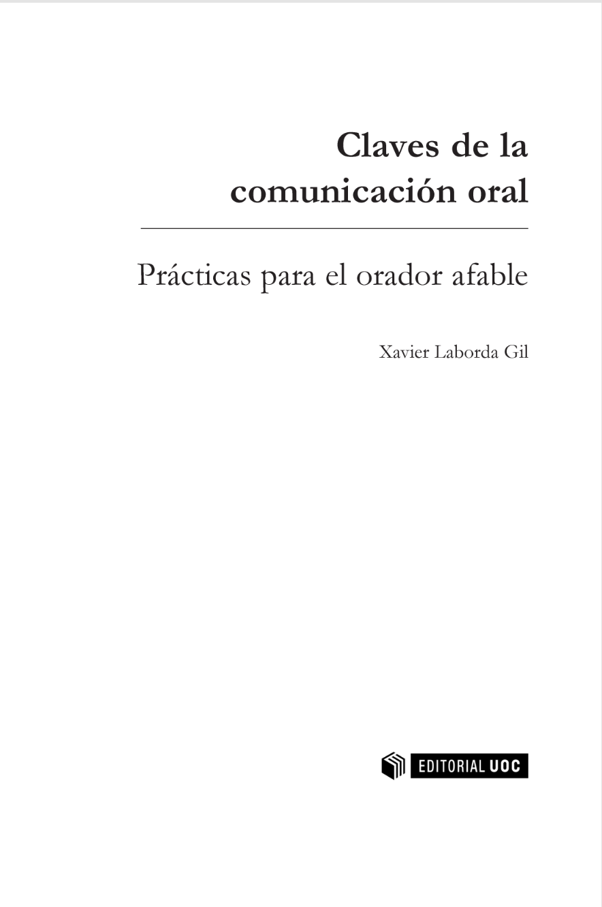

<!-- página 2 -->

_[No se pudo transcribir automáticamente (respuesta vacía). Transcribe esta página a mano desde la imagen.]_

> **Imagen de la página 2**
>
> 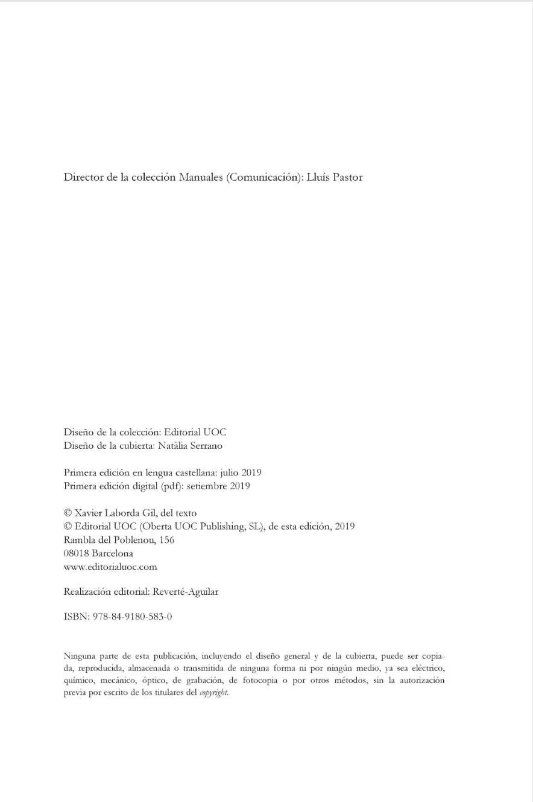

<!-- página 3 -->

_[No se pudo transcribir automáticamente (respuesta vacía). Transcribe esta página a mano desde la imagen.]_

> **Imagen de la página 3**
>
> 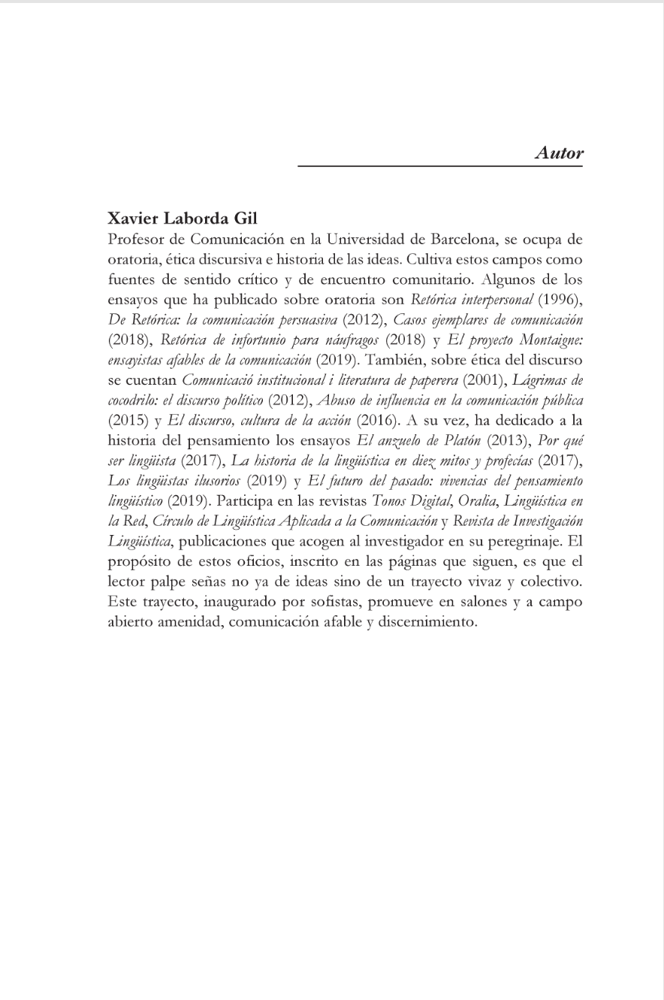

<!-- página 4 -->

_[No se pudo transcribir automáticamente (respuesta vacía). Transcribe esta página a mano desde la imagen.]_

> **Imagen de la página 4**
>
> 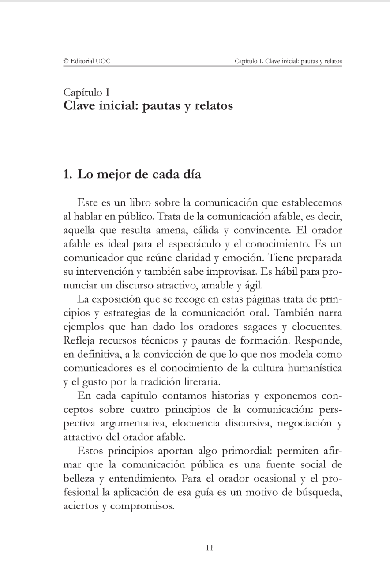

<!-- página 5 -->

_[No se pudo transcribir automáticamente (respuesta vacía). Transcribe esta página a mano desde la imagen.]_

> **Imagen de la página 5**
>
> 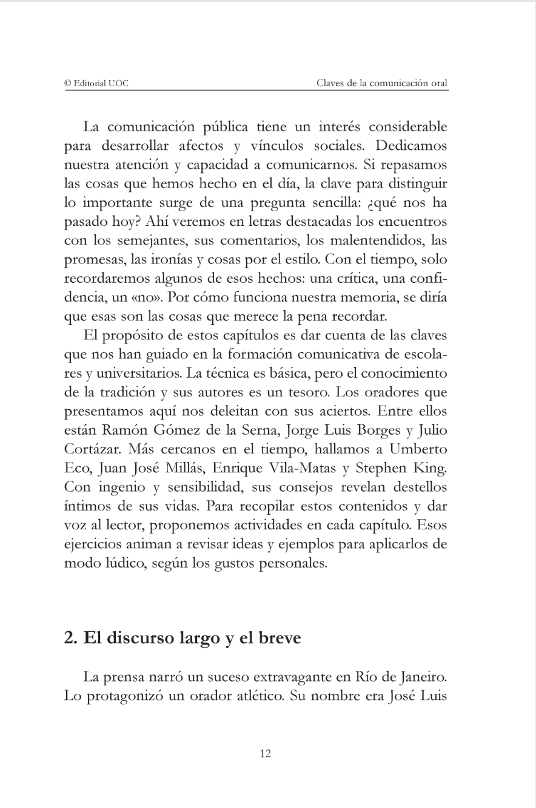

<!-- página 6 -->

_[No se pudo transcribir automáticamente (respuesta vacía). Transcribe esta página a mano desde la imagen.]_

> **Imagen de la página 6**
>
> 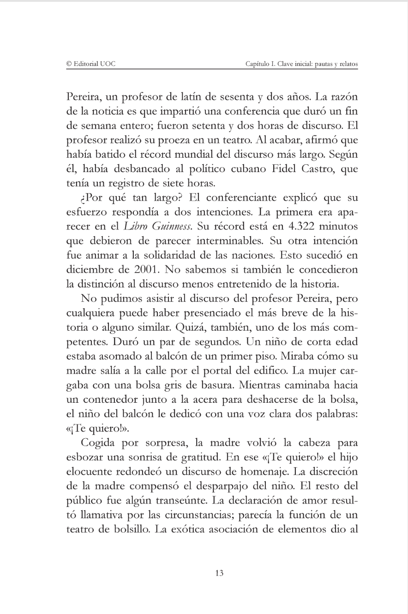

<!-- página 7 -->

_[No se pudo transcribir automáticamente (respuesta vacía). Transcribe esta página a mano desde la imagen.]_

> **Imagen de la página 7**
>
> 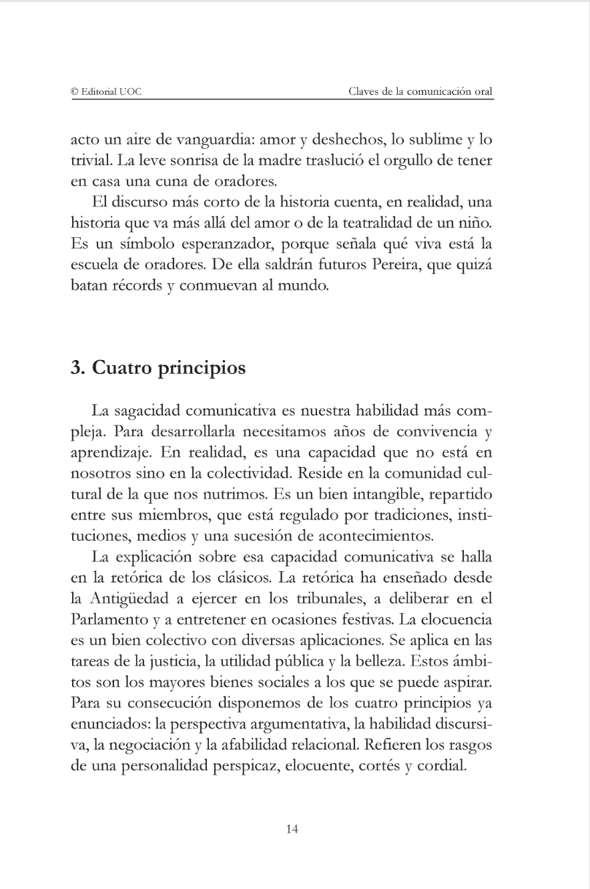

<!-- página 8 -->

_[No se pudo transcribir automáticamente (respuesta vacía). Transcribe esta página a mano desde la imagen.]_

> **Imagen de la página 8**
>
> 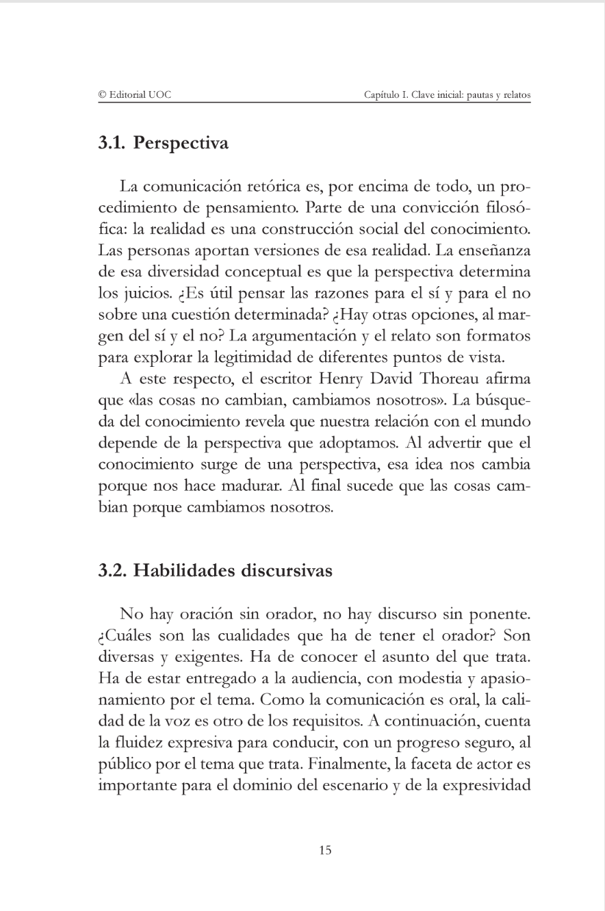

<!-- página 9 -->

_[No se pudo transcribir automáticamente (respuesta vacía). Transcribe esta página a mano desde la imagen.]_

> **Imagen de la página 9**
>
> 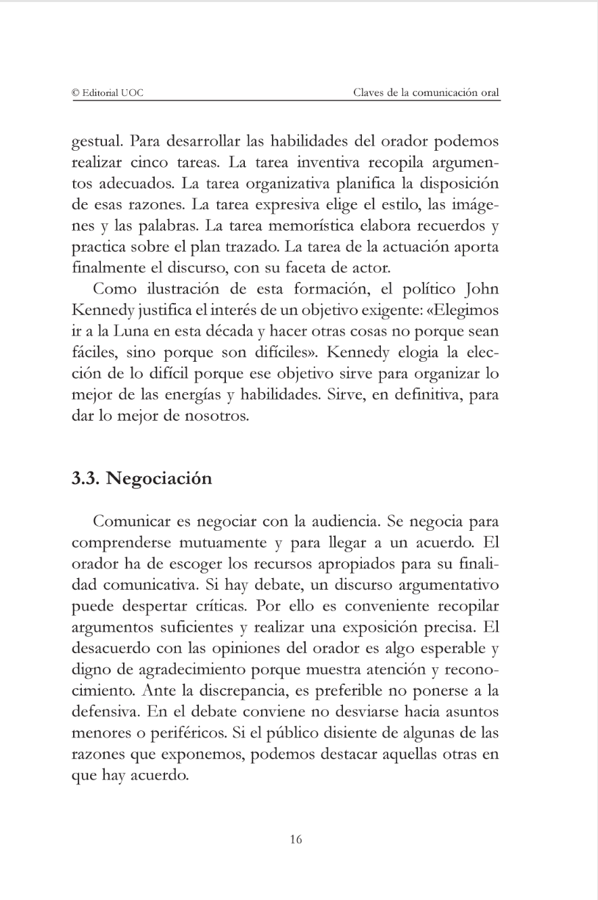

<!-- página 10 -->

_[No se pudo transcribir automáticamente (respuesta vacía). Transcribe esta página a mano desde la imagen.]_

> **Imagen de la página 10**
>
> 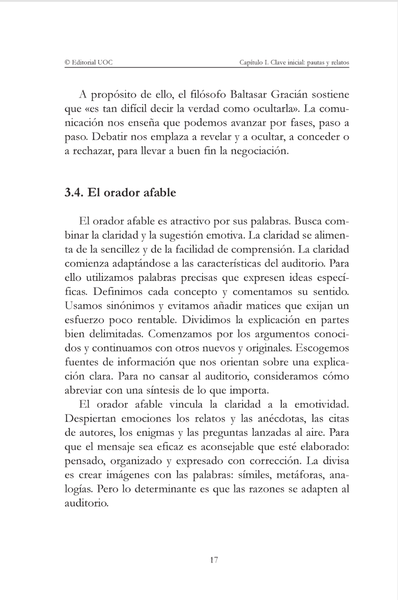

<!-- página 11 -->

_[No se pudo transcribir automáticamente (respuesta vacía). Transcribe esta página a mano desde la imagen.]_

> **Imagen de la página 11**
>
> 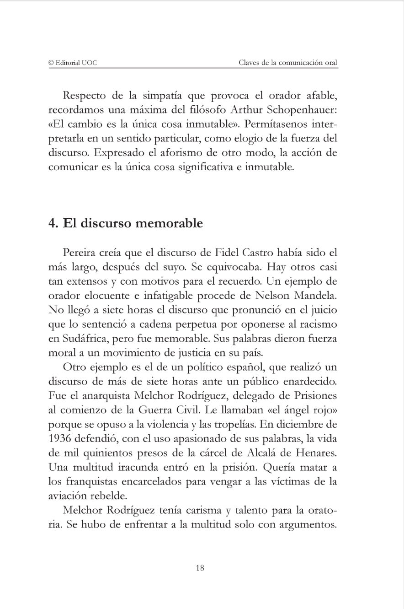

<!-- página 12 -->

_[No se pudo transcribir automáticamente (respuesta vacía). Transcribe esta página a mano desde la imagen.]_

> **Imagen de la página 12**
>
> 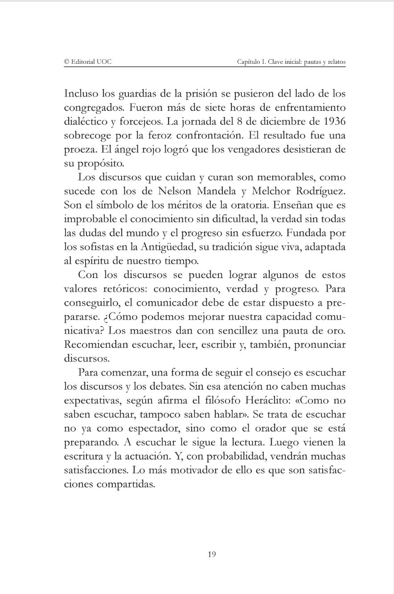

<!-- página 13 -->

© Editorial UOC Claves de la comunicación oral

## Ejercicio 1: Presentación y preferencias sobre animales

Los ejercicios que aparecen al final de cada capítulo proponen sugerencias para desarrollar habilidades expresivas. Tienen un planteamiento lúdico y permiten explorar nuestra capacidad comunicativa. Para realizar la actividad es útil imaginarse en situación de hablar en público. Cierta formalidad resulta conveniente. Por ejemplo, estar de pie ante una mesa o un atril. Registrar los ejercicios con grabadora de sonido o imagen añade la sensación de responsabilidad. También permite revisar detalles de la realización.

La primera actividad es de presentación personal. Se refiere a un aspecto de nuestra personalidad. Respondemos a la siguiente pregunta: ¿Cuál es mi animal preferido y por qué? Luego anotamos el nombre del animal y la causa de la predilección. Respondemos después a las siguientes preguntas y tomamos nota: ¿Cuál es mi animal preferido en segundo lugar y por qué? ¿Cuál lo es en tercer lugar? Finalmente realizamos un discurso de presentación recopilando las respuestas: «Me llamo... y si me preguntaran cuál es mi animal preferido diría que es... porque... El segundo animal... Y el tercer animal...».

Bien, con esta explicación de nuestras preferencias sobre los animales ya hemos realizado una breve presentación personal. El ejercicio oral es un juego que esconde ciertas claves. Podemos consultarlas al final del libro, en «Clave de prácticas». Reflexionamos sobre su sentido durante un par de minutos. Luego repetimos el ejercicio con la indicación de los tres animales escogidos y el comentario de su simbolismo, según el juego.

20

> **Imagen de la página 13**
>
> 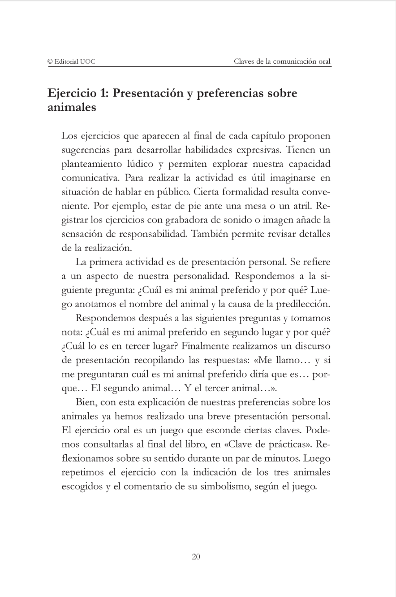

<!-- página 14 -->

© Editorial UOC
Capítulo I. Clave inicial: pautas y relatos

## Bibliografía

Cortés, L.; Muñio, J. L. (2012). *Mejore su discurso oral*. Almería: Editorial Universidad de Almería.
García Carbonell, R. (1981). *Todos pueden hablar bien en público*. Madrid: Edaf, 2001.
Gómez de la Serna, R. (1974). *Autorimundia*. Madrid: Guadarrama.
Jacquet, J.; Casulleras, S. (2004). *40 juegos para hablar castellano*. Barcelona: Graó.

> **Imagen de la página 14**
>
> 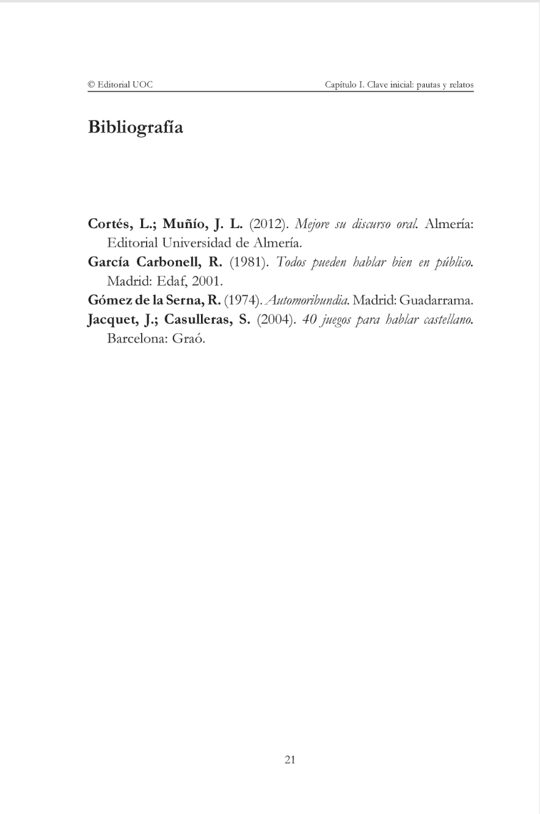

<!-- página 15 -->

© Editorial UOC
Capítulo II. El talento de la perspectiva

## Capítulo II
El talento de la perspectiva

### 1. La maestra protectora

Una noticia de prensa relató un ejemplo del valor de la comunicación. Más concretamente, revelaba la importancia de la perspectiva con que se concibe el mensaje. Una maestra había salvado a sus veinte alumnos de un accidente en la escuela (El Periódico, 23 de febrero de 2010). Sucedió en la localidad barcelonesa de Granollers.

La maestra, cuyo nombre no se dio a conocer, mostró unos reflejos profesionales. Se hallaba en su aula, con niños de cinco años, cuando el falso techo del aula comenzó a crujir a medida que se desprendía de los tacos que lo sujetaban. Al ver que cedía el techo, la docente ideó una estratega para que los alumnos se protegieran. En vez de alarmarles con la verdad de la situación, les propuso el juego de esconderse bajo las mesas. Tratándose de algo divertido, los niños reaccionaron con una rapidez admirable. Las placas de parte del techo cayeron sobre las mesas. Nadie se lesionó en el accidente.

El ejemplo nos muestra cómo la educadora supo actuar según las circunstancias. En vez de ordenar el desalojo, que habría resultado poco eficaz, simuló un juego. Adoptó una perspectiva lúdica para preservar la integridad física de la clase. Esta historia afortunada realza el mayor valor del discurso público: la búsqueda de la perspectiva.

> **Imagen de la página 15**
>
> 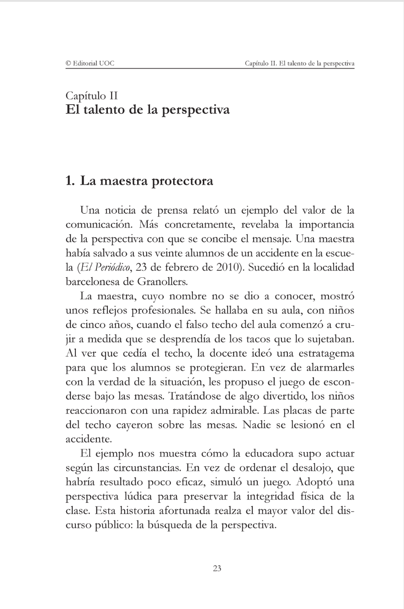

<!-- página 16 -->

© Editorial UOC Claves de la comunicación oral

El arte de hablar aporta más que una técnica, señala la importancia de la perspectiva con que se conoce y comunica la realidad. El discurso público es un instrumento para construir conocimiento y para llegar a acuerdos. La enseñanza de este procedimiento refiere que la realidad social es un proceso comunicativo. Depende no solo de unas condiciones materiales sino también de la perspectiva con que se concibe esa realidad. En este contexto, realidad significa un conglomerado de recursos, valores y objetivos, de ahí que la discusión y el acuerdo social sean necesarios para conseguir logros. El arte de hablar es valioso porque aporta un marco coherente y capaz de cooperación social.

2. Temor y alegría del sultán

Una historia de la tradición persa expone el valor de la perspectiva. La perspectiva es una capacidad del consejero y también del orador. Estos especialistas comparten dos tipos de conocimiento: uno se refiere a la naturaleza humana, a sus sentimientos; el otro tipo afecta a la capacidad de comunicar, al modo de expresar una realidad. El cuento habla del miedo y de la alegría de un sultán. Según cómo concebimos la cuestión, resulta una cosa u otra. Veamos lo que narra el cuento, en el que aparece el personaje de Nasrudín, un hombre popular y sagaz de cuentos orientales. En cierta ocasión, el sultán soñó que había perdido todos sus dientes. Al despertar, mandó llamar a un intérprete de sueños. Este le dijo que cada diente caído representaba la pérdida de un pariente.

> **Imagen de la página 16**
>
> 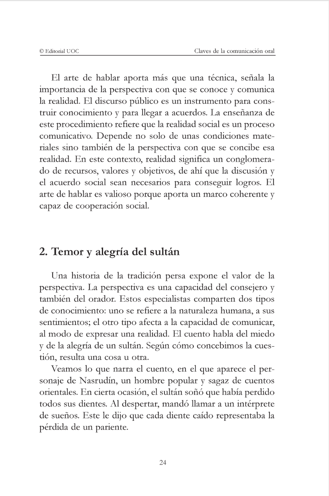

<!-- página 17 -->

© Editorial UOC Capítulo II. El talento de la perspectiva

Estaba tan enfadado el sultán, que ordenó que le dieran cien latigazos. Mandó llamar entonces a Nasrudín. Después de escucharle con atención, pronunció su augurio: —Este sueño significa que sobrevivirás a todos tus parientes.

La respuesta satisfizo al sultán, que ordenó que dieran a Nasrudín cien monedas de oro. Al cabo de unos días, Nasrudín se encontró con el intérprete de sueños. El pobre intérprete no entendía cómo a él le habían molido a palos y al otro le habían recompensado. Nasrudín le contestó con su habitual desparpajo: —Todo depende de cómo se dicen las cosas.

Así concluye el cuento. Podemos destacar la sencillez con que Nasrudín extrae una moraleja del caso. No basta con afirmar que depende de cómo se dicen las cosas, pues ello está relacionado con el modo en que se conciben. Hay un valor de perspicacia, de madurez, en el acto de hablar. Sin reflexión, el cómo puede ser un ejercicio inútil. Donde alguien solo ve temor, por el anuncio de males, otro puede experimentar la alegría de vivir.

## 3. La comunicación como negociación

Lo interesante de esta historia es que presenta un principio productivo. El principio dice lo siguiente: la comunicación es negociación. La comunicación no es imposición ni rigidez, sino diálogo y acuerdo. Los interlocutores tienen unas intenciones que han de adaptar a las circunstancias. Estos pueden ser el orador y su público, el intérprete de sueños y

> **Imagen de la página 17**
>
> 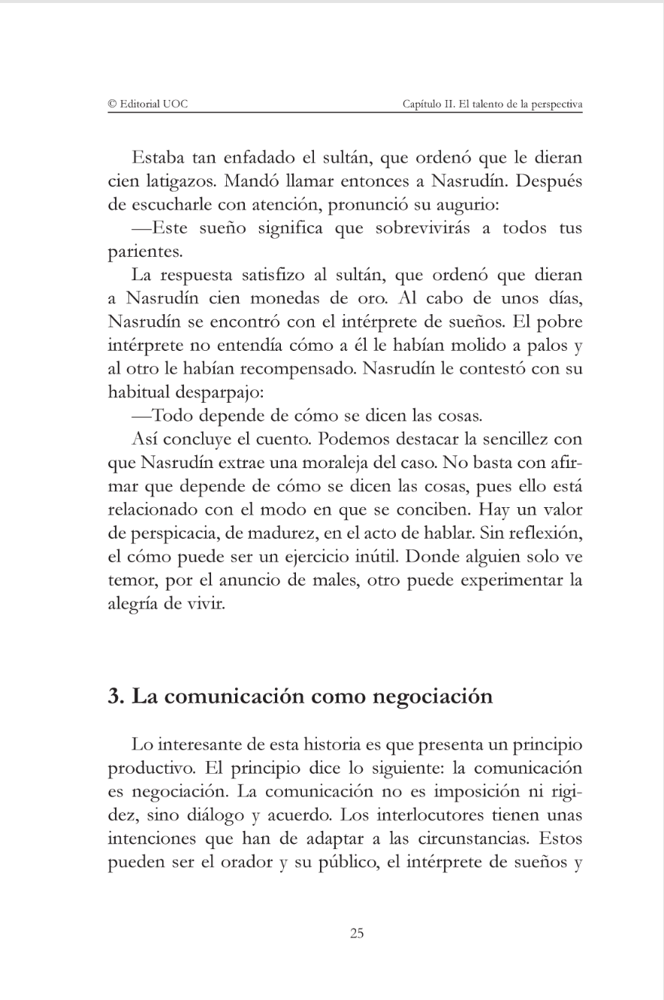

<!-- página 18 -->

© Editorial UOC Claves de la comunicación oral

el sultán, la maestra y los alumnos. Han de adoptar el punto de vista más adecuado para su propósito, la hospitalidad de la audiencia.

El cuento del sultán presenta un modo de argumentación alternativo. Ante la perspectiva del intérprete de sueños, que da resultados ingratos, Nasrudín idea una opción atractiva: hablar de la vida en vez de la muerte. Alguna de estas opciones debe de ser falsa, podríamos pensar. Pero la muerte y la vida son facetas de una misma realidad, en este caso y en muchos otros. Del mismo modo sucede en el aula del accidente que hemos comentado. Las tareas escolares y el juego son recursos complementarios para la formación de los alumnos.

En la historia de Nasrudín hay también un componente de humor. El humor es una forma de argumentar efectiva. Una sonrisa convence más que una razón. El humor presenta también la ironía de las negociaciones fallidas. Harpo Marx, el personaje mudo de los hermanos Marx, cuenta la anécdota de un fracaso comunicativo. Antes hemos de aclarar que Harpo no era mudo, solo representaba ese papel para ocultar una voz chillona. La cuestión es que Harpo no pudo convencer a su hijo Jimmy, de siete años, de que aceptara una llamada telefónica suya. Sucedió a mediados del siglo pasado.

Un día en el que Harpo volvía de viaje, se detuvo ante una cabina telefónica junto a la carretera. Quería llamar a casa para decir a qué hora llegaría. No llevaba monedas, así que pidió a la operadora una llamada a cobro revertido. Así pidió a la operadora una llamada a cobro revertido. Sucedió que su hijo Jimmy estaba solo en casa cuando sonó el teléfono. La operadora dijo al niño:

—Tengo una llamada a cobro revertido del señor Marx. ¿Acepta usted la llamada?

> **Imagen de la página 18**
>
> 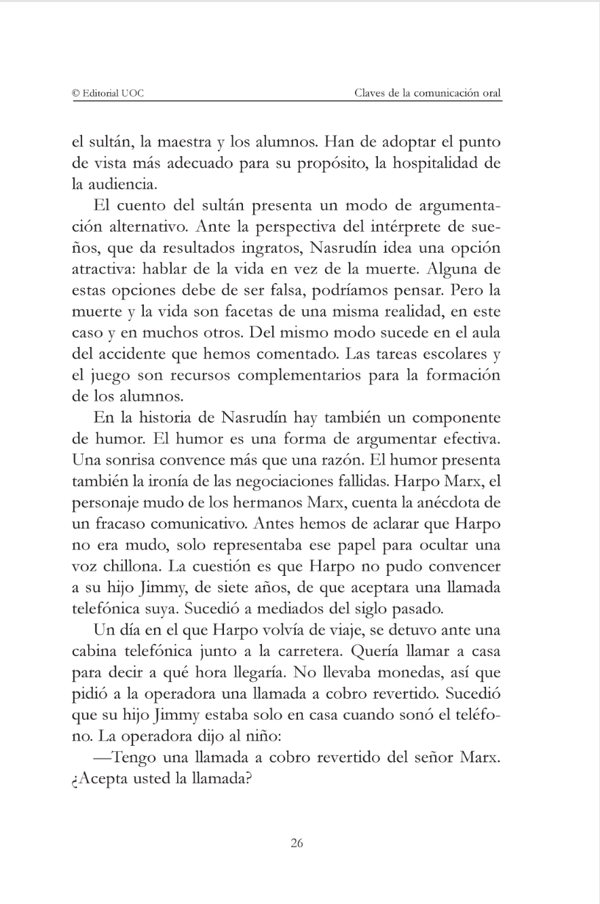

<!-- página 19 -->

© Editorial UOC
Capítulo II. El talento de la perspectiva

—¿Qué es una llamada a cobro revertido? —preguntó Jimmy, y la operadora le dijo que significaba que la persona que recibe la llamada debe pagarla. Como sabemos, el procedimiento técnico era el siguiente: la operadora podía hablar con los dos interlocutores, pero ellos no se podían oír. La dificultad de la comunicación estaba en que Harpo solo podía intentar convencer a su hijo a través de la operadora.

—¿Quiere usted decir... yo? —dijo el niño poniendo énfasis en el término «yo». —¿Yo tengo que pagar la llamada? La operadora dijo que esa era la idea e insistió en si aceptaba la llamada.

—Uy, no —dijo él—. Yo no puedo pagarla. Como último recurso, Harpo pidió a la operadora que explicara al niño que su padre era quien llamaba. —¿Mi padre? ¡Pues que pague él la llamada! —dijo, y colgó. Con sentido del humor, Harpo concluía diciendo que no consiguió convencer a su hijo de que era una persona solvente. Por ese motivo, ironiza el humorista, no se hizo cargo de la llamada.

## 4. Preguntas sin solución

¿Es posible responder a preguntas sin solución? De nuevo, un planteamiento que parece imposible nos lleva a pensar en la perspectiva. Es el papel que puede realizar la retórica con enseñanzas sobre argumentación. Siguiendo la estela del humor, recalamos en otra historia de Nasrudín. En la tradición oriental, Nasrudín es un sabio sufí que funda

27

> **Imagen de la página 19**
>
> 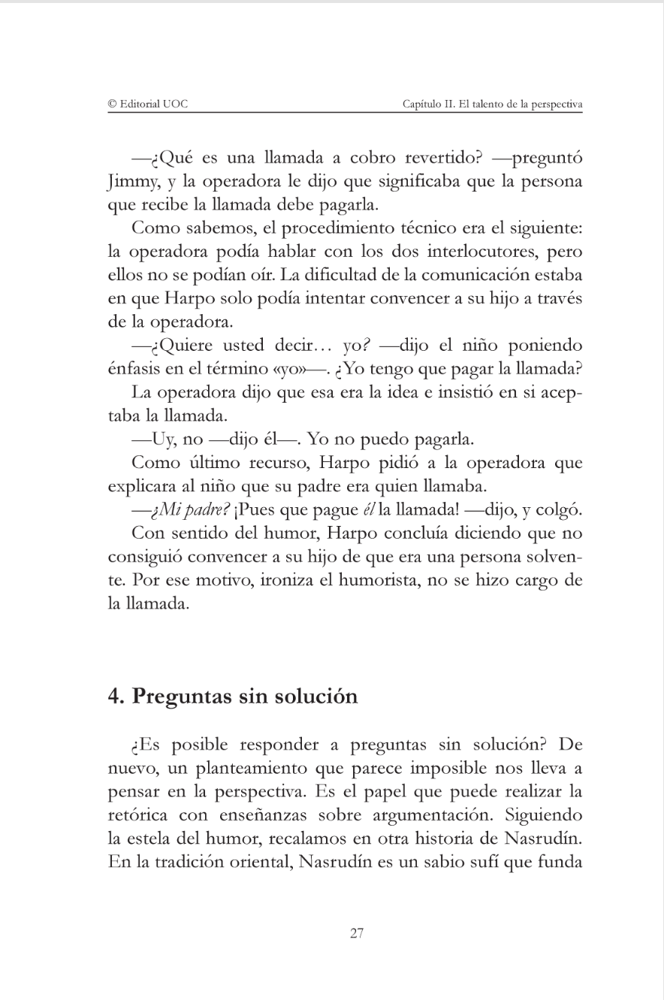

<!-- página 20 -->

© Editorial UOC Claves de la comunicación oral

su razonamiento en el sentido práctico. Tiene las virtudes de un idealista y los defectos de un pícaro. Lo interesante de esta narrativa popular es que sus aventuras suelen recoger soluciones sagaces.

Leemos el cuento —compilado por Idries Shah— «¿Cuánto viviré?». En él aparece el emperador Tamerlán, angustiado como el sultán del anterior cuento por una pesadilla. Una noche, Tamerlán soñó que estaba en su lecho de muerte, a punto de verse ya en las llamas del infierno. Muy preocupado, llamó a sus astrólogos.

—¿Cuánto tiempo viviré? —les preguntó a todos, uno tras otro.

El primero dijo al emir que vivirá veinte años. El segundo que vivirá cincuenta años. El tercero que serían cien años. Y el cuarto le dijo que no moriría nunca.

—¡Verdugo! —rugió Tamerlán, decapitá a estos hombres. Tres de ellos me han dado poco tiempo y el cuarto trata de salvar su cuello.

Luego, volviéndose a Nasrudín, le dijo:

—Tú que me has leído a veces el futuro, ¿qué tienes que decir?

—Gran emperador, da la casualidad de que también yo tuve un sueño la noche pasada en el que un ángel me comunicó el día exacto de vuestro fallecimiento.

—¿Y qué dijo? —preguntó Tamerlán con inquietud.

—El ángel me dijo que moriríais el mismo día que yo —replicó Nasrudín.

El desenlace muestra que, de nuevo, la sagacidad del sabio le permite salir airoso con un ardid de adivino. —¿Cuánto vivirá el emperador? Tanto como yo». Nasrudín explota así la naturaleza humana. Conoce los miedos del poderoso. Para

> **Imagen de la página 20**
>
> 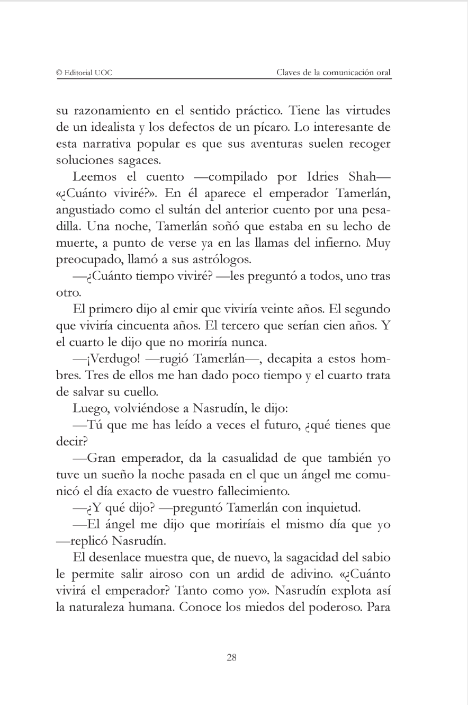

<!-- página 21 -->

© Editorial UOC Capítulo II. El talento de la perspectiva

dar verosimilitud al desenlace, el narrador muestra su arte literario. Dispone sueños al principio y al final del relato. Se inicia la historia con la pesadilla de Tamerlán y acaba con la revelación de Nasrudín.

El orden del relato da una oportunidad a Nasrudín, pues reserva su intervención para el final. Pero también lo sitúa ante un cometido imposible. No tiene el conocimiento de los astrólogos. Tampoco tiene margen de respuesta porque aquellos han copado todas las imaginables. Lo que diferencia a Nasrudín de los sabios es la perspectiva y, como consecuencia de esta, la estrategia. Estos reaccionan de un modo intelectual y se atienen a la letra de la pregunta, pero el astuto Nasrudín sigue una estrategia emocional y da con una respuesta afortunada. Interpreta la petición del caudillo, no ya como un deseo de conocer su fatídico término, sino como la necesidad de calmar el terror de la mortalidad. Nasrudín supera así la dificultad objetiva de profetizar y la subjetiva del recelo imperial.

Las preguntas que formulan las personas piden una interpretación de su propósito. Es fácil imaginar situaciones parecidas en la realidad. ¿Cómo puede responder a la cuestión un profesional? Sí, por ejemplo, se le plantea a un astrólogo de nuestro tiempo como es un médico —entiéndase la afinidad de expertos—, su respuesta requeriría de pericia y tacto.

En una entrevista periodística a Rosa Subirats, médico rural en Falset (Tarragona), leemos la siguiente manifestación:

Si un paciente mayor me pregunta: «Doctora, ¿cuánto me queda de vida?», yo le miro, le cojo la mano y permanezco en silencio, para que note la presión y sienta que le acompaño. Al cabo de unos minutos quizá dirá: «Bueno, mañana volveré a venir».

> **Imagen de la página 21**
>
> 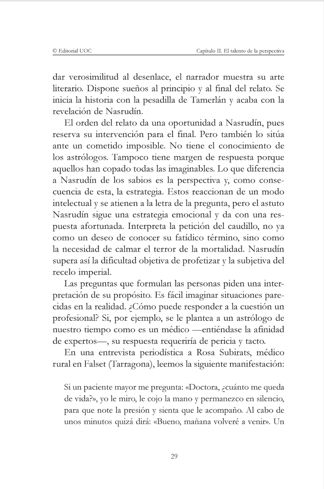

<!-- página 22 -->

silencio compartido con amor puede ser la receta más inteligen-te (El Periódico, 11 de septiembre de 2010).

La estrategia de la doctora es similar a la de Nasrudín. Rehuye el camino acostumbrado del profesional porque conoce las limitaciones de la medicina y las necesidades emocionales del paciente. Sus intervenciones no permiten el recurso de la fantasía narrativa. Sin embargo, son una combi-nación imaginativa el silencio y el contacto físico de los que se vale. Expresan comprensión y respeto con cálida empatía.

Esta es la receta perspicaz, concluye la doctora Subirats. Consiste en ofrecer atención, es decir, vincular durante unos minutos la vida de las dos personas. Y esa es también la extra-tagama de Nasrudín ante el caudillo, con la diferencia de que el vínculo que pronóstica es de por vida y simbólico; están her-manados por una cita fatal. La credulidad de Tamerlán toma la confidencia de Nasrudín como el compromiso de una compañía de por vida. En definitiva, el buen especialista —el personaje literario o el médico— destaca por la comprensión emocional, una capacidad que incluye inteligencia y emotivi-dad. O lo que es lo mismo, pericia técnica y empatía.

## 5. Defensa del inocente

La oratoria es un programa de formación para comunicar con propiedad y eficacia. Orienta sobre la forma de argumen-tar y los recursos para resultar interesante. El ejercicio de la oratoria permite realizar actos sociales, como brindar en un banquete, promocionar un producto o dar una charla. Pero va

> **Imagen de la página 22**
>
> 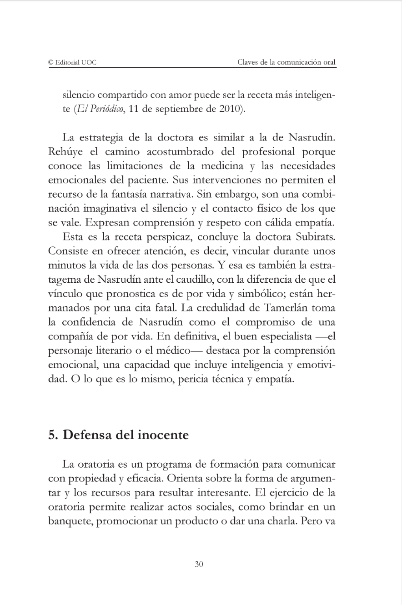

<!-- página 23 -->

© Editorial UOC Capítulo II. El talento de la perspectiva

más allá de estas funciones, puesto que sienta las bases para buscar la verdad o la justicia en alguna cuestión controvertida. En la historia hay famosos defensores y detractores de la oratoria. Platón era contrario a la oratoria, pero su discípulo Aristóteles la defendió con obras que continuan hoy vigentes. El caso de Agustín de Hipona es llamativo también porque fue profesor de oratoria en Cartago y Roma. Pero, al convertirse en eclesiástico, la desacreditó. De su vida y su conversión al cristianismo habla en el libro de las *Confesiones*, del año 397. En esta obra narra el suceso que padeció su amigo Alipio. Lo confundieron con un ladrón y le apresaron. Aunque le pese a Agustín, el caso de su amigo le lleva a reconocer la necesidad que tiene la justicia de facilitar la defensa para comprobar la responsabilidad del acusado. Cuenta con detalle la historia Agustín. Fue un caso de coincidencias y de imprudencia del protagonista, Alipio. Este joven paseaba una noche cerca de la casa del consistorio. Allí se guardaban las obras de los plateros. Se había escurrido dentro del lugar un ladrón con un hacha. Este intentó romper los barrotes de plomo que protegían las joyas, pero el ruido alertó a unos artesanos. Frustrado por las voces de los vecinos, el ladrón abandonó el hacha y huyó. Alipio vio escapar a un mozo y por curiosidad entró a ver qué hallaba. ¿Qué sucedió a continuación? Pues sucedió lo peor que podía pasar. Según Agustín, los que acudieron dieron con Alipio y el arma de la fechoría, que este asía del mango. Lo prendieron y lo llevaron ante la autoridad. La comitiva se cruzó por el camino con el arquitecto municipal, que conocía a Alipio. Le informó este del suceso y el funcionario actuó de abogado defensor. Aplacó a la gente alborotada que se hallaba presente. Por los indicios supuso

> **Imagen de la página 23**
>
> 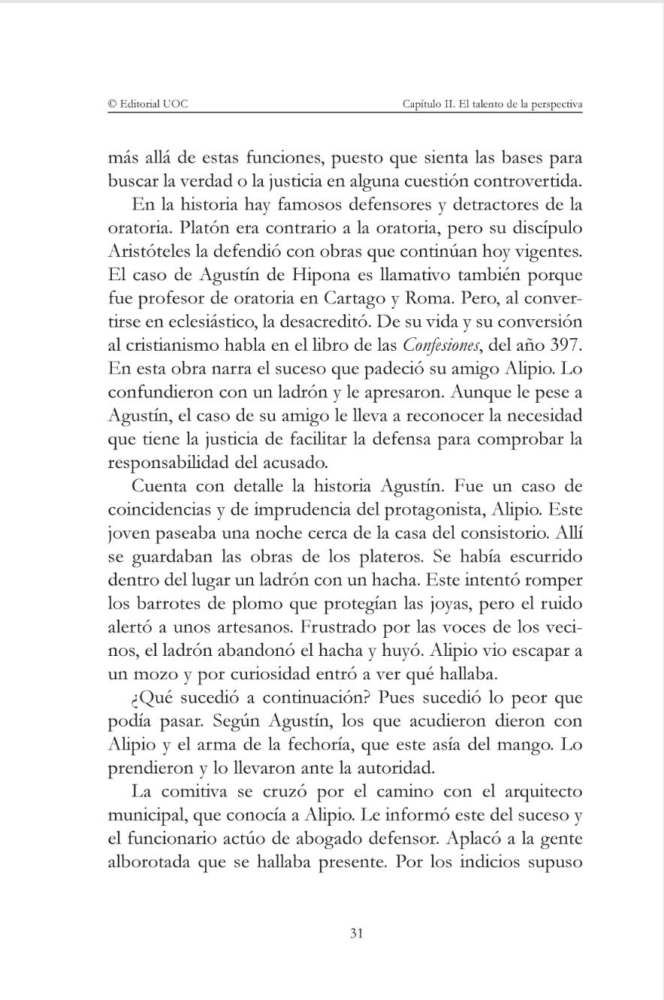

<!-- página 24 -->

© Editorial UOC Claves de la comunicación oral

quién podía ser el verdadero ladrón. Ante la casa del delincuente estaba el criado del ladrón, un muchacho ingenuo que no supo mentir, su testimonio resolvió el caso.

La narración del percance de Alipio lleva a Agustín a justificar la retórica jurídica: «Es necesaria una madura consideración en el conocimiento de las causas y delitos de los hombres, y no determinarse a condenar un hombre a otro ligeramente, llevado de una temeraria credulidad». Alipio se libró de este modo novelesco de la condena.

La realidad se compone de las perspectivas con que articuamos la interpretación del mundo. En ocasiones corresponden de argumentar, como en el interrogatorio del robo frustrado. En otras, relatar, como en los cuentos persas de Nasrudín. Pero también puede prevalecer el juego, como ideó la maestra protectora de sus pupilos.

## Ejercicio 2: el dilema

Leamos esta historia persa, a la que le falta la conclusión, y reflexionemos un par de minutos sobre ella. A continuación, pronunciemos un breve discurso el relato de la historia. Añadamos una conclusión y algún comentario sobre la situación.

Un día, el emperador estaba aburrido y decidió reírse de sus cortesanos.

—¿Qué soy? —preguntó a su astrólogo—, ¿un tirano o un gobernante?

—Un gobernante —respondió el cortesano. Fue inmediatamente decapitado.

El emperador se dirigió a un segundo cortesano:

—¿También piensas que soy solo un gobernante?

32

> **Imagen de la página 24**
>
> 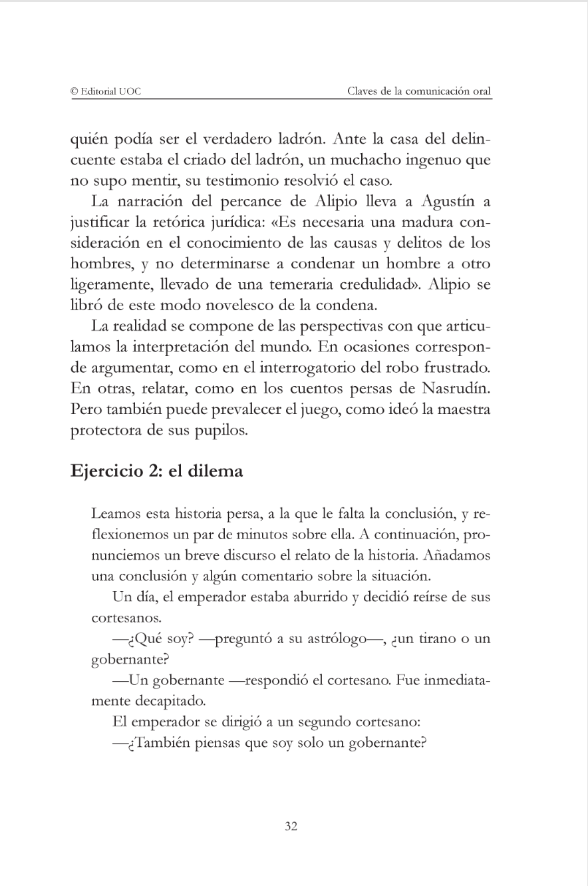

<!-- página 25 -->

© Editorial UOC Capítulo II. El talento de la perspectiva

—No, gran emperador Tamerlán. ¡Tú eres el tirano más poderoso del mundo!

También en esta ocasión, el sah ordenó al verdugo que se llevara al hombre.

—¿Qué piensas que soy? —dijo dirigiéndose finalmente a Nasrudín.

Al parecer no hay escapatoria. Pero ¿cómo puede salvar su vida el sagaz Nasrudín?

> **Imagen de la página 25**
>
> 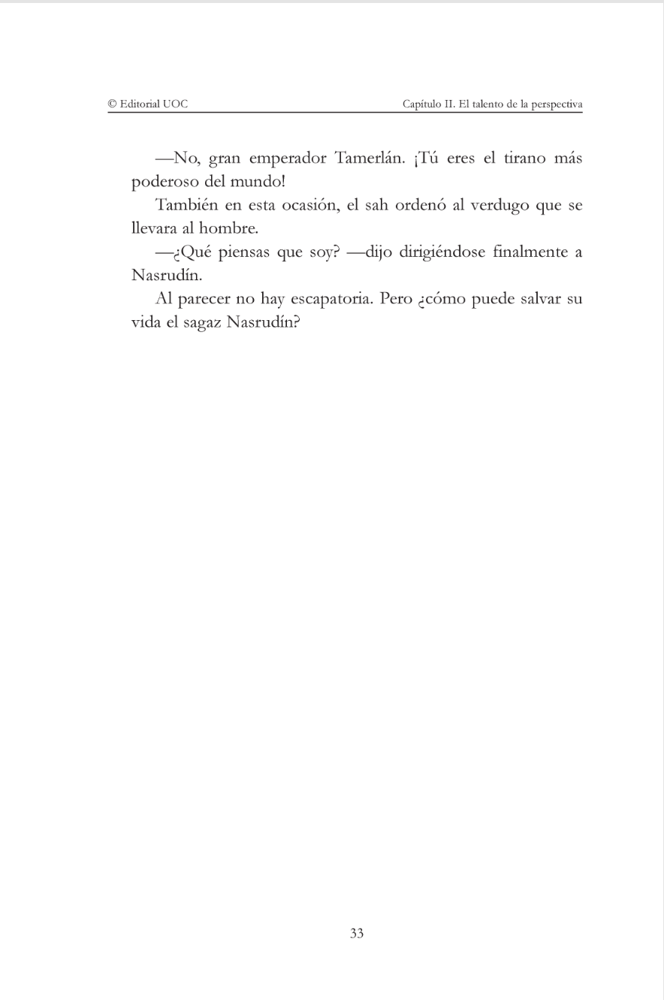

<!-- página 26 -->

© Editorial UOC
Claves de la comunicación oral

# Bibliografía

*   Aristóteles (350-335 a. C.). *Retórica*. Madrid: Centro de Estudios Constitucionales, 1990.
*   Marx, H. (1961). *Harpo habla*. Barcelona: Montesinos.
*   Shah, I. (2004). *El mundo de Nasrudín. Cuentos sufíes*. Barcelona: RBA.

> **Imagen de la página 26**
>
> 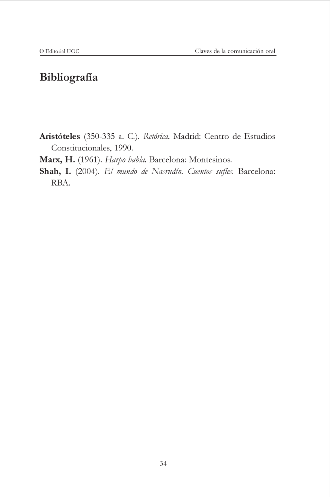

<!-- página 27 -->

© Editorial UOC Capítulo III. Respeto escénico

# 1. Sentimientos contradictorios

Es corriente asociar estrés a la experiencia de hablar en público. En estudios sociológicos se ha apreciado que la mayoría de los encuestados concebían como una tarea emocionalmente negativa hablar en público. En una lista de situaciones adversas, la comunicación ante una audiencia aparece como la tercera más difícil. Le anteceden la pérdida de un familiar y una ruptura de pareja. Como contraste, hallaremos a personas que sienten una intensa satisfacción cuando tienen la oportunidad de dirigirse a un público. Para ilustrar la tensión entre temor y satisfacción, en este capítulo invocaremos las figuras de oradores como Enrique Vila-Matas, Camilo José Cela, Umberto Eco y Manuel Azaña.

¿Cómo se explican unas diferencias tan grandes? Objetivamente, la falta de hábito es una causa de estrés. No obstante, la clave es la perspectiva subjetiva. Una razón del contraste, entre los que sienten aversión y los que gustan de la comunicación, se puede hallar en nuestra personalidad, bien sea extravertida, o bien tímida. La persona extravertida vive con serenidad y confianza el contacto con la gente. A su vez, la persona introvertida siente tranquilidad y provecho en el mundo interior. Al primer tipo le satisface la relación social y la actividad, mientras que al segundo le complace la reflexión y el sosiego.

35

> **Imagen de la página 27**
>
> 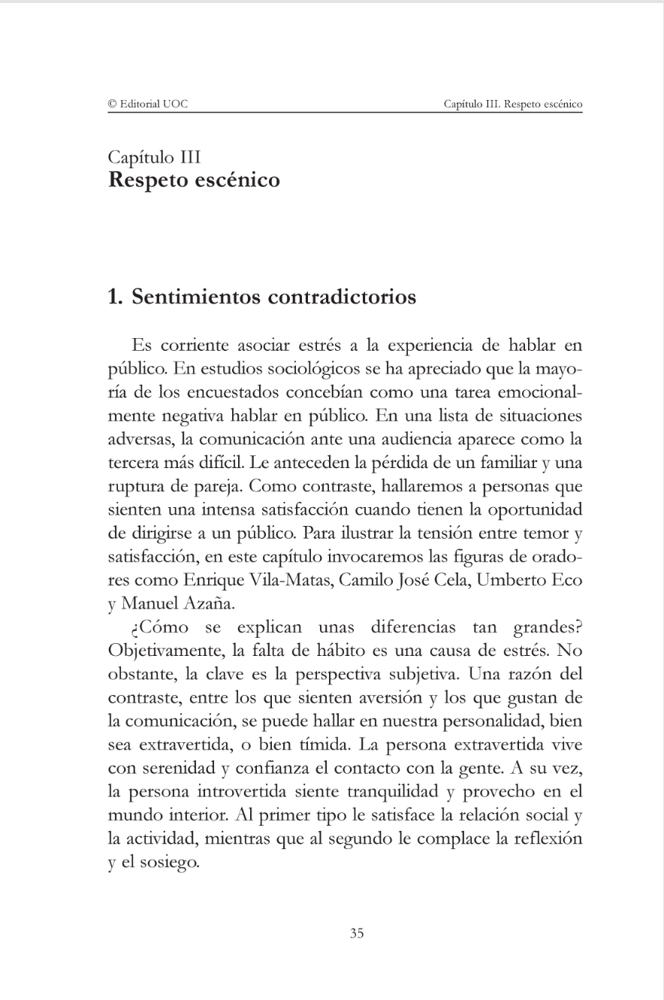

<!-- página 28 -->

© Editorial UOC Claves de la comunicación oral

A pesar de la claridad con que se puede formular esta distinción, la realidad supera y contradice un esquema demasiado simple. La personalidad tiene una tendencia, pero puede manifestarse de manera matizada. Nuestro comportamiento depende de las circunstancias y de los objetivos que nos proponemos. Para confirmar esta crítica de la personalidad como un bloque, basta comprobar que la percepción que tiene uno de sí mismo suele diferir de la que tienen los demás.

Para hablar en público, resulta ideal una personalidad que combine aspectos de una identidad extravertida e introvertida. El orador es un actor que realiza una función discursiva en el escenario, necesita la desenvoltura de una persona sociable. Pero también hemos de tener en cuenta que comunica mensajes que sean apropiados a la situación. De ahí que también precise del componente reflexivo y clarividente propio de la vertiente introvertida de su personalidad. Esta combinación de cualidades excluye tanto al orador bloqueado por los nervios como a aquel que sin inhibición pronuncia un discurso desatado, sea por el contenido, la forma o la extensión.

Al preguntarnos por qué aparecen unos aspectos y no otros de nuestra personalidad, observamos que ello se debe a las situaciones en las que nos desenvolvemos. Tener un propósito orienta nuestro comportamiento y alienta unos sentimientos positivos que favorecen la actuación. Dicho de otro modo, salir al estrado puede ser una experiencia positiva si tenemos un objetivo que cumplir. Se puede vivir entonces esa experiencia de forma serena y enriquecedora.

> **Imagen de la página 28**
>
> 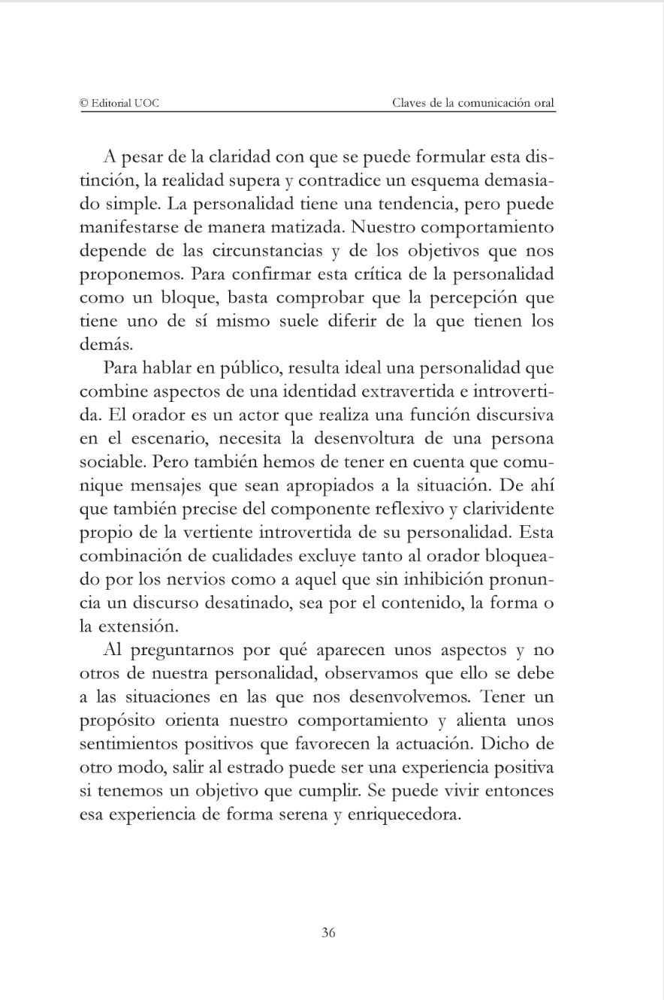

<!-- página 29 -->

© Editorial UOC Capítulo III. Respeto escénico

## 2. Remedios para el miedo escénico

Es humano manifestar que se tiene miedo escénico. El novelista Enrique Vila-Matas así lo hacía en un artículo de prensa adornado de humildad y sentido del humor. Escribía Vila-Matas que «llega un día en la vida de muchas personas en el que se ven obligadas a hablar en público por primera vez». Por experiencia sabe que «lo normal entonces es que les tiemblen las piernas y les invada un sudor frío». Pero esta no es la cuestión que trata en el escrito, sino la de cómo superar el pánico escénico y cumplir responsablemente.

Es una situación irónica que a un escritor se le pida que hable, en vez de dejarle crear en paz. «Cuando comencé a escribir y publicar libros —confiesa el autor— no se me ocurrió en ningún momento pensar que acabaría siendo invitado a participar en mesas redondas e incluso a dar conferencias. No veo por qué escribir tiene que traer aparejado el hablar en público. Más bien son actividades contrarias, se escribe en soledad y en muchos casos incluso para huir del mundo.»

Para mortificación del autor solitario, el éxito literario trae aparejada la obligación de prodigarse en actos públicos. Es necesario valerse de algunos recursos para superar los nervios y ganar la simpatía de la audiencia. Vila-Matas señala varios de ellos. El primero está dirigido al público. Se llama humor. En Múnich, ante un público que normalmente le habría asustado, se atrevió a empezar su conferencia con una nota de humor. La empezó tal como años atrás había comenzado una charla el escritor y humorista Miguel Mihura: «Señoras y señores, y para terminar diré... Es que pienso hablar veinte minutos, y

> **Imagen de la página 29**
>
> 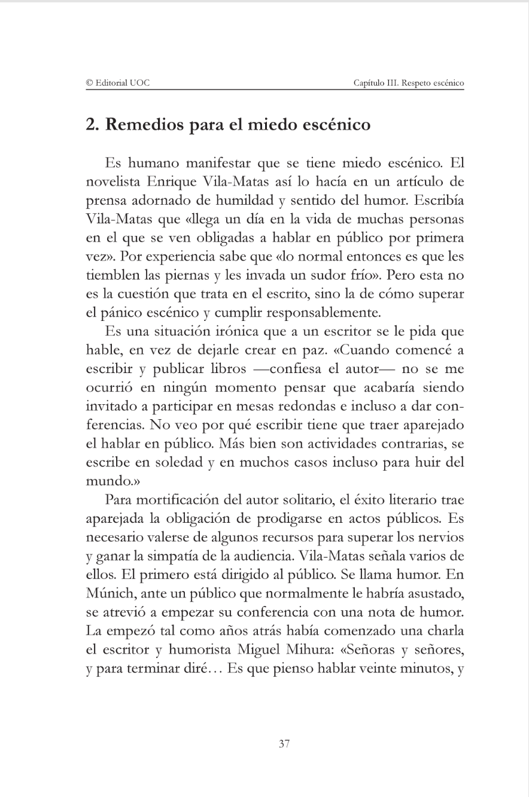

<!-- página 30 -->

© Editorial UOC Claves de la comunicación oral

he notado que ese es el tiempo que todavía tardan los oradores cuando dicen que van a terminar.

Ese día descubrió que el humor podía serle útil para ganarse la simpatía del público. Ello no quita que quizá el orador se sienta «como un torero antes de salir a la plaza», reconoce Vila-Matas. Para remediar o atenuar esa inquietud, propone un segundo recurso. Junto al humor, «pensar que no hay público» es una solución que calma al ponente. Se trata de imaginar que uno habla solo, pero en un lugar grande con maniquíes. Sin embargo, como advierte, esta solución surrealista entraña un riesgo. Puede ser un arma de doble filo que esconde la amarga verdad de que «en realidad nadie está para escucharnos». A pesar de los sobresaltos que sugiere con ironía el escritor, la moraleja del artículo es esperanzadora.

## 3. Oradores desmesurados

Hallamos un ejemplo opuesto al mencionado en la figura del también escritor Camilo José Cela. En sus memorias narró pasajes de sus actividades como orador. Estaba dotado de un ingenio desbordante. Ello explica que presumiera de haber impartido conferencias sobre viajes que nunca había realizado. En una ocasión acordó hablar sobre África Central. Aprovechó el trayecto en tren hasta la ciudad donde debía intervenir para preparar de manera fantasiosa la exposición. Al parecer, su invención fue afortunada, el acto gustó y repitió programa en otras ocasiones.

Este pasaje de la oratoria de Cela no justifica la falta de veracidad de la que hizo gala. Sin embargo, nos ilustra sobre

> **Imagen de la página 30**
>
> 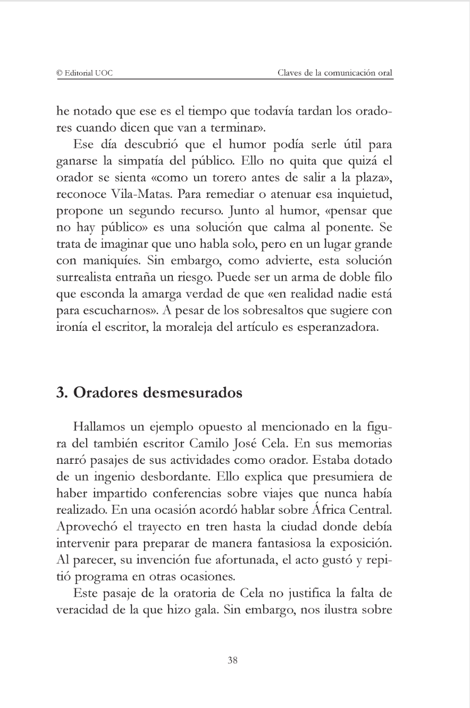

<!-- página 31 -->

© Editorial UOC Capítulo III. Respeto escénico

la importancia del modo como se pronuncia el discurso. Cuando se tiene una personalidad desenvolvida, fluidez verbal y capacidad inventiva, el resultado puede ser satisfactorio. Hasta el punto de poder afirmar que «la conferencia gustó mucho», como anotó Cela sin falsa modestia y con un código ético algo laxo.

Otro ejemplo de orador singular, aunque más equilibrado en sus rasgos, fue el profesor y escritor Umberto Eco. El prestigioso académico de la semiótica alcanzó fama con sus novelas, en especial por *El nombre de la rosa*. El efecto fue mayor gracias a la versión cinematográfica, en la que Sean Connery encarna el papel del protagonista, el monje Guillermo de Baskerville. La novela narra las actividades detectivescas del monje para esclarecer los crímenes cometidos en una abadía en el siglo XIV.

Eco acudió en 1992 a *La Coruña* para participar en un congreso de semiótica o teoría de la comunicación. Era una celebración académica y literaria, por lo que su conferencia estuvo abierta al público. En un auditorio con un millar de espectadores, impartió una exposición sobre las lenguas. En el escenario se veía empequeñecida la mesa de presidencia, dispuesta para media docena de autoridades que tomaron asiento junto al escritor.

Según el programa, el título de la exposición versaba sobre las lenguas que se hablaban en el Camino de Santiago. El título sugería un escenario recorrido por peregrinos de una Babel medieval. Cuesta imaginar ahora, cuando la informática permite hacer presentaciones con imagen y sonido, una intervención en un escenario tan teatral con el único recurso de la palabra. Ni siquiera había un atril con el que ser una figura erguida.

> **Imagen de la página 31**
>
> 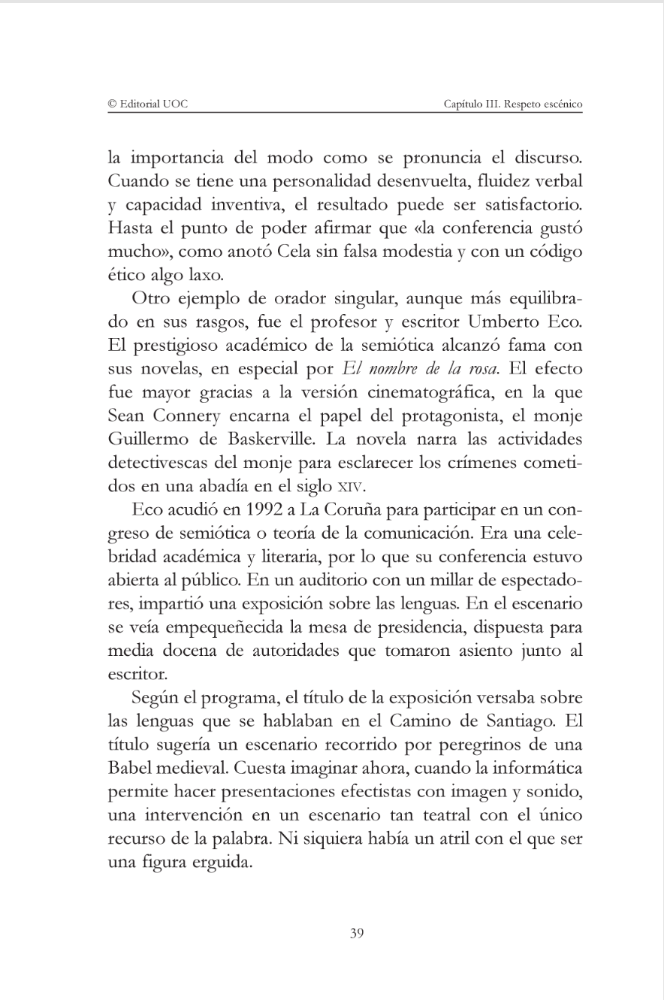

<!-- página 32 -->

© Editorial UOC Claves de la comunicación oral

Flanqueado por sus colegas de presidencia, Eco empezó su discurso con una desenvoltura que formaba parte de su personalidad extravertida. Lo hizo en italiano y fue la lengua que utilizó en la conferencia, sin que se hubiera avisado de ello ni se ofreciera servicio de interpretación o traducción simultánea. Lo primero que expuso Eco fue su desconocimiento sobre las lenguas que hablaban los peregrinos. Y comenzó a disertar sobre la búsqueda de la lengua perfecta en la cultura europea, tema sobre el que publicaría un libro al año siguiente.

La búsqueda de la lengua perfecta es la crónica de una utopía apasionante que se ramifica en los tiempos como un laberinto inagotable. Eco indicó que se podía rastrear esa búsqueda desde la lengua prebáblica hasta los lenguajes informáticos. Tras escuchar los preámbulos sobre historiografía, una cuarta parte de los asistentes optó por retirarse. Otra cuarta parte más lo haría con discreción a lo largo de la exposición. Los admiradores del novelista no hallaron un narrador de historias de intriga sino un erudito que describía ideas antiguas.

Lo fundamental de la aportación de Eco fue la perspectiva inédita que abría a la historia de las ideas sobre el lenguaje. Su libro *La búsqueda de la lengua perfecta*, que surgió de este acontecimiento, es la prueba de varias cuestiones. En primer lugar, es útil exponer las ideas en público, antes de llevarlas a la imprenta, pues permite recibir comentarios de colegas. A continuación, el hecho de dar publicidad a unas teorías es una condición de la ciencia, que se puede aplicar en diversas fases. Por otra parte, la atención de una audiencia congregada por la curiosidad y el afán de instrucción es una muestra de respeto que retribuye emocionalmente al orador y estimula su creatividad.

40

> **Imagen de la página 32**
>
> 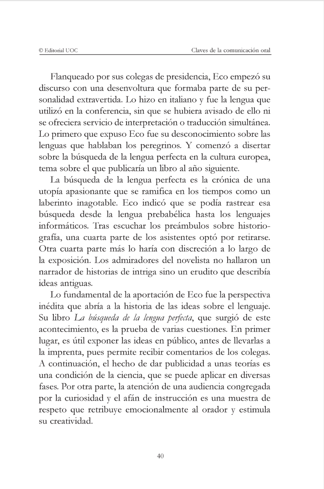

<!-- página 33 -->

© Editorial UOC Capítulo III. Respeto escénico

En último lugar, pero no el de menor importancia, llama la atención la capacidad del orador para dirigirse a su público en una escenografía estelar y tan poco apropiada para el contenido que deseaba exponer. Cuesta concebir cómo un conferenciante sobrecogido por la situación podría aplicar la recomendación de Vila-Matas. No nos referimos a la del sentido del humor sino a la argucia de imaginar que no había público en el Palacio de Congresos.

## 4. El estadista como orador

Un repaso de las características de grandes oradores aporta pistas sobre las cualidades que ha de tener el comunicador. Anotamos el nombre de otra personalidad que, además de literato, fue un político extraordinario. Se trata de Manuel Azaña, que tuvo un papel principal en la II República española. En la década de 1930 fue sucesivamente ministro, presidente del Gobierno y presidente del Estado. Sus Memorias políticas son un documento impresionante porque expresan en primera persona las claves de su oratoria.

Por su formación, Azaña fue un intelectual que participó en la primera línea del mundo público, con el fin de la monarquía y el establecimiento de la república. Su inclinación hacia las letras y la creación literaria no fueron un impedimento para que dedicara su vida a la política. Una prueba de su amor por la cultura y, por añadidura, por la oratoria, es que durante la Guerra Civil sostuvo que defender el Museo del Prado importaba más que república y monarquía juntas.

> **Imagen de la página 33**
>
> 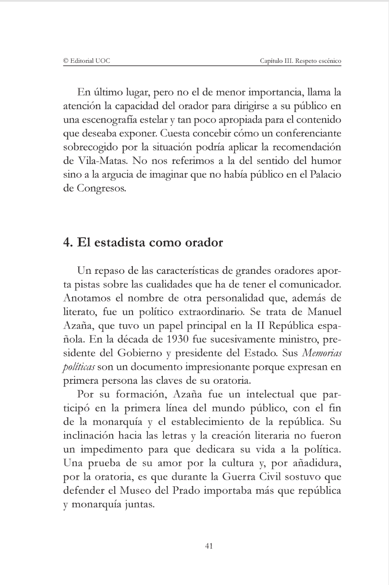

<!-- página 34 -->

© Editorial UOC Claves de la comunicación oral

El rasgo de Azaña como orador era una racionalidad luminosa, dotada de un verbo fluido y convincente. La fortuna es que se han conservado los textos de sus discursos parlamentarios. Al leerlos se admira el orden y la claridad con que razonaba sobre asuntos que en su momento adquirieron una virulencia insólita. En la vida política, Azaña era un organizador. El modo ágil y eficaz que mostró para gobernar no era sino una manifestación de su mentalidad.

Azaña no leía sus discursos. Su elocuencia parecía brotar de una inspirada voz interior. Cuando le manifestaban envidia por una locucidad que parecía improvisada, respondía que preparaba sus discursos a conciencia. Solía dedicar a idearlos horas de reflexión. Gustaba de ir a la sierra de Madrid, desde donde contemplaba en silencio el impresionante paisaje y meditaba sobre las cuestiones que tenía que debatir. Su sentencia «España será laica o no será» es una de las famosas frases que ilustran su trascendencia oratoria y que marcaron una época.

Era un orador magnífico, pero a su racionalidad le faltaba el componente pasional. La prudencia y clarividencia carecían de sagacidad sobre la psicología sobre los sentimientos, sobre la vida. De ahí que los argumentos que expresaba fueran magistrales pero fríos. A esta carencia se añadían otros de su actuación. Por una parte su rostro era inexpresivo; él mismo lo calificaba de «yeso». En su actuación no solía variar la entonación ni el gesto. Ello aparecía como un defecto por que pronunciaba discursos muy largos, sin concesiones a la distensión.

Azaña no era un orador que llevara al estrado la vivacidad. Sin embargo, hablando era el entendimiento en acción. Soportó con entereza unos tiempos convulsos, que hicieron

> **Imagen de la página 34**
>
> 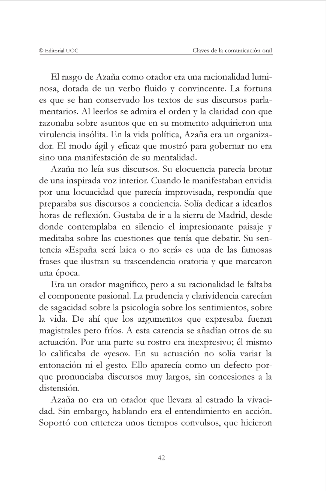

<!-- página 35 -->

© Editorial UOC Capítulo III. Respeto escénico

de él objetivo de una campaña de desprestigio degradante. La polarización política en la República hizo de Azaña, no ya un líder, sino un símbolo. Una multitud de seguidores lo aclamó y acudió a escuchar sus discursos en proporciones tales que hubo que habilitar para ello un descampado en las afueras de Madrid. No había local para contener al medio millón de personas que asistieron. Son la serie de discursos en campo abierto de Azaña.

## 5. Conclusión: la experiencia grata

El ejemplo de Azaña es significativo porque su condición de orador político estuvo favorecida por su formación como intelectual y su coraje cívico. Su obra discursiva es un legado valioso, que constituye no solo un documento histórico, sino también una fuente de inspiración retórica, aplicada a una situación dramática de gobierno y de entendimiento colectivo.

A la hora de considerar cómo se encara la experiencia de hablar en público, es útil conocer la personalidad y la obra de oradores ilustres. Aquí hemos invocado las figuras de Enrique Vila-Matas, Camilo José Cela, Umberto Eco y Manuel Azaña. Todas ellas tienen en común la dedicación a la literatura, un rasgo que manifiesta capacidad para la preparación del guion expositivo. Es difícil saber cuáles fueron sus inicios oratorios, en el sentido de si vivieron esas experiencias como una prueba o como una oportunidad. La excepción al respecto son las manifestaciones de Vila-Matas, en las que describe con humor las angustias de sus intervenciones tempranas.

43

> **Imagen de la página 35**
>
> 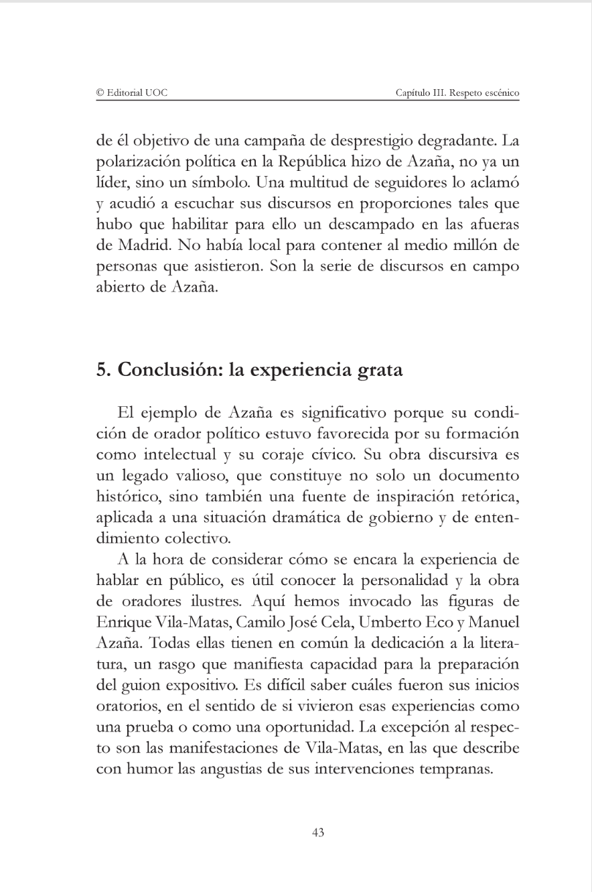

<!-- página 36 -->

© Editorial UOC Claves de la comunicación oral

Hemos escogido una muestra de oradores capaces y reputados. Nos persuade de algo importante. Es un tópico erróneo asociar estrés al cometido de hablar en público. La falta de experiencia o de oportunidad para hablar en público es una razón de que algunas personas relacionen esta situación con una emoción negativa.

Se comprende que uno necesita una motivación para realizar un acto trascendente como es pronunciar un discurso. Si buscamos razones en la trayectoria de, por ejemplo, Vila-Matas, Cela, Eco o Azaña, hallaremos algunas que hablan de personas que sienten una intensa satisfacción cuando tienen la oportunidad de dirigirse a un público. Su ejemplo nos habla del respeto escénico.

## Ejercicio 3: la palabra omitida

Vamos a fijarnos en cómo decimos el mensaje y en qué palabras usamos; más concretamente, en qué palabras no vamos a usar. Repetimos el discurso de las actividades 1 o 2, pero con la particularidad de no usar una de estas palabras o sonidos: a) el artículo «la»; b) la preposición «de»; c) el sonido «a». Se puede escoger una de estas opciones o bien probar sucesivamente las tres. En la última opción conviene preparar por escrito el discurso.

44

> **Imagen de la página 36**
>
> 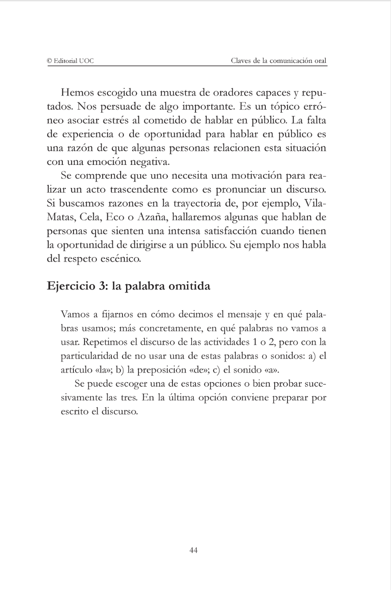

<!-- página 37 -->

© Editorial UOC
Capítulo III. Respeto escénico

## Bibliografía

*   Eco, U. (1993). *La búsqueda de la lengua perfecta en la cultura europea*. Barcelona: Crítica, 1994.
*   García Carbonell, R. (1981). *Todos pueden hablar bien en público*. Madrid: Edaf, 2001.
*   Vila-Matas, E. (1999, 20 de octubre): «Sobre la angustia de hablar en público». *El País. Cuaderno Cataluña* (pág. 2).

> **Imagen de la página 37**
>
> 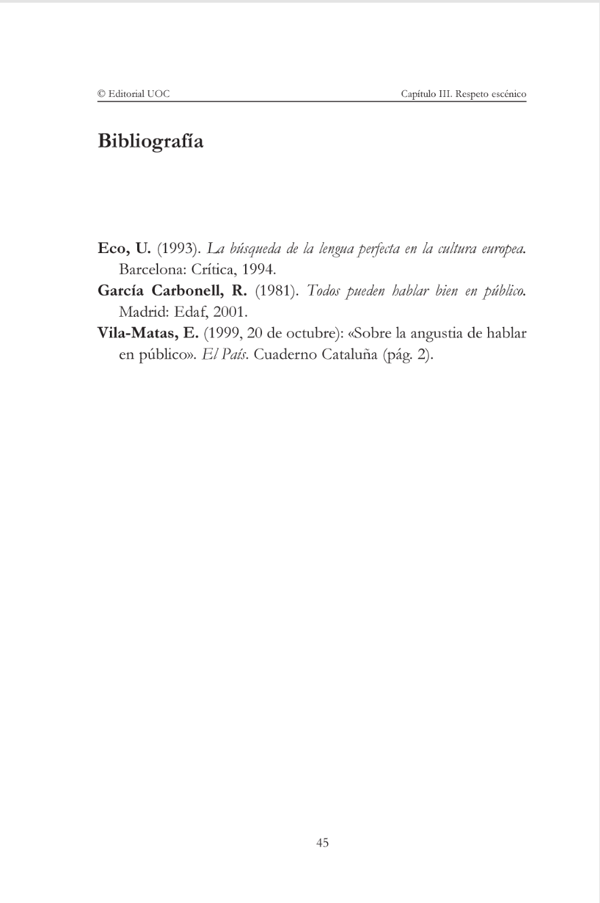

<!-- página 38 -->

[ilegible]

> **Imagen de la página 38**
>
> 

<!-- página 39 -->

© Editorial UOC
Capítulo IV. Cualidades del orador

Capítulo IV
Cualidades del orador

1. Formación y experiencia

Las cualidades del orador son fruto de su estudio y experiencia. Son la clave de una capacitación oratoria. A pesar de esta realidad, llama la atención una creencia que afirma que el orador nace y no se hace. No se trata solo de un tópico popular sobre la habilidad innata, sino también de una leyan-da alimentada por especialistas. Cicerón, el orador latino más famoso, contribuyó a difundir la idea. El propio Cicerón, en su tratado *Sobre el orador*, indicaba que el principal rasgo del orador es un don natural, una condición innata. Se caracterizaba por una personalidad ingeniosa, dotada de buena voz, apariencia agradable y soltura de palabra.

Cuesta imaginar que alguien se atreviera a contradecir a un clásico como él. Es justo alabar la suerte de quien llega a la vida adulta con una personalidad inteligente, osada y locuaz. Dispone de un capital comunicativo envidiable. Sin embargo, Cicerón pone las ideas en su sitio cuando añade que la naturaleza es solo una de las tres fuentes del orador. La predisposición innata se desarrolla con la formación (*ars*) y la práctica (*exercitatio*). Sin estos componentes, la naturaleza puede quedar en un espectáculo de fuegos artificiales, vistoso pero fugaz.

Si traducimos los conceptos de Cicerón a términos actuales, obtenemos la suma de formación y práctica. El

> **Imagen de la página 39**
>
> 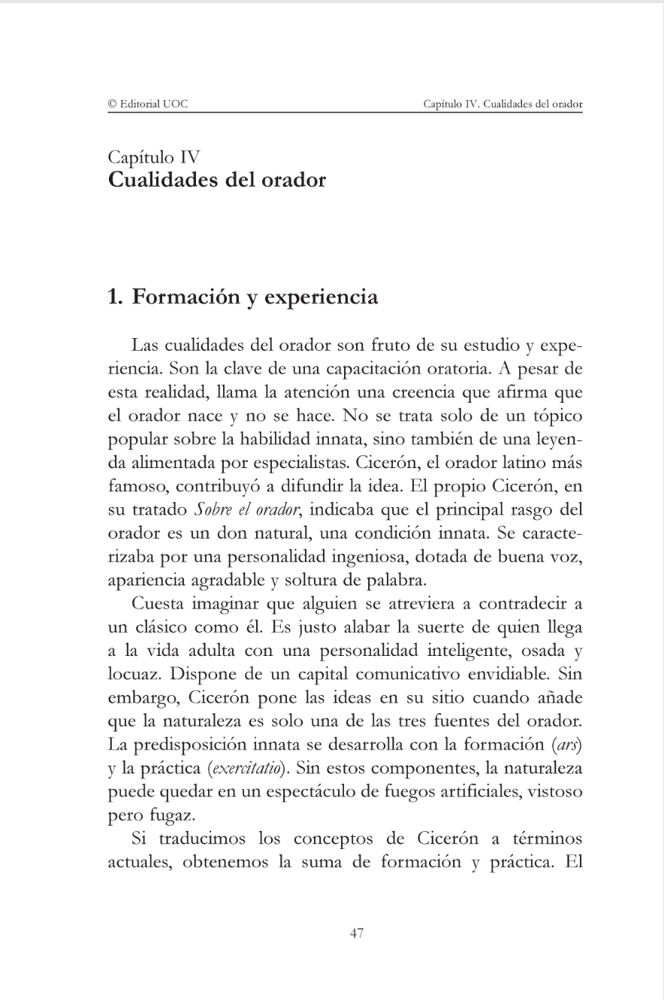

<!-- página 40 -->

provecho que se extrae del ingenio y de la inclinación natural a la comunicación depende de la aplicación al estudio y el entrenamiento. La vida demuestra que la habilidad oratoria no es innata. El beneficio del adiestramiento es doble, puesto que desarrolla cualidades y permite superar defectos. En este capítulo presentamos las cualidades que capacitan al orador, así como los defectos que le perjudican.

## 2. Cinco cualidades

Ya que la maestría se aprende de los maestros, acudimos al consejo de la novelista inglesa Phyllis Bentley. Su experiencia como profesora de latín e incansable conferenciante le ha llevado a la conclusión de que las cualidades del orador se centran en cinco aspectos: el tema, la actitud, la voz, la fluidez verbal y la actuación.

### 2.1. Conocimiento del tema

La primera fase de un discurso consiste en su preparación. La elección del asunto ha de estar relacionada con la estima y el conocimiento que de él tiene el disertante. Su compromiso se refiere a una documentación y organización de las partes de su exposición. Un conocimiento superficial y un orden desatento en el desarrollo son tan desaconsejables como una actitud indiferente respecto al tema. Se puede apreciar o detestar la cuestión, se puede apelar a cambios o mejoras. Cualquiera de estas actitudes puede ser apropiada,

> **Imagen de la página 40**
>
> 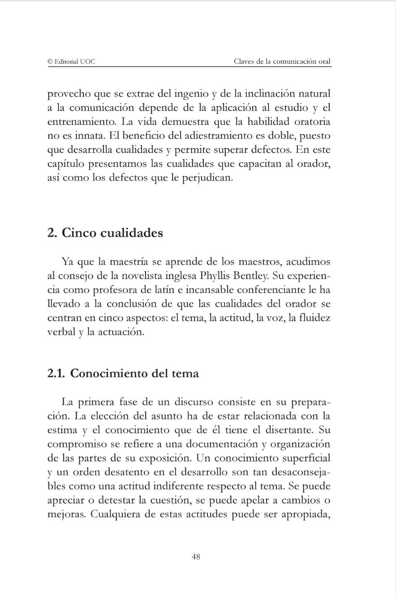

<!-- página 41 -->

si el orador justifica su postura, porque ello interesa a la audiencia. Incluso la reacción del público puede ser de aprobación o de desacuerdo respecto del conferenciante. Pero lo más probable es que la sensación general sea de agrado ante la implicación del orador. En definitiva, esto es lo que de verdad importa.

El conocimiento del tema se resume en una escenificación de la autenticidad. El dominio del asunto está reñido con la simplificación, pero también con las exposiciones complicadas. La preparación considera precisamente el grado de profundidad y de detalles, al servicio de una exposición provechosa y atractiva.

## 2.2. Entrega a la audiencia

El tema es solo un instrumento de la intervención. Lo fundamental es brindar un servicio al público. De ahí que la actitud del orador respecto de la audiencia sea fundamental. El primer paso en este sentido es la fase de preparación, con la que el orador muestra respeto por su audiencia. El segundo y definitivo tiene lugar en la actuación.

El orador puede ser una personalidad que apasione o bien un modesto especialista sin fama fuera de su campo. No importa cuál sea su rango, sino su implicación en la sesión. Uno y otro harán bien en dar lo que se espera de ellos. Puede ser común a ambos la satisfacción ante la ocasión, la cordialidad en el tono, la honradez en la propuesta y la oportunidad de sus juicios. Todo ello lo siente y lo expresa también el orador con palabras. El público acoge esta actitud y responde de modo apropiado.

> **Imagen de la página 41**
>
> 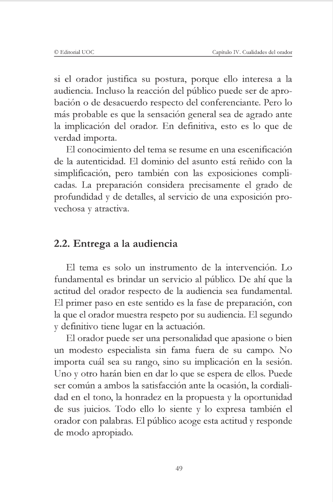

<!-- página 42 -->

© Editorial UOC Claves de la comunicación oral

## 2.3. Calidad de la voz

La sonoridad de las palabras es la condición material para la audición y la comprensión del discurso. Si se tiene una voz débil o la dicción resulta descuidida, hay mucho margen para la mejora. Del mismo modo que se espera que el orador prepare su intervención, si aspira a frecuentar el escenario, vale la pena que ejercite la calidad de la voz.

El orador puede ejercitarse por su cuenta con pautas sencillas. Veamos algunas. La posición preferible para hablar es de pie, con la cabeza erguida y la barbilla paralela al suelo. El orador puede iniciar su discurso con un tono grave de voz y un ritmo lento. Si tiene una resonancia apropiada se dice que imposta la voz, porque proyecta bien la voz. Una respiración relajada y profunda, que se impulsa con el diafragma, un músculo potente en la base de la cavidad torácica, aporta potencia. No se trata de gritar sino de impulsar los sonidos, con una articulación cuidadosa y la boca abierta. Se pronuncian con intención todas las sílabas y se acentúan las palabras. Es útil sacar partido de la movilidad de los labios. Por otra parte, la fuerza de elocución se mantiene durante toda la frase, de modo que no haya una caída de tensión al final, pues dificultaría la audición.

Para obtener referencia objetiva de la propia voz se puede grabar un fragmento de discurso improvisado, sin leer. Es útil comprobar si varía nuestro ritmo de elocución, porque evita la monotonía. En las partes generales se usa un tono conversacional. Para dar énfasis se habla más lentamente y se intercala alguna pausa. Los cambios de tono proporcionan variedad y señalan los pasajes de la intervención. En defini-

50

> **Imagen de la página 42**
>
> 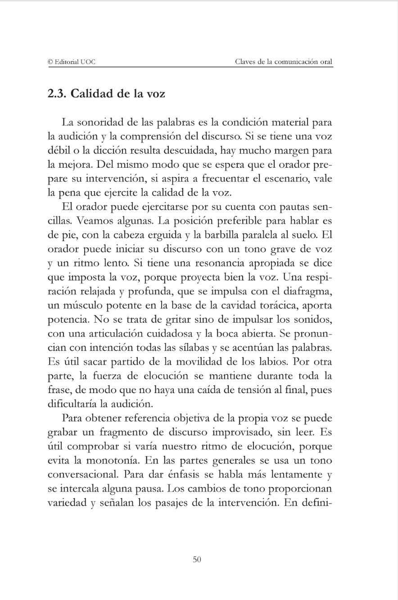

<!-- página 43 -->

© Editorial UOC
Capítulo IV. Cualidades del orador

tiva, la calidad de la voz satisface una necesidad expresiva, introduce elementos estéticos y permite mantener la sensación actoral de facilidad, de ausencia de fatiga.

## 2.4. Fluidez expresiva

La fluidez verbal es la capacidad para comunicarse de forma fácil, rápida y continuada. Comporta el dominio de dos ámbitos. Por una parte, está la producción física del habla y, por la otra, la información que se comunica. La capacidad física implica el control del ritmo y la distribución temporal del habla. La rapidez de articulación es una capacidad de algunas personas que despierta admiración si con tal fluidez se produce un discurso significativo. Las variaciones personales son considerables, pero unas ciento treinta palabras por minuto son una producción natural de elocución.

La fluidez es atractiva cuando incorpora variaciones de entonación y de léxico. Este orden se deteriora si aparecen tics verbales. Se manifiestan en la repetición de palabras, como «vale?», o «bueno», o de sonidos sin significado incrustados en la frase, como el chasquido o el carraspeo. Los tics muestran nerviosismo y falta de control. La vaguedad expresiva y un vocabulario pobre pueden corregirse con vocablos específicos y sinónimos. El dominio de la fluidez se completa con frases regulares y comedidas. Los asesores que redactan discursos para políticos cuidan mucho la fluidez, que facilitan con frases breves y claras, un ritmo marcado con repeticiones de ideas, uso de sinónimos y presencia de pausas. Es una fórmula imbatible.

> **Imagen de la página 43**
>
> 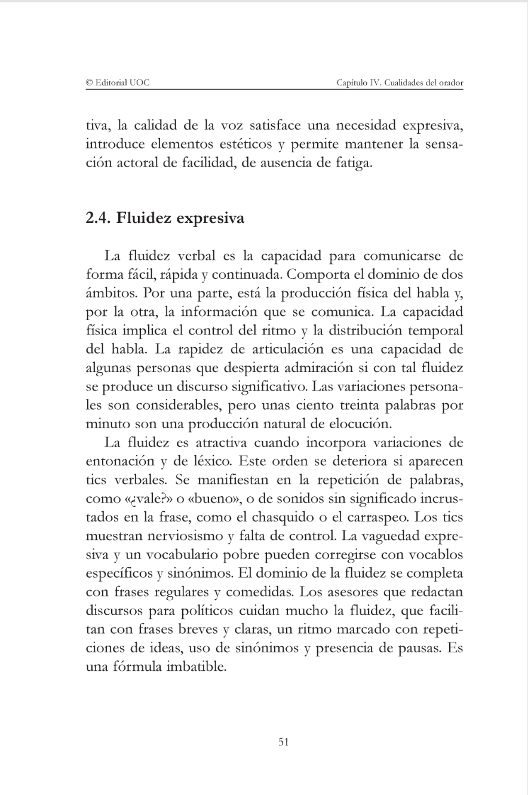

<!-- página 44 -->

© Editorial UOC Claves de la comunicación oral

## 2.5. Faceta de actor

El orador se desenvuelve en el escenario para ser el centro de las miradas. Le interesa ofrecer una imagen agradable. Sentado tras la mesa de presidencia o de pie ante un atril, su presencia llena el acto. Una vestimenta sobria y una gesticu-lación contenida facilitan la atención a sus palabras. Los movimientos sobre el escenario han de tener una intención significativa. El paseo inmoderado, errático por el estrado puede expresar inquietud y, por consiguiente, resultar moles-to. El público que sabe que está en buenas manos es solicito y se muestra agradecido. Es una práctica recomendable conocer anticipadamente el auditorio y probar cómo se habla desde el escenario. Con la sala vacía, los actores o los políticos ensayarían su función. Del mismo modo, es propio que ensayen también los orado-res. Esa precaución es una muestra de interés por la vertiente actoral del orador.

## 3. El orador desvalido

Las cinco cualidades del orador lo definen como alguien que conoce el tema del que habla, se entrega a la audiencia, emplea sus recursos vocales, muestra fluidez expresiva y tiene reflejos actorales. Merece la pena examinar esta fórmula atractiva desde una perspectiva diferente y negativa. De este modo obtenemos el retrato del orador desvalido o bloqueado. La utilidad de ese procedimiento consiste en comprobar los efectos que provo-can esa debilidad y en buscar los recursos para superarla.

> **Imagen de la página 44**
>
> 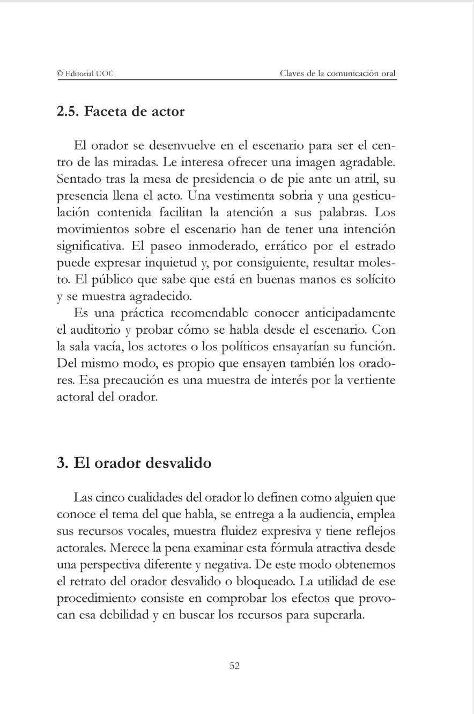

<!-- página 45 -->

© Editorial UOC Capítulo IV. Cualidades del orador

Un orador desvalido se caracteriza por encomendarse a un guion mal preparado, padecer un nerviosismo entorpecedor, usar un lenguaje enrevesado y tener escaso dominio del escenario. Estos defectos se relacionan directamente con sus cualidades. La presencia de unos implica la ausencia de las otras. Si se evitan los defectos que bloquean al orador, se favorece su capacidad.

## 3.1. Guion mal preparado

Conocer bien un asunto puede ser perjudicial. El orador se confía en el dominio que tiene de la materia y da por sentado que le sobra inspiración. La falta de preparación de las ideas y los ejemplos es un error tan frecuente como incomprensible. Puede resultar que el orador tenga los conocimientos necesarios y una buena memoria para exponerlos. Sin embargo, esta abundancia de argumentos, quien sabe si con orden y selección, puede ser contraproducente.

Impartir una charla es como realizar un viaje. Sin el equipaje necesario puede resultar una mala experiencia. Pero incluso disponiendo de un bagaje abundante, si no se ha tomado la precaución de empaquetar y distribuir bien los objetos, al abrir la maleta podemos descubrir cómo se desbarata el contenido.

Un guion preparado incluye las ideas y su disposición en partes diferenciadas. La preparación continúa con la crítica del conjunto: ¿está proporcionado?, ¿es selectivo?, ¿es claro? Un discurso que no se entiende fácilmente, sea cual sea su tema, adolece de una mala preparación. La prueba de su calidad está en la síntesis de lo que es importante y en una conclusión específica.

> **Imagen de la página 45**
>
> 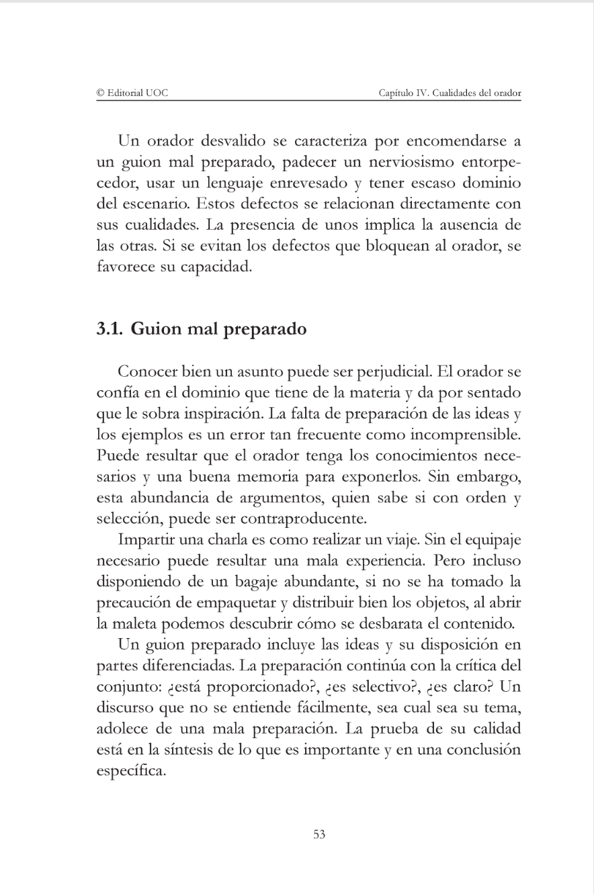

<!-- página 46 -->

© Editorial UOC Claves de la comunicación oral

## 3.2. Nerviosismo

El tiempo que se dedica a ensayar un discurso reduce las causas del nerviosismo. Es natural que el conferenciante sienta nervios. Le mantienen alerta, estimula sus reflejos, lo cual es una disposición acorde con su responsabilidad. La cuestión está en el grado que es razonable sentir. Si en vez de aliado es un factor de inquietud, la dedicación del orador a su audiencia estará menguada por la lucha interior.

Solemos atribuir el nerviosismo a un factor psicológico común: la timidez. La mayoría de las personas, en más de un sesenta por ciento, se declaran seres tímidos. Muchos políticos, humoristas o actores se consideran tímidos y, sin embargo, realizan su función pública con eficacia. El secreto es concentrarse en la tarea y olvidarse de uno mismo o, por lo menos, no darse tanta importancia.

El nerviosismo se alimenta del «efecto ombligo», como califican los formadores en oratoria Joana Rubio y Francesc Puigpelat. Mirarse el ombligo significa estar muy pendiente de las propias sensaciones. La consecuencia es que estas entonces se amplifican, aumenta el nerviosismo y se ve al público como a un juez severo. Rubio y Puigpelat proponen un ejercicio revelador a sus alumnos. Cada orador puntúa su nivel de nervios al pronunciar un discurso; sus compañeros también le puntúan como espectadores. Lo sorprendente es que la media de los oradores es de casi nueve sobre diez —un grado de nerviosismo alto—, mientras que la de la audiencia no llega a cinco. ¿Cómo es posible tanta diferencia en la percepción? La excesiva atención del orador a sus sensaciones le priva de un juicio ecuánime sobre su actuación.

> **Imagen de la página 46**
>
> 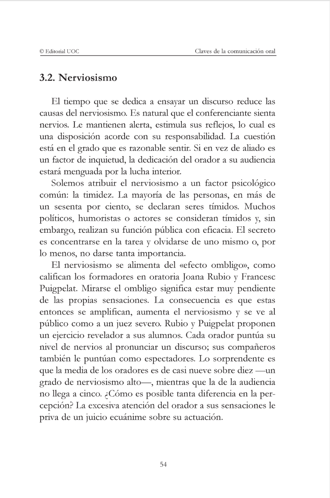

<!-- página 47 -->

© Editorial UOC Capítulo IV. Cualidades del orador

El propio Cicerón aseguraba que «un buen discurso se caracteriza por su nerviosismo». Sorprende que se tome la inquietud como algo negativo. Lo perjudicial es no controlar los nervios y entrar en una espiral que priva al orador de su contención.

### 3.3. Lenguaje enrevesado

La conferencia leída suele ser un compendio de errores. Puede ser un buen ejercicio oratorio si está escrita con tal finalidad y el conferenciante sabe leer como si conversara. El primer ministro británico Tony Blair leyó un discurso que comenzaba así: «Mi visión para el posimperio británico es clara. Se trata de hacer de este país fundamental, un líder en el mundo. Con los Estados Unidos, nuestro amigo y aliado. Dentro de la Commonwealth. En las Naciones Unidas. En la OTAN». Las frases son tan breves que suenan como lemas. Para marcar las pausas, el guionista ha separado las partes de una misma frase con punto y seguido. Para completar el efecto, ha utilizado palabras sencillas.

La lectura de un discurso requiere consejos y práctica. Es un error llevar al estrado el lenguaje escrito, con frases complejas, léxico elaborado y un tono culto. Un discurso no leído es una oportunidad para conseguir un tono natural. El objetivo es huir de la complejidad sintáctica y léxica. La supuesta profundidad de un lenguaje enrevesado es pedantería que dificulta la comprensión y la atención del público.

> **Imagen de la página 47**
>
> 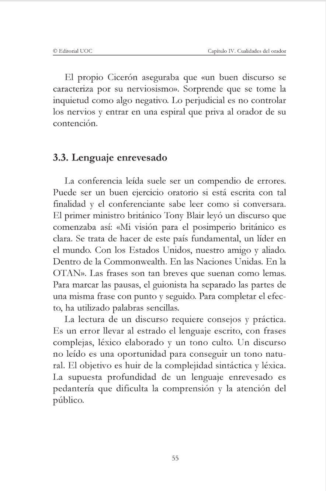

<!-- página 48 -->

© Editorial UOC Claves de la comunicación oral

## 3.4. Escaso dominio del escenario

La aparente facilidad de algunos oradores lleva a creer que el escenario no importa. Es un error suponer que todos los estrados son similares y que no tiene utilidad familiarizarse con sus características. A ello se suma el prejuicio de que un orador es un intelectual al que le bastan su conocimiento y el ingenio verbal para acomodarse al entorno. Ello es cierto si ha preparado su intervención lo suficientemente bien como para sentirse a gusto en el lugar que le asignan. Los ensayos de su discurso son una condición para ocupar el escenario con seguridad.

He aquí una propuesta magnífica de adiestramiento. La profesora Phyllis Bentley recomienda un ejercicio sencillo que permite practicar con la voz, la fluidez y el gesto. Reconoce que al ensayar en voz alta uno se puede sentir incómodo, pero la sensación es pasajera. Al final de cada día, a solas, el practicante dice con voz firme: «Señoras y señores...», y añade a continuación el relato de lo que ha hecho durante la jornada. Sin pausas, siempre hacia adelante. Con la atención puesta en formar frases sencillas y en concluirlas. Al cabo de una semana la mejora es tan clara que nos anima a continuar practicando. Un mes después, asegura Bentley, «usted se sentirá un orador espontáneo lo bastante bueno como para infligir su discurso diario a un familiar comprensivo». Ya se sabe que un ensayo con público es mejor, pero no es necesario que sea ante el mismo familiar, para no abusar de la confianza.

56

> **Imagen de la página 48**
>
> 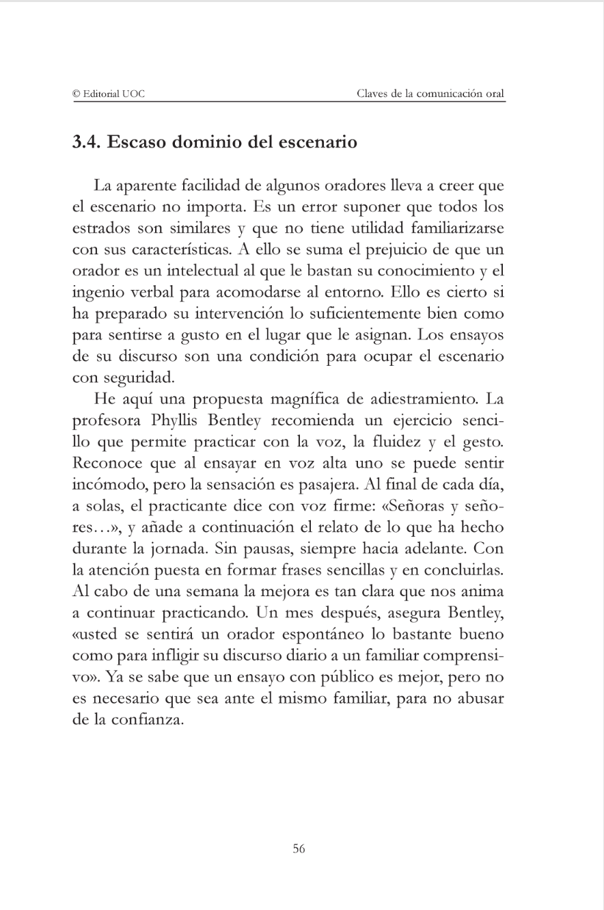

<!-- página 49 -->

© Editorial UOC
Capítulo IV. Cualidades del orador

## 4. Conclusión: superación de los defectos

Los defectos del orador son carencias que se superan con adiestramiento. Las cualidades del orador evitan bloqueos y aseguran un resultado satisfactorio. El conocimiento del tema evita un guion mal preparado y carente de síntesis. La dedicación a la audiencia encarrila al conferenciante y le ayuda a controlar los nervios. Los ejercicios de fluidez expresiva impiden el lenguaje enrevesado. El ensayo y la atención a los detalles de la actuación aportan calidad y seguridad.

La idea de que un orador nace es una excusa para evitar el esfuerzo de aprender. Hacíamos referencia a este prejuicio con las palabras de Cicerón. Una persona que pedota de manera natural tiene mucho a su favor, pero puede incurrir en el error de no formarse. Puede llegar más lejos en la excelencia oratoria quien necesita esforzarse que quien posee una facilidad original. La aplicación del aprendiz puede llevarle a superar a su modelo. La razón estriba en que el dotado espontáneamente confía en su fortuna y por ello se queda estancado. La clave de la capacitación es la formación y la práctica. Con ellas se modela una personalidad ingeniosa, con buena voz, apariencia agradable y soltura de palabra.

Sobre el papel tan positivo que tiene la práctica, Cicerón recomienda con calor sus modalidades oral y escrita. Señala que la improvisación aporta fluidez y que la redacción dota de regularidad en la expresión y perspicacia en las ideas. Puesto a destacar una de estas modalidades, el maestro elige la escritura: «Una pluma es la mejor y más excelente hacedora y maestra de oradores», afirma Cicerón.

Además de la utilidad de la práctica, P. Bentley aduce una razón ética: «¿Qué derecho tiene uno a imponerse a la audien-

> **Imagen de la página 49**
>
> 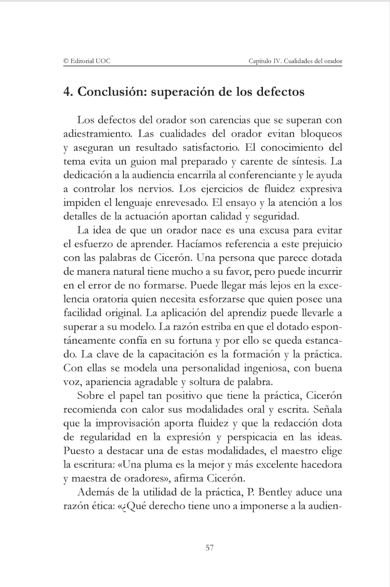

<!-- página 50 -->

© Editorial UOC Claves de la comunicación oral

cia sin una preparación?. Como se trata de una pregunta retórica, la profesora se responde a sí misma con una recomendación previsible: «Si usted desea ser un buen orador, debe estar dispuesto a trabajar para conseguirlo». Cicerón también haría suya esta recomendación.

## Ejercicio 4: resumen del día

Adoptamos una postura formal, en pie, los pies algo separados y paralelos, la cabeza erguida, como si fuera a tocar el techo. Hacemos un discurso que resume nuestras actividades y sensaciones del día: «Señoras y señores, hoy ha sido un día...». La clave del ejercicio consiste en relatar lo que ha resultado curioso o sorprendente en la jornada. En los pequeños detalles de lo inesperado y lo singular hallamos motivos para enhebrar un relato atractivo.

> **Imagen de la página 50**
>
> 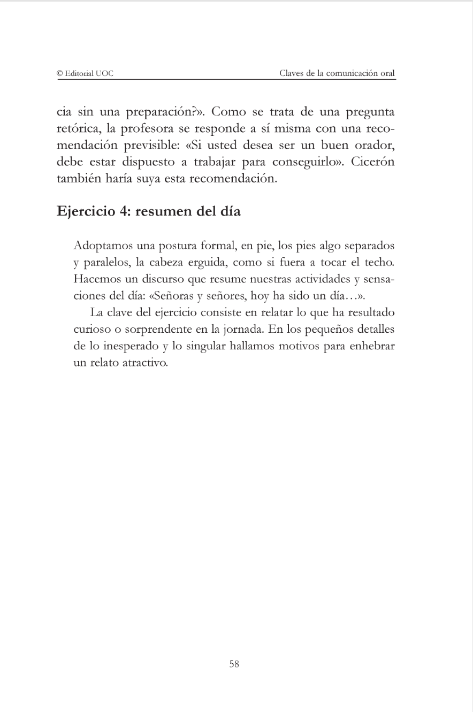

<!-- página 51 -->

© Editorial UOC
Capítulo IV. Cualidades del orador

## Bibliografía

*   Bentley, P. (1964). Public Speaking. Londres: Collins.
*   Laborda, X. (2012). De retórica. La comunicación persuasiva. Barcelona: UOC.
*   Laborda, X. (1996). Retórica interpersonal. Barcelona: Octaedro.
*   Rubio, J.; Puigpelat F. (2000). Com parlar bé en públic. Barcelona: Pòrtic.

> **Imagen de la página 51**
>
> 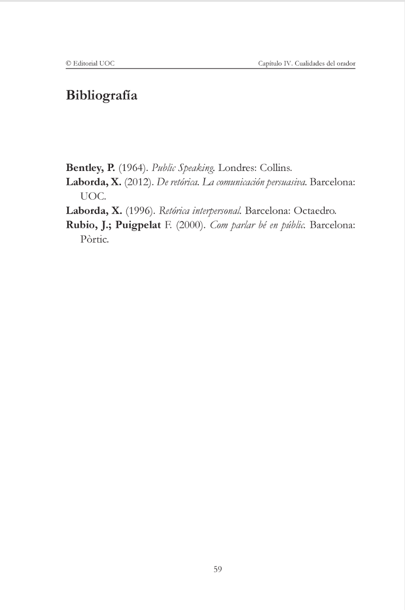

<!-- página 52 -->

© Editorial UOC
Capítulo V. Habilidades del comunicador

Capítulo V
Habilidades del comunicador

1. La escalera de Borges

¿Es creíble que una persona cambie como si diera vuelta a su personalidad? Con cuarenta y seis años cumplidos, un tímido funcionario apellidado Borges consiguió sacar de sí y alumbrar un magnífico orador. El escritor argentino Jorge Luis Borges es un ejemplo de superación. Tras el ascenso al poder del presidente Perón en 1946, Borges hubo de renunciar a su cargo de bibliotecario por razones políticas. Los amigos le apoyaron y organizaron una cena de desagravio. Preparó un discurso para la ocasión, pero como «era demasiado tímido —así se calificaba el propio Borges—, le pidió a un amigo que lo leyera en su nombre. Se había quedado sin trabajo y tenía que hallar un medio de vida. «Meses antes, una vieja dama inglesa me leyó las hojas del té» confiesa Borges en su *Autobiografía*. «Predijo que yo iba a viajar y que ganaría mucho dinero hablando. Cuando se lo conté a mi madre nos echamos a reír, ya que hablar en público estaba lejos de mis posibilidades.» En efecto, era tímido, tartamudeaba y ni en sueños se imaginaba ante la audiencia. Sin embargo, le ofrecieron empleo como profesor de literatura y conferenciante viajero.

> **Imagen de la página 52**
>
> 

<!-- página 53 -->

© Editorial UOC Claves de la comunicación oral

Aceptó por necesidad. Se consoló pensando que estaba a salvo: faltaban meses para comenzar una serie de nueve conferencias. «Sin embargo, a medida que se acercaban las fechas me empecé a sentir cada vez peor. Escribí la primera, pero no tuve tiempo para escribir la segunda. Además, como la primera conferencia era para mí el día del Juicio Final, sentí que después solo quedaba la eternidad. Milagrosamente la primera salió bien.»

Borges hubo de resignarse a cumplir sus compromisos y acometió apresuradamente la preparación de la segunda conferencia. Dos noches antes de la sesión, «llevé a mi madre a dar un largo paseo e hice que me tomara el tiempo mientras ensayaba la conferencia». Ella le dijo que le parecía excesivamente larga. «En ese caso estoy salvado», respondió Borges. ¡Su temor era quedarse corto!

La historia personal de Borges parece una ficción. Un hombre ya maduro hubo de superar sus limitaciones y contrariar su preferencia de una vida retirada. Gracias a ello descubrió una faceta que le abrió a una vida social rica.

El ejemplo de Borges muestra la inquietud con que se puede experimentar el discurso en público. Como confesaba, ni entre compañeros había osado tomar la palabra. Muestra también que la inquietud es superable. Con dedicación, Borges debía disertar sobre Poe, Melville y Twain, entre otros escritores. Con sentido de la responsabilidad, preparó las conferencias en el grado de detalle que pudo. El resultado fue evidente: «No solo terminé ganando más dinero que en la biblioteca —confiesa Borges—, sino que disfrutaba del trabajo y me sentía justificado». Y así continuó durante el resto de su vida.

> **Imagen de la página 53**
>
> 

<!-- página 54 -->

© Editorial UOC Capítulo V. Habilidades del comunicador

## 2. La formación en cinco habilidades

Los oradores de la Grecia clásica enseñaron cómo realizar este viaje que implica pronunciar un discurso. Sugiere la idea de que hablar en público es como realizar una travesía en cinco etapas. Este esquema retórico ha resultado tan acertado que sigue por completo vigente. Su principio general indica que hablar es seguir un proceso. Se trata de un orden de cinco tareas. Al realizarlas desarrollamos unas habilidades comunicativas específicas, que nos capacitan para dirigirnos al público. Son las tareas de recoger argumentos, organizarlos, formularlos, recordarlos y pronunciarlos ante el auditorio.

### 2.1. Recoger argumentos

La primera tarea es una búsqueda de elementos útiles para el discurso que se quiere pronunciar. La retórica usa el término de invención. La invención no es originalidad sino el inventario de los recursos de que disponemos y que pueden sernos útiles para nuestro cometido. Los maestros de la oratoria señalan dos grandes tipos de recursos: los géneros y los tópicos. Los géneros son las modalidades discursivas, patrones con regularidades expresivas. Se utilizan los géneros de la descripción, la narración, la exposición y la argumentación. Los tópicos son esquemas susceptibles de aplicarse para argumentar sobre cualquier tema. Una aplicación de los tópicos es el principio de las seis preguntas: quién, qué, dónde, cuándo, por qué y cómo. Se aplica a la redacción periodística de noticias y se denomina el principio de las seis w (who, what,

> **Imagen de la página 54**
>
> 

<!-- página 55 -->

© Editorial UOC Claves de la comunicación oral

where, when, why, how). Esta pauta es un guion de búsqueda de información y, a la vez, de ubicación en el discurso.

## 2.2. Organizar las partes

Los argumentos aparecen organizados en partes, de modo que se respete una progresión del asunto y la proporción de las secciones. La linealidad del discurso recomienda tener la previsión del orden en que se administran sus contenidos. Se distribuyen de acuerdo con sus funciones de presentación, en el exordio; de desarrollo, con la narración de hechos o antecedentes y con la argumentación sobre lo elogiable o criticable; y, para concluir, en la peroración o epílogo, sección en la que se resume lo expuesto y se invita a los espectadores a realizar alguna acción.

La tarea de la organización regula la distribución de la información para que resulte progresiva y coherente. También establece en el inicio la salutación y, al final, la apreciación o propuesta de acción.

## 2.3. Formular el discurso

La elocución o formulación del discurso desarrolla el componente verbal. Pone en palabras las ideas recogidas y escoge un estilo. La elocución se ocupa de la corrección, la claridad, la economía y la fortuna expresivas. La corrección gramatical denota dominio de la lengua y pulcritud en la producción. La elocución ha de buscar la claridad, mediante el uso de términos específicos y comprensibles. La economía afecta a la

64

> **Imagen de la página 55**
>
> 

<!-- página 56 -->

© Editorial UOC Capítulo V. Habilidades del comunicador

proporcionalidad del texto respecto de las ideas comunicadas. Un discurso de calidad que resulte breve destaca aún más, porque es efectivo y agrada. La fortuna discursiva se refiere al uso de ejemplos y figuras, como la metáfora o la analogía, con los que se imprime un estilo visual y sugerente.

## 2.4. Recordar el plan

El ejercicio de la memoria es necesario para pronunciar un discurso sin leer y para improvisar en algunos pasajes. La memoria natural es la que uno tiene por sí mismo, con ayuda de ejercicios de retentiva. Es la memoria mental, la personal, que se ayuda con la asociación de imágenes a los conceptos del discurso. A este tipo de memoria se añade la artificial, que consiste en las ayudas instrumentales. Son las notas y esquemas, cuya redacción elabora recuerdos, además de un guion para la exposición. También son útiles las ilustraciones y las diapositivas que se proyectan durante la sesión oral.

Dos aspectos favorecen la función de la memoria. El primero es conceptual. Un esquema claro y simple se retiene sin dificultad; por otra parte, su sencillez permite anunciar las partes de la exposición y señalar en su momento el paso a otra parte. El segundo aspecto es el de la práctica, el ensayo del discurso sin público.

## 2.5. Pronunciar el discurso

Las tareas precedentes adquieren sentido al pronunciar el discurso. El orador se desvela como un actor en esta fase

> **Imagen de la página 56**
>
> 

<!-- página 57 -->

© Editorial UOC Claves de la comunicación oral

ante la audiencia. El cuidado con el que ha realizado las tareas precedentes asegura la calidad de su intervención. El experto que hay en él ha diseñado los argumentos. Su vertiente de planificador le ha permitido ordenar los contenidos de manera apropiada. Su madurez lingüística le ha sugerido un tono expresivo que se adapta al público y unas figuras que ilustran sus ideas. Finalmente, los apuntes y los ensayos le han dado confianza y soltura.

Las obras de oratoria dan consejos útiles sobre la actuación. Señalan la importancia de la comunicación no verbal, en particular mediante el dominio de los gestos y el uso de la mirada para conectar con el público. También indican recursos para modular la voz y dar variedad a la elocución. En último lugar se refieren al contenido verbal de la intervención, con la división de sus partes, de modo que resulten proporcionadas y tengan una función perceptible. La introducción tiene por objeto ganar la atención y la confianza del auditorio. El desarrollo sirve para convencer sobre lo expuesto. Y la conclusión permite motivar a la audiencia con sentimientos y propuestas en las que se puedan identificar.

### 3. La corona de las tareas

El orador es un actor que mejora con la preparación y con las ocasiones para practicar. De todas las tareas de preparación, la invención es la principal. Ello es así, no solo porque es la primera del proceso, sino porque constituye la base de todo el trabajo.

> **Imagen de la página 57**
>
> 

<!-- página 58 -->

© Editorial UOC Capítulo V. Habilidades del comunicador

La invención, en tanto que repertorio de recursos persuasivos, trata de los géneros y los tópicos. La elección de los recursos se adapta a las características de cada caso. Buscamos recursos persuasivos o convincentes. Pueden ser descripciones de cosas, argumentos o relatos. Estos recursos son aplicaciones de los géneros o patrones discursivos. Los géneros son moldes o formas prototípicas de organización de los discursos que conforman los principales modelos comunicativos. El género descriptivo refleja cómo son las cosas; el argumentativo explica las opiniones o por qué las cosas son como son y el narrativo trata de lo que pasa en el mundo y lo que hacen los seres.

En un discurso tiene una presencia determinante la argumentación. Consta de una premisa o afirmación aceptada y de un conjunto de razones que, por la ley de demostración, conducen a una conclusión. Argumentar es dirigir a un interlocutor un argumento, es decir, una buena razón para hacerle admitir una conclusión o incitarle a adoptar unos comportamientos.

A su vez, la narración es el terreno de la acción, pues presenta acontecimientos y las reacciones de los personajes. Las modalidades narrativas pueden ser ficticias o verídicas. La novela, el cuento y el chiste son modalidades ficticias; el género científico de la historia, la noticia o la anécdota son verídicas. La narratología o teoría de la narración sostiene que las narraciones exploran los límites de la realidad y de la legitimidad. Las historias están constituidas por los elementos del actor (personajes), la acción (acontecimientos), la meta (propósito), el escenario (entorno), el instrumento (recursos) y el problema. El problema consiste en un desequilibrio entre los elementos y plantea cuestiones sobre valores morales.

> **Imagen de la página 58**
>
> 

<!-- página 59 -->

© Editorial UOC Claves de la comunicación oral

La argumentación y la narración pueden alternarse o incluso articularse de una manera efectiva y sencilla. En un cuento indio hallamos vinculados elementos narrativos y argumentos con notable atractivo. El relato trata de un anciano que habla a su nieto y que le dice lo siguiente: —Me siento como si tuviera dos lobos luchando en mi corazón. Uno es un lobo iracundo, violento y vengativo. El otro está lleno de amor y de compasión. El nieto le preguntó: —Dime, abuelo, ¿cuál de los dos ganará la lucha en tu corazón? —Aquel que yo alimente —le respondió. Este cuento tradicional es un apólogo. En él se combina la narración y la argumentación con simplicidad para desarrollar un asunto tan difícil como la naturaleza humana y su inclinación a la bondad o la maldad.

## 4. El argumentario más antiguo

Un argumentario es un conjunto de argumentos, datos o explicaciones elaborado para defender o censurar una cuestión. A pesar de su utilidad, la aplicación del argumentario está limitada a ese asunto. Por ello los sabios inventaron un procedimiento general para múltiples efectos que denominaron tópicos. El método más antiguo que se conoce es Retórica a Alejandro, una obra del siglo IV a. C. supuestamente escrita por Aristóteles para formar a Alejandro Magno. En realidad su autor fue el sofista Anaxímenes de Lámpsaco.

68

> **Imagen de la página 59**
>
> 

<!-- página 60 -->

© Editorial UOC
Capítulo V. Habilidades del comunicador

La Retórica a Alejandro tiene el mérito de una obra precursora, concisa y clara, escrita en elegante estilo epistolar. La supuesta carta de Aristóteles a Alejandro aporta una doctrina que considera los recursos para persuadir en todas las situaciones públicas. En particular presenta los tópicos del género espectacular o demostrativo. Su propósito es elogiar o censurar, es decir, los discursos de encomio o reprobación de una personalidad o una población.

¿Qué plan propone el clásico para elogiar a alguien? Anaxímenes indica un esquema, que comienza con los antecedentes familiares o genealogía, sigue con la vida del elogiado y acaba con el repaso de sus actos y cualidades. El primer apartado corresponde a la genealogía o antecedentes familiares. El elogio de los antepasados tiene por objeto destacar la cadena de personalidades que vincula al homenajeado con una saga de mérito. Luego está su vida. Para ello el orador considera sus etapas y los méritos de cada una de ellas. También se destacan los actos del personaje, su carácter y hábitos. Si sucede que el azar ha tenido mucho que ver en el resultado, no ha de atribuirse el éxito a la fortuna sino a su esfuerzo. La técnica que se sigue es la amplificación, es decir, la exposición detallada de información, de tal modo que el tema parezca mayor.

## 5. Manantial de la publicidad

La publicidad aplica con sagacidad el esquema de Anaxímenes para realizar sus anuncios. Una técnica moderna

> **Imagen de la página 60**
>
> 

<!-- página 61 -->

© Editorial UOC Claves de la comunicación oral

se alimenta de una fuente muy antigua. Utiliza también las enseñanzas del filósofo griego Aristóteles, contemporáneo de Anaxímenes. Aristóteles propone un cuadro de seis categorías para generar convencentes tópicos. Son las categorías de la cantidad, la calidad, el orden, la existencia, la esencia y la persona, que ejemplificamos con eslóganes antiguos de publicidad del automóvil.

*   **Cantidad**. La cantidad pone de manifiesto la magnitud, aquello que destaca porque, o bien es más, o bien es menos. Son tópicos de cantidad: la normalidad, que apela a lo que es corriente; el sentido común, que se apoya en la prudencia y la discreción; la norma estadística, que refiere la regularidad y la probabilidad, y la opinión mayoritaria, entendida como preferencia.
*   Un anuncio de Nissan de la década de 1990 decía así: ¿Quién ha dicho que la felicidad no se consigue con dinero? La marca sorprende con un eslogan que va contra la opinión mayoritaria, acompañado de la fotografía de un coche accidentado. Consigue llamar la atención y quizá convencer, al sugerir que un vehículo de cierto precio merece la pena, es decir, que el dinero puede dar la felicidad en un caso tan penoso como un accidente.
*   **Calidad**. La categoría de la calidad considera lo que es mejor o peor. Para ello se vale de diversos criterios. Lo único permite gozar del honor de una rareza. El anuncio de un Chrysler Voyager presenta la imagen de un vehículo circense, pues se desplaza sobre una cuerda de funámbulo. El lema es «Nadie está a su altura», con el que destaca su carácter único.

La originalidad es otra variante de la calidad. El Ford Ghia apela a «Una nueva escala de valores». También lo es

> **Imagen de la página 61**
>
> 

<!-- página 62 -->

Capítulo V. Habilidades del comunicador

la excelencia, como sucede con el Vitara Wagon de Suzuki, un vehículo «para vivir mejor» porque permite «soñar despierto». Si se apela a la utilidad o a una verdad científica se completan los criterios de calidad.

*   Orden. El orden se refiere a lo que se halla en el principio y es causa de fenómenos. La furgoneta Serena de Nissan se presenta bajo esta categoría cuando afirma de un modo chocante que es «el primer deportivo de ocho plazas».

Otra forma de orden es la precedencia, aquella disposición prioritaria que se puede derivar de la costumbre o un rango social. Volvo se anuncia mostrando una imagen posterior de su vehículo. El lema dice así: «Hay una parte de nuestro coche que se está haciendo muy famosa entre los pilotos de turismo», la parte trasera, porque los Volvo van por delante de los demás.

*   Existencia. La existencia tiene un carácter pragmático, ya que destaca lo que es real, por encima de lo que es solo una posibilidad. Lo real es empírico y contrastable, como en el anuncio de Seat, que promete «el striplease» o desnudo del año. Y añade la explicación de que «en mayo Seat lo enseñará todo».

*   Esencia. La esencia presenta lo que constituye una categoría aparte en su ámbito. El modelo Terrano de Nissan aparece en una imagen como si volara, por lo que el eslogan afirma que pertenece a la categoría de «Nissan Airlines», una compañía aérea cuya flota son automóviles de campo.

*   Persona. La persona es el tópico que apela a la dignidad o mérito de una persona. Se trata de un argumento de autoridad, pero no necesariamente por su vinculación al asunto en cuestión; basta con ser una celebridad, como un deportista famoso para promocionar un automóvil con su prestigio.

71

> **Imagen de la página 62**
>
> 

<!-- página 63 -->

© Editorial UOC Claves de la comunicación oral

## 6. Conclusión: repertorio de recursos

El orador dispone de un programa de trabajo que le permite conseguir un resultado satisfactorio. Se atiene a las cinco fases, que consisten en buscar argumentos, organizarlos, formularlos, recordarlos y pronunciarlos. Ello implica conocer los géneros discursivos, que le permiten adaptarse a las circunstancias de su intervención. Los géneros de la descripción, la narración y la argumentación tienen unas características que las distinguen y les dan eficacia comunicativa.

Por su parte, los tópicos son repertorios aptos para elaborar argumentos. Los clásicos establecieron los recursos de referir los antecedentes o genealogía del elogiado, los hechos de su vida y las cualidades de su personalidad. También pusieron señalar el valor de una realidad con argumentos de cantidad, calidad, orden, esencia, existencia y persona.

Cuando Jorge Luis Borges preparó sus conferencias sobre clásicos de la literatura se valió de recursos como los géneros y los tópicos mencionados. Superó su inquietud, preparó sus intervenciones y recorrió con éxito países dando conferencias sobre Dante, *Las mil y una noches* o Cervantes. Como reconoció con humor, «no solo terminé ganando más dinero que en la biblioteca, sino que disfrutaba del trabajo y me sentía justificado». Literalmente descubrió que a los cuarenta y siete años se le abría «una vida nueva y emocionante». Sin embargo, el acierto de la adivina sobre su vida de orador resultó demasiado fantástica para caber en alguno de sus cuentos.

72

> **Imagen de la página 63**
>
> 

<!-- página 64 -->

© Editorial UOC
Capítulo V. Habilidades del comunicador

## Ejercicio 5: empaquetar sueños

Al soñar imaginamos escenas y sucesos. Por lo general, solemos olvidarlos al poco de despertar. A veces, si los recordamos, nos resulta difícil saber qué pueden representar. Vamos a intentar recordar algún sueño y darle una explicación libre.

a) Al despertar anotamos algunas palabras de recordatorio de un sueño: jardín, camino, rueda, plato...
b) Dedicamos unos minutos para recordar el sueño e imaginar una explicación.

Finalmente, pronunciamos un breve discurso en que narramos lo que hemos soñado, damos una explicación y concluimos con un comentario sobre el efecto de los sueños.

73

> **Imagen de la página 64**
>
> 

<!-- página 65 -->

© Editorial UOC
Claves de la comunicación oral

## Bibliografía

*   Anaxímenes de Lámpsaco (s. IV a. C.). Retórica a Alejandro. Salamanca: Universidad de Salamanca, 1989.
*   Aristóteles (350-335 a. C.). Retórica. Madrid: Centro de Estudios Constitucionales, 1990.
*   Borges, J. L. (1970). Autobiografía, 1899-1970. Buenos Aires: El Ateneo, 1999.
*   Cortés, L.; Muñio J. L. (2012). Mejore su discurso oral. Almería: Editorial Universidad de Almería.

> **Imagen de la página 65**
>
> 

<!-- página 66 -->

© Editorial UOC Capítulo VI. El orden protector

Capítulo VI
El orden protector

1. Paso a paso

Un discurso avanza paso a paso, para componer una parte y luego otra. De este mismo modo lo hace un relato. Un tipo de relato es el cuento, que suele presentar una situación, para dar a conocer los personajes y sus circunstancias. Luego plantea un problema o conflicto, con lo que despierta el interés del oyente o lector. Desarrolla varios episodios, hasta que llega a una conclusión o desenlace del conflicto.

La tradición considera en el relato estas tres partes fundamentales, las del planteamiento, desarrollo y conclusión. Este mismo esquema es útil para planificar un discurso. Para ilustrar la composición o vertiente organizativa del discurso, recogemos un cuento de Julio Cortázar. Se titula «Tema para un tapiz». Ilustra sobre el carácter estratégico de toda actividad organizativa, que se ejemplifica con la lucha bélica.

Cortázar desarrolla el cuento en un párrafo, que dice lo siguiente:
El general tiene solo ochenta hombres y el enemigo, cinco mil. En su tienda el general blasfema y llora. Entonces escribe una proclama inspirada, que palomas mensajeras derraman sobre el campamento enemigo. Doscientos infantes se pasan al general. Sigue una escaramuza que el general gana fácilmente y dos regimientos se pasan a su bando. Tres días después el enemigo tiene

75

> **Imagen de la página 66**
>
> 

<!-- página 67 -->

© Editorial UOC Claves de la comunicación oral

solo ochenta hombres y el general cinco mil. Entonces el general escribe una proclama, y setenta y nueve hombres se pasan a su bando. Solo queda un enemigo rodeado por el ejército del general, que espera en silencio. Transcurre la noche y el enemigo no se ha pasado a su bando. El general blasfema y llora en su tienda. Al alba el enemigo desenvaina lentamente la espada y avanza hacia la tienda del general. Entra y lo mira. El ejército del general se desbanda. Sale el sol.

El encanto de un microcuento como el de Cortázar es la economía de recursos. Su simplicidad llega a usar este único párrafo para la historia. Con ello pueden pasar desapercibidas las partes, porque lo que se exhibe es una unidad, un bloque. El efecto de su lectura es mayor, por una contención que resulta rotunda.

## 2. Partes del discurso

La historia del general y su enemigo que narra Cortázar no solo deleita, su despiece resulta también instructivo.

### Introducción

Si tomamos el esquema clásico, observamos que hay una introducción breve: «El general tiene solo ochenta hombres y el enemigo, cinco mil». La frase presenta a los dos personajes, protagonista y antagonista. También informa de sus circunstancias, que son la guerra y una posición muy desfavorable para el general. Este inicio sugiere que la perspectiva del

> **Imagen de la página 67**
>
> 

<!-- página 68 -->

© Editorial UOC Capítulo VI. El orden protector

Desarrollo

narrador se identifica con el general. Sin embargo, el desenla-ce deshace la expectativa de la victoria del protagonista.

1) La primera acción consiste en un ejercicio de propaganda: «Entonces escribe una proclama inspirada, que palomas mensajeras derraman sobre el campamento enemigo. Doscientos infantes se pasan al general».
2) Se vale después el protagonista del recurso de la fuerza: «Sigue una escaramuza que el general gana fácilmente y dos regimientos se pasan a su bando». Este episodio, con sus repeticiones, dura hasta que «el enemigo tiene solo ochenta hombres y el general cinco mil». En este punto culminante, el protagonista ha invertido la situación inicial y se prevé su victoria.
3) Para concluir la acción, el relato aplica un efecto de regu-laridad o simetría. El general va a concluir la guerra con el recurso de la propaganda que tan buenos resultados le ha dado. En efecto, «escribe una proclama, y seta y nueve hombres se pasan a su bando». Con esto el conflicto ya se puede dar por resuelto.
4) Pero falta un episodio, que da un giro inesperado al cuento: «Solo queda un enemigo rodeado por el ejército del general, que espera en silencio. Transcurre la noche y el enemigo no se ha pasado a su bando».

> **Imagen de la página 68**
>
> 

<!-- página 69 -->

© Editorial UOC Claves de la comunicación oral

Conclusión

Para identificar la conclusión aparece una repetición. Es la frase del inicio, «el general blasfema y llora en su tienda». Las circunstancias han cambiado completamente y, sin embargo, se nos aparece un protagonista que se comporta como lo hacía al principio, cuando parecía derrotado.

3. Orador y estratega

¿Cómo se resuelve esta vuelta a la casilla inicial de la impotencia? Si en el desarrollo la acción ha ido contra lo previsible, ahora toca invertir el curso del relato. Julio Cortázar remata el cuento con la derrota del poderoso protagonista: «Al alba el enemigo desenvaina lentamente la espada y avanza hacia la tienda del general. Entra y lo mira. El ejército del general se desbanda. Sale el sob». Y este cuento se ha acabado. El desenlace alcanza un dramatismo literario. Revela una realidad sorprendente. El enfrentamiento de los personajes no se resuelve con la envanguardura cambiante de sus ejércitos, sino por el duelo entre los jefes. No es una lucha entre soldados sino entre personalidades. No es fuerza bruta sino inteligencia y carácter.

Este cuento moral tiene un doble valor alegórico: ético y estratégico. Ilustra sobre la condición de los contendientes en un debate. El resultado de la lucha puede ser incierto, a pesar del acopio de argumentos. Incluso en inferioridad de condiciones, la valía del carácter puede ser la mejor baza. Se usan las proclamas y la fuerza, pero al final la prudencia y el

> **Imagen de la página 69**
>
> 

<!-- página 70 -->

© Editorial UOC Capítulo VI. El orden protector

temple deciden. Tal es el valor ético o de personalidad que refleja el cuento. La otra enseñanza del apólogo ilustra sobre la naturaleza estratégica de toda actividad. La guerra es un escenario metafórico. Ejemplifica pugnas en las que el protagonista se enfrenta a un antagonista o una dificultad. La actividad comunicativa se representa figuradamente en la historia. La principal confrontación se realiza en la conciencia del orador. Su reto es comportarse como un estratega al organizar las partes de su discurso. El estratega planifica sus acciones y dosifica sus recursos. La palabra estratega procede del griego, lengua en que significa general. Como en el cuento de Cortázar, el orador es un estratega, un general. Su propósito es culminar el discurso con éxito. Para ello prevé las etapas de la elocución. Es decir, se ocupa de los aspectos organizativos. Se refiere a tres tareas, que son el orden de las partes, su proporción y la coherencia de la información.

## 4. Conclusión: cómo preparar un discurso breve

Las dos cualidades son la preparación y la soltura, es decir, la premeditación y la facilidad de palabra. Disponer de una pauta compositiva es un recurso que facilita tanto la preparación como la actuación. Podemos elaborar a continuación el esquema de un discurso breve, de unos cinco minutos. Dejamos a un lado el asunto, que puede completarse en cada ocasión, de acuerdo con el propósito y el tipo de audiencia.

79
ermañi

> **Imagen de la página 70**
>
> 

<!-- página 71 -->

© Editorial UOC Claves de la comunicación oral

Disponemos las tres partes conocidas, la presentación, el desarrollo y la conclusión. Para tal fin, consideramos los elementos que componen cada parte, así como la proporción temporal que les corresponde.

## Presentación (1 minuto)

La presentación ha de ser precisa y escueta. En ella aparecen las secciones del objeto (qué), la audiencia (por qué ustedes), el orador (por qué yo) y el discurso (cómo):

1) ¿Qué? Se indica el título y se menciona el sentido el asunto. Una definición o varias palabras de referencia son necesarias para identificar la cuestión.
2) ¿Por qué ustedes? Conviene indicar qué interés tiene el tema para la audiencia. Con ello se despierta o aviva el interés sobre la exposición. Implícitamente también señala que el centro del acto no es el orador sino la audiencia.
3) ¿Por qué yo? Sin falsa modestia, es importante que el orador diga qué cualificación tiene para intervenir y, también su motivación. La información sobre la autoridad del ponente combina bien con la mención ética o subjetiva de su afición o postura.
4) ¿Cómo? El anuncio de las partes o contenidos orienta sobre el desarrollo de la exposición y permite comprobar si se ajusta a las expectativas de la audiencia. Es la sección contractual o de compromiso del orador sobre contenidos y objetivos del discurso.

80

> **Imagen de la página 71**
>
> 

<!-- página 72 -->

© Editorial UOC Capítulo VI. El orden protector

## Desarrollo (3 minutos)

La parte central de la exposición puede incluir varias cuestiones. Preferiblemente no serán más de tres ideas o cuestiones. Ahora bien, si la materia es compleja, se puede dividir cada una de estas secciones en apuntes parciales. Por lo tanto, completamos el esquema con lo que corresponda al asunto.

5) Idea o cuestión 1.
5.1) Apuntes parciales (hasta un número de tres).
6) Idea o cuestión 2.
7) Idea o cuestión 3.

Es conveniente combinar los recursos de la argumentación con datos y razonamientos y los de la narración con la mención de un antecedente histórico o una anécdota.

## Conclusión (2 minutos)

La parte de cierre consta de tres secciones: resumen, invitación y recordatorio.

8) El resumen permite recapitular y señalar la conclusión. Para recapitular basta con enumerar las ideas del desarrollo.
9) La conclusión recoge la consecuencia del razonamiento. La invitación a la acción, sea en la manera de comprender algo o bien de actuar, es una forma de incluir a la audiencia en el discurso. Implica la propuesta de un acuerdo o una decisión y tiene el valor de añadir un componente emotivo.
10) El recordatorio puede ser un lema, es decir, una frase que sintetice el discurso y, en particular, la conclusión.

> **Imagen de la página 72**
>
> 

<!-- página 73 -->

Ejercicio 6: el paseo imaginario

La actividad consiste en narrar un paseo imaginario por el bosque. Antes leemos y memorizamos algunos de estos términos: camino, muro, llave, taza, casa, cofre, paisaje. Luego narramos nuestro paseo. Es importante describir cómo reaccionamos ante los objetos de la historia. La grabación del discurso es útil para revisar los detalles.

> **Imagen de la página 73**
>
> 

<!-- página 74 -->

© Editorial UOC
Capítulo VI. El orden protector

## Bibliografía

*   Bentley, P. (1964). *Public Speaking*. Londres: Collins.
*   Cortés, L.; Muñio, J. L. (2012). *Mejore su discurso oral*. Almería: Editorial Universidad de Almería.
*   García Carbonell, R. (1981). *Todos pueden hablar bien en público*. Madrid: Edaf, 2001.
*   Rubio, J.; Puiggelat, F. (2000). *Com parlar bé en públic*. Barcelona: Pòrtic.

> **Imagen de la página 74**
>
> 

<!-- página 75 -->

© Editorial UOC
Capítulo VII. Amistad con la escritura

## Capítulo VII
Amistad con la escritura

### 1. Caja de herramientas

La escritura ayuda a ordenar y expresar las ideas que queremos comunicar. Como aseguran los especialistas, el mejor discurso es aquel que se ha escrito. Es aquel sobre cuyos contenidos se ha discurrido y tomado nota. La escritura es una caja de herramientas preciosa en sí misma y, también, para la comunicación oral. Veamos cómo se valen de ella autores como Stephen King, Josep María Espinàs y Juan José Millás. Comenzamos con un ejemplo de la publicidad, en el que se emplea una analogía. ¿Qué herramienta necesitaríamos para sentirnos libres? Un anuncio de automóviles ha expresado la calidad de su producto con este eslogan: «La vida es como una celda. Aquí tiene una lima». El publicista no ha dudado en vincular una marca prestigiosa de automóviles a una herramienta tan sencilla como una lima. Y ello, a pesar de que cierra el anuncio con un lema enfático: «Audi, a la vanguardia de la técnica». Además, su atrevimiento llega a describir la vida como una cárcel. Es una analogía que asocia la vida a una prisión y un vehículo a un medio de libertad. La magia de la publicidad puede hacer creer que, para sentirse libre, uno necesita un buen coche. Al margen de la licencia creativa, el anuncio acierta en una cuestión. Algunos discutirán que el vehículo sea una herramienta para la huida

85

> **Imagen de la página 75**
>
> 

<!-- página 76 -->

© Editorial UOC Claves de la comunicación oral

del prisionero, pero las herramientas son necesarias para realizar algunas actividades. Hablar en público requiere disponer no ya de una herramienta, sino de una caja de herramientas. ¿Por qué una caja de herramientas? Porque hablar consiste primero en escribir. Y escribir no es simplemente redactar, sino buscar ideas, organizarlas y expresarlas en un estilo convincente.

El novelista Stephen King comenta en su ensayo *Mientras escribo las claves de la escritura*. Para ello cuenta una anécdota y aplica una analogía. La analogía es parecida a la del anuncio de coches y la lima. En una ocasión, cuando era niño, King ayudó a su tío Oren a reparar una mosquitera. Le llamó la atención que su tío se tomara la molestia de acarrear una pesada caja de herramientas. Stephen y su hermano habían intentado en vano levantarla cada uno por un asa.

El tío Oren depositó la caja en el suelo con un suspiro de alivio cuando llegaron a la ventana de la mosquitera. Dejó que el niño abriera los cierres y Stephen vio en la bandeja superior las herramientas de uso habitual. Había un martillo, una sierra, alicates, llaves inglesas, un taladro y dos destornilladores. Su tío le pidió un destornillador para retirar la mosquitera rota. Al acabar le dio el destornillador para que lo devolviera a la caja de herramientas. «Yo obedecí, pero estaba perplejo», escribe King. Le preguntó por qué transportaba la caja si solo escesitaba un destornillador.

—Ya, Stevie, pero es que no sabía si tendría que hacer algo más. ¿Entiendes? Siempre es mejor llevar todas las herramientas, porque corres el riesgo de encontrarte con algo que no esperabas y dejar a medias la faena.

El relato de la reparación tiene una moraleja. Esta historia es el recurso que King para proponernos dos actividades:

> **Imagen de la página 76**
>
> 

<!-- página 77 -->

© Editorial UOC Capítulo VII. Amistad con la escritura

«Para sacar el máximo partido a la escritura hay que fabricar-se una caja de herramientas, y luego muscularse hasta poder llevarla». Estas actividades son los preparativos del comunicador. El propósito es que, cuando intentemos pronunciar un discurso, «en lugar de dejar una faena a medias, se pueda coger la herramienta indicada y poner manos a la obra de manera inmediata». La caja nos permite preparar el discurso y, si es necesario, improvisar

2. Técnica de las palabras

El orador es un escritor capacitado. Sus habilidades son comparables a las herramientas de un operario. Para describir la pericia del escritor, Stephen King propone la analogía de una caja que tiene cuatro niveles. En ellos disponemos herra-mentas que nos permiten dominar la técnica de la expresión. El objetivo va más allá de este primer nivel, pues se trata de ser no solo correctos sino persuasivos.

La formación que hemos recibido en la escuela, junto con la que hemos adquirido luego por nuestra cuenta, probablemente nos ha petrcheado de las herramientas necesarias. Pero un buen operario ha de revisar sus recursos y ordenarlos en compartimentos: «Advertirás que ya tienes casi todas las herramientas necesarias, pero te recomiendo volver a examinarlas una por una al guardarlas en la caja». La recomendación de King es sensata: «Conviene verlas como si fueran nuevas, acordarse de su función y, si hay alguna oxidada (muy posible cuando no se utilizan a fondo), limpiarla». Esta recomendación expresa la idea de que la formación del comunicador es

> **Imagen de la página 77**
>
> 

<!-- página 78 -->

© Editorial UOC Claves de la comunicación oral

continua. Con este fin escuchamos y leemos a menudo no ya como espectadores, sino como autores que desean conocer los recursos que utilizan los demás.

¿Qué hay en cada bandeja? La disposición de las bandejas sigue un orden de complejidad creciente. En la superior, King encuentra las herramientas normales, que son de dos tipos. Se trata del vocabulario y la gramática, es decir, las palabras y su organización en la frase. Esto es algo obvio, pero lo interesante es cómo presenta el novelista tales contenidos.

El utensilio más normal, «el pan del escritor, es el vocabulario». Para sugerir una imagen concreta, King compara el léxico con un alimento básico. La imagen es sencilla y estimulante. Pero ¿qué sucede si no poseemos un léxico amplio? A ello responde el novelista con un consejo tranquilizador; cada cual utiliza las palabras que conoce, sin sentirse por ello inferior. Y King ratifica su argumento con un chiste verde. En él una prostituta habla así a un marinero vergonzoso: «Oye, guapo, que no es cuestión de lo que tienes, sino de cómo lo usas». Valga la ocurrencia para comprobar que King usa con desparpajo lo que tiene, una narración humorística, como argumento para motivar al futuro escritor y orador.

Bien y ¿qué hay de la gramática? Es el conocimiento que pone en acción las palabras. King, que fue profesor antes de dedicarse a la literatura, recomienda que no cunda el pánico. Asegura que no es cierto que la gramática resulte insoportable; no lo es si al final escribir nos divierte. Es suficiente saber la que se ha asimilado escuchando y leyendo. Sucede la paradoja de que los buenos escritores pueden prescindir de la gramática, del mismo modo en que pintores de vanguardia prescinden de normas académicas.

88

> **Imagen de la página 78**
>
> 

<!-- página 79 -->

© Editorial UOC Capítulo VII. Amistad con la escritura

## 3. Personalidad del texto

Retiramos la bandeja superior de la caja de herramientas, que contiene los útiles del vocabulario y la gramática. La capa de debajo corresponde a los elementos estilísticos, es decir, a la combinación de léxico y gramática para componer frases y párrafos. Estos grupos han de ser no solo correctos, sino expresivos. Según King, redactar se asemeja a crear un cuerpo que cobra vida. El escritor mira atentamente su obra y comprueba que respira y que tiene personalidad propia.

Escribir es como recrear el mito de Frankenstein. Sigamos este símil de la escritura, que se inspira en la historia de la literatura. Lo proporciona King del siguiente modo: «Imaginémonos al monstruo de Frankenstein estirado en el laboratorio. Salta un relámpago, pero no en el cielo, sino en un párrafo humilde hecho con palabras. Puede que sea el primer párrafo bueno que hayas escrito, tan frágil, pero tan preñado de posibilidades, que te da hasta miedo. Tienes la misma sensación que debió de tener Victor Frankenstein cuando el conglomerado de partes cosidas abrí sus ojos lejanosos y amarillos. Te dices: ¡Increíble! ¡Respira! Quizá hasta piense. ¿Y ahora qué coño hago?»

Bien, Stephen King sorprende con ese giro coloquial de su última frase. Podemos preguntarnos si era necesario torcer el estilo, puesto que tiene recursos léxicos para no salirse de tono. Pero antes de responder a esta cuestión, veamos qué recurso de la segunda bandeja ha utilizado. Es algo simple: ha cambiado de estilo bruscamente. Y ha conseguido así el propósito de sorprendernos y estimularnos. El novelista toca nuestra sensibilidad para despertar la ambición creativa y apelar a nuestra inteligencia. Los clásicos

89

> **Imagen de la página 79**
>
> 

<!-- página 80 -->

© Editorial UOC Claves de la comunicación oral

distinguieron tres estilos, con recursos verbales para diferentes propósitos comunicativos. Son los estilos sublime, medio y moderado. El estilo sublime o noble puede resultar solemne y usa un lenguaje formal y elegante. Sirve para un propósito emotivo y persuasivo, como, por ejemplo, un discurso parlamentario. El estilo medio, que tiene una finalidad práctica, se caracteriza por una expresión correcta, en el registro estándar, el que puede utilizar un profesor o el locutor de un noticiero. El propósito es demostrar algo, por lo que la precisión de los argumentos se complementa con una exposición sobria. Finalmente, el estilo moderado destaca por un léxico estándar o informal, con la inclusión de elementos humorísticos y anecdoticos. Su finalidad es distraer y despertar simpatía.

Cada estilo aplica recursos gramaticales y realiza elecciones léxicas congruentes. El estilo noble usa un tono digno para convencer. El estilo medio destaca por su precisión para probar. Y el estilo moderado se vale de elementos anecdóticos y un lenguaje informal para agradar. Como en la frase de King, «y ahora qué...?» En la realidad, a menudo se combinan estilos para realizar actos complejos.

Ello muestra la importancia del estilo, sea porque nos agrada, porque nos permite identificar el formato de un discurso o bien porque nos sorprende y obliga a reflexionar sobre su sentido.

## 4. Magia del discurso

No hemos acabado con la analogía de las herramientas. Si los estilos se hallan en su segunda bandeja, ¿qué nos depara

> **Imagen de la página 80**
>
> 

<!-- página 81 -->

© Editorial UOC Capítulo VII. Amistad con la escritura

el tercer nivel? Cuanto más se profundiza en su contenido, más poder descubrimos en las palabras. El objetivo es alcanzar el nivel de la creación y del estilo personal. El tercer nivel corresponde a aquel en el que el escritor redacta su ensayo o historia. King acaba de mencionar el mito de Frankenstein y prosigue así. «Después de todo, los carpinteros no construyen monstruos, sino casas, tablón a tablón», recuerda King. Si sabes usar la caja de herramientas ya tienes la técnica con la que «engarzarás párrafos, construyéndolos con tu vocabulario, tus conocimientos de gramática y tu estilo».

King relaciona esta actividad con las tareas del carpintero: «Mientras cepilles bien tus puertas, puedes construir lo que te dé la gana, hasta mansiones enteras». La escritura no tiene límites, porque la creación es pura magia. Leemos este pensamiento con las palabras de Stephen King. «En sus aspectos más básicos, estamos hablando de una simple técnica, pero ¿estamos o no de acuerdo en que las habilidades más básicas pueden dar frutos que superen todas las expectativas? Hemos hablado de herramientas y carpintería, de palabras, de estilo... pero a medida que progresemos, convendrá tener presente que también hablamos de magia».

La analogía de King sobre las herramientas es una adaptación del modelo de los clásicos. En lo que se refiere al estilo, la producción de un texto debe atender a tres aspectos, como indica la tradición.

a) La corrección es lo que los latinos denominan puritas. La propiedad del léxico y de la gramática aparecen este primer nivel.
b) La claridad o perspicuitas se refiere a la presentación ordenada y coherente de la información. Un léxico

> **Imagen de la página 81**
>
> 

<!-- página 82 -->

© Editorial UOC Claves de la comunicación oral

adecuado y un estilo coherente con el contenido responden al principio de claridad. c) La belleza o atractivo, también denominada *ornatus*, se desarrolla en el tercer y concluyente nivel. La calidad de la argumentación o del relato está al servicio de un discurso un convincente y atractivo.

A los recursos expresivos hay que superponer la finalidad comunicativa para armonizar el producto discursivo. Se tiene en cuenta la economía y la adecuación. La economía implica eficiencia expresiva o un uso ponderado de la cantidad verbal. Un brindis es mucho más breve que un discurso de inauguración; y este, más breve que un parlamento en un debate político. La adecuación se refiere a la fortuna o eficacia del resultado, de modo que su efecto sea consistente y proporcionado. Así, un brindis utilizará un tono más cálido que un discurso inaugural o parlamentario.

## 5. Consejos de éconoimo

Como hemos visto, escribir un texto consiste en buscar las ideas, ordenarlas y expresarlas. Pero falta una operación última y fundamental, que es la revisión. Revisar el guion implica comprobar si se ajusta al propósito y al público esperado. Se puede dejar reposar el documento para examinarlo más adelante. También se puede dar a leer a otra persona. Se consigue distanciamiento al introducir un punto de vista crítico sobre la corrección, la claridad y el interés.

> **Imagen de la página 82**
>
> 

<!-- página 83 -->

© Editorial UOC Capítulo VII. Amistad con la escritura

¿Qué hay de la eficiencia?, es decir, de la extensión o cantidad de palabras. Veamos dos propuestas al respecto. Son las fórmulas King y Espinàs; en realidad, variaciones del mismo principio: sé breve, acorta tu texto. Stephen King relata que, cuando presentó una de sus primeras novelas, recibió del editor esta respuesta. «No es malo», refiriéndose al manuscrito, «pero está hinchado». A continuación, aconsejó atender a un aspecto cuantitativo: «Revisa la extensión». El editor añadió una norma aritmética.

Fórmula: $1.^{a}$ versión – $10 \%$ del texto = $2.^{a}$ versión

King copió la fórmula en una cartulina: la primera versión menos un diez por ciento del texto constituye una segunda versión. La enganchó en un lateral de su máquina de escribir, allá por el año 1966: «Y no tardaron en pasarme cosas buenas», como afirma, pues le publicaron la novela con suficiente éxito como para dedicarse a la literatura.

La fórmula de Josep María Espinàs, también escritor, va en la misma línea. La diferencia es que resulta algo más drástica: «En general, si a un libro se le suprimiera un $20 \%$ de sus páginas, con solo ello ya ganaría un $20 \%$ de calidad». Como King, Espinàs hace un elogio de la concisión cuando promueve una expresión más precisa. En su ensayo sobre la escritura, que titula *Mi oficio*, justifica la reducción del texto con una analogía atractiva.

Sugiere el ejemplo de los albañiles, que levantan una pared con ladrillos y cemento: «El cemento que sobra, que se derrama por los lados de los ladrillos, se retira». Amplía la comparación a otro oficio, el de los cocineros: «El exceso de salsa se elimina cuando se ha de servir un plato». Según el escritor,

> **Imagen de la página 83**
>
> 

<!-- página 84 -->

hay una afinidad grande entre libros, paredes y platos: «Un libro se va construyendo como una pared y al cocinarlo se vigilan las proporciones exactas». No importa que haya exceso de líneas, cemento o salsa, si se aparta lo sobrante y se consigue la proporción justa. ¡Pero, ah!, las cosas no son tan simples. Y surge un problema que, al parecer de Espinás, no implica a los cocineros, pero sí a los de su oficio. Sucede que a menudo «el escritor adora descontroladamente lo que hace». Es natural que tenga una actitud diferente a la de quien manipula un ladrillo o un sofrito. De ahí que lo que sobra de una página o de un libro sea una parte de él mismo.

La conclusión que extrae Josep María Espinás de su receta compositiva es escéptica. De entrada, convendría reducir en un veinte por ciento el texto, sea el que sea. Pero la implicación del escritor es tal que «pedirle que prescinda de una página es como pedirle que se corte una mano». En ello radica la dificultad de la revisión.

## 6. Conclusión: escritura que atropella

Explica su experiencia Juan José Millás, novelista como los anteriores. Según Millás, en ocasiones lo difícil es escapar a la escritura. Es difícil escapar a la necesidad de escribir, al embrujo de narrar una historia. El escritor puede llegar a sentirse seducido por las posibilidades de su novela o discurso. Así le aconteció a Millás al redactar su biografía ficticia, El Mundo. Tenía el propósito de fabular sobre su vida y recordó algún episodio de su infancia. Como escritor experimentado,

> **Imagen de la página 84**
>
> 

<!-- página 85 -->

© Editorial UOC Capítulo VII. Amistad con la escritura

entrevió el modo de desarrollar la obra. Pero entonces sucedió algo imprevisto. El libro le atropelló. Suena raro que hable de un atropellamiento. Pero su explicación es meridiana. En el periódico le habían encargado un reportaje sobre sí mismo, de modo que comenzó a seguirse para estudiar sus hábitos. En esas, un día le vino el recuerdo del taller que tenía su padre. Se le apareció la escena en que su padre estaba probando un bisturí eléctrico sobre un filete. De súbito, le dijo: «Fíjate, Juanjo, cauteriza la herida en el momento mismo de producirla». Entonces Juan José Millás comprendió que la escritura, como el bisturí de su padre, cicatrizaba las heridas en el instante de abrirlas. Como en una revelación, supo en ese momento por qué era escritor. Y decidió escribir su biografía. Con la escritura podía cicatrizar las heridas que abría al hurgar en sus recuerdos.

La escritura ayuda a ordenar y expresar las ideas que queremos comunicar. Como en el caso de Millás, permite llegar al fondo de nuestra búsqueda e iluminar nuestra memoria. La escritura proporciona una visión de la memoria. También, del guion de una exposición.

Millás lleva la analogía del automóvil y la libertad a un desenlace sorprendente: «Hay libros que forman parte de un plan y libros que, al modo del automóvil que se salta un semáforo, se cruzan violentamente en tu existencia». El libro que escribió, El mundo, es de los que se saltan el semáforo. Le habían encargado un reportaje sobre él mismo. Pero al aparecerse su infancia y el instante en que comprendió por qué era escritor, no fue capaz de hacer el reportaje. Acababa de ser arrollado por una novela. La escribió. La revisó y quizá la redujo en un diez o veinte por ciento. La publicó y ahora hablamos de ella como una analogía de la fuerza de la escritura.

> **Imagen de la página 85**
>
> 

<!-- página 86 -->

© Editorial UOC
Claves de la comunicación oral

Ejercicio 7: sonoros silencios

Vamos a recitar un poema. El poema ha de ser una creación libre del orador. Para ello toma un periódico y anota en una hoja titulares de noticias, en versos de extensión no muy larga. Copia parte de esos titulares, hasta formar un poema de unos veinte versos. No importa el sentido del conjunto; mejor dicho, su sentido está en permitir un ejercicio imaginativo con ideas diferentes.

Leemos el poema en silencio varias veces antes de hacerlo en voz alta. Lo haremos con entonaciones diferentes, de modo que suene como lo siguiente: a) Noticiario. b) Robot. c) Actor de teatro (con subidas y bajadas de tono, réplicas). d) Poeta.

> **Imagen de la página 86**
>
> 

<!-- página 87 -->

© Editorial UOC
Capítulo VII. Amistad con la escritura

## Bibliografía

*   Espinás, J. M. (2008). *El meu ofici*. Barcelona: La Campana.
*   King, S. (2000). *Mientras escribo*. Barcelona: Plaza & Janés, 2001.
*   Millás, J. J. (2007). *El Mundo*. Barcelona: Planeta.
*   Millás, J. J. (2002, 11 de octubre del 2002). «Errores». *El País*.
*   Pastor, L. (2008). *Escritura sexy*. Barcelona: UOC.

> **Imagen de la página 87**
>
> 

<!-- página 88 -->

© Editorial UOC
Capítulo VIII. Cortesía y negociación

1. Ciudad de la cortesía

La cortesía es la muestra de respeto y agrado a una persona. Se vale de estrategias lingüísticas para evitar o atenuar el conflicto con su interlocutor cuando los intereses de ambos no son coincidentes. La cortesía regula y facilita las relaciones personales. Aporta tacto para las interacciones sociales. Antes que una cuestión de buena educación es un conjunto de principios sobre el modo de relacionarse.

La cortesía cumple una doble función. De entrada, permite evitar conflictos por detalles de forma o de oportunidad. Abre así un canal propicio para el entendimiento. En segundo lugar, la cortesía puede ser útil para conseguir que la comunicación sea efectiva, fuente de reconocimiento personal y de acuerdo.

Se suele identificar la cortesía con la urbanidad. No son lo mismo porque la urbanidad recoge normas y la cortesía, orientaciones. Sin embargo, comparten la imagen simbólica de la ciudad. En *Elogio de la cortesía*, Eustaquio Barjau propone la metáfora de la ciudad como imagen de las relaciones respetuosas y eficaces. El paisaje de la ciudad representa un orden en el que el reconocimiento mutuo y la cordialidad rigen los encuentros personales. Hay unas «afueras» de la cortesía, que sitúa Barjau fuera de la ciudad, hablando de manera figurada. Son las maneras descorteses y deshumanizadoras.

> **Imagen de la página 88**
>
> 

<!-- página 89 -->

© Editorial UOC Claves de la comunicación oral

Ya dentro del espacio simbólico de la ciudad, se halla un mundo sombrío en el que la cortesía está prohibida. Es el modelo militar, que representa en el imaginario aquellas relaciones jerárquicas de tipo inapelable. En el lugar mejor iluminado de la ciudad se exhibe el protocolo, que es la cortesía organizada. Es un instrumento complejo de comunicación que tiene las instituciones para comunicarse con el público. El protocolo no solo tiende a facilitar la identificación de los agentes, también tiene el efecto paradójico de establecer distancias y, a la vez, transmitir confianza en la comunidad. Un acto público es satisfactorio si en él se observa el protocolo y se ajusta a las circunstancias.

La flexibilidad y la madurez comunicativas son dos características del comportamiento cortés. Ello es aplicable tanto al ámbito público como al interpersonal, es decir, tanto a un acto protocolario como a una charla de café. Los excesos debidos a la rigidez o inhibición son desafortunados. Al respecto, Barjau señala la situación del compadre, esa campechanería que apea la cortesía debida. Afirma que «el compadrista se siente distante, desde “abajo”, de aquel con quien está tratando y requiere contrarrestar esta distancia autoimponiéndose un acercamiento a este». El compadrista, que prescinde de formalidades para suplir ese vacío, puede resultar grosero.

## 2. El tuteo y otros tratamientos

En la vida cotidiana tienen importancia las formas de tratamiento. Son recursos verbales del tuteo o del tratamiento de usted. Están los tratamientos pronominales de tú

> **Imagen de la página 89**
>
> 

<!-- página 90 -->

y usted. ¿Con cuál se es más cortés? ¿Qué elección tomará el publicista para satisfacer las expectativas de respeto y de proximidad del consumidor? El pronombre tú puede tener una función táctil; por esa razón resultará impertinente en situaciones de conflicto si no se atemperado por otros elementos de respeto. Es llamativa la licencia que se permiten algunas empresas con sus clientes, a quienes tutea en sus mensajes.

Luego están los tratamientos nominales, esto es el nombre las personas. ¿Llamo a alguien por el nombre o por el apellido?, ¿o nombre y apellido? Barjau clama contra el abuso a que someten empresas de atención telefónica a sus empleados, que deben presentarse por el nombre de pila. Ello crea una sensación de proximidad que puede alentar en el usuario grosero un comportamiento inaceptable.

Además del tratamiento nominal y pronominal, el hablante dispone del adnominal. El tratamiento adnominal reúne la expresión del nombre del interlocutor y su rango social. Puede designarse el rango mediante la indicación del cargo, como por ejemplo, cónsul o presidente; el grado académico, sea el de doctor o profesor, o bien la dignidad, como señoría. Son fórmulas de tratamiento que pueden referir una distinción pública o moral, como la de señor y señora.

Barjau concluye su elogio de la cortesía con una sentencia reconfortante: «El hombre civilizado no tiene cuchillo». El hombre civilizado es el ciudadano, el cives, que vive en la ciudad de la cortesía. La cortesía segrega contención, respeto y cordialidad. Su culminación aparece en el ritual del protocolo, un recurso comunicativo de las instituciones, que expresa de modo tradicional y equilibrado el sentido de la comunidad.

> **Imagen de la página 90**
>
> 

<!-- página 91 -->

© Editorial UOC Capítulo VIII. Cortesía y negociación

y usted. ¿Con cuál se es más cortés? ¿Qué elección tomará el publicista para satisfacer las expectativas de respeto y de proximidad del consumidor? El pronombre tú puede tener una función táctil; por esa razón resultará impertinente en situaciones de conflicto si no se ve atemperado por otros elementos de respeto. Es llamativa la licencia que se permiten algunas empresas con sus clientes, a quienes tutea en sus mensajes.

Luego están los tratamientos nominales, esto es el nombre las personas. ¿Llamo a alguien por el nombre o por el apellido?, ¿o nombre y apellido? Barjau clama contra el abuso a que someten empresas de atención telefónica a sus empleados, que deben presentarse por el nombre de pila. Ello crea una sensación de proximidad que puede alentar en el usuario grosero un comportamiento inaceptable.

Además del tratamiento nominal y pronominal, el hablante dispone del adnominal. El tratamiento adnominal reúne la expresión del nombre del interlocutor y su rango social. Puede designarse el rango mediante la indicación del cargo, como por ejemplo, cónsul o presidente; el grado académico, sea el de doctor o profesor, o bien la dignidad, como señoría. Son fórmulas de tratamiento que pueden referir una distinción pública o moral, como la de señor y señora.

Barjau concluye su elogio de la cortesía con una sentencia reconfortante: «El hombre civilizado no tiene cuchillo». El hombre civilizado es el ciudadano, el cives, que vive en la ciudad de la cortesía. La cortesía segrega contención, respeto y cordialidad. Su culminación aparece en el ritual del protocolo, un recurso comunicativo de las instituciones, que expresa de modo tradicional y equilibrado el sentido de la comunidad.

101

> **Imagen de la página 91**
>
> 

<!-- página 92 -->

© Editorial UOC Claves de la comunicación oral

## 3. Negociación y poder de las palabras

Ante el conflicto, la cortesía y la habilidad comunicativa son valores necesarios para una solución. El conflicto es la manifestación de intereses contrapuestos entre diversas personas. La resolución del conflicto exige la negociación, es decir, la exploración de las razones de la situación, para la búsqueda de un acuerdo. ¿Nos consideramos negociadores buenos o bien buenos negociadores? Parece un juego de palabras que expresa de dos maneras una misma cosa. Sin embargo, esta disyunción desvela una realidad que pone el acento en las habilidades comunicativas. La diferencia entre un negociador bueno y un buen negociador se halla en la inteligencia comunicacional aplicada a los procesos de resolución de conflictos. El negociador bueno tiene las habilidades para dialogar y conseguir concesiones de la otra parte. Pero el buen negociador no solo es capaz de actuar así, sino que también sabe por qué actúa de ese modo. La diferencia es cualitativa y se resume en el conocimiento de los principios comunicativos.

La filóloga Joan Mullholland se ha ocupado de la comunicación persuasiva ante los conflictos. Aplica el principio de que el lenguaje es un creador del sentido de las cosas que fundamenta su capacidad en su tradición, en su historicidad. Es el principio de la acción dialógica y del poder del lenguaje como vínculo social. Su valor se resume en el manejo de situaciones con intereses contrapuestos. Además de las causas materiales de la confrontación, el lenguaje puede ser un obstáculo o un medio de acuerdo.

102

> **Imagen de la página 92**
>
> 

<!-- página 93 -->

© Editorial UOC
Capítulo VIII. Cortesía y negociación

En primer lugar, destaca el poder de las imágenes verbales, las metáforas. No existe un lenguaje neutro y descriptivo de la realidad. Al hablar utilizamos comparaciones y metáforas para representar de un modo sugestivo aquello a lo que nos referimos. A la vez, esa elección expresiva puede ser conveniente o favorecer al que la propone. La frecuencia con la que aparecen algunas metáforas produce el efecto de que tienen un significado natural. Sin embargo, pueden contener una perspectiva cuya construcción pase desaparecer. Hablar, por ejemplo, de «tender un puente» entre las dos posturas tiene unas connotaciones relevantes. Indica que hay una zona de dificultad, que puede ser el paso de un río o un precipicio. Según la imagen, la causa es natural y profunda, por lo que es aconsejable ponerse manos a la obra en vez de examinar el detalle del problema. La imagen metafórica apunta en la línea de que la solución es una especie de construcción del puente. Todo ello puede ser razonable y oportuno, pero no quita que quien escucha la idea de «tender un puente» valore su conveniencia en la negociación.

Es recomendable tomar la iniciativa para proponer una metáfora en nuestra negociación. Quien establece la imagen delimita los términos del encuentro y tiene más opciones para convencer. La elección de las metáforas está relacionada con su atractivo, es decir, con el éxito que ha tenido en otras ocasiones y con el recuerdo grato que nos han dejado. Su fortuna depende de si resulta adecuada para lograr el objetivo de la negociación.

Las observaciones sobre la metáfora llaman la atención al hablante, para que tenga conciencia de sus efectos. He aquí algunos consejos sobre lenguaje.

103

> **Imagen de la página 93**
>
> 

<!-- página 94 -->

© Editorial UOC Claves de la comunicación oral

1) Elija cuidadosamente los nombres que da a los asuntos. Considere, por lo tanto, las implicaciones que puede tener calificar un conflicto de problema, cáncer o guerra.
2) No acepte sin más los nombres que utilizan los demás, a menos que sirvan para sus propósitos.
3) Esté atento a los matices de las palabras que necesita utilizar para la negociación. El efecto de una buena elección pasa desapercibido, pero no sucede así en caso contrario, pues la equivocación verbal resulta estridente.
4) Advierta que las frases nominales complejas pueden resultar confusas. Es oscura una frase como «El esfuerzo de tender puentes entre nuestras posiciones puede ofrecer unos resultados que solo pueden beneficiarnos a medio plazo». La frase imita un estilo administrativo poco claro. Es preferible el uso de sujetos personales y de verbos: «Me voy a esforzar para que consigamos entendernos». Dicho así, en nuestras palabras aparece un agente concreto que manifiesta una actitud o determinación.
5) Piense en el modo de atribuir una acción. ¿Quién ha de tender puentes y cómo se ha de hacer? Las dos partes, «usted y yo podemos acercarnos» o bien «hemos de acercarnos». ¿Para qué? La acción se especifica indicando su finalidad: «Para hallar el modo de colaborar» o de evitar la confrontación.
6) Considere cómo usar la negación del mejor modo. Es un tópico conocido que el término «no» o los verbos negativos expresan frontalmente una oposición. Aun cuando el adverbio «no» tenga un papel positivo, por ejemplo para desestimar un problema («no me gustan las disputas»), al decirlo se hace saltar una alarma; suscita la idea de una barrera.

> **Imagen de la página 94**
>
> 

<!-- página 95 -->

Como muestran estas propuestas, las expresiones verbales que utilizamos sugieren matrices de los que conviene estar advertido. Ello sucede en particular con las metáforas, las elecciones léxicas, la opción entre sustantivo y verbo o bien la presentación personal o impersonal de una cuestión. Pero también es importante el control del turno de habla, la asignación de roles en las intervenciones o la determinación del tono, que puede ser contenido y cercano o impersonal y distante.

## 4. Ganar con inteligencia

En la comunicación implicamos muchas capacidades. Además de las verbales, cuentan la claridad de ideas, la proyección de una estrategia y la perspicacia psicológica. Una negociación es un proceso que se beneficia de la articulación de estas facetas. Demanda mi presencia como un conjunto racional y emocional, como una globalidad psicológica.

A propósito de la claridad de ideas, el psicólogo Carles Mendieta y la periodista Olga Vela desmienten un tópico sobre la negociación. En Ni tú ni yo, una obra sobre cómo llegar a acuerdos, rechazan la concepción de la negociación como un proceso para ganar. Exponen que, por el contrario, resulta más apropiado considerarla como marco que promueve concesiones y logros para las dos partes. Si no es así, si el proceso concluye con una imposición, el resultado es precario y perjudicial. Para conseguir este objetivo no solo resulta apropiado conocer unas técnicas, sino que también hay que practicar los procedimientos y adoptar actitudes adecuadas.

> **Imagen de la página 95**
>
> 

<!-- página 96 -->

© Editorial UOC Claves de la comunicación oral

Los procedimientos proponen conocerse a uno mismo para mejorar la actuación personal. El control de las emociones, la elección de estrategias y la planificación de la negociación son otros aspectos relevantes. Una muestra de la importancia de estos elementos se halla en un punto revelador; conviene saber cuáles son los límites de la negociación. Ello implica que antes de comenzar las conversaciones, es apropiado que el negociador se haya marcado los límites de inicio y de ruptura. Entre esos extremos se sitúa la zona del objetivo. El límite de inicio es lo que se ofrece al comenzar la negociación. Y el límite de ruptura es el punto en el cual el acuerdo es perjudicial y, por lo tanto, resulta recomendable no cerrar un pacto que traspase ese límite.

Si la negociación es un proceso para conseguir algo que no se tenía, es apropiado tener una actitud positiva. Ello se traduce no ya en competir, sino en buscar la colaboración del antagonista. Expresarse así, «buscar la colaboración» del competidor, puede parecer una ingenuidad. El concepto de colaboración se refiere a respetar las peticiones y el estilo del contrario. Se concreta en saber escuchar más que en argumentar. Recomienda, en definitiva, no tomar las cuestiones de manera personal, sino más bien bajo un rol funcional, el cometido de resolver el conflicto.

Desde un punto de vista estratégico, es útil considerar las características del lugar de los encuentros y el tiempo que se ha de dedicar a la conversación. Como en una obra de teatro, la negociación no se realiza de golpe, sino que sigue un proceso dividido en fases. Se cuentan las fases de preparación, inicio, desarrollo y cierre. La de preparativos es reflexiva y exclusiva de cada cual. La inicial está destinada a expresar y conocer las posturas. El desarrollo es la fase de diagnóstico.

> **Imagen de la página 96**
>
> 

<!-- página 97 -->

© Editorial UOC Capítulo VIII. Cortesía y negociación

que permite comprobar las necesidades de la otra parte y los recursos que uno puede ofrecer. El cierre consiste en equiparar las concesiones, llegar a un acuerdo y atenuar las tensiones que se hayan podido producir.
Además del proceso, conviene considerar la personalidad y la pericia de los negociadores. Conviene evitar la rigidez verbal y mental. Es contraproducente entrar en espirales de defensa y ataque que deterioran la tonalidad afectiva y bloquean el diálogo. Es prioritario apartar de la mente la idea de no hacer concesiones; ceder algo a los intereses ajenos es un bien necesario para conseguir también algo. Por otra parte, negociar una sola opción es un camino demasiado estrecho. A su vez, hacer contrapropuestas rápidamente desbarata el proceso y nos sitúa en inferioridad.
Ahora bien, el precepto más destacable recomienda lo siguiente: no se negocia para competir y ganar. Esa actitud debería descartarse. Sin duda, no se negocia para perder. Pero de lo que se trata es de crear un marco comunicativo en el que se pueda llegar a concesiones y logros para las partes. Solo de este modo las dos partes ganan. Obtienen compensaciones y son proclives a respetar los acuerdos. Si una parte se impone a la otra, la que ha perdido no se siente vinculada porque considera vivo el problema. La victoria de una parte es un motivo de que más adelante se reactive el conflicto.

## 5. Llegar con todos

La experiencia es una maestra porque permite poner a prueba nuestra capacidad y equilibrio. No obstante, las

> **Imagen de la página 97**
>
> 

<!-- página 98 -->

© Editorial UOC Claves de la comunicación oral

vivencias acumuladas no siempre se traducen en aprendizaje. Para que tengan un efecto de maduración personal, es necesario que la experiencia y la reflexión se relacionen mentalmente. De este modo se evita la separación entre práctica y conocimiento. Con ello advertimos que saber cómo se negocia no se traduce necesariamente en una buena ejecución, pues no es fácil trasladar la reflexión a la conducta. Por otra parte, reconocemos que no es suficiente hacer las cosas bien. ¿Qué es lo que falta? Falta el componente reflexivo, ya que hemos de saber por qué estamos haciendo bien las cosas.

Recogemos de nuevo la distinción entre el buen el negociador y el negociador excelente. Este último resulta admirable porque articula experiencia y reflexión. Al final del proceso, descubrimos que la divisa más preciada de las habilidades comunicativas se refiere no tanto a su conocimiento del mundo como al de sí mismo. En efecto, porque hemos de concluir que negociar supone conocer y conocerse.

El comunicador que se conoce bien, emplazado a responder ante una negociación, es capaz de soportar la presión por los resultados y las emociones. La presión de los resultados se refiere a la necesidad de conseguir éxitos. La presión de las emociones es el reto de controlar los impulsos personales ante la pugna y la incertidumbre.

Como afirma Pierre Bonnard, «no se trata de llegar el primero, sino con todos y a tiempo». Resulta sorprendente relacionar un ideal altruista a la solución de conflictos, porque lo habitual es imaginar la confrontación como un escenario para la victoria y el sometimiento del contrincante. Pero no es un ideal altruista sino realista y prudente. El objetivo es el acuerdo, al que se llega cuando las dos partes satisfacen sus intereses porque consiguen algo que no tenían al principio.

> **Imagen de la página 98**
>
> 

<!-- página 99 -->

Contemplado de este modo, el proceso de la negociación permite destacar la importancia de la comunicación como fuente de bien social. Es fascinante comprobar cómo la feliz reunión de conceptos y estrategias permite intervenir en la realidad social y obtener, de donde había conflictos, los frutos del acuerdo.

## 6. Conclusión: tacto y contacto

La palabra negociación procede de negocio. Significa que «no es ocio», porque es quehacer, ocupación. Negociar es ocuparse de los negocios. La negociación consiste en hablar unas personas con otras para resolver un asunto.

En el capítulo se ha argumentado que la colaboración es la actitud idónea en una negociación. El propósito de la comunicación es superar posiciones enfrentadas y lograr acuerdos que den satisfacción a las partes. Por el contrario, competir para ganar es una actitud que puede ahondar las diferencias y producir una victoria de resultados efímeros.

Los límites materiales —los de cada caso— determinan el recorrido de una negociación. Hay otros límites personales, que se refieren al conocimiento que cada cual tiene de sí mismo. En estos hay un margen para la maduración. Por otra parte, en las conversaciones de negociación, las características del lenguaje son influyentes, como se aprecia en el uso de metáforas, a la hora de mantener una relación abierta y de facilitar el entendimiento.

La concepción de la negociación está relacionada con la cortesía. La palabra cortesía se deriva de la corte y de sus...

> **Imagen de la página 99**
>
> 

<!-- página 100 -->

© Editorial UOC Claves de la comunicación oral

maneras elegantes. Son maneras relacionadas con la afabilidad de la ciudad, metafóricamente hablando. La cortesía en el trato verbal demuestra respeto y deseo de agradar. La palabra cortés no solo es un recurso que desestima el cuchillo, sino que expresa el reconocimiento del interlocutor y la disposición al entendimiento.

## Ejercicio 8: la cortesía de la flexibilidad

Pensamos durante unos instantes en un lugar conocido: el de trabajo, el de verano, el interior de nuestra vivienda. Escogemos uno de estos lugares y, teniendo a mano un cronómetro, lo describimos en tres ocasiones: a) con una duración de tres minutos; b) de dos minutos; c) de un minuto. Es importante ajustarse al tiempo en cada descripción.

110

> **Imagen de la página 100**
>
> 

<!-- página 101 -->

© Editorial UOC
Capítulo VIII. Cortesía y negociación

## Bibliografía

*   Barjau, E. (2006). *Elogio de la cortesía*. Boadilla del Monte: Antonio Machado Libros.
*   Laborda, X. (1996). Retórica interpersonal. Barcelona: Octaedro.
*   Mendieta, C.; Vela O. (2005). Ni tú ni yo. Cómo llegar a los acuerdos. Barcelona: Graó.
*   Mulholland, J. (2003). El lenguaje de la negociación. Barcelona: Gedisa, 2011.

> **Imagen de la página 101**
>
> 

<!-- página 102 -->

© Editorial UOC
Capítulo IX. El orador afable

## Capítulo IX
El orador afable

### 1. En salsa de adjetivos

El orador afable es ideal para el espectáculo y el entretenimiento. Reúne claridad, cordialidad y emoción. Tiene preparada su intervención y también sabe improvisar. En palabras del escritor Ramón Gómez de la Serna, no solo es un hablador, sino un nadador y un piloto aéreo. Es un hablador que despliega el divertimento, un nadador en aguas aventureras de la originalidad y un piloto de acrobacias verbales. Todas estas pericias le caracterizan. Y usa recursos para emocionar y persuadir.

La intención de la comunicación es que el discurso atraiga al público. Que lo «secuestre», dicen algunos autores en términos figurados. Por exagerado que parezca, como hemos comentado, algo así le sucede a Juan José Millás cuando narra la relación que tuvo con su biografía novelada, *El mundo*. Esta forma enfática de presentar la relación de un autor con su obra expresa visualmente la idea de la comunicación afable.

Detrás de un discurso hay conocimiento y preparación. El comunicador ha de saber del mundo y, en particular, de las palabras. Stephen King nos hablaba de su caja de herramientas, hecha de léxico, gramática y estilo. Millás insiste en la necesidad de ampliar el conocimiento del lenguaje: «Si el

> **Imagen de la página 102**
>
> 

<!-- página 103 -->

© Editorial UOC Claves de la comunicación oral

mundo estuviese hecho de harina, querríamos conocer los secretos de la harina; si de huevo, los secretos del huevo». La harina y el huevo forman parte del mundo, pero no lo componen de modo esencial.

Entonces, ¿cuál es la composición de la realidad? ¿De qué estamos hechos? Para Millás la respuesta es evidente: «Nosotros estamos hechos, sobre todo, de palabras. Cuando nacemos, alguien toma en sus brazos ese trozo de carne y comienza a amasarlo con palabras. Somos niños o niñas, altos o bajos, feos o guapos, porque nos cuecen en una salsa de adjetivos, pronombres, verbos, adverbios, y preposiciones». Imagen curiosa. Según el novelista, somos preposiciones, como demuestra que se nos llame el «hijo de». Somos nombres, pues se nos presenta como «ingeniero», por ejemplo. Somos adjetivos, puesto que nos reconocemos de una determinada nacionalidad.

Nacemos a nuestra identidad con las palabras que adquirimos. Nos integramos en la sociedad con los relatos y las razones que nos enseñan. Pues bien, si nacemos a nuestra identidad con las palabras que adquirimos, si nos socializan los relatos y las razones, ¿qué consecuencia extrae de ello el escritor? Se trata de una consecuencia que nos afecta como personas, pero también como oradores. «Conviene conocer el funcionamiento de las palabras, con la precisión con la que conocemos el de los pulmones». A esa conclusión llega Millás. Y grita un «¡viva la gramática!», viva el dominio de la palabra.

> **Imagen de la página 103**
>
> 

<!-- página 104 -->

© Editorial UOC
Capítulo IX. El orador afable

## 2. El acordeón y la claridad

La comunicación afable se inicia con las pruebas de expresión. Son recursos para poner en acción la voz y la imaginación. Lluís Pastor propone dos ejercicios sencillos. Se trata de los ejercicios de la bola de nieve y del acordeón. Estos ejercicios promueven la flexibilidad mediante el juego.

La bola de nieve es algo que en su inicio resulta muy pequeño, apenas un puñado de nieve. Pero luego, por la acción de rodar, va creciendo. Pues bien, la bola de nieve consiste en imaginar o anotar una serie de palabras que van creciendo en extensión. Se forma de este modo una cadena con palabras, que tienen una letra, dos letras... y así sucesivamente. Elaboramos una lista de palabras, según este criterio, o bien componemos una frase, cuyo contenido puede resultar inconsistente pero poético. Al leer con lentitud el resultado de la cadena de palabras, podemos escuchar al efecto sonoro de la bola de nieve.

Dejamos la bola de nieve y pasamos al segundo ejercicio. El acordeón es el instrumento musical que tiene un fuelle en la parte central. Se estira y contrae para aspirar aire y para sonar al expulsarlo, según las notas que pulsa el acordeonista. El juego lingüístico del acordeón opera con la extensión de las frases. La primera frase tiene una palabra, dos la segunda y así sucesivamente. Luego se vuelve a reducir la extensión de las frases, con el proceso inverso. Se puede comenzar en el punto en que se quiera, para aumentar o disminuir la extensión en varias palabras cada vez.

La utilidad de los ejercicios de la bola de nieve y del acordeón es diversa. El juego por el juego nos pone a prueba.

> **Imagen de la página 104**
>
> 

<!-- página 105 -->

© Editorial UOC Claves de la comunicación oral

Nos permite experimentar con la sonoridad y el ritmo cambiante. También son juegos provechosos para observar los efectos de la extensión de las frases. Las frases cortas son contundentes y se comprenden fácilmente, pero pueden dar la impresión de un discurso poco organizado. A su vez, las frases largas transportan más información y la expresan con matices; pero si el oyente no pone atención, tienen la dificultad de su comprensión.

La comunicación afable busca la variedad rítmica y la extensión apropiada para la comprensión del mensaje. La comprensión está condicionada por la claridad del mensaje. Para conocer la claridad del mensaje el consultor norteamericano Robert Gunning ideó un índice de niebla. La niebla verbal es la dificultad de comprensión del enunciado. Está determinada por la extensión de las frases y también de las palabras. A mayor extensión, mayor dificultad. A mayor dificultad, se necesita que haya mayor interés y concentración del receptor.

El índice de niebla expresa la densidad de un texto. Se calcula mediante tres pasos sencillos. Previamente hemos seleccionado un fragmento de unas cien palabras. Y luego hacemos el siguiente cálculo:

1. Averiguamos la media de palabras por frase. Supongamos que sea de 18 palabras por frase.
2. Contamos el número de palabras de tres o más sílabas. En el recuento no se incluyen los verbos ni los nombres propios. Vamos a poner que hemos hallado 23 palabras de este tipo, es decir, medianas y largas.
3. Sumamos las dos cantidades y se multiplica por el coeficiente 0,4. Si tomamos los resultados indicados, tendríamos $18 + 24 = 42$. Al multiplicar $42 \times 0,4$, resulta $16,8$.

> **Imagen de la página 105**
>
> 

<!-- página 106 -->

¿Qué significa un índice de niebla de 16,8? Su significado es relativo. Se puede comparar el índice de un texto respecto de otro. Nos indica cuál es más denso. Para el inglés, en la propuesta de Gunning, un índice de 20 o superior indica un grado de dificultad notable. En ese caso, un índice de niebla de 16,8 es apropiado para una comprensión media. Por supuesto, esta calificación depende de las circunstancias.

## 3. Papel de la emoción

La claridad tiene que ver con la densidad de la frase y es una cualidad del comunicador. Resulta recomendable porque fija el conocimiento con facilidad. El orden con que se aporta la información es previsible. La claridad es una táctica. La emoción es otro tipo de táctica. Busca sorprender y crear curiosidad. Puede ser una provocación que lanza al espectador, de modo que estimule sus emociones.

Escoger entre claridad y emoción es una decisión posible. Pero la mejor opción es combinar las dos técnicas expositivas. La comunicación afable, la comunicación que resulta cordial y atractiva, articula claridad y emoción. Hay claridad cuando se anuncia el asunto y sus partes, cuando se definen los argumentos y aporta ejemplos, cuando se concluye con un resumen y un recordatorio de su postura. Y hay emoción al usar las imágenes y analogías, al narrar historias y anécdotas, al citar las ideas de autores o hacer preguntas.

¿Recordamos el nombre del escritor español Ramón Gómez de la Serna? Es el inventor de un género al que llamó «greguería». La greguería es un aforismo, una frase que encierra cono-

> **Imagen de la página 106**
>
> 

<!-- página 107 -->

© Editorial UOC Claves de la comunicación oral

cimiento y humor, claridad y emoción. Motocicleta: cabra loca. Los remos lloran. En la noche alegre la luna es una pandereta. El gato rubrica todos sus pensamientos con la cola. Trueno: caída de un baúl por las escaleras del cielo. Son gregüerías. Iluminan un concepto mediante una imagen de agradable tono.

Gómez de la Serna fue un brillante escritor de la primera mitad del siglo XX. Como orador tuvo fama de incomparable. Era original en lo que decía y en cómo lo decía. Concebía su misión de orador ligada a la palabra amena y simpática. Con ella quería revelar los secretos de la expresión imaginativa. Definía esa expresión imaginativa como «avionismos de la palabra hacia el cielo». Como vemos, para hacer esa definición creó la palabra «avionismos». Expresa la idea de metáfora y la de pirueta verbal, como la que hacen los aviadores deportivos y de las que nos admiramos.

Cómo él se calificaba, era un improvisador, un nadador en aguas peligrosas, un hablador diferente que desplegaba el divertimiento verbal sobre un fondo melancólico y reflexivo. Al principio de sus conferencias rompía con un martillo un objeto. Decía que quería educar a los niños para que rompieran los objetos banales en vez de romper algún objeto valioso, como un jarrón de porcelana. Confesó que, a causa de su oratoria teatral, se desmayó en la sala alguien después de gritar «¡No! ¡No!».

## 4. Emoción + razón = fascinación

Ramón Gómez de la Serna dio conferencias sobre el arte y la poesía, pero su éxito principal se debió a su invención de

> **Imagen de la página 107**
>
> 

<!-- página 108 -->

© Editorial UOC Capítulo IX. El orador afable

las conferencias maleta. Fueron unas greguerías prácticas. Las conferencias maleta, como califica el autor, eran «prestidigitación cándida», charlas alrededor de los objetos más diversos que sacaba del contenedor. A cada nueva conferencia renovaba su contenido e impulsaba nuevas imágenes verbales. De la maleta extraía objetos inverosímiles. Leemos su descripción y hallamos una estrella de mar disecada, soldaditos, una guitarra con un corazón colgante, pájaros cantores, muñecas rusas de esas de las que se saca mucha familia.

Gómez de la Serna vinculó su arte oratorio a la emoción mediante la provocación y la fantasía. A ello añadía capacidad de observación de la realidad. Entre los temas de sus conferencias no podía faltar la greguería. Al final de su exposición soltó cien globos con su greguería autógrafa colgando de un hilo. Como en otras ocasiones, tuvo un éxito abrumador. Abrumador y duradero. «Durante mucho tiempo» afirmó el escritor, «he encontrado gente que guarda aquel papelito amarillo y me repite el texto de las que le tocaron».

Gómez de la Serna escribió millares de aforismos con su particular perspectiva. «El melón sabe a fresca y limpia madrugada» es un ejemplo de epígrama. Con él expresa una idea compleja y sugestiva en pocas palabras. Si recogemos una breve cosecha de greguerías culinarias de Gómez de la Serna, hallamos estas: «Nunca es tarde si la sopa es buena»; «La coliflor es un cerebro vegetal que nos comemos»; «La morcilla es un chorizo lúgubre»; «Las latas de conservas vacías quedan con la lengua de hojalata fuera».

La fascinación de las frases ingeniosas de Gómez de la Serna se debe a que ofrecen muchas interpretaciones. En la siguiente muestra vemos una escena curiosa. Asocia la banana al erudito, el intelectual dedicado a sus estudios. «Abrío

> **Imagen de la página 108**
>
> 

<!-- página 109 -->

© Editorial UOC Claves de la comunicación oral

la banana como un libro y se la comió como un erudito». El fruto es como un libro; se abre por los costados como si su recubrimiento fueran las cubiertas con que se encuaderna. Su comensal tiene el miramiente de manejar la banana como lo haría un humanista con un libro valioso.

## 5. Monóculo y guante

Las greguerías son perlas literarias, diminutas composiciones que brillan por su ingenio y sensibilidad. Las comparaciones de dos mundos abren la puerta para recorrerlos sin las barreras mentales con que conocemos el mundo. El mundo corriente es fundamental para darnos seguridad. Pero el ingeniero nos lleva más allá. El escritor camina, con la fuerza de la imaginación, entre olivares cuando despunta el día. Y dice: «el olivo es el espejo del alba». Las verdes hojas del olivo tienen un tenue brillo. En ellas se refleja, como lo haría en un espejo, la claridad del amanecer.

Poco antes de que amanezca, el escritor ha contemplado el paisaje. Según luzca la luna, la tierra parece hecha de una sola materia, arena: «La luna convierte la tierra en un arenal». También tiene de blanco las carreteras, venas que recorren el llano: «La luna marca las venas de las carreteras». Sin embargo, hay noches en que la luna desdea al mundo y no lo ilumina: «Esas noches son noches frías, aunque caigan en agosto». Entonces se produce un efecto paradójico: parecen noches frías, aunque sea verano. Sucede todo lo contrario cuando hay luna llena: «No se diría algunas noches que la luna incendia de frío la noche?». Su luz intensa no calienta,

> **Imagen de la página 109**
>
> 

<!-- página 110 -->

© Editorial UOC Capítulo IX. El orador afable

pero incendia de frío el paisaje nocturno. Las analogías juegan con la combinación de mundos separados. Reúnen y confunden percepciones y sensaciones. La personalidad de Ramón Gómez de la Serna encaja con el modelo de orador ameno. Sus conferencias con la maleta marcaron un estilo. Se conserva una filmación de la década de 1930, que el literato grabó al aire libre. Está disponible en internet. Es una escueta conferencia sobre el orador. En ella deleita al espectador con objetos curiosos y de valor simbólico. Extrae del bolsillo un monóculo, que representa la capacidad de observar las cosas del mundo. Aporta perspectiva para segregar conocimiento y exponerlo de manera clara. Junto al monóculo usa otro objeto: un guante gigantesco. Simboliza la «mano convincente». Con ella el orador dirige, señala qué dirección ha de seguir la audiencia. Con ella capta las ideas, «como si fueran mariposas», y argumenta de manera irrefutable. Se dice «tengo cinco razones» y muestra los cinco dedos con aplomo. Con ella, finalmente, se comporta como un aviador en su nave. Domina el discurso planeando, sosiega al público sobrevolándolo y concluye su parlamento con la pericia con que aterriza el piloto.

6. Conclusión: reflexión + amenidad = afabilidad

El monóculo y el guante simbolizan reflexión y tacto, conocimiento y pericia. La conferencia filmada de Ramón Gómez de la Serna destaca por sus méritos. Tiene una claridad meridiana; no en vano está rodada en unos jardines al mediodía. Consigue también entretener. Lo consigue con la

> **Imagen de la página 110**
>
> 

<!-- página 111 -->

© Editorial UOC Claves de la comunicación oral

aparición de los objetos simbólicos: el monóculo y el guante. Pero en particular deleitan y enseñan los ejemplos que da sobre cómo argumentar (tengo cinco razones), cómo dirigir a la audiencia y cómo conducir el discurso hasta el aterrizaje más seguro que se puede imaginar.

Con la labor de un orador superlativo como el presentado, hemos reconocido las características de la comunicación afable. Es la expresión del entretenimiento. Destaca por una fórmula simple de decir y más difícil de conseguir: claridad y emoción. Hay claridad cuando se tiene la clarividencia de observar la realidad y de exponerla con orden, razones, ejemplos y conclusiones.

¿Y la emoción? Hay emoción al usar las imágenes y analogías, como en las gregüerías sobre la cocina o la luna. También se excitan los sentimientos con las narraciones, como en las anécdotas de la maleta para conferencias. Se pulsa también la emoción al citar las palabras y el ejemplo de admirables autores.

## Ejercicio 9: narrador fabuloso

El ejercicio va de fábulas. Tomamos al azar un elemento del grupo primero y otro del grupo segundo. Sin esperar a más, inventamos un cuento en el que intervengan esos seres y personajes. Para completar el ejercicio es necesario no sobrepasar el tiempo de tres minutos y concluir la historia con una moraleja, al estilo de la fábula.

**Grupo primero:** rosa / paloma / puerta / lago / llave / pan / tigre.
**Grupo segundo:** actor / taxista / cocinero / jueza / escritora / fantasma / poeta.

122

> **Imagen de la página 111**
>
> 

<!-- página 112 -->

© Editorial UOC
Capítulo IX. El orador afable

# Bibliografía

*   Gómez de la Serna, R. (1974). *Automoribundia*. Madrid: Guarrama.
*   Gómez de la Serna, R. (1988). *Lunario de greguerías*. Valencia: Pre-textos.
*   Millás, J. J. (2007). *El Mundo*. Barcelona: Planeta.
*   Millás, J. J. (2002, 10 de octubre de 2002). «Errores». *El País*.
*   Pastor, L. (2008). *Escritura sexy*. Barcelona: UOC.

> **Imagen de la página 112**
>
> 

<!-- página 113 -->

© Editorial UOC
Capítulo X. Clave final: destino y cambio

# Capítulo X
## Clave final: destino y cambio

## 1. La enseñanza del error

Llegamos a las claves de la conclusión. Recordando una frase de despedida, nos gustaría repetir lo que en una ocasión dijo una azafata a su pasaje: «Hemos llegado al final del camino y debemos decirnos adiós». Fue al llegar un vuelo a Moscú. De acuerdo, no es una frase original, pero tiene empaque y un destello de emoción. Y, ya que está dicha, aceptemos su utilidad. Despedirnos aquí, lector y autor, quizá resulte más fácil que en la última página. Mientras, podemos ocuparnos de recoger nuestras cosas, de recopilar algo de lo que hemos visto para concluir. Entre los efectos personales que recogemos vemos un bagaje de palabras y un equipo para la negociación, la cortesía y la felicidad.

Un recuerdo lleva a otro, por una asociación caprichosa. Las palabras de un vuelo nos evocan las de otro vuelo memorable. El avión acababa de tomar tierra en el aeropuerto de destino, esta vez en España. Rodaba despacio por la pista de servicio hacia el edificio de desembarque. Con una agitación repentina, los pasajeros recogían sus cosas. Según la costumbre, una azafata dio por megafonía una de las últimas indicaciones:

—Por favor, no olviden llevarse sus defectos personales al bajar del avión.

> **Imagen de la página 113**
>
> 

<!-- página 114 -->

© Editorial UOC Claves de la comunicación oral

Sí, dijo defectos —no es una errata—. Un breve silencio de la azafata indicó que se había dado cuenta de su error. Había hablado de defectos en vez de efectos, es decir, las pertenencias de los pasajeros. Apenas se pudo oír una risita nerviosa de la azafata, tras la que tomó impulso y cambió de idioma para repetir el mensaje. Debió de pensar que quizá solo unos pocos pasajeros estuvieron atentos.

El lapsus en la comunicación pública es comprensible. Cualquiera se equivoca alguna vez. El interés de los lapsus es que en ocasiones desvelan nuestro subconsciente. En este caso, el subconsciente de la auxiliar de vuelo mostró el optimismo que sentía. Como si olvidarse de los defectos y liberarse de ellos fuera tan fácil.

Esta anécdota real nos enseña algo valioso. ¿Enseña que es posible que suceda un error tan tonto como este? ¿Que nos puede poner en aprieto? Desde luego, todo esto es posible, pero no resulta importante si se subsana el error, sea no dándole importancia o bien pidiendo disculpas. Lo significativo de la anécdota es que su protagonista señaló involuntariamente un aspecto importante de la comunicación.

Los oradores somos como pasajeros. Nuestra actuación está limitada al tiempo de vuelo, a la función pública que realizamos. Acudimos a ella con nuestros efectos personales. ¿Cuáles son estos efectos? Llevamos unas ideas, un orden de contenidos, un estilo. Quizá también llevemos una presentación gráfica para proyectarla y unos papeles para repartir o ejemplario. Si diéramos una charla con una maleta-conferencia, transportaríamos también objetos con los que representar símiles y analogías.

Pero como sin duda hacen los pasajeros, los oradores viajan durante su sesión con los defectos personales incluidos.

> **Imagen de la página 114**
>
> 

<!-- página 115 -->

© Editorial UOC Capítulo X. Clave final: destino y cambio

¿Cómo va uno a desembarazarse de sus defectos? Se pueden controlar aquellos que son inapropiados, como el nerviosismo, la improvisación del perezoso o la expresión descuidada. Pero otros van con nosotros como la sombra sigue al cuerpo. En realidad, los defectos son rasgos de nuestra personalidad. Son aquellas características que nos definen como una identidad singular.

Nuestra valía radica en esa personalidad única, que combina irregularidades con destellos de inteligencia y sensibilidad. En ocasiones, el mérito personal halla una explicación en la mezcla de contrarios. Nuestros efectos surgen entre defectos; el orden de entre la confusión, la virtud junto a la limitación, la capacidad junto a la anormalidad. Por todo ello, cuando hablamos en público, es conveniente no olvidar los defectos personales. Si no van con nosotros, no somos nosotros mismos, sino solo una parte, una sombra. De ahí que tenga un sentido el lapsus de la azafata que dio un mensaje tan llamativo. Llamativo, a pesar de que en aquel vuelo su descuido pasara desapercibido.

## 2. Destino, el cambio

Podemos alegrarnos de que nuestro avión aterrice en un lugar llamado Cambio. No es un lugar físico, sino un estado mental. El cambio —para mejorar— está alimentado por la curiosidad y movido por la voluntad de mejorar. Como mencionaba por casualidad la auxiliar de vuelo, los defectos son parte de nuestra personalidad. Convenie tenerlos cerca y controlados. Quizá aporten cierto encanto a nuestra manera

> **Imagen de la página 115**
>
> 

<!-- página 116 -->

© Editorial UOC Claves de la comunicación oral

de actuar, si los atamos en corto. Pero también pueden ser causa de desacierto, de ruido en la comunicación. Lo peor que puede pasarnos es no reconocerlos. El apego a nuestra manera de ser no puede ser una excusa para seguir sin mejoras a la vista. En comunicación, lo que más enseña es un error. Enseña si ponemos atención en su causa. No importa que hablemos en público por divertimento; es un servicio a la audiencia y una responsabilidad que se asume. Cuando no se consigue el propósito, esa es la parte interesante a la que podemos aferrarnos para aprender y mejorar. El destino de nuestro viaje es mejorar en algo.

Lo decía con claridad la profesora Phyllis Bentley al principio de estas páginas. «Si desea ser un buen orador, debe estar dispuesto a trabajar para conseguirlo. ¿Qué derecho tiene a imponerse a una audiencia sin una preparación?» Hemos seguido su consejo en los capítulos del libro. Las instrucciones de los maestros de oratoria van encaminadas a ofrecer formación. En concreto, Bentley manifiesta que el orador destaca en cinco cualidades. Son las cualidades del conocimiento del asunto, la entrega a la audiencia, la calidad de la voz, la fluidez expresiva y la faceta de actor.

La formación es útil y asqueible. Enseña unos principios que son fruto de la experiencia y una larga tradición. Esta formación inculca habilidades mediante observaciones y ejercicios sencillos. Enseña a moverse en la tarima, a imprimir intención a la voz, a usar la mirada para conseguir atención, a organizar unas ideas, a expresarlas en un estilo apropiado, entre otras habilidades. Esta formación está dirigida a la aptitud del comunicador. Afectan a su capacidad. Enriquecen su aptitud.

Sin embargo, hay cosas más importantes aún. El mayor cambio que puede vivir quien se interesa por la comunicación

> **Imagen de la página 116**
>
> 

<!-- página 117 -->

© Editorial UOC Capítulo X. Clave final: destino y cambio

no está en su capacidad sino en su actitud. Lo indicaban Joana Rubio y Francesc Puigpelat, el principal bloqueo del orador son sus nervios. La inquietud les impide desarrollar con seguridad su discurso. El objetivo de una formación no es suprimir los nervios, pues aportan el punto de tensión adecuado a la responsabilidad, sino controlar sus efectos. A su vez, se puede superar el descuido de los preparativos. Conseguir una mayor aptitud y una actitud mejor son objetivos complementarios. Los progresos en una favorecen a la otra. La aptitud se aprende, mientras que la voluntad se desarrolla internamente. Las dos son importantes y necesarias. Pero quizá la determinante sea la interior, la voluntad. A ella no llega el formador. De ahí que la voluntad constituya el factor determinante para llegar a un destino que denominamos Cambio.

### 3. Habilidades en una caja

Las técnicas de oratoria son como una caja de herramientas. Permiten desarrollar las habilidades necesarias para realizar los trabajos de reparación. Los clásicos indican las cinco habilidades del proceso discursivo. La primera es argumentativa; busca los ingredientes, pues consiste en recoger los conceptos apropiados para el caso. La segunda es organizativa; coloca y empaqueta estos ingredientes para que lleguen bien a su destino, se ocupa de distribuir los contenidos y de dosificar razón y emoción. La tercera habilidad es verbal; se encarga de la presentación del producto con una apariencia esmerada, escoge el tipo de palabras y de imágenes que se

> **Imagen de la página 117**
>
> 

<!-- página 118 -->

© Editorial UOC Claves de la comunicación oral

expresan, como las ggreuerías de Gómez de la Serna. La cuar-ta es la memorística; podría compararse con la congelación y etiquetado de un producto alimenticio para que se conserve y se identifique claramente su contenido. La memorización puede ser literal, como en el caso de los actores, o con recur-sos materiales, como un guion o una presentación gráfica.

Se completa el ciclo de tareas formativas con la quinta y última habilidad. Es la habilidad de la actuación. En ella se recogen y aplican las anteriores. El orador se manifiesta como un actor, con dominio del escenario y la palabra. En lo que se refiere al escenario, importa la expresividad del gesto, la distribución de la mirada entre la audiencia, la gestión del tiempo o la modulación de la voz. A su vez, en lo que respecta al discurso, tiene importancia la preparación de un guion, su precisión y claridad, el tono expresivo adecuado al acto, la combinación de razón y emoción, los argumentos y el relato, la conclusión con una síntesis y, si es oportuna, alguna propuesta.

Según estas indicaciones, la comunicación es un proceso. Para un espectador despistado, las apariencias pueden dar a entender que el proceso comienza cuando el orador se presenta ante el público. Sin embargo, como sucede con una representación teatral, la actuación es la parte culminante del proceso. La diferencia puede estribar en que el orador se encargue, por sus propios medios, de lo que en una comedia realizan el escritor, el director teatral, el técnico y finalmente el actor. La oratoria política y del espectáculo cuenta con un repertorio de especialistas tan granado como en las obras teatrales.

El novelista Stephen King nos ha obsequiado con la ana-logía de la caja de herramientas. Según ella, el orador ha de

> **Imagen de la página 118**
>
> 

<!-- página 119 -->

© Editorial UOC
Capítulo X. Clave final: destino y cambio

dominar unas herramientas para trabajar con palabras. Un léxico diverso, una gramática ordenada y un estilo sugerente son los útiles para desarrollar la narración o la exposición. Pero el orador también se ha de muscular para transportar la caja que la contiene. Necesita estar preparado para acarrearla a donde sea su actuación discursiva.

## 4. El pan de la palabra

King señala las palabras como el alimento más simple del comunicador. Lo importante es cómo las utilizamos, más allá de su cantidad y variedad. La historia de la oratoria enseña a combinar las palabras para lograr efectos expresivos y, lo que es más importante, efectos argumentativos. Van desde las listas de palabras hasta la reunión de contrastes, pasando por los paralelismos, las inversiones o la repetición de una palabra. El repertorio es tan amplio que promete entretenimiento y capacitación con largueza. Veamos algunos ejemplos de combinación ingeniosa de palabras.

Listas. Las listas de tres palabras son sugestivas. Decimos tres, ni una más ni una menos. Incluso si se repite la misma palabra, el recurso funciona. «Mis tres prioridades son educación, educación y educación», anunciaba el político británico Tony Blair para presentar su programa. La educación representa para Blair una fórmula de éxito social, que puede y debe tomarse en dosis triples. Pasando a otro ejemplo, si queremos definir la idea de éxito podemos usar el recurso más simple de todos: dar tres palabras que la delimitan. «El éxito se logra sobre todo con constancia, método y organización.» ¿Qué

> **Imagen de la página 119**
>
> 

<!-- página 120 -->

es la patria para el político cubano José Martí? «La patria es dicha, dolor y cielo de todos.»

La suma de tres elementos es una elección segura en oratoria. Dos elementos forman un conjunto pobre. Si son más de tres, la lista se resiste al abrazo mental. El recurso aritmético de los conjuntos de tres elementos se puede ampliar a la reunión de tres frases asociadas. El escritor Eugenio d’Ors nos obsequia con este consejo: «Entre dos explicaciones, elige la más clara; entre dos formas, la más elemental; entre dos expresiones, la más breve». El precepto es un mecanismo de relojería sobre la comunicación. En las tres frases encadenadas d’Ors combina varias series de conceptos. Son los conjuntos de explicación, forma, expresión y, también, de lo que es claro, elemental y breve; los conjuntos se relacionan, de modo que «forma» va con «claro» y así sucesivamente. La propuesta de Eugenio d’Ors bien puede ser el lema que guía al orador.

**Paralelismo**. El paralelismo es otra técnica verbal que destaca por la simplicidad. Consiste en la repetición de la misma estructura, con cambios en su final, como en el ejemplo famoso de Bertolt Brecht: «Hay quien lucha algunos días, y es bueno. Hay quien lucha muchos días, y es mejor. Pero están los que luchan toda la vida. Esos son los imprescindibles». Estas frases de Brecht se suelen utilizar como recurso argumentativo para elogiar a alguien sobresaliente. El acierto radica en que la comparación entre bueno, mejor e imprescindible se usa para sumar categorías. No excluye ni enfrenta a nadie y, sin embargo, destaca al último.

**Contraste**. El contraste es un paralelismo que consiste en oponer los términos relacionados o comparados. «La esperanza y el miedo son inseparables» sostiene el escritor francés

> **Imagen de la página 120**
>
> 

<!-- página 121 -->

© Editorial UOC Capítulo X. Clave final: destino y cambio

François de La Rochefoucauld en la paradójica combinación de esperanza y miedo. Nelson Mandela, Premio Nobel de la Paz, expresa a los sudafricanos su sentido de la política de este modo: «Estoy aquí ante ustedes no como un profeta, sino como un humilde sirviente de ustedes, de mi pueblo». Oponen las figuras del profeta, el ser superior que guía, al del sirviente, el que trabaja. Aquí observa el lector que el juego de palabras es luminoso si, como Mandela aplica a su persona, las obras son coherentes con las palabras. La biografía de Mandela es un ejemplo de coherencia y servicio a la paz. De otro modo, sería oportuna la mención de una sentencia tan prudente como esta: uno es dueño de sus silencios y esclavo de sus palabras.

Contrarios. La reunión de términos contrarios da pie a juicios elocuentes. Sirven para contradecir, es decir, para rechazar algo y sostener la propuesta contraria. «Para ser libres hay que ser esclavos de la ley», declara el orador clásico Cicerón. La inversión de frases es una variante del juicio de contradicción. El político norteamericano John Kennedy, al tomar posesión del cargo de presidente, dijo esto: «No te pregunten qué puede hacer tu país por ti; pregúntate qué puedes hacer tú por tu país». El guionista de Kennedy, que realizó un buen trabajo al inscribir esta frase en los compendios de máximas, debía de conocer bien otra del maestro de oradores, Aristóteles: «El sabio no dice todo lo que piensa, pero siempre todo lo que dice».

La descripción que hace Aristóteles del sabio como persona prudente es del gusto del filósofo Baltasar Gracián. Con contrastes, paralelismos e inversiones Gracián brilla en el Barroco. Así define al tipo opuesto al sabio: «Todos los necios son obstinados y todos los obstinados son necios».

133

> **Imagen de la página 121**
>
> 

<!-- página 122 -->

© Editorial UOC Claves de la comunicación oral

igualdad que Gracián aprecia en la obstinación y la necesidad se repite en otra comparación suya: «Aprobarlo todo suele ser ignorancia; reprobarlo todo, malicia». Con la apelación a la prudencia de Gracián, la de evitar el «sí» y el «no» absolutos, recuerda el principio aristotélico de la moderación: en el medio está la virtud. Dicho de otro modo, ni todo es «sí» ni «no».

## 5. Negociación, cortesía, felicidad

Los juegos de palabras son mecanismos que iluminan nuestra razón y que estimulan nuestras emociones. Argumentan y fascinan. La precaución que conviene tomar es usarlos con medida. «El encanto del lenguaje se desvanece por completo cuando se advierte la intención en su manejo», nos recuerda el dramaturgo Bertolt Brecht. Su advertencia tiene presente el precepto clásico. En el discurso hemos de mostrar el dominio de la gramática. Sin embargo, el dominio de la retórica no ha de desvelarse o, al menos, no se ha de alardear de él. Hay que tener tacto para establecer contacto. Hay que disponerse a negociar y a ofrecer nuestra cortesía comunicativa. Lo que podemos obtener de todo ello son gratificaciones, momentos felices.

Retenemos un principio luminoso: la comunicación es negociación. Implica regular con tacto los recursos verbales. Pero esencialmente implica negociar con la audiencia y sus expectativas. A ese respecto, la capacidad de observación es fundamental. Cada público admite como válido unos argumentos determinados. Por lo tanto, percibir el mundo mental de ese

> **Imagen de la página 122**
>
> 

<!-- página 123 -->

© Editorial UOC Capítulo X. Clave final: destino y cambio

público es la clave. Cuando se llega al debate, es importante tener presentes los objetivos para separar lo básico de lo accesorio. El destinatario es lo más importante para el comunicador. El lucimiento personal no es un objetivo sino un medio para resultar convincente. En debates es corriente que haya alardes de poder, mediante expresiones de superioridad; por ejemplo, con el uso del verbo conceder u otorgar. Ante esos casos, es conveniente ser respetuoso, pero también firme y seguro en la réplica. Buscaremos la empatía, la comprensión de lo que piensan y sienten los otros. Imaginar la postura de los demás y sus aspiraciones permite llegar al acuerdo. Añadimos otro principio, esta vez cargado de calidez: la comunicación es cortesía. Nuestras palabras reflejan lo mejor de nosotros si incluimos en ellas al auditorio. Es recomendable mantener la distancia personal. Antes de tomar la iniciativa, se puede observar lo que hacen quienes nos escuchan. Si nos ceñimos al tiempo previsto y nos disculpamos al causar alguna molestia, como por ejemplo un retraso, podemos esperar la comprensión del público. La gestualidad moderada y significativa es una forma de cortesía. En síntesis, la cortesía verbal y de conducta favorece el encuentro con la audiencia.

El tercer principio afirma que la comunicación pública es fuente de felicidad. La idea es antigua, la proclamó Aristóteles para defender el bien social y la satisfacción individual. Hablar en público es la causa de la justicia, la belleza y la utilidad. La justicia se aplica con el examen de los hechos y el veredicto de los jueces. La belleza se cultiva con el ejercicio de los discursos festivos y de encuentros sociales. Finalmente, la utilidad se busca en los debates políticos o grupales, en los que se llega a acuerdos para el bien colectivo.

> **Imagen de la página 123**
>
> 

<!-- página 124 -->

© Editorial UOC Claves de la comunicación oral

Al buscar justicia, belleza y utilidad, no siempre se obtienen resultados buenos, pero el procedimiento es válido. Creemos en la palabra, en su libre expresión y, lo que es más importante, en la preparación para pensar y hablar en público. No hay libertad de expresión sin herramientas para pensar cómo y qué decir. La contribución de cada persona al bien social es un mérito tan modesto como imprescindible. Lo llamativo es que esta contribución puede ser una fuente de satisfacción personal.

Sostiene Aristóteles que podemos poseer bienes que dan felicidad: familia y amigos, salud y vigor físico, riqueza y poder. Pero recuerda el filósofo que son fortunas que, igual que llegan, pueden abandonarnos. La felicidad más segura se halla, no ya en una posesión, sino en una actividad. Lo ideal es estar en acción, en movimiento. Lo que se hace no se pierde ni se gana, sino que se intercambia. Y esa es fuente de felicidad es la comunicación, el tránsito comunicativo entre compañeros o ante un público.

A veces satisface lo que escuchamos o lo que decirmos en público. A veces no es así. Cuesta imaginar cómo sería un mundo perfecto. Estamos en tránsito, pero este libro se acaba. Llegamos al destino y suena la voz de la azafata, que procede de una anécdota que sucedió cincuenta años atrás. Es el vuelo en el que la escritora norteamericana Lillian Helman viajaba a Moscú. Cuenta Helman que la azafata anunció con voz agradable, en ruso y en inglés, este mensaje por megafonía:

—Hemos llegado al final del camino y debemos decimos adiós. Que disfruten de su estancia, señoras y señores.

El comentario le hizo sonreír porque es una frase fúnebre en inglés. La azafata pasó a su lado y le repitió: «Señora,

> **Imagen de la página 124**
>
> 

<!-- página 125 -->

© Editorial UOC
Capítulo X. Clave final: destino y cambio

hemos llegado al final del camino y debemos decirnos adiós». Helman le comentó que la frase sonaba inquietante. Acto seguido le sugirió que podía buscar otra para decir lo mismo. A la azafata no le gustó su comentario. «Mi profesora de inglés era nativa de Inglaterra», le respondió.

Tras los pasajeros, la azafata rusa desembarcó del avión sin olvidar en él sus defectos personales. Seguía repitiendo la peculiar fórmula de despedida en otros vuelos. Sin saberlo hacía caso del consejo que una colega suya daría mucho tiempo después. Lo más razonable que podemos hacer es llevar a donde vayamos nuestros defectos personales. Traducido esto a la comunicación pública, lo más razonable es ser fiel a nuestra personalidad y no hacer demasiado caso del bienintencionado consejo de Lillian Helman ni de los de este autor.

El pasaje abandona por fin la nave —que representaría aquí este libro— y a continuación hace lo mismo la tripulación. En ese instante, suena muy levemente por megafonía un último mensaje. Es de François de La Rochefoucauld, escritor francés del tiempo de los tres mosqueteros: «La verdadera elocuencia consiste en no decir más de lo que es preciso». Al escuchar un mensaje tan juicioso, el autor se alegra de que suene en este preciso momento y se haga el silencio.

## Ejercicio 10: la caja misteriosa

La caja misteriosa es un juego retórico que permite el debate en grupo. El moderador del juego trae una caja precintada. Los participantes desconocen qué contiene. El juego consta de tres fases.

a) El moderador pide que cada uno argumento en medio minuto por qué debe ser el merecedor de lo que esconde la caja.

> **Imagen de la página 125**
>
> 

<!-- página 126 -->

© Editorial UOC Claves de la comunicación oral

Tras unos instantes para reflexionar, se inicia la ronda de intervenciones.
b) Al acabar las exposiciones, cada jugador escribe en un papel el nombre de un ganador y lo deposita en una urna. Se lee el nombre de las personas votadas y se entrega la caja al ganador.
c) Cada jugador explica por qué ha votado a quien sea, pero sin develar su voto.

La actividad invita a buscar la ocasión de un encuentro social.

> **Imagen de la página 126**
>
> 

<!-- página 127 -->

© Editorial UOC
Capítulo X. Clave final: destino y cambio

## Bibliografía

*   Cortés, L.; Muñio, J. L. (2012). *Mejore su discurso oral*. Almería: Editorial Universidad de Almería.
*   Gómez de la Serna, R. (1988). *Lunario de gregüerías*. Valencia: Pre-textos.
*   King, S. (2000). *Mientras escribo*. Barcelona: Plaza & Janés, 2001.
*   Mendieta, C.; Vela O. (2005). *Ni tú ni yo. Cómo llegar a los acuerdos*. Barcelona: Graó.

> **Imagen de la página 127**
>
> 

<!-- página 128 -->

© Editorial UOC | Clave de prácticas

# Clave de prácticas

## Ejercicio 1. Presentación y preferencias sobre animales

El primer animal representa la persona tal como querría ser. El segundo animal, la persona según la ven los demás. El tercero, la persona tal como es en realidad.

## Ejercicio 2. El dilema del gobernante o del tirano

La respuesta de la tradición narrativa introduce una crítica al planteamiento del emperador. Su dilema es falso. No se puede escoger una opción. La argumentación es un problema de perspectiva. El cuento concluye así:
—¿Qué piensas que soy? —preguntó Tamerlán a Nasrudín.
—No eres ni un tirano ni un gobernante —fue la respuesta.
—¡Explícate!
—Si fueras un tirano, no preguntarías a humildes cortesanos. Y si fueras un gobernante justo, no castigarías a los hombres por decir la verdad —con lo que Nasrudín desarmó al emperador.

## Ejercicio 3. La palabra omitida

La restricción de algún tipo de palabra, como el artículo «da» o la preposición «de» obliga a concentrarse en la forma y a dejar en un segundo plano el mensaje. En el caso de la restricción de...

> **Imagen de la página 128**
>
> 

<!-- página 129 -->

© Editorial UOC Claves de la comunicación oral

## Ejercicio 4. Resumen del día

Buscamos fluidez, convicción y entrega en la producción del discurso. Al repetir este ejercicio en días sucesivos, uno puede apreciar cómo se gana confianza al conseguir mejores resultados en calidad y cantidad. La búsqueda de lo singular e inesperado en las cosas cotidianas puede avivar la perspicacia del orador.

## Ejercicio 5. Empaquetar sueños

La actividad desarrolla las cinco tareas del orador. Busca ideas, las organiza en partes (descripción, explicación y justificación), elige los términos de expresión, utiliza notas para recordar y produce un discurso. El resultado de la última tarea puede sorprendernos puesto que va más allá de lo mecánico, en la búsqueda de sentidos. Empaquetamos un sueño con las tareas de ideación y de argumentación.

## Ejercicio 6. El paseo imaginario

Esta es la clave simbólica de las imágenes. Bosque: la vida. Camino: momento actual. Muro: reacción ante un problema. Llave: amistad. Taza: amor. Casa: familia. Cofre: riquezas. Oso: sexualidad. Paisaje: lo que sigue a la muerte. Su contenido permite un juego interpretativo, al gusto de cada cual.

> **Imagen de la página 129**
>
> 

<!-- página 130 -->

© Editorial UOC Clase de prácticas

## Ejercicio 7. Sonoros silencios

Al leer un texto absurdo o surrealista podemos destacar el tono o la situación en el que aparece este mensaje. El locutor pronuncia un noticiero, con un tono de urgencia ante la novedad o de serenidad ante lo previsible, según se desee. El robot remite a una comunicación mecánica, sin cambios expresivos porque se manifiesta con monotonía.

## Ejercicio 8. La cortesía de la flexibilidad

Ajustarse a un tiempo predeterminado exige flexibilidad, capacidad de adaptación a las circunstancias. Al ir de más a menos tiempo podemos sintetizar y destacar lo fundamental. Imaginemos que realizamos las descripciones a una audiencia diferente; en cada caso, el mensaje, diferente en los detalles, debería ser equivalente en su contenido. Llevar preparado un discurso de tres minutos (por decir una magnitud) y tener que reducirlo a un minuto exige una capacidad de adaptación considerable.

## Ejercicio 9. Narrador fabuloso

Este ejercicio tiene más atractivo si se realiza ante una audiencia y en competición con otros jugadores. Ajustarse al tiempo, en el sentido de contar una historia de cerca de tres minutos, es un mérito. Sobrepasar ese tiempo es causa de descalificación.

143

> **Imagen de la página 130**
>
> 

<!-- página 131 -->

Ejercicio 10. La caja misteriosa

La sorpresa del juego es fundamental para que los jugadores improvisen. ¿Cómo se las ingenian los participantes para competir amigablemente? El orden de intervención tiene ventajas e inconvenientes. Quien habla primero puede apropiarse de un argumento. Quien habla después puede mejorar el argumento expresado. En la actividad se comentan las razones —argumentativas, organizativas, expresivas o orales— por las que cada cual ha votado a un jugador.

> **Imagen de la página 131**
>
> 
