# Saber decir

<!-- página 1 -->

Saber decir
Teresa Baró

Ediciones del Serbal

> **Imagen de la página 1**
>
> 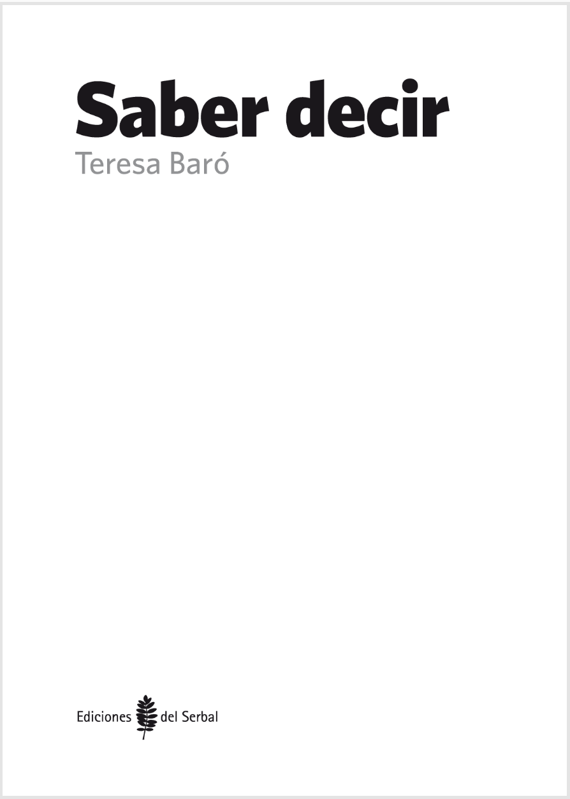

<!-- página 2 -->

Primera edición: 2011

© texto: Teresa Baró, 2011
Agente del proyecto Saber decir: Martina Ros
© 2011, Ediciones del Serbal
Francesc Tàrrega, 12 • 08027 Barcelona
Tel. 93 408 08 34 • Fax 93 408 07 92
Correo electrónico: serbal@edicionesdelserbal.com
www.edicionesdelserbal.com

Ilustraciones: Pepon Negre
Fotografías: Shutterstock
Diseño y maquetación: Guillermo Longhini

ISBN: 978-84-7628-682-1

> **Imagen de la página 2**
>
> 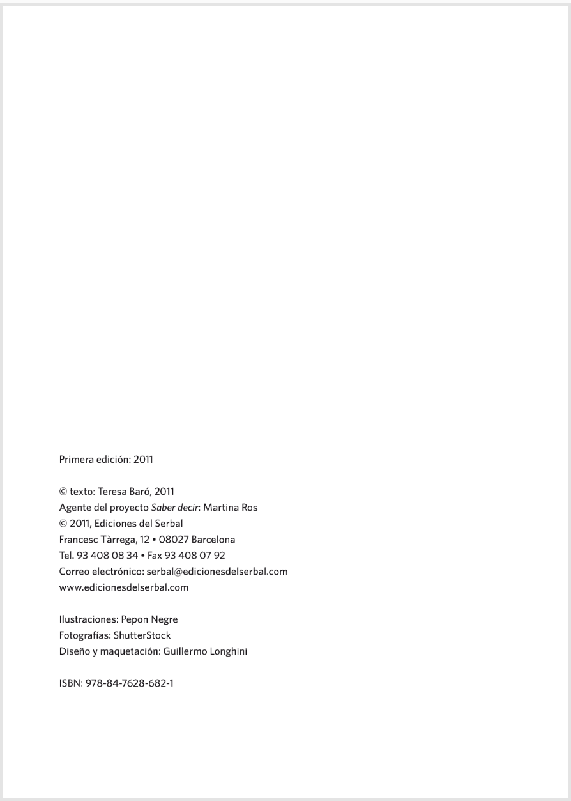

<!-- página 3 -->

A Carles y Miquel,
con el deseo de hacerles más fácil el camino

A Ramon Folch i Soler,
orador apasionado

> **Imagen de la página 3**
>
> 

<!-- página 4 -->

# Presentación

Decidí escribir este libro pensando en mis hijos, ahora adolescentes, y en todos los estudiantes de este país, porque estoy convencida de que les puede ahorrar mucho sufrimiento. Con frecuencia se les pide que demuestren unas habilidades que no son innatas pero que nadie les ha enseñado. A veces, ni siquiera han tenido buenos modelos a los que imitar. Esta absurda exigencia genera frustración y baja la autoestima; arrastran así, hasta su vida adulta, la inseguridad para expresarse en público y un irracional pánico a la visibilidad.

Como madre, también puedo ponerme en el lugar de los padres que se preocupan para que la educación de sus hijos sea lo más completa posible, con herramientas útiles y no sólo una acumulación de conocimientos teóricos, con frecuencia demasiado alejados de la realidad social y profesional. Estoy segura de que a no pocos les será útil para mejorar sus propias presentaciones. Y que encontrarán en éste, el manual de oratoria que nunca tuvieron. De hecho, la mayoría de nosotros somos fruto de un sistema educativo que no valoró las habilidades de comunicación, salvo si eran por escrito.

También fui profesora de Lengua en secundaria durante casi veinte años. Y compartía con mis alumnos adolescentes muchos de los miedos y las inseguridades que afloran cuando te expones ante un grupo que sabes que te juzgará. Yo me sentía insegura ante los padres en las reuniones de principio de curso o en el claustro de profesores. Los chicos, ante sus propios compañeros –tribunal exigente y público cruel– y ante los profesores. Me recordaban además la adolescente tímida que fui y empecé a tomar conciencia de cuán necesarias eran unas pautas básicas para desenvolverse en la comunicación oral formal. Así comencé a aprender y a enseñar al mismo tiempo las técnicas de la oratoria y a interesarme por el lenguaje corporal.

Ahora, como consultora profesional, conozco cada año cientos de personas con problemas y dificultades similares. Asisten a mis cursos o requieren entrenamientos personales conscientes de que si no superan

> **Imagen de la página 4**
>
> 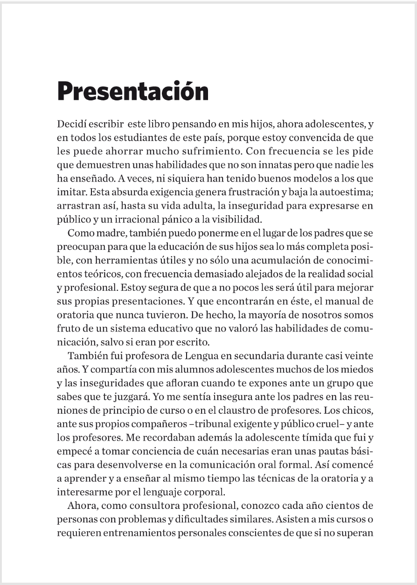

<!-- página 5 -->

esta carencia, tienen vetados muchos caminos. La satisfacción cuando comprueban de inmediato que a hablar en público se puede aprender es la razón por la que estoy en aulas y despachos profesionales cada día, en todo el país y de todos los sectores y en todos los niveles de empresas e instituciones. Durante todos estos años, he hecho invariablemente la misma pregunta a mis alumnos: ¿Te enseñaron a hablar en público en la escuela o en la universidad? ¿Estimularon tus padres esta habilidad en los encuentros familiares o sociales? La respuesta siempre es negativa. Y la conclusión es inevitable: no podemos saber lo que no se nos ha enseñado; no saber genera inseguridad; la inseguridad levanta altas barreras en el trayecto hacia los objetivos. Los conocimientos adquiridos en estos años como consultora en habilidades de comunicación, sumados a la experiencia como profesora de secundaria, hacían casi inevitable la redacción de este libro. Confío también en que los profesores de cualquier especialidad que quieran implicarse en la enseñanza de la oratoria, encontrarán en este manual de instrucciones consejos que transmitir a sus alumnos y un referente para la observación de las exposiciones orales que tienen que evaluar. A alumnos, padres, profesores, clientes y colegas agradezco las oportunidades que me han brindado para aprender todo lo que ahora recojo en este libro. Mi agradecimiento al actor y técnico de voz Jordi Muixí, que me ha asesorado en los temas relacionados con el lenguaje parverbal; al actor y matemático Ángel García Cerdanya, del que tanto he aprendido en estos diez años de colaboración; a la excelente negociadora y paciente Martina Ros, mi agente. Y mi reconocimiento a Carme Cerrillo, filóloga, profesora de Lengua castellana, y sobre todo amiga, que ha enriquecido el original con sus observaciones y consejos.

> **Imagen de la página 5**
>
> 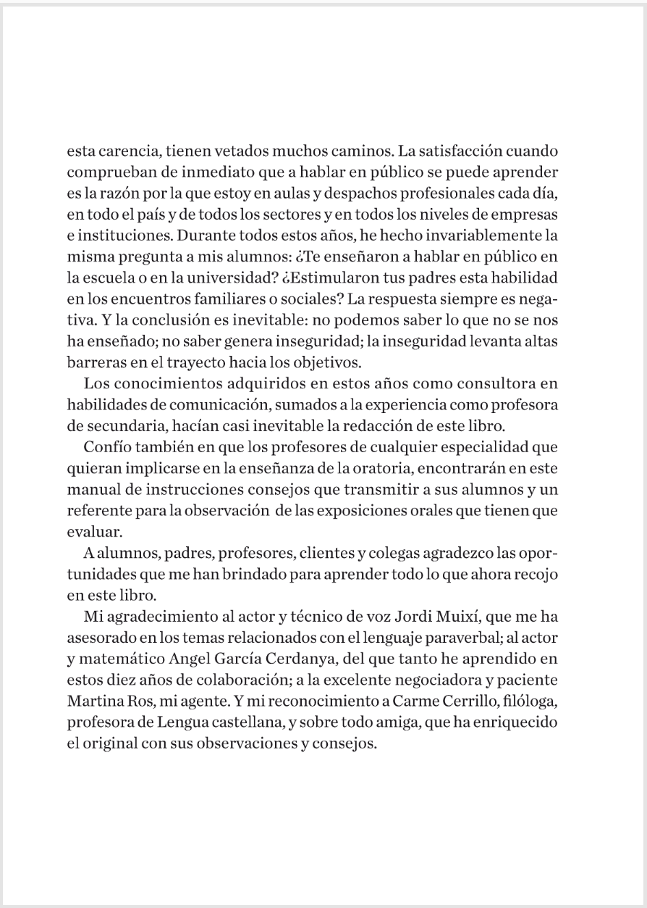

<!-- página 6 -->

# Introducción

Dominar las técnicas de la oratoria te ayudará en los estudios, mejorará la relación con los demás y tendrás más oportunidades profesionales. Observa a los políticos, los profesionales de la comunicación y a cualquier persona que hable por radio o salga en la tele. Puedes fijarte en la voz, en la posición del cuerpo, en la gesticulación, en su indumentaria. ¿Cuáles te inspiran más confianza? ¿Por qué? ¿Qué valores transmiten? ¿Se entiende lo que dicen?

Observando, se aprenden las técnicas que utilizan las personas con experiencia, pero también nos damos cuenta de qué es lo que no deberíamos hacer porque perjudica nuestra imagen. Compara estilos de comunicación entre entrenadores de fútbol, jugadores, políticos, expertos, locutores...

Fíjate en los mejores profesores que tienes. ¿Cuál de ellos te genera más interés hacia la asignatura? ¿Cómo lo hace? ¿Cómo habla? ¿Cómo se relaciona con los alumnos? ¿Qué recursos expresivos utiliza?

En la escuela, también puedes aprender muchos recursos para mejorar tu capacidad de persuasión aunque no tengas una asignatura específica de oratoria. Las clases de Filosofía, Literatura, Lengua son una fuente permanente de recursos que podrás incorporar a tu caja de herramientas para mejorar tu capacidad de expresión. Aunque a veces cuesta creerlo, las normas gramaticales, las figuras retóricas, las técnicas de elaboración de un escrito y un buen vocabulario son imprescindibles para expresarte de forma comprensible y correcta. Las demás materias que estudias te darán conocimientos de diversos ámbitos que formarán parte de tu «cultura general» o expertise en determinado tema por el que tengas especial interés. Tanto el bagaje general como el conocimiento profundo de un tema son imprescindibles para ser un buen orador, tener una buena imagen y transmitir confianza.

Aprovecha en clase todas las oportunidades para practicar: salir a la pizarra, exponer un trabajo, ser el portavoz de tu grupo, participar en debates y asambleas... Y fuera de la escuela puedes animarte a decir unas

> **Imagen de la página 6**
>
> 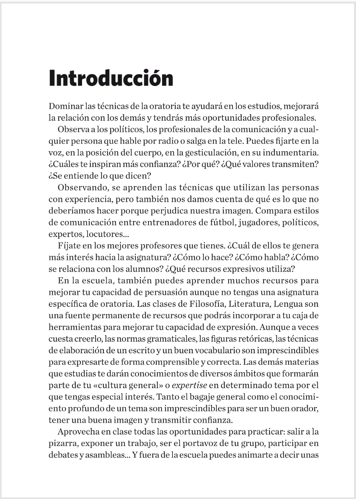

<!-- página 7 -->

14 SABER DECIR INTRODUCCIÓN

palabras a tus amigos el día de tu cumpleaños, hacer un brindis en una celebración familiar... ¿Ridículo? Míralo como quieras. Más ridículo serás el día que tengas que presentar un trabajo o el proyecto final de carrera y no sepas cómo hacerlo. Te sentirás muy mal si has realizado un buen trabajo y no puedes defenderlo como se merece.

> **Imagen de la página 7**
>
> 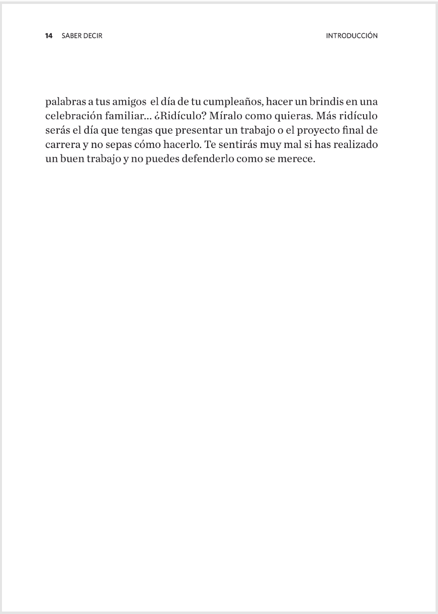

<!-- página 8 -->

Parte I

> **Imagen de la página 8**
>
> 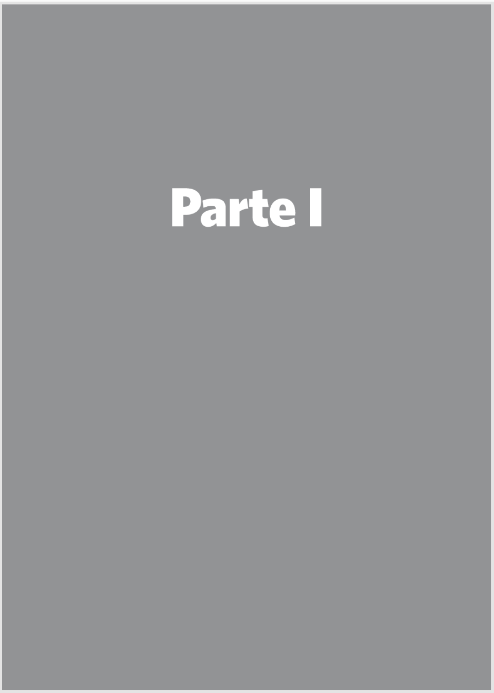

<!-- página 9 -->

1. ¿Qué es la oratoria y para qué te servirá?

Pocas cosas son tan útiles como la capacidad para expresar nuestros pensamientos, defender nuestras ideas y persuadir a los demás cuando nos conviene. Quizás la palabra oratoria no te resulte muy familiar. Seguro que sabes a qué nos referimos, en cambio, cuando decimos «hablar en público». Y te imaginas enseguida a una persona dirigiéndose a un grupo numeroso de espectadores. Pero la oratoria no sirve sólo para dirigirse a grandes audiencias sino que es una habilidad necesaria en ocasiones muy variadas: una conversación, una negociación, una clase, una venta, una defensa, etc. Estamos hablando de habilidades que podemos denominar de maneras diferentes: oratoria, retórica, elocuencia...

¿Es lo mismo? Vamos a ver la definición del Diccionario de la Real Academia de la Lengua Española:

Elocuencia f. Facultad de hablar bien: con fluidez, propiedad y claridad, y, sobre todo, de manera convincente. Se emplea también con aplicación al lenguaje. Por extensión, poder expresivo de otras cosas: La elocuencia de las estadísticas.

Elocuente 1. adj. Dotado de elocuencia. 2. Expresivo o significativo: Un silencio elocuente.

Oratoria 1 f. Arte de pronunciar discursos. 2. Género literario formado por los discursos.

Retórico, ca 1. adj. De (la) oratoria. Aplicado al lenguaje, de estilo oratorio. A veces con sentido despectivo, como excesivamente cuidado o cargado de expresiones o giros cultos. 2. De la retórica. 3. adj. y n. Aplicado a personas, versado en retórica.

Como puedes comprobar, el significado de los términos oratoria y elocuencia son bastante parecidos y se refieren al don de la palabra, para conseguir determinadas reacciones de los receptores, a los que llamamos público y que recibe este mensaje de forma oral. En cambio, la retórica es aplicada con frecuencia al arte de la palabra escrita aunque sus reglas se apliquen también a la expresión oral.

> **Imagen de la página 9**
>
> 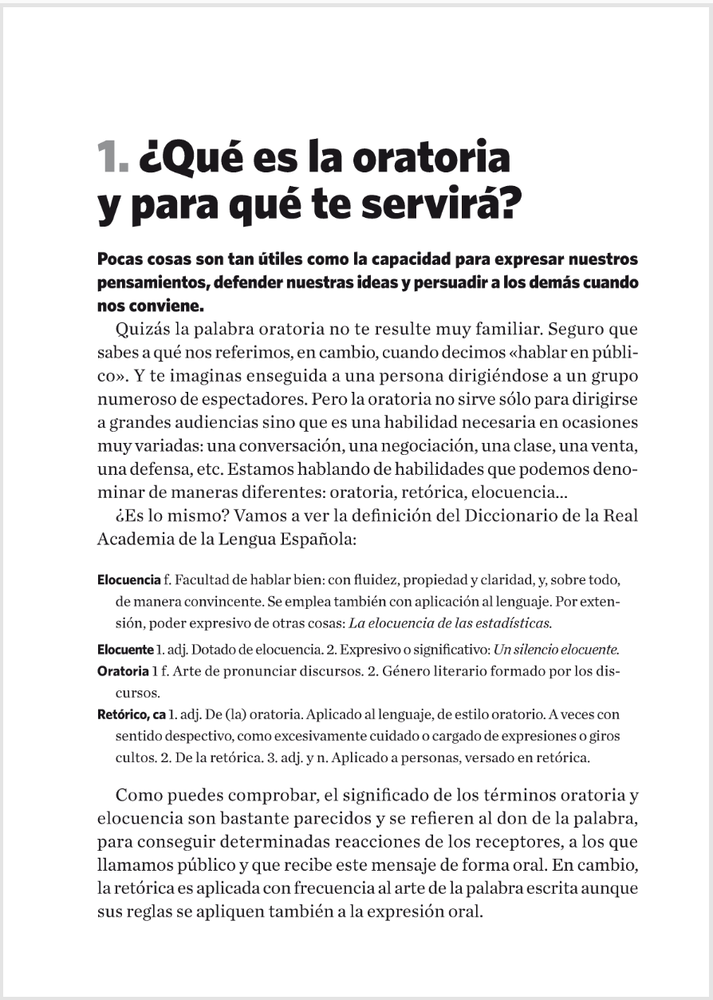

<!-- página 10 -->

18 SABER DECIR PARTE I

También te habrás fijado en que «retórica» puede tener un significa- do peyorativo. Se aplica a las formas de expresarse vacuas, ampulosas y artificiosas que no aportan demasiadas ideas nuevas y, sobre todo, intentan manipular, engañar o distraer de otro objetivo. La retórica es «mala retórica» cuando los objetivos no son claros ni honestos.

En este libro nos ocupamos, de manera muy concreta, de la actividad comunicativa de un orador ante una audiencia, tanto si ésta está forma- da por tres personas como si lo está por dos mil. Además, lo centramos en situaciones de comunicación formal, porque quizás no hace falta que te expliquemos cómo relacionarte con tus amigos cuando estás charlando distendidamente. O sí. En cualquier caso, puedes mejorar si sigues los consejos de este libro y los aplicas a círculos más íntimos y privados.

Pero, hablar en público, ¿es realmente un arte en poder sólo de cuatro privilegiados que poseen este don? ¿O son un conjunto de técnicas que se aprenden, se aplican y no fallan nunca? Podemos afirmar que es un arte, ya que consiste en aplicar con gracia y originalidad un conjunto de técnicas que se pueden aprender. Imagí- nate un cocinero. ¡Nadie nace cocinero! Las técnicas de la cocina se pue- den aprender: conocer los ingredientes, los procesos, los materiales, las herramientas... Todos podemos ser buenos cocineros si conocemos estas técnicas, nos esforzamos y nos pasamos horas en los fogones. Muchos destacarán por su estilo propio y de vez en cuando saldrá un genio. Pero todos podemos hacerlo mínimamente bien.

Si sigues los consejos de este libro hablarás en público correctamente y seguro que, añadiendo tu talento personal para conectar con la gente, serás un gran comunicador, de esos que convencen a todo el mundo y consiguen siempre lo que quieren.

> **Imagen de la página 10**
>
> 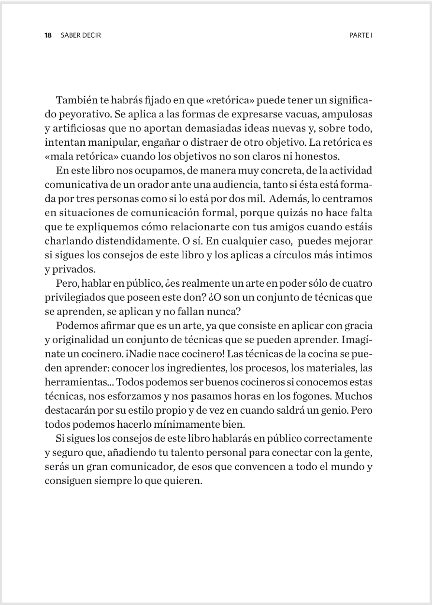

<!-- página 11 -->

2. ¿Hablar en público o comunicarte con el público?

¿Es lo mismo hablar en una conversación privada que ante un grupo de gente? Si fuera lo mismo, no nos sentiríamos tan inseguros cuando tenemos que hacerlo. La comunicación en público exige una actitud y unas técnicas específicas.

La mayor parte de los libros que explican técnicas para dirigirse a la audiencia se titulan más o menos «Cómo hablar bien en público». Siempre me ha parecido mejor decir «Cómo hablar bien con el público» porque es necesario conectar con las personas que tienes delante. Hablar bien no es suficiente. Hay oradores que hablan bien, correctamente, pero no «conectan» porque hablan para sí mismos, no «conversan» con el público y su discurso acaba siendo un monólogo. ¡No! El buen orador establece un diálogo con la audiencia. Aunque ésta permanezca en silencio, hay un retorno de la comunicación: el público sigue atentamente la exposición y lo demuestra a través de su actitud corporal.

> **Ilustración** — Se muestra un dibujo simple de dos personas interactuando, cada una con un globo de diálogo que dice "¡HOLA!", representando la comunicación o interacción entre individuos.

> **Imagen de la página 11**
>
> 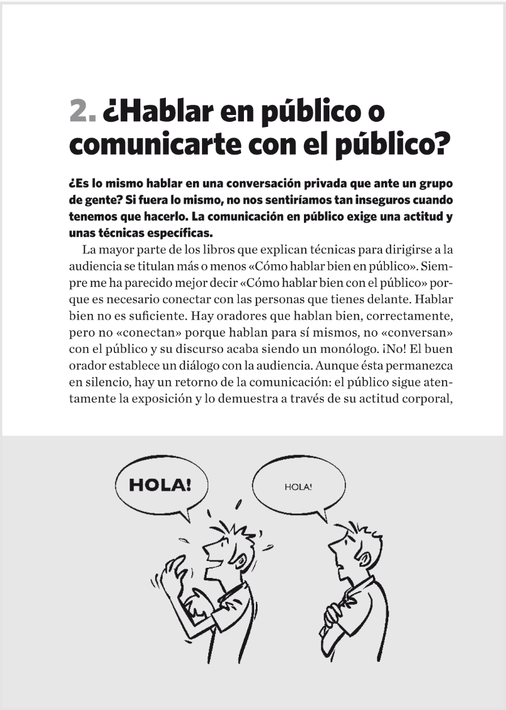

<!-- página 12 -->

la expresión del rostro, el contacto visual, la risa o cualquier otro gesto, si es el caso.

¿Qué quiere decir, pues, «hablar en público»? ¿Podemos distinguir entre «comunicación en público» y «comunicación interpersonal»?

En la comunicación interpersonal, lo que llamamos «tú a tú», la mayoría de nosotros nos sentimos más seguros y nos expresamos con mucha más naturalidad. Habitualmente lo hacemos muchas veces al día y con distintos interlocutores. Esta seguridad radica, en parte, en la sensación de que la responsabilidad de la comunicación es compartida con el interlocutor; el peso de la conversación se reparte y no nos jugamos el prestigio ante muchas personas sino sólo delante de una o dos.

¿Cuáles son las características específicas de la comunicación en público?

*   Es unidireccional. Una persona se dirige a las demás y éstas escuchan en silencio.
*   El orador es el centro de atención. Es el protagonista del acto y tiene toda la visibilidad. La distribución de las personas en el espacio y la colocación del mobiliario y complementos audiovisuales están pensados para favorecer esta visibilidad.
*   El orador tiene que controlar la situación y tiene responsabilidad sobre el éxito del acto. Su obligación es que el mensaje llegue, que las personas que asisten al acto se interesen por el tema y respondan tal como ha previsto. Tiene que someterse a la organización pero también es parte implicada; tiene que controlar el tiempo y tiene que cumplir un horario.
*   Hay un objetivo previo y claro. El orador sabe bien lo que quiere conseguir con su intervención: conmover, animar, vender, formar. Cualquier exposición tiene que tener un fin que la justifique.
*   Tiene un grado de formalidad alta. En general, y especialmente en el ámbito académico y profesional, estos actos son bastante

> **Imagen de la página 12**
>
> 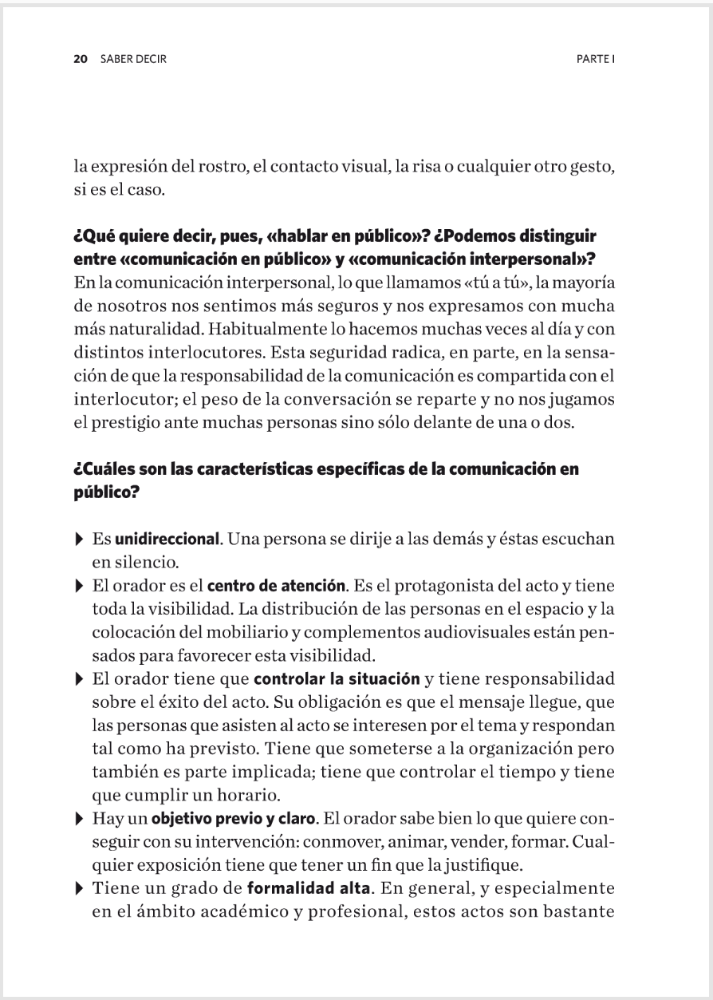

<!-- página 13 -->

21 RECETAS PARA HACER BUENAS PRESENTACIONES EN PÚBLICO PARTE I

formales, dados su finalidad, contexto y tema. Esta formalidad se manifiesta en:
* La imagen personal.
* El tipo de lenguaje que se utiliza.
* La corrección en la articulación de los sonidos y en los movimientos del cuerpo.

**Es planificada.** Porque pensamos qué diremos y cómo lo diremos para alcanzar nuestros objetivos. No es improvisada, ni espontánea, ni casual ni fortuita.

**Tiene que ser rentable.** La inversión que hacemos al preparar y ejecutar la presentación tiene que permitir conseguir los objetivos propuestos. Por ello decimos que tiene que ser eficaz. Le dedicamos tiempo, energía, recursos materiales y conocimientos, además de alguna pesadilla: tiene que dar, pues, los resultados esperados.

**Tiene que cumplir las expectativas de la concurrencia.** Los asistentes esperan algo de nosotros y no los podemos defraudar.

> **Imagen de la página 13**
>
> 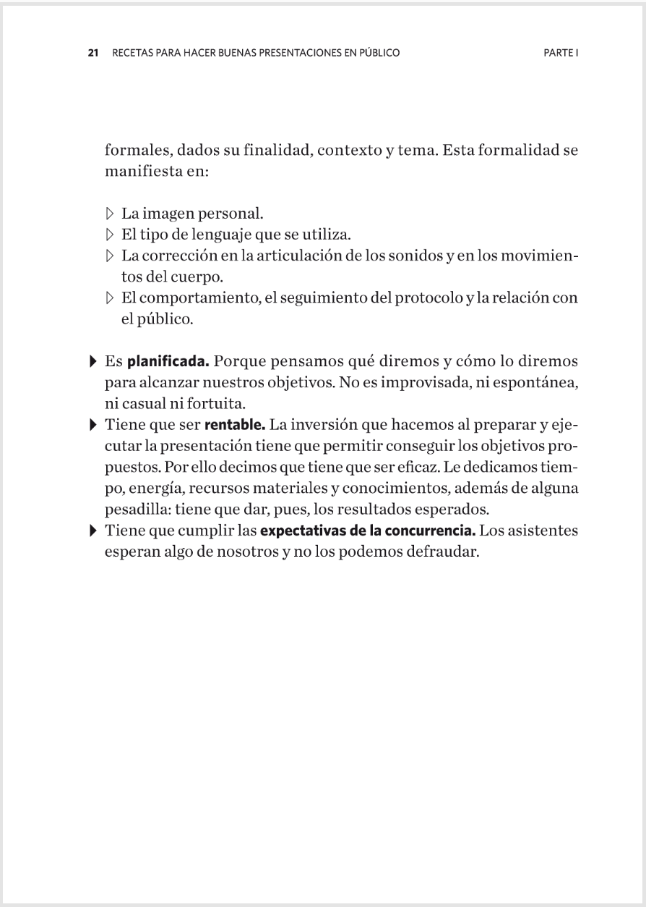

<!-- página 14 -->

3. ¿Para qué sirve hablar bien en público?

El arte de la elocuencia te permitirá transmitir tu mensaje –ya sean conocimientos, ideas o sentimientos– de manera clara y convincente y podrás hacerte escuchar en todos los ámbitos de tu vida: académico, profesional y personal.

## Ámbito académico

En la escuela tienes que hacer exposiciones en clase, tienes que presentar trabajos; quizás eres el delegado de clase o portavoz de tu curso en el Consejo Escolar en alguna asamblea de estudiantes.

En la universidad, con la entrada en vigor del Plan Bolonia, las exposiciones orales se han multiplicado y ningún estudiante puede escapar de esta práctica. Cuando te toca, si no tienes estas habilidades, lo pasas muy mal y temes por tu reputación más que por la evaluación del profesor. No es sólo una cuestión de nota: la calificación es importante, pero diferenciarte de tus compañeros con un estilo propio y tener una imagen de buen comunicador te hará más visible y reconocido. Conocer las técnicas para hablar en público te acercará al éxito y te hará sentir seguro en:

*   Reuniones, asambleas, actos públicos.
*   Debates, mesas redondas.
*   Certámenes de oratoria.
*   Participación en el Consejo Escolar y otros órganos de gestión.
*   Actos de celebración: certámenes literarios, ceremonia de graduación, etc.
*   Presentaciones de trabajo en clase.
*   Exámenes orales.
*   Presentación de proyectos y tesinas.
*   Defensa oral de la tesis doctoral.

> **Imagen de la página 14**
>
> 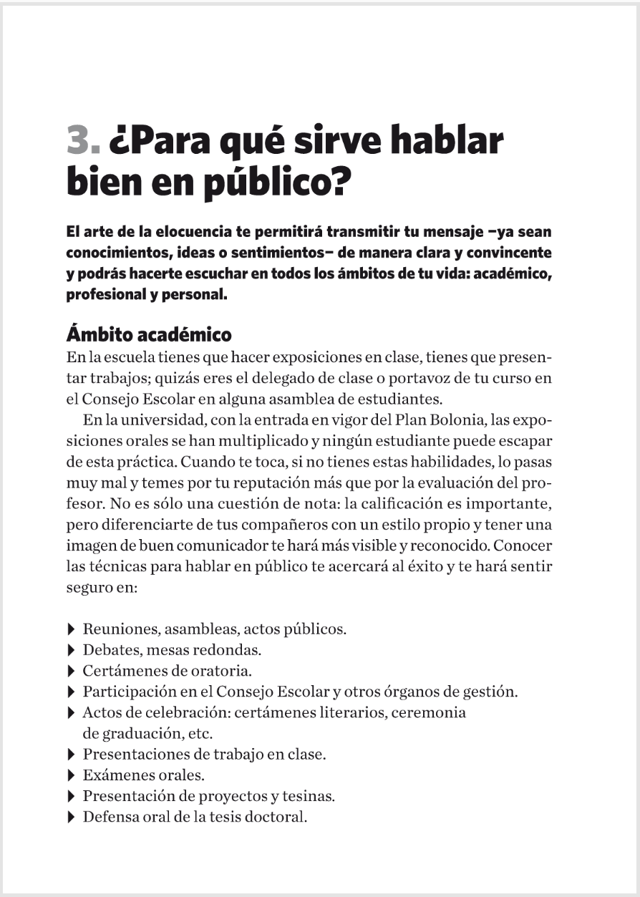

<!-- página 15 -->

23 RECETAS PARA HACER BUENAS PRESENTACIONES EN PÚBLICO PARTE I

## Ámbito profesional

Es tu futuro próximo. Dentro de muy poco te someterás a entrevistas de trabajo y empezarás tus primeras experiencias en el mundo laboral. ¿Creías que era dura la vida de estudiante? ¿Y ya verás el mundo laboral? Verás cómo, por las buenas, te piden que hagas cosas que nunca te había enseñado; por ejemplo: hacer una presentación de la empresa o impartir alguna clase. Y qué harás entonces? No hagas como muchas jóvenes promesas que esconden la cabeza bajo el ala y buscan mil excusas antes que aceptar el reto. Algunos prefieren perder una oportunidad de promoción o de progreso profesional antes que afrontar esta situación. ¡Qué pena!

Sea cual sea la carrera que estudies, el oficio que tengas, siempre te vendrá tener habilidad para hacerte escuchar y capacidad de persuasión. Aquí tienes sólo unos ejemplos de profesionales que lo necesitan:

*   Comercial.
*   Directivo.
*   Técnico especialista.
*   Divulgador científico.
*   Maestro, formador.
*   Político.

Y en concreto en el mundo de la empresa, las habilidades de comunicación y relación son un valor añadido muy importante que puede aportar el candidato y son el ingrediente necesario para el éxito profesional y muchas satisfacciones personales en el ámbito laboral. Estas habilidades son imprescindibles en muchas situaciones habituales, entre ellas:

*   Entrevista de trabajo.
*   Defensa de proyectos en un concurso.
*   Presentación de la empresa.
*   Presentaciones de productos.
*   Presentaciones de informes.

> **Imagen de la página 15**
>
> 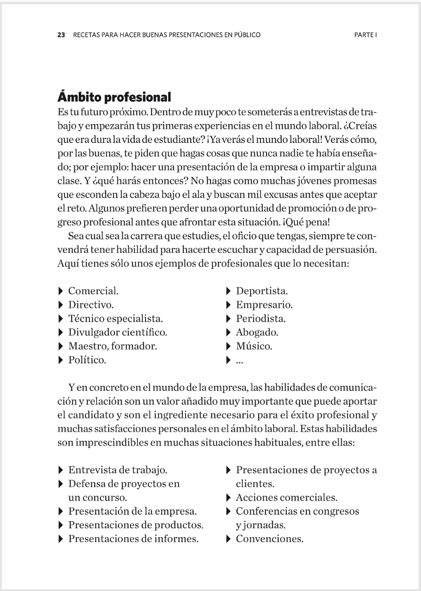

<!-- página 16 -->

24 SABER DECIR PARTE I

► Presentaciones en actos públicos.
► Discursos en actos formales.
► Reuniones con colaboradores.
► Dirección de equipos.
► Portavoz ante la prensa y otros públicos.
► Representación de tu colectivo profesional: asociaciones, gremios, etc.

No hace falta decir que en el mundo de la política, la buena imagen, el dominio de la lengua y el poder de persuasión son las armas más importantes con que cuenta cada político para llegar a convencer a los electores.

## Ámbito personal: familiar y social

Asociamos a menudo la esfera personal a las situaciones más cómodas, «de estar por casa», donde amigos y familiares nos aceptan tal como somos. Sin embargo, también son necesarias las habilidades de relación, que hemos de tener activadas a cualquier hora del día. Y, además, hay algunos momentos que también requieren dirigirse a un buen número de personas y de manera más formal o solemne. Por ejemplo:

► Celebraciones y fiestas.
► Reuniones familiares.
► Encuentros con amigos.

Y tendrás que estar preparado para situaciones como:

► Hacer un brindis en una ceremonia o comida.
► Homenajear a alguien en una celebración.
► Hablar en una ceremonia fúnebre de un ser querido que ha fallecido.

> **Imagen de la página 16**
>
> 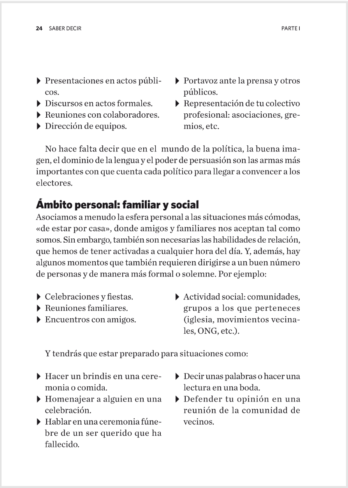

<!-- página 17 -->

En definitiva, si empiezas a ganar seguridad en el dominio de estas técnicas, obtendrás unos beneficios que no puedes todavía ni sospechar pero comenzarás a disfrutarlos desde el momento en que empieces a ponerlos en práctica. Por ejemplo:

*   Tendrás más control de todas las situaciones de comunicación.
*   Explicarás claramente lo que sabes y lo que piensas.
*   Defenderás tus ideas, tus trabajos y tus proyectos.
*   Inspirarás confianza.
*   Seducirás a tu audiencia.
*   Controlarás tu imagen.
*   Ganarás visibilidad.
*   Serás más competitivo en el mercado laboral y podrás diferenciarte de la competencia.
*   Podrás dirigirte a los medios de comunicación con seguridad.

> **Imagen de la página 17**
>
> 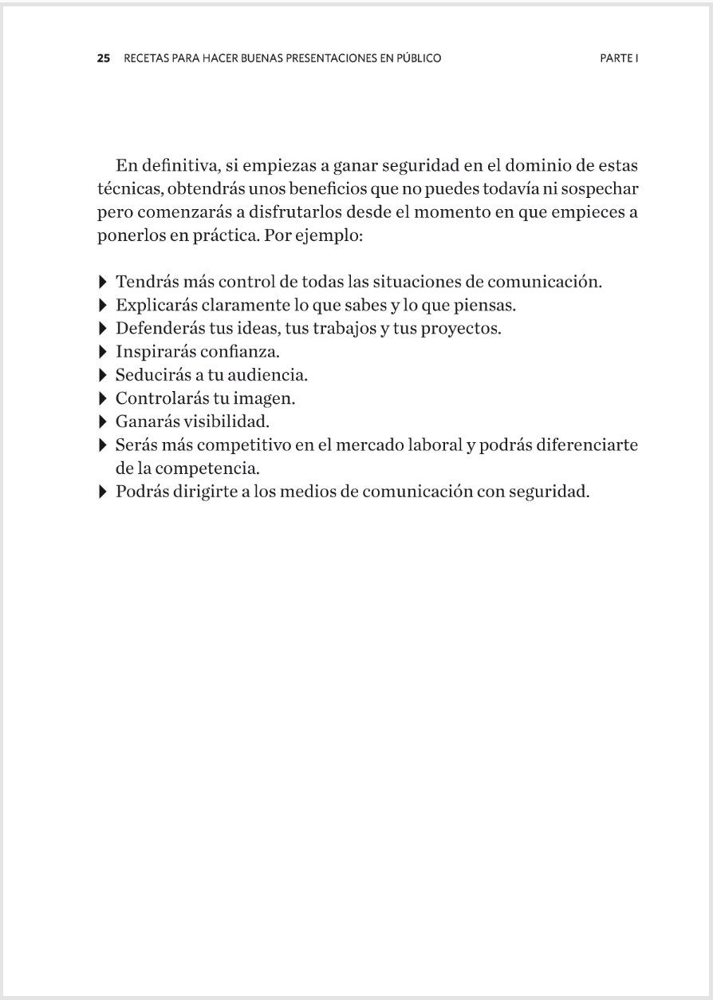

<!-- página 18 -->

Parte II

> **Imagen de la página 18**
>
> 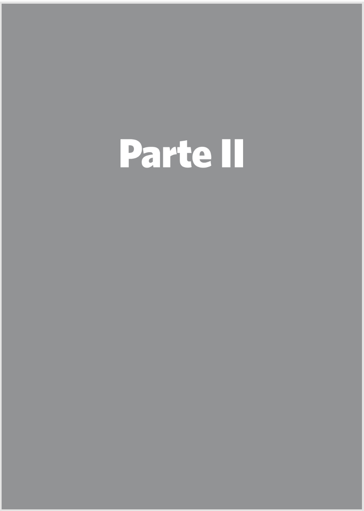

<!-- página 19 -->

4. Un mal común: la inseguridad

No sé si se me entenderá, si convenceré, si me notará el nerviosismo, si... ¡sí saldré de esta!

Hoy en día, el techo de muchos profesionales es la incapacidad de dirigirse a una audiencia. Son expertos en su campo, dominan el tema con creces y son reconocidos en su entorno más inmediato. Pero cuando les piden que expliquen sus conocimientos ante un cliente, que atiendan unas visitas importantes en la empresa o dicten una ponencia en un congreso, el suelo se abre bajo sus pies y quisieran ser tragados por la tierra para no tener que enfrentarse a las atentas miradas de los temibles espectadores.

¿Cuáles son las razones de estas ganas de huir y eludir una responsabilidad intrínseca a su tarea técnica o al cargo que ocupan?

La falta de seguridad es la causa de la mayor parte de las angustias. En la situación concreta de hablar públicamente, podemos diferenciar tres tipos de inseguridad:

*   **Inseguridad en el tema.** Es normal que cuando tenemos un dominio poco profundo del tema nos sintamos en falso a la hora de exponerlo. Sabemos que nos faltan datos o que tenemos lagunas de conocimiento. Tampoco estamos seguros de poder contestar las preguntas del público.
*   **Inseguridad en la propia capacidad para comunicar eficazmente.** Si no nos han enseñado cómo preparar una exposición y cómo dirigirnos oralmente a un grupo de personas, dudamos de nuestra habilidad. Podemos pensar que somos aburridos, que el mensaje no llega de ninguna forma y que no somos convincentes.
*   **Inseguridad en uno mismo.** No te creas que es exclusiva de las personas jóvenes. Todos tenemos nuestras debilidades. A veces no nos creemos suficientemente buenos, atractivos, aptos. No creemos merecer la aprobación, el afecto o la admiración de los demás.

> **Imagen de la página 19**
>
> 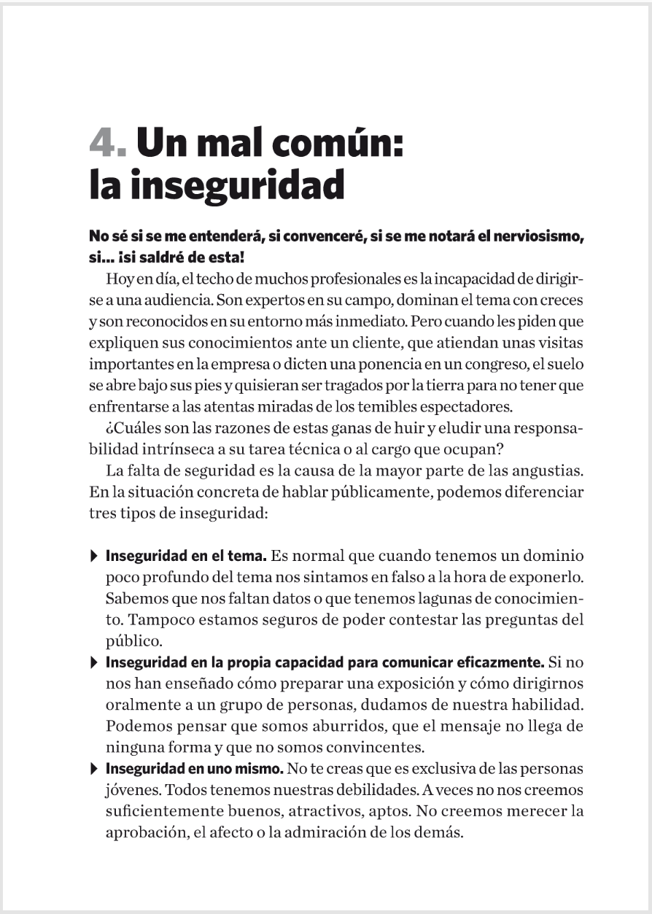

<!-- página 20 -->

30 SABER DECIR PARTE II

Este libro no te puede ayudar a tener más conocimientos sobre el tema que tratas (ibusca, lee, escucha a expertos, investiga, estudia!) pero sí te puede dar muchas herramientas para comunicar mejor tu mensaje y llegar al público con una buena imagen. También te ofrecerá recursos para sentir más tranquilidad a la hora de tu exposición, para reducir el grado de tensión y evitar que te bloquees. Piensa que la clave para hablar con naturalidad y convencer a los demás es tener confianza en uno mismo. Te daré, por lo tanto, todas las herramientas que te sirvan para sentirte más seguro.

> **Ilustración decorativa** — Se muestra un dibujo lineal de una persona con expresión de ansiedad o estrés (sudoración alrededor de la cabeza) parada frente a una puerta abierta.

> **Imagen de la página 20**
>
> 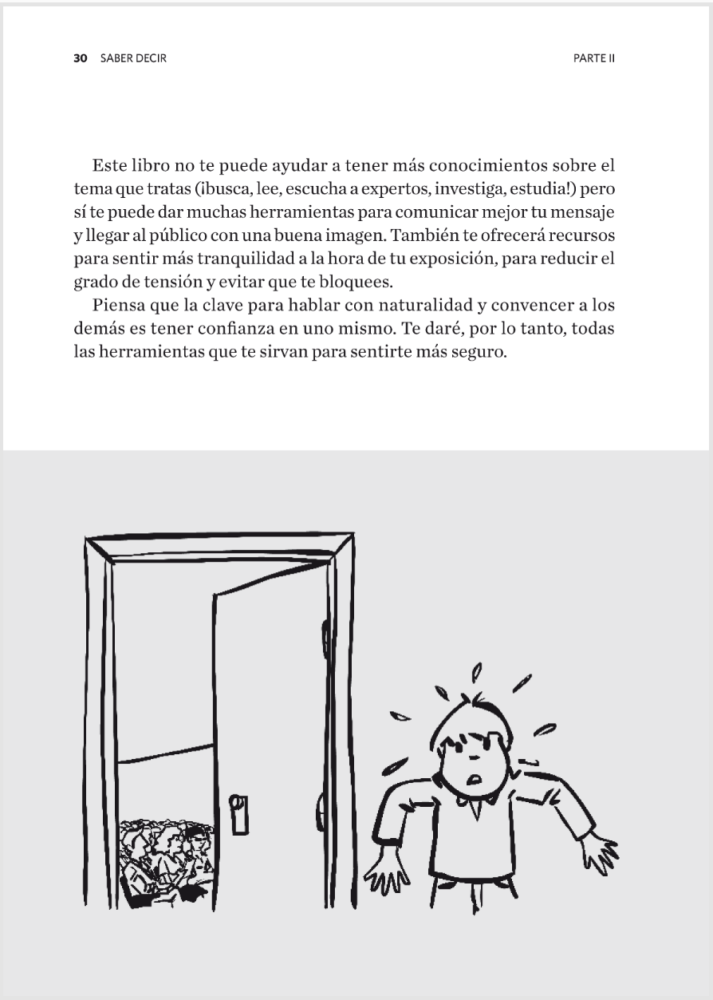

<!-- página 21 -->

5. Los peores enemigos: nervios y otros fantasmas

Lo paso muy mal cuando me preparo, cuando espero mi turno, cuando hablo y cuando reviso mentalmente mi exposición una vez que acabó todo.

Los miedos más frecuentes
En las clases de comunicación que doy a los estudiantes de secundaria y a estudiantes universitarios, incluso a los de másters y posgrados, me gusta preguntarles cuáles creen que son sus debilidades a la hora de dirigirse a una audiencia. La mayoría de los temores que me explican son compartidos con profesionales de todas las edades y de todos los niveles jerárquicos de la empresa. Aquí tienes las respuestas más frecuentes:

Por lo que respecta al público
* «Enfrentarme a un público que no conozco.»
* «Que el público no esté atento y que muestre falta de interés.»

Respecto a la imagen que transmiten
* «Que se me note la inseguridad en la voz.»
* «Dar una imagen prepotente.»

Respecto al contenido
* «Pensar que al público no le gustará lo que expreso, o mi trabajo.»
* «No poder disimular que no acabas de creer lo que digo o lo que defiendo.»

> **Imagen de la página 21**
>
> 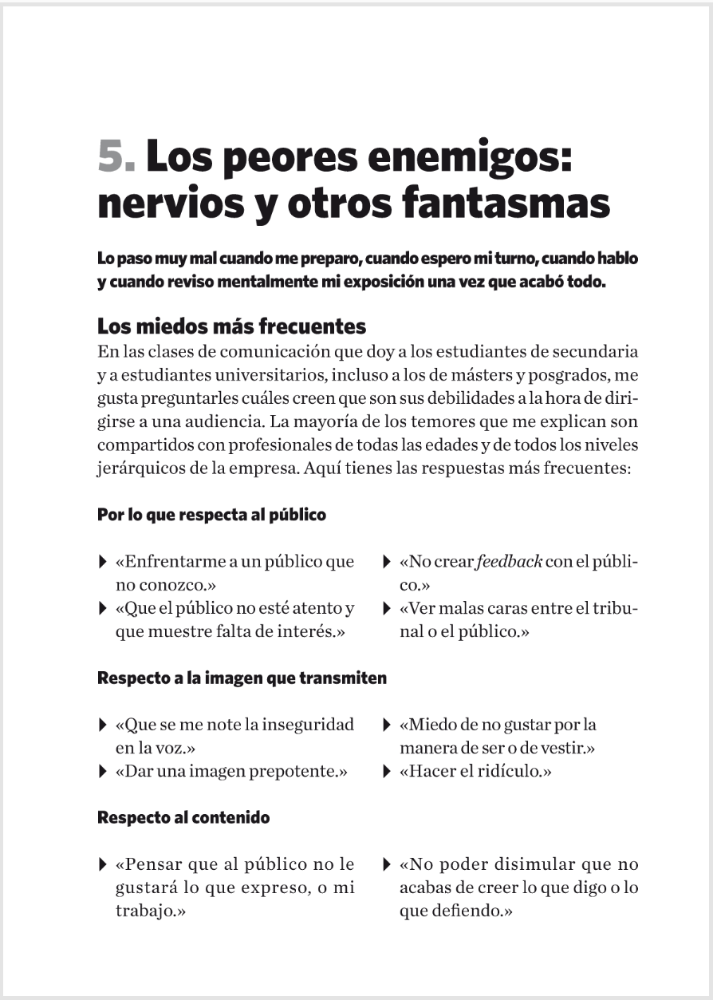

<!-- página 22 -->

Respecto a las habilidades

*   «Hablar demasiado.»
*   «Perder el hilo.»
*   «No saber cómo empezar a hablar.»
*   «Que no me entiendan.»
*   «Que no tener vocabulario, no encontrar las palabras adecuadas.»
*   «No hablar con claridad.»
*   «Olvidar puntos importantes.»
*   «Falta de capacidad para entusiasmar.»

Respecto a los nervios y la inseguridad

*   «Cómo controlar los nervios.»
*   «Cómo superar la timidez.»
*   «Quedarme en blanco.»
*   «Falta de confianza y seguridad.»
*   «Miedo al fracaso.»
*   «Quedar bloqueado, rígido.»

> **Ilustración decorativa** — Se muestra una figura humana mirando una pantalla de computadora con líneas de energía o rayos sobre su cabeza, lo que sugiere estrés o ansiedad.

> **Imagen de la página 22**
>
> 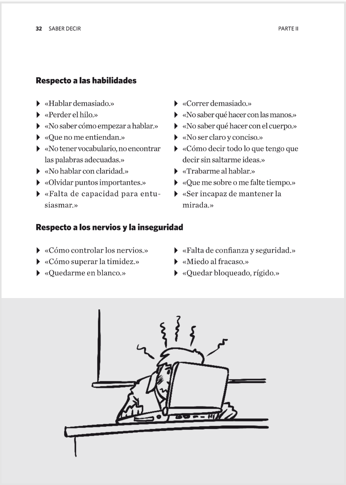

<!-- página 23 -->

33 RECETAS PARA HACER BUENAS PRESENTACIONES EN PÚBLICO PARTE II

¿Qué te parece? ¿Quizás tú mismo los compartes todos? No te preocupes. Afortunadamente, estos miedos pueden pasar a formar parte del recuerdo muy pronto.

## Los síntomas

El pánico escénico es uno de los obstáculos más habituales. La mayor parte de los jóvenes, y también de los adultos, sienten miedo a hablar en público. Pero te explicaré algunos recursos fáciles que te ayudarán a superar estas situaciones angustiosas. ¿Notas alguna de estas sensaciones cuando estás en una situación de exposición pública?

*   Agitamiento.
*   Temblor de voz, de piernas o de manos.
*   Boca seca.
*   Voz ronca o más profunda de lo normal.
*   Cambio de color del rostro.
*   Manchas en la piel, especialmente en el cuello y la cara.
*   Rigidez en la posición del cuerpo y la gesticulación.
*   Encogimiento de hombros y cuerpo en general.
*   Movimientos poco desenvueltos.
*   Latidos muy fuertes del corazón.

No entraremos a investigar las causas de esta inseguridad, pero muy probablemente influye la falta de costumbre, la poca tradición que hay en nuestro país de fomentar estas habilidades y la nula preparación que tenemos en oratoria. ¿Quién sabe cocinar sin que le hayan enseñado o sin

> **Imagen de la página 23**
>
> 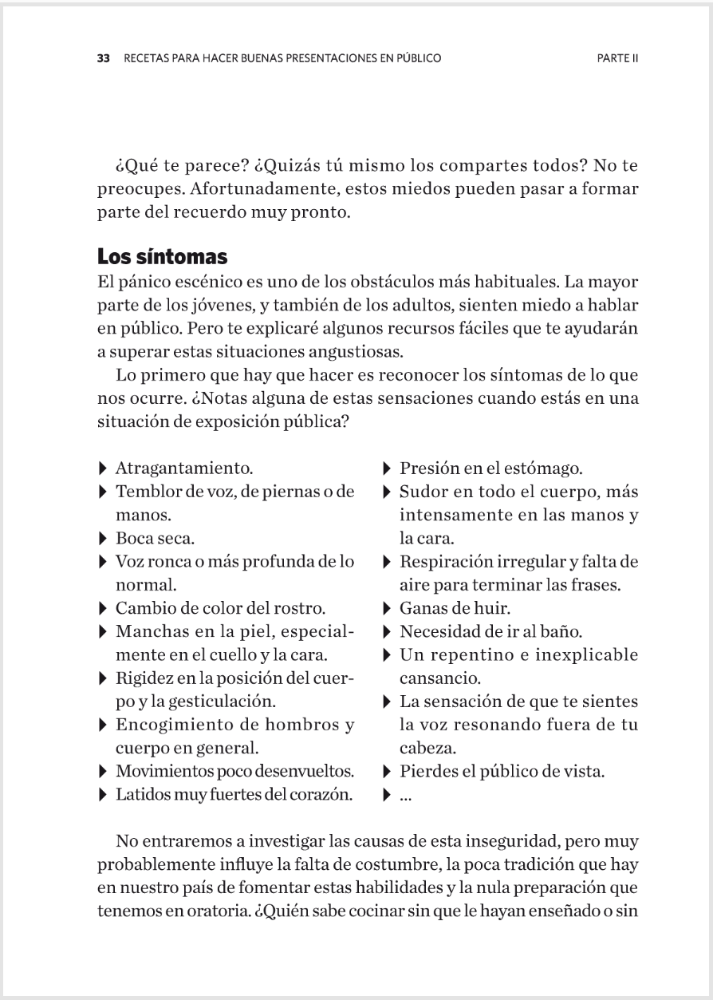

<!-- página 24 -->

34 SABER DECIR PARTE II

ponerse de vez en cuando el delantal? Pues con las habilidades de comunicación pasa lo mismo. Además, como sabemos hablar, creemos que eso ya es suficiente y que podemos hacerlo en cualquier contexto. Y no es así. Hay unas habilidades que hay que desarrollar, unas técnicas que nos permiten ser más eficaces y tener mucho más control sobre la comunicación.

Igual que muchos de nosotros hemos entrado en el mundo de la cocina a través de un libro de recetas, ahora nos podemos acercar al mundo de la oratoria con este manual de recetas fácilmente aplicables. Si, además, puedes seguir algún curso presencial, los pasos pueden ser de gigante, ya que un profesional te orientará en estas técnicas y te dirá cuáles son tus puntos débiles y tus puntos fuertes para poder sacar el máximo provecho de tus habilidades.

> **Ilustración decorativa** — Se muestra un dibujo de una cara con expresión de angustia o estrés, sudando y con líneas de tensión alrededor de la cabeza.

Ah, y no te olvides de cocinar con frecuencia; es la mejor forma de confirmar tus progresos y de animarte cada día a trabajar para mejorar. Y, como buen anfitrión, tú podrás sentir tanto placer como tus invitados.

¡Pasar del pánico escénico al placer escénico es posible!
Los síntomas que he enumerado más arriba son muy frecuentes y son una reacción normal y muy primitiva de nuestro cerebro ante un peligro. Podemos sentir más de uno y son difíciles de controlar. De todas formas no tiene que preocuparte en exceso y es mejor considerarlos como parte del proceso. Incluso podemos valorar el nerviosismo positivamente porque es una muestra de que nos interesa lo que hacemos y nos da

> **Imagen de la página 24**
>
> 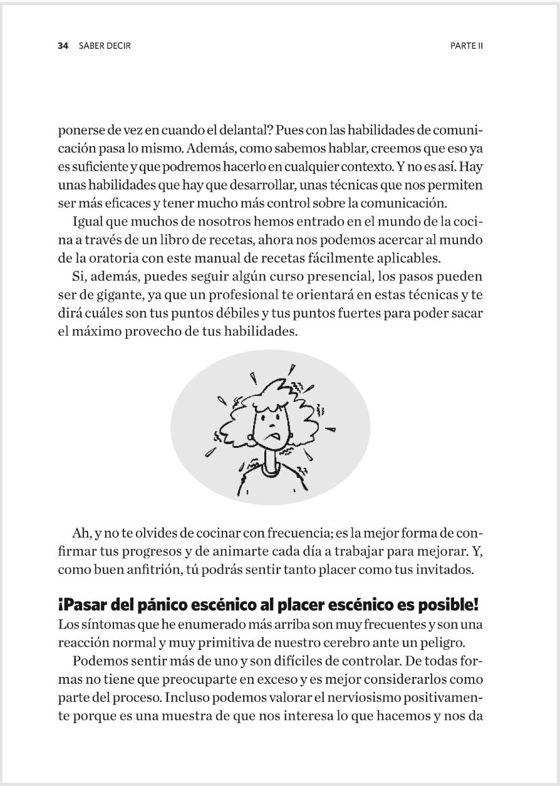

<!-- página 25 -->

35 RECETAS PARA HACER BUENAS PRESENTACIONES EN PÚBLICO PARTE II

un impulso extra para comunicar con los cinco sentidos y toda la energía. El cuerpo activa todos sus recursos para dar lo mejor de sí en una situación de tensión. Por eso, cuando hemos terminado, nos sentimos cansados: hemos realizado un gran esfuerzo, a veces extenuante. La sensación de nerviosismo e inquietud es positiva y productiva siempre que no se convierta en un obstáculo. Cuando es excesiva y nos bloquea, atenaza nuestras habilidades y nos impide pensar y actuar en plenitud de facultades. ¿Cómo saber si nuestro nivel de tensión está entre los límites razonables?

El proceso habitual para cualquier persona consciente de la importancia que tiene su exposición podría ser descrito como sigue:

1. Días antes: preparación acompañada de interés y una sana precaución por el resultado.
2. Día D: un cierto nerviosismo.
3. Cinco minutos antes: se empiezan a sentir algunos de los síntomas descritos, especialmente un nudo en el estómago, el corazón más acelerado, dificultad para concentrarse, profundo cansancio, ganas de ir al baño.
4. Estas sensaciones se van acentuando hasta el momento de empezar, en que solemos sufrir el momento álgido. Normalmente, el primer minuto es el de más tensión.
5. Después, poco a poco, todo se va normalizando, nos sentimos cada vez más seguros y la respiración y el corazón vuelven a trabajar con más normalidad, lo que hace desaparecer el resto de los síntomas.
6. Es a partir de este punto cuando volvemos a ser nosotros mismos y nos expresamos con mayor naturalidad.

Conocer nuestras zozobras, nuestras debilidades e inseguridades es el primer paso para superarlas. Si sabemos cómo reacciona el cuerpo también lo podremos controlar más.

> **Imagen de la página 25**
>
> 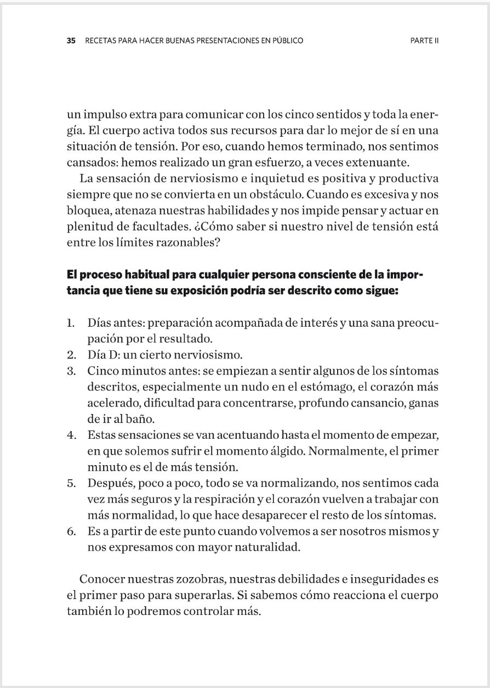

<!-- página 26 -->

6. ¿Cómo controlar los nervios y ganar seguridad?

¿Es posible dejar de temblar, no ponerse colorado o no parecer un monigote ante la respetable audiencia?

Los alumnos que asisten a mis cursos están muy interesados en conocer técnicas para ser más eficaces en la comunicación, pero, sobre todo, quieren que les explique trucos para no sufrir esta angustia y, claro, para que no se les note que lo están pasando mal.

No existe una única y mágica fórmula para conseguir todo esto y hay que trabajar en varios sentidos para conseguir cada día más confianza y más destreza. En los siguientes capítulos encontrarás los consejos que doy a mis alumnos y que han aplicado con éxito en la mayoría de los casos. Eso sí, es muy importante la constancia y no perder nunca la confianza en uno mismo y en que se alcanzarán los objetivos.

Y recuerda que...

## Una buena preparación te garantiza un buen resultado

Es mejor que no confíes en la capacidad de improvisación y que lo tengas todo atado y ensayado. Preparar significa:
* Dominar el tema.
* Seleccionar bien el contenido y decidir los mensajes clave.
* Estructurar el contenido.
* Pensar en cómo te harás entender.
* Trabajar la exposición para hacerla amena y mantener al público atento.
* Aplicar técnicas de persuasión.
* Preparar material de apoyo, si es necesario.
* Ensayar.

Puedes ver los detalles de este proceso en los capítulos siguientes.

> **Imagen de la página 26**
>
> 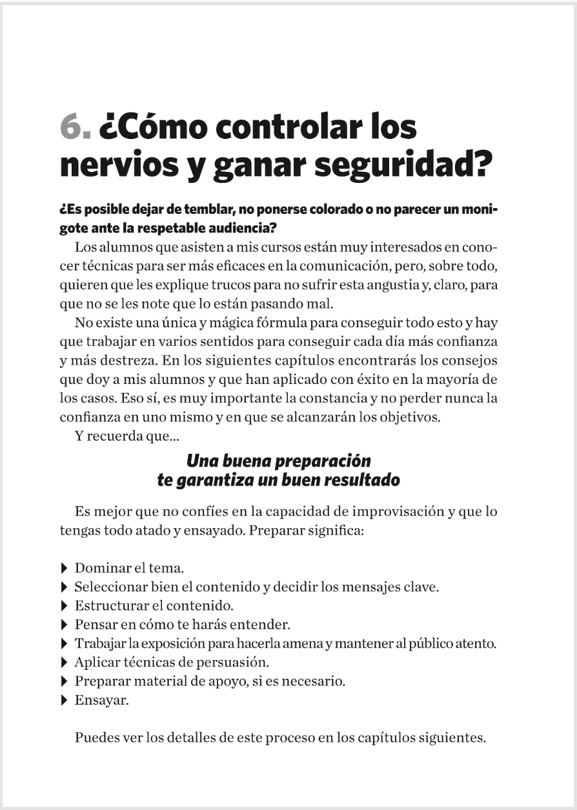

<!-- página 27 -->

37 RECETAS PARA HACER BUENAS PRESENTACIONES EN PÚBLICO PARTE II

**Seguir una rutina**

¿Qué tienen de bueno las rutinas? Nos dan seguridad. Si hacemos algo siempre de la misma manera, podemos estar casi seguros de que siempre dará los mismos resultados. Si lo que conseguimos de ello es satisfactorio, sólo tenemos que aplicar cada vez el mismo procedimiento y podremos conseguir objetivos sin invertir tanta energía extra. Por ejemplo, cuando te levantas por la mañana, sigues una rutina, un ritual particular que te lleva a la escuela o a la universidad sin tener que pensar mucho. Lo tienes todo controlado, ¿verdad?

Podemos hacer lo mismo con las intervenciones en público. Claro que sólo podemos establecer una rutina si realizamos esta actividad con cierta frecuencia. Si no, cada vez será un acto muy especial que aumentará nuestro nivel de tensión. Pongamos un ejemplo de rutina. Estás ya en la universidad y alguno de tus profesores tiene la costumbre de realizar el seguimiento del alumnado a base de exposiciones orales en clase. Además, participas mucho de la vida universitaria: exponiendo un trabajo, siendo portavoz de tu grupo, en un examen oral, etc. En este caso podrías marcarte una rutina como la siguiente:

*   Preparar el contenido con tiempo suficiente.
*   Ensayar en casa el día antes.
*   Practicar deporte el mismo día de la exposición.
*   Ponerte la ropa más adecuada para que te dé seguridad.
*   Pasar por el baño y comprobar tu aspecto.

Todos tenemos nuestras manías y nos sentimos seguros mediante mecanismos distintos. Por lo tanto, cada uno tiene que buscar lo que le sea más cómodo y que le dé más seguridad. Diseña tu propia rutina para actos especiales.

> **Imagen de la página 27**
>
> 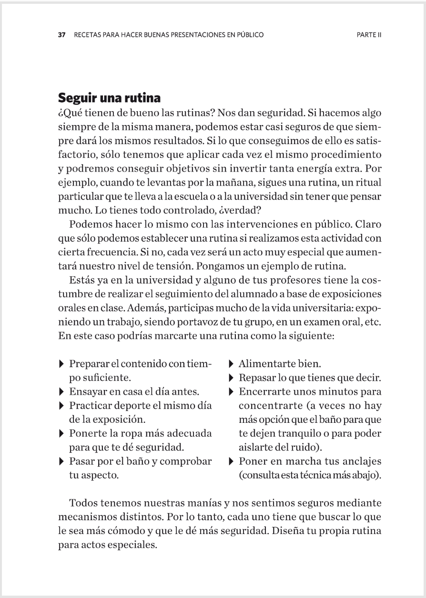

<!-- página 28 -->

38 SABER DECIR PARTE II

## La visualización

Aunque nunca hayas oído hablar de ella, seguro que ya aplicas esta técnica en otros ámbitos que no son el académico. Los deportistas y los músicos la utilizan con frecuencia para entrenar y preparar una competición o un concierto. Consiste en «visualizarte» realizando lo que tendrás que hacer y que supone un reto para ti. Es decir, se trata de imaginarte ejecutando la presentación con el máximo de detalle y «verte» haciendo lo que quieres hacer, con la soltura y la calidad que quieres conseguir. Dicen que las cosas se viven dos veces: cuando las imaginas y cuando pasan en realidad. Si somos capaces de imaginarnos triunfando, seguro que estamos mucho más cerca del éxito. Habrá que entrenarse a conciencia. El procedimiento es el siguiente:

1. Prepara tu intervención. Ensáyala, como explico en el capítulo dedicado al ensayo. En este caso, ya lo dominas todo y tienes la sensación de que lo tienes bien atado: tema, tiempo, material de apoyo, etc. Es el momento de reforzar este proceso con una visualización. Retírate a un lugar tranquilo y...
2. Cierra los ojos e imagínate en un cine, sentado en una butaca: está a punto de empezar una película. La pantalla está en blanco. Empieza la proyección. Tú eres el protagonista. Ves el público, el escenario, tu entrada segura y tranquila; te ganas al público con el saludo y empiezas a hablar. Desarrollas el tema con entusiasmo y ves cómo el público te sigue y se muestra muy interesado en lo que dices. Finalmente, acabas tu intervención y todo el mundo aplaude. Te hacen preguntas y comentarios. Al terminar, recibes las felicitaciones de los asistentes.
3. Tienes que imaginártelo con el máximo detalle; si puede ser, incluso, palabra por palabra, diapositiva a diapositiva. Cuanto más cerca de la realidad esté tu visualización, más eficaz será.
4. Con esta visualización tú ya has vivido una vez la actuación y ahora estás mucho más preparado para que te salga como has imaginado.

> **Imagen de la página 28**
>
> 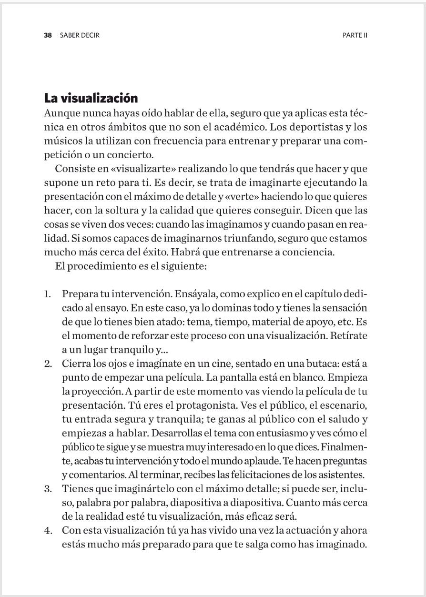

<!-- página 29 -->

39 RECETAS PARA HACER BUENAS PRESENTACIONES EN PÚBLICO PARTE II

Porque tú ya «te has visto» haciendo tu exposición y no te resulta extraño. Cuando estés ante tu público ya habrás pasado mentalmente por esta experiencia y te resultará más cómoda.
5. Si te imaginas en este papel, «te ves» interpretando este papel, seguro que puedes hacerlo. Decía el empresario Henry Ford que «tanto si te crees capaz como si crees que no, seguro que llevas razón». Y es así, porque lo que tú creas te condicionará a actuar de una forma o de otra y obtendrás un éxito o un fracaso.

## El anclaje

¿Qué es un anclaje? «Anclaje» viene de «ancla», utensilio que sirve para fijar una embarcación en el punto deseado.
Esta es una de las técnicas más eficaces para superar determinadas barreras psicológicas que hemos creado involuntariamente y que nos suelen perjudicar en la consecución de nuestros objetivos. También se aplica para conseguir determinados estados internos que nos tienen que permitir llegar a las metas deseadas.
¿Qué estado interno necesitas para enfrentarte a un público, para verte capaz de leer la tesina o pronunciar un discurso? Todos necesitamos una actitud positiva para afrontar este reto. Hace falta optimismo, valentía y mucha energía para contagiarla a los espectadores. ¿De dónde vas a sacarla si lo único que puedes pensar es en los nervios, la vergüenza o el riesgo de quedarte en blanco y quedar fatal ante todo el mundo? ¿Qué hacer si no puedes dejar de pensar en todas las desgracias que te pueden suceder en el momento de ponerte en pie?

Con un anclaje, podrás cambiar en un instante tu estado emocional. Primero lo tienes que crear. Te explico los pasos que tienes que seguir para conseguirlo:
1. Enciérrate en una habitación tranquila y cerciórate de que nadie te interrumpirá (el móvil tampoco).
2. Piensa, busca en tu pasado algún momento en el que te hayas sentido muy feliz y, si puede ser, vencedor. Por ejemplo, cuando marcaste

> **Imagen de la página 29**
>
> 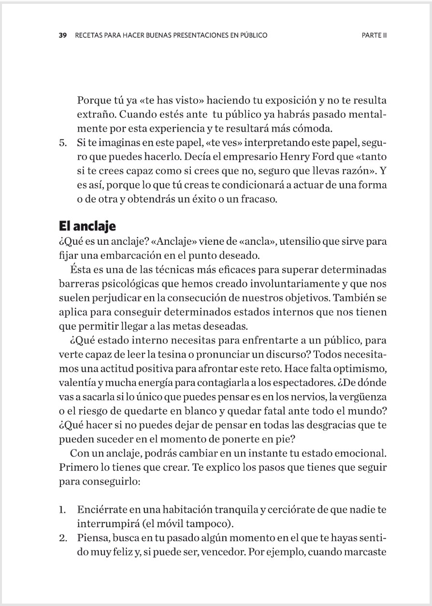

<!-- página 30 -->

40 SABER DECIR PARTE II

aquel gol espectacular, cuando te concedieron el premio en el cer-
tamen de Poesía, cuando el profesor te felicitó en clase y te sentiste
orgulloso de tu trabajo o alguna otra situación similar.

3. Cuando tengas identificada esta escena, tienes que revivirla. Vuelve
a ver todo lo que pasó: la luz, los colores de las cosas, los sonidos,
las palabras que te decían y que decías tú, el latido del corazón, el
sudor... Todo con la máxima fidelidad. Es necesario que lo revivas.

4. Mientras lo revives, puedes hacer algún gesto que irás relacio-
nando con la emoción positiva. Este gesto puede ser una señal
de fuerza con el brazo, tocarte muy cerca del corazón, chasquear
los dedos... También puedes decir, al mismo tiempo que haces el
gesto, una frase que te motive: «¡Soy el mejor!», «¡Será un éxito!»,
«¡Al ataque!», etc.

5. Haz este gesto y di la frase unas cuantas veces mientras revives la
energía de la escena del triunfo.

6. Quizás con unas cuantas veces no será suficiente y mañana tendrás
que repetirlo, y pasado mañana. Llegará un momento en que sólo
haciendo el gesto y pronunciando la frase, la emoción te embargará
y dejarás fuera de combate cualquier actitud negativa que te blo-
queo o te reste facultades.

7. Si quieres comprobar que esto es así y quieres acelerar el proceso,
crea un anclaje con música. Escoge una canción, una pieza musi-
cal que te contagie mucha energía y te estimule, que te haga sentir
capaz de todo. Y asóciala también a la escena vivida. Quizás ya tienes
una música asociada a una escena de gloria. Pues utiliza ésta si te
carga las pilas.

Cuando estés a punto de salir de casa, escucha esta música, una, dos,
tres veces, las que sea necesario. La música te generará el estado emo-
cional que necesitas para sentirte protagonista y creer capaz de con-
vencer. Procura que siempre sea la misma música asociada a un estado
concreto. Puedes tener varios anclajes: uno para estimularte, otro para
relajarte, otro para superar una dificultad determinada, etc.

erma

> **Imagen de la página 30**
>
> 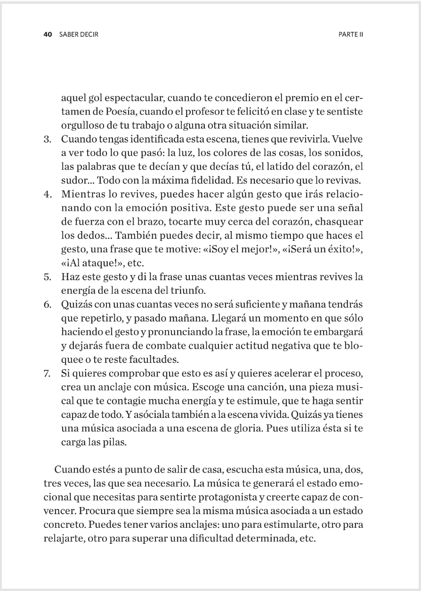

<!-- página 31 -->

41 RECETAS PARA HACER BUENAS PRESENTACIONES EN PÚBLICO PARTE II

Como puedes ver, un anclaje es una forma sana, económica y práctica de enfrentarte a situaciones que requieren un esfuerzo extra y que suponen una dificultad importante. Podrás utilizarlos para superar una entrevista de trabajo, afrontar una conversación difícil, dirigirle a una persona a la que ni te atreves a mirar...

Hay muchas más técnicas para conseguir esta seguridad que queremos, pero con éstas ya puedes empezar a tener muy buenos resultados. Además, cada uno tiene algunas técnicas personales, a veces extravagantes; da igual: lo importante es que resulten útiles a cada uno. Son hábitos o trucos que no hace falta proclamar a los cuatro vientos. Por si te pueden resultar de utilidad, aquí tienes algunas recomendaciones más y una lista de trucos que dejo abierta por si tú quieres anotar los tuyos personales. Por cierto, me gustaría que me los explicaras; quizás pueden ser de ayuda para otros jóvenes como tú: teresa@teresabaro.cat.

> **Ilustración decorativa** — Se muestra un dibujo lineal de cuatro figuras humanas en la parte inferior de la página: dos personas sonríen, una persona mira seriamente y otra figura está junto a una taza de café humeante con objetos pequeños sobre ella.

> **Imagen de la página 31**
>
> 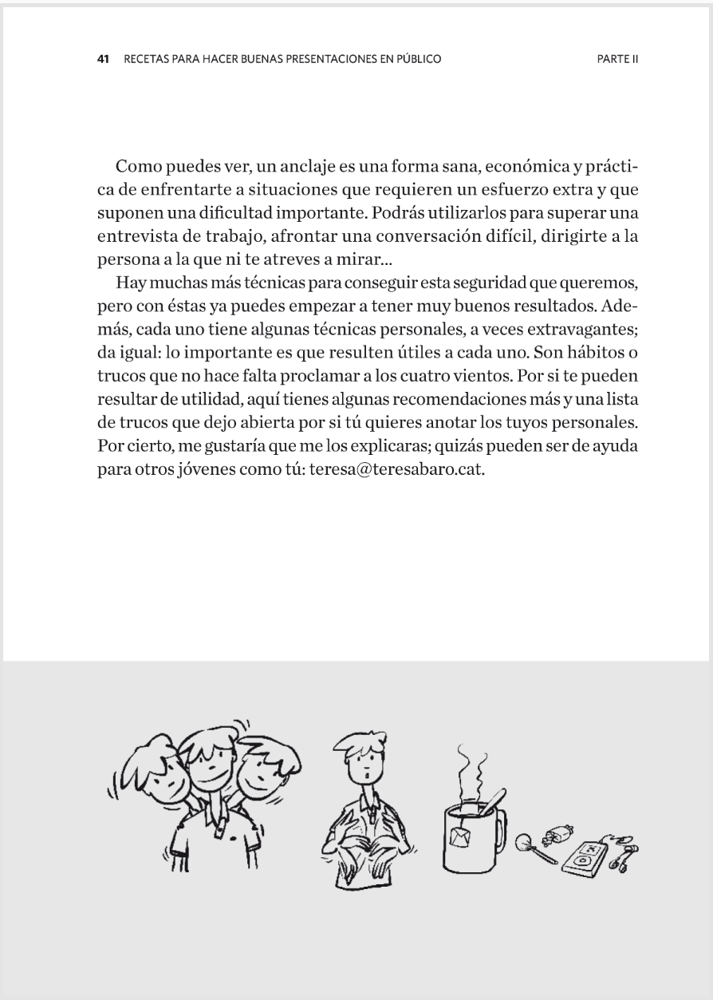

<!-- página 32 -->

42 SABER DECIR PARTE II

# RECOMENDACIONES

* No comas demasiado si la exposición es después de la comida. Una digestión pesada no te ayudará.
* Evita comidas grasientas, fritos, picantes. Huye del ajo y de la cebolla.
* Lleva siempre contigo un pequeño neceser con cepillo y pasta de dientes. Tendrás mejor aliento, mejor aspecto y te sentirás más fresco.
* No consumas alcohol (ni otras drogas, claro). En el primer momento puede resultar estimulante pero después te traicionará porque se te trabará la lengua y porque el alcohol es un depresor del sistema nervioso. ¡Y estar abatidos es lo último que deseas!
* Limita las bebidas estimulantes como el té o el café. Mejor, tilas o valerianas.
* Si te sientes flaquear, come o bebe algo dulce antes de empezar. Puedes tener siempre a mano un kit de emergencia como un terrón de azúcar o una barrita de chocolate.
* No comas chicle durante la intervención pero sí puedes masticarlo un rato antes como ejercicio para mantener las mandíbulas y la lengua ágiles.
* Pasa por el servicio antes de empezar para hacer «tus necesidades» y salir tranquilo; para comprobar tu aspecto, porque necesitas un par de minutos de aislamiento e intimidad para concentrarte.
* Calienta un poco la voz para que desde el principio suene perfectamente y te sientas cómodo.

> **Imagen de la página 32**
>
> 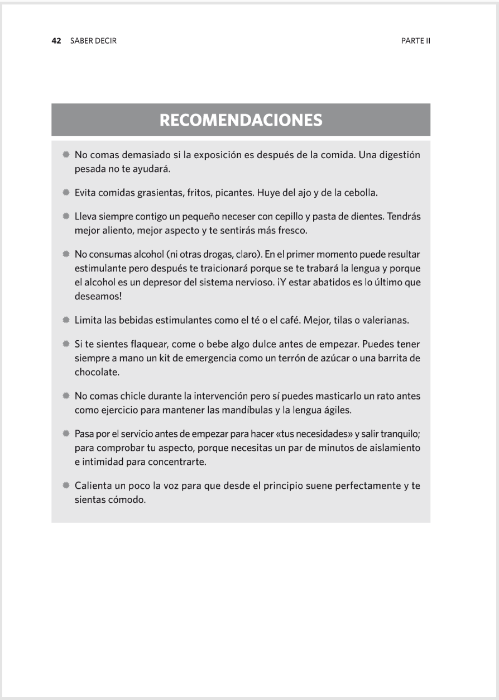

<!-- página 33 -->

43 RECETAS PARA HACER BUENAS PRESENTACIONES EN PÚBLICO PARTE II

# TRUCOS

*   Distráete un rato antes de empezar para no acentuar la sensación de nerviosismo. Llama a un amigo y háblale de temas completamente diferentes: planifica el fin de semana, por ejemplo, y no le comentes lo que estás a punto de realizar.
*   Haz ejercicios de desbloqueo del cuello y la zona cervical.
*   Sonríete a ti mismo delante de un espejo y repítete cuán fantástico eres y lo bien que te tiemblen.
*   «Coloca» el cuerpo en actitud activa delante del espejo y sal con optimismo.
*   Mueve las manos arriba y abajo, situándolas a la altura del estómago. Igual que si sacudieras el agua muy deprisa después de lavarte las manos. Así evitarás que te tiemblen.
*   Mueve los hombros arriba y abajo y haz círculos con ellos para relajar toda la parte superior del cuerpo.
*   Realiza tres respiraciones profundas, tomando el aire por la nariz y expulsándolo por la boca.
*   Si se te seca la boca, ponte un caramelito ácido debajo de la lengua y deja que se derrita. Esto te ayudará a salivar.
*   Bebe pequeños sorbos de agua.

> **Imagen de la página 33**
>
> 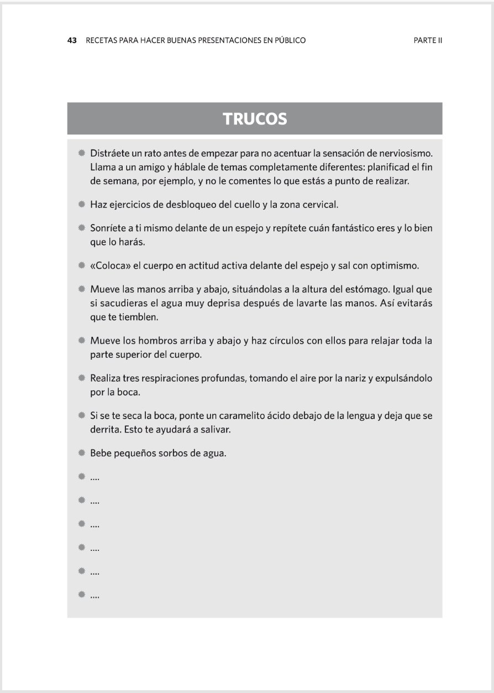

<!-- página 34 -->

7. Ensayar es imprescindible

Tanto si se trata de preparar una lectura de tesis, unas oposiciones o la lectura de un discurso, el ensayo es ¡OBLIGATORIO! Si queremos que nos salga bien, lo tenemos que haber «simulado» antes y nos tenemos que poner a prueba cuando todavía no nos jugamos nada.

Durante el ensayo estamos a tiempo de rectificar, experimentar, recortar. Nos ayuda a conocernos mejor y nos acostumbramos a la «actuación» que supone hablar en público. Hay que tener el cuerpo y la voz entrenados también para la puesta en escena y el ensayo es un buen momento para ir interiorizando actitudes corporales, movimiento, gesticulación, volumen de la voz, articulación, etc.

Para hacer un buen papel, ensayar es imprescindible. Por todas estas razones:

*   Para saber cuánto tiempo dura la intervención. Sólo ensayando en voz alta comprobarás si lo que tienes preparado se ajusta al tiempo de que dispones para la exposición. A veces nos quedamos cortos y a veces nos pasamos. Tanto una cosa como la otra no dan muy buena impresión: indican falta de control, mala planificación y son una falta de respeto hacia el público y los demás ponentes. No podemos alterar el orden previsto. Adaptar la extensión de nuestro parlamento a un tiempo dado es un esfuerzo de síntesis que nos obliga a seleccionar lo más importante que tenemos que transmitir y a encontrar la mejor manera para convencer en un tiempo que casi siempre es inferior al que querríamos.
*   Para evitar muletillas. Las muletillas aparecen sobre todo cuando estamos muy nerviosos o improvisamos. Casi nunca quien las dice se da cuenta pero, en cambio, tortura al público con su repetición. Son palabras o expresiones sin ningún significado y se convierten en un «ruido» para el público y distracción para unos cuantos que lo pasarán

> **Imagen de la página 34**
>
> 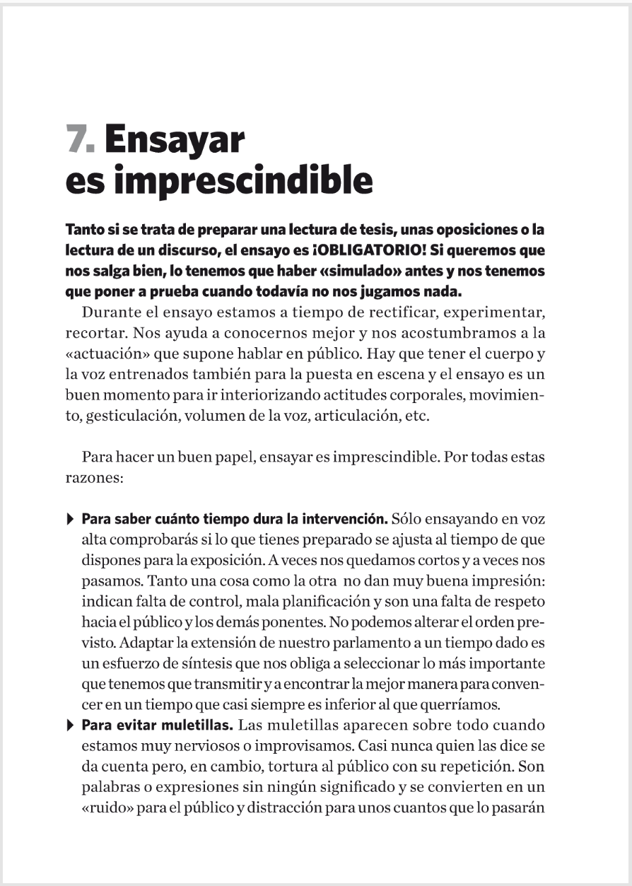

<!-- página 35 -->

45 RECETAS PARA HACER BUENAS PRESENTACIONES EN PÚBLICO PARTE II

en grande contando cuantas veces se repite la misma palabra o sonido. Ejemplos de muletillas frecuentes: «¿Entendido?, ¿Vale?, Un poco...»

* Para evitar movimientos oculares que delatan que estamos improvisando.
Cuando recordamos, buscamos un término, calculamos, inventamos, imaginamos... hacemos unos movimientos oculares hacia arriba, hacia los lados o hacia abajo. Incluso podemos mirar fijamente hacia adelante. Pero en cualquiera de estos casos, nuestro interlocutor –nuestro público– notará que no lo estamos mirando a los ojos. Además, se dará cuenta de que estamos buscando la información «en el cerebro», cosa que le hará percatarse de que no tenemos muy bien preparado o no dominamos el tema. Aparte, recuerda que una de las formas de mantener al público atento es a través del contacto visual. Por lo tanto, evita como sea apartar la mirada. Si miras siempre a tu público transmitirás una imagen de mucha más seguridad.

* Para detectar posibles incoherencias en el orden o en el contenido. Hasta que no lo digas en voz alta, no verás si lo que has escrito o pensado tiene sentido de verdad. Por otra parte, verbalizarlo es una forma de

> **Ilustración** — Se muestra un dibujo lineal de una persona mirando fijamente una pantalla de computadora.

> **Imagen de la página 35**
>
> 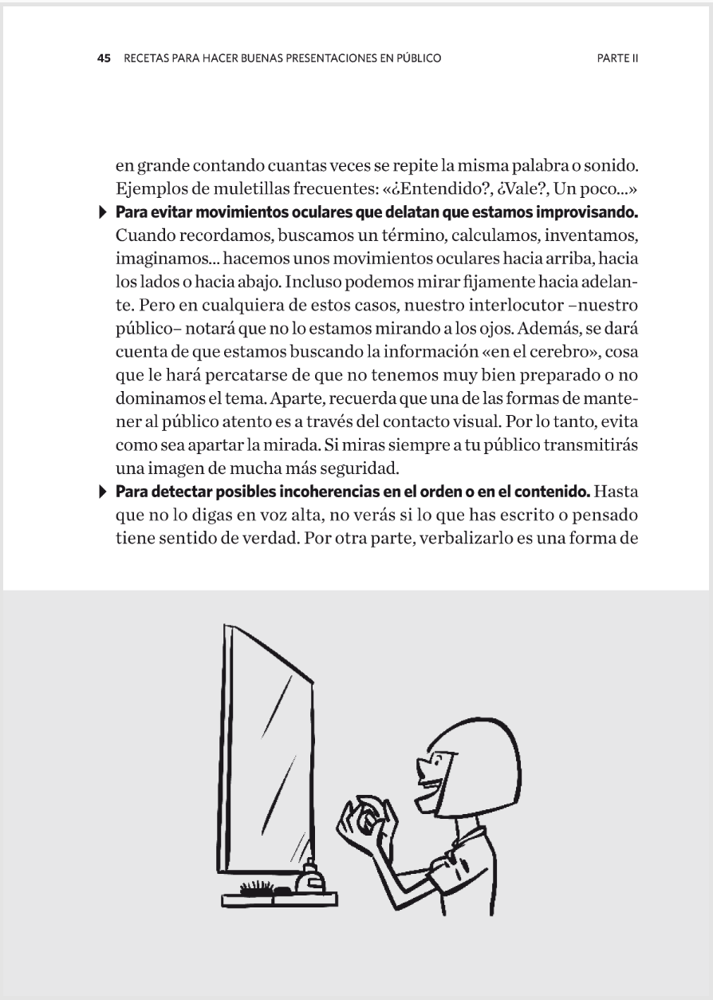

<!-- página 36 -->

aclarar las ideas y ordenarlas. Es sabido que la necesidad de transmitir algo a alguien, nos obliga a esforzarnos en concretarlo y expresarlo de forma clara y comprensible.

► **Para dar cohesión a las diferentes partes.** Especialmente si utilizamos diapositivas, una de las dificultades que aparecen es realizar bien la transición de cada diapositiva o ejecutar bien el cambio de tema o de idea. La exposición tiene que ser percibida como una unidad que sigue un hilo argumental y no como una retahíla inconexa de ideas o diapositivas. Hay que relacionar una idea con la siguiente a través de las expresiones adecuadas y no repetirnos demasiado. Por ejemplo:
*   Aparte de esto, podemos ver también...
*   Como consecuencia de esto (lo que estamos viendo o diciendo) observamos...
*   Más todavía...
*   Por otro lado...
*   Veamos qué pasa cuando...
*   La consecuencia de este fenómeno es que...
*   Ésta es la causa de lo que veremos en la diapositiva siguiente...

► **Para detectar si no sobra o no falta material audiovisual.** A veces nos animamos a preparar un PowerPoint con muchas diapositivas y después vemos que hay demasiadas, contienen un exceso de información o la presentación en conjunto resulta muy aburrida. Otras veces nos damos cuenta de que un buen gráfico haría más comprensible nuestro mensaje y vemos la necesidad de elaborar más material.

► **Para probar los apoyos audiovisuales** y su adecuación a nuestra presentación, para comprobar que estamos cómodos con el complemento que hemos preparado. Además, ensayamos también la interacción entre nosotros y la pantalla, el mando, el público... Son muchos los elementos que intervienen en una puesta en escena y tenemos que controlarlos todos. A veces nos embarcamos en hacer un montaje espectacular y después no sabemos encajarlo en nuestra actuación.

> **Imagen de la página 36**
>
> 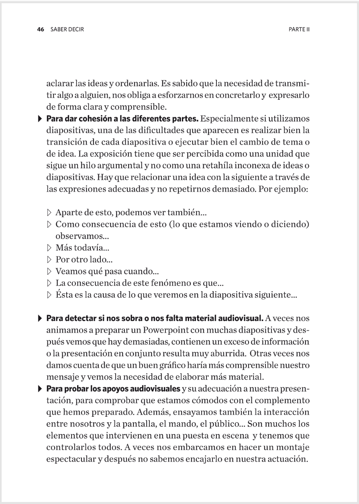

<!-- página 37 -->

47 RECETAS PARA HACER BUENAS PRESENTACIONES EN PÚBLICO PARTE II

► Para conocernos mejor y entrenar todos nuestros lenguajes. Si nos grabamos con una cámara de vídeo, podemos observar nuestra actitud corporal, cómo nos movemos, nuestros gestos; podemos detectar movimientos nerviosos o tics; podemos vernos tal como los demás nos ven y esto es de gran ayuda para corregir lo que no nos gusta. Además de vernos, podemos escucharnos. Notaremos si nuestra voz es apagada, si hay monotonía en nuestra entonación, si vamos demasiado rápido o demasiado lento; si se nos entiende, si hacemos las pausas donde toca; si repetimos en exceso la misma palabra... Podemos conocer estos aspectos de nuestra comunicación, simplemente grabándonos con una sencilla grabadora.

## Guía para un buen ensayo

Seguro que conoces a alguien que te ha confesado haber ensayado ante un espejo. Por lo menos, lo has visto en las películas. Cuando alguien prevé que tendrá una cita muy importante, se pone delante del espejo y se imagina una conversación con su interlocutor. ¡Iruébalo!

Te puede pasar que te sientas ridículo, que no te guste verte, que te sientas un payaso y acabes abandonando. Incluso, afectado por lo que has visto en el espejo, quizás pensarás que eres un inepto y querrás dejarlo correr. O te irás resignado, cabizbajo, sin esperar nada bueno de un zoquete como tú. ¡Ni piensarlo!

Te propongo otra forma de ensayar. Tendremos en cuenta dos posibles situaciones: exposición sin PowerPoint o con PowerPoint.

a) Exposición sin PowerPoint

Una vez preparado el tema y hecho un guión o mapa mental (lee el capítulo 9), enciérrate en tu habitación. Incomúnícate, aíslate del resto del mundo, apaga el móvil, el ordenador y cualquier otro aparato que tenga batería. Si estás en tu habitación, pega pósters de tus ídolos en paredes y conviértelos en tu público. Si puede ser, llena todas las paredes de retratos, que se vea bien el rostro; tienen que rodearte excepto por la espalda. Prepara el reloj para cronometrar el tiempo. Ponte de pie y deja

> **Imagen de la página 37**
>
> 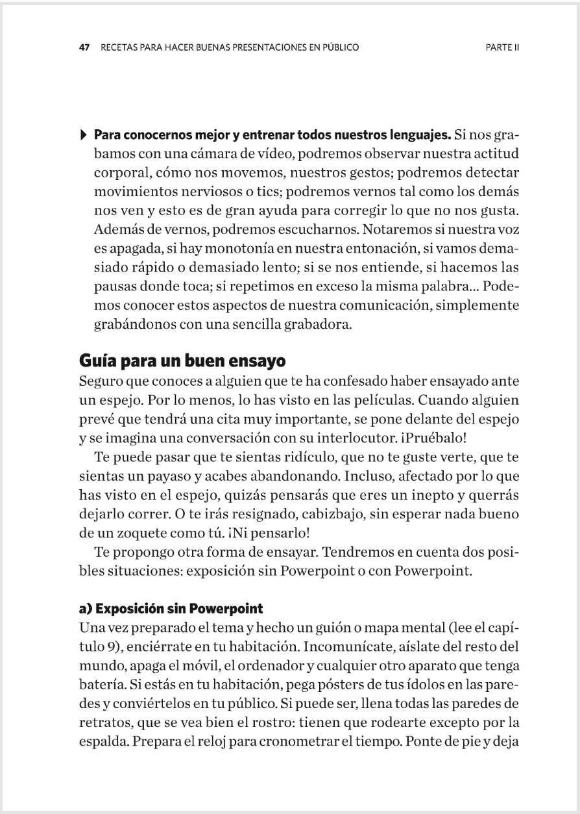

<!-- página 38 -->

48 SABER DECIR PARTE II

el guión sobre la mesa o una silla próxima. También puedes tenerlo en la mano, si lo prefieres. ¡Empieza la sesión!

Sítuate en un lugar central y de máxima visibilidad para un público imaginario. Coloca el cuerpo según describo en el capítulo 15, respira, deja pasar unos segundos, sonríe y «Buenos días. Soy Carlos Sallés de Segundo de Bachillerato y les presento mi trabajo de investigación acerca de... bla, bla, bla...».

Es muy probable que te quedes atascado, que te equivoques, que tengas ganas de abandonar, que tengas la sensación de que no te entiendes ni tú. Es normal. La primera vez que ensayas estás haciendo un esfuerzo para verbalizar el contenido. Tienes que encontrar las palabras y las frases. Es necesario que encuentres la forma de enlazar las ideas mediante los conectores adecuados y los recursos para hacer más distraida y amena la intervención. Esto requiere un esfuerzo. A pesar de todos los obstáculos, intenta no detenerte; si lo haces, porque quieres tomar nota de algo en tu guión, para el cronómetro y activalo de nuevo cuando reanudes el ensayo. Así tendrás ya una primera aproximación del tiempo que tardas en decirlo todo. Normalmente tenemos un tiempo limitado y es muy importante que sepamos ajustarnos a él.

Después de un primer ensayo, ya tienes una idea de cómo lo llevas. Ahora es el momento de pulir la exposición. Revisa el orden de las ideas, decide si hay que ampliar, recortar o sustituir contenidos. Analiza el vocabulario que has utilizado y valora si te has sentido falto de palabras. Aprovecha para buscar sinónimos de las palabras que más utilizas, intenta adecuar el vocabulario del trabajo a tu exposición oral y piensa si el grado de formalidad de tu lenguaje es el adecuado. ¿Se te ha escapado alguna expresión de las habituales entre los amigos, de las que provocan repelús a padres y profesores?

Cuando ya hayas hecho los retoques necesarios y hayas tomado conciencia de la calidad de expresión, repite el proceso. Esta segunda vez tendrás que tener en cuenta también –ahora que ya tienes el contenido mucho más controlado– el lenguaje corporal y la voz. Empieza otra vez. Manos a la obra.

> **Imagen de la página 38**
>
> 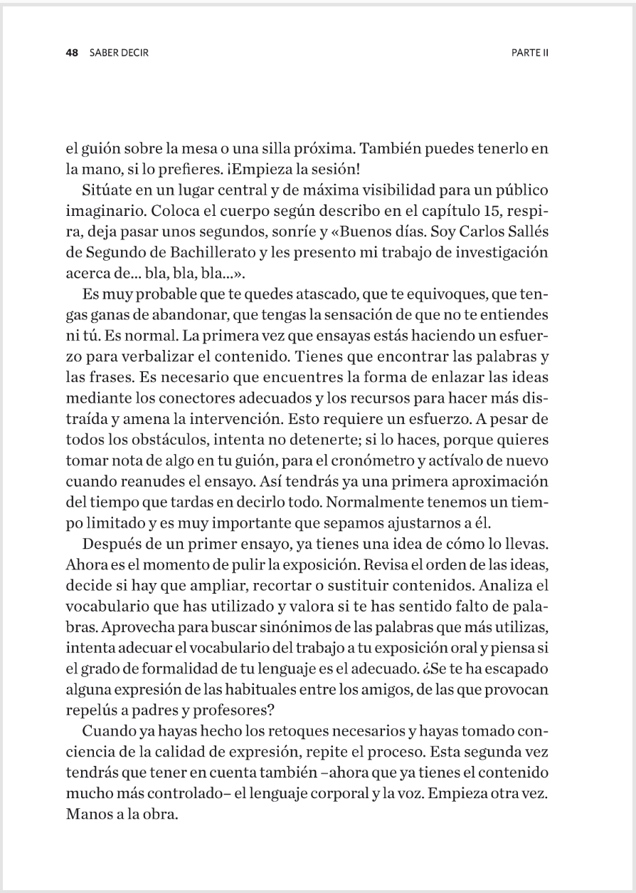

<!-- página 39 -->

49 RECETAS PARA HACER BUENAS PRESENTACIONES EN PÚBLICO PARTE II

El cuerpo firme, estable, abierto. La cabeza alta. Las manos a la altura del estómago. Miras a tus amigos buscándoles la mirada. Saludas, te presentas e introduces el tema, sonriente, con voz alta y clara (aunque la habitación sea pequeña y no haya nadie, impon a prueba tu voz! Imaginate que tienen que oírte desde el otro extremo de la casa o los mismos vecinos). Avanza en el tema mirando a todo el mundo. Delante, izquierda y derecha. Sobre todo, busca sus ojos, entrénate en esto. Es muy importante que puedas hablar de cualquier tema mientras mantienes el diálogo visual con tus espectadores. Mientras hablas, ilustra lo que dices con las manos. No las dejes caer, colgando junto a los muslos. No caigas en la tentación de ponerlas en los bolsillos (cose los bolsillos de los pantalones si tienes esta manía), ni detrás; no cruces los brazos, ni te apoyes en una mesa o una silla, ni te irrites la piel del brazo izquierdo rascándote con la mano derecha... nada de todo esto. Las manos hablan mientras tú hablas. Deja que se expresen libremente y que ilustren el mensaje, no que delaten tu pánico.

Avanza en el discurso mientras mantienes esta actitud. Cuando ya hayas entrado de lleno en el tema que te ocupa, empieza un movimiento suave con las piernas, puedes hacer unos pasos tranquilos adelante, atrás, hacia los lados; eso sí, con mucha calma. Evita el balanceo o el baile de pies. Guíate con el mapa y procura llegar hasta el final sin interrupciones. Cuando se acerque el momento del final, prepárate para cerrar de manera convincente: vuelve a la posición de salida. Haz una pausa y cierra el tema. Cuando hayas pronunciado la última palabra, haz otra pausa mientras miras a tus amigos de la pared y acabas con un «Muchas gracias». Entonces oíras las felicitaciones y aplausos del público, seguro.

b) Exposición con PowerPoint

El proceso es el mismo que el descrito anteriormente. Pero ahora tendrás que contemplar que hay un tercer elemento en juego: la presentación visual. En la situación anterior tú tenías que relacionarte sólo con el público. Ahora tendrás que recordar que tienes un complemento al cual te refieres muy a menudo y que el público tiene dos puntos de

> **Imagen de la página 39**
>
> 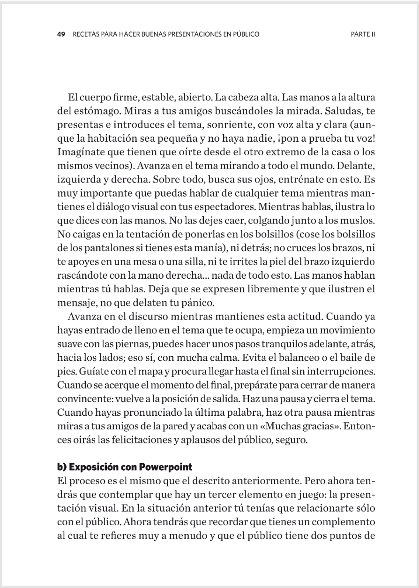

<!-- página 40 -->

atención. Tendrás que moverte con agilidad para que el público reciba tu mensaje al mismo tiempo que mira la pantalla cuando a ti te interesa. (Para hacer un buen PowerPoint, consulta el capítulo 15)

Empezamos el ensayo, pues. En la misma habitación de antes, colócate de tal manera que tengas la pantalla del ordenador cerca y ante ti, o a un lado pero de forma que las veas sin volverte excesivamente. Si sabes cómo es la sala donde tendrás que actuar, procura reproducir una distribución parecida a la que te encontrarás. Puedes utilizar también como guión, tu mapa mental, con las diapositivas asociadas tal como explico en el capítulo de los mapas mentales.

Ve avanzando en el tema con el apoyo de las diapositivas. Procura no leer y reproducir textualmente el contenido de la diapositiva. Esfuérzate en explicarlo dirigiéndote al público, con tus palabras, ampliando la información, haciendo los comentarios necesarios.

Intenta hacer una buena transición entre diapositivas. Una de las cosas que tienes que ensayar con cuidado es tu posición, los movimientos y la mirada. Tienes que colocarte de tal manera que no tapes la pantalla, la puedas señalar con la mano o un puntero y, además, puedes mirar de cara al público. Es muy tentador desviar la mirada de los ojos que te escrutan pero no te refugies en la pantalla. Mira, siempre que puedas, adelante. Para saber qué hay en la pantalla y guiarte, mejor que mires la pantalla del ordenador que tienes delante y así no das la espalda al público.

Una vez acabado el PowerPoint, cierra tu exposición igual que si no tuvieras PowerPoint.

Quizás tu habitación es muy pequeña. Instálate, entonces, en el comedor o en cualquier sala más grande. Sería ideal que te dejaran ensayar en el aula o en la sala donde definitivamente harás la presentación. Si lo puedes hacer en el salón de casa, puedes instalar muñecas y peluches, el gato, el perro, los hamsters, todo tipo de ser que pueda hacerte de público. También puedes invitar a la familia, si tiene ganas de escucharte...

> **Imagen de la página 40**
>
> 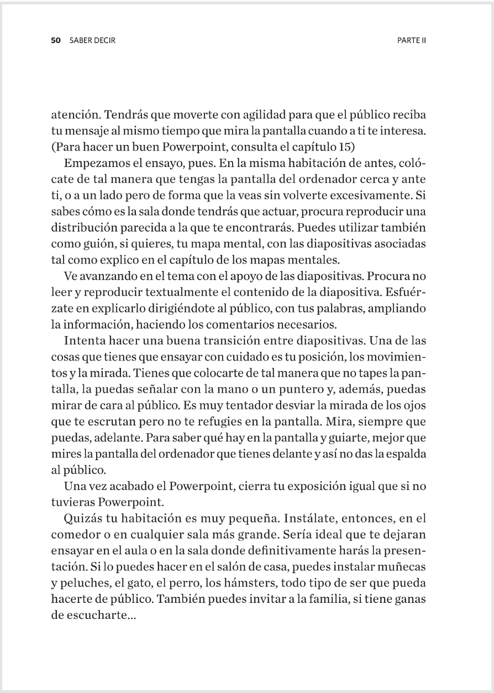

<!-- página 41 -->

8. Grabadoras de voz y cámaras de vídeo

No escondas la cabeza bajo el ala y acostúmbrate a tu voz y a tu imagen. Seguro que descubrirás en ti virtudes que no conocías.

Estos dos aparatos hacen milagros si se utilizan bien. Ambas grabadoras son unas buenas aliadas en el ensayo y también en las exposiciones reales. En el caso del ensayo, te permitirán entrenar y corregir a tiempo todo lo que haga falta. Y en el de la exposición real, tendrás un fiel testigo de todo lo que ha pasado en la sesión. Podrás apreciar tus reacciones, la adaptación al público, el grado de conexión que has conseguido, los cambios respecto al ensayo... y te darás cuenta de todo lo que todavía queda por pulir. También podrás felicitarte, está claro, por todo lo que habrás conseguido. Disponte a examinarte tú mismo. De acuerdo: verte o escucharte siempre resulta un poco incómodo. Nos cuesta reconocer nuestra voz porque siempre la oímos «desde dentro» y los demás la oyen «desde fuera». Y, a pesar de que nos vemos cada día en el espejo, también cuestionernos en los movimientos y aceptar la imagen que tenemos. Pero está bien que sepamos cómo la perciben los demás, y qué transmite. A partir de la grabación podremos darnos cuenta de:

* Cómo suena nuestra voz.
* Si hay energía en nuestra manera de hablar.
* Si el tono es convincente.
* Si dudamos mucho.
* Si tenemos tics no verbales (por ejemplo hacer estallar la lengua, mmmm..., etc.).
* Si la entonación es bastante

> **Imagen de la página 41**
>
> 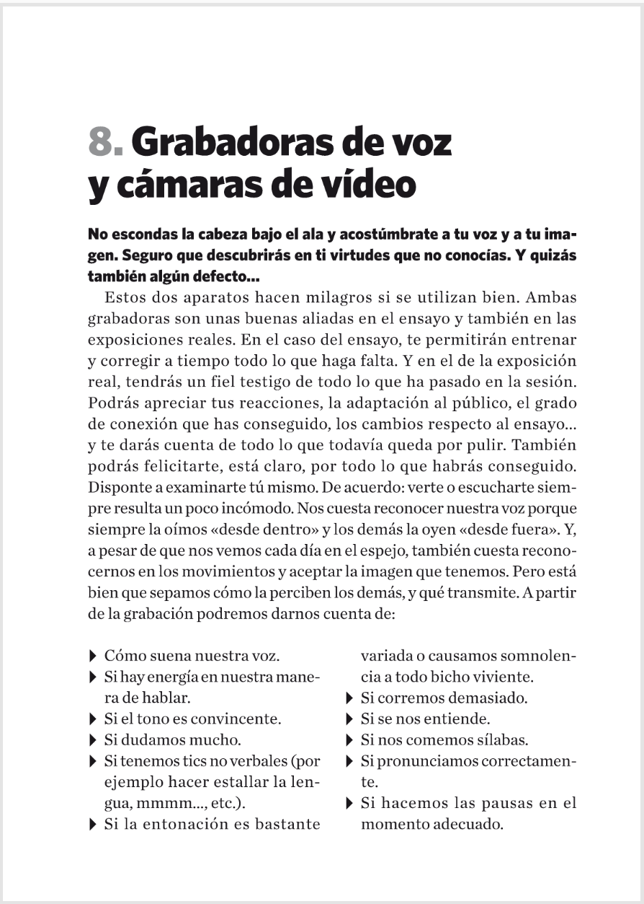

<!-- página 42 -->

52 SABER DECIR PARTE II

*   Si se nota temblor en la voz o una respiración forzada.
*   Qué acento tenemos, si se nota

Sobre el lenguaje verbal podemos notar si
*   Nos explicamos bien.
*   Repetimos muy a menudo determinadas palabras.
*   Utilizamos muletillas (pues, vale, es decir, un poco, de alguna manera, etc.).

¡Cuántas cosas podemos mejorar si nos analizamos bien a partir de una grabación de voz! Si, además, disponemos de una cámara de vídeo, entonces nos es posible analizar todo esto y mucho más. En cuanto a la imagen podemos ver

*   Qué aspecto tenemos. ¿Teneemos la imagen que queremos tener?
*   Si la colocación en el espacio es la adecuada.
*   La actitud corporal.

Mientras vas viendo y escuchando, puedes tomar nota de todo lo que te gustaría cambiar. La conciencia de lo que hacemos y cómo nos comunicamos es el paso imprescindible para poder evolucionar. Si no nos damos cuenta de lo que hacemos mal y de nuestras carencias, difícilmente podremos ponerle remedio.

> **Imagen de la página 42**
>
> 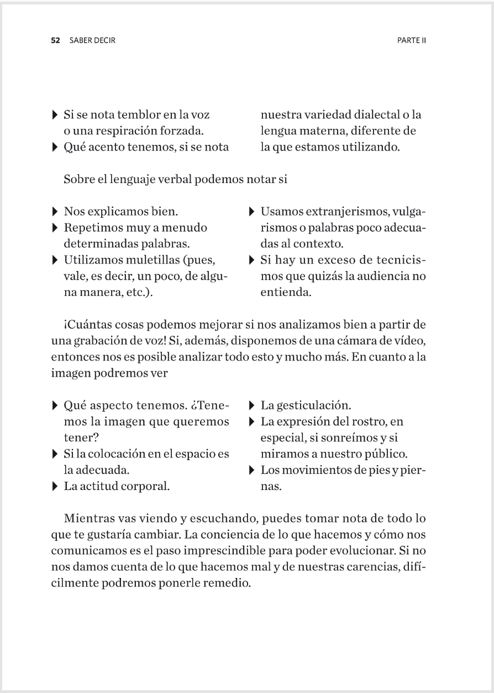

<!-- página 43 -->

9. Técnicas de apoyo a la memoria

Aparte de comer rabos de pasa, hay otras maneras de no olvidar lo que tienes que decir. ¿Necesitas un truco eficaz para no tener que depender siempre de la memoria o de la lectura del texto?

Excepto en el supuesto de que tengas que leer un discurso al pie de la letra, no te recomiendo que tengas un texto redactado. Muchas personas piensan que tener el texto escrito les garantiza no perderse y saber qué tienen que decir en todo momento y con las palabras con que querían decirlo cuando lo prepararon.

Pero este papel se convierte en una trampa: quieren mirar al público y hablar con naturalidad mientras intentan seguir sus notas. Esto los arrastra a una situación difícil en que tienen que estar más pendientes del papel que de las personas. O, si se centran en el público, entonces van dejando de lado el texto y, si se pierden, ya no saben por dónde iban, cosa que los bloquea definitivamente.

La otra opción que tenemos, la memorización, tampoco es recomendable. Los humanos del siglo XXI no tenemos muy desarrollada esta capacidad. Tenemos demasiadas herramientas para almacenar la información y ésta la tenemos siempre al alcance: no hay que memorizar. Por lo tanto, aprender un texto es difícil, requiere un esfuerzo y no nos garantiza un buen resultado. Sin duda sabes memorizar porque lo haces cada día para retener contenidos de los que después te examinas. Pero aquí el objetivo es diferente. Lo que memorizas no se tiene que poner por escrito sino que hay que explicarlo al público y tendrás que ser convincente no sólo con lo que dices sino también con el cómo lo dices. Y para ello hace falta naturalidad. Es muy difícil que un texto aprendido de memoria pueda ser reproducido después con agilidad y autenticidad.

¿Qué podemos hacer, pues, si no podemos leer, es difícil memorizar y, además, no tenemos un PowerPoint?

> **Imagen de la página 43**
>
> 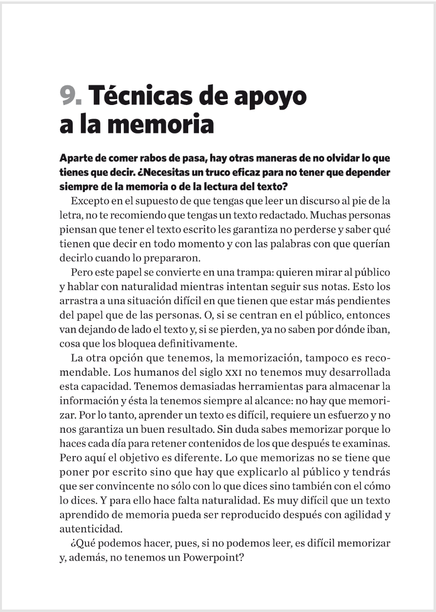

<!-- página 44 -->

Te recomiendo que te prepares una «chuleta». Sí, una síntesis de lo que tienes que decir en un papel que puedas tener a mano si te conviene. Para mí, las herramientas más útiles y prácticas son el guión por puntos y el mapa mental.

## Guión por puntos
Este guión, del cual tienes un ejemplo en la página siguiente, es vertical y se puede hacer en una hoja din A4 o en tarjetas media cuartilla o más pequeñas. Si tienes que estar de pie sin mesa ni atril es mejor que utilices tarjetas porque tienen más consistencia. Las venden de todas las medidas. Son como las que utilizan los presentadores de televisión, de la medida de la mitad de un folio. Si puedes leer desde la mesa o atril, una hoja din A4 te servirá. Si necesitas más de una hoja o cartulina, es aconsejable no graparlos pero sí numerarlos, por si se te cayeran al suelo. Ten en cuenta también que la letra tiene que ser bastante grande para que puedas leer fácilmente.

## Mapa mental
A pesar de que pronto quizás serán piezas de museo, seguro que toda vía has tenido en las manos un mapa de carreteras, de papel y plegado como un acordeón. Cuando queremos preparar un viaje van muy bien: los extendemos sobre la mesa y nos hacemos una idea de cuál será el itinerario, tenemos localizados los puntos de origen y de destino, vemos las diferentes localidades por donde tenemos que pasar y podemos establecer etapas que nos permitirán saber los tiempos parciales y total del recorrido. Hoy en día, es más frecuente que consultemos cualquier portal de internet y le pidamos que nos indique el mejor itinerario dándole los...

> **Imagen de la página 44**
>
> 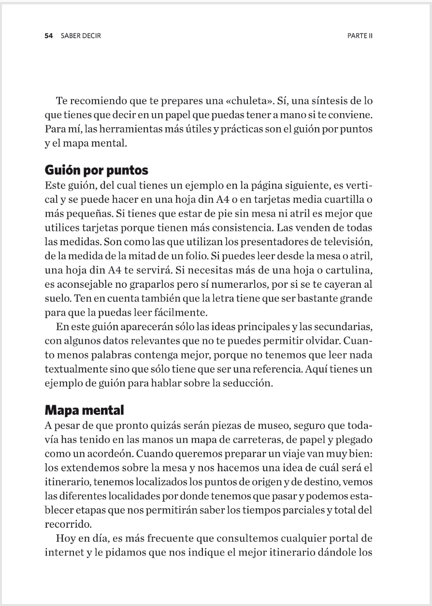

<!-- página 45 -->

La seducción: ¿innata o aprendida?

1. Definición.
2. Diferentes tipos de seducción:
    a. Seducción sexual.
    b. Seducción por las ideas.
    c. Seducción de la audiencia.
3. ¿El seductor/a nace o se hace?
4. Últimas investigaciones relevantes Philippe Turchet:
    a. Comportamiento aprendido.
    b. Habilidad que se puede entrenar.
5. ¿Para qué sirve?
    a. Personalmente.
        i. Más amigos.
        ii. Pareja.
    b. Profesionalmente.
        i. Mejores relaciones.
        ii. Más clientes.
        iii. Más posibilidades de promoción (?).
6. Las claves.
    a. Seguridad en uno mismo.
    b. Valentía y optimismo.
    c. Empatía.
7. Caso Giacomo Casanova (1725-1789).
8. Seducción vs. belleza.
    a. Características físicas.
    b. Indumentaria.
    c. Movimientos.
9. Recomendaciones.
    a. Cuídate.
    b. Piensa en el otro.
    c. Sonríe.
¡Todos podemos ser seductores!

> **Imagen de la página 45**
>
> 

<!-- página 46 -->

La seducción: ¿innata o aprendida?

¿Quién no ha soñado alguna vez tener tanto poder de seducción que nadie se le pueda resistir?

1. Definición.
2. Diferentes tipos de seducción:
    a. Seducción sexual.
    b. Seducción por las ideas.
    c. Seducción de la audiencia.
3. ¿El seductor/a nace o se hace?
4. Últimas investigaciones relevantes Philippe Turchet:
    a. Comportamiento aprendido.
    b. Habilidad que se puede entrenar.
5. ¿Para qué sirve?
    a. Personalmente.
        i. Más amigos.
        ii. Pareja.
    b. Profesionalmente.
        i. Mejores relaciones.
        ii. Más clientes.
        iii. Más posibilidades de promoción (?).
6. Las claves.
    a. Seguridad en uno mismo.
    b. Valentía y optimismo.
    c. Empatía.
7. Caso Giacomo Casanova (1725-1789).
8. Seducción vs. belleza.
    a. Características físicas.
    b. Indumentaria.
    c. Movimientos.
9. Recomendaciones.
    a. Cuídate.
    b. Piensa en el otro.
    c. Sonríe.

¡Todos podemos ser seductores!

> **Imagen de la página 46**
>
> 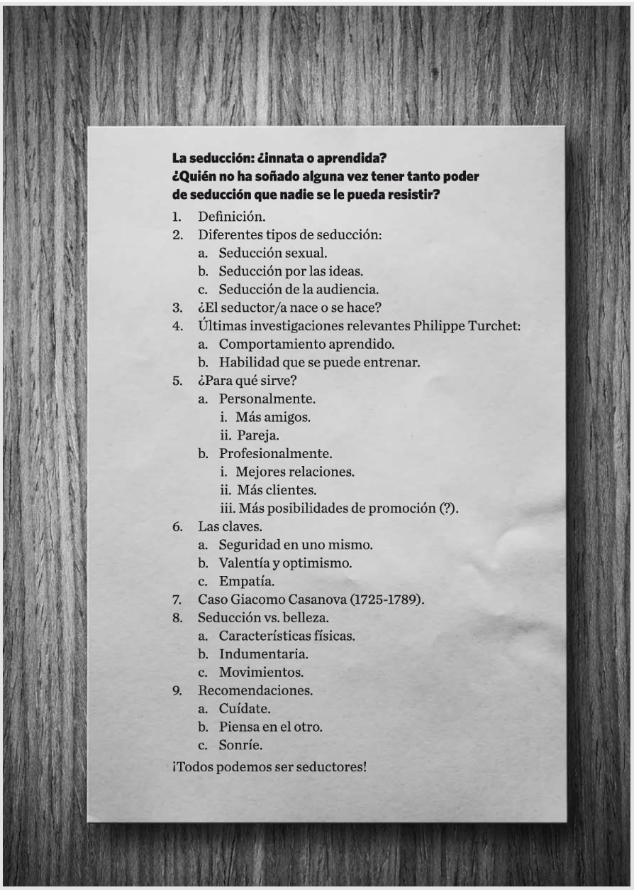

<!-- página 47 -->

datos de origen y destino. La web nos da el resultado de dos maneras: descripción escrita de la ruta y las diferentes etapas, y un mapa donde se ha señalado el recorrido. ¿Cuál de las dos opciones te resulta más práctica? Tienen utilidades diferentes. Pero una vez hemos subido al coche necesitamos una herramienta que no nos obligue a leer mucho sino que nos dé la información con un vistazo, rápidamente. Entonces, el mapa será la guía imprescindible para no perdernos, para rectificar si nos hemos equivocado, para ver cómo vamos de tiempo en las diferentes etapas y finalmente nos llevará al destino.

Un mapa como éstos es lo que necesitamos para no perdernos por el camino de nuestra exposición. Ya no tendremos que temer más quedar-nos en blanco y no correremos el riesgo de andarnos por las ramas o de desordenar el discurso. Un buen mapa nos conducirá a nuestro destino por el mejor camino.

Estos mapas se denominan «mapas mentales» y los puedes usar con objetivos diversos y en momentos muy diferentes de la preparación:

### Como herramienta de brainstorming o «lluvia de ideas»:
para generar ideas, profundizar, desarrollarlas, relacionarlas, etc. Se trata de la primera fase de la preparación, la más creativa, donde ponemos sobre el papel información, ideas, casos, ejemplos y todo tipo de comentarios que después tendrán que ser filtrados y ordenados.

### Como método para ordenar estas ideas y estructurar el contenido de cualquier texto oral o escrito.
Antes de ponerte a escribir o de hacer un PowerPoint, hace falta que ordenes todo lo que tienes en la cabeza. Con el mapa, puedes determinar el recorrido, marcando los puntos de partida y llegada.

### Como recurso para memorizar, dado que es sintético, visual, atractivo y claro.
Antes te recomendaba que no memorizaras el contenido. Ahora bien, si hay alguna situación en que no puedes tener ningún apoyo para recordar lo que tienes que decir y no hay más remedio, es mucho mejor memorizar el mapa que el texto entero. El hecho de que sea visual, con colores, dibujos y símbolos, facilita la retención del contenido.

> **Imagen de la página 47**
>
> 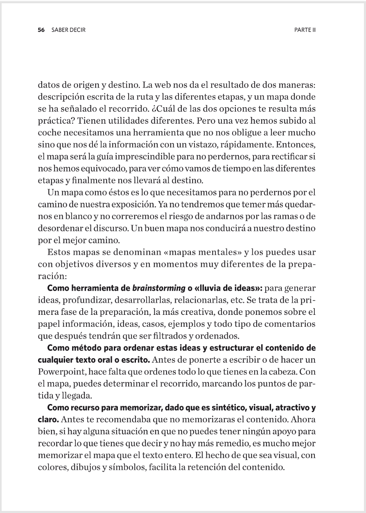

<!-- página 48 -->

Como guía para no perderte en una exposición oral. Porque siempre tienes delante el guión entero en una sola hoja. Si pierdes el hilo, puedes echar un vistazo y situarte donde estabas. Si te quedas en blanco, puedes recordar lo que tienes que decir.

> **Imagen de la página 48**
>
> 

<!-- página 49 -->

La IMPORTANCIA DE LA MAESTRÍA

> **Descripción de la figura** — El diagrama es un mapa conceptual radial centrado en el concepto "IMPORTANCIA PERSONAL", que se ramifica hacia diversos componentes clave relacionados con la maestría.
> 1. El nodo central es "IMPORTANCIA PERSONAL".
> 2. Desde el centro, se desprenden ramas hacia conceptos como: VALOR, FINAL, TÁCTICA, PERSONAL, PRÁCTICA, y otros elementos interconectados.
> 3. La rama de "VALOR" se conecta con la idea de que "es muy importante".
> 4. La rama de "FINAL" se conecta con la idea de "lograr objetivos".
> 5. La rama de "PRÁCTICA" se conecta con acciones como "hacer y practicar".
> 6. El nodo "PERSONAL" está conectado a conceptos como "datos dependientes" e "ideas".
> 7. Existe una conexión entre la "PRÁCTICA" y el concepto de "planificar, desarrollar..."

PLANIFICAR, DESARROLLAR...
*   Importancia de la maestría
*   Aprendizaje de la maestría
*   Práctica
*   Desarrollo personal

TÁCTICA
*   Aparte una práctica debe ser importante.

VALOR
*   Es muy importante
*   Es importante

FINAL
*   Lograr objetivos
*   A alcanzar

PERSONAL
*   Datos dependientes
*   Ideas

PRÁCTICA
*   Hacer y practicar

[ilegible]

Plan hacia obtener mejor rendimiento, mejor método, más trabajo, etc.

> **Imagen de la página 49**
>
> 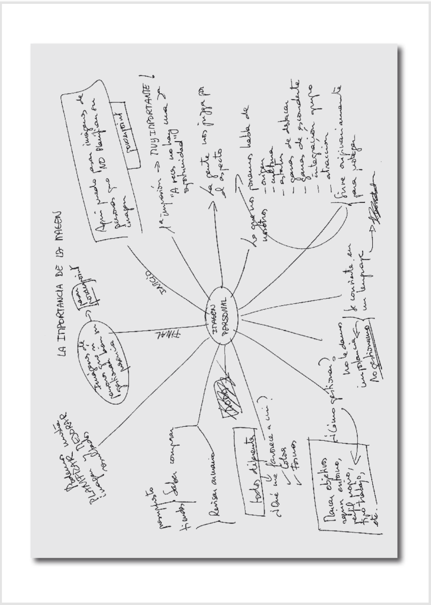

<!-- página 50 -->

LA INFLUENCIA DE LA IMAGEN

> **Descripción de la figura** — La figura es un mapa conceptual que ilustra cómo las compras y el estudio de elementos (tonos, colores) influyen en la Imagen Personal, la cual genera una Impresión, y cómo esta impresión afecta la oportunidad.
> 1. Las Compras → Influyen en la Imagen Personal.
> 2. Estudio tonos colores → Influye en la Imagen Personal.
> 3. Análisis personal → Influye en la Imagen Personal.
> 4. La Imagen Personal → Genera LA IMPRESIÓN.
> 5. LA IMPRESIÓN → Determina si hay o no OPORTUNIDAD.

> **Imagen de la página 50**
>
> 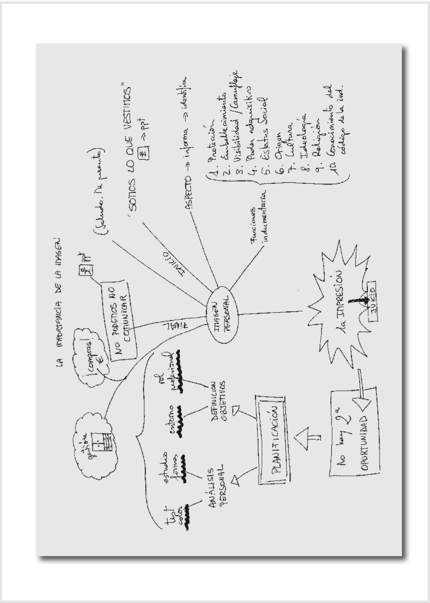

<!-- página 51 -->

60 SABER DECIR PARTE II

## Diez razones poderosas para utilizar un mapa mental
¿Qué ventajas tiene apoyarte en una mapa y no en un texto o un esquema lineal?

1. **Visión completa permanente.** Para no perderte, es importante tener una visión global y constante de todo el contenido, porque así sabes siempre en qué punto estás de la exposición. Lo tienes que tener siempre a la vista (si tienes una mesa o un atril) o en la mano para poder consultarlo cuando lo necesites.
2. **Fácil localización del contenido.** Cuando estamos ante el público nos pone todavía más nerviosos tener que consultar los apuntes, y el silencio mientras buscamos se puede hacer eterno. El mapa permite localizar inmediatamente el punto donde nos encontramos porque las referencias son sólo palabras clave, símbolos, dibujos o datos. Con un solo vistazo, sabemos qué tenemos que decir a continuación.
3. **Adaptable al contexto y al público.** Nos da un cierto margen de maniobra para adaptarnos a la situación; incluso permite libertad de improvisación cuando es necesario. En algunos casos, si lo creemos oportuno, podremos añadir, sobre la marcha, un punto nuevo o eliminar otro que en ese momento consideramos poco acertado. El público, si no hay un PowerPoint de apoyo, no notará estos cambios.
4. **Ayuda a gestionar el tiempo.** Cuando tenemos el mapa preparado y sabemos la duración de la exposición, tenemos que decidir cuánto tiempo dedicamos a cada parte. Esto lo podemos anotar junto a cada concepto o símbolo (también en el tronco de cada rama) e intentaremos cumplirlo. Haberlo ensayado nos ayudará mucho a controlar el tiempo de cada fase.
5. **Facilita la interacción con el público.** No tener un texto escrito al cual nos tenemos que ceñir férreamente nos permite una relación más directa con el público. Podemos plantear preguntas, motivarlo a participar, introducir un comentario, hacer referencia a una persona de la sala y practicar cualquier otra forma de interacción.

> **Imagen de la página 51**
>
> 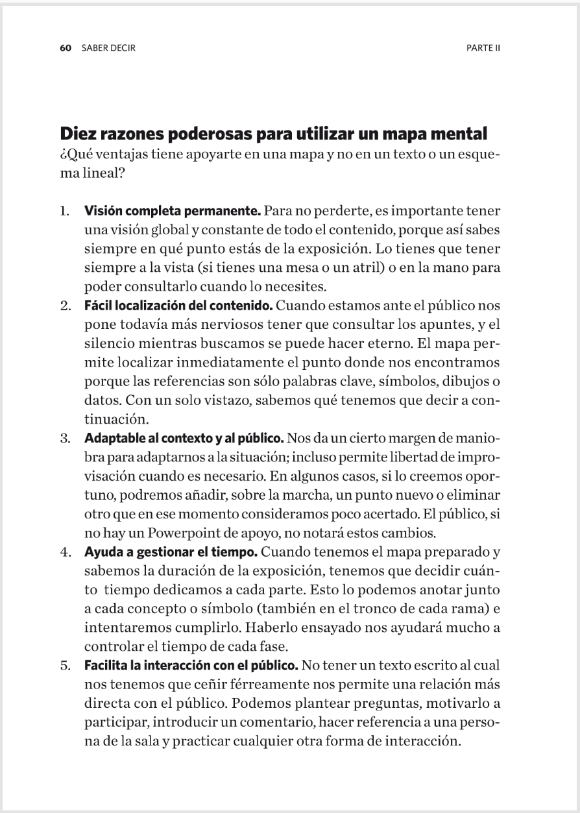

<!-- página 52 -->

61 RECETAS PARA HACER BUENAS PRESENTACIONES EN PÚBLICO PARTE II

6. Da libertad de movimientos. Si tenemos la hoja sobre la mesa o en un atril, podemos gesticular con las manos con entera libertad. Si estamos de pie sin ningún apoyo y sostenemos la cartulina en una mano, nos podemos mover por la sala y con la otra mano gesticular de manera natural y expresiva.

7. Permite hablar con más naturalidad. IEstá claro que encontraremos las palabras en el momento de explicar el tema! Serán las que nos saldrán espontáneamente y no sonarán enlatadas como si las hubiésemos memorizado de pe a pa.

8. Puede ser complementado. Podemos intercalar todo tipo de recursos: escribir en una pizarra, mostrar una imagen, explicar un ejemplo o una historia, hacer una práctica, provocar la intervención del público, etc.

9. Compatible con el PowerPoint. Si queremos complementar nuestra exposición con una presentación con PowerPoint, podemos numerar las diapositivas y administrarla a lo largo del mapa. Teniendo las distribuidas en el mapa podemos dar coherencia a la narración haciendo que la ponencia tenga un hilo argumental, en lugar de que parezca sólo una serie de diapositivas sueltas.

10. Se puede guardar y reutilizar. Haz constar en el dorso del mapa la fecha en que has pronunciado esta exposición y el lugar. Hazte un archivo personal de las exposiciones realizadas. Quizás el mismo mapa te servirá para más de una ocasión o para recordar qué explicaste en un foro concreto y evitará que te repitas.

> **Imagen de la página 52**
>
> 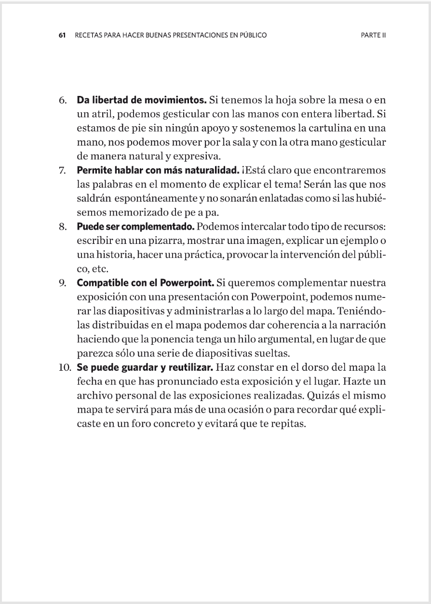

<!-- página 53 -->

Parte III

> **Imagen de la página 53**
>
> 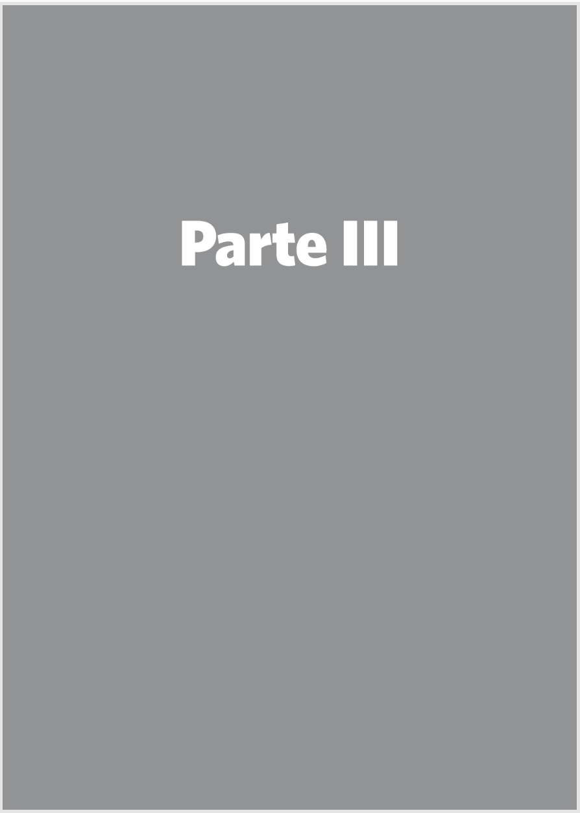

<!-- página 54 -->

10. La preparación es el 80 % del éxito

Cuando vemos a determinados políticos, profesionales de la televisión o profesores que hablan muy bien, tendemos a creer que tienen este don y que no preparan nada. Absolutamente falso: práctica y preparación son las claves del éxito.

Preparar nuestras intervenciones nos garantiza un buen resultado. Es preferible no confiar mucho en la improvisación, que tendría que ser sólo el último recurso. Si lo preparas, podrás tener la misma espontaneidad de la improvisación y, en cambio, los resultados serán muy superiores.

La preparación es «obligatoria» para cualquier exposición un poco importante. Incluso aquellas que parecen más intrascendentes como por ejemplo unas palabras en un encuentro familiar, o una breve exposición en clase, todas tienen que prepararse mínimamente.

Las ventajas de invertir en una buena preparación son numerosas:
* Tendrás más claros los objetivos.
* El contenido y la forma serán los más adecuados para el contexto y el público.
* Podrás prever posibles preguntas o reacciones del público.
* Podrás preparar material de apoyo.
* Podrás documentarte mejor.

En este proceso previo, a veces no sabemos por dónde empezar. Es tan difícil como ponerse ante la pantalla del ordenador o ante una hoja en blanco y empezar a escribir. Antes de pensar en el contenido y, sobre todo, antes de hacer ningún PowerPoint, te aconsejo que utilices esta parrilla que te permitirá tener una visión de conjunto y concretar los diferentes aspectos que tendrás que considerar previamente.

> **Imagen de la página 54**
>
> 

<!-- página 55 -->

66 SABER DECIR PARTE III

# EXPLORACIÓN PREVIA

| a) TEMA | b) OBJETIVO |
| :--- | :--- |
| 1. Definir el tema principal. | 1. Informar. |
| 2. Detallar los temas secundarios. | 2. Persuadir. |
| 3. Establecer el orden en que se presentarán. | 3. Vender. |
| | 4. Motivar. |
| c) PÚBLICO | d) CONTEXTO |
| 1. Sector. | 1. Día y hora. |
| 2. Edad. | 2. Orden de intervención. |
| 3. Sexo. | 3. Otros oradores. |
| 4. Formación. | 4. Sala. |
| 5. Origen geográfico y cultural. | |
| 6. Actividad profesional. | |
| 7. Grado de conocimiento del tema. | |
| e) MATERIAL | f) MEDIOS AUDIOVISUALES Y MATERIAL COMPLEMENTARIO |
| 1. Material que necesitas tú. | 1. Powerpoint: plantilla, formato, estilo, cantidad de diapositivas, portada y contraportada, gráficos, imágenes, etc. |
| 2. Material para el público: dossier, fotocopias del Powerpoint, etc. | 2. Conexión a internet. |
| | 3. Vídeos. |
| | 4. Transparencias para retroproyector. |
| | 5. Paneles. |
| | 6. Objetos y muestras del producto. |

> **Imagen de la página 55**
>
> 

<!-- página 56 -->

67 RECETAS PARA HACER BUENAS PRESENTACIONES EN PÚBLICO PARTE III

Si fotocopias esta página tendrás una plantilla práctica para programar cualquier exposición. También la puedes descargar en pdf de mi blog www.teresabaro.cat.

## EXPLORACIÓN PREVIA

| a) TEMA | b) OBJETIVO |
| :--- | :--- |
| c) PÚBLICO | d) CONTEXTO |
| e) MATERIAL | f) MEDIOS AUDIOVISUALES Y MATERIAL COMPLEMENTARIO |

> **Imagen de la página 56**
>
> 

<!-- página 57 -->

Vamos desarrollando el proceso de preparación por pasos. Supongamos que quieres hacer una exposición sobre el arroz.

## Hay que concretar el tema

Aunque lo he puesto en primer lugar en parrilla, es probable que no puedas acabar de concretarlo hasta que hayas tenido en cuenta el objetivo y el público. Porque, como veremos, el tipo de público y sus expectativas condicionan tanto el planteamiento del tema como el contenido. Por otro lado, «El arroz» es un tema demasiado genérico. ¡Seguro que no puedes explicar todo lo que se sabe o que tú sabes sobre el arroz! Tienes que elegir la información que darás. Aunque nos esforcemos, el público retendrá una parte muy pequeña de lo que le expliquemos, algunos especialistas hablan de un 10 % como máximo!

La primera misión que tenemos, pues, es definir en qué ideas basamos nuestro discurso, aquellas que queremos que retenga el público y le puedan ser útiles. Las denominamos «ideas fuerza». Pueden ser desarrolladas con ideas secundarias, ejemplos, casos, etc.

## Determina cuáles son los mensajes importantes para tu público

¿Cómo encontrar estas ideas y combinarlas con conocimientos, datos y otros materiales de que disponemos?

Te propongo que uses la técnica del brainstorming o lluvia de ideas. Muchas veces se hace en grupo para estimular la creatividad y para recoger el máximo de ideas posibles. Aquí estamos hablando de una «lluvia» individual. Hay diferentes maneras de aplicarla.

*   En una hoja de papel vas escribiendo todo lo que se te ocurre. Puede ser un listado. Ahora no tienes que preocuparte por la validez o la corrección de todo lo que escribes. Estamos en una fase creativa; cuantas más cosas se te ocurran mejor.
*   Con post-its. Estos papelitos amarillos adhesivos son una gran herramienta. En cada papelito escribes una idea y los vas pegando sobre la mesa (pared, cristal de la ventana).

> **Imagen de la página 57**
>
> 

<!-- página 58 -->

69 RECETAS PARA HACER BUENAS PRESENTACIONES EN PÚBLICO PARTE III

► Con un mapa mental. Coge una hoja y dibuja un círculo en el centro y, dentro de él, escribe el tema. Traza desde el centro rayos o flechas con las ideas clave, ampliarlas con puntos, establece conexiones, haz anotaciones complementarias.

Elijas la que elijas, el resultado será un montón de información desordenada. También habrá que diferenciar lo esencial de lo secundario. Seguro que parte de la información que habías seleccionado previamente no servirá y la tendrás que rechazar. Tendrás que elegir la secuencia y la organización jerárquica de la información. Es preciso, pues, reordenar y elegir la estructura que más se adeque a tus intereses.

La etapa siguiente es empezar a dar forma a tu intervención. Por eso es clave tener ya un guión del contenido que puede seguir la técnica que hayas aplicado:

*   Un esquema por puntos o llaves en una hoja.
*   Un árbol hecho a base de los post-its.
*   Un nuevo mapa mental ya ordenado.

Ahora, tendrás que decidir si a partir de este esqueleto

*   te pones a redactar;
*   diseñas las diapositivas correspondientes a este guión;
*   ensayas para explicarlo en voz alta.

Explico qué es un esquema y un mapa mental en el capítulo 9. Ahora veremos qué es un árbol de post-its.

> **Imagen de la página 58**
>
> 

<!-- página 59 -->

Aquí tenemos el resultado de la lluvia de ideas; todo está desordenado.

Una vez descartados los que no consideramos válidos, ordenamos los restantes en categorías:

> **Imagen de la página 59**
>
> 

<!-- página 60 -->

71 RECETAS PARA HACER BUENAS PRESENTACIONES EN PÚBLICO PARTE III

A partir de aquí ya puedes empezar a redactar o hacer un esquema en limpio.

## Define el objetivo

Tiene que ser una de las primeras cosas que tengas claras, puesto que marca también los contenidos y el orden de exposición.

Los objetivos de una exposición oral pueden ser muy variados:
*   Demostrar que dominamos un tema: es el caso de exámenes orales y exposiciones de trabajos.
*   Persuadir y convencer de la bondad de nuestras ideas, proyectos o trabajos.
*   Motivar, animar a la gente a hacer algo, a actuar, a cambiar de actitud.
*   Emocionar, conmover. Despertar sentimientos en la audiencia, por ejemplo en un acto de homenaje o una celebración.
*   Entretener, deleitar. A veces, el único objetivo es que el público pase un buen rato escuchando lo que explicamos.
*   Vender productos, servicios, proyectos, a nosotros mismos...

La mayoría de las veces tenemos varios de estos objetivos a la vez. Lo que pasa es que, según el tipo de presentación, el peso de uno o de otro es diferente. Normalmente se trata de demostrar que dominamos el tema, para convencer y motivar a hacer algo, mientras entretenemos y ganamos notoriedad.

## Define el público y sus necesidades

Cuanta más información tengamos, mejor: edad, sexo, nivel de conocimiento sobre el tema, intereses, procedencia cultural, ideología, etc.

Para elegir el contenido hay que tener en cuenta lo que a nosotros nos interesa transmitir, pero también lo que le puede interesar al público. Si somos capaces de hacer coincidir estos dos intereses, será todo muy fácil. Ahora bien, a veces tenemos que decir justamente lo que el público no qui-

> **Imagen de la página 60**
>
> 

<!-- página 61 -->

72 SABER DECIR PARTE III

ere escuchar: malas noticias, que tiene que cambiar de actitud, o simplemente tenemos que facilitar datos muy aburridos. Entonces, el esfuerzo de persuasión y el empeño para resultar distraído tendrá que ser mayor.
Si sé que a mi público no le interesa especialmente lo que le tengo que decir, debo empezar haciendole las preguntas siguientes:

1. ¿En qué afecta o puede afectar aquello de que hablaré a las personas que tendré delante?
Un tema general sobre el arroz puede ser muy aburrido pero puedo enfocarlo de varias maneras según el tipo de público:
*   **Adolescentes.** Cómo puede ayudar el consumo de arroz a su crecimiento y qué cualidades tiene para el desarrollo del cuerpo y de la mente. Recetas fáciles que puedan preparar para ganar autonomía personal o para impresionar a la familia y a los amigos.
*   **Público adulto en general.** Propiedades nutritivas, tipos de arroz y virtudes de cada uno de ellos, cómo distinguir las calidades del arroz en el supermercado, recetas y consejos a la hora de cocinarlo. Qué hace que las distintas variedades y marcas tengan precios diferentes.
*   **Turistas visitantes de una zona productora de arroz.** Historia del arroz, procedencia, siglo de introducción en Europa. Proceso de cultivo. Producción actual en la zona, relación con la economía de la comarca, calidades de las variedades autóctonas. Formas de cocinarlo y propiedades nutritivas y gastronómicas.
*   **Colectivo de médicos nutricionistas.** Cómo afecta el consumo de arroz a enfermedades como la diabetes, la obesidad. Beneficios y perjuicios en diferentes casos.

2. ¿Qué problema tiene el público y cómo puedo ayudarle a resolverlo?
Una de las cosas que genera más interés es la promesa de solucionar un problema o darle una información muy útil. Si no existe esta posibilidad, tenemos que crearla. ¿Qué hacen si no la publicidad y el marketing? ¿Crean necesidades?
Demuestra a tu público que lo que le vas a explicar le servirá de algo.

> **Imagen de la página 61**
>
> 

<!-- página 62 -->

73 RECETAS PARA HACER BUENAS PRESENTACIONES EN PÚBLICO PARTE III

3. Quizás el público viene por obligación. ¿Qué puedo hacer por él? Piensa en todos los estudiantes y en sus asignaturas preferidas. Muchas materias son obligatorias y no tienen más remedio que hacerlas pero, a pesar de esto, les gustan. Y el mérito es únicamente del profesor, que es capaz de convertir lo que podría ser un rollo en una aventura apasionante. Y sabemos perfectamente que, en el lado opuesto, algunos son capaces de convertir el tema más interesante del mundo en una auténtica lata. Si no puedes satisfacer las necesidades de tu público, sólo te queda entretener. Cuando menos, distraer y divertir puede ser otro de los motivos de satisfacción tanto por tu parte como por parte de quien te escucha. Si eres consciente de que a tu público en principio le importa tres pepinos lo que expondrás, al menos hazlo distraído. ¡Vaya éxito si consigues cumplir estos tres objetivos!:

> **Solucionar un problema, satisfacer necesidades de formación o de información, entretener** —
> 1. Solucionar un problema
> 2. Satisfacer necesidades de formación o de información
> 3. Entretener

El esfuerzo lo tenemos que hacer, pues, en la selección de las ideas o de los datos que queremos exponer y asegurarnos de que lleguen al público. Por lo tanto tenemos que decidir y preparar QUÉ decir y diseñar y ejecutar CÓMO decirlo. Son las dos columnas que sostienen cualquier intervención. La una sin la otra difícilmente nos conducirá al éxito.

> **Imagen de la página 62**
>
> 

<!-- página 63 -->

74 SABER DECIR PARTE III

## Estudia el contexto

El tipo de acto en el que participas, el grado de formalidad, la hora en que tienes que hablar y el orden de intervenciones de otros ponentes, el clima del acto, todo esto influirá en los resultados. Merece la pena que dediques un rato a pensar en ello.

No es lo mismo a las nueve de la mañana que a las tres de la tarde, después de comer. Si te toca hablar después de la comida, ten en cuenta que tu público es más vulnerable a la somnolencia y tendrás que hacer todo lo posible para evitar que tu charla se convierta en una siesta colectiva.

No es igual ser el primero que el último de los ponentes. Si eres el primero tienes la ventaja de que todo el mundo está fresco todavía y todo lo que digas será novedad. Si eres el último tendrás quizás que hacer algún cambio respecto a lo que tenías previsto, para no repetir lo que ya se ha dicho o para hacer referencia a ello. Aparte, el público está también más cansado. Si aportas originalidad, frescura y un cambio de ritmo, seguro que te lo agradecerá.

## Material

Desde material básico de escritura para ti y para los asistentes, hasta la tecnología adecuada, hay que tenerlo todo previsto de antemano. Te propongo esta sencilla checklist (lista de comprobación) para repasar si lo tenemos todo.

| Lista de material necesario para la presentación del día | ok |
| :--- | :--- |
| ordenador | |
| pantalla | |
| proyector | |

> **Imagen de la página 63**
>
> 

<!-- página 64 -->

75 RECETAS PARA HACER BUENAS PRESENTACIONES EN PÚBLICO PARTE III

| agua | | |
| :--- | :--- | :--- |
| apuntes para el público | | |
| pendrive con el material que he elaborado, especialmente Powerpoint | | |
| mapa mental o guión | | |
| texto que tengo que leer... | | |
| ... | | |

No olvides que una buena manera de convencer es «demostrar». Puedes llevar, pues, objetos o productos que se puedan observar, probar, tocar, degustar para favorecer la comprensión y el conocimiento.

## Determina qué material audiovisual utilizarás

No siempre hay que utilizar una presentación electrónica. Antes de empezar a preparar diapositivas piensa en todos los otros factores que tienes que tener en cuenta:

*   ¿La sala está preparada?
*   ¿Dispondrás de la tecnología necesaria?
*   ¿Tienes imágenes disponibles sobre el tema?
*   ¿Favorecerá o dificultará tu relación con el público?
*   ¿Tienes tiempo de preparar una buena presentación?

Sobre este tema hablo más extensamente en el capítulo 15. De momento sólo te quiero recordar que tú eres uno de los mejores aparatos audiovisuales que existen: pones la imagen y el sonido. Si, además, tienes una pizarra a mano, puedes hacer maravillas. ¿Cómo lo hacían los oradores, maestros y todo tipo de persuasores antes del PowerPoint? Es muy útil mostrar objetos y, si se hace, hacer demostraciones, esquemas y garabatos en una pizarra. Asegúrate de tener siempre una pizarra a mano (o un papelógrafo; hoy en día, está en todas partes).

> **Imagen de la página 64**
>
> 

<!-- página 65 -->

76 SABER DECIR PARTE III

## Preparación del contenido: orden, estructura

Estructura el contenido. El público percibe claramente si las ideas están ordenadas, si el discurso es lógico y asocia la coherencia del mismo a la coherencia del pensamiento de quien lo dice. Invierte, pues, el tiempo necesario en la preparación, ordena lo que quieres decir y hazte un esquema, si hace falta, para no perder el hilo. En el capítulo anterior has visto diferentes técnicas para organizar los contenidos. Pero, a veces, lo que nos falta es el criterio para ordenarlas adecuadamente.

Lo que queremos cuando nos dirigimos a una audiencia es que ésta nos siga como si nosotros fuéramos el pastor. Y es que hay que conducir el pensamiento de quien nos escucha por un recorrido fácil de entender, coherente y agradable. Así es como al final habremos conseguido nuestro objetivo.

También quiero facilitarte esta tarea mostrándote unos cuantos planes básicos para plantear temas expositivos y temas argumentativos. Podríamos encontrar otros modelos más complejos pero con éstos y, a veces, combinándolos puedes plantear correctamente muchos temas diferentes. Piensa siempre cuál es el que más se ajusta al tema y al objetivo.

> **Ilustración** — Se presentan dos ilustraciones de personas con globos de pensamiento sobre sus cabezas, representando la idea de la comunicación y el pensamiento.

> **Imagen de la página 65**
>
> 

<!-- página 66 -->

Todos ellos requieren una introducción al tema y un final o cierre (consulta el capítulo siguiente sobre principios y finales). Lo que varía es la parte central, la del desarrollo.

## Cronológico

| | Planteamiento del tema |
| :--- | :--- |
| Introducción | |
| Desarrollo | Se explican unos hechos en el orden en que pasaron. Es la forma típica de una narración. |
| Final | Puede ser un desenlace, o una conclusión sobre los hechos, entre otros posibles finales. |

## Crónica periodística

| | Introducción |
| :--- | :--- |
| Desarrollo | Se explican los detalles de lo que ha sucedido: antecedentes, causas, reacciones, consecuencias, etc. |
| Final | En una crónica no suele haber un final concluyente, pero sí podemos hacer un cierre si la forma de crónica sólo ha sido un recurso para desarrollar el contenido y queremos conducir al público hacia una conclusión determinada. |

## Comparativo

| | Planteamiento del tema |
| :--- | :--- |
| Introducción | |
| Desarrollo | Se explica uno de los términos que queremos comparar. Se explica el segundo término que queremos comparar. Se contrastan las dos opciones y se ven ventajas e inconvenientes. |
| Final | Con frecuencia, las conclusiones sirven para recomendar una opción u otra. |

> **Imagen de la página 66**
>
> 

<!-- página 67 -->

78 SABER DECIR PARTE III

## Listado

| | Planteamiento del tema |
| :--- | :--- |
| Introducción | |
| Desarrollo | Uno tras otro, vamos exponiendo nuestros argumentos a favor de la opinión que defendemos. Tienen que estar ordenados: de mayor importancia o viceversa, de más general a más concreto o viceversa. No los coloques aleatoriamente. |
| Final | Síntesis, conclusión, demostración, consejo... Cualquiera de los posibles cierres. |

## Analítico

| | Planteamiento del tema |
| :--- | :--- |
| Introducción | |
| Desarrollo | Exponemos el hecho (datos, fenómeno, etc.) que queremos analizar. Aportamos pruebas sobre lo que decimos. Analizamos las causas. Explicamos las consecuencias que ha tenido o puede tener el hecho. |
| Final | Síntesis, conclusión, demostración, consejo... Cualquiera de los posibles cierres. |

## Dialéctico

| | Planteamiento del tema |
| :--- | :--- |
| Introducción | |
| Desarrollo | En primer lugar, exponemos las ventajas (o inconvenientes), argumentos a favor (o en contra) del tema que tratamos. En segundo lugar vemos la vertiente contraria de lo que hemos expuesto. |
| Final | Síntesis, conclusión, demostración, consejo... Cualquiera de los posibles cierres. |

> **Imagen de la página 67**
>
> 

<!-- página 68 -->

11. ¡Entra con buen pie, sal triunfante!

Haz un buen principio y un buen final. Diseña un comienzo que capte la atención, que despierte el interés por ti y por tu tema. Piensa que la primera impresión cuenta mucho y, si empiezas bien, ya te habrás ganado a tu público. Al final, haz un cierre memorable. Asegúrate el éxito.

La entrada

El inicio es un momento decisivo en cualquier exposición. Si el público nos conoce (nuestros compañeros de clase o profesores, por ejemplo) tenemos que mostrarnos confiados y transmitir nuestra seguridad en que lo haremos bien y dominamos el tema. Este mensaje es muy importante pero no lo podemos expresar explícitamente con palabras: podemos hacer que el público lo reciba casi inconscientemente. Y la manera de conseguirlo es a través de la voz y del lenguaje corporal.

Un inicio tiene varias funciones:
* Anunciar el tema (si no lo habíamos hecho antes, a través de convencatorias, mensajes, publicidad, etc.) e introducirlo.
* Enumerar los puntos de la exposición (índice o partes de que consta la presentación). Esto no es obligatorio, todo depende de cómo plantees el contenido.
* Captar la atención. Imprescindible para que la gente te escuche y esté dispuesta a seguir tu presentación con ganas.
* Despertar interés por el tema. No basta con captar la atención. Si entramos con un panecillo en la cabeza, como hacía Dalí, seguro que todo el mundo nos mirará. Ahora bien, esto no quiere decir que despertamos interés por el tema que trataremos a no ser que tengamos que hablar sobre el surrealismo o sobre tan extravagante pintor.
* Establecer una buena relación con el público. Inspirarle confianza, caerle bien, entrar en sintonía con él. En definitiva, hay que crear empatía.

> **Imagen de la página 68**
>
> 

<!-- página 69 -->

Tranquilizar al público. A veces, no somos los únicos que estamos nerviosos o inseguros. Puede ser que los asistentes a nuestra presentación también estén inquietos porque no saben cómo se desarrollará todo, porque han venido obligados o porque creen que puede ser muy aburrido.

En definitiva, un inicio tiene un alto valor estratégico porque es el momento en que causamos la primera impresión. Si somos unos desconocidos para el público, esta primera impresión será todavía más importante y condicionará el desarrollo de toda la intervención, por la consiguiente reacción del público y por cómo nos sintiremos nosotros. Las personas que te miran y escuchan se harán una idea de cómo eres tú sólo en unos segundos. Si la imagen que transmites es buena, todo será más fácil porque tendrás más credibilidad de entrada y te ganarás la confianza del público. Lo notarás y te tranquilizarás, lo que provocará que te comuniques con más fluidez y espontaneidad.

Si ya empiezas con un traspié, el impacto será negativo y despertarás los recelos (ilógicos!) del público. Esta desconfianza hará que cometas, tú lo notarás y quizás te irás poniendo más nervioso cada vez. Reconcidir una mala entrada cuesta mucho más que empezar con acierto. Invierte en un buen inicio!

> **Ilustración** — Se muestra un dibujo lineal de dos figuras humanas interactuando: una figura está gesticulando hacia adelante mientras otras figuras observan atentamente, sugiriendo la importancia de la primera impresión y la reacción del público.

> **Imagen de la página 69**
>
> 

<!-- página 70 -->

81 RECETAS PARA HACER BUENAS PRESENTACIONES EN PÚBLICO PARTE III

Las características de un buen comienzo son, en líneas generales, éstas:
1. Tienes que mostrarte firme, seguro y con una actitud optimista y proactiva. (Consulta capítulos de lenguaje no verbal y voz.)
2. Establece una buena relación con tu público (con simpatía, buen humor, comprensión, empatía, etc.).
3. Sé original y abandona por siempre jamás frases tan gastadas como «Mi trabajo trata de...» o «Yo os hablaré de...». Procura ocupar un buen espacio en la memoria de tus espectadores.

Y, todo esto, ¿cómo se consigue? Aquí te proponemos algunos recursos:
1. Entre los estadounidenses es muy frecuente utilizar el humor para ganarse la simpatía del público. Esta técnica permite lograr los tres objetivos anteriores a la vez. Pero, ¡cuidado! Si no sabes explicar chistes, si no tienes gracia, ini lo intentes! Puede ser tu suicidio público. Mejor que busques otros recursos.
2. Explica una anécdota. No hace falta que haga gracia pero tiene que tener un cierto interés, y tiene que estar relacionada con el tema o con el público.
3. Cuenta una historia, inventada o real, que sirva para introducir el tema. La experiencia personal o la ficción pueden ofrecernos mucho material. Si no tienes imaginación siempre te queda la literatura, fuente inagotable de narraciones de todas las épocas y culturas para ilustrar lo que quieres decir.
4. Utiliza un refrán, un dicho popular, una frase que decía tu abuela...
5. Toma prestadas las palabras de un personaje célebre. Hay para todos los gustos y los puedes encontrar recogidos en libros o, está claro, en páginas de internet especializadas.
6. Proyecta una imagen: fotografía, vídeo, página web.
7. ¡iPon música! Sorprenderás y te ayudará a conseguir el estado de ánimo que quieras crear en el público. La puedes combinar con otros recursos, especialmente con las imágenes.

> **Imagen de la página 70**
>
> 

<!-- página 71 -->

82 SABER DECIR PARTE III

8. Da datos impactantes, estadísticas que ilustren lo que quieres tratar, cifras que despierten la curiosidad, que hagan reflexionar.
9. Aprovecha las noticias recientes que se publiquen sobre el tema. También es interesante aportar algunas antiguas (por eso tendrías que ir formando un archivo personal). Puedes comentarlas de viva voz, puedes mostrar el recorte del periódico, conectarte a internet, proyectar la noticia en prensa escaneada, etc.
10. Lleva objetos que los asistentes puedan ver o incluso tocar. Si haces una presentación de un trabajo sobre diseño de envoltorios de chocolate, tendrás un gran éxito si les llevas muestras y, todavía más, isi les dejas degustar el contenido!
11. Haz una pregunta retórica. Es decir, una de las que se hacen en voz alta pero que el público no tiene que contestar. Por ejemplo: «¿Quién no se ha planteado alguna vez si elegía la opción adecuada?» También puedes hacer una pregunta directa: «¿Cuántos de vosotros os habéis planteado si habéis elegido la opción adecuada?» Si el público es muy numeroso, es preferible que la pregunta sea cerrada (que se pueda contestar con un sí o un no, o bien levantando el brazo). Si el público es reducido, se pueden hacer preguntas abiertas y hacer participar a los asistentes ya al empezar. Esta técnica tiene muchas ventajas, en especial que el público se siente implicado en la actividad y está más motivado. También va bien porque mientras pasas la pelota a los asistentes tú tienes tiempo de tranquilizarte y de captar información sobre la gente que tienes delante, para poder adaptar tu discurso.
12. Empieza con un juego...
¡Bff! La lista puede ser infinita. Todo depende de tu imaginación. Sólo tienes que dedicar un ratito y verás cómo se te ocurre algo. Ahora bien, no olvides que tiene que tener alguna relación con lo que estás presentando y que, sea lo que sea, lo tienes que tener muy preparado y ensayado. ¡No fuera que, en lugar de causar una buena impresión, acabaras haciendo el ridículo!

> **Imagen de la página 71**
>
> 

<!-- página 72 -->

83 RECETAS PARA HACER BUENAS PRESENTACIONES EN PÚBLICO PARTE III

## La salida

Igual que la entrada es un momento clave para ganarte al público, la salida es el momento decisivo para acabar de convencer y dejar un buen recuerdo.

### ¿Qué funciones tiene un final?

*   Plantea alguna cuestión para otra sesión, si se prevé continuidad.
*   Invita a la reflexión sobre un tema determinado, si éste es el objetivo.
*   Convence definitivamente de la calidad de tu trabajo o de tu dominio del tema. A menudo es el momento en que el público toma decisiones, en caliente. Y, está claro, es el momento en que, si hay un tribunal, te evalúa. No despreveches esta ocasión para impresionarlos favorablemente.
*   Motiva a actuar: comprar lo que vendemos (itambién pueden ser ideas!), aprobar una propuesta, firmar un documento (cartas, reivindicaciones, recogida de firmas, etc.), cambiar de actitud, votar, movilizar...
*   Pero sobre todo un final sirve para acabar. ¡Sí, para acabar! Evidente, ¿verdad? Pues muchas intervenciones «no acaban» sino que quedan cortadas, o se deshinchan, o tienen más de un final... Un buen cierre da a entender que ya hemos acabado y que hemos dicho todo lo que había que decir. No vale dejar el tema cortado y acabar con un «Bien, y esto es todo lo que tenía que decir» o el tan original «Y ya está». Algunos disimulan mejor diciendo: «Bien, y si tenéis alguna pregunta...», ¡Esto no son finales!

Siguiendo la línea de lo que hemos dicho para el comienzo, un final tiene que tener las virtudes siguientes:

1.  Sé original también en el cierre. Piensa que si la primera impresión cuesta de borrar, ahora tienes la oportunidad de dejar para siempre un grato recuerdo en la gente que tienes delante.
2.  Tiene que ser contundente. Imagínatelo como la traca final de un castillo de fuegos artificiales o como el final de una sinfonía o como el desenlace de una película o una obra de teatro. ¿Verdad que no

> **Imagen de la página 72**
>
> 

<!-- página 73 -->

84 SABER DECIR PARTE III

tienen que decirte que se ha acabado la obra, que tú como espectador ya lo ves claramente? Pues así lo tiene que vivir tu público. No tengas vergüenza. Ensaya muy bien, busca el tono adecuado y memoriza, si hace falta, las palabras que dirás.

3. En cuanto a la ejecución, recuerda que antes de empezar el final es necesaria una larga pausa para preparar al auditorio. Tienes que mirar al público: en este momento más que nunca. ¡Una persona que no te mira a los ojos no te puede convencer!

Igual que para empezar, los recursos y técnicas son prácticamente ilimitados. Sólo tienes que ser un poco creativo y pensar en una puesta en escena que sea coherente con tu personalidad. Si eres muy tímido no te pongas retos espectaculares. Si no sabes explicar chistes, mejor que lo dejes correr y optes por otra solución.

Lo que siempre tiene que contener un cierre es un mensaje final con contenido importante, formulado en una frase breve e impactante.

Todas las ideas que te hemos dado antes para el comienzo, te pueden servir también para el final. Si utilizas el mismo recurso en estos dos momentos clave, conseguirás un efecto muy poderoso en el auditorio: la sensación de que el tema está muy cerrado y de que ha quedado redondo.

> **Descripción de la figura** — La figura es una flecha circular grande que representa un ciclo o proceso continuo.
> 1. El ciclo comienza en un punto (inicio).
> 2. Una flecha indica el movimiento hacia adelante a través del proceso.
> 3. El ciclo regresa al punto inicial, indicando la repetición o el cierre de un ciclo.

> **Imagen de la página 73**
>
> 

<!-- página 74 -->

Aquí tienes unos cuantos ejemplos de finales que devuelven al principio, le dan sentido y redondean la exposición.

**Ejemplo 1**
Tema: Cómo afecta la climatología en el desarrollo económico de un país.

Inicio: Imágenes de países ricos. Fotografías de escaparates de lujo, autopistas llenas, gente comiendo, en Japón, Alemania o Canadá. Empiezas diciendo: ¿Tienen algo en común estos países que vemos en las imágenes? Una de las características que comparten es que una buena parte del año tienen temperaturas inferiores a los 15 grados.

Final: Imágenes de países pobres. Imágenes de niños en la calle, barrios enteros de barracas, personas desnutridas. Y tú acabas diciendo: ¿Qué podemos hacer a partir de ahora para compensar el efecto de un factor que escapa al control humano como la climatología?

**Ejemplo 2**
Tema: Cómo crear un huerto en el balcón de tu casa.

Inicio: Con un tomate en la mano izquierda y una lechuga en la mano derecha, miras al público y pronuncias la frase siguiente: Aquí tenéis dos productos de cultivo ecológico y absolutamente controlado. Y, además, pasan del huerto directamente a la cocina. ¿Queréis disfrutar vosotros también de productos frescos, con todo el aroma y el sabor del campo sin salir de la ciudad?

Final: Muestras una fotografía del minihuerto y dices: Con este huerto urbano en el balcón de casa, podréis obtener pequeñas y selectas cosechas que harán las delicias de vuestra mesa, porque controláis el cultivo, el manipulado y el transporte. Y, además, podréis presumir ante vuestros invitados.

**Ejemplo 3**
Tema: Discurso de despedida en la fiesta de final de curso.

> **Imagen de la página 74**
>
> 

<!-- página 75 -->

86 SABER DECIR PARTE III

Inicio: Carpe Diem. Esta es la idea que nos ha guiado en todo momento desde que la oímos por primera vez en la clase de Literatura de Carmen Cerrillo. La frase nos sedujo enseguida y, con el permiso del profesorado, la hemos aplicado siempre que hemos podido... a nuestra manera, eso sí...

Final: Ahora, al final de esta etapa en que tantas veces se nos ha dicho que tenemos que pensar en el futuro, que tenemos que sacrificar el ahora por el mañana, nos damos cuenta de los retos que tenemos por delante. Habrá que trabajar de lo lindo, quizás tomar algunas decisiones importantes, renunciar a muchas cosas que nos gustaría hacer. Aun así, continuaremos teniendo una manera de vivir la vida, que nos ayudará a disfrutar de cada segundo que pasa, de cada nuevo conocimiento, de cada reto que se nos plantee. Por eso, amigos y amigas, continuaremos esgrimiendo el lema Carpe Diem.

Ejemplo 4
Tema: Las redes sociales y las relaciones humanas.

Inicio: Publica la CNN que ayer en Manhattan, un padre y su hija se reencontraron al cabo de once años, después de haber sido separados involuntariamente. Y fue gracias a twitter ... (se explica la historia y puedes acompañarlo de la proyección en pantalla de la noticia o, si ha salido publicada en un diario impreso, llevarlo y mostrarlo).

Final: Google, Facebook, Twitter, LinkedIn se han convertido en las grandes herramientas de relación humana que pulverizan las nociones de tiempo y distancia, de tal manera que entrar en la red es tener el mundo a un clic. Hoy, si no estás en la red, no existes.

> **Imagen de la página 75**
>
> 

<!-- página 76 -->

12. Utiliza el poder de la palabra

¿Te quedas sin palabras cuando tienes que hablar a más de tres personas a la vez? ¿Utilizas un vocabulario básico reducido a cien palabras? ¿Repites constantemente algunas expresiones y rellenas tu mensaje de palabras que no quieren decir nada? Estás desaprovechando un arma muy poderosa.

El lenguaje verbal es un código extremadamente complejo que nos permite, no sólo expresar emociones, sentimientos o narrar experiencias vividas, sino, también, inventar, crear y provocar reacciones en los demás.

Las personas persuasivas suelen reunir una serie de habilidades en cuanto al lenguaje verbal, que les dan una clara ventaja respecto a sus interlocutores. Un buen dominio del idioma y poder utilizarlo correctamente siempre nos da seguridad y ayuda a transmitir una buena imagen: es señal de cultura, formalidad, rigor, conocimiento del tema e, incluso, clase social o edad. Además, si tienes un buen vocabulario, siempre tendrás muchos más recursos para hacerte entender y para improvisar; evitarás, también, la repetición de palabras básicas y podrás dar a tu mensaje los matices que creas oportunos en cada momento.

### Exprésate con claridad

El lenguaje oral tiene unas características claramente diferentes del lenguaje escrito. Es más espontáneo e informal y no exige el mismo grado de corrección que el escrito. Muchos significados se pueden deducir o se pueden matizar gracias al lenguaje corporal o a la entonación, así como por el contexto. En cambio el lenguaje escrito tiende a ser más formal, busca siempre la corrección de la lengua y necesita ser mucho más explícito puesto que carece de estas señales no verbales que complementan su significado.

El lenguaje oral de los estudiantes suele desarrollarse, además, en un contexto de informalidad que favorece la transgresión de normativas, la incorrección gramatical o léxica, el uso de jergas, etc. Sin embargo, conscientes de que las situaciones formales requieren la adecuación del registro, en algunos casos tendemos a pasarnos al otro extremo y caemos en la trampa de imitar la retórica de algunos...

> **Imagen de la página 76**
>
> 

<!-- página 77 -->

88 SABER DECIR PARTE III

textos escritos. Se produce así una «mala retórica», un vicio que tienen algunos «oradores» al usar frases muy complicadas para explicar cosas muy sencillas, o un lenguaje ampuloso, vacío y poco concreto que no favorece la comprensión. Hay que encontrar el equilibrio entre la agilidad del lenguaje oral y la formalidad que requiere la situación. Aquí tienes unas pautas para conseguirlo:

a. Construye frases breves. El buen comunicador no es quien habla con frases largas y complejas, sino quien transmite con claridad y simplicidad. Utilizar frases largas y complicadas, a menudo es la manera que tienen los oradores de disimular la vaguedad o la confusión en sus ideas.

b. Usa un orden gramatical lógico. Es decir: sujeto+verbo+predicado. Éste es el orden natural de las frases en el castellano y nos resulta más fácil decirlo y entenderlo.

c. Divide las frases largas en frases cortas. Una frase compleja se puede separar en proposiciones simples o en oraciones más breves. Procura no complicarte innecesariamente pues la frase corta es más fácil de entender, de recordar y es más convincente.

d. Utiliza frases positivas. Para activar una visión positiva de las cosas. Por ejemplo: los niños tiene que ir acompañados. En lugar de: no está permitido que los niños no vayan acompañados.

e. Limita los incisos. Los incisos son aquella información que se añade en medio de una frase y que enmarcamos con un par de comas. Si estos incisos aportan una información de escaso valor, será mejor evitarlos, dado que dificultan la comprensión de la frase. Por ejemplo: Ahora les mostraré, si me lo permiten, las imágenes de... Los resultados de la investigación de muestran, de una forma o de otra, que si se toman las medidas correctoras...

f. Elimina todo lo que sea irrelevante. En el párrafo de muestra del apartado siguiente, verás que los adjetivos «clara, inequívoca y ampliamente» se pueden eliminar puesto que no aportan un significado relevante.

## Busca la precisión y la concreción

La precisión y la concreción son elementos clave para obtener credibilidad. Si no concretamos, dificultamos la comprensión y no «demostramos» lo que estamos diciendo.

> **Imagen de la página 77**
>
> 

<!-- página 78 -->

89 RECETAS PARA HACER BUENAS PRESENTACIONES EN PÚBLICO PARTE III

Una técnica básica es explicar los conceptos más abstractos con ejemplos, comparaciones, analogías, refranes y otras figuras retóricas, muy frecuentes en el lenguaje popular. Pero también es importante, especialmente en las explicaciones técnicas, usar datos para concretar el mensaje. Fíjate en este texto:

En el curso del pasado ejercicio nuestra empresa, después de una ardua tarea de los cuadros directivos, con la colaboración de nuestros empleados, consiguió lograr todos sus objetivos y superarlos de forma clara, como demuestra el importante aumento de beneficios y también el hecho de haber contribuido inequívoca, amplia y claramente, a colocar numerosos trabajadores, algunos de los cuales hacía tiempo que no accedían al mercado laboral.

En este texto nos falta concreción –no sabemos muy bien de quién ni de qué se nos está hablando– y, además, es difícil de entender por su longitud y complejidad.

Precisión es también utilizar la palabra correcta para designar cada cosa y evitar las «palabras baúl». Suprimirlas nos permitirá tener un discurso más espontáneo y concreto.

Las palabras baúl son aquellas de significado tan general que pueden usarse para casi todo: cosa, hacer, estar, encontrar, ponerse, etc. Y también: «superinteresante», «superchulo», etc.

Las investigaciones de los lingüistas demuestran que la memoria puede recordar una media de quince palabras a corto plazo. Es decir, que nuestra capacidad para recordar el principio de la frase después de largos incisos, o de un período sintáctico extenso, es limitada. Esto afecta directamente a la capacidad de comprensión y de retención del mensaje. Tenemos que ir al grano.

Evita las muletillas y las expresiones débiles

Una «muletilla» es una palabra o frase innecesaria que se repite mucho en una conversación, por costumbre o como apoyo de la oratoria. Como las muletillas para andar, éstas también ayudan a avanzar. Bien y vale, colocadas de manera al principio y al final de frase respectivamente, son ejemplos de muletillas. Fíjate en estas expresiones tan habituales:

> **Imagen de la página 78**
>
> 

<!-- página 79 -->

90 SABER DECIR PARTE III

Bien, empezamos la charla mostrando los puntos de interés...
... éstos son los puntos de interés de nuestra charla, ¿vale? Y que ahora pasaremos a desarrollar...
No aportan prácticamente ningún significado. Son comodines, palabras vacías. Si se abusa de ellos embocecen la lengua.
La muletilla no está dirigida al oyente; no tiene contenido directo. El oyente sólo percibe que el interlocutor no tiene claro lo que quiere decir y que necesita «apoyarse» en frases o palabras para seguir hablando. Por este motivo son muy frecuentes en las improvisaciones y delatan la poca preparación del mensaje.
Sirven para encubrir dudas, vacíos y vicios (en la oratoria) del comunicador. A veces son producto de los nervios. Pero, tanto en un caso como en el otro, causan un efecto negativo en el oyente. Aunque cueste, tenemos que eliminarlas.
Muletillas muy empleadas en el habla popular castellana:

... y tal pues... ¿de acuerdo? es decir...

Las expresiones débiles, utilizadas sin sentido y muy inconscientemente-te, suelen devaluar el mensaje y delatan nuestra inseguridad. Las detectarás fácilmente porque quien las utiliza, las repite a menudo y porque, si las sacas de la frase, el mensaje no pierde significado sino que gana contundencia. Son expresiones del tipo:

*   Yo creo/Yo pienso/Personalmente opino que...
*   Os animo a tener sueños porque creo que la ilusión es el motor de la vida.
*   De alguna manera
*   Los bomberos, de alguna manera, lo que hacen en este caso es evitar que el fuego se propague.
*   Un poco

> **Ilustración** — Se muestra una figura humana pensativa o hablando, representando el proceso de comunicación y la expresión de ideas.

> **Imagen de la página 79**
>
> 

<!-- página 80 -->

91 RECETAS PARA HACER BUENAS PRESENTACIONES EN PÚBLICO PARTE III

PARTE III

▶ Intentar
A lo largo de la exposición **intentaré** explicar las causas reales de...
▶ En este sentido
La respuesta de la ciudadanía es, en

## Aprovecha el impacto de las frases breves

Hemos visto antes que el término retórico/a también puede tener un sentido peyorativo, puesto que hay quien utiliza la lengua para engatusar, hacer ver que dice mucho y, en realidad, no decir nada. Pero también hay personas que, con toda la buena intención, se enrollan sin gracia y no se dan cuenta de que provocan un aburrimiento insoportable y que hacen perder el interés que el público tenía en el tema. Uno de los motivos de que esto ocurra es el tipo de sintaxis que utilizan y la longitud excesiva de las intervenciones. Sabemos que el cerebro de nuestro público (el de todo el mundo, está claro) se cansa pronto y se aburre. Necesita que le demos constantemente motivos para estar concentrado en el discurso y que se lo pongamos todo muy fácil.

La memoria puede retener una media de unas quince palabras. Si construyes frases muy largas, probablemente te perderás tú mismo y no sabrás cómo acarbarlas. Tú te pierdes y el público también. Además, le quedará la sensación de que no te lo has preparado, que no dominas el tema. Las frases excesivamente largas y complejas no favorecen la atención ni la comprensión.

### Haz titulares breves, atractivos y memorables

Como si fueran titulares de periódico o eslóganes publicitarios. Si eres un usuario de twitter estarás acostumbrado a elaborar mensajes breves que sintetizan una considerable información o comprimen un pensamiento bastante complejo. Practica esta forma de comunicación y aplica esta técnica a tus escritos y exposiciones orales para resaltar las ideas más importantes. Expresarlas

> **Imagen de la página 80**
>
> 

<!-- página 81 -->

92 SABER DECIR PARTE III

en tweets, es decir en 140 caracteres: te permitirá resumir, captar la atención y mejorar el grado de retención de la información. Si volvemos al caso del arroz que hemos visto antes, algunos titulares pueden ser: «El arroz es el alimento básico del 60 % de la población mundial», «Con las variedades de arroz del Delta del Ebro se pueden hacer las recetas más exquisitas», «Gracias al arroz, existe la paella y gracias a ella, muchos turistas se acercan a la gastronomía mediterránea».

## RECUERDA QUE...

En general, la comunicación convincente y persuasiva tiene las siguientes características:
* Dominio del idioma: corrección lingüística.
* Uso de un vocabulario extenso.
* Adecuación al interlocutor y al contexto: uso del registro adecuado.
* Claridad y concisión.
* Precisión semántica.
* Concreción.
* Ausencia de muletillas.
* No hay expresiones débiles.
* Dominio de gran variedad de recursos expresivos: adjetivación, figuras retóricas, expresiones populares, etc.

## CONSEJO FINAL

Cuida tu vocabulario. Adecua el registro a tu auditorio: no hables a los profesores igual que a tus amigos. La versatilidad dice mucho a tu favor; es una muestra de tu capacidad de adaptación y de los recursos de que dispones. Evita palabras de tu argot y habla con la máxima precisión y corrección. Esto mejorará de una manera extraordinaria tu imagen.

> **Imagen de la página 81**
>
> 

<!-- página 82 -->

Parte IV

> **Imagen de la página 82**
>
> 

<!-- página 83 -->

13. El paralelguaje

Habla claro y despacio, te entenderán mejor. Hazte escuchar, la energía y la firmeza viajan a través de la voz y se difunden por todos los rincones de la sala.

Para decirlo de manera sencilla, el paralelguaje o lenguaje parverbal es todo aquello que hacemos con la voz, es «cómo decimos» las palabras. Comprende entre otros aspectos:
* Volumen.
* Entonación.
* Articulación.
* Acentuación.
* Pausas.
* Velocidad.

Todos estos ingredientes bien mezclados hacen que transmitamos seguridad, simpatía, credibilidad, etc. La voz también es imagen. Piensa en las conversaciones telefónicas o las voces que escuchas en la radio. Nos hacemos una idea de cómo es una persona por su voz. Y, además, podemos percibir cómo se siente en aquel momento, cuál es su estado de ánimo, cómo le afecta lo que le decimos. A través de la voz comunicamos:
* Credibilidad.
* Seguridad.
* Firmeza.
* Profesionalidad.
* Optimismo.
* Honestidad.
* ... iO todo lo contrario!

Quizás nunca te habías parado a pensar en la importancia de este lenguaje. Es normal, dado que lo usamos cada día y lo aprendemos desde muy pequeños. Nos sentimos cómodos con la percepción que tenemos de nuestra voz, la manera de articular y de pronunciar. Y nos creemos que ya lo hacemos bien porque nos comunicamos así cada día. El oído no percibe el propio sonido del mismo modo que lo perciben los demás;

> **Imagen de la página 83**
>
> 

<!-- página 84 -->

por lo tanto, sólo cuando nos escuchamos en una grabación tomamos conciencia de cómo hablamos realmente y cómo nos oyen los demás. Esta «manera de hablar» que nos caracteriza y que usamos cada día puede tener también diferentes «presencias». Para decirlo de forma clara, hay una voz «de estar por casa» para los asuntos cotidianos y una voz de «domingo» para los «asuntos extraordinarios». Y en el entorno académico y profesional nos tenemos que poner la de «domingo» y hablar en público pensando siempre que tenemos una cita especial.

> **Ilustración decorativa** — Se muestra un bocadillo de diálogo con el texto "Mi presentación" y un dibujo de una persona hablando, ilustrando el tema de la comunicación y la presentación.

Trabaja la voz y no olvides que hablar en público requiere transmitir todos los valores que he enumerado más arriba. Además, la claridad tiene que ser absoluta, la velocidad tiene que permitir que el público te siga y la entonación tiene que dar color y emoción a lo que dices. Piensa que el público es perezoso y que lo quiere todo muy fácil. Cualquier dificultad que le pongas, sólo provocará que «desconecte». Además, no puede, como en una conversación de «tú a tú», pedirte aclaraciones o intervenir para comprobar que ha entendido lo que le dices.

Veremos a continuación los aspectos que hay que tener presentes a la hora de hablar en público y qué herramientas tenemos para mejorar nuestra capacidad de persuasión.

> **Imagen de la página 84**
>
> 

<!-- página 85 -->

97 RECETAS PARA HACER BUENAS PRESENTACIONES EN PÚBLICO PARTE IV

## Volumen

En términos generales, ante una audiencia, una voz alta y muy proyectada tiene más autoridad que una baja y apagada. El volumen es reflejo de seguridad y energía y otorga más autoridad a quien habla. En cambio, las personas que quieren pasar desapercibidas o no están seguras de lo que dicen, suelen bajar el volumen de la voz. Por lo tanto, para inspirar confianza, tienes que hablar alto, sin miedo, haciendo llegar la voz a todos los extremos de la sala, sean cuales sean sus dimensiones. El público debe tener la sensación de que tu voz lo envuelve, que le viene de todas partes. Esto se consigue, entre otras cosas, con una respiración correcta y aplicando técnicas de proyección de la voz. Si no estás seguro de hacerlo bien, pide ayuda a un cantante o a un actor y te explicarán cómo respirar utilizando la musculatura adecuada. En algunas ocasiones quizás tendrás un micrófono, pero no bajes la guardia. La actitud tiene que ser la misma, puesto que el micro lo único que hará será ampliar tu voz, con las virtudes y defectos que tenga. Si hablas con poca energía o tienes una voz apagada y monótona, el micro no lo arreglará, sino que lo hará llegar hasta el último rincón de la sala. En definitiva, se trata de mostrar implicación en el tema y en lo que estamos haciendo y esto se refleja en la energía que ponemos en la voz.

## Entonación

Sin la entonación no podríamos distinguir una pregunta de una afirmación, o una orden de una sugerencia. Mira los ejemplos de entonación con que se pueden decir estas frases:

Frase enunciativa

> **Descripción de la figura** — La figura muestra un ejemplo de entonación para una frase enunciativa, donde el tono de voz sube al final de la frase.
> 1. Se presenta la frase "TOY HA BLAN DO".
> 2. El trazo de la línea comienza en un nivel bajo y asciende progresivamente hasta terminar en un punto alto.

> **Imagen de la página 85**
>
> 

<!-- página 86 -->

98 SABER DECIR PARTE IV

Frase interrogativa
¿ES TÁN A PLAU DIENDO?

Frase exclamativa
¡HA SI DO UN É XI TO!

> **Diagrama de la entonación de las frases** —
> 1. La frase interrogativa muestra una subida y bajada en el tono, indicando una pregunta.
> 2. La frase exclamativa muestra un patrón de ascenso y descenso más marcado, indicando una emoción fuerte.

Además, la entonación aporta emociones a las frases que pronunciamos. Intenta decir esta frase de distintas maneras asociando diferentes emociones:

*   Enfadado.
*   Contento.
*   Aburrido.
*   Preguntando.
*   Con complicidad.
*   Informando.

La entonación aclara el significado de lo que decimos. Y se puede decir que pone color a nuestro discurso, lo hará más comprensible, más ameno y más emotivo. Sin la entonación sería «monótono» («mono-tono»), está claro, un solo tono. ¡Qué aburrimiento!

Como el cuerpo es un sistema «multimensaje», comunicamos cosas diferentes y con diferentes códigos simultáneamente. La entonación tiene mucha relación con el gesto. La entonación es a la voz lo que los gestos son al cuerpo. Gesto y entonación van estrechamente unidos: cuanto más gesticulamos más variada es la entonación. Son dos códigos que trabajan armónicamente, en perfecta sintonía.

**Articulación**
Es el trabajo muscular que realizamos para producir sonidos inteligibles. Hay que articular de manera clara para que se nos entienda.

> **Imagen de la página 86**
>
> 

<!-- página 87 -->

Pero una comprensión fácil no es la única razón para articular claramente. También es una señal de corrección, de interés, de cultura. Si has detectado que tienes alguna dificultad para articular algunos sonidos, haz ejercicios de corrección. Si no consigues mejorar, consulta un logopeda o profesor de dicción. La mayoría de los casos tienen remedio con unos cuantos ejercicios específicos. Detrás de una incorrecta articulación suele haber malos hábitos y éstos se pueden cambiar. Piensa que es una inversión de futuro, para tu eficacia en comunicación y para tu imagen en general.

Errores típicos de articulación que afectan al castellano son los que encontramos en estas palabras:
* Poyo en vez de pollo.
* Madriz o Madrí en vez de Madrid.
* Conesión en vez de conexión.
* Otavo en vez de octavo.
* Ojeto en vez de objeto.
* Ación en vez de acción.
* Acordao en vez de acordado.

Aparte, cualquiera de nosotros, cuando nos ponemos nerviosos, hablamos más deprisa y nos esforzamos menos o se nos traba la lengua. Entonces decimos:
* Problema en lugar de problema.
* Genidad en lugar de generalidad.
* Necesidad en lugar de necesidad.

Pronunciar la lengua que estemos utilizando con la máxima corrección es una muestra de interés y de respeto por esa lengua y sus hablantes. Es una manera más de conquistar a tu público, especialmente si sabe que la que utilizas no es tu lengua materna. Haz el esfuerzo, por lo tanto, de pronunciar tan bien como puedas tus lenguas de uso habitual. Graba una parte del discurso y escúchate. ¿Qué puedes mejorar? ¿Qué «acento» tienes?

> **Imagen de la página 87**
>
> 

<!-- página 88 -->

100 SABER DECIR PARTE IV

## Acentuación

Cuando queremos dar énfasis a una determinada palabra o frase «la acentuamos», la remarcamos. Es una manera de subrayarla entre el resto de las palabras. Esta práctica también dará un ritmo especial al discurso y evitará la monotonía. Lee esta frase remarcando la palabra subrayada en cada lectura:

*   Es la sociedad civil quien tiene que dar respuesta enérgica a esta injusticia.
*   Es la sociedad civil quien tiene que dar respuesta enérgica a esta injusticia.
*   Es la sociedad civil quien tiene que dar respuesta enérgica a esta injusticia.

## Pausas

Se ha escrito mucho sobre el valor del silencio. Para la eficacia de una elocución las pausas son tan importantes como la manera de decir las palabras. Las pausas hacen más digerible el mensaje y evitan que el discurso se convierta en una letanía uniforme y gris. Ayudan a captar la atención y a centrar las partes más importantes del contenido. En cuanto al orador, permiten respirar, controlar cómo responde el auditorio y demuestran seguridad por parte del orador. Precisamente, podemos observar, como característica de los oradores noveles, la carencia de silencios. Cuando un orador está muy nervioso, habla deprisa y sin pararse entre una idea y otra. En cambio, cuando se tiene control sobre lo que se dice, se puede permanecer en silencio unos instantes, mientras se mira al público o se leen las notas. Éstas son algunas de las utilidades de las pausas:

*   Después de una frase, remarcan su valor porque el silencio da tiempo al público a asimilar el mensaje y a reflexionar sobre lo que acabamos de decir.
*   También preparan a los oyentes para escuchar el mensaje siguiente; crean expectación.

> **Imagen de la página 88**
>
> 

<!-- página 89 -->

101 RECETAS PARA HACER BUENAS PRESENTACIONES EN PÚBLICO PARTE IV

* Ayudan al control del orden en la sala. Si hay personas distraídas o hablando en voz queda, el silencio las acallará.

**Velocidad**
Y no corras: las prisas delatan nerviosismo y ganas de acabar. Si corres demasiado, no podrás respirar bien y, además, no le darás tiempo a tu auditorio a asimilar los mensajes que con tanto cuidado has preparado. Ante la carencia de tiempo, es mejor que recortes contenido y no que aceleres. ¡Cuesta mucho confiar en una persona estresada! Practica la lectura de este texto. Es el famoso discurso de Martin Luther King Tengo un sueño, pronunciado el 28 de agosto de 1963 en Washington DC.

**TENGO UN SUEÑO**
Hace un siglo, un gran norteamericano, bajo cuya simbólica sombra nos encontramos, firmó la Proclamación de Emancipación. Este trascendental decreto llegó como un gran faro de esperanza para millones de esclavos negros, que habían vivido bajo las llamas de una injusticia aniquiladora. Llegó como un amanecer dichoso para acabar con la larga noche de su cautiverio. Pero han pasado cien años y los negros siguen sin ser libres. Ha pasado un siglo, pero la vida de los negros sigue siendo triste-mente atenzada por los grilletes de la segregación y por las cadenas de la discriminación. Cien años después, los negros viven en una solitaria isla de pobreza en medio de un vasto océano de prosperidad material. Han pasado cien años y los negros siguen languideciendo en los márgenes de la sociedad norteamericana y se sienten como exiliados en su propia tierra. Así que hemos venido hoy aquí a denunciar unas condiciones vergonzosas.

> **Imagen de la página 89**
>
> 

<!-- página 90 -->

102 SABER DECIR PARTE IV

escribieron el espléndido texto de la Constitución y de la Declaración de Independencia, estaban firmando un pagaré del que todo norteamericano iba a ser heredero. Ese pagaré era una promesa de que a todos los hombres –sí, a los hombres negros y también a los hombres blancos– se les garantizarían los derechos inalienables de la vida, la libertad y la búsqueda de la felicidad. Es evidente que Estados Unidos no ha cumplido este pagaré en lo referente a sus ciudadanos y ciudadanas de color. En vez de cumplir con esta sagrada obligación, Estados Unidos ha dado al pueblo negro un cheque impugnado, un cheque que ha sido devuelto por carecer de fondos. Pero nos negamos a creer que el banco de la justicia esté en bancarrota. Nos negamos a creer que no haya fondos suficientes en las arcas bancarias para las oportunidades que ofrece esta nación. Así que hemos venido a cobrar ese cheque, un cheque que nos dé mediante reclamación las riquezas de la libertad y la seguridad de la justicia. También hemos venido a restaurar a este santuario para recordar a Estados Unidos la intensa

> **Imagen de la página 90**
>
> 

<!-- página 91 -->

103 RECETAS PARA HACER BUENAS PRESENTACIONES EN PÚBLICO PARTE IV

garantizados sus derechos como ciudadanos. Los torbellinos de la revuelta continuarán sacudiendo los cimientos de nuestra nación hasta que nazca el día brillante de la justicia. Pero hay algo que debo decir a mi pueblo, que está en el caluroso umbral que lleva al interior del palacio de justicia. En el proceso de conseguir nuestro legítimo lugar, no debemos ser culpables de acciones equivocadas. No busquemos saciar nuestra sed de libertad bebiendo de la copa de la amargura y del odio. Debemos conducir siempre nuestra lucha en el elevado nivel de la dignidad y la disciplina. No debemos permitir que nuestra fecunda protesta degenere en violencia física. Una y otra vez debemos ascender a las majestuosas alturas donde la fuerza física se vence con la fuerza espiritual. La maravilla y nueva militancia que ha envuelto a la comunidad negra no debe llevarnos a desconfiar de todas las personas blancas, ya que muchos de nuestros hermanos blancos, como su presencia hoy aquí evidencia, han tomado conciencia de que su destino está unido al nuestro. han dado cuenta de que su libertad está inextricablemente unida a nuestra libertad. No podemos caminar solos. Y mientras caminamos debemos hacer la solemne promesa de que siempre iremos hacia adelante. No podemos volver atrás. Hay quienes están preguntando a los defensores de los derechos civiles: “¿Cuán do estarés satisfechos?”. No podemos estar satisfechos mientras los negros sean víctimas de los incombibles horrores de la brutalidad de la policía. No podemos estar satisfechos mientras nuestros cuerpos, agotados por el fatigoso viaje, no puedan conseguir alojamiento en los moteles de las autopistas ni en los hoteles de las ciudades. No podemos estar satisfechos mientras unas un negro en Mississippi no pueda votar y un negro en Nueva York crea que no tiene nada por qué votar. No, no, no estamos satisfechos hasta que la justicia corra como las aguas y la rectitud como un impetuoso torrente. Soy consciente de que algunos de vosotros habéis venido aquí después de grandes procesos y tribulaciones. Algunos acabáis

> **Imagen de la página 91**
>
> 

<!-- página 92 -->

104 SABER DECIR PARTE IV

de salir de las estrechas celdas de una prisión. Algunos venís de zonas donde vuestra búsqueda de la libertad os ha causado heridas por las tormentas de la persecución y os ha hecho tambalear por los vientos de la brutalidad policial. Habéis sido los veteranos del sufrimiento fecundo. Continuad trabajando con la fe de que el sufrimiento inmerecido es redención. Volved a Mississippi, volved a Alabama, volved a Carolina del Sur, volved a Georgia, volved a Louisiana, volved a los suburbios y a los guetos de nuestras ciudades del norte, sabiendo que de un modo u otro esta situación puede y va a ser cambiada. No nos hundamos en el valle de la desesperación. Aunque anticipemos las dificultades de hoy y mañana, amigos míos, hoy os digo: toda vía tengo un sueño. Es un sueño profundo enraizado en el sueño norteamericano.

Tengo un sueño: que un día sobre las colinas rojas de Georgia los hijos de quienes fueron esclavos y los hijos de quienes fueron propietarios de esclavos serán capaces de sentarse juntos en la mesa de la fraternidad. Tengo un sueño: que un día incluso el Estado de Mississippi, un Estado sofocante por el calor de la injusticia, sofocante por el calor de la opresión, se transformará en un oasis de libertad y justicia. Tengo un sueño: que mis cuatro hijos vivirán un día en una nación en la que no serán juzgados por el color de su piel sino por su carácter. Hoy tengo un sueño. Tengo un sueño: que un día allá abajo en Alabama, con sus rastas despideados, con su gobernador al que se le hace la boca agua con las palabras de oposición y anulación, que un día, justo allí en Alabama, los niños y las niñas negros podrán darse la mano con los niños y las niñas blancos en calidad de hermanas y hermanos. Hoy tengo un sueño: que un día todo valle será alcanzado y toda colina y montaña será más accesible, los lugares escarpados se

> **Imagen de la página 92**
>
> 

<!-- página 93 -->

105 RECETAS PARA HACER BUENAS PRESENTACIONES EN PÚBLICO PARTE IV

harán llanos y los lugares tortuosos se enderezarán y la gloria del Señor se mostrará, y toda la carne juntamente la verá. Ésa es nuestra esperanza. Ésta es la fe con la que yo vuelvo al Sur. Con esta fe seremos capaces de extraer de la montaña de la desesperación una piedra de esperanza. Con esta fe seremos capaces de transformar las chirrientes disonancias de nuestra nación en una hermosa sinfonía de fraternidad. Con esta fe seremos capaces de trabajar juntos, de rezar juntos, de luchar juntos, de ir a la cárcel juntos, de ponernos en pie juntos por la libertad, sabiendo que un día seremos libres. Éste será el día, éste será el día en el que todos los hijos de Dios podrán cantar con un nuevo significado “Tierra mía, es a ti, dulce tierra de libertad, a quien canto. Tierra donde mi padre ha muerto, tierra del orgullo del peregrino, que desde cada ladera suene la libertad”. Y si Estados Unidos va a ser una gran nación, esto tiene que llegar a ser verdad. Que suene la libertad desde las enormes montañas de Nueva York. Que suene la libertad desde los elevados Alleghenyes de Pensilvania. Que suene la libertad desde las Montañas Rocosas cubiertas de nieve en Colorado. Que suene la libertad desde las vertientes curvilíneas de California. Pero no sólo eso; que suene la libertad desde la Montaña de Piedra de Georgia. Que suene la libertad desde el Monte Lookout de Tennessee. Que suene la libertad desde cada colina y cada topera del Mississippi, desde cada ladera. ¡Que suene la libertad! Y cuando esto ocurra y cuando permitamos que la libertad suene, cuando la dejemos resonar desde cada pueblo y cada aldea, desde cada estado y cada ciudad, podremos acelerar la llegada de aquel día en el que todos los hijos de Dios, hombres blancos y hombres negros, judíos y gentiles, protestantes y católicos, serán capaces de juntar las manos y cantar con las palabras del viejo espiritual

Que suene la libertad desde las enormes montañas de Nueva York. Que suene la libertad desde los elevados Alleghenyes de Pensilvania. Que suene la libertad desde las Montañas Rocosas cubiertas de nieve en Colorado. Que suene la libertad desde las vertientes curvilíneas de California. Pero no sólo eso; que suene la libertad desde la Montaña de Piedra de Georgia. Que suene la libertad desde el Monte Lookout de Tennessee. Que suene la libertad desde cada colina y cada topera del Mississippi, desde cada ladera. ¡Que suene la libertad! Y cuando esto ocurra y cuando permitamos que la libertad suene, cuando la dejemos resonar desde cada pueblo y cada aldea, desde cada estado y cada ciudad, podremos acelerar la llegada de aquel día en el que todos los hijos de Dios, hombres blancos y hombres negros, judíos y gentiles, protestantes y católicos, serán capaces de juntar las manos y cantar con las palabras del viejo espiritual

> **Imagen de la página 93**
>
> 

<!-- página 94 -->

106 SABER DECIR | PARTE IV

negro: “¡Al fin libres! ¡Al fin libres! ¡Gracias a Dios Todopoderoso, somos al fin libres!”. Traducción del discurso original extraída del libro Palabras que cambiaron el mundo, Leqtor, 2007.

## CONSEJOS Y TRUCOS

Si quieres mejorar tus habilidades paraverbales puedes practicar la lectura en voz alta en casa. Lee despacio, con cuidado de pronunciar todas las vocales y todas las consonantes correctamente. Haz las pausas y la entonación según te indiquen los signos de puntuación y según el significado de lo que lees.

Para mejorar la articulación, puedes hacer un rato de lectura cada día con un lápiz en horizontal en la boca, sosteniéndolo con los colmillos. Notarás que cuesta más hablar, está claro. Esto hace que fuerces más la musculatura y la lengua; así, cuando saques el lápiz, hablarás mucho más claro porque ha desaparecido el obstáculo.

Leer cuentos es un ejercicio excelente y divertido. Si tienes hermanos pequeños estarán muy contentos. La lectura en voz alta de todo tipo de narraciones desarrolla las habilidades para transmitir emociones a través de todas estos aspectos que hemos enumerado. Tienes que ponerte como objetivo que tu pequeño público «viva» la historia y se meta dentro de cada personaje. Tiene que sentir el miedo de Caperucita ante el lobo y la alegría de Pulgarcito cuando encuentra el camino de su casa.

Si sólo tienes público adulto, cuentos de Horacio Quiroga o Gabriel García Márquez pueden hacer las delicias de todo el mundo. Explicar fábulas y cuentos es una tradición de nuestra cultura que se está perdiendo y nos perdemos también la oportunidad de comunicar, emocionar y deleitar a los nuestros.

Elimina todo tipo de sonidos que haces involuntariamente. Son del tipo «mmm...», «aaa...», «cht» o carraspear.

Para terminar, un truco que a mí me funciona muy bien, cuando ya he entrado en escena: es pensar que las personas que tengo delante son duras de oído y que me tienen que leer los labios. Esto hace que marque más la articulación y entonces los sonidos salen mejor.

> **Imagen de la página 94**
>
> 

<!-- página 95 -->

14. Lenguaje no verbal: el cuerpo comunica

Movimiento del cuerpo y gesticulación

Con el cuerpo decimos lo que no podemos decir con las palabras. Con el cuerpo decimos si somos tímidos o inseguros, si estamos nerviosos, si pasamos miedo... o todo lo contrario. Podríamos hablar mucho del lenguaje corporal y su importancia. Pero para eso nos haría falta otro libro entero. Ahora nos centraremos en tu cuerpo y cómo puedes transmitir a través de él todos los valores que quieres que perciban los espectadores.

Te iré explicando por pasos cómo tienes que moverte desde el primer momento hasta el último, tomando como referencia una situación estándar. Es una actitud básica que te ayudará a empezar en el mundo de la comunicación pública. Cuando tengas más experiencia y más seguridad, quizás ya no te hará falta ni pensar en ello. Es muy probable que lo hayas interiorizado y que puedas concentrarte únicamente en el mensaje y el público. Entonces podrás olvidarte del cuerpo.

> **Ilustración decorativa** — Se muestra un dibujo lineal de una persona sentada en un escritorio utilizando una computadora portátil.

> **Imagen de la página 95**
>
> 

<!-- página 96 -->

108 SABER DECIR PARTE IV

### Paso 1
El público no te observa sólo cuando hablas delante de él. También te ve en los momentos previos. Por ejemplo, el tribunal de la defensa de un trabajo de investigación te ve ya cuando entras en la sala. Por lo tanto, ten en cuenta tu manera de andar y avanzar hacia el lugar de la exposición. Anda con la cabeza alta, el cuerpo vertical y el pecho fuera: todo ello con naturalidad. Da pasos tranquilos y no arrastres los pies. Olvídate de que tienes bolsillos; las manos tienen que ir junto a los muslos y acompañadas con las piernas. Si es posible, mira a tu público y sonríe. También en este momento puedes saludar. (Ensaya en el pasillo de casa la manera de andar.)

### Paso 2
Busca tu lugar en la sala (te recomiendo que lo hayas visto y adaptado a tu gusto previamente). Para empezar y saludar, busca la parte central del espacio y sitúate allí. Cuanto más cerca del público mejor. Manteniendo el cuerpo derecho y la cabeza alta, busca la estabilidad y la simetría. Los dos pies en el suelo, firmes, ligeramente separados y en paralelo. Mantén la simetría entre las dos partes del cuerpo, no desplaces la pelvis, no te inclines ni hacia adelante ni hacia atrás.

### Paso 3
Las manos. ¡Uf!, ¿qué hago con ellas? En el momento de empezar es cuando más nos estorban. Pero, evidentemente, son necesarias. Serán muy útiles para gesticular y acompañar el discurso. Las pondrás a la altura del estómago, juntas, sin rozarlas o retorcerlas como si tuvieras frío. Intenta tenerlas relajadas. Cuando empieces a hablar, las manos también lo harán e irán acompañando lo que dices con las palabras. Piensa que los gestos más bonitos y expresivos suelen ser los que hacemos cuando no somos conscientes de nuestra gesticulación.

> **Imagen de la página 96**
>
> 

<!-- página 97 -->

109 RECETAS PARA HACER BUENAS PRESENTACIONES EN PÚBLICO PARTE IV

Si, a la fuerza, tienes que tener una tarjeta, sosténla con una mano, manténla a la altura del estómago y gesticula con la otra. Si tienes que tener un micrófono, haz lo mismo. No olvides que el micro tiene que estar cerca de la boca. Manténlo ahí quieto y exprésate con la otra mano.

**Paso 4**
Empieza a hablar y acompaña la palabra con el gesto. Cuando ya te hayas presentado y hayas hecho la introducción del tema, despega los pies del suelo y muévete un poco por el espacio, anda lentamente hacia un lado o hacia el otro, acércate al público o a la pantalla. Siempre tienes que volver a la posición inicial. No des nunca la espalda al público, vuelve a la posición básica inicial, sin perder el contacto visual con el público durante tu trayecto.

**Paso 5**
Ya has pasado lo peor. Ya has entrado en el tema y te sientes más seguro y cómodo. Ahora tus movimientos serán más naturales y relajados. Desarrolla el tema manteniendo el «diálogo» visual con el público. Déjate llevar por la pasión y sé tú mismo.

**Paso 6**
Para acabar, vuelve a la posición básica inicial y haz la conclusión.

## CONSEJOS

*   No te sientes en la mesa. Es una posición muy informal y puede parecer que te da todo igual o que tengas un exceso de tranquilidad («Voy sobrado»).
*   No te quedes en un rincón, como si te escondieras o quisieras irte ya. ¡Estarías diciendo que tienes miedo!
*   Siempre que puedas elegir, permanece de pie. Sal de detrás de la mesa y acércate al público. La proximidad física conlleva proximidad emocional.

> **Imagen de la página 97**
>
> 

<!-- página 98 -->

110 SABER DECIR PARTE IV

*   Evita el balanceo y el baile de piernas; contagiarías el nerviosismo al auditorio.
*   Acércate a la gente y adéntrate un poco por los pasillos. Pero hazlo con prudencia puesto que, si dejas personas a tu espalda, las obligas a volver la cabeza y tú pierdes el contacto visual.
*   ¡No te toques! ¡Por favor, no te toques ni te rasques! Cuando nos sentimos amenazados hacemos unos gestos que llamamos apaciguadores o calmantes. Nos tocamos normalmente la zona del cuello y la cabeza, pero también los botones de la chaqueta, un colgante... o nos rascamos la cabeza, nos tocamos la nariz o hurgamos las orejas, ajustamos las gafas... Estamos, así, evidenciando nuestra incomodidad y las ganas de salir por piernas.
*   Mantén las manos libres. No tengas objetos innecesarios y, sobre todo, no juegues con ellos: el bolígrafo, el puntero, la tiza, un clip, el anillo...

### Si tienes que estar sentado

**Paso 1**
Cuida tu entrada en escena igual que en el caso anterior. Siéntate discretamente, sin arrastrar la silla; deja los papeles sobre la mesa de manera ordenada y realiza, si es necesario, discretas pruebas de micro.

**Paso 2**
Siéntate con la espalda recta y los pies en el suelo. La posición de tu cuerpo tendría que recordar la forma de un 4. Las manos tienen que estar siempre sobre la mesa. Procura no jugar con los papeles ni con el micro (porque hará ruido) ni con el bolígrafo (sobre todo, ino hagas «clic-clic» con el tapón!).

**Pasos 3, 4 y 5**
Se asemeja mucho a cuando estás de pie pero la gesticulación, ahora, será más cerrada (no tienes tanto espacio), aunque también es necesaria. Sentado no eres tan visible. Tendrás que hacer todo lo posible para

> **Imagen de la página 98**
>
> 

<!-- página 99 -->

111 RECETAS PARA HACER BUENAS PRESENTACIONES EN PÚBLICO PARTE IV

que todo el mundo te vea y te escuche, para lo cual tendrás que poner mucha atención en la voz y aplicar todos los recursos que te da el lenguaje paraverbal. En el supuesto de que tengas un ordenador portátil, las diapositivas te pueden servir de guión pero no «leas» ni te quedes clavado hablando con la pantalla.

**Paso 6**
Para acabar, después de una pausa, endereza la espalda y ligeramente inclinado hacia adelante, pronuncia el mensaje final. Haz otra pausa mirando al público, antes de decir «Muchas gracias».

## EN RESUMEN
Colócate con una actitud natural y firme a la vez. ¡Ten el cuerpo «encendido» y no «apagado»! No te sueltes, no te apoyes en las mesas, no te repangues en la silla. Busca la estabilidad sobre los dos pies ligeramente separados y en paralelo; saca pecho y levanta la cabeza; relaja los hombros: esta posición te ayudará a respirar y dirá a tu público que eres una persona segura y muy preparada, que controla la situación. Cuando ya hayas entrado de lleno en el tema, te puedes mover y acercarte al público, cuidando de no darle la espalda o de hacer movimientos de balanceo que lo acabarán poniendo tan nervioso como lo estás tú. Deja que las manos se expresen libremente y dialoga con el público a través de la mirada.

> **Imagen de la página 99**
>
> 

<!-- página 100 -->

Contacto visual

Mira a tu auditorio. Mirar a los ojos de las personas cuesta, sobre todo si son muchas a la vez. Pero cuando lo hagas te darás cuenta del poder que tiene la mirada. Podrás saber qué hace y qué piensa el público. Y, sobre todo, establecerás una verdadera comunicación con él: hablar en un auditorio no es hacer un monólogo sino un diálogo con todas las personas que tienes delante.

El contacto visual es una de las herramientas más poderosas que tienes a tu alcance. Por esta vía das y recibes, y así estableces vínculos emocionales también con quienes te escuchan. Tu público no se limita a escuchar, también te mira, y como en cualquier diálogo, necesita que quien le habla le mire a los ojos. ¿Cómo conseguiremos mirar a tanta gente a la vez?

Cuando tenemos un grupo reducido iremos mirando alternativamente a todos los presentes. La mirada no tiene que ser dirigida en general, por encima, sin mirar a nadie en concreto. Tiene que ser individual, especialmente dedicada a cada rostro, pero nunca fijes tu vista en una sola persona, pues la incómodarás aunque para ti resulte un punto de apoyo visual. Cada cual tiene que notar claramente que estás hablando con él al mismo tiempo que hablas para todo el mundo. Recibirás la respuesta enseguida y podrás disfrutar de los resultados. Percibirás cómo siguen tu exposición, si están de acuerdo o no con lo que dices, si lo pasan bien, si empiezan a cansarse...

Con un grupo de más de veinte personas, esto se complica. El espacio es más amplio y la distancia que nos separa con una parte de nuestro público es mayor. Se hace muy difícil mirar individualmente y no te lo aconsejo mirando siempre a la misma persona, una de las que tienes más cerca. Ahora sí que

> **Imagen de la página 100**
>
> 

<!-- página 101 -->

113 RECETAS PARA HACER BUENAS PRESENTACIONES EN PÚBLICO PARTE IV

es el momento de la mirada general, con «efecto faro», que va pasando por encima de todas las miradas, sin olvidar ningún sector del público: de derecha a izquierda y de izquierda a derecha; de las primeras filas, hasta las últimas y volver a empezar. En los dos casos, no dejes de mirar al público. Procura no depender demasiado del papel y evita darle la espalda cuando estás escribiendo largamente en la pizarra o estás leyendo diapositivas. (Para este tema, consulta capítulo de apoyos.) Procura mirar a todo el mundo: si dejas a alguien excluido de tu campo visual, se sentirá excluido del acto y tus palabras perderán impacto. Por cierto, siempre hay alguien en mis cursos que me pregunta por la técnica de mirar al fondo de la sala. La respuesta es rotundamente: no. Se nota muchísimo que no miras a nadie y el público tendrá la sensación de que no hablas con él. Acabará teniendo la percepción de que es un monólogo.

Y otra técnica que se recomienda a menudo es la de dedicar la mirada a una persona de la sala que te caiga bien o que te sonría o ponga cara de estar de acuerdo contigo. Aunque inicialmente puede ayudar, tampoco te lo aconsejo. Si no es una persona allegada, la harás sentir incómoda (¿Por qué me mira con tanta insistencia? ¿Es que no hay nadie más?). Por otro lado, el resto de los asistentes se sentirán excluidos de la actividad y ya tendrán una excusa perfecta para desconectar. En cuanto a los que nos intimidan con su actitud o nos abruman simplemente por ser quienes son, ¡no los ignores! Sé que te ponen nervioso, te agobian, te crean inseguridad. Precisamente por eso los tienes que mirar con más atención y con toda la calma, buscando su implicación, su complicidad. Esto les demostrará que su presencia no te altera, cosa que los disuadirá de jorobarte (si es que tenían la intención de hacerlo) y te los ganará por la firmeza y la empatía que demuestras tener.

## Presencia

Cuida tu aspecto, habla por ti. Inevitablemente, los demás te juzgarán a la primera mirada. ¿No haces lo mismo tú al mirar a los demás? La indumentaria y todo lo que la acompaña es un lenguaje que tenemos al alcance y que más o menos voluntariamente, con poca o mucha destreza, usamos cada día. Nuestra ropa, el peinado, los complementos, dicen mucho de nosotros: poder

> **Imagen de la página 101**
>
> 

<!-- página 102 -->

114 SABER DECIR PARTE IV

adquisitivo, ideología, pertenencia a determinados colectivos (profesionales, estudiantes, tribus urbanas, etc.), aceptación de pautas sociales o rebeldía, identificación con un grupo y exclusión de otro. Lo cierto es que cada día cuando salimos de casa llevamos un montón de información encima y nunca lo podemos evitar porque «no podemos no comunicar». Por lo tanto, como no podemos dejar de enviar mensajes a cualquiera que se cruce con nosotros, comunicuemos, al menos, de manera consciente y si puede ser, planificada. No hablaremos ahora de tu *look* de cada día sino que te explicaré cómo afecta tu presencia a los resultados de una exposición.

Está probado que nuestro aspecto condiciona fuertemente la reacción de los demás y marca la relación que podamos mantener con estas personas. Si la primera impresión no es positiva, quizás no tendremos una segunda oportunidad, porque no hemos despertado suficiente confianza para hacer que el otro nos quiera escuchar. Antes de abrir la boca, ya nos han juzgado. Comprueba tú mismo cómo la intuición hace que decidas en menos de un segundo si una persona es de fiar o no, es de los tuyos o es un extraño, si os podréis entender o difícilmente tendréis nada en común, tienes que echar a correr o te puedes quedar tranquilo a su lado.

Cuando nos disponemos a hablar ante un grupo de personas que no nos conocen, éstas también ponen en marcha este mecanismo inconsciente de evaluación. Si la valoración que hacen de nosotros es positiva y encaja con sus expectativas, saldremos con ventaja. Si, por el contrario, la impresión que les causamos es negativa, lo tendremos más difícil para ganarnos su confianza y nos será más difícil obtener una credibilidad que, de la otra forma, se nos habría supuesto de entrada.

Está demostrado también que las personas atractivas encuentran más facilidades para establecer relaciones en cualquier ámbito. A todos nos gusta la belleza; la presencia de personas bonitas nos satisface. Y también se sabe que, fuera, las personas atractivas, a priori, tienen más credibilidad que las que son menos favorecidas.

¿Qué significa todo esto? ¿Qué si no somos guapos no tenemos nada que hacer? En absoluto. También sabemos que la belleza está relacionada con la actitud. Si nos gustamos a nosotros mismos, gustamos a los demás. Tengamos el físico que tengamos, debemos hacer todo lo posible para mantener un aspecto

> **Imagen de la página 102**
>
> 

<!-- página 103 -->

115 RECETAS PARA HACER BUENAS PRESENTACIONES EN PÚBLICO PARTE IV

agradable. Así generamos empatía, favorecemos que el otro quiera escucharnos y relacionarse con nosotros. Además, si nuestros interlocutores perciben que hacemos el esfuerzo de tener una imagen agradable, reciben indirectamente el mensaje de nuestra voluntad de gustarles y esto es sinónimo de que nos importa su valoración y que los consideramos importantes. Y ésta es la clave de la seducción: hacer sentir importantes a los demás.

Para rematar este tema, debes tener en cuenta el importantísimo efecto de la autoimagen: cuando te ves bien y te gustas, te comunicas mejor, te sientes más seguro y estás mucho más cerca de tus objetivos.

¿Cómo tienes que vestir, pues, para hacer una presentación? Depende, está claro. Lo primero que tenemos que conocer es si existen normas al respeto en la institución donde te encuentres. Si las hay, itíen que seguirse! Si no, la responsabilidad de escoger recae sobre ti y tendrás que tener en cuenta:

*   Tu edad.
*   El entorno.
*   El tipo de público.
*   El grado de formalidad del acto.
*   La imagen que quieres dar.
*   Tu personalidad.

Si tu presencia no despierta sospechas, el camino será mucho más llano porque todo el mundo tiende a confiar en alguien que responde a sus expectativas. Haz tú mismo la prueba: ¿Cómo esperas que se te presente tu nuevo dentista? ¿Confiarías en él si te visitara vestido en chándal? Tienes que admitir que, como mínimo, te extrañarías y observarías con más atención todos sus movimientos, para comprobar que de verdad es profesional de la odontología y no un impostor. ¿Esperas que un activista de Greenpeace vaya a tu escuela o universidad a impartir una charla sobre la matanza de focas en Canadá con chaqueta, gemelos de oro y corbata?

Sobre todo cuida la higiene. Tanto si eres clásico como moderno, pijo o neoprogre, vas con uniforme o sin él, es primordial tener un aspecto pulcro. La razón: inconscientemente (o no tanto) la pulcritud inspira confianza y todo el mundo te juzga con más benevolencia. Procura sobre todo que el pelo no te tape la cara: es imprescindible que te puedas comunicar con la mirada, de tú a tú con tu público.

> **Imagen de la página 103**
>
> 

<!-- página 104 -->

116 SABER DECIR PARTE IV

dará seguridad. Si eres un estudiante, quizás tienes que vestir como un estudiante. Sin embargo, valora la importancia que tiene tu exposición y qué puedes hacer para causar la mejor impresión en cada caso. No olvides el objetivo de tu exposición y el tipo de público que tendrás delante. Piensa ahora en una entrevista de trabajo, la presentación de la tesis, la prueba oral de unas oposiciones o la presentación de tu proyecto a alguien que puede comprártelo.

El sector económico o profesional también influye mucho en nuestra manera de vestir. Está claro que no es igual vivir en una ciudad que en el campo o en poblaciones pequeñas. Incluso en el interior de estas comunidades, cada sector profesional tiene sus propias pautas: mecánicos, camareros, artistas, maestros, diseñadores, arquitectos, ejecutivos...

Aparte, hay escuelas y también empresas que exigen uniforme. Si te encuentras en una situación así, tómala por el lado positivo: no tienes que devanarte los sesos escogiendo tu atuendo. Eso sí, el uniforme tiene que estar muy bien llevado; todas las prendas bien colocadas y en buen estado.

Si tienes libertad para vestirte como quieras, puedes optar por la vía de la adaptación o por la de romper estereotipos.

Adaptación: normalmente es la más cómoda y la que te facilita más las cosas con relación a tu público. Consiste simplemente en tener la apariencia que se espera que tengas en aquel momento. Si respondes al modelo, es más fácil que te crean. Además, al no tener un aspecto extravagante, se te recordará sobre todo por tu mensaje y por tus habilidades de expresión.

Romper estereotipos: provocación, sorpresa, originalidad, extravagancia, etc. Puede dar grandes resultados porque ganas visibilidad y tienes más posibilidades de quedar en el recuerdo de los espectadores. Pero también tiene más riesgos porque de entrada provocarás descontento. Y el descontento acarreará desconfianza, cuando menos, de entrada. Por lo tanto, tienes que estar muy seguro y tener claro que tienes cosas muy interesantes que decir y que las dirás muy bien. De lo contrario, te pueden recordar como un excéntrico.

En cualquiera de los dos casos, te será útil seguir estos consejos muy generales: Cuida los aspectos relacionados con la higiene. No basta con ducharse y lavarse el pelo (icosas que ya se dan por supuestas!).

Tener un aspecto esmerado también quiere decir:

> **Imagen de la página 104**
>
> 

<!-- página 105 -->

117 RECETAS PARA HACER BUENAS PRESENTACIONES EN PÚBLICO PARTE IV

*   Cabellos bien cortados (según gustos personales y moda pero bien cortados y/o peinados).
*   Manos y uñas pulcras.
*   Piel cuidada, en especial la de la cara (muchos adolescentes están pasando el peor momento de su vida pero tienen que hacer todo lo posible para mantener el rostro sin impurezas, granos, vello incipiente o más evolucionado...).
*   Cristales de las gafas limpios y montura sin deformaciones.
*   Ropa discreta (dentro del estilo propio).
*   Colores neutros y evitando estampados muy vistosos, rayas o cuados estridentes, etc.
*   Calzado adecuado y limpio.
*   (¡Atención, chicas!) Poca piel a la vista. Sí, me refiero a no enseñar el ombligo, lucir escote por delante y por detrás, vestir bermudas, sanda-
*   Si llevas uniforme, procura que ese día importante esté en perfecto estado:
    *   Limpio y planchado.
    *   Repasa todos los botones.
    *   El dobladillo que hace tantos días llevabas arrastrando, cosido.
    *   Las prendas bien puestas (camisa por dentro de los pantalones, por ejemplo).

> **Imagen de la página 105**
>
> 

<!-- página 106 -->

15. Apoyos audiovisuales

A nuestros antepasados, desde Cicerón a Martin Luther King, pasando por Jesús o el insigne Ramon Llull, maestros de la oratoria, no les hacía falta PowerPoint ni ningún otro apoyo para convencer, emocionar y arrastrar a la acción a grandes grupos de personas. Confiaban únicamente en el sistema de comunicación más completo que jamás se haya inventado: la palabra. No podían proyectar imágenes en una pantalla, pero podían crearlas en el cerebro del oyente. ¿Cómo? Con la palabra, con la voz y con el gesto.

La tecnología nos ha facilitado la vida en muchos aspectos. También en lo que a la comunicación en público respecta. La frase «una imagen vale más que mil palabras» ha sido siempre una gran verdad y nuestra cultura lo ha tomado al pie de la letra. En nuestro mundo, avezado a recibir todo tipo de informaciones y conocimientos a través de las imágenes, la palabra a veces no parece una herramienta poco valiosa, difícil de manejar y poco atractiva.

El PowerPoint, el popular programa para hacer presentaciones de Microsoft, ha ayudado a generalizar la idea de que para hablar en público es necesaria siempre una pantalla detrás del orador. En el mundo profesional (el político todavía no lo ha asumido de una manera tan generalizada), la palabra «presentación» ha acabado siendo sinónima de «presentación con PowerPoint». Hasta tal punto que, después de unos meses de la aparición de este programa, si un ponente no se presentaba acompañado de unas docenas de diapositivas era un anticuado o no se había preparado la ponencia.

Afortunadamente, hoy ha pasado la fiebre y muchos profesionales lo piensan dos veces antes de torturar a su audiencia con una sarta interminable de diapositivas. El PowerPoint puede ser muy útil en algunas ocasiones y, en otras, puede ser un gran estorbo. Antes de que dediques tu valioso tiempo a preparar un PowerPoint, quiero hacerte estas consideraciones:

> **Imagen de la página 106**
>
> 

<!-- página 107 -->

119 RECETAS PARA HACER BUENAS PRESENTACIONES EN PÚBLICO PARTE IV

**El Powerpoint puede ser un aliado cuando:**
* Refuerza tu imagen.
* Ilustra el mensaje.
* Ameniza.
* Hace ganar tiempo porque no tienes que escribir o dibujar en la pizarra.
* Sirve de guión para ti y para el público.
* Favorece la comprensión.
* Después puedes entregar impreso el documento como apuntes de la sesión.
* Lo puedes usar varias veces.
* Lo puedes reutilizar, modificando algunas diapositivas, cruzándolo con otro, reduciéndolo, etc.

**El Powerpoint puede ser un enemigo porque:**
* Distancia al orador del público y hace que éste tenga una actitud más pasiva.
* No favorece la interacción entre orador y público.
* Roba protagonismo al ponente, es decir, a ti.
* No se puede modificar una vez que ya estás ante la audiencia.
* Tienes que dedicar tiempo a prepararlo y no siempre lo tienes.

## ALGUNOS CONSEJOS

Cuando prepares una presentación, una de las preguntas que te tienes que hacer es: «En este caso, ¿el PowerPoint es imprescindible?». Si no es imprescindible, piensa en posibles alternativas; quizás serás más original. La otra pregunta clave es «Este PowerPoint que quiero hacer, ¿es útil para mí o lo es para mi público?». Si la respuesta es que te será más útil a ti que al público, enton-

> **Imagen de la página 107**
>
> 

<!-- página 108 -->

ces, no lo hagas. Mejor que te bases en otro método para recordar qué tienes que decir (guión o mapa mental, por ejemplo) y que explotes al máximo tus habilidades personales.

Cuando decidas utilizarlo, no pongas muchas palabras. Tienes que saber que no podemos leer y escuchar a la vez. Si hablamos mientras proyectamos una diapositiva llena de texto, nuestro público no nos puede escuchar, porque está leyendo! Y si nos escucha, entonces, isobra la diapositiva!

Si no quieres que el público deje de prestarte atención, la información tiene que aparecer progresivamente, a medida que avanzas en la exposición del tema.

## Un buen trío

La pantalla, el público y tú hacéis un buen trío. Tú tienes que ser el protagonista de la puesta en escena y tienes que convertirte en el enlace entre la pantalla y el público. Por eso es muy importante tu posición en la sala. No siempre podemos elegir pero, si es posible, ponte a un lado de la pantalla, de forma que puedas señalar la proyección cuando haga falta y no te interpongas entre la imagen y tu público. Procura no perder el contacto visual con los espectadores. Para ello, te será útil tener la pantalla del ordenador sobre la mesa y guiarte por la pantalla colocada de espaldas al público y de cara a ti. La presentación y tú tenéis que resultar compatibles para el público. Las imágenes tienen que ser un complemento de tu discurso. Y ten siempre presente que:

**Quien tiene que conectar con el público es la persona, no la pantalla**

Te aconsejo que empieces tú la presentación, que te presentes, que sin-

> **Imagen de la página 108**
>
> 

<!-- página 109 -->

121 RECETAS PARA HACER BUENAS PRESENTACIONES EN PÚBLICO PARTE IV

tonices con tu público. Después, podrás empezar a pasar diapositivas. Haz también tú el final: cierra el tema, agradece la atención y despídete. No dejes que una pantalla dé las gracias por ti con una ridícula diapositiva que diga «Muchas gracias». ¿Verdad que no pondrías una al principio que saluda con un «Buenas tardes»?

El PowerPoint: proyectable y entregable
El PowerPoint es un programa diseñado para proyectar imágenes y palabras –pocas– sobre una pantalla. El cuerpo de letra mínimo recomendado es el 24 porque si es inferior ya será muy difícil de leer para el público. Esto supone que la cantidad de texto que cabe en una diapositiva es muy pequeña. Entonces, ¿por qué algunos ponentes, profesores y otros profesionales nos aburren con presentaciones llenas exclusivamente de texto y, lo que es peor, nos invitan a dormir, leyéndonos literalmente todo el contenido? No podemos torturar al público de ese modo y mucho menos tratarlo de analfabeto: no hace falta que nadie le lea la pantalla. Lamentablemente, hay oradores que –ignorando el privilegio que se les concede– acaban siendo simples lectores.

Esta práctica tan habitual tiene dos orígenes claros. En primer lugar, el PowerPoint ha sido el salvador de muchas personas angustiadas por su pánico a hablar públicamente. El miedo a perderse, quedarse en blanco o dejar de decir cosas importantes, hacen que encuentren imprescindible esta «chuleta». Se la preparan para ellos y obligan a tragarla también al sufrido público.

En segundo lugar, muchos profesores y otros profesionales ven en este programa la manera más fácil de elaborar, al mismo tiempo, una presentación y unos apuntes. Se ahorran un documento. Sin pensar en las consecuencias: el resultado no será ni una buena presentación ni unos buenos apuntes. Como presentación será pesada, aburrida y poco visual. Como apuntes, serán incompletos, esquemáticos, mal redactados.

Por todas estas razones y, también por la general carencia de calidad de estos documentos, actualmente muchos profesionales e incluso empresas han decidido prescindir de este apoyo. Hoy en día, resulta

> **Imagen de la página 109**
>
> 

<!-- página 110 -->

más original quien usa medios diferentes. Algunos ejemplos: vídeos, objetos, transparencias en un retroproyector y, claro está, una pizarra, iuna antigua y vulgar pizarra! La pizarra y el papelógrafo tienen muchas ventajas y puedes sacarles un gran rendimiento:

*   Nos permiten estar de pie.
*   Favorecen el movimiento.
*   Centran la atención en la pizarra cuando nos interesa.
*   Son un complemento visual, especialmente para hacer esquemas, anotar datos y nombres, hacer dibujos sencillos

Para acabar este capítulo déjame darte un consejo:

¡Lo más importante de una presentación eres tú!

Haz que el público te recuerde a ti. La presentación sólo es un complemento en la escena. Activa todas tus habilidades de comunicación y seducirás a tu público en un abrir y cerrar de ojos.

> **Ilustración** — Se muestra un dibujo lineal de un presentador de pie junto a un atril o pizarra, con una audiencia sentada frente a él.

> **Imagen de la página 110**
>
> 

<!-- página 111 -->

Parte V

> **Imagen de la página 111**
>
> 

<!-- página 112 -->

16. La improvisación

El mejor consejo que te puedo dar es que no improvises nunca. La mejor improvisación es la que está preparada.

Sin embargo, tenemos que estar preparados para las situaciones que no esperábamos y de las cuales tenemos que salir airosos. Huir, nunca. Será inteligente, pues, que entrenemos esta habilidad. El entrenamien to nos ayudará a tener más agilidad mental, capacidad para encontrar la palabra adecuada en cada momento y, sobre todo, obtendremos facili- dad para estructurar el discurso de manera ordenada y coherente. Ante la obligación de improvisar sugiero:

1. Si dispones de unos minutos, antes de tu intervención, hazte un pequeño guión o mapa mental, muy simple, para ordenar rápida- mente las ideas y no perderte después cuando hables.
2. Si te pillan por sorpresa y te pasan el micro a traición, gana tiempo
    a. Bebiendo un poco de agua.
    b. Poniéndote en pie con total parsimonia.
    c. Saludando y agradeciendo la presencia al público.
    Mientras haces esto, ganas unos segundos preciosos para que acudan las ideas a tu cabeza.
3. No te extiendas mucho. Si te queda una buena intervención, serás recordado por tu brillantez. Si no estás muy afortunado, mejor será que acabes rápido antes de perder la buena imagen que tenías.
4. Habla en general si no conoces muy bien el tema. No te arriesgues a dar datos, nombres de personas o citar personajes ilustres.

> **Imagen de la página 112**
>
> 

<!-- página 113 -->

5. Estructura el discurso. La estructura más simple es la de tres partes. Por ejemplo:
*   Saludo y agradecimiento (por invitarte, por la pregunta, por escuchar, por la participación, etc.).
*   Entrada en el tema y desarrollo.
*   Cierre y «Gracias» (sólo si el acto lo requiere).

6. Haz un buen cierre y sólo uno. Una de las cosas difíciles de la improvisación es acabar en el momento oportuno: ni demasiado pronto ni demasiado tarde. Si ves que te enrollas y que no sabes dónde irás a parar o que te estás metiendo en camisa de once varas, será prudente que te prepares para pronunciar el cierre. Éste puede ser una conclusión, un consejo, un deseo, unas palabras de ánimo, etc. Hay un truco fantástico para iniciar el final aunque no lo tengas preparado que te prepares para pronunciar las palabras «Para terminar...» y verás cómo por arte de magia te vienen a los labios las palabras adecuadas para cerrar tu intervención.

Aquí tienes un ejemplo de breve discurso improvisado. Imagínate que estás en la ceremonia de entrega de Premios a la Investigación e Innovación de tu facultad. El presentador del acto anuncia el primer premio y, después de largos segundos de suspense, pronuncia, con gran sorpresa para todo el mundo, tu nombre. Subes al escenario y en los segundos que tardas en llegar ya has pensado qué dirás. Te situas junto al presentador, agarras el premio y dices:
¡Buenas noches! Esto sí que ha sido una sorpresa. Muchas gracias.

Cuando decidí iniciar este proyecto, no esperaba que me diera tantas satisfacciones. Los compañeros, los tutores, los técnicos que me han asesorado, y los expertos de todo el mundo con quien he contactado a raíz de esta investigación, han sido un regalo que me quedará para toda la vida.

> **Imagen de la página 113**
>
> 

<!-- página 114 -->

Y ahora, con este premio, me siento todavía más feliz, sobre todo porque también es un reconocimiento para ellos.

Que estos premios sirvan de estímulo a todos los estudiantes que quieran adentrarse en el mundo de la investigación.

Muchas gracias a todos.

> **Imagen de la página 114**
>
> 

<!-- página 115 -->

17. Decálogo para una presentación de éxito

Una exposición es una venta. Tienes que vender unas ideas, un proyecto, el resultado de una investigación... y te tienes que vender a ti mismo. Has dedicado tiempo y energía a la realización del trabajo. Te has adentrado en el proyecto, te has peleado con él y lo has amado. Has compartido noches y disgustos con los compañeros. Has tenido que correr para terminarlo y has quedado exhausto. Podrías respirar y relajarte pero no, todavía no. Ahora hay que presentarlo y defenderlo ante el profesor o el tribunal evaluador. Tienes, pues, un reto pendiente: convencer de que el trabajo es bueno y que tú lo sabes explicar.

> **Descripción de la figura** — La figura representa un proceso o conjunto de acciones necesarias para una presentación exitosa, donde una persona central realiza múltiples funciones simultáneamente a través de sus manos. Los elementos son las siguientes:
> 1. SINTETIZA
> 2. ORGANIZA
> 3. DISEÑA
> 4. SEDUCE
> 5. SELECCIONA
> 6. DISTÍNGUETE
> 7. COMPLEMENTA
> 8. DIALOGA
> 9. VENDE
> 10. CONTROLA

> **Imagen de la página 115**
>
> 

<!-- página 116 -->

129 RECETAS PARA HACER BUENAS PRESENTACIONES EN PÚBLICO PARTE V

Aquí tienes diez pistas para ayudarte a sacar todo el partido de la presentación del trabajo:

1. Sintetiza. En el tiempo que te dan no tienes oportunidad de explicar todo el contenido del proyecto y los detalles de la elaboración. Un exceso de información provocará que vayas deprisa para comprimirlo y contagiarás este estrés al tribunal. Darás la imagen de acelerado y nervioso. Y pueden quedar saturados de información.
2. Selecciona. Vale más la calidad que la cantidad. Elige las «ideas fuerza» y conviértelas en «mensajes clave». No tenemos que aspirar a transmitir más de tres o cuatro ideas fundamentales. Enúncialas en forma de titulares y desarrollálas de manera clara y atractiva.
3. Organiza. Ordena los contenidos, busca la lógica de tu exposición, da una estructura coherente al trabajo y haz que el público te siga fácilmente: guíalo hasta el final.
4. Diseña. Planifica la defensa del trabajo como una puesta en escena y ten en cuenta todos los detalles: desde el saludo hasta los agradecimientos y todo el contenido.
5. Vende. Muestra la importancia que tiene tu trabajo, destaca su utilidad y explica lo que te ha aportado a ti.
6. Distingüe. Deja una impronta en tus receptores. Diferénciate y presenta con estilo propio, con seguridad y calidad.
7. Seduce. Cuida de tu aspecto y demuestra que la presentación es importante para ti. Causarás mejor impresión y tendrás más empatía. Haz sentir al tribunal que su opinión es importante.

> **Imagen de la página 116**
>
> 

<!-- página 117 -->

130 SABER DECIR PARTE V

8. **Diáloga**. Comunícate con el público y no te limites a hablar para ti mismo. Conecta referencias, mira a los ojos de los componentes del tribunal, de tus compañeros. Demuestra que los estás viendo y que los tienes en cuenta.

9. **Complementa**. Si crees que puede mejorar tu intervención, complementa tus palabras con un PowerPoint u otros apoyos similares. Recuerda que esto también forma parte de tu imagen. Por lo tanto, si lo utilizas, procura que sea bueno.

10. **Controla**. El tiempo es un elemento de presión. Es necesario que te ajustes al tiempo que se te ha otorgado, porque forma parte de las normas del juego y cumplirlas también es una muestra de rigor y de trabajo preparado. Para no fallar, ensaya previamente.

> **Imagen de la página 117**
>
> 

<!-- página 118 -->

18. Tan lejos, tan cerca....

No sólo en la comunicación presencial debemos ser claros, persuasivos e inspirar confianza. La tecnología nos permite salvar el tiempo, las distancias y favorece la visibilidad. Aunque sólo nosotros podemos velar por nuestra imagen.

Hasta ahora, nos hemos centrado en habilidades para convencer a una audiencia presencial. Pero hoy en día, son cada vez más frecuentes las comunicaciones audiovisuales, instantáneas o en diferido. Las videoconferencias nos acercan a parientes y amigos tanto si están en el otro extremo del mundo como al lado de casa. Y en el terreno laboral, ahorran tiempo, dinero y contaminación porque permiten, por ejemplo, mantener reuniones entre un empresario de Sevilla y su delegación en Chile.

Skype

La tecnología cada vez nos lo pone más fácil y nos parece muy normal hablar con un amigo o con alguien de la familia por skype. Esta vía de comunicación (junto con otras técnicas de videoconferencia) se usa también en el ámbito académico y profesional. En estos casos, la comunicación suele ser más formal y, por eso, tendremos que cuidar también todos los aspectos que hemos ido viendo hasta ahora sobre la comunicación en público. Así, hay que tener en cuenta:

*   La imagen del entorno. Todo lo que puede aparecer en el marco de la pantalla. Procura que no se vea desorden en libros o papeles; que no haya abrigos y bufandas colgando en el respaldo de la silla; bocadillos, botellas u otros restos de comida sobre la mesa, etc.
*   Tu imagen. Tiene que ser tan cuidada como si la entrevista fuera presencial.
*   El mensaje que tienes que transmitir. Ten claras las ideas fuerza y en qué orden se tienen que exponer. También puedes tener un mapa mental o un esquema, pero procura mirar el máximo de tiempo a la videocámara.

> **Imagen de la página 118**
>
> 

<!-- página 119 -->

132 SABER DECIR PARTE V

► La voz. En este caso, no hay que proyectar la voz, sino encontrar un tono cálido y cercano aunque firme a la vez.
► La velocidad y la articulación todavía se tienen que cuidar más que presencialmente, dado que a veces hay pequeños cortes en la conexión que dificultan la audición. Articula con claridad porque tu receptor también te leerá los labios.
► La posición corporal. Esta dirá si estás cansado, animado, aburrido, ilusionado por lo que dices... Siéntate con corrección y con naturalidad.
► La expresión de la cara. Es de una importancia capital para establecer una buena relación. Será la base de la empatía recíproca. Empieza con una sonrisa al dar la bienvenida y después manténla en todos los momentos que lo requiera la conversación. También en la despedida hay que dejar un buen recuerdo.

## Videocurrículum

Seguramente en la escuela te han enseñado a redactar un curriculum vitae por escrito. No hay dudas sobre la utilidad de este documento a la hora de buscar trabajo o de presentar tus credenciales en cualquier situación profesional. Ahora bien, en la actualidad, ya no es suficiente. Las empresas buscan candidatos muy preparados académicamente, aptos en la especialidad que se les pide. Además, también quieren ver cómo son, cómo se expresan, qué habilidades tienen. Por eso, una de las maneras actuales de presentar una autocandidatura es enviar un videocurrículum (VCV).

Se trata de hacer una grabación breve, de dos minutos como máximo, en la que explicas quién eres, qué sabes hacer, qué tipo de trabajo buscas. Puede ser muy útil porque te permite:
► Diferenciarte de otros candidatos.
► Ganar visibilidad si lo haces circular en internet.
► Adecuarte al tipo de oferta a la que te diriges.
► Transmitir valores, actitudes y carácter, además de tu historial académico y profesional.

Con una grabación de no más de un minuto, el receptor recibe una información complementaria que difícilmente se puede plasmar en el cv.

> **Imagen de la página 119**
>
> 

<!-- página 120 -->

133 RECETAS PARA HACER BUENAS PRESENTACIONES EN PÚBLICO PARTE V

una entrevista presencial, también pasa esto pero existe la posibilidad de interactuar y de ir corrigiendo según avanza la conversación. El VCV tiene la ventaja de que se puede preparar muy bien y ensayar tantas veces como haga falta. Pero, por otra parte, tiene el inconveniente de que es un produc-to acabado, rígido. No se puede adaptar al destinatario una vez enviado. En definitiva, si no es un buen «anuncio» repercutirá negativamente sobre tu imagen. Para hacerlo mal, mejor que no lo hagas. Si te atreves, puedes pasar una tarde divertida con tus amigos o con la familia mientras te ayudan a prepararlo, a grabarlo y viéndolo juntos. Aquí tienes unas pautas básicas para la creación de este VCV. Para grabar el VCV sigue los mismos consejos que te he dado para hacer una conexión con skype.

## Si quieres preparar un VCV, debes tener presente

1. Prepara previamente muy bien el guión: da sólo los datos esenciales, habla de lo que te diferencia y da uno o dos argumentos que te validen para ocupar el puesto de trabajo.
2. Ensaya tanto como sea necesario la puesta en escena. Procura mostrarte na-tural y con aspecto tranquilo.
3. Adecua el mensaje verbal, el aspecto personal y toda la puesta en escena al destinatario. Para ello, infórmate bien de la empresa a la cual te diriges.
4. Si presentas una autocandidatura, piensa muy bien qué imagen quieres transmitir y diseña el vídeo en función de ello. Si no lo tienes claro, prepara una intervención tan correcta y neutra como sea posible, apta para la mayoría de los receptores.
5. Evita los montajes demasiado complicados, de gusto dudoso y que distraigan la atención. Recuerda que tú eres el protagonista. Que nada desvíe la atención de ti.
6. Busca el punto de equilibrio entre la formalidad que requiere este documento y la simpatía que tanto ayuda a abrir puertas.
7. No seas perezoso y repite la grabación las veces necesarias para obtener un resultado óptimo. Te juegas mucho.

> **Imagen de la página 120**
>
> 

<!-- página 121 -->

134 SABER DECIR PARTE V

Aquí tienes un ejemplo de VCV

Un amigo tuyo quiere presentarse a un taller mecánico de motos. Se trata de uno de los talleres con más prestigio de la zona y entre sus clientes hay figuras del motociclismo y el automovilismo. Quiere diferenciarse de otros candidatos y le aconsejas que haga un VCV. Diseñáis el escenario y redactáis el mensaje:

| Imagen | Mensaje |
| :--- | :--- |
| Javier en una aula del Instituto (sentado en el aula vacía, o de pie, delante de la pizarra). | Hola. Soy Javier Robles y he acabado los estudios de mecánica en el Instituto Antonio Machado de Badajoz. |
| Javier mostrando el taller que se ha montado en el garaje de su casa. | Desde niño me han gustado mucho las motos y poco a poco he ido montando este taller en casa. Aquí he reparado mis bicicletas, mi moto y las de mis amigos. |
| Javier en el circuito de Jerez (o en el salón de su casa viendo las carreras en la tele). | Sigo las carreras habitualmente y, si puedo, las veo en directo. |
| Javier otra vez en el taller. | La mecánica y las motos son mi pasión y también me gustaría que fueran mi profesión. |
| Ídem. | Si habéis pensado incorporar un joven preparado y entusiasta, contactad conmigo. Trabajar con vosotros sería una buena oportunidad para aprender más y estar cerca de los mejores expertos. |
| Datos de contacto. | Ruido de una moto que arranca. |

> **Imagen de la página 121**
>
> 

<!-- página 122 -->

> **Ilustración** — La figura muestra a una mujer con cabello rizado sonriendo y vestida con una chaqueta, sentada detrás de una mesa. Delante de ella hay una cámara o monitor que muestra su rostro, y a la derecha se encuentra un equipo de grabación o cámara montado sobre un trípode.

> **Imagen de la página 122**
>
> 

<!-- página 123 -->

# 19. Las presentaciones en otras lenguas

El mundo globalizado y los cambios demográficos nos obligan a dominar más de una lengua ya que, con frecuencia, nuestro idioma materno no es el idioma escolar o profesional. ¿Cómo superar esta dificultad añadida a las propias de la comunicación en público?

Cuando no utilizamos la lengua materna nos sentimos más inseguros porque nos falta fluidez, sabemos que no acabamos de pronunciar correctamente o no dominamos el vocabulario. Si el idioma en que tenemos que hablar no es de uso habitual, quizás incluso estemos traduciendo constantemente. No te preocupes. Lo ideal sería hablar perfectamente pero si no es así, tenemos que estar seguros de que podemos convencer y llegar a nuestro público igualmente. Piensa que la lengua es un vehículo y el público está más interesado en el tema o en ti que en la lengua de transmisión. Prepárate bien la exposición y asegúrate de que te haces entender. Ensaya bien. Busca un aliado que esté contigo y te ayude a mejorar con sus observaciones y correcciones.

### In English

If you can speak English and you must do presentations in this language, don't worry. If your public is not native, maybe has a similar, or worst, level than you. You will have his support.

Public is not so exigent if he knows you are not native. Remember

The most important in this case, is not the vehicle. The most important is the message.

> **Imagen de la página 123**
>
> 

<!-- página 124 -->

137 RECETAS PARA HACER BUENAS PRESENTACIONES EN PÚBLICO PARTE V

Some advises:
* Have information about public: language, country, culture, etc.
* Repeat twice the presentation at home and, if it's possible, record it. Hear it and improve the pronunciation.
* Prepare a complet vocabulary about the topic.
* Prepare the most frequent structures.
* Prepare a document for you, as a guide.
* If necessary, prepare a Powerpoint for public. Without orthographic mistakes, please.
* Watch at «you tube» some presentations of excellent communicators as Steve Jobs, Obama, Al Gore, Mark Zuckerberg, Severn Suzuki or someone like them.
* Practice to speak about the topic with some friends.

> **Ilustración decorativa** — Se muestra un dibujo lineal de una persona sentada en un escritorio mirando una pantalla de computadora portátil, rodeada por una multitud de personas que representan una audiencia.

> **Imagen de la página 124**
>
> 

<!-- página 125 -->

Epílogo

Los beneficios de desarrollar habilidades de comunicación son innumera-bles; quizás el más importante es la seguridad con que podrás expresarte, la confianza que sentirás en ti mismo en cualquier situación: desde una entrevista de trabajo a una fiesta donde no conoces a nadie. Podrás defen-der tus opiniones sin agobiarte, tendrás más posibilidades de influir en los demás a través de la persuasión y la seducción, podrás exponer tus trabajos académicos y tus proyectos técnicos con credibilidad, presentarte a unas oposiciones y no tirar meses de estudio por la borda en la parte oral.

En tu futuro profesional, ya muy próximo, verás cómo las habilidades de comunicación se convierten en una herramienta que necesitarás en todo tipo de relaciones y por cualquier vía: escrita, telefónica, presen-cial, en público. Las empresas, hoy en día, valoran tanto un historial académico como la capacidad de gestión emocional y de relación de los candidatos. Se dice que las empresas contratan a los profesionales por «lo que son» y los despiden por «cómo son».

Por lo que respecta, en concreto, a las habilidades de hablar en públi-co, suponen un valor añadido tanto para tu proyección personal como para la de la empresa que te contrata. Porque no basta con hacer un trabajo de calidad: hay que saberlo presentar y vender.

Por las carencias en el sistema educativo y la poca importancia que socialmente se ha dado al aprendizaje de estas técnicas (incluso mal vistas y consideradas técnicas de manipulación o demagogia), muchos profesionales se encuentran con barreras difíciles de superar. Si no pue-des presentar un proyecto a un cliente; si no puedes pronunciar una conferencia sobre un tema en el que eres experto; si no puedes liderar tu equipo por falta de herramientas; si como directivo no puedes ni hacer un brindis en la cena de Navidad de tu empresa... muy probablemente has tocado techo en tu carrera.

---
**Desarrolla tus habilidades para hablar en público. Se te abrirán muchas puertas.**

> **Imagen de la página 125**
>
> 

<!-- página 126 -->

Vocabulario

> **Imagen de la página 126**
>
> 

<!-- página 127 -->

Vocabulario

Casi todos los vocablos técnicos que utilizo en el libro están explicados en el capítulo donde aparecen. A pesar de ello, aquí tienes un breve vocabulario que te puede ayudar a aclarar algunos significados, siempre en el contexto de la comunicación en público. Encontrarás también los anglicismos que he usado porque son más frecuentes y conocidos que la correspondiente expresión castellana en el habla habitual de la empresa.

**Anclaje**: es la fijación de un estímulo sensorial con el estado interno que deseamos tener, de manera que, cuando activamos el estímulo, obtenemos este estado interno.

**Articulación**: forma de utilizar los órganos del habla de forma que producen sonidos claros e inteligibles.

**Atril**: mueble con pie y con un plano inclinado donde se apoya el texto o el guión del discurso para facilitar su lectura. Utilizado por los oradores cuando se expresan de pie.

**Barbarismo**: forma lingüística, sobre todo del léxico, proveniente de otra lengua que sustituye un término genuino de la lengua que hablamos. Estas formas no se aceptan como correctas.

**Brainstorming (lluvia o tormenta de ideas)**: técnica utilizada para fomentar la creatividad y generar ideas. Consiste en anotar las ideas tal como van surgiendo en una hoja de papel, una pizarra o en papelitos adhesivos. Se puede utilizar en grupo e individualmente.

**Check list (o lista de control)**: lista de material, procedimientos, personas, acciones, etc. que hay que controlar y donde se anotan marcas de comprobación.

**Defensa oral**: exposición oral donde se presenta los resultados de un trabajo de investigación, una tesina o tesis doctoral. Esta intervención se hace ante un tribunal evaluador que califica el trabajo.

> **Imagen de la página 127**
>
> 

<!-- página 128 -->

142 SABER DECIR VOCABULARIO

**Elocución:** forma de expresar los pensamientos. Discurso.

**Elocuencia:** capacidad para hablar con facilidad y de forma expresiva, que deleita, conmueve y, especialmente, persuade a quienes la escuchan.

**Empatía:** facultad de comprender las emociones y los sentimientos de los demás.

**Expresión oral:** expresión hablada, no escrita.

**Feedback (retroalimentación):** respuesta del interlocutor a nuestros mensajes. Esta reacción puede ser verbal o no verbal.

**Flipchart (papelógrafo o rotafolio):** pizarra transportable, normalmente de tres patas, que incorpora un bloque de hojas de papel para escribir ante un público reducido.

**Lenguaje no verbal:** lenguaje que no utiliza la palabra. Conjunto de recursos que los humanos utilizamos para expresar sentimientos, emociones, actitudes, etc. y que complementan la palabra: posición corporal, gestos, expresión de la cara, indumentaria, etc.

**Lenguaje paraverbal (también llamado paralenguaje):** en la expresión oral, conjunto de fenómenos no estrictamente verbales que acompañan el uso de la lengua y completan el significado del mensaje verbal. Entonación, articulación, volumen, ritmo son algunos de los recursos que, utilizados voluntaria o involuntariamente, transmiten información adicional al mensaje verbal.

**Lenguaje verbal:** lenguaje basado en la palabra, escrita o hablada.

**Muletilla:** palabra o frase innecesaria que se repite mucho en una conversación, por costumbre o como apoyo del discurso. Ayudan a llenar el silencio mientras buscamos las palabras adecuadas.

**Orador/a:** persona que habla en público. Persona que domina el arte de la oratoria, que tiene especial habilidad para deleitar y convencer a su auditorio.

> **Imagen de la página 128**
>
> 

<!-- página 129 -->

143 RECETAS PARA HACER BUENAS PRESENTACIONES EN PÚBLICO VOCABULARIO

**Oratoria**: arte de expresarse en público.
**Persuasión**: capacidad de convencer mediante argumentos y el uso adecuado de la palabra.
**Post-it**: nombre de una marca que comercializa bloques de papeles adhesivos que utilizamos para dejar notas.
**Protocolo**: conjunto de pautas o normas, a menudo no escritas, que regulan una actividad y son compartidas por los participantes.
**Retórica**: arte para expresarse a través de la palabra oral o escrita.
**Retroproyector**: aparato destinado a proyectar documentos trans-parentes sobre una pantalla situada, generalmente, detrás de un conferenciante.
**Videocurriculum (VCV)**: grabación en vídeo donde el propio candidato explica su curriculum vitae con la intención de presentarse a una oferta de trabajo.

> **Imagen de la página 129**
>
> 

<!-- página 130 -->

# Bibliografía

> **Imagen de la página 130**
>
> 

<!-- página 131 -->

Bibliografía básica

Esta bibliografía no pretende ser exhaustiva ni recoger todas las obras que el mercado te ofrece sobre la comunicación en público. Existen decenas de manuales de oratoria y miles de libros sobre habilidades de comunicación personal.

BARKER, ALAN, Cómo mejorar la comunicación, Ed. Gedisa.
CARNEGIE, DALE, Cómo hablar bien en público, Ed. Edhasa.
DAVIS, FLORA, La comunicación no verbal, Alianza Editorial.
DIVERSOS AUTORES, Palabras que cambiaron el mundo, Ed. Leqtor.
HOFF, RON, Puedo verlo desnudo, Ed. Granica.
LAKHANI, DAVE, Persuasión, Ed. Profit.
PEASE, ALLAN y BARBARA, El lenguaje del cuerpo, Ed. Amat.
RAMON-CORTÉS, FERRAN, La isla de los 5 faros, Ed. RBA.
SWAN, RUPERT L, El método Obama, Ed. Debolsillo.

Para los profesores
Todos los anteriores y además:
BUZAN, TONY, Cómo crear mapas mentales.
GARCÍA DEL TORO, ANTONIO, Comunicación y expresión oral, Ed. Graó.
DILTS, ROBERT, El poder de la palabra, Ed. Urano.
STUDER, JÜRG, Oratoria, Ed. El Drac.
TURCHET, PHILIPPE, El lenguaje del cuerpo, Ed. Mensajero.
KNAPP, MARK L., La comunicación no verbal, Ed. Paidós.

> **Imagen de la página 131**
>
> 

<!-- página 132 -->

Recursos on line
www.teresabaro.com
Blog de Teresa Baró, dedicado a la comunicación.
www.retorico.blogspot.com
El blog del retórico empedernido. Del Dr. Manuel López, de la Universidad de Almería.
www.youtube.com.
Encontrarás, entre otros muchos vídeos, fragmentos de discursos históricos, conferencias de expertos, ruedas de prensa, etc.
www.slideshare.net
El «youtube» de las presentaciones en Powerpoint.
www.ted.com
Encontrarás las mejores presentaciones en inglés. Los más populares oradores del momento y sus brillantes intervenciones.

> **Imagen de la página 132**
>
> 

<!-- página 133 -->

149 RECETAS PARA HACER BUENAS PRESENTACIONES EN PÚBLICO BIBLIOGRAFÍA

## Para encontrar citas célebres

*   DE BENITO, JOSÉ IGNACIO, *El gran libro de las citas y frases célebres*, Ed. Libsa.
*   CALLES VALES, JOSÉ, *Dichos y frases hechas*, Ed. Libsa.
*   SEÑOR GONZÁLEZ, LUIS, *Diccionario de citas*, Ed. Espasa Calpe.

### También en internet

*   www.citasyrefranes.com
*   www.mundocitas.com
*   www.citas-comunidad.com
*   www.sabidurias.com

> **Imagen de la página 133**
>
> 

<!-- modo-lectura 20261115-185631: las páginas nuevas se insertan aquí -->
