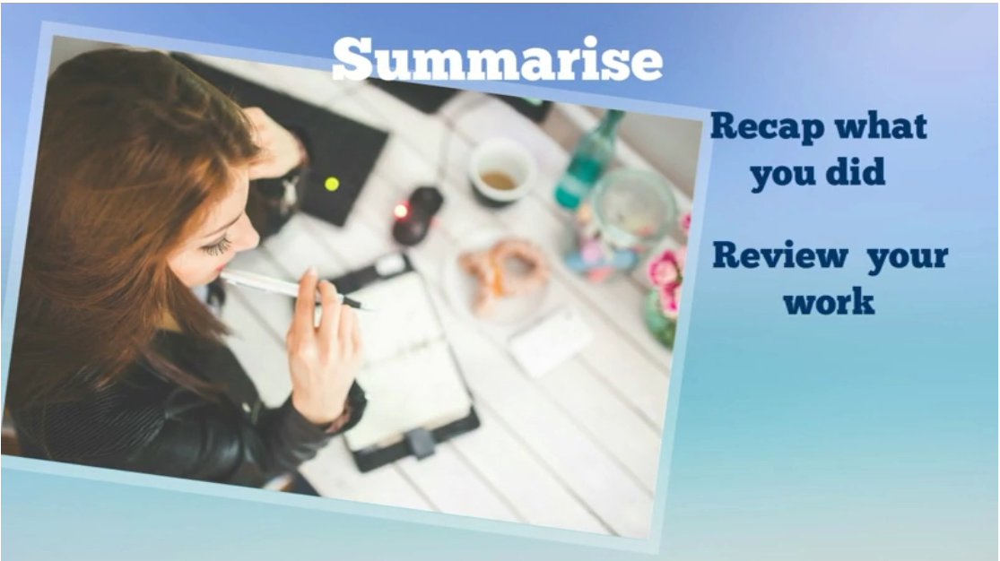
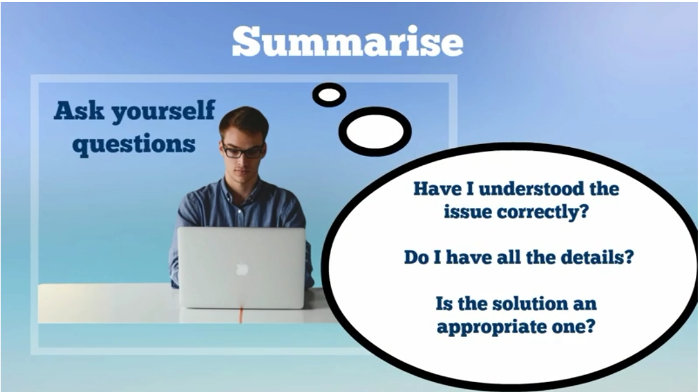
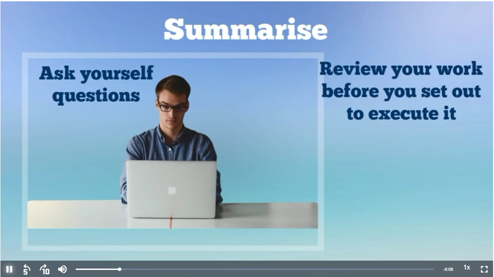

# Softskill for Application Operations_Team members_iON_SP

<!-- página 1 -->

Skim
Scrutinise
Summarise

> **Imagen de la página 1**
>
> 

<!-- página 2 -->

Summarise

Recap what you did
Review your work

> **Ilustración** — Una fotografía de una mujer estudiando y escribiendo en una tableta mientras trabaja en un escritorio.

> **Imagen de la página 2**
>
> 

<!-- página 3 -->

# Summarise

## Ask yourself questions

> Have I understood the issue correctly?
> Do I have all the details?
> Is the solution an appropriate one?

> **Imagen de la página 3**
>
> 

<!-- página 4 -->

# Summarise

| Ask yourself questions | Review your work before you set out to execute it |
| :--- | :--- |
| [Foto de un hombre joven mirando una computadora portátil] | |

> **Imagen de la página 4**
>
> 
